<h1>安德鲁·朗格彩色童话全集</h1>

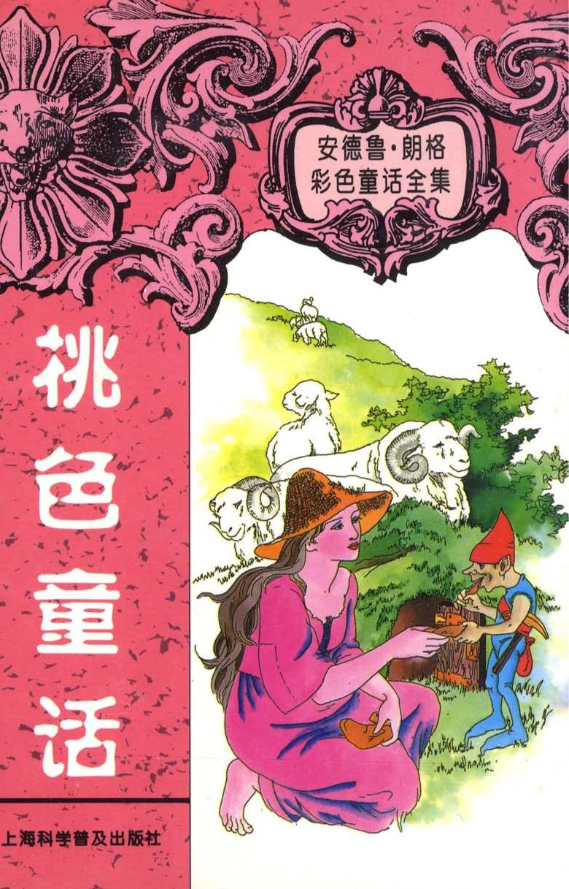

**安德鲁·朗格彩色童话全集**

桃色童话
周文晖 陈群译

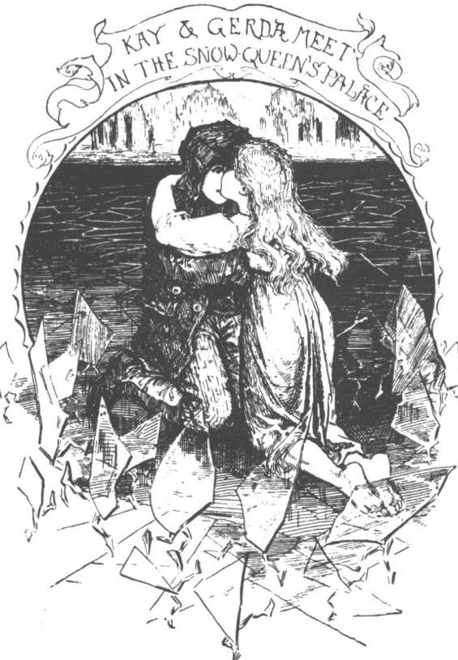

上海科学普及出版社

（沪）新登字第 305 号

Edited by Andrew Lang
The Pink Fairy Book

Published by Longmans, Green, and Co. in 1897

---

安德鲁·朗格彩色童话全集
**桃色童话**

周文晖 陈群译

---

责任编辑：钟海谷
技术编辑：万福棠
出版：上海科学普及出版社（上海曹杨路 500 号邮政编码 200063）
发行：新华书店上海发行所
印刷：上海新四印刷厂
开本：850×1168 1/32
印张：9.875
插页：4
字数：237000
版次：1997 年 7 月第 1 版 1997 年 7 月第 1 次印刷
印数：1-8000
书号：ISBN 7-5427-1197-0/G·343
定价：14.00 元

---

（本版图书凡印刷、装订错误可及时向承印厂调换）

 

| 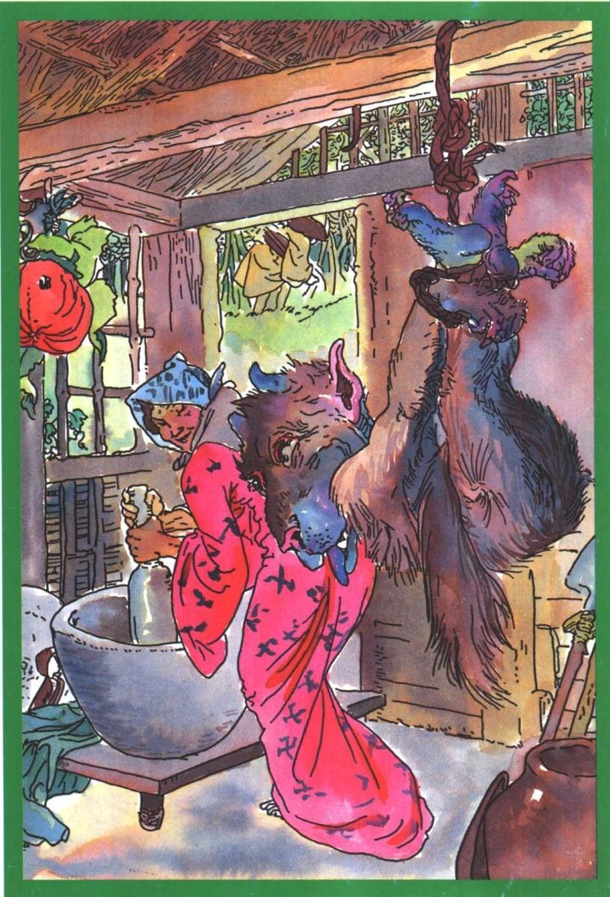 |
| :----------------------------: |
|       《森林怪兽的下场》       |

 

| 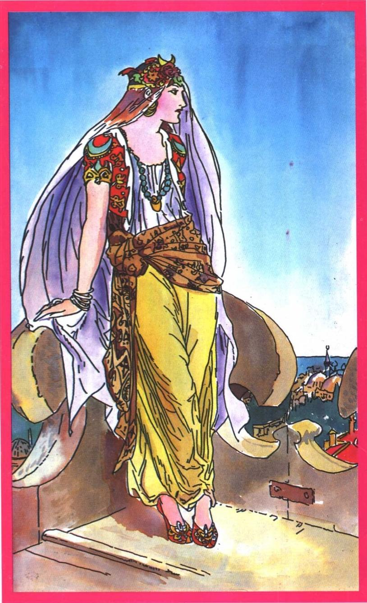 |
| :----------------------------: |
|         《会飞的箱子》         |

 

| 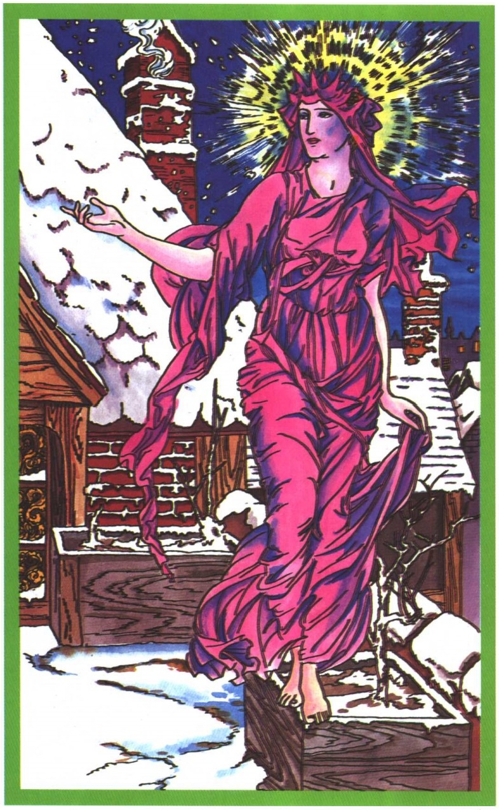 |
| :----------------------------: |
|           《雪王后》           |

 

| 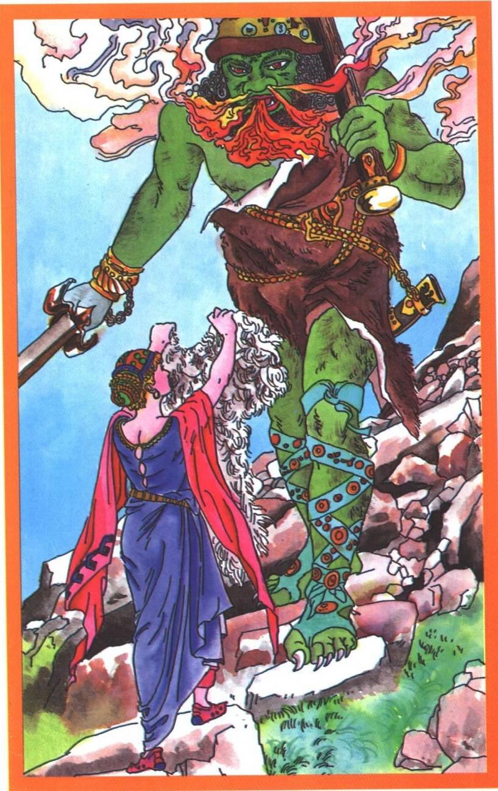 |
| :----------------------------: |
|         《受伤的狮子》         |

 

| 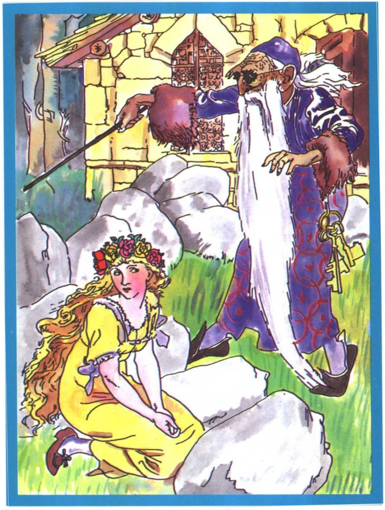 |
| :----------------------------: |
|         《没有心的人》         |

 

| 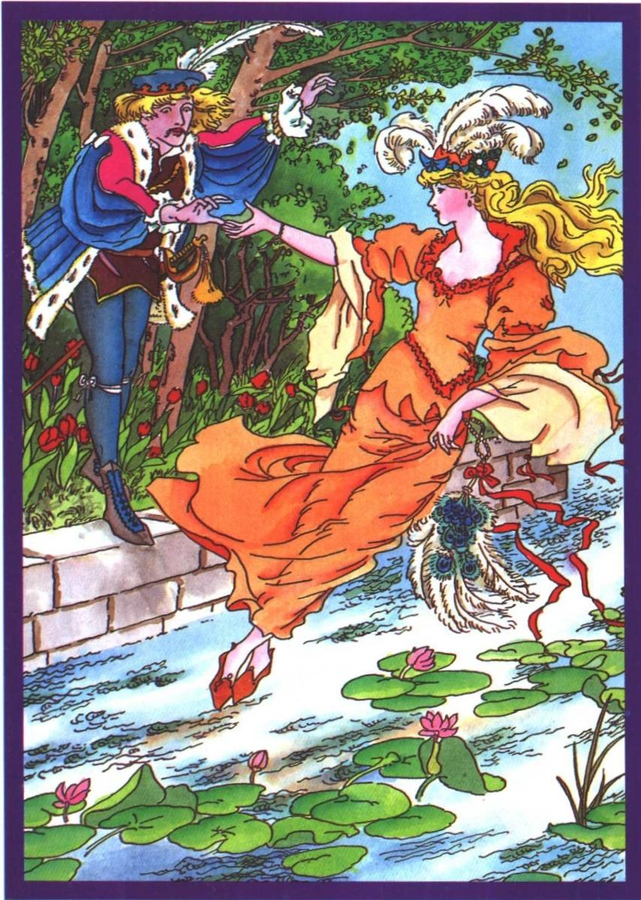 |
| :----------------------------: |
|      《米诺·米内蒂公主》       |

 

| 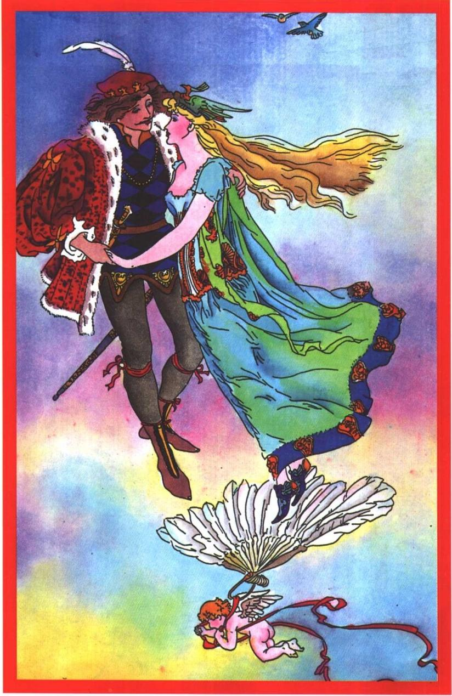 |
| :----------------------------: |
|      《米诺·米内蒂公主》       |

 

| 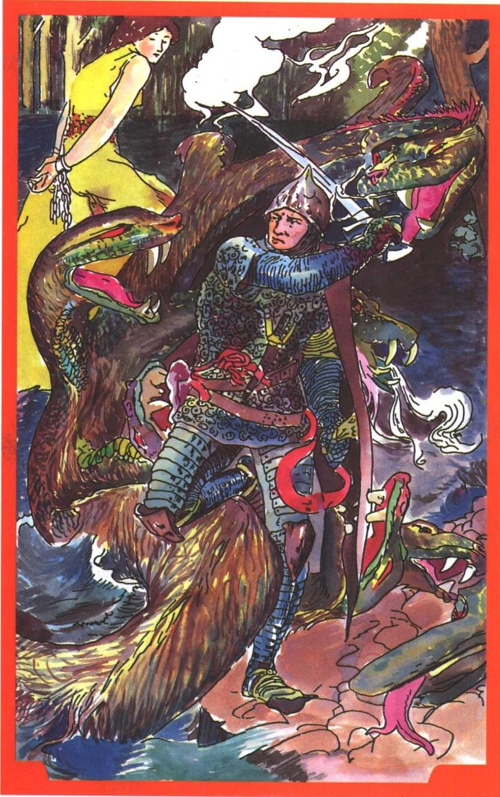 |
| :----------------------------: |
|           《兄弟俩》           |

 

## 前言

《安德鲁·朗格彩色童话全集》是英国著名文学家安德鲁·朗格（1844～1912）编辑的十二集童话。为了编辑这些童话，他广泛地收集英国、欧洲以至全世界的童话和民间故事。那些非英语的文字，如法文、德文、葡萄牙文、意大利文、西班牙文、加泰隆语等主要由他的妻子莱奥诺拉·布朗歇翻译和整理成英文。最先编成一集，当时编者的意图也只是编这一集。后来搜集的材料越来越多，才决定继续再编三集。其中的艰难和辛苦是外人所难以想象的，编者因此曾发誓，编成这四集以后，再也不编下去了。

四集童话的出版，效果非同凡响。不仅受到英国读者的欢迎，而且被译成多种文字，受到许多国家读者的欢迎。其受欢迎的程度赢得了一代又一代的读者，历数十年而不衰，这不仅源自编者长期的努力，也得益于世界各地广大热衷于这一题材的读者的帮助，他们纷纷把手头的作品和资料寄给安德鲁·朗格。这给了他极大的鼓舞，他一鼓作气，又编了八集。后面几集主要搜集了苏格兰、爱尔兰、加拿大、印度、葡萄牙、斯堪的纳维亚的民间故事和传说。有些则选自以神话、民间传说和英雄传奇为基础的中世纪威尔士故事集《马比诺吉昂》。

安德鲁·朗格认为，这些童话故事很难说是某个人写成的，它们从很久很久以前就流传下来，经过民间艺人和文学家的不断收集和整理，才达到了今天这样思想性和艺术性都比较好的程度。这些童话也被认为是英语、甚至也是全世界各种语言中时间跨度最大、包含地域最广、流传国家和地区最多、内容最丰富的童话集。

她是世界古典童话中的瑰宝，童话世界中永不凋谢的鲜花，被译成多种文字，得以广泛流传，一代又一代的儿童被她的魅力吸引，长大成为家长后，又为能给自己的孩子朗读和讲述安德鲁童话而自豪。

《桃色童话》收集了日本、德国、瑞典、丹麦、西班牙、斯拉夫等国家和地区的四十一个童话和民间故事。从这些故事中，我们可以看到，很久以前这些地区的人民是怎样生活的；可以看到他们的欢乐和悲伤，理想和追求。这些故事颂扬勤俭朴素、助人为乐、正直忠诚；谴责贪得无厌、懦弱无能、奸诈狡猾。在这本童话中，小朋友们可以读到发生在森林里的有趣故事，看到从小喜欢骗人和害人的小兔子，最后如何不得不自己割掉自己的耳朵；可以看到小枞树和雪花姑娘如何度过自己短暂的一生，他们对童年时代是如何地无限留恋，使读者更加懂得珍视自己的童年。喜欢美人鱼故事的小朋友，可以在这本书中读到她的儿子——老实忠厚、力大无比的汉斯的故事。

与《安德鲁·朗格彩色童话全集》中的其他各集一样，《桃色童话》中的故事充满了当地的风土人情和乡村气息，展现了从冰雪覆盖的北极圈到赤日炎炎的非洲大陆的美丽风光。读者们可以从中领略到许多乐趣，懂得什么是正义，什么是邪恶；什么值得爱，什么该去恨；而且还会对这些地区的人文历史和地理概貌有所了解，从而更加热爱生活，热爱我们这个世界。

 

**目录**

[TOC]

 

## 私奔的猫

从前有一只非常漂亮的猫，长着像绸缎一样柔软发亮的皮毛，一双聪明可爱的绿眼睛在黑夜里什么都看得见。它的名字叫冈恩，主人是音乐教师。他非常喜欢它，为它感到骄傲，不论世界上发生什么事情，他都不愿意和它分开。

离音乐教师家不远的地方，住着一位女士，她也有一只非常可爱的小猫，名字叫科玛。它的一举一动都非常优雅，真像一个受过良好教育的贵族小姐。你看！它吃东西的时候，是那么斯文；眨眼睛的时候是那么秀丽。连吃完饭以后，用小舌头来舔粉红色的鼻子时，动作也那么惹人喜欢。所以，它的主人总是不停地说：“科玛，科玛，没有你我可怎么过？”

有一天傍晚，两只猫都出去溜达，不期在一棵樱桃树下相遇，立刻堕入情海，相爱起来。冈恩早就觉得应该娶妻子了，因为周围的那些女性都非常注意它，令它很难为情。不过，它择偶的要求可高了，那些女性它一个也看不中。

现在，它还来不及仔细地想一想，爱神丘比特之箭已经射中了它，它对科玛的爱恋像火一样地燃烧起来。科玛对它的感情也毫不逊色。可女士总是比较细心，它看到了爱情之路并不总是一帆风顺。它忧心忡忡地和冈恩商量，如何才能克服这些困难。

冈恩请求它的主人去把科玛买过来，这样问题就解决了。可是科玛的女主人舍不得和它分开。后来，女主人建议音乐教师把冈恩卖给她，却遭到他一口拒绝。于是，事情还是像原来一样，毫无进展。

后来，这对情侣的爱恋与日俱增，它们决定私奔，自己掌握自己的命运，寻找自己的幸福。

一个月光明朗的晚上，它们约好双双出走，勇敢地闯入茫茫的世界。它们送走了黑夜，迎来了曙光，白天也不停留，直到离家很远很远。

这天晚上，它们来到一个大花园里。经过一夜又一天的跋涉，它们觉得非常热，也非常累。花园里，树木下绿草成茵，像柔软的地毯那么诱人。它们正想躺下来休息，忽然看到一个可怕的阴影在向这边移过来。那阴影越来越大，越来越近，不好了！是一条狼狗在张牙舞爪地向它们扑过来。

科玛尖叫一声，爬上了一棵樱桃树。冈恩却勇敢地站起来，准备和狼狗搏斗。它知道，科玛的眼睛正看着它，它不能胆怯地逃走。

可是，光有勇气有什么用？它的敌人实在太强大，太凶猛。这一点，从双方一开始接触就非常清楚了。科玛在树上看得明明白白，它发出凄厉的叫声，希望有人能听见而过来帮忙。

这时，恰巧一个仆人从这里经过，把狼狗赶走，把发抖着的冈恩抱在怀里，去见花园的主人——公主。

可怜的小科玛又被孤零零地留下来。冈恩满腹忧愁地被抱走了，不知道该怎么办才好。公主看到冈恩长得那么帅，那么高贵，很喜欢它。可这没有给它带来多少欢乐，命运总是这样不如人意而又难以抗拒，冈恩只好听天由命，看看过些日子会不会有转机。

冈恩的新主人公主，是个非常和蔼温顺的姑娘，大家都喜欢她。她本该过着非常幸福的生活。可不幸的是，有一条蛇爱上了她，经常来骚扰她。虽然公主的仆人接到命令，要想办法把蛇赶走。但这条蛇非常狡猾，总是千方百计偷偷地溜进来，仆人们总是拿它没有办法。

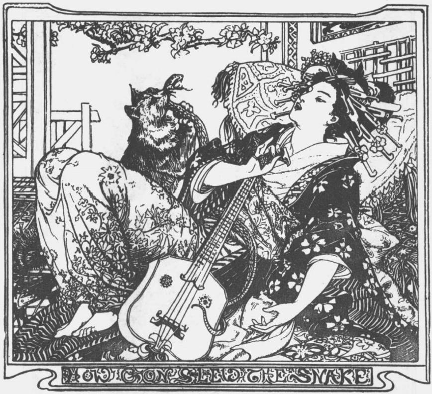

有一天，公主正坐在家里弹琴，忽然觉得有什么东西爬到她的腰带上。原来是那条蛇又溜进来了，正想要吻她。她吓得大叫起来。

这时候，冈恩正蜷缩在她的脚下。听到公主恐怖的叫声，它纵身一跃，咬住蛇的脖子，用力一摔，把蛇摔死在地下。从此以后，它再也不会来骚扰公主了。

公主感激地把冈恩抱起来，抚摸着它那光滑的皮毛，称赞它的勇敢。从此，冈恩总是吃最好的饭菜，睡最柔软的垫子。哎！要是它能见到自己的科玛，它可是世界上最幸福的猫，不再渴望什么了。

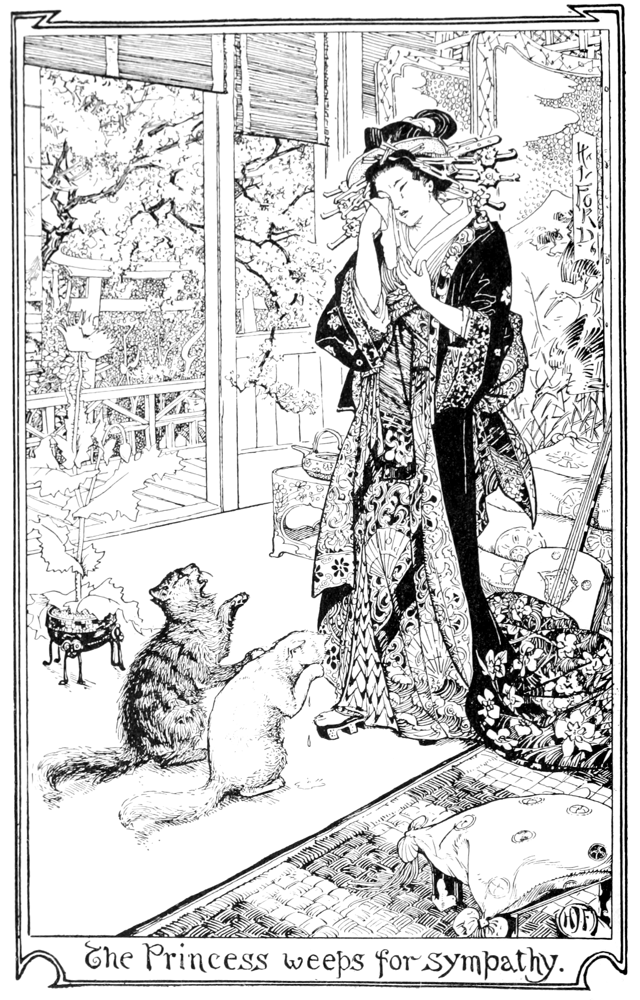

时间一天一天地过去。有一天，冈恩懒洋洋地躺在家门口晒太阳，心不在焉地看着外面的世界。忽然，它看到不远的地方，有一只大野猫在调戏一只小猫。它气愤地跳起来，向野猫扑过去。野猫吓得转身就逃。它回过身来安慰那只小猫。

啊！这只小猫原来就是它日夜思念的科玛，它激动得心都快跳出来了。科玛开始没有认出它来，因为冈恩长得那么高大，那么英俊，和以前大不一样了。等它知道救命恩人就是自己的恋人时，眼中涌出了幸福的泪水。它们亲热地擦着头，擦着鼻子，高兴地喵喵叫着，那声音一里外也听得见。

它们手拉手地来到公主的面前，把它们的身世，它们的欢乐和不幸都讲给公主听。公主听了它们悲欢离合的故事，掉下了同情的眼泪，答应让它们都留下来，住在一起，永远也不要分开。

后来，公主也结了婚，新郎是一个王子。他搬过来，和公主一起住在花园的宫殿里。公主还把两只猫的故事讲给丈夫听，讲冈恩如何勇敢，如何把她从敌人——蛇的威胁中解救出来。

王子听了也非常感动，他也发誓永远不让它们离开，让它们永远伴随着公主，这也正是公主希望的。

王子和公主后来生了许多孩子，两只猫也生了许多小猫，他们都经常在一起玩。他们的友谊可以说是天长地久，直到生命结束。

（日本）

 

## 龙如何上当

很久以前有个人，他有两个儿子。可是两兄弟相处得一点也不好，因为弟弟比哥哥英俊得多，哥哥因此非常妒忌。他们长大以后，事情变得越来越糟。终于有一天，两兄弟从森林中经过时，哥哥把弟弟抓起来，捆在一棵树上，自个儿走了。他想让弟弟活活地饿死。

事有凑巧，这时，一个上了年纪的驼背牧羊人赶着羊群从这里经过，看到一个年轻人被绑在树上，就走过来问：“我的孩子，告诉我，你干吗被人绑在树上？”

“因为我胸挺不起来，”年轻人说，“这样可以治好我的毛病，现在我的胸挺得可直了。”

“我希望你也把我绑在一棵树上。”牧羊人说，“这样，我的背也可以直起来。”

“我非常乐意帮忙。”年轻人回答，“你把我这些绳子松开，我就用它们来捆你，保证捆得像我一样牢。”

这件事很快就办妥了。年轻人赶着羊群走了，留下牧羊人在那里为自己的愚蠢而后悔。

走了不远，他遇见一个骑马的青年和一个赶牛的人，就说服他们，跟他一起出去冒险。

年轻人玩了许多这样的花招以后，很快就出了名，连国王也知道了。国王非常好奇，他很想知道，这个年轻人是如何去欺骗别人的，所以，他命令士兵去把他捉来。

年轻人被押到国王面前。国王对他说：“你骗了那么多人，耍了那么多诡计，依照法律，完全可以杀你的头。不过，有个条件，只要你做到了，就可以饶你一命。这个条件就是，到巨龙那里去，把它的那匹飞马给我带来。要是办不到，我就把你千刀万剐，剁成碎片。”

“就这么简单，”年轻人说，“你很快就可以得到它。”

他走出去，直接来到拴着飞马的马厩里，小心地伸出手去解马的缰绳。马突然大声地嘶叫起来。巨龙这时候正在马厩上面睡觉。听到马嘶叫的声音，它醒过来，大声地问：“怎么了？我的宝贝！是谁伤害你了？”年轻人不动了，马也不叫了。

过了一会，不见动静，他又动手去解缰绳，马又大声地嘶叫起来。龙第二次被吵醒，赶紧问马是怎么回事，干吗叫得这么凶？

到马第三次嘶叫的时候，龙大发脾气，从房间里走出来，拿着一根鞭子，不管三七二十一，把那匹马狠狠地抽打了一顿。

飞马受了伤害，非常气愤。年轻人再次来解缰绳的时候，它不再做声，安静地让他牵出去。到了外面，年轻人翻身上马，马腾空而起，他在马背上回过头来喊道：“嗨！龙啊！龙！要是有人问你，马到哪里去了？你就说是我骑走了。”

年轻人骑着马来见国王。可是国王说：“飞马当然非常好，可是我还要别的东西。去把巨龙床上那条带小铃的被子给我拿来，否则我就把你剁成碎片。”

“就这些，”年轻人说，“这太容易了。”

晚上，他来到龙的家里，爬上它的屋顶。他把屋顶上的一扇小窗打开，把屋顶上用来吊铁锅的链条子放下去，钩住被子往上拉。被子上的小铃响了，龙醒过来，对它的妻子说：“夫人！你把被子都拉过去了！”说着，它把被子拉过来，可怜的年轻人被它从屋顶上拉下来。龙看见了，扑过去把他抓起来，用绳子把他捆结实，还打上了一个结。

龙对妻子说：“明天我到教堂里去，你留在家里，把他杀了，煮熟，等我回来一起吃。”

第二天早晨，龙出去以后，母龙把年轻人拉过来，从架子上拿下来一把锋利的刀，准备把他杀了。

可是，就在它松开绳子准备下手的时候，年轻人抓住它的一只脚，把它翻倒在地，顺手拿起刀把它的喉咙割了后扔到炉子里去。然后，他拿起那条被子回来见国王。

国王坐在王座上，年轻人来到他的面前，把龙的被子铺开，向他深深地鞠了一躬。

“这还不够，”国王说，“你必须把那条龙带来见我，否则我就把你剁成碎片。”

“这可以办到，”年轻人回答，“可是你要给我两年的准备时间，让我的胡子长出来，免得它认出我。”

“可以。”国王说。

两年过去了，年轻人的胡子长出来了。他做的第一件事，就是到龙那里去。在路上，他碰到一个乞丐。他劝乞丐把衣服和他换一换，乞丐当然立刻同意。

年轻人穿着乞丐的衣服，大摇大摆地来到龙的房子前面。他看到自己的老对手正忙着做一个箱子，就走过去有礼貌地和它打招呼：“早上好！阁下！能不能给我一片面包！”

“你得等一下，”龙回答，“等我做好这个箱子，再进去看看能不能找到。”

“这箱子做好了，你用来干什么呢？”乞丐问。

“这是给那个杀了我妻子，偷了我的飞马和被子的年轻人做的。”龙说。

“这再合适不过了。”乞丐回答，“他干了那么多坏事。不过，这个箱子对他来说太小了。他是个大人。”

“你错了，”龙说，“这箱子连我也装得进去。”

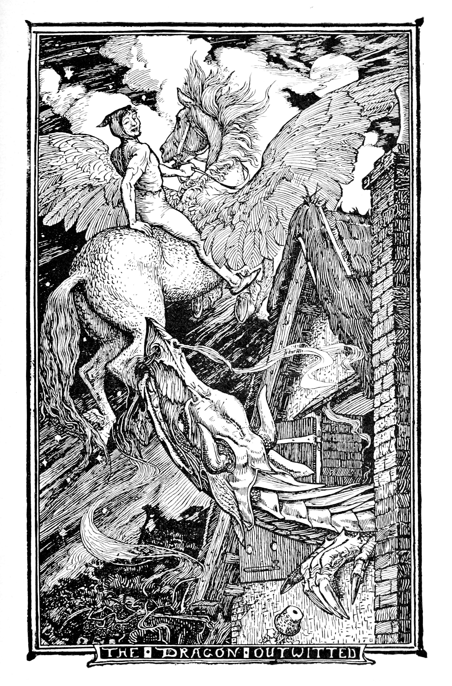

“是吗？那坏蛋差不多和你一样高，”乞丐说，“当然，要是你能进去，他肯定也能进去。不过，我敢肯定，对你来说，是小了一点。”

“不！这箱子足够大。”龙说着，小心地钻进去。

它刚进去，年轻人马上就把箱盖合上，说：“你用力推推看，看能不能逃出来。”

龙用尽全身的力气去推，可是箱子一动也不动。

“没有问题，”龙说，“你把盖打开吧！”

可是年轻人不但不把箱盖打开，反而用长钉子把它钉得更紧。然后，他把箱子扛到肩膀上，来见国王。

国王听说龙就锁在箱子里，非常兴奋。他迫不及待地想要看一看。他把锁打开，把箱盖掀开一道缝，想看看龙是不是真在里面。当然，他非常小心，不把盖子打开太大，免得龙跳出来。

可不幸的是，龙的头还是伸出来了，它张开血盆大口，一口就咬住国王，吞了进去。旁边的人奔过来想救他，已经来不及了，他们只好赶快把箱盖盖紧。

年轻人和国王的女儿结了婚，当上了国王，统治着整个国家。后来他是怎样处理这条龙的，谁也不知道。

 

## 小精灵和店主

从前有一个很用功的学生，住在一家杂货店的阁楼上。他在这个世界上一贫如洗，什么也没有。这家杂货店的店主工作非常勤奋，他住在底楼，整幢房子都是属于他的。

店主还有一个小精灵，每年圣诞节除夕，店主总是给他准备好一盘果酱，还有一大片面包，等待着小精灵的到来。

店主有的是果酱和面包，所以小精灵愿意留在他的店里。从这里，我们不是可以悟出一点道理来吗？

有一天晚上，学生从后门走出去，想去买一些蜡烛和乳酪。他没有仆人可使唤，什么事情都得自己去干。

他要了自己需要的东西，付了钱，向店主和他的妻子点点头，表示晚安，准备离开的时候，突然被包乳酪的那张纸吸引住了，不禁读了起来。

这是一首诗，这张纸是从一本书上撕下来的。

“我这里还有许多页。”店主对他说，“我用一些咖啡，从一个上了年纪的女人那里换来这本书。你要是喜欢，给我两分钱，就可以把这本书拿走。”

“好的，”学生说，“我不要乳酪了，给我这本书吧！我吃面包可以不要加乳酪。让这样一本书给撕掉，太令人难为情了。你是一个聪明能干的人，不过关于诗，你懂得和旁边那个旧木桶一样多！”

把店主和旧木桶相比，未免太粗鲁了。不过店主只是笑了一笑，学生也笑了起来。本来嘛！这只是开个玩笑。

可是小精灵生气了，竟然有人敢这样和店主说话。要知道，他是这幢房子的主人，而且卖这里最好的奶酪。

晚上，杂货店关门了。除了这个学生以外，大家都上床睡觉了。小精灵来到楼上，把女店主的舌头拿下来，她反正睡觉的时候用不着舌头。小精灵只要把舌头安在房间里任何一件东西上，它就会说话，说出自己的感觉和思想，就像它的女主人能做到的那样。

不过，这个舌头只能轮流借给一样东西。这也是好事，要是大家同时都可以借用，不就变成七嘴八舌了吗？

小精灵先把舌头借给旧木桶，它里面堆满了旧报纸。

“那个学生说，关于诗你一点也不懂，这是真的吗？”小精灵问旧木桶。

“当然不懂！”木桶说，“诗是写在纸上的一些东西，常常被人剪下来。我这里就有许多，比那个学生的还要多！可是没有用，我仍然是杂货店里的小木桶而已！”

小精灵把舌头安在咖啡研磨机上，研磨机磨起咖啡来可真响！他又把它安在奶油瓶上，安在抽屉上……它们的看法和装废纸的旧木桶差不多。一个人总得相信大多数！

“我得去告诉那个学生！”小精灵说着，轻轻地爬上楼梯，来到学生住的阁楼。

透过锁眼，小精灵看见房间里点燃着一支蜡烛，学生正在读从店里买回来的那本破书。

可里面是多么明亮啊！从书本上射出一束光芒，像一棵大树一样，枝叶繁茂，覆盖着那个学生。每一片树叶都是活的。每一朵花都是一个漂亮的女孩子的脸，有的长着黑色的明亮的眼睛；有的眼睛是蓝色的，像海水一样。每一个果实都是闪光的星星。房间里充满了一种奇妙的音乐。小精灵做梦也想象不出这样辉煌和神秘的景象，更不要说亲眼见过了。

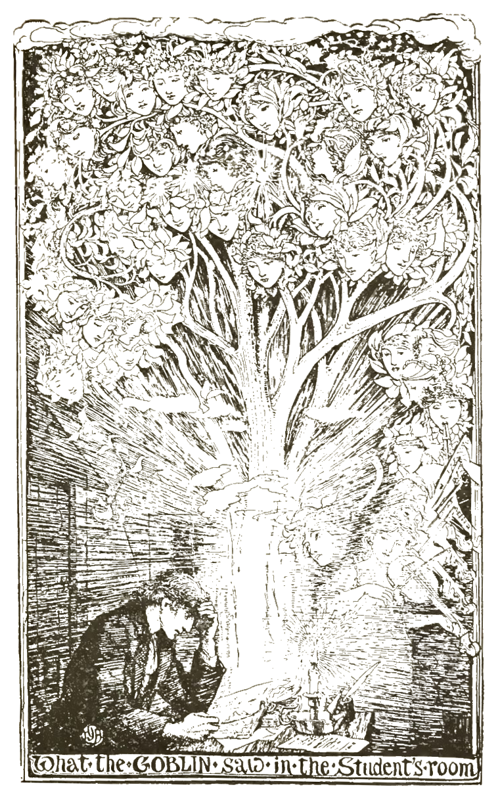

他踮起脚跟，看着，看着，直到学生把蜡烛吹灭，上床睡觉。可是那甜蜜而温柔的音乐还没有停，好像在给学生奏催眠曲。小精灵站在那里专心地听着。

“我从来没有见过这种景象。”小精灵说，“真是意想不到，我要和这个学生住在一起。”

小精灵站在那里思考着，他的思想非常敏捷。过了一会，他叹息着说：“这个学生没有果酱！”

想到这一点，他又回到店主那里去。幸亏他回来了，旧木桶差点把舌头用坏了，它已经读完了桶里所有报纸的一面，正想自己翻个身，再读那些报纸的另一面。小精灵走进来，把舌头还给了女店主。

从那天晚上起，杂货店里所有的东西，从抽屉到剃须刀，对木桶的看法都改变了。它们尊敬它，相信它。每当晚上店主读那些文学和戏剧评论时，它们都知道，这些报纸都是从木桶那里拿来的。

小精灵不再满足于安静地坐在楼下，听这些关于知识和智慧的议论。不！只要是阁楼上发出亮光，那些光线就像是一根根绳子一样把他缠住，把他拉上去。

他必须到阁楼上去，从锁眼往里看。那种感觉，就像我们在暴风雨中，看到汹涌的大海在翻滚一样。他流出了眼泪，可是说不出自己为什么会哭！不过，尽管满脸是泪水，他还是觉得很幸福。和学生一起，坐在这棵大树下，该是多么好啊！可是他不能，他只能从锁眼中偷看，这也就心满意足，十分快活了！

他站在那里，站在寒冷的地板上。冷飕飕的秋风在外面呼啸着，透过地板的裂缝直往里灌。很冷，非常冷，可是，只有阁楼里那盏灯熄灭，林中的音乐消失以后，他才感觉到是那么冷。

啊！他好像是冻僵了，他赶紧跑下来，回到那属于他的，温暖的角落。这里是多么舒适，多么惬意！

圣诞节到了，那些果酱，还有一大块面包！呵！店主是他最亲密的人。

半夜里，小精灵醒过来，听到外面有很大的吵闹声，还有人在敲门。守夜人吹响了他的号角，原来是失火了，整个城市都笼罩在火海之中。

是这间房子失火？还是邻居家的？哪里失火？

警报越来越响。女店主吓坏了，她从耳朵上摘下金耳环，放进口袋，免得丢了。店主抓起他的账簿。女佣人拿起她那件黑色的丝裙。

人人都在抢救自己最值钱的东西。小精灵也不例外，他三步两步奔上楼梯，来到学生的阁楼。他站在窗口，看着正前面的邻居房子，那间房子正在熊熊燃烧着。接着，他拿起桌子上的那本书，把它放在自己的红帽子里，两只手紧紧地抓着。

这间房子里最宝贵的东西得救了。他拿着书爬上屋顶，烟囱就在旁边。他坐在那里，对面房子燃烧着的火光把他照得通红。他双手紧握着那顶红帽子，里面是他的宝藏。

现在，他明白了，他的真正的价值所在，他是属于谁的。

不久，火被扑灭了。小精灵又认真地思考起来。

“我必须把自己分成两半，他们两人各占一半。”他自言自语地说，“我不能完全放弃店主，因为那果酱！”

是的，这对我们大家来说都一样。我们也不能完全放弃店主，因为那果酱！

（汉斯·克里斯蒂安·安徒生）

 

## 林中的房子

在一片大森林的旁边，有一间小屋子，屋子里住着一个穷樵夫和他的妻子，还有三个女儿。

一天早晨，他准备出去砍柴，对妻子说：“让大女儿把午饭送到森林里来。为了不让她迷路，我带了一袋玉米，撒在路上。”

太阳爬到森林那么高了，大女儿带着一大盆汤出去。可是森林中那些麻雀、云雀、金翅雀、乌鸦、鸣鸟早已把玉米吃光了，大女儿怎么也找不到路。

她走啊！走啊！太阳下山了，夜幕降临。树叶在黑暗中沙沙地响，猫头鹰在呼呼地叫着，姑娘越来越害怕。后来，她看到远处有亮光，在树林中闪烁着。

“那里肯定有人，”她想，“我可以到那里去过夜了。”于是，她向着亮光走去。

不久，她来到了一间房子前面，亮光是从窗口透出来的。

她敲了敲门，里面有一个粗哑的声音喊道：“进来！”

姑娘跨上黑暗的走廊，敲了敲房间的门。

“走进来就是了。”那个声音喊叫着。

姑娘把门推开，看到桌子旁边坐着一个白头发的老人，他用双手托着脸，白胡子拖到桌子上，又从桌子上几乎拖到地下。

炉子旁边躺着三只家畜：一只母鸡，一只公鸡，还有一头有斑纹的母牛。

姑娘把迷路的事情对老人说了，请求让她住一夜。

老人说：
> “美丽的公鸡，漂亮的母鸡，
> 还有你，神气的斑纹母牛，
> 你们想说些什么？”

“达克！”三只家畜回答。那意思肯定是：“我们很乐意”因为老人接着说：“这里有的是地方。到后面的厨房里去，给我们做顿晚饭。”

厨房里什么都有，姑娘做了一顿丰盛的晚餐。可是，她没有想到那些家畜。

她把饭菜端上来，放在桌子上，坐在白头发的老人对面，饱餐了一顿。

她吃完以后，说：“我累极了，哪里有床可以让我睡觉？”

那些家畜回答：

> “你和他一起吃了，
> 你和他一起喝了，
> 可你一点也没有想到我们，
> 该睡就睡去吧！”

老人接着说：“到楼上去，那里有一间卧室，把床打扫一下，铺上干净的床单，睡去吧！”

姑娘走上楼来，把床铺好，躺了下来。

过了一会，白头发的老人上来，借着蜡烛的光看着她，摇摇头。他看到她睡着了，就打开一个机关的门，姑娘掉进了地下室。

那天晚上，樵夫到很晚才回家，他责备妻子，不应该让他在森林里整整饿了一天，一点吃的东西也没有送来。

“没有啊！我让大女儿给你送饭去了！”妻子说，“她肯定是迷路了。不过，明天肯定会回来的。”

第二天一早，樵夫又出去砍柴了。这一回，他叫二女儿给他送饭。

“今天我带一袋小扁豆去。”他说，“扁豆比玉米大，二姑娘找起来就更容易些，她肯定不会迷路。”

到了快中午的时候，二姑娘带着午饭出去了。可是那些小扁豆都不见了，像昨天一样，都被林中的鸟吃掉了。

二姑娘在森林里找不到路，转来转去，一直到了晚上。像她姐姐一样，她来到了老人居住的房子，请求给她一点东西吃，让她住一夜。

长着白胡子的老人像上次一样，问他的家畜：

> “美丽的公鸡，
> 漂亮的母鸡，
> 还有你，神气的斑纹母牛，
> 你们想说些什么？”

那些家畜回答：“达克！”于是，事情和昨天晚上发生过的一样。

二姑娘烧了一顿丰盛的晚餐，和老人一起吃饱喝足。至于那些动物，她也不去想它们。

到她想找张床睡觉的时候，那些动物回答：

> “你和他一起吃了，
> 你和他一起喝了，
> 可是一点也没有想到我们，
> 该睡就睡去吧！”

等她睡着了，老人看着她摇摇头，也把她送进了地下室。

第三天早晨，樵夫对妻子说：“今天，叫小女儿给我送饭，她总是又聪明，又听话，她会找到路的，不会像两个姐姐一样到处乱转，这两个懒丫头！”

妻子说：“你是不是还想叫我把最亲爱的小女儿也丢了？”

“别担心！”他说，“她又聪明，又机灵，不会迷路的。今天我要多带一些大豆，它们比小扁豆还大，让她好认路。”

可是，当三姑娘挎着篮子出发的时候，那些豆早就被森林中的鸽子吃掉了，她不知道该往哪里走才是。她非常沮丧，想着可怜的父亲在挨饿，可怜的母亲在担忧。

天黑了，她看到了那点亮光，也来到了林中的这间房子。她非常有礼貌地问，是否可以在这里过一宿。长着白胡子的老人又开始问他的动物：

> “美丽的公鸡，
> 漂亮的母鸡，
> 还有你，神气的斑纹母牛，
> 你们想说些什么？”

“达克！”动物异口同声地说。三姑娘走到那些动物躺着的炉边，抚摸着公鸡和母鸡，还挠挠母牛的头。

她遵照老人的吩咐，准备了一顿丰盛的晚餐，把它摆在桌子上，然后说：“我能够坐下来饱吃一顿，而让这些动物挨饿吗？外面有的是吃的东西，我先伺候它们。”

说完，她走出去，拿来大麦，撒在公鸡和母鸡的面前；又给母牛抱来大捆喷香的草料。

“吃吧！亲爱的动物，”她说，“口渴了，我会让你们喝足的！”

她拿来了一大碗水，公鸡和母鸡走过来，把嘴伸到碗里，再抬起头来，像鸟喝水一样。斑纹母牛也喝得心满意足。

动物吃饱以后，三姑娘才在老人的旁边坐下，吃留给她的饭菜。不久，公鸡和母鸡开始用嘴去擦翅膀，母牛开始眨眼睛。姑娘问：“我们现在是不是该去休息了？”

老人问：

> “美丽的公鸡，
> 漂亮的母鸡，
> 还有你，神气的斑纹母牛，
> 你们想说什么？”

那些动物说：“达克！”

> “你和我们一起吃了，
> 你和我们一起喝了，
> 你对我们真好！
> 我们祝你晚安！”

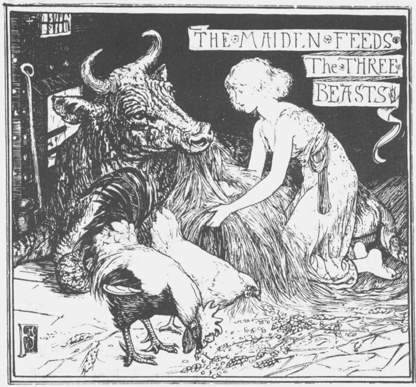

姑娘上楼来，理好床，铺上干净的床单，很快就睡着了。上半夜，她睡得很安稳。可是到了半夜，忽然传来巨大的响声，把她吵醒。一切都在震动着，那些动物都跳起来，恐怖地撞着墙壁。房屋的柱子在摇摆着，好像要倒下来，屋顶好像就要坍下。

可是没有多久，又恢复了平静，像是什么也没有发生过似的。姑娘看到没事了，又躺下来睡着了。

第二天天大亮，她才醒过来。啊！她看到了什么景象？一切都变了。她躺在一间像王宫一样华丽的房间里，绿色的墙壁上画着金黄色的美丽花朵，床是用象牙做成的，上面套着天鹅绒床罩。床边的一张凳子上，放着一双镶着珍珠的拖鞋。

姑娘正想着她是不是在做梦的时候，走进来三个衣着富贵的仆人，问她有什么吩咐？

“去吧！”姑娘说，“我马上要起来，去给老人做饭，去喂那些可爱的公鸡、母鸡和母牛。”

门开了，走进来一个英俊的青年男子，他说：“我是国王的儿子。一个邪恶的巫师把我变成老头子，和三个仆人一起住在这偏僻的森林里。他还把这三个仆人变成了公鸡、母鸡和斑纹母牛。要等到有一个善良的姑娘来，这个姑娘不但对人友好，还爱护动物，这个咒语才能解除。你就是这样一个姑娘。昨天半夜里，我们都解脱了，那间破房子也恢复了王宫的形状。”

国王的儿子吩咐三个仆人去把姑娘的父母请来，参加他们的婚礼。

“可是我的姐姐呢？”姑娘问。

“我把她们关在地下室里，明天早晨要送她们到森林里去当烧炭工，直到她们改邪归正，懂得应该友好地对待动物，不要让那些可怜的动物挨饿。”

（德国）

 

## 岛仔和乌龟

从前有一对夫妇，他们住在海边，以捕鱼为生，生活过得还很富裕。他们只有一个儿子，名叫岛仔。他是夫妇俩的骄傲和欢乐。为了儿子，他们情愿整天不停地干活，再苦也不觉得累。

岛仔长大以后，身强力壮，是捕鱼的好手。不论是刮风下雨，还是更加恶劣的天气，他都敢到很远的海面去捕鱼，村子里最勇敢的渔夫都比不上他。为了这件事，好心的邻居都不止一次摇着头对他的父母说：“你的儿子未免太冒失了，他的运气不会总是那么好的，这样下去，总有一天会被海浪吞没。”

岛仔对这些好心的劝告不以为然，他驾驶渔船的技巧那么高明，父母也觉得用不着替他担心。

一个天气晴朗的上午，岛仔在海上拉起一网鱼，看到鱼群中有一只小乌龟，非常喜欢，把它放在木桶里准备带回家。小乌龟突然用害怕得颤抖着的声音说起话来：“求求你了，放了我吧！你抓走我有什么用呢？我那么年轻，那么小，我还想长大一些。发发慈悲吧！放我走，我知道该怎样来报答你。”

岛仔为人善良，向来有求必应，不忍心拒绝别人。他拿起小乌龟，把它放归大海。

好几年过去了，岛仔日复一日地驾驶着小船到深海里去捕鱼。有一天，海上刮起了强烈的风，他把船开到几块岩石当中去避风。不幸的是，船撞在岩石上粉身碎骨，岛仔落入汹涌的大海，幸好他水性很好，挣扎着游到岩石上，才没有被淹死。

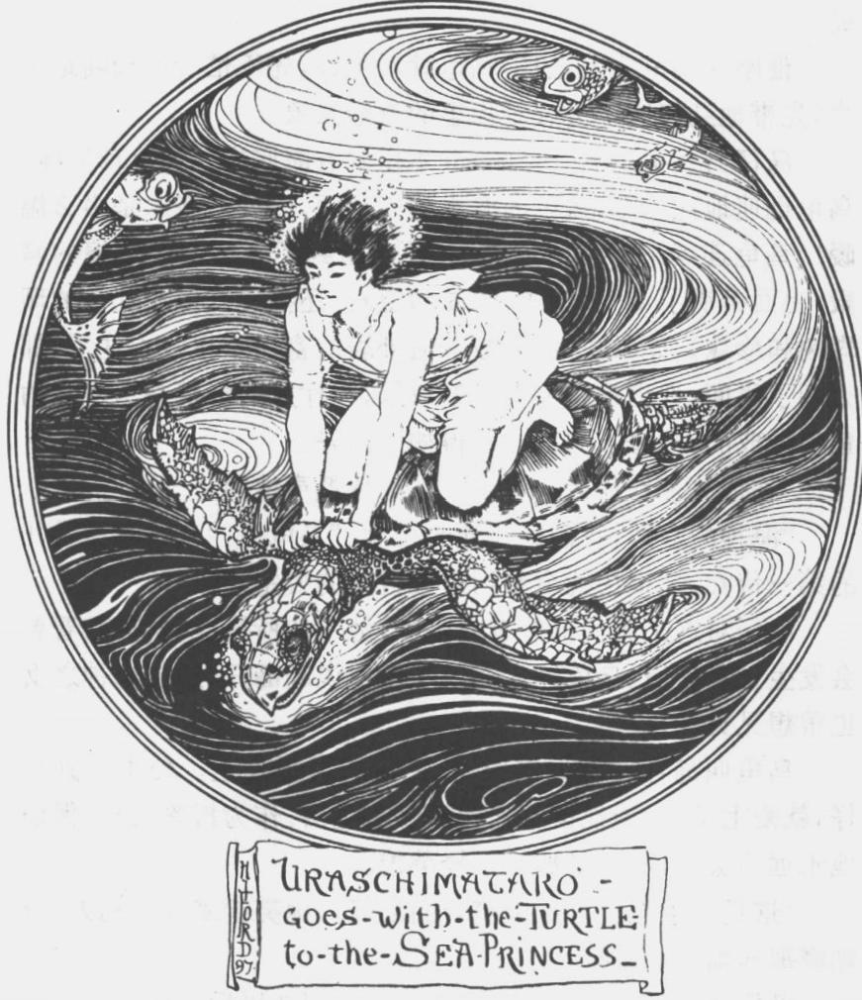

这时一只大乌龟向他游过来，对他说：“我就是你放了的乌龟。现在，我来报答你的恩情。陆地离这里很远，没有我的帮助，你是游不到陆地上去的。爬到我的背上来吧！你要到哪里去，我都会带你去。”

岛仔非常高兴，不等它再请第二次，就愉快地接受了它的帮助。

他刚在乌龟背上坐稳，乌龟就对他说，先不忙着回到陆地上去，先带他到海底下去看看那里的奇妙景象。

岛仔当然很乐意。是的，谁不想看看海底有些什么珍宝呢？乌龟迅速地往下游，蓝色的海水越来越深，深处的海水是多么温暖！乌龟连续下潜了三天三夜，他才看到了一座金碧辉煌的宫殿，上面镶满了金子、银子、水晶和宝石，还挂着许多粉红色的珊瑚树和珍珠。如果说，岛仔被宫殿外表的富丽堂皇吸引住了，那么到了里面，他更是吃惊得目瞪口呆。大厅里的灯都是用发亮的鱼鳞做成的，把海下的宫殿照得如同白昼。

“你把我带到什么地方来了？”岛仔低声地问。

“海神的宫殿，我们都是他的百姓。”乌龟说，“我是海神女儿的第一侍女，你很快就会看到这位可爱的公主。”

岛仔对这次旅行仍然有点茫然，他不知所措地等待着，看着会发生什么事情。乌龟经常在公主面前说起岛仔，这位海神之女也很想见见他。

乌龟叫岛仔在外面等候，自己进去通报公主。公主看到岛仔，就爱上了他，请他留下来和她一起生活。作为报答，公主保证他永远不会老，永远是那么年轻英俊。

“这足够了吧？”公主微笑着问岛仔。她笑起来那么动人，像朝霞那样灿烂，那样迷人。

岛仔说：“是。”但留下来多久？他到很久以后才知道。

他在海底下过得很快活，觉得一天比一天更幸福。

有一天，他突然非常想念父母，渴望能见到他们。开始，他尽量克制自己，怕这样会给公主带来悲伤。可是对父母的思念越来越强烈，人也慢慢地变得忧愁起来。公主终于觉察到了，问他有什么事？

他对公主说，他很想念家乡，渴望能见父母一面。公主听了他的话，吓得半晌说不出话来。她请求他留下来，不要去，否则就会发生非常可怕的事情。

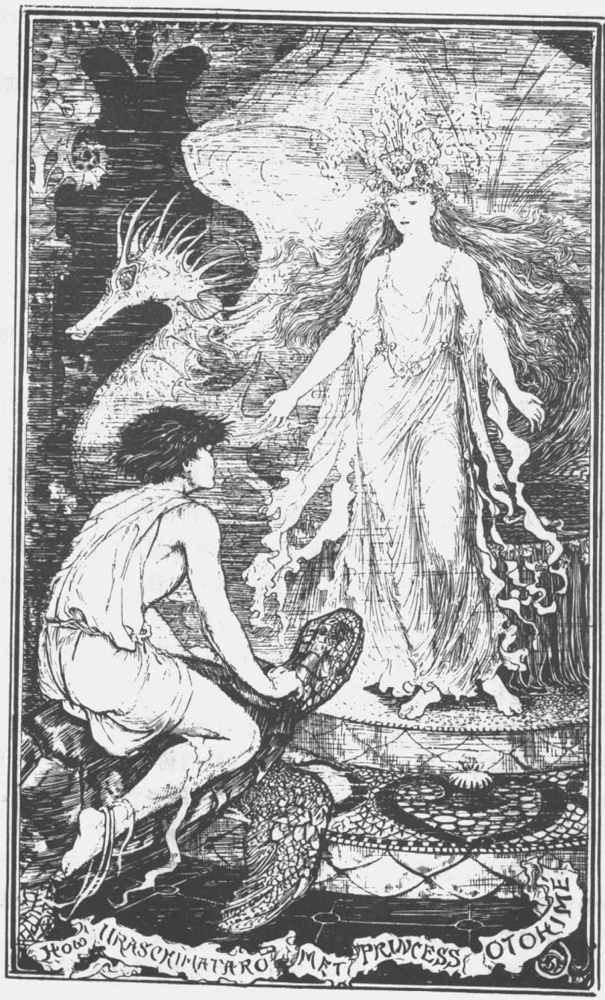

“你将永远不会回来，我们将再也不会见面。”她悲痛地呜咽着。

可是岛仔的决心毫不动摇，说：“我只离开你这一次，回来以后，就永远留在你身边。”

公主悲伤地摇着头。后来她慢慢地说：“只有一个办法可以把你安全地带回来，可是，我担心你做不到。”

“只要能回到你这里来，我什么都肯做。”岛仔亲切地看着公主说。可是公主默不做声，她心中非常明白，他只要一走，恐怕他们就再也见不到了。

她从架子上拿下一个金色的小盒子，把它交给岛仔，叫他小心地保存好，特别是不管出了什么事情，都千万不能把它打开。

“要是你能做到这一点，”公主和他告别的时候再三嘱咐，“你的朋友乌龟就会到岸边来接你，带你回到我的身边。”

岛仔衷心地对公主表示感谢，庄严地宣誓照她的吩咐去做。他把金盒子小心地放进衣服口袋，骑在乌龟的背上，挥手向公主告别，消失在海洋深处。

三天三夜，乌龟不停地向海面游着。他们来到了岛仔家乡的海岸。乌龟和他说声再见，转身就走了。

岛仔以轻快的步伐向村里走去。他看到家家户户的屋顶上，在升起袅袅炊烟。房子的周围长满了茂盛的树木和花草。孩子们在奔跑着，喊叫着。窗口里传出他所熟悉的乡音，一切都那么熟悉，那么亲切，家乡的一草一木好像都在欢迎着他的归来。

他沿着路向家里走去，走着走着，他的心却越来越沉重。他慢慢地注意到，一切是那么熟悉，又那么陌生，世界好像已经变了，往日所见的已荡然无存。

他看到自己的家了。是的，屋子还在那里，可是看上去有点怪，肯定是重新盖过了。他忐忑不安地走上去敲门。一个女子把门打开了，他向她打听父母的情况，可她连他们的名字也不知道，当然也不能告诉他任何消息。

一种不祥之兆笼罩着他的心头，他茫然地来到墓地。这是人世间变化最小，唯一能告诉他过去的地方。是的，他的感觉没有欺骗他。不久，他找到了父母亲的墓地。石碑上刻着他们去世的日子。这一天，正是他们失去儿子的那一天。为了海神的女儿，他离开了自己的父母。这时候，他才知道，自从离开家以后，三百年已经过去了。

这可怕的发现令他惊骇得浑身发抖。他回到村子里，希望能找到一个能告诉他过去的人。可是，活着的人对他一无所知，一切都好像在做梦一样，他对自己的存在，似乎也感到茫然起来。

他想起了公主给他的礼物，那个金盒子。也许，这些可怕的事情都是一种幻觉，都是一种魔法在起作用，这种魔法也许和他手中的金盒子有关。也许打开这个盒子，魔法就会解除，一切都会恢复原状。

不知不觉地，手中的盒子被他打开了，一股青烟从里面冒出来。他凝视着手中握着的空盒子，突然发现自己那双肌肉丰满，皮肤光滑的双手慢慢地皱起来，一会儿就变得又干又瘪，像个上百岁的老人的手。他跑到河边，照着从山上流下来的清澈的泉水，里面是个木乃伊似的老头子在看着他。

他觉得自己越来越衰弱，快要死了。他艰难地走回村子，谁都不认识这个很老很老的老人，更不知道他就是一个钟头以前还在街上走的那个年轻人。

他好不容易挪到海岸边，伤心地坐在一块石头上，大声地叫着乌龟。可是，乌龟再也不会来了，死亡却很快地来临，让这个几百岁的老人最终得到解脱。

在他临死之前，人们知道了这个举目无亲、孤独地坐在海边的老人的故事。以后，每当那些小孩子不得安宁的时候，大人就给他们讲，以前有个父母的好孩子，为了父母舍弃了海底宫殿的荣华奇观，也舍弃了世上最美丽的女子的故事[^1]。

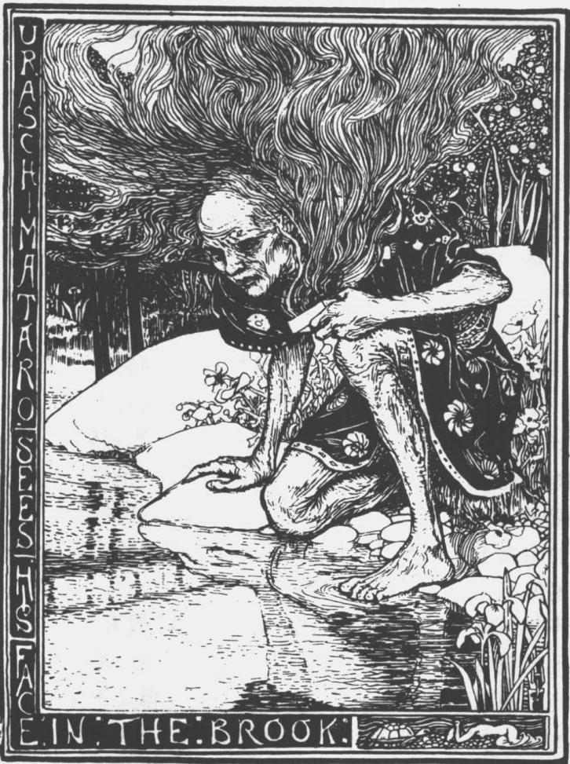

（日本）

 

## 森林怪兽的下场

很久很久以前，两座大山之间的峡谷中，有一条大河奔流而过。河边的一间小屋里，住着一对农民夫妇。小屋的四周，是茂密的森林。丈夫从小就在这里长大，对这里的一草一木都非常熟悉。更有趣的是，他还跟一只兔子交了朋友。农民在路旁休息，或者是吃午饭的时候，那只兔子就会来陪他，一起坐上一两个钟头。

森林里还住着一只很坏的怪兽，它看到农民对兔子那么好，友情那么深，就非常妒忌，非常恨他，总是想方设法来捉弄他。它常常偷偷地来到农民的家里，看到农民给兔子留下什么吃的，它要么就把它吃掉，要么就把它倒掉，决不让兔子吃到。后来农民看见了非常生气，决心要处罚它。

一连许多天，农民躲在森林里等待机会。有一天上午，怪兽偷偷地走过来，一心一意只想着去偷东西，农民冷不防从树后跳出来抓住它，把它的手和脚都捆起来，使它一点也不能动，开心地把它拖回家中，心里想，终于把这个恶作剧的家伙抓到了。想到自己吃了它那么多苦头，就对妻子说：“这一回，我们要剥下它的皮，把它杀了烧来吃掉。”

农民把怪兽倒吊在梁上，自己就出去砍柴，准备回来生火。

这时候，农民的妻子正在臼米，准备吃一个星期，这活很累。

她不久就觉得气喘吁吁，手臂酸痛。这时角落里传来哀叹声和哭泣声。女人不知道是怎么回事，就走过去看。这正中怪兽的下怀，它装出一副可怜相，低声下气地请求女人把绳子松开一点，绳子勒得它好痛。女人的心很软，看到它那痛苦和悲哀的样子很同情。可是她不敢松开绳子，她知道这样做丈夫会很生气的。

怪兽看到她动了恻隐之心，当然不肯就此罢休。它说：“我只是想把绳子松松开，我保证决不会逃跑。”过了一会，它又说：“你要是把我手脚松开，我就来帮你臼米，你就可以休息一会了。要知道，臼米这活是很累人的。女人干这活很不合适。”

后面一句话正说中了她的心，可怜的女人真傻，她真的去把怪兽的绳子松开。怪兽一得到自由，就凶狠地把她杀了，还把锅子支在炉上，把她放进锅里，把她煮了。

准备好了以后，怪兽躲在门后看着，看到农民背着一大捆柴回来，它立刻穿上女人的衣服，摇身一变，变成女人的模样，不声不响地接过农民背上的柴火烧起来。饭菜很快就烧好了，农民正好很饿，也不管那么多了，决定先吃饱了再说。

怪兽看到他吃得那么急，把自己忘得一干二净，等他吃好以后，它脱下女人的服装，变成原来的模样，对农民说：“你真是一个好人，捕捉动物还想杀它！这回你自作自受了，你吃掉的是自己的妻子。你要是想捡她的骨头，地板上的就是。”说完，它转身一溜烟地逃走了。

农民听了它说的这些话，吓得魂不附体，浑身哆嗦起来，好半天才清醒过来。他十分悲伤地收拢妻子的遗骨，埋在花园里。他在墓前发誓，一定要找到怪兽报仇。回到家里，他一个人孤孤单单地坐着痛哭。

兔子从他家门口经过，听到里面有哭声，走进来问他是怎么回事。农民呜呜咽咽把这件悲惨的事情讲给它听。兔子听了也非常同情，对怪兽的恶劣行为感到非常气愤。它尽可能地安慰农民，答应要帮助他报仇。“这个恶棍一定要受到惩罚！”它说。

兔子在房间里找些东西做成药膏，还在药膏里撒上许多辣椒粉，把它放进口袋。它向农民借了一把斧头后，就向他告别，回到森林里去。

它来到怪兽的家，敲了敲门。怪兽看到是兔子，也没有什么疑心，很高兴地请它进来。看到兔子带着的那把斧头，它很欢喜，就开始动坏脑筋。

它想，要想得到兔子的斧头，最好先陪它一起出去。这正中兔子的下怀。兔子当然知道怪兽很狡猾，可是它的那些诡计兔子也略知一二，所以不怕它。兔子装做很高兴的样子，和它一起向森林里走去。

兔子一边走，一边不时停下来砍柴，不久就砍了一大把。它假装说这捆柴太重了，背不动。怪兽看到机会来了，就说它不怕重，把柴背过来。

兔子这时候已经想出一个主意来。它走到怪兽的后面，用火柴把那捆柴点着。怪兽这时在动坏脑筋，有点走神，只是听到好像有劈里啪啦的声音，问兔子是怎么回事。兔子说：“没什么，那只是石头从山上滚下来的声音。”

怪兽觉得有道理，不再说什么了，它没有注意到这声音就是它背上的柴火燃烧时发出来的。等到烧着它的皮毛，它才痛得哇哇地叫起来，赶紧把柴火扔掉。这时候，它背上的皮已经烧掉一大块，它气得嗷嗷直叫。兔子走过来安慰它，说自己带着一种好膏药，能治好一切伤痛。说着就把调好的药拿出来，涂在一片树叶上，给怪兽贴上。怪兽不知是计，痛得它连蹦带跳，在地上打起滚来。

兔子哈哈大笑，跑去告诉农民。可是农民听了并不高兴，只是不停地摇头。他说，这样那个恶棍只是受一时的痛苦，等好了以后，它一定会想方设法进行报复。唯一的办法是彻底把它除掉，叫它再也不能为非作歹。

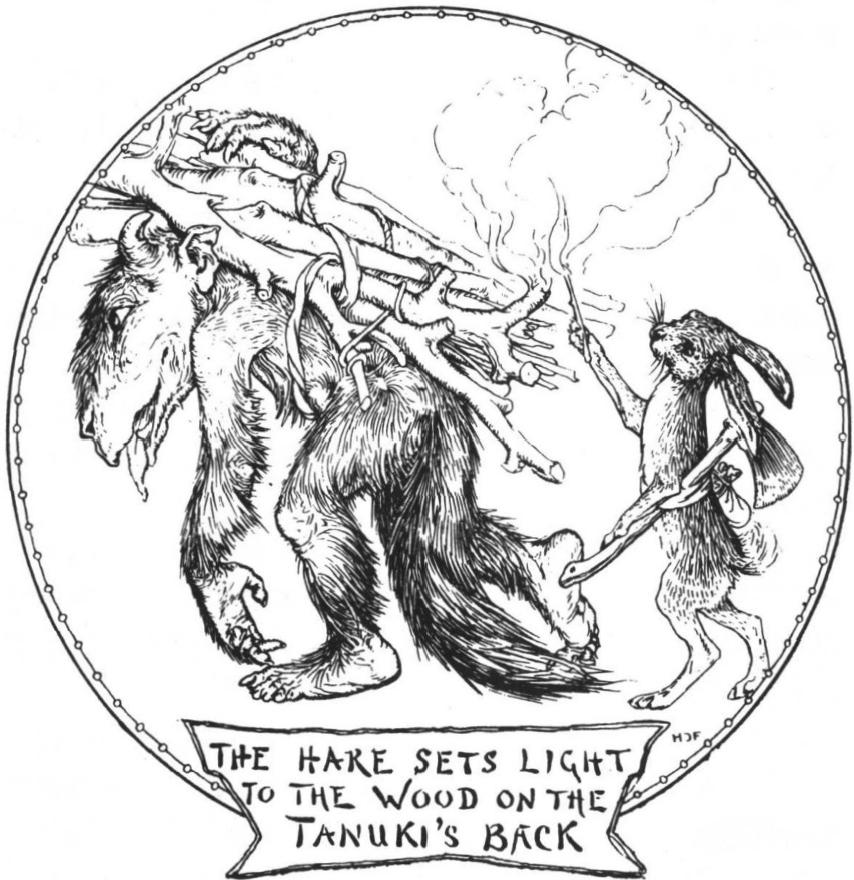

农民和兔子坐在一起商量了很久，终于想出了一个好办法。他们用木头做了一只小船，再用陶土做一只大船。做好以后，兔子来到怪兽的家里，请它一起去捕鱼。怪兽的伤还没有好，还很生兔子的气。可是因为待在家里好久没有吃东西了，正饿得慌，也就接受了兔子的邀请，和它一起来到河边。

河边停着两只船，看上去一模一样，只是一只大些，一只小些。怪兽抢先上了大船，它想大船不但稳当，而且还可以装许多鱼。兔子上了小船。

它们解开缆绳，向河中心驶去。到了河中央，兔子拿起船桨，在怪兽坐的船上用力敲了一下，船裂成两半，怪兽落入水中，不久就淹死了。兔子把它的尸体打捞上来，回到农民的家中。

农民看到怪兽死了，妻子的仇也报了，非常高兴。他邀请兔子到他家里来住。他们在山上平安地度过了一生。

 

## 会飞的箱子

从前有一个商人，非常有钱，他的银子铺满一条大马路以后，还可以铺满一条小路。当然，他不会把钱铺在马路上。他知道该怎样去花每一分钱，要是花掉一个先令，就准能赚回一个金币。他确实是一个非常精明的商人，直到老了也是这样。

他死了以后，儿子继承了他的财产。儿子可不像老子那样精打细算，他用钱很慷慨，每天晚上都上歌剧院，用五英镑的纸币来做风筝。玩打水漂游戏的时候，也是用金币来代替石头。这样下去，钱哪有用不完的时候！果然不久，他发现自己身边只有四先令了。家里的衣服也只剩下一件晨衣和一双拖鞋。

所有的朋友也不再来找他了，热闹的家庭变得门可罗雀。不过，朋友之中也有一个好心人，他送给商人的儿子一个旧箱子，还对他说：“收拾收拾！”可是他没有什么好收拾的，只好自己钻到箱子里去。

他发现，那可不是一个普通的箱子，而是一个魔箱，锁好以后，它就会飞起来。商人的儿子钻进去以后，刚把箱盖盖好，它就飞起来了，一会儿就超过烟囱，飞到云里去了，越飞越远。不过，当他看到箱底有一道缝时，非常害怕，担心箱子会裂开。要是那样，想想看，他要翻多少个跟头才能着地！

就这样，他坐在箱子里飞到了土耳其。他把箱子藏在森林里一些干树叶下面，徒步走进城里。土耳其人都穿着晨服和拖鞋，所以谁也没有注意到这个外乡来的陌生人。

他在街上碰到一个领着小孩的保姆。

“喂！土耳其的保姆！”他说，“城边那个大城堡是干什么的？窗开得那么高，谁住在里面？”

“苏丹的女儿住在里面，”她说，“算命的人说，她会给丈夫带来不幸。所以，除非是苏丹和王后在场，谁也不能见到她。”

“谢谢你。”商人的儿子说。他回到森林，坐进箱子，一直飞到公主居住的城堡窗口，从窗口爬进公主的房间。

公主正在沙发上睡觉。她长得那么美，商人的儿子情不自禁地吻了她一下。公主醒过来，看到他非常害怕。他对她说，他是一个土耳其神，从空中飞进来看她。这些话使公主很高兴。

他们紧挨着坐在一起。他给她讲关于她的眼睛的故事，说她那双美丽的黑眼睛像是深深的湖泊，她的思想就像美人一样地在里面游泳，她的前额就像白雪，在闪闪发光。这些都是很动听的故事。

说完这些故事，他请求公主嫁给他，公主立刻就答应了。

“不过，”公主说，“你星期六那天要到这里来，苏丹和母亲要来和我一起喝茶。看到我接待一个土耳其神，他们会觉得很骄傲。你必须准备好一个非常动听的故事，我父母都很爱听好的故事。我母亲喜欢有寓意的，我父亲喜欢那些能让他开怀大笑的故事。”

“好的，到时候，我就只带一本故事书来，作为订婚的礼物。”商人的儿子说。公主送给他一个装有金币的剑盒。

他飞到城里，给自己买了一件新的晨服，又回到森林里，开始编星期六要讲的故事，这可不是件容易的事情。等故事编好以后，星期六也到了。

这一天，苏丹、王后，还有整个宫廷里的大臣都来和公主一起喝茶。他们热烈地欢迎商人儿子的到来，当然，他们都把他当做土耳其神。

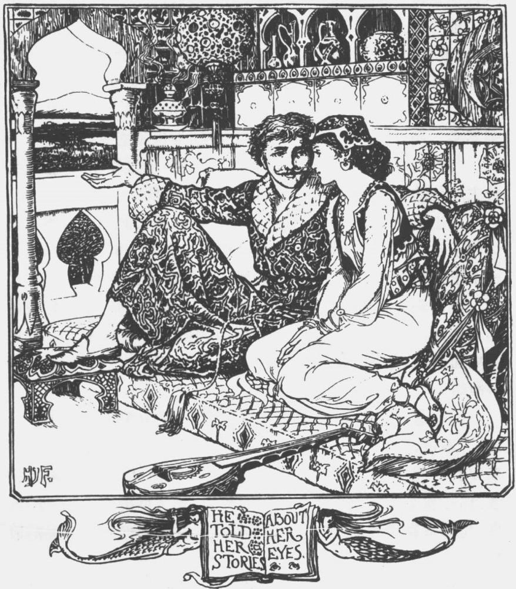

“你能给我们讲个故事吗？”王后说，“一个有意思，又有启发性的故事。”

“还要能让人发笑。”苏丹补充说。

“当然，请大家注意听。”于是，商人的儿子开始讲下面这个故事。

从前有一盒火柴，在它旁边放着金属取火盒和一个铁罐，它们开始讲自己年轻时代的故事。

“我们小的时候，是绿色的枞树。每天早上和晚上，我们都喝钻石般晶莹的露水茶。白天，我们就晒晒太阳，小鸟经常给我们讲故事。”火柴开始回忆它那美妙的童年，“那时候，我们很有钱，其他树木只有夏天才有衣服穿，而我们不论春夏秋冬，都穿一身绿衣裳。后来伐木工人来了。我们的家庭四分五裂。现在，我们的责任是给最底层的人点火。所以说，我们之中最高贵的人都住在厨房里。”

“我的命运和你迥然不同。”铁罐子说，“自从我来到这个世界上，不知道煮过多少东西，被擦洗过多少次。主人吃过饭以后，把我洗干净放好，这是我唯一开心的时候，这时我可以和伙伴们聊天。”

“你现在说得太快了！”火发出劈劈啪啪的声音，说。

“让我们来看一看，谁的工作最崇高！”火柴说。

“不！我不喜欢谈论自己。”铁罐说。

“让我们安排一个晚上开开心，我要给你们讲我的生活故事。”火柴说，“在丹麦海岸边的波罗的海……”

“这个故事开头真美！”在一旁听着的盘子异口同声地说，“这故事肯定会让我们都开心。它的结尾也会像开头那样好。”

“现在，我要跳舞了！”火钳说，它跳得那么高。角落里的一块旧台布看到它那模样，吓得裂成两半。

水壶也想唱支歌，可是它觉得太冷了，唱不出来，它只有在水烧开的时候才能唱歌。

窗台上有一支鹅毛笔，它看上去并不引人注目，只是不难发现，它曾经深深地浸在墨水中。它为此深感自豪。

“水壶要是不唱，”鹅毛笔说，“挂在门口笼子里的夜莺会唱的。”

“我想这不太合适吧？”锅子说，“听这只外国来的鸟唱歌！”

“那么，让我们来表演一些节目吧！”大伙说，“现在就开始！”

这时，门突然打开了，一个女仆走进来。大家都安静下来，一点声音都没有。那些锅子都知道，它们该干什么了，它们感到多么荣耀！

女仆拿起火柴，擦了一下，它们燃烧起来，火焰是那么美！

“现在，谁都看得见，谁最崇高了！火光多么辉煌！多么明亮……”

这时候，它完全烧尽了。

“这真是个令人开心的，了不起的故事。”王后说，“我好像置身于厨房，看到这些火柴一样。是的，你现在可以娶我们的女儿了。”

“确实是这样。”苏丹说，“星期一，你就可以跟我们的女儿结婚。”他们把商人的儿子看做是自己家里人一样。

婚礼在积极地筹备着。婚礼前夜，整个城市都被灯火照得通明。马路上，在向行人发送饼干和姜饼，孩子们兴高采烈地奔跑着，喊叫着，还不停地吹着口哨。那景象非常壮观。

“现在，我也应该对他们有所表示。”商人的儿子想。他买来了各色各样的炮仗和焰火，装进箱子，飞上天空。

炮仗和焰火在空中呼呼地响着，飞舞着，发出令人赞叹的绚烂色彩。那些土耳其人从来没有见过这样辉煌的景色，发狂似地叫着，跳着，连拖鞋也抛上了天空。现在，他们真的相信了，公主要嫁给一个真正的土耳其神了。

商人的儿子放完焰火，坐着箱子重返森林。“我要到城里去，看看这些焰火给他们留下什么印象。”

这很自然，他是应该去看一看。

他听到了什么呢？啊！人们对他讲的，都是一些非常令人满意的故事。尽管各人的说法不一样，但都觉得妙不可言。

“我亲眼看见土耳其神了！”有一个人这样说，“他的眼睛像闪烁着的星星；他的胡子像水牛掀起的波涛。”

“他穿着火焰般的大衣飞走了！”另一个人说。

这些故事那么动人，那么美妙！是啊，明天，他就要和公主结婚了。

他回到森林里，可是，他的箱子呢？它已经烧成灰了！一粒火星不幸落在箱子上，烧了起来，这下可把他的理想，他的前途全付之一炬。没有箱子，他再也不能飞了，怎么去找他的新娘？

结婚的这一天，公主从早到晚站在屋顶上等着，等着土耳其神的降临。也许，她一直等到现在。

商人的儿子呢？他周游世界，到处给人家讲故事。不过，这些故事不像那盒火柴的故事那么美妙。

（汉斯·克里斯蒂安·安徒生）

 

## 雪人

“多么寒冷的天啊！”雪人说，“我全身都要冻裂了。这些风真是要命！上面那火焰般的东西多么耀眼！”它说的是太阳。这时太阳正在徐徐西落。“这样它会把我的眼睛照瞎的。不过，我还是觉得那么凉爽，那么结实！”

它的眼睛是两块很大的三角形的岩石，嘴巴是用旧钉耙做成的，所以也有牙齿。

它在男孩子的欢呼声和笑声中诞生，雪橇的铃声和甩鞭子的声音欢迎它来到这个人世间。

太阳下山了。又大又圆的月亮升起来，挂在深蓝色的天空上，那么美丽，那么明亮。

第二天，太阳又升起来的时候，雪人自言自语地说：“它又从这边出来了。我已经习惯了它的光芒。我希望它永远挂在那里，发出光明，这样我就能看清楚自己了。我多么想知道，怎么样才能改变自己的位置，我很想能走动走动。可能的话，我要像那些男孩子一样，在冰上滑来滑去。可是不知道为什么，我不会跑！”

“汪！汪！”院子里的一条老狗叫起来，它的声音嘶哑，叫起来有点刺耳。当它还养在家里，躺在炉子旁的时候，声音就开始嘶哑了。“太阳很快就会教你跑路！去年冬天我看到你的前辈就是这样的，还有前年你的老前辈也是这样！它们后来都跑掉了！”老狗继续对雪人说着。

“我听不懂你的话，我的朋友！”雪人说，“挂在那里的东西教会我跑？”这时候，它指的是月亮，“是的，它是在跑，我看得很清楚，它原先在那边，现在跑过来了。”

“这些事情你一点也不明白。”院子里的老狗说，“嗯！你刚刚做成。你看到的那个东西叫月亮。从那边下沉的是太阳。明天早晨它又会升起来，很快就会教你如何从沟里跑出去。天气就要变了。我的左后腿在发痛，我感觉得到，天气肯定要起变化了。”

“我不了解它。”雪人说，“不过，我有个感觉，它在诉说着什么令人不愉快的事情。这东西那么光亮，然后又会失踪，就是你说的那个太阳，它不是我的朋友，这一点我觉察得出来。”

“汪！汪！”院子里的老狗又吠了几声，绕圈子走了几回，钻到洞里睡觉去了。

天气真的是起变化了。早晨，浓浓的大雾笼罩着整个村庄，后来又刮起刺骨的寒风，叫地面和树叶都结上厚厚的霜。不久，太阳出来了，发出灿烂的光辉，令周围的景色异常壮观。树木和丛林披上了白色的外衣，像是一片珊瑚礁。树上开满了白色的花。夏天被茂盛的叶子覆盖的千姿百态的树丛，这时在银光闪闪的冰霜点缀下，更显得英姿勃勃，雄伟壮丽。微风吹过，树木招展，光芒点点，像是撒满了钻石和珍珠。

“这景色多么迷人！”一个姑娘和小伙子在花园里散步，他们在雪人身边停下来，观赏这些灼灼生辉的银树。“夏天不会有这么美丽的景象。”姑娘说，她眼中也闪烁着快活的光芒。

“是的，夏天也找不到这样的伙伴。”小伙子指着雪人说，“它多么漂亮！”姑娘开心地笑着，向雪人点点头。他们在雪地上踏着舞步走了。

“这两个人是谁？”雪人问，“你在这院子里住的时间比我长，你认识他们吗？”

“我认识他们。”狗说，“她经常抚摸我，他给我吃过骨头，我不咬他们。”

“他们是什么人呢？”雪人问。

“情侣！”狗回答，“他们以后要一起进一个洞，啃同样的骨头。”

“他们是不是也像我们这样？”雪人问。

“他们是我们的主人。”狗回答，“真是的，在这个世界上只活一天的人知道得太少了。这是我得出的结论。现在，我既有年纪，又有智慧。这房子里的人我都认识。我还清楚地记得，那些不躺在这个又冷又潮的洞里的日子。汪！汪！”

“冷也让人心旷神怡。”雪人说，“请再多告诉我一些事情，可不要老是去拉响那根链条，这声音叫人心烦。”

“汪！汪！”狗又叫了两声，说，“以前，他们也常说我是可爱的小东西。当我躺在主人房间里铺着天鹅绒的垫子上时，女主人会抚摸我，抱我，吻我，说我是她亲爱的甜蜜的小爱丽斯。后来我长大了，就把我交给管家，从此我住在厨房里。从你站着的地方可以看得见厨房，还可以看得见曾经属于我的那个房间，我跟管家的时候就是这样的。当然，它比楼上的房间小得多，可是更舒服。那些孩子也不会像以前那样老是来惹我，逗我。我吃的东西也和以前一样，甚至更好。我有自己的枕头。里面还有一个炉子。那年头，是这个世界上最美好的时光。我常常躺在炉子的旁边。啊！到现在，我还经常梦见那个炉子！汪！汪！”

“炉子很漂亮吗？”雪人问，“它是不是像我一样？”

“它和你正好相反！它像炭一样黑，有一个长长的脖子和一根铜管。它吃柴火，吐出来的是烈焰。人人都想靠近它，它下面的那块地方最舒服。从你站着的地方，透过窗口可以看得到它。”

雪人朝着狗说的方向望去，看到一个光滑铮亮的东西，上面有一根铜管子。火光在炉子里闪烁着，雪人看到这火光，心里觉得异常幸福，涌起一种不可言传的感慨。不过，这些感受除了雪人以外，谁都不明白。

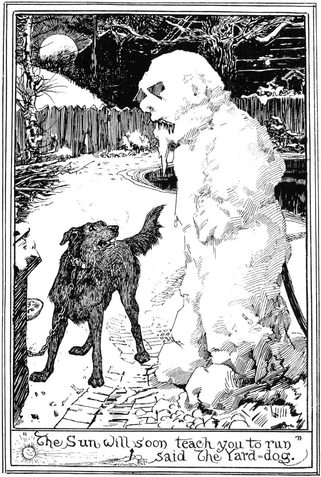

“那么，你干吗离开它呢？”雪人问。它感到，这种东西一定像人类的女性一样温柔，“你怎么舍得离开这么好的地方？”

“我必须离开。”狗说，“他们把我从门口赶出来，用链条把我锁在这里。我咬了一口主人小儿子的脚，因为他从我嘴里抢走了我正在吃的骨头。我想，骨头要用骨头来换。可是他们非常生气，从此以后就把我锁在这里。我的声音也变了，从前可不是这样。你听不出我的声音有多么嘶哑吗？汪！汪！我不像别的狗那样，说话的声音不是那么好听了。汪！汪！这就是幸福的最终结局！”

雪人不再听它说什么了。它从窗口望进去，看着管家住的房间，炉子用四只铁脚站着，它就像雪人那么大。

“是什么东西在我的身体里骚动着？”雪人说，“难道我真的永远也走不进去吗？应该说这是一个良好的愿望，良好的愿望应该去实现。我要走过去，靠在火炉上，即使是先要把窗子打开，我也要走进去。”

“你永远也进不去！”狗说，“就算你能靠近炉子，你也立刻就会消失。汪！汪！”

“我已经感觉到像走进去一样的快乐！”雪人说，“我想，我就要裂开了。”

整整一天，雪人都眼睁睁地看着窗口。到了晚上，房间里更加诱人，炉子发出柔和的火光，既不像太阳，也不像月亮的光。这种光是炉子所特有的，你喂给它一些东西，它就放出这种奇异的光彩。房间的门打开了，它的火焰更加夺目，这也是它的独特之处，火光把雪人洁白的脸照得通红。

“我再也忍耐不住了！”雪人说，“它把鲜红的舌头伸出来的时候，是多么美丽！”

夜晚很长很长，可是雪人并不觉得，它站在那里，脑子里充满了这些愉快的景象。这些景象在它的脑海里慢慢地凝固了，它的身子在骚动着。

第二天早晨，厨房窗玻璃上结满了冰花，那么美丽的冰花，连雪人也想象不出来，只是它们挡住了炉子。窗子是不会打开了，它看不见像女人那样可爱的炉子。它听到自己的身体，还有周围都在发出嘎嘎的轻微响声。虽然周围的一切仍处在雪人所喜欢的冰冻之中，可是这个雪人与众不同，它不觉得有什么快活。

“你得了一样严重的病！”狗说，“我也受过这种病的折磨，可是我挺过来了！汪！汪！”“天气正在变化！”它又补充了一句。

天气是在起变化，雪在慢慢地融化。

雪人开始动弹了。它什么话也不说，甚至连一句怨言都没有，这不是一种好迹象。

一天早晨，雪人毫无踪影了。哦！它原先站着的地方，还笔直地竖着一根树枝。那些男孩子就是围着这根树枝把雪人堆起来的。

“啊！现在我明白了，它为什么那么爱那个炉子。”狗说，“人们常常用炉耙子来清理炉子，雪人身上也有一把炉耙子，它的问题就出在这里！现在，一切都过去了！汪！汪！”

不久，冬天过去了。院子里的狗还在叫着。年轻的姑娘也唱起歌来：
> 森林披上绿色的新装，
> 柳树穿起漂亮的衣裳，
> 云雀和杜鹃天天在歌唱，
> 二月里春色满园。
> 我心中也有一首甜蜜的歌，
> 欢迎你啊！春天的太阳！

这个时候，谁也没有想起雪人。

（汉斯·克里斯蒂安·安徒生）

 

## 衬衫领

从前有一个风度翩翩的绅士，他在这个世界上的全部财产中，有脱靴器和头发刷，还有全世界最漂亮的衬衫领。我们现在要说的，就是这个衬衫领的故事。

衬衫领的年纪那么大了，他开始考虑要结婚了。有一天，它恰好和吊袜带一起进入洗衣桶。

“喂！”衬衫领说，“我从来没有见过，有谁像你这么优雅，这么苗条，这么美丽！可以问一下你的芳名吗？”

“我不告诉你。”吊袜带说。

“你府上在哪里？”衬衫领问。

吊袜带深闺出身，觉得和它说话有损自己的身份，干脆不回答。

“我看你有点像带子，”衬衫领说，“是腰带吧？你好像既能使用，又能当装饰品，是吗？我可爱的小姐。”

“你不应该和我说话。”吊袜带说，“我肯定没有任何想听你说话的意思！也没有鼓励过你和我说话。”

“碰到像你这样漂亮的姑娘，”衬衫领说，“这种鼓励还不够吗？”

“走开！别靠得那么近！”吊袜带说，“你看上去还像个绅士呢！”

“是的，我是个绅士，一个风度翩翩的绅士。”衬衫领说，“我有一个脱靴器和一个发刷！”

这话说得可不对了。是它的主人拥有这些东西，而不是它。看来，它是个了不起的吹牛专家。

“别靠得那么近，”吊袜带说，“我不习惯这样。”

“真会装模作样！”衬衫领说。它们洗干净以后，上了浆，挂在一张椅子上晒太阳，然后放在一块熨衣板上。热烘烘的熨铁来了。

“寡妇管家！”衬衫领说，“亲爱的寡妇管家！我完全变样了，我的皱纹都出来了……你把我烫出一个洞来了！嗨！快停下来，我恳求你了！”

“你这个破烂？”熨铁说着，骄傲地在它身上走动。它想自己是一台蒸汽机，应该在车站拉着火车运行。

“破烂货！”它又补充了一句。

衬衫领的边上已经磨损了，剪刀走过来，要把那些毛边剪掉。

“啊！”衬衫领说，“你肯定是个舞蹈家，看你的脚踢得那么高！我从来没有看到过这么优美的姿势，没有人比得上你！”

“这个我知道！”剪刀说。

“你应该是公爵夫人！”衬衫领说，“我的全部财产包括一个绅士，一个脱靴器和一个发刷。我要是有一块公爵领地该多好啊！”

“什么？你想和我结婚？”剪刀说，它非常生气，狠狠地咬了衬衫领一口。这一回，衬衫领就没有用了，被扔在一旁。

“好吧！我去找发刷说说看！”衬衫领想。

它来到头发刷面前，说：“姑娘，你的头发真美，你从来没有想过要结婚吗？”

“不！我想过了。”头发刷说，“我已经和脱靴器订婚了。”

“订婚！”衬衫领喊叫起来。这一回，它再也找不到对象了。它开始蔑视婚姻了。

岁月蹉跎，衬衫领进入破布袋，来到造纸厂。这里有许多破布，好一点的堆在一起，坏的堆在一起。它们都有许多话要说，可是谁也比不上衬衫领，它是一个不可救药的吹牛皮专家。

“我有过许多可怕的情人，它们从不给我安宁。”它说，“我年轻的时候，是个风度翩翩的绅士，总是浆得那么硬。我有一个脱靴器和发刷，可从来不用。那时候，你们真应该认识我。我永远也不会忘记我的初恋。我的第一个恋人是装饰带，它是那么优雅，那么温柔，那么可爱！为了我，它纵身跳进洗衣桶！后来，一个寡妇爱上了我。她对我的爱与日俱增，不过我抛弃了她，她也变得心灰意冷。接下来是个舞蹈家，她非常厉害，就是她把我弄伤了，我才被送到这里来。我的发刷也爱我，为了我，它的头发都掉光了。是的，我经历过许多爱情风波。不过，最值得我怀念的是吊袜带——我的意思就是指那装饰带，为了我跳进洗衣桶的装饰带。我的道德非常高尚，现在是我变成一张白纸的时候了。”

就这样，它变成了一张白纸。对了，就是印着这个故事的这张白纸，因为它牛皮吹得那么大，没有半点真实可信。

我们要把这些记在心里，免得有一天这种事情会降临到我们头上。因为说不定哪一天，我们也会被扔进破布袋，做成白纸。那时候，我们就会被印上整个历史，说不定还是历史上最神秘的那一部分呢。这样，我们就要像衬衫领那样，走遍整个世界，讲述这些历史了。

（汉斯·克里斯蒂安·安徒生）

 

## 箱子里的公主

从前有一个国王和王后，统治着一个幅员辽阔、美丽富饶的国家，他们住在一座宏伟壮观的城堡里。从见面的那天起，他们就相亲相爱，日子过得美满幸福，可他们没有后嗣。

结婚已经七年，王后没有生下一个儿子，也没有生下一个女儿，这对他们来说，是莫大的悲哀。已经不止一次，国王脾气不好的时候，就向可怜的王后发泄，说他们现在越来越老了，他们自己，还有国家还没有继承人，这都是她的过错。这些话真是令她难以忍受，她每次都是哭着跑开，责备自己。

有一天，国王对她说：“不能再拖延下去了，我没有孩子，这是你的过错。我要出去办事，一年以后回来。我回来以后，你要是生了一个孩子，一切都会美好，我对你的爱将无法衡量，再也不会对你说一句生气的话。可是，要是我回来了，巢里还是空空的，我就一定要和你分手。”

国王走了以后，王后孤单地过日子，比以前更加悲伤，更加责怪自己。后来，一个侍女对她说：“尊敬的王后，我想只要你去努力，总是有办法的。”她接着告诉王后，就在这个王国里，有一个智慧老妇人，她帮助过许多没有孩子的人。要是把她找来，她肯定也能帮助王后。

王后派人把智慧妇人找来，对她诉说自己的悲哀，说由于自己不生小孩，国王和王国都没有继承人。

智慧妇人知道该怎样来帮助她。

“从城堡的大门走出去，”智慧妇人说，“花园的左边有棵大橡树，下面有一小块灌木丛，它的颜色与其说是绿色的，不如说是褐色的，这些灌木长着头发般的叶子和长长的刺。这个时候，灌木丛中正好有三个蓓蕾。尊敬的王后，你要是在太阳升起来之前，空腹到那里去，把中间那个蓓蕾摘下来吃掉，六个月以后，你就会生下一个公主。她一生下来，就必须有一个保姆，这个保姆到时候我会给你派来。公主和保姆要一起住在王宫和别人隔离的房间里，不许任何人来看公主。即使是国王和王后，也要等她满十四岁以后，才能去看她，否则就会带来巨大的悲痛和不幸。”

王后重赏了老妇人。第二天一早，太阳还没有出来，她就来到花园，很容易地找到了那小块灌木丛，还有那三个蓓蕾。她摘下中间那个吃下去，开始觉得是甜的，后来像是胆汁那样苦。

六个月以后，王后生下一个女孩子。智慧妇人派来的保姆也来了。王后安排她们俩住在没人接近的城堡一侧，从这里可以看到美丽的花园。像智慧妇人对她说过的那样，孩子一生下来，王后就叫保姆把她带走。

国王归来，听说王后给他生了一个女儿，感到非常高兴和幸福，想立刻就去看看女儿。

王后只好把整个事情的经过告诉他，说在女儿满十四岁之前，谁都不能去看她，否则就会带来巨大的不幸和灾难。

等待的时间确实很长，国王多么想能看上女儿一眼，王后的渴望当然也不亚于他。可是她知道，她的女儿与众不同，一生下来就会说话，而且像大人一样聪明。这些都是保姆告诉她的。王后和保姆常常见面，谈论公主的事情。可是除了她以外，谁也没有见过公主。王后亲身体会到智慧妇人神通广大，始终坚持要照她的话去做。国王常常失去耐心，要去看一看女儿，不过，王后总是能把他劝住。

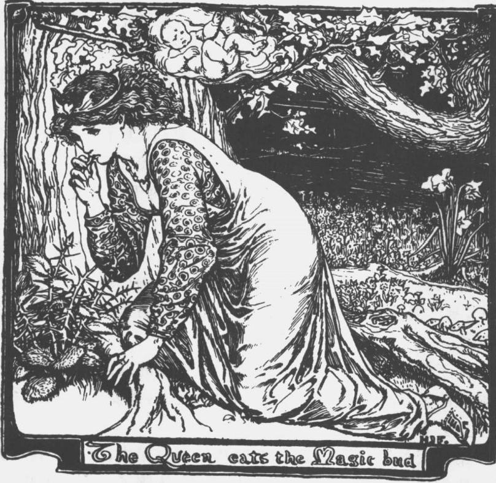

事情就这样一天一天地过去了，明天就是公主的十四岁生日。这一天，国王和王后在花园里散步，国王说：“现在，我一分钟也不能再等下去了，我要立刻就去见我的女儿，早几个钟头或晚几个钟头，事情不会有什么两样。”

王后劝他耐心地等到明天天明，说已经等了那么久，肯定可以再等一天。可是国王说：“不要再胡说八道了，她是你的，也是我的，我现在就要见到她。”说完，他向女儿的房间走去。

他把门打开，推开想把他挡在外面的保姆，他看到了自己的女儿。她是世界上最美丽的公主，皮肤白里透红，白得像牛奶，红得像玫瑰；她的眼睛是蓝色的，像碧蓝的天空；头发是金黄色的，正当中有一绺是褐色的。

女儿看到父亲，走过来搂着他的头颈吻他。接着她说：“啊！父亲！父亲！现在你做了些什么？明天我就要死了，有三件事你必须做出选择：或者瘟疫传遍全国；或者你要进行旷日持久的流血战争；或者我死了以后，立刻把我放进木箱子里，抬到教堂里去。整整一年，每天晚上，都要派一个卫兵来看守。”

国王真是吓坏了，以为她是在胡言乱语，为了安慰她，让她快乐，他说：“嗯，要是你死了的话，这三件事我选择最后一件，我会立刻把你放进一个木箱里，送到教堂去，每天晚上派一个士兵去看守。不过，你不会死的，现在你已经病了。”

国王立即下令把全国最好的医生都找来，他们带来了最好的药方和药品。可是第二天，他们发现公主躺在那里，一动也不动了，身体僵硬发冷。医生能做的，只能是签名盖章，证实公主已经死亡。

国王信守他对女儿的承诺，当天就把她的遗体放进木箱，送到城堡的教堂里。从那天晚上起，每天晚上，都要派一个卫兵到教堂里去看守这个箱子。

第二天早晨，国王派人来接守夜的卫兵回去，可是卫兵不见了。他们想，这个卫兵可能是因为害怕而逃跑了。第二天晚上，派来了新的卫兵。可是一到天亮，这个卫兵也不见了。后来天天如此，晚上派去的卫兵第二天都毫无踪影。这些卫兵派到公主躺着的箱子旁以后，就再也没有消息，也不知道他们是不是逃走了？为什么逃走？逃到哪里去了？

后来大家都以为，是公主的鬼魂走出来，把看守她箱子的卫兵吃掉了。这样一来，活着的士兵谁也不敢去守夜了，轮到谁去看守时，谁就会逃跑。

国王答应，给愿意去守夜的人重奖。有些胆子大的人为了得到重奖，自告奋勇到教堂去守夜。这样倒也维持了一段时间，可是谁都没有得到这笔丰厚的奖励，他们也像以前那些卫兵一样，从此消失了。

这样将近一年，每天晚上都有一个士兵不是自愿，就是被迫到教堂里去看守公主的箱子，这些人从此就不见了。不管是第二天，还是以后的日子，他们都再也没有露面。

就在这个时候，有个名叫克里斯琴的年轻快活的铁匠来到首都——国王居住的城堡。这也是很平常的事情，每天都有成千上万各式各样的人来首都寻找工作，克里斯琴也是为此而来的。他在原来居住的地方失业了。

克里斯琴走进一家旅店，坐下来想吃点东西。这店里也坐着一些下级军官，他们的责任是寻找一些胆大的人，说服他们自愿到教堂里去为公主守夜。在这里，每天总能找到一两个勇敢的应征者。可是，这一天，这些军官很不走运，到现在还没有找到守夜人。城里人都知道了，这些守夜人只去不归，谁也不敢冒这个险。

军官们看到克里斯琴进来，就过去和他一起坐，叫端酒上来和他一起喝。克里斯琴是个喜欢热闹和交朋友的人，他既会喝，又会唱，还会吹牛皮，讲故事，特别是几杯酒下肚以后更是如此。他对军官们说，他是个天不怕，地不怕的人。这正中军官们的下怀，他们正是要找这样的人。于是，军官们对他说，他的机会来了，只要一个晚上，就可以发财。谁要是到教堂里去，在公主的箱子旁看守一个晚上，国王就给他一百元。

克里斯琴答应了，他说他什么也不怕。他们要来了另一瓶酒，喝完了以后，克里斯琴和军官们一起来到军营。他们给他穿上军装，发给他一支步枪，还有其他装备，然后把他带进教堂，锁在里面，叫他守夜。

这时候是晚上八点钟。开始第一个钟头，克里斯琴为自己的勇气感到骄傲。到了第二个钟头，他想到明天会得到一大笔钱，非常高兴。快到晚上十一点钟的时候，他酒醒过来了，开始觉得不安起来。他在酒店里也多少听人说过这个差使，知道至今为止，没有人能活着回去，也不知道这些人出了什么事。这个念头越来越频繁地盘旋在他的脑海中，他越想越害怕，开始想找条出路逃跑。他发现教堂的顶塔上有一个边门没有锁，就爬上去，想从这里溜走。

他刚跨出教堂的门口，一个小矮人挡住他的去路，说：“晚上好！克里斯琴，你想到哪里去？”克里斯琴感到，他的双脚好像在地下生了根似的，一步也不能动。

“哪儿也不去。”克里斯琴说。

“嗯！那好啊！”小矮人说，“你想逃跑，可是你已经承担了今天晚上在教堂里守夜的任务，你必须留在那里。”

克里斯琴低声下气地恳求说，他害怕了，想快点走，请求小矮人让他离开。

“不！”小矮人说，“你必须留在自己的位置上，我会给你一些有用的劝告。你走到教堂的讲坛上去，站在那里，不管是听到什么，还是看到什么，都不要动，你不会受到丝毫伤害。等你听到箱子盖重新把死者盖上以后，一切危险就都过去了，你就可以在教堂里自由自在地走动，到哪里去都行。”

说完，小矮人把克里斯琴推进教堂，把门锁上。克里斯琴赶紧奔上讲坛，站在那里不动，也没有发现什么异常的情况。

到了十二点钟，箱子的盖突然打开，好像是公主的幽灵从箱子里走出来，她穿着图中画着的那种衣服，一边走一边发出令人毛骨悚然的喊叫声：“卫兵，你在哪里？卫兵，你在哪里？你要是不来，你就会死得比任何人都惨。”

她在教堂里走了一圈，最后看到克里斯琴正站在讲坛上，立刻奔跑过去，走上台阶，可是半当中突然停下，拼命地伸出手来，想抓到克里斯琴，但是够不着。克里斯琴站在讲坛上发抖着。

时钟敲响一点钟，幽灵不得不回到箱子里去，箱盖呼的一声盖上。教堂里恢复了死一般的寂静。克里斯琴躺在讲坛上，很快就睡着了，一直到天大亮才醒过来。他听到教堂外面有脚步声，接着传来钥匙打开锁的声音。

克里斯琴从讲坛上走下来，拿起枪站在公主的箱子旁边。这时，上校军官领着巡逻队走进来，看到克里斯琴太平无事地站在那里，大出意料之外。上校在吃惊之余，叫克里斯琴报告情况。可是克里斯琴什么也不说。上校直接带他去见国王，向国王报告说，到教堂里去守夜而第一个平安地回来的卫兵来了。

国王立刻起床，吩咐把一百元放在桌子上，作为给他的奖赏，还向他提了几个问题：“你看到什么没有？”“你看到我女儿了吗？”

“我坚守自己的岗位，”年轻人说，“这就够了。其他事情，我没有义务承担任何责任。”他不敢肯定，是否应该把听到的和看到的事情说出来。再说，他也觉得很骄傲，因为别人没有做到的，或者是没有勇气去做的事，他做到了。

国王也承认，对他很满意，问他愿不愿意今天晚上再去守夜？他说：“不！谢谢你！我再也不会去了！”

“随你高兴，”国王说，“你表现得非常勇敢，应该吃早饭了，一夜辛苦以后，你应该补充一下体力。”

国王吩咐把早餐送上来，和他一起共进早餐。国王不停地给他斟酒，不停地夸奖他，为他的健康干杯。克里斯琴也不客气，开怀畅饮，丝毫不比国王逊色。几杯酒下肚以后，他胆子也越来越大，对国王说，要是给他二百元，他今天晚上还会去守夜。

说好以后，克里斯琴向国王告别。他又跟一些士兵和下级军官来到酒店，做东招待他们，反正他口袋里有的是钱。他边喝边吹牛，跟他们开一些无聊的玩笑，说他们胆子小，不敢到教堂里去守夜，怕死去的公主把他们吃掉！“你们看！我被她吃掉了没有！”他说。

这一天过得很快活，可是八点钟一过，克里斯琴又一个人被关进教堂里。

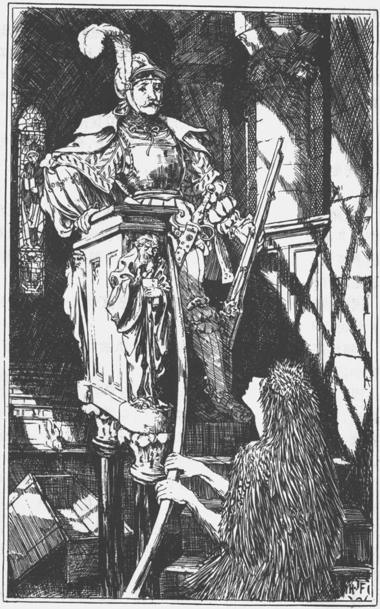

两个钟头过去了，克里斯琴觉得很厌倦，脑子里只想着快点溜走。十点钟的时候，他看到讲坛后面有一扇小门没有锁，就从小门出去，向海边走去。刚走到一半，被上次见过的小矮人拦住。

“晚上好！克里斯琴，你要到哪里去？”

“我要到我喜欢的地方去。”克里斯琴说，可是他发现，两只脚钉在地上，一步也跨不出去了。

“不行！今天夜里，你承担了守夜的职责，你必须回去。”

他抓住克里斯琴，不管他是多么不情愿，也只好跟随小矮人回到逃出来的小门口。到了门口，小矮人对他说：“马上回到圣坛前面去，拿起放在那里的那本书，待在那里别动，直到听见箱盖又把死者盖住的声音。那时候，你就不会有危险了。”

说完，小矮人把他推进门去，把门锁上。克里斯琴赶紧跑到圣坛前，把那本书拿在手中，站在那里不动，直到时钟敲响十二下，公主的幽灵又从箱子里跳出来。

“卫兵，你在哪里？卫兵，你在哪里？”她喊叫着，然后向讲坛奔过去，跳上讲坛，可是上面没有人。她又嚎叫起来：
> “父亲没有派卫兵来，
> 战争和瘟疫今晚就要蔓延开。”

这时候，她看到克里斯琴站在圣坛前，就向他跑过来。

“你在这里啊！”她厉声叫喊着，“我要抓住你。”

可是，她无法爬上圣坛的台阶，只好站在那里对克里斯琴狂喊着，尖叫着，威胁着，一直闹到一点钟敲响，她才回到箱子里去。克里斯琴听到了箱子重新盖上的声音，他觉得今天看到的幽灵不像昨天的那样可怕了。

教堂里恢复平静以后，克里斯琴躺在圣坛前睡着了，睡得那么熟，直到天亮了，上校领人进来，他才醒过来。

上校又把他领到国王的面前，后来发生的事和昨天一样。他拿到了钱，可是不肯说出是否见到了国王的女儿，也不肯再去守夜。不过，在一顿丰盛的早饭及品尝了国王的美酒以后，他同意第三个晚上再去教堂守夜。只是他向国王提出，起码要奖赏半个王国给他，因为守夜实在是太危险了。国王同意了他的要求。

这一天和前一天一样，他不愧为是一个骄傲自大的士兵，幸福快活的铁匠，他有许多朋友和伙伴。

到了晚上八点钟，他又不得不穿上制服，被锁到教堂里去。不同的是，这天晚上还不到一个钟头，他的头脑就清醒过来了。

“趁现在一切都还顺利的时候，最好立刻就离开这里。”克里斯琴这样想着。他预感到，这第三个晚上肯定是最危险的晚上。他当时是因为喝醉了才答应国王的。什么半个王国！国王根本就没有认真地考虑过。他决定马上就走，用不着像前两个晚上那样等那么久。这样，也许能躲过看到他逃走的小矮人。

所有的大门和小门都上锁了，他毫无办法，后来才想到爬窗出去。这时候，钟声敲了九下。窗口非常高，他从上面跳下来，幸好没有摔断骨头，他站起来拔腿就跑，一口气跑到海边，没有碰到任何人。他跳上停在那里的一只船，驶离海岸。他得意地哈哈大笑，想自己是多么聪明，终于有办法骗过了小矮人。

可就在这个时候，他听到岸上有个声音在喊叫：“晚上好！克里斯琴，你要到哪里去？”

克里斯琴不做声，他想：“今天晚上，你的腿太短了！”他开始划桨。可是，他感到有什么东西把船拉住了，而且一直在向岸上拉，不管他是怎么用力地划桨。

小矮人终于把他抓住了，说：“你必须遵守自己的承诺，到教堂里的岗位上去！”不管克里斯琴愿意还是不愿意，他只好跟着小矮人回到教堂。

克里斯琴说，他不能再从窗口爬进去了，那窗口实在太高。

“你必须从那里进去，你会从那里进去的。”小矮人说，他把克里斯琴一直举到窗台上，“你仔细听着，今天晚上应该怎样去做。你要笔直地躺在公主箱子的左边。箱子盖朝右边打开，她从左边出来。等她从箱子里出来，从你身上跨过去以后，你要立刻躺到箱子里去，动作要快，不能让她看到你。你要一直躺在箱子里，直到天明，不管她怎么威胁你，对待你，你也不能出来，也不要回答她任何问题。这时，她就没有力量控制你了，你和她也就得救了。”

克里斯琴只好像刚才出来时一样，从窗口爬进去。他走到公主的箱子左边，直挺挺地躺在那里，像块石头似的，一动也不动。

钟声敲响了十二点，箱盖突然向右边打开，公主从里面走出来，跨过克里斯琴，在教堂里跑来跑去，咆哮着，喊叫着：“卫兵，你在哪里？卫兵，你在哪里？”她向圣坛走过去，跳上圣坛，可是上面没有人。她又尖叫起来：
> “父亲没有派卫兵来，
> 战争和瘟疫就要蔓延开。”

她找遍了整个教堂，从上到下，从下到上，边走边哭泣着，叹息着：
> “父亲没有派卫兵来，
> 战争和瘟疫就要蔓延开。”

她走来走去地喊叫着。不久，教堂顶上的钟声敲响了一点钟。

克里斯琴听见，教堂里响起了柔和的音乐，开始很轻，后来越来越响，充满了整个教堂。他还听到了许多人走路的脚步声，好像教堂里站满了人。他听到神父走到圣坛前，听到从来没有听过的、美妙无比的歌声。接着，神父开始做祈祷，感谢大地摆脱了战争、瘟疫和一切灾难，国王的女儿摆脱了恶魔。许多人的声音加进来，和神父一起做祈祷。

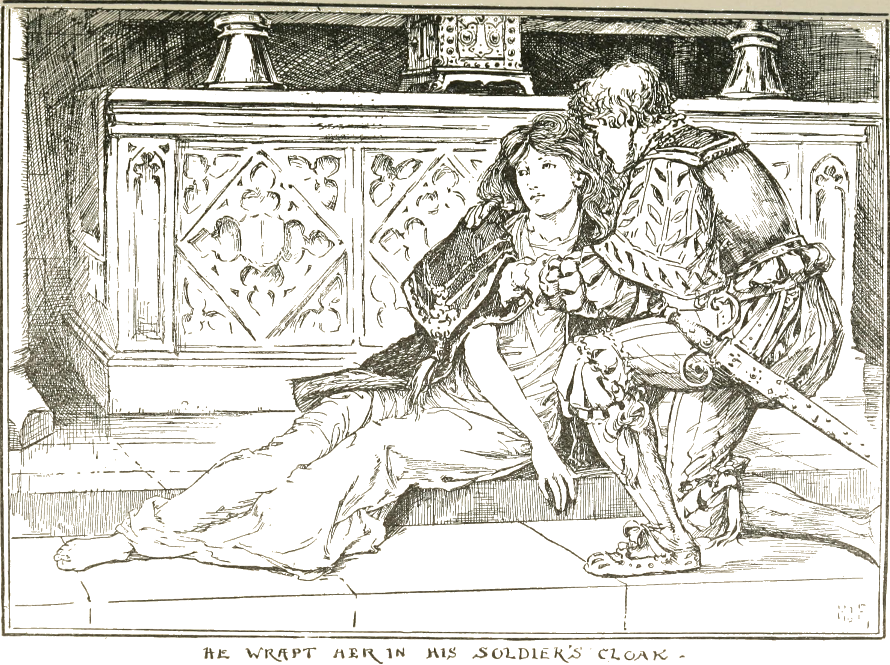

后来，他听到神父喊他和公主的名字。他想，神父是在为他们举行结婚仪式。他感到，教堂里挤满了人，可是他什么也看不见。不久，他听到许多人走出教堂的脚步声，音乐的声音也越来越微弱，最后完全消失。等到教堂里完全寂静下来以后，曙光从窗口透进来。

克里斯琴从箱子里跳出来，双膝跪下，感谢上帝。教堂里空空的，只是圣坛前躺着公主，白色的皮肤里泛着红晕，像活人一样，她穿着白色的寿衣，冷得直发抖，不停地啜泣着。

克里斯琴拿起他的军大衣，给她披上。她擦干了眼泪，对他说，是他把她从魔法中解救出来。这些魔法从她出生的那一天起就跟随着她；她父亲打破了满十四岁以后才能见她的禁忌以后，这些魔法又卷土重来，完全把她控制住了。

她还说，谁救了她，她就属于谁，要和他结婚，否则，她就要到修道院去当修女。她还说，只要她还活着，他就不能和别的女人结婚。正如他听到的那样，那些死去的人已为他们举行了婚礼。

现在，她将是人人都想多看几眼的最美丽的公主；他将是统治着半个王国的君主，这是国王在他同意第三次守夜的时候答应的。他们都同意结为夫妻，一辈子相亲相爱。

在第一道阳光的照射下，教堂的门打开了。这一次，不但上校来了，国王也来了。他要亲眼看一看，卫兵到底怎么样了。

他看到，一对年轻人手拉着手坐在圣坛前。他立刻认出这是自己的女儿，走上去拥抱她，感谢上帝，感谢她得救了。他不反对他们的婚事。于是，铁匠克里斯琴和公主结了婚，而且得到了半个王国。国王去世以后，整个王国都归属于他。

关于克里斯琴以前的那些卫兵，既然教堂里有那么多门和窗开着，毫无疑问，他们都逃走了，跑到普鲁士去当兵了。

关于克里斯琴说的，在教堂看到的那些事情，那可能是因为他酒喝得太多了。

（丹麦）

 

## 三兄弟

有一个父亲，他有三个儿子，唯一的财产就是他们居住的房子。父亲对三个儿子都一样的爱，所以他始终拿不定主意，等他死了以后，这房子应该给谁。他不想对谁表示出更多的偏爱，也不想把房子卖掉，因为这是他们祖祖辈辈居住的地方。否则他就可以把卖房子的钱平均地分给三个儿子了。

后来，他想出了一个好办法，把三个儿子找来，对他们说：“你们必须自己出去闯荡世界，学门手艺，自己养活自己。过一段时间以后再一起回来。那时候，谁的活干得最好，我就把房子给谁。”

三个儿子对这种安排都很满意。大儿子想当一个铁匠，二儿子想当个理发师，小儿子想当个击剑师。他们约好了回家的时间，就出发了。

有幸的是，他们都找到了一个好师傅，手艺都学得非常精通。铁匠后来给国王的马匹打马蹄铁。他想，“毫无疑问，房子肯定是我的了。”理发师给王国里最有名望的人理发，他也认为，房子无疑地应该归他。击剑师苦头可吃了不少，挨了不少剑，可是他咬咬牙坚持下来了。他对自己说：“要是你害怕挨打，就永远也得不到房子。”

约定回家的时候到了，三兄弟回到家中见了面，坐下来商量如何找个最好的机会，表演各自的手艺。

恰巧这时候，一只兔子从田野里向他们跑过来。

“看！”理发师说，“这兔子来得正是时候！”他拿起脸盆和肥皂，擦好泡沫。等兔子跑过来，就在它蹦蹦跳跳的时候把它的胡子刮干净，兔子没有损伤一根毫毛。

“我非常喜欢这种高超的手艺，”父亲说，“除非你们比他更高明，否则房子就属于他了。”

接着，他们看到有人赶着一辆马车急驰过来。“父亲，现在看我的了！”铁匠说着，跑上去跟着马车，就在那匹马全速奔跑的过程中，把它的马蹄铁取下，换上四只新的，一点也没有影响马奔跑的速度。

“你真是聪明能干！”父亲说，“你的手艺像你哥哥一样好，我真不知道房子应该给谁！”

第三个儿子说：“父亲，我也让你看看我的本领。”这时候下起雨来。小儿子拔出剑来，在头上飞舞，雨点一滴也落不到他身上。雨越下越大，像瀑布似的，可是小儿子的剑也越舞越快，那些雨根本碰不到他。那把剑像一把伞似的，把他全身遮住了，衣服一点也没有湿。

父亲看得目瞪口呆，说：“你的功夫最了不起，房子应该给你。”

两个哥哥对弟弟的表演也很满意，还不停地赞扬他。三兄弟那么要好，他们还是一起住在这幢房子里，各自干自己的一门手艺。他们的技术那么高明，后来都赚了许多钱。

他们幸福地在一起生活，直到老年。后来有一个生病了，不久就与世长辞。两个活着的兄弟非常悲伤，不久也就卧床不起，告别了人世。

他们那么聪明，那么相亲相爱，死后，人们就把他们三兄弟埋在一起。

（德国 格林兄弟）

 

## 雪王后

从前有一个可怕的坏妖精。有一天，他特别高兴，因为他做了一面奇怪的镜子。那些好的，美丽的东西用这面镜子一照，镜子里的影子就会缩小到几乎看不见；而那些坏的，丑的东西从镜子里反射出来却非常清楚，而且更丑。

大地上美丽的风景在这面镜子里看起来，像是煮过的菠菜，毫无光彩。漂亮的人来照镜子也会令人恶心，美丽的面容会变得叫人无法辨认。要是谁的脸上有一点雀斑，那么镜子里肯定是连鼻子和下巴上都长雀斑。

妖精说，这就是这面镜子最大的优点。

可是有一天，镜子掉到地上，摔成千千万万块小碎片。这一下可糟了，因为这些碎片远没有小的砂粒大，它们随风到处飞扬，散落到全世界，要是落到谁的眼睛里，它就留在那里了。从此，这个人看东西可就面目全非，要不就是只看到事情坏的一面。这面镜子的每一小粒碎片，都具有像整个镜子那样的魔力。

有些人更加不幸，一些很小的碎片进入他们的心，变成了一小块寒冷的冰。

喜爱恶作剧的妖精看到这些，笑得他浑身发痛，好不开心。

在一座大城市里，住着许多人，房子非常拥挤，所以不是家家人家都有花园。

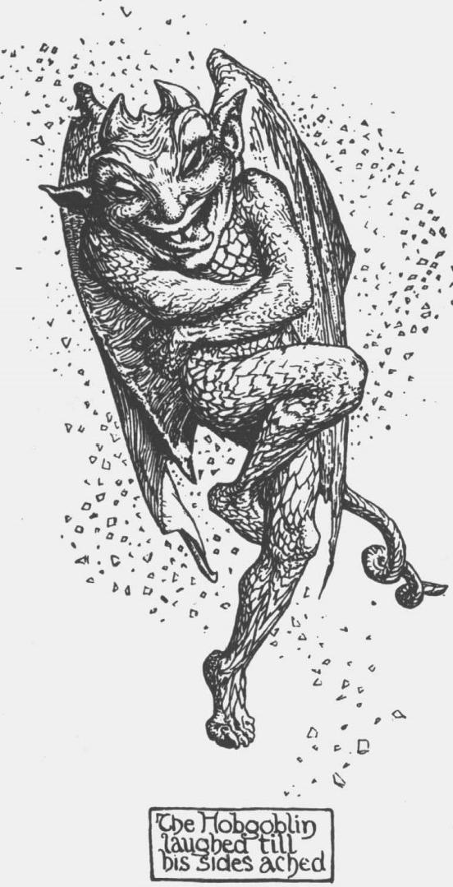

城里住着两个穷小孩，他们不是兄妹，但是像兄妹那么要好。他们和自己的父母在一起，住在两幢面对面的房子顶楼。在屋顶上，他们都放着两只箱子，里面装上土，种上植物和花，一些香豌豆，还有两棵玫瑰，都长得非常美丽。到了夏天，父母都允许他们拿张小凳子出来，坐在玫瑰花下面，玩许多好玩的游戏。

到了冬天，他们就只能待在家里了。玻璃窗上也结满了冰霜。不过，他们也有办法：把一分硬币烘热，贴在玻璃上，玻璃上的冰融化了，透过这个圆圆的一小块透明玻璃，他们就可以看到对方了。

他的名字叫凯尔；她的名字叫格达。

窗口外面，大雪在纷纷扬扬地下着。他们在听奶奶讲故事。

“多么像白色的蜜蜂在满天飞！”老祖母说。

“他们有没有王后？”凯尔问。他知道，蜜蜂是有王后的。

“当然有，”老祖母说，“哪里的雪下得最大，她就在哪里。她是雪中王后，比谁都大。她从不在地面上停留，碰到地面以后，她又会重新飞上天空，飞到浓浓的乌云里去。午夜的时候，她会满街飞舞，透过所有房子的窗口朝屋里看，在玻璃窗上留下各种各样美丽的冰花。”

“是的，这些冰花我们都看见了。”两个小孩说，他们相信这些都是真的。

“雪王后能到里面来吗？”小姑娘问。

“让她来吧！”凯尔说，“我把她放到炉子上去，让她化掉。”祖母在他头上打了一下，又开始讲新的故事。

晚上，小凯尔上床睡觉之前，跳到放在窗口旁的一张椅子上，透过小孔向外张望。外面又落下来一些雪片，其中最大的一片落在窗框上，越来越大，越来越大，最后变成一个姑娘的样子，穿着最漂亮的白色薄纱裙子。

她像是一块坚硬、明亮的冰雕，那么美丽，那么优雅。

然而她是活生生的。她的眼睛像两颗发光的星星那样地闪烁着，一秒钟也不停止转动。她朝凯尔点点头，还用手指点着窗玻璃。凯尔吓得从椅子上跳下来。这时候，雪王后就像一只白色的大鸟，从窗口飞过。

第二天，窗玻璃上结的冰比以往任何时候都厚。

春天来了，接着又是夏天，玫瑰花开得比往年更加美丽芬芳。

这一天，凯尔和格达坐在一起看着连环画，教堂的钟声敲了五下，凯尔突然喊叫起来，“啊！什么东西掉进了我的眼睛，我的心也被什么刺了一下！”

小姑娘双手抱住他的头。他用力地眨着双眼，可是她什么也看不见，好像没有任何东西掉进他的眼睛。

“我想大概是没有了。”凯尔说。可是它还在那里，它就是我们开始的时候讲过的，那块魔玻璃镜子的碎片，那块把一切小和丑的东西照成大和丑的东西的镜子。还有一小片掉进了可怜的凯尔的心，在那里变成了冰。它一点也不会伤害凯尔，可是却永远地留在那里了。

“你干吗要哭啊？”他问格达，“哭起来你有多么丑啊！我没有什么事。你看那些玫瑰！肯定是给虫吃过了。这一棵长得那么矮小！这些玫瑰可真难看。”

他走过去，把玫瑰撕成碎片。

“凯尔！你在干什么？”小姑娘喊叫起来。

他看到格达吓坏了，就拔起另一棵玫瑰，从可爱的格达身边跑开了。

后来，格达又把连环画拿来和他一起看，他说这些书只好给婴儿看。祖母给他们讲故事，他总是说：“可是！”还常常跑到祖母的背后去，摘下她的眼镜，给自己戴上，学她的样子说话。他学得那么像，逗得大家哄堂大笑。不久，他就能模仿这条街上的人走路和说话的样子。

他喜欢玩的把戏也和以前完全不同了。冬天，他会穿着蓝色的大衣，拿着放大镜到室外去看雪花。

“格达！你来用放大镜看看这些雪花，它们是多么规则，多么完美，比那些真的花有趣多了。它们是按照一定的规则构成的，要是不会融化该有多好啊！”

一天早晨，凯尔戴上暖和的手套，肩上扛着滑雪板走出去。他对着格达喊道：“我到市场广场去和别的男孩子一起玩。”

在广场上，胆子大的男孩子常常把滑雪板套在农民的马车上，滑起来多么开心！

他们玩得正高兴，一部全是白色的大雪橇驶进广场。雪橇上坐着一个人，身上穿着白色的皮大衣，头上戴着白色的帽子。

大雪橇在广场上绕了两圈。凯尔把他的滑雪板挂在大雪橇上，飞快地滑起来。速度越来越快，他们来到了第二条街。雪橇上的人回过头来，友好地向凯尔点点头，好像他们早就认识似的。

每当凯尔想把滑雪板解开的时候，那人总是回过头来朝他笑笑，凯尔也就不动了。他们很快就驶出城市，雪越下越大，越下越厚，凯尔几乎看不见自己的手了。雪橇的速度一点也没有减慢。凯尔想把绳子的结解开，可是没有用，大雪橇带着他的滑雪板，像风一样地在原野上急驰着。

凯尔急得大声地喊叫起来，可是没有人听见。他这回真是吓得要死。

雪花越来越大，大得像一只又一只白色的大鸟。突然，雪橇靠到一边，停了下来。驾驶雪橇的人站起来，皮大衣和帽子上都是雪。凯尔看了一眼，是个女的，长得高大苗条，浑身闪闪发亮，原来是雪王后。

“我们跑得好快，”她说，“你快冻僵了吧！快到我大衣里面来！”

她叫他过来，靠紧她，用大衣把他遮住。凯尔觉得自己好像陷到积雪里去一样。

“你还冷吗？”她问，吻了一下他的前额，她的吻也像冰一样的冷，一直冷到他的心头。其实，他的心已经有一半冻得像冰一样了。

“我的滑雪板，可别忘了滑雪板！”他首先想到的就是这个。滑雪板系在一只大白鸟的脚上，就是它背着滑雪板在大雪橇后面飞。

雪王后又吻了他一下。这一回，他完全忘记了小格达，祖母，还有家里的其他人。

“我再也不能吻你了，”她说，“否则会把你吻死的。”

他们飞了起来，飞过森林和湖泊，飞过陆地和海洋。寒风在他的耳边呼啸，大雪在他身边飞舞。森林里传来狼嚎的声音，黑乌鸦在他头上盘旋着，呼叫着。月亮高高地挂在天空中，又大又明亮。

凯尔在雪王后的身边度过了冬天里长长的一夜，天亮的时候，他发现自己睡在雪王后的脚下。

凯尔一夜没有回来，小格达怎么样了呢？

她不知道凯尔到哪里去了？谁也说不出他到哪里去了。那些和他一起玩的男孩子说，他们看到凯尔把滑雪板系在大雪橇上，大雪橇带着他出了城市。

格达哭得很伤心，这个冬天对她来说，是那么黑暗，那么漫长。

春天带来了温和的阳光。“我要出去找凯尔。”格达说。

她来到河边，登上了停在那里的一只小船。小河里哗哗的河水开始把她带到远方。

“河流也许会把我带到凯尔那里去。”格达想。小船带着她顺流而下，穿过森林和田野，来到一个很大的樱桃树花园。花园里有一间小房子，上面开着奇怪的红色和蓝色的窗，屋顶是稻草做的。门口站着两个木头士兵，肩上还扛着武器。

格达在小船上向它们喊叫，它们当然不会回答。河水把小船带到岸边。

格达又大声地喊了几次。从房子里走出一个年纪很大的老妇人。她拄着一根拐杖，头上戴着一顶很大的遮阳帽，上面画着非常好看的花。

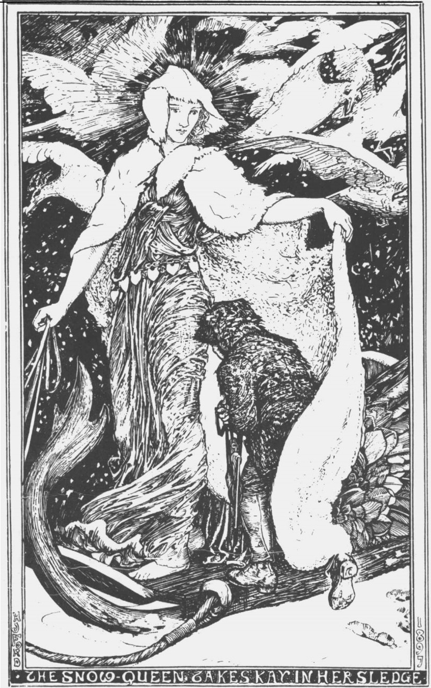

“可怜的小姑娘！”老妇人说。

她来到河边，用拐杖把船拉拢，把格达拉上岸来。

“来吧！告诉我，你是谁？怎么会到这里来？”

格达把事情原原本本地对她说了，问她是否看到凯尔。她说，他还没有到这里来过，不过很快就会来的。

她叫格达用不着伤心，可以留下来和她一起住，可以观赏樱桃树，摘桃花。它们比任何画册都好看。她们还可以一起讲故事。

她拉着格达的手，把她领进小屋，把门关上。

屋子里的窗开得很高。窗玻璃有红色、蓝色和黄色的，所以光线进来汇成一种很奇怪的色彩。桌子上放着非常好吃的樱桃。老人叫她爱吃多少就吃多少。她一边吃，老人一边用一把金色的梳子给她梳头。

美丽的金色卷发从头上披下，护着漂亮的小脸蛋，格达显得那么温柔，那么甜美。

“我总是想着，哪一天能有一个像你这样可爱的小姑娘。你会看到，我们住在一起是多么幸福！”

她不停地梳着格达的头发。格达渐渐地就把凯尔忘了。老妇人是个巫婆，不过，她不是个坏巫婆。她只是为了好玩，有时也会施展魔法。她也非常希望能把格达留下来。

她来到花园里，挥动一下手中的拐杖，所有的那些玫瑰花，都一起消失了。谁也说不出它们到哪里去了，好像一下子就沉入地下。

老妇人担心格达看到这些玫瑰花，会想起自己，想起过去的事情，想起凯尔。那样，她就会逃走。

她把格达领到花园里来，多么美丽的花园啊！空气中充满了阵阵芳香，一年四季的花朵都在这里开放得那么鲜艳。

格达快活地奔跑着，跳跃着，在花园里自由自在地玩耍着，直到太阳落到樱桃树的背后才进屋。她睡在一张漂亮的小床上，枕头是红色的丝绸做成的，里面装的是柔软的天鹅绒。她睡得那么香甜，还梦见自己像个公主似的结婚了。

第二天，她像昨天一样，在温暖的阳光照射下，在花园里又玩了一整天。许多天就这样过去了。格达知道许多花。花园有许多许多花，可是她总感到少了一种，至于是哪一种，她怎么也想不起来。

有一天，她看到老妇人的遮阳帽上，画着许多美丽的花，上面有一朵玫瑰。

巫婆让花园里所有的玫瑰都埋到地下去了，可是她忘记了自己帽子上的这朵玫瑰。这也难怪，总不能事事都想得那么周到。

“这里没有玫瑰！”小姑娘叫起来，她东跑西奔，找遍了整个花园，就是找不到一朵玫瑰花。她坐在地上哭起来，热泪从脸上滚滚而下，掉到地上。恰巧地下有一棵玫瑰，那是巫婆用魔法压下去的。格达的泪水浇在玫瑰上，玫瑰从地下长出来，开出一朵美丽的玫瑰花。小姑娘高兴极了，她吻着玫瑰花，想起了家里那些可爱的玫瑰，也想起了凯尔。

“啊！我在干些什么？”小姑娘说，“我出来是为了找凯尔的。”

她跑到花园的尽头，门已经锁上。她用力地拉那把生了锈的锁，门被拉开了。

她光着两只小脚跑出来，没有人追她。她跑啊！跑啊！实在跑不动了，就坐在一块大石头上。她看了看四周，发现夏天过去了，现在已经是深秋。在老妇人那美丽的花园里，永远是灿烂的阳光，鲜花一年四季常开不败。

“啊！我的天！我耽误了多少时间！”格达说，“已经是秋天了，我不能再休息了！”她站起来，继续向前跑。

天气变得越来越冷，她的两只小脚又酸又累，不得不停下来休息。她看到前面有一堆雪，上面站着一只大乌鸦。它看着小姑娘已经有好一会了。看到小姑娘注意它，它点了点头，打招呼说：“呱！呱！你好啊！”

接着，它问小姑娘为什么自己跑出来。她把自己的故事对大乌鸦讲了，问它有没有看见凯尔。

乌鸦若有所思地点点头，说：“可能是！可能是！”

“什么？你看到过？”小姑娘惊叫起来，她抱起乌鸦就吻，差点把它闷死。

“安静！安静！”乌鸦说，“我想……我知道……那可能是小凯尔，可现在因为公主的缘故，他把你忘了。”

“他和一个公主住在一起？”格达问。

“是的，你听着。”乌鸦说。于是，它把自己知道的一切都告诉给她。

“在我们这个王国里，有一个公主特别聪明。她把全世界的报纸都读了，后来又把它们忘了，她就是这样的聪明。后来她坐上王位，当了女王。这可不像人们想象的那么值得高兴。有一天，公主说，‘我为什么不结婚？’她要选择一个说话投机的丈夫，不是那种毕恭毕敬地站在她身边的人，那样可太傻了。”

“她把这些想法对宫里的女士们说了，她们都很高兴。你可以相信我说的每一句话，”乌鸦说，“我有一个温柔的心上人在王宫里，是它把这一切告诉我的。”

当然，它的心上人也是一只乌鸦。

“第二天出来的报纸上，印有公主的交织字母名字标记，边上是许多心组成的花边。报纸上还登着这样的文字：每个英俊的男青年都可以到王宫里来和公主说话，谁说话的声音响亮，能引起注意，就会得到照顾，提供丰盛的饮食。谁说得最好，谁就成为公主的丈夫。”乌鸦说，“真的，请你相信我的每一句话。这一切就像我现在坐在这里一样地真实。”

“得到消息的青年男子都蜂拥而去，简直可以汇成一条大河，王宫周围热闹非凡。第一天和第二天过去了，没有什么结果。这些青年人在街道上个个能说会道，口若悬河。可是他们一跨进王宫的大门，看到那里穿着银装的卫兵；跨上台阶，走进被灯火照得金碧辉煌的大厅，碰见那些身穿金色服装的仆人，都变得呆若木鸡，傻乎乎的。等来到公主的面前，他们就一句话也说不出来，只会重复公主的最后一句话。公主当然不愿意听，立刻就把他们打发出去。他们好像在梦游似的，不知不觉地走出王宫，等回到街上，头脑才清醒过来。那些等着公主接见的人，从王宫门口一直排到城门。”

“他们又饥又渴，在王宫里一滴水也喝不上。有些聪明人也带着面包和奶油，但从不分给别人。他们想：让这些人饥肠辘辘的样子给公主看到，公主不会看中他们的。”

“那么，凯尔怎么样呢？”格达问，“人群中有没有他？他是什么时候来的？”

“等一会，我就要说到他了。第三天，来了一个小家伙。他既不骑马，也没有马车，高高兴兴地步行来到王宫。他的眼睛像你一样闪亮，长着可爱的卷发，可是衣服很寒酸。”

“那就是凯尔！”格达快活地喊起来，“我终于找到他了！”她一边说，一边拍着手。

“他有点驼背。”乌鸦说。

“不！那肯定是他背着溜冰鞋，他是带着溜冰鞋出去的。”

“很有可能，”乌鸦说，“我没有亲眼看见，是从我心上人那里听来的。他来到王宫门口，看到穿着银色制服的士兵，还有穿着金色制服的仆人，一点也不惊慌。他向他们点点头说，‘站在这里一定闷得慌，我情愿到里面去！’”

“大厅里的光线令人有点眩目。大臣们和使者们穿着无声的鞋子走来走去。那严肃的气氛真令人有点透不过气来。凯尔穿着一双走起路来咔嚓咔嚓响的靴子走进来，那声音非常响亮刺耳。可是他一点也不害怕！”

“那肯定是凯尔！”格达说，“我知道他穿一双新靴子，我在他祖母的房间里，听见过他走路的声音。”

“那靴子走起来肯定很响！”乌鸦说，“可是他毫无惧色地向公主走去。公主坐在一个像纺车那么大的珍珠上。男女大臣和官员，以及侍男侍女都围着公主站着，离门口越近的人越神气。”

“一定很吓人！”小格达说，“凯尔得到公主了吗？”

“我从我温柔的心上人那里听说，他很快活，脑子灵敏，反应很快。他说，他不是来求婚的，是来看看公主的智慧的。后来他们都爱上了对方。”

“啊！那一定是凯尔！”格达说，“他那么聪明，他还会用分数来做加法。啊！请带我到王宫里去！”

“说说容易！”乌鸦说，“可怎么安排？我要和我的心上人商量商量。它可能会替我们想办法。我得对你说，像你这样的小姑娘，是绝对不允许到王宫里去的。”

“可是，我一定要去！”格达说，“要是凯尔知道我在这里，他一定会立刻来带我去的。”

“在栏杆那边等我。”乌鸦说，向格达点了点头就飞走了。等它回来的时候，天已经很晚了。

“呱！呱！我把你的事情对我心上人说了，”乌鸦说，“我要转达它对你的关心，这是它给你的一点面包卷，是从厨房里拿出来的，那里有很多。你一定饿了吧！你不能到王宫里去，穿银制服的卫兵和穿金制服的仆人不允许你进去。不过，不要哭！我们会想办法让你进去。我的心上人知道王宫后面有一条小楼梯，一直通到寝宫。它知道钥匙在什么地方可以拿到。”

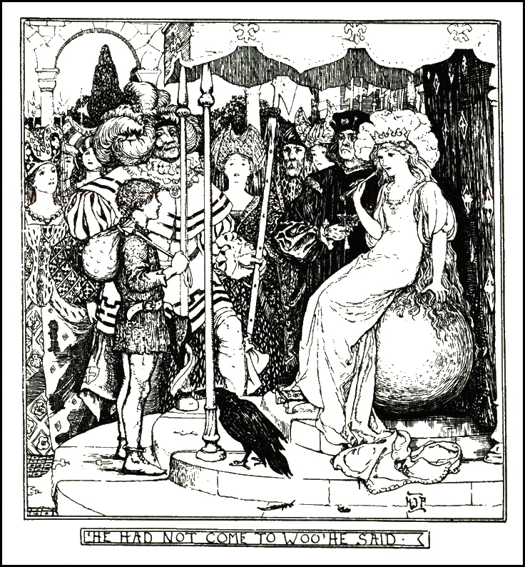

他们来到花园。王宫里的灯一盏接着一盏地熄灭以后，乌鸦领着格达来到后门。格达又想见到凯尔，又害怕出事，心里怦怦直跳。她预感到自己好像在做一件错事，可是她又想弄清楚乌鸦说的那个人是不是凯尔。她猜想一定是他。她记得很清楚，他那双聪明的眼睛和卷曲的头发，他在家的时候，在玫瑰花丛下开心地微笑的样子。他要是知道她来看他，一定会很高兴见她，听她讲家里的事情。

乌鸦和格达来到后门的楼梯上，上面点着一盏灯，一只乌鸦站在上面，侧过头来看着格达。格达像她祖母教过的那样，向它鞠了一躬。

“我的未婚夫给我讲了许多你的好话，我亲爱的小女士，”它说，“我在前面领路，你帮我拿着灯好吗？我们走这条路，谁也不会发现我们。”

穿过好多漂亮的房间，乌鸦领着格达来到寝宫。里面有两张床，像百合花一样。一张是白色的，这是公主的床。一张是红色的，格达希望床上躺着的是凯尔。

她把帐子拉开，看到了他棕色的头颈。啊！这是凯尔。她大声地喊叫他的名字，举起手中的灯照着他。

他醒了，转过头来。他不是凯尔！他只是头颈像凯尔，可他是个英俊的青年。公主这时也醒了，她坐起来问，是谁？

格达哭起来，把事情的经过都对她讲了，还说了乌鸦做的这些事。

“你这可怜的孩子！”王子和公主说。他们还赞扬了两只乌鸦，说不会生它们的气，不过以后不能再这样做了，现在要给它们奖赏。

“你们是愿意自由自在地飞走呢？还是愿意留在王宫里。做宫廷乌鸦？”公主问。

两只乌鸦向公主鞠躬，表示愿意永远留在王宫里做事，它们希望以后年纪大了能有个栖身之处。

他们给格达安排一张床睡觉。她躺在床上想着：“这些人和动物对我真好！”

第二天，格达从头到脚都穿上了丝绸和锦缎衣服。公主想叫她继续留在王宫里。可是她请求给她一匹马和一辆小马车，好让她继续去找凯尔。

他们给她一副皮手笼和一双鞋子，让她穿得暖和些。一切都准备好以后，门口来了一辆黄金做成的马车，还有一个马车夫。

王子和公主送格达上了马车，祝她好运。

那只野乌鸦这时已经结婚，它要把格达送到三英里外。另一只乌鸦不能来，因为它头痛。

和公主分手以后，格达的马车走进一片黑森林。里面很黑。可是黄金马车像一把火炬一样，把道路照亮。森林里的强盗看到了，都跑出来，叫喊着：“黄金！黄金！”

他们抓住马，把马夫和仆人杀了，把格达从马车上拖下来。

“她又肥又嫩，我要把她吃掉！”老强盗王后说着，拔出长刀来，刀闪耀着吓人的光芒。

“你不能杀她！”强盗王后的小女儿说，“我要和她一起玩。她会给我那副皮手笼和身上那些漂亮的衣服。我要让她睡在我的床上。”

强盗的小女儿和格达一样大，可是身体长得粗壮结实，长着黑眼睛，黑头发。她用手抱着格达说：“他们不会杀你，只要你听话，你是不是公主？”

“不是！”格达说。她把发生过的事情都告诉她，还说她是如何地爱小凯尔。

强盗女儿很严肃地看着格达，点点头说：“他们不会杀你，即使你不听话也不会。因为那样的话，我会亲手杀了你。”

她擦干了格达的眼泪，把自己的双手伸进那副漂亮温暖的皮手笼里。接着，她把格达领到强盗营地的一个角落里，这是她睡觉的地方。

周围有一百多只木鸽子，它们像睡着了似的。可是两个小姑娘走过来时，它们微微动了一动。附近还养着一头驯鹿，强盗女儿用她那又长又锋利的长刀来逗它玩。

格达躺在床上，好一会儿没有睡着。

“咕！咕！”那些木鸽子说，“我们看见过小凯尔，一只白色的鸟拖着他的滑雪板，他坐在雪王后的雪橇上，从森林里驶过。那时候我们还小，躺在巢里。雪王后对着我们呼了一口气。除了我们俩，其余的鸽子都死了。咕！咕！”

“你们在说些什么？”格达喊道，“雪王后到哪里去了？你们知道不知道？”

“她也许是到拉普兰去了，那里总是冰天雪地，问一问驯鹿。”

“那里的冰和雪美极了！”驯鹿说，“人们可以在那里的大火花峡谷纵情跳跃。雪王后的夏宫就在那里。可是她最好的宫殿在北极，在斯匹次卑尔根岛。”

“啊！凯尔，我的小凯尔！”格达哭泣着。

“你必须躺着别动！”强盗的小女儿说，“否则我就用长刀来刺你！”

第二天早晨，格达把木鸽子说的话对强盗女儿说了。她点点头，问驯鹿：“你知道拉普兰在哪里吗？”

“我不知道，还有谁知道？”驯鹿说，眼中闪着得意的光彩，“我是在那里的雪地上出生和长大的。”

“听着！”强盗的女儿对格达说，“你看到了，所有的强盗都出去了，只有我的母亲留下，下午她要睡觉。那时候，我会帮你做点事情。”

她的母亲睡着以后，强盗女儿走过来对驯鹿说：“我要把你放了，让你获得自由，你好回到拉普兰去。不过，你要带着这个小姑娘，立刻赶到雪王后的宫殿里去，她的伙伴就在那里。你肯定听到过她说的这些事情，她讲话的声音那么响！”

驯鹿高兴得跳起来，跳得好高。强盗女儿把小格达抱起来，放到驯鹿背上，还拿来一个小枕头给她做马鞍，叫她坐稳。

“你要穿上你的皮靴子。”她说，“天气会很冷的。我把你的皮手笼留下，它那么精致细巧。这是我母亲的大皮手套，可以一直套到你的手肘，这样你就不会冻坏了，戴上吧！”

格达高兴得哭起来。

“别弄出这副模样来！”强盗的小女儿说，“你要高兴才对。这里是两块面包和一根香肠，带着它，免得挨饿。”

强盗的小女儿把门打开，把所有的狗都放出去，用刀把驯鹿的缰绳割断，对它说：“跑吧！要十分小心这个小姑娘。”

格达挥动两只戴着大手套的手，和强盗的小女儿说再见。

驯鹿以最快的速度穿过大森林，在田野里奔跑。狼在怒嚎，渡鸦在狂叫。天空像着了火似的，通红通红。

“那是我最喜欢的北极光。”驯鹿说，“看它们多么绚丽！”它越跑越快，日以继夜，没有片刻停留。

面包吃完了，香肠也吃完了，她们来到了拉普兰。

驯鹿在一间破旧的小屋子门前停下来。小屋子的屋顶几乎碰到地面，门那么矮，要爬着才能进去和出来。

屋子里只有一个上了年纪的拉普兰妇女。她正在一盏油灯上煮着鱼。驯鹿把自己的事对她说了，它觉得自己的事比格达的更重要。格达这时候冷得话也说不出来。

“啊！你们这些可怜的东西。”拉普兰妇人说，“你们还有许多路要走。起码还有一百英里才能到雪王后住的芬兰。她每天晚上都要点燃火光。我要在一张鳕鱼皮上写上几个字，我没有纸。你必须把它交给那个芬兰妇女，她会给你们更好的劝导。”

等格达暖和过来，吃过一些东西，喝过一些水以后，老妇人在鳕鱼皮上写了几个字，交给格达，叫她小心地保留着。格达把它安全地结在驯鹿的背上，就骑着驯鹿走了。

整个晚上，北极光把大地照得通亮。他们来到了芬兰，找到芬兰妇女的家，敲起她家的烟囱，因为她的房子没有门。

屋子里很热，芬兰女人穿得很少。她帮格达解开衣服，脱下手套和靴子，把一块冰放在驯鹿的头上，然后读写在鱼皮上的信。她一连读了三遍，好把信的内容记住。读完以后，就把鱼皮放到锅子里去煮来吃，因为她好久没有吃过什么东西了。

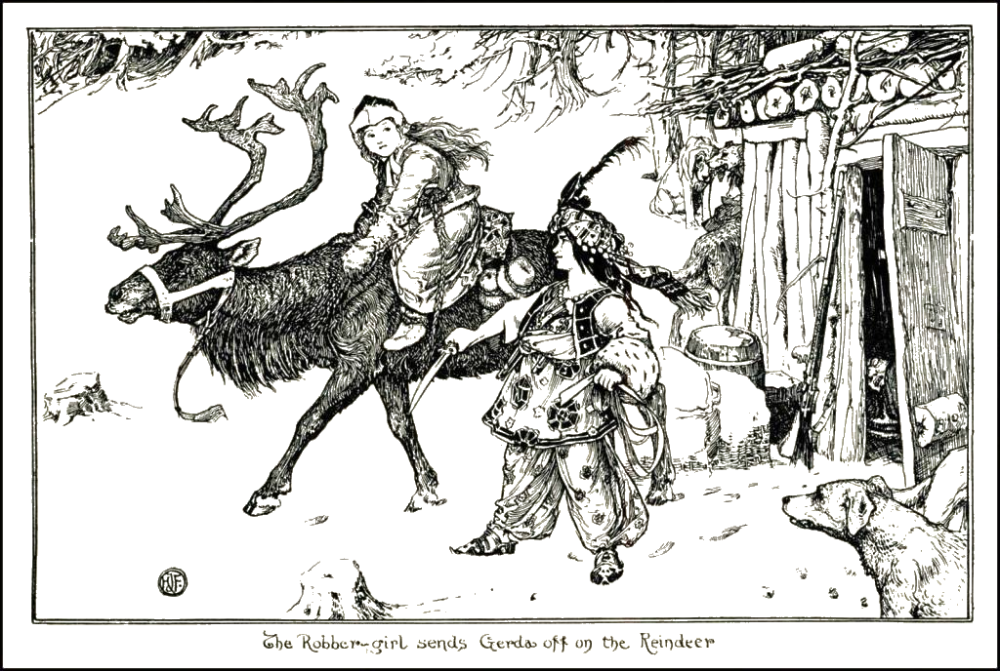

接着，驯鹿对女人讲述它的故事。它讲完以后，格达也对她讲自己的故事。芬兰女人只是眨眨眼睛，什么也不说。

“我知道你非常聪明，”驯鹿说，“你能不能给小姑娘喝点什么，好让她有十二个男人的力气去战胜雪王后？”

“十二个男人的力气！”芬兰女人说，“那也帮不了多少忙。小凯尔和雪王后在一起，他很喜欢那里的一切，认为那是世界上最美的地方。不过，那是因为他心中和眼睛中有魔玻璃碎片。这些碎片不除掉，他就永远也得不到自由，雪王后将永远控制着他。”

“可是，难道你不能给小格达什么，好让她能控制雪王后吗？”

“我不论给她什么，都比不上她自身已经有的力量。你没看见她的力量有多大吗？你没看见，当她赤着脚在荒山野林中徘徊时，人和野兽都在帮助她吗？她已经有了足够的力量。因为她是个可爱的，天真烂漫的小孩。要是她自己也不能征服雪王后，把小凯尔身上的魔玻璃取出，我们也不能帮助她！再走过去两英里，就是雪王后的花园。你可以把小姑娘带到那里去，到大雪中长着一大丛红草莓的地方让她下来，然后你就快点回到这里来。”

说完，芬兰女人把小格达抱起来，放到驯鹿的背上，驯鹿飞奔而去。

“啊！我忘了戴手套和穿靴子！”小格达叫起来，刺骨的寒风毫不客气地侵袭着她的双手和双脚。可是驯鹿不敢停下来，一直跑到那丛红草莓边上，才让格达下来。它吻了一下她的嘴，巨大的泪水从它的脸颊上滚下，它转身跑了回去。可怜的格达站在那里，没有靴子，也没有手套，任凭芬兰刀一样的寒风吹割着。

她拼命地跑起来，大片大片的雪花向她迎面扑来，像是想阻止她，可是一碰到她就化掉。她鼓起勇气，继续向前奔跑。

现在，我们来看看凯尔在干什么。他没有想到格达，当然，做梦也不会想到，她这时候就在宫殿外面。

宫殿的墙是用吹积起来的雪筑成的，门和窗就是那凛冽的风。这些冻雪的墙壁构成了上百个大厅，最大的有好几英里长。北极光把它们照得如同白昼，大厅里那么空旷，那么寒冷，那么明亮。

大厅的中央有一个冰冻的湖泊，冰裂成了成千上万块冰片，每块冰片都一模一样。雪王后在家的时候，常常到这里来坐。

小凯尔在这里冻得皮肤发紫发黑，可是他感觉不到。雪王后已经吻走了他所有的感觉，他的心也只是一块冰。

他这时正在拖着那些平坦的和尖锐的冰块，想把它们堆在一起。他总是想着，这些冰块是世界上最美丽的东西了，这是因为他眼睛中有魔玻璃的缘故。他把冰块拼成各种形状，他想用它们拼出一个“爱”字。雪王后对他说过：“要是你能拼出这个字，你就会成为自己的主人，我就把整个世界给你，还给你一双新的溜冰鞋。”

可是，他拼不出这个字来。

“现在，我要飞到温暖的国家去，”雪王后说，“我要给我的黑锅（这是她在称呼埃特纳火山和维苏威火山）撒上白雪，它会给柠檬和葡萄带来好处。”

她飞走了。凯尔孤独地坐在大厅里拼着他的积木。有时，他坐在那里一动也不动，你会以为他是冻僵了。

这时候，小格达走进这空旷、寒冷的大厅。刺骨的寒风安静下来，好像它们也睡着了。

她看到了凯尔，认出他来，向他跑过去，抱住他喊道：“凯尔！亲爱的小凯尔！我终于找到你了！”

可是他坐着不动，像一座冰雕似的。格达伤心地哭起来，热泪掉在凯尔的脖子里，流到他胸口，温暖了他的心，熔化了那块魔玻璃变成的冰。他看着格达，哭出声来，哭得那么伤心，滚滚而下的泪水把眼睛里的魔玻璃也冲掉了。他认出了格达，喊叫着：“格达，亲爱的小格达！这么长时间你到哪里去了？我这是在什么地方？”

他看了看四周。“这里多么冷啊！又空旷又荒芜！”他拥抱着格达。她高兴地哭泣着。他们那么快活，那么幸福，连冰块也受了感染，愉快地围着他们跳起舞来。跳累了以后，它们都躺下来，拼成了一个“爱”字。雪王后曾经说过，凯尔只要拼出这个字，他就会成为自己的主人，拥有整个世界和一双新的溜冰鞋。

格达开始吻凯尔，她吻了他的脸颊，他的脸颊泛出红晕；她吻了他的眼睛，他的眼睛像她的一样，放出光彩；她吻了他的双手和双脚，它们暖和过来。这时候，雪王后可能要回家了。那个标志着凯尔得到解放的字——“爱”，正醒目地躺在冰天雪地里。

他们手拉着手跑出了冰雪筑成的大宫殿，一边跑一边说着老祖母，说着屋顶上的玫瑰。他们跑到哪里，哪里的太阳就露出笑脸，凛冽的寒风也安静下来。

他们来到了那丛红草莓旁，驯鹿正在那里等着。它先把他们带到芬兰女人家里。她让他们在温暖的小屋里暖和过来，然后指点他们怎样回家。

接着，他们来到拉普兰妇女的家。她给他们一些新衣服，帮他们修好雪橇。驯鹿送他们到春暖花开的地方以后，就和他们告别了。

他们走进森林，树木正开始吐出绿芽。一个小姑娘骑着一匹英俊的马奔驰过来。格达认得出，这就是那匹拉着黄金马车送她的马。马上坐着的小姑娘戴着一顶红帽子，腰上还别着一支手枪。她就是强盗的女儿，在家待腻了，想出来看看外面的世界。她和格达一见面就相互认出来了。

“你是个好伙伴！”她对凯尔说，“我想知道，你是否值得和我一起去周游世界！”

格达轻轻地拍了一下她的脸颊，问关于公主和王子的事。

“他们出去旅行了。”强盗的女儿说。

“那只乌鸦呢？”格达问。

“那只乌鸦死了！”她说，“它的妻子成了寡妇，脚上缠着一块黑布跳来跳去。它很烦恼，不过都是些无聊的事情。请告诉我你后来的经过，你是怎么找到他的？”

凯尔和格达把事情全部讲给她听。

“太好了！太好了！”强盗的女儿说着，和他们俩握手告别，答应如果到他们的城市里去，就会看望他们。

格达和凯尔手拉手回到家里。他们看到了老祖母，一切都像以前那样。可是当他们从门口走过时，发现自己长高了。

屋顶上的玫瑰花开放了，灿烂温暖的夏天已到来了。

（汉斯·克里斯蒂安·安徒生）

 

## 小枞树

从前，世界上有一棵小枞树，它长的位置很好，那里阳光充足，空气流通，周围还长着许多高大的伙伴，有枞树，也有松树。

小枞树最大的愿望就是快点长大。它不留意那温暖的阳光和新鲜的空气，也不注意那些到森林里来采野果，在它的周围奔跑和吵闹的孩子。他们摘满了一篮子野草莓以后，就会在它的身旁坐下，说：“这棵小枞树长得多么可爱！”可是小枞树并不喜欢这些话。

过了一年，小枞树长了整整一轮，还长高了不少。又过了一年，它又长了一轮，也长高了不少。数这些树轮，就知道它有几岁了。

“啊！要是我像旁边的枞树那么高大就好了！”小枞树叹息着说，“那时候，我就可以把树枝伸得很大，很远，看看这个大世界！鸟儿就可以在我的身体上筑巢。等风吹过来，我会像其他树那样，有礼貌地低头向它们致敬！”

明媚的阳光，欢乐的小鸟，还有早上和晚上从它头上飞过的红玫瑰般好看的云，都不能让它快乐起来，它只是想着快点长大。

冬天来了，白雪铺盖着整个大地，到处都是耀眼的光。兔子常常从它的头上跳过去。它觉得这些兔子真烦。

又过了两个冬天，它长高了许多。那些兔子再也不能从它头上跳过去了，只能绕着它跑。

“长啊！长啊！长得又高又大，长成一棵大树，这是生活中的唯一乐趣！”小枞树想。

每年秋天，都有一些伐木工人来砍倒一些最高大的树。看到这些身材魁梧的大树哗哗地倒下，小枞树害怕得浑身发抖。接着，伐木工人又把它们的树枝锯掉，只留下光光的树干，这些大树变得面目全非。然后，他们又把树干装上马车，拖出森林。

“它们到哪里去呢？会发生什么事情呢？”小枞树想。

春天到来，燕子和鹳又飞回来了。小枞树问它们：“你们知道那些大树到哪里去了吗？你有没有看到它们？”

燕子什么也不知道。鹳想了想，点点头说：“我想，我知道的。我飞到埃及去的时候，看到许多新船，船上有非常高大的桅杆，它们散发出枞树的香味，我想那就是它们。啊！它们真是太棒了！太棒了！”

“啊！我要是长得那么高，也能渡过大海该多好啊！海是怎么样的？它看起来像什么？”

“嗯！那要花许多时间才能跟你说明白。”鹳说完这句话，就飞走了。

“珍视你的青春，珍视你甜蜜的少年时代，珍视你年轻的生命，为这些而感到欢乐和骄傲吧！”阳光抚摸着小枞树，亲切地对它说。风也轻轻地吻着它，露水用自己的眼泪为它洗去身上的尘埃。可是这一切，小枞树都不懂。

快到圣诞节的时候，许多小树被砍下，有些像小枞树一样大，有些比小枞树还小。小枞树心里很不平静，它也想着被带走。它看到，人们在挑选那些好看的小树，还保留着它们的树枝，一起装上马车，运出森林。

“它们到哪里去呢？”小枞树问，“它们还没有我大，有的比我小得多！为什么保留它们的树枝，把它们带到哪里去？”

“我们知道！我们知道！”燕子嘁嘁喳喳地说，“森林下面有个城市，我们曾经从窗口朝房子里观望。我们知道它们到哪里去！你真想不到，它们出现在一个多么辉煌，多么绚丽的时刻。我们从窗口看见，它们被种在温暖的房间中央，身上装饰着许多美丽的东西——金苹果、水果糖、玩具、上百支美丽的蜡烛。”

“后来呢？”小枞树说，它非常渴望能见到这种景象，知道会有什么结果，紧张得微微颤抖着，“后来怎么样？接着会发生什么事情？”

“嗯！后来我们就再也看不到什么了。那可真是无与伦比！”

“我是不是注定也会有这样辉煌的生命？”小枞树激动地想着，“这比航海更加伟大！啊！我都快要想疯了！圣诞节快点来多好啊！我已经长得像去年带走的树那么高大。要是有辆马车来把我装走就好了！我多么希望在那无比美妙的时候，站在那温暖的房子中间。然后呢？然后一定会更加美好，更加神气，否则他们把我们打扮得那么漂亮干什么？一定会有更加光辉，更加伟大的事业在等待着我们。啊！我的心都快憔悴了，真不知道是怎么一回事。”

“和我们一起分享快乐吧！”空气和阳光劝它说，“在自由自在的空间里，享受你充满朝气的青春吧！”

可是，小枞树并不在乎这一切，它长啊！长啊！不论是春夏秋冬，它都是那样郁郁葱葱。看到它的人都说：“多么美丽的一棵树！”

圣诞节到来时，它第一个被砍下。斧头深深地砍入它的木髓，它呻吟着倒在地下，觉得浑身疼痛，几乎要昏过去。

此刻，它说不上什么幸福。就要离开自己的家，离开自己生长的地方了。它也明白，它永远也不能再见到自己亲爱的伙伴，还有那些小树丛，也许还有那些鸟了。总而言之，分离总是不会令人愉快的。

等小枞树安静下来，它发现自己和许多树一起放在院子里。有一个人走过来说：“这棵树真漂亮，我们只要这一棵。”

走过来两个穿着仆人制服的人，他们把小枞树拉进一个又大又华丽的房间。墙上挂着许多精美的画。在荷兰式的火炉旁，放着一个很大的中国瓷器花瓶，花瓶盖上雕刻着一头狮子。房间里有许多椅子，铺着丝绸的沙发。一张大桌子上放着许多画册和玩具。那些孩子们说，这些画册和玩具起码值几百英镑。

小枞树被植在一个大沙桶里。谁也看不出这是一个大沙桶，它放在一块色彩鲜艳的大地毯上，四周挂满了绿叶。

小枞树颤抖得很厉害，接下来会发生什么事情呢？年轻的姑娘和仆人正在给它打扮着。他们给它披上用彩色纸剪成的网，网上放着许多糖果。金色的苹果和胡桃挂在树上，好像原来就长在上面一样。树枝上放着上百支红的、蓝的和白色的蜡烛，上面还挂着像人一样的玩偶。这些玩偶小枞树从来都没有见过。在小枞树的头顶上，有一颗金色的金属丝编织成的星，那么美丽，那么明亮。

“今天晚上，”那些人说，“今天晚上，它就会大放光芒。”

“啊！”小枞树想，“现在就是晚上该多好啊！这些蜡烛就会点燃。然后会是怎么样？森林里的树会来看我吗？燕子会落在窗外吗？我会打扮着站在这里，度过春夏秋冬吗？”

这不是一个坏的猜测。可是，小枞树因为总是这样盼望着，树皮开始发痛。树的皮痛就像人的头痛一样，非常讨厌。

现在，所有的蜡烛都点燃了，多么鲜艳！多么辉煌！小枞树激动得有点发抖，一支蜡烛烧着了一片叶子，把它烫伤了。“小心！”一个姑娘喊起来，她们赶紧把火扑灭。

真是可怕，小枞树这一惊非同小可，它再也不敢抖动。它不想失去身上任何一种装饰品，这些光辉实在令人眩目和迷惑。

折门打开了，一群孩子跑进来，后面跟着样子庄重的大人。

孩子们一看到小枞树就冲过来，似乎是要把它推倒。幸巧大人把他们喊住，才安静下来。可那仅仅是片刻，很快，他们又欢呼起来，围着小枞树跳舞，摘下一个又一个礼物。

“他们想干什么？”小枞树想，“会发生什么事情。”

下面的蜡烛被他们一支接一支地拿走。后来，大人们还允许他们攀拿树枝。他们连冲带撞，把它弄得吱吱嘎嘎地响。要不是头上那颗金属丝织成的星把它拉住，它早就被孩子们推倒了。

孩子们手中拿着漂亮的玩具跳舞，没有人再看小枞树一眼。只有一个上了年纪的保姆在仔细地看着小枞树，可她只是在查看，树上是不是还有苹果和礼物被遗漏。

“讲个故事！讲个故事！”孩子们喊叫着，把一个矮胖的男子拉到小枞树旁。他坐下来说：“孩子们！现在我们正坐在森林里，小枞树也会高兴地听我们讲故事的！不过，今天我只讲一个故事。是亨尼·彭尼，还是哈蒂·达蒂从楼上摔下来，后来得到了巨大的荣誉，和公主结婚呢？”

“亨尼·彭尼！”有些孩子在喊！

“哈蒂·达蒂！”另一些孩子在喊！

那声音非常响亮，只有小枞树保持着沉默，它想：“我是不是他们之中的一个，我在其中有什么用处吗？”

当然，它已经是其中的一个，而且已经发挥了自己的作用。

大人开始讲哈蒂·达蒂从楼上摔下来，后来和公主结婚的故事。孩子们拍着手叫嚷着：“再来一个！再来一个！”他们还想听亨尼·彭尼的故事，不过没有得到满足。

小枞树安静地站着，惊讶地想：“森林里的小鸟从来不讲这些。哈蒂·达蒂从楼上摔下来，后来和公主结婚！是的！世界就是这样！”它相信这肯定是真的，这故事从这样好的人口中讲出来，怎么会是假的呢？“哎！谁知道呢？也许，我也会从楼上摔下来，和一个公主结婚！”它想。

天已经很晚了，小枞树还愉快地想着。明天，他们又会用漂亮的蜡烛、玩具、水果和玩具重新把它打扮起来。

“明天，我又会激动得发抖，我要享受那无比荣耀的时刻，我还会听哈蒂·达蒂的故事，也许还会听到亨尼·彭尼的故事。”

整个晚上，它安静地站着，失神地想着。

第二天，仆人们走进来。“现在，又要开始给我打扮了。”小枞树想。可是，他们把它从房间里拖出去，扔进堆藏室里。这里任何一丝阳光也不会射进来。

“这是什么意思？”小枞树想，“我在这里能干什么？能听到什么？”

它靠在墙上，想着，想着，反正有的是时间。白天和黑夜一个接着一个地过去，又一个接着一个地到来。后来终于有人来了，可是他只是搬来一些大箱子，扔到角落里去。这一回，把小枞树完全给盖住了。看来，它已经被遗忘了。

“现在，外面该是冬天了。”小枞树想，“地面被冻得很硬，还盖着厚厚的雪，他们不能把我种下。这就是为什么把我放在这里遮盖起来。我要等待春天来临。他们想得多么周到！我只是希望这里不要黑得这么可怕，这么孤独，连一只兔子都没有！在森林里多么好啊！周围是一片白皑皑的雪，兔子在我的身边跳跃，以前还从我的头上跳过！不过，那时候我不喜欢它们这样。这里真是寂寞得吓死人了。”

“吱！吱！”一只小老鼠叫着走进来，后面还跟着一只。它们嗅了嗅小枞树，然后爬上树枝。

“天气冷极了，”小老鼠说，“这里多好啊！你不这样想吗？老枞树！”

“我一点也不老。”小枞树说，“有许多树比我老。”

“你从哪里来？你知道些什么？”它们特别好奇，什么都喜欢刨根问底，“告诉我们全世界最美丽的地方吧！你是不是从那里来的？你到贮藏室里去过吗？那里的架子上是不是堆满了乳酪，火腿是不是挂在天花板上？什么地方可以在牛脂蜡烛上跳舞？什么地方瘦着进去，出来就长肥了？”

“这些我都不知道。”小枞树说，“可是我知道森林，那里阳光灿烂，鸟儿歌唱。”接着，它又给它们讲了自己的少年时代。小老鼠从来没有听人讲过这些故事，都竖起耳朵仔细听着，还说：“啊！你的见识真广，你是多么幸运！”

“我！”小枞树说，它又回忆起自己刚才讲的过去，“是啊！那是非常幸福的日子。”它还告诉它们圣诞节的活动，说自己是如何被糖果和蜡烛打扮起来。

“啊！你是多么走运！你这棵老枞树！”小老鼠说。

“我一点也不老。”小枞树说，“我是这个冬天才从森林里来的。也许我现在有点萎缩，不过，这在生长期中只是暂时的。”

“你讲的故事真好听！”小老鼠说。

第二天晚上，又来了四只老鼠，它们也想来听小枞树讲故事。小枞树又给它们讲了很多，过去的事情它记得那么清楚。它想：“过去的日子多么幸福，它们会再回来的。哈蒂·达蒂从楼上摔下来，后来和一个公主结婚！”这时候，它又想起森林里长在它身旁的一棵小枞树，真是非常可爱，称得上是枞树里的公主，那么漂亮。

“谁是哈蒂·达蒂？”小老鼠问。

小枞树把听到的故事从头到尾讲了一遍，它一字一句都没有忘记。那些小老鼠听得兴高采烈，差一点跳到它最高的树枝上去。第二天晚上，又来了许多小老鼠。星期日晚上，连两只大老鼠也来了。不过，这些大老鼠对这个故事不感兴趣，还影响了小老鼠，它们也不那么热心了。

“你只会讲这个故事吗？”老鼠问。

“只会讲这个。”小枞树说，“这是我一生中最幸福的那天晚上听到的。那时候，我还不知道自己是多么幸福。”

“这是一个很可怜的故事。你知不知道火腿或者是牛脂蜡烛的故事？贮藏室里的故事？”

“不知道。”小枞树说。

“那么，我们非常感谢你。”老鼠说完，就回到它们的朋友那里去了。

后来，那些小老鼠也走了。小枞树叹息说：“这些活泼的小老鼠围着我，听我讲故事的时候真快活。可惜，这也已经成为过去。现在，什么时候他们会把我移出去种下，让我继续保持旺盛的生命呢？”

这种奇迹什么时候会出现？一天上午，有人进来理堆藏室的东西。他们把箱子搬出来，把小枞树拖出去，粗暴地扔在地板上。一个仆人走进来，又把它拖到院子里去。小枞树又见到了阳光。

“生命又要开始了！”小枞树想，它感觉到了第一道阳光，还有那新鲜的空气。事情变得那么快，小枞树一点也没有注意到自己。院子和花园连在一起，好看的东西实在太多了。花园里开着许多鲜花。玫瑰花那么娇艳，挂满了支撑着它们的花架。酸橙树花也在怒放。燕子敏捷地飞来飞去，快活地唱着：“咯！咯！我的丈夫回家了！”当然，它的丈夫不是指小枞树。

“新的生活开始了！”小枞树高兴地想着，开始伸展自己的树枝。天啊！这时候它才注意到，它的树枝已经枯萎，发黄。它看看身边，才发现自己躺在野草和荆棘丛中。那颗金星还在头顶上，在阳光下闪闪发光。小孩子正在院子里欢蹦乱跳地玩着。圣诞节的时候，他们曾经围着它愉快地跳舞。一个小孩跑过来，摘走了它头上的金星。

“你们看，这棵又丑又老的枞树上还有什么？”他喊叫着，把小枞树的树枝踩断了好几枝。

小枞树看着周围那些美丽鲜艳的花朵，再看看自己，恨不得回到堆藏室的黑暗角落里去。它又想起森林里那美好的青春，想到圣诞节的快乐，想起那些开心地听它讲故事的小老鼠。

“太晚了，太晚了，”枞树想，“在那些美好的日子里，我要是能够好好地度过该多好啊！现在，一切都过去了，一切都完了！”

有人走过来，把枞树劈成碎块和短枝，捆成整整一大捆，把它抱进酿酒间，放在一个大铜壶下烧起来。火光那么明亮，发出劈里啪啦的声音，像开枪似的。这响亮就是枞树在不停地叹息。

孩子们听到这连续不断的劈啪声，都跑过来看，嘴里还喊叫着：“呼！嘭！呼！嘭！”

枞树不停地叹息着，不禁又回忆起森林里夏天的阳光，回忆起冬天夜里满天闪烁的星星，想起圣诞节的那天晚上，想起哈蒂·达蒂。这是它唯一听过的故事，也是它唯一会讲的故事。不久，它就完全烧尽了。

孩子们还在花园里玩耍着。小枞树一生中最幸福的晚上戴过的那颗金星，正挂在最小的小孩胸前。

小枞树没有了，故事也讲完了，一切都成为过去！

（汉斯·克里斯蒂安·安徒生）

 

## 美人鱼的儿子汉斯

一个小村庄里，住着一个名叫巴斯姆斯的铁匠。他的生活过得非常艰苦。他年纪不大，长得既英俊，又强壮，干活也很聪明，可是他家人口众多，收入又少得可怜，所以总是很穷。不过，他为人很勤劳，工场里没活干的时候，他会开船到海里去捕鱼，或者到海边捡些值钱的东西。

有一天，天气晴朗。他独自一人驾着小船出去捕鱼，可是到了晚上，他没有回家。第二天，也没有见到他的人影。村子里的人都以为，他的船在海上出事了。

到了第三天，巴斯姆斯驾着小船回家了，船上装满了鱼，那么肥，那么大，谁也没有见过。他看上去好像没有发生过什么事，也不叫饿，也不叫渴。他只是说，在海上遇到了大雾，迷失了方向，找不到岸了。至于这三天他是怎么过的，到哪里去了，他什么也不说。

六年过去了，人们才知道，出事的那三天，他被海里的美人鱼抓到深海里去了，在她那里做客。

从他重返家园的那天起，他再也不出去捕鱼了，其实也用不着再去了。他每次来到海边，总可以捡到一些从海里冲上来的“垃圾”。在这些“垃圾”里，有许多很值钱的东西。那个时候，谁捡到的东西就属于谁。铁匠从此就一天一天地富起来。

七年过去以后的一天，铁匠在他的铺子里修理着一把犁，一个英俊的小伙子走进来对他说：“你好！父亲！我母亲美人鱼让我向你问候；还说，她已经留我六年了，现在，你可以永远留住我了。”

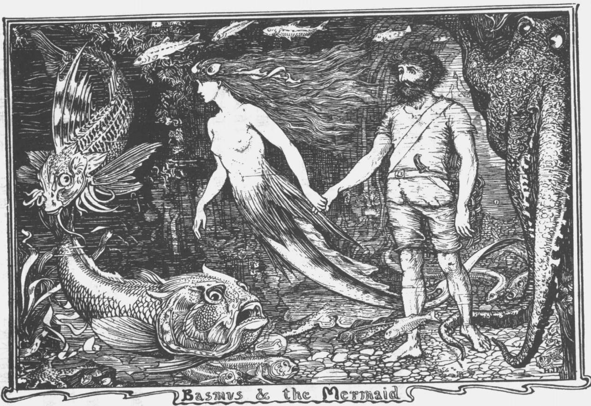

作为一个六岁的小孩，他确实与众不同，看上去有十八岁那么高大，而且比普通人还要健康壮实。

“你要吃点面包吗？”铁匠问。

“是的。”汉斯说，这就是他的名字。

铁匠叫妻子切一块面包给他，他一口就吞下去了。吃完了又出来找铁匠。

“你吃饱了吗？”铁匠问。

“没有，”汉斯说，“只吃了一点点。”

铁匠走进屋子，把一整块大面包拿出来，切成两半，中间夹上奶油和乳酪，然后给他吃。一会儿，他又出来了。

“好了！现在你吃饱了吗？”铁匠问。

“不！远远不够！”汉斯说，“我要想办法另找个地方，看得出，在这里我永远也吃不饱。”

汉斯请父亲给他打一根铁棍子，打好以后他想马上就离开。

“它必须是铁做的，”汉斯说，“而且还要拿得出去。”

铁匠给他打了一根平常人用的铁棍，可是他拿起来，像绳子一样绕在自己的手上，看来太细了，不行。铁匠又给他打了一根像马车轴那么粗的铁棒。可是他拿起来放在膝盖上折断了，像折断一根稻草一样。铁匠只好把铺子里所有的铁都找来，叫汉斯给他拿着，打成一根很粗的铁棒，比铁砧还重。汉斯拿起来说：“太谢谢你了，父亲，现在，我得到传家宝了。”说完，他就走了。

铁匠也很高兴能摆脱这个儿子，免得他把家里所有的东西都吃光。

汉斯来到一个大农场，恰巧农场主就站在家门口。

“你到哪里去？”农场主问。

“我在找个干活的地方，那里既需要身强力壮的人，又有很多吃的东西，能让我吃饱。”汉斯说。

“嗯！”农场主说，“通常每年这个时候，我都要雇用二十四个人干活，可现在只有十二个人，所以我可以轻而易举地答应你。”

“很好！”汉斯说，“十二个人的活对我来说，太容易了。不过，与此同时，我要吃十二个人的饭。”

这些条件谈妥以后，农场主把汉斯领进厨房，关照里面烧饭的姑娘，说这个人吃得像其他十二个人一样多。厨房里专门给他准备了一只锅，他可以用长柄勺子来盛饭。

汉斯来到这家农场的时候，已经是晚上，所以今天他用不着干活就可以吃晚饭了。厨房里专门给他烧了一锅热气腾腾的荞麦粥，他连锅底都刮干净了。他吃得非常满意，吃完了就说该睡觉了，说完就上床去了。

他睡得很香，也睡得很久。第二天早上，所有的人都起来干活了，他还在床上呼呼大睡。农场主也已经起来，他急于要知道这个能吃十二个人饭的家伙，如何干十二个人的活。

太阳已经很高了，还不见汉斯的影子，农场主决定亲自来叫他。

“起来，汉斯，”他喊道，“你睡得太久了。”

汉斯醒过来，揉揉眼睛。“是的，你说得不错，我该起来吃早饭了。”他说。

他穿好衣服，来到厨房，把给他烧好的一大锅荞麦粥全部吃完。接着，问他今天干什么活？

今天的活是脱谷，农场主对他说。其他十二个人已经在脱谷场忙开了。这里一共有十二块脱谷场。他们两人一组，在一块场地上用一种叫连枷的脱谷工具，打放在地上的麦子。另外六块场地上的麦子，要由汉斯一个人来干完。

他来到脱谷场，拿起一把连枷，看了看其他人怎么干，也学着他们的样子干起来。可是只打了一下，那把木头和铁做成的连枷就粉身碎骨。场地里还有几把，他一把接着一把地拿过来用，一把接着一把地断裂。

汉斯看了看周围，想找个什么来代替。他看到两根很结实的梁，还看到门上挂着一张马皮。他用马皮把两根梁连起来，做成连枷。一根梁当柄，另一根把麦粒打下来。他试了一下，觉得很满意。

可是他发现，脱谷场的屋顶太低了，没有办法施展开来。他干脆整个地把屋顶卸下来，放在脱谷场的外面。接着，他把场地里的麦子全部铺在地上，抡起连枷大干起来。

到中午的时候，六个脱谷场上的活都全部干完了。不过，他把黑麦、小麦、大麦和燕麦都混在一起了。事情做完以后，他又把脱谷场上的屋顶重新盖上，好像是给一个盒子盖上盖子一样。

他来到农场主面前，说活已经干完了。农场主吃惊得直瞪眼，到脱谷场来看个究竟，果然一点不假。看到汉斯把各种麦子混在一起了，他很不高兴。可是一看到汉斯使用的连枷，知道他把屋顶也搬掉以后，农场主也不敢吱声了。这个雇工力气那么大，他着实有点害怕。再说，这么多麦子已经脱粒，也该值得高兴，现在的问题是要把它们弄干净，于是他对汉斯说了。

“你说的是什么意思？”汉斯问。

农场主解释说，把它们弄干净就是把麦子和谷糠分开，现在它们都混在一起，一直堆到屋顶。

汉斯抓起一把麦谷，想用手把它们分开。他很快就发现，这个办法不行，得想出别的办法。他把脱谷场两边的门都打开，自己蹲在一个门口对着麦堆吹起来。谷糠被吹到另一头，像沙丘一样堆起来，留下来都是干净的麦子。

汉斯又去找农场主，说活又干完了。农场主说，好的，今天没有什么事了。

汉斯来到厨房，痛快地吃了一顿。吃完以后就去睡午觉，一直睡到吃晚饭。

农场主这回可惨了，他非常害怕这个力气大、饭量大的小伙子。他跑到妻子那里去诉苦，叫她无论如何要想个办法摆脱他。农场主不敢开口把他辞掉。

女主人把管家叫来，他们想出一个办法，第二天叫所有的人都到山上去砍柴，谁最后一个回来就把他吊死。他们想，用这个办法一定能把汉斯除掉，因为汉斯喜欢睡觉，等他起来的时候，别人早就干得差不多了。

这天晚上，管家把雇工都找来，说好明天的安排，还说为了寻开心，明天谁最后一个回来就把他吊死。汉斯也没有提出反对意见。

第二天，离天亮还很早，十二个雇工就起来了，他们拉走最好的马和马车，向山上赶去。汉斯这时候正睡得很熟，农场主说：“让他睡去！”

天大亮了，汉斯才想到该起来吃早饭了。他穿好衣服来到厨房。吃早饭又花了不少时间，然后再去准备马车。好的马车都被拉走了，只留下一辆没有轮子的破车。他费了好大的劲，才找来四个不同大小的轮子，把马车装好。马厩里只有一对老掉牙齿的老马。他也只好把它们拉出来，套上马车，向森林里赶去。他也不知道森林在哪里，幸好那些人的马车留下了踪迹，只要跟着走就是了。

来到通往森林的大门前，他不小心把大门撞坏了。他也顾不上修理了，从地里搬来一块三米多高，四米多宽的大石头堵在路上，权且当门，然后赶着马车继续走。

十二个人这时候已经干了快半天的活，他们相互帮助，砍下树木，堆上马车，所有的马车都差不多堆满了。看到汉斯这时候才来，他们都哈哈大笑起来。

汉斯拿起斧头，向一棵树砍过去。斧头一下子就卷刃了，柄也断了。他索性把斧头扔掉，用双手抱住一棵树，把它连根拔起，扔到马车上去。他拔了一棵又一棵，旁边的人都看呆了，忘了手中的活，张大嘴巴看着这个奇怪的伐木工人。过了一会，他们好像又想起昨天晚上说好的事情，手忙脚乱地赶紧把马车装满，急急忙忙地赶着马车走了。他们都要争取第一个回到农场。

汉斯把他的马车装满以后，把两匹老马拉过来套上。可是它们拉不动！汉斯非常恼火。他把马解下来，用绳子把那些树和马车捆在一起，扛在肩膀上就走，还拉着两匹马，让它们跟在后面。

他来到森林门口的时候，看到一队马车都停在那里，那块石头把他们堵住了。

“什么？”汉斯说，“十二个人也搬不开这块石头！”他走过去，把它举起来，扔到路边，然后背起马车和树木就走，第一个回到农场，比任何人都早得多。

这时候，农场主正在院子门口走来走去地张望着。他对今天的安排很感兴趣，正好奇地等待着，事情会有什么结果。看到汉斯扛着装满树木的马车走过来，他吓得不知道该怎么办才好。他赶紧把门关上，拴好。汉斯来到门口，把马车放下来敲门，没有人答应。他把树木解下来，从围墙上扔过去。接着，又把马车扔进去。马车的四个轮子被摔得不知飞到哪里去了。

农场主看到这些，他想：“我还是快点把门打开吧！否则这些房子也会和马车一样。”

“你好！主人！”汉斯走进来说，把马拉进马厩。他来到厨房，找些东西吃起来。

那十二个人终于赶着马车回来了。汉斯问他们：“你们还记得昨天晚上打的赌吗？应该把谁吊死？”

“呃！那只是闹着玩的，不算数。”他们说。

“那好吧！没关系！”汉斯说。没有人再提这件事了。

这一回，农场主，他的妻子，还有管家，他们关于这个可怕的雇工的话更多了。他们一致同意，一定要想出个什么办法来把他干掉。管家说，这件事他会安排妥当的。

第二天，雇工们要去清理井底的泥淖。管家决定利用这个机会，叫汉斯到井底下去，把一块磨石推下去，这样问题就解决了。然后，就把井填起来，用不着化一分钱来给他办丧礼。农场主和妻子觉得这是个极妙的好主意，高兴地走了，心里想，明天，终于能把汉斯打发掉了。

可是，我们会看到，要想杀死汉斯不那么容易。

第二天，他像往常一样，睡得很晚还不起来。农场主有点迫不及待，看到他还不起来，就过来叫醒他：“起来！汉斯，你睡得太久了。”

汉斯醒过来，揉揉眼睛说：“是的，太晚了，我马上就起来吃早饭。”他穿好衣服来到厨房，早饭早就给他准备好了。吃完以后，他问，今天叫他干什么活？管家说，去和他们一起清理水井。

那好办！汉斯来到水井边，看到大家都在那里等着他。他对他们说，两种活随便他们挑选：或者是他们到井底去，把泥淖装进水桶，他把水桶拉上来；或者是他到井里去装泥淖，他们把水桶拉上来。他们说，愿意留在上面把水桶拉上来。井下地方太小，站不了那么多人。

于是，汉斯一个人下井，开始清理井底的烂泥。那些留在上面的人早就安排好怎么干了。他们从井边的一堆石头中挑出自己能拿得动的大石头，一块接一块地往井里扔，想用石头把汉斯砸死。可是汉斯并不在意，他只是大声地喊叫他们，快把井边的母鸡赶走，它们把石头都扒下井来，落在他的头上了。

他们看到这些小石头都不能砸死他，就想到那块大磨石。十二个人用棍子不停地撬动着大磨石，把它滚到井边。他们一起用力，十分艰难地把它抬起来，投入井中。他们想，这回他肯定完了。巧得很，磨石掉下来的时候，中间那个洞正好套在他头上，整个磨石落在肩膀上，像是牧师的披肩一样。这样一来，他在井下呆不下去了，就套着大磨石上来找农场主，抱怨那些人想愚弄他，叫他当他们的牧师。可是牧师该做些什么，他知道得很少。说着，他弯下腰来，把磨石从头上取下，扔在一边，不巧把农场主的大脚趾砸断了。

农场主跛着脚来见妻子。他们把管家叫来，告诉他，一定要想办法把这个可怕的人干掉，他以前的计谋都没有用，好的点子实在是太少了。

“啊！不！”管家说，“还有许多好办法。今天晚上，你可以叫他到魔鬼湖去捕鱼，他绝对不会从那里活着回来。没有一个人敢晚上到那里去，因为妖怪老埃里克住在湖里。”

农场主和他的妻子想，这个主意真是妙极了。他跛着脚来找汉斯，说他要惩罚那些敢跟汉斯开玩笑的人。可是，既然不论干什么活，这些恶棍都会和他过不去，今天晚上，不如一个人到湖里去捕鱼，明天他就可以什么活都不干了。

“好吧！”汉斯说，“这种安排我很满意。不过，我要带上一些吃的东西：一块烤面包，一罐奶油，一桶淡啤酒，一小桶白兰地，少了一点也不行。”

农场主说，这很容易办到。汉斯把这些东西装好，扛到肩上，带着父亲给他的铁棍，来到了魔鬼湖边。

他上了船，划到湖中，把捕鱼的工具都准备好。这时候天已经很晚了，他想先吃点东西，再开始捉鱼。他吃得正起劲的时候，老埃里克升出湖面，抓住他的肩膀，一下子就把他拖下船，一直拖到湖底。幸运的是，他感到有人抓住他时，还来得及拿起那根铁棍。所以，他们沉到湖底以后，他大喝一声：“住手！这里是坚硬的土地了！我不怕你！”他一手抓住妖怪的头颈，一手挥起铁棍朝妖怪背上狠狠地打，差一点把他打成薄饼。

老埃里克大声地呼叫求饶，要汉斯放他一条生路，他再也不敢回到湖里来了。

“不！我的好伙伴！”汉斯说，“我不会放了你，除非你在天明之前，把湖里所有的鱼都搬到农场主的院子里去。”

老埃里克迫不及待地答应了，只要汉斯放他走。这样，汉斯把船划回岸边，把剩下的东西都吃完，就回家睡觉了。

第二天天亮，农场主醒过来，把前门打开，鱼像雪崩一样倒进来，院子里堆满了蹦蹦跳跳的鱼。他不知道该怎么办才好，又跑回去找他的妻子，对她说：“我们现在该怎么办？老埃里克没有捉走他。我敢肯定，湖里的鱼都全部抓上来了，院子里到处是鱼。”

“是的，这事情办得太糟糕了。”她说，“你要试试看，能不能把他派到珀加特里去收贡品。”

农场主向雇工们住的地方走去。这要穿过堆满鱼的院子。他沿着墙脚，好不容易才从鱼群中走出一条路来。

他找到汉斯，先感谢他捉来了那么多鱼。接着，他说，现在有个差使，要找个信得过的人去干，想派他去。这个差使就是到珀加特里去，把那里应该送给他的三年贡品收回来。

“我很乐意去，”汉斯说，“可是该走哪条路才能到那里？”

农场主站在那里，不知道该说什么才好，只好再回去问他的妻子。

“你这个人真傻！”她说，“你不会对他说，穿过南面的森林一直走就是了吗？不管他到得了，还是到不了那里，反正我们能甩掉他就是了。”

农场主又过来找汉斯。

“穿过南面的森林，一直向前走就可以到珀加特里了。”他对汉斯说。

汉斯说他路上要带些吃的东西才能走。他要了两块烤面包，两罐奶油，两大桶淡酒，一小桶白兰地。他把这些食品捆在一起，用那根铁棍扛在肩上，迈开大步向南边走去。

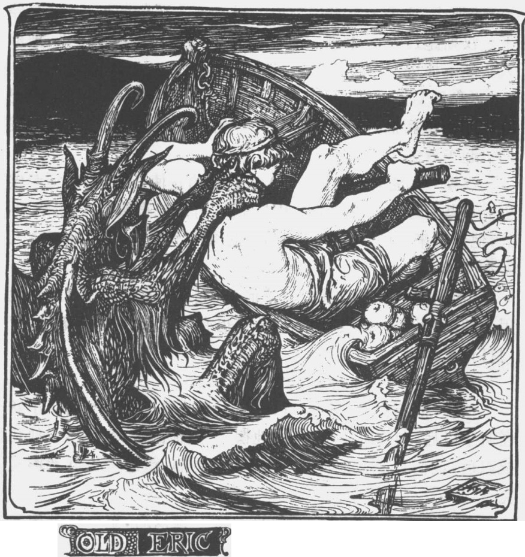

穿过森林以后，他看到通往南方不止一条路，不知道走哪一条好。他索性坐下来，打开包裹把吃的东西拿出来。这时，他才发现，刀忘了带出来了。幸好他看到路边有一把犁，他拿来当刀使用，大吃起来。这时，有一个人骑着马从路上经过。

“你到哪里去？”汉斯问。

“到珀加特里去。”那人说。

“那么，请等一下。”汉斯说。可是那人正匆匆忙忙，没有停下。汉斯跑过去，一把抓住马的尾巴。马被他拉得蹲下来，把那人头朝下摔进沟里。

“我只要你等一下，”汉斯说，“我正好也要到那里去。”他把吃的东西重新捆好，放到马背上，拉着马的缰绳，对那人说：“我们一起走着去。”

汉斯一边走，一边对那个人讲起他的差使，讲起他碰到老埃里克那些有趣的事情。那人很少说话，可是他很熟悉这些路。不久，他们就来到门口。那人连马一起突然不见了，把汉斯一个人留在门外。

“他们会来欢迎我进去的。”他想。可是好一会没有人来。他用手捶门，里面还是没有反应。他等得心烦了，就用铁棍敲门，把门打得粉碎，走了进去。

一群小妖怪走过来，问他想干什么？

他说，他带着主人的祝贺，到这里来收取三年的贡品。小妖怪听了以后，向他吼叫着，要把他摆平，拖他出去。可是挨了他几棍以后，他们只好让他去，只是喊叫得更响，跑进来告诉老埃里克。

老埃里克自从在湖中被汉斯打了一顿以后，至今还卧床不起。小妖怪报告说，魔鬼湖的农场主派人来了，要收三年的贡品。他用手中的铁棍把门打得粉碎，还打伤了他们的手和脚。

“给他三年的贡品！不！给他十年的！”老埃里克喊道，“只是别让他进来见我！”

所有的小妖怪都赶紧去把金币和银币搬出来，数量大得惊人。汉斯装满了一袋金币和银币，背回来见农场主。农场主看到他回来，吓得魂不附体。

汉斯这时对当雇工也觉得厌倦了，说他准备走了。他把金币和银币留下一半给农场主。农场主非常满意，一半是为了得到那么多钱，一半是因为汉斯终于走了。

汉斯把另一半金币和银币带回来给他父亲，接着也和他说再见了。他感到在陆地上和这些人生活在一起太乏味了，宁愿回到母亲那里去。从那个时候起，就再也没有人看到美人鱼的儿子汉斯了。

（丹麦）

 

## 彼得·布尔

从前，丹麦有一对农民夫妇，他们有一个很好的农场，可是没有小孩。因为没有人继承这么多财产，他们整天唉声叹气。农场里的收成越来越好，他们后来变得很富裕，可就是没有后代来继承。

有一年，他们养了一头漂亮的小牛，给它起个名字，叫彼得·布尔。彼得不但长得漂亮，而且很聪明，跟它说什么它似乎都懂。他们从来没有见过这么好的小牛，又文雅，又好玩，农民夫妇爱它就像爱自己的儿子一样。

有一天，农民对妻子说：“我在想，教会里的文书不知道能不能教会彼得说话。要是它会说话，我们就认它作儿子，让它继承我们的财产。”

“嗯！我不知道。”妻子说，“教会文书很有学问，知道的比他祈祷时念的主祷文还多得多。你起码可以去问他一下，看行不行。”

农民来找文书，问他能不能教他们的小牛彼得说话，因为他们很想让彼得当继承人。

文书也不傻，他看了看周围，肯定没有人偷听以后，说：“当然可以！这对我来说，太容易了。不过，你绝对不能对任何人讲。这种事要秘密地进行，不能让牧师知道，否则我就麻烦了，因为这是禁止的。而且，你得花些钱，要买些很贵的书。”

这没有什么关系，农民说，花多少钱他们并不在乎。他叫文书先拿一百块钱去买些书。他还答应，不把这件事告诉任何人，晚上就把小牛彼得带来。

他给文书一百块钱以后就走了。晚上，他把小牛牵来，文书答应尽他最大的努力。

一个星期以后，农民来找文书，要看看小牛的进步情况。文书说，他不能见小牛彼得，免得彼得会想他，把学到的东西都忘了。彼得学得很好，它还得再买些书，还需要一百块钱。农民身上带着钱，就给了文书一百块，满怀希望地回家。

一个星期又过去了，农民又来打听彼得的情况。

“它学得很好。”文书说。

“我想，它已经会说些什么了吧！”农民问。

“是的，”文书说，“现在，它会说‘哞’了。”

“你认为它的学业还会有长进吗？”

“当然！”文书说，“不过，我还需要一百块钱去买些书，只用手中那些书，它就不能学得更好。”

“好的！好的！”农民说，“该花的就得花。”

他又给文书一百块钱去买书，还给彼得留下一桶香馥馥的陈酒。文书把这桶酒留给自己喝了，给彼得喝牛奶，他想这样对小牛更好。

又有几个星期过去了。这几个星期中，农民没有来问小牛的情况，因为有些害怕又要付一百块钱。花那么多钱买书，他已经开始觉得有点不安了。

至于文书呢？他看到小牛已经养得够肥了，决定把它杀掉。把牛肉都存好以后，他穿上黑衣服，来到农民家里。

打过招呼以后，他问农民：“彼得回家了吗？”

“没有呀！它没有回来。”农民说，“它不会跑掉吧！”

“我希望这样。”文书说，“我化了那么多精力去教它，它不会这么卑鄙地就跑掉吧！我自己起码也花了一百块钱给它买书，它才学到现在这种程度。它现在想到什么就能说什么了。昨天，它对我说，它想回家见见父母。我很乐意让它高兴高兴。我怕它自己找不到回家的路，所以想陪它回来。走出门口以后，我才想起来忘了带拐杖，又进屋去拿。等我出来的时候，彼得已经不见了。我想它应该在你们这里。要是这里也没有，我就不知道它到什么地方去了。”

农民和妻子听到彼得就这样跑了，非常伤心。他们那么喜欢它，为了让它受教育，还花了那么多钱。更糟糕的是，他们现在又没有继承人了。文书尽可能地安慰他们，说他也感到非常烦恼，正当他即将为教育出这么好的学生而获得荣誉的时候，想不到彼得竟然会这样。也许它只是迷了路。文书又说，下个星期天，他要在教堂里做一下广告，看看有没有人见过它。说完这些，他和农民告别，回到家里，大吃起烤牛肉来。

有一天，文书恰巧在一张报纸上读到，城里来了一个新的商人，住在离这里不远的地方，他的名字也叫彼得·布尔。他把报纸装进口袋，来到为失去继承人而悲哀的农民夫妇家里。他把报纸上的这一段新闻读给他们听，说：“我在想，这会不会就是你们的彼得·布尔？”

“是的，当然是的。”农民说，“不是它，会是谁呢？”

他的妻子说，“我的好人，你快点去看看它，我敢肯定是它。多带一些钱去，说不定它正需要一大笔现金呢！它已经是个商人了。”

第二天，农民在口袋里放一块三明治，嘴上叼着烟斗，背着一口袋钱，动身到城里去找这个新来的商人。路程颇远，他走了好几天才来到城里。一天早晨，他找到了地址，问商人是不是住在这里。里面的人说，是的，不过他还没有起来。

“那没有什么关系，”农民说，“因为我是他的父亲，把我带到他的房间里去吧！”

他来到彼得住的房间，走进去，看到商人，一眼就认出来。他的前额一样很大，肩膀一样很宽，脖子也是很粗，头发也是红颜色的。不过，从某个方面来看，他完全像一个人了。

农民向他跑过去，牢牢地抓着他，说：“啊！彼得！你给我，还有你的母亲带来多么大的悲伤。我们给你接受这么好的教育，你就这样跑了！现在，快起来吧！让我好好的看看你，和你一起说说话。”

商人想，不知道是哪个神经错乱的人找上门来了，最好还是顺着他的意思看看再说。

“好吧！”商人说，“我马上就起来。”他从床上起来，赶忙穿好衣服。

“啊！”农民说，“现在我看到了，我们的文书是多么聪明，他把你培养得多么好，你现在完全像一个人了。不知底细的人，根本不会想到你是从一头红毛的小牛变过来的。你想不想跟我一起回家？”

“不！”商人说，“我现在没有时间，我有许多事情要做。”

“你知道，你现在就可以继承农场。”农民说，“我们上了年纪，该退休了。不过，要是你宁愿留下来照顾生意也可以，你还需要些什么吗？”

“嗯！是的。”商人说，“我最需要的还是钱，商人手中有钱真是太有用了。”

“这我很相信，”农民说，“你是白手起家的。我来的时候带来了一些钱。”他把口袋里的钱都倒在桌子上，桌子上立刻铺满了耀眼的金钱。

商人看到面前这个人那么慷慨大方，开始改变对他的态度，邀请他留下来多住几天，这样他们可以多说说话。

“很好！”农民说，“不过，你必须叫我‘父亲’。”

“我的父母亲都已经去世。”彼得·布尔说。

“我知道，”农民说，“你真正的父亲去年米迦勒节的时候在汉堡卖掉了，真正的母亲在春天生小牛的时候死了。可是我和我妻子已经收养了你，你是我们唯一的后代，所以你要叫我‘父亲’。”

彼得·布尔很乐意这种安排。他们说好了，彼得留下这些钱，农民在他回家之前留下遗嘱，把所有的财产都留给他。

妻子听到丈夫回来，对他说的这一切确信不疑。这个彼得·布尔就是他们的小牛彼得。

“你要快点去找文书，把这件事情告诉他。”她说，“他把自己的一百块钱化在我们儿子的身上了，你要还给他。他值得得到这么多钱，而且应该更多些。他让我们有了一个儿子和继承人，给我们带来了欢乐。”

农民同意了。他来到文书家里，感谢他为他们所做的一切，给了他二百块钱。

后来，他们把农场卖了，搬到城里去和亲爱的儿子住在一起。他们把所有的财富都转交给他，和他一起生活，直到离开这个世界。

（丹麦）

 

## 小鸟格里珀

从前有一个国王，统治着一个伟大的国家。他有三个儿子。有一天，他的眼睛瞎了，任何高明的医生都无法治好他的眼睛，让他重见光明。后来，王宫里来了一个老妇人，对他说，这个世界上只有一样东西能够帮助他恢复视力，那就是一只名叫格里珀的小鸟，它的歌声能让他的眼睛重新张开。

国王的大儿子听到这个消息，就说要去把小鸟格里珀带回来。这只小鸟被一个国家的国王关在笼子里，把它当做最贵重的宝贝看守着。

国王听到大儿子这么说，非常高兴。他吩咐给大儿子最好的武器和装备，让他出去。

大王子骑着马走了一些路程，看到一家旅店，里面有许多客人。他们喝着酒，唱着歌，掷骰子，非常快活。这种欢乐的气氛感染了王子，他留了下来，和他们一起喝酒，一起玩，完全忘记了瞎了眼的父亲和小鸟格里珀。

国王在家里等待着，心中既抱着希望，又忐忑不安。时间一天一天地过去了，大儿子的消息一点也没有。二儿子请求父亲让他出去寻找哥哥，同时带回小鸟格里珀。国王同意了他的请求，也给他最好的装备。可是，当他来到那家旅店，看到哥哥和那些人在一起非常快乐时，他也留了下来，忘了小鸟格里珀，也忘了瞎了眼睛的父亲。

二王子出去以后，很久没有归来，国王非常沮丧，因为他不但失去了治好眼睛的希望，还失去了两个儿子。这时候，小儿子来找他，说要出去寻找两个哥哥，带回小鸟格里珀。他十分有信心，说一定能成功。国王不愿意再让第三个儿子去冒这个风险，但经不起他的再三请求，最后还是答应了。像他两个哥哥一样，国王用最好的装备把他武装起来，然后他就出发了。

他来到旅店，看到了两个哥哥。他们用尽各种方法，极力怂恿他留下来，和他们共享欢乐的人生。可是他说，找到他们以后，第一件事已经完成，第二件事就是要得到小鸟格里珀，双眼失明的父亲在盼望着，他一个钟头也不能停留。

他和两个哥哥告别以后，找到另一个旅店，在那里过了一夜。

第二天，他骑着马跑了整整一天。天黑以后，他在森林深处找到一间房子。房子的主人非常热情地接待他，把他的马牵进马厩，把他领进一个客房，叫一个女仆给他铺好床，送来晚饭。这时天很黑了，王子开始吃晚饭的时候，隔壁房间传来了一声凄惨的叫声。王子惊跳起来，问那姑娘是怎么回事？他是不是落入了强盗的贼窝里？姑娘回答说，这叫声每天晚上都可以听到。不过这不是活人，而是死人发出来的。他生前来住宿，因为付不起饭钱，被店主杀了。店主不愿意化钱把他埋葬，他一分钱也没有留下来。店主因为这件事非常生气，每天晚上都去鞭笞他的尸体。

说完以后，姑娘把一道菜的盖子掀开。王子看了一看，里面哪里有什么菜，只是一把刀和一把斧头。他明白了主人的意思，除非他能用钱来赎回自己的生命，否则就请选择一种死的方法。

王子把店主叫来，给他一大笔钱，赎回自己的命，还帮死者付了债，请求店主埋葬他的尸体。这一切，店主都答应了。

尽管这样，王子还是觉得在这个凶手魔窟里居住不安全。他把姑娘叫来，请她帮忙，他要在今天晚上从这里逃走。姑娘说，这样做，她有可能连自己的命都搭上。不过，她在这里也是一个囚犯，只要王子答应带她一起走，她就想办法和他一起逃出去。王子答应了她的要求。他们成功地逃离了这所房子，骑着马走了很远，直到没有什么危险了才停下来。王子给姑娘安置了一个好去处以后，又继续他的旅行。

王子独自骑着马在森林里穿行，遇到一只狐狸。狐狸很有礼貌地向王子问候，问他到哪里去？去干什么？王子说，他的使命太重要了，不能对任何人说。

狐狸说：“你做得对，这关系到小鸟格里珀，关系到你能不能把它给你父亲带回来。我能帮你的忙，不过，你要听从我的劝导。”

王子觉得很好，特别是狐狸认得路，知道小鸟格里珀居住的城堡在什么地方。于是，王子答应听狐狸的话。

穿过森林以后，他们看到远方就是小鸟所在的城堡。狐狸给王子三粒金子，叫他把一粒扔进城堡卫兵的房间，一粒扔进小鸟的房间，一粒扔进小鸟的笼子里。这样，他就可以拿走关着小鸟的笼子了。狐狸特别关照王子，千万不要去抚摸小鸟，否则就要遭殃。

王子拿着三粒金子，答应完全照狐狸的话去做。他来到城堡门口，把一粒金子扔进卫兵的房间，卫兵们立刻就睡着了。他把第二粒金子扔进小鸟的房间，那些在里面看守小鸟的人也很快睡着。第三粒金子扔进小鸟的笼子，小鸟也睡着了。可是，王子拿到小鸟以后，看到它长得那么可爱，忍不住抚摸了它一下。小鸟立刻醒了，大声地叫起来。城堡里所有的人都醒过来，他们抓住了王子。

王子被关进监狱，非常后悔没有听狐狸的话，给自己带来麻烦，还断送了父亲重见光明的机会。这时候，狐狸突然出现在他面前。再次见到狐狸，王子非常高兴，温顺地接受了狐狸的一切责备，说只要狐狸能救他出去，他一定会更加听它的话。

狐狸说，它来就是为了帮助他。不过，它唯一能帮忙的，就是请他在接受审判时，对法官的所有问题都要回答“是”。这样，一切都会好的。

王子不折不扣地遵从狐狸的教导。法官问他是否想偷走小鸟格里珀，他说：“是。”法官问他是不是惯偷，他也说：“是。”

国王听到他承认自己是惯偷，就对他说，只要他答应到邻国去，把世界上最美丽的公主偷回来，就原谅他。对于国王的这些话，王子也说：“是。”

王子获得自由，走出城堡，找到狐狸。他们一起来到邻国。狐狸又给他三粒金子，叫他一粒扔在城堡的守卫室里，一粒扔在公主的房子里，一粒扔到公主的床上。与此同时，它还严厉地对王子说，不要去吻公主。

王子照狐狸说的，把三粒金子扔了出去，里面的人都睡着了。可是，当他抱起睡着了的公主，准备离开的时候，看到公主那么美丽，他忘了狐狸说过的话，吻了她一下。公主和里面的人都醒过来，他们抓住王子，把他投进戒备森严的地牢里。

狐狸又来到他的面前，责备他不该这样不听话，不过还是答应帮他脱离这个困境，只要他在受审判的时候，不论什么问题都回答：“是。”

于是，法官问他是不是想偷走公主，是不是惯偷时，他都说：“是。”国王听到这些，对他说，只要他到邻国去，把一匹长着四只金蹄的马偷回来，就可以原谅他。王子听了，也说：“是。”

王子走出城堡不久，就遇见了狐狸，他们一起来到了邻国的城堡。狐狸又把三粒金子交给王子，叫他把一粒扔到守卫的士兵室里，一粒扔到马厩里，一粒扔到那匹马的栏里。狐狸还对他说，在马栏里有一副金马鞍，不论如何不能去碰它，要是碰到了，这回的麻烦就比前两次严重得多，因为狐狸从此再也不能来帮助他了。

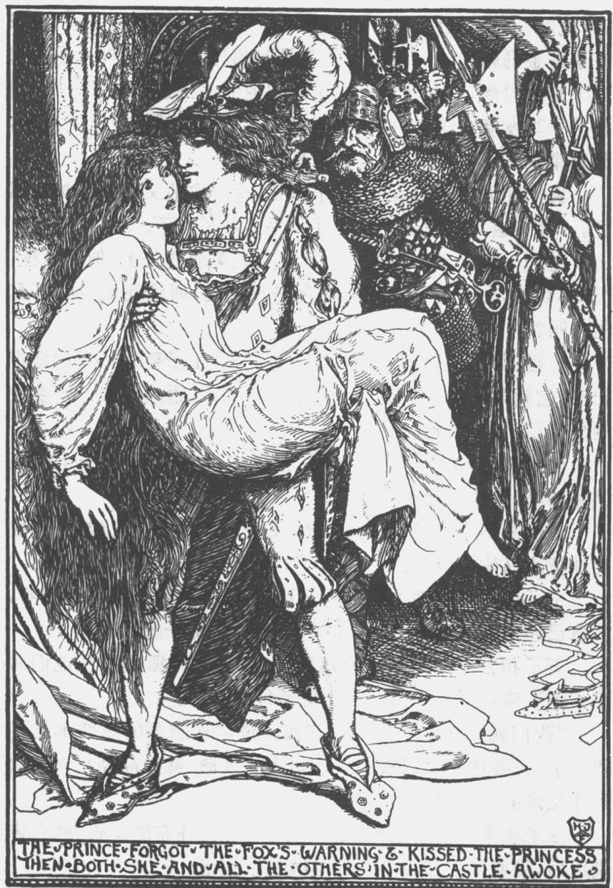

王子答应这一次一定要牢记。他把三粒金子分别扔出去以后，就解开马的缰绳。这时，他抬头看见那副金马鞍，心里想，只有这副金马鞍才能配得上这匹金马蹄的马。正当他伸出手去想摘下它的时候，一个看不见的东西把他的手狠狠地打了一下，叫他的手直发麻。这样，他才想起答应过狐狸的话和自己的危险，赶紧牵着马出去，不敢再看金马鞍一眼。

狐狸在城堡外等着他。王子承认，这一次他又差一点被诱惑了。“我知道，”狐狸说，“是我在你手上敲了一下。”

他们一起走着。王子说，他不能忘记美丽的公主。他问狐狸：“你不认为，公主应该骑着这匹金马蹄的马，回到我父亲的王宫里去吗？”

狐狸同意，说这当然是最好不过的了。王子要是想去把她带出来，它就再给他三粒金子。王子非常高兴，说这一回一定要控制住自己，不去吻她。

他拿着三粒金子，进入城堡，把公主带出来，让她骑上那匹漂亮的马，和他一起走。

他们来到小鸟格里珀的城堡。王子向狐狸要了三粒金子，成功地把小鸟偷了出来。

王子这时候充满了欢乐。不但瞎了眼的父亲将会重见光明，他自己还得到了世界上最美丽的公主和金蹄子的马。

王子和公主一路非常幸福和快活地走着，狐狸跟在他们后面。他们来到了王子第一次遇见狐狸的森林。

“我们就要在这里分手了。”狐狸说，“你想要的东西都已经得到了。只要你不要用钱去赎任何人的生命，就能高高兴兴地回到你父亲的王宫。”

王子感谢狐狸给他那么多帮助，答应记住它的忠告，和它告别以后，带着公主和小鸟一起继续往家里走。

不久，他们来到了两个哥哥停留的旅店。可是，这里再也听不见欢声笑语和快乐的歌声。他们看到，附近竖着两个绞刑架，店里所有的房间都挂着黑纱，象征着悲哀和死亡。

他向旁人打听，才知道今天就要吊死两个王子。他们在这里吃喝玩乐，花光了所有的钱，还欠了店主一大笔债。没有人能够赎回他们的生命，所以今天就要按照法律把他们吊死。

王子知道，这两个要偿命的人就是他的哥哥。想到他们会这样不光彩地死去，他非常心痛。他有的是钱，就帮他们还了债，赎回他们的生命。这样，他们得救了。

开始，他们非常感激弟弟。可是，他们看到弟弟带回来的宝贝以后，非常妒忌他的好运气，就想一定要毁掉他，然后把小鸟、公主，还有那匹金蹄子的马带回父亲那里去。

他们商量好了以后，就把弟弟骗到一个狮子窟前，把他推下去。然后带着小鸟、公主和那匹马回家。公主伤心地哭泣着，他们威胁说，要是她把真话说出来，就要她的命。除非她说是他们两兄弟得到小鸟和金马，才肯放过她。

两兄弟带着战利品回到父亲的王宫，到处都兴高采烈，人们纷纷称赞两个王子的勇敢和无畏的精神。

国王问起小王子，他们回答说，小王子在旅店里过着奢侈的生活，最后因为负债被吊死。国王非常悲哀，因为三个王子中，他最喜欢小王子。

可是，人们看到宝物的欢乐很快就消失了。因为小鸟拒绝开口歌唱，国王的眼睛无法复明。那匹马气势汹汹，谁也不敢走近去看它的金马蹄。公主呢？则日夜不停地哭泣。

再说小王子被扔进狮子窟以后，看到狐狸也在里面。那些狮子非但没有把他撕成碎片，而且对他非常友好。狐狸对王子忘了它最终的警告并没有生气，只是说，那些忘了自己的老父亲，背叛自己高贵的出身去干坏事的人，也会毫不犹豫地出卖自己的兄弟。

狐狸把王子领出狮子窟，告诉他应该怎样去做，才能重新获得自己应有的权力。

王子打心底里感激狐狸真正的友谊。狐狸说，假如它曾经为王子做过什么有益的事，它现在只有一个请求。王子说只要他力所能及，为狐狸做什么事都可以。

“我只希望你为我做一件事，”狐狸说，“那就是请用你的剑把我的头砍下来。”

王子非常吃惊，说无论如何，他也不能把最可靠的朋友的头砍下。尽管狐狸不停地求他，说这是他对它最大的贡献，他还是无动于衷。

狐狸变得非常悲哀，说由于王子拒绝了它的请求，它现在不得不去做一件非常不愿意做的事情：要是王子不把它的头砍下，它就不得不把王子杀掉。

王子不得已，只好把剑抽出来，砍下狐狸的头。转眼间，一个年轻人站在王子的面前。

“谢谢你！”年轻人说，“你帮我做了这件事，把我从连死亡也无法解脱的魔法中解救出来了。我就是那个死了以后留在强盗店里没有埋葬的人。你帮我还了债，还体面地把我埋葬，所以我一直在旅途中帮助你。”

就这样，他们分手了。王子把自己打扮成一个专门打马掌的铁匠师傅，来到他父亲的王宫，要求在这里谋个职业。

国王手下的人对他说，王宫里是正需要一个马掌师傅，不过，他要能够举起一匹长着金马蹄的马脚，他们至今还没有找到这样的人。王子请求让他去看一看。

他一走进马厩，金马蹄的马就友好地向他嘶鸣一声，安静地站着，让王子随意地把它的蹄一只接一只地举起来，让王宫里的人看它的金马蹄。

国王手下的人又说起小鸟格里珀，说它很奇怪，不论人们对它怎么好，它就是不肯唱歌。

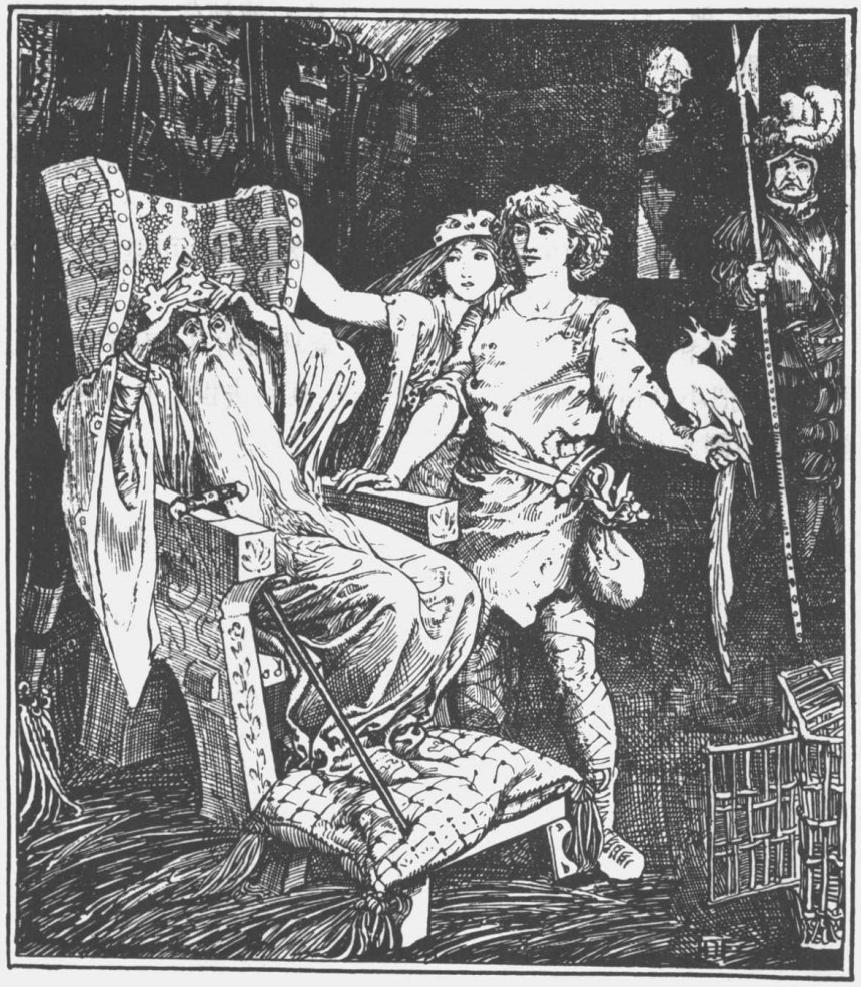

马掌师傅说，他很了解这只鸟，在别的王国见过它。要是它不肯歌唱，那肯定是因为它想要的东西没有得到。他知道这只小鸟的脾气，只要让他去看一看，就知道它需要什么。

仆人们开始商量是否应该带他去见国王，因为这只小鸟放在国王的房间里，里面还坐着整天哭泣的公主。

最后，他们认为值得冒这个险。马掌师傅被带进国王的房间。他刚叫出小鸟的名字，小鸟就开始歌唱，公主也开始微笑。

国王眼前的黑暗开始消失了。小鸟不停地唱，国王的眼睛也越来越明亮。后来，国王终于认出这个陌生的马掌师傅就是他的小儿子。

公主告诉国王，他的两个大儿子的行为是多么可耻，国王命令把他们从王国里赶出去。

小王子和公主结了婚，得到了那匹金马蹄的马，还有半个王国。国王把小鸟格里珀留在自己的身边，直到去世。小鸟也全心全意地为国王和他的国家而歌唱。

（瑞典）

 

## 雪花姑娘

从前有一个名叫伊万的农民，他的妻子叫玛丽。要不是因为没有孩子，他们的日子就会过得非常美满了。现在，他们都上了年纪，看着邻居的小孩子在玩耍，他们总希望着能有自己的孩子。

有一年冬天，人们永远都不会忘记，雪下得那么大，地上的积雪一直没到高个子的膝盖。一场大雪以后，太阳出来了，孩子们都到街上去玩，老人和妻子坐在窗口看着他们。他们开始先用雪堆成平台，用脚把雪踩结实，然后开始堆雪人。伊万和玛丽看着他们，想着许多事情。

伊万突然眼睛一亮，看着他的妻子说：“我们干吗不自己做一个雪人？”

“是啊！为什么不？”玛丽这时候正兴致勃勃，“我们可以快活一阵子。不过，我们做雪人没有意思，不如做个雪孩子，而且假定她是活的。”

“好的，就这么办。”伊万说。他脱下帽子，和妻子一起来到花园。他们使用全部的力量和智慧，做成一个雪玩偶，她有纤巧的身体，两只小手和小脚，上面放上一个雪球，那就是头。

“你们在干什么？”一个过路人问。

“你猜不出来吗？”伊万问。

“做一个雪孩子。”玛丽回答。

他们做完了鼻子和下巴，留下两个洞做眼睛。伊万小心地做好她的嘴巴。他刚做好，就觉得有一股热气吹到他的脸颊上。他奇怪地回过头来，看！雪孩子的眼光和他相遇了，正在向他微笑，嘴唇像草莓一样通红。

“怎么回事？”伊万困惑不解地喊起来，“是我疯了，还是出现了奇迹？”

雪孩子像真孩子一样低下头来，挥动着双手，迈开脚步在雪地里走着。

“啊！伊万！伊万！”玛丽高兴得浑身发抖，喊叫着，“上帝终于给我们送孩子来了！”她扑过去拥抱她，亲吻她，给她起了个名字叫雪花。雪花身上那些松软的雪落了下来，成了一个真正的小姑娘。

“啊！我亲爱的雪花！”老妇人快活地喊着，把她领进屋子。

雪花长得真快，每个钟头，每一天都不一样，而且越来越漂亮。老夫妻高兴得整天笑眯眯的，不知道如何是好。村子里的孩子们都非常喜欢来和雪花一起玩，想尽一切办法和她逗乐。她成了父母的宝贝，他们不停地给她做新衣服，教她唱歌，和她一起做游戏。谁也说不出她有多聪明，什么事情她都很留神观察，时时刻刻都能学到新的知识。她性情那么好，那么温顺，还那么漂亮！她的皮肤像雪那样白，眼睛像勿忘草那样蓝，肩上披着长长的金头发。只是她的双颊还缺少血色，不过也像前额一样美丽。

冬天一天一天地过去了。终于，春天的太阳高高地挂在天上，给大地送来温暖。田野里绿草开始吐芽；蓝天上，可以听到云雀在啭鸣。女孩们围成圆圈在跳舞，欢乐地唱着：“美丽的春天，你怎样来？你怎样来？是驾着一把犁来？还是驾着一把耙来？”只有雪花姑娘一个人安静地坐在房子的窗口里。

“怎么啦？亲爱的孩子！”玛丽问，“你干吗这样不快活？是不是病了？还是谁欺负你了？”

“没有，”雪花姑娘回答，“没什么，妈妈，没有人伤害我，我很好！”

春天的太阳把篱笆旁边最后的一点残雪也融化了。田野里鲜花盛开，夜莺在森林里歌唱，空气中充满了欢乐的气氛。可是雪花姑娘却越来越沉默，越来越悲哀，她躲开一起玩耍的伙伴，独自蜷缩在最阴凉的地方，像一朵百合花藏在绿叶丛中一样。河边柳树下是她最喜欢去的地方。只有早上和晚上，她才露出笑容。每当暴风雨来临，冰雹铺天盖地从天而降时，她也会像从前那样兴高采烈；一旦乌云散去，太阳把冰雹全部熔化，她就会伤心地哭泣和流泪，像是姐姐在为失去的弟弟悲痛似的。

春天过去了，转眼间到了仲夏节。这是一年中最大的节日，女孩子都要到森林里去跳舞和游玩。她们来邀请雪花姑娘。她们对玛丽说：“让她和我们一起去跳舞吧！”

可是玛丽很担心，她也说不出为什么，只是不愿意让孩子去。雪花姑娘自己也不想去，但又找不出什么理由，不好意思拒绝她们。玛丽吻了一下雪花姑娘：“去吧！我的雪花，和你的朋友玩得开心些。亲爱的孩子们，请你们照顾好她。你们知道，她是我眼中的光明。”

“啊！我们会照顾她的。”女孩子们高兴地说，她们一起向森林里奔去。她们在那里摘花朵，编花环，套在自己的头上。大家一起唱歌，有快乐的歌曲，也有悲伤的歌曲。她们玩什么，雪花姑娘就跟着玩什么。

太阳下山了，她们用干草点起一堆火，排成一行，雪花姑娘排在最后。

“看着我们，”她们对雪花姑娘说，“跟着我们一起跑。”她们开始唱着歌，一个接着一个地从火上跳过去。

突然，从她们背后传来叹息声，接着又是呻吟声。她们赶紧回过头来，你看看我，我看看你。什么事情都没有！她们又仔细地看了看，发现雪花姑娘没有了！她到哪里去了呢？会不会躲起来和她们开玩笑。她们到处寻找，都不见她的踪影。“雪花！雪花！”她们大声地喊起来，没有人回答。“她会到哪里去了呢？啊！她肯定是一个人先回家了。”有人说。她们回到林子，找到她家里，可是也没有找到她。

一连好几天，他们到处寻找雪花姑娘，屋里屋外，甚至每一处篱笆，每一棵树旁，都没有找到她。大家都失望了，不再去找她。后来好久，伊万和玛丽还在森林里转来转去，叫喊着：“雪花！我的宝贝！快回来！快回来！”有时候，他们好像听到什么声音，但那不是雪花的声音。

雪花出了什么事？是凶猛的野兽把她抓走，拖到自己的窝里去了呢？还是大鸟带着她飞上蓝天了呢？

没有，没有野兽碰过她，也没有什么鸟把她带走。她跟着朋友们向火堆跑过去的时候，火焰呼出来的一口热气把她融化了，一团徐徐上升的蒸汽就是她的化身。

（斯拉夫）

 

## 我知道学到了什么

从前有一对夫妇，他们有三个女儿，都嫁给住在地下的侏儒。

有一天，丈夫想去拜访女儿和女婿。妻子给他做了些干面包，让他带着路上吃。走了一段路以后，他觉得又累又饿，坐在一个小土丘的东边吃起干面包来。这时候，小土丘打开了，他的小女儿从里面走出来说：“啊！父亲！你干吗不进来看看我？”

“嗯！”他说，“我要是知道你住在这里，看到门开在什么地方，我早就进去了！”

他跟着女儿一起走进去。

不久，侏儒回家了，妻子对他说父亲来了，叫他买些牛肉回来烧汤。

“这很容易，用不着去买。”侏儒说。

他把一把很尖的刀插在屋顶的梁上，然后用头对着刀撞了几下，从自己的头上割下几块肉来，他本人却安然无恙，好像完全没有这件事似的。他们不费什么劲，就得到了一碗肉汤。

吃过晚饭，侏儒给老人一口袋钱。他背到肩膀上，就动身回家了。快到家的时候，他想起家里有一头母牛要生小牛了，赶紧把钱袋放在地下，拔腿就拼命地往家里跑。到家以后，就问妻子，小牛生下来了没有。

“你干吗这样急急忙忙地赶回来？”她说，“小牛还没有生下来。”

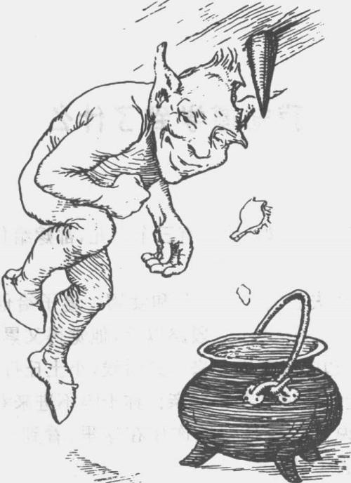

“那么，你快点帮我去把那口袋钱搬回来。”丈夫说。

“一口袋钱？”妻子惊讶地喊起来。

“是的，一口袋钱，”他说，“很奇妙，是不是？”

妻子半信半疑，但还是迁就他，跟他一起出去。

他们来到扔下钱袋的地方。可是钱袋已经不见了，小偷从这里经过，把钱袋拿走了。妻子非常生气，把他怒骂了一顿。

“好了！好了！”他说，“让钱袋见鬼去吧！我知道自己学会了什么！”

“你学会了什么？”妻子问。

“啊？我知道那回事。”他说。

过了不久，丈夫想去拜访第二个女儿。妻子又给他一些干面包。他走累了，饿了，在一个小土丘的东边坐下来吃面包。这时候，第二个女儿从土丘中走出来，请他一起进去，他很乐意地跟着。

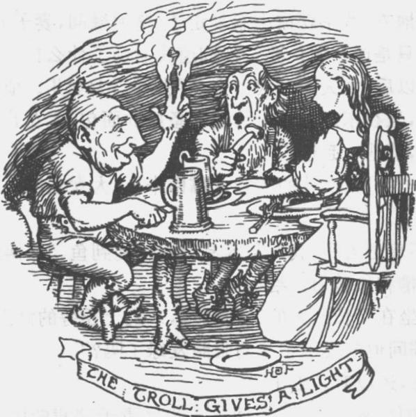

一会儿工夫，女儿的丈夫侏儒回来了。这时候天已经很黑，妻子叫他去买些蜡烛回来。

“我们很快就有火了。”侏儒说。他把手伸到炉子里去，拿出来的时候，两个手指像蜡烛一样地点燃着，发出亮光，手指一点也没有受伤。

丈夫从二女婿这里得到两口袋钱，一步一步地往家里走。快到家的时候，他又想起母牛快生小牛了，赶快把两袋钱放下赶回家，问妻子小牛生下来了没有？

“你这个人是怎么啦？”她问，“这么紧张地跑回来，好像房子要倒坍了似的。尽可以放心吧！母牛还没有生小牛。”

丈夫又请她一起去把两袋钱搬回家。她不怎么相信，可是他不停地对她说，这是真的，直到她同意和他一起去。等他们来到放钱袋的地方，钱早就被小偷拿走了。毫无疑问，妻子非常生气，可是丈夫只是说：“啊！要是你知道我学会了什么！”

几天以后，丈夫第三次出去，要去看望大女儿。他来到一个小山丘旁，坐在东边吃妻子给他准备好的面包。大女儿从小山丘里走出来，请他一起进去。

过了一会，大女儿的丈夫侏儒回来了，大女儿叫他出去买些鱼回来。

“用不着出去买，我们很容易就可以捉到鱼。”侏儒说，“把你的长揉面槽和长柄勺子给我。”

他们坐在又长又大的揉面槽里，来到土丘旁的湖上。划出去不久，侏儒问他的妻子：“我的眼睛发绿了吗？”

“没有，还没有。”妻子说。

他又向前划了一些，再回过头来问妻子：“我的眼睛还没有发绿吗？”

妻子说：“不！你的眼睛发绿了。”

侏儒跳入湖中，用勺子不停地舀起来。许多鱼就这样被他舀入小船中，很快就装满了。他们划回家，美美地吃了一顿好饭和鲜鱼。

丈夫从大女婿那里得到了三口袋钱，背着它们回家。已经快到家了，他又想起母牛，又把钱袋放下，想快点赶回家。不过，这一回他把自己的木鞋脱下来，放在钱袋上，想不会有人会要它。

他气喘吁吁地回到家里，问妻子母牛生了小牛没有？母牛还没有生，丈夫又被妻子大骂了一顿。骂过以后，丈夫又说服妻子和他一起去拿钱。

他们来到放钱袋的地方，看到只有一双旧木鞋留在那里，小偷早就把三袋钱背走了。妻子非常生气，又大发雷霆，骂得他狗血喷头。可是丈夫一点也不动气，只是说：“让那些钱见鬼去吧！我知道学会了什么！”

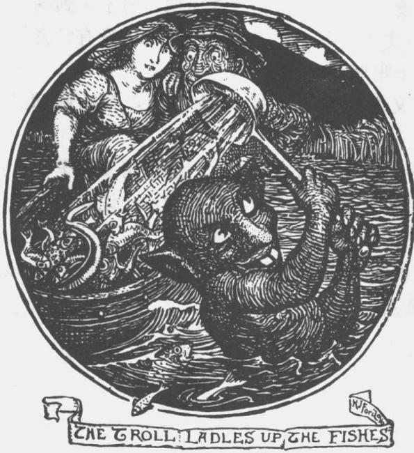

“我倒要看看，你到底学会了什么？”妻子说。

“你很快就会看到。”丈夫说。

有一天，妻子想喝点汤，对丈夫说：“到村子里去，买块牛肉回来烧汤。”

“用不着，”丈夫说，“要块肉来烧汤太容易了。”他把一把尖刀插在梁上，用头对准它撞过去。结果，他在床上躺了很久。

等他伤口好了以后，有一天，妻子叫他去买些蜡烛回来，家里一支也没有了。

“用不着买蜡烛。”丈夫说。他把手伸到火里去，想点着它们。这样，他又得在床上躺一段时间。

等他好多了以后，妻子叫他去买些鱼回来。他又想向妻子卖弄本事，说自己学会了捉鱼。

他叫妻子和他一起，拿着揉面槽和勺子来到湖边。他们划到湖中以后，丈夫问妻子：“我的眼睛发绿了没有？”妻子答：“没有！你的眼睛干吗要发绿？”

他们又向前划了一些，丈夫又问：“我的眼睛还没有发绿吗？”

“你在胡说些什么？”妻子说，“要眼睛发绿干什么？”

“哎！我亲爱的，”丈夫说，“你就不会说一句发绿了吗？”

“好吧！”妻子说，“它们发绿了。”

妻子说完，他就拿着勺子到湖中去舀鱼，可是鱼没有舀上来，他却淹死了。

（丹麦）

 

## 狡猾的鞋匠

有个鞋匠，因为很久找不到活干了，家里变得很穷，他和妻子几乎要饿死。后来他对妻子说：“坐在家里等着没有用，什么活都没有。我不如到马斯卡路西亚去，也许在那里会走运。”

他来到马斯卡路西亚，沿街叫喊着：“买鞋子，修鞋子了！”，不久，一扇窗户打开，一个妇女伸出头来。

“这里有一双鞋子要你补一补。”她说。鞋匠坐在她家门口，帮她修好鞋子。

“该付给你多少钱？”鞋子补好以后，女人问。

“一个先令。”

“这是十八便士，祝你走运！”女人说。

（一先令等于十二便士——译注。）

鞋匠来到第二条街。又吆喝起来。很快，又有一扇窗子打开，一个头伸出来。

“这里有些鞋子要你补一补。”

鞋匠坐在她家门口补起来。

“我该给你多少钱？”鞋子补好以后，女人问。

“一个银币（等于二先令——译注。）”

“这是一个克朗（相当于五先令——译注）。祝你好运。”妇女说完就把门关上。

“太好了！”鞋匠想，“我干得真不错，不过现在还不能回家，只要这样干下去，很快就有足够的钱买头驴子。”

打定主意以后，鞋匠留在城里继续干了好几天，直到钱包里有了四块金币。他来到市场，用两块金币买了一头壮实的驴子，骑着它回家。

可是，当他穿过密林深处的时候，他看到一伙强盗向他走过来。

“这回完了！”他想，“他们肯定要把我所有的钱都抢走，我还得像以前一样穷，该怎么办呢？”

鞋匠不但为人聪明，而且很有勇气，他没有被吓破胆。他想了一想，拿出五个银币来，藏在驴子厚厚的鬃毛里，骑着它继续向前走。

强盗围上来把他捉住，搜走他身上所有的钱。

“啊！亲爱的朋友！”他喊叫着，“我只是一个可怜的穷鞋匠，在这个世界上，除了这头驴子以外，什么都没有。”

他说话的时候，驴子抖了一下身子，五个银币掉在地下。

“这些钱是从哪里来的？”强盗问。

“天啊！”鞋匠说，“你们已经发现了我的秘密。我这头驴子是金驴子，我所有的钱都是它给我的。”

“这样吧！我们不抢你的驴子，你把它卖给我们。”强盗说，“你要多少钱，我们就给你多少。”

开始，鞋匠说，不论你们说什么，他决不受骗把驴子卖掉。后来他同意五十个金币卖给他们。

“不过，仔细听着，”他说，“你们必须轮流每人用一天驴子，否则会因为抢钱而打起来的。”

强盗赶着驴子，回到森林里的住处去了。鞋匠向家里走去，非常高兴自己的计谋成功，路上还上饭店大吃了一顿。第二天，他用大部分钱买了一块小葡萄园。

强盗们回到住处以后，头子把强盗都叫来，对他们说，他有权利第一个使用驴子。强盗们都同意了。

强盗头子叫妻子在马厩里铺上垫子。妻子问他是不是疯了。他大发脾气，说：“你怎么啦？照我的话去做，明天我会给你一些财宝。”

第二天天还没亮，强盗头子就迫不及待地起床，到马厩里去，可是里面什么也没有。他想，鞋匠肯定是玩弄了他们。

“好吧！”他想，“假如我上当了，别人也应该上这个当。”

有一个人走进来，关切地问他得到多少钱，他快活地说：“啊！伙计，你真不明白！不过，我现在不告诉你，等所有的人都轮到以后我再说。”

强盗们一个接一个地占有驴子，可是谁也没有得到一分钱。等到他们全部受骗以后，事情才暴露出来。强盗们一起商量，决定找到鞋匠的家里去，惩罚他。

鞋匠老远就看到强盗们过来。他想，怎样才能骗过他们。想好以后，他把妻子叫过来，对她说：“去把一个袋子拿来，里面装上血，绕在你的头颈上。等强盗们来讨回买驴子的钱的时候，我就叫你快去把钱拿来。你要故意和我争吵，不肯去拿。我就用刀刺破你头颈上的袋子，你立刻躺下来装死。等到我拿出吉他开始演奏，你就站起来跳舞。”

妻子急忙照他的话去做，时间那么紧张，强盗已经非常接近了。

强盗气势汹汹地冲进来，围住鞋匠，责骂他用驴子欺骗了他们。

“这头可怜的驴子肯定是因为换了主人，本事也没有了。”他说，“不过，我们现在用不着为这件事争吵，我还给你们 50 块金币就是了。安蒂！”他喊叫妻子，叫她快点到楼上去把箱子打开，把钱拿下来还给这些先生。

“等一下，”妻子说，“我得先把这些鱼烤好，现在就走这些鱼就焦了。”

“马上就去，照我的话去做！”鞋匠装做十分气愤的样子，跺着脚。妻子还是站着不动，他拔出刀来，向她的脖子砍去，鲜血直喷出来，她沉重地倒在地下，不动了。

“你干了些什么？”强盗惊愕地问，“可怜的女人没有做错什么事啊！”

“也许我太性急了，不过很容易解决。”鞋匠说，他拿起吉他，开始演奏。他刚拨动琴弦，妻子就站起来开始跳舞。

强盗们吃惊得目瞪口呆。过了一会他们说：“师傅，这五十块金币你可以留下。不过，请告诉我们，这把吉他值多少钱，你必须把它卖给我们。”

“啊！那是不可能的！”鞋匠回答，“因为每次我和妻子争吵的时候，我就要杀死她，这样才能出气，这已经成了习惯，我想改也改不了。要是没有吉他，我怎么能把她救活？”

可是强盗不理睬他，一定要买。最后他同意四十块金币把吉他卖给他们。

强盗们回到森林中去，很高兴做成这笔买卖，都恨不得能马上就能试试它的威力。强盗头子说，第一个使用的权力应该属于他，其他人都得轮在后面。

这天晚上，他把妻子叫来，问：“今天晚饭你准备了些什么？”“通心粉。”妻子说。

“为什么不烧鱼？”他喊道，用刀去刺她的脖子，她倒地死了。强盗头子一点也不着急，拿起吉他开始弹奏，可是不论他弹得多么响，死去的妻子还是一动也不动。

“啊！骗人的鞋匠！啊！可恶的流氓！你两次欺骗了我，我要找你算账！”

他非常愤怒地咒骂着，可是有什么用呢？事实上，他杀了妻子，再也无法把她救活。

第二天早晨，另一个强盗来拿吉他，打听发生了什么事情。“怎么样？你干得如何？”他问。

“啊！妙极了！我刺了妻子一刀，然后开始弹吉他，她还是像以前一样一点也没事。”

“是真的吗？那么今天晚上，我也要试试看。”

当然，同样的事情又发生了。直到所有的强盗都秘密地把自己的妻子杀了。大家都轮过以后，他们才偷偷地说起这可怕的故事，发誓要找鞋匠报仇。

强盗们动身来找鞋匠。像上次一样，他老远就看到他们过来，对妻子说：“听着！安蒂，强盗们来找我的时候，你就说我刚到葡萄园里去，然后叫狗来找我，把它从房子里赶出来。”

他说完这些话，就从后门跑出去，躲在一个桶里。几分钟以后，强盗们冲进来，大声地喊叫着鞋匠。

“哎哟！可敬的各位先生，他到葡萄园里去了。不过，我马上派这只狗去叫他回来。它来了，快到葡萄园去，把你主人叫回来，说有客人要找他说话，快点去！”她把门打开，让狗出去。

“你真的那么相信自己的狗，叫它去找你的丈夫？”强盗问。

“是啊！它什么都懂，我叫它带什么讯都能办到。”

不一会，鞋匠走进来说：“早上好！先生们！狗告诉我，你们要找我说话。”

“嗯！是的。”强盗说，“我们来找你是关于吉他的事。由于你的过错，我们把自己的妻子都杀了。尽管我们像你说的那样弹起吉他，可是她们一个也没有活过来。”

“你们弹得不对。”鞋匠说，“这是你们自己的过错。”

“好了！只要你把狗卖给我们，我们就不再追究。”强盗说。

“那是不可能的！没有这只狗，我什么事也干不成！”

强盗们愿意出四十块金币，他终于同意把狗卖给他们。

强盗们带着狗回到森林里。强盗头子说，他有权力第一个使用这条狗。

他把女儿叫来，对她说：“我到酒店里去，要是有人来找我，就让这条狗来叫我。”

一个钟头以后，有人来找他谈生意。他女儿把狗解开，对它说：“到酒店里去，把我父亲叫回来！”狗连蹦带跳地跑了，可没到酒店里去，而是跑回鞋匠的家。

强盗头子回到家里，看到狗没有了，他想：“这条狗肯定是跑回到老主人那里去了。”这时候，尽管天已经很黑了，他还是找到鞋匠的家里来。

“师傅，狗在你这里吗？”他问。

“啊！是的！这可怜的东西那么喜欢我！你一定要给它一点时间，让它习惯新的生活。”

强盗头子把狗带回家。第二天早晨，他把狗交给另一个强盗，说这只狗真的能像它主人说过的那样办事情。

第二个强盗也像他的头子那样，上过当以后，悄悄地把狗从鞋匠家里带回来，交给另一个。这样，所有的强盗都被骗过以后，他们才公开商量这件事。

第二天，他们气愤地来找耍了他们的人，把他大骂一顿，说他骗了他们，接着，把他捆起来装进口袋，告诉他，准备把他扔到海里去。鞋匠也不做声，任凭他们摆布。

他们来到教堂，强盗们说：“天那么热，太阳那么厉害，口袋那么重，把他扔在这里，我们进去休息休息。”他们把口袋扔在路旁，走到教堂里去了。

附近的山脚下，有一个猪倌在放着一大群猪，愉快地吹着口哨。

鞋匠听到他的声音，大声地喊叫起来：“不！我不去！我不去！”

“你不要到哪里去？”猪倌听到他的喊声，走过来问。

“啊！”鞋匠回答，“他们要我去和国王的女儿结婚，我不肯去！”

“你多么幸运啊！”猪倌叹息说，“我要是你该有多好！”

“嗯！你真想这样！”狡猾的鞋匠说，“那好办！我和你换一换，我出去，你到口袋里来。”

于是，猪倌把口袋的绳子解开，让鞋匠出来，自己钻进去。鞋匠把口袋扎好，快活地赶着猪走了。

强盗们休息好了以后，走出教堂，抬起口袋来到海边，把他扔下去，口袋一下子就沉入海底。回家的路上，他们看到了鞋匠，吃惊得张开大嘴，说不出话来。

“啊！你们真不知道，海底有多少猪。”他说，“越深的海底猪越多。我只把这些赶上来，还想再去赶一些。”

“那里还有多少？”

“多得我数也数不清。”鞋匠说，“我来告诉你们，该怎么做。”

他把强盗领到海边，说：“现在，你们每个人都要在头颈上结上一块大石头，这样才会沉得深一些。你们看到的这些猪，都是在很深的海里找到的。”

强盗们都在头颈上结上石头，一个接着一个地跳入大海中。当然，他们全都淹死了。鞋匠把猪赶回家，一直到死，他都是很有钱。

 

## 娶美女做王后的国王

五十年以前，有一个国王很想结婚。他下决心要娶一个像太阳一样美丽的姑娘做王后。这样一来，可就不那么简单了，因为很难找到一个符合他标准的人。后来，他派出一个忠实的仆人，叫他哪怕是走遍全世界，也要找到一个美丽的姑娘。要是他运气好，碰上一个这样的美人，就把她带回来。

仆人遵照国王的命令，立即出发。他穿过平原，越过高山，找遍每一座城堡和村庄。可惜，尽管可爱的姑娘像黑莓一样多，可是他相信，没有一个是国王看得中的。

有一天，他走得很远，感到又累又渴，看到路边有一间小屋子，就走过去敲门，请求给点水喝。

屋子里住着两姐妹，小的八十岁，大的九十岁。她们很穷，靠纺纱来养活自己。干这种活使她们的手像少女一样，又白又嫩。她们把水从窗格里递出来。仆人看到了一双纤巧的手，心里想着：“有这双手的姑娘一定很漂亮。”他赶紧回来向国王报告。

“马上返回去，”国王说，“想办法见她们一面。”

忠实的仆人又马不停蹄地回来找两姐妹。他来到小屋前，敲了敲，请求给点水喝。像上次一样，老妇人还是不开门，把水从窗格里递出来。

“你一个人住在这里吗？”仆人问。

“不！”她回答，“我姐姐和我住在一起，我们是穷姑娘，要靠干活来糊口。”

“你几岁了？”

“我十五岁，她二十岁。”

仆人回到王宫，把知道的最新消息告诉国王。国王说：“我要娶那个十五岁的姑娘，回去把她带来。”

仆人第三次返回小房子门前敲门。门没有开，还是那扇有窗格的窗打开了，从里面传出声音，问他想要什么？

“国王派我来，把你们之中小的一个带回去当王后。”

“请告诉尊敬的国王，我乐意听从他的吩咐。可是自从出生以来，我的脸从未见过阳光，一见到阳光，就会立刻变黑。因此，我请求国王今天晚上派一辆遮得很严密的马车来，我会乘着它到国王的城里去。”

国王听到这个消息，立刻命令把他那辆豪华的金色马车准备好，用华丽的丝绸披挂妥当，去接新娘。老妇人用厚厚的面纱把脸遮住，坐上马车来到城里。

国王满腔热情地等待新娘子的到来。她下了马车，国王很有礼貌地请求她撩开面纱，让他一睹芳容。可是她回答：“这里的蜡烛太明亮，光线太强，你不会希望我洁白的皮肤就在你的眼前变黑吧！”

国王相信了她的话，新娘子带着面纱举行婚礼。婚礼以后，他们单独在一起了。国王掀开她的面纱，才知道自己娶了一个满脸皱纹的老太婆。他气得脸色发青，冲过去把窗打开，把她从窗口扔出去。不过，老太婆非常幸运，墙上的一根大钉子钩住了她的衣服，把她挂在半空中。

就在她万分危急，随时都有可能坠地身亡的时候，四个仙女从这里经过。

“快看！姐妹们，”一个仙女喊道，“这肯定是国王扔出来的那个老太婆。我们是不是叫她的衣服脱钩，让她摔到地上去？”

“不！不！”另一个说，“让我们祝愿她交好运。我祝她变得年轻！”

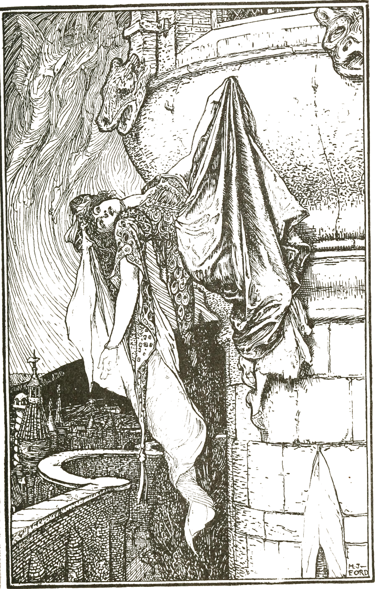

“我祝她美丽！”

“我祝她充满智慧！”

“我祝她有一颗温柔的心！”

仙女们说完就走了，身后留下一个世界上最美的年轻姑娘。

第二天早晨，国王把窗子打开，看到墙上挂着一个十分可爱的姑娘，叫起来：“啊！我干了些什么！昨天晚上我瞎了眼了。”

他命令赶快把长梯子拿来，把姑娘救下来。他自己双膝跪在她面前，请求她原谅。为了表示对她的尊敬，国王还下令举办盛大的宴会。

过了几天，那个九十岁的老太婆到王宫里来找王后。

“这个可怕的老巫婆是谁？”国王问。

“是我的一个老邻居，她有点傻乎乎的。”王后说。

老太婆目不转睛地看着王后，认出她来，问：“你怎么会变得这么年轻？这么漂亮？”

这个问题她不停地问了整整一天，问得王后很不耐烦，说：“我把那个老头砍掉了，一个新头长了出来。”

老太婆来到理发店，对理发师说：“你把我的头砍掉，要什么我都可以给你，这样，我就可以变得年轻漂亮了。”

“可是，我的好女人，这样做你会死掉的。”

老太婆不听这些，坚持要这么干。理发师终于拿起刀来，向她的脖子砍去。

“啊！”第一刀下去，老太婆痛得叫出声来。

“让我来成全你吧！”理发师说。

第二刀下去，头滚下来，老太婆从此离开了人间。

（西西里民间故事）

 

## 凯瑟琳和她的命运女神

从前有一个很富有的商人，他除了拥有比世界上任何国王都多的财宝以外，家里还有三张椅子，一张是金的，一张是银的，还有一张是钻石的。不过，这些都算不了什么，他最值得自豪的还是独生女凯瑟琳。

有一天，凯瑟琳正坐在自己的房间里，门突然打开，一个高大美丽的女士走进来，手中拿着一个小轮子。

“凯瑟琳，”她走过来对小姑娘说，“你愿意要哪一样：幸福的青春，还是幸福的后半生？”

凯瑟琳很吃惊，不知道该怎么回答才好。那女士又重复了一遍：“你喜欢哪一样：幸福的青春，还是幸福的后半生？”

凯瑟琳想：“我要幸福的青春，青春过后就要受苦。不！我宁愿现在多吃些苦头，以后就有盼头了。”打定主意以后，她抬起头来回答：“我要幸福的后半生！”

“那就这样吧！”女士一边说，一边转动手中的轮子，然后就像突然出现一样，突然消失了。

这个美丽的女士就是可怜的凯瑟琳的命运女神。

仅仅过了几天，商人就听到不幸的消息，他所有最好的船，装着最贵重的商品，不幸在海上遇到风暴，全部沉入海底。世界上最富有的人转眼之间变成了乞丐。这个打击对他来说，实在太沉重了。不久，他就卧床不起，绝望地死去。

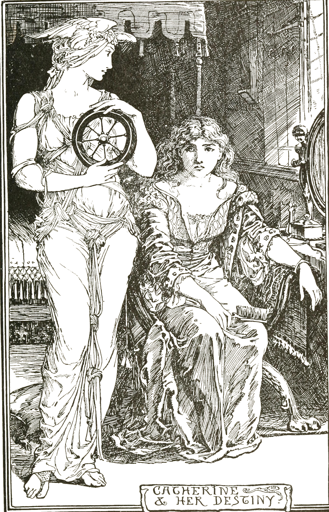

可怜的凯瑟琳孤独地留在这个世界上，没有一分钱，也没有任何人来帮助她。可是，她是一个勇敢的姑娘，对生活充满了信心和勇气。她考虑了一下，觉得当前最好的办法，是到最近的城市里去当佣人。打定主意以后，她就马上动身。

她在城市里最好的一条马路上行走。一个高贵的女士把窗子打开，被她悲哀的面容打动，问她：“你一个人要到哪里去？我漂亮的姑娘？”

“啊！尊敬的女士，我很穷，要找个地方干活来养活自己。”

“那你就来给我干活吧！”她说。凯瑟琳答应了，而且干得很不错。

过了不久，女主人对凯瑟琳说：“我要出去办些事，时间比较长。我不在的时候，你要锁好门，不要让小偷进来。”

主人走了以后，凯瑟琳坐在窗口继续干活。这时，门突然打开，她的命运女神走进来。

“哼！凯瑟琳，原来你在这里！你想我会让你太太平平地过日子吗？”她说着，走到凯瑟琳女主人的衣橱前，把里面最好的衣服全部拉出来，撕成碎片，扔在地上。

可怜的凯瑟琳掩面大哭，她说：“女主人回来以后，看到衣服撕成这样，肯定以为这是我的过错。”她站起来，从门口冲出去，想不如一走了之。

命运女神把地上的碎片集中起来，重新拼成衣服，放回衣橱里去。把一切都弄整齐之后，她也离开了这间房子。

女主人回家，一进门就喊凯瑟琳，可是哪里也找不到她。“她会不会抢走了我的东西？”女主人想，急忙到处检查一遍，发现什么也没有丢。凯瑟琳为什么就这样不辞而别？她感到很奇怪，后来也一直听不到她的消息。过了几天，女主人只好另找一个人来代替她。

凯瑟琳毫无目的地到处流浪。有一天，她来到另一个城市。像上一次一样，一个高贵的妇人在开窗的时候看见她，问她：“你一个人要到哪里去啊？我可爱的姑娘！”

凯瑟琳回答说：“啊！尊敬的女士，我很穷，必须找活干养活自己。”

“那么就来帮我干活吧！”妇人说。凯瑟琳给她干得很不错，希望以后能过平安的日子。可是，像上一次一样，有一天，凯瑟琳单独留在家里，她的命运女神又走进来，严厉地对她说：“什么？你到这里来了！”她气愤地把一切东西都撕碎，直到可怜的凯瑟琳从门口逃出去。

一连七年，每当凯瑟琳找到一家好人家干活，她的命运女神就会来把她赶出去。

七年以后，命运女神好像对这种跟踪追击感到厌倦了，凯瑟琳倒也过了一些太平的日子。这家主人告诉她，她每天的工作之一，就是爬到俯瞰着这座城市的山顶上去，在地上供上一些新鲜的面包，然后大声地喊叫三声：“啊！命运之神！我的女主人！”女主人的命运之神就会来拿走这些供品。凯瑟琳说：“这件事我很乐意干！”

时间一天一天地过去了，凯瑟琳仍然留在这个女主人家里。每天，她都挎着一篮子面包爬到山顶上去。她觉得比以往任何时候都幸福。不过，有时，在没有人看见她的时候，想起过去的好日子，想到和过去无法相比的这种佣人生活，她也会偷偷地流泪。有一天，女主人看到她在哭，就问她：“凯瑟琳，你怎么啦？你怎么哭起来了！”

凯瑟琳向她诉说了自己的经历。

“我有个主意，”女主人说，“明天，你带着面包到山上去的时候，你祈求我的命运女神去找你的命运女神，请求她让你解脱，这样也许会出现转机。”

听了她的话，凯瑟琳擦干眼泪。第二天早晨，她爬上山顶，向命运女神诉说她的苦难，说：“啊！命运女神，我请求你，代我向主宰我的命运女神求情，让我得到解脱吧！”

命运女神回答说：“我可怜的孩子！你不知道，你的命运女神正躺在七床被单下睡觉，什么也听不见！不过，要是你明天来的话，我会带她来的。”

凯瑟琳走了以后，女主人的命运女神来找她的妹妹：“亲爱的妹妹，凯瑟琳受的罪还不够吗？她交好运的日子应该开始了吧！”

妹妹回答说：“明天，你把她给我带来，我给她一些能摆脱苦难的东西。”

第二天早晨，凯瑟琳比以前还要早就来到山顶上，主人的命运女神拉着她的手，来找凯瑟琳的命运女神。她这时还躺在七床被单下面。她把一团丝交给凯瑟琳说：“把它藏好，说不定那天会有用。”说完又把被单拉上来盖住自己的头。

凯瑟琳悲伤地走下山来。她找到女主人，把丝给她看，说这就是她满怀希望的结果。

“我用它来干什么呢？”她说，“它值不了六分钱，对我毫无用处！”

“小心保管着，”女主人说，“说不定会有大用处。”

这件事情发生以后不久，国王准备举行婚礼，城里所有的裁缝都忙着缝制最好的衣服。婚礼服那么漂亮，谁都没有见过。快完工的时候，裁缝发现，丝线没有了。这种颜色的丝线非常罕见，到处都找不到。国王发出通告，谁能把这种丝线送到王宫里来，将给予重赏。

“凯瑟琳！”女主人回来，喊叫凯瑟琳的名字，她刚从王宫回来，看过婚礼服，“你手中的那团丝线，正好是婚礼服缺少的颜色！快把它带到国王那里去，你要什么奖赏都可以。”

凯瑟琳穿上最好的衣服，来到王宫，她看上去比王宫里的任何女子都漂亮。

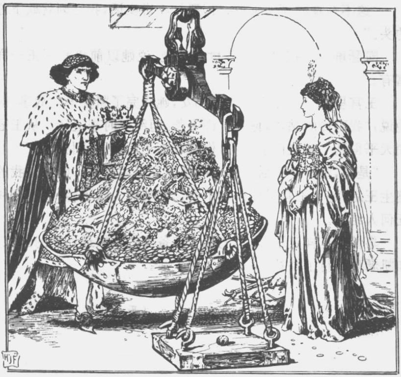

“希望它能让你高兴！”凯瑟琳对国王说，“我给你带来了一团丝线，这种颜色正是你需要的，城里任何人都没有。”

“尊敬的国王，”一个大臣说，“是不是应该奖给这位姑娘和这团丝线一样重的黄金？”

国王同意了，他们搬来了天平。把那团丝线放在一头，另一头放上黄金。可是，天啊！不论他们在另一头放上多少黄金，都比不上那团丝线重。国王下令搬来更大的天平，另一头堆上了几乎国王所有的黄金，还是比不上。后来，国王手上再也找不到黄金了，就把王冠摘下来，放上去，这样，天平正好平衡。

“你从哪里得到这团丝线？”国王问。

“尊敬的国王，这是我的女主人给我的。”凯瑟琳说。

“这不是真的。”国王说，“你要是不讲实话，我立刻就砍下你的头。”

凯瑟琳只好把自己的身世告诉他，说她以前也和国王一样富有。

王宫里有一个充满智慧的妇女，她听完了凯瑟琳的故事，对她说：“我可怜的姑娘，你受了许多苦，但终于时来运转。从王冠使天平得到平衡这件事来看，你将成为王后，一直到去世。”

“是的，她将是王后。”国王听她说完以后宣布，“她将是我的终生王后，她比王宫里任何一个女人都美丽。除了她，我不会和任何人结婚。”

事情就这样定了。国王把原来准备娶的新娘送回她的国家，和凯瑟琳举行了婚礼，幸福地一起生活。

（西西里民间传说）

 

## 隐士和国王的女儿

从前有一个富人，他有三个儿子。临终前，他把自己的财产和土地平均地分配给三个儿子。他死后不久，国王向全国发出布告，谁能建造一只既能够在海上开，又能在陆地上行走的船，就把女儿嫁给他。

大哥听到这个消息，对两个弟弟说：“我希望能当国王的女婿，我想花些钱去造这只船。”他把所有的造船工人都找来，叫他们事不宜迟，立刻开始动工。

工人们砍下大树，做好一切准备。没有多久，人人都知道了富人的大儿子想造船的消息。许多老人都找上门来，对大儿子说：“啊！主人！给我们工作，好让我们也有口饭吃！”

可是，大儿子态度粗暴地对他们说：“你们太老了，力气都没有了，要你们有什么用？”把他们赶走。

接着，又有一群小孩来找他，恳求他说：“主人！快给我们工作吧！”他回答说：“我要你们干什么？手无缚鸡之力，快滚开！”

来找他的人，如果没有技术，他一概拒之门外。

有一个长着长长的白胡子的小老头来敲门，对他说：“你能不能给我个工作，好让我挣口饭吃？”结果也像其他人一样被赶走。

修造这只船用了很长时间，花费了许多钱。可就在它下水的时候，刮起了暴风，把船撞得粉碎。大儿子想娶公主的愿望也一起沉入了海底。这时，他的钱也用得差不多了，只好回来向两个弟弟诉说自己的不幸。

二儿子对自己说：“他肯定是没有安排好，才把事情搞得一团糟，我倒要试试看，看能不能娶到公主。”于是，他又把所有的造船工人都找来，叫他们建造一只既能在水上，又能在陆地上行走的船。可是，他的心也和大儿子一样狠，所有没有技术的人来找工作，都被他粗暴地赶走。后来那个长着白胡子的老头也来了，他的运气也好不到哪里去。

船造好了，开始下水。起初都很顺利，可不久就刮起大风，船撞在一块岩石上，粉身碎骨。二儿子把自己的命运和财产都押在它身上，现在，一切都成了泡影，他只好到弟弟那里求个栖身的地方。

三儿子听完了他二哥的诉说，他想：“我没有那么多钱来养活三个人；这回轮到我去碰运气了。要是能想办法赢得公主，她的财富就是我的财富，我们的生活就有依靠了。”

于是，他把所有的造船工人都找来。吩咐他们建造一只新船。那些上了年纪的人也来找工作，他愉快地答应说：“好的！这里有许多工作，人人都可以做。”小孩来找活干，他也能给他们找些力所能及的事情做。长着白胡子的老头也来了，他说想来挣口饭吃。三儿子回答说：“啊！长辈，我不忍心让你干活，你就当监工吧！照顾一下其他人。”

这个老人是一个神圣的隐士。他看到青年人心地这么善良，决心尽自己最大的力量，帮助他实现心中的愿望。

船造好了，隐士对青年人说，“现在，你可以去向国王的女儿求婚了。这只船既能在水上航行，又能在陆地上行走。”

“啊！好长辈！”青年人说，“你不会抛弃我吧！我请求你留下来，和我一起到国王那里去！”

“要是你愿意，我同意。”隐士说，“不过有个条件，你不论得到什么东西，都要分一半给我。”

“好！如果这是唯一的条件，那就太容易答应了。”青年人说。他们乘上船，一起出发。

船开出去不久，他们看到有一个人站在浓雾里，正在尽力地把雾装到口袋里去。

“长辈！”青年人对隐士说，“他这是在干什么？”

“问问他。”老人说。

“你在干什么呢？我的好朋友。”

“我正在把雾装到口袋里去，这是我的工作。”

“问他愿不愿意和我们一起走。”隐士小声地对青年人说。

那个人回答说：“要是你能满足我的吃喝，我很乐意跟你走。”

他们让他上了船，又出发了。青年人对老人说：“长辈，原来只有我们两个人，现在有三个了。”

他们又继续走了一段路程，看到有个人把半个森林的树都拔起来，扛在自己的肩膀上。

“长辈！”青年人说，“你看看！他这是在干什么？”

“问问他，干吗要拔那么多树？”

那个回答说：“嗯！我只不过是想收集一些柴火。”

“请他和我们一起走。”隐士轻声地说。

那个大力士说：“只要你能让我吃饱喝足，我就跟着你。”说着，他也上了船。

青年人对隐士说：“长辈，刚才我们只有三个人，现在有四个了。”

船又开出去几英里以后，他们看到河边有个人在喝水，几乎把那条河都喝干了。

“长辈，”青年人问，“你看看这个人！有谁像他这样喝水的吗？”

“问他干吗这样。”隐士说。

“嗨！喝口水有什么好奇怪的？”那人站起来说。

“请他跟我们一起走！”隐士说。

青年人向他提出邀请。他说：“我很乐意，只要你有足够的东西让我吃喝。”

青年人小声地对隐士说：“长辈，刚才我们只有四个人，现在有五个了。”

走了没有多远，他们看到有个人站在河里，对着河水射箭。“长辈！”青年人问，“他对着河水在射什么呢？”

“问问他。”隐士说。

“嘘！嘘！”那人喊起来，“你们把它吓跑了。在地下世界里，有只鹌鹑正停在树上，我正要射它。这是我的职业，我瞄准什么，就能射中什么。”

“问他是否愿意和我们一起走。”

那人说：“只要有够我吃的够我喝的东西，我就全心全意地跟着你。”

他们把他带上船，青年人对隐士说：“长辈，刚才我们有五个人，现在有六个了。”

船继续向前开着。没有走多远，他们就看见有人走过来。他的脚步那么大，前脚还在岛的北边，后脚已经跨到岛的南边了。

“长辈！你看，他一步跨得多远！”

“问他这是在干什么？”隐士说。

“嗯！我只是出来散散步。”那人回答。

“问他是不是愿意和我们一起走？”隐士说。

“很乐意，只要我想吃多少，喝多少，你就给我多少。”那人回答。

青年人对隐士说：“长辈，刚才我们有六个人，现在有七个了。”隐士心中明白，他这是去干什么，为什么叫这些身体健壮，又有本事的人到船上来。

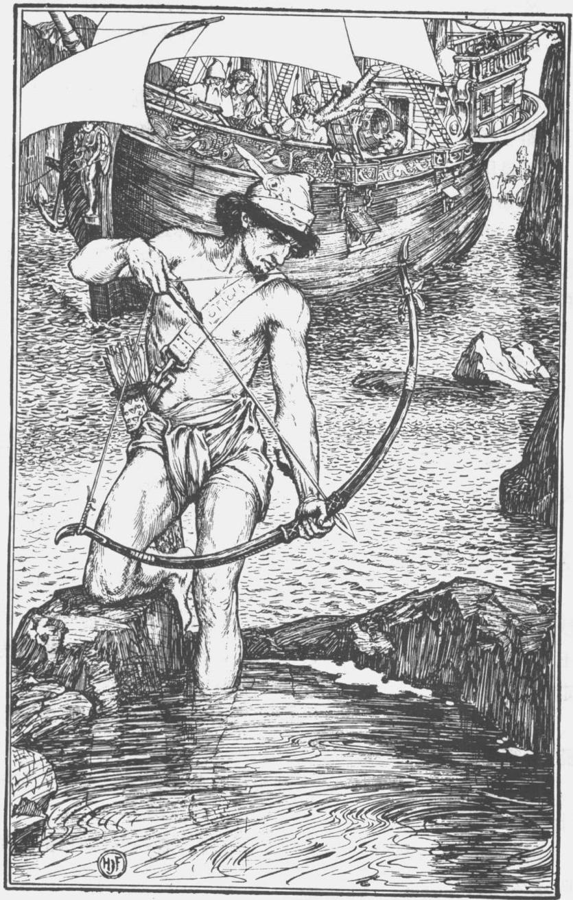

过了许多天，他们终于来到了国王和他的女儿居住的城市。他们把船停在王宫的门前，青年人走进去，向国王深深地鞠了一躬。

“啊！陛下！遵照你的吩咐，这只能在海上，也能在陆地上航行的船已经造好，请把奖赏给我，把你的女儿嫁给我。”

可是国王心里想：“什么？要我把女儿嫁给一个一无所有的人？谁知道他是穷还是富？是骑士还是乞丐？”

国王大声地说：“造了这只船还不够。你还必须找到一个能跑的人，他要在一个钟头里把我这封信送到地下王国的国王手中，还要把回信带回来。”

“可是条件里没有这一条啊！”青年人回答。

“那好！你爱怎么办都行。”国王说，“只是你别想得到我的女儿。”

青年人懊丧地走出去，告诉他的老朋友，发生了什么事情。

“傻孩子！”隐士说：“马上答应他的条件，把那封信交给长脚人，叫他去办。他花不了多少时间就能办到。”

青年人满心欢喜地回到国王那里，对国王说：“陛下！我接受你的条件，这位就是送信人，他能满足你的要求。”

国王没有办法，只好把信交给他。长脚大步流星地走出去，抄近路一会儿就到了地下王国，很快就找到那里的国王。地下国王看了信，对他说：“你稍等片刻，我这就写回信。”可是长脚因为走得太累了，忘了他的差使，一下子就睡着了。

这时候，青年人正一分一秒地数着，眼睛瞪着长脚出发的路，等待着他的归来。

“什么事情耽搁了他？一个钟头很快就要到了。”青年人对隐士说。

隐士把百发百中的射手找来，对他说：“看一看，送信的人干吗这么久没有回来？”

“嘀！他在地下王国的宫殿里睡着了。没关系，我能叫醒他。”

他拿起箭来，对准送信人的膝盖射了一箭。那箭不轻不重，正好把他叫醒，他醒过来，一看时间差不多了，赶紧拿起信就跑，终于在时钟即将敲响的时候赶到。

青年人想，这回可以当新郎了。可是国王对他说：“这还不够。在我把女儿嫁给你之前，你要给我找来一个人，他能在一天里把我地窖里的酒喝掉一半。”

“可是条约里没有这一条！”青年人抱怨说。

“随你的便，只要你不想得到我的女儿。”

青年人垂头丧气地走出来，问隐士该怎么办？

“傻孩子！”隐士说，“叫那个把半条河水喝光的人去！”

他们把那人叫来，问：“你一天里能把国王地窖里的酒喝掉一半吗？”

“当然可以，你们要我喝多少我就能喝掉多少，我从来不会感到满足。”他说。

国王看到青年人这么快就把事情安排好了，很不乐意，可是他无法拒绝，只好叫仆人把那人领到地窖里去。啊！他在地窖里真是快活极了，整天不停地喝啊！喝啊！不到一天的时间，把地窖里所有的酒瓶都喝得底朝天。

国王看到这些，只好对青年人说：“你赢了，我再也不能把女儿留住了。至于她的嫁妆嘛，只能这么办，一个人能拿得动多少，你就带走多少。”

“可是，”青年人说，“一个人力气再大，最多只能搬走一百多斤，国王的嫁妆怎么能就这么一点？”

“嗯！你爱怎么办就怎么办，我的话已经说完了，这是你的事情，不是我的。”

青年人十分窘迫，不知道该如何回答是好。要不是因为造这只船花掉了他所有的钱，他很乐意一分钱嫁妆也不要就和公主结婚。可现在，没有嫁妆，他怎么来安排公主的生活？他只好回来和隐士商量该怎么办。

“国王只答应给我一个人能拿走的嫁妆。我现在已经没有什么储蓄了，我的两个哥哥也一贫如洗。”

“傻孩子！你忘了那个把一片森林扛在肩上的人了吗？叫他去就行了。”

青年人顿时眉开眼笑，把那人叫来，对他说：“把王宫里所有能搬得动的东西都搬走，直到搬不动为止，把王宫搬空了也没有关系！”

大力士愉快地答应了，而且说到做到。他来到王宫，把所有看得见的东西都搬到肩上：椅子、桌子、衣橱，连装满金子和银子的箱子，一切都搬空以后，国王头上的王冠也摘下来，放在最顶端。他把这些东西都搬到船上去。青年人领着国王的女儿跟在后面。

国王看到空荡荡的王宫非常生气，他把军队召集起来，登上战船，命令立刻去追赶青年人的船只。

国王的战船开得很快，没多久就赶上来了。战船上的海员和士兵都高兴得欢呼起来。隐士看到他们追上来了，对青年人说：“你看到了吗？”

青年人叫起来：“啊！长辈，这是一支舰队，他们在追赶我们，很快就要追上来了。”

隐士叫他把那个用口袋装雾的人找来，把口袋打开，把雾放出去。雾把国王的舰队严严地笼罩起来，他们什么也看不见，只好返航回去，向国王报告这种奇怪的事情。青年人的船平安地返回家乡。

“好了，现在你又回到家里了。”隐士说，“你可以实现自己的承诺了。你答应过，把你所得到的一半分给我。”

“我将诚心诚意地兑现自己的诺言。”青年人说。他把自己所得到的全部值钱的东西分成两半，一半留给自己，一半交给隐士。

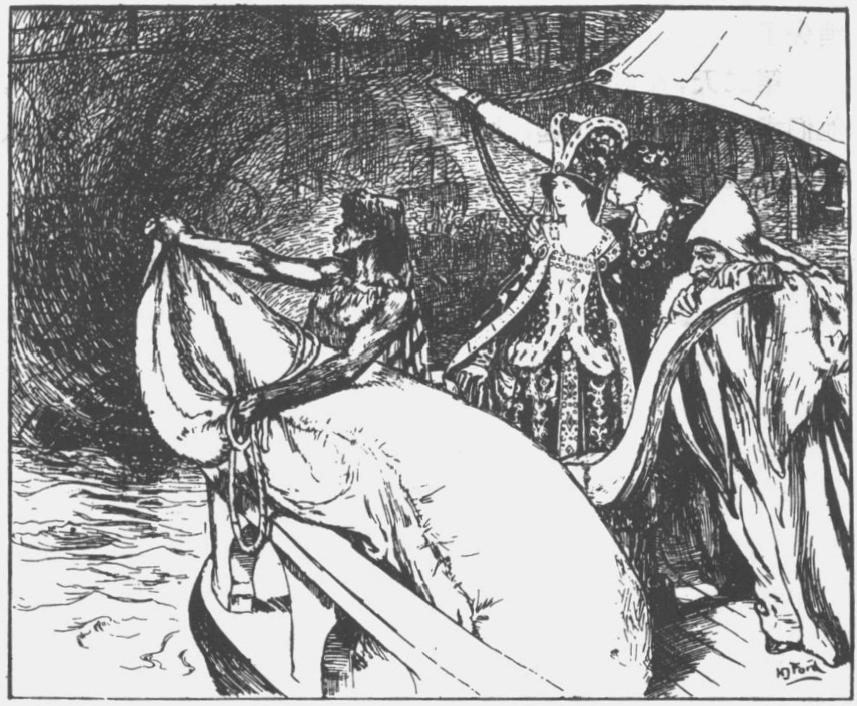

“长辈！所有的东西都分完了！”青年人说。

“都分完了？”隐士说，“你忘了最好的东西。”

“怎么会呢？”青年人说，“我把全部东西都拿出来分了。”

“那么，国王的女儿呢？”隐士问。

青年人的心不禁一沉，因为他很爱国王的女儿。不过，他还是回答说：“是的，我曾经发过誓，我要遵守自己的誓言。”他拔出剑来，要把她劈成两半。隐士看到他把忠诚看得比自己的妻子更重要，就抬起头来喊道：“住手！她是属于你的，还有所有的这一切财产。因为你同情需要帮助的人，所以我才来帮助你。以后需要我的时候，叫我，我还会来的。”

说完，他轻轻地碰了一下那些一起来帮忙的人，他们就一起消失了。

第二天，青年人和公主举行了婚礼。他的两个哥哥也来了，他们幸福地生活在一起。他们永远怀念着神圣的隐士，他是那么好的朋友。

（西西里）

 

## 生命之泉

在一间小屋里，住着三兄弟和他们的妹妹。他们相亲相爱，和睦相处。有一天，从来不知道干活，只会从天亮玩到天黑的大哥对弟妹说：“让我们努力工作，也许我们会富起来，还能建造一座自己的宫殿。”

弟妹们都高兴地回答：“好啊！让我们一起干！”

他们全力以赴地勤奋工作，后来果然变得很有钱，还造起了一座美丽的宫殿。许多人都千里迢迢慕名来观看，都说这宫殿真是了不起，谁都挑不出有什么缺点。

有一天，来了一位老妇人，她在许多人的陪同下看了一个又一个房间，突然说：“是的，这是一座辉煌的宫殿，可是还缺少一些东西。”

“还缺少什么呢？”

“教堂！”

三兄弟听了她的话，又开始出去工作，挣来更多的钱。钱够了以后，他们就开始造一座和宫殿一样宏伟和漂亮的教堂。

教堂造好以后，来参观的人就更多了。看到这宏伟的宫殿和教堂，里面无比壮观的大厅和外面景色迷人的大花园，个个惊叹不已！

这一天，三兄弟正忙着招待参观的客人，来了一个上了年纪的老人，对他们说：“是啊！一切都是那么美妙，可还是缺少一些东西。”

“还缺少什么呢？”

“一罐生命之泉的泉水；一棵美丽树，它的鲜花永不凋谢，香味四季飘溢；还有一只会说话的鸟。”

“我们到哪里去找这些呢？”

“到离这里很远的山上去，就能找到。”

老人有礼貌地和他们告别以后，大哥对弟妹们说：“我要出去寻找生命之泉、会说话的鸟和美丽树。”

“可是，万一发生不幸呢？我们怎么才能知道？”妹妹问。

“你说对了，”大哥说，“这点我倒没有想到！”

他们出来追上了老人，对他说：“我们大哥想出去寻找生命之泉、美丽树和会说话的鸟。你说有了这三件东西，我们的宫殿才称得上十全十美。可是，我们怎么样才能知道他在外面是否平安无事呢？”

老人拿出一把刀来，交给他们，说：“小心地保存好这把刀，只要刀身是洁白明亮的，一切都好；要是刀身像鲜血一样通红，那就是灾难临头了。”

三兄弟谢过老人，回到自己的宫殿。大哥开始准备，要动身到山上去取回这三件宝物。

他走啊！走啊！走啊！走了好长的路，碰到一个巨人。

“请问，你能告诉我还要走多远，才能到达那座山吗？”

“你想到那里去干什么？”

“我在寻找生命之泉、会说话的鸟和美丽树。”

“许多人从这里经过，去寻找这些宝物，可是还没有一个人回来过。你也不会活着回来，除非你记住我的话。沿着这条路走下去，到了那座山以后，你会看到，山上都是石头。不要停下来看它们，继续走你的路。向前走的时候，你会听到身后传来嘲笑和讽刺，这是那些石头发出来的。不要理睬它们，特别是要记住，千万不要回头看，否则，你也会变成像它们一样的石头。要一直往前走，一直走到山顶，你就能得到所需要的一切。”

年轻人感谢他的指导，继续向前走，来到山脚下。开始登山以后，他不断地听到背后传来嘲弄和取笑的声音，他只当没有听见。后来这些声音越来越响，他再也忍耐不住了，弯下腰来拾起一块石头，想朝发出响声的地方扔过去。可是，他突然感到自己的手臂僵硬起来。接着，他也变成了一块石头。

这一天，他妹妹在家里想着，大哥这么久还没有回来，就把刀拿出来看，看到刀身像鲜血染过一样红。她大声地喊叫两个哥哥，说发生了可怕的事情。

“我去找他！”二哥说完，就出发了。

他走啊！走啊！走啊！直到来到巨人面前，问他是否看见一个年轻人向山上走去。

巨人回答说：“是的，我看到他过去，可是不见他回来，他肯定是中了咒语了。”

“那么，我该怎样做才能解救他，取回生命之泉、会说话的鸟和美丽树呢？”

“沿着这条路走下去，到了那座山的时候，你会看到山上布满了石头。不要停下来看它们，继续往上爬。特别要记住，不要理睬四面八方传来的讽刺和嘲笑声，千万不要回头看。到了山顶以后，你所有的愿望都能够实现。”

年轻人感谢他的指导，继续向山那边走去。他刚开始爬山，就听到四面传来大声的嘲笑声。好长一段时间，他毫不理会，不停地向上爬。他从大哥变成的石头旁边经过，听到身后传来的嘲讽声中有他大哥的声音，就停下来回头看。立刻，这些石头堆中又多了一块。

妹妹在家里数着两个哥哥该回家的日子。时间过了那么久，也说不清她把刀拿出来看过几次。开始那些日子，刀身总是亮铮铮的，说明二哥还是平安无事，她心中充满了希望。

一天晚上，她像往常一样，又累又担心，把刀从抽屉里拿出来看，天哪！刀像是沾满了鲜血。她恐怖地叫喊起来，小哥哥赶紧跑过来。她话也说不出来，只是把刀举起来让他看。

“我要去了！”他说。

他走啊！走啊！走啊！直到来到巨人的身边。他问：“你看到两个年轻人从这里经过，向山那边走去吗？”

巨人回答：“是的，他们从这里经过，可是没有回来。我知道，魔法已经降临到他们的头上。”

“那么，我该怎么办才能解救他们，得到生命之泉、会说话的鸟和美丽树呢？”

“到山那边去，你会看到，山上铺着厚厚的石头，几乎无法行走。记住，一直向前走，不要朝左边看，也不要朝右边看，不要去理睬那些冲着你来的嘲弄和取笑，直到到达山顶。那时候，你所有的愿望都能实现。”

年轻人衷心地感谢巨人的指教，向山那边走过去。他开始爬山以后，讥讽声，嘲笑声像风暴一样地从四面八方向他袭来。他记住巨人的话，眼睛正视正前方，不向左边，也不向右边看。眼看山顶就在前面，那些宝物几乎伸手就可以拿到了。这时候，从一片喊叫声和呻吟声中，他听到了两个哥哥的声音，情不自禁地回过头来，刹那间，山上又多了一块石头。

妹妹不安地在宫殿里走来走去，刀拿在手中不肯放下。可是，她提心吊胆，害怕看到的事情终于出现了。那把刀在她的眼皮底下突然变得血红。她想：“现在该轮到我去了。”

她走啊！走啊！走啊！一直走到巨人的身边，请求巨人告诉她，是否看到三个年轻人从这里经过，到山那边去？

“我看到他们从这里经过，可是一个也没有回来。我知道，他们都已经中了魔法。”

“我该怎么办才能解救他们，得到生命之泉、会说话的鸟和美丽树呢？”

“你要到山上去，你会看到，山上铺满了石头，连落脚的地方也没有。爬山的时候，你会听到吵闹的嘈杂声，好像全世界的石头都在嘲笑你。不论听到什么，你都不要加以理睬，到了山顶以后，你就可以得到一切。”

姑娘衷心地感谢他的教诲，向山上走去。她刚开始爬上几步，就听到吵闹声、尖叫声从四面八方向她袭来，她踩中的每一块石头都像活的一样。她牢牢地记住巨人的话，也不管她的哥哥发生过什么事情，继续坚定地向山顶上走去，一步一步地接近山顶。这时候，喧嚷声越来越大，她三个哥哥的声音听得特别清楚。姑娘坚定不移，毫不动摇地向前走，终于踏上了山顶。

她看了看周围，生命之泉的泉水就在山顶上的池塘里流动着。她拿起随身带来的铜罐，放入池中灌满。

池塘旁边生长着那棵美丽树，枝头上站着会说话的鸟。她抓住小鸟，把它放进笼子里，还折下美丽树的一枝树枝。

她满怀喜悦地拿着三件宝贝开始下山。铜罐那么重，她又走了那么多路，觉得很累，手有点发抖，铜罐里的水溅了出来。这些水滴在石头上，石头立刻变成年轻的小伙子和姑娘。他们高兴地围着她，感谢她重新赋予他们新的生命。

她明白了，用这种方法可以破除那邪恶的魔法。她小心地用生命之泉去滴每一块石头。啊！有那么一大群的小伙子和姑娘，大家满心欢喜地跟着她一起走下山。

回到宫殿，姑娘立刻把美丽树种下，用生命之泉来浇灌它。树枝刹那间长成了一棵树，上面开满了鲜花，会说话的鸟就在美丽树上安了家。

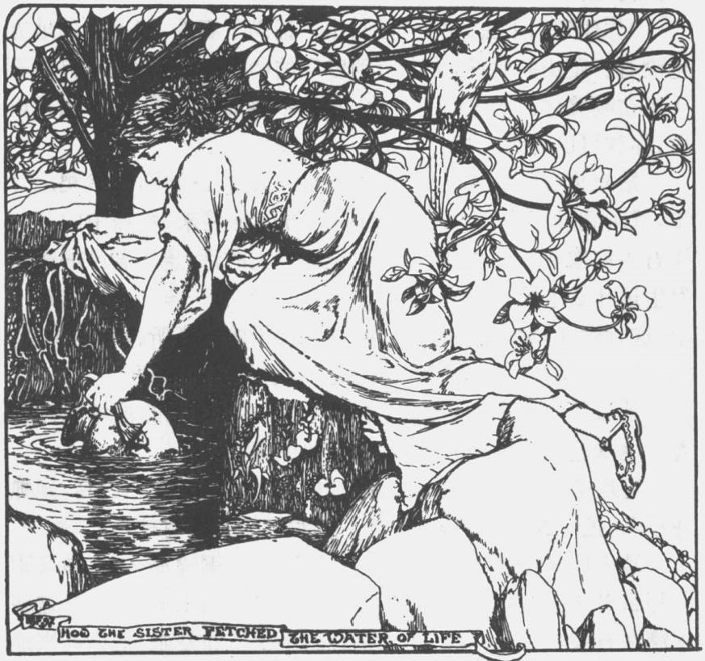

这些奇迹一传十，十传百，许多人闻讯都赶来争睹这神奇的三件珍宝，还有赢得这三件珍宝的姑娘。其中有一个是国王的儿子，他看得非常仔细，对姑娘依靠自己的大智大勇，最终得到这些珍宝的故事更感兴趣。他赞赏这些奇异而美丽的珍宝，更赞赏得到这些珍宝的姑娘，她的美丽和勇气。他回到家里把这些事情讲给父母听，说要娶她为妻，国王和王后都同意了。

婚礼就在姑娘宫殿旁的教堂里举行。婚礼以后，新郎把新娘带回自己的家。他们永远幸福地生活在一起。

（西班牙）

 

## 受伤的狮子

从前有一个穷苦的姑娘，生活无依无靠，只好在这个世界上到处流浪，乞求别人的施舍。有一天，她来到一间茅草屋前，请求主人给她一些工作。这家主人是个农民，他说正要找个放牛的，因为原来的放牛娃已经走了，要是她愿意，可以留下来。这样，姑娘就成了一个放牛娃。

有一天，她赶着牛群到草地上去放牧，听到沉重的，像是人的呻吟声。她赶紧跑过去，看到一头狮子躺在地上，呻吟声就是它发出来的。

你可以想象，当时她被吓成什么样！可是看到狮子那十分痛苦的样子，她也很同情。她慢慢地向它靠拢过去，看到它脚上有一根很大的刺，就帮它拔出来，还把伤口包扎好。狮子很感激，用它又大又粗的舌头来舔她的手，表示感谢。

姑娘做完了这些事，就回来找她的牛。可是牛都不见了，连牛的影子都看不见。她只好回家，向主人承认把牛丢了。主人把她大骂了一顿，还打了她，说：“从今天起，你给我去放驴。”

姑娘天天把驴子赶到森林里去放牧。一年以后，就在她发现受伤的狮子同一天早晨，她又听到好像是人受伤以后的呻吟声。她顺着声音找过去，十分惊讶地看到，声音也是那头狮子发出来的，它脸上受了重伤。

这一回，她再也不感到害怕了，立刻跑过去帮它冲洗伤口，找来草药帮它敷上。好了以后，狮子又以同样的方式来感谢她。

她回过头来找驴子，可是毫无踪影，怎么也找不到！她只好空手回到家里，向主人承认把驴子丢了。主人先是骂她，接着又打她，最后对她说：“从今天起，你给我去放猪！”

第二天，她一早就把猪群赶出去。牧场那么肥沃，猪天天都在长膘。

又是一年过去了。这一天，姑娘赶着猪群出去，又听到像人受伤以后发出的呻吟声。她跑过去，看到是她的老朋友狮子遍体鳞伤，奄奄一息地躺在一棵大树下。

她双膝跪在狮子面前，小心地帮它清洗全部伤口，上了药草。狮子舔着她的手，感谢她，问她愿不愿意留下来陪它坐一会。姑娘说，她还得去看守那些猪。

她回到放牧猪群的地方，可是一头猪也看不到了，好像大地突然裂开，把它们全部吞掉似的。她又是叫喊，又是吹口哨。然而，只有小鸟在回答她。

她泄气地坐在地上，大声哭泣起来，不敢回家。时间一个钟点一个钟点地过去了。她哭得差不多了，又站起来，在森林里转来转去，还是一头猪的影子也看不见。

她想，也许爬到树上去会看得更远一些。她爬上一棵大树，四处张望，立刻把自己的猪忘得一干二净。她看到，路上有一个年轻英俊的男子正向这边走过来，到树旁边以后，他搬开一块石头，在石头后面消失了。

姑娘揉了揉眼睛，怀疑自己是不是看花了眼。后来她想：“我坐在这里不动，等着他出来，看看他是谁。”她在树上过了一夜。第二天早晨，她看到那块岩石又向一边挪动，一头狮子走出来。

等狮子走得看不见以后，她从树上爬下来，来到岩石旁，把岩石推开，她看到面前有一条路。顺着这条路走下去，有一幢漂亮的房子。她走进去，把房间里打扫得一干二净，把东西都堆放整齐。房间角落里有一个橱，里面有许多好吃的东西。吃过一顿好饭以后，她走出来，又爬到那棵树上去。

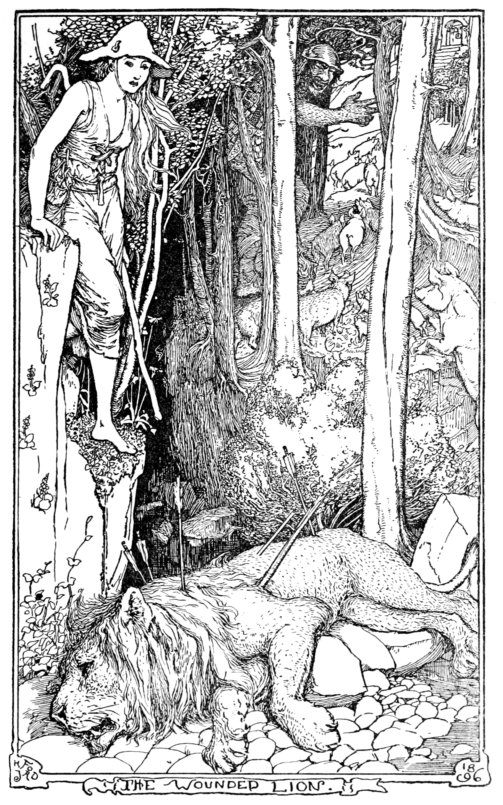

太阳下山以后，她又看到年轻人走过来，推开岩石走进去。

第二天早晨，狮子从里面走出来。它仔细地观察着四周，看到没有人，就向森林里走去。

姑娘从树上爬下来，一切又像昨天发生过的一样，她把房间打扫干净，整理好以后又回到树上。这样过了三天，姑娘觉得这个秘密快要揭开了，决心要去问这个年轻人。晚上，她看到他从森林里走回来，就从树上下来，请求他把名字告诉她。

年轻人看到她好像很高兴，还说，他猜想，这么多天以来，肯定是她偷偷地帮他整理房间。他说，他是一个王子，中了一个神通广大的巨人的魔法，白天要变成一头狮子，就是她几次救过的那头狮子，只有到了晚上才能恢复原形。也正是因为她那么善良，救了他，所以巨人才偷走她的牛、驴和猪，借此来报复她。

姑娘问：“为了解除魔法，我能帮你做些什么？”

他说：“这恐怕非常难，因为要想解除魔法，唯一的办法是把国王女儿的头发编成一件衣服，送给住在高山顶上的巨人。”

“那好！”姑娘说，“我要到城里去，敲开王宫的大门，请求让我去当公主的女仆。”

她来到首府，在马路上一边走一边叫喊着：“谁要雇我做佣人？谁要雇我做佣人？”许多人都喜欢她那干净漂亮的样子，愿意雇她。可是她不理睬他们，继续一边走一边喊叫：“谁要雇我做佣人？谁要雇我做佣人？”

这时候，公主的侍女走过来。

“你会做什么？”侍女问。姑娘承认，她会干的活不多。

“那么，你只好到厨房去帮忙，洗洗碗什么的。”侍女说，带着她来到王宫。

姑娘给自己做了个好看的发型，把自己打扮得既整洁又漂亮。王宫里人人都称赞她，欣赏她。不久，她的好名声传到公主的耳朵里。公主派人把她找来，看到她的发型那么漂亮，就叫她来帮自己梳头发。

公主的头发又厚又长，富有光泽。姑娘不停地帮她梳理，她的头发越发显得明亮，灼灼生辉。公主看了非常喜欢，叫她天天来帮她梳头。后来，姑娘鼓起勇气，请求公主给她一绺头发。

公主向来很为自己的头发感到骄傲，一根头发也舍不得拔掉。所以她不同意。可是姑娘并没有轻易地放弃自己的希望。她每天都不断地请求公主让她剪下一束。后来，公主不耐烦了，对她说：“可以，但是有个条件，你要给我找来世界上最漂亮的王子，做我的新郎。”

姑娘表示同意，动手剪下公主的一束头发，把它编成一件衣服，像最高贵的丝绸一样闪闪发亮。她把这件衣服带回来交给年轻人。年轻人叫她亲手交给巨人，还嘱咐她千万要小心，老远看到巨人的时候就大声地打招呼，否则，巨人会猝不及防地拔出剑来把她刺死。

姑娘和他告别以后，向巨人居住的山顶攀登。她还没有到达山顶，巨人就听到她的脚步声，向她冲过来，一只手拿着剑，一只手拿着棍，鼻子和嘴中喷射着火焰。姑娘大声地喊叫着，说是给他送衣服来了。巨人这才安静下来，邀请她到自己的屋子里去。

巨人试了试衣服，可惜太短了，他随手把衣服扔在地下，说没有用。姑娘伤心地把衣服捡起来，失望地回到王宫。

第二天早晨，她给公主梳头发的时候，请求公主再让她剪下一束头发。开始，公主不同意，后来经不住她的苦苦哀求，同意让她剪，但是要姑娘找个王子来当她的新郎。

姑娘告诉公主，王子已经找到了。她把公主的头发编织好，接在那件巨人嫌短的衣服上，然后带着它来找巨人。

巨人试了一下，觉得正好，他很高兴，问姑娘希望得到怎样的回报。姑娘说，她唯一希望得到的回报是，解除加在王子头上的魔法，让他恢复人的形状。

巨人好久不理睬她，后来他终于同意了，还告诉她应该怎样去做，才能解除魔法。姑娘必须亲自把狮子杀了，把它切成碎片，烧成灰，然后把灰撒在水里。这样，王子就会从水里走出来，永远摆脱魔法。

可是，姑娘听了以后并不感到高兴，反而哭起来。她害怕巨人欺骗她，害怕把狮子杀了以后，王子再也不能复生。这就等于她亲手杀了王子。

她哭着走下山来找王子，王子正在山下面等她。听完她的故事，王子安慰她，叫她鼓起勇气，照巨人的吩咐去做。

姑娘相信王子的话。早晨，王子变成狮子以后，她拿起刀来把它杀了，切成碎片，把它烧成灰，再把灰投入水中。很快，王子从水中走出来，比晚上看到的王子更加漂亮。

王子感谢姑娘为他所做的一切，说除了她以外，他不会娶任何女子为妻。姑娘伤心地哭起来，说她不能，她已经答应过给她头发的公主，让王子做公主的新郎。

王子回答说：“要真是公主的话，我们就得赶快去，跟我来！”

他们一起来到王宫。国王和王后看到王子，不禁喜从天降，王子正是他们的大儿子，因为中了巨人的魔法而失踪了。

王子请求父母，让他和救了他的姑娘结婚。国王和王后同意了，并为他们举行盛大的婚礼。姑娘变成了王妃，后来又成了王后。她确实当之无愧！

（西班牙）

 

## 没有心的人

从前有七兄弟，父母早已去世，没有姐妹，家里的活都得自己动手去干。他们偏偏不喜欢干家务活，七兄弟经过反复考虑以后，决心结婚。不幸的是，他们居住的地方找不到年轻的姑娘。六个哥哥决定一起出去找新娘，留下最小的弟弟照顾家里，还答应给他带个很漂亮的新娘子回来。小弟弟同意了，六兄弟兴高采烈地出发了。

他们穿过森林，看到一间孤零零的小屋。小屋门前站着一个很老，很老的老人。看见六兄弟，他走过来招呼他们：“喂！年轻的朋友们，你们兴冲冲地要到哪里去？”

“我们出去找美丽的姑娘做新娘，还要给留在家里的小弟弟找一个。”他们回答。

“啊！亲爱的小伙子！”老人说，“我一个人住在这里非常孤独，请给我也带个新娘子来。不过要记住，要带个年轻漂亮的新娘回来。”

“这样一个干瘪的瘦老头，要娶年轻漂亮的姑娘干什么？”六兄弟想，继续赶他们的路。

后来，他们来到一个村子。有一家人有七姐妹，个个长得既年轻又好看，正如他们所希望的那样。六兄弟选中了自己的意中人，把最小的一个留给小弟弟。这样决定以后，他们就一起动身回家。

回家的路上，他们又穿过那片森林，来到老人的小屋子前。

老人正好站在家门口，看到他们过来，喊道：“喂！你们这些好伙伴，给我带来了一个多么迷人的新娘！”

“她不是给你的，”年轻人说，“她是给我们小弟弟的，我们答应过他。”

“什么？”老人说，“答应过！我要叫你们把答应过的事情吃下去！”他拿起魔棍，念起咒语，用魔棍一个接一个地点他们。立刻，这些新郎和新娘一个接一个地变成灰色的石头，只留下最小的妹妹。

他把最小的姑娘带进屋，叫她给他整理家务。姑娘的日子倒也过得去，没有受什么苦。可是有一个想法老是折磨着她：要是老人突然死去，她就得一个人孤零零地留在这密林深处，就像老头那样，非常孤独地过日子。

有一天，她把自己的担心对老头子说了。

“用不着担心！”老头子说：“你用不着怕我死去，也别想让我死去！因为我的心不在胸口中。即使是我死了，你还可以在门框上找到魔棍，用它来恢复你姐姐和她们恋人的生命。那时候，你就有足够的伙伴了。”

“你的心不在胸口，那么放在什么地方呢？”姑娘问。

“你什么都想知道吗？”老头子说，“好吧！你一定要知道，我可以告诉你，我的心就在床罩上。”

老头子出去办事情以后，姑娘就在床罩上绣上美丽的花朵，好让他的心幸福。老头子回来以后非常惊讶，笑着对她说：“你真是个好孩子！我不过是开个玩笑，其实，我的心在……”

“你的心在哪里呢？亲爱的丈夫！”

“在门上。”老头子回答。

第二天，老头子走了以后，姑娘用漂亮的羽毛和美丽的花朵把门装饰起来，还给它套上花环。老头子回来了，问她这是什么意思！

“我这样做是为了表示对你的心的爱！”姑娘说。

老头子又笑起来，说：“你真是可爱的孩子，可是我的心不在门上。”

可怜的姑娘非常烦恼，说：“啊！亲爱的，你的心真的放在什么地方了，有一天你会死去，留下我孤孤单单一个人。”

老头子尽力地安慰她，重复过去说过的那些话。可是她坚持要知道，他的心放在什么地方，他终于对她说了。

“离这里很远很远的地方，”老头子说，“孤零零地有一座大教堂，说它多古老就有多古老。教堂的门是用铁做成的，周围有一条很深的壕沟，沟上没有桥。教堂里有一只鸟，不停地飞上飞下。它从来不吃也不喝，也绝对不会死亡，没有人能够抓住它。只要它还活着，我就不会死，我的心就在它身上。”

小新娘听了以后很伤心，因为她无法表达对老人一颗心的爱。她经常一个人坐着想这件事，因为老头子经常要出去。

有一天，一个年轻人从小屋子门前经过，看到这个可爱的姑娘，就向她表示祝福。

姑娘回答了他的问候。年轻人走过来，姑娘问他从哪里来？到哪里去？

“唉！”年轻人叹息说：“我非常不幸，我有六个哥哥，他们出去寻找新娘，还答应给我带回来一个。可是他们一去不复返，我只好出来寻找他们。”

“啊！好朋友！”姑娘说，“你不用再去找了。进来，请坐下，先吃一点，喝一点，我再把这些事情告诉你。”

她送上吃的，等他吃饱以后，开始讲他的哥哥如何来到她的家乡，如何各自挑好自己的新娘，还带着她一起回家。当她说到其他人都变成石头，她被迫留下来当老头子的新娘时，她哭了。她把所有的事都对他说了，连老头子的心在哪里也说了。

年轻人听完以后说：“我要去找那只鸟，可能上帝会帮助我抓到它。”

“是的，去吧！”姑娘说，“这是一件好事情。这样，你就可以救出你的哥哥和我的姐姐。”

她把年轻人藏起来，这时候天已经很晚了，老头子很快就要回家了。

第二天早晨，等老头子出去以后，她给年轻人准备了一些路上吃的，送他出去，祝他好运和成功。

他走了一会，感到应该吃早饭了，把姑娘给他准备好的食品袋打开，里面有许多好吃的东西。“啊！多好的一顿饭！”他喊起来，“谁愿意来和我一起分享？”

“哞！”他身后传来一声叫声，回过头来一看，是一头红色的公牛。公牛对他说：“我很乐意接受你友好的邀请。”

“很高兴认识你，请自己动手吧！我所有的一切都是为你而准备的。”年轻人热情地招呼它。公牛舒服地躺下来，舔了舔嘴唇，饱餐了一顿。

“非常感谢你。”公牛站起来说，“当你需要或者有什么危险的时候，请叫我。哪怕是想到我，我也会来！”说完，它就消失在丛林中。

年轻人把没吃完的东西收起来，继续向前走。太阳照在他头上，地下的影子越来越短，肚子也提醒他是中午了，该吃饭了。他在地下铺了一块布，把食品拿出来，说：“午饭准备好了，谁想来和我一起分享，欢迎！”

树丛中传来一阵很大的响声，一只大野猪跑出来，“嗯！嗯！有人说午饭准备好了，是你说的吗？是不是想邀请我来一起吃？”

“热烈地欢迎你，请随便吃吧！”年轻人说完，和野猪共同分享一顿午餐。

野猪吃完以后站起来说：“谢谢你，需要我的时候，请尽快地叫我。”说完就摇摇摆摆地走了。

年轻人也动身继续赶路，到傍晚时分，已经走了许多英里。他又感到饿了，想到袋中还有一些吃的，就想最好是先吃晚饭再说。他把食品摆好以后，又叫起来，“谁想来和我一起吃晚饭，欢迎！”

头顶上有拍动翅膀的声音，地下出现一个巨大的阴影。接着，一只狮身鹰首怪兽从天而降，说，“我听到有人在请客吃饭，有没有我吃的？”

“当然有，”年轻人说，“想吃多少就吃多少，请吧！”

怪兽吃饱以后，飞走之前对他说：“需要的时候请叫我一声。”

“它是多么匆忙啊！”年轻人说，“它可能知道教堂在哪里，帮我指指路多好，我一个人永远也找不到。”

他把地下的东西都收集起来，想在睡觉之前再赶一段路程。可是还没有走出多远，突然看到教堂就在眼前。

他来到教堂前，一条又宽又深的壕沟挡住了他的去路，上面一座桥也没有。

天已经很晚了，没有什么办法可想。再说他也很累了，于是就在地上躺下来，很快就睡着了。

第二天早晨，他醒过来，开始考虑怎样才能渡过这条沟。他突然想起，要是公牛来了，把沟里的水全部喝光，他就可以走过去了。

他刚想到公牛，公牛就出现了。它一口气就把壕沟里的水喝干。年轻人高兴地走过去。可是他发现，没有办法穿过教堂厚厚的城墙和坚硬的大铁门。

“要是野猪在的话，它一定比我有办法！”他刚这样想，野猪就出现在面前。它用长牙齿来挖墙，石头很快就松动，一个接着一个地掉下来，直到墙上出现一个洞，年轻人能够从洞口钻进去。

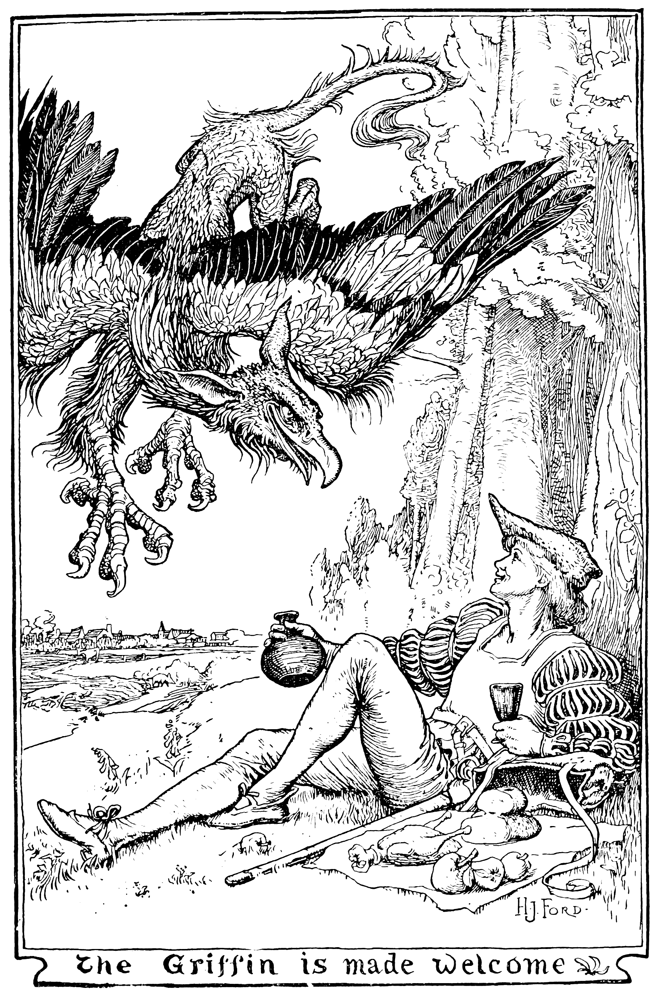

进了教堂，他看到里面有一只鸟在上下飞翔，可是没有办法抓住它。

“啊！”他说，“要是那只会飞的怪兽在，肯定能抓住它！”

话音刚落，怪兽就飞进教堂，一下子就抓住小鸟，把它交给年轻人，然后就飞走了。

年轻人小心翼翼地拿着小鸟，火烧眉毛般地急忙赶回去，天还没黑就赶到了。他迫不及待地把事情的经过对姑娘说了。姑娘安排他吃饱喝足以后，把他和小鸟藏在床底下。

不久，老头子回来了，不停地抱怨说感到不舒服，生病了，还说，他可能没有什么指望了，因为带着他的心的小鸟被人抓住了。

床底下的年轻人在想，“这个老家伙对我倒是没有干过什么特别坏的事。可是他对我的哥哥和他们的新娘施魔法，还抢走了我的新娘，这就够坏的了。”

他捏紧小鸟。老头子喊叫起来“啊！死神已经把我抓住！孩子，我要死了！”说完，他在椅子上昏迷过去。年轻人把小鸟捏死，老头子也一命呜呼了！

年轻人从床底下爬出来。姑娘找到了魔棍，碰了一下那十二块石头，六兄弟和他们的新娘子都恢复了原形。

他们该有多高兴啊！一对对情侣相互拥抱着，接吻着。老头子直挺挺地躺在地下，即使是这些年轻人想救活他，也毫无办法，因为魔棍也不能让他起死回生。

他们回到家乡，举行婚礼，从此过着幸福的生活。

 

## 兄弟俩

很久以前有两兄弟，都长得美貌英俊。可是由于家境贫困，每顿饭都得去捉鱼来吃。有一天天刚亮，他们就空着肚子把船划出来钓鱼。结果非常令人失望。正当他们想回家睡觉的时候，线微微动了一下，好像有鱼上钩。他们迫不及待地把线拉上来，看到是一条小鱼。

“多么可怜的小东西！”哥哥说，“不过，总比空着双手回去好，我要把它和面包片一起烤，当晚饭吃掉。”

“啊！请别杀了我！”鱼恳求说，“我会给你们带来好运气！真的！”

“你这个傻瓜！”年轻人说，“我捉住你了，就要把你吃掉！”

弟弟看到这条鱼很可怜，为它求情：“放了这可怜的小家伙吧！它还不够我咬一口。说不定我们真的会碰上好运气。把它放回海里去，这样可能会更好！”

“要是你们放了我，”鱼说，“明天早上在沙滩上，你们会看到两匹漂亮的马，配着华丽的马鞍和缰绳。你们可以骑着它们，像骑士一样到世界各地去冒险！”

“天啊！你胡说些什么！”哥哥说，“再说，你怎么能证明你没有骗我们呢？”

弟弟又插进来帮鱼说好话：“哎！还是让它活下去吧！你知道，它要是骗我们，总有一天我们还会抓到它，我看很值得试一试。”

哥哥终于也同意了，把鱼放回大海，兄弟俩饿着肚子上床睡觉，都在想着明天会不会交上好运。

第二天天刚亮，他们就匆匆起床，向海边奔去。正像鱼说过的那样，沙滩上站着两匹健壮的马，配着非常漂亮的马鞍和缰绳。马背上还放着两副盔甲、服装和两把剑，两个钱袋里装满了金币。

“看！”弟弟说：“你不应该庆幸，没有吃掉那条鱼吗？它给我们带来了好运。谁知道呢？也许我们的前景非常辉煌！现在，我们分头出去冒险。你要是走那条路，我就走这一条。”

“很好！”哥哥说，“可是，我们怎样才能让对方知道，我们还活着呢？”

“你看到这棵无花果树吗？”弟弟说，“我们如果想知道对方的消息，只要回到这里来，用剑砍开一点树皮，要是牛奶流出来，就说明对方平安无事，兴旺发达；要是血流出来，那就表示非常危险或者是已经死了。”

兄弟俩披上盔甲，佩戴宝剑，藏好钱袋，亲切地相互告别，骑上马各奔前程。

大哥骑着马来到一个陌生王国的边界，前面是一条大河。他看到河中央的一块大岩石上，锁着一个美丽的姑娘，正在悲伤地哭泣着。

原来这条河里住着一条凶恶的七头蛇，它威胁国王每天都要送一个人来给它当早饭，否则就要喷出火焰，把整个王国烧成灰烬。因为时间那么久了，王国里几乎已经送不出人来了，国王不得已，只好把自己的女儿送来。可怜的公主这时候已经是九死一生，大蛇一觉得饿了，就要来把她吃掉。

年轻人看到姑娘哭得那么伤心，问她：“怎么回事？我可爱的姑娘！”

“啊！”姑娘说，“我被锁在这里，等着可怕的七头蛇来把我吞掉。先生，赶快离开这里，否则它会把你一起吃掉。”

“不！我要留下来，”年轻人说，“我要把你救出来。”

“那是不可能的，你还不知道那条蛇有多么凶狠，你不是它的对手。”

“那是我的事情，美丽的囚徒。”他说，“你只要告诉我，蛇会从什么地方来。”

“那好吧！要是你下决心救我，请听我说。你站到一边去等着，蛇从水面露出头来，我就对它说，‘啊！蛇，今天你可以吃两个人。我反正锁在这里，逃也逃不掉，所以你最好先吃掉这个年轻人。’蛇听了我的话，就会先向你进攻。”

年轻人听了她的话，小心地站在一旁等候着。不久，他听到水下传来很大的响声。一条可怕的蛇露出水面，向锁着公主的岩石游过来。这时天已经不早了，它肯定是饿了。

姑娘看到它来了，喊道：“啊！蛇，今天你可以吃两个人，你最好先把他吃掉，我锁在这里，跑不了！”

蛇张开大嘴向年轻人扑过来，看样子想一口就把他吞下去。他闪身躲过蛇的血盆大口，拔出剑来，把它七个头一个接一个地砍下来。

蛇倒在地下死了。他松开绑着公主的绳子。公主扑到他的怀中，说：“你把我从蛇口中救了出来，你将成为我的丈夫。因为我父亲说过，谁杀了这条蛇，就把我嫁给他。”

可是他说：“我现在还不能和你结婚，我还要到很远的地方去冒险。请等我七年零七个月，到时候如果我回不来，你可以另外嫁给喜欢的人。为了避免到时候你把我忘了，我把蛇的七个舌头割下来带走。你看到这些舌头，就会想起我就是杀掉七头蛇的人。”

说完，他割下蛇的舌头，公主给他一块布包起来，他就骑着马走了。

他走了没有多久，就有一个奴隶到河边来，他是国王派来看看心爱的公主怎么样了的。看到公主平安无事地站在那里，脚下是死了的七头蛇，他心中就起了一个邪恶的念头。

他对公主说：“除非你对国王说，是我把七头蛇杀了！否则我就把你杀掉，埋在这里，谁也不会知道发生了什么事情。”

可怜的公主还有什么办法呢？这时候，不会有骑士再来救她了。她只好答应奴隶。他拾起蛇头，带着公主回到王宫。

国王看到女儿平安地回来，说不出有多么高兴！整个城市都和他一起分享快乐。他把奴隶找来，问他是怎样把蛇杀死的。奴隶瞎编一通以后，国王宣布，把公主嫁给他。

公主跪在父亲的面前，请求婚事暂缓举行。她说：“父王，你的话就是圣旨，说出去就不能收回。不过，请仁慈地答应我的请求，等再过七年零七个月，到时候，我就嫁给这个奴隶。”

国王同意了她的请求。整整七年零七个月，她日夜盼望着自己的新郎能快点回来，日夜为他用泪水洗脸。

这七年零七个月中，年轻人走遍整个世界。到婚礼的前几天，他回到公主居住的城市。他来到国王面前，对国王说：“啊！国王，请把你的女儿嫁给我，因为是我杀死了七头蛇。为了证实我说的是真话，请看这七个舌头，这是我从蛇的七个头上割下来的。包舌头的这块布，也是公主给我的。”

这时候，公主也大声地说：“是的，亲爱的父亲，他说的全是真的，他才是我真正要嫁的新郎。不过，请原谅那个奴隶，他只是悲惨地误入歧途。”

国王回答说：“这种背叛的行为绝对不能原谅，快！马上把他拉出去砍头！”

无耻的奴隶被处死了，他告诫人们，不要去做这种可耻的事情。

王宫里举行了盛大的婚礼，人人都在欢呼真正的新郎终于回来了。

他们心满意足地过了一段幸福的日子。一天晚上，年轻人从窗口望出去，看到远离城市的一座山上，有一片明亮的火光。

“那是什么地方？”他问妻子。

“啊！不要去看它！”她回答说，“那片火光是从一个邪恶的巫婆家里发出来的，没有一个人能够征服她。”

可怜的公主本该保持沉默，她的这些话挑起了丈夫的冒险念头。他要去向这个狡猾的巫婆挑战，试试自己的力量。这个念头越来越强烈。第二天早晨，尽管公主流着眼泪求他，他还是骑着马走了。

路程比他想象的遥远。来到山脚下，天已经黑了。要不是那片像月光一样明亮的火光，他根本就找不到上山的路。借着这片火光，他来到一座宏伟的城堡门前。城堡的每一扇窗口，都放射出很亮的光。

他走上台阶，进入大厅，看到一个可怕的老太婆坐在一张金色的椅子上。

老太婆看到他走进来，满脸怒色地对他说：“我用自己头上的一根头发，就可以把你变成石头。”

“真是满口胡言！”他说，“来吧！老太婆，用一根头发你能干得了什么？”

巫婆拔下一根头发，放在他的肩膀上。他觉得一股冷气从脚底升起，从下到上，浑身变得沉重起来，再也不能动了。

就在这个时候，弟弟想到了哥哥，分开这么多年了，哥哥会怎么样了呢？“我要到无花果树那里去看看，”他说，“不知道他是活着呢？还是死了？”

他骑着马来到无花果树前，用剑把树皮砍开，等待着。过了一会，刀口里传来轻微的响声，接着一股血流出来。

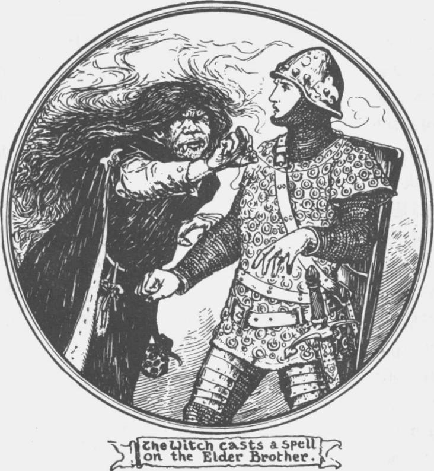

“啊！我真不幸！”他大哭起来，“我哥哥不是死了就是很危险了，我能不能及时赶到救他一命呢？”他纵身上马，对马说：“啊！我的骏马，像风一样地飞起来吧！”

他骑着马跑了许多天，终于来到了哥哥和公主居住的城市。

公主自从丈夫走了以后，每天早晨都坐在家门口，流着眼泪倾听着丈夫回来的脚步声，真是望眼欲穿。这一天，她看到弟弟骑着马奔跑过来，兄弟俩那么相像，公主也误认为他就是自己的丈夫。她的心急促地跳动起来，向他跑过去，还不停地喊叫着：“啊！你终于回来了！我等你等了多久啊！”

弟弟听到她的喊声，心里想，“这里就是我哥哥居住的地方了，这美丽的女子就是我的嫂嫂。”不过，他心里这么想，嘴里却保持着沉默，让她相信，自己就是她的丈夫。

公主满心欢喜，带着他来见国王。国王像欢迎自己的儿子一样，命令设宴招待他。公主兴奋得难以自制，可是，当她想拥抱他，吻他的时候，他总是伸出手来阻止她，说：“别碰我！”这使公主觉得非常惊讶。

这样过了几天。一天晚上，弟弟站在阳台上，看到山上那片明亮的火光。

“那是什么？”他问公主。

“啊！别想它了！”公主喊道，“这片火光难道不是已经表明了，它是你的祸根吗？难道你还想再次去和老巫婆较量吗？”

听了她的话，弟弟知道哥哥到哪里去，发生了什么不幸了。第二天早晨，太阳还没有出来，他就偷偷地出去，给马装上马鞍，骑着马向山上奔去。

路比他想象的还远。半路上，他遇见一个小老头，问他要到哪里去？

弟弟把事情的由来对他说了，还说：“不管怎么样，我一定要把中了老巫婆魔法的哥哥救出来。”

“我来告诉你该怎么办。”老人说，“巫婆的魔法都在她的头发上。你看到她以后，上去抓住她的头发，她就不能伤害你了。千万要小心，不能松开她的头发，叫她领你去找你哥哥，迫使她救活你哥哥。她有一种油膏，不但能治愈所有的伤口，而且还能起死回生。等你哥哥完全恢复健康和自由以后，你就砍下她的头，因为她是一个邪恶的女人。”

年轻人十分感谢这些指导，表示要照他的话去做。他骑着马继续向前走，找到了山上的城堡。他勇敢地跨上台阶，走进大厅。可怕的老巫婆迎面向他走过来，狰狞地咧开嘴笑着，说：“我用一根头发，就可以把你变成石头。”

“是吗？”年轻人说，一把抓住她的头发，“你这个老巫婆！快说，你把我的哥哥怎么样了，否则我立刻就砍下你的头！”

这一下，老巫婆全部魔力都丧失了，不得不听他的话。

“我领你到你哥哥那里去。”她说，心里还在狡猾地想办法欺骗他，“不过，请把我松开，你拉得那么紧，我路都没有办法走。”

“那你就得自己想办法。”他说，把她抓得更紧。

她把他领到一个大厅里，里面有许多石头人。她指着一块石头对他说：“这个就是你哥哥。”

年轻人一个一个地看过来，说：“我哥哥不在这里，快点领我去找他，否则你会更倒霉。”老巫婆还想骗他。可是他不上当。他们来到最后一个大厅。弟弟看到哥哥躺在地上。

“这才是我哥哥，”他说，“把那瓶能恢复生命的油膏给我。”

老巫婆很不情愿地打开放满瓶子和罐子的大橱，拿出一个瓶子来交给他，他十分谨慎，小心地试了一下，发现是一瓶假药。老巫婆一连拿了好几瓶假药给他，看到没有法子欺骗他，才把真的拿出来。

他紧紧地抓住她的头发，始终不肯放松，叫她把油膏涂到哥哥的脸上去。看到死者张开眼睛，活了过来，他拔出剑来，一下子就把老巫婆的头砍下。

哥哥站起来说：“啊！我睡了多久！这是什么地方？”

“老巫婆向你施了魔法，现在她死了，你自由了。我们先救活那些也中了魔法的骑士，然后就离开这个地方。”

他们救活了其他骑士，和他们一起分了城堡里找到的黄金和钻石，然后就大家分手。兄弟俩一起回去，哥哥手中拿着那瓶起死回生的油膏。

兄弟俩一边走一边说着话。他们分开了那么多年，有许多话要说。后来弟弟说：“哎！你真傻，抛下那么美丽的妻子，去和一个巫婆决斗！她把我当做自己的丈夫，我没有否认。”

哥哥听了弟弟这句话，非常生气。他一句话也不说，拔出剑来一下子就把弟弟刺死。弟弟从马上滚下来，落在地上。

哥哥继续往前走，回到家里，看到妻子坐在门口盼望着，哭泣着。看到他回来了，她高兴地喊叫着，扑入他的怀中，说：“啊！我等你等了那么久，你以后再也不能离开我了！”

国王听到他回来的消息，像欢迎儿子一样地欢迎他，还下令摆下宴席招待他，王宫里的人都出席了招待宴会。

晚上，哥哥和妻子单独在一起，妻子问：“你上次回来，为什么不让我碰你？我想拥抱你，吻你的时候，你总是把我推开！”

哥哥这才明白弟弟对他是多么忠诚。他伤心地坐下来大声痛哭，恨自己不该残忍地把弟弟杀了。后来，他想起了救命的油膏，赶紧拿着它，骑着马奔跑到弟弟的尸体旁，跪下来给他的伤口涂上油膏。伤口很快就愈合，死去的人又重新站了起来，看了看周围。兄弟俩高兴地拥抱在一起。哥哥请求弟弟原谅他的过错。他们一起回到王宫，从此就再也没有分开。

（西西里传说）

 

## 先生与学生

从前有个小孩，人很聪明，也很喜欢读书。有一天，他离开父母，一个人到外面世界去寻找工作。他在两旁都是山丘的路上走着，对面来了一个先生，问他到哪里去？

“我出来寻找工作。”小孩说。

“你愿意给我干活吗？”先生问。

“当然！给你，给别人，给谁干都可以。”小孩说。

“你识字吗？”先生问。

“我认得的字像牧师一样多。”小孩说。

“那我不能用你，”先生说，“我只需要一个不识字的小孩，他唯一的工作是帮我打扫旧书上的灰尘。”

先生说完，继续走他的路，留下小孩盯着他的背影看着。

“丢了这份工作真是太可惜了，”他想，“这正是我想干的活。”他决心抓住机会再试一下，于是躲到一个山丘后面去，把外面的衣服翻过来穿，免得让人认出来。他绕过山丘，又跑到先生的面前。

“你到哪里去？我的小孩。”先生问。他没有认出，这个小孩就是刚才见过的那个。

“我在到处找工作。”小孩说。

“你肯给我干活吗？”先生问。

“愿意，给谁干都一样。”小孩说。

“你识字吗？”先生问。

“不识，我一个字也不认识。”小孩说。

于是先生把他带回家。他每天的工作只是帮先生掸去书上的灰尘。他有大量的时间去读这些书。到后来，他变得和先生一样聪明，一样有本事。原来他的先生是个了不起的魔术师，什么魔法他都会变。此外，他还会变任何一种动物，各种各样他想变的东西。

小孩学会这些本事以后，他想，没有必要再留在先生家里了。他回到自己的父母身边。

不久，附近村子里有贸易集市。小孩子对母亲说，他已经学会了把自己变成任何一种动物。“现在，”他说，“我要变成一匹马，父亲可以把我拉到市场上去卖。然后，我会平安无事地回到家里。”

母亲听了他的主意，感到非常害怕。小孩告诉她，一点也用不着担心，一切都会好的。

他变成了一匹马，一匹那么强壮的马，父亲把它拉到市场上去卖了很高的价钱。钱到手以后，小孩乘没人注意，又变回来，回家去了。

一匹好马卖出去，又突然失踪了。这件事传扬出去，传遍了整个乡村。后来，也传到了魔术师的耳朵里。

“噫！”他说，“这肯定是帮我干活的小孩干的。他骗了我，又跑掉了。可是我能找到他。”

第二次集市的时候，小孩又变成一匹马，父亲拉着它来到市场。他很快就有了买主。两个人都觉得做了一笔好买卖，一起到店里去喝酒。魔术师走过来看到马，知道这不是一匹普通的马，就走到店里来，用更多的钱从买主的手里买下。

魔术师做的第一件事，是把马拉到铁匠铺前，吩咐铁匠用一根烧红了的钉子打进马的嘴里，这样，它就不能再变了，永远是一匹马。

马见势不妙，立刻变成一只鸽子，向空中飞去。魔术师看到了，变成一只老鹰，紧追上去。鸽子变成一个金戒指，落入一个姑娘的衣兜里。老鹰变成一个男子，拿出钱来要买姑娘的戒指。姑娘看到金戒指是从天上掉下来的，不肯卖给他。魔术师把价格提高，姑娘还是不肯卖。魔术师出的价钱越来越高。小孩害怕了，赶紧变成一粒大麦落到地上去。可这也没有逃过魔术师的眼睛，他变成一只鸡，来寻找大麦。大麦变成一只黄鼠狼，转眼间把鸡的头咬下来。

魔术师死了，黄鼠狼变成了小孩。后来，他和那个姑娘结了婚。至于那些魔法呢？他就再也不用了。

（丹麦）

 

## 金狮子

一个很有钱的商人有三个儿子，他们都长大了。有一天老大对父亲说：“父亲，我想出去旅行，看看世界，请你同意。”

父亲给他造了一只船，还配上了一切必要的装备。老大乘着船出发了。几个星期以后，他来到一个大城市的港口。船在这里抛下锚，他就上岸去了。

在城里，他首先看到的是一张布告，上面写着：谁要是在八天之内能找到公主，就可以娶她做妻子；要是找不到，就得杀头。

“好的，”年轻人读完布告想，“这应该不难。”于是，他对国王的仆人说，他要去找公主。

“当然可以，”国王对他说，“你可以到整个宫殿里去找，不过要记住，找不到就要杀头。”

国王命令把宫殿里所有的门都打开，还给年轻人准备好大量吃的和喝的。年轻人翻箱倒柜，找遍了宫殿的每一个角落，可是连公主的影子都不见。

八天过去了，他的头被砍下。

商人和两个儿子在家里听不到他的消息，非常担忧。后来，第二个儿子再也忍不住了，说：“亲爱的父亲，请给我一只大船和一些钱，让我出去寻找哥哥。”

商人又准备了一只船，老二乘着船出航了，风把他送到老大登陆的港口。看到哥哥的船还停在港口里，老二觉得很高兴：“我哥哥肯定就在附近。”他下令抛锚，乘着小船上了岸。

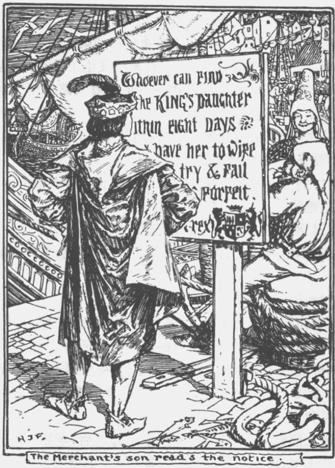

一走上码头，他首先看到的就是那张布告。他想：我哥哥肯定是去找公主，而且把命也丢了。我必须也去试试看，找到公主，也就知道了哥哥的下落。这也不是十分困难的事情。可是，他的命运并不比哥哥好，八天以后，也把命丢了。

现在，家里只有年纪最小的老三了。看到两个哥哥都没有回来，他请求父亲也给他造一只船，好出去寻找哥哥。一切都准备好以后，强劲的风也把他送到同一个港口。

老三看到贴着的布告，说：“谁能够找到国王的女儿，就可以娶她为妻。一切都很清楚，我两个哥哥都发生了什么。尽管他们遭到不幸，我也要试试自己的运气。”他沿着大路向国王居住的城堡走去。

半路上，一个老妇人把他拦住，向他讨乞。

“不要来打搅我，老妇人。”他说。

“啊！别空手把我打发走。”她说，“像你这样英俊的年轻人，总不会拒绝给一个老太婆几分钱吧！”

“我跟你说过，老妇人，让我安静一下。”

“你是不是遇到什么麻烦了？”她问，“告诉我，也许我能帮助你。”

他对她说，他已经决心去找国王的女儿。

“只要你有足够的钱，我可以很容易地给你安排好。”

“好！那就这么办吧！我有的是钱。”他回答。

“你带着钱去找金匠，叫他给你打一头金狮子，用水晶玻璃做眼睛。金狮子里面要装上能奏出音乐的乐器。做好以后，你带着它来见我。”

年轻人照她的吩咐去做。金狮子做好以后，老妇人把他藏在狮子的肚子里，带着它来见国王。国王见了非常喜欢，要把它买下来。可是她说：“金狮子不是我的，不论出多少价钱，我的主人也不愿意把它卖掉。”

“无论如何，你得借给我几天。”国王说，“我想让我女儿看一看。”

“好吧！这我可以答应你。”老妇人回答，“不过，明天我一定要把它带回去。”说完，她走了。

国王等她走远，肯定不会偷看他以后，才带着金狮子来到他的房间，拿掉几块活动的地板。地板下面出现楼梯，他沿着楼梯来到一扇门前。他把锁着的门打开，前面是一条走廊，沿着走廊走过去，又有一扇门锁着。年轻人藏在狮子肚子里，通过一个小孔小心地观察着，看到国王一连打开了七道门，来到一个漂亮的大厅里，公主正在和她的十一个女伴一起玩耍。十二个少女穿着同样的衣服，她们就像两粒豆那样相像。

“真不走运！”年轻人想，“即使能找到这里，我也没有办法认出哪一个是公主！”

他拼命地瞪着公主看。公主这时正拍着手向狮子快活地跑过来，说：“啊！今天晚上让这可爱的狮子留在这里，它一定很好玩。”

国王没有逗留多久，把狮子交给姑娘们以后就走了。姑娘们高兴地围着狮子玩，后来觉得累了才相继回房间去睡。公主带着狮子回到自己的房间。

公主刚要睡着的时候，突然听到一个从很近的地方传来的声音，她吓得跳起来。那声音说：“啊！可爱的公主，你不知道，我在想方设法到处寻找你。”

公主从床上跳下来，尖声地喊叫：“狮子！狮子！”

女伴们都听到她的喊声，以为她是在做梦，也懒得起来看她。

“啊！可爱的公主！”那声音继续说，“请不要害怕，我是一个富商的儿子，我最大的愿望就是和你结婚，为了得到你，我把自己藏在这头狮子里。”

“那又有什么用？”公主说，“要是你不能从女伴中认出我来，你同样要被杀头。”

“我希望得到你的帮助。”他说，“为了你，我已经做了那么大的努力，你难道不能帮帮我吗？”

“那么，听我说吧！到了第八天，我要系上一条白色的腰带，这样你就可以认出我来了。”

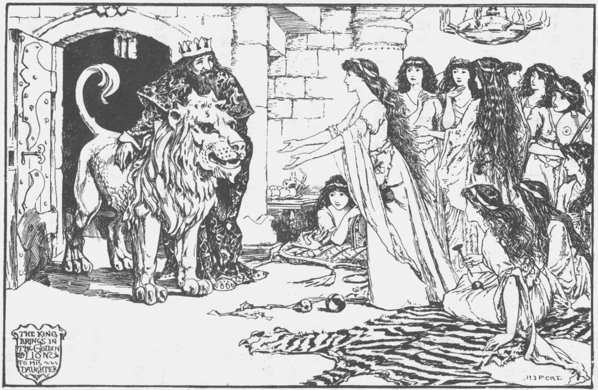

第二天一早，国王就来带走狮子。老妇人已经来到宫殿等着。她带着狮子来到没有人的地方，把年轻人放出来。年轻人回到国王那里，说他要去寻找公主。

“很好！可是，找不到的话，你就要杀头！”国王对重复这句话已经感到厌倦了。

于是，年轻人留在宫殿里，吃饱喝足以后，就各处走走，看看周围的景色和珍宝，还不时假装在寻找公主。

到了第八天，他来到国王的房间，对国王说：“把这里的地板拿掉。”国王叫出声来，但很快就控制住自己，说：“你要拿掉这些地板干什么？下面什么也没有。”

房间里的大臣们都看着他，他不想多说什么，叫人照年轻人所说的那样，把地板拿掉。年轻人顺着楼梯走下去，来到门前。他叫国王拿钥匙来开门。国王没有办法，只好给他开门。这样一连开了七扇门，他们来到了大厅里。只见十二个少女排成一行站在那里，她们那么相像，根本分不出谁是谁。

他正看着的时候，一个少女从口袋中拿出白腰带来系上。年轻人来到她面前，说：“这就是公主，我要娶她为妻。”

国王只好认输，下令准备举行婚礼。

八天以后，新婚夫妇告别了国王，返回新郎的故乡。船上装满了财宝，那是国王给新娘的嫁妆。他们没有忘记给他们带来幸福的老妇人，给了她足够的钱财，让她舒服地度过晚年。

（西西里）

 

## 迷迭香

从前有一个人，他只有一个女儿。父亲总是叫女儿整天不停地干活，从不让她休息。一天上午，女儿干完了所有的活以后，父亲叫她到森林里去捡些干柴和树叶，好用来生火。

姑娘来到森林里，很快就捡了一大捆。她看到旁边有一丛芬香的迷迭香，想拔起一枝。可她越是用力，就越感到迷迭香在地下长得很牢。她不甘心就此罢休，用尽全身力气一拉，终于拔起一枝来。

“喂！”她听到身后有个声音在喊她，回过头来，看到一个长得很英俊的青年男子，问她为什么到这里来偷他的柴火。

姑娘觉得很窘迫，不知道该如何说才好，只好含含糊糊地找个借口，说是父亲叫她来的。

“很好！”年轻人说，“那么，跟我来吧！”

他领着她穿过野林，来到一座美丽的宫殿前。走进宫殿，里面的装饰和物品都非常豪华，只是四面没有窗，光线只能从屋顶透进来。

年轻人对姑娘说，他是个大地主，可从来没有见过一个姑娘像她这么漂亮，假如她爱他，他就和她结婚，永远幸福地生活在一起。

姑娘说，她愿意，于是他们就结婚了。

第二天，看门的老妇人把所有的钥匙都交给她，同时也对她说，最好不要去用这些钥匙，否则，整个宫殿就会陷到地下去，上面将野草丛生，新郎也会把她忘记。

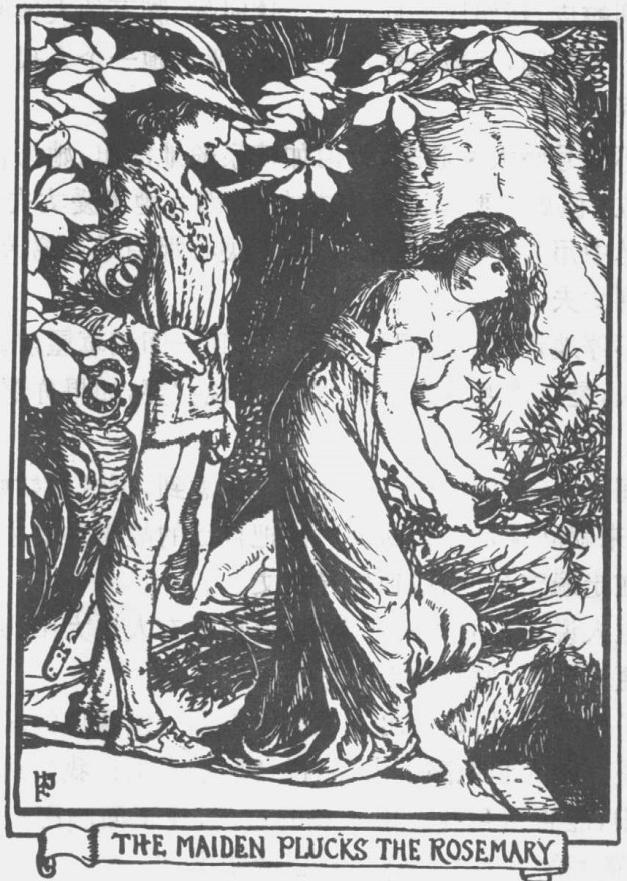

新娘答应一定小心，不去用这些钥匙。可是过了不久，她无事可做，感到无聊的时候，就想用钥匙把箱子打开，看看里面有些什么。我们知道，一个人只要想到要做什么事情，他就一定会去做。没有多久，她手中的钥匙就在箱子上的锁孔里转动起来。

锁很紧，她怎么也打不开。她决定把它砸掉。箱子里有什么呢？只是一张蛇皮。她不知道，她的丈夫是个魔术师，工作的时候要披上蛇皮。

看到蛇皮，新娘厌恶地走开。这时候，脚下的大地剧烈地抖动起来。一瞬间，宫殿忽然不见了，只留下她一个人孤零零地坐在荒野里。

她不禁号啕大哭起来，眼泪如喷泉般地涌出。她为自己的愚蠢而哭泣。但更主要是因为失去丈夫，因为她很爱丈夫。她从身边的树丛中用力拔下一枝迷迭香，下决心哪怕是走遍天涯海角，也要找到丈夫。

她不停地走啊！走啊！走啊！来到一间稻草屋前。她敲开门问主人，是否需要找人干活。女主人说：“要，如果你愿意，可以留下。”

时间一天一天地过去了，女主人注意到，可怜的姑娘越来越悲伤，后来就问她是怎么回事。她把自己的故事对女主人说了，说她正在走遍整个世界，到处寻找丈夫。

女主人说：“你的丈夫在哪里，恐怕没有人比太阳、月亮和风知道得更清楚了，他们什么地方都去！”

听了她的话，姑娘又出发了。她来到一座金色的城堡，太阳住在这里。她大胆地敲了大门，说：“啊！太阳！我来请问你，仁慈的太阳，能否帮帮我。由于我的过失，我正面临困境，无比忧伤，在这荒芜的世界里找寻着自己的丈夫。”

“是吗？”太阳说，“像你这样富有的人，也需要帮助吗？虽然你居住在没有窗口的宫殿里，可是我什么地方都去，也认识你。”

姑娘把自己的事情都对他说了，连自己的过错也没有隐瞒。太阳听了以后，很同情她。他虽然不能告诉她，她的丈夫在哪里，可是给了她一个栗子，叫她在遇到大麻烦的时候就剥开它。

姑娘对他表示由衷的感谢以后，就离开了。

她走了很久，又来到另一座城堡。她敲了敲门，一个老妇人走出来开门。

“你好！”姑娘说，“我来请你大发慈悲，帮帮我的忙。”

“你来是找我的女主人月亮的吧！我去把你的请求告诉她。”

月亮走出来，看到姑娘，月亮说认识，因为在宫殿里和草房里，月亮看见过姑娘在里面睡觉。

月亮对她说：“像你这样有钱的人，也需要帮助吗？”

姑娘把自己的事情对她说了，月亮听着，听着，很同情她。虽然不能告诉她，丈夫在什么地方，可是月亮给她一个杏仁，叫她在非常需要帮助的时候把它剥开。姑娘谢过以后就走了。

她走了很久，又来到一座宫殿前。她敲着门喊道：“喂！有人吗？我来请求得到你仁慈的帮助！”

一个老妇人出来开门，说：“你是来找我的主人风吧！我去把你的请求告诉他！”

风看了姑娘一眼，说认识她，他在宫殿和草屋里见过她。风说：“你这样有钱的人，也需要帮忙吗？”

姑娘把事情的经过告诉他。风听了以后，很同情她，给了她一个胡桃，叫她需要的时候就把它敲开。

可是，姑娘拿到胡桃以后，不像风所希望的那样马上离开。她因为又劳累，又伤心，又不知道该到哪里去，大哭起来，风也为她流下了同情的眼泪。

“别伤心，我出去走一趟，看看能找到什么。”

风呼啸着走了，一会儿工夫就回来了，显得神采奕奕，很高兴的样子。他说：“我想办法打听到了，他在一个国王的宫殿里，被软禁起来，怕被别人看到。明天，他就要和公主结婚。公主长得很丑，谁都不愿意娶她。”

姑娘听到这个消息，是多么绝望啊！她半晌说不出话来。过了一会，才呜呜咽咽地请求风把婚期推迟一两天，以便她能够赶到丈夫那里去。

风说，他很乐意去做力所能及的事。他以比姑娘快得多的速度赶到宫殿，看到五个裁缝正忙着日夜赶做新娘子结婚用的婚服。

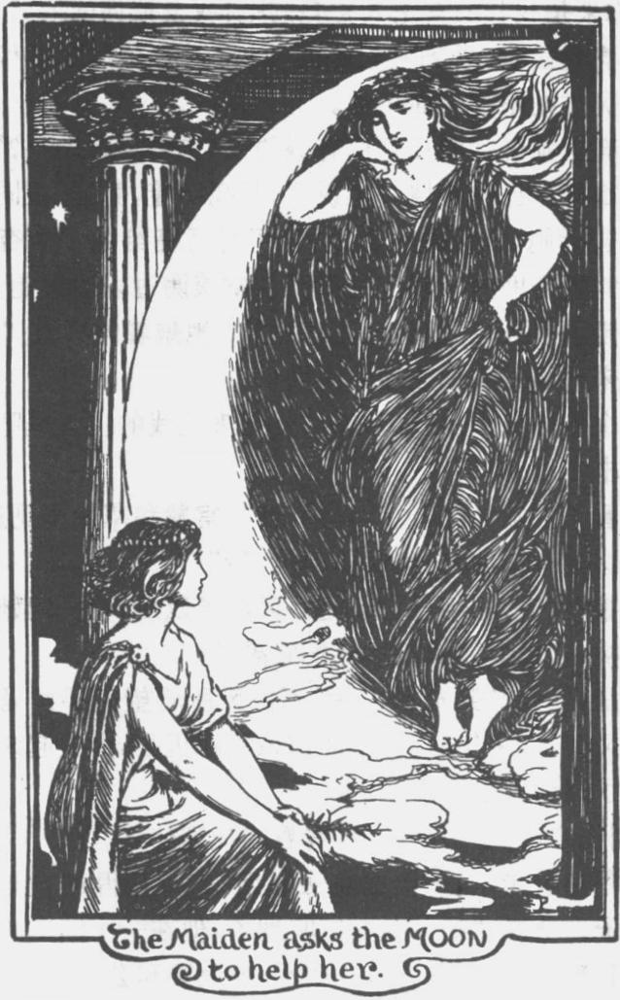

风一下子就从窗口刮进来，把那些漂亮的丝绸、花边、还有珍珠等婚礼的装饰品一起卷走。它们从窗口飞出去，飞过树梢，飞过河流，飞过庄稼地。那些裁缝都在后面赶啊！追啊！可是没有用。等他们找到这些婚礼的衣料和装饰，它们早就损坏了。一切只得从头开始，事情非常清楚，衣服不可能在明天的婚礼之前做好。

可是，国王急于要看到女儿嫁出去，不愿意听到任何推迟婚礼的托辞，命令不论什么式样，也要把婚礼服赶制出来。裁缝没有办法，只好赶做一件。国王看到女儿穿上这件礼服的样子以后，也不得不承认这件礼服不适合于公主，命令婚礼和宴会推迟几个钟头举行，以便裁缝对婚礼服进行修改。

这时候，姑娘已经步行赶到宫殿门口。她拿出太阳给她的栗子敲开，里面出现一件全世界最美丽的披风。她拉响了门铃，问：“今天，公主是不是要结婚？”

里面回答说：“是的。”

“问问公主，喜不喜欢这件披风，要不要买？”

公主看到披风，非常喜欢。她结婚用的披风和其他婚礼服一起毁了，再做一件已经来不及。她问姑娘披风的价钱，准备把它买下来。

姑娘开了个大价钱，要许多金币。公主一心一意要买，欣然同意付款。

姑娘把金币藏好，走出城堡。等到没人看见了，她把杏仁剥开，里面是一条漂亮无比的裙子。这么漂亮的裙子，谁也没有看见过。

她返回城堡，问公主是不是想买裙子。公主一看到裙子，就说比披风还要好看，她愿意给姑娘任何价钱把它买下。姑娘开口要很多金币，公主也高兴地付了，还为自己有了这么漂亮的裙子而兴高采烈。

姑娘拿好金币走出来，到没有人的地方把胡桃敲开，里面是一件非常华丽的王室礼服，恐怕全世界最高明的裁缝，也做不出这么美妙的礼服。姑娘小心地带着礼服来到王宫，敲开公主的大门，问公主要不要买。

公主听到这个消息，高兴得手舞足蹈。因为有了那么好看的披风和裙子，没有礼服也是不行的，叫裁缝赶做也来不及了。她赶紧对侍女说，不论花多少钱，也要把礼服买下来。

这一回，姑娘不答应公主花钱来买。她说，唯一的条件是让她见一见新郎。

公主听到她的条件，一点也不高兴。可是她结婚不能没有礼服。只好答应，心里想反正见一面也不会给自己带来什么坏处。

姑娘被领进新郎的房间。她走近新郎，用带来的迷迭香碰了他一下。新郎恢复了记忆，认出自己的妻子来，热烈地亲吻她，宣布这才是他真正的妻子，他不会再爱别人了。

他们回到了自己的家乡，幸福地生活了许多年。

（西班牙）

 

## 白鸽子

有个国王，他有两个儿子。这两个王子是一对天不怕，地不怕的家伙，总是爱做一些愚蠢的事情。有一天，他们划着小船出海。刚出海的时候，天空非常晴朗。可是，小船离开海岸以后，海上突然刮起可怕的风暴，船桨被刮入海中，小船像个胡桃壳一样，在波涛汹涌的海面上翻滚着。两个王子紧紧地抓住船上的坐板，免得被风抛入海中。

就在十分危急的时候，他们看到一只奇怪的小船——其实那是面包作坊用的长形揉面槽，船上坐着一个老太婆。她对着兄弟俩喊道，她可以救他们，把他们送上岸。只是他们要同意，把他们母亲生下来的小弟弟送给她。

“我们不能这么做，”兄弟俩说，“因为他不属于我们，我们没有权利把他送掉。”

“那么你们俩就一起沉到海底去腐烂吧！”老妇人说，“其实，与一个未出世的儿子相比，你们的母亲更喜欢留住你们俩。”说完，她就划着小船走了。

风暴越来越凶猛，小船眼看就要沉下去了。两个王子想，老妇人关于母亲的那句话也许是对的。当然，他们也非常渴望能活下去。于是，他们开始大声地喊叫老妇人，同意她提出来的条件，只要她答应把他们救出去。

他们的话刚说完，风暴就止息了，海面上风平浪静。船在离他们家很近的地方靠了岸。正在为他们感到十分担忧的国王和王后热烈地拥抱他们，欢迎他们平安地回来。

海上发生了什么事情，兄弟俩什么也没有说。不久，王后生下了第三个儿子，一个漂亮的小男孩。王后爱他胜过世界上所有的一切。他在王宫里受到很好的教育，一直到长成一个英俊的青年，两个哥哥答应过的事一直没有发生，也听不到关于老妇人的任何消息。

一天晚上，暴风雨突然袭来，狂风夹着暴雨在王宫的周围咆哮着，一切都笼罩在黑暗和迷雾之中。这时候，小王子居住的房屋大门传来响亮的敲门声。小王子走出来开门，看到门口站着一个老妇人，背上背着一个长木桶。老妇人对他说，他必须马上跟她走，因为两个哥哥答应过把小弟弟给她，她因此而救了他们俩的命。

“是的，”小王子说，“要是你救了我哥哥的命，他们答应把我交给你，我就应该跟你走。”

他们一起来到海边，一起乘上长木桶，向海上开去，一直来到老妇人居住的家。

现在，小王子完全在这个巫婆的控制之下，替她干活。她叫他做的第一件事，是把地上的一堆羽毛整理好。

“看到这堆羽毛了吗？”她说，“晚上，在我回家之前，你要把它们理好，否则我就叫你干更重的活。”

他开始一根一根地清理羽毛。到只剩下最后一根的时候，突然刮起一阵风，把理好的羽毛又刮成乱糟糟的一堆。王子不得不重新开始。这时离天黑只有一个钟头了，老巫婆马上就要回来。事情很明白，天黑以前他再也来不及理好了。

这时候，他听到谁在轻声地敲打玻璃窗，一个微弱的声音在说：“让我进去，我来帮你。”

他回过头来看，是一只白鸽子在用嘴来啄玻璃。他把窗打开，让它进来，鸽子立刻用嘴来清理羽毛。不到一个小时，一堆羽毛就整齐地在地下放好了。接着，小鸽子从窗口飞出去，老巫婆也出现在门口了。

“不错，不错，”她说，“你比我想象的能干多了，把羽毛整理得那么好。这样的王子是应该有双灵巧的双手。”

第二天一早，巫婆对王子说：“今天，我要给一些更容易干的活。门口外面有一堆木柴，你给我把它们劈细，以便生火。这活不费时间，你要在我回来之前干完。”

王子拿起一把斧头立刻动手，他劈得很快，可是中午早已过去的时候，他发现还有一大堆柴没有动过。实际上，尽管他不停地劈，那一小堆柴不是越劈越少，而是越劈越多。他停下来擦去头上的汗水，心里非常不安。他知道，要是在老妇人回来之前，这些活还没有干完，事情就糟了。

这时候，白鸽子飞过来了，咯咯地叫着，问小王子：“要不要我帮忙？”

“当然，”小王子说，“谢谢你昨天帮了我的忙，今天又来帮我劈柴。”

白鸽子用嘴竖起一根又一根木柴，又用嘴轻轻的一啄，木头立刻劈成两半，速度那么快，小王子根本来不及搬走。一会儿工夫，一堆木柴全部劈细了。

白鸽子飞到王子的肩膀上坐下。王子衷心地感谢它，用手抚摸它的羽毛，又情不自禁地吻了一下它的小红嘴。这一下，小白鸽没有了，站在他身旁的是一个美丽的姑娘。姑娘对他说，她是公主，被巫婆偷来以后变成这个模样，他的吻使她恢复了人的形状。他要是钟情于她，娶她做妻子，她就能把两个人从巫婆的手中解救出来。

王子这时候已经被美丽的公主迷住了，为了得到她，他情愿赴汤蹈火。

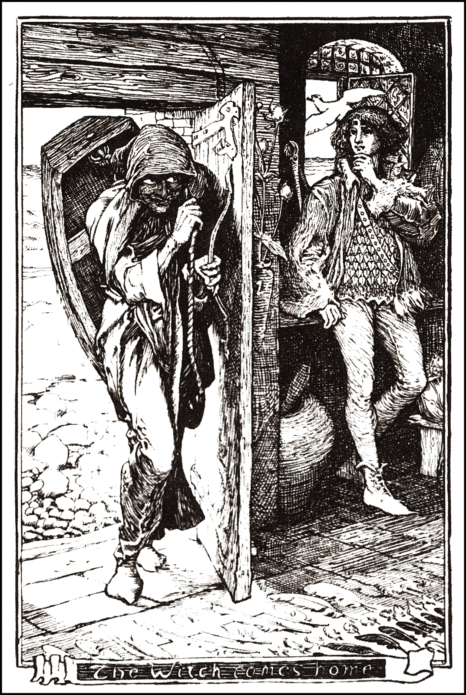

她说：“等巫婆回来以后，你要对她说，你给她干得那么好，她应该满足你的一个愿望。等她答应以后，你就直接了当地向她要变成白鸽子的公主。现在，你用一根红丝线结在我的小手指上。这样，不论她把我变成什么形状，你都能认出来。”

王子连忙找来红丝线，绕在公主的小手指上。公主又变成一只小白鸽飞走了。紧接着，老巫婆背着长木桶回到家里。

“嗯！”她说，“应该说，你干活很聪明，想不到王子的双手也会干这种活，真不简单。”

“既然你对我的工作这么满意，”王子说，“毫无疑问，你会同意给我一些我喜欢的东西，让我也有一点小小的欢乐。”

“啊！那倒也是，”老巫婆说，“你想要什么？”

“我要这里那个变成白鸽子的公主。”

“胡说！”巫婆喊叫起来，“你怎么想得出来，这里有一个公主，像白鸽子一样飞来飞去？不过，你要是想要公主，我们这里也有，可以给你一个。”

老巫婆拉出一头又丑又小，长着长耳朵的灰驴子来，对王子说：“别的公主不能给你，这个你要不要？”

王子看到驴子的蹄子上有一根红色的丝线，说：“是的，我就要这个。”

“你要它干什么？”老巫婆问。

“我要骑它。”王子说。

可是，老巫婆不声不响地把驴子拉走。过了一会，她带着一个满脸皱纹、牙已掉光，手在颤抖的丑老太婆出来，说：“别的公主不能给你，这个你要不要？”

“是的，我要。”王子说，因为他看见老太婆的手指上有一根红丝线。

这时候，公主恢复了原来的美貌，站在王子的身旁。老巫婆气得乱蹦乱跳，发疯地把所有拿得到的东西打碎，敲坏。

老巫婆不得不履行自己的承诺，因为不论发生什么事情，王子都要娶公主为妻，婚礼即将举行。

公主对王子说：“在婚宴上，你爱吃什么都可以，可是不能喝任何东西，否则就会把我忘记。”

在婚礼的宴会上，王子一高兴，把公主对他说过的话忘了，伸出手去端起一杯酒。幸好公主在时刻提防着，赶紧用肘去碰他一下，杯子里的酒全洒在桌上。

老巫婆又气得乱摔盘子和碗碟。

婚礼以后，王子和公主进入洞房。公主把门关上，对王子说：“现在，老巫婆兑现了自己的承诺，可是一有机会，她就会推翻，我们必须赶快逃走。我在床上放两块木头，老巫婆问我们话的时候，它们会替我们回答。你带着窗口上的花瓶和水杯，我们赶紧从窗口溜出去。”

说走就走，他们逃出屋子，来到夜色笼罩着的荒野。公主在前面领路，她还是白鸽子的时候，就把这里的路看得一清二楚。

半夜时分，老巫婆来到新房门口，喊叫他们。床上的两块木头回答了她。她以为他们还在，就走了。

天快亮的时候，她又来到门口叫喊，又得到了满意的回答。

天亮了，新婚之夜已经过去，老巫婆遵守诺言的时候也过去了。现在，她可以报复他们了。她迫不及待地冲进新房，可是里面除了两块木头以外，新郎和新娘连影子都没有。老巫婆又急又恨，抓起两块木头扔出去，两块木头被摔得粉碎。老巫婆紧接着就追出去。

东方透出第一道曙光，公主问王子：“回过头去看看，后面有没有什么东西跟着我们？”

“有的，很远的地方有一片乌云在追过来。”他说。

“那么，把花瓶从头上扔回去！”公主说。

王子把花瓶往后扔，后面立刻出现一片茂密的森林。

老巫婆追过来，被森林挡住了去路，只好回去拿斧头来开道。

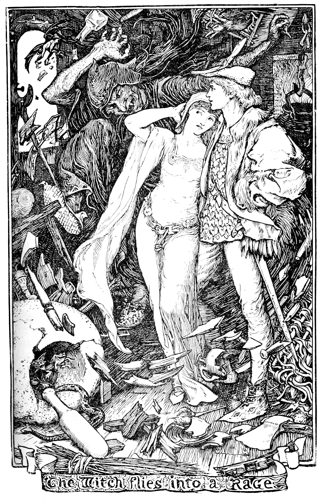

过了一会，公主又问王子：“看看后面有没有什么东西跟着。”

“有的，我们的身后又出现了一片乌云。”

“那么，把杯子从头上扔回去。”公主说。

后面出现了一个很大的湖泊，老巫婆无法通过，只好回去把长木桶拿来。

这时候，王子和公主已经逃回到了王子的城堡。他们从花园的围墙爬进去，穿过花园，从一扇开着的窗口进了宫殿。老巫婆随后也赶到。公主站在窗口，对着她吹了一口气，成千上万只白鸽子好像是从她口中飞出来似的，围着老巫婆四周飞翔，老巫婆动弹不得，气得变成了一块石头。这块石头至今还在。

城堡里热烈地欢迎王子和他的新娘回来，到处都充满了欢乐。王子的两个哥哥来到弟弟的面前，跪下来承认他们答应过的事情，还说，只有小王子才有资格继承父亲的王位，他们将永远是他忠诚的臣民。

（丹麦）

 

## 魔术师的女儿

有个小青年想出去找工作，路上碰到一个陌生人，问他要到哪里去。他说想找份工作做。陌生人说：“那么，你就给我干活吧！我正需要一个像你这样的小伙子，我会给你丰厚的年薪。第一年给你满满一蒲式耳（容量单位，约等于三十六升——译注）的钱；第二年给两蒲式耳；第三年给三蒲式耳。你得给我干满三年，而且要绝对服从我，只要是我叫你做的事情，不论多么奇怪，你都得去做。不过，你用不着害怕，只要照我的话去做，就不会有什么危险。”

两个人说定以后，小伙子跟着他的主人回家。这个家也很奇怪，因为房子坐落在荒山野林的坡地上，家里除了主人以外，看不到任何人。主人是个神通广大的魔术师，他魔法无边，能够控制人和动物。

第二天，小伙子就开始给主人干活。主人叫他做的第一件事，是给森林里的野兽喂食。这些野兽都被主人关了起来，它们之中有狼和熊，鹿和兔子，主人把它们关在地下的牲畜棚里，离家有一英里远。这一天，小伙子干得很好，主人还表扬了他。

第三天的早晨，主人对他说：“今天你用不着去喂那些野兽了，它们用不着天天像昨天那样喂养。你可以出去玩一会，等它们要吃的时候再回来。”

主人对着他说了些听不懂的话，他变成了一只兔子，向森林里跑去。这一回真够它跑的了。在这片大森林里，它是唯一的动物，其余的动物都被主人关起来了。猎人和猎狗好不容易看到一只兔子，都想追杀它。可是，没有一个猎人能射中它，没有一条猎狗能追上它。对小伙子来说，这真是一次不寻常的经历。慢慢地，兔子觉得没有什么危险，也就不再害怕猎人和猎狗了。有时，它还故意逗着他们玩。

就这样，一年过去了，魔术师把它召回到家里。他始终像控制着其他动物一样地控制着它。主人对着它说了些听不懂的话，兔子又重新变成了人。

“喂！你给我干活，觉得怎么样？”主人问，“喜不喜欢当一只兔子？”

小伙子回答说，他很喜欢，他从来没有这样快地在地上奔跑过。主人把一蒲式耳钱指给他看，说这是他干了一年活的工钱，小伙子也高兴地准备接着再干一年。

第二年的头一天，他干着第一年头一天的活，给野兽喂食。第二天，主人又对着他说了些什么话，把他变成一只渡鸦，展翅向空中飞去。小伙子觉得很高兴，渡鸦飞起来比兔子跑得还要快，狗也追不上它。

可是不久，它又觉得做一只渡鸦也不太平。那些射手和猎人看到一只渡鸦也不肯放过，因为空中所有的鸟都被魔术师关起来了，它成了唯一的空中猎物。

不过，看到那些射手和猎人不能击中它，它也就习惯了。整整一年，它在空中自由自在地飞翔，直到有一天，主人把它召回家，对着它说些奇怪的话，又把它变成人。

“喂！当一只渡鸦，你觉得怎么样？”主人问。

“我很喜欢，”小伙子承认，“我长得这么大，从来没有飞得这么高过。”

主人把过去一年中他挣得的两蒲式耳钱指给他看。小伙子感到很满意，信心十足地准备再干一年。

第二天，他又做每年开始的头一件事，喂那些野兽。完了以后，主人又对着他说了一些神秘的话。这一回，他变成一条鱼，跳入河水中。

它在河中随心所欲地上下游动，顺着河流一直来到大海。大海里的天地更加广阔，它不停地游着，来到了海底，看到一座玻璃宫殿。

透过玻璃墙，它看到了里面的房间和大厅，一切都非常瑰丽豪华。所有的家具都是用洁白的象牙制成，上面镶着黄金和珍珠。到处都铺着像彩虹一样色彩绚丽的垫子和地毯。漂亮的地毯看上去像一片碧绿的草地，上面长着美丽的鲜花和树木。这些鲜花和树木像真的一样枝叶繁茂，有绿的、黄的、白的、红的。宫殿里还有小喷泉，泉水从贝壳里喷出，打开成令人耳目一新的贝壳形状。美妙的乐曲仿佛也是从喷泉中传出，充满了整个宫殿。

宫殿里最美丽的，当然是里面一位年轻的少女。她一个人从这个房间走到另一个房间。尽管房间装饰得富丽堂皇，她似乎并不快活，反而显得忧郁和孤独。她长着天仙般的相貌，却从来没有看一眼周围墙壁上到处都挂着的镜子，镜子里的影子是那样丰姿绰约，恐怕谁也没有见过。变成鱼的小伙子在旁边游来游去，惊讶地欣赏着她的无比美丽。

“在这里最好是一个人，这比我现在这个笨头笨脑的鱼要强得多。”小伙子想，“要是我能回忆起主人改变我的形状时念动的咒语，也许我就能变成人。”

他一边游一边回想着那些咒语，接着，他又试着念了一遍。这一下果然灵，他重新变成了一个人。

他迫不及待地走进宫殿，来到姑娘的面前，和她说话。

姑娘看到海底来了一个陌生人，开始的时候吓得要命。后来小伙子友好地向她解释，他是怎样到这里来的，姑娘的心才安定下来。很快，她也为自己能有个伙伴，摆脱这孤独的生活而感到高兴。

他们一起在海底生活，时间过得很快，也不知道过了多少日子。有一天，姑娘对他说，魔术师要他回家的日子马上就要到了，他必须回去。可是在他回去之前，他要变成一条鱼，否则无法穿过海水。

在海底相处的时候，姑娘对他说了，她就是主人的女儿。他把她关在这与世隔绝的海底，不让任何人看见。她说，她已经想好了一个计划，可以让他们能够重逢，以后永远地生活在一起。可是要实现这个计划，有许多事情要做，他必须仔细地听她说，照她的话去做，一点也不能出差错。

姑娘说，周围所有王国的国王，都欠她父亲的债。有一个国王（她还把这个国王的名字告诉他），应该第一个归还父亲的债务，要是不能按时归还，就要杀头。

“这个国王无力偿还欠父亲的债。”姑娘说，“这一点我知道得很清楚。你首先要做的，是停止给我父亲干活。三年已经过去了，你可以自由地离去。然后，你带着六蒲式耳钱，到我跟你说过的那个国王那里去，去给他干活。到该还债给我父亲的时候，你会注意到他坐立不安。你就去对他说，你知道是什么事情令他日夜不得安宁，是因为他欠魔术师的债无法偿还。这些债加起来正好六蒲式耳钱。你对他说，可以帮他还这笔债，但是有个条件，那就是国王去还债的时候，要带着你一起去，让你充当宫廷傻瓜。到了我父亲那里以后，你要尽可能地多做傻事，如打破玻璃窗，敲碎东西，等等。我父亲看到以后会非常生气。尽管带你来的国王已经偿还了欠债，但是因为你惹下的祸，我父亲还要处罚他。处罚的方式是回答两个问题，答不出来就要杀头。”

“第一个问题是，‘我的女儿在哪里？’你要站出来说，‘她在海底下。’他会接着问，‘你认得出她来吗？’你要回答，‘认得出。’接着，他会召来一大群姑娘，叫她们从你面前走过，让你挑出我来。这些姑娘和我长得一模一样，你根本认不出。当我走过的时候，我会碰你一下，这时候，你要快点把我抱住。这样，你就回答了他的第一个问题。”

“第二个问题是，‘我的心在哪里？’你站出来回答说，‘在一条鱼里。’他接着会问，‘你认得出这条鱼吗？’你说认得出。他会让各种各样的鱼从你面前游过，叫你挑出来。这时候，我会站在你身旁。等那条鱼游过来，我会轻轻地推你一下，你就把那条鱼抓住。这样，魔术师的一切都完了，他再也不能提出更多的问题，我们就可以自由地结婚了。”

小伙子把姑娘说的这些话都记住以后，接下来应该做的事情是把自己变成一条鱼，以便游回岸上去。可不幸的是，他把那些咒语忘了，姑娘也不知道这些咒语。这一天，他绝望极了，不停地走来走去，拼命地回忆着，可怎么也想不起来。

晚上，他在床上翻来覆去，难以成眠。到天快亮了，才迷迷糊糊地合上眼。这时候，那些咒语突然在他脑海中出现，他赶紧站起来，重复那些咒语，他立刻变成一条鱼，向大海中游去。

恰巧这个时候，魔术师正在召唤它。上了岸以后，主人又把它变成人。

“喂！做一条鱼你觉得怎么样？”主人问。

小伙子说，做一条鱼是他最高兴的事。这话一点也不假，人人都猜得到。

主人把过去一年中他挣得的三蒲式耳钱指给他看。和前两年挣得的三蒲式耳钱放在一起，正好是六蒲式耳，全属于小伙子。

“也许你还想再继续给我干一年，”主人说，“这一年你可以得到六蒲式耳钱，加起来就是十二蒲式耳，这可是一大笔钱啊！”

“不！”小伙子说。他说，他已经干够了，现在想到别的地方去干干，看看别人是怎么过日子的，也许以后会再回到这里来。

魔术师说，任何时候都会欢迎他回来。他忠诚地履行协约，干了整整三年，没有理由叫他继续干下去。

小伙子带着六蒲式耳钱，来到心上人对他说过的国王那里。他把六蒲式耳钱埋在离王宫不远的偏僻角落里，然后找国王，说愿意给他干活。国王同意了，叫他到马厩里去养马。

过了不久，小伙子注意到，国王总是垂头丧气，闷闷不乐。有一天，国王来到马厩，小伙子看到旁边没有人，走过来对国王说，请允许他问一个问题，国王为什么总是这么伤悲？

“对你说了也没有用，”国王说，“无论如何，你帮不了我的忙。”

“你不明白，”小伙子说，“我知道得很清楚，是什么沉重地压在你的心头，我也知道如何付清这笔钱。”

这可又是另一码事了，国王看到他说在点子上，就和马夫说起话来。马夫说，他可以轻而易举地借六蒲式耳钱给国王，可是有个条件，国王去还债的时候必须带他去，让他穿上宫殿傻瓜的衣服，跟随在国王的周围。他还说，他可能会给国王带来一些麻烦，国王也许会因此受到严厉谴责。不过没有关系，他会解决这些问题，国王不会因此而受伤害。

国王愉快地同意了小伙子的建议。这时候，也到了该出发的时间。

他们来到了魔术师的住处。小伙子发现，他的住处不再是在一块山坡上，而是在山顶上，那是小伙子从来没有见过的一座大城堡。实际上，魔术师可以施展魔法，让这座城堡时隐时现。小伙子很清楚他的神通，所以也就不觉得奇怪了。

他们走进城堡。这城堡好像全部是用玻璃建造的。小伙子真的像个宫殿小丑似的，一会儿跑在前面，一会儿跑在后面；一会儿行走，一会儿倒立。他奔过来，奔过去，敲坏了宫殿里的许多大玻璃，撞倒了许多贵重的东西，做出许多叫人担惊受怕的事来。

魔术师急匆匆地赶出来，样子非常愤怒和生气，大骂国王不应该带这样一个鲁莽的傻瓜来，说他连旧债也还不清，怎么赔得起这样贵重的东西呢！

这时候，傻瓜站出来说，还债是轻而易举的事。国王叫人把小伙子借给他的钱抬出来。魔术师叫人来量了一下，正好是六蒲式耳，一点也不少。魔术师同意说，债务已经偿还清楚，把借钱的契约还给了国王。

可是，傻瓜今天损坏的东西也得赔啊！国王一分钱也拿不出来了！魔术师决定惩罚国王，要么就回答两个问题，要么就杀了他的头。这在契约上写得一清二楚。

国王没有什么选择的余地，只好准备来解开魔术师的谜语。傻瓜站出来说，他准备帮国王回答问题。

魔术师开始提出第一个问题：“我的女儿在哪里？”

傻瓜回答：“在海底下。”

魔术师问：“你怎么知道？”

傻瓜说：“有一条小鱼看见。”

魔术师问：“你认得出她吗？”

傻瓜说：“认得，请带她出来。”

魔术师叫一大群姑娘从他面前走过，她们一个接着一个，可都是些骗人的幻影。最后走出来的才是他的女儿，她碰了他一下，让他知道，她才是真的。他拦腰把她抱住，魔术师只好承认，第一个问题他正确地解决了。

魔术师接着问：“我的心在哪里？”

“在一条鱼里。”傻瓜回答。

“你认得出这条鱼吗？”魔术师问。

“认得出，请把它送上来。”

接着，许多鱼从他们面前游过。魔术师的女儿站在小伙子的身边，那条鱼从他们面前经过时，姑娘轻轻地推了他一下，小伙子伸手把它抓住，拔出刀来把鱼肚剖开，一刀刺穿它的心脏。

魔术师倒在地上死了，变成了许多碎石片。他的所有魔法和契约全部失去效力。那些被囚禁的野生动物全部得到解放，纷纷回到森林里去。

小伙子和姑娘进入城堡，这座城堡现在已经属于他们。他们很快就举行了婚礼。周围许多国家的国王都来祝贺，小伙子全部解除了他们的债务。国王们都一致推举小伙子做皇帝，他们向他表示忠心，愿意俯首称臣，接受他的统治，天下从此太平。

新皇帝和皇后幸福地在城堡里生活，要是他们还活着，现在肯定还在那里。

（丹麦）

 

## 爱斯本和巫婆

从前有个父亲，他有十二个儿子。十一个儿子长得又高大又健壮，最小的儿子爱斯本是个小不点。十一个哥哥经常帮助父亲下地去干活，或者到森林里去砍柴，爱斯本却宁愿留在家里和母亲待在一起。时间长了，十一个哥哥也就把这个弟弟除外了，认为他只是个多余的人。

十一个兄弟长大成人以后，他们决定出去周游世界，碰碰运气。他们请求父亲给他们准备好出门需要的东西。父亲一点也不喜欢这个主意，因为他已经上了年纪，身体又虚弱，家里需要有人帮忙。不过，从长远计较，他还是同意了，给他们每人准备好一匹白马和一些钱。十一个兄弟和父亲道别以后，就出发了。

至于爱斯本，谁也没有想到他，他们甚至也没有和他说一声再见，就走了。

十一个哥哥走了以后，爱斯本也来到父亲的面前，说：“父亲，请你也给我一匹马和一些钱，我也想出去看看周围的世界。”

“你是个小傻瓜，”父亲说，“要是我能让你走，让十一个哥哥留下，这对我这个上了年纪的人来说，那就再好不过了。”

“好吧！早晚你会摆脱我的。”爱斯本说。

爱斯本得不到马，只好自己来到森林里，砍下一枝树枝，剥去树皮，做成一匹白马，比他哥哥的马还要白。做好以后，他就骑着自己的马向着哥哥们出发的方向走去。

兄弟们骑着马跑了整整一天。晚上，他们走进一片大森林。森林深处，有一间小房子。他们敲响小房子的门，一个长得很丑的老太婆出来开门。兄弟们问她，是否可以让他们在这里过一夜。

“当然可以，”老太婆说，“你们可以留在这里过夜。而且，每个人可以有我的一个女儿伺候。”

十一个兄弟想，这家人可真是热情好客。他们受到了很好的招待。到了晚上，他们每人都有一个老太婆的女儿做伴。

爱斯本跟在后面，也来到森林里，看到森林里的这间房子。他偷偷地溜进房子，没有让老巫婆和她的女儿看见，在一张床下躲藏起来。

快到半夜的时候，爱斯本悄悄地爬起来，唤醒他的哥哥，告诉他们把头上戴着的睡帽和女巫的女儿交换。哥哥们想不出这有什么道理，可是因为害怕爱斯本纠缠不清，也就同意这样做了。换了帽子以后，他们又呼呼大睡。

到了午夜，爱斯本看到老巫婆偷偷地走过来，手中拿着一把大斧头，来到十一张床前。天很黑，一掌之外什么也看不清楚。她摸到戴着男睡帽的头就砍掉。当然，那都是她的女儿。

老巫婆走了以后，爱斯本叫醒他的哥哥。他们赶紧骑着马离开这间屋子，庆幸自己能够死里逃生。他们忘了，应该感谢爱斯本救了他们的性命。

他们继续骑着马向前走。几天以后，来到了一个国王的宫殿。他们问国王手下的人，需不需要找人干活。国王的人说，王宫里需要一些马夫，如果他们愿意干，就留下来，其余的活都没有了。十一个兄弟都表示，很愿意给国王当马夫。

过了很久，爱斯本才骑着树枝做成的马来到。他也想在王宫里找点活干。可是没有人需要他，大家都对他说，你从哪里来，就回到哪里去。不过，他还是想办法把自己安顿下来，想办法找到点吃的，虽然不是很多。到了晚上，就随便找个地方睡觉。

王宫里有一个叫红先生的骑士，他深受国王的宠爱，可是几乎人人都恨他，因为他行为恶劣，心术也很坏。由于十一个兄弟没有很好地服侍他，红先生很恨他们，决心要给他们一点颜色看。

有一天，他来到国王面前，对国王说，不久前来王宫里当马夫的十一个兄弟能做许多事情。有一天，他听见他们说，要是他们高兴，他们会抓来一只鸽子献给国王，这只鸽子的羽毛一会儿是金的，一会儿是银的。不过，除非是他们要被处死，否则他们不会去抓这只鸽子。

国王把十一个兄弟叫来，对他们说：“你们说过，能抓到一只鸽子，这只鸽子的羽毛一会儿是金的，一会儿是银的。”

十一个兄弟都异口同声地否定，他们没有说过这样的话，也不相信世界上会有这样一只鸽子。

“你们仔细地想一想吧！”国王说，“要是三天之内不把这只鸽子给我抓来，就把你们的头全部砍掉。”

说完，国王就叫他们出去。十一个兄弟因此非常害怕和伤心，他们有的叹息，有的痛哭。

这时候，爱斯本走进来，看到他们这么悲伤的样子，就问：“喂！你们这是怎么啦？”

“告诉你有什么用？小傻瓜！你帮不了我们的忙。”

“嗯，那可说不定，”爱斯本说，“我不是曾经帮过你们吗？”

后来，他们告诉他，国王如何不讲道理，如何命令他们去找一只羽毛一会儿是金的，一会儿是银的鸽子。

“给我一袋豆子，”爱斯本说，“我去看看能帮你们干些什么。”

爱斯本带上豆子，骑上他的小白棍马，说：

> “小白棍，快点飞，
> 带我飞过那条河。”

小白棍带着他飞过河流，来到老巫婆的院子里落下。爱斯本上次已经看到，她有这样一只鸽子。他拿出豆子来撒在地下，鸽子立刻飞过来吃。爱斯本一把抓住它，装进袋子，急急忙忙在老巫婆出来之前骑上小白棍飞走。老巫婆赶出来喊道：“嗨！是你吗？爱斯本！”

“是的。”他回答。

“是你偷走了我的鸽子吗？”老巫婆问。

“是的！”

“是你让我杀了十一个女儿吗？”

“是的！”

“你还会不会来？”

“也许会的！”

“那么，你等着瞧吧！”老巫婆喊道。

小白棍带着爱斯本和鸽子回到了宫殿。他的哥哥看到了，都非常高兴。国王多次对送来这只鸽子表示感谢，作为报酬，还给他们许多金子和银子。这样一来，红先生就更加气愤了，千方百计地想办法要报复他们。

有一天，红先生对国王说，那只鸽子还不是这十一个兄弟能送给国王的最好的礼物。他说，有一天他听见十一个兄弟在悄悄地说，他们能够捉到一头野猪，这头野猪的鬃毛一会儿是金的，一会儿是银的。

国王把十一个兄弟找来，问他们这是不是真的。

“不是真的。”十一个兄弟说。他们说，他们连想也没有想过这种事。他们不相信，世界上会有这样一头野猪。

“三天之内，你们必须给我把这头野猪送来，”国王说，“否则就要杀你们的头。”

他们十分悲伤地离开了国王，心里想，这一回比上一回还要糟糕。到哪里去找这头奇怪的野猪呢？这一次可是必死无疑了。

到了第三天，爱斯本来了。看到哥哥们那丧魂落魄的样子，他问道：“喂！你们这是怎么啦？”

“啊！告诉你有什么用？”他们说，“你一点也帮不了我们的忙。”

“嗯！那可不一定，”爱斯本说，“我以前就帮过你们。”

后来，他们告诉他，说红先生如何挑拨国王，叫国王和他们作对，命令他们去找一头鬃毛一会是金的，一会是银的野猪。

“这好办！”爱斯本说，“给我一袋麦芽，我不信，就没有办法帮助你们。”

爱斯本拿起那袋麦芽，骑上小白棍，说：

> “小白棍，快点飞，
> 带我飞过那条河。”

小白棍带着他飞起来，很快就来到老巫婆的院子里。他把一口袋麦芽倒出来，立刻跑出来一头小野猪。小野猪的鬃毛每秒钟变一次，一会儿是金的，一会儿是银的。爱斯本一下子就把它捉住，装进口袋，在老巫婆发觉之前就赶快骑着小白棍飞起来。

紧接着，老巫婆追出来喊道：“嗨！是你吗？爱斯本？”

“是的！”

“是你偷走了我漂亮的野猪吗？”

“是的！”

“也是你偷走了我的鸽子吗？”

“是的！”

“是你让我杀了我的女儿吗？”

“是的！”

“你还会不会再来？”

“也许还会再来。”

“那么，你等着瞧吧！”老巫婆说。

爱斯本带着野猪，很快就回到王宫。十一个哥哥看到他们又一次平安地渡过难关，高兴得不知如何是好。可是没有一个想到应该感谢爱斯本为他们所做的一切。

国王看到野猪，比看到鸽子还要高兴，不知道该奖给十一个兄弟什么才好。红先生既愤怒又妒忌，又开始动脑筋来整十一个兄弟。

有一天，他对国王说：“十一个兄弟抓到了鸽子和野猪，可是他们还能做更多的事情。他们说过，要是高兴，他们可以送给国王一盏灯，这盏灯可以照亮七个王国。”

“要是他们这样说过，”国王说，“他们就应该把这盏灯送来，那将是我最辉煌的明灯。”

国王派人去把十一个兄弟叫来，他们知道，一定是红先生又想出什么鬼主意来害他们了。十一个兄弟很不情愿地来到国王面前。

国王直接了当地说：“你们兄弟说过，只要你们喜欢，就可以给我一盏灯，它可以照亮七个王国。你们要在三天之内给我把这盏灯拿来，否则就要为此付出性命。”

十一个兄弟肯定地对他说，他们从来没有说过这些话，而且这盏灯根本不存在。可是国王不听，他们的话等于白说。

“要么把灯送来，要么把你们的人头送来。”国王说。

十一个兄弟比以往任何时候更加绝望。他们不知道该怎么办才好，因为谁也没有听说过这盏灯。就在他们毫无办法的时候，爱斯本来了。

“又是什么灾难临头了？”他问，“你们这是怎么啦？”

“嗨！告诉你也没有用，”他们说，“你一点也帮不上忙。”

“啊！你们起码应该告诉我，”爱斯本说，“我以前帮过你们。”

后来，他们对他说了，国王命令他们带来一盏灯，这盏灯可以照亮七个王国。可他们连听也没有听说过。

“给我一包盐，”爱斯本说，“你们会看到一切都会顺利的。”

他带着一包盐，骑上他的小白棍，说：

> “小白棍，快点飞，
> 带我飞过那条河。”

一会儿工夫，他就落在老巫婆的院子旁。可这一次事情并没有那么容易。因为这时候是晚上，院子的门锁上了，他进不去。后来，他想出一个办法。他爬上屋顶，从烟囱里爬进去。

进屋以后，他到处找那盏灯，但是找不到。这盏灯是老巫婆最珍贵的宝贝，她总是小心翼翼地收藏起来。爱斯本找得累了，就躲到一个烤炉里去，准备睡到天亮再说。

就在这个时候，他听到老巫婆躺在床上叫她的女儿，叫她煮些粥送来，她肚子饿了，想吃点粥。女儿起床后，生起火来，搁上锅子烧粥。

“粥里一粒盐也不要放。”老巫婆关照她的女儿。

“好的，我一粒盐也不放。”女儿回答。就在她转身出去的时候，爱斯本偷偷地把盐倒进去。女儿回来把粥送出去，老巫婆舀起一调羹试味道。

“嗨！我不是告诉你别放盐吗？怎么咸得像海水一样？”老巫婆说。

女儿只好再去烧一锅子粥，母亲严厉地警告她，不许放一粒盐。可是这时候，家里一点水也没有了。女儿叫老巫婆把那盏灯给她，她好到井边去打点水来。

“灯在那里，去拿吧！”老巫婆说，“可千万要小心看好。”

女儿拿起那盏能照亮七个王国的灯，来到井边。爱斯本偷偷地跟在她后面。当她想把井里的水桶拉上来的时候，她把灯放在旁边的一块石头上。爱斯本看准机会，跑上去拿起灯，从后面推了老巫婆的女儿一把，她头朝下地栽到井里去了。

爱斯本拿起灯急急忙忙地走了。老巫婆听到动静赶紧出来，喊道：“喂！又是你，爱斯本吗？”

“是的！”

“是你偷走我的鸽子吗？”

“是的！”

“是你偷走我的野猪吗？”

“是的！”

“是你让我杀了十一个女儿吗？”

“是的！”

“是你拿走我的灯，把我第十二个女儿推下井吗？”

“是的！”

“你还会不会来？”

“也许还会来。”

“那么，你等着瞧吧！”

只花一分钟的时间，小白棍就带着爱斯本在王宫前降落。十一个哥哥终于摆脱了烦恼。国王给了他们许多贵重的礼物，可是爱斯本从他哥哥那里一声谢谢也没有得到。

红先生心中的妒火从来没有这样旺盛过，看到十一个兄弟一次又一次地获得成功，他非常气愤，日日夜夜绞尽脑汁，要想出一件无法做到的事情来，叫十一个兄弟去做。

有一天，他来到国王面前对他说，十一个兄弟得到的那盏灯非常好，可是他们还可以送给国王更加好的东西。国王问，那是什么？

红先生说：“那是一条许多人听都没有听到过的，世界上最美丽的被单。这床被单非常奇特，任何人碰到它，它就会发出八个王国的人都能听得见的声音。”

“那肯定是一床美妙神奇的被单。”国王说。他立刻派人去把十一个兄弟叫来。

“你们说过，有一床世界上最漂亮的被单。有人碰它的时候，它发出的声音八个王国的人都听得见。去给我拿来，否则就杀了你们。”国王说。

十一个兄弟说，他们从来没有听说过这种事，也不相信会有这种被单，他们没有办法得到它。可是国王一个字也不要听，把他们赶出去，还告诉他们，不快些把被单拿来，他们就得去死。

十一个兄弟再次面临绝境，他们确信这次是必死无疑的了。他们之中最小的一个也曾想过去找爱斯本，可是其他人说这个小傻瓜连自己的衣食也无法照顾，别指望他能帮忙。结果还是爱斯本自己来了。

“喂！又出了什么事？”他问。

“嗯！告诉你又有什么用？”十一个兄弟说，“你一点也帮不上忙。”

“谁知道呢？”爱斯本说，“我以前帮过你们。”

后来，十一个兄弟把被单的事对他说了。爱斯本想，这是他要做的，最危险的事情了，可是失败了也比不去好，他决定去试试看。

他骑上小白棍，说：

> “小白棍，快点飞，
> 带我飞过那条河。”

一会儿工夫，他就飞过河流，来到河边老巫婆的家里。这时候是晚上，门都锁上了。爱斯本知道怎样从烟囱里爬进去。

进了屋子以后，他看到事情非常棘手。因为老巫婆正盖着那床被单睡觉。他偷偷地走过去，没有惊动老巫婆和她的女儿。可是他的手一碰到被单，它就发出八个王国都可以听得见的声音来。

老巫婆醒过来，从床上跳下，一把抓住爱斯本。他拼命地挣扎，可怎么也逃不掉。老巫婆把女儿叫过来，说：“快来帮帮我，帮帮我，我们把他关到小暗室里去，把他养肥，哈哈！这回可抓住你了！”

爱斯本被关进小黑洞，白天看不见太阳，晚上看不到月亮，每天给他喂甜牛奶和果仁。老巫婆的女儿这回可够忙的了，她每天要给他嗑许多果仁。到了第十四天，她嘴里只剩一个牙齿了，其余牙齿都在嗑果仁的时候掉了。不过，老巫婆的女儿也开始喜欢爱斯本了，她想放他走，可是不能。

过了一段时间以后，老巫婆对女儿说，去把爱斯本的一个手指头砍下来，看看他养肥了没有。她女儿来告诉爱斯本，问他该怎么办？爱斯本说，去拿一根铁钉子来，包上一层皮给她。

女儿把包上皮的铁钉给老巫婆送去，她咬上一口，叫起来：“哎哟！痛死我了，只是皮包骨头，一点肉也没有，还得再多养些时候。”

这样，她们又用牛奶和果仁养了爱斯本好久。直到有一天，老巫婆想，这回肯定养肥了，叫女儿再去砍下一个手指头来看看。

爱斯本在黑洞里已经呆腻了，他叫女巫的女儿去割下奶牛的乳头给她。女巫咬了一口，叫起来，“啊！现在行了，好肥啊！肥得连骨头也感觉不出来，可以把他杀了。”

每年这个时候，所有的女巫都要到特姆斯教堂去碰头，老巫婆也不例外。她没有时间来处理爱斯本，关照女儿把大炉子生起火来，把爱斯本从牢里拉出来，在她回来之前烤熟。女儿同意了，老巫婆急匆匆地走了。

女巫的女儿把大烤炉烧热以后，把爱斯本拉出来，叫他自己坐到烤炉的烤架上去。爱斯本听话地坐上去了，可是他把双脚叉开。女巫的女儿要把烤架推进去的时候，爱斯本的两只脚被炉门卡住了，推不进去。

“你不能这样坐！”她说。

“那么该怎么坐呢？”爱斯本问。

“把两只脚盘起来。”她说。可是爱斯本听不懂她说的是什么意思。

“下来，”她说，“让我做给你看，该怎么坐。”

她盘着脚坐在烤架上，可是她刚坐好，爱斯本就把烤架推进去，把炉门关上。

爱斯本跑回老巫婆的房间，抓到那床被单急忙就走。被单发出八个王国都听得见的声音。老巫婆在教堂里听到了，赶紧跑回家来。

“嗨！又是你，爱斯本？”老巫婆正好看到爱斯本跑出去，问道。

“是的。”

“是你让我杀了十一个女儿吗？”

“是的。”

“是你偷走了我的鸽子吗？”

“是的。”

“是你偷走了我漂亮的野猪吗？”

“是的。”

“是你淹死了我第十二个女儿，抢走了我的灯吗？”

“是的。”

“现在，是你把我最小的女儿推进炉子里去烤，抢走了我的被单吗？”

“是的。”

“你还会回来吗？”

“不！永远不会回来了！”

老巫婆听到这句话，气得暴跳如雷，炸裂成许多燧石片。后来，在这个国家里到处都可以找到燧石片。

爱斯本找到了被老巫婆藏起来的小白棍，说：

> “小白棍，快点飞，
> 带我飞过那条河。”

一会儿工夫，他就回到了王宫。这里的事情糟透了。国王因为十一个兄弟没有送来被单，已经把他们送进监狱，很快就要把他们杀掉。

爱斯本把被单给国王送来，国王非常高兴。他碰了一下被单，它立刻发出八个王国都能听得见的声音。其他国王都非常生气，因为他们没有得到这床被单。

爱斯本把所有事情的经过都对国王说了。还告诉国王，红先生因为妒忌，如何设计陷害他的哥哥。国王命令把他的哥哥放了。至于红先生，因为他的邪恶，国王下令把他吊死在能够找到的最高的一棵树上，他受到了应得的惩罚。

十一个哥哥感谢爱斯本为他们所做的一切。国王奖励给他们十二个兄弟许多金子和银子。他们能带走多少，就拿多少。他们回到了父亲的身边。老父亲看到十二个儿子一起回来，高兴得流出了眼泪，他还以为今生今世再也看不到他们了。

哥哥告诉父亲，爱斯本做了些什么，如何救了他们的命。从那个时候起，爱斯本在家里再也不是被取笑的对象了。

（丹麦）

 

## 米诺·米内蒂公主

从前有个年轻的国王叫索斯，他从小受一个反复无常的仙女教养。这个仙女名叫吉路塔，她有一颗善良的心，可是却难以相处。她常常两分钟里就会改变主意，叫人捉摸不透。由于国王还很年轻，王宫里的一切事情都由她做主，这样一来，事情就难免弄得乱七八糟。开始，她想按照老规矩，等国王长大一点以后再掌管国事，可后来一夜之间又突然改变主意，什么事情都叫国王去办。不幸的是，要训练国王管理国家已经来不及了。仙女也不管这些，一味要推行她的新主意。为此，她匆忙地组织了一个议政会，由宰相来主管。人们都称他为“可以宰相”，因为对于任何人的意见，他从来都不会反对。

索斯国王长得很漂亮，心地也很善良，可是从来没有人教他懂得适当的礼节，所以遇事不是羞答答的，就是很鲁莽，而且，从来不知道如何开动脑筋去思考问题。

在这种情况下，毫无疑问，议政会也没有多少事情可做，整个国家搞得一团糟。后来，许多地方起来公开造反。幸好国王虽然年轻无知，胆量却不小。当王宫门前到处是刀光剑影的时候，他照样稳坐泰山，在那里吹奏笛子。正是由于他这种勇气，才鼓舞了军队的官兵，折服了造反的百姓，国家才得以太平下来。

叛乱被平息以后，议政会开始注意国王的婚姻问题。他们向国王介绍许多公主。可是仙女吉路塔认为黛芬娜最适合于做王后。她也急于在她永远离开王宫之前办好国王的婚事。

为此，他们派出使者去调查黛芬娜公主的相貌和行为。使者回来说，公主身材颀长，健康，可是非常轻盈。陪她出去的侍女都必须小心地跟随她，一不留神，她就会被风吹走。这种事情经常发生，她手下的人为了万无一失，也想过许多办法。她们甚至提议，在公主的口袋里放些重的东西，或者用绳子来拉住她脚踝。后来这些办法都没有用，因为公主觉得不舒服。最后决定，凡是刮风的日子，公主就不出去，而且为了保险起见，公主在腰上系上一根绳子，让侍女们拉着。

议政会对使者关于黛芬娜公主的报告讨论了几天。国王决定，扮成一个使者，再亲自去看看。这虽然不是什么新的主意，办法虽然老，不过往往还是奏效的。再说，大家也想不出什么更好的办法。

这样神气的使者真是还没有看到过。国家的大小事务都全部交给“可以宰相”管理了。这个决定倒也不错，因为他总是满足老百姓的一切要求，老百姓也很尊敬他。

国王到达黛芬娜国家的时候，受到了十分隆重的接待。其实他们嘴里虽然不说，心里早就知道这个“使者”就是国王本人，这样的秘密总是很难保守得住的。

国王很讨厌繁琐的礼节，他提议下一次在花园里拜见公主。公主方面有些为难，幸好天气很好，没有什么风，她也就同意了。

他们刚行过见面礼，互相问候几句，突然吹起微风来，公主开始站立不稳。这时候，侍女们都不在，国王走上前来想扶住她，可已经来不及了。风把她刮走了，国王在后面边追边喊：“啊！公主！你真的想逃避我吗？”

“天啊！不！”公主说，“跑得快一点，你就可以抓住我了，我会永远感激你的。在花园里见面总是这样的。”她还以讨厌的口吻说：“在房间里约会地方太小了。”

国王尽力地追赶上去，可是风还是比他快。一阵旋风把公主卷起，吹到花园的尽头一边去。本来当中有一条小河隔开，可是公主像只鸟似的，一下子就飞过去了。国王只好站在河这边眼瞪瞪地看着。可爱的黛芬娜公主像只风筝似的，一会儿向东，一会儿向西，不久就向花园外的平原飘去，然后就不见了。

这一下，惊动了整个王宫，大家都赶紧追出去找公主，有的还骑着马。大家心中都非常焦急，因为这时候风逐渐大起来，公主的处境很危险。

国王看了一会，就和他的随从一起回到王宫。一路上，他还在想着公主怎么会这样轻，娶一个像风筝一样可以在空中飞的妻子真是荒唐。他把整个事情想了一遍以后，觉得最好还是不要再等下去了，立刻就动身回去。

他骑在马上出发的时候，王宫里的人已经把公主找回来。公主被风吹到一堆稻草上去了，浑身都湿透了。索斯看到护送公主的马车过来，停下来祝贺她平安回来，劝她换上干的衣服以后，就继续骑着马赶回家。

路上花费了不少时间，此行一无所获，国王十分恼火，大臣们还因此取笑他。国王最不喜欢别人取笑，当然，大家都不敢当面这么做。后来没有多久，他为了避免别人的笑话，索性到外面去旅行，而且只带一个随从出去。出了国界之后，他干脆连这唯一的随从也甩掉了。

那个时候有个传统习惯，王子和公主都交给仙女教养。她们爱他们就像爱自己的孩子一样，也不怕任何麻烦。

索斯国王的邻国，有个名叫米诺·米内蒂的可爱公主。她是由仙女艾维琳娜带大的。艾维琳娜早就打定主意，要把米诺·米内蒂公主嫁给索斯国王，尽管他的行为有点鲁莽，可是比当时大多数青年人好得多。而且她认为，索斯国王是可以教育得好的。

艾维琳娜仙女打定主意以后，就着手开始实施她的计划。上面说过，索斯国王带着一个随从出来旅行，后来随从也被他甩掉了。这时，他正一个人在森林里睡觉。仙女把他的剑和马拿走。她想，国王醒过来以后，看到自己一无所有，就会忘记自己高贵的出身，有像一个普通老百姓一样的喜怒哀乐，这样对他会有好处。

国王醒过来，看到拴着马的树枝已经折断，周围静悄悄的，一只小动物都看不见，非常沮丧。他到处寻找丢失了的东西，可是毫无结果。过了一会，他觉得饿了，心里想最好是先走出森林。到了森林外面，也许能找到点吃的东西。还没走出几步远，他就碰到一个上了年纪的老太婆，背着一大捆柴火走过来。他当然不知道，这个老太婆是仙女艾维琳娜变的。老太婆步履踉跄地走着。索斯国王看到她那举步十分艰难的样子，怕她摔倒了，赶紧走过去扶她一把，然后就想走自己的路。可是，事情并不那么容易！

“我那捆柴火呢？”老太婆叫起来，“你的礼貌到哪里去了？看上去，你像是从小就受过良好的教养！他们是怎么教育你的？”

“教育我？他们没有教我什么啊！”他说。

“我真不敢相信！”她说，“你甚至连一捆柴火都不会捡。你过来，我比你聪明，知道怎样去捡柴火。”

国王听了她的话，羞得满脸通红。他觉得，她的话很有道理，顺从地把那捆柴火拿过来。

看到第一步成功了，仙女艾维琳娜很高兴，迈着蹒跚的步子跟在后面，一边走一边唠叨着，像所有上了年纪的老太婆那样。

“我希望，”她说，“所有的国王都能来捡一次柴火，那样，他们就会明白，为了生火，捡这些柴火多么不容易。”

索斯感到，这是千真万确的。同时，还为老太婆这么大年纪还来捡柴火深表同情。

“我们要到哪儿去？”他问。

“到白魔鬼城堡去。你要是想找工作，我可以帮你找点事干。”

“可是我什么都不会做。”他说，“除了背柴火以外，这挣不了多少钱。”

“嗯！你会学会的。”老妇人说，“你第一课就学得不错。”可是国王根本不注意她在说什么。他觉得很累，也很烦恼。他感到，这捆柴那么重，再也背不动了，正想把它放下来，这时候，一个比阳光还要灿烂的年轻姑娘走过来。她衣服上镶着许多宝石，跑过来和老妇人打招呼。她就是公主。

“啊！你真可怜，我正想过来帮你。”

“这个年轻人随时想把这捆柴交给你。”老妇人说，“你看，他背这捆柴并不感到快活。”

“先生，让我来背好吗？”姑娘问。

国王感到惭愧，把那捆柴拉拉紧。公主的到来使他的脾气也变得好多了。

他们继续向前走，直到来到看起来非常普通的一间房子门前。艾维琳娜说，这就是白魔鬼城堡，还叫索斯把柴放在院子里。国王非常害怕有人认出来他这副狼狈相，要不是想到米诺·米内蒂公主，他早就溜了。不过，他仍然觉得尴尬和孤独，因为公主和老妇人不和他打一声招呼就进屋了，一点也不把他当一回事。一个人在外面站了一会，他也不知道该做什么好。

后来，出来一个仆人，把他带进一个漂亮的大厅，里面有许多人。这些人不是在演奏乐器，就是在快活地交谈着。国王感到很吃惊，站在那里静静地听着，没有人注意他，他也没有因此而有什么不高兴。

就这样过了一些日子，国王感到自己一天比一天更加爱米诺·米内蒂，而公主却一天比一天更多地和其他人相处。后来，国王感到绝望了，来找老妇人，希望从她那里得到一些指导，或者能够开心地听她说说米诺·米内蒂的事。

他看到，老妇人正在地下室里纺纱。她很乐意告诉他想知道的事情。老妇人回答了他的问题。他明白了，为了得到公主的爱，作为王子还不够，她不能嫁给一个不能证明自己忠诚，有能力，有本事帮助别人，让人民得到幸福的人。

听了老妇人的话，国王有点垂头丧气。不过，过了一会，他又振作起来。他说：“告诉我，我该怎么做才能赢得公主的心，不论多么艰难我也要做到。还请你说出来，我如何才能报答你的仁慈，你需要什么，只要我能办得到，我都给你。要不要我每天给你背回一捆柴？”

“你肯这样做已经够了。”老妇人回答说。她拿出一束线来，又补充说，“拿着这个，有一天你会需要它，感谢它的。等到用不着它的时候，你的困难也就过去了。”

“这是我的生命之线吗？”他问。

“这是帮你从爱情困境中走出来的线。”她说。

他拿着这束线，走了。

索斯的教母，仙女吉路塔有一个老朋友叫格里玛西。她是王子弗鲁特的教母，经常和吉路塔一起商量关于王子的事情。格里玛西看到弗鲁特已经长大，可以继承王位了，就来找吉路塔商量，要给弗鲁特娶个合适的妻子。吉路塔是个爱多管闲事和思考问题的人，她立刻给格里玛西描述出米诺·米内蒂一副十分可爱的样子。格里玛西决定不遗余力地办成这件婚事，并马上把王子弗鲁特找来。

可是，弗鲁特王子虽然长得英俊活泼，米诺·米内蒂公主却嫌他有点女人味，并公开地表示了自己的看法。这一下可激怒了仙女格里玛西。她宣称，除非米诺·米内蒂能找到一座没有拱的桥和一只没有羽毛的鸟，否则她永远也得不到幸福。说完，她气愤地走了。

国王索斯在开始新的旅行之前，仙女艾维琳娜已经把马和剑还给他了。离开了米诺·米内蒂公主，找回马和剑，这只是小小的安慰。不管怎么说，总比两手空空地出去冒险好。而且他仿佛觉得，靠这两样，他会回到公主的身边。

穿过几块荒地以后，他来到了一个人口稀少的国家。可是一穿过边界，他就被人抓起来，用链条锁住，押到首府去。他问士兵，为什么这样对待他？得到的唯一回答是，他已经来到了铁国王的国家。那时候，国家都没有名字，只是叫某某国王的国家。

索斯被送到铁国王的面前。铁国王坐在一张黑色的王座上。大厅里挂满了黑色，为的是悼念被他处死的亲戚。

“你到我的国家来干什么？”铁国王大声严厉地问。

“我是偶然经过。”索斯说，“我要是能从你这里逃出去，我会吸取你的教训，用不同的方式来对待我的老百姓。”

“你竟敢在我的王宫里侮辱我！”铁国王说，“把他关到逍遥室里去！”

所谓逍遥室，其实是一个铁笼子，用四根粗链条挂在一间很大的拱顶大厅里。犯人在里面，坐也不是，站也不是，躺也不是，还必须忍受一会儿严寒，一会儿酷暑的温度巨变。铁笼子的周围还有成百根铁柱子围着，保证万无一失。

索斯的教母，仙女吉路塔这时不知道又在为什么新的主意而激动，完全把索斯给忘了。要不是艾维琳娜来救他，索斯就不会再活着去找任何人的麻烦了。

艾维琳娜的声音在索斯的耳边说，“那束线呢？”

索斯听话地把线拿出来，可不知道有什么用，唯一可做的是把线结在铁笼子上。他一拉线，十分惊奇地看到，铁笼子的铁杆子被他拉得粉碎。他轻而易举地从笼子里走出来，又用同样的办法把围着铁笼子的铁柱子拉断。

他走出大厅以后，看到自由离他还非常遥远。大厅外面有一堵又高又滑的墙，连猴子也无法爬过去。索斯看到这堵墙，几乎要绝望了，看来只好听天由命，死在这里了。他想，就是死了也不能让铁国王从他身上得到任何好处。他把那束宝贵的线拿出来，向空中抛去，说：“啊！仙女，我的不幸比你的神通还要大，非常感谢你的好意，收回你的礼物吧！”

仙女很同情他，把线的一头仍然留在他手中。索斯突然觉得自己被猛地一拉，线好像被什么东西抓住了，把他一起拉上去。他想，“把生命交给这根线，也比交给铁国王的怜悯好。”接着，他感到自己在往下滑，不一会儿就站在高墙的外头了。他把线卷起来，小心地放进口袋，心中默默地感谢艾维琳娜仙女。

艾维琳娜仙女不断地告诉米诺·米内蒂公主关于索斯国王的消息。当她知道铁国王怎样对待索斯以后，非常气愤，准备向他宣战。她秘密地执行作战计划。可是把那么大的一支军队召集起来，老百姓当然很容易猜到，一定是要发生大的战事了。再说，要想瞒过仙女教母们，那也是相当难的。很快，格里玛西就得到了消息，米诺·米内蒂拒绝弗鲁特王子的婚事，她还怀恨在心，认为这是进行报复的好机会。

到目前为止，仙女艾维琳娜已经制止了格里玛西许多恶毒的阴谋，保护了米诺·米内蒂。可是，如果事情发生在远方，她的法力就鞭长莫及了。

公主宣布准备亲自率领军队出征，并进行日夜征战，不顾疲劳的训练。仙女艾维琳娜告诉公主，没有她的保护，千万不要越过自己的国界。公主答应听她的话，所以开始一切都很顺利。

不幸的是，有一天早晨，她骑着自己那匹漂亮的白马出去溜达，心中只想着索斯国王，没有去留意边界的标志。她突然发现，自己来到了一间枯树叶盖起来的房子前，脑子中立刻浮现出不祥之兆。她想起了艾维琳娜的警告，想掉转马头回去。可是，那匹马像是用大理石雕成似的，一动也不能动了。公主感到她身不由己地被拖下马，随便她怎么喊叫和挣扎也没有用。一股她无法抗拒的力量在控制着她，迫使她向干树叶屋子走过去。

她的脚刚碰到门槛，格里玛西就出现了。

“你终于来了，米诺·米内蒂！我注意你很久了，一开始就为你设下了圈套。来吧！亲爱的！我叫你向我的朋友宣战！事情不会像你所喜欢的那样。你现在要做的事情，是跪在国王的面前，请求他的原谅。在他同意停战之前，你要求得他的允许，同意让你嫁给他。同时，你要给我当女仆。”

从那天起，可怜的公主天天都得干最重最脏的活。每天早上，总是有更加麻烦的事情在等着她。她每天吃的，是一小块黑面包；晚上没有床睡觉，只能睡在一堆稻草上。

格里玛西完全是出于仇恨，还叫她顶着烈日去放鹅。要不是她偶然在地里捡到一把大扇子，她早就中暑了。幸好这把扇子还可以用来遮遮太阳。放鹅姑娘手中拿着一把大扇子，这看上去有点滑稽，可是公主也顾不了许多了。有一天，她把扇子打开，想当伞用的时候，里面掉出一封心上人写给她的信来，心中的一切烦恼顿时烟消云散。她知道，仙女艾维琳娜没有忘记她，正在为她想办法。

格里玛西看到公主没有被晒得像草莓一样黑，还是像雪一样白，心里感到非常奇怪。她决心暗暗观察，看到底出了什么事情。

第二天，当太阳爬上正当空，光线最强烈的时候，她看到公主从衣服里拿出一把扇子来挡住太阳光。她气得暴跳如雷，要把公主的扇子抢过去，可是公主不肯松手。

“立刻把扇子交给我。”她说。

“决不！除非我死了！”公主回答，也不知道该把扇子放在什么地方最安全，就把它踩在脚下。刹那间，她觉得自己在向天空中飞去，扇子在脚下托着她。格里玛西因为气得眼睛发花，没有注意到。等她定下神来，公主早已飞远了。

这时候，索斯国王正在那束线的牵引下，到处寻找公主。他走遍了全世界每一片公主可能来到的土地。尽管有时候山头上和森林里会留下她来过的痕迹，公主本人却是怎么也找不到。

“也许她不在地球上，也许她藏在空中的什么地方。”于是，他在线的帮助下，想飞到空中去。开始没有飞多高，就沉重地摔下来。他没有放弃努力，经过许多天的训练以后，他发现自己可以自由自在地在空中飞行和停留了，心里说不出有多高兴。

空中和地上一样，丝毫没有公主的影子。索斯开始感到失望。他想，他必须再到海洋世界里去寻找。

有一天，他在毫无目的地飘流的时候，看到远处有一只美丽的鸟在向他飞过来。也不知道为什么，他的心急速地跳动起来。那只鸟越来越近，他听到公主在喊叫：“看哪！没有羽毛的鸟和没有拱的桥！”

所以，他们的第一次约会是在空中，不过，他们的幸福感丝毫也没有受到影响。那把扇越来越大，连索斯和赶来帮助他们的艾维琳娜也能在上面站稳。

艾维琳娜把扇带到两军对峙的战场。战争既残酷，又持久。后来铁国王终于被打败，宣布向公主投降。公主叫他去给索斯国王放羊，还让他发誓，保证善良地对待那些羊。

接着，举行了索斯国王和米诺·米内蒂公主的结婚仪式。仙女吉路塔当然也来参加，他们费了好大的劲才找到她。她惊讶地发现，她不在的时候，已经发生过许多事情。

 

## 明眸姑娘

从前有一对夫妻，他们有两个孩子，一个儿子，一个女儿。妻子去世以后，丈夫又娶了一个。后妻带过来一个女儿，长得难看而且邋遢。前妻的女儿却长得很漂亮，有一双明亮的大眼睛，人人都叫她明眸姑娘。正因为这样，继母非常恨她，对她非常残酷，总是叫她干最重的活，还不让她吃饱，不把她当人看。对自己的亲生女呢？继母总是关怀备至，给她最好看的衣服穿，从来不叫她干重活。

明眸姑娘除了干家务活以外，还得出去放羊。即使是放羊的时候，继母也不会让她闲着，叫她一边放羊，一边割草。中午饭呢？继母总是用面粉和草灰混在一起，做成最难吃的饼，叫她带去吃。

有一天，明眸姑娘像往日一样一边放羊，一边在小山丘旁拔草。一个头上戴着红帽子的小家伙从山丘里走出来。

“谁在拔我屋顶上的草？”小矮人问。

“啊！是我，一个可怜的小姑娘。”她说，“我母亲叫我到这里来放羊和割草。你要是对我好，我就给你一点午饭吃。”

小矮人很乐意，明眸姑娘把一大半饼给他吃。饼虽然不好，但一个人饿的时候吃什么都香。

小矮人把饼吃完以后，对她说：“你是一个很好的小姑娘。现在，我要让你实现三个愿望。你长得很美丽，你还会变得更美丽，变得世界上没有一个姑娘比得上你。第二个愿望是，你的声音将像最美妙的音乐那样好听，每当你开口的时候，就有一块金币从口中掉出来。第三个愿望是，你将嫁给一个年轻的国王，成为王后。我还要给你一顶帽子，你要小心地保存着。它可以救你的命。不论碰到多么危险的事情，只要把它戴在头上，就能化险为夷。”

明眸姑娘对小矮人表示十分的感谢。这时已是傍晚，她赶着羊群回到家里。明眸姑娘变得那么美丽，大家都说几乎认不出她来了。继母问她，怎么一下子会变得这么漂亮起来。明眸姑娘就把发生过的事情告诉她，因为明眸姑娘从来不说假话，说一个小矮人如何从小山丘里走出来，如何让她变得这么好看。不过，她没有对继母说，她让小矮人和她一起分享了午饭。

继母想，“要是到那里去会变得这么漂亮，我应该叫我女儿去，她变得好看以后，日子就更好过了。”

第二天早晨，她给自己的女儿烤了一个最好的饼，叫她穿上漂亮的衣服，赶着羊群出去。她胆子很小，一个人出去感到害怕，手中还拿着一根棍子，好壮壮胆子。

她来到小山丘旁，因为从小不干活，所以很不情愿地蹲下来拔草。不过，她只拔了一分钟，戴着红帽子的小矮人就走出来了。

“谁在拔我屋顶上的草？”小矮人问。

“这跟你有什么相干？”她说。

“好吧！要是你给我一点午饭吃，我就不会伤害你。”

“我会给你别的东西代替午饭的。”她说，“这点午饭我一会儿就吃完了，你想要，那么就吃我的棍子吧！”说着，她举起棍子对准小矮人的头就打过去。

“你是个多么丑恶的小姑娘！”他说，“你永远也不会比现在更好看。我要在你身上实现三个愿望。首先，我要说，你长得很丑，可是你还要变得比现在更丑，在这个世界上，再也没有比你长得更丑的人了。第二，每次你张口的时候，都有一只癞蛤蟆从你口中喷出，你的声音也会变得像公牛一样粗哑。第三，你将不得好死。”

晚上，丑姑娘回到家里，母亲看到她的样子非常烦恼。等听到她说话的声音，看到一只癞蛤蟆从她口中吐出来时，更是万分沮丧。

现在，我们再来看看明眸姑娘的哥哥在干什么。他早就离开了家，到一个国王的王宫里去干活。这时候，他正好得到允许，回去看他的妹妹。看到他的妹妹那么美丽，那么可爱，回到王宫以后，他满脸一副兴高采烈的样子。王宫里的人问他，什么事让他这样快活。他说，因为他有一个漂亮可爱的妹妹。

这件事一传十，十传百，传到了国王的耳朵里。国王把他找来，问他是不是真的。年轻人说千真万确，他亲眼看到了妹妹的美貌，亲耳听到了她甜蜜的声音和动人的歌声。

国王听了以后，对明眸姑娘产生了爱慕，叫她的哥哥亲自回去把她带来。他不愿意派别人去，因为信不过别人。

国王给年轻人准备了一条船，船上装载着所有必需的东西，然后就叫他乘着船回去接他的妹妹。

继母听到了这个消息，马上心生一计，说：“我要想个办法，决不能让这件事办成，不能让她去享受这样的荣华富贵。”

她给自己的女儿做了一件像王后穿的那样华丽的衣服，还给她做了一个面罩戴上，让她看上去很好看，还吩咐她，在国王同意娶她之前不能取下。

继母骗他说，她的亲生女儿也想去看看。年轻人带着他两个妹妹乘船返回王宫。

船到了海上，明眸姑娘走到甲板上，她的妹妹也跟了上来，像她母亲教她做的那样，趁姐姐不注意时，把她推下海。

哥哥听到发生了这种事情，心中非常烦恼，不知道该怎么办才好。他不能把事情的真相说出来，就是说了，也别指望国王能相信。经过反复考虑，他决定什么也不说，听其自然。

事情正如他所预料的那样，国王接受了继母的女儿，立刻和她结婚。可是新婚之夜就后悔莫及。第二天早晨，房间里到处都是癞蛤蟆，连立足之地都没有。看到新娘子那么丑的相貌，他迁怒于她的哥哥，把他关进周围都是毒蛇的牢房里。国王非常生气，他不但受骗了，而且还得想法子摆脱这个丑婆娘。

明眸姑娘被推到海里以后，看看就要被淹死。幸亏她带着小矮人给她的帽子，想起了他说过的话，赶紧把帽子戴到头上去。立刻，她变成了一只鸭子。鸭子跟在船的后面游着，第二天晚上也来到了王宫。它沿着排水沟来到厨房，看到一条小狗躺在炉石旁。小狗本来应待在王后的寝宫里，可是叫它和那么丑的人在一起，它实在受不了，就逃到厨房里来了。鸭子摇摇摆摆地走过来，和小狗说话。

“晚上好！”鸭子说。

“谢谢，晚上好，明眸姑娘。”小狗说，它很聪明，看得出鸭子是明眸姑娘变的。

“我哥哥在哪里？”鸭子问。

“他关在毒蛇监牢里。”

“我的丑妹妹在哪里？”

“她和尊敬的陛下在一起。”

“哎呀！哎呀！今天晚上我在这里，然后再留两个晚上，以后就永远也不会再来了。”

鸭子说完，摇摇摆摆地走了。厨房里有几个侍女听到了它们讲的话，觉得非常奇怪。她们想，明天晚上最好把这只鸭子抓住，把事情弄个明白。她们听它说过，明天晚上它还会来。

第二天晚上，像它自己说过的那样，鸭子又摇摇摆摆地从水沟里走进来，向躺在炉石旁的小狗走去。许多侍女都围过来看它。

“晚上好！”鸭子说。

“谢谢，晚上好，明眸姑娘。”狗说。

“我哥哥在哪里？”

“他关在毒蛇监牢里。”

“我的丑妹妹在哪里？”

“她和尊敬的陛下在一起。”

“哎呀！哎呀！我今天晚上在这里，明天还来，然后就再也不会来了。”

说完，它就悄悄地溜走了，谁也抓不住它。国王的厨师想，“明天我要想想办法，看看能不能抓住你。”

到了第三个晚上，鸭子又摇摇摆摆地从水沟里走进来，向炉石旁的小狗走过去。

“晚上好！”鸭子说。

“谢谢，晚上好，明眸姑娘。”小狗说。

“我的哥哥在哪里？”

“他关在毒蛇监牢里。”

“我的丑妹妹在哪里？”

“她和尊敬的陛下在一起。”

“哎呀！哎呀！我再也不会来了！”

说完，它就沿着水沟想走了。可是这一回，国王的厨师早就拿着一张网在出口处等着它。看到它出来，就把网撒出去，一下子就把它捉住了。他抱着鸭子走出厨房。大家都非常惊奇地看到，这只鸭子变成了全世界最美丽的鸭子，它的羽毛全是金色的。大家都不知道该怎样对待这只鸭子才好。他们都听见过它说话，知道它不是一只普通的鸭子，所以，大家都很好地照顾它。

这时候，关在毒蛇牢里的哥哥做了一个梦，梦见他的亲妹妹变成一只鸭子，来到了王宫。它无法变回原来的模样，除非它的嘴尖被剪掉。他把这个梦对别人说了，后来国王也听到了，叫人把他带过来。国王问，他能否把他妹妹变得像他以前说过的那样美丽。年轻人说，行，只要给他一把刀，把那只鸭子带过来。

鸭子和刀都送过来了。年轻人说：“我要看看，割掉你嘴巴上的一点以后，你会变成什么样。”

他拿起刀来，割下鸭子嘴巴上的一小片，只听见一个声音叫起来：“哎哟！你割伤我的小手指了！”

接着，鸭子不见了。明眸姑娘站在大家的面前，像她哥哥回家时看到的那样可爱和漂亮。他对大家说，这就是他说过的亲妹妹。接着，大家知道了，继母和她的亲生女儿对她干了些什么。

丑姑娘被关进一个四面是刺的桶里，然后用六匹野马把桶拖出去，这就是她的最后下场。

国王非常喜欢明眸姑娘，娶她做王后，她的哥哥也当上了宰相。

（丹麦）

 

## 快活的妻子

一条街上有三间房子，第一间房子里住着一个裁缝，第二间房子里住着一个木匠，第三间房子里住着一个铁匠。他们都已经结婚，他们的妻子是很要好的朋友。她们经常说起自己的丈夫，说他是如何笨，而且总是坚持说，自己的丈夫最笨，关于这一点，她们的意见总是统一不起来。

每到星期天，三个妻子都同时上教堂，路上一起聊天。回家的时候，总是一起到路边的一家酒店去喝半品脱白兰地。那时候，半品脱白兰地正好值三分钱，她们三人恰好每人出一分。

可是后来白兰地涨价了。店主说，要付四分钱才能买半品脱白兰地。

为了这件事，她们非常伤脑筋，谁也不愿意多付一分钱，四分钱三个人该怎么付呢？

从教堂回家的路上，她们商量好久以后决定，看看谁的丈夫最笨，谁能耍她的丈夫最厉害，谁下个星期天喝酒的时候就不用付钱，另外两个人每人付两分钱。

第二天，裁缝的妻子对丈夫说：“今天，有好些姑娘来帮我梳理羊毛，活很多，这一天我们肯定够忙的了。令人烦恼的是，我们那条看家狗死了。晚上，小伙子们会来和姑娘们开玩笑，她们就什么也干不成了。要是我们有一条很凶的狗，就可以把他们赶出去。”

“是的，”丈夫说，“要是我们有一条很凶的狗就好了。”

“听我说，好丈夫，”妻子说，“你自己来当这条看家狗，把他们赶出去。”

丈夫平时总是很听妻子的话，这一回有点半信半疑。

“嗨！你看着吧！这个办法肯定很灵！”妻子说。

于是，到了晚上，妻子给丈夫披上一张狗皮，头上还套上黑羊皮，用链条把他锁在狗窝里。

他蹲在那里，看到有人走过就狂吠起来。邻居的妻子看到了，都觉得很有意思。

这一天，木匠出去干活，心情十分愉快地回到家里。可是他刚跨过家门，妻子就拍着手叫起来：“啊！亲爱的，是什么让你脸色这么难看，你一定是病了。”

木匠向来体壮如牛，根本不知道什么叫病，他只是觉得肚子饿了，要找东西吃。他在桌子旁坐下来，准备吃饭。

妻子在他面前坐下，叉着双手直摇头，满脸忧愁地看着他。

“你的样子越来越不妙，亲爱的。”她说，“你看上去脸色那么苍白，肯定是病得不轻，这可以看得出来。”

丈夫开始觉得不安起来，他想，自己也许是不好了。

“你应该立刻躺到床上去。”妻子说。

她扶着他到床上躺下，给他盖上所有能找得到的被子，给他服各种各样的药，他也觉得自己的病越来越严重。

“看来你不会好了，”妻子说，“恐怕你快要死了。”

“你真的这么想吗？”木匠说，“我看也是真的，我感到很不对劲。”

过了一会，她又说：“啊！现在，我们必须分手了，死亡已经降临，我要把你的眼睛合上。”她真的这么做了。

木匠相信他妻子所说的一切都是真的，相信自己已经死了，躺在那里一动也不动，让她去摆布。

妻子把邻居们都叫来，他们七手八脚地把他抬进棺材。棺材是木匠自己做的，可是妻子偷偷地在上面打了几个洞，好让他呼吸，还在棺材里铺上柔软的垫子，给他盖上被单，把他的双手放在胸前。不过，放在他胸前的不是一朵花，也不是圣经，而是一瓶白兰地。木匠躺了一会以后，就喝一点白兰地。过了一会，再喝一点。他觉得这样倒也满舒服的，过了一会就睡着了。睡得那么甜，他还以为自己到了天堂。

村子里的人都知道了，木匠已经死了，明天将举行葬礼。

现在，该轮到铁匠的妻子了。丈夫这时候因为喝得太多，正蒙头大睡。妻子把他的衣服从头到脚全部脱光，把他浑身上下涂得像炭一样黑，让他继续睡下去，一直睡到第二天天大亮。

这时候，送葬的人都已经集中到木匠的家里，抬着棺材向教堂走去。铁匠的妻子跑进来喊醒丈夫。

“天啊！”她说，“你还在睡，你不知道今天要去参加葬礼吗？”铁匠给搞糊涂了，他不知道什么葬礼。

“是邻居的木匠死了。”妻子说，“他今天要入土。这时候，他已经抬到教堂去的半路上了。”

“那好吧！”铁匠说，“快点帮我穿上黑衣服。”

“你胡说些什么？”妻子说，“不是已经穿好了吗？快点去吧！”

铁匠朝自己身上看了一眼，觉得比平常黑多了，赶紧抓起一顶帽子，出去追赶送葬的队伍。这时，他们已经快到教堂了。铁匠想自己是木匠的好邻居，应该上去抬他的棺材，所以他边跑边喊道：“喂！等一下，让我来抬他。”

送葬的人回过头来，看到一个浑身漆黑的家伙跑过来，都以为是来抓木匠灵魂的恶魔，赶紧扔下棺材，拔腿就跑。

棺材受了震动，盖子被震掉，木匠醒过来。他想起来，他已经死了，正抬出去埋葬。他认出铁匠来，低声地对他说：“我的好邻居，要不是我已经死了，看到你这个样子来参加我的葬礼，也一定笑得要死。”

从这个时候起，木匠的妻子每星期天都白喝白兰地，不用付一分钱。因为另外两个人承认，她骗她的丈夫最成功。

（丹麦）

 

## 蛇国王

从前有个国王和王后，统治着一个伟大的国家。他们每年有大量的税收，所以日子过得很幸福。可是，一年又一年过去了，国王的心情变得越来越沉重，因为王后没有生小孩。王后也非常悲伤，尽管国王没有对她说些什么，她仍然看得出，他在为王国没有继承人而感到烦恼。王后日夜盼望着，希望能够有个小孩。

一天，一个穷苦的老妇人来到城堡，想和王后说几句话。王后的仆人回答说，他们不能让穷得像乞丐一样的老妇人去见王后。他们给她一分钱，叫她走开。老妇人请求他们对王后说，门口有个人，能解除她心中的悲伤。这些话传给王后以后，王后下令把老妇人带进来见她。

老妇人对王后说：“啊！王后，我知道你心中的悲伤，特来帮助你。你希望有个儿子，只要你照我的话去做，就会有两个儿子。”

王后非常惊讶，老妇人这么清楚地知道她心中的愿望，于是答应照她的教导去做。

“你要在房间里安放一个澡盆，王后，”老妇人说，“澡盆要用流动的水。你在澡盆里洗完澡以后，会看到澡盆下有两个红洋葱。你要小心把皮剥掉，然后吃掉。到时候，你的愿望就会实现。”

王后照老妇人的话做了。洗完澡以后，她看到澡盆下果然有两个红洋葱，形状和大小一模一样。她明白了，老妇人不是一般的普通人，高兴之下，她把第一个洋葱连皮一起吃掉，才想起老人说过的话，可这时已经晚了。第二个洋葱，她仔细地把皮剥掉以后再吃下去。

一切都像老妇人说过的那样，临产的时候到了。王后第一个生下来的，是一条可怕的蛇。除了伺候王后生小孩的侍女以外，谁也没有看见。侍女赶紧把它从窗口扔到森林里去。第二个生下来的，是个非常漂亮的小男孩。侍女把小王子抱给国王和王后看。他们不知道，小王子还有个哥哥——一条蛇。

整个王宫，还有整个国家，都为一个漂亮的小王子问世而高兴。谁也不知道，王后先生下了一条蛇，被扔到森林里去了。

王子和国王、王后一起幸福地生活，健康地成长。这一年，他二十岁了。父母亲对他说，他应该到别的国家去旅行，为自己选择新娘。他们都老了，希望能在进入坟墓之前看到儿子结婚。

王子听了父母的话，给金色的战车套上马匹，开始出发去寻找自己的新娘。

可是，他刚来到森林里第一个交叉路口，就看到一条可怕的大蛇躺在路中央，马车只好停下来。

“你要到哪里去？”蛇用可怕的声音问。

“这跟你没有关系，”王子说，“我是王子，爱到哪里去，就到哪里去。”

“回去，”蛇说，“我知道你的差使。可是，在我找到配偶，睡在她身旁之前，你不会娶到新娘。”

王子回到家里，对国王和王后说了路上发生的事情。他们说，王子第二天应该再去试一试，看看能不能过去，好到别的国家去娶新娘。

王子第二天又出去了，可还是过不了森林中第一个十字路口。那条蛇还是躺在那里，像上次一样，挡住了他的去路。

第三天，王子想再试一次的时候，又发生了同样的事。蛇用威胁的口气说，王子娶新娘之前，它必须先找到配偶。

国王和王后第三次听到这个消息以后，他们想不出什么好办法，只好请蛇到王宫里来，准备给它找个配偶。他们想，只要随便给它找一个，它就会十分满意。他们把蛇叫来，叫一个女奴隶嫁给它。可是第二天早晨，女奴隶死了，尸体被撕成碎片。国王和王后又另给它找新娘，可是每次的结果都是一样。

不久，这个消息就传遍了全国。

这个国家里，有一个结过两次婚的男子。他的前妻留下一个比任何姑娘都美丽的女儿。她的心地非常善良，认识她的人个个喜欢她。后妻也带一个女儿嫁过来，她本来长得就丑，和漂亮的姐姐在一起，就显得更加难看了。看到她的人都厌恶地走开。

看到前妻的女儿比自己的女儿漂亮，继母早就心中忿忿不平，想着用什么办法来出出气。现在听说国王的王宫里有一条蛇，把嫁给它的姑娘撕成碎片，要娶一个美丽的姑娘做妻子。继母来到国王面前，说她的继女愿意嫁给蛇，好让王子能娶新娘。国王听了十分高兴，命令把姑娘带到王宫里来。

姑娘听到这个消息，宛如晴天霹雳。她心中明白，这是她邪恶的继母想要她的命。她请求，让她能和父亲在一起，再过一个晚上。她的请求得到了允许。

这天晚上，她来到母亲的墓前，哭诉自己就要送给蛇了。悲叹自己的不幸，苦苦哀求母亲想办法救她。谁也不知道她在母亲的墓前哭了多久，躺了多久。后来她睡着了，直到太阳晒到身上才醒过来。她从墓地上站起来，心情好像很愉快，开始在地上寻找什么东西。她找到三个胡桃，小心地放进口袋里，还说：“在我处境非常危险的时候，我必须敲开一个。”

她回到家里，很乐意地跟着国王派来的人走了。

她来到王宫，人人都为这个美丽的姑娘感到惋惜。可是她自己显得信心十足，她请求王后另外给她找一间新房，在房里架起一口锅，里面装满强碱，下面生起火来，旁边还放三把新的刷子。

王后吩咐满足姑娘的所有要求。然后，姑娘穿上七条雪白的麻布套裙，和蛇举行了婚礼。

婚礼以后，新房里只留下蛇和新娘，蛇以严厉的口气命令她把衣服脱掉。

“你先脱掉。”她说。

“其他人没有叫我这样做。”蛇惊奇地说。

“可是我叫你这样做。”她说。

于是，蛇开始呻吟、扭动、喘气，挣扎了一会以后，在地板上脱下一层可怕的皮。姑娘也脱下一条套裙，盖在蛇皮上。

蛇又命令姑娘脱衣服；姑娘还是叫它先脱。它只好服从，痛苦地呻吟着脱掉一层又一层皮。蛇每脱下一层皮，姑娘就脱下一条套裙盖上去。到后来，地板上有七张蛇皮和六条套裙。第七条套裙仍然穿在姑娘身上。

这时候，蛇像一条没有骨架的绳子躺在地上。姑娘拿起刷子，用足力气用碱水给蛇洗刷起来。

等三把新刷子刷坏，碱水也用完了以后，站在姑娘面前的，是一个全世界最俊美的男青年。他感谢她从魔法中把他救出来，说他是国王和王后的大儿子，王位的继承人。然后，他问她是否愿意信守对蛇做的承诺，和他同甘共苦，她十分满意地答应了。

以前，每次蛇结婚以后，国王第二天就派人来察看新房，看看新娘子是否还活着。这一次也不例外。只是他从门口外面惊奇地看到里面的一切以后，急忙关上门，去向等候着消息的国王和王后报告他看到的奇迹。他说，地板上有七张蛇皮和六条雪白的套裙。旁边还有三把用坏了的刷子。床上美丽的姑娘旁边，睡着一个漂亮的小伙子。

国王和王后大吃一惊，也不明白到底是怎么一回事。这时候，故事开头说过的老妇人走进来，对王后说，当时王后照她的话去做，可是第一个洋葱没有把皮剥掉就吃下去了，因而第一个生下来的是一条蛇。王后把伺候她生小孩的侍女找来，侍女承认，她把那条蛇从窗口扔到外面的森林里去了。

国王和王后把大儿子和他的新娘叫来，热烈地拥抱他们，问他二十年来像条可怕的蛇一样在森林里生活的日子。大王子对他们说了。国王和王后向全国宣布，他是他们的大儿子，在他们之后，他和他的妻子将继承王位，统治这个国家。

蛇王子（让我们还是这样称呼他吧！）和美丽的妻子在王宫里过着幸福和快乐的生活。国王去世以后，他继承了王位。不久老王后也相继去世。

这时，有一个敌对的国家向年轻的国王发动战争。国王预感到，这场战争将要持续三年。三年以后，他才能回到王后的身边。他命令，所有留在王宫里的人都要尽力地保护王后。为了保证他和王后能安全可靠地进行通信，他叫人刻了两枚图章，一枚自己带走，一枚给王后留下。他还宣布说，任何人都不能打开盖有这两枚图章的信件，否则就要处死。做完这些事以后，他和年轻的王后告别，率领军队奔赴战场。

王后的继母听到继女不但没有死去，而且当上了王后，心中又气又恨。她不甘就此罢休，又在绞尽脑汁，要毁掉继女的前程。

蛇国王出去打仗以后，恶毒的女人又来找王后，当面说了她许多好话，说早就料到了，她会在这个世界上成为一个了不起的人物，做出惊天动地的业绩来。正是因为这样，她才成了中了魔法的王子的新娘。王后没有想到，世界上会有那么卑鄙的骗子，因此，她欢迎继母的到来，把她留在自己的身边。

不久，王后生下了两个美貌无比的男孩。王后写了一封信，准备寄给国王，告诉他这个好消息。继母知道以后，请求王后让她帮助梳理头发，像王后的生母以前经常做的那样。王后同意了。继母帮她梳啊！梳啊！直到她睡着了。她把王后的图章偷出来，把信撕掉，重写了一封，封好再盖上图章。信中说，王后生了两只小狗。

国王看了这封信以后，非常烦恼。可是他想起自己生下来二十年，一直是条蛇。后来年轻的王后帮助他解除了魔法。所以，他给自己最信得过的亲信写了一封信，叫他好好地照顾王后和两只小狗，直到他回来。

继母拿到了这封信，又重新写了一封。在这封假信中，国王命令把王后和两个小王子绑在柱子上活活烧死。在这封信的信封上，继母还偷偷地盖上了王后的图章，和国王的图章完全一样。

国王的亲信看到国王的命令，非常震惊和悲伤，他觉得这样做毫无道理。他也不忍心杀害这三条无辜的生命，所以他架起火来，烧死了一只母羊和两只小羊，使人们相信，他是在执行国王的命令。因为在此之前，继母已经把国王的信公布于众，而且说王后是个邪恶的女巫。

国王的亲信对王后说，国王命令，他在外面打仗的时候，王后和王子应该藏在城堡里，除了他以外，不能让任何人看见。

王后听从亲信的安排。所以，大家都认为王后和两个小王子都被烧死了。可是，到战争结束，国王即将凯旋而归的时候，他的老亲信感到害怕起来，因为他没有执行国王的命令。他考虑再三，来到王后的面前，把一切都对她说了，还把国王命令把她和王子烧死的信交给她看，然后请求她在国王回来之前离开王宫。

王后领着两个小孩到处流浪，来到荒山野林之中。他们整整走了一天，看不到一个人影，感到非常累。

后来，王后看到一个人，身上背着一些鹿肉。那人看上去很穷，一副可怜相。尽管这样，王后看到有人还是很高兴，走上前去问他，能否安排他们三个晚上能够安身的地方。

那人说，他在森林里有个小舍，她可以到那里去休息。他还说，他已经完全脱离了人群，独自在这里生活，除了一间小舍、一匹马和一条狗以外，一无所有，他靠打猎为生。

王后跟着他来到小舍，带着两个孩子在里面睡了一个晚上。第二天早晨醒过来的时候，那人已经出去打猎了。王后把小舍整理好，还准备了一些吃的东西。猎人回来，看到屋子里整理得有条不紊，脸上露出一丝笑容。他很少说话。关于他自己，他只是说，他的名字叫彼得。

下午，他又骑着马到森林里去。王后想，这个人看上去很悲伤。他走了以后，她又仔细地看了一下房间，看到一个桶里浸着许多沾着血迹的衬衣。她觉得很奇怪，心里想，这些血可能是他背着鹿肉回来的时候沾上的。她把这些衣服洗干净，晾干，也不和彼得说这些事。

过了一段时间以后，她注意到，彼得每天骑着马从森林里回来，脱下一件沾血的衬衫，换上一件干净的。她看到了，衬衫上的血并不是她想象中的鹿的血。有一天，她鼓起勇气问他，这是怎么一回事。

开始，他不肯对她说。王后把她的故事讲给他听，说她如何成功地把蛇国王解救出来。他才告诉她，他原先一个人过着野生的生活，后来和森林里的妖精签订了一份书面契约。要等契约失效或者取消以后，他才能忏悔过去，摆脱这种孤独的生活，森林里的妖精也不再摆弄他了。但是，只要这张契约还在妖精的手中，他每天到了一定的时候，就要到森林里去见这些妖精。妖精就要用鞭子来抽打他，直到血流出来。

第二天，彼得骑着马准备到森林里去。王后叫他留在家里照看王子，她要代替他去见妖精。彼得大吃一惊，说这样她会送命的，他本人也会因此而受到更加严厉的惩罚。她叫他振作精神，鼓起勇气来，还给他看了在母亲墓旁捡到的三个胡桃，然后就骑着马到森林里去。

她在森林里走了一会，妖精走出来说：“这是彼得的马，彼得的狗，可是彼得没有来。”

接着，她听到一个可怕的声音问她，到森林里来想干什么？

“我来要回彼得的契约。”她说。

妖精们愤怒地吼叫起来，声音非常可怕，一个最凶恶的声音说：“回去告诉彼得，他明天来了将会受到加倍的鞭打。”

王后拿出一个胡桃，把它敲开，然后回马就走。胡桃里迸出来的火花点燃了森林，妖精们像挨了鞭打似的，纷纷逃回家中。

第二天，王后又骑着马来到森林。这一回，妖精不敢太接近她，可是也不肯交出契约，还威胁她和彼得。王后敲开第二个胡桃，大火比昨天还要凶猛，妖精们鬼哭狼嚎，拼命逃窜。

到了第三天，王后手中只剩最后一个胡桃了，但是为了救彼得，她毫不吝惜。她来到森林里，看到妖精过来，就把它敲开。只见森林浓烟滚滚，大火熊熊。在妖精们的呼天唤地声中，她看到，他们用长树枝把那张契约送过来了。王后拿着契约高兴地回去。正忧愁地坐在家里的彼得看到契约，更是欢喜若狂。从此，他从妖精的魔掌中得救了。

蛇国王从战场上胜利归来，走进王宫，第一句话就问王后和两只小狗怎么样了。那些仆人都很奇怪，他们说不知道什么小狗。王后生了两个漂亮的王子，可是国王下令把他们三人用火烧死了。

国王因为悲哀和愤怒脸色变得苍白。他把那个交给他信，叫他好好照顾王后和小狗的亲信找来。亲信把那封下令把王后和两个王子烧死的信交给国王看，大家这才明白，这里面肯定有人在耍弄大阴谋。

亲信看到国王陷入巨大的悲痛之中，就承认他放走了王后和王子，烧死了一只母羊和两只小羊，把王后和王子在王宫中藏了三年。可是在国王即将回来之前，把他们送到森林里去了。

国王听了他的话，悲痛的心情减缓了一些。他说，他要到森林里去寻找妻子和孩子。要是找到了，他就会带他们回来；要是找不到，他就再也不会回来了，那个救了王后和两个王子的亲信，将接替他成为国王。

国王单枪匹马走进森林。他在森林里整整转了一天，连个人影也看不见。一直到第三天，他才看到了彼得的小屋子。他走进去，请求让他在长凳子上休息一会。王后和两个王子在屋里，可是王后衣衫褴褛，国王又十分疲惫和悲伤，没有认出她来。他也根本不会想到，两个披着兽皮的小孩会是他的儿子。

他在长凳子上躺下，由于疲劳，很快就睡着了。凳子很狭窄，国王的手从凳子上滑下来。

“孩子，去把你父亲的手放好。”王后对一个小王子说。她当然一眼就能认出国王来，可是不敢贸然承认自己是王后。小王子走过去把国王的手举起来，因为是个小孩，做事总是毛手毛脚的，把国王弄醒了。

国王开始以为，自己是落到强盗窝里来了。他决定不动声色，继续装睡，看看这伙人是干什么的。他躺了一会，不见动静，又让一只手滑下来。他听到一个女人的声音说：“儿子，去把你父亲的手抬上来。要轻一点，不要像你弟弟那样笨手笨脚的。”接着，他感到有一双小手轻轻地抓住他的手。他张开眼睛，认出了王后和两个孩子。

他跳起来，紧紧把他们三人搂在怀里。

国王带着他们，还有彼得，他的马和狗，兴高采烈地回到王宫。整个王宫和王国的人得到消息以后，都沉浸在一片欢乐之中。至于那个恶毒的继母呢？她罪有应得，被烧死了。

蛇国王和王后从此幸福地生活在一起，永不分离。有人说，他们看到，蛇国王和王后今天还活着。

（丹麦）

 

## 豺，鸽子和美洲狮

从前有一只鸽子，生了三只小鸽子，筑了一个舒适的巢。它很为三只小鸽子的美丽而感到骄傲，逢人就说它们是如何漂亮。方圆几十里的动物都知道这三只漂亮的小鸽子住在什么地方。

有一天，一只豺到处寻找食物，来到了鸽子筑巢的树下。它突然想起，要是实在捉不到什么吃的，一口吞掉一只小鸽子也很好。打定主意以后，它大声地喊叫起来：“喂！鸽子妈妈！”

鸽子听到了，用害怕得发抖的声音回答：“你想要什么？先生！”

“你的一个孩子！”豺说，“你要是不扔一只下来给我，我就把你和它们全部吃掉。”

鸽子听到以后，非常忧虑，为了救自己和两只小鸽子，它终于把最小的一只扔下去。豺吃掉它以后就回家去睡觉。

鸽子坐在巢边大声地哭起来，哭得非常伤心。一只苍鹭从旁边慢慢飞过，听到它的哭声非常同情，停下来问它：“可怜的鸽子，你怎么啦？”

鸽子回答说：“一只豺来过，它叫我把最小的一只小鸽子给它吃，否则就跳上来把我们全部吃掉。”

苍鹭说：“你根本用不着听它的，它跳不了那么高，它只是想骗顿晚饭吃。”说完，它飞走了。

苍鹭刚飞走，豺又偷偷地走过来，看到鸽子它又说：“喂！鸽子妈妈！快点把你的一只小鸽子给我，否则我就跳起来，把你们全部吃掉。”

这一回鸽子聪明了，它大胆地回答：“跟你说吧！我再也不会干这种傻事了！”不过，当它看到豺真的准备跳起来时，心还是怦怦地乱跳。

豺跳了一次，结果只是在石头上擦伤自己。它想最好还是动口不动手，又大声地喊起来：“喂！鸽子妈妈！鸽子妈妈！快把那只小鸽子给我，否则我就把你们全部吃掉。”

鸽子妈妈的回答还是像上次一样：“跟你说吧！我再也不会干这种傻事了。我知道你够不着，我们很安全。”

豺感觉到没有任何希望了，问：“鸽子妈妈，请告诉我，你怎么会变得这样聪明起来？”

“是苍鹭告诉我的。”它说。

“它向哪边去了？”豺问。

“向芦苇丛方向去了，你注意看还可以看见它。”鸽子说。

豺点头说了一声再见，就赶快去追苍鹭。它很快就追上来。苍鹭这时正站在河边的一块大石头上，想找一条又肥又大的鱼。

“告诉我，苍鹭，”豺对它说，“要是风从那边吹过来，你转到哪边去？”

“你转到哪边去呢？”苍鹭反过来问。

“我总是转向这边。”豺说。

“我也转向这边。”

“要是雨从那边打过来，你转到哪边去呢？”豺问。

“你转到哪边去呢？”苍鹭又反问道。

“我总是转向这边。”

“那么，我也转向这边。”

“要是雨从头顶上下下来呢？你怎么办？”豺问。

“你怎么办呢？”苍鹭问。

“我这样，”豺说，“我用爪遮住头。”

“我也是这样，”苍鹭说，“我用翅膀把头遮住。”说着，它把大翅膀举起来，全部把头盖住。

豺一下子跳起来，抓住它的脖子，摇起来。

“啊！发发慈悲！发发慈悲！”苍鹭喊起来，“我可从来没有做过什么对不起你的事。”

“你教鸽子怎么样来对付我。现在，我要把你吃掉。”

“可是，要是你把我放了，”苍鹭请求说，“我就把美洲狮做窝的地方告诉你。”

“那么，你最好快一点。”豺说，一边紧紧地抓住苍鹭的脖子，直到它把美洲狮的窝指给它看。

“现在你可以走了，我的朋友，因为那里有足够我吃的东西。”

豺向美洲狮走过来，很有礼貌地问：“美洲狮，你出去打猎的时候，我来给你看孩子好吗？”

“那真是太感谢你了，”美洲狮说，“不过，你要小心地看护它们，我出去以后，它们总是爱哭。”

美洲狮说着就走了。豺走进洞里，看到有十只小美洲狮，立刻吃掉一只。

美洲狮打猎回来，对它说：“豺，把我的孩子带出来，我要给它们吃晚饭。”

豺一只一只地把它们送出来，一共有九只。最后一只它送了两次，所以美洲狮数了十只，很满意。

第二天，美洲狮又出去打猎了，豺又吃掉一只，只剩下八只小狮崽了。晚上，美洲狮回来说：“豺，把我的小孩子都送出来。”

豺一只一只地送它们出来，最后一只送了三次，所以美洲狮数了十只。

这样一天一天地过去了，后来几天豺忙着在美洲狮窝里挖洞。到十只小狮崽全部吃掉的那一天，洞也挖好了。

这天晚上，美洲狮打猎回来，像往常一样喊道：“豺！把我的小孩送出来。”

豺回答：“把你的小孩送出来，是吗？你和我都知道得很清楚，我已经把它们全部吃掉了。”

美洲狮当然不明白豺这句话是什么意思，继续说着：“豺，把我的小孩送出来！”它重复了几次，洞里没有什么动静。它走进去一看，豺早就从它挖好的洞中逃走了。更糟糕的是，十只小狮崽一只也没有了。

美洲狮当然不会就这样放走豺。它立刻出去找它。豺早就有了准备，它来到岩石缝的蜂窝旁，等着美洲狮过来。

美洲狮找到豺，对它说：“豺，我的孩子呢？”

豺回答：“它们在里面，我在这里给它们上课。”

美洲狮看了看四周，问：“在哪啊！我怎么看不见？”

“再过去一点，”豺说，“你就会听到它们的歌声多么动听！”美洲狮走到岩石缝的旁边。

“你听见了吗？”豺说，“它们在里面。”

美洲狮仔细地听孩子们唱歌的时候，它偷偷地溜走了。

一只狒狒走过来，美洲狮还站在那里听着。

“你站在这里干什么？美洲狮。”

“我在听孩子们唱歌，豺在这里给孩子们上课。”

狒狒拿起一根树枝，在岩石缝里乱捅起来，说：“好吧！我也想看看你的孩子。”

蜜蜂一大群一大群地飞出来，从四面八方向美洲狮发起进攻。狒狒这时早就逃之夭夭了，它还在树梢上高声喊叫着：“好好地和你的孩子们玩吧！”远处还传来豺的声音：“叮得好！叮得好！别让它跑了！”

美洲狮像疯了似地狂奔起来，它跳进最近的一个湖里。可是每当它把头伸出水面来换气的时候，蜜蜂又发起猛烈的进攻。可怜的美洲狮就这样被淹死了。

 

## 小兔子

很久很久以前，在一块水很稀少的土地上，住着一对猎人夫妇和他们的几个孩子。有一天，妻子对丈夫说：“我很想吃牛头怪的肝。你要是像说过的那样爱我，就应该去捉一个牛头怪回来，把它杀掉，把肝取出来。要是办不到，我就知道你的爱一钱不值。”

“烤一些面包，”丈夫说，“把面包干装到这个小背包里去。”

妻子照他的要求做好了，对丈夫说：“背包里都装满了。”

“很好！”丈夫说，“再见吧！我去捉牛头怪了。”

牛头怪不像妻子所希望的那样容易找到。猎人走了一天又一天，连牛头怪的影子也不见。饿了的时候，他就从背包里拿些面包干吃。后来，当他十分劳累准备就此罢休的时候，他发现自己来到了一块大沼泽地的边缘，这里就是牛头怪国的边界了。

可是，猎人在这里也看不见一个牛头怪。原来它们都成群结队到很远的地方去打猎去了，因为家里已经没有吃的。不过，它们的老祖母因为年迈体弱走不动，留下来看家。猎人看准了这个难得的好机会，赶紧在其他牛头怪回来之前把它杀了，取出它的肝，把它的皮剥下来给自己穿上。

他刚来得及做好这些，就听到一片吵闹声，原来是牛头怪看望它们的老祖母来了。它们很爱祖母，只要有时间，总是尽可能经常来看它。

它们吵吵嚷嚷走进屋，大叫：“我们闻到了生人的气味，这里肯定有人。”它们到处寻找。可是找来找去，只看见老祖母一个人，它用发抖的声音说：“没有啊！孩子们，没有！人会到这里来干什么？”牛头怪不理会它。它们把橱门打开，又检查床底下，还不停地嚷：“这里一定有人！这里一定有人！”可是一个也找不到。后来，它们因为打了一天猎，也真够累了，很快就倒下来睡着了。

第二天它们醒来，精力非常充沛，又准备出去打猎了。它们看到祖母不高兴，就对它说：“祖母，你今天干吗不和我们一起出去吃饭？”

它们把祖母领到外面来，开始狼吞虎咽地吃起石子来。猎人也假装捡起石头来吃，可是他偷偷地把石头放进包里，把干面包拿出来吃。那些牛头怪并没有注意，因为它们一点也没有想到，祖母已经死了。

第三天早晨，它们起来以后就吵着要到外面去玩，叫祖母跟它们一起出去。它们一个接一个轻松地跳过一条水沟，叫祖母也跟着它们一起跳，猎人胆颤心惊地用力一跳，幸好没有掉到沟里去。牛头怪都拍手叫好，更不会怀疑这不是它们的祖母，放心地出去打猎了。

牛头怪走远以后，猎人赶紧把藏好的肝拿出来，脱下牛头怪的皮，转身就跑回家去。一路上，他不敢多停留，只是看到那些光滑闪亮的小石子时，就把它们捡起来放进包里。

晚上，牛头怪打猎回来，一进门就寻找祖母，只见地上有一张祖母的皮。他们知道受骗了，都说：“难怪我们闻到了生人的气味，我们没错。”它们走出门口来寻找人的足迹，跟着足迹就猛追过去。

这时候，猎人已经走了许多里地，以为一切都平安无事了。他偶然回过头来，看到远处尘土飞扬，正在向这边迅速靠拢。猎人心中一惊，说：“不好了，是牛头怪追过来了，它们抓到我，会把我撕成碎片的。”

牛头怪以惊人的速度追过来，看来猎人是必死无疑了。绝望之中，他从包里拿出一块石头来扔过去。石头一碰到地面，就变成一座陡峭的山，山坡像镜子一样光滑。猎人稳坐在山顶上，牛头怪别想爬上去。它们好不容易爬高一点，很快会滑下来。它们一直爬到太阳下山，累得吃不消了，在山脚下睡着了。

牛头怪刚睡着，猎人就赶紧从山上下来，拼命地逃跑。等牛头怪醒过来，他已经跑得很远了。牛头怪围着山周围嗅着，找到猎人的踪迹以后又迅速地追赶上来。快要追上来了，猎人又扔出一块石头，把牛头怪挡住。就这样，牛头怪一连几天几夜紧追不舍，不肯放过他。

等猎人到家的时候，已经累得快没命了。牛头怪不敢再追过来了，因为它们很怕狗，狗是它们的天敌。

猎人走进门口，大声地喊叫妻子：“哎哟，我累死了，快给我一点水喝，拿些柴进来生火。”他把牛头怪的肝拿出来，对她说：“看！我把你要的东西带回来了。这一回，你明白我真的爱你了吧！”

妻子说：“很好！把孩子们领出去，让我一个人留在屋里。”她把石头锅子拿出来，把肝放进去煮。猎人看了一会，说：“你一个人把它吃掉，一点也不要留给孩子。”妻子把肝煮熟以后，自己全部吃光。

最后一口吃下去以后，她感到口渴难忍，拿起一大罐水，一口气就喝干了，仍不解渴。她跑到邻居家去，说：“邻居，求求你，给我一点水喝！”邻居拿出一大瓶水来，她一下子就喝完了，还要。邻居把她推出去，说：“不行！再给你，我的小孩就没有水喝了。”

她又跑到另一家去找水喝。可是，她越喝，就觉得口越干。她挨家挨户地找过去，几乎把全村子的水都喝光，还不解渴。她向最近的井水奔过去，把井水喝光。后来又喝湖水，河水，把附近的水喝得一滴也不留。

晚上，森林里的动物都要来到湖边喝水，喝完水，它们就准备睡觉了，天天都是这样。今天，它们发现湖水都干了，河水也没有了。它们只好忍着，等河水和湖水再涨上来。

可是，一连好几天，湖里涨出来的一点水很脏。狮子大王说，湖里的水谁也不能喝，要等水清了以后再说。

有一只小兔子，天生爱我行我素，再加上口渴难忍，它等别的动物都睡着以后，偷偷地来到湖边，尽量喝个够。为了嫁祸于人，它还把一些泥水泼在一只大兔子的嘴上和脚上，以便看上去好像是大兔子违反了狮子大王的命令。

第二天天亮了，狮子大王来到湖边，许多野兽都跟随着。它看到有人来过，把水搅浑了，非常生气。

“谁来喝过我的水了？”它问。小兔子跳出来，指着大兔子说：“你们看，肯定是它，它的脸上和脚上都是泥！”

大兔子吓得几乎昏过去，它极力否定，说：“啊！不是我，我肯定没有去过。”可是狮子大王不听它的，命令别的动物用桦木条子打它。

大兔子替它受罪，小兔子为自己的聪明感到高兴，还到处吹嘘自己。一只动物听到了，问它：“小兔子！小兔子！你在说些什么？”

小兔子赶紧改口说：“我只是请你帮我把棍子递过来。”

一两个钟头过去了，小兔子看到旁边没有其他动物，又自言自语起来：“是我把水喝了，我还让它们相信，这是大兔子干的。”

有一只野兽的耳朵特别灵，它听到了小兔子说的话，跑去对狮子大王说：“你听见小兔子说什么吗？”

狮子大王把小兔子叫来，问它刚才说的话是什么意思？

小兔子看到再抵赖也没有用了，就坦白地说：“是我喝了湖里的水，还叫你们相信是大兔子喝的。”说完，它转身就跑，其余动物在后面紧紧追赶。

追到一块岩石的裂缝前，小兔子差一点就要被抓到了。它赶紧钻到裂缝里去，其余动物个子都比它大，站在外面抓不到它。可是洞那么小，小兔子钻进去以后，长耳朵还留在外面，它们抓住它的耳朵拼命地拉，小兔子痛得哇哇叫，但是死也不肯出来。其他动物没有办法，只好让它去了。小兔子虽然没有被抓住，但耳朵也被拉伤了。

所有的动物都走了以后，小兔子小心地爬出来，看到的第一个动物就是大兔子。小兔子也相当厚颜无耻，它厚着脸皮向大兔子打招呼：“好了，我的好朋友，你看，我像你一样，也挨了一顿打。”

可是大兔子伤痛还没有好，还很生气，不想和它多说话，板着脸冷冷地说：“你这个人太坏了，明明是你喝了水，反过来却赖到我头上！”

“啊！我的好朋友，不要为这件事烦恼了！我有个绝妙的主意要告诉你，你知道有什么办法可以逃避死亡吗？”

“不！我不知道。”

“那好！我告诉你，开始我们得先挖一个洞。”

于是，它们挖了一个洞。小兔子说：“接着，要在洞里生起火来。”它们收集了许多柴火，放进洞里，点起火来。

火烧得正旺的时候，小兔子对大兔子说：“大兔子，我的好朋友，把我扔到火中去。当你听到我的毛烧着了的声音，我‘吱吱’叫的时候，就快点把我拉出来。”

大兔子照它的话办，把小兔子扔到火中去。小兔子立刻感到这可不是闹着玩的，赶紧把预先扔下的一包绿叶子拉过来挡住火。绿叶子被烤焦，烧着，发出很响的声音，小兔子也迫不及待地“吱吱”叫起来，喊道：“我的好朋友，快！快点把我拉上来，你没听到我的皮也烧出声音来了吗？”

大兔子急忙把它拉上来。

小兔子说：“现在轮到你了。”说着，把大兔子推到火里去。大兔子被火烧着了，也赶忙喊：“吱！吱！我被火烧着了，我的朋友，快把我拉出来！”

小兔子只是哈哈大笑，说：“不！你还是留在里面吧！这是你自己的过错，谁叫你那么笨，让别人把你推进去？你不知道，火会把你烧死吗？”

很快，大兔子就被烧得只剩下几根骨头。

火熄灭以后，小兔子从灰烬中捡出一根骨头来，做成一根笛子，编了一首歌：

> 嘟！嘟！我可爱的笛子！
> 嘟！嘟！大兔子是个俊小子！
> 嘟！嘟！它可以把我烧死！
> 嘟！嘟！到头来被我烧死！

小兔子唱着这支歌到处游荡。后来唱腻了，又回到老朋友那里去，为狮子大王效劳。

有一天，它对狮子大王说：“爷爷！你要不要看一场厮杀的游戏？”

“怎么说？”狮子问。

“我们先挖一条沟，然后你躺在沟里装死。”

狮子大王在沟里躺下以后，小兔子靠着墙吹起喇叭来，边吹边喊：

> 大家快来看！
> 狮子死了！
> 天下太平了！

许多动物听到它的喊叫声都跑过来看。小兔子接待它们，对它们说：“从这边走可以看到狮子。”这样，它们都走进了狮子大王的大厅。

最后进来的是一只猴子，背上还背着小猴子。它走过来，手中拿着一根草去碰狮子的鼻子。尽管狮子躺着装死，鼻翼还是微微动了一下。猴子想，“快点，我的孩子！抓紧了，我们快点逃，什么死了的东西？连一根草碰一下也感觉得到。”它背着小孩很快地溜走了。

这时候，兔子对其余动物说：“现在，把大门关上。”它把大门关上以后，还用大石头来堵住。

一切都安排稳当以后，兔子对狮子说：“时候到了！”狮子大王跳起来，把那些动物全部咬死。

狮子大王把好吃的东西都给自己留下，只给小兔子一些残羹剩饭。小兔子非常生气，决心要报复。它早就看出，狮子大王很容易上当，心中就打定了主意。

它对狮子大王说：“爷爷，让我们盖一间房子吧！”狮子同意了。它们把桩打入地下，把墙砌好。小兔子叫狮子爬到屋顶上去，自己站在屋里，开始盖屋顶。那时候的屋顶都是用竹竿夹住芦苇盖成的。它们铺好芦苇以后，用竹竿来固定好。

小兔子说一声：“爷爷，开始！”狮子就开始把竹竿往芦苇里插。小兔子也拿起一根竹竿插过去，故意对准狮子的尾巴重重地戳了一下。

“什么东西戳着我了！”狮子说。

“哟，是根小树枝碰到你了，我来把它折断。”小兔子说。其实，小兔子这时正忙着穿竹竿，要把狮子的尾巴夹在屋顶上，不让它下来。

事情办妥以后，小兔子说：“爷爷，你可以下来了！”可是狮子的尾巴被夹住了，一动也不能动。

小兔子在下面开始当着狮子的面把他的午饭吃掉，而且专门挑好的吃。狮子在屋顶上气得暴跳如雷，大声地吼叫着，小兔子毫不理睬它。吃饱以后，小兔子跳到屋顶上吹起笛子来，还祈祷说：“大雨和冰雹，快下来！”

顷刻之间，天空布满了乌云，雷声大作，斗大的冰雹从天而降。小兔子这时早已逃到屋里来了，还说：“大狮子，快下来和我一起吃饭。”

屋顶上没有声音，原来冰雹把狮子砸死了。小兔子开心了好一阵子，一个人单独住在屋里，有许多好吃的东西，没有人来找麻烦。

有一天，刮起一阵大风，把屋顶上狮子快晒干了的皮刮下来。小兔子听到响声，以为是狮子活过来了，吓得魂不附体。后来定神一看，才看清楚是一张皮。它把狮子皮的口张开，钻了进去，披上狮子的皮开始出去冒险。

开始碰到的是两只鬣狗，它们看到狮子走过来，吓得浑身发抖。“我们该怎么办才能逃脱这可怕的野兽？”兔子一点也不把它们放在眼里，它来到鬣狗的家，就像到自己家一样随便，问鬣狗大王住在哪里。

每天早上醒来，鬣狗都在想：“今天，它肯定要把我吃掉了。”可是一连好几天过去了，它们还是很好地活着。

一天晚上，小兔子闲得无聊，想做点什么乐一乐。它看到一个大锅里的水正开着，就对一只鬣狗说：“下去！”鬣狗不敢违抗它，就下去了，没几分钟就死了。小兔子觉得很好玩，就到村子里去，看到鬣狗就对它们说：“回去，跳到开水里去！”没有多久，在外面干活的鬣狗都差不多被它赶到开水里去烫死了。

有一天，活着的鬣狗很早就下地去干活了，家里只留下一只小鬣狗。小兔子以为只有它自己在家，就走到外面一块没人的地方，想恢复原来的模样看看。它脱掉狮子皮，轻松地跳着，唱着：

我就是那只小兔子，小兔子，小兔子，杀了大鬣狗的，就是我这只小兔子。

小鬣狗吃惊地看着它，说：“什么？真的是这个小东西杀掉我们许多好鬣狗吗？”这时，突然刮起一阵风，屋子外面的芦苇沙沙地响。小兔子吓得赶快钻到狮子皮里去。

鬣狗干活回到家里，小鬣狗对它说：“爸爸，我们家族差点给毁了，这都只是因为一只披着狮子皮的小东西恶作剧。”

大鬣狗说：“嗯！我亲爱的孩子，知道你在说些什么吗？”

它回答说：“爸爸，这是真的，我亲眼看见。”

大鬣狗不知道怎么办才好，去找朋友商量。朋友说：“明天，我们亲眼去看看。”

第二天，它们躲在屋子外面，看到狮子从屋里走出来，来到一块无人的地方，脱下狮子皮，高兴地跳着，唱着：

> 我就是那只小兔子，小兔子，小兔子，
> 杀了大鬣狗的，就是我这只小兔子。

晚上，两只鬣狗把看到的事情告诉其他鬣狗，说：“你们知道吗？我们都被一个可恶的小东西骗了，它根本不是狮子，只是披着狮子的一张皮。”

到烧晚饭的时候，狮子显得特别凶，看上去非常吓人，它像往常一样，对一只鬣狗吼叫：“跳到开水里去！”可是这一次鬣狗没有动。双方相持了一会，鬣狗捡到一块石头，用力向狮子掷过去。兔子吓得从狮子皮里跳出来，一溜烟地跑了。所有的鬣狗都跟在后面大喊大叫地追赶着。到转弯的地方，兔子急中生智，把两只大耳朵割掉，假装在旁边的磨石旁干活，叫它们认不出来。

鬣狗很快就追上来，看到这个奇怪的工人，问：“朋友，告诉我，看到一只小兔子跑过去吗？”

“没有，我没有看见！”

“奇怪，它会到哪里去了呢？”鬣狗们你看看我，我看看你，“当然，这家伙不是，它一点也不像小兔子。”它们又继续去追，可是找不到小兔子的踪迹，只好垂头丧气地回家，说：“想想看吧！我们差一点被这个可恶的东西毁掉！”

 

## 麻雀公主

从前有一对老夫妇，住在高山之中，尽管他们的性格迥然不同，但日子还算过得去。老头子为人忠厚，脾气很好。老太婆却很贪婪，喜欢吵吵闹闹，不肯让人。

老头子没事的时候，喜欢坐在家门口。有一天，他正在门口坐着，看到一只小麻雀向他飞过来，后面有一只黑色的大渡鸦在追赶它。小麻雀非常害怕，边跳边叫着。渡鸦拍动着大翅膀，张开着嘴巴很快地扑过来，恨不能一口把小麻雀吞掉，因为它已经很饿了。

老头子看到它们飞过来，站起来赶渡鸦，渡鸦绝望地叫了一声，向空中飞去。小鸟得救了，高兴地站在老人的手上。老头子把它带进屋里。他抚摸着它的翅膀，叫它别害怕，这里很安全。看到它还心有余悸，老人就把它放到笼子里去保护起来，让它恢复自己的勇气。

老人很喜欢动物。每天早晨，他都把笼子打开，让小麻雀出来自由自在地飞翔。小麻雀胆子很小，一看到猫啊，老鼠啊这些动物，就吓得赶快逃回笼子里去。它知道这里最安全，不会受到伤害。

老太婆本来就爱找岔子发牢骚，看到老头子那么喜欢小麻雀，心里非常吃醋，很想找个机会报复。

有一天机会来了，老头子要到山下城里去，好半天才能回来。走之前，他没有忘记把笼子打开，让小麻雀出来。小麻雀像往常一样，快活地飞飞跳跳，一点也没有想到今天要倒霉。

老太婆看到麻雀那么高兴的样子，眉头越皱越紧，后来终于忍不住了，拿起扫帚向停在花瓶上的麻雀打去，花瓶掉到地上碎了，老太婆气还未消，怒气冲冲地追赶吓得浑身发抖的麻雀。

这时候，老太婆的火气更加大了。幸好她还不敢把小麻雀杀掉，否则小麻雀就活不了。不过，她也够残忍的了，狠心地把小麻雀的舌头割伤。小麻雀挣扎着，喊叫着，但是没有人听见。它从屋子里飞出去，消逝在森林深处。

老头子回来，一进门就找小麻雀。老太婆还在生气，把事情都对他说了，骂他不该这样傻，去喜欢一只小鸟。老头子听了非常恼火，说她是个狠心肠的坏女人，竟然会这样去对待一只可怜的无辜的小鸟。然后，他离开了家，出去寻找小麻雀。

他在森林里找了很久，一边走一边吹口哨，喊叫着，希望小麻雀能听到。可是小麻雀始终没有出来。天黑了，他只好失望地回家，决心明天天一亮就出来找，一定要找到它。

一连好几天，老头子总是一无所获地回到家中。后来，他也终于失去了信心，想这辈子再也见不到他的小朋友了。

一个炎热的夏日早晨，老头子到凉爽的森林里去散步，毫无目的地走着，来到一片茂密的竹林中。后来竹子越来越稀少，他发现自己走进一个美丽的花园中。花园里有一间整洁干净的小屋，从屋里走出一个可爱的姑娘来。她把院子的门打开，非常热情地邀请老头子进屋去。

“啊！我亲爱的老朋友”，她说，“我多么高兴啊！你终于来找我了。我是你的小麻雀，你救过我的生命，小心地照顾过我。”

老头子热情地握住她的手。不等他说话，姑娘就拉着他进屋，端上吃的东西，亲自在一旁伺候他。姑娘还和她的侍女拿起笛子吹奏，唱起歌，跳起舞来招待他。时间过得那么快，一会儿天就黑了。老头子这才想起来该回家了，否则又要挨老太婆的骂了。

姑娘请他再坐一会。在唱歌、跳舞、谈论姑娘原是一只小麻雀，在他的笼子中跳来跳去的时候，黑夜很快就过去了。

东方的第一道曙光透过竹林射进来，老头子站起来，感谢女主人的热情招待，准备就此告辞。

“我不会就这样让你走！”姑娘说，“我有一件礼物要送给你，以表示我对你的谢意。”这位姑娘就是麻雀公主。

说着，她的侍女抬出两个箱子来，一个很小，一个又大又重。姑娘说：“你挑一个吧！”老人挑了小的一个，把它放进自己的大衣里，动身回家去。

快到家了，他的心不免沉重起来，知道老太婆肯定很生气，免不了要挨一顿骂。

事情比他预料的还要糟，老太婆大发雷霆。根据以往的经验，老头子点起烟来，沉住气，不吱声，让她不停地骂，直到骂累了为止。可是这一次，老太婆却不知疲倦似的，好久没有停口。

老头子这时也不管她了，把麻雀公主送给他的小箱子拿出来打开。啊！里面是满满的一箱黄金和宝石，闪烁着耀眼的光芒，叫人张不开眼睛。老太婆也吃惊地停止了骂人，跑过来拿起最大的宝石不放，眼中闪出贪婪的光。她的声音也变得温柔起来，很有礼貌地问老头昨天晚上到哪里去了，怎么会一下子得到这么多珍宝。

老头子把事情的经过告诉她，老太婆张大眼睛惊奇地听着。当她听到麻雀公主拿出两个箱子来，叫他挑，他挑了小箱子的时候，她又开始骂起来，说他怎么这么笨，拿了这个小箱子。老头子被她骂得没有办法，只好把到麻雀公主家里去的路告诉她。

老太婆穿上最好的衣服立刻出发。急不可待之中，她走错了路，转了几个钟头才来到森林里的小屋门前。她门也不敲，推开了就走进去，好像这里是她的家似的。

麻雀公主看到她的仇人破门而入，也十分害怕。不过，她很快就控制住自己，拿出酒和菜来招待她，希望她吃过以后就离开，可是没有那么简单。

“你总不能不送一点礼物就打发我走吧！”贪心的老太婆看到她没有去拿箱子的意思，开口问道。

“当然不会”。麻雀公主说。在她的示意下，侍女又抬出一大一小的箱子来，老太婆立刻看中大的一个，也来不及说一声再见，就吃力地背着它走出去。

路很长，箱子也显得越来越沉重。有时候，老太婆好像一步也走不动了。可是黑心肠的她是不肯罢休的，她一步一步地坚持着，终于回到家里。

一进家门，她就累得躺在地下，站不起来。然而只过片刻，她又挣扎着站起来，迫不及待地想打开箱子来看看。这时候天已经黑了，她也顾不得点上火，摸索着拿到钥匙，把锁打开，把盖子掀开。

天啊！太可怕了！箱子里根本没有什么金子和宝石。只见两条毒蛇张开绿色的眼睛，伸出可怕的叉舌头向她扑过来，咬她，毒汁流遍了她全身，她死了，没有人来可怜她。

（日本）

 

## 西科的故事

从前有一个老人，他有三个儿子。大儿子叫佩珀，二儿子叫阿尔芬，小儿子叫西科。这家人很穷，后来穷到揭不开锅了。老人把三个儿子叫来，对他们说：“亲爱的儿子，我老了，没有什么活可做了，看来只好上街讨乞了。”

三个儿子说：“不！不！你绝对不能去。要去的话，还不如我们自己去。不过，我们已经想出了更好的办法。”

“什么办法？”老人问。

“我们一起到森林里去，把树枝砍下来，捆好，运到城里去卖。”

老人同意了，他们一起到森林里去。老人因为经常挨饿，身体非常衰弱，走不动，三个儿子轮流背他。他们在森林里搭起一间小屋，好遮风避雨，然后就开始工作。

他们每天一早起来，把砍下的柴火捆好，背到城里去卖，换回粮食和老人需要的东西。

几个月过去了，老头突然病倒。他知道自己快不行了，叫儿子请来律师，准备写遗嘱。律师来了以后，他说：

“在村子里，我有一间房子，还有一棵无花果树。房子留给三个儿子，让他们一起居住。至于无花果树，我把树枝分给佩珀；把树干分给阿尔芬；把果实分给西科。除了房子和树以外，我还有一条旧被单，分给大儿子；一个旧钱包，分给二儿子；一个号角，留给小儿子。好了！再见吧！”

说完，老人躺下来，安静地去世了。兄弟们为失去亲爱的父亲悲哀地哭泣。他们把父亲埋葬以后，商量将来怎么办。

“我们该怎么办呢？”他们说，“是留在森林里，还是回到村子里去？”后来，他们决定继续留在森林里，靠砍柴去卖过日子。

有一天晚上，天很热，辛辛苦苦地干了一天以后，他们都倒在树下睡着了。这时候来了三个仙女，停下来看他们。

“多可爱的小伙子！”一个仙女说，“让我们给他们一些礼物。”

“是的，给他们什么礼物呢？”另一个仙女问。

“这个小伙子有一条被单，”第一个仙女说，“他只要把被单裹在身上，想到哪里就立刻到哪里。”

第二个仙女说，“这个小伙子手中有个钱包，我答应，他要多少钱，我就给他多少。”

轮到第三个仙女了，她说：“这个小伙子挂着一个号角，他吹小头，海上就会出现数不清的船只；他吹大头，波浪就会把这些船淹没。”

说完，她们就消失了，西科这时已经醒了，听见她们说的话。

第二天，他们一起砍柴的时候，西科对哥哥说：“你们拿着旧被单和旧钱包没有什么用，还是给我吧。我喜欢旧的东西，它们使我想起从前的日子。”

两个哥哥都很喜欢西科，从不拒绝他的请求，一句话也不说，就把被单和钱包给了他。拿到被单和钱包以后，西科继续说：“亲爱的哥哥，我对森林感到厌倦了，想到城里去生活，做些买卖。”

“啊！西科，留下来和我们一起住。”哥哥说，“我们在这里过得很幸福，谁知道换了个地方会怎么样。”

“我们总得试试看”，西科说，“要是日子不好过，我们还可以回来砍柴。”

西科背起柴火，准备下山，两个哥哥也跟着他。

他们来到城里，看到市场上堆着许多木柴，今天卖不出好价钱，连吃顿饭的钱都不够，更不用说买点食品带回去。他们正在愁眉苦脸，不知道该怎么办时，西科说：“跟我一起到饭店里去，去吃点东西。”他们这时正饿得慌，也不管是否付得起，就跟着西科一起走进饭店。西科对店主说：“送三份最好的菜上来，还要一瓶最好的酒”。

“西科！西科！”两个哥哥被他的奢侈吓坏了，小声地对他说：“你疯了吗？你怎么去付账？”

“别管我，”西科说，“我心中有数。”

吃完以后，西科叫他们先走，他来付账。两个哥哥不等他说第二遍，就赶快溜走。他们想，“他没钱付账，免不了要大吵一场。”

等他们走远以后，西科把店主叫过来，问一共是多少钱，然后对钱包说：“亲爱的钱包，请给我六个弗罗林。”钱包里立刻出现六个弗罗林。西科付清账以后，就出来追上他的哥哥。

“你是怎么对付过去的？”他们问。

“你们不用操心，”他说，“我一分钱也不欠他的。”接下来什么也不说了。可是两个哥哥仍然觉得很不安，他们想肯定出了什么差错，越早和西科分手越好。西科看出他们的心事，从口袋里拿出四十块金币来，每人给他们二十块，说：“拿去吧！好好用，我要出去寻找自己的运气了。”他拥抱了他们，和他们告别以后就分手了。

西科走了许多天，来到一个国家的首都。西科先给自己买了些好衣服，又在王宫的对面买下幢豪华的房子。

他把大门关上，叫人给大门口的楼梯都铺上黄金，然后把门大开着，让所有路过的人都看得见金光灿灿的楼梯。这个奇迹传到国王的耳朵里，他走出王宫，要亲眼目睹这种富丽的气派。西科尊敬地接待他，领他参观整幢房子。

国王回到家里，把看到的情景对王后和公主说了，她们说，一定要去看看。国王派人去问西科，西科说，如果王后和公主肯给他这么大的荣誉，她们想看什么都可以。

公主长得像太阳一样辉煌，西科看到第一眼就爱上了她，想娶她做妻子。公主也看出了他的心意，盘算着怎样利用他来满足自己的好奇心。于是她不停地夸奖他，奉承他，还提出各种问题来问他。西科被她说得晕头转向，把仙女送给他们礼物的故事也说出来了。公主请求把钱包借给她几天，她好照样做一个。西科这时已深深地坠入爱海，立刻把钱包交给她。

公主带着钱包回到王宫，一点也没有要把钱包还给西科的意思。西科很快就把钱用光了，没有钱包，他一筹莫展。当然，他马上就去找公主。可是公主总是用种种借口把他打发走，叫他明天再来。第二天他来了，公主又是故伎重演。这样过了好些日子，西科心中的爱意消失了，只有满肚子的怒气。

这天晚上，他拿起一根棍子，裹上被单，来到公主的寝宫。公主正在睡觉，西科把她拖起来就打，直到她把钱包交出来。拿到钱包以后他又裹上被单，回到自己家里。

西科走后不久，公主来到父亲面前，诉说她的遭遇。国王非常生气，命令把西科带来。

“判你死罪足足有余，”国王说，“不过，只要你立刻把被单、钱包和号角交出来，我就让你走。”

西科还能说什么呢？生命比什么都美好，生与死都捏在国王手中，他只好默默地交出从哥哥那里骗来的宝贝，又像以前那样成了个穷小子。

正当他为以后的日子发愁时，他突然想起无花果树该结果了。“我要回去看看果子结得好不好！”他心中想着，又回到家中。两个哥哥也在家，可日子过得很不舒服。他们把钱都花光了，又不知道到哪里去挣钱。

西科高兴地看到，果树上结满了果子，他拿起篮子，正准备去摘。他的哥哥佩珀说：“慢点，果子当然是你的，可结出果子的树枝是我的，不许你去碰它！”

西科不说什么，搬来梯子，靠在树干上，准备爬上去。他的脚刚踏上第一格，就听到哥哥阿尔芬说：“站住！树干是我的，不许你去碰它！”

这样，他们三兄弟争吵起来，想不出解决的办法。后来一个人说：“我们去找个法官来！”另外两个人同意了。他们找到一个可信赖的法官，西科把整个事情对他说了。

“这是我的判决，”法官说，“果子应该是你的，这毫无疑问，可是不碰树干和树枝，你就没有办法摘到。所以，你必须把摘下来的第一篮果子给佩珀，因为他让你摇动了他的树枝；第二篮果子给阿尔芬，因为他让你把梯子靠在他的树干上。其余的果子就可以全归你了。”

三兄弟都同意了，他们回到家里，商量说：“我们每人送一篮子无花果给国王，也许作为报酬，他会给我们点什么。那时候，我们三人就一起平分。”

他们摘下了第一篮果子，让佩珀先给国王送去。

路上，他碰到一个老人。老人拦住他问：“我的好伙计，篮子里装的是什么？”

“这跟你有什么关系？”他回答，“你干自己的事去吧！”可是老人一定要问个明白，佩珀为了摆脱他，生气地说：“烂泥！”

“好吧！”老人回答，“你说是烂泥，那就是烂泥了！”

佩珀不理睬他，抬起头来继续向城堡里走去。来到大门口，他敲开门，对开门的仆人说：“我有一篮子很好的无花果要送给国王。要是尊敬的国王喜欢，请接受我一点小小的心意。”

国王很喜欢无花果，叫仆人把佩珀领进来，还叫人拿来了一个银盘子，准备放果子。

佩珀把篮子打开，国王看到，上面是有一层漂亮的紫色无花果，可下面都是烂泥。

“你竟敢和我开这种玩笑！”国王生气地喊道，“拉下去，打五十鞭子。”

佩珀挨打以后回到家里，又疼痛又懊恼，可他决定不说什么。弟弟问他的时候，他只是说：“等你们都去过以后再说。”

过了几天，果子又熟了，他们摘了一篮子，这回轮到阿尔芬去。路上，他又碰见那个老人。老人问他篮子里是什么？

“羽毛。”阿尔芬回答。

“好吧！”老人说，“你说是羽毛，那就是羽毛了。”

阿尔芬来到城堡外，敲开大门，对开门的仆人说：“这是一篮子上等的无花果，要是国王喜欢，请接受我的一点心意。”

国王命令把阿尔芬带进来，把银盘子准备好放果子。篮子打开以后，上面是有几个上等的紫色无花果，可下面都是动物的羽毛。国王气得不得了，说：“这不是故意嘲笑我吗，拉出去打一百五十鞭子！”

阿尔芬垂头丧气地回到家里，可什么也不告诉他们，只是冷笑着说：“该轮到西科了！”

西科等了好几天，才等到树上的无花果成熟，而且这一篮子不像第一篮子那么好。在去王宫的路上，他也碰到了老人。老人走上来问他：“篮子里装的是什么？”

“是送给国王的无花果。”他回答。

“让我看一看。”

西科掀开盖子。

“啊！请给我一个，我很喜欢无花果。”老人请求说。

“恐怕给你一个就露底了。”西科说。不过，他还是给了老人一个，他是个好心肠的小伙子。老人嘴馋地吃了一个，把梗拿在手中。接着又向西科再要一个，吃了一个，又要一个，差不多吃掉了半篮子。

“剩下的送给国王就不够了。”西科喃喃地说着。

“不用担心，”老人说，把手中的梗子扔回篮子里去，“提着篮子到城堡里去吧！它会给你带来好运。”

西科可不怎么高兴，他继续向城堡走去，有点提心吊胆地敲开城堡的门，对守门人说：“这是送给国王的一些无花果，请尊敬的国王接受我的一片好意！”

国王听说又有人送一篮子无花果来，说：“啊！让他进来，让他进来，我想这是一场赌注。”

西科把篮子的盖打开。啊！里面是满满一篮子熟透了的无花果。国王非常高兴，叫随从把果子全部倒在银盘里，给西科五块金币，还给他在王宫里安排了个差使。这些，西科都高兴地接受了。不过，他说，他要先回家一次，把五块金币送给他的哥哥。

他回到家里，佩珀说：“现在，让我们看看都从国王那里得到了什么！我挨了五十鞭子。”

“我挨了一百五十鞭！”阿尔芬说。

“我得到五块金币和一些糖果，你们拿去分了吧！国王安排了我一个差使。”西科回到国王那里去效劳，国王很喜欢他。

两个哥哥听说弟弟成了一个重要的人物，非常妒忌，心里想着怎样才能让他蒙受耻辱。

他们来到国王的面前，对国王说：“啊！国王，你的王宫真是非常漂亮。但是，为了和你相称，还缺少一样东西——吃人魔王的剑。”

“怎样才能得到这把剑？”国王说。

“啊！西科能够为你弄到手，问他去吧！”

国王把西科找来，对他说：“西科，不论付出多大的代价，你都要想办法拿到吃人魔王的剑。”

西科对国王这个莫明其妙的命令感到很吃惊。他满腹疑云地来到马厩，找他那匹喜爱的马，对它说：“啊！我亲爱的伙伴，我们要说再见了，国王派我去找吃人魔王的剑。”

西科的马是一匹神奇的马，它不仅会说话，还知道许多事情。它说：“别担心，我的主人，照我的话去做。去跟国王要五十块金币，允许你骑着我出去，其他的都好办。”

西科相信马说的话。两个朋友一起出发了。一路上由马决定走哪条道，一切都听它的安排。

他们艰苦地走了许多天，才来到了吃人魔王居住的国家。看到森林里有许多妇女说说笑笑地走过来，马叫西科去把她们拦下来，每人发给一个先令，叫她们去捉蚊子，然后装到口袋里去。

西科背着装满蚊子的口袋，偷偷地溜进吃人魔王的房间。（这时候，吃人魔王去看他晚饭吃什么去了）

西科把一袋蚊子全部放出来，躲到床底下去看动静。

吃人魔王很晚才走进来，因为很累，就一头倒在床上，把剑放在一旁。他刚倒下，蚊子就嗡嗡叫着来咬他。他翻过来，滚过去，想打蚊子。可尽管蚊子就在他鼻子底下，他一只也打不到。在他忙着和蚊子开战的时候，西科悄悄地从床底下爬出来，拿走他的剑，走出房间，骑上早就在外面等候着他的马，像疾风一样地奔跑起来，一口气跑回王宫。

西科不在，国王也觉得很不安。他想，要是吃人魔王把西科吃了，那将是他的过错。看到西科平安回来，他非常高兴，几乎忘记了派他去取回来的剑。

可是，两个哥哥一点也不高兴，他们本来希望他失败，没想到反而成功地回来。这一天，他们又来对国王说：“西科得到了这把宝剑，非常好。可是，要是他能抓住吃人魔王，就能给尊敬的国王带来更大的荣誉。”

这些话把国王弄得日夜不安，后来他终于对西科说：“西科，除非你把吃人魔王抓回来，否则我永远也得不到安宁。你可以提出任何要求，但无论如何都要想办法做到。”

西科感到非常沮丧，他来到马厩，和他的好朋友马商量，该怎么办。马说：“别害怕，去对国王说，你只要我和五十块金币。”西科听了这些话，去对国王说了。国王同意了他的要求，西科又骑着马出发了。

他们来到了吃人魔王的国家。西科叫所有教堂的钟都敲响丧钟，宣布说：“国王的仆人西科死了。”

魔王听到人人都说西科死了，觉得非常高兴，心想：“好啊！偷我宝剑的贼死了，这是个好消息。”

西科买了把斧头和锯子，来到最近的森林里，砍下树木，锯成木板。有一天，恰巧吃人魔王从森林里经过，看到了，走上来问他：“你在我的森林里干什么？”

“尊敬的主人，”西科说，“我在给西科做一副棺材，他已经死了。”

“不用着急，”魔王说，他当然不知道和他说话的人就是西科，“也许我能帮你的忙。我们一起干起来，棺材很快就做好了。”

西科突然认真地抓起头皮，说：“我真是个白痴，尺寸没有量过，怎么知道是不是够大呢？不过，我想，西科个子和你一样，你能不能做做好事，躺到棺材里去试试看，是不是够大？”

“嗯！非常乐意！”吃人魔王说着，直挺挺地躺到棺材里去。西科赶紧把棺材盖拉上，用结实的绳子捆牢，放在马上驮回去。国王看到他真的把吃人魔王带回来了，命令把一个很大的铁笼子拿来，把魔王连人带棺材锁进去。

不久，王后死了。过一段时间以后，国王又想结婚。他派人出去到处寻找，可是找不到一个让他喜欢的公主。这时候，两个妒忌的哥哥又来找国王，对他说：“啊！国王，有一个人非常适合做你的妻子，那就是世界上最美丽的公主。”

“可是，我到哪里去找她呢？”国王问。

“啊！西科知道，他会把她带回来给你的。”

国王这时候已经习惯于依赖西科，他相信，西科什么事情都可以办到。他派人把西科找来，说：“西科，除非你在八天之内把最美丽的公主带来，否则我就把你千刀万剐。”这个使命比以往的还要难上千百倍，西科哭泣着来到马厩。

“快活些，”马笑着说，“告诉国王，你要一些面包和蜂蜜，还要一钱包的金币，其他事情我来办。”

西科照它的话办妥后，骑着马出发了。

走了一段路以后，他们看到一群蜜蜂躺在地上，因为饥饿和虚弱飞不起来。

“去！给这些可怜的东西一点蜂蜜。”马说。

他们来到一条河边，河岸上有一条鱼在跳动着，挣扎着想回到水中去。

“下去！把鱼扔回到水中去，它会对我们有用。”马说。

到了山脚下，他们看到一只鹰的腿被圈套套住了。“去把它放了，它将来会对我们有用的。”鹰得到了自由，展翅飞上蓝天。

他们终于来到了最美丽的公主和她的父母居住的城堡，马对西科说：“你下来，坐在那块石头上等我。我自己到城堡里去。看到我带着公主从城堡里狂奔出来，你就跳到我的背上去，抱紧公主，千万别让她跑了。要是你失败了，我们就没有别的办法了。”

西科坐在石头上等着。马独自来到城堡的院子里，以优美动人的步伐溜达起来，吸引许多人来观看。过了一会，国王，王后，还有公主也出来了。最美丽的公主看到这么可爱的一匹马，走过来跳到马鞍上说：“啊！让我来骑它一下！”

马看到公主上来了，立刻狂奔起来。公主怕掉下来摔伤，紧紧地抓住马的鬃毛。马来到西科的身边，西科纵身一跃，跳上马背，坐在公主的后面，伸出手来抱住她的腰。

公主把她的面纱拉下来，往后一扔，又把手上的戒指脱下，扔到河里去。他们一句话也不说，马越跑越快。

这时候，西科的国王正坐在城堡上等待着。看到远方扬起尘埃，他知道是西科回来了，就下来迎接他们。国王向最美丽的公主鞠了一躬，说：“尊敬的女士，你愿意赐给我荣誉，做我的妻子吗？”

公主回答：“那要等西科把我的面纱找回来，在到这里来的路上，我的面纱丢了。”

国王回过头来对西科说：“西科，你要是不立刻去把面纱找回来，就砍下你的头。”

西科这时候很希望能够安静一段时间，听到这新的命令，他的心不禁沉重起来，他来到马厩向忠诚的马请教。

马听完他的话以后说：“用不着担心，一切都会好的，你只要带上够我们两人吃一天的粮食，我们立刻就出发。”

他们沿着原来的道路返回去，直到来到把老鹰救出来的地方。马叫西科喊鸟中之王三声。得到回答以后，西科请它去把公主丢失的面纱找回来。

“请等一下，”一个声音从很高很高的天空传来，“有一只鹰在玩这块面纱，它马上就会把它带过来。”

没有几分钟，西科就听到拍动翅膀的声音。一只老鹰用嘴叼着公主的面纱飞过来。西科认出来，这正是他救出来的那只鹰。西科拿着面纱，回来见国王。

国王正迫不及待地等着西科回来。看到西科手中的面纱，他拿过来给公主披上，说：“这就是你要的面纱，所以，我正式要求你嫁给我。”

“用不着这么急，”公主说，“除非西科把我扔到河里去的戒指找回来，否则我决不会嫁给你。”西科早就知道事情不会这么简单就了结，正站在一旁等候着。听了公主的话，他来到马厩里来找马。

“上来吧！”马说，“这一回非常简单。”

马带着西科来到河边，说：“叫三声鱼中之王，请它把公主丢失的戒指还给你。”

西科在河边叫三声，回答的声音好像是从很远的地方传过来：“你想要什么？”西科说，他想找回公主从这里经过的时候扔下河的戒指。

“有一条鱼正在玩它。”那声音说，“不过，你很快就可以得到它。”

果然，一会儿工夫，一条小鱼就衔着戒指游出水面。西科认得出，这就是那条他救活了的鱼。他接过戒指，回来见国王。

“这还不够，”公主看到戒指，说：“在我们成为丈夫和妻子之前，必须把炉子生起来，烧三天三夜，然后叫西科跳进去。”

国王忘记了西科曾经如何为他效忠，也顾不上他的死活，叫他按公主的吩咐去做。

这一回，西科感到厄运难逃了。他来到马的面前，用手抚摸着它的头说：“到了我们永别的时候了，即使是你，也无法把我救活。”说着，他把等待着他的厄运告诉它。

马听了以后，说：“啊！别失望。跳到我的背上来，等我跑到浑身直冒汗以后，用刀把我的汗水刮下来，擦遍你的全身。等汗水全部把你覆盖以后，你再跳到炉火里去。不论是火，还是别的什么，都不会伤害你。”

西科照马的吩咐做好以后来见国王。当着国王和公主的面，他勇敢地跳到炉火中去。

全世界最美丽的公主看到西科这么勇敢，爱慕之心油然而生。她对国王说：“还有一件事，在我嫁给你之前，你也要像西科一样，跳到炉里去。”

“很乐意。”国王说。他来到炉边，可是又停下来，对西科说：“告诉我，西科，你是怎样做才没有让火烧着的？”

西科这时再也不想饶恕他的主人。他忠心耿耿地为主人效忠，到头来主人连想也不想就叫他去死。所以他回答说：“我用油来擦过全身，这样火就一点也烧不着了。”

国王这时候已经被公主的美貌弄昏了头脑，也不想这些话是真的，还是假的。他用油擦过全身以后就跳到炉火中去。火呼的一声就把他烧成灰烬。

公主伸出她的手来，对西科嫣然一笑，说：“现在，我们将成为夫和妻。”

西科和世界上最美丽的公主结了婚，成为这个国家的国王。

（西西里）

 

## 幸运的唐恩·吉维尼

从前有个人叫唐恩·吉维尼。他的父亲已经去世。父亲生前很有钱，留给他一幢漂亮的房子和许多财富，可是他花钱如流水，没有多久就把财产全部花光。他只好穿上流浪者的衣服，到处流浪，靠讨乞过日子。

有一天，唐恩正在大路上走着，迎面来了一个威武英俊的人把他拦住。这个人唐恩从来没有见过，是个魔王。

“你想发财吗？唐恩！”魔王问。

“当然想！”唐恩说。

“那好吧！”魔王说，“这里有个钱袋，你想要钱的时候，只要对它说，‘亲爱的钱袋，给我一些钱。’你要多少，它就给你多少。可是，你要保证三年零三个月再加三天不洗澡，不理发，不刮胡子，不换衣服，钱袋才能保持它的魔力。要是你能遵守这一条规定，时间过去以后，这个钱袋就永远属于你了，我将无条件地送给你。”

唐恩是个从来不为将来担忧的人。他丝毫也不去想这三年多的日子多么难过，只是想到有了钱，可以做许多事情。所以他高兴地答应，把钱袋放进口袋就走了。

开始，他只是为了好玩向钱袋要钱。他要多少，钱袋就给他多少。他根本没有注意自己是多么脏，头发又乱又长，遮住眼睛，讨饭的衣服也变得破破烂烂，不成样子。

一天早晨，他从一幢豪华的邸宅前经过。阳光明媚，晒得人暖洋洋的。他走上台阶，想拍去身上的灰尘。几分钟以后，女主人出来看到他，对男主人说：“先生，请你把坐在台阶上的乞丐赶走，他会把整幢房子弄脏的。”

主人走过来，怕弄脏了自己，站在老远对唐恩喊叫：“喂！你这肮脏的乞丐，立刻从我的家门口滚开！”

“你用不着这么粗鲁，”唐恩说，“我不是乞丐，要是我愿意，可以叫你和你的妻子离开这幢房子。”

“你怎么能办得到哟？”绅士笑起来。

“你愿意把你的房子卖给我吗？”唐恩问，“我立刻就把它从你手中买下。”

“这个肮脏的东西真是疯了！”绅士想，“我同意他的请求，和他开个玩笑。”

他大声地说：“好吧！跟我来，我们到律师那里去，订个契约。”

唐恩跟着他来到律师家里，双方签订契约，唐恩把房子买下，一大笔钱要在八天里付清。

唐恩来到一家客栈，租了两个房间。他来到一个房间门前，说：“亲爱的钱袋，把黄金堆满这个房间。”

八天以后，黄金把房间堆得满满的，一个金币也放不进去。绅士来要钱了。唐恩把他领到房间门前，对他说：“钱在这里，你能拿多少就拿多少吧！”

绅士吃惊得张开了嘴巴。可是既然已经说好了，他只好把钱拿走，回去把妻子叫出来，另找地方住。唐恩也离开客栈，住到漂亮的邸宅里去。不过，他那肮脏和邋遢的样子实在和房子太不相称了，而且情况一天比一天糟糕。

不久，他非常富有的名气传到了国王的耳朵里。国王每天总是需要很多钱的。他派人去找唐恩，希望能向他借一大笔钱。唐恩同意借给他。第二天，一辆堆满黄金的马车来到了王宫。

“这个人是谁啊！”国王想，“他比我富得多了。”

国王需要多少就拿多少，然后叫人把多余的黄金送回去。唐恩拒绝收回多余的黄金。他对国王派来的人说：“告诉尊敬的陛下，他的这种做法使我很受伤害。我当然不会收回一点黄金。他要是不要，你就留下吧！”

仆人转身回去，把这些话对国王说了。国王感到更加惊讶！谁能够有这么多钱？他对王后说：“亲爱的妻子，这个人帮了我不少忙，而且像个高贵体面的绅士一样，不要我还钱。我想把大女儿介绍给他。”

王后十分同意，他们又派人来找唐恩，说要把大公主介绍给他。

“尊敬的陛下真是太好了，”他说，“我只能诚惶诚恐地接受这个荣誉。”

仆人带回唐恩的答复。后来他又来找唐恩，说国王想要他的一张画像，好知道他长得怎么样。

画像送来了。大公主看到他那副可怕的模样，尖叫起来：“什么，嫁给这样肮脏的乞丐，决不！决不！”

“啊！孩子！”国王说，“我怎么会想到，有钱的唐恩会是这个样子呢？既然圣旨已出，就不能收回了，你也没有选择的余地了。”

“不！父亲！要是你愿意，可以砍掉我的头，可是要我嫁给这个可怕的乞丐，万万办不到！”

王后也严厉地责备丈夫，不该把女儿嫁给这样一个怪物。

这时候，小公主说：“亲爱的父亲，请不要这样伤心。既然你已经说出去了，那么，我就嫁给唐恩·吉维尼好了。”

国王感谢她，拥抱她，亲吻她。王后和大公主却在一旁嘲笑她，奚落她。

事情就这样说定了。国王派一个大臣到唐恩那里去，问他婚期想定在什么时候，小公主好做准备。

“两个月以后吧！”唐恩说，因为一个月以后，正好是魔王规定的时间期满。唐恩也需要一个月时间来清理一下三年以来身上的污垢。

魔王规定的时间到了。唐恩刮了胡子，剪了头发，把身上的脏衣服烧掉，在温水池中舒舒服服地洗了半天。他觉得自己又变得干净了，于是换上最华丽的衣服，租了一艘最豪华漂亮的船，来到国王的王宫。

整个王宫的人马都到码头迎接他。一路上，王后和大公主还不停地嘲讽着小公主，说她将嫁给一个怎样的丈夫。可是，当她们看到新郎是那么漂亮和英俊时，她们又妒忌又气愤，眼睛也气得看不清东西，掉到海里淹死了。

小公主为自己的幸运而高兴。悼念王后和大公主的日子结束以后，他们举行了盛大的婚礼。

后来，老国王去世了。唐恩·吉维尼当上了国王。他一直过着幸福和富裕的日子，因为他们夫妻非常恩爱，而且钱袋里总是有用不光的钱。

（西西里）

---

[^1]: 误译，中文版“因为向往海底宫殿的富贵和华丽，爱慕全世界最美丽的海底公主而远离父母”完全和故事情节不符。
