<h1>安德鲁·朗格彩色童话全集</h1>

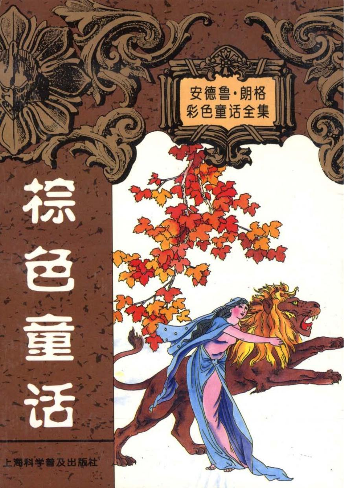

**安德鲁·朗格彩色童话全集**

棕色童话

陈新埠译

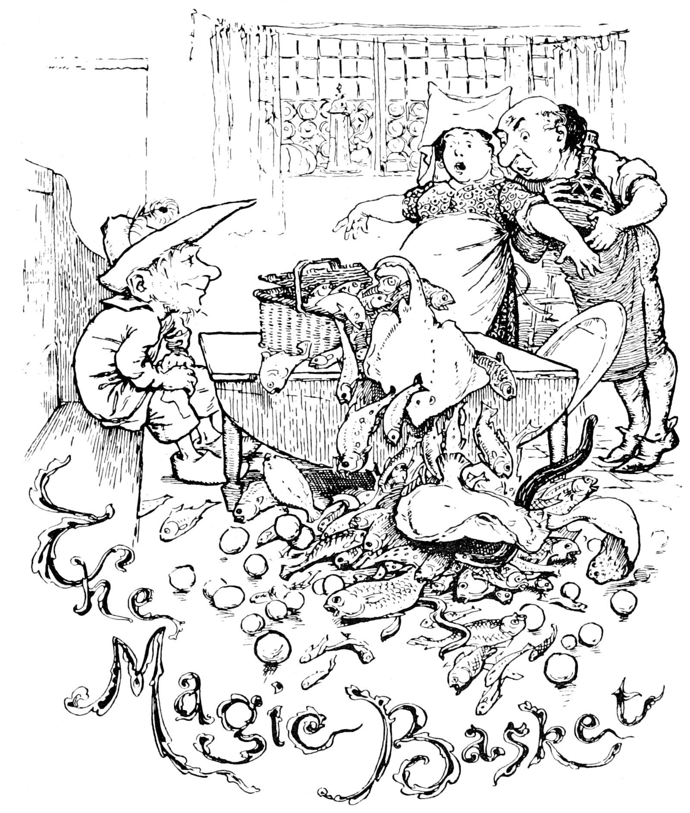

上海科学普及出版社

 

（沪）新登字第 305 号

Edited by Andrew Lang
The Brown Fairy Book

Published by Longmans, Green, and Co. in 1904

---

安德鲁·朗格彩色童话全集
**棕色童话**
陈新埠译

---

责任编辑：钟海谷
技术编辑：万福棠
出版：上海科学普及出版社（上海曹杨路 500 号邮政编码 200063）
发行：新华书店上海发行所
印刷：上海新四印刷厂
开本：850×1168 1/32
印张：9
插页：4
字数：215000
版次：1997 年 7 月第 1 版 1997 年 7 月第 1 次印刷
印数：1-8000
书号：ISBN 7-5427-1198-9/G·344
定价：14.00 元

---

（本版图书凡印刷、装订错误可及时向承印厂调换）

 

| 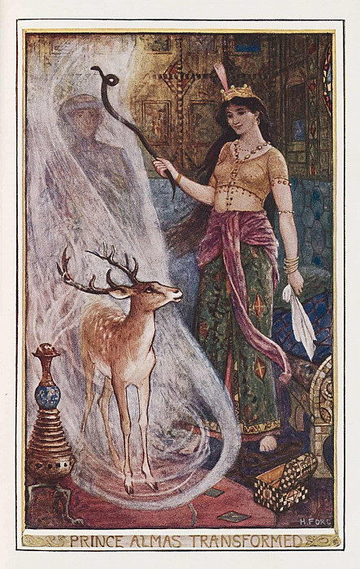 |
| :----------------------------: |
|    《玫瑰给西纳伯带来什么》    |

| 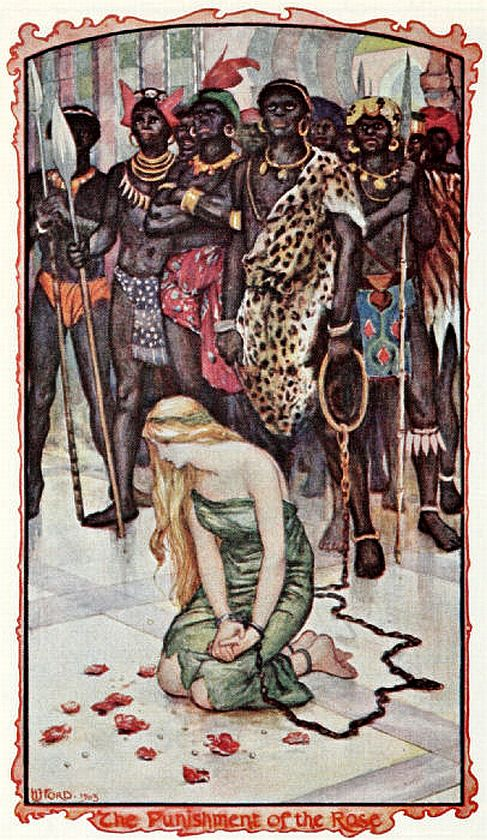 |
| :----------------------------: |
|    《玫瑰给西纳伯带来什么》    |

 

| 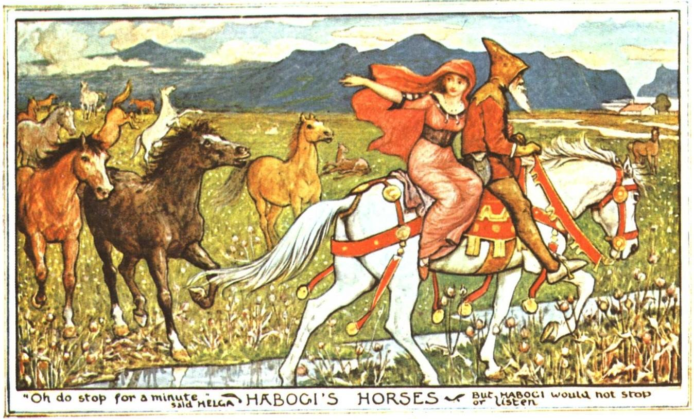 |
| :----------------------------: |
|           《哈博基》           |

 

| 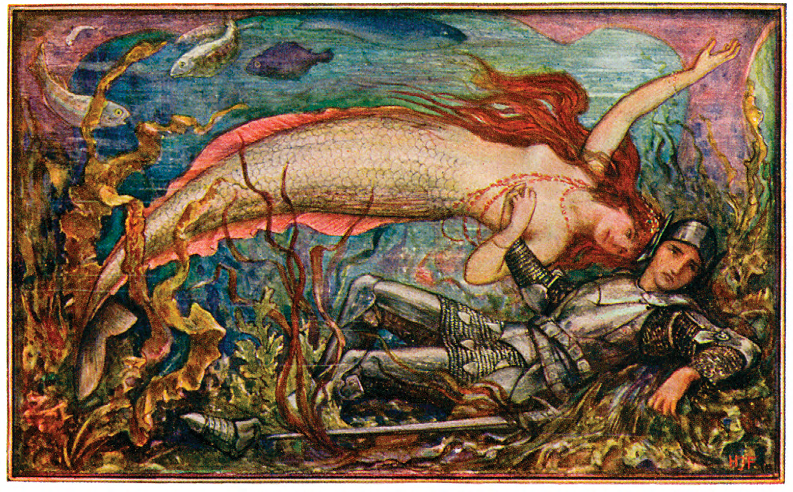 |
| :----------------------------: |
|        《美人鱼和少年》        |

 

|  |
| :----------------------------: |
|         《淘气的少女》         |

 

|  |
| :----------------------------: |
|         《王子的命运》         |

 

|  |
| :----------------------------: |
|       《守护神鲁伯赞勒》       |

 

| 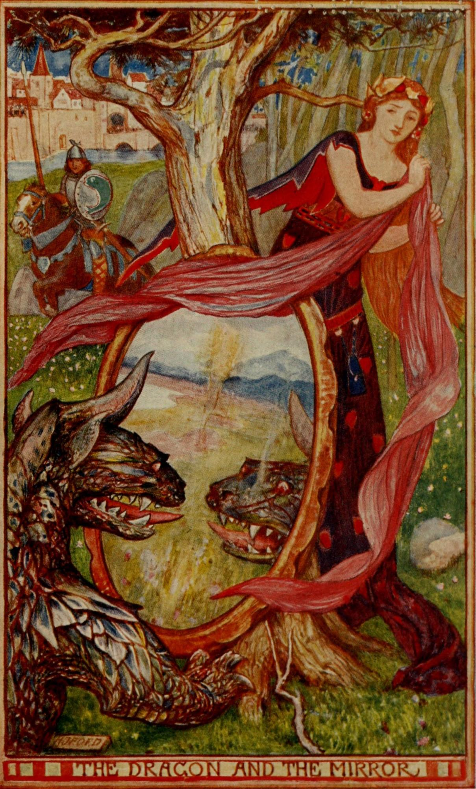 |
| :----------------------------: |
|           《鱼骑士》           |

 

## 前言

《安德鲁·朗格彩色童话全集》是英国著名文学家安德鲁·朗格（1844～1912）编辑的十二集童话。为了编辑这些童话，他广泛地收集英国、欧洲以至全世界的童话和民间故事。那些非英语的文字，如法文、德文、葡萄牙文、意大利文、西班牙文、加泰隆语等主要由他的妻子莱奥诺拉·布朗歇翻译和整理成英文。最先编成一集，当时编者的意图也只是编这一集。后来搜集的材料越来越多，才决定继续再编三集。其中的艰难和辛苦是外人所难以想象的，编者因此曾发誓，编成这四集以后，再也不编下去了。

四集童话的出版，效果非同凡响。不仅受到英国读者的欢迎，而且被译成多种文字，受到许多国家读者的欢迎，赢得了一代又一代的读者，历数十年而不衰，这不仅源自编者长期的努力，也得益于世界各地广大热衷于这一题材的读者的帮助，他们纷纷把手头的作品和资料寄给安德鲁·朗格。这给了他极大的鼓舞，他一鼓作气，又编了八集。后面几集主要搜集了苏格兰、爱尔兰、加拿大、印度、葡萄牙、斯堪的纳维亚的民间故事和传说。有些则选自以神话、民间传说和英雄传奇为基础的中世纪威尔士故事集《马比诺吉昂》。

安德鲁·朗格认为，这些童话故事很难说是某个人写成的，它们从很久很久以前就流传下来，经过民间艺人和文学家的不断收集和整理，才达到了今天这样思想性和艺术性都比较好的程度。这些童话也被认为是英语、甚至也是全世界各种语言中时间跨度最大、包含地域最广、流传国家和地区最多、内容最丰富的童话集。

她是世界古典童话中的瑰宝，童话世界中永不凋谢的鲜花，被译成多种文字，得以广泛流传，一代又一代的儿童被她的魅力吸引，长大成为家长后，又为能给自己的孩子朗读和讲述安德鲁童话而自豪。

《棕色童话》收集澳大利亚、波斯、非洲、巴西、新斯科舍等国家和地区的三十二个童话故事。这些故事有的发生在冰天雪地、冬夜漫漫的北极圈内；有的发生在赤日炎炎，白天只好睡觉的赤道线上；有的讲述疾恶如仇，不畏强暴，不为金钱美女诱惑，不伸张正义决不罢休的王子；有的讲述主人公不甘屈服于命运，要与命运抗争到底；有的讲述老实忠厚的老人；有的讲述狡猾奸诈的动物。这些美丽的童话故事为我们展现了很久以前，这些地区的人民是怎样生活的，展现了他们的欢乐和悲伤，理想和追求；颂扬了勤俭朴素、助人为乐、正直忠诚；谴责了贪得无厌、懦弱无能、奸诈狡猾。

与《安德鲁·朗格彩色童话全集》中的其他各集一样，《棕色童话》中的故事充满了当地的风土人情和乡村气息，展现了从冰雪覆盖的北极圈到赤日炎炎的非洲大陆的美丽风光。读者们可以从中领略到许多乐趣，懂得什么是正义，什么是邪恶；什么值得爱，什么该去恨；而且还会对这些地区的人文历史和地理概貌有所了解，从而更加热爱生活，热爱我们这个世界。

 

**目录**

[TOC]

 

## 玫瑰给西纳伯带来什么

从前，在东方有一个名叫萨曼拉珀斯的伟大国王。他有三个勇敢而且聪明的儿子——塔马斯，夸姆斯和阿尔马斯·鲁·巴克斯。有一天，国王正坐在接待厅里，他的大儿子塔马斯走进来，很有礼貌地问候了父亲以后，说：“啊！我的父王，我对都市的生活感到厌倦了。假如你允许，我明天就带着仆人到郊外的山脚下去打猎。到晚上做祈祷的时候，我就回来。”他的父亲同意了，派了一些自己的忠实仆人和他一起去，还给他一些猎鹰、隼、猎狗和猎豹。

来到了可以打猎的山脚下，王子看到了一只非常美丽的鹿，他命令不要杀死它，要设下圈套或用绳索来捕捉它。鹿四处观望，想从围捕它的猎手中找个突破口。它发现王子的身边就有机可乘，于是纵身一跳，从王子的头上飞腾而过，冲出包围圈，像一阵东风似的向原野疾驰而去。王子用马刺踢了一下他的马，紧紧地追赶上去。不一会，那些随从都被抛在后面，谁也看不见了。他双眼紧盯着那只鹿，紧追不舍，直到太阳升到天空的正当中，鹿忽然消失在前面的一块高地后面，不见了。他到处寻找，也找不到它的踪迹。这时候，他浑身都被汗水浸透了，艰难地喘息着。马的舌头也干渴得从口中耷拉出来。他下了马，手中拿着缰绳，拉着马艰难地继续向前走着，恳求苍天的怜悯，只能一切听天由命。不久，马倒下了，一命归天。他独自在荒芜的沙地里不停地跋涉着，胸中好像烧着一把火似的，令他非常难受，眼泪不禁从他脸上滚滚而下。后来，他终于看到了一座小山。他用尽力气拼命地爬上山顶，看到高低不平的山顶上长着一棵高大的树，树尖直插入云天，树枝和树叶长得非常茂盛。树下是一片绿色的草地，草地中有一口喷泉，周围开满了各种颜色的鲜花。

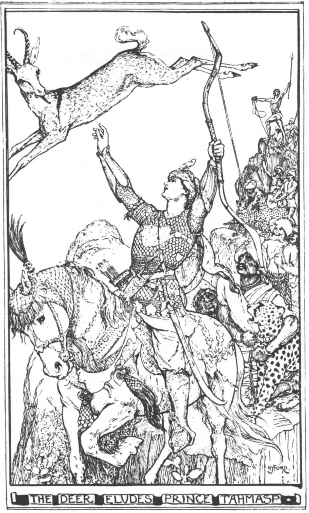

看到这种景象，他非常高兴，拖着疲惫的身子来到泉水边，贪婪地喝个够，为自己能从干渴中解救出来而万分庆幸。

他望了望四周，非常吃惊地看到不远处有一张皇帝的座椅。正当他十分惊讶，是什么把他带到这杳无人烟的沙漠里来的时候，一个穿戴得像僧侣一样的人，光着头，赤着脚，向他走过来，后面还跟着一辆那种有地位的人坐的四轮马车。那人看上去很慈祥，而且充满了智慧和思想。他走过来对王子说：

“啊！我的好青年，你是怎么到这里来的？你是谁？从哪里来？”

王子把刚才发生的一切都告诉了他，怀着尊敬的心情对他说，“我把我的事情都告诉你了，现在，我冒昧地请求你告诉我你的处境。你是谁？怎么会到这没有人烟的荒山中来居住？”

那人回答说：“啊！青年人，你最好不要来管我的事情，不要打听我的命运，我的故事不中说也不中听。”但是，王子一再坚持请求他说出来。最后僧侣不得不告诉王子：

“听着！年轻人，我是巴比伦王国的国王詹纳格，曾经拥有军队和奴仆，家庭和宝藏，还有数不清的财产。至高无上的真主赐给我七个儿子，个个长得高贵尊严，像诗歌中所赞美的那样。我的大儿子从那些旅行家口中听说，在与中国交界的土耳其，有一个名叫奎穆斯的国王，他有一个独生女儿米赫·阿弗露兹，是天底下无与伦比的，最漂亮的姑娘。全世界各个地方的王子都来找她，要和她交朋友。她提出一个唯一的条件，说，‘我知道一个谜语，谁能够猜出来，我就嫁给他，还要赠给他我所有的财富。但是，如果那个求婚者猜不出这个谜语，我就要砍下他的头，挂在城堡的城垛上。’她的谜语是：玫瑰给西纳伯带来什么？”

“我的儿子听到这个故事以后，堕入这个从未见过面的姑娘的爱河。他来到我的面前，无比悲痛地恳求我。我怎么劝他也毫无用处。我说，‘啊！我的儿子，假如你一定要摘取这种幻想的果实，我要率领一支强大的军队去见奎穆斯国王。要是他愿意把女儿给你，天下大吉；要是他不愿意，我就消灭他的王国，用武力把她带回来。’这个计划并没有令我的儿子高兴。他说，‘不能因为得到我的所爱，就毁坏一个王宫，消灭一个王国。我自己去，我要猜出谜语，以此来得到她。’最后，出于对他的怜悯，我让他走了。他来到奎穆斯国王的城堡，人家让他猜这个谜语；他回答不出来，头被砍下挂在城垛上。我身着黑服为他整整哀悼了四十天。”

“从此以后，我的儿子一个接一个地被对这个女子的思念所迷惑。他们先后都去了城堡，最后都被杀害。他们的死令我非常悲伤，我放弃了王位，在这荒芜的沙漠里住下来，把一切国家事务抛在脑后，在悲痛中度过我的余生。”

塔马斯王子听完这个故事，那个未见面的女子的爱情之箭也射中了他的心。就在他交上这个厄运的时刻，他的随从都赶过来了，像飞蛾围着灯光似地聚集在他的周围。他们拉来了一匹马让他骑上，这匹马跑起来像晨风那么快，一会儿就安全地把他带回家中。时间一天一天地过去了，爱情的荆棘不停地刺痛他的心。像所有患单相思的恋人一样，他精神恍惚，越来越衰弱。后来，爱的信念终于冲破了他压抑的情怀，他来到了父亲——国王萨曼拉珀斯面前，把事情告诉他：“你的儿子疯狂地爱上了奎穆斯国王的公主米赫·阿弗露兹。”他把她和她的所做所为一五一十地告诉国王。悲哀的乌云笼罩了国王的心，他对儿子说，“假如事情如你所说，我就先派一个使者带一封友好的信去见奎穆斯国王，请他把女儿许给你。我还要送去丰厚的礼品，派一队骆驼，驮满闪光的宝石去见他，把他的女儿和嫁妆带回来给你，让你得到欢乐。如果奎穆斯国王不愿意把他的女儿给你，我的军队就会像旋风一样地征服他，把姑娘像战利品一样地带回来。”但是王子说，这个计划不好，他要自己去，猜出这个谜语。这时，国王的谋士说，“这是一件很重要的事情，最好让王子去。派一些你信赖的人和他一起去，也许他会改悔返回。”于是，国王萨曼拉珀斯下令为王子的旅程做好一切准备。然后，王子在随从的伴随下出发了，还带着一队驮着钻石、黄金等贵重物品的黑眼双峰骆驼。

他们走了一驿又一驿，经过许多天的长途跋涉，终于到达奎穆斯国王的城堡。他看到了什么？一座巍峨的城堡拔地而起，直冲云天。仿佛直抵蓝天的城垛上悬挂着许多人头。但是，这些出身高贵的人头一点也没有动摇他的决心。他不听任何劝他抛弃幻想的劝告，继续向城门走去，来到最繁华的市区。这些地区如此壮观，那些上了年纪的人也说，从来没有见过。在一块空旷的广场里，他看到用深红色的缎子搭起来的帐篷。帐篷里有两个镶着宝石的鼓，还有镶着宝石的槌子。这两个鼓就是让公主的求婚人敲打，以宣布他们前来求婚的。听到鼓声，就会有人出来带他们去见国王。看到这些鼓，王子心中的爱情之火被煽得更加旺盛。他翻身下马，向鼓走去。他的随从赶紧走过去拦住他，请求让他们先到国王那里去，通告他的到来，等到他们把带来的礼品安置妥当以后，再来办理向公主求婚这件最重要的事情。但是，王子回答，他到这里来唯一要办的事情和使命，就是敲响这些鼓，宣告他是来求婚的。这样，他就会以求婚者的身份被带去见国王，国王会给他适当的安置。就这样，他把鼓敲响，一个军官立刻走过来，带他去见国王奎穆斯。

国王看到王子如此年轻，稚气未尽，对他说，“啊！年轻人，抛弃你的幻想吧！不要迷恋我女儿为自己的美貌而骄傲地设下的诱惑。没有人能够猜出她的谜语。她已经处死了许多青年人。他们还没有来得及享受人生的辉煌和乐趣。上帝不允许你的青春也被殉情的秋风所摧毁。”但是，他所有这些切切劝告，丝毫也没有使王子退缩。最后他们决定，王子将受到三天的热情款待，然后就开始办应该办的事情。王子回到了他的寓所，受到了合乎礼节的招待。

现在，奎穆斯国王把女儿和她的母亲古尔鲁凯召来。他对女儿说：“听我说，你这残忍的女子，为什么要坚持这种愚蠢的行为？现在，有一位东方王子来向你求婚。他长得这么英俊，太阳看到他那辉煌的脸也会自愧不如。他非常富有，还带来了黄金和钻石，要是你愿意嫁给他，这一切都是属于你的。你再也不会找到一个比他更好的丈夫。”

但是，父亲和母亲的劝导都无济于事。公主只是说，“啊！我的父亲，我已经对天发誓，除非有人解开这个谜语，否则我永远也不会嫁人，那怕是等上一千年。谁能解开这个谜，我就嫁给他。”

三天过去了，谜语终于摆到王子的面前：“玫瑰给西纳伯带来什么？”王子有一个如簧之舌，能够把一根头发说成两瓣。他毫不犹豫地用一首诗句来回答她：“只有万能的上帝知道一切；要是有人对你说，‘我知道。’请不要相信他。”

王子的话刚说完，一个仆人领进来一个肮脏的、长着蓝眼睛的刽子手。他问：“谁的生命之光行将熄灭？”他抓住王子的双手，给他套上死囚的囚服，铁石心肠地，毫不怜惜地砍下了他的头，把头挂在城垛上。

塔马斯王子被杀的消息传来，他的父亲沉浸在绝望和恍惚之中。他穿着黑色的丧服为儿子哀悼了四十天。过了几天以后，第二个儿子，王子夸姆斯也学他哥哥的样子去求婚，也被处死。现在，国王只有一个儿子了。他就是勇敢、善辩、乐观的王子阿尔马斯·鲁·巴克斯。有一天，正当国王坐在那里为失去儿子而忧伤的时候，阿尔马斯走进来说：“啊！我的父亲，奎穆斯国王的女儿害死了我两个哥哥，我要去找她，为他们报仇。”这些话令他的父亲伤心地哭泣起来：“啊！你父亲的希望之光，除了你以外，我没有儿子了，你现在却要我让你去死。”

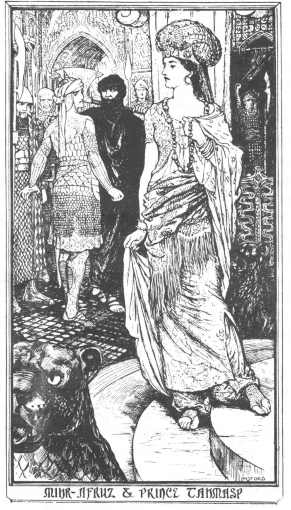

“亲爱的父亲！”王子请求道，“除非我能打掉这个美女的傲气，把她带到你的面前，否则我就坐立不安。”

最后，他也走了，但只是孤身一人，不带任何随从。像两个哥哥一样，经过长途跋涉，他来到奎穆斯国王的城堡，看到了塔马斯和夸姆斯的头。他走进城市，看到了那顶帐篷和鼓，然后又走出来，来到一个不远的村庄里。在那里，他找到一个上了年纪的老人和他一百二十岁的妻子，可能还不止一百二十岁。他们的生命即将走到尽头，但是还没有一个儿女。看到王子走进他们的家，他们非常高兴，把他当做亲生的儿子一样地看待。王子把马拴在房子外面，把随身带来的一切东西都交给他们看管，请求他们不要把他到来的消息告诉任何人，替他保守秘密。他换下了高贵的服装。第二天一早，太阳刚刚从东方升起，他就动身进城。他每时每刻都没有忘记去找出这个谜语的答案，寻找能帮助他的人，每时每刻都在想着如何替他的两个哥哥报仇。他在城里到处徘徊，但是没有听到任何对他有帮助的消息。因为在这块土地上，没有一个人能够解开公主米赫·阿弗露兹的谜语。

一天，他想应该到公主自己居住的王宫里去，看看能否听到些什么。于是，他来到她的花园住所。这是一个非常华丽的地方，大门美妙而神奇，城墙像是阿历山大的那样深严壁垒。门口有许多人守卫着，根本无法通过。他心中充满了悲痛，对自己说：“有志者，事竟成。在这里，我将得到想要的东西。”他绕着花园的围墙溜达着，希望能找到缺口。他不停地祈祷着，“啊！主宰着一切的真主啊！给我指明一条路。”

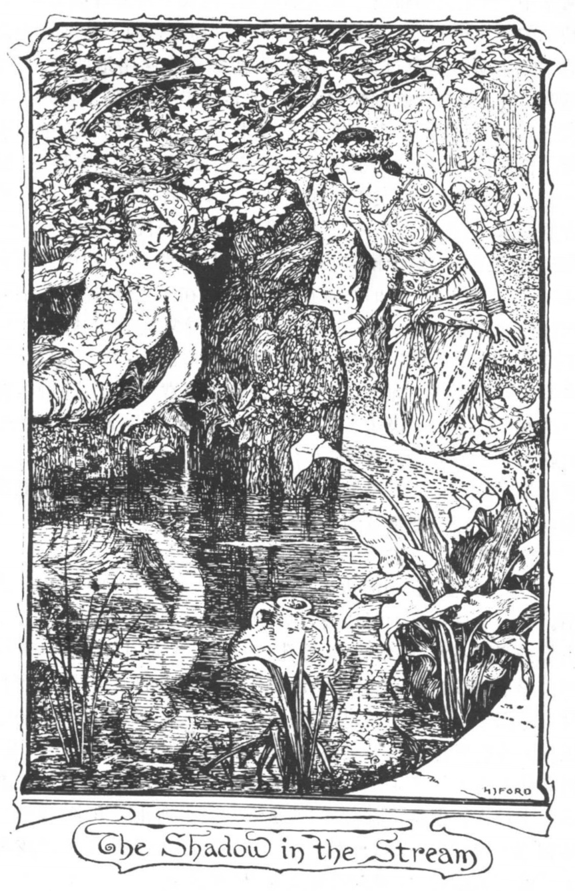

在祈祷的时候，他忽然想起，可以随着一条流进花园的小河进去。他仔细地观察着四周，生怕被人发现。他脱下衣服，滑入河水中。河水把他带进了高大的围墙。他找个地方躲藏起来，直到他的腰布被吹干。花园真像美丽的伊甸园。河水从绿草如茵的大地上潺潺地流过，鲜花在盛开，野鸽子在咯咯地叫，夜莺在啭鸣。这真是个消除烦恼的地方。他走来走去，看到了花园里的房子，里面好像没有人。前面的院子里有一张铮亮的碧玉王宫座椅。平地中央有一池清澈透明的池水，水面像镜子一样明亮。好一会儿，他尽情地欣赏着这美丽的景色，然后返回花园，找个地方躲起来，免得被园丁们看见。就这样过了一夜。第二天一早，他把自己打扮成疯子模样，到处闲逛。他来到一块草坪旁，看到几个长得像仙女一样的姑娘在那里嬉戏。在一张镶着宝石，铺着丝绸的王室椅子上，坐着一个光彩夺目，异常美丽的姑娘，空气中充满了她身上散发出来的龙涎香和玫瑰油的芬芳。“她肯定是米赫·阿弗露兹，”他想，“她确实是长得非常可爱。”这时候，有一个女仆到河边来汲水。王子虽然躲在暗处，但是他的脸在水面上映出来。看到他的影子，女仆吓得把杯子掉入水中，“这是天使？精灵？还是人？”恐怖整个地控制了她。叫声惊动了其他姑娘，她们走过来，把她带到公主的面前。

公主问：“怎么啦！漂亮的姑娘。”

“啊！公主，我到河边去取水，看到一个影子，很吓人，我害怕。”另一个姑娘跑到河边去，也看到了影子，回来告诉公主。公主想去亲眼看看，她站起来，像孔雀一样款步向河边走去。看到那个影子，她对仆人说，“去找出影子映在水里的人来，问他住在哪里？”王子听到她的话，从藏着的地方抬起头来。她看到了一个她从来没有见过的这么美貌英俊的男子，不禁深深地爱上了他。她向仆人做了一个手势，叫她们去把他带过来。王子顺从地跟着她们走过来。但是，当公主问他是谁？怎么到花园里来的时候，他就像一个疯子一样，一会儿笑，一会儿哭，一会儿又说，“我饿了。”前言不搭后语，举止时而文雅，时而粗鲁。

“真可惜！”公主说，“他疯了。”因为喜欢他，所以公主对仆人说：“他是我的疯子，任何人都不许伤害他。”她把他带进自己的房子里，让他留下来，提供他所需要的一切。王子想。“真是太好了，在她的房子里，我会找到她那个谜语的答案。我必须保持沉默，就是死也不说话。”

在公主家里，有一个名叫蒂尔·阿拉姆的姑娘，就是她第一个看见河水里王子的影子。她后来也非常爱他，日日夜夜都在想如何向他表达自己的感情。有一天，她趁公主不注意，偷偷地跑过来，跪在王子的面前，对他说：“真主把美貌和魅力都赐给了你，请告诉我你的秘密。你是谁？怎么会到这里来？我非常爱你，假如你要离开这里，我将和你一起走。我的财富和守财奴卡蓝的宝库一样多。”可是王子的回答像神经错乱的人一样，颠三倒四，什么也没有告诉她。他暗暗告诫自己，“神不允许我泄露自己的秘密，暴露自己会使我蒙受耻辱。”蒂尔·阿拉姆得不到回答，心如刀绞，泪如泉涌，站起来奔回自己的房间恸哭起来。

现在，不论什么时候，只要公主需要派人去伺候王子，在所有的仆人中，蒂尔·阿拉姆总是最积极，最尽职。公主注意到这一点，对她说，“蒂尔·阿拉姆，我的疯子由你来照顾，他要什么就给他什么。”这正是蒂尔·阿拉姆求之不得的。过一会，她把王子带到一个秘密的地方，要他发誓保守秘密，她自己也对天发誓，“我决不会把你的秘密说出去，告诉我你的一切，以便我能帮你得到你所需要的东西。”王子从她的话中看到了她真诚的爱，就和她结盟，对她说：“啊！可爱的姑娘，我想知道玫瑰给西纳伯带来什么。你的女主人为了这个谜杀男人的头，这个谜底是什么？她为什么要这样做？”蒂尔·阿拉姆回答：“假如你答应娶我，始终把我当成你最喜欢的人之中的一个，我就把所知道的一切都告诉你，帮助你解开这个谜。”

“啊！可爱的姑娘，”他回答，“只要我达到自己的目的，不必再去为它而努力，我将永远和你在一起。等我能够控制这个女人，为我哥哥报仇以后，我将让你成为我的欢乐。”

“啊！你给了我生命的价值和快乐的源泉！”蒂尔·阿拉姆说，“我不知道玫瑰给西纳伯带来了什么。但是，我知道，是一个黑人把这个谜语告诉给米赫·阿弗露兹。她把他藏在她的宝座下面。这个黑人是从高加索的沃卡逃到这里来的，你要到那里去才能得到谜底，除此以外，没有任何办法。”听了这些话，王子对自己说，“啊！我的生命！要完成这个使命，还要你付出许多。”

他陷入深思之中。蒂尔·阿拉姆看着他，对他说：“啊！我的生命，我的灵魂！不要这么悲伤，假如你想叫这个女人去死，我就在她的杯子中放进毒药，她就会长眠不醒。”

“啊！蒂尔·阿拉姆，这种复仇太无人道。我要到高加索的沃卡去，解开这个谜语，否则永远也不会安宁。”他们重申了相互之间的婚约以后，就告别了。

王子回到村庄，告诉老人，他准备到很远的地方去，请求他们不要担心，看管好托付给他们的东西。

王子一点也不知道到高加索沃卡去的路。一路上找不到任何人帮忙，他未免有点沮丧。他牵着马盲目地走着。一个面容安祥的老人出现在他的面前，他穿着绿衣服，手中拿着拐杖，样子像伊莱亚斯。王子把手放在自己的胸前，向他致敬；老人也仁慈地还礼，问他，“你好吗？你要到哪里去？你好像在赶路。”

“啊！尊敬的圣者，我正面临困境，我不知道通往高加索沃卡的路。”王子说。善良的老人看着年轻的王子，对他说：“回去吧！不要去走这条危险的路。找别的事情去做，即使你有一百条性命，你也别指望能活着走完这条路。”但是，这些话丝毫也没有动摇王子的决心。老人问：“你要去干什么？这样无视自己的生命？”

“我有一件很重要的事情要办，只有到那里去才能做得到。我必须去，我以真主的名义请求你，请告诉我怎么去。”

圣者看到王子的决心毫不动摇，对他说：“听着，年轻人，凯夫的沃卡位于高加索，是它的一块领地。在那里有许多神怪、恶魔。你要沿着这条路走下去，直到分成三条道。不要走左边那条，也不要走右边那条，沿着中间那条走。一天一夜以后，你就会看到一根圆柱子，上面有一块大理石板，石板上刻着文字。照上面写的去做，千万不要违背。”接着，他祝福王子一路平安。王子吻了他的脚，和他道别，感谢真主，就继续赶路。

一天一夜以后，他看到一根庄严肃穆的圆柱壮观地直插云霄，一切都像智慧老人告诉他的那样，懂得世界各国语言的王子读着大理石上的文字：“旅行者！请注意！这根刻着碑文的柱子竖在这里，是为了指明这些道路的方向。假如你想轻松而快活地度过一生，请走右边这条路；假如你走左边那条路，会遇到一些麻烦，但花不了多少时间，也能达到自己的目的；对于那些选择中间道路的人，向他表示惋惜。即使他有一千条性命，也一条都难以保留。这是一条非常危险，永无尽头的路，它通向高加索。请留神！”

王子读完碑文，摘下帽子，举起他的双手祈求万能的真主：

“啊！出家人的指路人，我，你的仆人，来请求你的援助。我的目的地在沃卡，我的路充满了危险，请带我走过去。”他抓起一把土，撒在自己的衣领上，说：“啊！大地！让你成为我的坟墓！我的马甲！我的裹尸布吧！”他沿着中间一条路走去。一路上他默默地祈祷着。许多天过去了，他看到了一个长着树木的花园，来到花园的门口，看到一块雕刻得非常漂亮的大理石，旁边睡着一个黑人，头枕在一块石头上。他的脸那么黑，以致周围都变得很暗。他的上嘴唇像眉毛一样地拱起，几乎碰到鼻孔，下唇像骆驼一样耷拉下来。四块铁石做成他的盾牌。旁边的一棵树上挂着他那把巨大的宝剑。他的围裙是用十二张野兽皮拼起来的，腰带是一根链条做成的，链条的环像大象的腿那么大。

王子走过来，把马拴在黑人的头附近，走进花园，来到一个幽僻的地方。这里长着许多高大的树，青葱的草木惹人喜爱，还有许多美丽的花篮。王子觉得很高兴。在内花园里有许多许多鹿，这是一片充满魔法的土地。那些鹿用眼睛和脚来暗示他回去，可是他不懂它们的意思，以为这些可爱的姿势是对他表示欢迎。过了一会，他走进一个宫殿，它的走廊比凯撒的还要辉煌，是用黄金和银砖铺成的。走廊的中间有一把高座椅，上面盖着华丽的毯子。里间开着八扇门，门的对面都有一个大理石盆子。

王子打消顾虑，继续向花园深处走去。突然，有一扇窗打开了，一个可爱得足以闭月羞花的姑娘伸出头来。她一看到漂亮的王子就心猿意马，派她的仆人去叫他来，想问他从哪里来，怎么能走进连狮子和狼也不敢进来的私人花园。女仆走过去，看到他那像太阳般灿烂的脸大为震惊。她向他致敬以后说：“啊！年轻人，欢迎！花园的女主人请你，来吧！”他跟着女仆走进一间像天堂一样的宫殿，看到王座上坐着一位比太阳还要辉煌的姑娘。他向她致敬。姑娘站起来，伸出手去拉他的手，叫他靠近她，问道，“年轻人，你是谁？从哪里来？怎么能走进这个花园？”他从头到尾，一五一十地把自己的故事告诉她。这个名叫拉蒂法的姑娘说：“这太愚蠢了，你会成为这块土地上的流浪汉，最后毁了自己的。来吧！别再说这种傻话，谁也去不了高加索。留下来陪我，感谢我的好意，你可以和我分享王位，在我的社会里享受我的财富。我乐意去做你想做的事情。我要把奎穆斯国王和他的女儿带到这里来，随便你怎样去处置他们。”

“啊！拉蒂法姑娘，”他说，“我已经对天发誓，不到达沃卡，不解开这个谜语，不把米赫·阿弗露兹从她父亲的身边带走，把她送进监狱，像一个勇敢的男子汉应该做的那样，我决不罢休。等我办好了这一切，我就堂堂正正地带着一批人回到你这里来，按照法律的程序和你结婚。”拉蒂法不停地劝他按她的愿望去做，但结果徒劳，王子不为她所动摇。她叫人拿来了好酒，为他斟上。她想，喝了酒他的头脑会发热，可能就会同意留下来。她端起一杯满满的纯净的美酒，送到他的面前。他说：“啊！最迷人的爱人，照规矩应该主人先喝，然后再轮到客人。”为了弄昏他的头脑，她干完了这一杯，又斟满一杯送给他，他也一饮而尽。她从一个歌手的手中接过诗琴，用倾倒所有听众的技巧演奏。豪华的宴会一连举办了三天。但是没有用，到了第四天，王子对她说：“啊！我心中的欢乐，我请求你和我告别。我的路途那么遥远，你爱情的火焰在动摇我的决心，看在仁慈的真主份上，我会达到我的目的，那时候，我会回到你这里来。”

现在，拉蒂法明白了自己没有任何办法可以改变他的决定。她叫女仆拿来一个篮子。她说，篮子里装的是提神的食品，路上用得着。篮子拿来了，她拿出一些来叫王子吃。在他不注意的时候，取出一根像蛇一样的棍子，对着棍子说了些什么，然后狠狠地对着他的肩膀打下去。这一下那么沉重，他惊叫起来，转了一下身子，变成了一头鹿。

知道发生了什么事情以后，他想：“所有的苦恼和折磨都交织在一起了，我失去了最后的机会。”他想方设法逃走。可是会施魔法的拉蒂法叫来了她的金匠，在鹿的角上套上了黄金和钻石。她把手中的手帕绕在他的头颈上，就放他出去。

变成鹿的王子跳进花园，想寻找一条逃跑的路，但是找不到，就加入了鹿群的队伍，不久就成为它们的领头。王子虽然变成了鹿，但他的心和思想并没有变。他对自己说：“感谢真主，拉蒂法姑娘把我变成这个样子，不管怎么说，鹿还是美丽的。”有一段时间，他像鹿一样在鹿群中生活。后来，他决心要改变这种生命的状态。他又开始寻找逃离这个魔法花园的地方。他沿着花园的围墙找到了较矮的墙壁，他默念着神的名字，说道：“一切都遵从神的旨意。”他纵身跃过围墙，发现还是落在原来的地方。

一样的宫殿，一样的花园，一样的鹿群。他一连跳了八次，八次都落回原处。他又跳了第九次，发现变了，虽然也是花园，也有宫殿，但是鹿群没有了。

这时候，一个像皓月一样美丽的姑娘把窗子打开，王子看到她，深深地被她迷住了。看到这头漂亮的鹿，她兴高采烈，对她的女仆喊道：“抓住它！抓住它，我就把这根项链给你，它的每一颗珍珠抵得上一个王国。”女仆对这些珍珠垂涎三尺，可是尽管她已经活了三百年，还不知道怎样能抓住一头鹿。不过，她还是走进花园，手中拿着一些草。但是，等她靠近时，鹿跑了。姑娘激动地从宫殿的窗口眺望着，喊道：“啊！仆人，要是抓不到它，我就杀了你！”老妇人回答：“我正在杀我自己呢！”姑娘看到老妇人在跌跌撞撞地追赶着，就下来帮忙，她像孔雀一样步子轻盈地追赶着。看到鹿角上的宝石和手帕，她说：“它一定习惯于和人相处，是王宫的宠物！”王子想她可能也是一个魔术师，说不定会把他变成什么形状，看起来还是让她抓住为好。于是，他逗她玩了一会，就让她抓住头颈。一根皮带拿来了，水果也拿来了，她高兴地抚摸着他。他被带进了宫殿，拴在这个名叫杰米娜姑娘的坐椅旁边。她吩咐拿来一根更长的绳子，以便他能够在她的身边跳跃。

女仆拿来绳子，准备把它结牢。她看到泪水从鹿的眼中涌出，它显得非常沮丧和悲伤。“啊！杰米娜姑娘，这是一头神奇的鹿，它正在哭。我从来没有看见鹿哭过。”女仆说。杰米娜像闪电般地冲过来，看到这果然是真的。鹿用头擦了擦她的脚，然后悲恸地摇起头来。它是如此伤心，姑娘也流下了同情的眼泪。她轻轻拍着它的头，说：“你为什么伤心？我的心肝！你为什么哭泣？我的灵魂！是不是因为我抓住了你。我爱你胜过爱自己的性命。”但是，不论她怎么安慰它，它却哭得更厉害。于是杰米娜说，“我看不会错，肯定是我那邪恶的姐姐拉蒂法干的。她用魔法把真主的仆人变成了土地上的野兽。”听到这些话，鹿发出了鸣叫声，把头靠在她脚上。这样，杰米娜知道了，这只鹿肯定是人变的。她说：“别担心，我会恢复你本来的面目。”她沐浴以后，让鹿也去沐浴，自己穿上干净的衣服，叫人从壁龛中取来一个盒子，把盒子打开，从里面拿一些东西出来叫鹿吃掉。接着，她伸手到毛毯底下拿出一根棍子，重重地打了鹿一下，口中还说着些什么。鹿转了一下，变成了阿尔马斯王子。

那块手帕和宝石都留在地板上。王子匍伏下来，感谢真主和杰米娜。他说：“啊！可爱的人！东方的维纳斯！请饶恕我给你带来这么大的麻烦！用什么样的语言，才能表示我对你的感谢之情！”她叫人送来了一个装衣服的袋子，挑选了一件体面而高贵的衣服。她的仆人帮他穿好，又把他带到这个心地善良的姑娘面前。她整个地被他迷住了，拉住他的手，叫他坐在自己的身边，说：“啊！年轻人，告诉我，你到底是什么人？从哪里来？怎么会中了我姐姐的魔法？”

在他还是一头鹿的时候，王子就很喜欢杰米娜，现在更觉得她比以前可爱千百倍。他认为，说真话才是最可靠的，于是就把整个事情告诉给她。接着，她问：“啊！阿尔马斯·鲁·巴克斯王子，你还是那么渴望继续赶路，到凯夫的沃卡去吗？那会有什么指望？即使是附近的路，也很危险，这里连高加索的边还没有沾上呢！来吧！放弃这个念头，那实在太危险了。继续走下去不是良策，像你这样的人落入神怪和恶魔的手中，真是太可怜了。留下来和我在一起，我会满足你的一切愿望。”

“啊！最美妙的人！”王子说，“你真是非常慷慨，我的生命寄托在你手中的真理之中，我请求你帮我一次忙。假如你爱我，那么我也爱你。要是你真的爱我，不要阻拦我的旅行，尽可能地帮助我吧！那样，我就可能成功。要是我达到了目的，安全地返回，我就按法律的程序和你结婚，把你带到我的国家去，做一对好伴侣，快活地一起生活，度过我们的余生。要是你能够，帮助我吧！把你的主意告诉我。”

“啊！我的生命真是太乏味了。”杰米娜说，“我要把国王宝库中没有的东西给你，这些将是你最需要的东西。首先是尊敬的预言家萨利赫的弓和箭；其次是任何国王都没有的所罗门的宝剑，它削石如泥，是用钢和矿石炼成的；第三件是圣人蒂姆斯自己做的匕首，这一件是最有用的，佩带着它的人，能够承受得起七头骆驼的重压。你要做的第一件事，是到辛默格家里去，和它交朋友。要是它喜欢你，它会带你到凯夫的沃卡去；要是它不喜欢你，你就永远也到不了那里，因为路上要经过七个海，就是地球上所有的国王，还有他们所有的谋士一起商量一千年，也无法渡过这七个海。”

“啊！最美妙的人！辛默格的家在哪里？我怎样才能到那里去？”

“啊！人世中的新人，你要完全照我的话去做。你必须察言观色，开动脑筋，否则你就会落入黑人的手中。他们是一伙吸血鬼，真主不允许他们碰你这样高贵的人。”

她拿来了弓和箭袋，宝剑，把匕首从盒子中取出，王子把它们放好。天堂女神般的杰米娜又拿出两个鞍囊，这是用像红宝石一样红的丝线织成的。一个装满烤熟的家禽和小饼；另一个装满宝石。最后，她牵来一匹跑得像疾风一样快的马，对他说：“接受我所有的这些礼物。骑着马一直走下来，直到一片高地，离这里不是很远。那里有一口喷泉，叫”馈赠之地“，你要留在那里过一夜。在那里，你会看到许多野兽——狮子、老虎、豹、猿，等等。在此之前，你要猎取一些动物。走完这段长长的路程，你就会看到狮子大王的住所。要不是所有的野兽都怕它，它们就会毁灭整个地区，不让任何人从那里过去。那头狮子是个赎罪者，它站起来的时候，你要向它表示尊敬，拿出一块布来擦掉它脸上的灰尘和泥土，拿出一些猎物来放在它的面前，这些猎物要洗干净，把你的手放在胸前以表示尊敬。它想吃的时候，拿出你的刀来，把肉割成一片一片，鞠着躬送到它面前。这样，你就完全赢得了狮子大王的友谊。它对你将非常有用。你就可以安全地通过黑人的骚扰。从”馈赠之地“出发，你千万不要走右边那条路，走左边那条。其他路都要从黑人的城堡经过，人们把那里称做”刀光剑影之地“。那里有四十个黑人首领，每人手下有三四千人，可能还要多，他们的头人叫塔拉姆。再过去就是辛默格的家了。”

等王子把这一切都记住以后，她说：“你会看到，一切都像我说过的那样。”她送王子走了一些路程。他们分手了，她独自回家，为他的离去而悲伤。

阿尔马斯王子依靠造物主的造化，来到了“馈赠之地”，在一块平地上下了马。一切都像杰米娜说过的那样。在一两个守夜人走过以后，他看到周围都是许多他从来没有见过的，庄严和高贵的动物。它们一个又一个地为一头雄伟的大狮子让路，这头狮子从头到尾有七十米那么长。王子走过来向它致敬，它骄傲地低下头来，向那块平地走去。七八十个狮子跟着它，围成一个圆圈，保持着一定的距离。它蹲下来，把右爪搁在左爪上。王子拿出杰米娜为他准备好的手帕，把它脸上的灰尘和泥土擦去，然后取出他准备好的猎物，放在它的面前，恭恭敬敬地把双手交叉在胸前，站在它前面等着。它想吃的时候，就用刀割下一块一块肉，送到它的嘴里。那些在一旁伺候的狮子也靠拢过来。王子正想停下来，狮子大王向他示意，也给它们吃一点。他照办了，把肉放在平地上，让它们吃。狮子大王招呼他过来，说：“放心地睡吧！我的卫士们会看护你的。”他在狮子卫士的包围之中睡了一夜，直到天明。狮子大王对他说再见，还给他一些自己的头发，对他说：“不论你遇到什么麻烦，烧一根头发，我就会来。”说完，它就向丛林里走去。

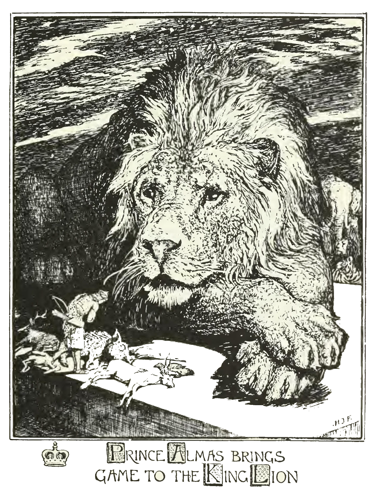

阿尔马斯王子立刻起程。他记得很清楚，右边那条路很近，但是很危险。他想，命中注定的一切总是要出现的，于是选择了这条不许走的路。不久以后，他看到一座城堡，按照杰米娜所说的，这里就是“刀光剑影之地”了。他完全可以沿着过来的路走回去，但是他的勇气阻止他这样做。他说：“天意难违，该发生的事情总是要发生的。”说完继续向城堡走去。他正想把马拴在城门旁边的一棵树上，一个黑人走出来发现他。“哈！”那个恶棍对自己说，“太好了，塔拉姆已经很久没有吃人肉了，正想着呢！我要把这个家伙带给他。”他抓住王子手中的缰绳，说：“下来吧！人孩！到我主人那里去，他想吃人肉已经想了很久了。”王子说了一些“你在胡说些什么？”这一类的话。黑人知道他在挨骂以后叫起来：“来吧！我要好好的教训你，让空中的飞鸟也要为你哭泣。”王子拔出所罗门的宝剑向他的腰间刺去，刺穿了他的腹部。黑人站了一会，还说了些什么，想伸手去抓王子，但很快就倒下来，一命呜呼。

王子跳到旁边的河里去沐浴以后对自己说：“啊！我的生命，等待着你的是一个伟大的使命。”这时候，又有一个黑人从要塞中走出来，看到了发生的事情，返回去告诉他的首领。另外两个黑人一起出来，都被所罗门之剑劈成两半。塔拉姆把一个名叫奇尔·马丘的黑人巨人叫来，他打仗的时候，一个人可以对付三百个人，对他说：“谢谢你，帮我去把那个人抓来。”

奇尔·马丘走出去，他像一座塔楼那么高，手中拿着八块大石头做成的盾牌。他一边走，一边喝道：“哈！傻瓜，你有什么资格跑到我们国家来杀我们的人？来吧！把我也劈成两半。”他根本看不起王子，把铁棍扔在一边，走过去用手抓住王子的衣领一拎，把王子夹在腋下，就去回报塔拉姆。这时，王子拔出蒂姆斯匕首，向巨人的腋窝刺去，整把匕首都刺入巨人的身体，痛得他把王子扔下，想去拿起那根铁棍。可是在他弯腰的时候，那把神奇的宝剑把他拦腰斩断。

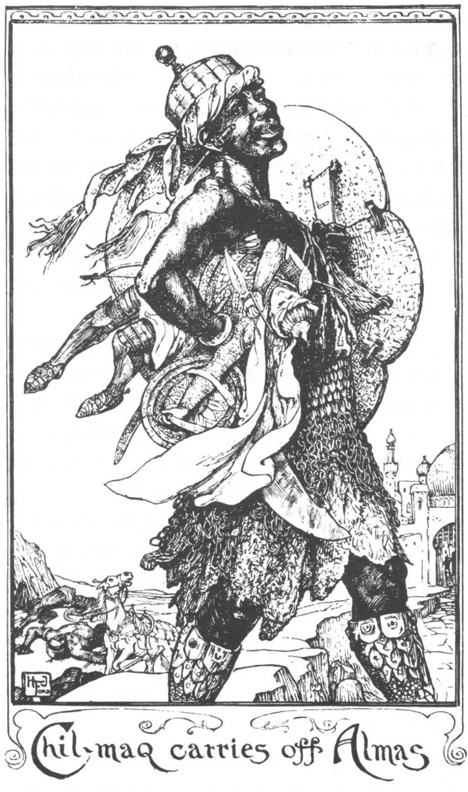

塔拉姆听到他的勇士阵亡的消息后，亲自带领一支黑人军队出阵。许多黑人倒在神奇的宝剑下，王子不顾一切地战斗着，直到几乎精疲力尽。在这万分危急的时刻，他用发火石点燃了一根狮子大王的头发。这时候，黑人又发起了猛烈的攻击，王子眼看就要当俘虏了。忽然，远处有一大群狮子奔驰过来，为首的正是狮子大王。黑人大吃一惊，喊叫着：“这些恶魔怎么会到这里来？”狮子的到来和它们威武的吼叫声给王子增添了无穷的力量。他继续战斗着，他的宝剑砍过去，敌人就被拦腰砍成两段；他的宝剑从头上劈下来，敌人就从头到脚被砍成两半。这时候，成千上万头狮子投入战斗，把敌人连同他们的马撕得粉碎。

只剩下塔拉姆一个人了，他正想撤回堡垒内，王子喊起来：“哪里去！你这可恶的人！想从我这里逃走吗？”听到这些蔑视他的话，黑人头领转过身来叫道：“来吧！小人，我要用铁棍把你打成肉饼。”他抡起铁棍向王子的头猛掷过去。王子踢了一下马，向他飞驰过来，铁棍打飞了。首领自以为他弹无虚发，正眼睁睁地看着。没想到王子已经冲到他的背后，挥起宝剑拦腰砍去，把他送进了地狱。

狮子大王极其赞美阿尔马斯王子的作战勇气。他们一起走进城堡，发现里面的装潢和摆设像王宫一样地富丽。王宫里还住着塔拉姆的女儿，她还是一个孩子。她派人带讯给阿尔马斯王子说：“啊！世界之王，请收容我这个奴隶做你的侍女吧！她将随你到任何地方去！”他派人把她找来。她吻了他的脚，接受了他的穆斯林信仰。他告诉她，他正要到一个很远的地方去，完成一个很重要的使命。等回来了，他要带她和她的一切到他的国家去，但现在她必须留在城堡里。接着，他把城堡里的一切都托付给狮子照管，说：“兄弟，看着它们，不要让任何人插手。”他从首领的马厩里挑了一匹好马，和他们说了再见，又继续赶路了。

走了许多天，经过了许多驿站，他来到了一片广阔的，无比美丽和生气勃勃的草原。草原上长满了各式各样的鲜花——玫瑰、郁金香、苜蓿。河水从迷人的草地上流过。这块地球上最美的地方，使他心中充满了惊奇。这里有一棵他从来没有见过的树，它长出来的树枝都是一样的，但上面却长着上千种不同的鲜花和果实。旁边的一个水库是用四种不同的石头装饰起来的：试金石、无瑕石、大理石和异域石。流进和流出水库的水就像玫瑰油一样。王子觉得，这肯定是辛默格的家园。他下了马，放了缰绳让马去吃草，自己吃了一些杰米娜为他准备的食物，喝了一点溪水，就躺下来睡觉。

马刨地和嘶叫的声音把他从梦中惊醒。他迷迷糊糊地张开眼睛，看到了一条大得像座山的巨龙，地下的石头被它的胸脯压成了粉末。以真主的名义，他拿起了弓，抽出三枝箭，把匕首插入腰带，把宝剑挂在胸前。他搭上箭，用尽力气射出，这力量如此之大，箭全部扎入龙的眼睛。龙痛得在地下乱打滚，喷出一股邪气，大地在龙头的撞击下直发抖。王子又搭上第二枝箭，射中了它的喉咙。它喘了一口气，张开大口准备把王子吞掉。但是它一靠近，王子就拔出宝剑，向它的头颈砍去。这有力的一剑把它的喉咙也割断了，一股污秽的气体向王子冲来，加上受到这古怪的庞然大物的惊吓，王子昏了过去。当他醒过来的时候，发现自己躺在死了的巨兽旁边，它的血把他浑身都浸透了。

王子的旁边有一棵神奇的大树。那种叫辛默格的巨鸟巢就筑在这棵树上。这时候里面有几只小鸟，它们的父母出去寻找食物了。巨鸟出去之前总是告诫它们的孩子，不要把头伸出鸟窝。但是，今天因为王子和巨龙作战，非常吵闹，它们都伸出头来观看，所以整个过程都看得一清二楚。龙被杀死以后，它们觉得非常饿，吵着要吃东西。于是王子把龙的肉一块一块地割下来喂它们，直到它们吃个够。接着，王子自己洗干净以后就躺下来休息。大巨鸟飞回来的时候，他还没有睡醒。通常这个时候，小鸟就伸出头来喳喳叫，欢迎它们的父母回来。可是今天因为吃饱了龙肉，它们都睡着了，一点声音都没有。

大巨鸟飞过来，看到巢里没有动静，王子睡在大树底下，以为许多年之前发生过的悲剧又发生了，它们的小鸟又失踪了。周围没有任何动静，它们怀疑王子是凶手。“他把我们的孩子吃掉以后就睡着了，他该死。”雄鸟说，它飞到山上，抓起一块大石头，准备把它扔在王子的头上。雌鸟说：“还是让我们先看看窝里吧！杀害无辜，到审判的时候就要判我们有罪。”它们飞近鸟窝，这时小鸟醒过来叫道：“妈妈，你们带什么回来给我们？”它们还说了树下发生的战斗，它们因为那个年轻人的帮忙才活了下来，他还把龙肉割下来给它们吃。雌鸟说：“真的！父亲，你差点干了一件蠢事，差点犯下可怕的罪行。”雄鸟飞出去把那块大石头扔掉。它那么沉重，一直穿到地球的中心。

巨鸟飞回来，看到一片阳光穿过树叶照在王子的脸上，就张开翅膀把阳光挡住，直到他醒过来。他起来以后，先向巨鸟致礼，巨鸟又高兴又感激地还了礼。抚摸着他问：“年轻人，告诉我真话，你是谁？从哪里来？你是怎么穿过那死气沉沉的沙漠的？那里从未有人涉足。”王子把他的故事从头到尾讲了一遍，完了还说：“现在，我由衷地希望，你能帮我到达高加索的沃卡。也许，在你的帮助下，我能完成自己的使命，为我的哥哥报仇。”

在回答之前，巨鸟首先感谢王子救了自己的孩子，他说：“你所做的事情还没有任何人做过，你有权利要求我的帮助，因为每年这个时候，龙总是来毁掉我的巢，我一直没有消灭它，感谢真主的恩典，你除掉了我小孩的顽敌。我把你当做自己的孩子一样地看待，留下来和我一起住吧！我会把高加索的土地给你，叫它的王子对你俯首称臣。放弃到沃卡去的旅行，它充满了危险，那里的神怪肯定要杀死你。”可是，说什么也动摇不了王子。看到这样，巨鸟说：“那好吧！就去吧！动身以前，你要到草原去猎取七头鹿，用它们的皮做成可以装水的袋子，把鹿肉分成七份。在前面的路上有七个海，我要带你飞过去。但是如果没有东西吃，没有水喝，我们就会掉入海中淹死。我要的时候，你就把肉和水送入我的嘴中，这样我们的旅途就安全了。”

王子照它的吩咐去做，他们开始飞行。每过一个海，王子就喂巨鸟一次。他们在最后一个海岸降落。巨鸟说，“我的孩子，前面就是你要走的路，沿着它走，一直到城里。拿走我的三根羽毛，要是遇到危险，你只要烧一根，一眨眼工夫我就会来到你面前。”

王子一个人孤独地赶路，来到城里。他到处溜达，走遍每一个城区，每一个集市，每一条弄堂和广场，思考着该向谁打听关于米赫·阿弗露兹这个谜语的消息。他花了七天的时间默默地想着。从来到这个城市的那一天起，他就和一个年轻的服装商交上了朋友，相互之间产生了很深的好感。有一天，他忽然对他的朋友说，“啊！亲爱的朋友，我希望你能告诉我，玫瑰给西纳伯带来了些什么？这个谜语到底有什么意思？”那商人大吃一惊，严肃地说：“假如我们俩之间不是存在着兄弟般的感情，你问我这个问题，我就会把你的头砍下来。”王子说，“你要是想杀了我，也应该先把我想知道的事情告诉我。”

商人看到王子那么坚决地想知道，说：“要是你想知道这件事情的真相，你只有等待我们的国王，没有别的办法，没有任何其他人会告诉你。我有一个叫法鲁克·法勒的朋友在王宫里做事，他会把你介绍给国王。”“那太好了。”王子说。商人安排王子和法鲁克·法勒见了面。法鲁克·法勒把王子带到国王面前，把他介绍给国王，说他是一个外乡人和旅行家，从遥远的地方来，到西纳伯国王这里来寻求保护。

巨鸟辛默格曾送给王子一个大钻石。这时，他把钻石拿出来献给国王。国王立刻看出它的价值，问他是从哪里得到的。王子说：“我，你的奴隶，曾经拥有财富、国家和权力。在我的国家里有许多这样的宝石。在经过刀光剑影的城堡时，我被抢劫一空。我把这颗钻石藏在浴衣里，才得以保存下来。”作为这颗钻石的回报，西纳伯国王送给王子许多贵重的礼物，他记得这颗钻石是王子的唯一财产。国王表现出最大的仁慈和宽宏大量，他吩咐侍从把王子安置在王宫客房里。他和这位外乡人相处得非常愉快，他们天天在一起，度过最快乐的时光。国王有好几次对他说：“向我要一些我可以给你的东西。”

有一天，他非常想知道做什么能让王子高兴。于是王子说：“我只有一个愿望，我要私下告诉你。”国王立刻命令所有的人离开。阿尔马斯王子说：“我一生中的愿望是想知道，玫瑰给西纳伯带来了些什么？这句话有什么意思？”国王大吃一惊，说：“以真主的名义，要是别人问我这个话，我立刻就杀了他。”王子听了以后，沉默不言。国王这时候正说得高兴，所以，他不可能把王子杀掉。

时间在流逝，国王一次又一次地请王子向他要礼物，但总是得到同样的回答：“我唯一的愿望是祝你幸福，此外还有何所求呢？”有一天晚上，王宫里举行宴会，金杯和银杯中盛满了美酒。歌手们亮出最美的歌喉，竞争奖品。王子用国王的酒杯喝酒。酒使他的头脑发热，他从演奏家的手中拿过诗琴，边唱边奏起来。歌声和琴声倾倒了所有的人，四周都响起了欢呼声和喝彩声。国王斟满了一杯酒，把王子叫过来，递给他，说：“说出你的愿望，这是给你的。”王子把酒一饮而尽，说：“啊！统治世界的国王，请记住，我一生只有一个目的，那就是想知道，玫瑰给西纳伯带来了些什么。”

“现在还不能告诉你，”国王回答，“提出这个问题的人，有谁还活着吗？假如这是你唯一的愿望，那么好吧！我会告诉你的。但有一个条件，你知道以后，要准备去死。”王子同意了，说：“我决不后悔！”

国王命令随从，在他的旁边铺上一块高贵的欧洲天鹅绒地毯，一条戴着金子和钻石链条的狗被带了进来，坐在华丽的地毯上。一群美丽的姑娘围着它站着，等待着。

接着，十二个黑人嘴里说着粗鲁的话，拖进一个可爱的女人。她衣着褴褛，手上和脚上都戴着铐链。他们叫她跪在光地板上。她是出奇的美丽，足以使光辉的太阳自愧不如。国王叫人在她娇嫩的身上抽上一百鞭，她深深地叹了一口气。一张桌子铺上台布，食物送进来了。美味的肉放在狗的面前，用水晶玻璃做成的王宫杯子给它斟上了饮料。狗吃饱了以后，剩下的残羹剩饭送到那女人的面前，叫她吃掉。泪水从她脸上滚滚而下，变成了一颗颗珍珠；当她微笑的时候，嘴唇上就绽开一朵玫瑰花。这些珍珠和玫瑰花都被收集起来，送入宝库。

国王说：“现在你看到了吧！你的愿望满足了吧！”王子说：“是的，我看到了。但是我不明白，这意味着什么？里面有什么故事，请告诉我再杀了我。”

国王说：“你看到的，用链条锁着的女人是我的妻子。她叫古露，也就是玫瑰。我叫西纳伯。有一天，我出去打猎，觉得非常干渴。找了许久以后，才发现了一口井。那口井隐蔽得非常好，不论是野兽、鸟，还是人，不花大气力是难以发现的。我孤身一人，用头巾做绳子，用帽子做水桶。井水里有许多水。我把绳子放下去，但是拉不上来，有什么东西把它抓住了。我对着井口喊：‘啊！真主的仆人！你到底是谁？为什么和我过不去？我渴得要死，松开绳子吧！看在真主的份上。’井底传来了喊叫声：‘啊！真主的仆人，我们在井下很久了，看在真主的份上，把我们救上来！’我想方设法，费了好大的劲，才把两个瞎眼的女人拉上来。她们说自己是佩里人（传说中半神半人的人），她们的国王发怒的时候，把她们的眼睛弄瞎以后扔入井中。”

“‘现在，’她们说，‘要是你能治好我们的眼睛，我们就发誓为你效劳，你要我们干什么都行。’”

“‘如何能治好你们的眼睛？’我问。”

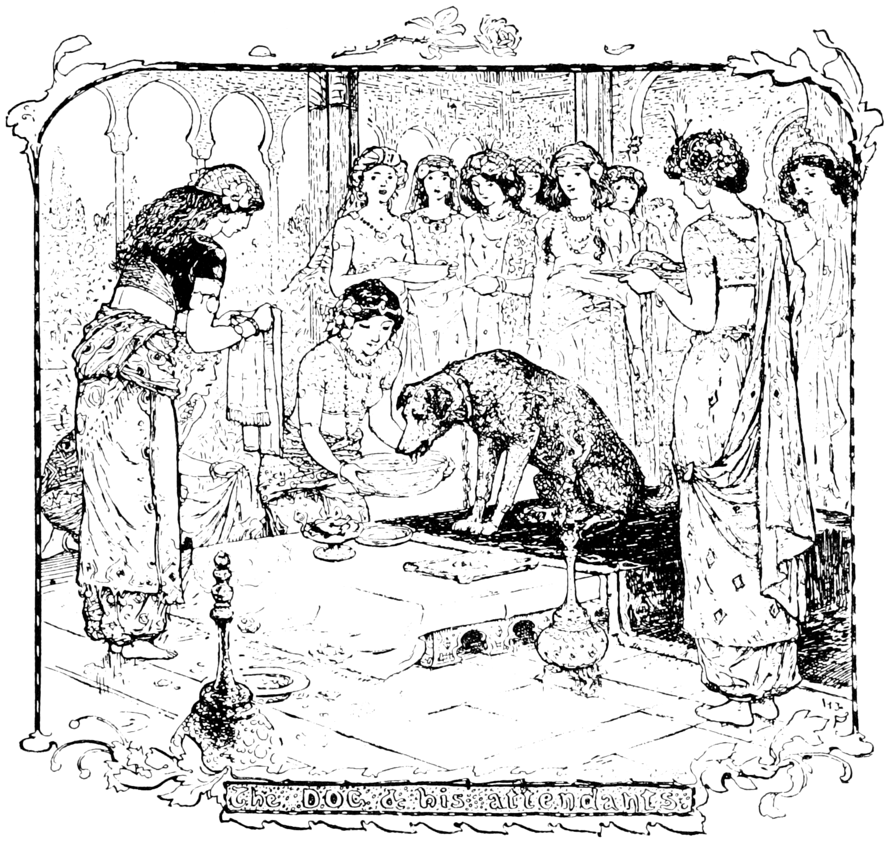

“‘离这里不远，’她们说，‘有一头母牛从大海里上来吃草，捡一点它的粪便，就能治好我们的眼睛。我们将永远欠你的债。不要让母牛看见你，要不它就会杀死你。’”

“我重新鼓起勇气，打起精神，来到海边。我看到母牛从海里上岸，吃草，又回到海水中去。我从躲藏的地方走出来，弄了一点牛粪，把它带回给两个女人。她们用牛粪擦了一下眼睛，感谢真主，她们又重见光明。”

“她们谢了真主和我，然后考虑如何表达对我的感激之情。她们说：‘我们的佩里国王有个女儿，他视为掌上明珠，寸步不离，认为她是天底下最美丽的姑娘。那是真的，没有一个姑娘能够和她相提并论。现在，我们要把你领到她的房间里去，你要赢得她的心。要是她倾心于别人，你要把他从她的心中抹去，让她忠心于你。她母亲是如此的爱她，看不到她就会觉得心中不安。她不会把女儿嫁给任何人。让她爱上你，叫她离开了你就无法活下去。但这些事情如果让她的母亲知道，她就要用火来烧死你。如果这种事情发生，你必须请求她做最后一件好事，在你的身上涂上油，以便烧得快一些，少受些折磨。假如国王同意了，我们俩就会设法当你的擦油人，在你身上涂上一种油，即使你在火中烧上一千年，也不会留下任何痕迹。’”

“后来，两个佩里人把我带到那姑娘的房间里。她正在睡觉，那姿势非常优雅。她果然是非常可爱。我深深地被她那完美无瑕的美貌吸引住了。我如此惊讶，以至于像木头人似地呆住了，也不知道这是梦幻，还是实实在在的事情。最后，我相信，她真是一个有血有肉的女子，真是谢天谢地。我，一个竞走者终于到达了终点；一个觅宝者终于找到了宝库。”

“姑娘张开眼睛看到我，害怕地问：‘你是谁？是来偷东西的吗？你是怎么到这里来的！快走吧！从毁灭的旋涡中逃命吧！看护我的守护神和人很快就会醒过来抓住你。’”

“可是，爱神之箭已经深深地射中了我，也射中了那姑娘，她充满爱意地看着我。我不能走。一连好几个月，我躲在她的房间里。我们不敢让她的母亲知道我们在相爱。有时候，姑娘非常悲伤和害怕，生怕她的母亲进来看到。有一天，她父亲对她说：‘我的心肝，一段时间以来，我已经注意到，你的美丽不像以前那样了。怎么回事？是不是病了？告诉我，我好想办法给你治疗。’天啊！现在再也不能掩盖爱情给她带来的欢乐和烦恼了。秘密公开了。我被关进监狱。我的玫瑰失去了她的所爱，她的世界变成了一片黑暗。”

“佩里国王下令把我烧死。他说：‘你，一个普通人，为什么在我的家里做出这种不忠的事情？’他的手下人搬来了柴火，堆成一堆。正当他们准备把我推上去的时候，我想起了那两个我救过的佩里人说的话。我要求在我身上擦上油，好让我少受一些折磨。他们同意了。她们两个人果然争取到了这个机会，来给我擦油。我被架在柴堆中烧起来，一连七天七夜。根据伟大国王的命令，没有任何人来监督我。一个星期以后，国王命令把灰扔到垃圾堆里去，他们发现我还活着，没有损伤一根毫毛。”

“那些亲眼看见玫瑰因为爱我而憔悴的佩里人对国王说：‘事情很明白，你女儿的命运和他戚戚相关，所以火也不能伤害他。他们相亲相爱，最好还是把姑娘嫁给他吧！他是沃卡的国王，你再也找不到比他更好的人了。’”

“国王同意了，我和玫瑰举行了正式的婚礼。现在你看到了，为了得到这个无情无义的东西，我付出了多少代价。啊！王子！别忘了我们之间的协议。”

“我没有忘记。”王子说，“但请告诉我，玫瑰王后怎么会落到现在这种境地？”

“有一天晚上，”西纳伯国王继续说，“我被玫瑰那冰冷的手和脚弄醒。我问她到哪里去过，怎么会这样冷。她说她不得不出去。第二天一早，我到马厩里去，看到我的两匹马，”风脚“和”老虎“，又瘦又累。我训斥马夫，打了他一顿。马夫问，他有什么过错？说我妻子每天晚上都骑其中的一匹马出去，到天快亮的时候才回来。我怒火中烧，她会到什么地方去？去干什么呢？我叫马夫不要声张，下一次玫瑰骑着马出去以后，马上给另一匹马备好马鞍，给我牵出来。那一天我没有出去打猎，呆在家里察看动静。晚上，我像往常一样上床睡觉，假装睡着了。玫瑰起来向马厩走去。这一天，轮到”老虎“，她骑着它走了。我骑着”风脚“紧跟出去。你看到的那条忠诚于我，永远也不会离开我的狗跟着我。”

“我来到城外山脚下，看到玫瑰下马，向一些黑人住的房子里走去。门的正里面有一张高高的床位，一个身材高大的黑人躺在上面。她向他致礼，他站起来，开始打她，直到她身上留下鞭痕，她一声也不吭。我惊讶得直发呆，有一次我用玫瑰树枝碰她一下，她整整抱怨和烦恼了三天！接着，黑人骂道：‘怎么啦！你这该死的丑八怪，为什么这么晚才来，为什么不穿上结婚的礼服？’她回答说：‘那个人好久没有睡着，他整天没有出去，我没法打扮自己。我已经尽可能快地赶来了。’过一会，他叫她坐在身边。我无法控制自己，再也忍耐不住了，向他扑过去。他抓住我的衣领，和我扭打在一起，展开了生死搏斗。她忽然冲到我背后，抓住我的脚拼命地拉。他把我压在地下，她抽出我的刀递给他。要不是那条忠诚于我的狗扑过来，咬住他的喉咙，把他拖出去压在地下，我早就被他杀死了。我站起来，结束了这个恶棍的生命。那里还有四个黑人，有三个被我杀了，有一个逃走了，逃到奎穆斯国王的女儿米赫·阿弗露兹那里去，在她的王座下找到了庇护所。我把玫瑰带回王宫。从那个时候起，我把她当作狗来看待，把我的狗当成我的妻子。现在，你明白了玫瑰给西纳伯带来什么了吧！你必须履行和我的协议。”

“我将信守我的诺言。”王子说，“但能否拿些水到屋顶上去，让我进行最后一次沐浴？”

国王同意了他的请求。王子爬上屋顶，走进一个角落，用打火石点燃了巨鸟的一根羽毛。一瞬间，巨鸟出现了，它的威严使整个城市都在发抖。它让王子坐在背上，向九天云霄翱翔而去。

过了一会，西纳伯国王说：“那个年轻人在房顶上呆很久了，去把他带下来。”但是房顶上丝毫不见他的踪影，只见在遥远的天际，那只巨鸟正带着他在飞行。国王听到他逃走的消息，感谢真主使自己的双手免沾鲜血。

巨鸟不停地向高处飞去，大地越来越小，像海洋中的一个鸡蛋。最后，它在自己居住的地方降落。王子受到小鸟的欢迎和最热情的款待。他给它们讲玫瑰和西纳伯的故事。后来，他带着巨鸟送给他的珍贵礼物，回到刀光剑影城堡。狮子之王出来迎接他。他和黑人首领的女儿，她的名字也叫玫瑰，举行了正式的婚礼，带着她的财产和随从来到“馈赠之地”。他们在那里停留了一个晚上，第二天和狮子之王说再见，就向杰米娜的国家走去。

杰米娜姑娘听说阿尔马斯王子回来了，就带着许多漂亮的侍女出来，热情地欢迎他。他们的相会充满了欢乐，回到花园王宫以后，杰米娜请来了她所有认识的重要人物，和王子庄严地举行了婚礼。几天以后，她把一切事务都托付给别人，准备和王子一起回到他的国家去。在她离开之前，她把所有中了她姐姐魔法的鹿恢复原形，送他们回到自己的家乡。他们对她表示了祝福，邪恶的拉蒂法被孤独地留下。一切都准备好了，他们带着所有的仆人、宝藏和财产，愉快地踏上前往奎穆斯国王首都的征途。

国王奎穆斯听说来了这么一大批人马，就派出他的大臣去隆重地欢迎王子，问是什么原因促使他欣然来访。王子回话说，他不是为了战争而来。他送来的一张条子上写着：“奎穆斯国王，请你明白，我到这里来，是为了结束你那傲慢女儿的罪行。她像暴君似地处死了许多国王和王子，把他们的头挂在城垛上。我来是为了解开她的谜语。”接着，他进入城市，敲响了鼓，来到国王的面前。

国王劝阻他，说没有人能解开这个谜语，没有人能够活着过这一关。王子回答说：“啊！国王！我就是为了解开这个谜语而来的，我决不会退缩。”

米赫·阿弗露兹被告知，有人拿他的头来打赌，要解开她的谜语，还说他知道真正的答案。在王子的要求下，这块土地上所有的官员和知名的人都被召集来，听他如何答复公主。所有的人都到齐了，国王和他的王后、女儿都来了。

王子问米赫·阿弗露兹，“你的问题是什么？”

“玫瑰给西纳伯带来什么？”她回答。

王子微笑着，转过头来问大家：“你们都是富有经验，见过世面的人，有谁见到过或听说过这种事情吗？”

“没有，”他们回答，“没有任何人知道或听说过这种事，这只是纯粹的幻想。”

“那么，公主是从哪里听来的呢？”王子说，“这种空想令许多真主的仆人去死了。”

所有的人都明白他话中的善意，表示赞许。王子转过头来问公主：“请告诉我们真话，谁告诉你这种事情？这件事我已经了解得一清二楚。但是，如果我把所知道的一切告诉你，谁将证明我说的是真话？你必须把能证明我的话的人叫来。”

她的心一沉，担心长久以来保守的秘密会公开。但是她只是说，“你自己解释。”

“你把藏在你座位下面的黑人带来，我会自己解释清楚。”

这时候，国王吃惊地叫起来：“年轻人，你要说清楚！我女儿在座位底下藏着什么黑人？”

王子说：“你派人去把公主座位底下的黑人带来，就会明白。”

卫兵被派到公主住的花园房子里去。过了一会，他们带回来一个黑人。他们在公主座位下面的一间密室里找到他。他穿着高贵的衣服，密室里有许多奢侈品。国王吃惊得不知所措。公主这时已经镇静下来。她想，王子也许只知道这个黑人，不知道整个事情。她傲慢地说，“王子！你还没有回答我的谜语呢！”

“真是一个不知羞耻的人，”王子说，“你还不觉得后悔吗？”

他转过身去，向所有的人讲述玫瑰和国王西纳伯的故事。当他说到那些黑人被杀时，他对站在大家面前的黑人说：“你当时也在场。”

“是的，一切都像你所说的那样。”黑人说。

整个王宫和整个国家都沉浸在极大的欢乐之中。谜语终于解开，再也不会有国王和王子被杀。奎穆斯国王把女儿交给阿尔马斯王子。但是，他把她当做俘虏，不愿意娶她为妻。接着，他要求把城垛上所有的人头取下来，为他们举行厚葬。这些都照办了。他从国王那里接受了所有属于米赫·阿弗露兹的东西，她的金子、银子和宝藏，她的贵重的织品和毛毯，她家里的设备，她的马匹和骆驼，还有她的佣人和奴隶。

回到营地，王子派人找来了蒂尔·阿拉姆。她带来了自己收藏的黄金和宝石，物品和财产。一切都办妥以后，阿尔马斯王子动身返回家乡，还带着杰米娜、蒂尔·阿拉姆、黑人首领的女儿，还有邪恶的米赫·阿弗露兹，以及她们四个人的所有财产和物品，装上了数不清的马匹、骆驼和车子。

他来到了父亲王国的国界，消息立即传遍了整个国家。全国的人都倾城而出来欢迎他。他的父亲，国王萨曼拉珀斯因为痛失自己的儿子，双眼都哭瞎了。王子走过来吻了他的脚，接着从一个小盒子里拿出巨鸟送给他的一瓶所罗门洗眼液，擦了一下国王的眼睛，国王立刻重见光明，看到了儿子。这种洗眼液据说能让人看得见埋在地下的东西。

米赫·阿弗露兹被带到国王的面前，王子说：“这是杀害你儿子的凶手，随你怎么处置她。”国王想，王子可能会喜爱这姑娘的美貌，说：“你已经征服她，你爱怎么处置都行。”

听了这话，王子叫人拉来四匹快马，把那个黑人缚在四匹马上，将他四马分尸。这可吓坏了米赫·阿弗露兹，她想自己也要遭受同样的命运，哭着对王子说：“啊！阿尔马斯王子，最难得到的东西才是最宝贵的。到现在为止，我还没有属于任何男子，也没有一个男子得到过我的爱。许多国王和王子死在我的手中，那是因为他们命中注定如此。在这件事上，我没有罪。而且这件事情从一开始，我的命运就和你的命运联结在一起。”

王子相信了她这种前世姻缘的解释，她又是那么的可爱，于是，他也和她合法地结婚。她和杰米娜住在一起，蒂尔·阿拉姆和黑人首领的女儿住在一起。王子和她们四个人美满幸福地度过了这一生。

现在，你知道玫瑰给西纳伯带来什么了吧！

（波斯传说）

 

## 鲍尔和大坏蛋

在森林的深处，有两间小茅屋。有一间住着一个很有名气的猎人和他的妻子，还有三四个孩子。他们只允许孩子们在茅屋的附近玩耍，不许他们走得太远。因为在这片大森林的边缘有一条大河，河边住着一个巫婆，她有一个魔球，她用这个魔球来骗走小孩。

她的计谋非常简单，而且从不失算。只要她看中那个小孩，就把球朝着小孩的方向扔过去，不论有多远，魔球准能滚过去。等小孩看到球，想得到它以后，它就慢慢地滚回去，而且总是和小孩保持很短的一段距离。小孩总是以为，很快就可以抓到这个球，但是他永远也抓不到。他的父母从此以后就再也看不到他了。

当然，那些父母丢了孩子以后，都想尽办法要把他们找回来。可是森林那么大，而且巫婆非常狡猾，她总是知道他们会到哪里去找，早就把他们的孩子藏起来。再说，森林里有那么多狼，父母找不到孩子后，会想可能是给狼吃掉了。

有一天，碰巧老巫婆想找一个小男孩，她把魔球向猎人家的方向抛去。这时，猎人的一个孩子鲍尔正在练习射箭。他一看到魔球，立刻就被吸引住了。那个魔球是用玻璃做的，散发着蓝色、绿色和白色三种光芒，而且不停地变幻着，闪烁着。他扔掉弓箭，弯下腰来想捡起就在脚下的球。可是，就在他快碰到球的时候，它突然开始缓慢地向山下滚去，球离他那么近，他一步不离地追赶着。但球总是好像就要到手，却永远也碰不到。他追得快，球就滚得快；他追得慢，球就滚得慢。有时候，仅仅是只差几根头发丝的距离。他不停地跟着球跑啊！蹦啊！跳啊！绊倒了又爬起来。不久，他就来到了女巫的家里。

“欢迎！欢迎！我的小孙子！”她说，“坐下来休息一会，走了那么长的路，我想你一定累了。”于是小孩坐下来，吃她递过来的碗里的食物。他觉得好吃极了，从来没有吃过这么好的东西。他把碗底都舔干净以后，女巫问他，以前是否斋戒过。

“从来没有过，”鲍尔回答，“有时候，大人也要我斋戒，但是只要能找到一点吃的东西，我就不肯。”

“假如你想要神灵来帮助你，让你更加聪明，更加强壮，你就必须斋戒，而且越快越好。”

“那好吧！”孩子说，“开始我该做什么呢？”

“躺在门外那些水牛皮上面。”她回答。

他在水牛皮上躺下。森林里的松鼠、小熊和小鸟都过来看他，和他说话。十天以后，老妇人出来看他，给他一碗上次吃过的东西。

“起来，我的孙子，你斋戒的时间够长了。那些好神灵都来看过你，赐给你所希望的力量和智慧了吗？”

“有些神灵来过，给了我一些力量和智慧。”小孩回答，“但有许多神灵只是远远地看着我。”

“那样的话，你还得斋戒十天。”她说。

小孩又在水牛皮上躺下，又斋戒了十天。十天以后，他翻了个身，脸向墙壁，又斋戒了二十天。最后，女巫叫他，对他说：“起来吧！吃点东西！我的孙子。”

听到她的声音，小孩站起来，吃了她送来的东西。吃完以后她又问他：“我的小孙子，告诉我，在你斋戒的这么多日子里，所有那些好的神灵都来看过你了吗？”

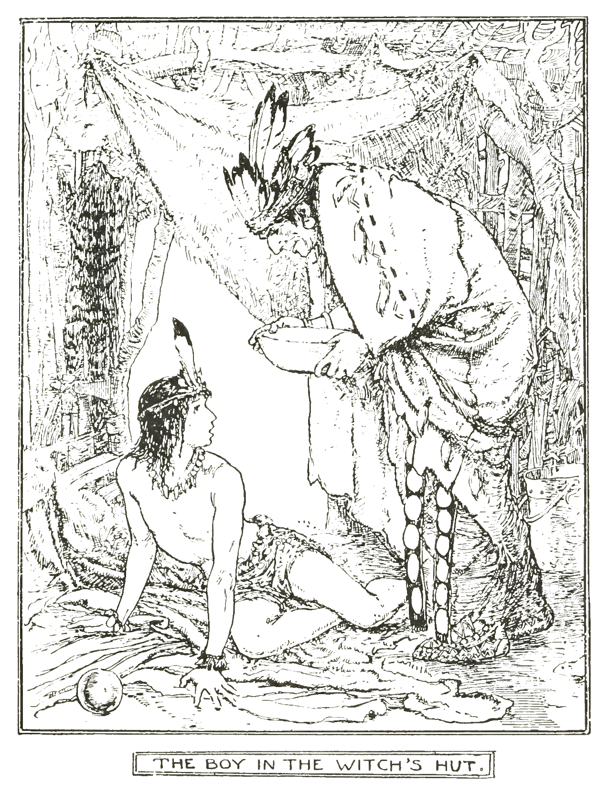

“奶奶！没有，”他说，“还有一些神灵远远地站着，说我斋戒的时间还不够长。”

“那你还得斋戒下去！”老妇人说，“直到得到所有好神灵的礼物，一个也不能漏掉。”

鲍尔什么也没说，第三次在水牛皮上躺下，又斋戒了二十天。到最后一天，他脸色苍白，身体丝毫也不动。女巫以为他死了。但是，她给他喂了一碗食物以后，他又恢复了健康，能够坐起来了。

“你已经斋戒了很长时间，”她说，“比以前任何人斋戒的时间都长，那些好神灵现在都觉得满意了吧！”

“是的，奶奶，”男孩回答，“他们都来了，而且都把礼物送给我了。”

老妇人听了这话非常满意，又给他拿来一盆食物，一边看着他吃，一边对他说了下面这些话：

“在这条大河的对岸，很远的地方，住着一个大坏蛋。他的房子里有许多金子，还有比金子贵重许多倍的一座小桥。只要大坏蛋把手一挥，这座小桥就会伸长，所以天底下没有他过不了的河流和海洋。现在，我需要这座小桥和一些金子，这就是我为什么用我的球诱来那么多男孩子。我教过他们如何去得到那些好神灵的礼物。但他们斋戒的时间都不够长，到后来我只能派他们去做一些简单而容易做的事情。只有你既忠诚又强壮，只要你照我的话去做，就能办到这件事。你到了河边，就把这个球拴在脚上，它就会帮你过去，除此之外没有别的办法。不要害怕，相信这个球，你会万无一失！”

鲍尔拿起球，放在一个袋子里。他又做了一根木棍，一根弓和一些箭，这些箭当然射得比谁的都远，因为那些神灵给了他力量。他们还赐给他能改变自己形状的魔力，还让他的眼睛更敏锐，耳朵更灵，什么都逃不过他。他们还教会他在需要的时候，如何求得神灵的帮助。

所有这一切都准备好以后，男孩和巫婆告别后就出发了。他在森林里走了几天几夜，一个人影也看不见，只有这些朋友：松鼠、熊和小鸟常来和他作伴。他有时也停下来和它们说话，但很小心地不让它们知道自己要到哪里去。

走了许多天以后，他终于看到了大河。在大河那边，他看到山脚下有一间小屋。他想，那就是大坏蛋的家了。可是河水流得那么湍急，要过去真是难以想象。为了试探水流的速度，他折下一根树枝，把它扔入河中。树枝好像还没有碰到河水，就被水流冲去，转眼间无影无踪，他神奇的眼光也无法追踪。他真有点害怕，但是一旦下了决心去做的事情，他从不退缩。他把球拴在右脚上，勇敢地向河里走去。令他吃惊的是，他能够在河水中站立。然而，汹涌澎湃的河水还是吓得他不由自主地退上岸来。约莫一二分钟以后，他定定神，又勇敢地向河里走去，可是又被吓退了。这一回，他为自己的懦弱感到羞耻。两次在河水中站立，也增强了他对魔球的信心。第三次，他终于鼓足勇气走到河对岸。

他把魔球解下来，放进袋里，小心地观察着周围。大坏蛋屋子的门开着，可以看得见屋顶是用大树杆支撑起来的。装着黄金的口袋和那座小桥就挂在天花板上。他还看见，大坏蛋就坐在他的宝藏之中，正在用餐，还不时用角杯喝着些什么。显然，他必须想法子把大坏蛋骗走，否则他无法偷到那些黄金和小桥。

他该做什么呢？发出可怕的尖叫声，好像痛苦得快要死去了一样来吸引大坏蛋？可是大坏蛋才不管谁的死活呢！叫他的名字，不！大坏蛋很狡猾，他会猜出这是个引人上钩的诡计。必须想出更加好的办法来。忽然，男孩有了主意。是啊！怎么会没有想到呢！他高兴地跳了起来。他集中自己的全部意念来控制大坏蛋，叫他觉得肚子非常饿，饿得那些仆人来不及送吃的来。果然，大坏蛋开始大喊大叫起来：“你们送来的东西还不够一只麻雀吃。快给我多拿一些来，我快饿死了。”说完，还没等仆人走进贮藏室，他就自己跳起来，冲到厨房里去。

厨房的门刚关上，鲍尔就跑进来，从屋顶上拉下一袋黄金，把它挂在自己的左肩膀上，然后又解下小桥，挟在自己的右腋下。这时候，他不想逃走。大约那些和他同龄的男孩子这时候十有八九是要逃走的。凭着那些好神灵赐给他的智慧，他知道，在他还没有逃到河边，架起小桥过河之前，大坏蛋就会发现，跟着他的脚印追过来抓住他。所以，他把自己变得很小，藏在角落里一堆牛皮的后面，把牛皮拉出一条缝，从缝里看着会发生什么事情。

他刚刚把自己藏好，仆人走进来。这时候，天花板上最后的一袋黄金也掉了下来。因为这些口袋都是用绳子连在一起的，男孩解开了第一袋，其余的也就接二连三地掉下来。仆人大声呼叫起来，告诉她的主人，有人偷走了黄金和小桥。大坏蛋冲进来，气得发疯，叫她到外面去找，看看有没有脚印，以便去追赶窃贼。过了几分钟，仆人回来说，外面没有脚印，那个贼肯定还在屋子里。于是他们翻箱倒柜，到处寻找，可是没有找到男孩。

“他肯定躲在什么地方！”她自言自语地说着，又搜查一遍牛皮堆。这一回鲍尔知道躲不过了，赶紧祈祷大坏蛋再也不想吃东西了，免得找到他以后把他吃掉。

“啊！这牛皮堆里有一处空隙，让我来看一看！”她掀开牛皮，“好啊！你在这里！”她一把把他拉出来。他看上去是那么瘦，那么小，麻雀一口也能够把他吃掉。

“是你偷了我的黄金和桥吗？”大坏蛋问。

“是的，”鲍尔回答，“是我把它们偷了。”

大坏蛋向女仆做了个手势。她问鲍尔把东西藏在什么地方？鲍尔举起左臂，露出腋下的黄金。她拿起一把刀走过来，把他藏黄金的地方一层皮也刮下来，免得上面沾着黄金。“还有桥呢？”鲍尔举起右臂，她把挟在腋下的桥拿走。大坏蛋在旁边看着，很开心，咯咯地笑着，“他果然没有逃走。烧一些水，准备把他煮来吃掉。我出去邀请我的朋友水魔来赴宴。”

女仆用手指把鲍尔抓起来，打算把他带到厨房里去。这时鲍尔开口了，“我这么瘦，这么小，真不值得煮。不过要是你肯留我两天，让我吃好多好吃的东西，我会长大长胖。要不，你们的朋友，那些水魔会想，你们是在和他们开玩笑，拿这么小的东西来请他们吃。”

“嗯！也许你说得对。”大坏蛋说，“我要养你两天。”说完就到水魔家做客去了。女仆把他带进一个小房间，用一根链条把他锁在墙上，每隔一个小时就给他吃东西。两天以后，他又胖又大，像圣诞节的火鸡，头胖得快转不动了。

“现在差不多了。”大坏蛋说，他每天都要来观察几次，“我要到水魔那里去，邀请他们来吃晚饭。把锅放在火上，但不论如何不许你尝试里面的汤。”他转过身来对女仆说。

女仆立即照主人的吩咐去做。她把火生旺，向锅里倒满水，再用绳子把它吊在火上，把鲍尔带过来。鲍尔看到一切都准备好了，就祈祷当他在锅里的时候，水只会吱吱地冒泡，但不会烧开。他还祈求那些神灵把清水变成肉汤。

锅里的水不久就发出响声并起泡，女仆把鲍尔放进去。很快，锅里就浮起一层可以做调料的油水。鲍尔在汤里滚来滚去，不过他还能说话。他对女仆说，最好试试汤的味道，好像应该加点盐。女仆心中很明白，主人禁止她这样做，但一听到这句话，就觉得一股香味扑鼻而来，情不自禁地从墙壁上取下一把长柄勺子，伸入锅里。

鲍尔说：“你站得那么远，会把汤打翻的，为什么不靠得近一些。”她靠过来了。这时，鲍尔请求神灵恢复他的形状和力量，并且把水烧开。他跳起来，把锅子踢翻，滚烫的水全浇在女仆的身上。他又从天花板上摘下黄金和小桥，拿起他的棍和弓箭，放一把火把大坏蛋的房子烧了，就向河边奔去。在小桥的帮助下，他安全地渡过了河。

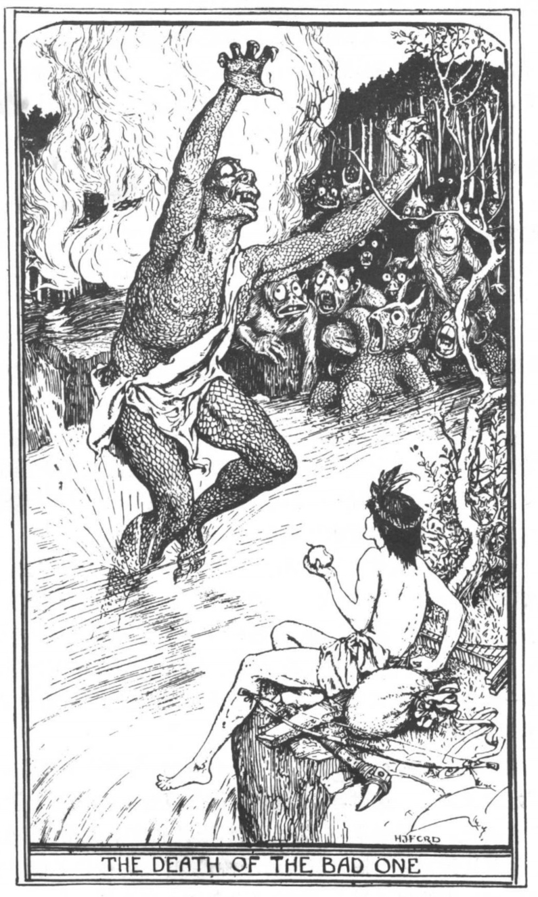

大坏蛋的房子是用木头做成的，等他带着一大帮水魔回来的时候，房子早已化为灰烬，不留任何东西，也不见一个人影。他赶到河边，看到鲍尔不动声色地坐在对岸，明白发生了什么事情。他转过身来，告诉水魔今天没有什么宴会以后，就对正在吃苹果的鲍尔说：“我知道你是谁了。我已变得一无所有，你能收下我做佣人吗？”

“当然可以，尽管你想过要杀死我。”鲍尔说着，把桥向河上抛去。大坏蛋上了桥。可是当他走到中央时，鲍尔祈求桥变小，大坏蛋掉到河中淹死了，世界上从此少了一个坏蛋。

 

## 鲍尔如何完成使命

鲍尔设法淹死大坏蛋，叫他再也不能为非作歹以后，忘了回家的路，怎么找也找不到。这段时间里，他到处流浪，去过许多陌生的地方，碰到过许多危险。有一天，他看到一间房子，就走了进去，里面住着一个年轻的姑娘。他又饥又渴，请求让他留下来。他在这里住了很长时间，那姑娘成了他的妻子。一天早上，他看到两个小孩在外面玩，就走过去和他们说话。可是小孩看见他，就吓得大哭起来，逃走了。妻子对他说，“他们是我姐姐的小孩，她出远门去了。她回来知道你是我的丈夫后，就要杀死你。”

“是吗？那好吧！让她试试。”鲍尔说，“已经不止一次地有人想杀我了，我不还是好好的吗？你看！”

“小心！”他妻子说，“她非常狡猾。”

这时，她的姐姐走进来了。

“你好啊！兄弟，我经常听说你，非常想见你。听说你是世界上最强的男人。我也非常强，让我们来比比看，谁更强些。”

“这太有趣了，”他回答，“让我们先来比赛短距离赛跑，然后再比别的。”

“这对我来说，太合适了。”女人说，因为她是一个巫婆，“让我们说定了，谁赢了就有权力杀掉另一个。”

“当然可以，”鲍尔说，“我想再也找不到比草原更好的竞赛场地了。它一望无边，谁也说不清有多少里远，让我们跑到边缘再返回来。”

事情就这样说定了。两人都做好赛前的准备。鲍尔默默地祈求那些善良的神灵帮助他，不要让他落入这个邪恶的巫婆手中。

他们两个肩并肩地站在起跑线上。她说：“当太阳照到树上的时候，我们就开始。”从第一步开始，鲍尔就把自己变成一只狼，一直处于领先的位置。可是过了不久，他就听到她慢慢地追上来，越来越接近，最后超过他。鲍尔变成一只鸽子，迅速地飞到她的前面，但过了一会又被她超过。眼看就要到草原的尽头。“乌鸦飞得比鸽子快。”他想，又变成一只乌鸦，赶过了她。在相当长的时间里一直飞在前面。他想，她肯定要输了。巫婆也害怕起来，她竭尽全力，又超过他。他赶紧变成一只鹰，第一个到达草原的边缘，但没有多少优势，两人几乎同时转身折回。

他不断地变成各种各样的鸟，又不断地被她赶上和超过。终点眼看就要到了。鲍尔心中明白，现在如果还不领先，就会在自己的家门口，当着妻子的面被杀掉。因为疲倦，他的眼睛开始模糊，翅膀也越来越沉重，而巫婆还是显得那么生气勃勃。什么鸟能够飞得更快呢？那些善良的神灵能否告诉他？啊！对了！一瞬间，他变成了一只披着绿色和蓝色羽毛的小鸟，轻松地哼着歌曲，超过了巫婆，第一个进入房间。巫婆气喘吁吁地跟着进来，为输掉这场自以为能赢的比赛非常气愤。这时候，鲍尔已经恢复原形，朝她的头上猛击一下，结束了她的生命。

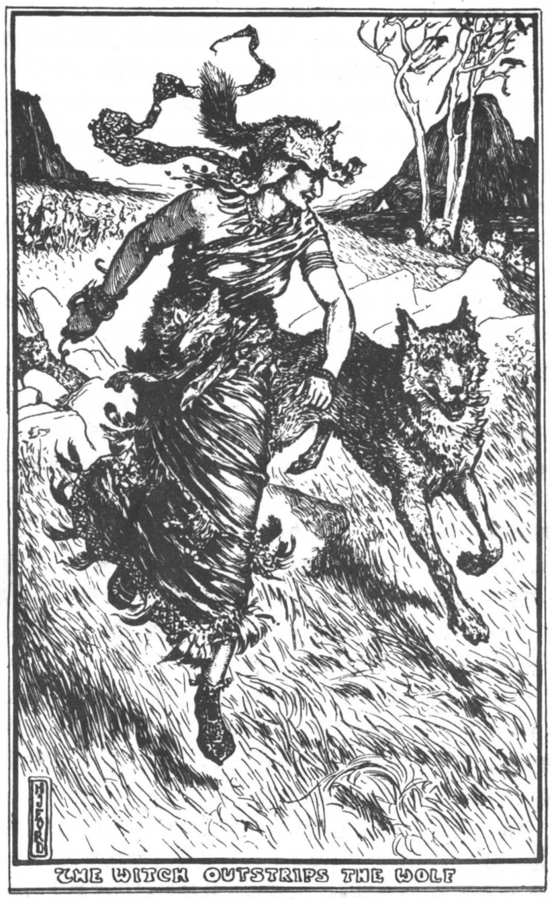

在相当长的一段日子里，鲍尔太平地和妻子、孩子一起过日子，感到很满足。他对冒险已经感到厌倦，每天只是出去猎取一些野兽，以维持日常生活。可是有一天，他不巧吃了从森林里采来的，有毒的果子，严重中毒，他觉得自己快不行了。

“我死了以后，不要把我埋在地下，”他吩咐妻子说，“把我放在森林那边的树杈上。”他妻子和三个孩子守在他身边，直到他去世。他们把他的尸体抬出去，放在森林里用树枝搭起来的架子上。他们哭泣着回到家里，看到那个魔球滚出家门，回到老主人——老奶奶那里去了。鲍尔的儿子想抓住它，他们听父亲讲过这个球如何帮助他渡河的故事。可是它滚得那么快，他们无法去追它。鲍尔只留下木棍、弓和箭，他们小心地把这些东西藏好。

鲍尔死了以后，也时常有些出门人从他家经过。有一天，有一伙人的头领想留下来和鲍尔的女儿结婚。她母亲说，她女儿还小，她要考虑一些时间才能决定。于是，他们说好了，那头领仍和他的朋友出去，过一个月再回来看看女孩子的态度。

鲍尔死了以后，家里变得很穷，常常没有饭吃。一天上午，他女儿饿着肚子到处游荡，想找些野果子吃。回家的时候，在离家不远的地方，她看到一间大房子，觉得很奇怪，因为从来没有见过。她壮着胆子走进去，更令她惊讶的是，房子的一个角落里，堆着许多各式各样的食物，一只很小的知更鸟正在屋梁上看着她。

“这肯定是我父亲。”她喊起来。那只小鸟叫了一声，像是在回答她。

从那天起，他们要食物的时候，就到那间房子里去取。那只知更鸟虽然不说话，但总是站在他们的肩膀上，让他们喂东西给它吃，他们知道它最喜欢吃什么。

求婚的人回来了，他发觉姑娘比他离开时更丰满，更美丽，坚持要立刻和她结婚。母亲不知道怎样才能摆脱他，只好同意。

丈夫整天在外面打猎，这个家又开始丰衣足食，从来没有过这么多肉吃。这个男人以前曾亲眼看到过，这个家庭如何贫困，奇怪的是他们毫不在意，而且从来不挨饿。“他们一定是从什么地方得到吃的。”他想。

有一天早晨，他假装出去打猎，躲在丛林中观看动静。不久，全家人都出来了，走进另一间房子。他第一次看到这所房子，好像以前被谁藏起来似的。他跟着走进去，看到他们一个接一个地和知更鸟的脚爪握手。他也大胆地走过去握握它的爪。接着，大家都坐下来吃饭，吃完了就回家。

第二天，丈夫说他生病了，病得很厉害，不能吃任何东西。当然，这只是他假装的，为了达到某个目的。整个家庭都很悲伤，请他告诉他们，他想吃些什么？

“唉！我什么也不能吃！”每次问他，他总是这样回答，而且声音越来越虚弱。他们担心，会眼看着他衰弱地死去。

“只要你开口说出来想吃什么，总还可以找到吧！”妻子这样请求他。

“不！没有！没有！除非是……当然，这是不可能的。”

“不！我敢说，肯定办得到。”妻子说，“只要你告诉我，你就会得到它，我保证！”

“我想……可是我不能请你去做这种事情。走吧！让我安静地死去。”

“你不会死的！”妻子喊道。她非常喜欢她的丈夫，他从来不像大多数男人那样，打自己的妻子。“不论是什么，我都要想办法给你找来。”她说。

“那么，好吧！我想，假如可以，我想吃知更鸟。烤得香一点，我能吃一点翅膀。”

妻子听到这个请求，吓得不知所措。丈夫把头转过去，面对墙壁，像是想最好让她一个人考虑一下。

妻子哭泣着，不停地绞着手，来到她母亲面前。她的兄弟听了她的话，都非常气愤，说假如有人要死去，那也决不应该是知更鸟。整整一夜，丈夫显得越来越虚弱。第二天一早，妻子爬起来，偷偷地一个人到那屋子里去，把小鸟杀了，带回来准备给丈夫吃。

就在她准备烤小鸟的时候，两个兄弟走进来。看到这种情形，他们恐惧地叫起来，接着又冲出去，说再也不愿意见她了。可怜的妻子带着沉重的心情，带着小鸟来见她的丈夫。

可是她一走进房间，丈夫就对她说，他觉得好多了，宁愿吃一块狗熊的肉，也不要吃烤得多么香的小鸟。妻子想到可爱的知更鸟白白地死去，非常悲伤，请他无论如何吃一点。

“你昨天那么肯定小鸟会治好你，我想你吃一点肯定对你有好处。”她说。可是丈夫听了她的话大发雷霆，把小鸟扔出窗外，从床上起来出去了。

就在这些事情发生的时候，那只魔球滚呀！滚呀！滚到世界的那一边，滚回它的主人——老奶奶的屋子里。看到魔球，她知道她的孙子肯定是死了。她抓紧时间，拿来一张狐狸皮缠在头上，又拿来一张绕在腰间。所有的巫婆离开家的时候都是这样打扮的。一切都准备好以后，她对魔球说：“照过来的路滚回去，领我到我孙子那里去。”魔球出发了，老妇人跟在后面。

即使是对巫婆来说，这也是一段很长的路程。不过，像所有的事情一样，总有了结的时候。老妇人站在树桩搭成的平台前，上面放着鲍尔的身体。

“醒过来吧！我的孙子！是回家的时候了。”巫婆说。鲍尔从平台上走下来，从屋子里拿走他的棍子、弓和箭，跟在老妇人的后面，向世界的另一头走去。

他们回到了许多年以前鲍尔曾在这里斋戒过的房子里，老妇人开口和他说话了，问他：“我的孙子，你想办法从大坏蛋那里取来黄金了吗？”

“是的，奶奶，我取来了。”

“在哪里啊？”她问。

“在我左边的腋窝里。”他说。

她拿来一把小刀，把贴在他皮肤上的黄金剥下来。完了以后她又问：“我的孙子，你设法从大坏蛋那里得到那座桥了吗？”

“是的，奶奶，桥我也拿到了。”他回答。

“在哪里啊？”她问。

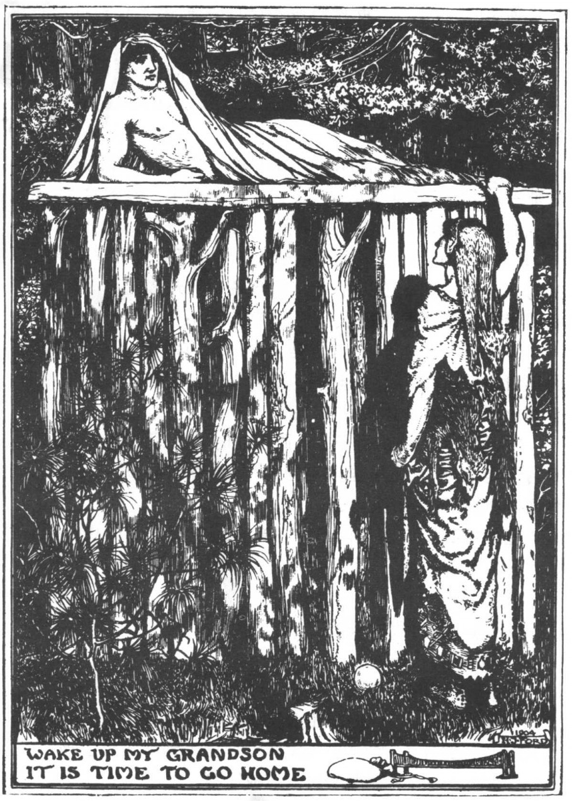

他举起右手，指着腋窝说：“桥在这里，奶奶。”

巫婆接下来做的事情，是世界上任何人都猜不出的。她先拿着黄金对鲍尔说：

“我的孙子，这些黄金必须藏在地下。要是人们以为可以随心所欲地得到它，就会变得懒惰和愚蠢。我们把它分散地埋在世界不同的地方，他们要想得到它，就得付出劳动，而且每次只能找到一点。”说着，她拔起房子的一根柱子。鲍尔看到一个很深很深，看不到底的洞。她把所有的黄金都倒进洞里，这些黄金立即散发到全世界的地里。那些努力挖掘的人有时能找到它。这件事做完以后，她又把柱子放回去。

接着，她从一个很高的架子上抽出一把铁铲，这把铁铲放在那里很久，已经锈迹斑斑了。她在房子的对面挖了一个很小，但是很深的洞。

“把小桥给我。”她说，“我要把它埋在这里。要是人们得到它，发现可以毫不费力地越过河流和海洋，他们就永远也不会自己想方设法去征服它们。我是巫婆，要是我愿意，在你到我这里来的第一天，我就可以轻而易举地念起咒语，叫大坏蛋把它们交给你。那样的话，你就决不会去斋戒，去想办法得到你所需要的东西，也不会认识那些善良的神灵，你就会变得肥头大耳，而且懒惰，直到生命结束。现在，你走吧！在你现在看得见的，远方的屋子里，住着你的父亲和母亲。他们都是年迈的老人了，需要有孩子为他们猎取食物。你已经完成了你的使命，我再也不需要你了。”

这样，鲍尔想起了他的父母，回到了他们身边。

（印度民间传说）

 

## 沼泽怪兽

很久很久以前，在世界的另一头，一群年轻人离开营地，出去为他们的妻子和孩子寻找食物。太阳火辣辣地当头照着，可是他们不怕热。他们互相比赛，看谁跑得最快，谁把矛枪投得最远，谁玩回飞镖玩得最好。这种武器真奇妙，它投出去以后，还能自己飞回主人的手中。他们边跑边玩，跑得不是很快，不久就来到了一块沼泽地。这里一到雨季就洪水泛滥。可现在是盛夏季节，只见一些水池。水池的旁边都长满了各种植物，其中以宽叶香蒲最为显眼。当地人很喜欢这种香蒲的根，认为它和洋葱一样值钱。一个年轻人提议，拔一些香蒲根带回家中去。他们剪下一些柳条编成篮子，正准备下水去拔香蒲根。另一个年轻人忽然说：“话得说回来，咱们干吗浪费时间去做这些女人和孩子们做的事情？让他们来拔这些香蒲根好了，我们还是去钓一些鳗或别的什么鱼。”

这个提议引起了大家的兴趣，纷纷去准备钓鱼。他们用黄色的草皮做成线，多数人找来蚯蚓做鱼饵。只有一个人偷偷地割下一块带来当午餐的肉做诱饵，其余人都没有注意。

他们耐心地钓了好长时间，没有鱼儿上钩。太阳已经西沉，看来他们只好两手空空地回家了。就在这个时候，那个用肉做诱饵的青年突然看到自己的线迅速下沉。他想，这肯定是一条大鱼。不错，线越拉越紧，他几乎站不稳了，坚持了几秒钟，看来要么把线放掉，要么就被拉下水。他赶紧叫其他伙伴来帮忙。最后，他们竭尽全力把那条大鱼拉上岸。可那是什么大鱼啊！他们浑身发抖地看到，这条“大鱼”既不是牛，也不是海豹，但两者都有点像，长着一根长长的宽尾巴。他们恐惧地你看看我，我看看你，像冬天里浇了一身冷水似的，浑身冰凉地颤抖着。谁也没有见过这种怪物，可是谁都知道它是什么——沼泽怪兽的幼仔。

小怪兽一声沉闷的嚎叫打破了寂静。池塘里也传来了一声响亮的回答。一只母怪兽从洞穴中向他们走过来，令人恐怖的黄色大眼睛喷射着愤怒的光。“把它放了！把它放了！”年轻人都惊叫起来。可是钓到它的人宣称，既然抓到了，就不放它走。他说，“我已经答应我的心上人，要给她家带回够吃三天的肉。即使他们不爱吃小怪兽的肉，她的兄弟姐妹也可养它玩。”他把手中的矛向母兽投过去，把它吓退，把小怪兽背在肩膀上，向营地奔回去，不管可怜的母兽在后面如何绝望地呼叫。

这时候，太阳已经快下山了。山顶虽然隐约可见，草原却已经开始朦胧。这些年轻人开始定下心来。他们突然听到身后有轻微的水流的声音。回过头来，他们看到池塘里的水在往上涨，刚才钓上小怪兽的地方已经被淹没。“怎么会这样？”他们奇怪地互相问着，“天上一片云都没有，水怎么会涨了这么多？”他们像雕像似的站在那里呆呆地看了一会。接着，都转过身来拼命地往回跑，背着小怪兽的人跑得最快。当他跑到一个小山丘顶峰时，他停下来喘了一口气，看看是否脱离了危险。天哪！草原的陆地已经是一片泽国，只见树梢还在水面上飘。不一会，这些树梢也迅速地消失了。要想逃命就得赶快跑，他们不敢怠慢，跑起来几乎脚不点地，直到安全地返回家中。老人都坐在那里休息，小孩在玩，妇女们在聊天。等他们看到小怪兽的时候，连小孩也感觉到了，巨大的危险正在威胁着他们。

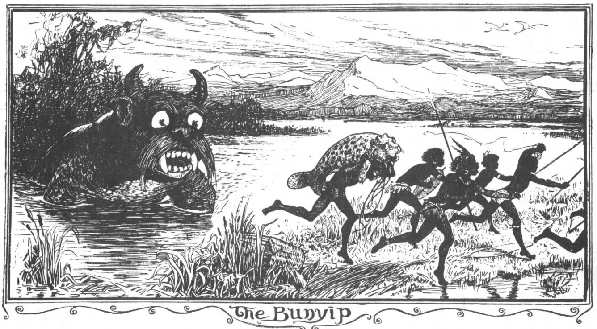

“水来了！水来了！”一个青年人气喘吁吁地大声喊叫着。水在缓慢地，但毫不留情地向高地爬上来。父母亲和孩子们抱成一团，好像这样可以挡住洪水。那个闯下大祸的年青人抓住他的恋人喊道：“我们一起爬到树顶上去，那里水够不着。”就在他说话的时候，觉得有什么冰冷的东西碰了一下他的脚，他低下头来一看，吓得浑身哆嗦，那里还有什么脚，脚已经变成了鸟的脚爪。他看了一眼女朋友，只见身边站着一只黑色的鸟。再回过头来看看他的朋友，都变成了一群可怕的，拍着翅膀的动物。他惊骇地用手掩住脸，那里还有什么手，已经变成了翅膀。他开口说话，只是从喉咙里发出一种从未听到过的声音。水已经淹到他的腰，他非常轻松地坐在水面上，水中映出他的身影——许多天鹅中的一只。

这些天鹅再也没有变成人。但是它们和其他天鹅也有不同之处。到了晚上，可以听到它们用一种显然不是属于天鹅的语言说话，而且还会发出其他天鹅不会的笑声。

那只小怪兽被母兽带回家了。水也退回去了。人们总是小心翼翼地躲开它们居住的池塘，谁知道它什么时候会突然伸出头来，用它有力的双爪把人拖下水。人们传说，在池塘的黑水下面，有一间房子，里面装满了美丽的东西，如居住在陆地上的人闻所未闻的生物。至于人们是怎么得到这些消息的，我不能告诉你，因为谁也没有见过。

 

## 牢骚爸爸

从前有一个人，他的孩子几乎像花园里的麻雀那么多。他得整天整天地拼命干活，才能养活他们。他经常累得要命，爱发脾气。看到什么人，遇到什么事，他都要骂几句。人们都叫他“牢骚爸爸”。

慢慢地，他对自己永不休止的工作感到担忧。星期天，他也不上教堂了，整天地躺在床上。后来，他觉得老是一个人坐着想如何付债很没意思。有一天，他看到马路对面的酒菜馆非常热闹，就走进来和朋友们坐在一起。“就在这里解解闷吧！”他说。时间一个钟头又一个钟头地过去了。他回家了，觉得比离开家的时候更加忧愁。他发觉，自己白白地浪费了时间和钱。

“我要到圣人那里去，他住在离水井不远的山洞里。”他说，“他可能会知道，为什么别人总是那么幸运，我总是那么倒霉。”说完，他就向山洞出发。

路很远，要穿过一些山脉和峡谷。他终于来到圣人居住的山洞，敲响他的门。

“谁啊？”里面传出问话的声音。

“是我，圣人，牢骚爸爸，你知道，我就是孩子多得像花园里的麻雀的那个人。”

“好的！那么你想来要什么？”

“我想知道，别人为什么总是那么幸运，我总是那么倒霉。”圣人没有回答，他走进里面的洞口，手中拿着什么走出来。

“看到这个篮子吗？”他说，“这是一个神奇的篮子，要是你饿了，只要对它说：‘小篮子！小篮子！做你的事情！’你就会吃到一顿一辈子也没有吃过的好饭。你吃够了以后，千万别忘了说：‘今天够了。’哦！还有一件事，不要让别人看到这个篮子，也不要说是我给你的，明白了吗？”

牢骚爸爸总是认为好运不会落到自己头上，他怀疑圣人是不是在和他开玩笑。不过，他还是拿起篮子，没有忘记有礼貌地说一声“谢谢！”和“再见！”就走了。他有点急不可待，走到看不见洞口以后，他就停下来，弯下腰小声地对篮子说，“小篮子！小篮子！做你的事情！”

小篮子有个盖，所以他看不见里面，但可以十分清楚地听见里面发出一种奇怪的声音，好像什么东西在走动。接着，盖子跳起来，许多雪白的小花卷一个接着一个地滚出来，香喷喷的。后面还跟着许多烧好的，色香俱佳的小鱼。这些花卷和小鱼不停地从篮子里流出来，不久就铺满了大路，向路边滚去。看到这种景象，牢骚爸爸害怕极了。他终于想起了圣人对他说过的话，大声喊叫：“够了！够了！今天够了。”篮子的盖子一下子就把篮子盖紧。

牢骚爸爸松了一口气，高兴地看着自己的周围。他在一堆石头上坐下，饱餐了一顿。有鲑鱼、大麻哈鱼、比目鱼、鳎鱼，还有许多种他叫都叫不出来。这些鱼有的煮，有的煎，有的烤，他只要一伸手，就可以拿到。真像圣人说的那样，他从来没有吃过这么丰盛的午餐。不过，吃完以后，他还是摇摇头，发牢骚说：“是的，是有许多吃的，可是吃完了反而觉得口干，一滴水也喝不上。”

他不知不觉地抬起头来，隐约看到前面有一家酒店。

他走进酒店，说：“好大娘，拿两个杯子，把你最好的酒拿出来。要是你们喜欢吃鱼，这里有够整个酒馆里的人吃的。不过不要到处去乱说，懂吗！嗯！”他也不等别人说什么，就小心地吩咐篮子：“小篮子！小篮子！做你的事情。”

酒店的主人和他的妻子想，这个顾客肯定是发疯了，小心地看着他，准备随时把他抓起来。但是，他们马上吃惊地跳起来，差点碰到火炉。花卷和各式各样的鱼从小篮子里蜂拥而出，铺满了桌子、椅子和地板，开始向街上流去。

“快！快！快把它们捡起来。”牢骚爸爸叫道，“要是不够，还可以向它要。”店主和他的妻子用不着吩咐第二遍，就弯下腰来拼命地捡。尽管他们忙得不可开交，还是没有忘记交头接耳，“我们只要拿到这个篮子，运气就来了。”

他们请牢骚爸爸上桌，把地窖里最好的酒拿出来，想骗他说出秘密。可是牢骚爸爸比他们想象的要聪明。尽管他们想尽办法打听谁给他这个篮子，他总是不肯开口。不幸的是，他虽然不说话，却不停地喝酒，不久就醉醺醺地睡着了。女主人从厨房里拿出一个和魔篮子一模一样的篮子来，用它换下了牢骚爸爸的篮子，小心地藏起来。这两个篮子那么像，你就是非常仔细地看，也分辨不出来。

牢骚爸爸一直睡到吃午饭的时候才醒过来。他跳起来，赶紧回家。看到孩子们正围着一盆薄汤，争先恐后地伸出手中的木碗，希望吃到第一勺。父亲挤到他们当中，手中拿着篮子，喊道：“别喝这种东西，倒了胃口，看到这个篮子吗？我只要说一声，‘小篮子，小篮子，做你的事情。’你们看吧！将会发生什么！现在，为了优待你们，这句话让你们来说。”

孩子们又兴奋，又惊讶，重复着这句话，可是什么事情也没有发生。他们说了一遍又一遍，篮子还是篮子，只是篮底有几片鱼鳞，因为女店主前天提着它上市场去买过鱼。

“怎么回事？”牢骚爸爸终于忍不住了，从孩子们中间抓起篮子，转过来翻过去地看着，一边发牢骚一边骂着。妻子和孩子们吃惊地看着他，也不知道是应该哭，还是笑。

“它真的有鱼味。”他说。接着，他停下来，忽然想起了什么，“也许这根本就不是我的篮子，也许……啊！这些恶棍！”

妻子和孩子们被他的奇怪举止吓坏了。他不顾他们的阻拦和请求，冲出家门，来到酒店，气冲冲地把门推开。

“我能帮你什么忙吗？”女店主温柔的声音问道。

“我拿错了篮子，当然不是故意的。”他说，“这是你的篮子，请把我的篮子还给我。”

“你在说什么？”她说，“你自己看一看，这儿哪里有什么篮子？”

牢骚爸爸到处寻找，确实是没有什么篮子。

“进来吧！天这么冷，喝一杯暖暖身子。”女店主说，她千方百计地不让他发火。牢骚爸爸也不拒绝，喝了一杯就走了。

他朝通往圣人洞口的路走去，匆匆忙忙走得那么快，不久就到了。

“谁啊！”听到敲门声，里面有人问。

“是我！是我！圣人。你认识我。我是牢骚爸爸，我的孩子像花园里的麻雀一样多。”

“可是，我的好人，昨天我刚刚给你一件漂亮的礼物。”

“是的，圣人，我带来了。可是我不知道出了什么问题，它不再显灵了。”

“好吧！把它放好，让我找找看，还能给你什么。”

几分钟以后，圣人走出来，手中拿着一只公鸡。

“听我说，”圣人说，“你需要钱的时候，你只要对它说，‘公鸡，让我看看你能做什么！’你就会看到奇迹出现。可是记住，不要让别人知道这个秘密。”

“啊！不会的，圣人，我不会那么傻。”

“也不要对别人说是我给你的。”圣人继续说，“我的这些宝贝非常有限。”说后也不等回答，就把门关上了。

像上一次一样，回去的路程显得那么短。一会儿，他就来到了酒店的门口。他不加思索地走进去，看到女店主正在厨房里做饼。

“你从哪里来啊！篮子里带着这么漂亮的红公鸡。”她问。公鸡很大，篮子的盖子盖不住它。

“我从一个地方来，那里的人也没有多少这种公鸡。”他说，在一个桌子前坐下。

女店主不再说什么，给他拿来了一瓶他爱喝的酒。不一会，他就忍不住想展示一次他的奖品。

“公鸡，让我看看你能做什么！”他说。公鸡站起来，拍了三下翅膀，咯咯地叫起来，那声音像在吹喇叭。每叫一声，就从嘴里掉下像豆一样大的金子或钻石。

这一回，牢骚爸爸没有邀请店主夫妇来分享他的珍宝。他把自己的帽子放在公鸡嘴的下面，接住每一粒金子和钻石。他没有注意到，店主夫妇在交换眼色，窃窃地说，“这只公鸡放在我们的篮子里真是太妙了。”

“再喝一杯吧！”欣赏过美丽的公鸡以后，店主提议说。他们假装没有看见什么金子和钻石。牢骚爸爸也不拒绝，喝了一杯又一杯，头越来越沉重，终于伏在桌子上，睡着了。女店主小心地把公鸡从篮子里抓出来，拿到自己的鸡笼子里去，再从鸡笼子里抓出一只一模一样的公鸡，放回牢骚爸爸的篮子里。

他醒过来的时候，天已经黑了。他骄傲地拿出几粒金子，放在桌子上，算是付酒钱。接着，他把公鸡放好以后就动身回家。

妻子和孩子们都在门口等着他。看到他回来了，她喊道：“你算是个好人吗？到酒店里去喝酒，浪费时间和金钱，让我们在家里挨饿，你不害羞吗？”

“你在胡说些什么！”他回答，“钱？我现在有的是金子和钻石，要多少有多少。看到这只公鸡吗？你只要对它说，‘公鸡，让我看看你能做什么！’奇妙的事情就会发生。”

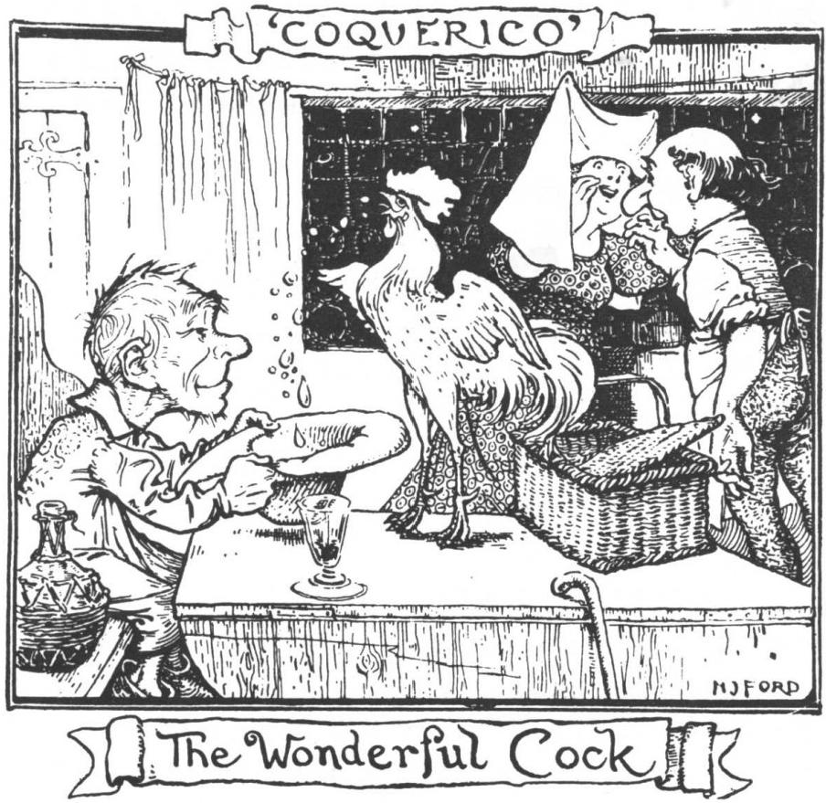

妻子和孩子有了上次的经验，不怎么相信他。不过他们想，还是值得试一试，就照他的话去做。可是公鸡发疯似地满屋子乱飞乱叫，吵得他们头都要裂开了，并没有什么金子和钻石掉下来。破烂的地板上什么也没有。

牢骚爸爸吃惊地看了一会，接着开始大声地骂起来，他骂得那么凶，连听惯了他骂人的一家子都觉得吃惊，目瞪口呆地看着他。

后来，他安静了一些，可还是怎么也弄不明白。

“我是不是忘记了那句话？我明明听到圣人是那么说的，我还亲眼看到钻石！”他突然抓起公鸡，把它放进篮子，冲出家门。

他沿着马路跑过来，沉重的木头鞋踏得卡嗒卡嗒响。他跑得那么急，来到圣人居住的洞口时，天上的星星刚刚露出脸来。他开始敲门。

“谁在敲门！”里面有人问。

“是我！是我！圣人！你认识，牢骚……”

“可是，我的好朋友，你应该让别人也有个机会。你已经第三次到我这里来了，二次间隔不到一个钟头！”

“啊！圣人！我知道现在很晚了，请你原谅。你的公鸡有些问题，像你的篮子一样，你看！”

“这是我的公鸡？我的篮子？有人耍了你，我的好人。”

“耍了我？”牢骚爸爸重复着，他开始明白发生了什么事情，“那肯定是那两个……”

“我怀疑你是否给别人看了。”圣人说，“你应该……不过，我还是再给你一次机会。”他转过身去，从墙上取下一样东西。

“当你想弹去你或者你朋友衣服上的灰尘时，”他说，“你只要说，‘跳吧！弹吧！棍子！快！’你就会看到发生什么事情，我要告诉你的就是这些！”说完，他笑了笑，把牢骚爸爸推出洞口。

牢骚爸爸往回走去，一边走一边咕哝着：“嗯！现在我明白了，这回看我怎么来整这两个恶棍！”他挎着篮子，里面装着那只公鸡和棍子，急匆匆地向酒店走去。

“晚上好！朋友们！”他打着招呼，走进酒店，“我饿极了。请你们快点把这只鸡杀了，烤熟，就是这只鸡，别的不要。”接着他又说，“还有，这只篮子你们拿去烧火。完了我会给你们看看我袋子里的东西。”说完，他学圣人对他笑的样子，也笑了一笑。

这些话使女店主觉得很不舒服，不过，她没说什么，开始烤鸡。她丈夫想方设法要把牢骚爸爸灌醉，让他睡着。可这一次他怎么也不睡。

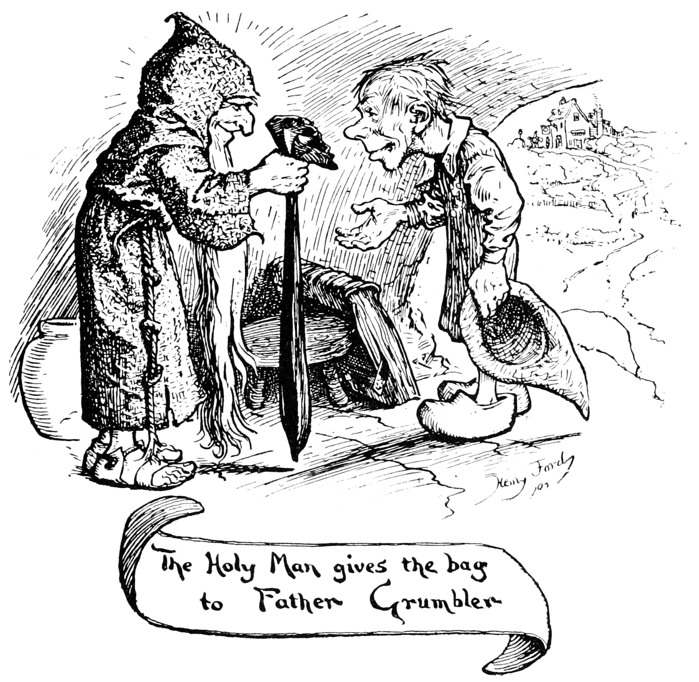

那只鸡烤得很老，他一边吃一边发牢骚。吃过饭以后，他拍打着桌子说：“你们听着，快去把我的篮子和公鸡拿来，立刻就去！听见了吗？”

“你的篮子？你的公鸡？牢骚爸爸，可是刚才你已经……”

“我的篮子！我的公鸡！”他打断他们的话，“要是你们又聋，又笨，听不懂我的话，我有一样东西可以开导开导你们。”说着，他打开袋子，叫道，“跳吧！弹吧！棍子！快！”

一根白色的棍子从袋子中跳出来，像闪电般地抽打着店主夫妇，牢骚爸爸也不例外，他们痛得跳起来。

“停下！停下！我们还给你公鸡和篮子！”店主和他的妻子喊叫着。牢骚爸爸也不愿意继续挨打，连忙高声叫道，“停下来！今天够了！”

可是棍子毫不在意，继续抽打着他们。要不是圣人听到他们求救的声音赶过去，他们也许会挨打到今天。圣人对棍子说，“到袋子里去！快！”棍子照他的话做了。

“现在，去把公鸡和篮子给我拿来！”女店主一声不吭，把它们拿出来放在桌子上。“你们都得到了应得的惩罚。”圣人继续说着。他又转过身来，对牢骚爸爸说，“我一点也不同情你。我要把我的宝物带回家。也许有一天，我会找到一个能抓住好机遇的人，但他决不是你。”

 

## 雅拉的故事

在南方，太阳把大地晒得火辣辣的。白天，人和一切动物都在睡觉，连大森林也是静悄悄的。只有大清早和晚上才处处有生机。

在一个城市里，曾经住过一个青年男子，他的名字叫阿朗索，来自他乡异国，因为谋生，才来到这河边的城市里居住。

阿朗索到达这个城市几个月以后，天气开始凉快了一些，人们白天可以不必像以前那样，睡得那么久。有一天，在离城市不远的地方举行盛大的宴会，所有附近的人都从三四十里以外赶来，有的步行，有的骑马，有的坐着漂亮的金黄色的马车。他们都穿着红色或蓝色的漂亮衣服，头上戴着用花编成的花环。

阿朗索第一次参加这样体面的集会，他默默地站在一旁，看着年轻人跳起优雅的舞蹈，玩着各种有趣的游戏。他看到，一位身穿白色服装，头戴红色石榴花的姑娘比其他女孩子更加漂亮。

宴会结束以后，阿朗索回到自己的家。可是他的举止变得古怪了，引起所有朋友的注意。

第二天，在干活的时候，他又看到了那姑娘。她在和自己的伙伴扔球玩，有时在伙伴中穿梭着跳舞。晚上，他好几个钟头在床上翻来覆去睡不着，索性爬起来到森林的池塘里去洗澡。

这样一连过了几个星期，机会来了。有一天晚上，他从她居住的房子经过时，看到她正站在那里，背靠墙壁，用手中的扇子打一只向她扑过来的疯狗。阿朗索跑过去，挥起有力的拳头，一下就把狗打得趴在地上，动弹不得。阿朗索扶着吓得差一点昏过去的姑娘回到家里，她父母正坐在走廊里乘凉。阿朗索成了他们家受欢迎的客人。不久，父母就同意把这个名叫朱莉娅的姑娘嫁给他。

每天干完活，他就到姑娘的家里来。这座房子隐藏在树木和花丛之中，小鸟吱吱喳喳地飞来飞去。红的、绿的、灰色的鹦鹉在唱着美妙的歌曲。姑娘总是在树下等着他，他们一连一两个钟头坐在一起。天上闪烁着又大又明亮的星星，好像伸手就可以摸到它们似的。

“昨天晚上你回家以后干什么？”一天晚上，姑娘忽然问道。

“像往常一样。”他回答，“天太热了，睡不着，上床也没有用。我向森林里走去，在河边一个深水池塘里洗澡。一连好几个月了，我天天晚上都到那里去。可是昨天晚上发生了一件奇怪的事情。就在我最后一次扎入水中，准备上岸的时候，我突然听到有人在唱歌，唱些什么，虽然我一句也没有听清楚，但是那歌声比夜莺还美妙。那声音有时从这边传过来，有时从那边传过去。我上了岸，赶紧穿好衣服，在池塘旁边的丛林和树木中到处寻找，猜想可能是那位朋友在和我寻开心，可是一个人影也看不见。我回家以后，看到我的朋友都睡着了。”

朱莉娅听着，听着，脸色变得死一般的苍白，浑身像掉进冰窟一样地颤抖起来。从小时候开始，她就听大人们说森林里住着的那些可怕的精灵的故事。它们躲藏在河堤下，要有强大的护身符才能镇住它们。那些诱惑阿朗索的歌声是不是从它们那里传出来的？也许，谁知道，那就是死去的雅拉的歌声，她总是引诱那些明天就要做新郎的男青年。

好一会，姑娘想着这些可怕的事情，沉闷地坐着。接着，她说，“阿朗索，你答应我一件事情，好吗？”

“什么事情？”他问。

“这关系到我们今后的幸福。”

“啊！这件事很重要。好的，我当然答应，说吧！”

“我要你答应，”她说，接着压低了嗓门，小声地说，“以后再也不要到那些池塘里去洗澡了。”

“可是为什么呢？我的王后，我不总是到那里去洗澡吗？并没有受到什么伤害啊！我的心肝。”

“是还没有，可是也许会发生。要是你不答应，我会害怕得发疯的，答应我。”

“怎么了！你脸色这样苍白，告诉我，是什么把你吓成这样。”

“你不是听到那些歌了吗？”她问，声音在发抖。

“就算这样，可那怎么会伤害我呢？那是我从来没有听到过的最好听的歌。”

“是的，可是，歌声之后就会出现幽灵，然后，然后……”

“我不明白，然后会有什么呢？”

“然后……就是死亡。”

阿朗索吃惊地看着她。她真的疯了吗？这些话可不像是她说的。

他还没有醒悟过来，姑娘又开口了：“这就是为什么我请你不要再到那里去的原因；无论如何，要去也要等到我们结婚以后。”

“结婚以后会有什么不同？”

“结婚以后就没有什么危险了。你随便什么时候都可以去洗澡。”

“告诉我，你为什么那么害怕？”

“因为你听到的声音……我知道你会笑话我的，可这是千真万确的，那是雅拉的声音。”

听到这些话，阿朗索情不自禁地笑出声来。在朱莉娅听来，笑声那么古怪，那么刺耳，她吓得哆嗦着缩成一团。他不停地笑着，好像难以自已。他越是笑，姑娘的脸就越是苍白。

“啊！天哪！你看见过她了！你看见过她了！我可怎么办啊！”她无力地自言自语着。微弱的声音传到他的耳朵里。虽然笑得不能说话，他还是摇了摇头。

“你可能不知道，可这是真的。只有看见过雅拉的人，才会这样笑。”朱莉娅伏在地上，大声地哭起来。

看到这种情形，阿朗索突然觉得悲伤起来。他跪在朱莉娅身边，小心地把她扶起来。

“不要哭，我的天使，”他说，“我答应你的所有请求，只求你让我再看见你的笑脸。”

费了好大的劲，朱莉娅才停止哭泣，坐起来。

“谢谢你！”她说，“听到你这句话，我的心宽了一些。我知道你会恪守自己的诺言，不再到森林里去。可是雅拉的诱惑力非常大，她的声音会使男人忘记世界上的一切。哎！我已经看到过，不止一个女人丢了丈夫，孤独地生活，心都碎了。要是你又回到第一次听到她的声音的池塘旁，你要答应我，起码带着这样东西。”她打开一个雕刻精致的盒子，拿出一个五光十色的贝壳，对着它轻柔地唱了一支歌。唱完就把它交给阿朗索，说：“你听到雅拉声音的时候，就把它贴近自己的耳朵。这样你就会听到我的歌声，听不见雅拉的声音。也许，我也不敢十分肯定，也许我对你的爱会比雅拉更强烈。”

这天晚上，他回家的时候已经很晚了。远处的河流在月光的照耀下那么清澈凉爽，令人神往，森林里的树木好像在伸出双手召唤他。年轻人坚决地转过脸来，朝家里的方向走去，上床睡了。

阿朗索艰难地战胜了森林和池塘的诱惑。第二天他得到了补偿，朱莉娅兴高采烈地欢迎他的到来。他向她保证，他战胜了诱惑，困难已经过去。但是她很了解雅拉面容和声音的魅力，分手时没有忘记叫他重复自己的承诺。

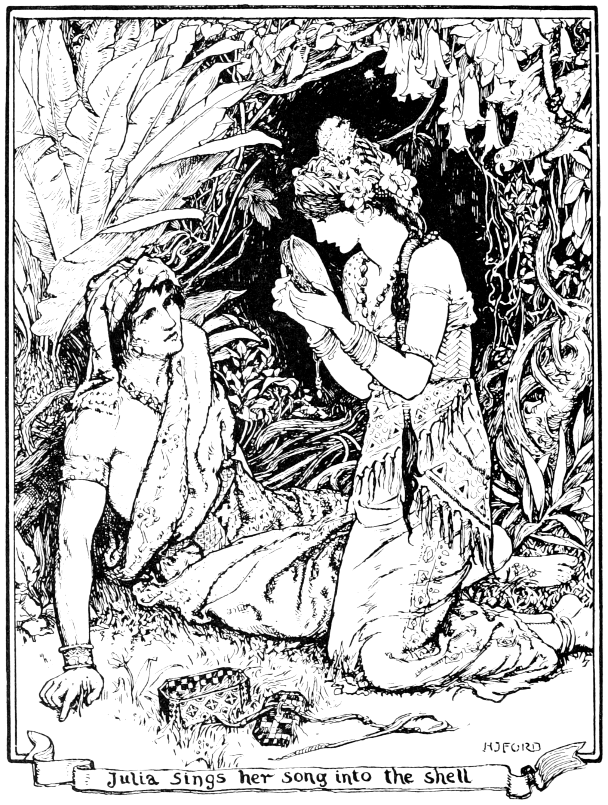

一连三个晚上，阿朗索恪守自己的诺言，不是因为他相信雅拉的故事，他想这肯定是胡说八道，而是因为他不忍心看见朱莉娅流泪，他实在受不了。他只要承认自己到池塘边去过，朱莉娅就会伤透了心。可是，尽管这样，那天晚上听到的歌声，却时时在耳边响起，而且一天比一天响亮。

第四个晚上，森林的吸引力如此强烈，朱莉娅的担心和他的承诺都不能阻止他。晚上十一点，他投入了那阴凉的黑森林怀抱，向河边走去。开始，他也想起过朱莉娅的警告，想起自己因此而笑她，而且，他朝树丛中看去时，也有一种从未有过的害怕的感觉。

他来到河边，停下来朝四周看了好一会，以证实有人跟踪他这样的感觉只是幻觉，他只是孤身一人。月光照耀着每一棵树，除了自己的身影，他看不见任何人；除了汩汩地流动着的河水声，什么声音也听不见。

他脱掉衣服，正准备跳入池塘的水中，不知道为什么，他突然抬起头来朝四周张望。这时候，月亮的脸从云彩后面露出来，在皎洁的月光照射下，他看见一个美丽的金发女郎正站在灌木丛中，下半身被丛林遮住。

他吓了一跳，赶紧抓起衣服，朝回去的路头也不回地奔去，生怕有一只手忽然搭在他的肩膀上，直到跑出森林，来到平原上，他才回过头来看，隐隐约约地好像有一个白色的身影还站在那里，不停地挥动着双手。他觉得真受不了，以更快的速度跑回家，路上再也不敢停下来，直到平安地回到家中。

迎着黎明的第一道霞光，他重返森林，看看是否能找到雅拉的踪迹。尽管他搜遍了每一棵树，每一堆灌木丛，每一片草地，也没有发现什么迹象。唯一能听到的是鹦鹉那令人讨厌的声音。

“我大概是疯了，那只不过是一个愚蠢的梦。”他自言自语地说着，动身回到城里去干活。可不知道为什么，或许是今天的活太难了，或许是他病了，他觉得自己心不在焉，打不起精神来。看见他的人都问他怎么啦，脸色那么苍白，那么吓人。

“我肯定是发烧了。”他对自己说，“一个人觉得这么热的时候去洗冷水澡是很危险的。”不过，尽管嘴上这么说，心里很明白，他在计算着还有几个钟头天就黑了，他好回到森林里去。

晚上，像往常一样，他来到了朱莉娅的家里。其实，这一天他根本就不应该来。他脸色那么苍白，举止那么奇怪，可怜的姑娘猜到发生了什么可怕的事情。可是，阿朗索不回答她的问题，什么也不肯说，只是答应明天把一切事情都告诉她。

他假装头痛得很厉害，比往常早得多就向朱莉娅告辞，急忙地赶回家。他拿起一把手枪，装上弹药，别在腰间。快到午夜的时候，他踮着脚尖轻轻地走出去，生怕把别人吵醒。一到外面，他沿着通往森林的大路奔去。

他马不停蹄地奔到河边的池塘旁，手中握着手枪，小心地观察着周围。只要有一点响声，那怕是一片树叶掉下来，一只小动物从树丛中走过，或者是一只鸟的叫声，他都会转过身来，用手枪对准发出声音的方向。可是，在明亮的月光照耀下，他没有看见什么，慢慢地，一种梦幻的状态控制了他，他倚在一棵大树上休息。

这种状况持续多久，他自己也说不清。他突然清醒过来，因为有人在轻柔地叫他的名字。

“谁？”他站起来叫道。可是回答他的只有自己的回声。他的眼睛慢慢地被脚下池塘里深黑色的水吸引住了，他目不转睛地看着，好像目光再也不会移去。

他盯着水的深处看了几分钟，仿佛看到黑暗之中有一点亮光，那亮光迅速地越来越大，越来越亮。这时候，恐怖的感觉又涌上他的心头。他努力地想把目光移开，可是没有用，一种奇怪的更加强大的力量迫使他继续朝亮光看着。

后来，水面慢慢地分开，他看到几天以前他逃避的那个美丽的姑娘正站在水面上。他想跑，可是脚像被粘住了一样。

她向他伸出双臂，微笑着。这时，他想起了朱莉娅，几个钟头以前她还和他在一起。她的担忧，她的警告，现在正成为现实。

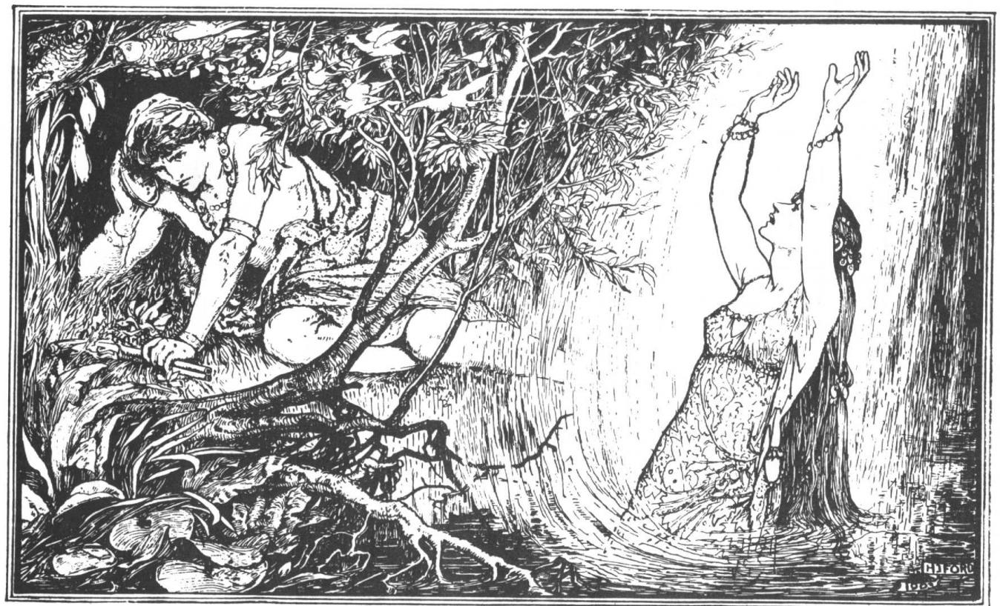

姑娘的身影慢慢地向他靠拢过来。阿朗索极力想摆脱自己麻木的状态，举着手枪瞄准她的肩膀，扣动扳机。枪声划破了森林的寂静，回声在空中飘荡着。可是那身影还是在微笑着向他走来。他又开火了，子弹划破了夜空，但阻挡不了那身影的移动，她又靠近了一些。很快，她就会站在他身边。

子弹打光了。他双手紧紧地握着手枪站立着，假如雅拉再靠近一些，他准备把它当棍使。可就在这时候，她好像有点害怕了，站在那里不动。阿朗索高高地举着手枪，一步一步地向她走过去，随时准备出击。

他激动得忘记了脚下就是池塘，直到双腿浸在凉爽的水中才想起来，立刻停住脚步。雅拉看到他犹豫不决，开始在水面上轻轻地晃动着身影，唱起歌来。那歌声一会儿远，一会儿近，在空中飘忽不定，空气中和森林里都在回荡着她的声音。阿朗索觉得自己陷入一种幻觉之中，飘飘然起来，举着手枪的双手沉重地掉下，正好碰到口袋里他答应朱莉娅天天带在身边的贝壳。

迷迷糊糊之中，他记起了她的话，用软弱而颤抖的手拿出贝壳。这时候，雅拉的歌声变得更温柔，更甜蜜。他尽力不去听它，俯下头来贴近贝壳。从贝壳里传出了朱莉娅把贝壳交给他时，对着它唱的那支歌。开始的时候声音很微弱，后来越来越响，把笼罩在他心头的迷惑一扫而光。

他抬起头来，觉得自己已经走过一个陌生的境地，再也不能游荡下去了。他重新控制了自己，觉得浑身充满了自信。他看看四周，河水在月亮下泛着亮光，高大的树木投下黑黑的阴影，除了昆虫的鸣叫声，什么声音也没有。他穿越黑暗，回到了家中。

 

## 狡猾的兔子

在飘洋过海的远方，有一个非常寒冷的国家。那里一年到头有好几个月，大地都覆盖着冰雪。在那里有一只小兔子，它父母都早已去世，由祖母抚养长大。由于一个太小，一个太老，无力出去工作，所以家里非常穷，常常挨饿。

有一天，小兔子觉得今天比往常还饿得慌，就问它的祖母，能不能到河边去捉点鱼来当早饭吃。这时候，冰雪已经融化，河水在自由自在地奔流。祖母笑起来，说它大概以为鱼会自己送上来。兔子怎么能捉到鱼呢？特别是像它这么小的兔子。不过，祖母还是同意让孙子去，因为它自己患有严重的风湿性关节炎，不能出去找吃的。“即使它捉不到一条鱼，总还可以找到别的什么吃的。”祖母想。它告诉孙子到哪里去找鱼网，如何把网放入河中。

小兔子准备出发了，它觉得自己长大了。可是祖母又把它叫回来，“说到底，你去捉鱼有什么用呢？就是把鱼捉回来了，我也没有火来烧。”

“让我去捉鱼吧！我回来会给你生火的。”小兔子高兴地说。它还年轻，不知道生火是一件很不容易的事情。

它费了好大的劲才把鱼网拖过丛林和田野，来到河边，听说这里有许多鱼游来游去。它照祖母的教导，在河里支起鱼网。

这天晚上，小兔子兴奋得整夜睡不着觉。天刚亮，它就急不可待地跑到河边，它从来也没有跑得这么快过，心砰砰直跳，好像有一只狗在后面紧紧地追赶着似的。

来到河边，它简直不敢张望，生怕一条鱼也没有，令它失望。想到这里，肚子咕咕叫的挨饿滋味又叫它非常难受和害怕。其实，它根本用不着担心和害怕，鱼网的每一个网眼上，几乎都塞着又肥又大的鱼。网那么重，小兔子压根儿没有办法拉动一个角。它只好把一些鱼扔入水中，把一些鱼藏在岸边的一个洞里，上面压上一块石头，准备下次再来拿。这样，它把其余的鱼用网卷起来，背在背上回家。鱼网很重，压得它肩膀很痛。谢天谢地，它终于回到家，把鱼网放下，兴高采烈地跑进去对祖母说：“奶奶，快把鱼洗干净，我要到河对岸有人住的地方去取火。”

老奶奶听它说完，非常害怕地看着孙子。以前也有兔子去偷过火，可是很少有活着回来的。不过，既然它能够出乎意料地捉回那么多鱼，它想，也许孙子有它所未知的魔法，所以也就不去阻拦它。

把鱼全部拿出来，把渔网晒干以后，小兔子把鱼网卷成一团就向河边跑去。它想找到河面狭窄的地方，以便跳过去。可是它很快就看到，河面都那么宽，即使是世界上跳得最远的兔子，也跳不过去。它在河边站了好一会，想着该怎么办。它突然想起了几句咒语，这是一个巫师到河边来喝水的时候念过的。它凭着自己的记忆念了几句，等着瞧会发生什么事情。不到五分钟，就听到河水哗啦的翻滚声，好多好多水都向天上涌去。它也不知道为什么会这样。接着，河的转弯处游过来十五条很大的鲸鱼。它命令它们头接尾地一字排开，在河面上架起一座桥，以便它能走过去。就这样，小兔子来到对岸后，对鲸鱼说，暂时还不需要它们，请它们先坐在沙滩上休息一会。

不幸的是，一些在河边玩耍的小孩看到了小兔子。有一个小孩偷偷地走到小兔子的后面。小兔子这时正看着鲸鱼游过去，没留神，小孩一把抓住它的尾巴。小兔子大吃一惊，拼命地挣扎。可是小孩抓得很紧，拖着它就朝家里奔去。

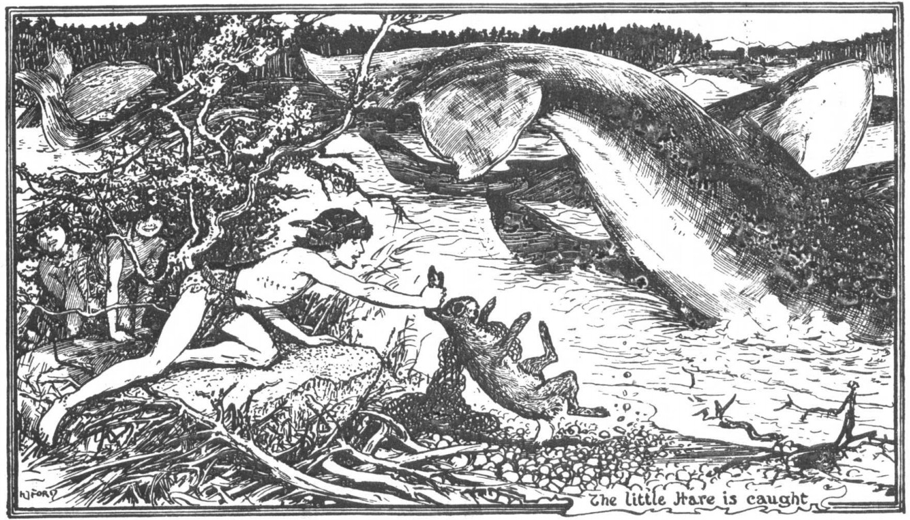

“把它放在篮子里，”一个女人听完小孩的故事说道，“等锅子里的水开了，就把它吊在火上烤。”

“最好先把它杀掉。”一个男人说。

小兔子听到他们说的话，怕得要死。不过，它还是偷偷地注意观察着，看看帐篷是否有破洞，以便有机会就逃走。是的，帐篷顶上有一个洞。它抖了抖身子，好像很害怕似的，把带在身边的网卷得更小更紧，准备寻找机会。

“我祈求一粒火星落在我的渔网上。”小兔子暗暗祈祷。不一会，火堆中支着的一根大木头倒下来，把大家都吓退了几步。火星四处飞溅，有一颗落在网上，烧起来。小兔子纵身一跃，从帐篷顶上的洞中跳出，急忙向河边直奔过去。那个男人、女人和小孩在后面紧紧地追赶着。这时候再叫鲸鱼肯定来不及了。它用嘴咬紧渔网，祈祷让它过河，然后不顾一切地高高跳起，安全地落在对岸。它回过头来，看到再也没有人追赶过来，就快活地连蹦带跳回到家里，见到奶奶。

“我不是跟你说过吗？我会把火带回来的。”兔子说着，把渔网放下，渔网还在燃烧。

“可你怎么过河的？”奶奶问。

“嗯！跳过去就是了。”它说。奶奶不再说什么，它明白，孙子比自己聪明。

（印度民间故事）

 

## 乌龟和新娘

从前，有一只乌龟和各种人群住在一起。那是一个很大的营地，营地的旁边有一条大河，河水从很远的雪地流过来，经过这里向遥远的南方流去，一直流向大海。那里的海水一年四季总是温暖的。

营地里还住着许多其他的乌龟。这只乌龟对它们既友好又善良。不过它不喜欢管别人的事情，所以觉得自己很孤独。

后来，它造了一间小房子，在地上铺上皮毛做坐垫，尽量把房间弄得舒服一些，像周围几十里的房子那样。这些事情都做好以后，它开始留神，要在年轻的姑娘中挑选一个来做妻子。

它花了很长的时间也拿不定主意，乌龟总是慢性子的，从来不急。后来它找到一个姑娘，她比其他人更勤劳，更漂亮。这一天，它来到姑娘家，问她：“你愿意嫁给我吗？”

姑娘吓了一跳，吃惊地看着乌龟，手中正在做的镶珠拖鞋也落下来了。接着，她忍不住要笑了，这个想法如此荒唐！不过，她是一个懂礼貌、好心肠的姑娘，她尽量装作很严肃的样子，问它：“可是你怎么能养活一家人呢？等到营地搬迁的时候，你怎么能跟得上我们。”

“我能跟得上！”乌龟抬起头来回答。虽然它觉得自己受了侮辱，可它尽量不让姑娘觉察到。它一次又一次地恳求她。最后，她很不情愿地同意了。

“不过，你要等到明年春天。”她说，“我要为自己做许多衣服和鞋子，以后就没有时间了。”

乌龟听了这些话很不高兴。不过它知道多说也没用，于是回答：“我要出去几个月，去打仗，抓一些俘虏。回来的时候，希望你已经准备好嫁给我了。”

它回到自己的家里，开始动手准备。它首先把自己所有的亲戚都召集起来，问它们是否愿意和它一起去，向附近村庄的人挑战。那些讨厌做事的乌龟都同意了。第二天，它们整个部落都离开营地出发。姑娘站在自己的家门口，看到这么多乌龟慢慢地爬着，咯咯地大笑起来。她的情人正走在领头的位置上，看到她非常生气，叫道：

“再过四天，你再也不会笑了，哭也来不及了。因为再过四天，我们要相隔几百里了。”

那个答应嫁给它只是为了摆脱它的姑娘说：“四天！再过四天你还在我的视线之内。”

“喔！我的意思不是四天，而是四年。”乌龟赶紧纠正说，“不论发生什么事，到时候我一定回来！”

军队继续前进，直到有一天，它们仿佛觉得已经绕了半个地球，其实还不到四英里，一棵大树挡住了去路，它们无可奈何地看着。几个年纪最大的乌龟凑在一起商量怎么办？

“我们不能从树上爬过去吗？”一个乌龟问。

“那起码要花几年时间，”另一个乌龟说，“你看这些粗大的树枝纵横交错，要是被卡住了，别想再出来。”

“那么，让我们绕过去吧！”第三个乌龟说。

“那怎么行呢？左边是这么大的树坑，右边是那么高的坡！”第四个乌龟说，“不行，我想唯一的办法是把树干烧出一个洞来，我们好爬过去。”

它们生起火来烧，可是树干非常粗大，怎么也烧不出洞来。

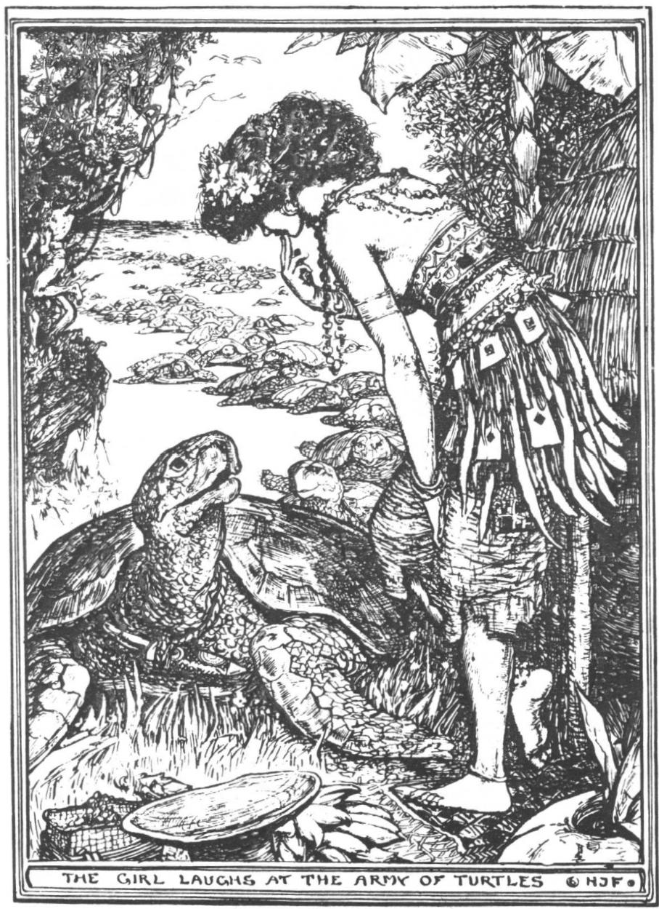

“没有用，我们还是放弃吧！”它们最后取得了一致的看法，“其实，用不着操这份心，我们出来这么久了，什么冒险活动都干过了，可以回去了。”于是，整个队伍向后转，回家去了。

由于长途跋涉，它们很累，脚又酸又痛，回去花的时间比出来的时间还要长。快到家的时候，它们鼓起勇气，唱起战歌。村子里的人听到它们的歌声，都走出来要看它们的战利品。那些乌龟走过来了。它们抓住村子里一些人的腰，说：“你们是我们的俘虏！你们是我们的战利品！”

乌龟首领恰巧抓住了它的心上人，说：“我抓住你了，你永远属于我了！”

村子里的人对这种强盗行为当然都非常生气，那姑娘尤其恼火，她心中暗暗地下决心，要报仇雪恨。可现在乌龟的力量非常强大，这些俘虏只好穿上漂亮的衣服，在乌龟的歌声下跳起战舞。乌龟的歌声不止，他们的舞蹈也不敢停下，直到领唱的乌龟突然大叫一声：

“谁敢进犯，必死无疑！必死无疑！”

跳舞的人听到这喊声，吓得突破乌龟的包围圈，四处奔走，逃回村中。那些乌龟虽然紧追上来，可是很慢，很慢。乌龟首领半路碰到一个人，那人对它说：“你准备娶的那个女人，已经嫁给另一个人了。”

“真的吗？”乌龟说，“那我一定要去见见他。”

那人走了以后，乌龟从背上取下一个包袱，从里面拿出装饰品，把自己打扮起来。它来到那姑娘居住的屋子旁，大声叫道：“我来了，我声明，这个女人曾答应做我的妻子。”

“是乌龟来了。”丈夫赶紧小声地对妻子说，“现在该怎么办？”

“看我的，我来对付它。”妻子说。这时候，乌龟走进来了，它抓住女人的手严厉地说：“跟我走！”

“你违背了自己的诺言。”她说，“你说很快就会回来，可是走了一年多也没有消息，我怎么知道你还活着呢？”

听了她的话，丈夫也赶紧鼓起勇气说：“是啊！你说你去打仗，还答应带俘虏回来，可是你没有办到！”

“我去了，而且还带回来许多俘虏。”乌龟生气地拔出刀，反驳说，“看着吧！她要是不嫁给我，你也别想娶她。我要把她砍成两半，一半归你，一半归我。”

“可是半个女人对我有什么用？”丈夫说，“既然你这么想得到她，你就带她走吧！”于是乌龟带着她回到自己的家，后面还跟一些它的乌龟亲戚。

事情已经到了这种地步，女人知道绷着脸不会再有什么好结果。于是她假装非常高兴能摆脱原来的丈夫，与此同时，她心中在不停地盘算着，如何能把自己从乌龟的手中解救出来。后来她想起，她的朋友有一只很大的铁锅，心里就有了主意。等乌龟到自己的房间里去卸下装束时，她就赶紧赶到朋友的家里，把大铁锅借来。她把大铁锅吊在火堆上，里面加满了水烧起来。等乌龟走进来的时候，水开始吱吱地响，冒出泡来。

“你在干什么？”它问道。它对看不懂的事情总是有点提心吊胆。

“我在热一些水。”她回答，“你会游泳吗？”

“这算什么问题，当然会！但这和你有什么关系？”乌龟问，疑心更加重了。

“嗯！我想你走了那么远的路以后，可能想洗一洗。冬天里下过雨，路是那么泥泞。我帮你擦擦背，让它更加明亮光彩。”

“是的，我浑身都是泥。你知道，打仗的时候总是身不由己的。我的背洗干净后，当然会觉得很舒服。”

女人不等它改变主意，就抓住它的背壳，把它扔入锅里，乌龟很快就沉入锅底，死了。

那些站在门口的乌龟，看到它们的首领下锅以后不见了，都觉得有责任跟随它，就一个接一个地跳入锅里，也死了。只有一只小乌龟看到它们只进去，不出来，吓坏了，赶快向树丛里逃去，心里想着尽快地逃出这间可怕的房子。它跳入河里，让河水把自己带得远远的。有一天，它来到了温暖的大海。要是它不死，你今天还会看见它。

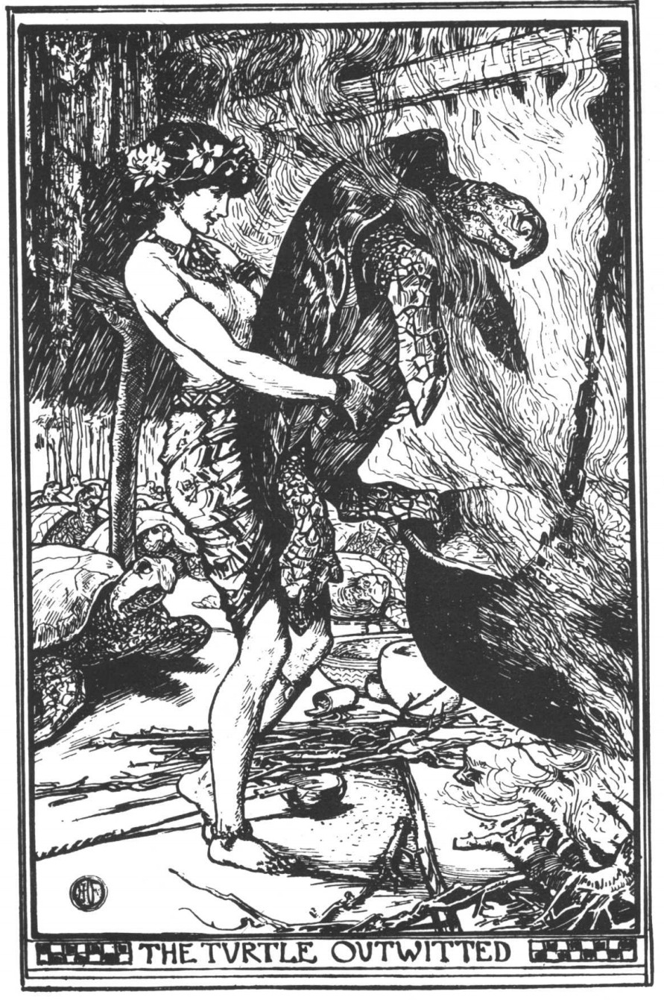

 

## 懦夫盖拉特如何受罚

从前有一个穷骑士，他有一大群孩子，觉得很难养活他们。有一天，他叫大儿子罗萨德，一个勇敢和诚实的青年，到附近的城里去办一些事情。在城里，罗萨德遇见一个名叫盖拉特的青年，两人成了好朋友。

盖拉特是有钱人家的儿子。他父亲为儿子感到骄傲，允许他去做任何喜欢做的事情。这位父亲很幸运，因为他的儿子既敏捷又谨慎，不像许多纨绔子弟那样乱花钱。有好长一段时间，他已经下决心去周游世界。他和罗萨德谈了一会以后，问他的新朋友是不是愿意和他同行。

“那当然再好不过了。”罗萨德说。不过他又摇摇头，伤心地说：“可是我父亲很穷，他没有分文给我做路费。”

“啊！假如这是你唯一的顾虑，那好办。”盖拉特说，“我父亲有花不光的钱，我要多少他就给多少。钱包在我身上。但有个条件，不论碰到什么事情，所有的荣誉都必须归我一人。”

“可以，这样才显得公平合理。”罗萨德说，他从来不想出风头。“不过我要先回家和父母亲说一声。我敢肯定，他们会认为我很幸运，有这样的好机会。”

罗萨德把城里的事情办完以后，就赶回家中。父母听到他的好运气，都很高兴。父亲把自己那把生了锈，等待着使用的剑给了他，母亲为他准备好行装。

“记住，要遵守对盖拉特的承诺。”母亲分手的时候吩咐他，“不论发生什么事情，都不要背叛他。”

罗萨德兴高采烈地骑着马走了。第二天，他和盖拉特一起出发去冒险。令他们失望的是，在他们自己的国家里，一切都井然有序，没有任何违法行为可让他们大显身手。可是一越过国界，他们就感到邻国的秩序是多么混乱。

还没有走多远，他们翻过一座山岭时，看到山坡的树丛里埋伏着几个武装的强盗，这才想起，这里就是出名的十二个强盗伏击有钱的过路人的地方。这些强盗与其说是人，不如说是残忍的野兽。他们住在山顶上的山洞和地洞里。他们的名字都叫汉库，为了区别，各人都在名字前加上颜色，如蓝汉库、灰汉库、红汉库……等等。只有他们的头领叫大汉库。他们的刀剑在月光下闪闪发光，两个青年人不禁想起人们传说的，这里发生的许多可怕的事情。

“两个对十二个，我们不是对手。”盖拉特拉住马，小声地说，“我们还是回去吧！从山下的小路走，把命丢在这里太愚蠢了。”

“不！我们不能回去。”罗萨德说，“那样我们就羞愧得没脸见人了！而且，这是一个考验我们的好机会。我们把马拴在这里，爬到山顶上去，把石头滚下来砸他们。”

“好吧！我们可以试试，这样起码不会把马丢了。”盖拉特说。他们小心翼翼地爬上山顶。

那些强盗正静静地埋伏在那里，等待着过路人，以便出击。忽然许多大石头滚下来砸在他们身上、头上，一半人当场被砸死。其余的惊吓得跳起来，向山顶上奔去，又被在山顶上等待着的罗萨德接二连三地砍倒，最后只剩下头领大汉库，他忽然一跃，抓住罗萨德的腰，把他手中的剑打掉，两人扭打在一起，一直滚到悬崖边。身材比大汉库矮小的罗萨德眼看就要被推下悬崖，幸亏他眼明手快，乘势拔出大汉库腰上的匕首，刺中他的心脏，才结束了他的生命，还缴获了他手上的一个宝石戒指。

英雄的壮举到处传扬，传遍了整个国家。人们都想拉住盖拉特的马，要看一看强盗的宝石戒指，据说这个戒指是强盗从国王的父亲那里偷来的。盖拉特骄傲地把戒指给他们看（是他向罗萨德借来的），神气十足地听着他们的赞美之词，谁也没有怀疑是盖拉特消灭了强盗。

几天以后，他们离开这个国家，来到另一个王国。他们想留在这里过冬，因为盖拉特害怕吃苦，不想在冰天雪地里跋涉。国王同意他们留下来，但是有一个条件，那就是在冬天结束以前，要有新的行动来证明人们传说的他们的勇敢。罗萨德听了国王的话，觉得很高兴。而盖拉特则认为，只要罗萨德在，一切都没有问题。所以他们都鞠了一躬，回答说，国王的话就是命令，他们绝对听从。

“那好吧！”国王说，“我要你们做的事情是这样的。在我的国土的东北部，居住着一个巨人。他手中的铁棒足足有十尺长，他舞起来就像风轮在转一样，五十个骑士也无法靠近他。我王室里最强壮和最勇敢的年轻人都丧生在他的铁棍下。既然你们能轻而易举地打败十二个强盗，我觉得，我有理由相信你们能征服他。三天之内你们就出发。”

“尊敬的国王，我们立刻做好准备。”罗萨德回答。盖拉特一声不吭。

他们走出了城堡。盖拉特说：“我们怎么能战胜杀死过五十个骑士的巨人呢？国王只是想赶我们走。幸好这三天里他不会来找我们，我们有足够的时间走出这个国家，免得他来找麻烦。”

“也许我们无法杀死巨人，但是在试一试之前，我们当然不应该逃跑。”罗萨德说，“而且，要是我们设法杀了巨人，那该是多么光荣。我知道该用什么武器来战胜他。跟我走，我要考虑一下。”

他拉着朋友的手，来到一家铁铺，买了一大块铁。那块铁那么重，俩人几乎抬不动。他们好不容易把它抬到铁匠铺。罗萨德吩咐铁匠把它打成一根大铁棍，两头都打成钩子。一切都完成以后，他就把它带回家。

第三天天蒙蒙亮，两个年轻人就踏上征途。第四天大清早，他们就赶到巨人居住的山洞口，这时候巨人还没有起床。听到门口有脚步声，巨人爬起来，想出来看看谁来了。罗萨德早有准备，拿起大铁棍对准他的头狠命一击，巨人猝不及防，跌倒在地。他还没有弄清楚是怎么回事，罗萨德已经抽出宝剑，把他的头砍下。

“你看！事情并不像想象的那么难，是不是？”他转过身来对盖拉特说。他们带着巨人的头回到了城堡。

到城门口时，罗萨德把巨人的头交给盖拉特，跟在盖拉特身后来到国王面前。

“巨人再也不会给你制造麻烦了。”盖拉特拿着巨人的头，对国王说。国王低下头来吻他，高兴地说他是全世界最勇敢的骑士，应该为他和罗萨德摆庆功宴，他们的伟大功绩应该向全国宣布。盖拉特心中充满了骄傲，他几乎忘记，是罗萨德，而不是他杀死了巨人。

不久，有消息传来，说是城里有一个美丽的女士，还有她的二十四个可爱的侍女将出席庆功宴会。这位女士是国王的侄女，她父亲也曾是国王，在她小的时候就和她母亲相继去世了，她从小由叔父抚养长大，现在继承了父亲的王位，当了女王。就她的年龄来说，她完全可以治理一个国家。可是她的臣民不喜欢女人管理国家，他们希望她找一个丈夫，帮助她一起料理国事。一个又一个王子来向她求婚，可是年轻的女王一个也看不上。后来她干脆对大臣们说，要嫁人的话，她会自己挑选丈夫，他们推荐的一个也不要。大臣们说，那样的话，就让她自己管理国家吧！由于没有人帮助，事情搞得一塌糊涂。她干脆扔下不管，到叔父的王国里来了。

听说两个年轻人杀死了巨人，美丽的女王对他们的勇气充满了敬意，宣布她将出席庆功宴会。

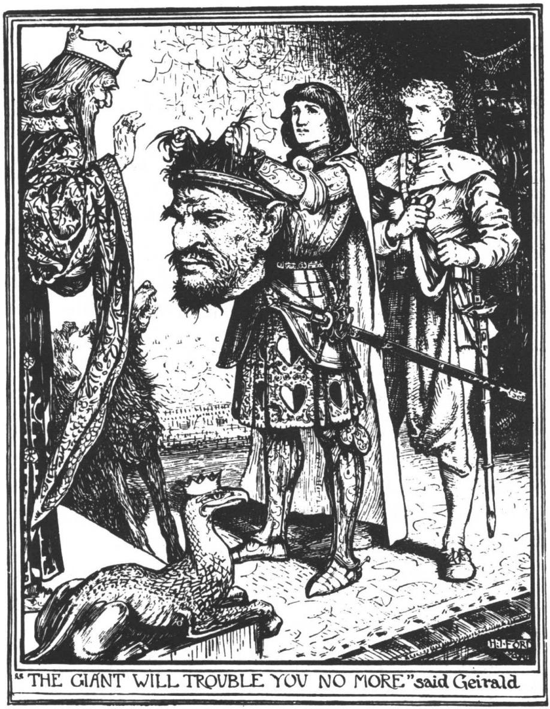

那天她果然来了。宴会结束以后，她问国王，是否可以请两个杀死强盗和巨人的英雄明天和她的僮仆比武。国王高兴地答应了。吩咐下面做好准备。他毫不怀疑，两个了不起的勇士将为有机会再扬英名而高兴。他根本没有想到，那天晚上，盖拉特拼命地劝罗萨德偷偷地离开这个城堡。他说：“我不相信明天来比武的是僮仆，他肯定是国王最好的骑士。我们这么年轻，又没有打过仗，怎么是他的对手呢？”

“明天要是我们赢了，不是更光彩吗？”罗萨德回答。可是盖拉特说什么也不听，他说他不在乎什么荣誉，只要能活着，就比世界上所有的荣誉都堆在自己的头上强。他决心要走了，而且说罗萨德已经发过誓跟随他，所以也必须一起走。

听了这些话，罗萨德觉得很伤心。他知道，要想再说服盖拉特是不可能的。他开始考虑，用什么办法来阻止这可耻的逃跑。忽然，他神采奕奕，说：“让我们对换衣服，我去比武，赢了就算是你的，谁也不会知道。”盖拉特欣然同意。

不管盖拉特猜得对不对，那个比武的僮仆到底是不是最好的骑士扮的，总而言之，罗萨德这一仗打得很艰苦。两个人和两匹马搅在一起，难解难分。有一次，罗萨德把对手的头盔打掉了，对方也不示弱，有力的一击差点把他震下马来。最后，罗萨德的枪刺中了对方的胸甲，僮仆躲闪不及，摔下马来。观看的人齐声高呼：“落马了！落马了！”罗萨德赶紧下马把他扶起。

就在全场热烈欢呼的混乱时刻，罗萨德神不知鬼不觉地退下来，和盖拉特换了衣服。盖拉特穿着这身经过激战，满是灰尘和战痕的服装，在国王的召唤下走了出来。

“像我所希望的那样，你干得很好！”国王说，“现在，请选择你的奖赏吧！”

“尊敬的陛下！请允许我吻一下你的侄女、女王的手。”年轻人鞠了一躬，回答说，“我将保卫她的国家不受任何敌人的侵犯。”

“你是她再好不过的丈夫了！”国王说，“要是她肯，我同意。”

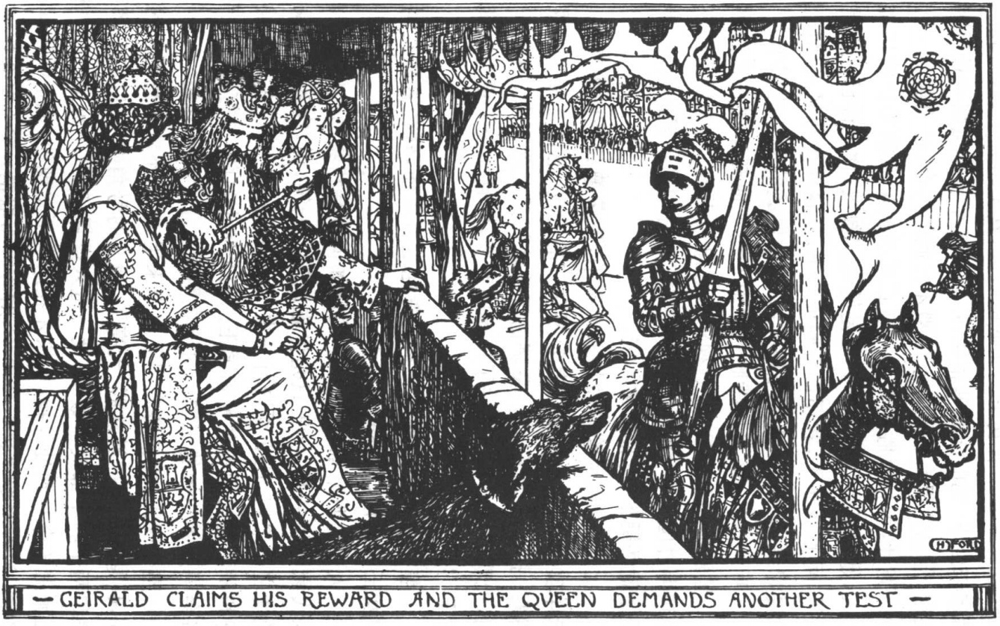

他转过身来看了看女王。比武的时候，女王走开了，这时候刚刚溜进来坐下。她的眼睛非常敏锐，面前这个青年虽然也长得高大英俊，但总觉得有些地方不像刚才比武的那个。这里面会不会有什么诡计，为什么胜利者会把自己应得的奖励拱手让给这位陌生人，她想还是小心为妙。于是她说：“叔叔，你也许已经觉得满意了，可是我还不，我还得考验他一下。让这两个年轻人比试看。我要嫁给那个真正杀死强盗和巨人，战胜我的僮仆的那个。”

听到这些话，盖拉特脸色刷地变白。他知道现在无法逃避了。虽然他毫不怀疑，罗萨德将永远忠诚于他。可是罗萨德有可能瞒得过国王和大臣们警惕的眼睛吗？特别是年轻的女王，她一开始就怀疑他，令他非常不安。

比武开始，尽管盖拉特非常害怕，罗萨德只是虚张声势，一味佯攻；而对盖拉特那极其容易防守的进攻，他也常常装做难以招架。打了一阵子以后，罗萨德沉重地从马上落下来。在这一瞬间，他明白自己不但失去了应得的荣誉，而且失去了更为可贵的女王的爱情。

盖拉特也顾不得停下来看看他是否受伤，就径直跑到国王和女王的面前，准备领取奖赏。

人们的眼睛都转向女王，看她如何接待和奖励这位胜者。可令大家吃惊的是，女王只是优雅地笑了一笑，说，在我伸出象征爱情之手之前，还必须进行一次，而且是最后一次的考验。盖拉特和罗萨德必须单独地和国王的两个骑士对阵，谁打败了对手，将会得到她和她的王国。对阵在明天上午十点钟开始。

整个晚上，盖拉特在房间里走来走去，他不敢去想明天的对阵，只是想如何能够逃脱。天亮了，战斗的号角响亮地吹起，罗萨德和两个骑士都披盔戴甲，策马进入操场，唯独不见盖拉特。国王派出传令兵到处寻找，后来才在床底下发现他，他正吓得浑身哆嗦。没有必要再进行考验了，对阵宣布取消。女王宣布她非常满意，准备接受罗萨德做自己的丈夫。

他们俩单独在一起的时候，女王对罗萨德说：“你疏忽了一件事，我在你的右手指上，认出了被强盗大汉库偷走的，我父亲的宝石戒指，因此我知道是你而不是盖拉特杀死了强盗。我就是和你对阵的僮仆，比武时我也看到了你手上的戒指，而盖拉特冒名顶替来领奖时，手上没有戒指，所以我才命令你们俩对阵。由于你忠诚于自己的诺言，使我的计划无法实现，我不得不另想办法。一个为了遵守自己的誓言而愿意牺牲自己一切的人，值得我和我的臣民的信赖。”

他们举行了婚礼，回到自己的王国，成功地统治着国家，过着幸福的生活。许多年以后，一个乞丐敲开王宫的大门讨乞，说他认识国王和王后，这个人就是盖拉特。

 

## 哈博基

以前有一对农民夫妇，他们有三个女儿。像通常那样，最小的女儿最美丽，最温柔。她的姐姐想出去的时候，她总是愿意留在家里干活。

一家人平平安安，日子过得很快。有一天，农民忽然觉得，三个女儿都长大了，到了应该考虑她们婚事的时候了。

有一天，一家人都坐在家门口聊天。父亲笑着问大女儿：“你想过吗？你愿意嫁给一个叫什么名字的丈夫？你知道，这是一件大事。”

“是的，我只嫁给叫西格蒙特的人。”大女儿说。

“嗯！你很幸运，在世界上的这个地方，有许多人叫西格蒙特，你尽可以挑选一个。”父亲说，接着转过头来问第二个女儿：“那么你呢？”

“我想再也没有比西哥德更好听的名字了，我要嫁给他。”第二个女儿说。

“那好，你不会成老处女的。”她父亲说，“旁边的村子里就有七个叫西哥德的。你呢！赫尔格！”

赫尔格就是他最漂亮的小女儿。听了她父亲的话，她抬起头来。她本来也可以说出一个自己喜欢的名字，可是正当她要开口的时候，好像听到一个声音在耳边说，“只和一个叫哈博基的人结婚。”

小女儿从来没有听到过这样的名字，也不喜欢这个名字，她决定不理睬它。可是，当她开口想告诉父亲，自己的丈夫名字必须叫尼格尔时，她发现自己说成了：“我要是结婚，只嫁给一个叫哈博基的人。”

“谁叫哈博基？”父亲和姐姐问，“我们从来没有见过叫这种名字的人。”

“我只知道，我的丈夫只能叫哈博基。”赫尔格回答，她只能这么说了。

没有多久，附近村子里的人，还有住在山坡下的人都知道了她们三姐妹的谈话。那些叫西格蒙特和西哥德的人，都接二连三地来到她们家里求婚。还有许多叫别的名字的人来，希望能博得最小的女儿的欢心，可是他们之中没有一个叫哈博基的，虽然也有不少人叫尼格尔，赫尔格从不朝他们看一眼。

后来，两个姐姐从那些叫西格蒙特和西哥德的人中选中了她们的丈夫。她们决定同时举行婚礼，并向所有的亲戚和朋友发了请柬。

举行婚礼的这一天上午，所有的亲戚和朋友都兴高采烈地来参加。这时，一个相貌丑陋的老农民从人群中走出来说：“我的名字叫哈博基，赫尔格要嫁给我。”

赫尔格听到他的话，脸色苍白，浑身颤抖着。不过她并不想逃走。

“我们现在不能讨论这件事情。”父亲回答，想到自己心爱的小女儿要嫁给这么可怕的老头子，他实在受不了，想拖延一下，事情可能会出现转机。可是两个姐姐从小就妒忌小妹妹，看到自己的丈夫比她的好，心中暗暗高兴。

婚宴结束了，哈博基把放在草地上吃草的马拉过来。这匹马非常漂亮，马鞍非常华丽，上面绣着绯红色和金黄色的图案。哈博基叫赫尔格跳上去，对她说，“你会回来的。不过现在应该去看一看你要住的房子。”赫尔格虽然非常不想去，可是内心的一股力量迫使她不得不服从。

那老人让她坐舒服以后，自己非常轻松地跳到她的前面，好像他不是一个上了年纪，行动不便的老人，而是个动作敏捷的年轻人似的。他拉动缰绳，一会儿，两人就从人们的眼光中消失了。

走了几英里以后，他们来到一片草原，碧绿的草地使赫尔格心旷神怡。许多肥大的羊在草地上吃草，它们身上长着世界上最白、最卷曲的羊毛。

“多么可爱的羊啊！它们是属于谁的？”赫尔格大声问。

“属于你的哈博基的。”他回答，“你所看到的一切都是属于他的。不过羊群中最漂亮的一只羊，它角上挂着小金铃，将是属于你的。”

这使赫尔格非常高兴。她还没有拥有过属于自己的东西。她幸福地微笑着，感谢哈博基送给她的礼物。

他们很快就把羊群抛在后面，来到一片宽广的原野，一条河流从原野中穿过。原野上放牧着成群灰色的母牛，它们都在等待着挤奶人来挤奶。

“啊！多么可爱的母牛！”赫尔格又叫了起来，“我敢说它们的牛奶是世界上最甜的。我多么想有几只啊！它们是谁家的？”

“是你的哈博基的。”他回答，“不久，你要多少牛奶就有多少。不过，我们现在不能停下来。你看到那头角上有银铃的灰色大母牛吗？它将属于你，你每天早上醒来就可以喝上它的牛奶。”

赫尔格虽然不说什么，眼中却闪烁着光彩。她想，她要学会自己挤牛奶。

又走了一英里，他们踏上了一块辽阔的茂密的草地。各种颜色的，皮肤像绸缎一样光滑的马群在奔驰着，嬉戏着。看到这群可爱的马，赫尔格高兴得大声叫起来，差点从马背上跳下来。

“这些马是谁的？啊！这些马是谁的？”她问，“谁拥有这么多可爱的马，该是多么幸福啊！”

“它们是属于你的哈博基的。”他回答，“你看它们之中哪一匹最漂亮就要哪一匹，学会去骑它。”

听了这话，赫尔格高兴得把羊和奶牛都忘记了。

“属于我的马？”她喊道，“啊！请停一会！让我看一看喜欢哪一匹。白色的？不！栗色的？不！我想，我最喜欢那匹像炭一样黑的黑马，它头上有一颗白星。啊！请停一停，一会儿就行了。”

可是哈博基不听她的，没有停下。“等你结婚以后，你有的是时间去挑一匹。”他回答。

他们又继续跑了二三英里。在一间小屋前面，哈博基拉住缰绳。那房子又破又旧，好像随时都会倒塌。

“这是我的家，也将是你的家。”哈博基说着，从马上跳下来，伸出手去把赫尔格从马背上抱下。姑娘的心不禁一沉，她想，一个拥有那么多漂亮的羊、母牛和马的人，应该为自己造一幢漂亮的房子来住。不过她心中那么想，口中却不说什么。他拉着她的手，走上进屋子的台阶。

可是，走进房子以后，她惊奇地看到周围的一切是那么华丽。她的朋友中没有一个人拥有这些，就是她认为最富的磨坊主也没有。屋子里到处都铺着色彩绚丽，又厚又软的地毯。床上和椅子上的垫子都是用丝做成的，叫人看到就想睡上去。房间里放着许多珍贵的瓷器和雕像。赫尔格想，要仔细看完这些东西，恐怕要花上一辈子。

她走进房子只看了几分钟，哈博基就对她说：“我必须马上准备我们的婚礼。像我答应过的那样，我的表弟会送你回家。三天以后，他就会带你，还有你的父母和姐姐，以及你邀请的客人回来。到那个时候，婚宴也就准备好了。”

赫尔格回来的路上想着许多事情，所以路程显得那么短，一会儿就到家了。父母看到她回来都非常高兴。他们原先都怀疑，那个又丑陋又粗鲁的哈博基会不会跟赫尔格玩弄什么鬼把戏。

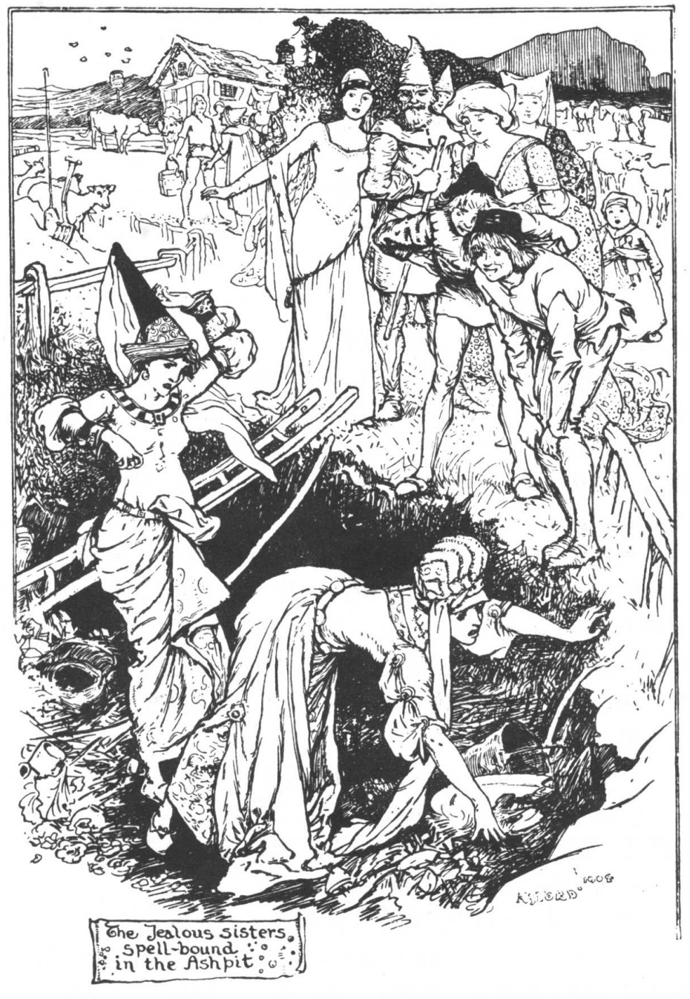

他们给她吃过晚饭以后，都请求她说出她的经历。可是她只是说，三天以后他们会去参加她的婚礼，到时候可以自己去看。

三天以后一大早，他们就出发了。看到成群的羊、母牛和马，特别是听说其中最好的一匹要送给赫尔格的时候，两个姐姐都非常妒忌。不过，看到即将是赫尔格的破房子，她们又开心起来。

“让我住在这种地方，我会感到羞耻。”两个姐姐嘀咕着。大姐姐夸奖着她家门口雕刻的大理石如何漂亮。二姐姐吹嘘着她有多少间房间。可是当她们走进房间时，看到一切都是那么豪华富丽，她们又气又恨，呆呆地张望着。看到新郎为新娘准备的婚礼服像冰上的阳光那么绚烂多彩，更是恨得脸色红一阵，白一阵。

“她不会比我们好看多少。”等到没有旁人的时候，两个姐姐私下说。当天晚上，她们偷偷地溜出自己的房间，把妹妹的结婚礼服偷出来，把它埋在灰堆里，上面还堆上更多的草灰。可是哈博基懂得一点魔法，已经猜出她们要干什么，把草灰变成玫瑰花，还念了咒语，叫两个姐姐一整天站在那里不能走动，让过路的人都嘲笑她们。

第二天，人们醒过来的时候，那丑陋的小屋不见了，取而代之的是一幢金碧辉煌的宫殿。客人们到处寻找那又老又丑的新郎，可是只见一个身穿蓝色天鹅绒大衣，头戴金冠的英俊青年站在新娘身旁。

“他是谁啊？”他们问赫尔格。

“他就是我的哈博基。”她回答。

 

## 弟弟如何救哥哥

在大森林的中央，有一间小屋。小屋里住着一对夫妻，三个儿子和一个女儿。不知道为什么，森林里的动物好像都远走高飞了，他们的食品因此非常短缺。有一天早晨，下了一整夜的大雪以后，三兄弟决定出去打猎，因为大雪以后，动物会在雪地里留下脚印，容易跟踪。

三兄弟一起走了一会，来到交叉路口。他们决定分开，一个带着猎狗走另一条路，另外两个继续一起走。两人没有走多远，狗就在丛林中发现了一只熊，把它赶出来，哥哥搭上箭，射中了熊的头部。他们俩抬着熊往回走，在交叉路口，三兄弟碰头以后就一起回家。他们把熊放在地上，对父亲说：“父亲，今天我们猎到一只熊，我们现在有饭吃了。”

父亲脾气很坏，他说：“我年纪轻的时候，一天可以猎到两只熊。”

三兄弟觉得很失望。尽管那只熊够他们吃两三天，第二天一早他们还是出发了。他们沿着昨天的那条路走，到交叉路口时，一只熊突然从树后窜出来，向右边那条路奔去。两个哥哥带着猎狗追过去。二哥是个好猎手，他一箭就把熊射中。他们抬着熊回到交叉路口时，看到向左边那条路走过去的弟弟也独自猎到一只熊。他们高高兴兴地回家。可是父亲看到两只熊时，看也不看他们一眼，只是说：“我年轻的时候，一天可以猎到三只熊。”

第三天，他们比前两天还要幸运，带回来三只熊。可是他们的父亲说，年轻的时候，他一天总可以猎到四只熊。尽管这么说，他还是剥了熊皮，照自己的方法把熊煮了。他觉得非常满意，一家人美餐了一顿。

不巧，这些熊都是一只熊大王的仆人，熊大王住在远处的一座高山上。这些熊被杀了以后，它们的影子都回到了熊大王那里。熊大王和其余的熊从影子上可以清楚地看到它们致命的伤口。

熊大王看到这么多熊被杀，非常愤怒。它决心想办法惩罚凶手：它把一只熊仆叫过来，对它说：“到丛林中那些男孩杀了你兄弟的交叉路口去，尽快地把他们和狗引到这里来。到时候山门会打开，让你，还有那些猎人进来。那时候，他们就处于我的权力控制之下，我要亲自报复他们。”

熊仆向大王鞠了一躬，立刻赶到交叉路口，在丛林中藏起来。

没有多久，那些男孩走过来了。不过这次只来了两个，最小的留在家里。空气温暖潮湿，地上的雪开始融化，有些泥泞。老大的弓绳很松，老二的弓被树枝挂住，折成两半。这时候，狗大声地吠叫起来，那只熊从丛林中奔出来，向熊大王居住的高山跑去。两人看见熊跑了，就紧追过去，也不想想，如果熊反扑过来的时候，他们用什么来防卫自己。那只熊已经看清楚，他们的弓箭已无法使用，也就放心地奔跑，有时还故意慢下来，让狗接近一些。不知不觉地，老大已经跑到了山脚下，老二因为脚受了伤，远远地落在后面。

这时候，山门打开了，让熊跑进来，紧跟在后面的老大也冲进来，他也不知道到了什么地方。等他抬起头来，才看到四周都有许多熊坐着，正在开会呢！那只被追赶的熊在当中喘着气。老大这时候非常害怕，呆呆地站在那里，手中的弓也掉在地下。

“你为什么要杀我的仆人？”熊大王开始问他，“看看它们的影子吧！箭还刺在它们的身上。是我让这只熊把你们引到这里来的，你们的命运将握在我的手中。你再也不能伤害我的人，你们也将变成熊。”

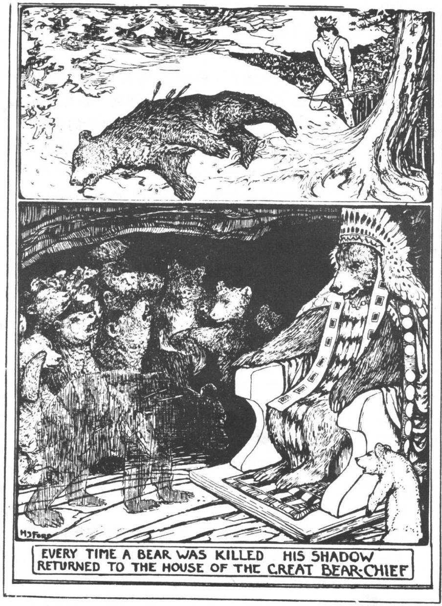

这时候，老二也冲进来了，那扇山门一直开着，引诱他冲进来。看到老大站在那里发愣，他上气不接下气地喊着：“你没看见熊就躺在你身边吗？为什么不射死它？”说着也不等老大回答，就拔出一支箭来，对准熊的心窝刺过去。老大抓住他的手，小声地对他说：“安静！你没看到这是什么地方吗？”老二这时才抬起头来，看到许多熊正愤怒地看着他。一边是熊大王的熊仆；另一边是熊大王妹妹的熊仆。熊大王的妹妹很可怜两兄弟，请求饶他们一命。熊大王说，不会杀死他们，但是要向他们施魔法，让他们的头和身体不变，手和脚变成和熊的一样，叫他们一生都要用四条腿走路。说完，它拿起一把苔藓浸在一股泉水里，把水撒在两人的手上和脚上。两兄弟立刻变成人不像人，兽不像兽的动物，站在熊大王的面前。

熊大王当然知道，两个小孩子不回家，他们的父亲一定会出来寻找。它派了一个熊仆到交叉路口去躲藏起来，看看会发生什么事情。没有多久，老人来了，他弯着腰，想在雪地上寻找两个儿子的足迹。当他看到右边那条路上的脚印时，非常高兴，根本没有想到，这是熊仆故意弄出来骗他的。他急急忙忙地跟着脚印走，不小心掉进一个小坑里，还没有等他站起来，躲在一旁看着的熊仆就把他的头颈打断了，还把他的尸体埋在雪地里。熊仆干完了这些，又坐下来看还会有谁来。

母亲在家里惦记着两个儿子，猜不透出了什么事，几个钟头过去了，丈夫还不见回来，她决定自己出去寻找。小儿子请求她留下来，让他去，可是她不听，叫他留在家里照看妹妹。她穿上雪地鞋就出去了。

由于没有下过新的雪，路上的脚印很容易寻找。她跟着脚印，一直走到小坑旁边。那只熊还在那里等着，它向她扑过去，把她打倒在地，还打断了她的脖子，把她的尸体放在她丈夫的旁边，就回去告诉熊大王。

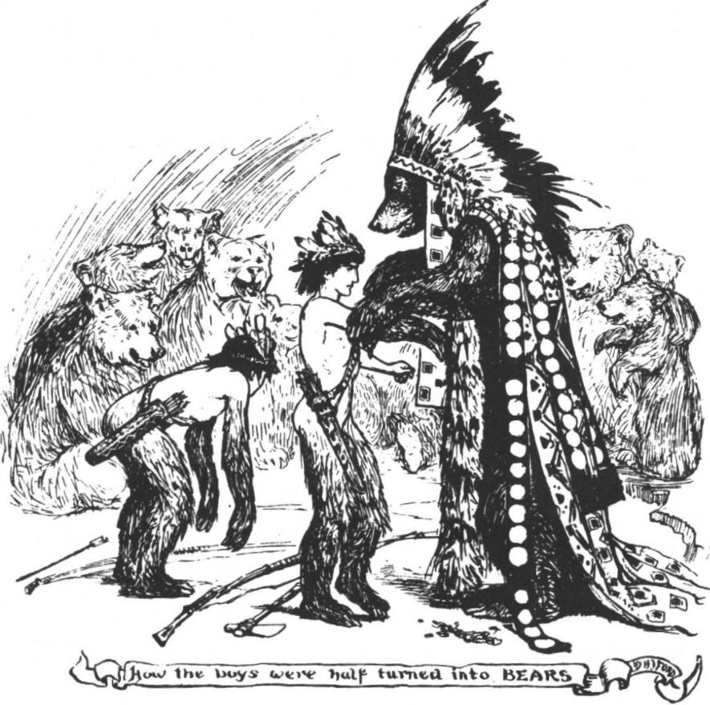

一个钟头又一个钟头地过去了。在森林中央的小屋里，老三和妹妹终于意识到，他们的父母和哥哥肯定是出了什么事。一天又一天，小儿子爬到屋子旁边一棵最大的树顶上，向森林的四周张望，希望能看到有人回来，直到人几乎被冻僵。不久，家里的食品都吃光了。他明白，必须自己出去打猎了。此外，他也想出去找找自己的父母。

小妹妹不愿意一个人留在家里，大哭起来。小哥哥告诉她，留在家里只有等着饿死。他还说，不管怎么样，天黑之前，他一定会赶回来。他砍下一些树枝，做了一些弓箭，还用各种鸟的羽毛装饰这些弓箭。他又做了一支又轻又硬的弓，取出他的雪地鞋。不过等一切都准备好以后，天已经快黑了。他只好等到明天。

第二天一早，他带着小狗出发了。跟着脚印走了许多路以后，他觉得很累，就坐在一棵树杈上休息。这时候，狗突然狂吠起来。老三想，他的父母可能就丧生在这棵树下。他爬下来，取出一枝箭向树根射去，立刻响起雷鸣般的声音，整棵树都抖动起来，接着燃起大火，几分钟以后，这棵大树就烧成灰烬。

老三搞不清楚这是怎么一回事，就继续赶他的路。他来到交叉路口，走右边那条路，来到那只熊躲藏过的树丛旁。

熊大王能够改变两兄弟的模样，当然懂许多魔法。老三出来了它也一清二楚，所以它已经派了一只年纪虽小却很聪明的小熊躲在树丛中等他，想把他引诱上山。可是不知道为什么，它的魔法今天显得不灵，它不知道小狗也跟着主人出来，否则它会更小心一些。这时候，小狗围着树丛大叫起来，小熊吓得从树丛中窜出来，拼命地向山上逃去。

小狗跟着小熊。老三跟着小狗奔跑着。那座大山，还有熊大王的房子就在眼前。这一天，地上厚厚的积雪在融化，路很难走。奔跑中老三的雪地鞋皮带断了，他只好停下来修理，远远地落在小熊和小狗的后面。雪地鞋修好以后，老三对鞋子说：“你要尽快地跑，要不我就追不上小狗，也追不上小熊了。”

这时候，熊大王的妹妹正站在窗口向外张望，看到老三跑过来，很可怜他，就像可怜他两个哥哥一样，想看看他要干什么。这时，小熊和小狗已经跑进山里。

老三看到小熊和小狗突然从眼中消失，觉得非常奇怪。他站在那里，想着下一步应该怎么办。这时，他好像听到小狗在山的那边叫。他非常艰难地爬上陡峭的岩石，穿过荆棘丛生的丛林，来到山的另一边。可是当他停下来以后，他又仿佛听到狗在原来的地方叫。他又赶紧往回爬。到山顶上的时候，他停下来喘口气，突然听到狗就在他的脚下叫。他立刻明白这是怎么一回事。

“让我的狗出来，熊大王！”他大声地喊叫着，“要不，我就毁了你们这块地方。”可是熊大王听到他的声音只是笑笑，不说什么。老三得不到回答非常生气，拔出箭来对着山顶射了一箭。

箭一碰到地面，整个山都抖动起来，发出震耳欲聋的轰鸣声。山顶喷出熊熊烈火，整个山都裂成碎片。熊大王和它的熊仆全被烧死，它的妹妹和熊仆却安然无恙，因为它们救了两兄弟的性命，使他们免受重罚。

火灭了以后，老三走进山来，第一眼先看到他的两个哥哥，一半是熊，一半是人。

“啊！救救我们！救救我们！”他们靠后腿站立着，伸出前腿来喊叫着。

“可是我怎么来救你们呢？”小弟弟说着，几乎哭出声来，“我可以摧毁树林和高山，可以消灭敌人，可没有魔力去改变人的形状。”两个兄弟走过来，把他们的前爪搭在弟弟的肩膀上，三个人一起哭泣着。

他们的悲伤感动了熊大王的妹妹，它轻轻地走过来，小声地说：“小男孩，把泉水旁边的苔藓拿过来，让你的哥哥闻一闻。”

他们三人跑到泉水旁。小弟弟拔起了一把潮湿的苔藓，兄弟二人拼命地嗅着它。很快，熊皮从他们身上退下来，他们又恢复人形，重新站立起来。

“我们该怎样来感谢你呢！……”他们激动得说不出话来，感激地跪在熊妹妹面前。熊妹妹只是微笑着说：“回家去看好你们的妹妹吧！现在没有人照顾她”。

三兄弟听从它的话，回家细心照顾他们的小妹妹。她年龄那么小，很快就忘记了自己曾经有过父母。

 

## 神奇的库曼戈乳汁

在一个非常遥远的热带国家，住着一个男人和他的妻子。他们有两个孩子，儿子叫科纳，女儿叫撒克娜。

从一大早到天很黑，这对农民夫妇都在地里干活，只有太阳在天空的正当中时，他们才在树荫底下休息一会。儿子总是在天还没亮，就乘空气凉爽而新鲜的时候，把牲口赶到肥沃的草地里去放牧。家里的事就留给女儿一个人做。

有一天，科纳起得比平常晚，他父母都已经下地去了，撒克娜正忙着做午饭吃的面包。

“撒克娜，”科纳说，“我口渴了，从库曼戈树上给我弄点乳汁来，这是世界上最香甜的乳汁。”

“啊！科纳，”撒克娜说，“我们不许碰那棵树，这你是知道的。父亲回来以后会怎么说，他肯定会知道这事。”

“胡说！”科纳回答，“树上有那么多乳汁，少了一点他怎么会知道？你要是不给我拿来，我就不把牲口赶出去，它们在牲口棚里关上一整天就会饿死。”他生气地转过脸去，在角落里坐下。

过了一会，撒克娜说：“天越来越热了，你现在把牲口赶出去不是很好吗？”

科纳沉着脸说：“我跟你说过，我决不会把它们赶出去。我喝不上乳汁，它们也别想吃草。”

撒克娜不知道该怎么办才好。她不敢违抗父母，那样的话，他们会打她。可是牲口不赶出去放牧就会饿死，父母为了这个也会打她。后来，她拿起一把斧头和一个小碗，在库曼戈树上凿了一个很小的洞，乳汁从洞中涌出，很快就装满了一碗。

“这是你要的乳汁。”她端着小碗走进来对科纳说，他还是绷着脸坐在那里。

“这一点有什么用？”他满腹牢骚地说，“连一只苍蝇也淹不死。再去拿一些来，起码三倍这么多。”

撒克娜吓得直哆嗦，她走出来，用斧头在树上使劲地砍了一个洞。立刻，乳汁像瀑布一样从洞口喷出，像一条小河一样向小屋流去。

“科纳！科纳！”她喊叫着，“快过来，帮我把洞堵住，父亲和母亲回来要没有乳汁喝了。”可是科纳也没有办法把洞堵住。很快，乳汁流过小屋，向山下父母正在干活的地里流去。

丈夫看到一条白色小溪流过来，便猜到出了什么事情。

“太太，太太，”他大声地对着在稍远处干活的妻子喊叫，“你看到库曼戈乳汁从山上流下来吗？我敢肯定，这是孩子们的恶作剧。我要赶紧回家看看到底是怎么一回事！”他们放下手中的锄头，赶回来看库曼戈树。

他们跪在草地上，用双手捧起地上的乳汁喝。不久，乳汁又从山下流回山上，流进小屋。

在火辣辣的太阳光下，他们喘着气跑回家，也顾不上休息，就声色俱厉地喊起来：“撒克娜！你干了些什么？库曼戈的乳汁为什么会流到田地里去？”

“那是科纳的不对。”撒克娜回答，“他不喝上库曼戈的乳汁，就不肯把牲口赶出去放牧。我没有别的办法，只好给他。”

父亲听了她的话也不回答，只是一声不响地走出去买了两张羊皮，把它们染成红色，还叫铁匠打了一些铁环。他回到家里，把铁环套在女儿的手上，脚上和头颈上，把羊皮挂在她的胸前和背后。做完了这些，他就把仆人叫来说：“我要去除掉撒克娜！”

“除掉你唯一的女儿？”他们吃惊地说，“为什么？”

“因为她吃了她不应该吃的东西，碰了那棵神圣的树。”他转过身来，叫撒克娜跟着他，向通往妖魔住处的一条路走去。

他们经过一片庄稼地，那里的庄稼已经成熟。一只兔子忽然从地里跳出来，双脚站立着唱道：

> 你的女儿多么美丽，多么可爱，
> 为什么把她送给妖魔？

“你最好问她自己！”父亲回答，“她这么大了，会说话。”他说完了，撒克娜接着唱道：

> 我的哥哥叫科纳，
> 本该天天去放牧，
> 那天偷懒赖在家，
> 要喝乳汁才肯去，
> 谁也拿他没办法。
> 我怕牲口会饿死，
> 就把乳汁给了他。

兔子听完，说：“可恶的人！妖魔应该把你吃掉，而不是你美丽的女儿。”

可是父亲并不理睬兔子说什么，反而越走越快，吩咐撒克娜快点跟上。走着走着，他们遇到一大群羚羊。

它们看到撒克娜，停下来唱道：

> 你的女儿多么美丽！多么可爱！
> 为什么把她送给妖魔？

“你最好问她自己！”父亲回答，“她这么大了，会说话。”他说完了，撒克娜接着唱道：

> 我的哥哥叫科纳，
> 本该天天去放牧，
> 那天偷懒赖在家，
> 要喝乳汁才肯去，
> 谁也拿他没办法。
> 我怕牲口会饿死，
> 就把乳汁给了他。

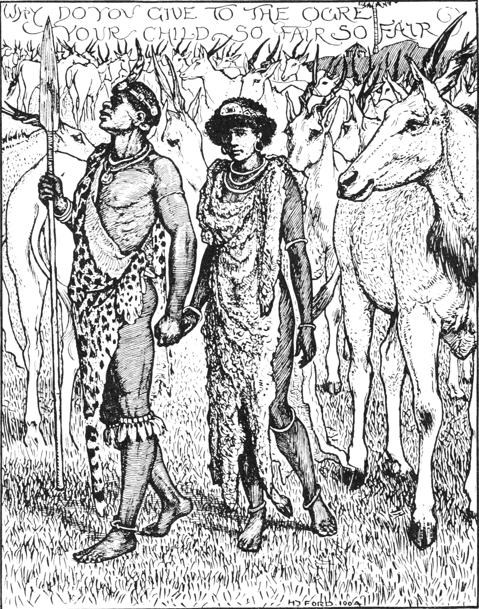

羚羊听完异口同声说：“可恶的人！妖魔应该把你吃掉，而不是你美丽的女儿。”

这时候，天已经快黑了。父亲说，今天晚上不能再走了，要找个地方睡觉。撒克娜不禁谢天谢地，因为她觉得很累了，挂在身上的羊皮很重，她实在吃不消。尽管她非常害怕妖魔，这一晚她还是一觉睡到天明，直到父亲把她叫醒，粗暴地叫她准备继续赶路。

穿过草原，他们看到一群瞪羚在吃草。它们都抬起头来张望，这么早就有人赶路，它们觉得很惊讶。看到撒克娜，它们唱道：

> 你的女儿多么美丽！多么可爱！
> 为什么把她送给妖魔？

“你最好问她自己！”父亲回答，“她这么大了，会说话。”他说完了，撒克娜接着唱道：

> 我的哥哥叫科纳，
> 本该天天去放牧，
> 那天偷懒赖在家，
> 要喝乳汁才肯去，
> 谁也拿他没办法。
> 我怕牲口会饿死，
> 就把乳汁给了他。

瞪羚听完都叫道：“可恶的人！妖魔应该把你吃掉，而不是你美丽的女儿。”

最后，他们来到了妖魔居住的村庄，径直走进他的房子。他们没有找到他，却看到了他的儿子马斯洛。马斯洛完全不是妖魔，而是一个很有礼貌和风度的年轻人。他吩咐佣人在地上铺上厚厚的皮垫，让撒克娜坐下；至于她的父亲，却命令他坐在地上。马斯洛看了姑娘一眼，这时她正低着头，他的心不禁被她的美貌打动。他问了兔子、羚羊和瞪羚问过的问题。

撒克娜做了同样的回答。马斯洛下令把她带到母亲那里去，由他的母亲照管。而姑娘的父亲，则留下来等他的父亲回来处置。妖魔回来一看到他，就吩咐佣人把他扔在旁边的大锅里，大锅里的水整天都烧开着，随时准备煮东西。不到五分钟，他就被烧熟了。佣人到马斯洛那里去，把这一切都告诉了他。

马斯洛从看到撒克娜第一眼的时候起，就爱上了她。开始，他对这忽如其来的爱意有点束手无策。自从他出生以后，他就恨女人。他拒绝过父母给他提的几门亲事。父母都为他的婚事担心。所以当他们听说儿子爱上撒克娜的时候，尽管她没有分厘的嫁妆，也就欣然同意了。

过了一年，撒克娜生了一个女儿。她想，这是世界上最漂亮的女儿了。可是当她的婆婆看到她生的是女孩子的时候，她搓着手哭泣着说：“啊！可怜的母亲！可怜的孩子！你为什么不是一个男孩。”

撒克娜觉得非常吃惊，问她为什么这样烦恼。老妇人对她说，按照这里的习惯，所有的女孩生出来以后，都要给妖魔吃掉。

撒克娜吓得紧紧地抱着婴儿，叫道：“可是，我们那里没有这个习惯！那里的小孩要是死了，都埋在地下。谁也不能把我的孩子抢走。”

那天晚上，屋子里所有的人都睡着以后，撒克娜起来，背着孩子走出去。她沿着一条河流走，来到河水泻入湖泊的入口处，湖岸边长满了高大的柳树。她找到一块没人看见的地方，在一块石头上坐下，想着怎么样才能救孩子。

忽然，她听到柳树林里有沙沙响的声音，一个老妇人出现在她的面前。

“你哭什么啊？我亲爱的孩子！”她问。

撒克娜回答：“我为自己的婴儿哭泣，不知道怎样才能永远地把她藏起来，要是妖魔看到了，就会把她吃掉。我宁愿让她在湖里淹死，也决不让妖魔把她吃掉。”

“你说的倒是真的。”老妇人说，“把你的孩子给我，让我来照顾她。你只要说好那一天来见我，我就把婴孩带到这里来。”

撒克娜擦干了眼泪，高兴地接受了老妇人的好意。她回家以后就对丈夫说，她把小孩扔到河里去了。他已经看到，她抱着小孩朝那个方向走去，所以也不怀疑她的话。

到了约定的日子，当人们都忙忙碌碌的时候，撒克娜偷偷地溜出去，来到湖边。一到湖边，她就在柳树旁弯下腰来，对着湖水温柔地唱道：

把蒂拉给我带来，

被人们抛弃的蒂拉，

被父亲遗弃的蒂拉。

老妇人抱着婴儿出现了。小蒂拉长得又壮实又活泼，撒克娜心中充满了欢乐和感激。她尽可能地和孩子玩耍，直到担心会有人来找她，才把孩子交给老妇人，返回村庄。老妇人也消失在湖水之中。

孩子在水下长得很快，谁也想象不出。没有多久，蒂拉就长成了一个婷婷玉立的少女。她母亲尽可能地经常来看她。有一天，她们坐在一起说话时，被一个出来砍柳树回去编篮子的男人看见了。他看到姑娘的脸长得那么像马斯洛，非常吃惊。他停下手中的活，跑回村子。

他一跑进屋子，就对马斯洛说：“马斯洛，我刚才在湖边看到你妻子和一个姑娘说话，她长得很像你，肯定是你的女儿。我们都以为她死了，我们受骗了。”

听到这些话，马斯洛装做因妻子违反规矩而震惊，但他内心觉得很高兴。

“可我们该怎么办呢？”他问。

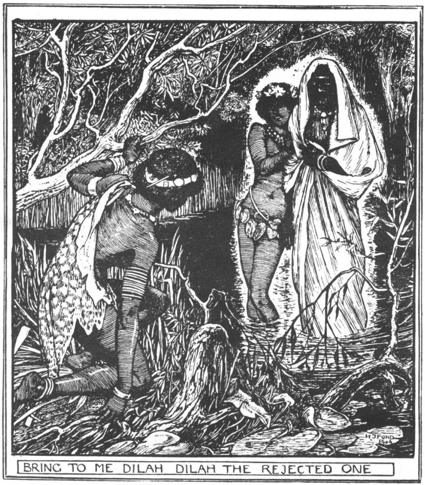

“你自己先要证实我说的是真话。等撒克娜说，她要到湖边去洗澡的时候，你就躲在树丛里，等那姑娘出来。”

一连好几天，撒克娜若无其事地呆在家里，她丈夫开始以为那人搞错了。可是有一天，她对丈夫说：“我要到湖边去洗澡。”

“好的，你去吧！”他回答。他从一条近路跑过去，比她先到湖边，在树丛中躲起来。不久，撒克娜来了，她站在岸边唱起来：

把蒂拉给我带来，

被人们抛弃的蒂拉，被父亲遗弃的蒂拉。

老妇人从水中走出，手中拉着一个身材苗条的姑娘。马斯洛看着，看着，确认她就是自己的女儿。女儿没有在湖中淹死，他高兴地流出了眼泪。老妇人觉得有点不安，她对撒克娜说：“我觉得有人在监视我们。今天我要寸步不离这个姑娘，要亲自把她带回去。”说完，她带着姑娘潜入湖底。她们走了以后，撒克娜也动身回家。马斯洛设法赶在她的前面。

回家以后，马斯洛坐在角落里哭泣。他母亲走过来问：“儿子，你为什么哭得这么伤心？”

“我头痛得很厉害！”他回答。他母亲不理他，走开了。

晚上，他对妻子说：“我看到我的女儿了，就在你说把她淹死的地方。她没有死，生活在湖底，长成一个年轻的姑娘了。”

“我不懂你在说什么！”撒克娜回答，“我把孩子埋在沙滩下了。”

马斯洛请求她把孩子还给他。她不听他的，只是说：“假如我把她带回来给你，你只会照你们这里的规矩，把她交给你父亲，那个妖魔。她就会被他吃掉。”

马斯洛保证他不会让父亲见到她，还说她已经长成一个大姑娘，不会有人想伤害她。撒克娜的心软下来，她来到湖边和老妇人商量。

“我该怎么办呢？”她对老妇人说，“昨天，马斯洛看到了蒂拉，打那以后，他一直请求我把女儿还给他。”

“要想得到她，他必须给我一千头牲口做交换。”老妇人回答说。撒克娜把她的话带回给马斯洛。

“是吗！给她两千头牲口我也很高兴，因为她救了我的女儿。”马斯洛说，他赶紧派人到附近的村庄去，叫他们把属于他的牲口立刻赶过来。他从中挑选出一千头最好的公牛和奶牛，把它们赶到湖边去，后面跟着一大群人看热闹。

撒克娜站在牲口的前面唱道：

>把蒂拉给我带来，
>被人们抛弃的蒂拉，
>被父亲遗弃的蒂拉。

蒂拉从湖面中走出，向马斯洛和撒克娜伸出双手。在她露出水面的地方，牲口沉了下去，老妇人把它们赶到湖底下的大城市里去，那里住着许多人。

 

## 恶毒的貂熊

有一天，一只貂熊在山脚下走着，在转弯处看到一块大石头。

“我刚才听到脚步声，是你在走吗？”它问石头。貂熊是一种小心谨慎的动物，什么事情都喜欢刨根问底。

“不！当然不是！”石头回答，“我不会走路。”

“可是我看到你走了。”貂熊继续说。

“恐怕你没有受过讲真话的教育。”石头反驳说。

“你不必这么说，因为我已经看到你走了。”貂熊说，“不过，我不敢十分肯定你跑得比我慢。”说着它跑出一段距离，然后回过头来，看石头是否追上来了。可是石头还是一动不动地站在那里，它觉得很不高兴。貂熊又走过来，用手爪打了石头一下，说：“好了，现在你来追我吧！”

“我不会走路，可是我会滚动。”石头说。

貂熊笑起来，说：“啊！那也一样。”开始向山脚下跑去。

开始，它跑得很慢。“给石头有个机会。”它想。可是不久，它加快了步伐，因为它觉得石头已经跟上来了。貂熊跑得越快，石头就滚得越快。跑着，跑着，小貂熊觉得非常累，开始后悔干吗去找石头的麻烦。它想，只要咬紧牙冲刺一下，就可以到达山脚下的一片森林里，到那里石头就不能动了。它用尽吃奶的气力，不是跑，而是跳过树丛和石块。可是不管它怎么快，石头总是寸步不离。它越来越提心吊胆，连前面的路也看不清了，被一棵树枝绊倒。石头也停了下来。可是这时，貂熊尖叫起来：

“滚开！滚开！你没看见压到我的脚了吗？”

“你干吗要惹我？”石头问，“我不想动，我恨动来动去。你这是活该，我肯定不会动了，除非是有人用力推我。”

“我把自己的兄弟叫来。”貂熊说，“我在森林里有许多兄弟，你等着瞧吧！它们的力量比你更大。”他大声地喊啊！叫啊！直到狼、狐狸还有许多各式各样的动物都跑过来，看看究竟发生了什么事情。

“你怎么会被石头压着的？”它们围着貂熊一连问了好几遍，还得不到它的回答。像许多人那样，叫它承认这是自己惹出来的麻烦可不容易。

“嗯！我闷得慌，想找个人和我一起玩。”最后，它终于阴沉着脸说：“我向石头挑战，说它追不上我。当然，我跑得比它快，可是绊倒了，它才压着我了，这不过是偶然的。”

“你这么笨，活该！”它们都说。大家围着石头，推的推，拉的拉，石头丝毫不动。

“你们真不行。”貂熊生气地喊叫起来，它实在是痛得厉害，“要是你们救不了我，我就请我的朋友闪电和雷鸣来试试看。”它大声地叫闪电，快点来救它。

几分钟以后，一块乌云从天边滚来，发出令人胆颤心惊的雷鸣声，那些狼、狐狸，还有许多动物纷纷四处逃窜，找地方躲避。它们虽然怕得要命，但没有忘记请求闪电把石头打碎，把貂熊救出来而不伤害它。闪电又躲进云中，聚集力量，然后对准石头发出闪光，石头一下子被击得粉碎，貂熊安然无恙。可是它的大衣也被击成碎片，赤裸裸地站在那里。

“你真笨！”貂熊说，“你完全可以把石头打碎而不撕坏我的大衣。”它弯下腰来捡大衣的碎片，这些布片散落得满地都是，它花了许多时间才捡起来。

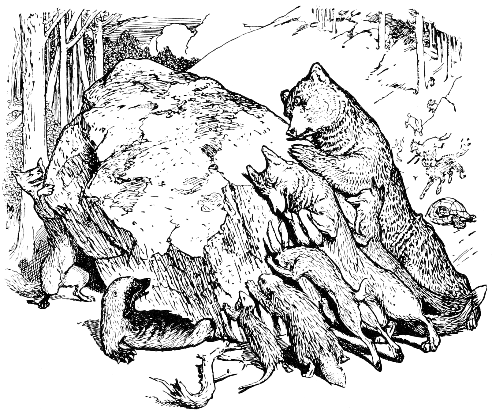

“我去找青蛙姐姐。”它想，“它会把我的大衣重新缝好。”它来到了青蛙姐姐住的池塘边。

“你帮我把大衣缝起来好吗？我遇到了一件不幸的事情，把大衣撕坏了，不能再穿了。”它找到了青蛙，对它说。

“很高兴为你效劳。”青蛙说，它从小就听大人说，要讲礼貌。青蛙找来针和线，把大衣的碎片一块一块地缝起来。青蛙虽然良心很好，可是并不聪明，它把一些衣片缝错了位置。貂熊穿衣服向来很讲究，它把缝好的大衣穿上以后，非常生气。

“你真是个废物！”它喊道，“我穿着这件大衣能够走出去吗？背上鼓鼓囊囊的，我又不是驼背。胸前紧得要命，我简直透不过气来。我知道你很蠢，可也不至于蠢到这个程度。”说完，它对准青蛙的头打了一巴掌，可怜的青蛙掉入水中。貂熊生气地走开，去找老鼠妹妹。

它找到老鼠的时候，老鼠正坐在自己的家门口吃苹果。“今天上午，我把大衣撕坏了。”貂熊说，“你看，都成碎片了。我拿着它去找青蛙姐姐，请它帮我补好。可是你看看，它干的什么活！我要你重新把它拆成碎片，再好好地缝好，希望我不会再发牢骚了。”貂熊比老鼠大，习惯于用这种口气和它说话。老鼠也习惯了，所以也就回答说：“我看，你就坐在这里看我补吧！如果有什么地方不满意，我马上就可以改。”于是，貂熊在一堆干草上坐下，也不管老鼠还吃不吃，拿起它的苹果就吃个精光。

大衣终于缝好了，貂熊拿起来穿在身上。

“不错，很合适。”它说，“你缝得很整齐。等我再来的时候，我会带些粮食来报答你的。”它兴高采烈地走了。老鼠受到夸奖，也心满意足。

一连好几天，貂熊到处游荡。它来到了一块缺少食物的地方，饿了整整一个星期。正当它觉得很绝望的时候，看到一只熊正躺在那里睡觉。“啊！有吃的东西了！”它想。可是熊比它大得多，怎么能杀死它呢？靠力气当然是不行的，要想个办法来摆弄它。貂熊苦思冥想，终于有了办法。它走过来对熊说：“是你吗？我的妹妹！”

熊转过身来，看着貂熊，自言自语地嘀咕着，声音低得谁也听不清：“从来没有人告诉我，我有一个哥哥。”熊站起来，向一棵大树跑去，接着又爬到树上去。貂熊看到一堆美餐就这样在面前消失了，非常生气。它不会爬树，只好跟着熊来到树下站着，声嘶力竭地喊起来：“下来吧！妹妹！我们的爸爸派我来找你。你还是一个小姑娘的时候，自己出去采草莓，走丢了。昨天我们才从一只河狸那里听到你的消息。”听它这么一说，熊爬下来了一点。看到这些，貂熊继续说道：“你不是很喜欢吃草莓吗？我也很喜欢！我知道一个地方，那里的草莓长得又大又甜，把地面都遮盖了。你自己看一看，山脚下那一片红就是草莓地。”

“我看不到那么远！”熊回答。这时，它已经从树上爬下来，“你的眼睛一定很好。我真希望也有这么好的视力，我近视得很厉害。”

“我以前也是近视。后来我父亲采了一把酸果子，把它们压碎后用来擦我的眼睛，我才看得远了。”貂熊说，“要是你愿意和我一起去采草莓，我就会像父亲那样，治好你的眼睛，你就可以和我一样看得很远了。”

熊采草莓很费劲，它们干什么都是慢吞吞的，很花时间。不一会，熊就腰酸背痛了。最后，它终于采满一口袋，把它交给貂熊。“妹妹，你真是了不起。”貂熊说，“现在，你躺在地上，头枕在石头上，我来把这些酸果子压碎。”

熊非常累，很高兴听它的话躺下来，在草地上舒服地伸着懒腰。

过了一会，貂熊说：“我准备好了。开始的时候，酸果会弄痛你的眼睛，你千万别动，免得果汁流掉后又要重来。”

熊答应躺着不动。可是酸果汁碰到眼睛的时候，它大叫着跳起来。

“嗯！这点痛你要忍耐一下。”貂熊说，“很快就会好的，到时候，你就可以看到你从来没有见过的许多东西。”熊呻吟着躺下来，眼中充满了酸果汁，完全被弄瞎了。貂熊拿起一把刀，向它的心窝刺去。

它剥下了熊皮，从山脚下的一个帐篷里偷来了火，它敏锐的眼睛早就看到了这顶帐篷，把熊的肉一块一块割下来，烤了吃。它从来没有吃过这么香的肉。吃饱了以后，它下定决心，以后肚子饿的时候就耍这个花招。

它很有可能这么做！

 

## 老鼠女儿选丈夫

从前，在日本有一只老鼠和它的妻子，它们出身于古老而高贵的种族。它们有一个女儿，是老鼠世界里最可爱的姑娘。父母为它而感到非常骄傲，不惜花费很大的精力和金钱，教会它懂得应该学会的一切。在整个城市里，没有一个姑娘像它那么聪明。它可以在很硬的树木上咬穿一个洞；可以从很高的地方跳到床上；有人来的时候，它跑得比谁都快。它也很注意自己的打扮。它的皮毛像丝绸一样的光滑，牙齿像珍珠一样洁白，排列得整整齐齐。

当然，女儿有这么多优点，父母都希望它有非常美满的婚姻。女儿长大以后，它们开始为它寻找合适的丈夫。

可是问题来了。它的父亲从头到尾，从里到外，都是彻头彻尾的老鼠，它当然希望女儿在鼠族中找个丈夫。向它女儿求婚的老鼠有的是，父亲的心目中已经看中了一只年轻英俊的老鼠，它的胡子几乎可以碰到地面，它的家族比它们的更古老，更高贵。可惜母亲不是这么想。它是属于这种人，它们不去考虑自己的家庭条件和处境，总是津津乐道地说，自己是特殊材料制成的，在这个世界上谁也比不上。它趾高气扬地宣称：“我的女儿决不会嫁给一只老鼠，凭着它的美貌和才能，它有权力去挑选一个比老鼠好一些的丈夫。”

像所有的母亲那样，它逢人就这么说，只要人家愿意听。至于它的女儿怎么想，谁也不知道，老鼠的世界就是这个样。

为了女儿的婚事，夫妻俩常争吵。有时从它们脸上留下的痕迹来看，它们的争吵不仅仅停留在嘴巴上。

“我的座右铭是，把天上的星星摘下来。”有一天，母亲的脾气比以往任何时候都大，它说，“我女儿美貌绝伦，人世间无人可比，我不想找一个比它低下的女婿。”

“最好让它嫁给太阳。”它的丈夫不耐烦地说，“据我所知，没有任何人比它更伟大。”

“好吧！我也是这么想。”妻子说，“既然你也这么认为，我们明天就去拜访它。”

第二天早上，两只老鼠花了几个钟头，打扮妥当以后，就领着女儿来见太阳。

“高贵的太阳！”母亲开始说，“请看看我们的女儿！它如此美丽，举世无双。因此，我们希望能找到一个至高无上的女婿，所以我们来找你。”

“我觉得很高兴。”太阳答道，它那么忙，根本没有想过要和谁结婚。“你们的提议使我感到很荣幸。只是有一点你们搞错了，我不能利用你们的疏忽，这是不道德的行为。有人比我还要强大，那就是云。你们看！”就在它说话的时候，一片云遮住了太阳的脸，顿时使它暗淡无光。

“啊！好的！我们去跟云说说。”母亲转过脸来，向云提出它的建议。

“其实，我实在配不上这么妩媚的姑娘。”云说，“你又错了，有人比我还要强大，那就是风。啊！它来了，你自己可以看到。”

是的，它们看到了，风过来抓住了云，把它抛到天空的另一边。颤抖着的父亲、母亲和女儿又回到地上。风在它们身边停下来，站在一堵古老的墙上。

母亲喘过气来以后，又用它微弱的声音说出自己的愿望。

“墙最适合做你女儿的丈夫。”风回答，它住在山洞里，平时到处奔跑，难得回家一次。“你们可以看见，它比我强大，可以阻止我飞行。”母亲不甘心就此罢休，马上转过身来准备对墙说话。

这时谁也没有想到，一直一声不响的女儿哭泣着开口说话了：“我不愿意嫁给这堵又丑又老的墙，它的年纪和爷爷一样大。我宁愿嫁给太阳、云和风，那是尽我的责任，虽然我只爱那只年轻英俊的老鼠，而且只爱它一个。可是这堵可怕的旧墙……我想我快死了！”

那堵墙的感情大受伤害，宣称它没有说过，要做这么美丽的姑娘的丈夫。它说：“不错，我是可以挡住风，而风可以吹走云，云可以遮住太阳。可是有人不止是只有这些本事，那就是老鼠。老鼠可以从我身上穿过去，用牙齿就可以把我弄成粉末。你们要是想找一个世界上最伟大的丈夫，到老鼠中去找吧！”

“看！我怎么跟你说来的？”父亲喊道。它的妻子这时候虽然因为输了而感到很气愤，可是很快就认为，找一个老鼠做女婿也是它向来的愿望。

三只老鼠高兴地回家，三天以后就举行了婚礼。

 

## 美人鱼和少年

很久很久以前，有一个国王统治着一个海边国家。他结婚大约一年以后，住在一群海岛上的人起来造反。看来，他必须告别新婚的妻子，亲自去解决这些争端。王后担心会有灾难降临，请求他留在家里。可是他告诉她，没有任何人能够帮他处理好这件事情。第二天早晨，战舰在海边一字儿排开，国王开始了他的航程。

舰船还没有开出去多远，就撞在一块礁石上，船被卡住了，卡得那么紧，船员们怎么用力也推不开。更糟糕的是，风越来越大，裹挟着海浪把船压向礁石。事情很明白，用不了多久，船就会在礁石上撞得粉碎，所有的船员和士兵都会被淹死。就在这个时候，一个美人鱼的影子在浪尖上舞蹈着，波浪好像随时都会把船淹没。

美人鱼随着波浪飘动着，她对国王说：“只有一个办法可以救你们，你必须向我庄严地发誓，把你第一个孩子给我。”

对于这个提议，国王犹豫不决。他一直希望自己能够有孩子。把王位的继承人送掉，对他来说，实在是太残酷了。这时，一个滔天巨浪向船边扑来，船上的船员和士兵，都跪在甲板上，请求国王救救他们。

国王只好答应美人鱼的条件。一个大浪把船从礁石上托起，船自由了。美人鱼也消失在大海之中。

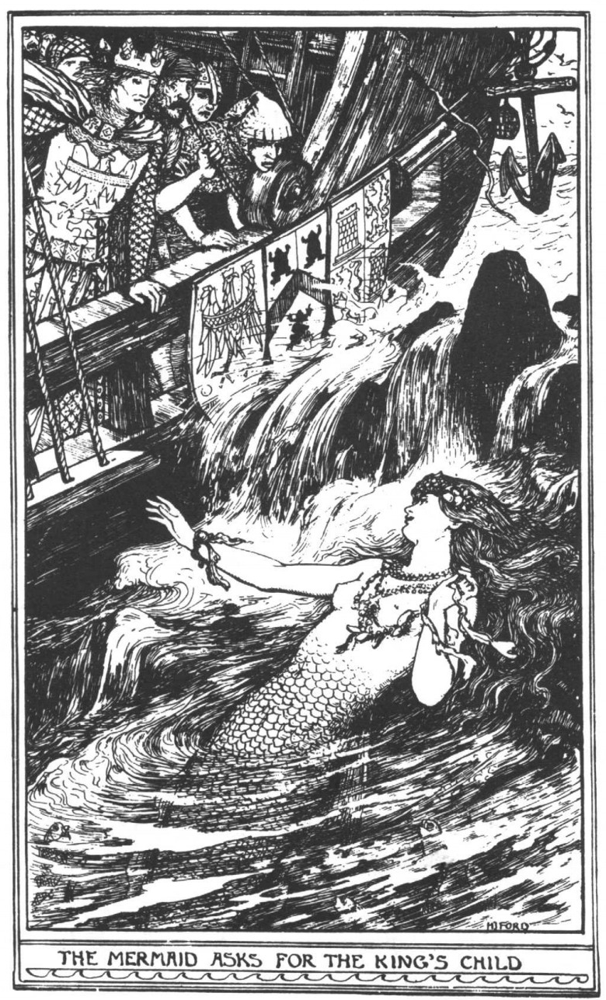

解决海岛动乱花费的时间，比国王原先预料的时间长。他重返王宫时，几个月已经过去了，王后生了一个儿子。国王是那么高兴，他完全忘记了美人鱼，还有为了救出他们的船所付出的代价。一年又一年过去了，婴儿长成了一个大孩子。往事又浮现在他的脑海里。有一天，他把整个故事讲给王后听。从这一天起，快乐从他们的生活中消失了。每天晚上，他们上床睡觉时，都担心第二天早上儿子的房间里会不会是空空的。白天，他们总是把他带在身边，害怕什么时候会忽然找不到他了。

后来，国王觉得这样下去总不是办法，他对王后说：

“归根到底，世界上最愚蠢的事情，就是让儿子留在这里，美人鱼知道到这里来就能找到他。让我们给他准备一些食物，叫他出去旅行。美人鱼真的来了，找不到他，别的小孩也许也会让她满足。”王后同意了，她也认为这是最聪明的办法。

他们把儿子叫来，父亲把海上遇险的故事告诉他，就像已经告诉过王后的那样。王子十分好奇地听着，听到要让他一个人出去周游世界，非常高兴，一点也不觉得害怕。他虽然已经十六岁了，可是除了王宫里的花园以外，从来不许他越雷池一步。他开始紧张地做准备，脱下漂亮的天鹅绒大衣，穿上适于旅行的绿衣服。他拒绝了母亲给他准备的装满食物的漂亮布袋，像他看到的那些旅行家一样，背上一个皮制的背包，然后和父母亲说一声再见就出发了。

他整天不停地走着，兴高采烈地观望着那些陌生的小鸟在森林里飞来飞去，各种奇妙的动物从他面前走过，或者是躲在树丛后面张望。可是到黑夜降临的时候，他觉得累了，一边走一边找能够睡觉的地方。后来，他在大树下找到一块柔软的草地，正准备舒服地躺下来睡觉，忽然传来一声令人发抖和心惊胆战的吼声，一头狮子慢慢地走过来，站在他的面前。

“你在这里干什么？”狮子问，它凶狠的目光紧紧地盯着王子。

“我在逃避美人鱼。”王子用颤抖的声音回答。

“那么，给我一点吃的东西。”狮子说，“晚饭的时间已经过去了，我觉得非常饿。”

真是谢天谢地，狮子不想把他吃掉。他高兴地把放在地上的皮包打开，拿出一些面包和一瓶酒。

“我觉得好多了。”狮子吃完以后说，“现在，我要在这块柔软的草地上睡觉了。要是你愿意，就睡在我身边。”于是，王子和狮子肩并肩地躺下来，睡得很熟，直到太阳出来。

“我要走了。”狮子拍拍王子的肩膀，说，“从我的耳朵上剪一小块下来，小心地保存着。要是遇到什么危险，想变成狮子时，你就会变成狮子。好心得好报，你知道。”

王子感谢它的好意，照它说的做了。两人相互告别就分手了。

“变成狮子会是怎么样？”王子独自走了一段路以后，这样想着。他从上衣的口袋里拿出狮子的耳朵片，祈求变成狮子。一瞬间，他的头膨胀起来，比原来大了好几倍，头颈变得又重又热，手变成了爪，皮变成黄色，还长出毛来。最令他高兴的是尾巴也长出来了，他神气地挥动着。“我非常喜欢变成狮子。”他心里想着，高高兴兴地在路上迈开大步。

可是过了一会，他觉得这样走路很不习惯，累得慌，前爪和腰背都痛得很厉害。所以他祈求自己重新变成人。刹那间，他的长尾巴消失了，头缩小了，又长又厚的鬃毛变成了卷曲的短头发。这时天快黑了，他找到一些干草，堆起来准备睡觉。

可是，他还没有闭上眼睛，森林里就传来非常吵闹的声音，好像是什么笨重的东西在穿过树丛。王子坐起来朝那个方向看过去，看到一只大黑熊在向他走来。

“你在这里干什么？”熊对着他喊道。

“我在逃避美人鱼。”王子回答。熊对美人鱼不感兴趣，它只是说：“我饿了，给我拿点吃的东西来。”

王子把地上的皮包拿起来打开，拿出第二瓶酒和一些面包，很有礼貌地邀请熊说：“让我们一起来吃晚饭。”可惜，从来没有人教过熊讲礼貌的方式，它什么话也不说，只管自己狼吞虎咽。吃饱以后，它站起来伸伸腰说：“你这张床看起来很舒服。真的，像我这样睡不好觉的人，在这张床上一定睡得很好。我会想法子留些地方给你挤的。你占不了多少地方。”熊这些冷冰冰的话令王子非常生气。他很累了，没有力气再搬干草来铺床。他们并肩躺下，一动也不动，直到太阳从东方升起。

“我现在要走了。”熊把睡眼瞟眬的王子拉到脚跟，对他说，“你把我的耳朵剪一点下来，如果碰到什么危险想变成熊，就可以办到。好心得好报，你知道。”王子照它的话做了，和熊互相说了再见。

“变成熊会是什么样？”他走了一段路以后，心里想着。他把熊的耳朵拿出来，祈求自己变成一只熊。立刻，他的身体伸展起来，又高又大，浑身都是厚厚的皮毛。像上次变成狮子一样，他的双手变成了爪。可是当他想挥动尾巴的时候，觉得非常失望，熊的尾巴又粗又短，不怎么听话。“这算什么尾巴！”他说。

整整一天，他保持熊的形状赶路。熊厚厚的皮在穿过荆棘丛生的森林时非常有用。可是到了晚上，他觉得这张皮太重了，祈求重新变成一个人。他太累了，懒得去找一块草皮或搬来干草铺床，倒在一棵大树下准备睡觉。可就在这时，头顶上传来了很响亮的嗡嗡声。一只大野蜂正停在一棵树上。

“你在这里干什么？”野蜂很生气地问，“像你这种年纪，应该太太平平地留在家里。”

“我在逃避美人鱼。”王子回答。像狮子和熊一样，野蜂也是属于这一类。它们从来不注意别人怎么回答它们的问题，只是说：“我饿了，给我点东西吃。”

王子把最后一瓶酒和面包从皮包中取出，放在地上，他们一起吃晚饭。吃完了最后一片面包，野蜂说：“好了，现在我要睡觉了。你个子不大，我们可以一起睡。”它收起翅膀弯起腿，和王子睡在一起。

天亮了，野蜂先醒过来。它小心地把王子衣服上的灰尘扫掉，然后在王子的耳边大声地把他叫醒。

“从我的翅膀上拔下一根毛。”它说，“你要是遇到什么危险，想变成蜂，就可以办到。好心得好报。再见吧！谢谢你的晚餐。”王子拔下它翅膀上的一根毛，小心地用一片树叶包起来以后，它就飞走了。

“变成一只蜂，和变成一头狮子或一只熊的感觉肯定大不一样。”王子独自走了一两个钟头以后，这样想着，“我敢肯定，赶起路来要快得多了。”他取出野蜂的一根毛，祈求变成蜂。

很快，奇怪的事情发生了。他的手和脚缩起来了，身体变得又小又圆，头也变得那么小。白色的皮肤变成了密密的细绒毛。更令人高兴的是，他有了两只可爱的翅膀，带着他飞了一整天也不觉得累。

快到傍晚时分，他远远地好像看到一片石头，就径直飞过去。直到飞到城门，他才看清楚这是一座很大的城市。他又祈求变成自己原来的样子，走进城市。

宫殿的门大开着，他大胆地走进去，看到一个大厅里围着许多男男女女，正在议论着什么。他走过去听，很快就明白了是怎么回事。原来这里的国王有一个独生女儿，她生来就恨男人，看到一个男人就受不了。国王非常失望，找来了全世界许多长得非常英俊的王子的画像，希望女儿会爱上其中的一个。可是没有用，公主甚至不允许把这些画像带进她的房间。

“天很晚了。”后来人群中的一个妇女说，“我要去伺候我的女主人了。”看到王子是从外地来的，她转过身来吩咐一个男仆，给他找一张床睡觉。

“不用了！”王子说，“这张椅子就很好了，再好的我也不习惯。”大厅里的人都走光以后，他躺了几分钟。王宫里静悄悄的。他取出野蜂的毛，祈求自己变成一只蜂，然后飞上楼梯，越过警卫，从锁眼中飞进公主的房间，变成人。

公主这时还没有睡，看到王子，害怕得大声尖叫起来：“男人！男人！”可是，当卫兵闻讯冲进来的时候，房间里只有一只蜂在飞来飞去。卫兵到处搜查，床底下，窗帘后，还有衣橱里，一无所获。最后他们断定，公主做了一个恶梦，向她鞠了一躬就走了。可是门一关上，蜂没有了，房间里又出现了一个英俊的青年。

公主的尖叫声比前一次更响。卫兵听到她的叫声又冲进来。“我肯定，有个男人藏在什么地方。”公主哭喊着说。可是卫兵连那些根本无法藏身的地方也搜过了，还是不见人影。“刚才他还在这里，我亲眼看见的。”公主说。那些卫兵也不敢反驳她，只是私下摇摇头，窃窃私语地说，公主为这件事肯定是疯了，看到一张桌子或椅子也会当成男人。他们决定，不管她怎么叫喊，再也不理她了。

现在，公主明白了他们是怎么想的，卫兵们再也不会来帮她了。也许弄得不好还会在国王面前编些故事来说她。说不定国王会因此而把她一个人关在塔楼里，不许她在花香鸟语的花园里散步。所以，当王子第三次出现在她面前时，她再也没有叫喊，只是害怕地坐在床上看着他。

“别害怕，”他说，“我不会伤害你的。”他开始赞美她的花园，他从仆人那里听说过这个花园的美丽，赞美她喜欢的那些鸟和那些花，直到公主的怒气消失，开始温柔地和他说话。实际上，他们很快地相爱了，她发誓，除了他以外，再也不会嫁给第二个人。她还告诉他，三天以后，她的父亲将要出征，他的宝剑将留在她的房间里。假如哪位男子能够找到宝剑，把它带给父亲，作为报答，这位男子将得到她。这时候，公鸡开始报晓。王子赶紧站起来说：“当然，我将和国王一起出征。假如我不回来，请每天带着你的小提琴到海边去演奏，让生活在海底的小精灵能够听到，来看你。”

事情正像公主所说的那样，三天以后，国王带着大批人马出去打仗，其中有年轻的王子，他把自己打扮成一个出身高贵的青年，要跟随国王出去冒险。他们离开城市，走了许多里以后，国王突然说，他忘了带自己的宝剑。虽然所有的随从都纷纷解下自己的剑送给他，可是他说，没有自己的宝剑，他无法打仗。

他说：“第一个回到我女儿房间里去，把我的宝剑带回来的人，不仅可以娶我的女儿为妻，而且在我死了以后，还可以继承我的王位，统治这个国家。”

听了国王的话，王子和好几个人立刻调回马头，像疾风一样地向王宫奔回去，其中有一个叫红骑士。王子心里忽然有了一个好主意，他从上衣口袋中拿出宝贵的袋子，祈求自己变成一头狮子。狮子纵身一跃，发出惊天动地的吼声，所有的马都吓得直发抖，无法动弹。他轻而易举地超过他们，很快就来到了王宫的门口。他立刻变成一只蜂，径直飞进公主的房间，又重新变成人。公主看到他来了，把藏在窗帘后面的宝剑指给他看。他把宝剑取下，对她说：“别忘了你答应过的事情。”

公主不说话，只是甜蜜地微笑着。她从手上脱下一只金戒指，把它折成两半，一声不响地把一半交给王子，一半放进自己的口袋。王子吻了一下戒指，带着宝剑向楼下跑去。回去的路上，他遇上红骑士和其他人。开始，红骑士想用武力来夺走宝剑。可是事实证明，他不是王子的对手，只好作罢，决心等待更好的机会。

机会很快就来了。这一天，天气很热，王子口渴极了。看到一条河流入大海，他跑过去，把宝剑解下来放在地下，弯下腰来想喝个够。不幸的是，美人鱼不巧这时正在不远处的海面上浮游，看到这就是出生之前就属于她的王子，她静静地游过来，抓住他的双臂，把他带入水中，波浪顿时淹没了他们。

他们刚刚消失，红骑士已经偷偷地跟过来。看到国王的宝剑放在岸上，他简直不相信自己的眼睛。那个年轻人到哪里去了？他觉得不可思议，不久以前他还不可动摇地捍卫着这把宝剑。可是，这又关他什么事，他跑过去，拿起宝剑别在腰上，带着它去见国王。

不久，战争结束了，国王带着他的人马凯旋而归，人们欢呼雀跃地迎接他。公主从窗口看到，父亲的随从中没有她心爱的人，心情非常沉重。她猜到，一定是发生了什么不幸的事情。她很害怕红骑士，很久以来她就知道，他是如何的聪明，但又是如何的邪恶。她已经听到一些传闻，说是他将获得把宝剑带给国王的荣誉和奖赏，他将娶她为妻，虽然他连一步也不曾跨进过她的房间。可是这一切，她将无法改变，因为国王虽然爱她，但决不允许她违抗自己的意愿。

可怜的公主猜对了，一切都像她预料的那样。国王告诉她，红骑士已经公正地得到她，婚礼将在明天举行，婚后将举行盛大的宴会。

那时候，宴会比现在丰盛得多，时间也长得多。宴会还在进行时，天已经很黑了。公主对所进行的一切仪式觉得很疲倦，偷偷地回到自己的房间，想安静一会。明亮的月光照耀着海面，好像在呼唤着她。她拿起小提琴，向海边走去。

这时候，王子和美人鱼正躺在海底一张海草做成的床上。“听！听！”美人鱼对王子说，“听！这是你原先的恋人在演奏。”美人鱼知道人世间发生的一切事情。

“我什么也听不见。”王子说，他看上去很不快活，“把我带得高一点，让我能听见那声音。”

美人鱼把他带到海中央，问：“现在你听得见了吗？”

“没有！”王子回答，“除了海水的奔流声，我什么也听不见，还得上去一点。”

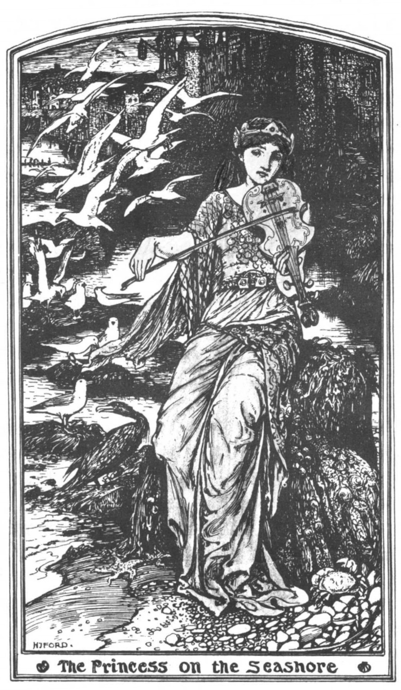

美人鱼把他带到水面，说：“现在，你肯定可以听得见了吧！”

“除了水流的声音，什么也听不见。”王子说，于是，她把他带到陆地上。

“不管怎么说，你总听得见了吧！”她说。

“我耳朵里还是充满了水流的声音。”他说，“等一会，水流的声音就会消失了。”他一边说着，一边把手伸进胸口，把蜂毛取出来，祈求变成一只蜂，然后飞进了公主的口袋。美人鱼到处都找不到他，在海面上浮动着，等了他整整一夜。可是他再也不会回来，得到王子的欢乐从此从美人鱼的眼中消失。

这时，公主虽然说不出什么理由，但觉得周围发生了什么奇怪的事情。她赶紧回到自己的房间，王子立刻恢复了他的形状。啊！看到他，公主的心中说不出充满了多少欢乐。时间是多么宝贵，必须抓紧时机。她领着他来到摆宴的大厅，国王和他手下那些高贵的人正在豪饮。她对他们说：“这个人吹嘘自己能够变戏法，比红骑士还要高明。当然，这是不可能的。比如他说，他可以立刻变成一头狮子，这怎么可能呢？为了给他一个很好的教训，红骑士，你变成一头狮子给他看看，让他无地自容。我知道你学过魔术。”

红骑士从来没有碰过一本魔术书，可是他向来自高自傲，自以为用不着学习，干什么事情都比别人强。所以听了公主的话，他弯下腰来装模作样，可是怎么也变不成狮子。

“好吧！也许变成一头狮子太难了，那么变成一只熊吧！”公主说。可是红骑士发现，变成熊并不比变成狮子容易。

“那么就试试看，能不能变成一只蜂。”她提议说，“我常听人说，懂魔术的人能办到。”老骑士（红骑士其实已经不年轻了）学着蜜蜂嗡嗡叫，可怎么也变不成蜜蜂。

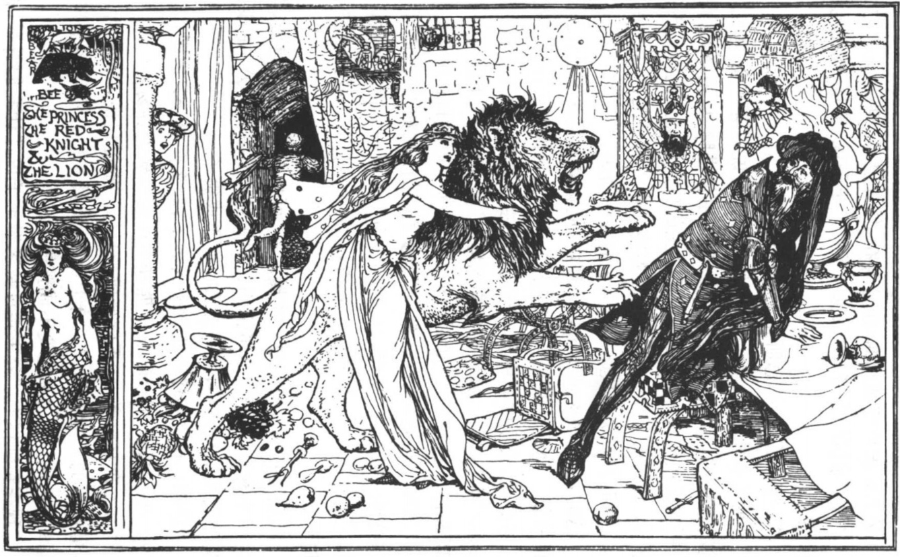

“现在轮到你了。”公主转过身来对王子说，“让我们看看，你会不会变成狮子。”一眨眼，一头凶猛的狮子站在大家的面前。大厅里顿时大乱，客人们四处奔逃，你踩我，我撞你，混乱不堪。狮子跳起来，向红骑士扑过去，要不是公主把它拉住，红骑士早就被撕成碎片了。公主叫它重新变成人，狮子转眼间就变成了王子。

“现在，变成一只熊吧！”公主说。于是，一只熊张牙舞爪地向红骑士冲过来，他吓得赶紧缩到公主的背后去。

一些逃跑的客人开始鼓起勇气，挤到门口来看热闹。他们想，公主没事，他们大概也不会出事。国王比他们勇敢一些，他觉得必须为大家树立一个好的榜样，所以他始终没有离开自己的位置。这时候，公主又下了命令，叫熊变成人。国王冷静地思考了一下，觉得其中必有道理。“他是不是取回宝剑的人？”他终于这样问公主。

“是的，就是他。”公主说。她把整个事情告诉了国王，说她如何折断金戒指，把一半交给他。公主把半只戒指拿出来，王子也把自己的一半拿出来，它们正好合在一起。第二天，红骑士被吊死，他这是罪有应得。为了庆祝王子和公主的婚礼，王宫重新安排了一次豪华的婚宴。

 

## 皮维和卡博

在鸟是人，而人是鸟的时代，皮维和卡博住在一个遥远的叫做新喀里多尼亚的岛屿上。皮维是一只快活的小鸟，

喜欢在晚霞中嘁嘁喳喳叫；卡博是一只很丑的黑禽鸟，总是在黑夜里叫呱呱。有一天，皮维和卡博想像岛上的人那样做弹弓，练习弹射。它们来到榕树林，剥下榕树皮做弹弓绳。弹弓做好以后，它们常常到河边来找石头玩。它们是这样玩的，卡博站在岸上，皮维跳入水中，卡博用石头来弹射皮维，皮维呢？则在水中学会躲避石头。开始一段时间，石头都被皮维巧妙地躲过，可是后来，有一块石头打中了它，把它的腿打断了。可怜的皮维沉入河底，被河水向下游冲去，它在水中飘忽着，后来被冲进一个竹筒里。这时，一个妇女正在用竹筒来洗她的山芋。

“什么东西在我的竹筒里？”那妇女说。她对准竹筒的一头用力一吹，皮维像剥豆机里弹出来的豆一样，被吹了出来。

“啊！”妇女看到皮维惊叫起来，“你怎么这副可怜相？你在干什么？”

“卡博在玩弹子游戏的时候，把我的腿打断了。”

“我真为你感到遗憾。”女人说，“你愿意跟我走，照我的话去做事情吗？”

“我愿意。”皮维说，因为那妇女长得既漂亮，又慈祥。她把皮维领到一间存放水果的小屋里，把它放在一张铺着席子的床上，让它尽可能地舒服些，然后帮它治疗断了的腿。她小心翼翼的以免碰到骨头边的肉，这是许多医生办不到的。

“你很快就会好的，是吗？皮维。”她说，“假如你听到什么响声，你就装死。黑蚂蚁会走过来，从你的脚上一直爬到头上。别说话，不要弄出声音来，行吗？皮维。”

“当然，仁慈的夫人。”皮维说，“我要尽可能地一动也不动。”

“然后，大红蚁会爬过来，你知道它吗？”

“是的，我知道它，它的脚像蚱蜢一样。”

“它将从你的身上爬到头上。这时候，你要浑身抖动。懂了吗？皮维。”

“是的，亲爱的夫人，我会照你的话去做。”

“很好！”女人说完把门关上，走了。

皮维一动也不动地躺在床上。这时传来轻微的声音，那是黑蚂蚁来了，它从皮维的身上走过去，皮维丝毫不动。接着，一只很大的红蚂蚁来了，它沿着皮维的身体蹦跳着。皮维浑身抖动起来。它觉得腿完全恢复了，跳了起来，向河边奔跑过去。他看着自己水中的影子，发现自己已经从鸟变成了一个年轻漂亮的男子。

“啊！夫人！”他高兴地叫起来，“现在请看看我吧！我已经变成一个人，多么英俊！”

“你还听我的话吗？”女人问。

“永远！你叫我干什么，我就干什么。”皮维彬彬有礼地说。

“那么，爬到那棵椰子树上去，只能用脚，不能用手。”女人说。

那时候，村里人都能像松鼠一样爬到椰子树上去，有的只用一只手。姑娘们也能够办到。但完全不用手爬上去，却很少有人能够做到。

“在树顶上你会找到两个椰子，你千万不要把它们扔下来，要用手把它们捧下来。下来的时候也只能用脚。”

“我起码可以试一试。”皮维说。虽然相当艰苦，他还是上去了，还捧下来两个椰子。

“这是你要的椰子。”他说，把它们交给那女人。

“现在，皮维，把它们带回你小房子里去。太阳下山以后，就到河里去洗澡，凉快凉快。等天亮还不太热的时候就起来，回到小屋里去拿椰子。”

整个晚上，皮维像当地人一样，在河里和大家一起泼水，扔果子玩。太阳出来了，他动身回家，当他走近小屋时，里面传来甜蜜的说话声和欢笑声。

“怎么回事？有人在我家里唠叨。也许他们拿走了我的椰子。”皮维想。他走进屋子，看到两个美丽的姑娘在互相逗乐，哈哈地笑着。他到处找椰子，可是怎么也找不到。

他向河边跑去，对着那女人喊叫起来：“啊！夫人，我的椰子被人偷走了。”

“跟我来吧！皮维，有你的果子吃！”女人说。

他们回到两个姑娘在打闹着的小屋。

“知道你将得到什么果子吗？”女人说，“这是你的两个妻子，把她们带回家吧！”

“啊！好夫人！”皮维说，“你是多么慈悲。”

于是他们结了婚，非常幸福。这时，怒气冲冲的卡博走进来。

“你是皮维吗？”它说，“不！好像不是，可是好像什么地方很像。告诉我，你是不是皮维！”

“呃！是的，我是皮维。”皮维说，“可是比以前好看多了。这是我的两个妻子，她们是不是长得很漂亮？”

“你在跟我开玩笑，皮维！你的妻子？你从哪里娶来妻子？”皮维把那个仁慈的女人，还有那些奇妙的事情都告诉它。

“好吧！好吧！”卡博说，“我也要长得英俊漂亮，也要娶几个年轻美貌的妻子。”

“可我们怎么才能办到？”皮维说。

“嗯！一切从头开始，我们先一起玩弹子。这一次你把我的腿打断，皮维。”

“我非常乐意！”皮维说，他向来心甘情愿地听别人的吩咐。

他们开始玩弹子，皮维把卡博的腿打断。卡博掉入河中，顺流而下，冲进那女人的竹筒里。女人像上次一样，把它从竹筒里吹出来，然后把它捡起来，放在小屋里，告诉它黑蚂蚁来了怎么办，红蚂蚁来了怎么办。可是它完全不听话。

黑蚂蚁来的时候，它迫不及待地抖动身体。看吧！它也变了，两条腿弯弯曲曲，驼背，皮肤像黑蚂蚁一样黑。

他爬起来向那女人跑过去，说：“看吧！我变成了什么样子。”可是她不睬他，只是告诉他爬到椰子树上去，像告诉过皮维的那样。

可是卡博不在乎，爬树的时候，既用脚，又用手。两个椰子也不是用手捧下来，而是从树上扔下来。他把两个椰子带回小屋。第二天早上从河里回来的时候，他看到两个像母夜叉似的又老又丑的黑女人在里面打架，互相谩骂着。他回到皮维家中，皮维也觉得很遗憾，可是有什么办法呢？卡博只好坐在那里哭泣。

有一天，卡博来找皮维，请皮维和他一起乘船出去，说他知道有一个地方有一个大蛤蜊，够他们吃一个星期。皮维和他一起去了。透过清澈的海水，他们看到海底下像小山丘一样大的大蛤蜊，它正张开着大嘴。

“我们把它捕上来，晒干了，腌起来。”皮维说，“请我们所有的朋友来吃饭。”

“我先潜下去，把它从岩石上拖起来。”卡博说，“接着，你要帮我把它一起拉到船上来。”

海底下，大蛤蜊正张着大嘴吃东西。卡博潜下去，可是不去碰它，只是远远地看着。

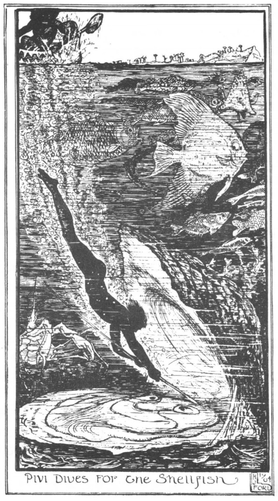

过一会，他浮上来，喘着气说：“啊，皮维，我推不动它，你下去试试看！”

皮维带着长矛下去了，大蛤蜊张着大嘴，用力一吸，把皮维吸进去了。蛤蜊咔嚓一声把嘴闭上。

卡博像魔鬼似地哈哈大笑，把船调过头来回家。

“皮维呢？”皮维两个美丽的妻子看到卡博一个人回来，问他。卡博假装伤心地哭着，说他被大蛤蜊吃掉了。

“不过，亲爱的，擦干你们的眼泪，”卡博说，“我将是你们的丈夫，我的妻子将成为你们的奴隶。一切都是那么美妙，在这个世界上，再没有比这更美妙的事情了。”

“不！不！”皮维的两个妻子哭起来，“我们爱皮维，我们再也不会爱上别人。我们要留在家里，为皮维而哭泣。”

“可恶的白痴！”卡博叫道，“皮维是个恶棍，他打断了我的腿，把我推入河中。”

这时，门口传来咳嗽声。卡博颤抖了一下，他知道这是皮维在咳嗽。

“啊！亲爱的皮维！”卡博奔出去说，“多么令人高兴啊！我正在想办法安慰你亲爱的妻子。”

皮维一句话也不说。他向山上招招手，从山上走下来二十五个全副武装的朋友，他们把卡博砍成碎片。

皮维向河边走去，看到那位好心的女人。

“皮维，”她说，“你是怎么从卡博给你安排的活坟墓中走出来的？”

“我带着我的长矛，”皮维说，“里面很干，我用长矛猛刺大蛤蜊，直到它认为还是把嘴张开，让我出来好。”

那好心的女人听着笑了起来。从此，皮维和两个妻子幸福地生活着。

 

## 淘气的少女

在一个小村庄里，住着两个小伙子，他们同时爱上了一个少女。这里的冬天夜长日短，只在中午的一个小时左右有点亮光，其余时间都是黑夜。在这一个钟头里，两个小伙子都各显神通，看谁能使少女动心，和自己在北极光的映照下出去滑雪橇，或者是到谷场里去跳舞。

春天来临，白天渐渐延长。村子里的人心都因太阳的来临而动荡起来，他们说好了一个日子，准备带着渔网，把船开出去，到几英里以外一个被岛屿包围着的海湾里去捕鱼。所有的人都参加这次行动，两个小伙子和少女也一起去。

他们兴高采烈地在海上航行着，像一群麻雀似的，吱吱喳喳地说个不停，有时还唱起大伙喜欢的歌。船靠岸了，这是一块多么富饶的地方，真是捕鱼的好渔场。他们将在这里搭起小木屋住下，直到秋天恶劣的气候来临。

那少女和两个小伙子，还有一些人，恰好分在一间小屋里居住，白天在一只船上捕鱼。时间一天一天地过去，一个小伙子发现，少女和另一个人关系越来越密切，有点疏远他了。开始他还劝自己说，这是一种错觉，不要去管它。可是事情越来越明朗，他感到不能再欺骗自己了，准备想办法来战胜情敌。

办法有了，可是要实现这个计划，还得等几个月的时间。随着时间的推移，他越想越高兴，越想越有信心。他不露声色地耐心等待着。

冬天即将来临，这一天，他们准备离开这些岛屿，驶回大陆去过冬。撤离渔场时，事情是那么忙乱。一切都准备好了，这个狡猾的小伙子突然提出，他们的船最后一个起航。船即将起锚时，他对另一个小伙子喊叫起来：“啊！亲爱的，我该怎么办才好？我把那把最好的猎刀留在屋子里了。好朋友，请你快点跑过去拿回来。我在这里准备解缆绳和起锚。”

另一个小伙子根本没有想到，这里面会有什么诡计。他跳上岸，沿着陡峭的山坡跑回去。来到他们居住的屋子门前，他回头一看，吓得目瞪口呆，最后的一只船已经离开海岸，他被抛弃在这荒芜的小岛上。

岛上不会再有别人了，这是毫无疑问的。除了那把他的朋友故意留在窗台上的猎刀，他没有任何装备。开始，他完全被朋友这意想不到的背叛气懵了，不知所措，脑子里空空的，什么也不想。过了一会，他冷静下来，就是为了报仇，他也要想办法活下去。

他拿起猎刀，向岛上走去。那里有一片小森林，不像海边那样光秃秃的。他砍下一些树枝，用留在营地里的绳子做了一些弓箭。做好以后，他来到海边，射杀一些海鸟，生起火烧熟当饭吃。

这样，几个月过去了，圣诞节即将来临。这几天，小伙子爬上山坡，走遍海岸，收集那些被大风吹掉，被海浪送来的树枝和木头，堆在家门口，准备过节。圣诞节前夕，他坐在家门口，遥望大陆，想着去年这个时候愉快的舞会。除夕之夜，岛上又静又冷，借着暗淡的北极光，他隐约可见大陆对岸。

忽然间，他看到有一只船正在向小岛驶来。开始，他掩饰不住自己的欢乐，能够有个人来说话是多么令人高兴。可是，随着船的靠近，他觉得有些不对头。这只船和他生下来就打交道的船似乎不一样。船靠岸了，他注意到，上面的人好像来自另一个世界。他赶紧躲到柴堆后面去，看看会发生什么事情。

那些陌生人一个接一个地跳上岸，每人都带着一包自己需要的东西。他发现，在妇女中有两个少女，她们抬着两大箩食品，比别人更美丽，穿得更漂亮。小伙子小心地伸出头来张望，看这伙人想在岛上干什么。可是他很快就缩回头来，因为两个少女转过头来向这边张望着，好像也想搞清楚这是什么地方。

少女敏锐的眼睛看到了柴堆后面蹲着一个男人。开始，她们有些害怕，想快点逃。后来看到那人没有什么动静，也就壮起胆来说说笑笑。“这人有点古怪，让我们试试，看他是什么做的。”其中一个少女说着，弯下腰来用手去捏他。

碰巧小伙子的上衣袖子上有一枚别针，少女的手碰到别针，血流了出来，痛得她大声地尖叫起来。那些陌生人都跑出来看发生了什么事情。一看到柴堆旁的小伙子，他们都转过头去往回跑，拿起自己的东西，没命地向停在海边的船上逃去。不一会，那只船，还有那些陌生人和他们带来的东西，都消失得无影无踪。

慌乱之中，他们忘了两件东西：一串钥匙遗留在桌子上，还有那位被针刺痛的少女，她这时脸色苍白，无能为力地站在柴堆旁。

“你要娶我做你的妻子。”少女说，“你把我弄出血来了，我应该是属于你的。”

“为什么不？我很高兴娶你做妻子。”他说，“可是你想，我们该怎么办，才能活到明年夏天来临呢？”

“这你用不着担心。”少女说，“你只要和我结婚，一切都会好的。我非常有钱，我的家也非常有钱。”

于是，小伙子宣誓娶她为妻，少女也宣誓嫁给他。在整个漫长的冬天里，岛上有的是吃不完的食品，他也不知道究竟是从哪里弄来的。

春天即将来临，渔民们来捕鱼的季节也快到了。

“现在，我们该到哪里去呢？”这一天风和日丽，妻子问丈夫。

“到哪儿去都行。”丈夫回答，“你说呢？”

妻子说，她想到小岛的另一端去造一座房子，远离这些渔民的小屋。他同意了。当天，他们就在一条小河岸边找到一块地方，这里取水非常方便。

这块地方就在岛另一端的小港湾里，这里的一切好像都是为他们造就的。长途跋涉以后，他们觉得累了，就在树丛中的一块草地上躺下，准备好好睡一个晚上，明天好有力气干活。睡觉之前，妻子对丈夫说：“你在梦中如果听到什么奇怪的声音，千万不要动，也不要爬起来看。”

“嗯！这么安静的地方，怎么会听到什么声音呢？”丈夫说完，倒下来就睡着了。

忽然，他被巨大的声音吵醒，好像世界上所有的工人都在这里锯木头，敲钉子，造房子。他正想爬起来看个究竟，幸好想起来妻子的吩咐，才躺着不动。夜好像很长很长。太阳刚刚升起，他们双双爬起来，透过旁边的树枝，他们看到，就在他们选中的地方，出现了一幢漂亮的房子，有门，有窗，一切都是那么十全十美。

他们用野樱桃当早餐。吃过以后，妻子对丈夫说：“现在，你去找个地方做奶牛棚，地方要合适，不要太大，也不要太小。”丈夫心里很纳闷，一头奶牛也没有，要牛棚干什么？不过，他还是照她的话去做了。其实他有点怕妻子，她知道得那么多，他也不敢问她。

这天晚上，他又被同样的响声吵醒。第二天早上起来，他看到了一间从未见过如此漂亮的牛棚，分隔栏、牛奶桶、凳子什么的，都已经应有尽有，只是缺奶牛了。

接着，妻子又叫丈夫找块地方做仓库，还说，他想要多大都可以。等仓库造好以后，她提议一起去见见她的父母。

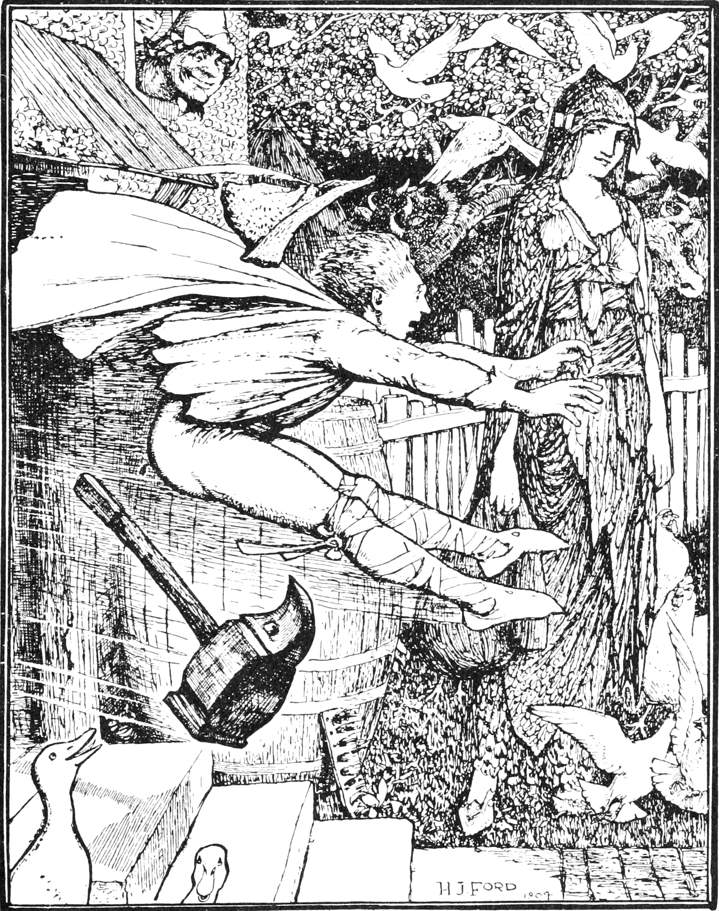

老夫妻热烈地欢迎他们，把周围几十里地的邻居都找来，为他们举行盛大的宴会。一连好几个星期，没有人下地去干活。后来，年轻的夫妻玩腻了，说要回自己的家了。出发之前，妻子悄悄地对丈夫说：“你要小心，出去的时候，尽快地从门槛上跳过去，否则你就倒霉。”

丈夫听了妻子的话，走到门槛时，像离弦之箭似地猛跳出去。他干得太漂亮了，刚刚着地，岳父扔出的一把大榔头就从他身后飞过，要是碰上了，肯定把他的腿打断。

回家的路上，妻子转过身来对丈夫说：“你走进房子之前，不管看到什么或听到什么，可别回头看。”

丈夫答应了。好长一段路，没有什么动静，他也就不在意了。后来他注意到，后面好像有脚步声跟着，越是接近自己的房子，脚步声就越大。到家了，他一边用手去推门，一边想现在大概没事了，就回过头来看，看到有一大群牲口跟着他。这是岳父看到女儿比自己聪明，送给他们的。有一半牲口已经走进栏子，在河边吃着草；可是还有一半在栏子外面，他一回头，这一半就突然连影子也看不见了。

不过，留下的这一半牲口也足以让他们富裕起来了。

他们生活得很幸福，只是有时妻子会忽然消失，而且从来不告诉他到哪里去了。在相当长的一段时间里，他也不说什么。有一天，他终于忍不住了，抱怨她不说一声就出去。妻子说：“亲爱的丈夫，我必须去，即使是违背我自己的意愿。只有一种办法可以阻止我，在门槛上钉上一根钉子，我就出不去，也进不来了。”

他果然这样做了。

 

## 野兽如何变成家畜

从前有一个磨坊主，非常有钱。他准备结婚的时候，不但邀请他的朋友，还邀请住在周围山里和森林里的野兽来参加婚宴。那些熊、狼、狐狸，还有马、牛、羊、鹿的头领，都接到他的邀请。它们很少出席婚礼，所以都十分高兴地接受邀请，用最有礼貌的语言答复说，它们当然会来参加。

举行婚礼的这一天早晨，第一个出发的是熊，它总是喜欢准时。再说，路那么远，它又浓又厚的头发需要好好梳理，在宴会上才像个样子。所以，它留神一早就起来，轻松愉快地向山下走去。走了很远以后，它看到一个小孩走过来，用手中的棍打落地上的花。

“你到哪里去？”小孩吃惊地看着熊说，他是熊的老朋友了，很少看到熊这么开心。

“喔！是去参加磨坊主的婚礼。”熊毫不在意地回答，“当然，我宁可留在家里。可是磨坊主那么热情地邀请我，我真是难以拒绝。”

“别去！别去！”小孩喊道，“你去了就再也回不来了。你的皮是全世界最美丽的，人人都想得到它，他们肯定要杀你，剥下你的皮。”

“这我倒没有想过。”熊说，脸色也变白了，不过没人注意，“你敢肯定他们会这么坏吗？也许是你没有受到邀请，妒忌了吧！”

“胡说！”小孩生气地说，“你看着办吧！是剥你的皮，又不是我的，我才管不了那么多呢！”说完，他头抬得高高的，快步走了。

熊等到看不见他了，才偷偷地跟着他。它心里觉得小孩的话没错，只是它很傲慢，不愿意这么说就是了。

不久，小孩在路上走觉得很没劲，就走到森林里去。那里可以跳过树丛，涉过小溪。没走多远，他就遇到狼。

“你到哪里去？”他问，他不止一次地见过它。

“喔！是去参加磨坊主的婚礼。”狼像熊一样回答，“当然，婚礼总是老一套，很乏味。可是，做人总要讲究礼节。”

“别去！”小孩说，“你的皮那么厚，那么温暖。冬天即将来临，他们会剥了你的皮。”

因为吃惊和害怕，狼的嘴巴张得大大的，它结结巴巴地问：“你真的认为，他们会这么干吗？”

“是的！我当然敢肯定！”小孩说，“不过，这是你的事情，与我无关，再见！”说完就走了。狼在那里站了几分钟，害怕得直发抖，就赶快回到自己的窝里去了。

接着，小孩遇到了狐狸，它那漂亮的银灰色大衣在阳光下闪着光。“你看上去真漂亮。”小孩停下来欣赏着，“你是不是也去参加磨坊主的婚礼？”

“是的，”狐狸说，“参加这种婚礼要赶这么远的路。你知道，磨坊主的朋友是怎么样的，又肥胖又愚蠢，去逗他们玩玩也很有趣！”

“可怜的家伙！”小孩同情地说，“听我的话，呆在家里。一走进磨坊主的门，他的狗就会把你撕成碎片。”

“天啊！好的，这种事情发生过，我知道。”狐狸忧心忡忡地说。它转过头，朝过来的路跑回去了。

狐狸的尾巴刚刚消失，就传来树枝被奔跑的动物踩断的响声。一匹马跑过来，黑色的皮肤像绸缎一样光亮。

“早上好！”马边跑边对小孩打招呼，“我没有时间停下来和你说话了。我答应过磨坊主，要去参加他的婚宴。我不到他们就不入席。”

“别说了！别说了！”小孩叫起来，马从他的声音里听到了什么，停下来问：“这是怎么一回事？”

“你不明白自己在干些什么！”小孩说，“你要是去了，就别想再回到这森林里自由自在地奔跑了。你比任何人都强壮，他们会把你抓起来，用绳子来套住你，叫你一生一世都为他们干活，替他们效劳。”

马听了这些话，转过头来，轻蔑地笑着，说：“是的，我比任何人都强壮，世界上所有的绳子都别想套住我，不管他们把我捆得多牢，我都能够挣脱，返回森林，重新过自由的生活。”

马趾高气扬地说完这些话，把长长的尾巴一挥，以更快的速度向山下跑去。

马来到了磨坊主的家。一切都像小孩说的那样。它走进屋子，看着那些客人，想着自己比任何人都漂亮，都强壮的时候，一根绳子忽然套在它头上。它被拖倒在地，又一根绳子把它的嘴勒住。不管它怎么挣扎，它被关进了马厩。后来，一连好几天不给它吃的，它的精神完全崩溃了，皮毛也失去了往日的光泽。就这样，它被驯服了，去帮助人耕地、干活。它以后经常想到，由于自己不听小孩的劝告，终于失去了最宝贵的东西——自由。

再说马不听小孩的话，走了以后，小孩继续在森林里溜达着，有时采些草莓，有时摘些野樱桃吃。他来到森林中的一块空旷地，看到一头长着乳白色皮毛的母牛走过来，头上还戴着一个花环。

“早上好！”母牛看到站在那里的男孩，高兴地向他打招呼。

“早上好！”他回答，“你急急忙忙要到哪里去？”

“去参加磨坊主的婚礼。我已经太晚了，做这个花环花了许多时间，我不能再耽搁了。”

“别去！”男孩子认真地说，“他们一旦尝过你的牛奶，就再也不会让你走了。你这一辈子就得天天为他们服务。”

“胡说！你怎么会知道的？”母牛回答，它向来以为自己比任何人都聪明，“我跑起来比人快一倍，我倒想看看，谁敢违反我的意志，把我关起来。”说完，它也不打个招呼就走了。它觉得自己受了侮辱。

后来发生的事情就像小孩说的那样。那些人都已经久闻牛奶的名气，引诱母牛让他们尝一尝，这样一来，它就注定要倒霉了。一群人上来把它围住，抓住它的角，叫它不能动弹，像马一样，把它关在牛棚里。只是在上午的时候，人们在它头上套上一根绳子，把它拴在草地里的一根柱子上，让它吃草。

接着，山羊和绵羊的命运也和马和牛一样。

最后出来的是鹿，它边走边四处观望着，好像在做什么重要的事情。

“你到哪里去！”小孩问，这时他已经吃够了野果，正想着要吃午饭。

“我应邀去参加婚宴。”鹿说，“磨坊主请我不论如何一定要来。”

“嗨！笨蛋！”小孩喊道，“你怎么也不想一想，你到那里以后，他们会把你捆起来，因为不论是哪种野兽还是鸟，没有一个像你这么健壮，跑得像你那么快。”

“正是因为这样，我向来平安无事。”鹿说，“我这么强壮，没有人能够捆绑我；我跑得那么快，就是箭也追不上我。再见吧！你看着，我很快就会回来。”

去参加磨坊主婚礼的野兽，没有一个能够回来，因为它们太自信，太狂妄自大，不听好人的劝告。它们，还有它们的子孙后代，到现在还在为人效劳。

 

## 樵夫和运气

几百年以前，森林里住着一个樵夫，他的妻子和孩子。他很穷，只有一把斧头和两头骡子，砍下木柴靠它们拉到附近的镇上去卖。他干活非常卖力，不论是严冬还是酷暑，他总是早上五点钟就起来。

二十年就这样过去了，儿子们也长大了，和父亲一起到森林里去砍柴。可是一切都那么不顺利，他们永远是那么穷。终于有一天，樵夫失去了信心，他对自己说：“这样干下去有什么意思？最后我连一分钱也赚不到。我再也不到森林里去了，索性躺在床上，不去追求运气，说不定有一天，运气自己会送上门来。”

第二天早上，他不再像往常一样五点钟就起来。六点钟敲过了，他妻子已经打扫好房间，走上楼来看，究竟出了什么事？

“你病了吗？”妻子看到他还躺在床上，吃惊地问他，“鸡都叫了好几遍了，你早就该起床了。”

“我干吗要起来？”他躺着一动也不动地说。

“干吗？当然是到森林里去。”

“到森林里去？是的，可是我辛辛苦苦地干了那么多年，最后连饭都吃不饱！”

“可我们有什么办法呢？可怜的丈夫。”她说，“这是命运在捉弄我们，她从来不对我们微笑。”

“命运和我玩的那些把戏，我已经受够了。”丈夫说，“她要是想关照我，就会到这里来找我，我可是再也不会去砍柴了。”

“我亲爱的丈夫，你伤心得快疯了。你想，你不去寻找运气，运气会找上门来吗？穿好衣服，给骡子装上鞍子，准备去干活吧！要知道，家里可是一粒面包屑也没有了。”

“我不管这些，我反正是不会再到森林里去了，你怎么说也没用，我决不会改变主意。”

不管心烦意乱的妻子如何劝他，求他，丈夫还是睡在床上不动。最后，她也绝望了，只好扔下他去干活。

一两个钟头以后，村子里有人来敲门。妻子把门打开，那人对她说：“早上好！大妈，我要去干些活。我看到你们的骡子闲着，能不能借给我用一用，你丈夫能不能一起来帮帮忙？”

“他在楼上，你最好自己去问他。”妻子说。那人上去了，重复了他的请求。

“很遗憾，邻居，我已经发誓不起来了，什么也不能让我违背自己的誓言。”

“那么，能不能把你的两头骡子借给我呢？我会给你一些报酬的。”

“当然可以，把它们带走吧！欢迎你再来。”

那人从马厩里拉出两头骡子走了。他在骡子背上放上口袋，把它们赶到一个藏着金币的地方，把口袋里装满了金币，就急急忙忙地赶它们回家。他知道这些金钱是属于一个大官的，所以半路上看到两个士兵走过来，就赶快逃到森林里去，免得被抓到以后杀头。那两头骡子没有人管，就自己回家了。

樵夫的妻子看着窗外，看到两头骡子走过来，背上驮着的两只口袋重得几乎压断它们的腰。她赶紧喊丈夫，这时他还睡在床上呢！

“快！快！快点起来！两头骡子回来了，背上驮着沉重的口袋，快要把这些可怜的牲口压扁了。”

“老婆！我已经告诉你多少遍了，我不会起来，你不能让我安静一下吗？”

看到丈夫不肯来帮忙，她拿起一把刀，把骡子背上捆口袋的绳子割断。两只口袋掉下来，里面的金币像暴雨倾盆一样地纷纷落下，小小的院子顿时金光灿灿。

“金子！金子！”妻子惊呆了一会，才喊出声来。她赶紧跑上去告诉丈夫。

“起来！起来！”她喊着，“你不到森林里去，躺在床上等着好运降临，真是太对了。命运女神终于来了。两头骡子驮着全世界的金子回来了，现在就在院子里。这个国家不会有人比我们更富了。”

樵夫一下子就跳起来，向院子里奔去。满院子的金币闪烁着令人眩目的金光，他不禁目瞪口呆。过了一会，他终于开口说话：“你看，我亲爱的妻子，我说对了吧！命运女神反复无常，你要去找她，她总是避开你，干脆坐下来，她就会降临。”

 

## 中了魔的头

从前有一个老妇人，和两个女儿一起住在海边的小屋里。她们非常穷，两个女孩子很少离开家，整天都在做女人用的面纱。每天早上，母亲把做好的面纱带到城里去卖，路上要经过一座桥。然后把当天要吃的东西拿回来，再继续和女儿一起做面纱。

有一天，老妇人比平常起得早，带着面纱向城里走去。经过桥的时候，她看到一个人头。她天天从这里经过，从来没有见过。老妇人吓得连连向后退。令人吃惊的是，那个头说话了；好像他好好地长在人身上一样。

“把我带上吧！好妈妈！”他恳求着说，“把我带回你的家。”听到这些话，老妇人害怕得快疯了。这可怕的东西能够留在家里吗？不能！绝对不能！她转过身来，拼命地往家里跑。可是她没有注意到，那个头跟在她后面跳啊！滚啊！爬啊！她回到家门口了，那个头赶在她前面跳进去，在火炉旁边停下来，恳求让他留下。

整整一天，家里一点吃的东西也没有。老妇人今天没有把面纱卖掉，没有钱买任何东西。她们默默地坐着干活，心中咒骂着那个头给她们带来不幸。

天黑了，还不见晚饭的影子，那个头开始说话了，这是他进屋以后第一次说话：“好妈妈！你们都没有吃过东西吗？我在你们家里呆了这么久，没见一个人碰过吃的东西。”

“没有，”老妇人说，“我们没有吃过什么。”

“为什么呢？好妈妈！”

“我们没有钱去买食品。”

“你们常常不吃饭吗？”

“不！每天早晨，我到城里去把面纱卖掉，换些钱来买我们需要的一切。今天我没有过桥，当然也就没有吃的了。”

“那么，是因为我，你们今天才整天挨饿了？”

“是的，正是因为你。”老妇人回答。

“那么好吧！只要你照我的话去做，我会给你钱，许多钱。一个钟头以后，时钟敲响十二下时，你要到桥上看见我的地方去。到那里以后，尽可能大声地喊三声‘阿姆德’。一个黑人会走出来，你就对他说，‘那个头，你的主人，要你打开箱子，把里面的绿色钱包交给我。’”

“很好！大人！”老妇人说，“我马上就到桥上去。”她带上面纱就出去了。

午夜十二点钟敲响，她来到早晨看到头的地方。

“阿姆德！阿姆德！阿姆德！”她大声地喊起来。一个身材高大，像个巨人似的黑人立刻出现在她面前。

“你想要什么？”他问。

“那个头，你的主人，要你打开箱子，把里面的绿色钱包交给我。”

“我很快就会回来，好妈妈。”他说，三分钟以后，他把里面装满了金币的钱包交给老妇人。

看到这么多钱，没有人想象得出，整个家庭是多么快乐。又矮又小的破房子重新建造，姑娘们穿上了新的衣服，母亲再也不去卖面纱。花钱对她们来说是一件新鲜事。她们本来应该精打细算的，可惜没有这样做。不久，钱包里的金币全部花光了，她们垂头丧气，心情沉重起来。

“你们的钱花光了吗？”角落里的头看到她们这么伤心，问道，“那么好吧！好妈妈，午夜的时候到桥上去，尽可能大声地喊‘马哈莫特’三声，一个黑人就会出来答应你。你告诉他，把箱子打开，把里面找到的红钱包交给你。”

老妇人用不着等第二次吩咐，就马上动身到桥上去。

“马哈莫特！马哈莫特！马哈莫特！”她用尽全身的力气，大喊三声，立刻有一个黑人站在她面前，他比上次那个黑人还要高大。

“你想要什么？”他问。

“那个头，你的主人，要你打开箱子，把里面找到的红钱包交给我。”

“非常好，好妈妈，我马上去办。”黑人说。他刚消失，就马上拿着钱包出现。

这一回，钱似乎怎么也花不完。老妇人重新造了一所新房子，用商店里能够买到的，最漂亮的东西把它装饰起来。她的女儿浑身上下裹着轻纱，好像是用阳光织成的，衣服上的宝石闪闪发光。邻居们都十分惊讶，这么多财富是从什么地方冒出来的。可是没有一个人知道那个头。

“好妈妈，”有一天那个头说，“今天早上你到城里去，请国王把他的女儿嫁给我。”

“你说什么？”老妇人大吃一惊地问，“我怎么能开口对国王说，有一个没有身体的头想做他的女婿！他们一定会以为我疯了。我会被他们轰出宫廷，小孩子会向我扔石头。”

“照我的话去做，”头回答，“这是我的决心。”

老妇人害怕得不敢再说什么。她穿上最昂贵的衣服，到宫廷里去。国王立刻正式接见她。她用发抖着的声音提出了自己的请求。

“你发疯了吗？老妇人。”国王双眼瞪着她说。

“啊！国王！求婚者势力无穷，他什么事情都能办到。”

“是真的吗？”

“是真的，国王，我发誓！”她说。

“那么，让他办三件事情，显示他的力量。那时我就把女儿嫁给他。”

“请吩咐吧，仁慈的国王。”她说。

“看到宫殿前面那座山吗？”国王问。

“我看到了。”她回答。

“那好吧！在四十天之内，那个派你来的人，必须把这座山铲平，建造一个美丽的花园取代它。这是第一件事。现在你可以走了。把我的话告诉他。”

老妇人回到家里，把国王第一个条件告诉给头。

“那好吧！”头回答，接着就不再说这件事了。

三十九天过去了，头呆在他喜欢的角落里，没有动静。老妇人想，这件事可能太为难他了，超出了他的能力，他再也不会说起国王的女儿了。可是到了第三十九天的晚上，头忽然说话了。

“好妈妈，”他说，“今天晚上，你一定要到桥那里去，尽力地大声喊叫‘阿里！阿里！阿里！’一个黑人会出现在你的面前。你告诉他，去把那座山铲平，在平地上造起一座人们从来没有见过的美丽花园。”

“我马上就去。”她回答。

她很快就来到了通向城里的这座桥上。站在她第一次见到头的地方，她大声地喊起来：“阿里！阿里！阿里！”刹那间，一个黑人出现在她面前。他的身材那么高差点把老妇人吓坏了。可是他的声音温柔而动听：“你想要什么？”

“你的主人吩咐，去把国王宫殿前面的那座山铲平，在平地上造出世界上最美丽的花园。”

“告诉我的主人，我服从他的命令，我现在就去办。”阿里说。老妇人回到家里，把阿里的话传给头。

这时候，国王正在王宫里等待着第四十天黎明的到来。这些天来，他觉得很奇怪，没有一个人来铲掉山上的一块土。

“要是那个老太婆敢跟我耍什么花招，”国王想，“我就吊死她。明天就在这座山上竖起一个绞刑架。”

可是第二天，太阳升起的时候，山不见了。国王张开眼睛，他不明白房间里为什么比平时明亮，空气里为什么充满了花香。

“是不是着火了？”他问自己，“太阳从来不会从这扇窗口照进来，我要马上起来看一看。”他从床上起来，向窗口外面张望，只见外面各种各样的鲜花在竞相怒放，好像全世界所有的花都长到这里来了，五光十色的藤树，像珍珠似地挂满了森林。

这时候，他想起来了：“那老妇人的儿子肯定是个聪明的魔术师。我从未见过有人这么聪明。下一个条件应该是什么呢？让我想一想！嗯！我知道了。”

他派人去把老妇人叫来。这时，她听从头的吩咐，已经在外面等着了。

“你的儿子很好地实现了我的愿望。”他说，“花园比任何国王的都大，都好。可是，当我穿过花园时，花园的那一边应该有个地方让我休息。四十天之内，他必须给我造一座宫殿。宫殿里每一个房间，都应该配上来自不同国家的不同家具，房间也应该一间比一间更加辉煌。”说完转身就走。

“啊！他再也无法做到这些了。”她想，“这比铲平那座山可就难得多了。”她低着头，慢慢地走回家。

“好了！下一件事我该做什么呢？”头高兴地问她。老妇人把事情对他说了。

“我的天！就这些！简单得像小孩子玩游戏。”头说。一连三十九天过去了，他再也不提宫殿的事情了。这天晚上，他叫老妇人到桥那里去找哈森。

“你想干什么？老妇人！”哈森出现了，问道。他不像前面几个黑人那么讲礼貌。

“你的主人吩咐你，去建造一座宫殿，这座宫殿要比现在世界上所有的宫殿更加辉煌，更加壮丽，地点就在新花园的旁边。”

“我会照他的话去办。”哈森说。

第二天，国王醒过来的时候，看到一座用蓝色的大理石筑成的宫殿，坐落在黄金做成的金碧辉煌的柱子上。

“老妇人的儿子肯定是万能的。”国王说，“现在，我该叫他干什么呢？”他想了一会以后，就派人去把老妇人找来，她正等待着国王的召唤。

“花园很好，宫殿也是世界第一。”国王说，“一切都是那么美好，可惜我的仆人太不相配了。叫你的儿子给我派四十个仆人来，她们的美貌要无与伦比，而且长得一模一样，一样的高度，一样的相貌。”

这一回，国王认为他想出了一个完全不可能实现的计划，他为自己的聪明而洋洋得意。

三十九天过去了，这天晚上午夜时分，老妇人站在桥上喊道：“贝克！贝克！贝克！”一个黑人出现了，问她要什么？

“那个头，你的主人，吩咐你找来四十个无比美丽的仆人，一样的高度，一样的相貌，把她们送到花园旁边的宫殿里去。”

第四十天早晨，国王来到蓝色的宫殿，受到四十个漂亮绝伦的女仆的接待。国王惊奇得不知所措。

“我肯定要把女儿嫁给老妇人的儿子了。”他想，“也许走遍整个世界，也找不到一个比他更强的女婿。”

老妇人走进宫殿，国王对她说，他准备兑现他的承诺，叫她的儿子立刻到宫殿里来。

听了他的命令，老妇人一点也不觉得高兴。当然，她不敢表示违抗国王。

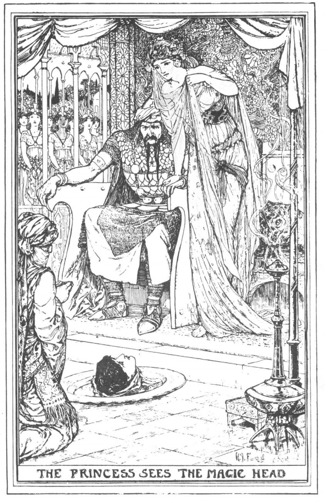

“所有的一切都非常顺利。”她把事情告诉给头了以后，嘀咕着说，“可是你想想看，国王看到他女婿的样子的时候，会说什么呢？”

“别管他说些什么！”头说，“把我放在银盘里，带我到王宫里去。”

于是就这么办了。老妇人把头放在银盘里时，心呼呼直跳。

国王看到头暴跳如雷：“我决不会把女儿嫁给这样一个怪物。”可是公主温柔地把手放在国王的肩膀上。

“你已经答应过了，我的父亲，你不能违背自己的承诺。”她说。

“可是，我的孩子！你不可能嫁给这样一个东西。”国王说。

“我要嫁给他，他有一个长得很英俊的头，我已经爱上他了。”

于是举行了婚礼，宫廷里摆出丰盛的婚宴。可是人们还是为可爱的公主不幸的命运而暗暗流泪。

婚礼结束了，只留下一对新婚夫妻。头突然消失了，或者说，头突然长在一个年轻健壮的男青年身上。公主看到站在她面前的新郎是世界上最英俊的青年。

“在我出生的时候，一个邪恶的妖精向我施了魔法。”他说，“我生下来就只是一个头。是你，而且只有你，才使我变成了一个正常的人。”

 

## 太阳妹妹

很久以前，有一个国王的小王子很喜欢和园丁的儿子一起玩。国王很不高兴，他宁愿儿子和那些在王宫里长大的僮仆一起玩。可是王子和那些僮仆很合不来，碰在一起连话也没有。王子从小被惯坏了，所以国王只好由他去。再说园丁的儿子也很乖，行为也很端正，因此他被允许整天留在王宫里。

他们最喜欢玩的游戏是比赛射箭。国王给他们一人一把完全一样的弓。他们会整天在一起比赛，看谁的箭射得最高。这当然是相当危险的，幸好他们都很机灵，没有出过什么事。

有一天上午，王子上过课以后，跑来招呼他的朋友，一起到草地上来玩。他们从放玩具的屋子里取出弓箭，开始看谁射得最高。有一次，两支箭贴在一起了，掉下来后，一支箭上有一根金鸡的羽毛。这金鸡的羽毛是谁射中的呢？两支箭那么相似，完全一模一样，他们怎么也分辨不出来。王子说，是他的箭射中的；园丁的儿子却十分肯定，是他的箭射中的。也许园丁的儿子是对的，可是他们争吵不休，无法解决，就去找国王。

国王听了他们的叙说，做出裁决，金羽毛是属于他儿子的。可是另一个孩子不听他的，坚持说金羽毛是他的。后来国王忍耐不住了，生气地说：“很好，既然你敢肯定金羽毛是属于你的，那么就给你吧！可是你必须去给我把丢了一根金羽毛的金母鸡找来，要是找不到，就杀你的头来顶替。”

年轻人需要多大的勇气，才能安静地听完国王说的这些话。

到哪里去找金母鸡，他心中毫无头绪；即使是找到了，怎样才能得到它？可是，国王的话没有什么商量的余地，只能去执行，他觉得应该赶快离开王宫，越快越好。

他回到家里，用口袋装了一些食品就出发了，希望能有人给他指明道路。

走了几个钟头以后，他遇见一只狐狸。它看上去很友善，年轻人很高兴能找到个朋友说话，商量这件事情。他坐下来，开始和狐狸聊起来。

“你到哪里去？”狐狸问。

“我要去找一只金母鸡，它的尾巴上掉了一根金羽毛。”年轻人说，“可是我不知道它住在哪里，怎样才能抓住它。”

“啊！我能给你指路！”狐狸说，它的性情确实很好，“在遥远的东方，有一个美丽的少女叫‘太阳妹妹’，她的家里有三只金母鸡，也许那根羽毛属于它们之中的一个。”

年轻人听到这个消息，不知道有多高兴。他们一起走了整整一天，狐狸在前面，年轻人跟在后面。到了晚上，他们躺在一起睡觉，把背包放在头下当枕头。

半夜里，狐狸突然嘀咕起来，它凑近年轻人低声地说：“兄弟，有人走过来了，他要拿走你的背包，看那里！”年轻人从树丛中顺着它指的方向看去，看到一个人走过来。

“我想，他不会是来抢我们的。”年轻人说。那人走过来了，年轻人把自己的事情告诉他，陌生人很感兴趣，请让他留下一起去，也许他会有什么用处。所以当太阳升起的时候，他们一起出发了，狐狸在前面，他们跟在后面。

几个钟头以后，他们来到了太阳妹妹的城堡，金母鸡是她的宝贝。他们在大门口停下来，商量谁应该进去找太阳妹妹。

“我看，最好让我进去把母鸡偷出来。”狐狸说。可是年轻人很不赞成。

“不！这是我的事情，当然应该让我进去。”他说。

“你会发现，要抓到母鸡非常困难。”狐狸说。

“没关系！我的运气不坏。”年轻人说。

“那么去吧！”狐狸说，“要小心，别出任何差错。偷那只丢了一根羽毛的母鸡，别去碰其余的母鸡！”

那个陌生人听着，不说什么。年轻人走进了宫殿的大院子。

他很快就看到，三只金母鸡正在骄傲地大摇大摆走着，其实，它们正在找地上是不是有粮食吃。最后一只从年轻人身边走过时，他看到，它的尾巴上少了一根羽毛。

看到这只金母鸡，他冲过去抓住它的头颈，不让它挣扎，然后把它舒服地抱在自己的怀中，向门口走去。不幸的是，就在他准备跨出门口时，他回过头来，看到从宫殿一扇开着的门里射出一束奇异的光彩。

“不管怎么说，用不着这么匆匆忙忙的。”他想，“乘我在这里的时候，看看这里还有什么。”

他转过身了，忘了手中还抱着金母鸡。金母鸡从他手中挣脱，跑到另外两只鸡那里去。

他从门口望进去，被里面奇妙的东西迷住了，完全没有注意到，手中的战利品已经逃走。当看到睡在床上的太阳妹妹时，他根本就不会想到，到这里来是为了一只金母鸡。

他呆呆地看了好一会才回过神来，慢慢地退出去。幸运的是，他又抓住了金母鸡，抱着它向门口走去。到了门口，他又停下来了。“我干吗不再看太阳妹妹一眼。”他想，“她睡着了，不会知道的。”

他转过身来，向屋里走去，金母鸡又不知不觉地逃脱了，他一点也不觉察。看够了以后，他才回到院子里来，抓住正在找谷子吃的金母鸡。

走到大门口的时候，他又停住了脚步。“我干吗不吻她一下？”他想，“这辈子，我再也不会吻到这么美丽的女人。”他后悔地搓着双手，金母鸡又逃掉了。

“我还有机会！”他高兴地想着，又快步回到房间里来，在睡着了的少女额上吻了一下。可是，当他心满意足地走出来，想抓金母鸡时，金母鸡变得那么害羞，怎么也不让他靠近。更糟糕的是，另外两只金母鸡开始咯咯地大声叫起来。太阳妹妹被吵醒，她从床上起来，跑到门口对年轻人说：“你永远、永远也得不到我的金母鸡，除非你把我的妹妹带回来。她被一个巨人带到他的城堡里去了，城堡离这里很远。”

年轻人垂头丧气地慢慢走出宫殿，对等在门外的朋友说，他如何三次抓到了金母鸡，又三次把它丢了。

“我知道，事情不会这么简单！”狐狸摇着头说，“不必浪费时间了，让我们立刻去找她的妹妹，幸好我认得路。”

他们一连走了许多天，一直走在前面的狐狸突然停下来。

“巨人的城堡离这里不远了。”它说，“到那里以后，我进去找公主，你们留在外面等我。我把她带出来以后，你们要紧紧地抓住她，尽快地跑回去。我呢！再回到城堡去和巨人说话，那里有许多巨人，免得他们发觉公主逃跑了。”

几分钟以后，他们到达城堡。狐狸经常到这里来，它毫不费力地溜了进去。有好几个巨人正在大厅里围着公主跳舞，他们之中有的年纪轻，有的年纪大。看到狐狸进来，他们都叫道：“老狐狸，来和我们一起跳舞，我们很久没有见到你了。”

狐狸站起来，跳起最优美的舞步。过了一会，它停下来说：“我知道一种迷人的新舞蹈，我很高兴跳给你们看。这种舞要两个人一起跳。假如公主能给我几分钟的荣幸，你们就会看到这种舞蹈。”

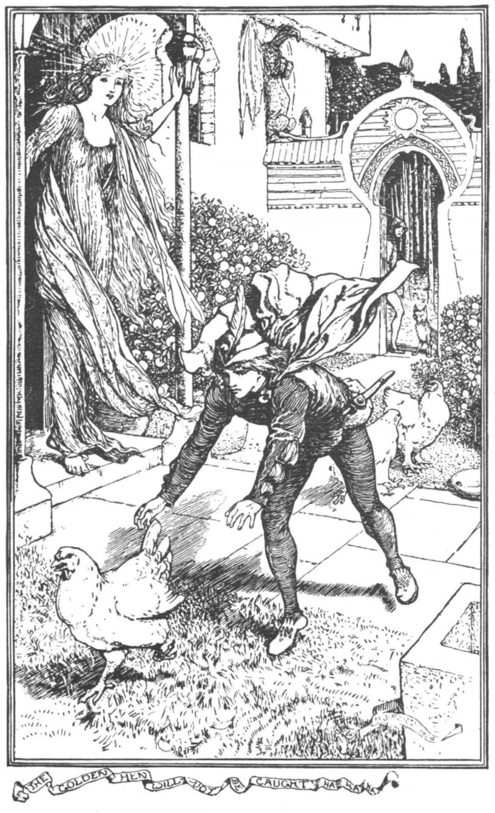

“啊！太令人高兴了！我们要学新的舞蹈。”他们说，把公主推入狐狸的怀抱。一转眼，狐狸撞倒了照亮大厅的一盏明灯，黑暗中拉着公主跑到门口。他的伙伴像它说过的那样，把她接住。狐狸又神不知鬼不觉地回到大厅。它看到巨人们都在忙着点火。过了一会才有了一点光，这时有人叫起来：“公主到哪里去了？”

“这里，在我的怀抱里。”狐狸回答，“用不着担心，她很安全。”等到它估计伙伴已经走了很远时，才冲出门口叫起来：“小姑娘在这里，快点来抓住她。”

听到这些话，巨人明白，他们的俘虏逃走了，于是迈开巨人的步伐，拼命地追赶起来。他们想，很快就可以追上狐狸，公主肯定骑在它的背上。

狐狸当然很聪明，它不是沿着伙伴回去的路跑，而是在森林里兜圈子，一直到后来累极了，倒在一棵树下睡着了。它睡得那么熟，连巨人跑过来的沉重脚步声也听不见。直到巨人伸出大手，差一点就抓住它的尾巴时，它才张开眼睛，纵身一跃，才没有被抓住。整个晚上，狐狸在森林跑啊！跑啊！巨人在后面追啊！追啊！直到东方透出一片红光，狐狸才停下来。巨人追过来了，它转过身来对他们说：“看！太阳妹妹就在那里！”

巨人们抬起头，向东方看去，立刻变成了一根根石柱。狐狸向每一根石柱深深地鞠了躬，才去追赶自己的朋友。

它知道森林里有许多近路，不一会就跟上了他们。他们四个日夜兼程，回到了太阳妹妹的宫殿。宫殿里的人看到小公主是多么高兴啊！他们还以为她已经死了呢？他们不知道该怎么感谢这个年轻人才好，是他冒着那么大的危险去救她。当然，那只金母鸡马上就送给他。更令人高兴的是，太阳妹妹告诉他，过几年等他长大以后，她会来拜访他的家，做他的妻子。年轻人简直不敢相信自己的耳朵，因为太阳妹妹是世界上最美丽的公主。她头上的一颗星总是放射着光芒，不管是多么黑暗，她都能够驱散。

年轻人和伙伴们一起启程回家，想到公主的话，心中充满了欢乐。路上，朋友一个接一个地在相遇的地方告别了。他独自回到了自己的家乡。回到王宫，他抱着金母鸡，把它交给国王，告诉他自己的冒险故事，说一个美丽神奇的公主将嫁给他，她头上有一颗星，能够把黑夜照耀得如同白昼。国王一声不响地听着，等他说完了，才冷冰冰地说：“这个故事要是你自己编出来的，我就把你扔到柏油桶里去。”

“是真的，每一句话都是真的。”年轻人说。他还说了是哪一天，甚至是几点钟，新娘子就会来找他。

可是日子越来越临近了，公主的消息却一点也没有。年轻人开始担心和不安起来。更可怕的是，他听说那个大桶已经装满了柏油，下面堆满了柴火，准备把柏油烧滚。

年轻人整天站在窗口，向海边张望着。他知道公主要来的话，会乘船从海上来。终于有一天，士兵走上来把他带走，押到柏油桶的旁边。柏油桶下面的大火在熊熊燃烧，柏油在啪啪响地冒着泡。年轻人害怕得浑身颤抖，可是无路可逃，他吓得紧紧地闭上眼睛。

国王命令，把年轻人押上放着柏油桶的台子。这时忽然有人奔跑过来报告，说是海上有一条大船，正在向这边开过来。谁也不知道，船是从哪里来的，到这里来干什么。国王吩咐，在船到来之前，不要处死年轻人，反正有的是时间，叫人把他押回自己的家里去。

船安全地靠了岸，船上传来消息说，是太阳妹妹来履行自己的诺言，嫁给那个年轻人。过了一会，她走上岸来，请人把她带到年轻人当年常常和她说起的村舍里去。

年轻人这时正躺在地上，因为受了过度的惊吓，神志还没有完全恢复过来。太阳妹妹弯下腰来问他：“你不认得我了吗？”

“不！不！我不认识你！”年轻人头也不抬，回答道。

“吻我一下？”太阳妹妹说。年轻人看也不看，就吻了她一下。

“你现在认得出我了吧！”她问。

“不！我不认识你！我不认识你！”他说，那样子像是因为害怕而神经错乱了。

太阳妹妹吓坏了，于是，她从头开始讲他们从相遇到相爱的经过。讲她从那么远的路赶来，就是为了嫁给他。她的话刚说完，国王就走进来了，他要看一看年轻人说的话是不是真的。他刚打开屋子的门，满屋的阳光就几乎要弄瞎他的眼睛，这时他才想起年轻人跟他说过，那公主的头上有一颗星。他像受到电击一样地踉踉跄跄退了几步。这时，一种奇怪的，从未有过的感觉控制了他，他双膝跪在太阳妹妹的面前，请求她忘记这个农民的儿子，和他一起去分享王位。她笑着说，要是想当国王的话，她的王位比他的不知道好多少。她喜欢自由自在，除了这个年轻人，她谁也不会嫁。

“明天，我就要和他结婚。”最后她说。接着，她吩咐手下的人，立刻准备明天的婚礼。

第二天，正当婚礼准备举行的时候，新郎的父亲跑来告诉公主说，根据这个地方的法律，婚礼要等国王来了才能举行。他希望高贵的国王能马上就到。一两个钟头过去了，人们都翘首企足地等待着。这时终于传来了喇叭声，一支华丽的队伍走过来。国王坐在为他准备好的，一张铺着天鹅绒的椅子上，看着周围来参加婚礼的人说：“我没有丝毫阻止这次婚姻的意思。可是，在我同意举行婚礼之前，新郎必须做三件事，来证明他配得上这样的新娘。第一件事就是在一天之内，他必须砍倒整个森林的每一棵树。”

听了国王的话，年轻人目瞪口呆地站起来。他从小到大，从来没有砍过一棵树！连怎么下手都不知道，这下子要砍倒整片森林！公主看出他在想什么，小声地对他说：

“别害怕！在我的船里有一把斧头，你去拿来，带到森林里去。你用它砍倒一棵树以后就说：‘让整个森林都这样倒下！’一转眼，所有的树都会倒在地上。不过你要记住，从你砍倒的树上捡起三块木片，放进你的口袋。”

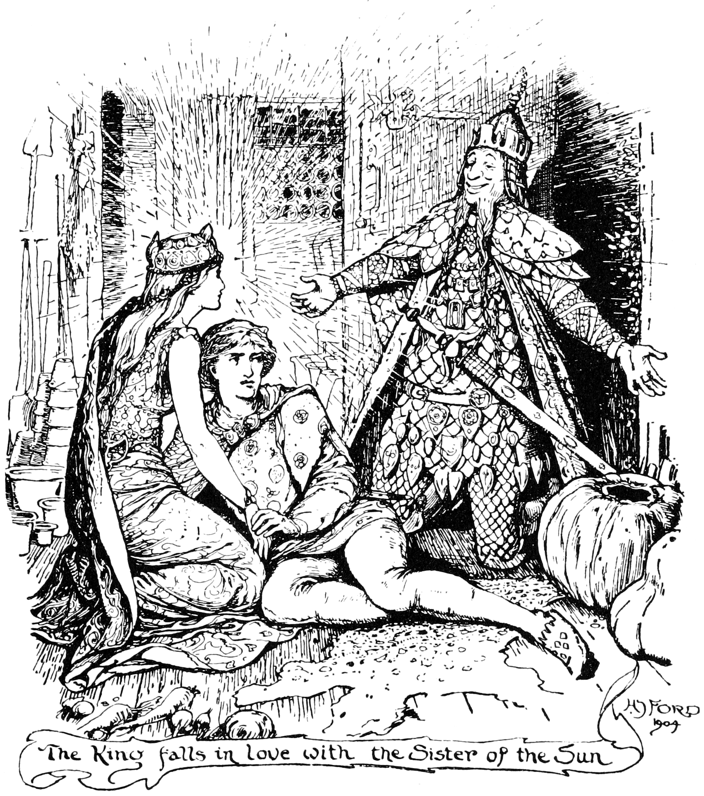

年轻人照她的话去做了，很快就带着三块木片回来。

第二天早晨，公主宣布说，她已经考虑过了，既然她不是这个国王的臣民，就没有理由去遵守他的法律，她准备马上就举行婚礼。

可是新郎的父亲对她说，她说得很对，可是对于他的儿子来说，问题就不一样了，违抗国王的命令是要杀头的。而且，考虑到昨天儿子已经完成了国王的指令，他希望国王今天能够宽容一些。这时，国王也派人来说，他一会儿就来。

听他这么一说，一对新人也就同意了，耐心地等待着国王的到来。国王没有让他们等多久。可是，从他的脸上可以看出，他今天也不会让新郎新娘好过。

“婚礼还不能举行。”他简短地说，“除非年轻人把昨天砍倒的树全部接上。”

这一回可比上次难得多了。年轻人绝望地回头看新娘。

“没什么，”她轻声地鼓励他，“把这些水倒在一棵倒下的树上，对它说：‘让森林里所有的树都站起来。’一瞬间它们就会全部长好。”

年轻人照她的话去做了，整个森林的树木又重新立了起来。

现在，公主想，完全没有必要再推迟婚礼了。她吩咐，一切都在明天之前准备好。可是老人还是不同意，他又派人去请来国王。

这一次，国王宣布，他不会批准举行婚礼，除非新郎把大河里的那条大蛇杀死。这条大河从城堡的后面流过。这里的人虽然没有亲眼见过这条可怕的蛇，可是人人都知道它的故事。经常有小孩在河边迷路，再也不会回来。母亲都禁止孩子到河边去，尽管那里盛开着美丽的鲜花，长着许多好吃的水果。

难怪新郎听完国王的话，浑身发抖，面无人色。

“你也会成功的。”新娘拉着他的手，轻轻地对他说，“在我的船里，有一把可以砍断一切的魔剑。到河边去，把三块木片扔到河里去，把停泊在那里的一条船缆绳解开。看到那条蛇伸出头来，用你的魔剑一下子就可以砍下它的三个头。把三个头的舌头割下来，明天一早带着这些舌头，到国王的厨房里去。国王走进来时，对他说：‘这是我给你的三件礼物，报答你要我去办事情！’你把蛇的三个舌头扔给他，然后尽你最快的速度跑回船上去。不过，你千万要记住，一定不能回过头来看。”

年轻人照着公主的吩咐去做了。他来到河边，把三块木片扔入水中。木片变成了一条船。他驾驶着船向河中驶去。大蛇伸出头向他游过来，嘴里发出嘶嘶的响亮叫声。年轻人早已握好魔剑准备着，一刹那，蛇的三个头就落入水中。他把船靠近，把蛇头的三个舌头尖割下来，然后把船划回岸边。

第二个早晨，他带着蛇的舌尖，来到国王的厨房里。国王每天早晨都要到厨房里来看看，中午吃些什么。年轻人看到国王走进来，把蛇的舌尖向他的脸上扔过去，说：“这是送给你的礼物，报答你关照我去做事情。”接着，他把厨房的门打开，向停在河里的船奔跑过去。

不幸的是，他迷了路。由于过分激动，一会儿向这边跑，一会儿向那边跑，完全没有方向。后来他绝望了，开始向四周张望起来。他吃惊地看到，城市和宫殿都消失得毫无踪影。等他再回过头来，看到太阳妹妹乘着那只船，已经开得远远的，风一个劲地把它吹向远方。

这些绝望的景象令他的精神完全崩溃了。整整一天，他毫无目的地逛来逛去，不知道如何是好。一直到了傍晚，他才注意到附近有一间小草棚正在冒着烟。他走过去，喊道：“啊！大妈！可怜可怜我吧！让我进去！”住在里面的一个妇人走出来，招呼他进来。他还没有走进屋，就迫不及待地问：“大妈！你能告诉我一些关于太阳妹妹的消息吗？”

妇人摇摇头，说：“不！我一点也不认识她。”

年轻人转过身来就想离开，妇人叫住他，给他一封信，请他带给她二姐，说：“你要是走累了，把这封信拿出来，抖抖这些信纸。”

这个关照使年轻人觉得很奇怪，他猜不出这对他有什么用。不过他不说什么就上路了，也不知道该往哪里去。后来，他累极了，一步也走不动了。这时，他想起妇人说过的话。他拿出信纸来，只是抖动了一下，浑身的疲倦顿时消失，他又快活地在草地上迈开大步，来到另一间小草棚前。

“好大妈！求求你！让我进来吧！”他在门口喊着。门打开了。“你妹妹叫我送一封信给你。”他说，又赶紧加上一句，“大妈！你能告诉我一点关于太阳妹妹的消息吗？”

“不！我一点也不认识她！”她回答。正当他绝望地准备离开时，她把他叫住：“要是你恰巧从我大姐姐家经过，你能把这封信给她吗？你要是走累了，就把它从口袋中拿出来，抖一抖信纸。”

年轻人把信放进口袋，整整一天翻山越岭，累了就抖抖信纸，晚上来到一间小草棚旁。小草棚和前面的两间一模一样。

“好大妈！求求你！让我进来吧！”他在门口喊叫着，一进屋就说，“这里有一封你妹妹给你的信。你能告诉我一点关于太阳妹妹的消息吗？”

“是的，我能告诉你。”老妇人说，“她住在班卡城堡。几天前，她父亲刚刚输掉一场战争，因为你拿走了他的魔剑。太阳妹妹也因为悲哀已经奄奄一息。当你见到她的时候，用一根针来刺她的手掌，把流出来的血吸掉，她就会重新站立起来，而且会认出你来。不过，要小心，在你到达班卡城堡之前，会有可怕的事情发生。”

年轻人高兴得流出热泪，感谢老妇人给他带来好消息以后，又继续赶路了。还没有走多远，他就在大路转弯的地方，看到两兄弟在为一件旧衣服而争吵。

“我的好人！你们在争吵什么？”他问，“这件衣服看上去值不了多少钱！”

“嗯！这件衣服是很破旧，可它是我们的父亲留下来的。”他们说，“而且不管是谁，只要把它披在身上，什么人都看不见他，我们都想要这件衣服。”

“让我披披看。”年轻人说，“然后我会告诉你们，应该给谁。”

两兄弟都同意了，把衣服交给他。年轻人一把衣服披上，就像一阵风似的消失了，好像根本就没有来过一样。

年轻人继续急急忙忙地赶路。路上他又看到两个人在争夺一块台布。

“出了什么事情？”他走到前面来问。

“把这块台布铺在桌子上，”他们说，“桌子上立刻就摆满许多好吃的食物，我们两人都想要它。”

“让我试试看，”年轻人说，“然后我会告诉你们，应该给谁。”

两人都高兴地说，这是个好主意，把台布交给他。他拿到台布以后，披上那件旧衣服，忽然从他们面前消失，留下他们为自己的愚蠢而伤心。

年轻人没走多远，又看到两个人在抢一根棍子。棍子在他们手中拉来拉去，谁也不肯松手。

“你们在抢什么？不会去砍些树来做棍子吗？这样的棍子，要多少就可以做多少。”年轻人对他们说。两个人停止争夺，看着他说：“你说得不错！可是你不知道，这不是一根普通的棍子。用它这一头去碰人，就会把人杀死；再用另一头去碰一碰，就可以把死人救活。到哪里去找这种棍子。”

“是不容易找到。”年轻人说，“让我仔细瞧一瞧，我再告诉你们，应该给谁。”

两个人都觉得这主意不错，就把棍子交给他。

“是不错，这棍子很特别。”他说，“可是哪一头可以把人救活呢？棍子只要结实，都可以打死人，这不稀奇。”

等他们告诉他，棍子的哪一头可以救人以后，他就披上那件旧衣服走了。

最后，他看到两个人在抢一双鞋子。

“你们抢这双旧鞋子干吗？”他说，“我看穿着它十步路都走不了。”

“是的，这鞋子是很旧了。”他们回答，“可是不论是谁把它穿上，他想到哪里去，鞋子就会把他带到哪里去。”

“这倒是很好的。”年轻人说，“让我试试看，然后就告诉你们，应该给谁。”

两个人都高兴地表示同意，把鞋子交给他。年轻人穿上鞋子就说：“我想到班卡城堡去！”

话音刚落，他已经来到了班卡城堡。他找到了太阳妹妹，她已经因为过份悲痛快要死了。他跪在她身边，拿出一枚针来，刺她的手掌，一滴血流了出来。他照那妇人关照的那样，用嘴来吸吮。太阳妹妹立刻苏醒过来，认出了他，热烈地拥抱他。

她告诉他，还没有等他上船，船就开走以后发生的事情。“最不幸的是，”她说，“因为你把我父亲的魔剑带走了，他输掉了一场战争，整个军队几乎全军覆没。”

“请把战场指给我。”他说。她把他带到荒芜的山坡上，那里躺着许多阵亡的官兵，等待着埋葬。他用那根棍子一个一个地去碰他们，直到这些阵亡的官兵都一个一个地站起来。整个国家都充满了欢乐。

这一回，婚礼终于隆重地举行，一对新人在班卡城堡开始幸福的新生活，直到离开人世。

 

## 王子的命运

一个国王，统治着一个伟大的国家，一条大河从他的国土上流过。有一天，王后生了一个男孩。国王高兴得不能自已，他一直盼望着有个儿子来继承王位。

国王派人去请来所有神通广大的仙女，请她们来看他的宝贝婴儿。不到一两个钟头，许多仙女都围着摇篮；差点叫婴儿透不过气来。国王这时在迫不及待地等待着仙女们的预言，看到她们个个神情严肃，心中觉得有点不安，“是不是有点问题？”他担心地问。

仙女们看着他，不约而同地摇起头来。

“他是个漂亮的男孩子，真是太可惜了，命中注定的事情，总是要发生的。”她们说，“他注定活不长，不是死在鳄鱼嘴里，就是因为蛇或狗而丧生。要是我们能救他，我们一定救他，可是，这已超过我们的能力。”

说完，她们就消失了。

听了她们的话，国王呆呆地站在那里，惊骇得不知所措。不过，他是一个乐观豁达的人，不到绝望的时候，不肯认输。他开始考虑，如何才能把王子从等待着他的厄运中救出。他派人叫来建筑师，吩咐他在山顶上建造一座坚固的城堡，把王宫中最宝贵的东西都搬进去，还有那些小孩喜欢玩的一切玩具。他还下了最严厉的命令，城堡里要日日夜夜有卫兵巡逻。

大约有四五年光景，王子和保姆独自生活在城堡里。高高的围墙包围着宽广的阳台，这是他活动的空间。围墙外面还有一条又宽又深的护城河。河上只有一座吊桥和外面的世界相连接。

有一天，王子在阳台上奔跑，他已经长大到能很快地到处跑。他从阳台上看到护城河的外面，有一个柔软的毛茸茸的小东西，在来回奔跑和跳跃，非常好玩。那是一只小狗，他当然不知道。因为所有的狗都不许接近他，以免仙女的预言变成现实。他回过头来问跟随着的僮仆：“外面那个东西是什么？它很有趣，跑得那么快！”

“王子，那是一条狗。”僮仆说。

“好玩！给我带一条来，让我们比比看，谁跑得更快！”

僮仆非常为难，不知道该怎么办才好。国王严厉地命令他们，要满足王子的一切要求。可是他也知道仙女们的预言，觉得这个问题很棘手。最后，他想还是告诉国王吧！让他自己来决定。

“他想要一条狗，就给他吧！”国王说，“不给他，他会哭得很伤心的。”

于是他们找来了一条小狗，它和王子看到的那条一模一样，也许是一胎生出来的。

王子和小狗天天一起玩。一年又一年过去了。王子长得又高大又结实。后来，终于有一天，他叫人带讯去问国王：“为什么把我关在这里，什么事也干不成？我知道当我出生的时候，仙女们说过的那些预言。可是我宁可立刻去死，我也不愿意在这里过着这种无聊的生活。请求你，让我走吧！给我武器，让我和狗一起出去。”

国王再次满足了他的愿望。他带着自己的狗，登上一条船，驶过从他们国土上流过的那条像大海一样宽广的河流，来到了对岸的土地上。那里有一匹黑马拴在树上，正在等着他。他跃身上马，自由自在地在辽阔的大地上奔驰，那条狗总是紧紧地跟随着他。啊！再没有一个王子比他更幸福了。他走啊！走啊！来到了另一个国家。

统治这个国家的国王不爱治理国事。看到人民生活得快乐而满足，他整天一个人在那里出谜语，不干正经事。当王子来到这个国家的时候，他正好为自己的女儿造好一座漂亮的宫殿。宫殿开有七十扇窗，每扇窗都离地面七十英尺。他派出使者，到所有邻近的国家去宣布，谁能够从墙上爬进公主的窗口，他就把公主嫁给谁。

公主的美貌早已名扬四海，许多王子都想来试试他们的运气。有趣的是，王子们要爬的这堵白色大理石墙上，每天早上都要涂上五光十色的小块颜料，更加增添欢乐而神秘的色彩。可惜，尽管有人想爬得比别人更高，但是没有一个人能爬到窗口。

王子到达这里的时候，这种游戏已经进行了好几天。他满怀兴趣地看着，和旁边的人说起话来。他们欢迎他到他们住的地方去，让他洗了个澡，消除长途跋涉的疲劳，然后问他是从哪里来的？父亲是谁？

王子想保守自己的秘密，回答说：“我父亲是国王的马夫。我母亲死了以后，他又娶了妻子。开始一切都好，可是等她生了孩子后，她开始恨我。我怕受她的伤害，就逃出来了。”

听了他的故事，那些年轻人都很伤心。他们尽一切力量来安慰他，让他忘记过去的痛苦。

“你们在这里干什么？”有一天，王子问他们。

“我们整天在这里爬宫殿的墙，想爬进公主的窗口。”一个年轻人回答，“可是，没有一个人能爬过十英尺高。”

“哦！让我也去试一试！”王子说，“不过，明天我先看看你们是怎么爬的。”

第二天，他站在那里观察别人爬。他发现，他们爬的路线确实很难。他想，轮到他的时候，他要从别处爬上去。

一天又一天过去了，他站在那里，看着那些求爱者如何爬上去，又如何摔下来。经过仔细观察，他选中了一条爬上去的路线。这天早晨，他从旁边开始向上爬。他从别人的失败中总结出经验，选择了一条墙面不很光滑的路线，小心地抓住那些凸出来的棱角，一步一步往上爬。终于，在朋友们妒忌的眼光下，他爬到了窗口，他们看到，一双雪白的纤手从窗内伸出来，把他拉了进去。

一个年轻人跑到王宫里去，向国王报告：“有人从墙上爬上去了，奖品有了主人！”

“是谁？”国王惊奇地从王座上站起来问，“是哪位王子将成为我的女婿？”

“爬进公主窗口的人，根本不是王子。”年轻人回答，“他的父亲是河对岸那个伟大的国王的马夫。他从自己的国家逃出来，为的是逃避继母的虐待。”

听到这些，国王非常生气。他从来没有想过，一个不是王子的人，会来向他的女儿求婚！

“叫他滚回去！从哪里来，就滚回哪里去！”他愤怒地叫喊着，“我会把女儿嫁给一个流亡者吗？别做梦！”他怒气冲天，把手中喝酒的杯子摔得粉碎。

那个年轻人吓坏了，他赶紧跑回来，把国王的话告诉给他的朋友，告诉给王子。

公主站在窗口听到了他的话。她派人去告诉国王，如果把这个人从她身边带走，她发誓，从此不吃也不喝了。国王听了她的话，更是火冒三丈，命令他的卫兵立刻到宫殿去，把那个成功的求婚者抓起来处死。可是公主把他们拦住了。“要是你们敢碰他一下，我今天就去死。”她说。士兵们看得出，她不是在闹着玩的，就回来向国王说了。

幸好这时国王的怒气也消了。他开始考虑，如果自己违背了已经公布的诺言，老百姓会把他当成什么人。他把公主和王子叫来。当他们在王宫里出现时，国王看到胜利者那不俗的形象，非常高兴，愤怒的心情早已抛到九霄云外，他走过来拥抱他。

“告诉我，你是谁？”国王稳定一下自己的情绪，问，“我决不相信，你的血管中没有皇家的血液！”

可是王子觉得，他还是应该保守秘密，只是告诉他同样的故事。不过，国王这时候已经很喜欢这个青年人，他不再说什么了。

第二天，举行了盛大的结婚典礼。国王把一大片土地和一大群牲口给了这对年轻的夫妇。

过了不久，王子对妻子说：“我的命掌握在三样东西的手中：鳄鱼、蛇和狗。”

“啊！你太粗心了！”公主拥抱着他叫起来，“你既然知道，为什么还让这些可怕的畜生接近你呢？我马上叫人把它杀掉！”

可是王子不听她的。他说：“杀掉从小就和我一起玩的，亲爱的小狗？我决不会同意！”公主没办法，只好叫他带着一把剑，走出宫廷的时候，要带着随从。对于这些，王子同意了。

结婚几个月以后，王子听说父亲年老多病，希望长子能够重新回到身边，他再也不能保持沉默了。王子恋恋不舍地和妻子告别，踏上回家的征途。路途那么遥远，他晚上不得不常常在路上过夜。

有一天晚上，他在大河旁边的一座城市里过夜。一条大鳄鱼突然爬过来，无声无息地向王子的寝室爬去，幸好它经过大厅的时候，一个卫兵醒过来，把鳄鱼杀了。大厅里总是有一个大力士守着，不到晚上鳄鱼睡觉的时候，他不会离开。

这样走了一个多月，王子回到父亲的身边。他感到自己再也不可能离开父亲的王国，于是，他就派人去接妻子。叫他们告诉公主，他将在大河旁边的城市里接她。

在等待妻子的几个星期里，王子尽可能快乐地打发时光。公主一到，他准备第二天起程返回王宫。

这天晚上，王子睡着以后，公主注意到房间角落里有个什么奇怪的东西。那个角落很阴暗，看不清楚，她只觉得那个东西越来越长，而且在慢慢地向王子睡觉的地方移动。她害怕得叫出声来，声音虽然很轻，可是那东西听到了，它抬起头来观察。这时，她看清了，那是一条大蛇，头又长又扁。她想起仙女们的预言。

她不敢惊动丈夫，悄悄地下了床，把桌子上的一大碗牛奶拿起来，放在蛇要经过的地方。她知道，在这个世界上，没有一条蛇能够抵御牛奶的诱惑。她小心地屏住气，看着蛇爬过去，伸出头来，好像闻到了什么香味，嘴里伸出了贪婪的叉舌头。接着，它把头伸进碗里，一口气不停地吸着，直到吸完最后一滴，就倒在地下睡着了。这正是公主希望看到的。她拔出丈夫的剑，把蛇头砍下来。

第二天，王子和公主返回王宫。可是，等他们到达的时候，国王已经去世。他们为他举行了隆重的葬礼。接着，王子花很多时间去研究他不在的时候制定的新法律，处理许多国家事务。后来累得病倒了，不得不到河边的一座宫殿里去休养。不久，他恢复健康，开始出去射野鸭子。不管他到什么地方，那只已经变得很老的狗总是跟着他。

一天上午，王子和狗像往常一样出去打猎。他们在河边追逐猎物，王子跟着狗全速奔跑着，他突然被躺在路上的什么东西绊倒。那东西看上去像是一根木头。令他吃惊的是，有个声音开始说话，他仔细一瞧，地上躺着的原来是一条鳄鱼。

“你别想逃过我。”当王子缓过气来的时候，鳄鱼对他说，“我是你命中注定的，你不论到哪里去，干些什么，都会发现我出现在你的面前。只有一个办法可以摆脱我的控制。假如你能在干燥的沙土上挖出一个坑，而且让坑里充满水，我的咒语就会被打破，你就不会很快死去。我给你这次机会，去吧！”

王子悲痛地走了。回到宫殿以后，他把自己关在房间里，拒绝见任何人，甚至他的妻子。太阳下山了，房间里一点动静都没有，公主十分担心，拼命地喊叫他。王子只好把门打开，让她进来。

“你脸色怎么这样苍白？”她问，“是受伤了吗？求求你，告诉我是怎么回事，也许我能帮助你。”

王子把见到鳄鱼的经过告诉她，还说了鳄鱼叫他去做的，不可能办到的事情。“一个沙坑怎么能留得住水？”他说，“水肯定要流走。鳄鱼还说给我一个‘机会’。它干吗当时不干脆把我拉下水！它说得不错，我无法逃过它。”

“就这些事！”公主说，“我就能救你。我的仙女教母教过我如何利用植物。在离这里不远的荒山里，长着一种四叶的小草，它能够让坑里的水留住整整一年。天一亮我就出去找。你高兴什么时候挖，就什么时候把坑挖好。”

为了安慰丈夫，公主说得很轻松，很快活。其实她心中很明白，她的任务并不轻松。不过，她还是充满了信心和勇气，决心不管怎么样，都要救出自己的丈夫。

她离开宫殿的时候，天上还有星星在闪烁。她骑着一头白色的驴子，从河边出发，一直向西走去。前面是一片平坦的沙土。太阳升起来了，空气越来越热。不一会，她和驴子都觉得口渴难挡，附近没有一条河。就是有，她也没有时间停下，因为还有很长的路要走。她要在天黑之前赶回来，免得鳄鱼说王子没有满足它的条件。所以她不停地说些快活的话给驴子听，它有时也叫几声以示应答。他们不停地继续赶路。

当他们看到前面有一座很大的岩石时，别提有多高兴了！他们忘记了火辣辣的太阳，忘记了口渴，飞一样奔跑过去，直到驴子自己在一块荫凉的影子下停下来。驴子可以休息了，公主的工作却刚刚开始。她知道，四叶草就长在岩石的顶上。岩石的周围都是很深的峡谷。幸好她带来一根绳子。她在绳子的一头打了个活套，然后用尽全身的力气扔过去。绳子碰到对面的岩石，又慢慢地滑下来。她只好把它拉上来，重新扔过去。绳子终于套住了什么，可到底是什么，公主看不清楚。她也顾不了那么多了，顺着绳子就爬过去。她不敢去想，那个看不见的结是否承受得了她的重量，要是松开了，她就会掉入深渊，她的命，还有王子的命，到这里就完了。

可怕的事情终于没有发生。公主爬过峡谷，来到对岸的岩石上。艰苦的事情还在后头。她开始一步一步地往上爬。快到山顶的时候，脚下的一块石头突然松动，她从山上滚下来，差点掉进峡谷。她不得不重新开始，更令人担忧的是，时间过得那么快，已经快到中午了。

公主心急如焚，可是她决不就此罢休。她小心地选择那些坚固的石块，用手抓，用脚踩，谨慎地一步一个脚印地往上攀登。双手被石头划破了，鲜血直流。她终于到达了山顶。

山顶上刮起猛烈的狂风，好像要把她推下山去。更讨厌的是，风夹着尘土，吹得她的眼睛张不开。她只好闭着眼睛趴在地上，用流着血的手去摸索那宝贵的救命草。

好一阵子，她觉得山顶上是光秃秃的，什么也没有。这段艰苦的征途看来要毫无结果了，山顶上不是石头，就是裂缝。她不甘心，忍着双手的剧痛摸索着，终于在一条夹缝里触到一样柔软的东西。是一棵植物，那是毫无疑问的，可是不是她要找的小草呢？风这时似乎刮得更猛，她不敢张开眼睛。后来，她想出办法，躺在那里开始用手去数它的叶子。一、二、三、四！啊！是的，四片叶子！正是她要找的最宝贵的四叶草。她小心地把它拔起，紧紧地抓住它，转身准备下山。风吹得她几乎要昏迷过去。

离开山顶以后，风好像停下来了，她连滚带爬地走下山，速度那么快，幸好没有掉到峡谷里去，而是正好停在结绳子的地方。她顺着绳子爬回去。驴子看到她，高兴地叫了起来。这时候，土地被烤得像天上的太阳一样热，她也不管了，立刻快马加鞭奔回去。

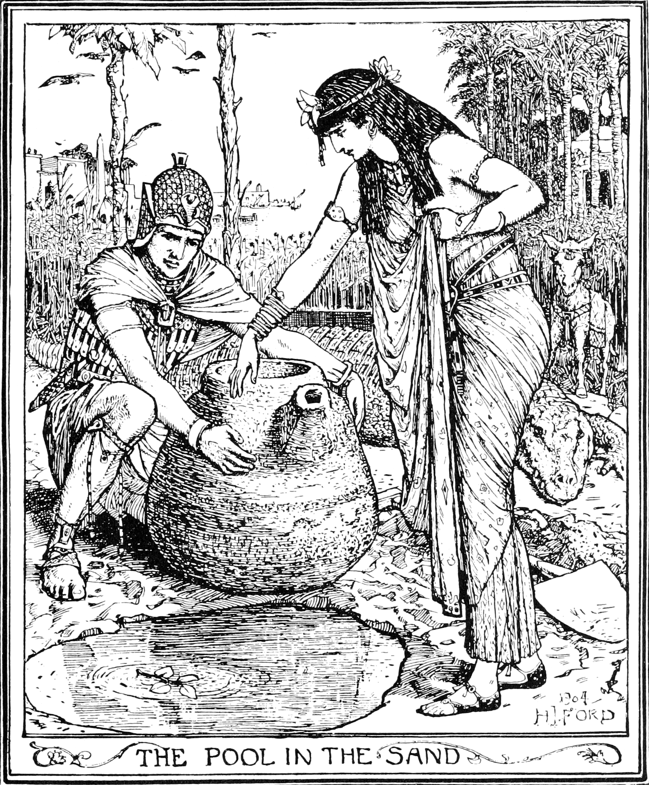

回到大河旁，驴子站住了。公主从驴背上跳下，向王子奔过去。他正站在那里，旁边是刚在沙地上挖好的坑，还有装满了水的大罐。大鳄鱼躺在不远处晒太阳，眨巴着眼睛，大嘴张开着，露出锋利的钢牙。

看到公主过来，王子把水倒入坑里，满了以后，公主就投入手中的四叶草。魔力会起作用吗？水会不会慢慢地流失，王子会不会落入这可怕的动物口中？六只眼睛紧紧地盯着沙坑里的水。半个钟头过去了。水还是像刚倒进去时那么满。四片绿色的叶子漂浮在水面上。王子终于欢呼起来，他胜利了。鳄鱼阴沉着脸，爬入河中，消失了。

王子第二次战胜了厄运。他站在那里高兴地看着鳄鱼灰溜溜地走了。一只野鸭突然从他身旁飞过，向河边的野草丛中窜去，把他吓了一跳。这时，他的狗向野鸭扑过去，想抓住野鸭，不小心撞在主人的脚上。王子摇晃了一下，扑通一声掉入水中，水中的泥淖和水草把他缠住，使他动弹不得，慢慢地往下沉。他声嘶力竭地大声叫喊妻子。公主奔跑过来，幸好手中还拿着那根绳子，她赶快抛出去，把他拉上岸来。那只可怜的老狗却淹死了。

“我的妻子比我的命运还要强大！”王子说。

（埃及民间故事）

 

## 狐狸和拉普人

狐狸躺在窝里，从洞口向外张望，看着离这里不远的一条路，希望能看到什么有趣的事情。这一天，它觉得又烦又闷。它看了很久，感到很失望，一切好像都睡着了似的，天上连一只飞鸟都没有。

狐狸觉得更加烦躁，正当它厌恶地从窝里走出来的时候，忽然听到雪地里传来什么声音。它在路旁蹲下来，想着：“是有人驾驶着雪橇过来，我知道这个玩意儿怎么操纵。我要是躺下来装死，不知道会发生什么事情，不管怎么样，我要冒一次险，肯定有收获。”

它小心地在路旁找个地方，直挺挺地躺下，这里既能让人看见，又不会被雪橇压着。

事情正像它所希望的那样。驾驶着雪橇的拉普人看到路旁僵硬地躺着一只美丽的动物，急忙把雪橇停下，把狐狸拎起来，扔到雪橇上。雪橇上装着许多货物，用绳子捆得紧紧的。狐狸被摔得骨头发疼，可是它挺住了，一动也不动。那人回到自己的座位上，又高兴地赶着雪橇走了。

还没走多远，狐狸就想办法慢慢地滑到边上，快要掉下来了。拉普人回头看见，停下来把它扔到第二个雪橇上。这一天正逢城市有集市，他有许多东西要卖，所以后面拖着一大串雪橇。

又走了一小段路，森林里传来什么声音，拉普人回过头来，又看到狐狸有半截已拖在雪地上。

“这鬼东西是着魔了！”他咒骂着，把它拎起来，扔到最后的一个雪橇上。这正是狡猾的狐狸所希望的。它慢慢地向前爬过来，把拉最后一个雪橇的绳子咬断，它在路当中停住了。

拉普人拉着那么多雪橇，好长的一段路，他根本没有注意到，最后面的一个雪橇丢了。要不是突然下起雪来，他可能已经进城了。由于下雪，他停下来，想把那些货物盖好，免得弄湿，这时才发现最后一个装着鱼和狐狸的雪橇丢了。他赶紧解下一头驯鹿赶回去，找到了安全地停在路中央的雪橇，可是绳子已经被狐狸咬断，根本无法拖它走。

狐狸把雪橇松开以后，从上面弄下许多爱吃的鱼，返回森林，这时正高高兴兴地吃着呢！一只熊走过来问：“狐狸先生，你从哪里弄来这么多鱼？”

“嗯！不远！”狐狸说，“在那些小精灵居住的河边，我把尾巴伸入水中，那些鱼就会自己来咬住我的尾巴。”

“呵！”熊生气地说，它这时正饿得慌，满肚子不高兴，“鱼要是咬你的尾巴，肯定也会咬我的。”

“那当然！大爷！”狐狸说，“只要你有耐心，像我一样不怕吃苦。”

“我当然能。”熊说，“你在胡说什么！给我指路吧！”

狐狸把它领到河边。这时候，春天温暖的阳光正在照耀着，有点暖意，只有一些水面有些薄冰。

“那些小精灵在这里洗澡。”狐狸说，“你把尾巴伸入水中，那些鱼就会来咬住。不过千万别太急了，否则会把事情弄糟的。”

说完，它慢慢地走开了，到熊看不见的地方躲起来。熊站在岸边，把尾巴全部浸入河水中。

不久，太阳西沉了；天越来越冷，河面很快冰起来。

熊的尾巴被冻得紧紧的，像是被钳住一样。躲在旁边的狐狸看到事情正像它策划的那样，就大声地叫喊起来：“快来啊！好人们！带上你们的弓箭和长矛，一只熊正在你们的小河里钓鱼！”

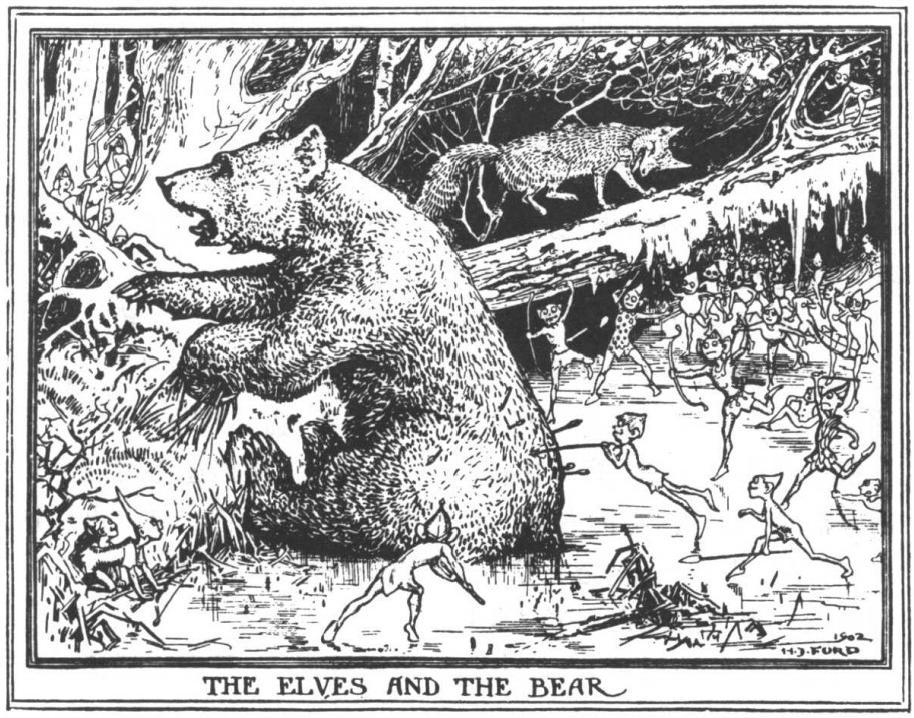

一会儿工夫，就来了一大群小精灵。他们手中拿着连婴儿也嫌小的弓箭和矛。可是这些箭和矛非常锐利，熊很快就领教了它们的利害。它害怕得急于逃跑，不顾一切地拉起尾巴。尾巴被拉断了，它也不管了，拼命地向森林里逃去。狐狸看到这些，笑得非常开心。过了一会，它就蹦蹦跳跳地向另一个方向跑了。

它来到一棵枞树下，爬进枞树根的洞里，又干起莫名其妙的事情来。

它用前爪把后爪提起来，轻声地问：“我的脚，要是有人和我作对，你该怎么办？”

“我就要拼命地跑，叫他追不上你。”脚说。

“你呢？我的耳朵，要是有人和我作对，你该怎么办？”

“我就非常仔细地听，听出他的全部阴谋。”耳朵说。

“你呢？我的鼻子，有人和我作对，你该怎么办？”

“我就拼命地闻，闻出他从哪里来。”鼻子说。

“你呢？我的尾巴，有人和我作对，你该怎么办？”

“我会掌握好方向，让你笔直地奔跑，叫他永远也追不上。让我们快走吧！我感觉到危险在向我们袭来！”

可是狐狸这时正得意洋洋，心满意足，并不在乎尾巴的劝告。它很快就发现，已经来不及了。熊已经从另一条路走到面前，堵住了它的退路。狐狸尽可能地缩成一团，盘在树根下面，可是一截尾巴露了出来。熊抓住尾巴，用力地拉。狐狸还想用前爪扒出个洞来钻进去，可惜力量没有熊那么大。熊把它一点一点地拖出来，然后用力一甩，把它扛在自己的肩膀上，向大路上走去。熊用嘴咬住狐狸的尾巴，怕它逃走。

走了一段路以后，它们来到一根树桩旁。一只色彩鲜艳的啄木鸟在啄着树木。

“啊！我画这些鸟的时候真开心！”狐狸说。

“你在说什么？老伙计！”熊问。

“我！哦，我没说什么！”狐狸闷闷不乐地说，“把我带到你家里去吧！快点把我吃掉！”

熊不说话了，它想着晚饭该怎么吃。它们两个继续走着，来到一棵大树旁，树上有一只啄木鸟在啄食。

“啊！我画这些鸟的时候真开心！”狐狸又对自己说。

“你能够画我吗？”熊突然问。

狐狸摇摇头，它总是爱演戏，即使没有人看，它也要来这一套。

“不行！”它故作沉思地回答，“你们熊那么怕痛，而且缺少耐心，画画前需要准备的东西你可能就办不到。首先，你要挖一个大坑，然后用柳条来搓几根绳子，在旁边打上木桩，把坑里灌满柏油，最后点上火。啊！不！这些事你永远也办不到。”

“不管这些活多么艰苦，做起来一点也不难。”熊迫不及待地说，“我马上就动手。”说完，它立刻动手挖土，一会儿就挖了一个大坑，尽可以容下它自己。

“一切都准备好了，”狐狸终于说，“我真是错怪了你。现在，请坐下，我把你捆起来。”熊坐在木桩旁边，狐狸用柳条绳子把它捆在木桩上。接着，用火把坑里的柏油点着。火熊熊燃烧起来，烧着了那些柳条绳子，也烧着了熊厚厚的毛。可是它一动也不动，以为这是狐狸在为它擦上颜色，它很快就会像草原上的花朵那样美丽了。

火越烧越旺，熊艰难地动了一动，恳求狐狸说：“实在是太热了，老人家。”可是它得到的回答是：“我就知道你们一点痛也受不了，还不如那些小鸟！”

熊不愿意听人说自己不如小鸟勇敢，决心不再说话，咬咬牙忍受到底。最后一根柳条绳子烧断了，狐狸把熊推倒在草地上，就跑到森林里去躲藏起来。过了一会，他悄悄地走出来看动静，正如它所希望的那样，地上只剩下一堆烧成焦炭的骨头。它把骨头捡起来，放进一只袋子里，扛在肩膀上走了。

走着，走着，它看到一个拉普人驾驶着雪橇过来。等他走近的时候，它快活地抖动着口袋里的骨头。

“听声音，口袋里装的不是金子就是银子。”那人心里想着，于是就彬彬有礼地对狐狸说：“你好！朋友！你口袋里装的是什么？声音听起来很古怪！”

“那是父亲留给我的全部遗产。”狐狸说，“你想不想做一笔交易？”

“嗯！我无所谓！”拉普人生来谨慎，不想让狐狸看出，他有点迫不及待，“不过，你是不是先让我看看口袋里装的是哪种钱？”“我打不开，”狐狸说，“口袋被封住了。要是你给我三头驯鹿，我就连口袋一起，通通给你。”

拉普人不怎么乐意，可是狐狸的样子那么认真，他的疑心也就烟消云散了。他点点头，伸出手来。狐狸把口袋交给他以后，解开自己选中的驯鹿。

“啊！我忘了！”狐狸正准备赶着驯鹿向另一个方向走时，转过身来说，“你千万要注意，起码要走出五英里路，到山的那边以后，才能把口袋打开。否则的话，口袋里的金子和白银，就会变成一堆焦骨头。”说完就赶着驯鹿走了，很快就消失得无影无踪。

拉普人一边走着，一边满意地听着口袋里的声音，想想自己做了一笔好买卖，盘算着这些钱应该买些什么东西。可是过了一会，他不再满足于这种盘算。再说，不知道自己有多少钱，怎么能制订计划呢？也许口袋里有许多银子，金子很少；也许大多数都是金子，银子很少，谁知道呢！当然，他现在还不能把钱拿出来数，这样会倒霉的。不过，看一眼总可以吧！他小心地解开绳子，打开封口，急切地朝口袋里张望。天啊！里面是一堆烧焦的骨头。他立刻意识到自己上当了，气得把口袋扔在地上，驾着雪橇回过头来，全速去追赶狐狸。

狐狸当然知道会发生什么事情，正在那里张望着。看到一个黑点在向这边移动，它明白是拉普人追过来了，暗暗祈祷他的雪橇折断。拉普人的雪橇果然断成两半，他不知道这是狐狸捣的鬼，只好跳下来，骑在一头驯鹿的背上追赶过来。狐狸听到驯鹿奔跑的声音，又暗暗祈祷驯鹿摔断腿。它的祈祷果然应验。拉普人觉得再追赶也没有用了，他不是狐狸的对手。

狐狸太平无事地把驯鹿赶回家。它开始考虑，请谁来帮忙，把这些驯鹿杀掉，它能够把驯鹿偷来，却杀不了它们，因为狐狸的个子和力气都太小。

“归根到底，这太容易了。”它想，它告诉坐在旁边一棵树上看着它的松鼠，带个讯把森林里那些强盗野兽都叫来。不到半个钟头，就传来一大片树枝被踩倒的声音。熊、狼、蛇、老鼠、青蛙等等，都赶过来了。

它们明白了被叫来的目的以后，都说自己已经准备好了。熊把挂在自己头颈上的弓解下，对准驯鹿的下颚射去。从那天起，驯鹿的下颚留下了一个印子，人人都知道是熊用箭射中的。狼的箭射中了驯鹿的腿，也留下了一个伤痕。那些老鼠、毒蛇、连青蛙也这么干了。驯鹿终于死了。狐狸什么也不干，站在一边看着。

“我要到河里去洗一洗。”狐狸说（其实它很干净）。它向河边走去，在一块大石头后面藏起来，发出非常令人恐怖的叫声。那些动物听到了，都吓得四处逃窜。只有老鼠和貂站在那里不动。它们觉得自己很小，不会引人注意。

狐狸继续尖叫着，直到肯定所有的动物都已经逃走。然后，它从自己藏身的地方走出来，回到驯鹿的尸体旁。它想，现在可以自己享用了。它找来一些树枝，生起火来。正准备烤一块鹿肉吃。这时，那个拉普人气喘吁吁地跑过来了。

“你在干什么！”拉普人气愤地喊道，“你为什么把那些骨头来骗我？你得到驯鹿以后，又为什么把它们通通杀掉！”

“亲爱的兄弟，”狐狸呜咽地说着，“出了这种不幸的事情，这不能怪我。不管我怎么请求，我的伙伴还是把它们杀了。”

拉普人没有回答。这时候，貂和老鼠正躲在石头后面，它那雪白的皮毛引起了他的注意。他迅速地抓起火堆旁边的铁钩子，向貂扔过去。可惜貂的反应很快，铁钩只打中它的尾巴尖，至今貂的尾巴尖上还留下黑色的印子。拉普人又拿起一根烧着的树枝打老鼠，火虽然没有烧伤老鼠，却弄脏了它的白毛，至今还洗不干净。

拉普人真不该去管貂和老鼠。狐狸看到敌人的注意力分散了，就抓住机会，偷偷地溜进茂密的树丛里，又从树丛里拼命地钻出去，向河边奔去。这时，河边有一个人正在修补船只。

狐狸坐在后腿上，看着那个人的脸，说：“啊！我多么希望自己也有一只船来补一补！”

“闭嘴，你这唠叨的傻瓜！”那人生气地说，“否则，我就把你扔到河里去！”

“啊！我多么希望自己也有一只船来补一补！”狐狸好像没有听见似的，又说了一遍。那人生气地走过来，抓住它的尾巴，用力向河里一扔，差一点扔到河对岸的岛上。这正是狐狸所希望的。它轻而易举地爬上岛，坐在岛上喊起来：“啊！鱼！快来呀！快来呀！把我带到对岸去！”

那些正在觅食的鱼、在河底睡觉的鱼纷纷游过来，看谁第一个靠岸。

“我赢了，”狗鱼说，“跳到我背上来吧！亲爱的狐狸先生，你会看到，一转眼我们就游到对岸了。”

“不！谢谢你，”狐狸说，“你的腰太细了，我会把它坐断的。”

“试试我的吧！”鳗鱼这时已游到前面来。

“不！谢谢你，”狐狸说，“我会从你的头上滑下来淹死的。”

“来吧！你不会从我背上滑下来的。”一条河鲈游到前面来说。

“不！你的皮也实在太粗糙了！”狐狸回答。

“好了，到我这里来吧！你会发现我十全十美！”一条鲑鱼游过来说。

“太好了！你真通情达理，你过来了吗？”狐狸说，“不过，把命交给你，我也不太放心。”

这时候，一条漂亮的大马哈鱼慢慢地游上来。

“啊！你来了！就是你！我要的就是你！”狐狸说，“请靠得近一点，免得我弄湿双脚。”

大马哈鱼靠过来了。狐狸用它的爪抓住大马哈鱼，把它拖上岸来，放在一个坑里。接着，狐狸架起锅，生起火来。等锅里的水烧热了，它把鱼放进去。等到它认为差不多的时候，就低下头来看。就在这时候，开水突然溅起来，泼在它的眼睛里，把它的眼睛弄瞎了。它吓得往后一跳，哇哇直叫，坐在那里哆嗦了好几分钟。

疼痛稍稍缓解以后，它站起来摸索着向一条路上走去，对面来了一只松鸡，看到它这个样子，问它是怎么回事。

“你身上别的地方还有眼睛吗？”狐狸有礼貌地问。

“没有！我没有别的眼睛了。”松鸡说完就走了。

过了一会，狐狸听到一只蜜蜂嗡嗡的叫声，一丝阳光把它吸引出来。

“你身上别的地方还有多余的眼睛吗？”狐狸问蜜蜂。

“我很遗憾，我只有正在用的这一双眼睛。”蜜蜂回答。

狐狸继续往前走，差一点被一条从路上穿过的蛇绊倒。

“要是你能告诉我，到哪里可以找到一双眼睛，我将感激不尽。”狐狸对蛇说，“你有没有可以借给我用的眼睛？”

“好吧！要是你只借一会，我可以想想办法。”蛇说，“可是太久了可不行，我不能没有眼睛。”

“喔，我只用很短的一点时间。”狐狸说，“我自己的一双眼睛放在山后面了，我找到以后就还给你。我这双先给你。”它把蛇的眼睛拿出来，把自己的瞎眼睛给蛇装上，又把蛇的眼睛装到自己头上。看得见以后，它边跑边回头喊着：“只要这个世界存在下去，蛇的眼睛就永远留在狐狸的头上，一代接一代地传下去。”

事情的结果就这样。你到非洲就会发现，有一种毒蛇的眼睛像是被烫瞎了一样。虽然狐狸逢人就耍花招的日子已经过去了几千年。蛇的身上还保留着狡猾的狐狸煮大马哈鱼那个年代的痕迹。

 

## 小猫金桑

从前有一个王后，她养着一只美丽的猫，烟灰色的皮毛，景泰蓝色的眼睛，她非常喜爱。那只猫常常跟着她，出去的时候，猫就跑在她前面。她乘着华丽的马车外出时，猫也骄傲地坐在她旁边。

“啊！猫咪！”有一天王后说，“你比我幸福，你有自己的小猫，长得很像你。我除了你以外，没有任何人和我玩。”

“别伤心！”猫说，把它的手放在王后的手上，“伤心没有任何好处，让我想想办法。”

猫说得好，做得更好。它陪着女主人乘车回来以后，就跑到森林里去，请教居住在那里的仙女。

不久，王后就生了一个小女孩，她美丽得像是用洁白的雪和金色的阳光做成的。王后非常高兴。

不久，婴孩就开始注意在房间里跳来跳去的小猫。到了晚上，除非小猫躺在她身边，否则她就不肯睡觉。

两三个月过去了，婴孩还是婴孩，可小猫已经长大了。有一天晚上，像往常一样，保姆到处找它，好把它放在婴孩的小床上，可是到处都找不到。当时，那兴师动众，四处搜查的情景实在可观。仆人们心如火燎，谁都希望能找到猫，王后当然也会奖励那幸运的人。她们每一个角落都找过了，连小猫无法藏身的箱子也被打开。书架上的书一本一本地拿下来，生怕它在书的后面。所有的抽屉都被拉出来，说不定它被关在里面。可惜，一切都是徒劳的。小猫肯定是出走了，这是毫无疑问的，而且谁也不知道，它是否还会回来。

几年过去了，小公主也长大了。有一天，她在花园里玩球，碰巧把球扔得比以前都远，球滚到一丛玫瑰花里去了。公主赶紧跑过去，弯下腰来在花丛和草地上寻找。这时，她听到有一个声音在叫她。“英格佳！英格佳！”那声音说，“你还记得我吗？我是金桑，你的姐姐！”

“可是我没有姐姐。”小公主回答，她觉得很惊讶，她不知道那么久以前发生的事情。

“你还记得吗？在你的小床上，我总是睡在你身边。我不在的时候，你总是哭着要我来。唉！女孩子记忆力总是不行！直到现在，我要是回到王宫里，还会记得通向小床的那条路。”

“那么你为什么要跑呢？”公主问。

金桑还来不及回答，公主的仆人已经悄悄地走过来了。看到一只陌生的猫，她们都很紧张。金桑看到有人来，跳入花丛，回到森林里去了。

那些女仆把她的老朋友吓跑了，公主非常恼火。她回来告诉母亲，说起小时候每天晚上都来向她道晚安的这只小猫。

“是的，金桑说的都是真话。”王后说，“我也很想再见到它。也许有一天，它会回来，你别忘了把它带到我这里来。”

第二天早晨，天气很热。公主说，她要到森林里去玩，在那些大树底下，总是那么凉爽。像往常一样，那些随从让她自己去玩，她们坐在从这里流过的一条小河岸边休息，不久就在草地上睡着了。公主看到再也没有人注意她了，很高兴，就自个儿走啊！走啊！希望看到仙女们在围成圆圈跳舞，或者是那些棕色的小精灵躲在大树后面看她。可是，噫！仙女和小精灵一个也没有，倒是一个可怕的巨人从洞里走出来，命令公主跟他走。那巨人长得那么高，那么丑，公主感到非常害怕，开始后悔不该走得这么远，这回谁也帮不了她。违抗巨人是没有用的，她只好顺从地跟着他走。

走了很长的路以后，公主觉得累极了，哭了起来。

“我不喜欢小姑娘发出这种令人讨厌的声音。”巨人回过头来说，“既然你要哭，我就让你有理由哭个够。”他从裤腰上取下斧头，把公主的双脚砍下来，放在口袋里走了。

可怜的公主躺在草地上，忍受着剧烈的疼痛。她想，谁也不知道该到这里来找她，她要躺在这里，直到死去。从早上出来到现在，有多久了？她说不出，对她来说，好像是已经过了几年。可是，太阳仍然停留在天空的正中，这时，她听到有轮子滚动的声音。尽管因为害怕和疼痛，她觉得口干舌燥，说不出话来，她还是拼命地喊叫起来。

“我来了！”有个声音回答。是金桑赶着一辆小马车，穿过森林过来了。它用尾巴当鞭子，赶着拖车的小马。金桑看到公主躺在那里，赶紧跳下马车，小心地把她抱起来，放在马车上一些柔软的干草上，然后把马车赶回自己居住的小屋。

房间的角落里有一些垫子，金桑把它们铺成一张床。遭受那么多不幸的公主这时候虚弱得几乎要昏过去了，她贪婪地喝了一些牛奶，无力地依靠在垫子上。金桑拿来一些干的草药，在温水里浸一浸，然后敷在公主流血的伤口上，痛马上消失了，公主抬起头来，对着金桑微笑。

“现在，你先睡一会。”小猫说，“我出去一会，你一个人留在这里。不用害怕，我把门锁上，不会有人来伤害你。”它的话还没有说完，公主就睡着了。

金桑走出门来，上了马车，拿起缰绳，向巨人居住的洞穴驶去。

它把马车停在树丛里。轻轻地跑到巨人的门口，蹲下来听他们说些什么。这时候，巨人正在和他的妻子一起吃饭。

“等我一有空，就回去把那个小姑娘杀了！”巨人对妻子说，“要是森林里的人知道，这么一个小姑娘也竟敢不听我的话，他们该说什么！”

他们一边忙碌着，一边用各种坏话来骂公主脾气不好，没有注意到，金桑偷偷地走进来，把一大罐盐倒在汤里。

“我的天哪！我的口干死了！”吃过晚饭以后，巨人叫喊起来。

“我也是！”妻子回答，“我真不该吃最后一碗汤，肯定是出了什么问题。”

“再不喝水我就要死了！”巨人说着，奔出大门，向河边跑去，他的妻子跟在后面。

金桑抓紧时机，在屋里搜查，它找遍了每一个角落，后来在草堆里找到了公主的双脚。它把双脚拿出来，放在马车上，赶紧赶着马车回家。

公主这时已经醒过来，害怕得再也睡不着了，一听到什么声音就发抖。听到金桑的马车回来，她非常高兴。

“啊！是你吗？”她快活地叫起来。小猫把门打开，走进来，手里拿着穿在一双银色鞋子里的脚。

“两分钟以后，它们就会像以前一样，完整地长在你的腿上。”小猫说。它拿出一些神奇的草根，小心翼翼地把公主的双脚和腿接起来。

“当然，你还不能马上就可以走路，你要想到这一点。”小猫继续说，“要是情况好，也许过一个星期，我就能送你回家。”

事情正像小猫所说的那样。当它驾驶着小马车在宫殿门口停下时，国王和王后看到他们失去的女儿就坐在它的身边。他们说，对于把公主从巨人手中救出来的人，什么奖赏都不会过份。

“这个，我们以后再说吧！”小猫说，它向他们深深地鞠了一躬以后，就掉转马头走了。

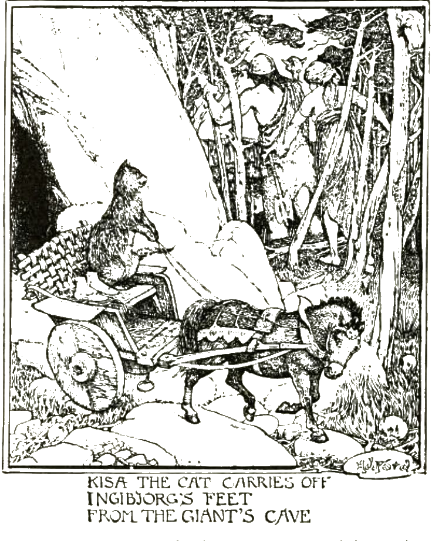

小猫金桑没有和她说一声再见就走了。公主很不高兴。她不吃也不喝，父母亲给她买来的漂亮衣服，她看也不愿意看一眼。

“她会死的，除非我们能让她笑一笑。”宫殿里的人都这么说，“还有什么事情我们可以试试看呢！”

“除了结婚以外，我们什么都试过了。”国王说。

他尽可能地邀请全世界最英俊的男青年到王宫里来，让公主在他们之中挑选丈夫。

她花了不少时间，才选中了自己最喜爱的心上人。这个年轻人是邻国国王的儿子，眼睛像森林里的池水一样，头发是金黄色的，国王和王后非常满意，他们下令准备举行盛大的婚礼。

婚礼结束以后，小猫金桑突然出现在新娘新郎面前，公主冲过去把它抱起来。

“我来请求得到奖赏。”小猫说，“今天晚上，让我睡在你们的床脚。”

“就这些！”公主问，觉得非常失望。

“这就够了。”小猫说。

第二天早晨，躺在床上的不是一只小猫，而是一个美丽的公主。

“我母亲和我被一个可恶的仙女施了魔法。”公主金桑说，“除非做一些从未有人做过的善良的事情，我们才能得到解脱。我母亲没有等到这个机会就死了。巨人的恶作剧，给了我一个挽救你又解脱自己的机会。”

她们比以往任何时候都高兴，金桑公主一直住在王宫里，直到她也结了婚，去统治自己的国家。

 

## 狮子和猫

很久以前，在世界上一个遥远的地方，住着一头狮子和它的弟弟——一只野猫。它们非常友爱，住在同一间屋子里。狮子比猫强大得多，实际上，它比森林里的任何野兽都强大十倍。它跳得比谁都远，跑得比谁都快。如果靠力量和敏捷去捕食，它是百发百中。可要是论狡猾，那就比不上灰熊和蛇，这时候，它就不得不请野猫来帮忙。

小野猫有一个非常漂亮的金球，它的光彩那么令人眩目，你要隔着毛玻璃才能仔细看它。野猫总是把它放在厚厚的皮毛围脖里，围脖从来不从头颈上解下。这是一只很大的动物老死的时候送给它的。那时候它刚生下来不久。老动物告诉它，一定要把它带在身边，这样你就永远不会受到任何伤害。

一般来说，野猫用不着使用它的金球，因为狮子喜欢打猎，它们有足够的东西吃。不过，生活中有时也会出现这样或那样的危险，那就得靠这个金球了。

有一天早晨，两兄弟准备一起出去打猎。猫没有狮子跑得那么快，所以它很早就先出发了。可是狮子两三步跳跃就追上它了。

“有一只熊正坐在树上。”狮子轻声地对猫说，“它在等我们，经过，准备跳到我背上。”

“嗯！你长得那么高大，它不会看见我跟在你后面的。”猫说。它碰了一下金球，只是说：“熊，死！”熊立刻从树上摔下来，死了，

正好滚在它们的前面。

接着，它们太平地走了一段路，正要穿过森林旁边的一片草地时，狮子敏锐的耳朵听到一个微弱的声音。

“那是一条蛇！”狮子说，停了下来。它很怕蛇，比怕熊还害怕。

“嗯！是的！”猫说，“蛇，死！”

蛇死了。两兄弟把蛇皮剥下来，把它卷成一个小包。猫把它挂在自己的头颈上，有了蛇皮，可以用它来做许多奇妙的东西。

到这个时候，它们还没有吃午饭。因为蛇肉不好吃，狮子也不爱吃熊肉，也许是因为它不敢肯定熊已经死了，说不定走近它时，它会跳起来。多数人都有自己害怕的东西，熊和蛇是唯一能叫狮子发抖的动物。

两兄弟继续往前走，很快就来到了山脚下，一些漂亮的鹿正在那里吃草。

“杀一头鹿给你当午饭吧！”猫说，“但给我抓一头活的来，我要活的。”

狮子大吼一声，向鹿群扑过去。可是那些鹿逃得很快。一转眼，狮子和鹿都不见了。猫等了很久，不见狮子回来，就独自回家了。

等狮子回家的时候，天已经很黑了。猫卷曲着身体坐在角落里。

“你给我把鹿抓来了吗？”猫跳起来问。

“嗯！没有，”狮子说，“事情是这样的，我比疾风还快地跑了半个地球，才追上它们。要把一头鹿从那么远的地方拖回来，该多麻烦！所以我把两头鹿都吃掉了。”

猫不再说什么，它觉得自己不喜欢大哥这样。它很想得到一头鹿，把它当马骑，到狮子对它说过的那些好地方去看看。猫越想越不高兴。

第二天早上，当狮子告诉它，该出去打猎了的时候，猫对它说头痛，想留在家里，叫狮子自己去杀那些熊和蛇。猫知道，没有它和那个金球，狮子自个是不敢出去的，它害怕碰到熊和蛇。

两兄弟争吵起来，一连好多天都不说话。更令它们恼火的是，吃的东西越来越少。我们都知道，挨饿的时候更容易发脾气。后来狮子想，它只要能偷到那个魔球，就可以自己杀死那些熊和蛇，那时候，随便猫怎么生气也无关紧要了。可是怎么偷呢？那球日日夜夜挂在猫的脖子上，它又非常惊醒，别想乘它睡觉的时候下手。不行！唯一的办法是叫猫心甘情愿地借给它。过了几天以后，狮子（它一点也不聪明）想出了一个自以为行得通的计划。

有一天下午，雨下得非常大，不论你的眼睛多么敏锐，耳朵多么灵，你也不能看到或听到躲在树丛中的鸟。“我的天！这里多么沉闷！”狮子对猫说，“真是闷死人了。让我们玩一回扔金球的游戏好吗？”

“我不喜欢玩扔球的游戏，那没有什么好玩的。”猫回答。它还是那么气愤，猫直到今天，还是对别人的伤害耿耿于怀。

“那么好吧！把你的球借给我一会，我自己玩。”狮子说着，伸出一只手来。

“你不能在雨中玩，那样会把球丢到树丛里去的。”猫说。

“啊！不会的！我就在这里玩！别发那么大的火嘛！”

猫没好气地把绳子解下，把金球扔到狮子的兜里，就自己睡觉去了。

狮子在房子里扔球，快活地玩了一会，它想，猫虽然睡着了，但肯定是张着一只眼睛看着它。渐渐地，它来到了外面的开阔地。后来有一次，它扔得那么有力，球一直向天空中飞去，再也看不见了。

“糟了！我真笨！”狮子叫起来。猫怒气冲冲地跳起来喊着：

“我们快点去找，不会掉得很远的。”可是，尽管它们找了一天又一天，却怎么也找不到，因为球根本就没有掉下来。

金球丢了以后，猫再也不肯和狮子住在一起了。它到处游荡，一直来到北方，心中总是存着一丝希望：找到丢失的球。几个月过去了，几年过去了，猫行程超过几百英里，可就是不见球的踪影。

猫越来越老了。有一天，它来到一个地方，觉得和以前走过的地方完全不一样。一条大河绕着山脚流淌，河两岸是潮湿的沼泽地。凡是猫，都不想弄湿自己的双脚，所以它爬到一棵高大的树上，看着下面奔流的河水，伤心地想着丢失的魔球。要是球还在，它完全可以轻而易举地摆脱这个困境。

突然，它眼睛一亮。在它坐着的这棵树上，挂着一个漂亮的球，和它丢了的球一模一样。它从树上爬过去，想拿到球。可是小树枝承受不了它的压力，折断了，猫掉到河里。不过没关系，它爬上岸来，开始试第二次。

它小心地向球靠近，树枝越来越细，它不敢再爬过去了，慢慢地伸长身体，用前爪去抓球的绳子。眼看就要碰到了，树枝忽然咔嚓一声响起来，吓得它赶紧缩回来。

猫要是下了决心做什么事情，它们总是千方百计要做到。这时，它开始观察周围，看看还有没有别的路可走。是的，它找到了。这条路虽然难走，但可以说是十拿九稳。球的上方有一根树枝比下面一根粗得多，爬上去肯定不会折断。它只要爬到这根树枝上去，用四只脚抓紧树枝，尾巴就可以碰到魔球，它可以用尾巴不停地碰球，叫球晃来晃去，球挂在树上的绳子就会越来越松，最后球就会掉下来，落到地上。这样做虽然很费劲，不过猫都是很有耐心的，它们不怕麻烦。

事情正如猫猜想的那样，一切终于如愿以偿，球落到地上。猫像闪电般地奔过去，把球捡起来，重新放进头颈上的蛇皮袋里。

猫在河岸边跳来跳去，想找到一只船或一块木头，以便渡过河去。可是河面上什么都没有，只是河对岸有两个少女在煮东西。它提高嗓门拼命地喊叫，可是距离太远了，她们一点也听不见。更倒霉的是，魔球突然从蛇皮袋里掉出来，落入河水中。

当然，球掉下水中也是常有的事，通常不是沉下水底，留在那里，就是浮在水面上。可是这个球既不沉底，也不飘浮在水面上，而是径直向河对岸游去。这时，对岸的一个少女正在河边用水桶汲水，看到了金球。

“啊！多么漂亮的球！”她喊起来，想用桶去套住它，可总是够不着。

“快过来帮忙！”她对另一个少女喊道。忙了一阵子，她们终于把球捞上来。得到一个新的玩具，她们都非常高兴，在手中传来传去，舍不得放下来，直到天黑。

晚上，把球放在哪里才安全呢？她们商量了好久，才决定把它关在一个橱的抽屉里。抽屉四面八方都是密封的，球肯定不会丢掉，她们才放心地睡下。

第二天一早，她们醒过来的第一件事，就是去把抽屉打开，准备把球拿出来。可是一打开抽屉，她们就大吃一惊。球没有了，站在她们面前的是一个英俊的男青年。

“姑娘们，”他说，“我该怎么样才能报答你们呢？很久很久以前，我中了一个坏仙女的魔法，被变成一个球。要等到两个姑娘把我带回家，魔法才能解除。可是，到哪里去找两个姑娘呢？几百年来我一直住在森林里，那里除了野兽，什么也没有。后来狮子把我抛向天空，我才有机会落到这条大河旁。既然是河流，早晚总会有人来。所以我把自己吊在一棵大树上，观察着，等待着。当我重新落入老主人——那只猫的手中时，我几乎绝望了。看到它想过河，到你们这边来，我才又有了希望。这是一次机会，这次机会被我抓住了。姑娘们，现在我只能说这么多了。要是有什么事情需要我帮忙，请到山顶上去，敲三下北边的铁门，我就会出来。”

说完，年轻人向她们深深地鞠了一躬，就消失了。留下两个姑娘在那里，为同时失去金球和王子而伤心。

（北美印第安人传说）

 

## 谁最笨

在一片辽阔的平原上有一个小村子，这里的地势非常平坦，你可以看到太阳从东边的地平线上升起，直到在西边的地平线落下。村子里有两对夫妻，他们的房子紧挨着。两个男人给同一个主人干活，是好朋友。可他们的妻子总是争吵，吵得最凶的问题是：谁的丈夫最笨。

她们不像大多数女人那样，总认为自己的东西比别人的好。她们都说，自己的丈夫比对方的更笨。

“你真不知道他这个人整天在做什么！”其中一个对另一个说，“他把婴儿的外衣也穿倒了。有一天，我看见他用滚烫的汤来喂小孩，把她的嘴巴烫伤了，好几天才好。他把地上的石头捡起来，当洋山芋种在地里。有一次，他从窗口跳进公园，说是这条路比从门口走进去近。”

“当然，那是够糟糕的了。”另一个说，“但是跟我那个比起来，实在是算不了什么，我实在是受够了。有一天，我正忙着，叫他去喂牲口，他肯定是给它们吃了什么有毒的东西。第二天，我到院子里去的时候，看到它们都死了。有一次，我去看望生病的母亲，回来的时候，看到他把我最好的一顶帽子给母鸡下蛋。你知道，上个星期，我叫他去买一罐奶油，结果他被卖鸭子的人骗了，赶一百五十只鸭子回来，一只也不会下蛋。”

“我看他是想试试。”第一个回答，“不过，让我们来试一试，两人之中谁更笨。”

估计丈夫快要收工回家了，第一个女人搬出纺车，坐在家门口摇起来。丈夫回来了，她连头也不抬一下。丈夫站在那里张着大嘴看着，看到她还是忙个不停，忍不住问：“你疯了！妻子，纺车上什么都没有，你在纺什么？”

“你别以为上面什么也没有。”她说，“告诉你，这是一绞最好的毛线，好得谁也看不见，我要用它来给你织一件衣服！”

“我的天！”他说，“我娶了个多么聪明的妻子，要不是你告诉我，我根本就不知道纺车上有羊毛。不过，现在我真的看到纺车上有东西了。”

妻子微笑着，不说话。又忙了一个多钟头，才从椅子上站起来，开始编织毛线。过了好一会，她对丈夫说：“我太累了，今天做不好了。我去睡觉，明天只要裁一裁，缝起来就行了。”

第二天，她很早就起来。打扫完房间，喂了鸡以后，就把一切在厨房的桌子上摊开，大剪刀剪布的咔嚓咔嚓声花园里也听得见。她丈夫什么也看不见，可是他笨得想也不去想，所以一点也不觉得奇怪。

裁好以后就开始缝了。她好像在把布料一块一块铺好，拚好，然后开始缝起来。过了一会，转过身来对丈夫说：“好了！你过来试试看！”

她把丈夫身上的衣服脱下，站在他的面前，给他穿上，这里拉两下，那里拍两下，好像在小心地把每一块皱的地方拉平。

“我不觉得暖和。”丈夫耐心地等待妻子折腾好一阵子以后，终于说话。

“那是因为这些毛料太好了。”妻子说，“你不会希望它像你天天穿的那件粗衣服那么厚吧！”

他希望新的衣服也那么厚，好暖和些。不过他不好意思这么说，只是回答：“既然你那么说，这件衣服肯定很漂亮。我将是整个村子里最帅的人了。他们看到我的时候一定会说，‘多好看的衣服’。不是人人都有我这么聪明的妻子的！”

这时候，邻居的那个女人并没有闲着。她丈夫刚走进来，她就用恐怖的目光看着他，简直把他吓坏了。

“你怎么这样瞪着我？出了什么事？”他问。

“啊！快点到床上去！”她说，“你看上去肯定是病得很厉害！”

丈夫开始觉得很吃惊，因为这天晚上他自我感觉非常好。可是听妻子这么一说，过了一会就觉得很不对劲，脸色刷地变白。

“我也想现在最好就上床去。”他说，开始有点发抖。他让妻子扶他上楼，帮他脱下衣服。

“要是今天晚上睡得好，你明天还能得救。”她说，一边帮他盖好被子，让他暖和一些，“要是睡不好……”她摇摇头。

当然，可怜的丈夫整夜没有合眼，直到天明。

“今天早上你觉得怎么样？”妻子干完家务活以后，蹑手蹑脚地走进来问。

“啊！不好！非常不好！”他回答，“我片刻也没有睡着。你能不能想想办法，让我好起来。”

“我要想出一切可能的办法来救你。”妻子说，她丝毫不想让丈夫死去，只是想证明他比别人笨，“我去弄些草药来让你喝。不过只怕是太晚了，你为什么不早点和我说。”

“我想忍耐一二天就会好的。再说，我也不想让你操心。”丈夫说，他这时候也想自己肯定是病了，而且像英雄一样地忍受着，“当然！要是我知道自己病成这个样，我早就告诉你了。”

“好了！好了！我会想办法的。”妻子说，“多说话对你没好处，躺下来吧！睡得暖和些！”

整整一天，丈夫躺在床上。每当妻子走进来，摇着头问他怎么样时，他总是说越来越坏。后来，有一天晚上，她坐在丈夫身边流泪，他问她怎么回事时，她呜咽着说：“啊！我可怜的、不幸的丈夫，你真的要死了吗？我明天要去给你订一副棺材了。”

丈夫听她这么说，打了一个寒噤，立刻觉得自己从来没有这么好过。

“啊！不！不！”他喊叫着，“我觉得完全好了，真的，我明天就去干活。”

“你不能干这种事了，”妻子说，“安静下来，太阳出来之前，你就要死了。”

丈夫听了妻子的话，非常害怕。做棺材的人进来给他量尺寸时，他一动也不动。妻子吩咐掘墓人给他挖好坟墓。晚上，棺材送来了。第二天早上九点，妻子给他穿上长长的丧服，叫人把他抬进棺材，送到墓地去，所有的朋友都来墓地参加葬礼。

棺材放进坟墓以后，邻居的丈夫也一丝不挂地来了。大家看到他都笑起来，那些放棺材的人也哈哈大笑。躺在棺材里的人觉得很奇怪，就从棺材缝里往外看，喊起来：“我要不是死了，也会像你们这样大笑。”

上面的人听到棺材里有人说话，都目瞪口呆起来，笑声忽然停下。他们像石头似地楞了一会，然后一起向棺材扑过去，把棺材盖打开，让那人站起来。

“你还活着！”他们问，“既然没有死，干吗让人家把你埋掉？”

这时候，两个妻子都承认，她们只是想证明自己的丈夫更笨些。可是村子里的人都说，他们也看不出哪个更笨——是那个一丝不挂，却相信穿着最好衣服的呢？还是那个还活着就让别人埋葬的人？

所以两个女人还是像以前那样争吵着。谁也说不出两个丈夫谁最笨。

 

## 阿斯姆和西格妮

很久很久以前，当仙女、巫师、巨人和妖魔还居住在地上的时候，有一个国王统治着一个伟大而美丽的国家。他很爱自己的妻子，他们有两个充满希望的孩子：叫阿斯姆的儿子和叫西格妮的女儿。

国王和王后都非常用心地想把孩子们培养和教育好，教给他们一切能使人聪明和能干的知识，不惜一切地让他们过幸福的生活。王子和公主从小快活地生活在父亲的王宫里。

王子阿斯姆非常爱好室外活动，也喜欢在大自然里生活。他从很小的时候起，就渴望能住在附近的森林里。经过许多次的请求和争辩以后，他终于说服国王，给他两棵大栎树。

“现在，”阿斯姆对妹妹说，“我要把两棵树干挖空，用来做房间，把家具搬进去，我就可以住在森林里了。”

“啊！阿斯姆！”西格妮说，“多好的主意！让我也来吧！住在你的一棵树里。我要把所有的装饰品和好东西搬进去，两棵树离家那么近，住在那里很安全。”

阿斯姆很爱他的妹妹，欣然同意了她的请求。他们带来了宠物，还有西格妮的钻石，装饰品，把小小的房间布置得很漂亮。有一段时间，他们过得很开心。

不幸的是，伤心的日子来了。他们的国家和邻国爆发战争，国王率领军队出去作战。他不在的时候，王后生病了，挨了没多久就死了。孩子们非常悲伤，他们决心在树洞里过一段时间，为此搬来了足够吃一年的粮食。

现在，我必须告诉你，在离这里很远的一个国家里，国王有一个名叫林格的儿子和一个女儿。王子林格早就听说过西格妮公主的善良和美丽，决心要娶她为妻。他请求父亲，给他一条船。在风和日丽的日子里，他开始远航，过了一段时间，顺利地在西格妮公主的国家登陆。

林格王子不失时机地向王宫走去。在路上，他看到一个十分美丽可爱的少女，觉得她是自己一生中看到的最漂亮的姑娘。他拦住她，问她是谁？

“我是西格妮，国王的女儿。”她回答。

接着，王子问她，为什么一个人出来游荡。她说，自从她母亲死了以后，她非常伤心，她父亲又不在家，她宁愿一个人出来。

林格王子完全被她蒙骗了，根本没有想到，她不是西格妮，而是一个邪恶的，神通广大的巫婆。她变成这个漂亮的模样来骗他。

他向她承认，他从自己遥远的国家赶到这里来，完全是为了她。他早就听说她的美丽，爱上了她。然后，他马上向她求婚。

女巫听他说完，非常高兴地接受了他的求婚。她请王子先回自己的船上去等一会，说她想先到森林里去，过一会就来找他。

林格王子同意了，回到自己的船上去等着。女巫走进森林，来到两棵栎树旁。她恢复自己巨人般的原形，把两棵栎树连根拔起，一棵扛在肩上，一棵抱在胸前来到岸边，涉水上船，小心地不让任何人看见。

上船以来，她又变成那可爱的少女形象，告诉王子，她的东西都搬到船上来了，不用再等了。

王子命令立即起航，路上一帆风顺，他们回到了自己的国家。他的父母和姐姐都非常高兴地欢迎他回来。那个假西格妮也受到了非常友好的接待，给她准备了一幢漂亮的房子。林格王子叫人把两棵栎树种在花园里，就在她的窗口旁边，以便让她能够经常看到。

王子经常来看他认为是西格妮公主的女巫。有一天，他问：“你看我们是不是可以结婚了？”

“是的，”她十分高兴地回答，“我都准备好了，你要什么时候结婚都行。”

“那么，”林格说，“让我们决定，两个星期以后结婚。你看，我给你带来了一些好的料子，做结婚礼服。”说着，他拿出一块最漂亮的锦缎。它全部是用金线织成的，上面绣着许多珍珠和宝石。

王子刚刚出去，女巫就恢复她的原形，暴跳如雷地在房间里走来走去，把美丽的锦缎扔在地上。

“我要这些东西干什么？”她吼叫着，“我既不会裁，也不会缝衣服。如果我的兄弟铁头不给我带些生肉和骨头来，我肯定要饿死，别的东西我一样也不要吃。”

正当她发疯似地怒吼着的时候，地板突然裂开，一个巨人从地板下面钻出来，手中还拿着一个大箱子，里面装满了她想吃的鬼东西。这对可怕的魔鬼坐在一起贪婪地吞吃着。大箱子里的东西吃完以后，铁头扛起箱子就消失了，没有留下任何痕迹。

可是他的姐姐并没有安静片刻，她拉扯着那块锦缎，生气地走来走去，嘴里还可怕地喊叫着，好像要把它撕碎。

这时候，阿斯姆王子和他的妹妹正坐在窗外那棵栎树上，看到了房子里发生的事情。

“亲爱的西格妮，”阿斯姆说，“想办法把那块锦缎拿来，你给她把衣服做好。她这样吵下去，我们日夜不得安宁。”

“让我试试看。”西格妮说，“很难做，不过，付出点力气去换来片刻安宁值得。”

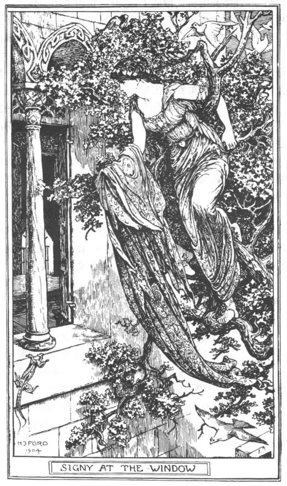

她在那里观察着，等待着机会。巫婆一离开房间，她就去把锦缎拿走。接着，她坐下来，拿出自己最好的手艺剪啊！缝啊！六天以后，一件漂亮的长袍做成了，它有长长的拖裙和披风。完了以后，她爬到树上去，想办法把衣服从窗口扔到女巫的桌子上。

女巫看到衣服做好了，是多么高兴啊！林格王子来看她的时候，她拿出来给他看。王子说了许多赞美她手艺的话，然后以最友好的方式和她告别。可是，王子一走，她又开始像以前一样大喊大叫，直到她的弟弟铁头出现。

阿斯姆从树上看到这种野蛮的行为，觉得再也不能保持沉默了。他去找林格王子，对他说：“你跟我来，看看新公主房间里发生的奇怪事情。”

王子一点也不觉得什么，不过他同意和阿斯姆一起，躲在房间壁板的后面。从壁板的一道缝里，他们可以看到房间里发生的事情。

这时，那个女巫还在疯狂地叫骂着：“等我和国王的儿子结婚以后，我要比现在过得更好。我要把所有的大臣全部处死，把我所有的亲戚叫来代替他们，在这里住下。我的那些巨人朋友来这里，和我以及我的丈夫住在一起，一定会觉得很快活。”

林格王子听到这些话，气愤得马上派人来把房子烧掉。房子，连同女巫和她的弟弟都烧成灰烬，他们来不及逃掉。

阿斯姆把两棵栎树的事讲给林格王子听，还带他去看。林格王子觉得很惊讶，当他看到美丽得无与伦比的西格妮时，更是吃惊得说不出话来。他马上就爱上了她，向她求婚。她想了一下就同意了。阿斯姆也向林格的姐姐求婚，她也高兴地答应了。两对新婚夫妇同时举行婚礼，到处沉浸在无比的欢乐之中。

不久，王子阿斯姆带着新娘回到自己的国家，和他的父王住在一起。两对新人经常见面，他们幸福地生活了许多许多年。这就是故事的结尾。

 

## 守护神鲁伯赞勒

在无比宽广的地下世界里，地下宝藏守护神鲁伯赞勒是他们的君主。管理这个地下世界是非常繁忙的，那里有数不清的宝库要去巡逻和看守。鲁伯赞勒手下还有许多人，他要安排他们的工作。有的要去修建厚厚的堤坝，以防止地下汹涌的河水冲击；有的要去照看炼炉，把那些普通的石头炼成宝石和贵重的金属；有的忙于把钻石和宝石藏入岩石的裂缝中。鲁伯赞勒喜欢一切美好的东西。

有时候出于好奇，他也会离开阴暗的地下，来看看地球表面那生气勃勃的世界，在绿色的土地上舒服地晒太阳，听那些小鸟唱着美妙的歌曲。

守护神的寿命很长，可以活成百成千年，所以他们可以看到世界上许多奇怪的事情。他第一次到地面上来的时候，高山覆盖着浓密的大森林，野兽在森林里吼叫，熊和野牛在生死搏斗，或者在追逐灰狼，或者在山坡上、峡谷里翻滚玩耍，常常可以听到它们奔跑的声音。

可是，第二次来到地面上的时候，他惊奇地发现，一切都变了。许多大森林被砍伐，取而代之的是看上去很舒适的房屋，周围是结满果实的果园。蓝色的炊烟袅袅地升上天空，在开满鲜花的草地上，放牧着许多牛羊，不时传来牧羊人吹奏笛子的乐曲声。这些既叫人感到陌生，又叫人感到兴奋的景色，使鲁伯赞勒觉得很高兴。他不想去干涉这些不速之客，他们没有征得许可，就在属于他的土地上造起那么多房子；而是让他们在自己的家里享受天伦之乐，就像房子的好主人让燕子自由自在地在柱梁上筑巢一样。

其实，他非常希望和这些叫“人”的生物交朋友。于是，他变成一个老农民的样子，去给一个地主干活。在他的辛勤耕作下，所有地里的庄稼都长得非常好。可是，他的主人不但挥霍浪费，而且忘恩负义。鲁伯赞勒不久就离开了他，到邻居一家牧主那里去做事。

他卖力地替主人照管着羊群，知道哪里的牧场草长得最好，应该把羊赶到哪里去。羊走失了，他也知道应该到哪里去找。在他专心的饲养和放牧下，羊群长得又肥又大，没有一只走失，也没有一只被狼吃掉。可是，他的新主人很吝啬，连他辛辛苦苦挣来的工资也想扣发。所以他愤然离开，去给一个法官效力。

在法官那里，他遵规守法，主持正义，那些贼和坏人都非常害怕他。可惜法官是一个坏蛋，他蔑视法律，接受贿赂。鲁伯赞勒决不袒护坏人，所以得罪了法官，法官把他投入监狱。当然，这丝毫也难不倒他。他轻而易举地从锁眼里出来，回到自己的地下宫殿。

鲁伯赞勒第一次和人打交道觉得很失望。不过，随着时间的流逝，他渐渐地把这些事情忘记了，又想再一次上来看看上面的世界。

他偷偷地走进山谷，小心地躲藏在树篱后面，透过树叶，他看到了，草地上站着一个妩媚的少女。她像地下的喷泉那样充满活力，像大地上的花朵那样鲜艳，真是百看不厌。在她周围的草地上，躺着她的几个伙伴，她们可能是玩了什么开心的游戏，累了，躺下来休息。

在她们的旁边，有一条小河在欢快地流动着。一条瀑布从高高的岩石上泻下，发出令人心旷神怡的声音，也给这闷热的夏日带来凉爽。

姑娘的美貌使守护神怦然心动，他第一次希望自己也是一个人。为了更清楚地看这些快活的少女，他变成一只渡鸦，飞到小河旁边的一棵栎树上。可是他很快就发现自己犯了一个错误，他的视力和感官只能像渡鸦那样微弱，而且树根里的一窝田鼠注意到他，对他比对那伙少女更感兴趣。

他明白这一点以后，急忙从树上飞下来，变成一个年轻的美男子，这一次变得最聪明，带着一颗年青人火热的心，他爱上了那位少女。

那美丽的少女是国王的女儿。她常常带着自己的伙伴到森林里来，采摘野花和野果。到中午天气变热的时候，这群快活的姑娘就到小河旁边的树荫下休息，在清凉的河水里洗澡。这天，她们又到森林里来玩耍，给了守护神鲁伯赞勒一个好机会。

鲁伯赞勒从他藏身的地方走出来，站在公主中午常来休息的草地中央，念着他的咒语，把周围的一切都彻底改变了。中午时刻，公主和姑娘们一起来到这里时，她们非常惊讶，还以为自己是在做梦呢！

周围红色的岩石变成了雪白的大理石，好像是用纯净的石膏雕塑而成；小河原来在弯弯曲曲的河道里奔流，现在平静地在光滑的水渠里流淌，一股清澈的喷泉从水中喷出，落下来溅起的浪花和水滴像珍珠和钻石，风一会儿把它们吹过来，一会儿把它们吹过去。

雏菊和勿忘草长满了河的两岸，玫瑰和茉莉筑成高高的篱笆，围绕在河的周围，构成幻境般芬香和优雅的凉亭。在瀑布的两边，新开出两个山洞，墙壁和拱顶是五光十色的岩石晶体造成的，斑斓的色彩令人眼花缭乱。墙壁上长满了许多奇异的水果和甜食，公主看上一眼就非常想摘下来吃。

看到这仙境般的景色，姑娘们简直不敢相信自己的眼睛。是走进这块迷人的地方呢？还是赶快逃跑，她们犹豫了一会。后来，她们还是抵挡不住这些诱惑，开始在这里游玩起来，她们奔啊！跑啊！你追我赶！捉迷藏！吃水果！心满意足地玩了好一阵子。

累了以后，公主说，现在，她最渴望的是在大理石的水池里洗澡，女仆们也一致赞成。水池里，清澈的河水在荡漾着，好像在向她们招手。

公主第一个下水，可是她刚一下水，就不停地往下沉。等到河面上只见公主一丛金发时，女仆们觉得不对劲，慌了手脚，赶忙去抓。可是一转眼，金发也消逝了。

她们大声哭喊着，沿着河岸毫无目的地奔跑。河水是那么浅，那么清，河底可以看得一清二楚，可就是不见公主的影子。她们不顾一切地跳下水去，希望能像公主一样地消逝，好跟随她走。可奇怪的是，河水好像着了魔似的，她们怎么也潜不下去，只能像木头似地浮在水面上。

她们绝望了，只好回来告诉国王，公主失踪了。听到这可怕的消息，王宫里充满了悲伤！国王从头上摘下王冠，把它摔在地上，痛苦地扯起紫色的长袍，把自己的脸遮住，为失去心爱的公主哭泣起来。哭了一会以后，他镇静下来，急忙向森林里赶去，他要亲眼看一看这块公主失踪的神奇地方。他想，女仆们也许因为伤心而把事情搞错了。

可是，当国王来到那里时，一切又完全变了。女仆们讲述的那些景象完全消失了，没有什么大理石水池；什么色彩缤纷的山洞和鲜花，什么美味的水果，都毫无踪影，一切都恢复了原来的景象。

国王非常恼火，他用各种各样的处罚来威胁那些女仆，要她们说出公主失踪的真实情形，可是她们总是重复那说了无数次的故事。国王只好把这件事归咎于鬼怪作祟。为了让自己从失去女儿的悲痛中恢复过来，他下令安排一次大规模的狩猎。国王要管理国家，不论什么事情，都不能长期烦恼。

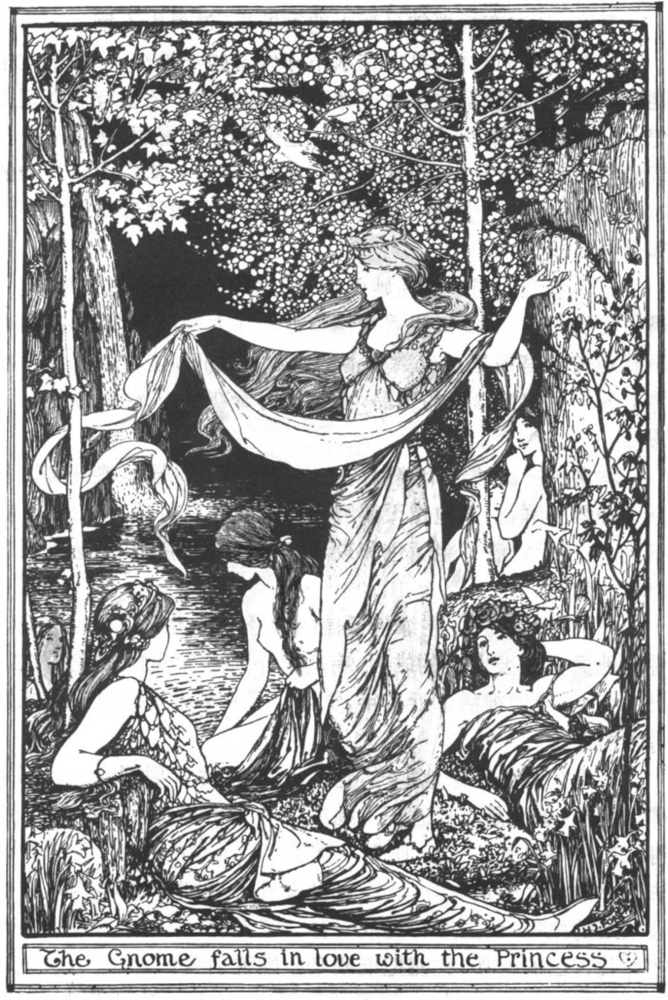

其实，公主在她那神灵恋人的宫殿里，过得也不错。

公主下水的时候，早已在水下守候着的守护神，一下子就把她拖入地下，带着她很快地向地下宫殿游去。她还没有搞清楚是怎么回事，已经来到了地下宫殿。它的辉煌和富丽，使她觉得父亲的宫殿和它比起来，简直是一间破屋。等她从梦幻中定下神的时候，她发现自己坐在一张豪华的椅子上，上面铺着昂贵的绸缎和金线。

一个年轻的男子跪在她面前，这就是守护神鲁伯赞勒。他用最甜蜜的语言，向她诉说着自己和他那伟大的地下王国，高兴地领着她去看宫殿里数也数不清的大厅的房间，里面都堆放着世界上最罕见和最珍贵的物品，它们放射着夺目的光彩，令她目不暇接。

城堡的三面被一个美丽的花园包围着。花园里盛开着许多令人心醉的鲜花，草地像天鹅绒一样地柔软和舒适，叫公主百看不厌。果树上结满了金黄色和玫瑰色的果实，鸟儿在树丛里唱着婉转的歌曲。

守护神领着公主在绿色覆盖的幽径上行走。她有时仰头观看比地面上还要明亮的皓月，有时摘下那些罕见的鲜花插在自己的头上。守护神活了近千年，觉得自己从来没有见过这样妩媚可爱的女子。

可是公主并不像他那样，觉得很幸福。尽管周围的一切都是那么神奇，她还是有点悲伤。她尽可能地装做很满意的样子，免得守护神不高兴。不过，他不久就感觉到了她的忧伤。他想尽办法要驱散天上的这一片乌云，可是没有用。后来，他想，人是过社会生活的生物，像蜜蜂和蚂蚁一样。毫无疑问，这个可爱的人儿在寻找自己的伙伴，我能把谁叫来和她说话呢？

想到这里，他赶紧到附近的地里去，挖起一些胡萝卜，小心地把它们放在一个雅致的篮子里，带来见公主。她这时正忧郁地坐在玫瑰花丛下的一张椅子上。

“地球上最可爱的女子，”守护神说，“请抹去你心上的全部忧愁，在我的家里你再也不是孤独的了。这个篮子里，有叫人高兴的，你所需要的东西。拿起这根七色棒，碰一下这些萝卜，说出你想见到的名字。”

说完，他留下公主一人，独自走了。公主片刻也不想耽搁，用七色棒点着一个萝卜，迫不及待地叫：“布鲁希达！我亲爱的布鲁希达，快点来呀！”布鲁希达果然出现，她高兴的拥抱和亲吻着公主，两人高兴地像往日一样唠叨着。

朋友的突然到来，叫公主快活得不知所措。她们手拉手地在梦幻般的花园里行走，不时从树上摘下金苹果。玩累了以后，公主就领她的女友去看王宫里那些奇妙的房间。最后她们走进一间摆满最漂亮的服装和装饰品的房间，这是守护神为他心目中的新娘准备的。这些衣服和装饰品是那样吸引她们，一个小时就像一分钟那样快地过去了。她们试了面纱又试腰带，试了腰带又试项链，一样一样地打扮着，欣赏着。这个假布鲁希达知道得那么多，举止又那么优雅，品性又那么高尚，谁也不会想到，她只是一只萝卜变的。

守护神片刻不离地在旁边秘密观察着，很得意自己是那么了解女人的心。这时候，他觉得公主比以前更加可爱。

公主没有忘记用七色棒去点那些萝卜，把她所有的女仆都召来，还有她那只可爱的小猫和叫贝尼的小狗。

现在，地下城堡里充满了欢乐。公主给每一个女仆分配了任务，她们从来没有服务得这么好过。整整一个星期，公主和这些快乐的女伴在一起，没有丝毫的烦恼。她们唱歌，跳舞，从早上一直闹到睡觉。

可是，公主不久就注意到，她那些女伴的脸越来越显得苍白和疲倦，只有大理石墙上的镜子显示出，她自己的脸蛋还是像鲜艳的玫瑰那么娇嫩。她们安慰她说，没什么，她们感觉很好。可是，她们一天比一天憔悴，和公主做游戏显得一天比一天吃力。

终于有一天早晨，当她从床上起来，急急忙忙地去找女伴们玩时，被看到的景象吓得发抖，退了几步。那些可爱的少女都变成了干瘪的老太婆，驼着背，双手和双脚都在颤抖着，靠着拐杖在那里站立和行走，还不停地咳嗽。在壁炉的旁边，那只曾经是多么神气，多么爱玩的小狗僵硬地伸着四条腿。那只小猫躺在天鹅绒枕头上，虚弱得抬不起头来。

看到她的伙伴这副悲惨的景象，她惊慌失措地逃出去，大声地喊叫着守护神。他立刻出现在面前，急切地等待着她的吩咐。

“恶毒的精灵！”她喊叫着，“你为什么这样妒忌我的女伴，她们在我孤独的时刻，给我带来了无比的欢乐！难道这与世隔绝的孤岛生活还不够惨吗？你还要把城堡变成老年人的医院！立刻还我女伴的青春和健康，否则我再也不会爱你了！”

“最美丽和最甜蜜的姑娘，”守护神说，“请不要发火。只要我办得到，你要什么都行，不要叫我去做办不到的事情。只要这些萝卜还是新鲜的，你想要什么，魔棍就可以把它们变成什么。这些萝卜要是干枯了，就没有用了。不过，亲爱的，请不必烦恼。再采来一篮子新鲜的萝卜就是了，那时，你又可以随心所欲地招来你所需要的人。花园里的那块绿地保证你会有许多可爱的伴侣。”

守护神说完就走了。公主用魔棍碰了一下那些老态龙钟的老太婆，她们都变成了枯萎的萝卜。公主把它们扔到垃圾堆里去，就迈着轻盈的步伐，到草地里来找装满新鲜萝卜的篮子。可是，她走遍了整个公园，搜查了每一个角落，就是找不到这个篮子，她觉得非常奇怪。

在葡萄架的旁边，她碰到了守护神。看到公主，他显得非常尴尬。公主心里明白了，这是怎么一回事。

“你想耍我！”她喊道，“你把篮子藏到什么地方去了？我起码找了一个钟头。”

“我心中亲爱的王后，”他说，“请你原谅我的粗心大意，我答应你的事情超出了我的能力。我到处都找遍了，就是找不到你所需要的萝卜。它们早已被收割，堆在发霉的地窖里干瘪了。田里光秃秃的，寸草不生，因为现在是冬天。只是这里因为你的存在，才留住了春天；你走到哪里，哪里的鲜花就遍地开放。请耐心地等待一下吧！不久就会有许多玩偶陪着你玩。”

还没等守护神把话说完，失望的公主就转过身来，向自己的房间走去，她觉得不屑回答他的问题。

守护神不敢怠慢，立刻变成一个农民的样子，在最近的集市上买了一头驴子，让它驮回来几袋各种萝卜种子。回到地下王国以后，他种下了一大片萝卜，派出一大群鬼怪去看守和照料，还从地下深处引来一条大河，让田地受到温暖和滋润，让这些种子好早点发芽。萝卜在他们的照顾下，生长得很茂盛，丰收在望。

公主整天在地里走来走去，公园里那些奇花异草，还有那些甘甜可口的水果，她一点也不感兴趣，她关心的只是这些萝卜长得怎么样了。尽管萝卜的长势很好，她还是觉得长得太慢了。无聊的时候，她喜欢坐在枞树底下，小河岸边，把摘下来的鲜花抛入河水中，看着它们随河水飘流而去。

守护神拿出自己的最大神通，希望能让公主高兴，赢得她的爱。可是，他失败了，而且他一点也不知道失败的原因是什么。他猜想，公主太年轻了，还不懂得如何去爱一个男人。可是他错了，事实是，已经有一个偶像占据了她的心。这个偶像就是拉特巴王子。拉特巴王子的国土和公主的国土相连，他已经赢得了公主的芳心。公主神秘地失踪之前，这对恋人已经在等待着成婚的那一天。

新娘子失踪的坏消息使拉特巴王子心烦意乱。日子一天一天地过去，关于公主的消息一点也没有。他找遍了城镇和村庄，又来到森林和荒地里，对着高山和树木，大声地呼喊着心上人的名字。

这时候，公主正在她那富丽堂皇的宫殿里，偷偷地为自己的命运悲伤和哭泣，她不敢让守护神看到，免得引起他的疑心。她心里在暗暗地盘算着，如何才能够逃脱这种囚犯的生活。慢慢地，她想出了一个计划。

这时候，大地上已经春意盎然。守护神把引来温暖地下王国的火焰送回地心，那些萝卜在他们的细心培植下，已经到了丰收的时候。公主不时拔起一些萝卜，变成那些她想见到的人，高兴地和她们一起玩耍。与此同时，她在暗暗地筹划一个行动。

有一天，她把一个小萝卜变成小蜜蜂，派它带讯去见她的爱人。

“飞吧！亲爱的小蜜蜂，一直向东方飞去。”她说，“去见我亲爱的拉特巴，轻轻地飞进他的耳朵，告诉他，我只爱他一个人，可是我现在被关在山下面守护神的宫殿里。记住我问候他的每一个字，千万别忘了，把我爱人的消息带回来给我。”

蜜蜂展开它闪光的翅膀，带着她的嘱咐，向地面上飞去。可是，它还没有飞出公主的视线，一只贪婪的燕子就把它吃掉了，公主是多么伤心。

她拿起神奇的魔棍，变出一只蟋蟀，教它说：“跳吧！小蟋蟀，到拉特巴那里去，在他的耳边轻轻地说，我只爱他一个人，我现在被关在山下守护神的宫殿里。”

蟋蟀快活地跳走了，它决心尽力去完成这个使命。可是，一只长脚的鹳飞到它要经过的路上，伸出长长的嘴来啄它。蟋蟀一个字也来不及说，就被吞进了肚子。

两次冒险失败，并没有动摇公主的决心，她决定再试一次，这一回，她把小萝卜变成喜鹊。

“飞吧！小喜鹊！从这棵树飞到那棵树。”公主说，“飞到我亲爱的拉特巴那里去。告诉他，我被关在这里。叫他三天以后带着人马来，到索尼峡谷的山脚下等我。”

小喜鹊用心地听着。接着，它跳出树丛，向蓝天展翅飞去。公主关切地望着它，直到它在远处消失。

这时，拉特巴王子还在森林里转来转去，寻找着自己的恋人。美丽的春色也无法减轻他的悲哀。

这一天，王子坐在一棵橡树底下，怀念着失去的公主，不时大声地叫喊着她的名字。突然，他好像听到另一个声音在回答他。他吃惊地站起来，四处张望，可是一个人影也没有。正当他以为自己搞错了的时候，那个声音又响了起来。他抬起头来仔细观察，看到一只喜鹊在树枝上跳来跳去，接着，他吃惊地发现，是这只小鸟在叫他的名字。

“可怜的饶舌鸟，”他说，“谁教你说这个名字，他是一个不幸的人，正恳求大地裂开，把他连同他的记忆全部吞掉。”

他拿起一块石头，正准备向喜鹊打过去。幸好这时，它说出公主的名字。听到这个名字，王子拿石头的手无力地垂下，呆呆地站在那里。

天底下的喜鹊都喜欢说话，否则就会闷闷不乐，这一只也一样。它开始不停地重复公主教它说的话。王子很快就明白了，真是喜从天降，所有的忧愁和悲伤都一扫而尽，欢乐涌上心头，他迫不及待地向喜鹊打听公主的消息。

可是，喜鹊除了知道公主教它说的以外，什么也说不上，它很快就飞走了。王子回到自己的城堡，召集起一批英勇善战的人马。

这个时候，公主也开始周密地实施她的逃跑计划。她不再以冷淡和轻蔑的态度来对待守护神，她的眼睛中充满了热情。守护神看到这些，以为自己对她的爱恋即将结出果实，心中充满了兴奋和希望。

第二天早晨，太阳刚刚出来，她就把自己像新娘一样地打扮起来。她穿上了守护神给她准备的，镶满钻石的长袍，金黄色的头发上插上美丽的鲜花，还披上闪烁着宝石光芒的面纱。穿戴着这些高贵无比的服饰，她来到守护神的面前。

“最亲爱的姑娘，”他深深地弯下腰来，结结巴巴地说，“让我看看你那双可爱的眼睛，从中可以猜出，你不再拒绝我对你的爱，要让我成为天底下最幸福的人。”

他这样说着，走过来想撩开她的面纱，可是公主却把它拉得更紧。

“你的坚贞不渝说服了我。”她说，“我再也不能违背你的意愿。可是请相信我，让我带着面纱，以遮掩我的羞愧和眼泪。”

“可是为什么流眼泪！亲爱的人！”守护神担忧地说，“你的每一滴眼泪，都像熔化了的金子一样滴在我的心上。我非常渴望能够得到你的爱，可是我不希望你做出牺牲。”

“啊！”假情假意的公主说，“你为什么曲解我伤心的眼泪？你的温柔赢得了我的心，可是我有些害怕。你永远是那么年轻，而我们人的美貌就像昙花一现，很快就会凋谢。当你的妻子不再妩媚的时候，我怎么能肯定，你还会像现在这样爱她？”

“那就请你考验一下吧！我的心肝。”他说，“你可以想个办法来证实我对你的忠贞和服从，考验我对你坚定不移的爱。”

“那好吧！”公主狡猾地说，“让我检验一下你的善心。去吧！去数一下地里有多少萝卜，我的婚礼要邀请许多客人来参加，我还要靠她们来当女傧相。你一定要数正确，一个也不能错，除非你想欺骗我，这是我对你是否真心爱我的考验。”

守护神片刻也不想离开新娘，不过，他还是不敢怠慢，赶紧去执行她的命令。他像蚱蜢似的，在萝卜地里敏捷地跳来跳去，很快就数了一遍。为了保证没有数错，他又重新开始数一遍。可是结果和第一次不一样，叫他非常恼火，不得不再数第三次。可惜第三次得到的数字和前两次完全不一样。不过，这也难怪，这时候，他心中只想着公主的美貌和甜蜜的声音，那里有心思来数这些萝卜。

公主把她的求婚人骗走以后，就开始准备逃跑。她把藏好的一只大萝卜拿出来，把它变成一匹骠悍的马，装上马鞍和缰绳，就赶紧跳上马背，翻山越岭，来到索尼峡谷，扑向她热恋着的拉特巴王子的怀抱。

这时候，守护神还在忙碌地一遍又一遍数着他的萝卜，尽管他累得腰酸背痛，满头大汗，却怎么也点不出两个相同的数字。到后来，他得出那些大大小小的萝卜加在一起的准确数目以后，就急急忙忙地赶回来，迫不及待地要向公主证明，他是多么爱她，将是永远忠诚于她的好丈夫。他对自己的所做所为觉得非常满意。可是，当他穿过草地，来到和公主分手的地方时，公主不见了。

他走遍了所有的路，找遍了每一棵树，连池塘里也不放过，还是不见公主的踪影。他急冲冲地返回宫殿，挨个地搜遍每一个房间的角落，呼喊着她的名字。可是听到的只是大理石墙壁的回音，宫殿里死一般地寂静，没有任何声音，连轻微的脚步声也没有。

后来，他觉得有点不对劲，就抛弃那妨碍他施展魔力的人形，飞出地下宫殿，升上天空，向地面张望。他看到了逃亡的公主，她骑着马，正在飞越他领地的边界。

火冒三丈的守护神气愤地召来两片乌云，向逃跑的公主掷出一道闪电，把竖立在那里已经有了几千年的巨大界石打得粉碎。可是，守护神的愤怒毫无结果，那些乌云很快就变成薄雾，悄悄地散开。他绝望地追了一会以后，开始为自己的不幸叹息，悲伤地返回自己的地下宫殿。他走进一间又一间空空如也的房间，这里曾充满了公主和她女伴的欢声笑语。他在死一般寂静的花园里徘徊，金黄色的沙地上，还留着公主的脚印。如今，这一切都使他无比惆怅和悲伤。孤独、空虚和痛苦折磨着失恋的守护神。他从自己的经历中得出结论：人是一种虚伪的生物。他决心，再也不和人打交道了。他在地上踩了三下，那些他在空地上变化出来的宫殿，连同它里面的宝藏转眼间都消失了。守护神向地底下更深的王国飞去。

这时候，公主在干什么呢？拉特巴王子正带着她急速地向安全的地方飞驰而去，他们平安地返回了公主的宫殿，见到了她的父亲。在举行婚礼以后，他把她接到了自己的王国。

直到公主，还有她的子孙死了以后很久很久，村子里的人还在讲述着当年她被囚禁在地下的故事。

（德国民间故事）

 

## 一个穷孩子的命运

从前，在遥远的东方有一个国王，他酷爱打猎，只要看到一只鹿，就会不顾一切地追赶，将自己的安危也置之度外。他还特别喜欢单独冒险，常常把和他一起出去打猎的部下和随从远远地抛在后面。他还喜欢装病，有时会借口身体不好，拒绝接见任何人，在只对忠诚的宰相交代以后，自己打扮成小贩模样，带上一些便宜的货物，骑着一头驴子出去旅行。这样，他可以打听出那些普通老百姓对他有什么意见，了解那些法官和地方官如何履行他们的职责。

有一天，王后生了一个像朝霞那样光彩照人的女孩，国王非常高兴，整整一个星期不出去打猎，不是在家里，就是在王宫里度过快乐的时光。

过不了多久，他又开始到森林里去追逐那些野鹿。有一天，他的猎狗发现了一头漂亮的白色牡鹿，国王决心不惜一切代价也要抓住它。他用马刺踢了一下马，拼命地追赶那头鹿。当然，那些跟他一起出来的随从不敢怠慢，也紧紧地跟上来。可是那头牡鹿跑得像闪电一样快，国王的骑术又远比随从高明，一个钟头以后，只有他单枪匹马，还有猎狗在前面奔驰，那些随从都远远地落在后面，不见踪影。

国王毫不畏惧，马不停蹄。他发现自己走进一个峡谷，周围是岩石构成的高山峻岭。这时候，马已经十分疲惫，每走一步都要发抖。更糟糕的是，太阳快下山了，黑夜正在降临。他射出的每一枝箭，不是中途落下，就是错过目标。天越来越黑，牡鹿也就消失在黑暗之中。

马累得一步也走不动了，猎狗也步履艰难地跟随着。他从来没有到这么远的深山里来过，完全迷失了方向，四周没有一栋房子，也不见一个人影。

一切虽然令人沮丧，但国王对这些都不在乎，他伤心的是让那头美丽的牡鹿跑掉了，这叫他难过了好一阵子。

他从不害怕孤单无援。他从马上下来，拉着马的缰绳，在高低不平的山路上行走，希望能找到那些牧人的小屋，或者起码是岩石下的一个洞穴或掩蔽所，好打发这一夜。

这时，他好像听到了水流的声音，就向那个方向走去。吃力地翻过一个陡峭的小山丘以后，他看到一条小河从险峻的山谷里流过。就在他的脚下，在一块平地上，有一点光在恍惚着，闪烁着，好像是一盏灯。国王牵着马和狗，小心翼翼地从绝壁般的岩石坡上滑下。在下面，国王看到，小河旁有块狭小的长着青草的石头，石头旁边有一个山洞，光线就是从洞口一盏简陋的灯发出来的。

小河旁边坐着一个年迈的隐士，他长着白白的长胡子。国王走过来的时候，他一动也不动，也不开口说话，只是把身边满地的干叶子不停地扔入水中。

“向你请安。”国王照当地人的礼节向他问候。

“也向你请安。”隐士回答，继续做他的事情，连头也不抬一下。

大约有一两分钟，国王站在那里看着他。国王注意到，他每次都同时扔下两片叶子，然后仔细地观察着。有时，两片叶子同时被湍急的溪流冲走；有时，只有一片叶子被带走，还有一片在原地慢慢地打转，最后回到隐士的身边；有时，两片叶子同时被回旋的涡流留下，摆脱那哗哗地向山下汹涌而去的急流。

“你在干什么？”国王忍不住，问道。隐士说，他在预卜人的命运，每个人的命运从生下来就定了，不论是好是坏，他都无法摆脱。

国王笑起来，说：“我的命运如何，我一点也不在乎。不过，我很想知道，我小女儿的命运会怎样？”

“我不能说。”隐士回答。

“这么说，你是不知道吧！”

“我知道，”隐士说，“不过，有时候，知道得太多并不聪明。”

国王对这个回答不满意，开始要求老人把知道的事情告诉他。隐士一直不肯说，后来经不住国王的再三请求，对他说：“国王的女儿将嫁给一个穷苦的女奴隶的儿子，女奴隶的名字叫珀露娜，属于北方国家的国王。这是命中注定的，无法逃避。”

国王听到这些话，气得发疯。不过因为太累了，他只能苦笑，说他希望不论如何，能有办法躲避这个命运。然后，他问隐士有没有地方，让他和牲口能够过夜。隐士说有的。

国王给马喝了些水，把它拴好，自己吃些面包和烤豆当晚饭。吃过以后，国王在洞穴里躺下，猎狗睡在他脚跟。尽管他很想睡，可是怎么也睡不着，躺在那里想着隐士的预言，越想心里越气。最后他咬牙切齿，发誓这件婚事永远，永远也不可能出现。

天亮了，国王起来，脸色阴郁而苍白。他向隐士问好路以后就上了马，不费多大力气就找到了回家的路。

回到王宫以后，他做的第一件事，就是直接向北方国土的国王写信，请他帮个忙，把他的女奴珀露娜和她的儿子卖给他。他还写道，假如他同意，他将派一个传令兵到两国交界的河边去接他们。

一连五天五夜，他等待着回信，吃不好也睡不着，心中非常烦恼。传令兵终于回来了，北方国王在信中说，他不要卖钱，把那个女奴和她的儿子交给他就是了。国王非常高兴，他把宰相叫来，跟他说自己准备单独出去，叫他照顾一下。

第二天，他把自己打扮成一个普通的传令兵，骑上一匹骆驼，向准备交接那个女奴隶的河边走去。到了那里，他交给把女奴带来的人一封感谢信，还有送给他的国王的厚礼，就带着可怜的女奴和她还在襁褓中的婴儿跨上骆驼，向荒无人烟的山林里走去。

他们马不停蹄地走了一天一夜，来到一个大山洞旁。他把女奴和婴儿带进山洞，然后抽出剑来，把女奴的头砍下。这时候，虽然愤怒使他什么残酷的事情都做得出来，国王还是觉得不能把自己神圣的剑对准无辜的婴儿，在这荒芜的山林里，失去了妈妈，他肯定要死去。于是，他离开了山洞，跨上骆驼，尽快地回到自己的家里。

就在这片荒山里，有一个小村庄，村庄里住着一个年迈的孤身老妇人。她没有子女，也没有任何亲戚，只靠养着几只母羊，出卖羊奶过活。她非常穷，身体也非常虚弱，经常担心自己生病或衰老以后，怎么能去照顾这些母羊，怎么能活下去。每天早晨，她赶着这些羊到荒山中的丛林和草地上去，让它们在那里吃草。晚上，这些羊自己回家，让老妇人挤奶后关进羊栏。

一天晚上，老妇人吃惊地发现，一只最好的母羊一滴奶也没有了。她想，肯定是哪一个顽皮的小孩和她耍花招，在路上把羊截住，把奶挤光。可是，一天又一天过去，这只母羊天天都是一滴奶也挤不出来。她决心要把这个偷奶的贼抓住。

第二天，她把羊放出去以后，就躲在一旁看它们吃草。到了下午，她看到这只特别的母羊独自走开，她立刻跟着它。那母羊走了一段以后，就走进一个山洞。老妇人跟着进去，看到那只母羊在用自己的奶喂养一个婴孩，旁边躺着他死去的母亲。

老妇人又惊奇又害怕。后来她想，可以收养这个孩子当儿子，将来长大了她也好有依靠。于是，她把婴儿抱回家。第二天，她带来一把铁铲，在山洞旁挖了一个洞，把可怜的母亲埋葬了。

一年又一年过去了，婴孩长成了英俊的男青年，他不但长得很漂亮，而且勇敢勤劳。老妇人给他起了个名字，叫马洪姆德。这时候，他大约已经有十七岁了。

有一天，他从地里干活回来，看到一头奇怪的驴子正在他家门口的地里吃大白菜。他抓起一根棍子，打这头驴子，把它从自己的地里赶出去。这时，一个邻居从这里经过，喊叫起来：“嗨！我说，你干吗这样打小贩的驴子？”

“小贩应该看好自己的驴子，不让它吃掉我的大白菜。”马洪姆德说，“今天晚上，要是它还进来，我就割掉它的尾巴！”他说完就快活地吹着口哨进屋。

不巧，那个邻居是个多嘴多舌，爱招惹是非的人。他在客栈里遇到小贩，就把刚才发生的事情告诉他，还加油加醋地说：“那个烈性子的小伙子说，要是你的驴子挨打以后还敢来，他就要打你，把你当做贼，割掉你的鼻子！”

小贩走了几天以后，村子里来了两个人，寻找那人威胁要打骂和杀害无辜的小贩的人。他们说，小贩害怕自己的生命有危险，已经上诉到国王那里去了。他们就是被派来抓这个无法无天的青年的，他必须自己到国王那里去，把事情讲清楚。

当然，他们很快就找到了马洪姆德。尽管小伙子再三声明，他没有说过要杀什么人。那两个人回答说，他们是奉命来抓他的，要带他到国王那里去受审。所以，不管他如何申辩，他的老母亲如何哭泣哀求，他还是被带走了。他被押到国王面前。当然，马洪姆德绝对没有想到，那个小贩就是国王化装的，这件事谁也不知道。

国王当时听到那个多嘴的人那么说，就非常生气。他决心要以这个小伙子为例，教育那些老百姓，让他们知道，即使是一个穷苦的流浪小贩，在他的国家里也能受到法律的保护，决不允许无法无天的行为。

正当他准备对年轻人宣布最严厉的处罚时，马洪姆德的老母亲悲伤地哭泣着走进来，请求让她申诉。国王命令她说下去。于是她开始为儿子求情，说他品行如何好，她人老年迈，全靠他来抚养，如果把他关进监狱，她就会死去。

国王问：她是什么人？她说是年轻人的母亲。

“他的母亲？”国王说。“你年纪这么大，肯定不会有这么年轻的儿子！”

老妇人既烦恼，又害怕，只好承认事实，把如何找到婴儿，如何救了他，把他抚养成人的经过告诉国王，最后还请求国王的怜悯和宽恕。

你可以想象得出，老妇人在讲这个故事的时候，国王的脸色越来越阴沉，越来越恐惧，最后因为吃惊和气愤几乎要昏过去。站在他面前的，正是被他残酷地杀死了母亲，抛弃在荒野里，叫他去死的婴孩！是的，命运已经救了他的命。那个隐士的预言是多么强而有力地表现出来了。他多么想立即判处这个年轻人死刑。可是他的行为够不上这样的处罚，假如把他处死，老百姓就会骂他是个暴君，他不敢这样做。

他尽力控制住自己，说道：“假如这个年轻人愿意加入我的军队，我就饶了他，免予处罚。我的军队需要人，军队的纪律对他也有好处。”

老妇人还是苦苦哀求国王，说离开了儿子她就活不下去了。她觉得，把他送进军队和送进监狱一样的可怕。可是国王决心要把年轻人控制在自己手中。后来，国王答应给她一大笔钱，足以让她舒服地度过余生，她才答应了。马洪姆德也非常高兴编入国王的军队。

作为一个士兵，马洪姆德好像非常幸运。他自己也觉得很奇怪，但是也很高兴。那些最困难，最危险的任务总是交给他。虽然有的时候，他几乎送命。但是，越是艰苦险恶的环境，就越能表现出他的勇气和才智。而且，他总是那么谦虚，那么宽容，因此深受长官和同伴的喜爱。

毫不奇怪，没有多久，他就被选入国王的近卫队之中。实际上，国王希望他在战斗中阵亡，可是不管形势怎么险恶，他总是能够死里逃生。国王决定要采取更加直接和致命的手段。

马洪姆德加入近卫队不久，有一天，他被派去护送国王进城。开始一切都很正常，可是当国王的队伍从人群中穿过时，突然有一个人拿着一把匕首向国王冲过来。马洪姆德离这个人最近，他挺身而出，挡住国王。那把本应刺向国王的匕首刺中了他。匕首刺进他的胸骨，他受了重伤。幸好刺客匆匆忙忙，没有刺中要害。凭着他年轻强壮的体魄，很快就恢复了健康。国王当然不得不表彰他这英勇的行为，还把他提升为贴身警卫。

在此以后，马洪姆德又经历了数也数不清的惊险。近卫队的军官们经常被派去执行各种秘密和危险的使命。如果有马洪姆德参加，这些使命更是令人心惊胆战。有时，他正在桥上行走，桥会突然断裂；有时，他会受到许多武装的强盗攻击；有时，他在山脚下行走，石头会从山上滚下来；有时，他在城里的小巷里走着，墙上的石头也会砸下来。马洪姆德后来也曾想过，是不是有人与他为敌。可是，他是一个性格开朗的人，这些事情他全不放在心上。每次他总是可以化险为夷，对于下一次可能出现的冒险，他觉得有趣，而不是担忧。

王宫里有个规矩，那些当天站岗的军官，可以直接到国王的厨房里去领他们的饭。有一天，轮到马洪姆德值班站岗，正当他准备坐下来，吃厨房里送来的香喷喷的炖肉时，街上跑来一只饿狗，对着他直摇尾巴，眼睛瞪着他的碗，嘴里流着口水。善良的马洪姆德挑起一块肉，向它扔去。那条狗扑过去，贪婪地一口就把肉吞下去，狗正要转身走开，忽然抖了几下就倒在地下，滚了几次就死了。马洪姆德呆呆地看了一会，把剩下的饭包起来扔掉，吹着口哨，若无其事地把空碗送回厨房。

第二天早晨，国王接见近卫队，看到马洪姆德还是像往常一样，生龙活虎地站在那里，气得脸都发紫了。他决心再试一次，吩咐年轻人，今天晚上到他那里去接受任务。

晚上，国王对他说，准备把他秘密地派到很远的省份去。“你必须立刻做好准备，”国王说，“第二天一早就出发，到时候我亲自交给你一封信带去，交给那里的总督。”

这个省离王宫约有四五天的路程，总督是国王最忠诚的随从。当他在王宫里为国王尽忠的时候，他的妻子就像亲生母亲一样地照顾着公主，因为公主很小的时候，王后就死了。

碰巧的是，因为健康原因，不久前公主到另一个遥远的省份去休养。总督的夫人知道以后，就请公主尽快地到她这里来，和他们一起住一段时间。

公主高兴地答应了。就在国王决定派马洪姆德到这个省来执行秘密使命的时候，公主正好住在这个省的总督家里。

按照国王的命令，马洪姆德第二天一早就来到国王的私人住所。他给最好的马装上马鞍，带上粮食和一些钱，就准备出发。国王把一封封好的信交给他，叫他亲手交给总督，不许交给任何人。他小心地把信裹进自己的头巾里，就跨上马出发。五分钟以后，他走出城门，开始长途旅行。

天气非常热，可是他想，这封重要的信越早送到就越好。所以，他日夜不停地赶路，只是中午最热的时候才休息一会。到了第三天中午，他发现，自己已经来到了目的地。

城里一个人也没有。马洪姆德又累又渴，他看到城墙那边就是花园，绿色的草地上有一口喷泉，果园里杏树成荫，高大的桑树像一把伞，挡住了强烈的阳光和酷暑，他真想走进去。

他来到城堡门口，卫兵看到他穿的是国王卫队制服，立刻让他进去。士兵告诉他，总督正在休息，要到晚上才能接见他。马洪姆德把马交给侍从，就走进那座美丽的花园，躺在树荫下休息，看着鸟儿在树上飞来飞去，吱吱喳喳地叫。透过覆盖着草地的树木，可以看到一片蓝蓝的天空，风筝在天空中飘动着，还发出悦耳的哨子声，蜜蜂嗡嗡地在花丛中飞来飞去。不一会，他就睡着了。

由于天气炎热，总督和他的妻子，还有他们手下的大多数人，都要睡两三个钟头午觉。可是公主像许多年轻的姑娘一样，爱动不爱静，她不喜欢躺在柔软的床上，爱到花园里来玩。

有时候，到了午睡时间，公主不肯睡觉，那些睡眼朦胧的女仆人只好陪她说话，做这样或那样的事情。这时候，她们就会觉得公主特别烦。所以，有时公主就干脆躺下假装睡觉，让她们都心满意足地去睡去，自己再起来，披上面纱出去玩。虽然总督夫人知道后会说她，可她只是笑笑，下次还是这样。

这天下午，公主让那些女仆都去睡觉以后，自己在房间里玩了一会，觉得很无聊，就偷偷地溜到大花园里去，到那些她喜欢的幽静的角落里去玩。花园里静悄悄的，一个人影也没有，她放心地到处游玩。

她走着，看着，差一点被绊倒，她吓了一跳，吃惊地看到，草地上正睡着一个人。这个人很年轻，穿着国王卫队军官的服装，风尘仆仆的样子，像是走了许多路程。

可爱的公主有个小毛病，就是好奇心非常重，她平日又无事可做，有的是时间去猎奇。这时，她看到那人的头巾里有一封信的角露出来，就很想知道这封信是写给谁的。她把面纱围好，蹑手蹑脚地走过来，小心地一点一点地把信抽出来。她看到信上有一个很大的封信印章，那是她父亲的印章。她对自己的行为觉得有点难为情，不过觉得这算不了什么，好奇心战胜了她。她把信拿到手里。

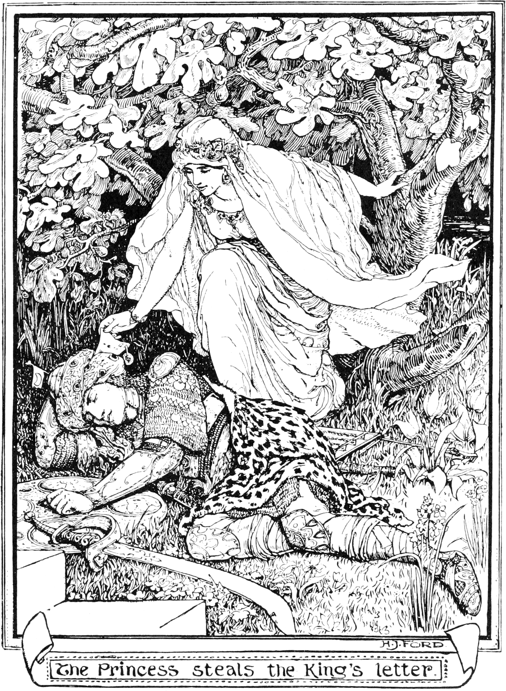

她忽然想起，这个可怜的军官丢了信是要被杀头的，得赶快给他放好，可是谈何容易，而且信在她手中，好像有一把火在心中燃烧，非要她看信中的内容不可。她仔细地察看封条，发现胶水因为天热，已经快化掉了。她轻轻一拉，就把信抽出来。她开始读信，信中写着：“马上秘密处死带来这封信的传令兵！不要问为什么！”

公主吓得面无人色，多么可耻的行为！她想，她决不会让这样漂亮的年轻人去死！可是白纸黑字写得这么清楚，怎么办呢？必须想出个办法来。

为了不被人看见，她偷偷地溜回自己的房间，拿出笔和纸来写上：“立即公开地举行婚礼，把公主嫁给带来这封信的传令兵！不要问为什么！”她小心地把信装进信封，用原来的封条封好。她做得那么仔细，除非是非常注意，谁也不会想到，信已经被拆开过。

她偷偷地回到马洪姆德的身边，这时，他还在熟睡。她轻轻地把信塞回到他的头巾里去。因为激动和害怕，她有点发抖，但终于把信放好了。她匆匆地回到自己的房间，一切都办好了。

午后很久，马洪姆德才醒过来。他看了一下，那封信还在，就走出花园，等待总督接见。他一来到总督面前，就把信从头巾上取下，遵照国王的命令，亲手把它交到总督的手中。

总督读完信，当然也有点吃惊，但是信中明明写着：“不要问为什么！”他知道怎样来执行命令。他把妻子叫来，告诉她去把公主打扮一下，准备结婚。

“胡说！”他妻子说，“光天化日的，你在说些什么？”

“这是国王的命令。”他回答，“照我的话去做。信中说，‘立即’，‘不要问为什么！’所以，今天晚上就必须举行婚礼！”

不论他的妻子怎么反对，毫无用处。她越是争辩，丈夫的决心就越大。“我懂得应该怎样执行国王的命令，”他说，“这个命令非常清楚，就像鼻子长在我脸上一样！”

于是，他们把公主叫来，令他们觉得有点奇怪的是，公主听到这个消息好像非常镇静。他们又通知了马洪姆德，他可是大吃一惊。当然，国王给他连做梦也不敢想的这么大的荣誉，他真是喜出望外。

消息公布以后，整个城堡都沸腾起来。人们奔走相告，都忙着为公主的婚礼操劳起来。老总督表情严峻地走来走去，嘴里不时说着些什么“执行命令”的话。

婚礼当天晚上就举行。城堡里，还有兵营里同时举行盛大的宴会。整个城市，还有那美丽的大花园，都被灯火照耀得如同白昼。老百姓都说，从来没有见过这样壮观的场面，他们一直到老还在说着公主和一个士兵的隆重婚礼。

第二天，总督派出一支威武雄壮的骑兵队伍，护送公主和新郎回王宫去见国王。在他们出发之前，他写了一封信叫一个传令兵先带去，汇报他执行命令，给公主举行婚礼的隆重情景。

国王读了总督的那封信，脸涨红得像猪肝似的，周围的人都以为他身体不好，要中风了，紧张地看着他。只见国王一言不发地冲出去，回到自己的房间，把门关起来，气得暴跳如雷地破口大骂起来，直到累得跳不动，也骂不动了。

过了一会，他冷静下来想了一想，觉得还是承认事实为妙。特别是老总督很聪明，派人把那封信也带回来了。国王非常清楚，这是公主亲手写的信。国王非常爱他的女儿，她虽然干了一件蠢事，他当然也不会因此而把她杀掉。他也不愿意让老百姓知道真相，那样人们都会说，他是一个傻瓜。他越想，越觉得聪明的方法是，以欢迎的态度来对待事实，让人们认为，是他自己促成了这门亲事。

当这对年轻的夫妇到达王宫时，国王以隆重的仪式来欢迎他们，还划出一个省份来让女婿去当总督。马洪姆德不久就证明了，他不仅是一个勇敢的士兵，而且是一个好总督。

后来，老国王死了以后，马洪姆德接替了他的位置，当上了国王，成功地统治着这个国家，人民过着幸福的生活。

马洪姆德的养母在儿子的王宫里活了很久才安静地去世。公主虽然用欺骗的手段得到丈夫，可是她觉得不能再骗他了，她尽职地教育他们的子女，管理着王宫和那些仆人。

至于那个老隐士，再也没有人看见他。可是那山洞还在，直到今天，山洞前还铺着厚厚的树叶。

（印度民间传说）

 

## 老实人瓦利的故事

从前，有一个穷苦的老人叫瓦利，他孤身一人，没有任何亲戚，住在远离城镇的一间矮小的土房子里。他每天到丛林里去割草，卖给人家当马料，以此来过日子。一天下来，他只能挣得五个半便士硬币。不过，他是一个简朴的人，除了买一些必要的食品和衣服以外，每天还能存下半便士。

瓦利这样过了许多年。有一天晚上，他想数一数藏在那个大土罐里的钱。那土罐就埋在房子里的地下。他费了好大的劲，才把大罐子挖出来。他把罐子里的硬币倒出来，吃惊地看到，它们堆积得像小山一样。

这么多钱怎么花呢？他想。他决不会想到花在自己身上，因为他对自己的生活非常满意，打算就这样过一辈子，他从来不想过得更舒适、更奢侈些。

后来，他把钱装进一个口袋，把它推到床底下去，拿起那条破旧的毯子裹住身体，就睡觉了。

第二天一早，他背着那口袋钱来到城里的一家珠宝店，用钱买了一只漂亮的金手镯。他用腰布小心地把金手镯包好，就来到一个有钱的朋友家。这个朋友是个商人，他经常带着商品，赶着骆驼到许多国家去做生意。瓦利很幸运，这一天他正好在家里。他们坐下来聊了一会以后，瓦利问他，他所见到过的女子中，哪一个最善良、最美丽？商人说，海斯坦的公主以她的美貌、仁慈和宽容名扬四海。

“那么，”瓦利说，“下一次你到海斯坦去的时候，请把这个小小的金手镯送给她，说是一个把道德看得比金钱更重要的人送给她的，以表示对她的尊敬。”说完，他从腰布里拿出金手镯，把它交给商人。商人当然非常吃惊，不过没有说什么，也不反对和拒绝他的请求。

过了不久，商人终于因为做生意来到了海斯坦的首都。他一有机会就来到王宫，把手镯送给公主。他还特地自己花钱买了一个香盒子把它装起来，还把瓦利那些祝福的话传给公主。

公主想象不出，谁会送给她这个礼物。不过，她让仆人转告商人，当他做完生意回来的时候，会给他答复。

几天以来，商人又回到城里。公主送给他一袋贵重的丝作为回送的礼物，还送给商人一些钱。商人带着这些礼物就回家了。

几个月以后，商人做完生意回到家乡。他用骆驼驮着那袋贵重的丝，来到瓦利的家。看到这么一袋贵重的东西从骆驼背上卸下，老实人茫然不知所措，这么值钱的东西怎么处理呢？他想了很久，最后想出一个办法。他请商人告诉他，是否有哪一位王子用得上这一袋值钱的丝。

“当然有，”商人兴致勃勃地回答，“从德里到巴格达，从君士坦丁堡到勒克瑙，那些王子我都认识。不过，他们之中没有一个比得上内克巴，他既富有，又豪侠。”

“那么好吧！请把这些丝送给他，并带去一个老人的祝福。”瓦利说，处理掉这些贵重的丝以后，他觉得很安心。

于是，商人再次到内克巴王子那个城市去做生意时，就把这些丝带上，并请求会见内克巴王子。他把这些华丽的丝交给内克巴王子，请求他接受瓦利因为他的伟大和富有而送给他的礼物。送礼人的慷慨使王子大为感动，他命令挑选十二匹最好的马作为回送的礼物，他们这个国家的马非常出名。至于商人，王子也给了他一笔丰厚的报酬。

像上次一样，商人做完了生意回到家乡。第二天，他赶着十二匹马来到瓦利的家。老人很远就看到许多马向这边赶过来，他自言自语地说：“我的运气来了！一下子来了这么多马，它们肯定要吃很多草，我用不着把草拉到市场去，在这里就可以卖掉！”

他赶紧跑出去割草，能割多快就割多快，到快要背不动的时候才回来。回到家以后，才知道这些马都是他的，他很不自在，不知道怎么处理这些马才好。他想了一会，想出一个好主意，他把两匹马送给商人，其余的马请他送给海斯坦的公主，她当然最有资格做这些好马的主人。商人笑着答应了。

应好朋友的请求，他再次来到海斯坦时，安全地把这些马带来送给公主。这一次，公主派人把他叫去，问他关于送礼人的情况。通常，商人也是一个非常忠实的人，不过这一次，他不想告诉公主真实情况，说什么瓦利是一个每天只有五个半便士收入的老人，穷得几乎衣不遮体。他只是对公主说，他的朋友早就听说你的美丽和善良，渴望把他最好的东西都送给你。

公主找来她的父亲一起商量，请他指教，如何有礼貌地回报这个坚持给她送礼物的人。

“好吧！”国王说，“你不能拒绝他的礼物。最好的办法是，马上送给这个不认识的朋友一份非常贵重和豪华的礼物，叫他再也送不出比这更名贵的礼品。那样，他就会觉得自卑而不再送礼物来了。”

国王下令每一匹马送还两头驮着白银的骡子，作为公主回送的礼物。

几个小时以后，商人发现自己率领着一支壮观的马队起程。他雇佣了一批保镖，以防止在路上遭到强盗的抢劫。

不久，他就高高兴兴地回到瓦利的家。

“现在好了，”看到堆在家门口的这么多财富，瓦利说，“好心的王子送给我那么多好马，我可以回报他了。你花费了许多力气，要是你肯接受六头骡子和它们驮的银子，把其余的骡子和银子送到内克巴王子那里去，我会打心底里感激你的。”

商人觉得自己的劳动得到了丰厚的报酬，而且非常好奇地想知道，事情的结果会怎样，所以就高兴地答应了。他尽快地做好准备，就带着这些珍贵的，送给内克巴王子的新礼物出发了。

这一回，王子也觉得有点窘迫，他仔细地询问商人关于送礼人的情况。商人觉得，自己是在拿自己的声誉来做赌注，心中暗暗下决心，这个玩笑不能再继续下去了。不过，这一次，他还是在王子面前隐瞒了瓦利的真实情况，把他说得那么好，要是瓦利在场听到了，他真还不知道商人在说谁呢！

像海斯坦的国王一样，内克巴王子也决心送给瓦利一份真正的皇家礼物。这样，也许会叫他再也不敢送什么礼物来了。

他叫人准备了二十匹最好的马，给它们披上镶着黄金的马衣，配上最好的山羊鞣皮马鞍，银做的马勒和马蹬；还有二十头品种最优良的骆驼，这些骆驼跑起来和最好的马一样快，它们跑上一整天也不会觉得累；最后还有二十头大象，配上最华丽的银制象轿，象轿上铺盖着镶着珠宝的丝绸。

为了保卫这些驮满黄金和珠宝的动物，商人雇了一支小部队，他们在路上行走的时候，非常威风。

瓦利很远就看到大路上金光闪闪，尘土飞扬，知道是一支大马队过来了，他自言自语地说：“啊！真主！一支雄壮的队伍过来了，还有大象呢！今天的草要卖好价钱了。”他赶紧带着镰刀，到丛林里去割草。等回来的时候，他看到那支大马队就停在他家门口。商人正在门口等他，样子有点焦急。商人把情况告诉他，祝贺他发了财。

“发财！”瓦利说，“像我这样一只脚已经入土的人，发财有什么用？好吧！还是那个年轻美丽的公主，她最有资格享用这些好东西！你能不能给自己留下两匹马，两头骆驼和两头大象，还有它们的那些装饰，其他的都送给公主？”

商人开始不同意，对瓦利说，他对这种差使，开始觉得有点尴尬。当然，他虽然劳累奔波，也得到了非常丰厚的报酬。只是，如此频繁地来来往往，他觉得有点紧张。最后，他同意再去一次，而且说，决不会再去第二次了。

休息几天以后，商人又率领着马队再次向海斯坦出发。

海斯坦国王看到浩浩荡荡的人马开进王宫大院，非常惊讶，亲自下来问情况。当他知道，这些都是那个像王子一样的瓦利送给公主——他的女儿的礼物时，半晌说不出话来。他赶紧来到女儿的住处，对她说：“我告诉你吧！亲爱的！这个人想和你结婚，这就是他送来那么多礼物的目的！没有别的办法，我们必须亲自去拜访他。他一定有数也数不清的财富，要是他倾心于你，也许嫁给他才是最好的办法！”

公主同意了父亲所说的一切。国王命令准备好大批的大象、骆驼，还有富丽的帐篷、彩旗，给女士们准备轿子，给男士们准备马匹，不得迟误，因为国王和公主将去访问伟大和慷慨的瓦利王子。国王还宣布，由商人来当领队带路。

可怜的商人听到这个消息，心中真是说不出甜酸苦辣，他恨不得立刻就逃跑。可是他被当做是瓦利的代表，受到那么热情的款待，身边总是有仆人跟着，片刻也不得脱身，根本没有机会溜掉。几天以后，他也死心了，想想一切都是命中注定的，想跑也跑不掉。不过，他真心实意地希望命运会出现转机，让他摆脱眼前的困境，他一心一意地往好处想。

到了第七天，在整个城市的锣鼓声和欢呼声中，在喇叭的吹奏下，这支队伍兴高采烈地踏上征途。

他们走了一天又一天，可怜的商人觉得一天比一天难过，好像得了一场大病似的。他几乎天天晚上都睡不着，想着事情怎么会这样，国王将怎样来处罚他，最后会怎样处死他，真是度日如年，天天备受煎熬，好像国王对他的惩罚已经在执行似的。

离瓦利的小土屋只有一天的路程了，国王命令就地扎营，派商人去通知瓦利，说是海斯坦的国王和公主要来拜访他。

商人来到瓦利的家，看到可怜的老人正在吃干面包片和洋葱当晚饭。商人把事情的前前后后告诉他，说国王和公主即将来临。他本来还想责备老人几句，可是话没出口就停住了。因为这时候，老人已经在为给自己，给朋友，还有给公主的名誉带来的羞愧痛苦万分。他一边扯着自己的胡子，一边号啕大哭。他泪流满面，悲切地恳求商人，不论如何要想办法找个借口拖延一天，到明天早晨再想办法，看看怎么办才好。

商人走了以后，瓦利决定，只有一个像样的办法，可以把大家从自己的愚蠢造成的耻辱和烦恼中解脱出来，那就是去死。

半夜的时候，他一个人走出来，也不去征求任何人的意见，独自来到一个很高的悬崖上，下面是一条奔腾的大河，他决心从这里跳下去，结束自己的生命。

他向前跑了几步，就在只差最后一步的时候，黑暗的峡谷像一个可怕的怪兽，把他吓住了。这时候，天空一片漆黑，下面什么也看不见，汹涌的河水撞击巨大的岩石的轰鸣声，却是非常清楚。瓦利对这块地方非常熟悉，现在虽然是三更半夜，什么都模糊不清，可是那情景让老人觉得更加恐怖，更加凄惨。悬崖上的丛林和野草怪物似地舞蹈着，隐约可见，像是在向他招手。一只猫头鹰突然在他耳边“呼！呼！”地大叫起来。老人吓得出了一身冷汗，连连向后退。他实在受不了，再也没有勇气走向深渊。痛苦和害怕折磨着他，他浑身颤抖着，用双手掩住脸，大声地哭泣起来。

这时候，他突然觉得有一束柔和的光照在自己的身上。黎明不该这么快就来揭露他的耻辱吧！他把手拿下来，张开眼睛，看到两个可爱的人站在他的面前。他一眼就能看出，她们不是普通的凡人，而是来自天堂的仙女！

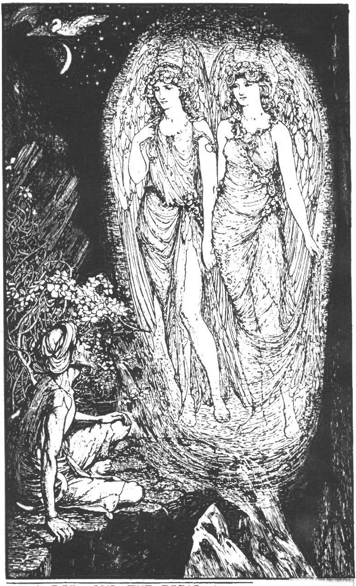

“你为什么哭？老人！”一个仙女用像夜莺那样动听，像音乐那样美妙的声音问。

“我为羞愧而哭！”他回答。

“你到这里来干什么？”另一个仙女问。

“我到这里来找死。”瓦利说。

在仙子们的询问下，他把事情从头到尾说了一遍。

第一个仙女走上来，把手放在老人的肩上。老人觉得有点诧异，但到底发生了什么事情，他一时也说不出来。这时候，他那破烂的布衣服变成了漂亮的锦绣服装，赤裸的双脚穿上了柔软而温暖的鞋子，头上裹着钻石头巾，颈上挂着一根很粗的金项链，连挂在腰间用来割草的镰刀，也变成了一把银光闪闪的弯刀，刀柄上的钻石像月光下的雪一样闪着青光。

瓦利看到了这一切，他惊奇地站起来，好像在做梦一样。另一个仙女向他挥挥手，叫他转过头去看！

啊！在他面前出现了一扇打开着的很有气魄的大门。在仙女的带领下，他梦幻般地走了进去。一条两边长满高大的梧桐树的大道一直通到他家门口。他那破烂不堪的土房子不见了，取而代之的是一座豪华的宫殿，灯火把它照耀得金碧辉煌。宫殿的门廊和走廊里，到处可见忙忙碌碌的佣人，卫兵不停地走来走去，看到瓦利都立正敬礼！宫殿周围的草地和花园里，到处是鸟语花香，喷泉在空中飞舞着。瓦利不知所措地站在那里，呆若木鸡。

“别害怕，”一个仙女说，“到你自己家里去，这是赐给老实人的。”说完这些话，两个仙女不见了。

瓦利继续向前走着，他还是难以相信这一切会是真的。他来到一间比想象中的还要豪华许多的房间，坐下来休息，连做梦也想不到会是这样。

第二天一早，他醒过来。如果说，昨天他看到的一切都是在夜间，难以置信。那么现在，在阳光照射下，宫殿、仆人，还有他自己，一切都实实在在地存在，不是在梦中！

瓦利被周围的一切弄得目瞪口呆，天亮以后急匆匆地赶过来的商人更是不知所措。他告诉瓦利，昨天晚上他整夜没合过眼，天一亮就赶紧跑过来。可真是叫他好找啊！一夜之间，荒芜的山村和丛林变成了宫殿和花园。要不是瓦利的一些仆人发现他，把他带进来，他肯定会以为，自己是因为这些麻烦事神经错乱，看到什么幻影了，而且肯定被吓跑。

瓦利把昨天晚上发生的事情对商人说了。在商人的建议下，他向海斯坦国王和公主发出请他们来做客的邀请。此外，还邀请和他们一起来的所有随从和仆人，包括地位最卑贱的人。

欢迎皇室客人的盛大宴会一直举行了三天三夜。每天晚上，招待国王和高官用的都是金盘和金杯，其他人用的是银盘和银杯。客人们还被告知，他们可以留下这些金盘金杯和银盘银杯，以做纪念。一切都是那么豪华富丽，连那些出身高贵的客人也没有见过。除了盛宴以外，还有打猎、运动、跳舞等各式各样的娱乐来招待贵宾。

到了第四天，海斯坦国王把主人叫到一边，问事情是否像他想象的那样，主人想和他的女儿结婚？瓦利对国王这样抬举自己表示万分感谢之后说，他做梦也不敢想这么大的荣誉，而且自己也太老太丑了，配不上这么美好的公主。不过，他请求国王再住一些日子，等他把内克巴王子请来。这位王子那么年轻，那么英俊，那么勇敢，品格那么崇高，他一定会很愿意向美丽的公主求婚。

国王同意了，瓦利派商人带着一些随从和贵重的礼物，到内克巴王子那里去。王子答应了，而且立刻动身。王子和公主一见钟情，婚礼就在瓦利的宫殿里举行，到处充满了欢乐的笑声。

海斯坦国王，还有内克巴王子和公主都回到了自己的国家。瓦利活到很大岁数，尽管他非常富有，他还是像以前割草的时候那样，那么老实和善良，乐意帮助一切遇到困难和不幸的人。

（印度民间传说）

 

## 乌龟和淘气的猴子

曾经有过一块土地，那里有非常宽阔的河流，非常茂密的森林，任何地方也比不上。那里渺无人迹，是野生动物的天下，它们常常在一起玩各种奇怪的游戏。地上开满红色和黄色的鲜花，高大的树木一棵连着一棵，猴子最喜欢躲藏起来，等狮子或大象经过，突然跳到它们的背上，骑上一段路程，心满意足以后，再抓住树枝或藤爬上树。在河流的旁边，可以看到许多大乌龟，虽然表面看来，乌龟又笨又慢，可是一旦看到它们是如何聪明，那些比它们更活泼，更机灵的朋友也会上它们的当，你就会觉得很奇怪。

有一只乌龟特别引人注目，它总是千方百计，处处占人家便宜。森林中流传着许多关于它的那些了不起的事情。当它还很年轻的时候，它就对和父母一起呆在家里感到厌烦。有一天，它离家出走，出去冒险。在大森林的一片空地里，它看到一头大象在吃晚饭，大象吃完晚饭以后准备到附近的河里去洗澡。

“让我们来比比看，谁的力气更大！”乌龟走过来对大象说。

“那好啊！”大象说，这个小动物会如此傲慢，它觉得很惊讶，“比赛什么时候开始？”

“再等一会吧！我还有点事情要去办。”乌龟回答。说完，它就急急忙忙地走了，四条短短的腿能跑多快，它就跑多快。

在大河的河湾里，一条大鲸鱼正在游玩，它把河水向高空射去，多像美丽的喷泉。乌龟年纪还轻，没见过世面，它也很忙，所以无心去欣赏这么好的景色。

“你想和我比比看，谁的力气更大吗？”乌龟对鲸鱼说。

鲸鱼朝它看了一眼，又把一股水喷向空中，说：“好啊！当然可以，你想什么时候开始，我随时奉陪。”

“那好，把你最长的一根刺给我，我绑在自己的脚上，等我一发信号，你就用力拉，看看谁的力气最大。”

“太好了！”鲸鱼说，它把自己最长的一根刺递给乌龟。

乌龟用嘴咬住它的刺，来到大象旁，对大象说：“我把一头绑在你脚上，另一头绑在我脚上。等我叫开始，大家就开始用力拉，到时候就看得出，谁的力气最大。”

一切都准备好以后，它大喊一声：“开始！”就逃到树丛里去看动静。

鲸鱼拉住刺的这一头，大象拉住另一头，它们谁都没有想到，自己的对手不是乌龟。鲸鱼拼命地拉的时候，大象被拖入水中；大象拼命地拉的时候，鲸鱼被拖到岸边。它们势均力敌，比赛非常紧张、激烈。

后来，双方都精疲力尽，躲在一旁观看的乌龟看到差不多了，不能再继续下去了，就跳出来叫停。它跑到河里把自己浸湿，然后上岸来对大象说：“我看到了，你比我想象中的强大得多了。今天的比赛是不是到此结束？”说完，它在草地上把自己的身体弄干，跑过来对鲸鱼说：“我看到了，你比我想象中的强大得多，今天的比赛是不是到此结束。”

两个对手当然都非常赞成停止比赛。它们经过这次比赛以后，到死还以为乌龟的力气比自己大。

一两天以后，乌龟在外面徘徊；遇见一只狐狸。它停下来，满不在乎地对狐狸说：“让我们来比试比试看，谁能够埋在地下过七年。”

“我很高兴，”狐狸说，“不过你要先开始。”

“这对我来说，都一样。”乌龟回答，“明天你到这里来就会看到，我已经开始了！”

乌龟开始寻找合适的地方，它在一棵桔子树下找到了一个很合适的洞，就爬进去。第二天早晨，狐狸找到它，在洞的旁边走来走去，答应每天给它带一些新鲜的水果来。

狐狸每天早上太阳升起的时候，都来看看乌龟，问它过得怎么样？

“啊！非常好！不过，我希望你能带些水果来。”它说。

“嗯！可是水果还没有熟，不能吃。”狐狸回答，它希望，乌龟等不到七年就会饿死。

“啊！亲爱的！亲爱的！我饿坏了！”乌龟嚷着。

“我想，你肯定会觉得饿的。不过，到明天就好了。”狐狸说着，慢慢地走开。可是，它没有想到，每天，桔子树上都有桔子掉下来，正好落在乌龟的洞里。这些桔子给它吃，足足有余。

所以，七年过去以后，乌龟从洞里爬出来，还是像以前那样肥。

现在轮到狐狸了。它也挑选了一个洞钻进去。乌龟用土把洞的周围封起来，答应每隔一两天来看它一次，还要带一只小鸟来给它吃。

“你好啊！日子过得怎么样？”乌龟每次来的时候，总是兴高采烈地问。

“嗯！很好！不过，我希望你能带着小鸟一起来。”狐狸说。

“我今天很不走运，一只小鸟也抓不到。”乌龟说，“不过，我敢肯定，明天的运气一定很好。”

可是，还没有过多少的明天，乌龟来到狐狸的面前，问它老问题“日子过得怎么样？”时，它没有得到回答，狐狸躺在那里一动也不动，已经饿死了。

后来，小乌龟长大了，在森林里很有名气，大家都以为它最有力气，最聪明，都有点怕它。可是，也有许多动物认为，它也有短处，那就是跑得不快。直到后来，它和鹿进行一次赛跑赌博，大家才刮目相看。

这一天，乌龟在懒洋洋地晒着太阳，一只牡鹿从旁边经过，停下来和它聊天，聊了一会以后，乌龟说：“我们来比比看，看谁跑得快好吗？”

牡鹿觉得乌龟提这个建议太傻了，简直不屑一顾，它不说话，只是耸耸肩膀。

“当然，胜利者有权杀掉失败者。”乌龟见它不做声，补充说。

“喔！既然这样，我同意！”牡鹿说。“恐怕这么一来，你就死定了。”

“别来吓唬我，我从来不怕这一套。”乌龟说，“我需要有三天的时间来训练。到第四天，当阳光照到那棵大树梢的时候，比赛就开始。”

乌龟做的第一件事，就是把它的亲兄弟和表兄弟全部找来，把它们安排在比赛路线上，一个挨着一个，直到终点。

到了第四天，牡鹿非常准时地来到赛场。太阳从东方升起，放射出它的第一道光芒。比赛开始，牡鹿撒开四蹄，一下子就把乌龟远远地抛在后面。等自以为看不到乌龟以后，它洋洋得意地回头喊道：“你怎么样了？”离它最近的乌龟立刻回答：“很好！我正在追上来！”

牡鹿一听声音离它那么近，觉得不妙，赶紧加快步伐。过了一会，又回过头来问：“你还在吗？”得到的回答是：“当然，我在紧跟着你！”

这样跑了一段又一段，牡鹿越跑越快，越跑越拼命。可每次回过头来问时，乌龟总是紧跟在后面。牡鹿越想越觉得奇怪，越想越觉得害怕，最后累得跑不动，倒在地上死了。

乌龟不费吹灰之力就赢了，后来每想起这件事，它还笑个不停。

森林里，不仅仅是这只乌龟因为会耍花招而出名，还有一只大名鼎鼎的猴子，它像乌龟一样聪明，可是比乌龟还要捣蛋。它的手脚非常敏捷，谁也抓不到它，叫它因为自己的恶作剧而挨一顿打。那些受它欺负的动物，只能火冒三丈地站在树下，看着它得意地在树上荡秋千，哈哈大笑。有时候，森林里那些气愤的动物也想耍它一下，可结果总是反而吃亏。

有一次，它到理发店去刮胡子，理发师有礼貌地接待它，请它坐下，给它围上一块大白布，在它的下巴擦上肥皂。接着，理发师跟它开了个玩笑，拿起剃刀不去刮它的胡子，而是在它的尾巴上割下一块皮。其实，这对猴子来说，算不了什么，它却暴跳如雷，大声喊叫：“还我的尾巴！否则，我就把你的剃刀拿走！”理发师不肯把那一小丁皮还给它，它拿起剃刀就走。一连好多天，森林里的动物都不能刮胡子，因为要到很远很远的地方才能买到剃刀。

猴子回到自己的棕榈树住处，那里长着许多椰子树，它常常向过路人扔椰子取乐。这一天，它看到一个妇女在用木片刮鱼鳞。森林的这一边有一条小河，河边有一些农舍，住着一些人。

“这些鱼鳞很难刮吧！”猴子停下来看热闹，说，“用我这把剃刀试试看，一定会快一些。”它把剃刀递给了那妇女。

几天以后，它来到那女人的家门口敲门，说它来讨回那把剃刀。那女人开门出来，说把剃刀丢了。

“你要是不把剃刀还我，我就把你的沙丁鱼拿走。”猴子不相信她的话。那女人又说没有借过它的剃刀，猴子拿起沙丁鱼就跑了。

走了没多远，它看到面包师傅站在家门口，吃着自己做的面包。猴子说：“你一定觉得很干吧！试试我的鱼。”面包师傅用不着它请第二次，就把鱼吃了。

几天以后，猴子来找面包师，说：“我来要回我的鱼。”

“你的鱼？可是我已经把它吃掉了！”面包师狼狈地说。

“好吧！要是你把鱼吃了，我就拿这桶面粉作为交换。”猴子说着，拿起一桶面粉就走。

走着，走着，它看到前面有许多小姑娘围成一个圆圈，当中有一个妇女，正在教她们怎样梳理和化装头发。它走过去对那妇女说：“这是给孩子们做饼吃的。”它把那桶面粉放下，觉得这桶面粉太重了。

那些孩子都非常高兴，她们找来许多光的石头，开始烘饼吃，觉得从来没有吃过这么好吃的饼。过了不久，她们看到猴子又走过来，都向它跑过去，希望它带来更好的礼物。

可是，猴子根本没有心思去听这些小姑娘们说些什么。它只是对她们的母亲说：“我是来讨回那桶面粉的。”

“什么！你不是说给我们做饼吃吗？”母亲说。

“要是不还给我那桶面粉，我就带走你的一个孩子。”猴子说，“我吃水果吃腻了，要找个人来给我烤面包，还要会做椰子饼。”

“不！把我的孩子留下，我给你另找一桶面粉。”母亲哭着说。

“别的面粉我不要，我只要原来那一桶。”猴子严厉地说。它看中了一个最漂亮的女孩，拉着她回到自己的家。

小姑娘从此不再回家。不过，她往后的日子也不见得过得很苦。因为那些猴子和小孩差不多，都很爱玩。它们教她爬树，荡秋千，从这棵树跳到那棵树，总而言之，把自己的好多本事都教给她。

猴子玩弄这些令人厌恶的诡计，给自己在森林里招来了许多仇敌，其中最恨它的，要数一头美洲狮。至于它们是怎么会吵到这种程度的，只有它们自己明白。森林里所有的动物都知道，它们是不共戴天的敌人，只要是它们两个有可能碰头的地方，那些动物都躲得远远的。

美洲狮一次又一次地给猴子设下圈套，而且总是想，这一次猴子逃不掉了。猴子总是装做要上当的样子，向美洲狮设下的圈套走去。躲在一旁观望的美洲狮好不高兴！可是不一会，猴子就会得意地咯咯笑出声了，向美洲狮做个鬼脸就从树丛中逃走了。美洲狮气得咬牙切齿，猛扑过来，但总是差一步。

这种形势维持了好久。后来森林里的气候出现异常，这种异常的季节，连森林里年纪最大的鹦鹉也没有见过。在这个季节里，通常总要下两三百英寸的雨量，森林里的动物也早已习以为常。可是这一年，一个月又一个月地过去了，天上总是一片云彩也没有。河里的水干了，泉水也没有了，只有一个小池塘里有点水，所有的动物要喝水都得上这里来。大家都为这种恶劣的环境感到忧愁和悲伤，只有美洲狮和别人的想法不一样。几年来，它只有一件心事，那就是把猴子捏在自己的手中。这一次，它想机会到了。它要躲藏在池塘旁边的密林中，猴子肯定要到这里来喝水！等它一来，嗨！美洲狮就跳出来把它抓住，这回它无论如何逃不掉了。

美洲狮要是更耐心一点，它的计划就一定会实现。可惜它太激动，太性急了，猴子来喝水的时候，它兴奋得过早地动了一下，正在弯腰喝水的猴子听到丛林里有声音，回过头来，看到一双杀气腾腾的黄眼睛就在它面前，这一惊非同小可。幸好它眼疾手快，纵身一跃，抓住头顶上的一根藤，闪电般地攀上一棵大树。这时候，扑过来的美洲狮气喘吁吁的声音也听得见。猴子离死亡从来没有这么近过，这一次把它吓得丧魂落魄，好久不敢从树上下来。

猴子呆在树上，冥思苦索怎样才能摆脱美洲狮的圈套。后来终于有了机会，它从树上看到有人走过来，头上顶着一葫芦蜂蜜。它就挂在那棵树上，等那人走过去，神不知鬼不觉地把他的葫芦拿走。那人不会爬树，只好眼瞪瞪地看着它把蜂蜜抢走。

猴子把蜂蜜涂在自己身上，然后采下许多树叶贴满全身，走起路来，就像一棵活动的树。打扮好以后，它就来到池塘边，看看效果如何，结果非常满意，猴子又开始新的冒险。

不久，消息传遍了整个森林，说是不知道从什么地方来了一个新的动物。有人问过这个奇怪动物的名字，它说叫什么“绿色的杰克。”

因为大家都以为它是新来的，所以猴子又开始自由自在地到池塘边去饮水。不论是野兽还是飞禽，谁都丝毫想不到，它就是那只大名鼎鼎的猴子。要是有谁问它什么奇怪的问题，它总是说，它喝水喝得太急了，所以头发和身上的毛都变成了绿色的树叶。那些动物也因此而明白，太贪婪会有什么结果。

雨终于来了，河水又在小溪里和大河里奔流。猴子到处都可以找到水喝，不必到小池塘去了，那里离它的仇敌——美洲狮的家太近。它也不必再化装下去了，所以在一天夜里，当森林里一切都安静下来，连爱唠叨的鹦鹉也站在一只脚上睡着以后，猴子悄悄地到河里，把身上的叶子和蜂蜜都洗掉，又恢复了原来的面貌。在回家吃早饭的路上，它碰到了一只兔子，就停下来和兔子说话。

“我觉得很沉闷，”猴子说，“我想，去打一会儿猎会快活些，你以为如何？”

“嗬！我非常乐意！”兔子回答，能够和大动物说话，它觉得很自豪，“可问题是，我们猎什么呢？”

“打到一头象或一只老虎没有什么了不起。”猴子用手摸着下巴，故弄玄虚地说，“它们个子那么大，不可能逃得掉。要是抓到那些能在树叶下面藏起来的小东西，才说明你真有本事呢！让我告诉你猎什么吧！我去猎蝴蝶；你呢，去抓一条蛇。”

兔子还年轻，又没有经验，它觉得这个主意很好，于是就分头去干了。

猴子悄悄地爬上附近的一棵树，在树上安闲地吃了一天果子；兔子却整天忙着在地下的叶子堆里找蛇，累得要死。幸好那天外面一条蛇也没有，它们都聚集在一起开会，要不兔子就倒霉了，没有一条蛇是不喜欢把兔子当美餐的。

兔子找着找着，累得倒在树叶堆里睡着了。后来被猴子看到，跳下来揪它的耳朵，兔子痛得非常生气，发誓要报仇。

要想找到猴子不防备的时候，可真不容易。兔子等了很久，机会终于来了。这一天，“绿色的杰克”正坐在一块石头上，想着现在应该去玩什么，兔子偷偷地从它背后走过来，抓住它的尾巴用力一拉。猴子痛得“哇！”的一声叫出来，慌慌张张地跳到树上去。等它定下神来，看到一只兔子竟敢这样来侮辱它，不禁怒火万丈，破口大骂，那样子非常可怕。兔子吓得赶快躲到最近的树洞里去，在洞里呆了好几天，不敢出来。

和兔子吵了一架以后，猴子来到森林另一边的村庄。这里有一个美丽的花园，里面种着许多桔子树，树上挂满了熟透的桔子。所有的鸟都喜欢吃这个园子里的桔子。主人为了吓跑那些鸟，免得它们把桔子都吃光，就在一棵树上放着一个蜡做成的蜡人。

猴子像鸟一样，也很喜欢吃桔子。它看到那棵长着最大最甜的桔子树上，站着一个人，就没好气地对他喊叫：“喂！人！把那个大桔子扔过来，要不我就给你扔石头。”

那蜡人不理睬它。猴子本来就很容易生气，这回它拿起一块石头，对准那人用尽全力扔过去。石头碰到蜡人，没有掉下来，粘在蜡人上了。

一阵风吹过来，把猴子垂涎三尺的那个桔子刮到地下。它捡起来吃个痛快，连皮也一起吃掉。那么好吃，它还想再来一个。于是，它又对着蜡人喊叫，叫他再扔一个桔子下来。蜡人没有动，它又向他扔了一块石头。这块石头也像第一块一样，粘在蜡人上了。

猴子看到他对石头一点也不在乎，更加生气了。它以最快的速度爬上树，对准他狠狠地踢了一脚。可是，像那两块石头一样，它的脚被蜡粘住了。

“松开我，让我走！否则我还要踢你一脚！”它喊叫着，另一只脚用尽全力又踢了他一下。这只脚又被蜡人粘住了。猴子还是不明白怎么回事，脚不能动了就用手，先是右手一拳，再是左手一拳。这一回，它的手和脚全都被困住了。猴子又气，又恨，又害怕，它拼命地挣扎，和蜡人一起摔到地下，这一回它总算是挣脱了。不幸的是，它摔在一块荆棘地里，不但摔伤了，而且扎伤了，浑身青一块，紫一块。它瘸着脚，大声哭喊着走了。猴子受伤的时候，总是忍不住要大喊大叫，让人人都知道。

过了好久，猴子的伤才好了。可是不久，它又碰上老对手美洲狮了。事情是这样的。

有一天，美洲狮邀请它的朋友牡鹿，一起去看一个朋友，这个朋友是养奶牛的，他的牛奶非常有名。牡鹿爱喝牛奶，很高兴地接受狮子的邀请。

过了晌午不久，它们就开始出发了。它们来到一条河旁边，河水挡住了去路。那时候还没有桥，要想过河就得游过去。牡鹿害怕游泳，它说觉得累了，而且走这么远的路去喝牛奶不值得，想回家了。美洲狮一眼就看穿了，它为什么这样说，开始笑它。

“河水一点也不深，”美洲狮说，“涉水就能走过去，来吧！鼓起你的勇气，跟我走。”

牡鹿怕过河，可是更害怕别人取笑它。它跟着美洲狮跳下去。它一下子就被河水冲走，幸好河水把它冲到对岸的浅滩上，它慌慌张张地站起来，爬上岸。要不是碰巧这样，它肯定被淹死了。牡鹿吓得浑身发抖，战战兢兢地向等着它的美洲狮走去，狮子说：“你只差一点就被淹死！”

它们休息了几分钟，让牡鹿缓过气来，又继续往前走，来到了香蕉林。

“这些香蕉看上去好极了。”美洲狮凝视着香蕉树说，“我想，你肯定饿了吧？我的朋友牡鹿！你是不是可以爬上去摘一些下来，你把那些绿的吃了，它们是最好最甜的。把那些黄的扔下来给我。”

牡鹿照它的话去做了。当然很不容易，因为鹿不善于爬树，爬起来很吃力，脚很痛，而且两只角总是被卡住。更糟糕的是，它尝了一口香蕉以后，觉得一点也不好吃。它把摘下的香蕉全部扔下来，不管是绿的，还是黄的，让美洲狮自己去挑选。美洲狮可是吃得津津有味，非常满意，吃饱以后，它们又出发了。

它们经过一块玉米地，看到几个农民正在地里耕作。美洲狮轻声地对牡鹿说：“走上前去，朋友，对他们说‘所有的农民都要倒霉！’”

牡鹿听它的话，走过去对农民说了。那些农民干了许多活，觉得又热又累，不喜欢有人和他们开这种玩笑，他们放出自己的狗来咬牡鹿，牡鹿吓得拼命地奔逃。

“祝你们的劳动得到应有的报酬！”美洲狮走过来说。那些农民听了很高兴，送给它一些玉米吃。

走着，走着，美洲狮看到一条皮很漂亮的小蛇躺在一棵树下，卷成一个漂亮的环。“这个环多好看啊！牡鹿朋友，带给你女儿做手镯一定很合适！”美洲狮说。

牡鹿走过去，弯下腰想把它捡起来，被蛇咬了一口。它转过脸来生气地问美洲狮：“你为什么不告诉我，它会咬人？”

“假如你是一个白痴，这能怪我吗？”美洲狮回答。

后来，它们终于来到了目的地。这时候天已经黑了，美洲狮的朋友已经准备睡了，所以，它们在方便的地方支起吊床，也准备睡觉。

半夜里，美洲狮偷偷地爬起来，来到羊圈，把能找到的那只最肥的羊杀了吃掉，还用碗来盛好满满一碗羊血，回来把它全部泼在睡着了的牡鹿身上，然后回到自己床上睡觉。

第二天一早，牧羊人像往常一样，到羊圈里去，想把羊赶出去放牧，发现少了一只羊。他马上想到是美洲狮，就跑过来责骂它，不该把羊吃掉。美洲狮说：“是我吗？我的好人！你怎么会想到，是我把羊吃了呢？你能在我身上找到一滴血吗？要是有谁把羊吃了，那肯定是我的朋友牡鹿。”

牧羊人转过身来看还没睡醒的牡鹿，当然，他发现，它浑身是血。“好啊！我叫你再去偷！”他抓起一根棍，对准它的头狠狠地打去，牡鹿一下子就送命了。

响声吵醒了在楼上睡觉的美洲狮的朋友，他走下楼来。美洲狮高兴地向他问候，请他快点给它喝那香甜的牛奶。说它快渴死了，那人给它拿来一大桶牛奶，它一口气就喝干了，一滴也不留，然后就走了。

在回来的路上，美洲狮碰见猴子，问：“你想喝牛奶吗？我知道有个地方，那里有好牛奶，你要是想喝的话，我领你去。”

猴子知道，美洲狮不会无缘无故对它这么好，不过它觉得很有把握照顾好自己，于是说，非常高兴和美洲狮一起去。

它们很快就来到了那条河边，像上次一样，美洲狮说：“猴子朋友，你会看到，这条河很浅，用不着害怕，跳下去，我跟着你。”

猴子笑起来，说：“你以为是在和牡鹿打交道吗？我宁可走在后面，否则我就不去了。”美洲狮知道，要想说服猴子照自己的话去做是不可能，就挑选较浅的地方游过去。猴子等它到了河中央，就纵身一跳，骑到美洲狮的背上。猴子心中明白，这时候狮子不敢把它摔下来，它只要乱动一下，就会一起被水冲走。这样，它们一起来到了河对岸。

前面不远就是香蕉树林。美洲狮想，猴子迫我背它过河，这回报复的机会到了。它说：“猴子朋友，看到了吗？多好的香蕉！你很喜欢爬树，是不是爬上去，把那些最好吃的绿香蕉吃掉，给我扔一些黄的下来，我就很满意了。”

“很好！”猴子说，它很快就爬上去，把那些黄香蕉吃掉，只把那些绿的扔下来。美洲狮非常生气，喊道：“你真做得出来，我要把你的头咬断！”猴子说。“你要是再这样胡说八道，我就不跟你走了。”美洲狮不再说话了。

过一会，它们来到玉米地，农民正在收割玉米。像上次一样，美洲狮对猴子说：“猴子朋友，你要是想讨好这些人，只要走过去说一声：‘所有的农民都要倒霉。’”

“那很好，”猴子回答。可是，它走过去对农民点点头，微笑着说：“我祝愿你们的辛勤劳动能得到应有的收获！”那些人都衷心地对它表示感谢，让它走过去，美洲狮跟在它后面。

走着，走着，它们看到草地上躺着一条亮晶晶的蛇。“给你女儿当项链多好啊！”美洲狮说，“把它捡起来带走吧！”

“你真是太好了！还是留给你自己吧！”猴子说。关于蛇，它们就不再说什么了。

不久，它们来到了美洲狮朋友的家，发现他已经准备上床睡觉了。于是，客人们也就在吊床上躺下。猴子小心地睡在别人够不着的高处，它想，最好是不要睡着了。它躺下来，故意大声地打呼噜。

天很黑，听不到什么声音以后，美洲狮爬起来到羊圈里去，吃了一头羊，还带回来一碗血，准备泼在猴子的身上。可是猴子一直在注意着它，等它走近的时候，突然朝它踢一脚，那碗血全部泼在美洲狮的身上。

美洲狮觉得不妙，转过身来就想快点逃出这所房子。可就在这个时候，牧羊人走进来了，它赶紧躺下来。

“我又丢了一只羊，这是第二次了。”牧羊人对猴子说，“跟你说吧，这个贼要是给我抓住了，就倒大楣了。”猴子不说话，用手指了指假装睡着了的美洲狮。牧羊人弯下腰来，看到了它身上的血，叫起来：“啊！原来是你！吃我一棍！”他对准美洲狮的头，狠狠地打过去，一下子就把它打死了。

猴子起来后来到牛奶棚，把找到的牛奶都喝光。后来，它就回家结婚了。这是我们听到的，关于这只猴子的最后消息。

 

## 鱼骑士

从前有一个补鞋匠，他辛辛苦苦，废寝忘食地干了大半辈子，还是挣不到足够的钱来买面包和乳酪，让妻子和孩子们吃饱，他和妻子一天比一天地瘦下去。开始，他们还假装说是胃口不好，让对方和孩子们多吃一些。这时候，从外面采来一些黑莓，也会觉得比一碗肉汤好吃。后来有一天，老鞋匠终于受不了了，他扔掉修鞋子的鞋楦头，向邻居借来一根鱼竿，出去钓鱼。

老鞋匠钓鱼的时候，就像补鞋一样地耐心。从拂晓到天黑，他一动也不动地坐在河边。可是钓上来的不是像鳗这种小鱼，就是破鞋子。这些鞋子连他这样高明的补鞋匠，也觉得不值得再补了。他感到越来越不耐烦。有一天晚上，他脱衣服准备睡觉，自言自语地说：“好吧！我明天再试一试，如果再钓不到一条鱼，就把我自己吊死！”

第二天早晨，他放下鱼钓不到十分钟，就从河里钓上一条他从来没有见过的如此漂亮的鱼。当鱼用微小的声音开始说话的时候，他惊奇得几乎掉入水中。

鱼对他说：“把我带回家去煮了，然后切成片，撒上一些胡椒和盐，留两片给你妻子吃，还有两片埋在花园里。”

鞋匠不知道鱼说这些话是什么意思。不过，他比许多人聪明，尽管弄不明白，他想，最好还是照它的话去做。那些天天挨饿的孩子想把所有的鱼片都吃掉，问父亲留着两片干什么？鞋匠只是笑笑，说这不关他们的事。

等孩子们都上床睡觉以后，他悄悄地走出来，把两片鱼埋在花园里。

一年以后，鞋匠的妻子生了一对双胞胎，长得一模一样；花园里也长出了两棵树，树叶非常繁茂。

一年又一年过去了，两个小孩都长大了。他们对无所事事地留在家里，让每个看见他们的人搞错感到厌倦了，决定分手出去冒险。

一个天气晴朗的早晨，两兄弟离开小屋，向大路上走去。来到交叉路口，他们互相拥抱，说好出什么事就到这里来碰头，然后，就分手了。

弟弟朝东边的大路走去，不久就来到一座大城市。他看到人人都站在家门口，绞着手痛苦着。

“出了什么事？”他停下来，看看周围，奇怪地问。

一个男人用颤抖的声音对他说，这里每年都要抽签，选出一个美丽的姑娘，送给一条凶恶可怕的龙，龙还有一个比它更坏的妈妈。今年抽签的结果，轮到他们无与伦比的公主。

“可是公主在哪里呢？”年轻人问道。那人对他说：“她站在一棵树下，离这里有一英里远，在那里等那条龙。”

这时候，鱼骑士（让我们这样来称呼他，以表示对他的尊敬）不再听他说下去了。他全速赶到那棵树下，看到公主在用泪水洗脸，从头到脚都在颤抖着。

她听到了鱼骑士挥动宝剑的声音，把遮住面孔的手帕拿开，对他喊：“快跑！趁现在还有时间，赶快跑吧！别让那个怪兽看见你！”

她口中这么说，心里也是这么想的，但是，当她看到他真的转过身去的时候，觉得自己更加孤独。不过，只过了几分钟，他又回来了。他骑着一匹借来的马，正在奔驰过来，马的身上还驮着一面大镜子。

“我来得正好！”他说，小心地下了马，把镜子搁在树干上。

“把你的面纱给我。”他对公主说。公主把面纱拿下来交给他。他用面纱把镜子遮住。“龙靠近你的时候，你就把面纱拉掉，躲到镜子后面去。不要害怕，我随时都会来救你。”

鱼骑士拉着马，刚在岩石后面找到地方躲藏起来，就听到龙拍打着翅膀的声音。它抬起头来，很高兴地看到公主站在那里，慢慢地向她走过去。公主不动声色地站在镜子前面看着它，看到它靠近镜子，就从背后伸出一只手，把罩着镜子的面纱拉掉，自己转身躲到一棵大树后面去。

公主虽然照骑士的话去做了，可是她还不明白会发生什么事情。龙会不会像小时候保姆给她讲的故事那样，变成一块石头呢？或者是镜子中突然会发出一束强烈的火光来，把龙烧死呢？

两种情形都没有出现。可是，龙看到它的面前站着一个和自己一样强壮的猛兽，既惊讶，又生气。它暴跳如雷地摇摇头，它的对手也不甘示弱，以牙还牙；它转动血红的眼睛，挥动有力的尾巴，对手也以同样的方式回敬它。它气得张开血盆大口，发出震天动地的怒吼，对手的声音也丝毫不比它逊色。龙再也按捺不住了，大叫一声猛扑过去，面前的镜子被撞击成千百块碎片，而每一块碎片都照出它身体的一部分，龙以为自己已经被粉身碎骨。

这时候，早就站在一旁等待着的骑士看到时机已到，不等龙搞清楚是怎么回事，在龙明白自己一点也没有受伤之前，挥动长矛对准它的咽喉刺去，龙在草地上滚了几下就没气了。

鱼骑士骑着马回来，后面坐着公主，还用绳子拖着那个可怕的怪物。城里沸腾起来，人们欢呼雀跃，奔走相告，请求国王把公主嫁给这位勇敢的骑士。国王同意了。举行婚礼的那天，热闹非凡，人人都说，从来没有见过这样盛大的宴会、舞会和运动会。婚礼结束以后，年轻的夫妇住进为他们准备的宫殿，宫殿那么大，

方圆足足有三英里。

婚后的第一天，新郎请新娘领他去看王宫里的房子。王宫那么大，房子和房间那么多，花了他们不少的时间。最后他们登上了宫殿的尖顶，瞭望田园的风景。

“那里是谁的城堡？”骑士指着远方问，“它好像是用黑色大理石做成的。”

“那是艾巴特路兹城堡。”公主说，“那城堡充满魔法，进去的人没有一个能活着出来。”

丈夫不再说什么，把话题岔开。

第二天，他吩咐仆人给他备好马，他拿起长矛，带着猎狗，向艾巴特路兹城堡出发。

一到城堡外面，就令人毛骨悚然，这里阳光黯然失色，天空像暴风雨之夜一样，一团漆黑。空气像墓地里一样地寂静。没有胆量的人到这里来会吓破胆。鱼骑士是一个勇敢的人，他在敌人的面前从不退却。他拿出随身带着的号角，勇敢地吹起来。

号角声在城堡里激起阵阵回响，一会儿远，一会儿近，一会儿非常响亮，一会儿非常轻柔。可是，城堡里还是没有什么动静。

“里面有人吗？”年轻人用最响亮的声音喊叫，“谁能够来接待一个骑士？城里有没有总督？或者法官？或者是仆人？”

“或者是仆人？……”回声响了好久。年轻人不管这些，猛烈地敲了一下门。

大门的门格栅里一个大鼻子的鼻尖伸出来，里面是一个谁也没有见过这么难看的老太婆。

“你想干什么？”她问。

“进去！”他斩钉截铁地回答，“今天晚上我在这里过夜，行还是不行？”

“ ……不行！不行！不行！”回声在不停地重复着。

天气很热，加上在外面等了那么久，骑士很气愤，因为热得汗流浃背，就把面甲摘下。老妇人看到他长得那么英俊，就摸索着去拉门栓。

“进来！进来！”她说，“这么好的绅士不会给我们带来伤害。”

“伤害！伤害！伤害！”回声又在不停地重复着，年轻人一点也不去注意它。“让我们进去吧！老妇人！”他说。

“你应该叫我巴巴利斯卡女士，”她严厉地打断他的话，“这是我的城堡，我欢迎你的到来。你将留下来和我住在一起，做我的丈夫。”

骑士听了她的话，觉得非常吃惊，手中的长矛也掉在地下。

“做你的丈夫？你起码有一百岁了！”他喊道，“我看你是疯了，我只是想来看看城堡，然后回去。”他说话的时候，听到一个嘲弄般的声音笑出声来。老妇人毫不在意，只是叫他跟着她走。

老妇人看上去很老，可是精力却非常旺盛，好像永不疲倦。她领着他去看每一个房间，不论多小都不错过。这些房间里堆满了离奇古怪的东西，他从来没有见过。

最后，他们来到石阶楼梯旁，这里很暗，伸手不见五指。

“我把最珍贵的东西藏在最里面。”老妇人说，“让我先上去，楼梯很陡，你会摔断脚的。”

老妇人走在前面，黑暗中不时回过头来叫年轻人跟上。最后一次叫他的时候，年轻人不知道，她已经退到一旁，又向前跨出一步，踩在一块机关的门板上，不断地往下掉，像在他之前来过的许多好骑士一样，摔在地牢里死了。他的声音也加入了他们的回声之中。

“这样，你不和我结婚了！”老巫婆暗自好笑地说着。“哈！哈！哈！哈！”她大笑起来。

这时候，他的哥哥已经走遍了许多地方，也来到这座他弟弟遇难的大城市。他惊奇地注意到，在街上行走的士兵，会列队向他致敬；鼓手们看到他，会奏起王室的进行曲。更令他迷惑不解的是，一些穿着讲究的王室仆人跑上来告诉他，说公主相信他一定是出了什么可怕的事情，因为悲哀而生病了。后来，他终于明白，大家把他当成弟弟了。

“我最好先别说什么，”他想，“这样可能对他有帮助。”

于是，他充当凯旋而归的英雄，公主热烈地拥抱他。

“这么说，你没有到城堡里去？”她问。

“不！我当然去了！”

“你在那里看到什么？”

“我还不能告诉你那里的任何事情，要等我再去一次回来以后，才能告诉你。”

“你非要回到那可怕的地方去吗？”她满腹忧愁地问，“你是唯一能从那里回来的人。”

“我一定要去。”这是他的唯一回答。

公主是一个聪明的女人，她说：“好吧！你肯定很累了，睡觉去吧！”

可是骑士摇摇头说：“我已经发过誓，不做完城堡里的事情，决不在床上躺下。”公主叹息着，不再说话。

第二天一早，年轻人向城堡出发，他感到，弟弟肯定是遇到了什么可怕的事情。

在城堡的门口，骑士吹响了他的号角，老妇人从门格栅里伸出长鼻来。她一看到他的脸，吓得几乎要昏过去，她想，这肯定是尸骨还留在城堡地牢里的那个年轻人的灵魂。

“上了年纪的女士，”这个新来的人喊道，“你是不是很不礼貌地接待了一个年轻的骑士？就在不久前！”

“不久前！”许多回声恸哭着。

“你怎样虐待他？”骑士继续问。

“虐待他！”许多声音回答着。

老妇人不再站在那里听他说，转身就要逃跑，可是骑士的剑刺进了她的身体。

“我的弟弟在哪里？残酷的女巫！”他厉声问。

“我会告诉你的，”她说，“可是我觉得我要死了，我要保留这个秘密，直到你重新把我救活。”

年轻人轻蔑地笑着说：“你怎么知道，我会创造出这种奇迹来呢？”

“哦！这很简单。到花园里去，摘下一些长青的植物花朵，取来一些龙的血，把它们拌在一起，放在大桶水里煮，再把我放进去。”

骑士照老巫婆的话去做，真的，她丝毫没有损伤地从桶里走出来，可是比以前更丑了。她把他弟弟的事情告诉给他。他来到地牢里，把他的弟弟，还有那些牺牲者的尸体都搬上来，用那神奇的水洗过以后，他们又恢复了生命。

在城堡的另一个洞里，他还找到了那些送给龙当牺牲品的姑娘遗体，恢复了她们的生命。

那个老巫婆看到她的囚犯都一个一个地被救走，气得发狂，不久就死了。就在她咽下最后一口气以后，城堡发出巨大的轰鸣声，化为灰烬。
