<h1>安德鲁·朗格彩色童话全集</h1>

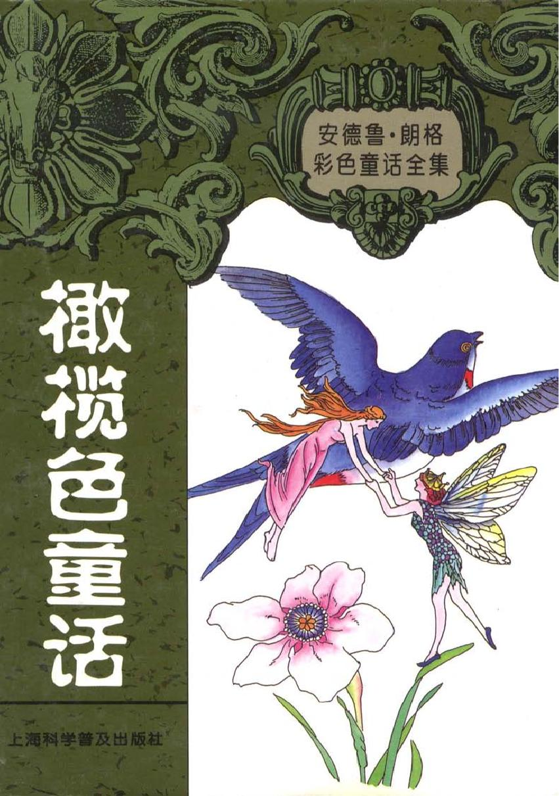

**安德鲁·朗格彩色童话全集**

橄榄色童话

陈超译

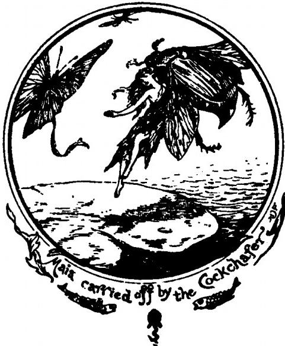

上海科学普及出版社

（沪）新登字第 305 号

Edited by Andrew Lang
The Olive Fairy Book

Published by Longmans, Green, and Co. in 1907

---

安德鲁·朗格彩色童话全集
**橄榄色童话**

陈超译

---

责任编辑：钟海谷
技术编辑：万福棠
出版：上海科学普及出版社（上海曹杨路 500 号邮政编码 200063）
发行：新华书店上海发行所
印刷：常熟文化印刷厂
开本：850×1168 1/32
印张：8.5
插页：4
字数：206000
版次：1997 年 7 月第 1 版 1997 年 7 月第 1 次印刷
印数：1-8000
书号：ISBN 7-5427-1292-6/G·401
定价：12.00 元

---

（本版图书凡印刷、装订错误可及时向承印厂调换）

 

| 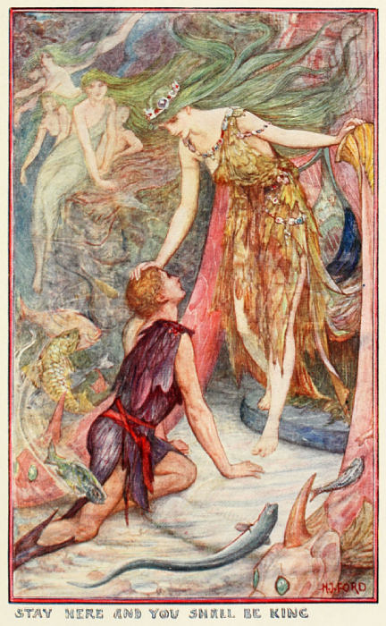 |
| :------------------------------: |
|       《小国王洛克的故事》       |

 

| 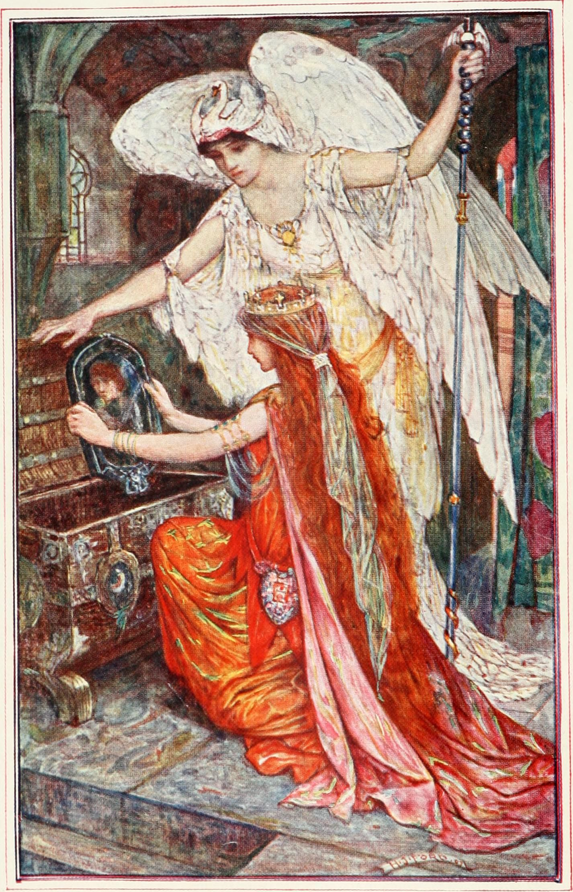 |
| :------------------------------: |
|            《蓝鹦鹉》            |

 

| 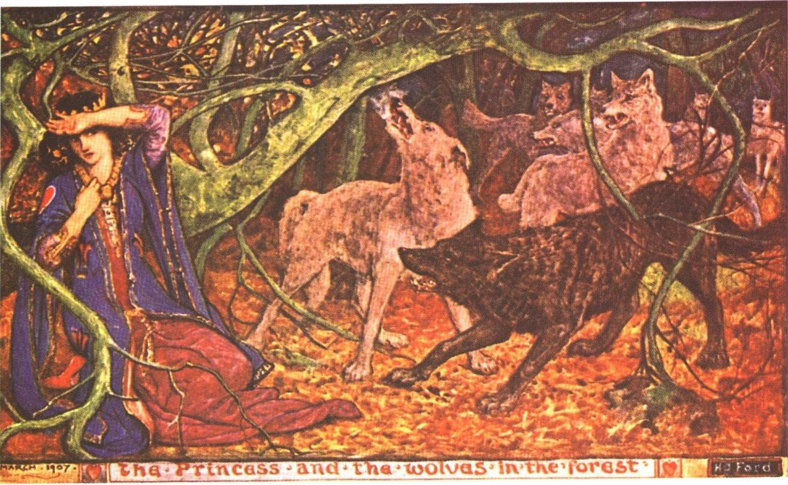 |
| :------------------------------: |
|          《梳子和项圈》          |

 

| 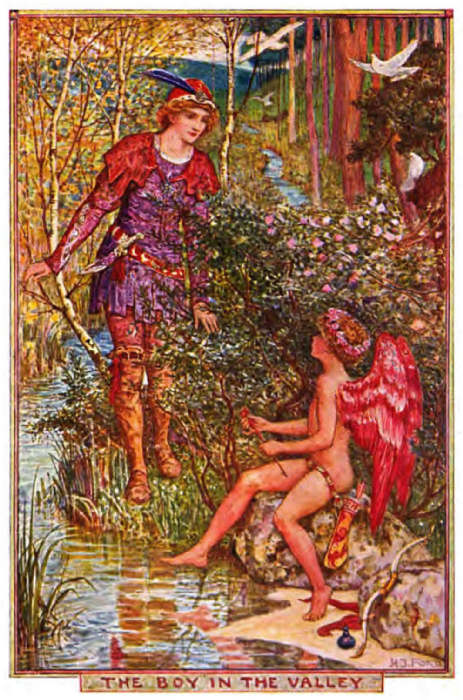 |
| :------------------------------: |
|        《缎子医生的故事》        |

 

| 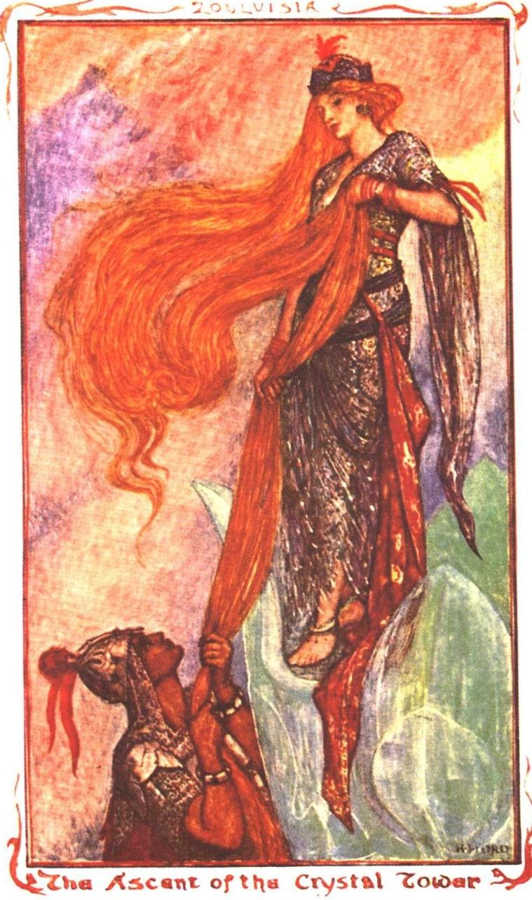 |
| :------------------------------: |
|         《朱维莎的故事》         |

 

| 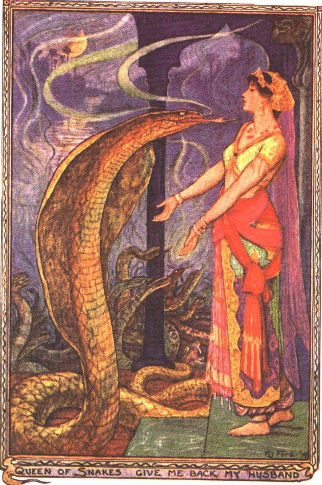 |
| :------------------------------: |
|            《蛇王子》            |

 

| 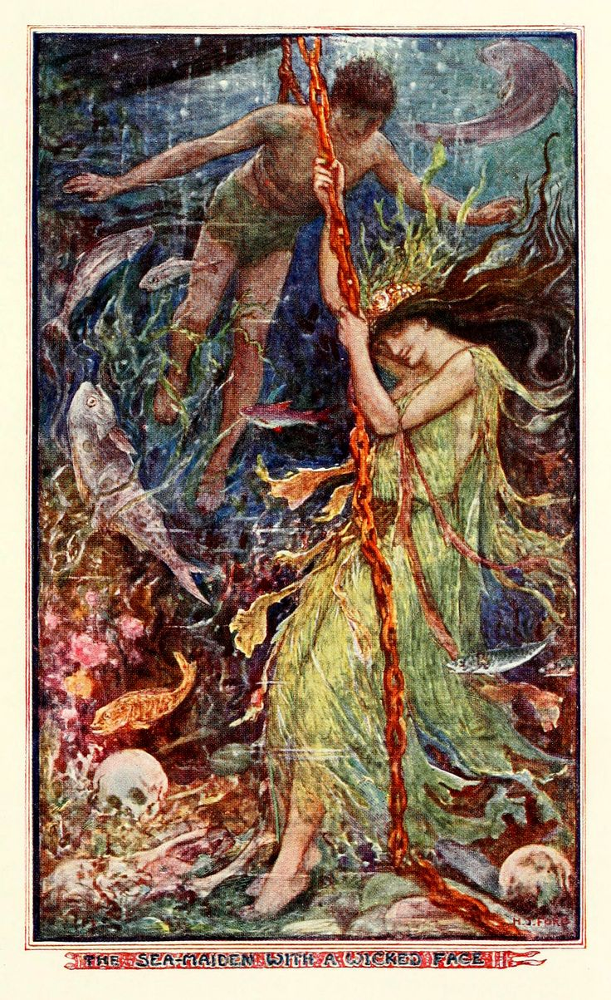 |
| :------------------------------: |
|      《终于知道害怕的男孩》      |

 

| 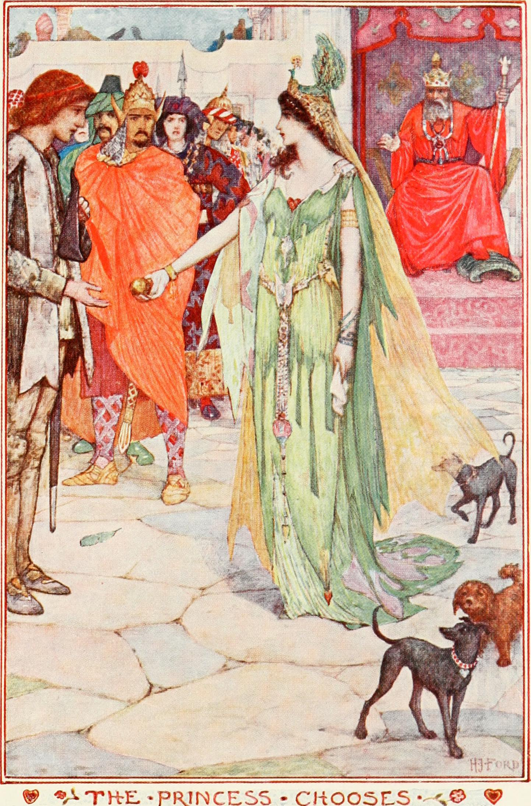 |
| :------------------------------: |
|       《耐心等待就有希望》       |

 

## 前言

《安德鲁·朗格彩色童话全集》是英国著名文学家安德鲁·朗格（1844～1912）编辑的十二集童话。为了编辑这些童话，他广泛地收集英国、欧洲以至全世界的童话和民间故事。那些非英语的文字，如法文、德文、葡萄牙文、意大利文、西班牙文、加泰隆语等主要由他的妻子莱奥诺拉·布朗歇翻译和整理成英文。最先编成一集，当时编者的意图也只是编这一集。后来搜集的材料越来越多，才决定继续再编三集。其中的艰难和辛苦是外人所难以想象的，编者因此曾发誓，编成这四集以后，再也不编下去了。

四集童话的出版，效果非同凡响。不仅受到英国读者的欢迎，而且被译成多种文字，受到许多国家读者的欢迎。其受欢迎的程度赢得了一代又一代的读者，历数十年而不衰，这不仅源自编者长期的努力，也得益于世界各地广大热衷于这一题材的读者的帮助，他们纷纷把手头的作品和资料寄给安德鲁·朗格。这给了他极大的鼓舞，他一鼓作气，又编了八集。后面几集主要搜集了苏格兰、爱尔兰、加拿大、印度、葡萄牙、斯堪的纳维亚的民间故事和传说。有些则选自以神话、民间传说和英雄传奇为基础的中世纪威尔士故事集《马比诺吉昂》。

安德鲁·朗格认为，这些童话故事很难说是某个人写成的，它们从很久很久以前就流传下来，经过民间艺人和文学家的不断收集和整理，才达到了今天这样思想性和艺术性都比较好的程度。这些童话也被认为是英语、甚至也是全世界各种语言中时间跨度最大、包含地域最广、流传国家和地区最多、内容最丰富的童话集。

她是世界古典童话中的瑰宝，童话世界中永不凋谢的鲜花，被译成多种文字，得以广泛流传，一代又一代的儿童被她的魅力吸引，长大成为家长后，又为能给自己的孩子朗读和讲述安德鲁童话而自豪。

《橄榄色童话》收集土耳其、印度、丹麦等国家和地区 29 个童话和民间故事。这些故事有的讲述神通广大的小矮人国王洛克如何爱上了纯洁美丽的小姑娘阿贝勒，一旦发现她爱的不是自己而是别人时，又如何克制自己的感情，去帮助阿贝勒得到她的心上人。有的讲述一个傲慢的国王为了自己的面子，不惜断送妻子和儿子的性命。有的讲述勇敢聪明的公主，如何耐心地帮助和教育胆小如鼠的丈夫，使他成为举国崇敬的英雄。有的讲述贪得无厌的商人如何财迷心窍，落入别人的圈套，狼狈不堪。这些故事颂扬勤俭朴素、助人为乐、正直忠诚；谴责贪得无厌、懦弱无能、奸诈狡猾。读了这些故事，我们还可以从中看到，很久以前，这些地区的人民是怎样生活的；可以看到他们的欢乐和悲伤，理想和追求。

与《安德鲁·朗格彩色童话全集》中的其他各集一样，《橄榄色童话》中的故事充满了当地的风土人情和乡村气息，展现了从冰雪覆盖的北极圈到赤日炎炎的非洲大陆的美丽风光。读者们可以从中领略到许多乐趣，懂得什么是正义，什么是邪恶；什么值得爱，什么该去恨；而且还会对这些地区的人文历史和地理概貌有所了解，从而更加热爱生活，热爱我们这个世界。

 

**目录**

[TOC]

 

## 马德迅

从前，在几座山中间有一间小屋，里面住着一个妇女和她的儿子。让她感到非常悲伤的是，这个小伙子虽然已经快二十岁了，可头上的头发还不如初生的婴儿多。他看上去虽然不小了，人却很懒惰。母亲不论叫他去学什么手艺，他总是不肯好好学，过不了几天就要回家。

一个天气晴朗的夏天早晨，他像往常一样，半醒半睡地躺在小屋前的小园子里。这时苏丹的女儿骑着马从这里经过，后面跟随着一群衣着华丽的姑娘。年轻人懒洋洋地撑起手肘来看她，这一眼就彻底改变了他的性格。

“我要和她结婚，除了她我谁都不娶！”他想，立刻跳起来去找他的母亲。

“你要立刻去找苏丹，告诉他，我要娶他的女儿做妻子。”他说。

“什么？”他母亲吓得退缩到角落里去，除非是忽然发疯了，否则不会想到做这种事情。

“你不明白吗？你要立刻到苏丹那里去，告诉他，我要和他的女儿结婚。”年轻人不耐烦地又说了一遍。

“可是，可是，你知道你在说些什么吗？”母亲结结巴巴地说，“你一门手艺都没有学会，只有父亲给你留下来的五块金币。你真的以为，苏丹会把他的女儿嫁给一个像你这样秃头的穷小子吗？”

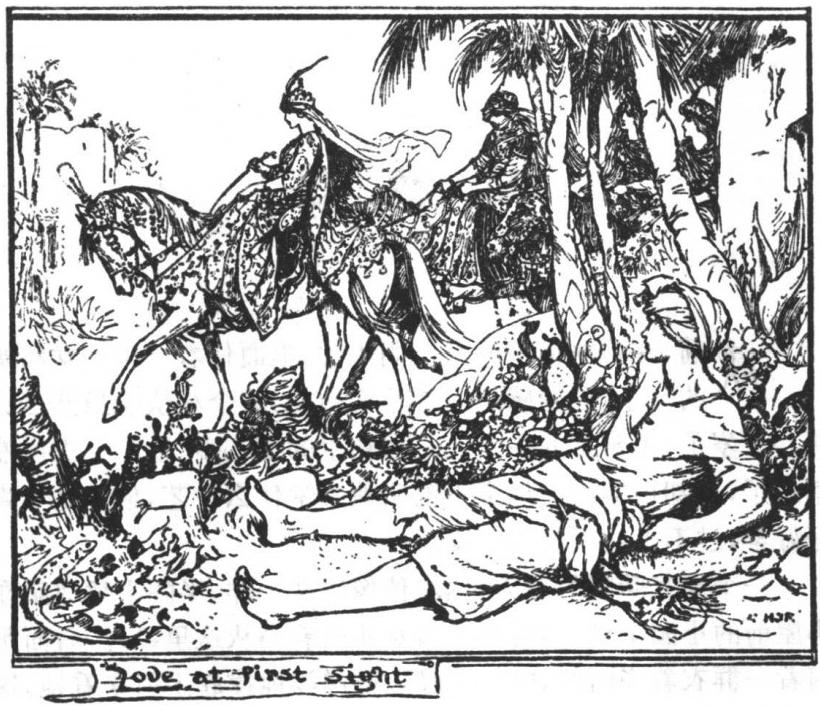

“那不关你的事，你照我的话去做。”儿子日夜不停地缠着她。后来实在没有办法，她只好穿上最好的衣服，戴上面纱，爬山越岭到王宫里去。

这一天，苏丹正好在听取老百姓的诉苦和请愿。所以，女人没有遇到什么困难就得到允许去见苏丹。

“啊！别以为我疯了！阁下！”她开始说道，“尽管我知道，我看上去差不多是疯了。我有一个儿子，自从他看到戴着面纱的公主一面以后，就日夜不让我得到安宁，一定要我到王宫里来，请求阁下把你的女儿嫁给他。我对他说，我可能会因为这样大胆而被杀头，可是没有用，他一点也不听我的。所以，我就来了。你怎么处置我都行！”

恰巧，苏丹总是喜欢别出心裁的事情，这件事也就够新鲜的了。所以，他不像别的君主通常会做的那样，命令把这个哆嗦着的女人鞭打一顿，或者投进监狱，而只是说：“叫你儿子到这里来！”

女人听到这个回答，吃惊地瞪着双眼。等苏丹更加温和地重复了一遍，看上去一点也不像发怒的样子以后，她才鼓起勇气，鞠躬告别，连忙赶回家去。

“喂！事情办得怎么样了？”她一跨进门槛，儿子就急不可待地问。

“你要立刻到王宫里去，苏丹要找你说话。”母亲回答。他听到这个好消息，脸上浮现出奇异的光彩。母亲心里不禁想着，他不长头发真是太遗憾了，否则就十分英俊了。

“啊！闪电也不会比我跑得更快！”他喊叫着，一转眼就不见了。

等苏丹看到女儿求婚者的秃头时，他开玩笑的情绪就一点也没有了。他决定想出个什么办法来，摆脱这个不受欢迎的求婚者。不过，既然把他叫到王宫里来了，没有理由总不好就这样把他打发走，所以，他急忙说：

“我听说你想和我的女儿结婚？那很好。不过，谁要想做她的丈夫，就得把森林里所有的鸟都抓来，把它们放到王宫的花园里去，至今为止，还没有鸟在那里的树上做窝。”

年轻人听了苏丹的话，心里感到非常失望。怎么可能把这些鸟都抓到呢？即使抓到了，要把它们送到王宫里来也得好几年工夫！尽管如此，他的自尊心不允许他让苏丹认为，就这么随随便便地放弃了对公主的追求。于是，他离开王宫，一路走出去，也没有想到自己该往哪里走。

他这样漫无目的地走了一个星期，后来发现自己走进了一片沙漠，到处都是大石头。在一块大石头的阴影里，坐着一个僧人。僧人看到他，就向他打招呼，叫他在自己的身边坐下。

“你碰到了什么麻烦事？我的孩子。”僧人说，“告诉我，也许我能帮你的忙。”

“啊！我的父亲！”年轻人回答，“我想和我们国家的公主结婚。可是苏丹不同意，他说，除非我把全世界所有的鸟都抓来送到他的花园里去。可是我怎么能办得到呢？这件事谁能办得到呢？”

“不要失望，”僧人说，“这件事不像听起来那么困难。在太阳落山的方向，离这里约两天的路程，有一棵柏树。它比世界上任何一棵柏树都高大。你在靠近树干阴影最暗的地方坐下，一动也不要动。慢慢地，你就会听到有力的、拍动翅膀的声音，全世界所有的鸟都飞到这棵树上来筑巢。可是要注意，你千万不能发出一点声音。等一切都安静下来以后，你就说：‘马德迅！’那些鸟就会站在那里原地不动，没有一只能飞走。这样，你就可以把它们抓起来放在自己的头上、手上和身上。然后，你就这样把它们送到苏丹那里去。”

年轻人兴高采烈地感谢僧人，全心全意地照他的话去做。几天以后，一个全身覆盖着柔软羽毛的奇人走到苏丹的面前。苏丹心中充满了惊讶，因为他从来没有见过这种情景。啊！这些小东西是多么可爱，还有那些明亮而惶恐不安的眼睛！紧接着可以听到一阵小骚动，无数双翅膀拍动起来：蓝翅膀、黄翅膀、红翅膀、绿翅膀！年轻人轻轻地说了一声：“去！”那些鸟先是围着苏丹的头绕一圈，然后就朝开着的窗口飞出去，到花园里去安家了。

“啊！苏丹，我已经照你的吩咐办好了。现在，把公主嫁给我吧！”

苏丹赶紧回答说：“啊！是的，是的，你使我感到非常满意！只是还有一件事你得做到，你就可以做她的丈夫了，所有的姑娘都希望这样。那就是你的头，你明白，它那么光！让它长出又厚又漂亮的卷发来吧！你那么聪明，我敢肯定，这对你来说，一点也不难！”

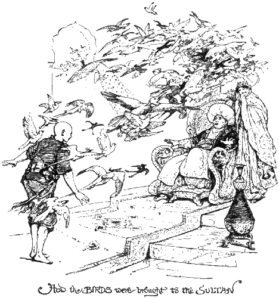

年轻人默默地听着苏丹的话，又默默地在母亲的厨房里坐了好多天。直到有一天早晨，他听到有人说，苏丹的女儿已经和宰相的儿子订了婚，婚礼很快就要在王宫里举行。听到这个消息，他气愤地站起来，偷偷地很快就来到城墙的边门，这里只有那些修理房子的工人进进出出。他悄悄地走进清真寺，不让任何人看见，然后又沿着一条直通大厅的走廊进入宫殿。新娘和新郎在两三个朋友陪同下，正在等待着苏丹的到来，以便正式签订婚约。

“马德迅！”年轻人轻轻地说了一声。立刻，他们全都像在地下生了根似的，一动也不动了。那些被苏丹派来看是否准备就绪的传令兵，也逃脱不了同样的命运。

后来，苏丹等得不耐烦了，他生气地亲自下来看，究竟是怎么回事。可是，谁也说不出其中的道理来。他只好派一个随从去把术士请来，好把那些坏精灵加在他们头上的咒语去掉。术士就住在一个城门的附近。

“这就是你的不对了，”术士听完苏丹的故事以后说，“你要是不违背对那个年轻人的承诺，这种厄运就不会降临到你女儿的头上。现在，只有一个办法可以救她，那就是你选择的新郎必须让位给光头的年轻人。”

苏丹心里虽然很难过，可是他知道，术士比他聪明。他把自己最信任的随从找来，叫他们一刻也不能耽搁，立刻就去把那个年轻人带到王宫里来。年轻人一直躲在一根柱子后面观看动静，听到这些话他暗暗地笑着。他马上就跑回家中，对他母亲说：“要是苏丹的信使到这里来找我，你要记住这样回答：‘我儿子已经离家很久了，也不知道他到什么地方去了。但是，因为我很穷，你们要是给我足够的钱，我就会尽量地去把他找回来。’”说完以后，他就躲到阁楼上去，好听听下面发生的事情。

过了一分钟，就传来响亮的敲门声，女人站起来去开门。

“你的光头儿子在吗？”外面的人问，“要是在的话，叫他跟我们走，苏丹想当面和他说话。”

“啊！先生！”女人用面纱的一角来擦眼睛，回答说：“他离开我很久了，走了以后一点消息都没有。”

“啊！好女士，你能想一想他到哪里去了吗？苏丹想把自己的女儿嫁给他。谁要是能找到你儿子，苏丹肯定会赏给他一大笔钱。”

“他从不对我说要到哪里去，”女人摇摇头回答，“可是苏丹赐给他那么大的荣誉，值得不怕麻烦地去寻找。有好几个地方也许能找到他，可这些地方只有我知道。我是个穷女人，没有钱走这么远的路。”

“哦！这没有问题！”那人说，“这个钱袋里有一千块金币，拿去随便用吧！告诉我在哪里可以找到他，你还可以得到这么多。”

“那好吧！”她说，“就这样说定了。再见！我得做些准备，最多几天，你就会听到我的消息。”

将近一个星期，女人和她的儿子都小心翼翼地留在家里，只有天黑以后才出去，生怕会被邻居看见。他们连火也不生，灯也不点。大家都以为，这间屋子已经空无一人。后来，一个阳光明媚的早晨，年轻人起来穿好衣服，围上最好的头巾，急急忙忙吃过早饭以后，就动身到王宫去。

门口个子高大的黑人显然在等待着他的到来。他一句话也不说就让他进去。另一个等在里面的随从直接把他领到苏丹的面前。苏丹高兴地欢迎他。

“啊！我的孩子！这些天你躲到哪里去了？”他说。

光头的年轻人回答说：“啊！苏丹，我公平合理地得到了你的女儿。可是你违背了自己的承诺，不肯把她嫁给我。我留在家里感到很气愤，所以就去周游世界。现在，你已经改正了自己的错误，我来娶本该属于我的妻子。所以，叫你的首相准备婚约吧。”

于是，新的婚约写好了，在新的新郎要求下，苏丹和首相就在房间里签了字。然后，年轻人请苏丹把他领到公主那里去。自从年轻人说出那句可怕的话以后，他们就一直一动不动地站在大厅里。

“你能解除咒语吗？”苏丹担心地问。

“我想可以吧！”年轻人回答（说实在的，他自己也有些担心）。他走上前来，说道：

“让受马德迅束缚的人获得自由！”

话刚出口，那些雕像就一个个都动了起来。新娘高兴地握住新新郎的手。那个老新郎不见了，谁也不知道他到哪里去了。

（土耳其民间故事）

 

## 蓝鹦鹉

在阿拉伯的一个地方，那里长着茂密的棕榈树，开着芬芳的鲜花，在炙热的阳光下走路的人来到这里，都会忘记旅程的劳累。这里由一个名叫里诺的年轻国王统治着。他是在父亲的英明统治下长大的，父亲最近不幸去世了。他虽然只有十九岁，可是，他不像许多年轻的国王一样，认为必须改变所有的法律，才能显示出自己更加聪明。他对那些使人民幸福、国家兴旺的老法律感到很满意。大臣和老百姓觉得，他只有一个缺点，那就是他迟迟不肯结婚，尽管求婚者络绎不绝。

他的邻国由天鹅仙女统治着。仙女只有一个女儿，就是赫默莎公主，她的美丽，并不亚于里诺国王的英俊。天鹅仙女有一个常驻里诺国王王宫里的使者，听到老百姓抱怨他不想结婚，这个好心人就下决心，要亲手促成这件婚事。“因为，”他说，“这个世界上如果说有人配得上赫默莎公主的话，那就是他了。不管怎么样，我可以试试，把他们凑在一起。”

当然，直截了当地提出公主的婚事是不合适的。问题在于要让这个一点意思都没有的国王自己提起这件事。不过，使者办这种事情很有经验。里诺国王很喜欢绘画艺术，使者和他交谈几次，就说起画像来。他好像漫不经心地提到，最近他们的公主画了一张特别好的画像。“不过，虽然画的都是一个人，”他说，“也许还比不上一年前画的这张小画像。”

国王把它拿过来，仔细地看着。

“嗯！这肯定是太夸张了！”他赞叹地说道，“没有一个女人会长得这样出奇地美丽！”

“你如果能亲眼看到她就好了！”使者回答。

国王不再说什么。可是，第二天早晨，国王召见他的时候，他一点也不感到奇怪。

“自从你给我看了那幅画像以后，”使者走进屋，门还没有关上，国王就说，“我的脑子里总是浮现出公主的脸。我把你找来是为了告诉你，我要派特使到天鹅仙女那里去，向她的女儿求婚。”

“这么重大的事情，我不能代表我的女主人说话，这你也明白。”使者一面说着，一面抚摸着自己的胡子，以掩饰自己满意的心情，“可是我知道，她对你的提议肯定会感到很满意。”

“如果是这样，”国王喜笑颜开地说，“那么，我不派使者去了，我要亲自去，你陪我一起去。三天之内，就做好一切准备，我们一起出发。”

对里诺国王来说，不幸的是，他还有一个由神通广大的魔术师统治着的邻国。魔术师名叫艾斯莫诺，他的国家坐落在狮子岛上。他有一个非常可怕的女儿，可他认为她是世界上从来没有过的最漂亮的女人。她名叫雷奎特，也爱上了一幅画像，可那是里诺国王的画像。她请求父亲，让里诺国王来做她的丈夫。艾斯莫诺认为，世界上没有一个男人配得上他的宝贝。他正准备派首相到里诺那里去办这件事的时候，消息传来，国王已经动身到天鹅仙女的王宫去了。雷奎特感到无限悲伤，请求她的父亲阻止这门婚事。他的父亲答应了。他把长得很丑而且驼背的小侏儒罗伯特叫来，施了魔法把他很快就送到一个岩石嶙峋的山谷里去，国王和他的随从将要从这里经过。等听到马蹄声的时候，魔术师拿出一块魔手帕来，谁要是碰到它，别人就看不见了。他把手帕的一头交给罗伯特，自己拿着另一头，两个人在马队里行走，谁也看不见他们。可是，他们没有找到里诺国王。这当然没有什么奇怪，原来国王这几天因为兴奋和辛苦，觉得累了，吩咐满载着送给公主礼物的马车先走。他和一些朋友在一棵棕榈树下休息。艾斯莫诺看到他们的时候，他们都睡得很熟。他向他们施了魔法，叫他们永远睡下去，除非是他要他们醒过来。他还把国王的衣服全部剥下来，把罗伯特的衣服给他穿上。他用自己的戒指碰了一下罗伯特，说：

“变成里诺，直到你和天鹅仙女的女儿结婚。”

魔术师的魔法那么强大，连罗伯特也深信不疑，他就是真正的国王！

等新郎骑上里诺的马走到看不见以后，艾斯莫诺才把国王叫醒。他吃惊地看着自己一身的脏衣服。但是，他还没有来得及仔细看，魔术师就把他抓到一片云上，带他去见自己的女儿。

这时候，罗伯特和其他人一起走着，他们根本就想不到，这不是他们的主人。

“我饿了，”他说，“马上给我吃点东西！”

“愿尊敬的陛下感到高兴，”随从说，“帐篷还没有搭起来，起码还得有一个钟头才能把晚饭准备好！我们想…… ”

“谁叫你们去想！”假国王粗暴地打断他的话，“你算什么，傻瓜而已！马上就给我一些马肉，这是世界上最好吃的肉！”

随从几乎不敢相信自己的耳朵。里诺国王是天底下最有礼貌的人，竟然这样和他最忠诚的仆人说话！而且还要吃马肉！他向来吃东西那么考究，一直喜欢吃水果和饼。唉！人真是难以捉摸。而且，如果不想掉脑袋的话，还得立刻执行他的命令！归根到底，也许是爱情使他发疯了。假如是这样，慢慢地，他也许就会恢复正常。

不论老仆人为他们的主人找什么理由，等他们到达天鹅仙女首都的时候，一匹多余的马都没有了。他们不得不请求国王也下马，一起步行走进王宫，好像他喜欢步行似的。他们很快就看到，天鹅仙女和她的女儿正在矮阳台上迎接国王。国王走到阳台下就停下来。

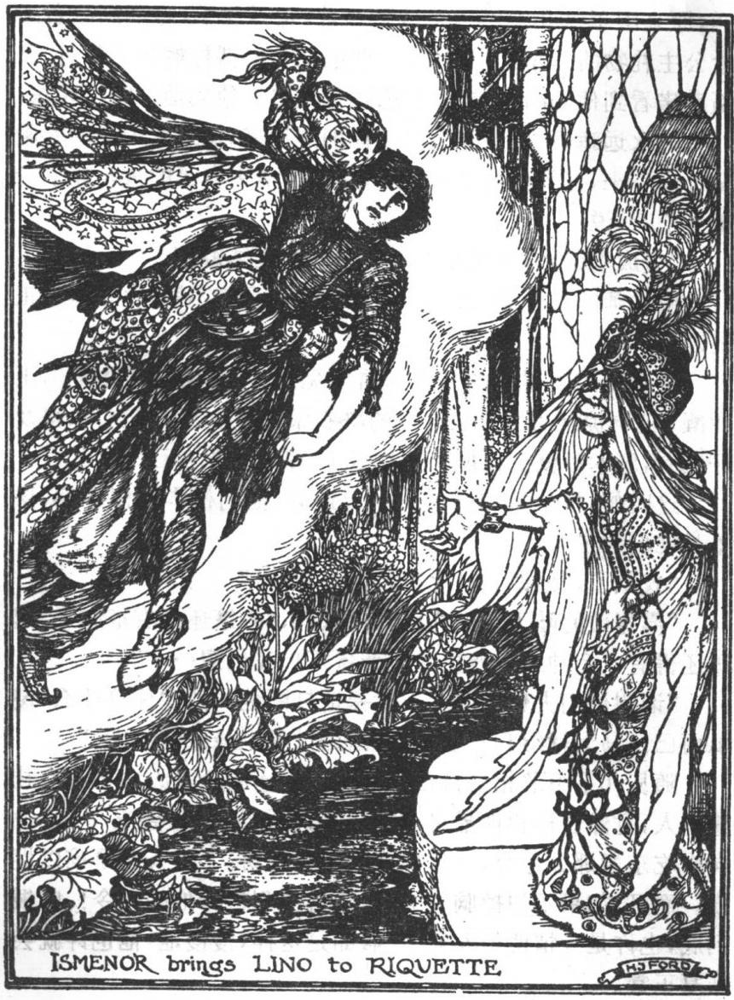

“夫人，”他说，“我这样随便地来向你女儿求婚，你也许会感到吃惊。路程那么长，我肚子饿就把我的马吃掉了，那是世界上最好的肉；我还强迫我的随从们把他们的马也吃掉。不管怎么说，我是一个伟大的国王，想作你的女婿，问题就这样定了。赫默莎在哪里？”

女王对国王这种出乎她意料的举止一点也没有吃惊或不高兴，说道：“陛下，你有我女儿的画像，如果你不能立刻就认出她来，那么，她给你留下的印象一定是少得可怜。”

“我不记得有什么画像，”罗伯特回答，“不过，也许就在我的口袋里。”他翻遍了全身的口袋，侍女们在旁边都吃惊地看着。当然，他什么都没有找到。找过以后，他转过脸来，对又羞愧又气愤的公主说：“如果我就是来和你结婚的话，我想你是很美丽的。我敢肯定，我要是看过你的画像，就决不会忘记。让我们尽快地举行婚礼。在此之前，我想去睡觉。你的国家和我的国家太不一样了。告诉你吧！走了那么多天的山路以后，我需要好好休息一下。”

说完，他也不等别人回答，就吩咐一个童仆领他到房间里去。里面立刻就传出响亮的打鼾声，那么响，连城市的另一头也听得见。

他一走，可怜的公主就扑到母亲的怀中，哭泣起来。十五天来，她不停地把里诺国王的画像拿出来看。她们的大使说这个年轻人如何高尚和富有魅力的信，从来没有离开过她的口袋。不错，画像非常逼真。可是，那么英俊的外表，怎么会包含这样一个粗鲁的灵魂？即使是这样，要是他也像公主常遇到的那些人一样，有那么一点崇拜她的爱心，她也就原谅他了。至于她的母亲，可怜的天鹅仙女，对她未来女婿的这种古怪的行为真是不知所措，一句话也说不出来。

在这种情况下，里诺国王的侍从请求单独见女王陛下。等旁边没有别人的时候，他对她说，他担心他的主人忽然发疯了，要么就是中了哪个魔术师的魔法。

“我先前吃惊得六神无主，”侍从说，“可现在，他认不出公主来，连以前片刻也没有离开过的公主画像也没有了，更是叫我万分惊讶。他的礼貌在我们王国里是有口皆碑的，怎么会变成这个样子了呢？夫人，也许你的仙法可以发现其中的缘故。”说完，他就鞠躬退出去了。

女王听完以后，站在原地沉思着。忽然间，她眼睛一亮，来到藏在一个秘密房间里的旧箱子前，从里面拿出一面小镜子来。从这面镜子中，她可以看到想看的东西的真相。这时候，她最想知道的就是里诺国王的真面目。

啊！侍从的话完全正确！睡在那里鼾声大作，连宫殿也为之震动的那个人不是她的女婿；她真正的女婿这时正穿着脏衣服，被关在艾斯莫诺最牢固的塔里，他在吻着赫默莎的画像。由于他把公主的画像很好地藏在头巾里，才没有引起魔术师的注意。她赶紧把女儿叫来，让她一起来看。赫默莎很高兴地看着里诺，他的一举一动就像她所希望的那样。镜子还在她手中的时候，监狱的门打开了，可怕的雷奎特走进来，从她抬头的眼神来看，好像是在向里诺请求什么，但是遭到了他的拒绝。当然，赫默莎和她的母亲听不到他们在说些什么，但是从雷奎特气愤地离开房间的面色来看，不难看出发生了什么事情。可是，从镜子里还是看到了许多事情，她被国王拒绝以后，非常愤怒，派来四个身强力壮的人来鞭打他，一直打到他昏迷过去。这一切，赫默莎都看在眼里，她惊骇得晕过去，要不是母亲扶住她，她早就摔倒在地下了。

“克制住自己，我的孩子！”仙女说，“要是我们想把国王从这些邪恶的人手中救出来，就得用上我们的全部智慧。首先，我们得知道，哪个冒充他的人是谁？他的真面目是什么样子的。”

她捡起镜子，要它现出假新郎的面孔。镜子里立刻出现一个肮脏的马夫形象，穿着那身衣服，躺在她高贵的贵宾床上。

“所以，这是艾斯莫诺想和我们玩的把戏！好吧！不论要花多大的代价，我们都要进行报复。可是，我们必须非常小心，不要让他知道，我们已经识破了他的阴谋。因为他的魔法比我大，我得谨慎从事。首先，我得离开你。如果假国王问起，就说我到边境去处理一些事情去了。与此同时，你对他要非常客气，常常宴请他，让他高兴。如果他有一点怀疑，你甚至可以用你的婚姻来迷惑他，说我要把自己的王位交给你的丈夫。现在，再见吧！”

说完，她挥挥手，一片云彩飘下来，把她遮住。谁也不会想到，这朵很快地从天上飞过的美丽白云，就是仙女的战车，正载着她向艾斯莫诺的塔楼飞去。

塔楼坐落在森林中间，所以女王想，在黑暗的森林保护下，她可以隐蔽地降落到地面。可是，塔楼已经全部施过魔法，她越是想下来，那无形的东西阻挡得越严密。后来，她使出了浑身的解数，才得以精疲力竭地降落到塔楼下。她抓紧时间施展自己的魔法。她发现，要想战胜艾斯莫诺，只有一个办法，那就是找到基格斯戒指上的宝石。可是，她怎样才能得到这个戒指呢？因为魔书上说，艾斯莫诺把它当作最贵重的宝贝之一，日日夜夜严加提防。但是，她不论如何也一定要得到它。同时，她还得去看一看这个王室囚犯怎么样了。于是，她拿出纸和笔来，这样写道：“把这封信送来的鸟就是天鹅仙女，赫默莎的母亲变的。赫默莎爱你，就像你爱她一样深！”这样说明以后，她接下来又写了那个使他受害的罪恶阴谋。然后，她变成一只燕子，绕着塔楼飞行，直到看见关里诺的窗口。他被关得那么高，连装窗栏也是多余的。看守的四个士兵都站在外面的走廊里，所以，仙女可以飞进去，甚至跳到他的肩膀上。可是，他那么全神贯注地看着公主的画像，过了一些时间，她才能引起他的注意。她用信纸轻轻地去划他的脸，他才吃惊地看看周围。看到燕子，他马上就知道救兵来了。他把信打开，读着读着，流出了高兴的眼泪，接连问了一大串关于赫默莎的问题，燕子无法回答，只是不停地点点头，示意他继续读下去。“我一定要假装愿意和可怕的雷奎特结婚吗？”信读完以后他问，“我能够从魔术师那里得到宝石吗？”

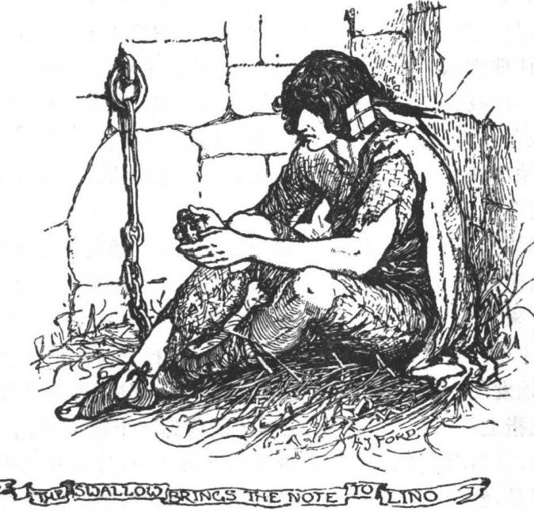

就这样，第二天早晨，当雷奎特像往常一样来看他的时候，和以前不一样，他对她有礼貌得多了。魔术师的女儿看到了这种变化，心里不知道有多高兴！更使她高兴的是，里诺对她说，他作了一个梦，知道了赫默莎是如何反复无常；还有，他梦见了一个仙女，仙女对他说，如果他想摆脱对不忠的公主的留恋和束缚，把自己的感情转向艾斯莫诺的女儿，他就必须戴一天一夜基格斯戒指上的宝石，这个戒指现在在魔术师的手中。这个消息使雷奎特欢喜若狂，她用手搂住国王的头颈，温柔地拥抱着他。这使他感到非常恶心，他情愿受到士兵的鞭打！可是，这也是迫不得已的，他尽力地克制自己，装出一副高兴的样子来，直到雷奎特松开他，说是要抓紧时间到他父亲那里去，把那珍贵的宝石拿来。

女儿的要求使艾斯莫诺感到非常惊讶。他立刻就产生疑心。不过，不论他怎么想，他也想不到严密看守的国王会有什么办法和天鹅仙女取得联系。不过，他办事从来不慌不忙。他若无其事地对他的女儿说，他唯一的愿望是使她幸福。既然她那么想得到那宝石，他就去给她拿来。然后，他来到能施展全部魔法的秘室，很快就发现，他的敌人天鹅仙女此刻就在他的宫里。

“原来是这样！”他说，阴险地冷笑着，“好吧！她会得到一块宝石，一块谁碰一下都会变成大理石的宝石。”他把一块小的红宝石放进一个盒子里，就回到女儿的身边。

“这是能使你得到国王里诺的爱的法宝，”他说，“可是千万要记住，不要把盒子打开，连盒子一起给他，否则宝石就失去它的全部价值。”雷奎特高兴地叫了一声，从父亲的手中抢过盒子来，向监狱里奔去。她父亲跟在她后面，手中紧紧拿着那块魔手帕，所以谁也看不见，他要去看看咒语如何起作用。正如他所预料的那样，天鹅仙女站在塔楼的前面，她粗心大意地恢复了自己的原形，等待着里诺国王把宝石给她扔下来。她急切地接过国王手中扔出的盒子。可是，她的手指一碰到红宝石，一种奇怪的僵硬感觉就向她袭过来。她的四肢发硬了，舌头勉强说出几个字： “我们暴露了！”

“是的，你们暴露了！”艾斯莫诺用可怕的声音喊道，他把国王从窗口拉出来，说，“还有你，你将变成一只鹦鹉，直到你能把心中的赫默莎忘掉。”

话刚说完，只见一只蓝鹦鹉展翅向森林里飞去。魔术师也登上他的战车，向天鹅岛飞去，把岛上所有的人都变成雕像。他们保持着原来各种各样的姿势，连罗伯特也不例外。他没有把赫默莎变成雕像，而是叫她上自己的战车，坐在自己的身边。几分钟以后，他们来到森林，魔术师从车上下来，把不幸的公主也一起拖下。

“我把你的母亲变成了一块石头，把你的恋人变成了一只鹦鹉，你呢！要变成一棵树。”他说，“要等到你把这个世界上你心中最爱的人抹掉，你才会变成人。我要让你的思想和记忆保留着，让你倍加折磨。”

艾斯莫诺是个大魔术师，再也没有比他绞尽脑汁作出的这种安排更刻毒的了。可怜的公主受尽煎熬，度日如年，她希望哪天樵夫的斧头能结束她这悲惨的命运。他们如何才能从这厄运中得救呢？即使里诺国王从这里飞过，可是森林里有成千只蓝鹦鹉，她怎么能认出他来呢？同样，国王又怎么能知道这棵树就是公主呢？还有她的母亲！啊！想起来真是太悲惨了，这就是女人的命……公主就这样不停地想着。

与此同时，蓝鹦鹉在这个世界上到处飞翔，到处交识新的朋友。有一天，他飞进一座城堡，里面住着一个老巫士，他刚刚娶了一个年轻美貌的妻子，名字叫格丽娜丁。格丽娜丁觉得婚后的生活非常沉闷，因此很高兴认识一个会飞的朋友。她给他吃好吃的水果，还做了一个金笼子让他睡觉。他只有一点让她失望，那就是他不像别的鹦鹉那样会说话。

“你要是知道，会说话给我带来多么大的快乐，我敢肯定，你一定会试试看！”她喜欢这样对他说。可是鹦鹉像是没有听见一样。

可是，有一天早晨，她出去采花。鹦鹉看到房间里没有人，就跳到桌子上，叼起一支铅笔，在一张纸上写下几句诗。他刚写好，就听到外面有声音。他赶紧扔掉铅笔，从窗口飞出去。

就在他扔掉铅笔的一刹那，巫士掀开门帘的一角走进房间。看到桌子上有一张纸，他拿起来，很吃惊地读着：

> “美丽的公主，
> 为了你欢喜，
> 我多么想和你说话。
> 沉默再久也会过去，
> 话说不尽的日子会到来。”

“我就有些怀疑，他是中了魔法了。”巫士自言自语地说着。他把自己的书拿出来查阅，发现他不是一只鸟，而是中了一个魔术师魔法的国王。这个魔术师正是巫士在这个世界上最恨的人。他迫不及待地读下去，寻找打破这个魔法的办法。找到以后，他非常高兴，立刻就去找他的妻子。她正躺在鹦鹉栖息的一棵树下。他告诉她，她喜欢的鹦鹉是一个大国的国王，如果她能把鹦鹉叫来，他们就一起到森林那里去。“在那里，我就可以恢复他的原形。只是不论我做什么，你都不要害怕和叫喊。”他又补充说，“否则一切都前功尽弃。”巫士的妻子高兴得跳起来，她用口哨吹起一首鹦鹉喜欢的曲子。国王已经听到了他们的谈话，可是他不想让他们知道，所以他过了一会，等她转过身去才从树上飞下来，落在她的肩膀上。然后，他们一起上了金船，来到森林的一块空地上，旁边有三棵大树。

“我要用这三棵树来变魔法，”巫士对他妻子说，“把鹦鹉放到树枝上去，他会很安全的。你离得远一点，免得树倒下来的时候砸到你的头。”

听到这些话，鹦鹉忽然回忆起魔术师艾斯莫诺的预言。他做好了准备，想到这三棵树中有一棵就是赫默莎，他的心激烈地跳动起来。这时候，巫士在用铁铲松开三棵树根周围的土，好让它们一起倒下。鹦鹉看到三棵树开始摇晃，立刻就飞到当中最美丽的一棵树下面去。只听见轰隆一声，里诺和赫默莎面对面地站在一起，两只手紧紧地握在一起。

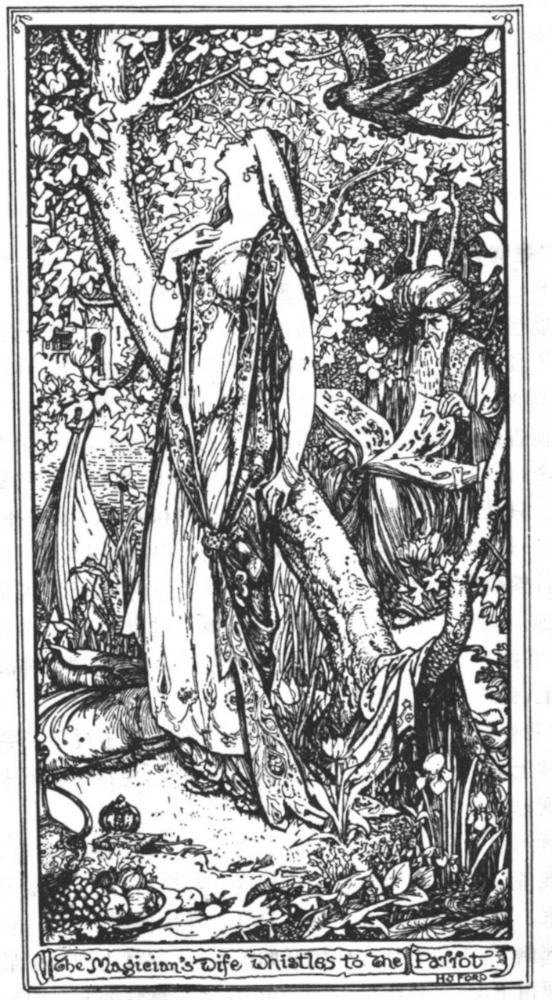

最初的几秒钟过去以后，公主想到了她的母亲。她跪在正为自己的成功而微笑着的巫士面前，请求他再帮一次忙，让天鹅仙女恢复原形。

“那可就不那么容易了，”他说，“但我要尽自己最大的努力。”他回到自己的宫殿里去，拿了一瓶有毒的药水。等天黑以后，他立刻动身到艾斯莫诺那里去。当然，如果艾斯莫诺看一下他的魔术书，他就会知道自己的敌人在干什么，从而保护自己。可是这天晚上，他吃得太饱，喝得太多了。这时候，他已经上床，睡得很熟了。巫士变成一只蝙蝠，飞进他的房间，然后躲在帘子后面，把那瓶毒药全部倒到他的脸上。他一声不吭就死掉了。与此同时，天鹅仙女又变成了人。因为不论多么了不起的魔术师，他死掉以后，魔法也就不再起作用了。

天鹅仙女回到自己的首都，看到大臣们都站在门口迎接她。他们中间是脸上洋溢着幸福的赫默莎和里诺国王。罗伯特站在他们后面，不过离得很远，他身上的脏衣服已经换上了干净的。他心中的迫切愿望也已经实现，公主同意让他管理她的马厩。

在这里，我们要和他们说再见了。我们完全可以相信，经历了那么多可怕的考验以后，他们一定会过上许多许多年幸福的日子。

 

## 国王的女儿格尔劳葛

有一天，一个大国的国王和他美丽的妻子，正坐在他们美丽的花园里，专心地谈论着儿子将来的生活。他就睡在身边的漂亮金摇篮里。他们结婚已经许多年了，可是一直没有孩子。这个孩子一出世，他们就感到自己是世界上最幸福的夫妻了。这是个健康的小男孩，喜欢动手动脚。就是在他这么小的时候，父母也认为他是世界上最了不起的人了。他们那么沉醉于安排他的前途，根本没有注意到一个大黑影正在靠拢过来。一条张牙咧嘴的可怕的龙忽然从天而降，一下子就叼走了他们可爱的孩子。

国王和王后愣住了，恐惧得说不出一句话来。后来，国王才慢慢地站起来，拉着哭泣着的王后的手，回到王宫。接下来的好多天，他们都没有出来过。

与此同时，那只龙用牙齿咬着摇篮，向空中飞去，小孩还在里面睡觉，没有醒过来。它飞得那么快，一下子就飞过了国界，来到了另一个王国。在这个国家的王宫里，它看到国王和王后也坐在花园里，旁边也有一个非常漂亮的摇篮，里面铺着白色绣着花边的绸缎上面，躺着个小女孩。龙像刚才一样，也从他们的身后俯冲下来，它正要叼起摇篮的时候，国王跳起来，用他的金杖狠狠地敲了它一下。龙痛得不但缩回去，连咬在嘴里的小男孩也扔了，慌忙展翅向空中逃去。

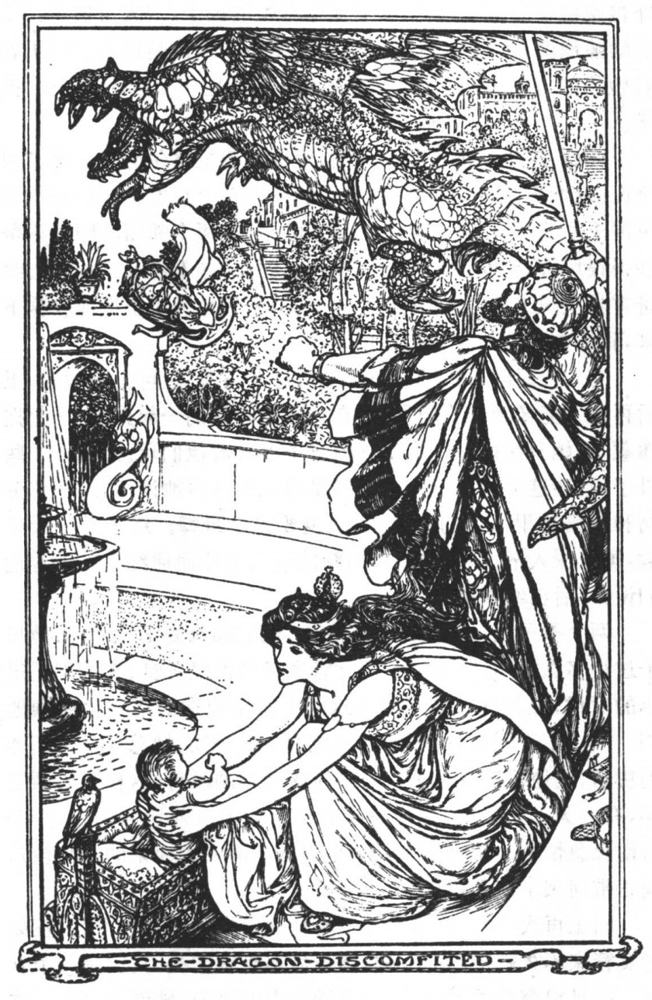

“这可真是死里逃生。”国王转过脸来对王后说。她这时已经吓得脸色苍白，坐在那里紧紧地抱着她的孩子。“太可怕了，”王后喃喃地说着，“看！那边地上有个发亮的东西是什么？”国王朝着她指的方向走过去，吃惊地看到，那也是一个摇篮和一个孩子。

“啊！这也是那怪物抢来的，就像它想抢格尔劳葛一样。”国王说。他弯下腰来，看到裹着孩子的一块布上写着：“这是哥雷瑟里国王的儿子，小哥雷瑟里。”不幸的是，这两个邻国的国王正争吵得很厉害，已经许多年没有交往。因此，他不是马上派人去给哥雷瑟里国王送信，说他的儿子平安，而只是满足于把他收养下来，和格尔劳葛公主一起抚养。

有一段时间，孩子们无忧无虑，过得很幸福。可是到后来，王后再也不能像她喜欢的那样，在花园里和他们一起奔跑，一起捉迷藏了，她只能躺在一堆柔软的垫子上看着他们玩。又过了一些日子，她连这个也不行了。王宫里的人们低声地说话，连格尔劳葛和哥雷瑟里从她的房间走过，也要蹑手蹑脚。终于有一天早晨，国王派人把他们找来，他的眼睛因为哭泣而通红。国王对他们说，王后已经去世了。

两个孩子陷入巨大的悲痛之中，他们那么爱王后，没有她日子过得多么沉闷。幸好他们的女管家又和蔼又善良，在他们还很小的时候，她就开始在专门为这两个孩子建造的塔楼里照顾他们。国王忙于国事，或者到别的地方去的时候，她总是让他们感到快活，让他们接受王子和公主应该受到的教育。这样过了两三年，有一天，当孩子们在焦急地等待着父亲从外地回来时，一个信使急急忙忙地跑进王宫。他是奉国王的命令而来的，他宣布，国王带回来了新的王后。

国王再次结婚，这本身并没有什么奇怪和可怕。可是，正如老女管家不久就猜到的那样，新王后尽管很漂亮，其实是一个女巫。而且很容易看得出，谁得到她丈夫的喜爱，她就妒忌谁。这对格尔劳葛和哥雷瑟里来说，就意味着灾难。忠诚的女管家日夜为这两个孩子操心，夜不能寐。国王新婚几个月以后，王国和海对面的一个国家爆发战争，国王带领军队出征，这使她更是忧心忡忡。接着，王宫里发生了一件她早就知道会发生的事情。这天晚上，她和往常不一样，睡得很熟。后来她想到，肯定有人在她吃的东西里放了安眠药，女巫到这里来过了。她来这里干了些什么，谁也不知道。只是第二天太阳升起来以后，格尔劳葛和哥雷瑟里的床上空空的。这天早上，王后把她的一些卫兵叫来，对他们说，她在梦中受到警告，厄运将通过野兽降临到她的头上。她命令他们立刻出去搜查，把王宫周围两英里以内能找到的动物全部杀掉。可是，他们只看到两匹黑色的小马驹，非常漂亮，配得上作国王的坐骑，杀掉实在太可惜了，再说它们会伤害谁呢？所以他们就放过去了，两匹小马在草原上奔跑而去，卫兵们也回到王宫。

“你们看到了什么？真的什么也没有看到吗？”卫兵们回来以后，她问道。

“什么也没有看见，尊敬的王后。”他们回答说。可是王后不相信。她命令侍从，吃晚饭的时候，用烈性酒把卫兵灌醉，让他们管不住舌头，然后留神地听他们在说些什么，回来向她报告。

“尊敬的王后，我照你的吩咐去做了。”很晚以后，侍从请求王后允许让他进来，对王后说，“可是看来，他们对你说了实话。从一开始到结束，我都在旁边听着。他们除了两匹黑色小马驹以外，是什么也没有看见。”他本来还想再说些什么，只是王后眼中的怒火把他吓坏了，他赶紧鞠躬退出去。

一个星期以后，国王回来了。大臣们看到他都非常高兴。

“现在，也许她可以找到喊叫的人了。”他们私下里悄悄地说，“这些日子，这个王后老是冲着随从发火，谁也不知道她这么大的火气是从哪里来的。不管怎么说，国王回来替下王后管理王宫，事情总会好一些。”可惜好景不长，国王回来的头天晚上，王后就对他说了她一个人在家的时候做的恶梦，请求他明天一早就出去，把城市周围两英里内看到的动物杀掉。国王总是相信王后说的每一句话，答应明天照她的愿望去做。

可是，国王一走出王宫周围美丽的花园，就被两只蓝色小鸟的歌声吸引住了，这两只小鸟正栖在一棵结着绯红色浆果的冬青树上。歌声使他回想起以前听到过的，还有能够想象到的一切美妙的事情。时间一个钟头又一个钟头地过去了，小鸟还在歌唱，国王还在听着。当然，他一点也没有想到，是格尔劳葛和哥雷瑟里的暗示使他迷惑。后来天黑了，小鸟的声音沉默下来，国王这时候才清醒过来，想起今天答应王后的事情没有办到。

“喂！你看到什么了吗？”国王一走进她的房间，她就迫不及待地问。

“啊！我亲爱的，我羞愧地向你承认，我刚骑着马走出西门，两只奇怪的蓝色小鸟的歌声使我着了迷，我忘记了世界上的一切。你也许很难相信，一直到天黑的时候，我才想起我在什么地方，是出来干什么的。不过，明天不会有什么事情妨碍我实现你的愿望。”

“不会有明天了。”王后低声地嘀咕着转身走开，眼中闪烁着一种奇怪的光。可是国王没有听到她在说些什么。

这天晚上，国王举行盛大的宴会，庆祝打败敌人的胜利。被王后派去杀野兽的三个人，在王宫里是亲信，他们是王后的贴身保镖。每当举行宴会的时候，他们总是坐在国王的身边。所以，王后很方便地就可以把一种作用较慢的烈性毒药撒入他们的酒杯中，谁也不会注意到。天快亮的时候，王宫里骚动起来，说是国王死了，他的三个卫官也死了。当然，王后的悲痛和哭声比谁都厉害。

隆重的葬礼一结束，王后就宣布说，她要把自己关在一个远处的城堡里，直到举丧的一年过去。在指定了摄政人以后，她就走了，随身只带一个侍女，王后的秘密她都知道。一走出王宫，王后就马上施展魔法，要查清格尔劳葛和哥雷瑟里变成什么隐藏起来。幸好公主以前也跟一个女管家学过魔法，立刻就发觉了继母的阴谋。她赶紧把自己变成一条鲸鱼，把她的养兄变成鱼鳍。王后看到了，就变成鲨鱼去追赶。

好几个钟头，鲸鱼和鲨鱼展开了激烈的搏斗，周围的海水都被她们的鲜血染红了。开始，很难分出谁胜谁负，她们一会儿你占上风，一会儿我占上风。后来，那些围过来观战的小鱼都看出来了，鲸鱼最终将获得胜利。事情果然不出所料，激烈的战斗结束以后，鲨鱼的尸体浮上水面，再也不能逞能了。可是，鲸鱼这时候也已经精疲力尽，只能拖着受伤的身体游进一个安静的小港湾。一连三天，她一动不动地躺在那里，好像是死了一样。三天过去以后，她的伤才好了，开始考虑接下来该怎么办才好。

“让我们回到你父亲的王国去！”他们恢复了原形，坐在海边峻峭的绝壁上，格尔劳葛这样对哥雷瑟里说。

“你是多么聪明！我一点也没有想到！”他回答说。的确，他是一点也不聪明。格尔劳葛从她的衣服里拿出一小盒白色的粉末，撒一些到他的身上，一些在自己的身上。刹那间，他们就来到了哥雷瑟里许多年以前被龙抓走的地方。

“现在，你把那块写着你名字的布裹在你头上，大胆地走到城堡里去！”她说，“不过你要记住，不论多么口渴，在和你父亲说话之前，都不能喝任何东西。否则，我们俩就要倒霉。”

“我怎么会口渴呢？”哥雷瑟里看着她，吃惊地问，“用不了五分钟，就可以走进城堡的大门。”格尔劳葛先是不说什么，眼中露出悲伤的神色，然后转过身来吻了他一下，说，“再见吧！”

哥雷瑟里说得不错，不到五分钟他就来到了城门口，谁都不会认为不止五分钟。可是，令他惊讶不已的是，悬挂在里面的旗子颜色可以看得一清二楚，可怎么走也不能靠近半步！太阳光越来越强烈，他开始感到，喉咙里像是着了火一样。

“我真弄不明白是怎么回事？我早就应该走进城堡了！”他的心里开始嘀咕起来。由于疲劳，他的双脚开始发抖起来，而且感到昏头转向。他又踉跄着走了几步，耳朵里忽然隐约听到水流的声音。只见路边的一片林子里，一股清泉从岩石上泻下。看到泉水，他把向格尔劳葛作出的保证全忘记了，不顾一切地穿过划破他衣服的树丛，扑向泉水旁，拿起挂在旁边树上的金杯，拼命地喝起来。

等他站起来的时候，他脑子里格尔劳葛的形象和过去的经历全都忘记了。相反，当他看到一个长着白胡子的男人和女人站在打开着的门前，向他伸出手来的时候，他心里倒隐隐约约地想起了什么。

“哥雷瑟里！哥雷瑟里！这么说，你终于回来了。”他们这样说。

格尔劳葛在和哥雷瑟里分手的地方等了三个小时，还不见他回来，就知道发生什么事情了。她的心情非常沉重，不过，她很快就下定决心该做什么。她从森林里走出来，绕着王宫花园很高的围墙走，直到看见一间小屋子，里面住着一个山林人和他的两个女儿。

她敲了敲门，一个姑娘走出来开门。“你们要不要一个女孩子来放羊和挤牛奶？”她问道。

“是的，我们很需要。你看起来又健壮又干净，如果你愿意来，我们可以雇你当佣人。不过，我得先知道你叫什么名字。”

“劳佛哈。”格尔劳葛很快地回答，她不想让任何人知道她的身份。她跟随新的女主人走进屋，请求马上就教她干活。她那么聪明能干，消息慢慢地就传开了，说是山林人的家里来了一个陌生的姑娘，她那么漂亮，那么能干，在这个国家里干这种活太不公平了。日子就这样一天一天地过去了，格尔劳葛长成了一个大姑娘。她常常看到哥雷瑟里骑着马走过，到森林里去打猎。可是，她每次看到他过来的时候，总是躲到大树后面去，她仍然为他把自己忘记而伤心。有一天，她在割草的时候，他忽然走过来。她已经把自己的脸和手染成棕色，还用一顶绯红色的帽子把美丽的头发遮住，他想不到她就是自己的养妹妹。

“你叫什么名字？美丽的姑娘。”他问。

“劳佛哈。”她一边行屈膝礼，一边回答。

“哦！是你！我早就听说了你的许多事情。”他说，“你那么漂亮，给山林人的女儿当佣人太可惜了。跟我一起到王宫里去吧，王后，我的母亲会让你当她的侍女的。”

“是吗！那真是太走运了。”姑娘回答，“如果你是认真的，我就跟你走。可是我怎么知道你不是在开玩笑呢？”

“你让我帮你做点事情，不论是什么事情，我都答应帮你做好。”年轻人认真地说。她低下头来回答说：“到牛棚里去，把小牛拴好，免得它晚上会挣脱绳子走出去。山林人和他的女儿对我很好，我不能事情还没有做好就离开。”

于是，哥雷瑟里来到关着小牛的牛棚，用绳子捆住它的角，然后把绳子的一头结在墙上。可是，结好以后，绳子在他的手腕上也绕了一圈，不论他怎么拉，都不能解开。这天晚上，他整夜不停地挣扎着，直到累得半死。不过，太阳一出来，绳子就突然自己落下。他很生这个姑娘的气，拖着疲惫不堪的身子回到王宫。“她是个巫婆，”他气愤地嘟囔着，“我再也不理她了。”他在床上整整睡了一天。

这次冒险以后不久，国王和王后就领他们亲爱的儿子到邻国去，从七个公主中挑选新娘。当然，他挑选其中最漂亮的一个。这对年轻的未婚夫妻立刻乘船返回王子的国家。这天正好碰上顺风，船很快就开进靠近王宫城堡的港口，比预料的时间短得多。一辆漂亮的马车已经等在那里了。可是马一匹也没有。所有的马都集中起来，准备在王子举行婚礼的时候，供国王进行大检阅用。

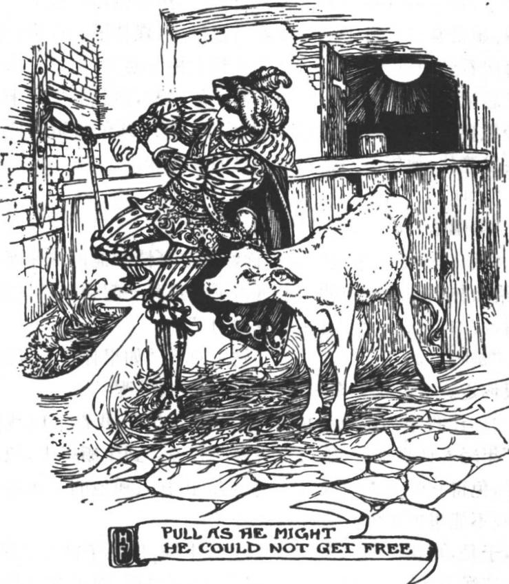

“我不能整天呆在这里，”哥雷瑟里把事情跟公主说了以后，公主没好气地说，“我已经累坏了，你得找些什么来把马车拉走，哪怕是猴子也行。要是找不到，我就开船回到我父亲那里去。”

可怜的哥雷瑟里听了公主的话，心中感到非常烦恼。他不是很爱她，因为在海上航行的时候，她就几次表现出多么无知和坏脾气。不过作为王子和新郎，他想可能是什么时候怠慢了她。所以，他赶紧吩咐随从快点去找什么能拉车的动物，找到以后立刻送过来。

马车停了那么久，公主始终坐在美丽的金色车厢里，蓝色的天鹅绒斗篷紧紧地裹在她身上，连她的鼻尖也看不见。后来，一个姑娘赶着头年轻的牛走过来，后面跟着王子的一个传令兵，他正热情地和她说话。

“能把你的牛借给我吗？美丽的姑娘！”哥雷瑟里看到他们，跳起来向他们走过去问道，“你愿意怎么开价都可以，我都会毫不吝惜地付给你。国王的儿子从来没有遇到过这种情形。”

“我的价钱是，在婚宴上，在你和新娘的后面，给我和我的两个朋友留三个座位。”她回答说。哥雷瑟里高兴地答应了。

就是六匹马，也没有这头牛拉着马车跑得快。森林和田野飞快地向后奔跑，速度那么快，新娘子感到头晕眼花，而且提心吊胆，害怕马车随时会翻倒。不过，尽管她怕得要命，什么事情都没有发生，马车平安无事地来到了王宫的门前。国王和王后都觉得很惊讶。婚礼正在紧张地筹备着，到了周末，一切准备就绪。也许是走运，公主这几天忙着准备她的结婚礼服和宝石，没有去注意哥雷瑟里，所以到了结婚的那一天，他也就几乎忘记了她在路上的时候是多么无理和粗暴。

城里那些年纪最大的男人和女人都一致认为，从来没有见过这么有气派的新娘子行列，她们正在向大厅里走去。王宫里正式举行婚礼以前，这里将举行盛大的宴会。公主的情绪很好，她感到所有人的眼睛都在看着她，左右两边的人都在微笑着向她鞠躬。握着王子的手，她骄傲地走进宴会厅，客人们早就来了。她在桌子一头的新娘席位上坐下，新郎就坐在她的旁边。这时候，三个穿着蓝、绿、红三种颜色艳丽服装的陌生女子走进来，在紧挨着新娘新郎后面的空位置上坐下。穿红衣服的是格尔劳葛，她把山林人的两个女儿也带来了。她一只手拿着桦木树皮棍子，另一只手提着个紧盖着的篮子。

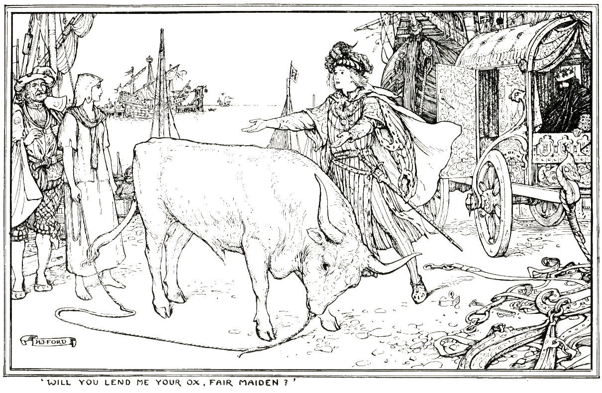

宴会开始以后，她们很安静地坐在那里。谁也没有注意她们，即使是看到她们的人，也都以为她们是未来王后的随从。正当宴会进入高潮，大家兴高采烈的时候，格尔劳葛忽然把篮子打开，里面飞出一只公鸡和一只母鸡来。令大家大吃一惊的是，两只鸡在新婚夫妇的前面转起圈来。公鸡把母鸡尾巴上的羽毛啄下来，母鸡想逃也逃不掉。

“你对我这么坏，是不是想像哥雷瑟里对待格尔劳葛一样？”母鸡终于忍不住叫起来。哥雷瑟里听到以后，猛然站起来，过去的一切记忆，突然涌上他的心头。旁边的公主被他忘得一干二净，他眼睛里似乎只看见许多年以前，小时候和他一起玩的那张脸。

“格尔劳葛在哪里？”他喊道，眼睛在大厅里寻找着。后来，他眼光落在那陌生的姑娘身上。她微笑着拿出十二岁生日时，他送给她的一枚戒指。那时候，他们还是青梅竹马，两小无猜。“我要娶你做妻子，而不是其他任何人！”他说着，拉起她的手，把她领到参加婚礼的人群中来。

接下来的情景真是难以叙述。当然，谁也不明白到底发生了什么事情。国王和王后也以为他们的儿子忽然疯了。至于那个公主，她的愤怒更是难以置信。客人们争先恐后地退出大厅，好让他们自己去处理这种棘手的问题。后来决定，给这个趾高气扬的公主半个王国，以代替她失去的未婚夫。她马上就起程，乘船返回自己的国家。不久她就和一个年轻的贵族订婚。实际上，她喜欢他胜过哥雷瑟里好多倍。当天晚上，哥雷瑟里就和格尔劳葛举行婚礼。他们一直幸福地生活在一起，同时，他们也给自己的人民带来了幸福。

 

## 小国王洛克的故事

在离法国海岸线两三英里的海面上，天气晴朗的时候，谁的船只从这里经过，都可以看到在深深的海底，有许多高大的树木。几百年以前，这些树木构成一片大森林，森林里生活着各种各样的野生动物。森林的旁边有一座漂亮的城市，城市由一座城堡守卫着，里面住着克拉里德斯公爵。可是后来，大海逐渐地向城市逼近，房子的基地一点一点地被侵食，一间一间地倒塌。到后来，这片土地全部被闪光的大海所淹没。不过，这些事情，是在我和你说的这个故事很久很久以后才发生。

克拉里德斯公爵总是生活在他的人民中间，不论是平时还是战时，他总是保护着他们的安宁。

这个故事开始的时候，公爵已经去世，留下年轻美丽的公爵夫人替他治理国家。当然，大家都希望她能够再结婚。可是她拒绝了所有来向她求婚的人，说她只有一个灵魂，所以只能嫁给一个丈夫，而且，她还有一个襁褓中的女儿，这也就足够了。

有一天，她坐在城楼上，眺望着远处的石南树林，树林里开满了黄色和紫色的花。这时候，她看到一支骑兵向城堡奔驰过来。骑兵的中间有一匹白马，配着黑色和银白色的马饰，上面坐着一个女士。公爵夫人马上就认出来，她是自己的朋友女伯爵布朗切兰得。她和自己一样，也是年轻守寡。她有一个小男孩，比自己的女儿阿贝勒·克拉里得斯大两岁。伯爵夫人很高兴地欢迎朋友的到来。可是，当女伯爵在她身边的沙发上坐下，说明自己的来意时，伯爵夫人的欢乐变成了哭泣。

“如你所知道的那样，”她的朋友拉起她的手，用自己的双手握住，说道，“女伯爵行将去世的时候，总是发现自己枕头旁边有一朵白玫瑰。昨天晚上，我上床睡觉的时候，感到特别不快活。今天一早醒来时，看到一朵白玫瑰靠着我的脸。在这个世界上，除了你以外，没有人能够帮助我。我来是请求你收养我的儿子尤里，让他当阿贝勒的哥哥，你能不能答应？”

哭泣和泪水使伯爵夫人说不出话来，她扑过去，搂着女伯爵，紧紧地拥抱。两个女人默默地分手，不幸的女伯爵不再说什么，她骑上马向自己的家里走去。她把熟睡中的儿子托付给女管家以后，就安静地躺到自己的床上。第二天早晨，人们发现她已经平静地去世。

于是就这样，尤里和阿贝勒形影不离，一起长大。伯爵夫人忠诚地履行她的诺言，成了两个人的母亲。等他们长大一些以后，常常带他们到公爵领地去旅行，让他们接触她的老百姓，懂得同情和帮助他们。

有一次，他们出去作这样的旅行，穿过一片鲜花盛开的草原以后，尤里看到远处群山之中，闪烁着一片耀眼的光芒。

“哪是什么？教母。”他用手指了一指，问道，“我想是巨人的盾牌吧！”

“不是！是像月亮一样大的银盘！”阿贝勒骑在一匹小马上，转过身来说道。

“它既不是银盘，也不是巨人的盾牌。”公爵夫人回答说，“它是美丽的湖泊。不过，尽管它很美丽，但靠近它是很危险的。因为湖泊深处居住着水女神，她会引诱那些过路人走向死亡。”

关于湖泊的谈话到此为止，可是孩子们却已经记在心中。一天上午，他们回到城堡以后，阿贝勒来找尤里。

“城楼的门开着，”她悄悄地对他说，“我们一起上去，也许能找到仙女。”

可是，他们一个仙女也没有看见。只是他们走到山顶上以后，那个湖泊显得更加碧蓝，更加有魅力。阿贝勒看了一会儿，然后说：

“你看见了吗？我想到那里去！”

“你千万不能去！”尤里说，“你听到过你妈妈说的话。再说，路又那么远，我们怎么能去呢？”

“这你应该比我明白！”阿贝勒轻蔑地说道，“这个问题你也来问我，作个男子还有什么意思？学那么多知识又有什么用？不过，世界上有的是男人，我可以找一个来问一问！”

尤里满脸羞愧，阿贝勒从来没有这样说过话。尽管她比他还小两岁，这时候好像忽然长大了许多。她站在那里，用嘲弄的眼光看着他，直到他因为被一个小姑娘看不起而生气。他拉着她的手，大胆地说：“好吧！我们一起到湖那边去！”

第二天下午，当伯爵夫人在她的侍女簇拥下绣挂毯的时候，两个孩子像往常一样，到花园里去玩。等他们看到周围没有别人的时候，尤里走过来拉着阿贝勒的手说：“来吧！”

“到哪里去？”阿贝勒睁大着眼睛问。

“当然是到湖那边去！”男孩子回答。

阿贝勒不吱声了。她心里想着，假装不听话是一回事，而且那已经是昨天的事情；真的到那么远的地方去又是另一回事，而且这个时候走，不会有人知道你已经走出花园！“穿着绸缎鞋子去！你们这些男孩子可真笨！真的！”

“不管笨不笨，我反正要到湖那边去，你也跟我一起去！”尤里说。他没有忘记，也不会原谅她那天看着他的眼神。“除非是你感到害怕了，那我就自己去！”他又补充说。

这一下，阿贝勒可受不了了，她哭了起来，搂着尤里的脖子说，不论他到什么地方去，她都要跟着。于是，两个人就这样和解了，他们一起动身了。

这一天天气很热，城里的人都躲在家里，等着天上的太阳低下来以后，再出来干活或者游玩。所以，孩子们从马路上走过的时候，没有人看见他们。他们从河上的桥走过，来到那天和母亲骑马经过的鲜花盛开的草原。走着，走着，阿贝勒觉得口渴了。太阳已经烤干了每一滴水，她一口也喝不上。他们又向前走了一段路，幸运地看到一棵结满樱桃的樱桃树。他们吃过休息过以后，感到有了足够的力气，几分钟里就可以走到湖边。

可是没有多久，阿贝勒走路就一瘸一拐起来，说她的脚痛得厉害。尤里解开她的鞋带，看看是怎么回事。原来是一粒石子掉进去了，这个问题当然很容易解决。他们又说说话，唱唱歌地走了一会儿，直到阿贝勒又停下来。这一回是她的鞋子掉了。她回过头去拾，抬头看见城堡上的塔，距离那么远，她的心里感到很不安，开始哭起来。

“天已经开始黑了，狼会出来把我们吃掉的。”她呜咽地说着。尤里搂着她，安慰她说：“好了，我们现在已经靠近湖泊了，用不着害怕！我们很快就可以回家吃晚饭了。”阿贝勒擦干眼泪，加快脚步跟着他。

是的，前面就是湖泊。湖岸边映射出蓝色、紫色、白色和金色的彩虹；湖面上漂浮着水百合花。周围一个人影都没有，也没有阿贝勒感到害怕的野兽，只有沙滩上留下一些交叉着的小脚印。小姑娘立刻脱下她那双坏鞋子和长袜子，让湖水冲洗她的脚。尤里则东张西望，想找些果子和草莓，可是什么也没有找到。

“回去离这里不远的路上，我看到有一些草莓树丛，”他说，“你在这里等我，我去采些水果来。然后我们就回家。”阿贝勒懒洋洋地把头靠在一堆柔软的苔藓上，嘴里喃喃地回答他，很快就睡着了。她梦见一个从未见过那么小的人，骑着一只乌鸦，在她的头上盘旋，然后又消失了。这时候，尤里回来了，把一大把连叶子一起摘下的草莓放在她身边。

“还是让她再睡一会儿吧。”他心里想着，穿过一片银柳树，来到一个能更清楚地看见湖泊的地方。月光在湖面上荡漾着，景色像仙境一样美丽。慢慢地，银光像幕一样地拉开来，一个美丽的绿长发妇女伸出双手向他漂浮过来。男孩子忽然感到害怕起来，赶紧转身逃跑，可是太晚了。

阿贝勒一点也没有想到，可怕的厄运已经降临到她养兄的头上。她还在睡梦中，连一群长着白胡子的小矮人围着她，跪在她的身边，她也没有醒过来。

“我们该把她怎么办？”皮克说，他看上去年纪最大，虽然他们都很老了。

“做一个笼子，把她关进去。”路格回答。

“不行！不行！这么美丽的公主关在笼子里能干什么？”迪格说。

他们之中最善良的塔得提议把她送回到她父母那里去。可是其他侏儒那么喜欢这个新玩意儿，这句话根本听不进。

“看！她醒了！”珀尔轻轻地说道。这时候，阿贝勒慢慢地张开眼睛。开始，她还以为自己还在做梦。可是那些小人一动不动，她才忽然意识到，这是真的。她站起来，大声地喊叫着：

“尤里！尤里！你在哪里？”

听到她喊叫的声音，那些小人更加近地向她围拢过来。她害怕得浑身发抖，用双手掩住自己的脸。小矮人见她这样，一时也愣住了，不知道该怎么办才好。这时候，塔得爬到她头上的一棵柳树上，弯下腰来，用手轻轻地抚摸她的手。小姑娘知道，这是友好的表示，就把手放下来，看着这些逮住她的人。过一会儿以后，她开口说：“小矮人，你们长得那么丑，真是太遗憾了。不过，这没有关系。只要你们能给我一点吃的东西，我也会喜欢你们的，我饿得要死。”

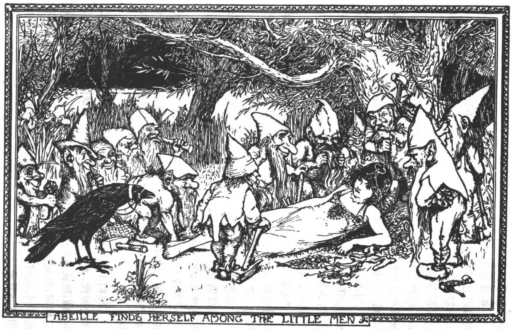

她这句话一说，在小矮人中立刻引起一阵骚动。有些人听到说自己丑，非常生气，说她活该留在这里，不要让她好过。其他人却一笑置之，说一个凡人怎么说他们都没有关系。塔得吩咐他们的信差去给她拿些牛奶、蜂蜜和最好的白面包来，这些面包是在他们的地下炉子里烘出来的。阿贝勒鞋带还没有结好的工夫，他就骑在自己的乌鸦身上回来了。她吃过面包和蜂蜜，喝过牛奶以后，就一点也不感到害怕了，很愿意和他们说话。

“小矮人，”她抬起头来微笑着说，“你们的晚饭好极了，谢谢你们。我的名字叫阿贝勒，我哥哥的名字叫尤里。帮我把他找回来，告诉我回到城堡里去的路。我妈妈一定很担心，以为我们出了什么可怕的事情了！”

“可是你的脚受了伤，不能走路！”迪格说，“而且我们也不能穿过边界，走进你们的国家。最好的办法是用树枝做一个担架，铺上一些苔藓，把你抬到山里去见我们的国王。”

大多数女孩子要是听说把自己一个人抬到陌生的地方去，一定感到非常害怕。可是阿贝勒这时候已经不觉得害怕了，反而对这种奇遇和冒险感到高兴。

“等我回家的时候，我会有多少事情对妈妈和尤里讲！也许他们一辈子也不会有机会到山里来，哪怕是他们能够活到一百岁！”于是，她舒服地躺在苔藓做成的窝里，等着瞧会发生什么事情。

他们不停地往山上爬。慢慢地，阿贝勒又睡着了。等她醒过来的时候，太阳已经大放光芒。小矮人还在继续向山上爬着，尽管他们跳跃石头的本领比一般人大，可是他们走路的速度很慢。忽然间，投向担架的光线好像变了，虽然还是那么明亮，但却有所不同。这时候，担架停了下来，小矮人都围过来，帮助阿贝勒从担架上下来。

她的面前站着一个身高还不到她一半的人，但衣着华丽，神态威严。他的头上戴着一顶王冠，上面的钻石那么大，令你难以相信，他这么矮小的身体怎么承受得了。一件国王的大衣披在他的肩上，他的手中拿着一根长矛。

“洛克国王，”一个森林里的侏儒说，“我们看到这个美丽的孩子睡在湖边，就把她给你带来了。她说，她的名字叫阿贝勒，她母亲是公爵夫人克拉里得斯。”

“你们做得对，”国王说，“她将成为我们之中的一员。”他踮起脚跟，好吻她的手。他告诉她，他们都会很照顾她，让她幸福。不论她需要什么，都能够立刻得到。

“我要一双鞋子。”她说。

“鞋子！”国王用长矛敲打地面，命令说。一个小矮人马上就给她的脚套上一双漂亮的银灰色的鞋子，上面镶着珍珠。

“这是一双很好看的鞋子，”阿贝勒有点怀疑地说，“可是，你看我穿着它能回到我妈妈那里去吗？”

“不！这双鞋不是用来走崎岖的道路的，”国王回答说，“可是它能走山上平坦的路，我们有许多奇妙的东西要让你看！”

“小国王洛克，”阿贝勒说，“把这双美丽的拖鞋拿走，给我一双木底鞋，让我回到妈妈那里去！”可是，洛克国王只是摇摇头。

“小国王洛克，”阿贝勒又说了，这一回，她的声音有点发抖，“让我回到我妈妈和尤里那里去，我会全心全意地爱你的，差不多就像爱他们一样！”

“谁是尤里？”国王洛克问。

“嗯，尤里，当我还是个婴儿的时候，他就和我们住在一起。”阿贝勒回答。她觉得很奇怪，这个人人皆知的事情他怎么会不知道。而且他会没有想到，她说到这个男孩子的时候，已经把自己的命运和他联系在一起了。其实，国王洛克早就想好了，过了几年，她就是一个好妻子，所以他不想让尤里插进来。所以，他一句话也不说。阿贝勒看到他不高兴，眼泪流了下来。

“小国王洛克，”她拉着他的斗篷喊道，“想想看，我的母亲会多么悲伤，她会以为我被野兽吃掉了！或者是淹死在湖里了！”

“请放心，”国王洛克回答说，“我会托个梦给她，这样她就会知道你没事。”

听他这么一说，阿贝勒开心起来，她笑着说：“小国王洛克，你真聪明！可是，你得每天晚上给她一个梦，这样她就可以天天在梦中见到我了；你还要托梦给我，让我也能在梦中见到她。”

国王洛克答应了。

阿贝勒逐渐习惯于不和妈妈及尤里在一起以后，在这个新的家里过得很幸福。大家对她都很好，人人都宠爱她。这里还有那么多看不完的新鲜事。这些侏儒整天忙忙碌碌，他们知道怎么做漂亮的玩具，做得和地面上的人一样好，甚至比他们的还要好。她还经常跟着塔得或迪格在地下走廊里游玩。从岩石的裂缝中往上看，她可以看到蓝色的天空，这是她最喜欢做的事情。就这样，她在地下一过就是六年。

“国王洛克陛下想在他的房间里见你。”一天早晨，阿贝勒在弹奏一把金色的诗琴的时候，塔得走进来对她说。国王一下子变得这么正经起来，她觉得很奇怪，立刻就动身去见他。

国王洛克一看到她进来，立刻打开墙壁上的一扇门，它通向国王的宝藏室。阿贝勒还没有进去过，堆在她面前的这些珍宝令她惊讶不已。房间里到处都是黄金、宝石、绸缎、华丽的地毯。她一边走，一边观赏这些光芒四射的珠宝。国王登上了大厅一头一张用黄金和象牙做成的宝座，看着她。“随便挑选你喜欢的。”他终于这样说。一串用最美丽的珍珠做成的项链挂在墙上，她在这根项链和另一根钻石和蓝宝石项链之间犹豫一会儿以后，把手伸向珍珠项链。可就在这个时候，她通过岩石上面的裂缝，看到了上面蓝色的天空。“小国王洛克，让我再回到地面上去吧！”她说。

国王洛克向管理珍宝的人做了个手势。那人立刻把一个保险箱打开，里面装满了非常珍贵的宝石，比地面上任何一个国王佩带的宝石都要大，都要耀眼。“随便你挑，阿贝勒！”洛克国王轻声地说道。

可阿贝勒只是摇摇头。

“对我来说，克拉里德斯花园里的一滴露水都比这些钻石中最好的一颗明亮，”她回答说，“最蓝的宝石也比不上尤里的眼睛蓝。”她说这些话的时候，洛克国王感到心里一阵刺痛。好一阵子，他一句话也不说。然后，他抬起头来看着她说：“只有那些鄙视财富的人，才有资格得到它。戴上这顶王冠，从现在起，你就是侏儒国的公主了。”

整整三十天，地下王国的人什么也不干，他们天天设宴，祝贺新的公主。欢宴结束以后，国王穿着最华丽的服装，来到阿贝勒的面前，庄严地向她求婚。

“小国王洛克，”姑娘回答说，“你对我那么好，那么善良，我爱你就像你爱我一样。可是，除了这种爱，就绝对不可能再有别的爱了。”

国王叹了一口气，这个答案虽然在意料之中，可他仍然深感失望。不过，他勇敢地把它深深地埋在心里，还笑着说：“那么，阿贝勒，你能够答应我一件事吗？假如有一天，你找到了值得你爱的人，你能告诉我吗？”

这一点，阿贝勒答应了。

这以后，尽管人人都像以前一样，对她还是很好，可阿贝勒再也不是那个整天和小矮人一起游玩的、快活的小姑娘了。住在地下的人长得很快，比住在地面上的人快得多了。她虽然只有十三岁，可看上去已经是一个成熟的姑娘。而且，国王洛克的话使她陷入了无限的思念之中。她常常独自一人呆上几个钟头。她的脸不再是红润的圆圆的了，而是又瘦又苍白。小矮人尽最大的努力，和以前一样想逗她玩。可是毫无用处，她对他们一点兴趣都没有了，连那把诗琴也被她扔在一旁的地上。

有一天上午，她好像有些变了。她离开自己常常一个人坐着的、挂着美丽丝绸的房间，来到国王的面前，拉着他的手，走过长走廊，来到可以看见一片蓝天的地方。

“小国王洛克，”她双眼看着他，说，“让我再看到我的妈妈，不然我会死去。”她的声音，还有整个身体都在发抖。看到她这个样子，就是敌人也会怜悯她。可是，爱着她的国王却什么也没有说。阿贝勒一整天都呆在那里，看着天色一点一点地暗淡下去，星星也渐渐地露出脸来。可她还是一步也不肯走开。忽然，有一只手碰了她一下，她吃惊地回过头来，原来是国王洛克。他从头到脚都披着一件黑斗篷，手中还拿着一件。“把它披上，跟我来！”他只说了这句话。不过她多少有点猜得出，她要去见妈妈了。

他们不停地往前走，通过阿贝勒从未来过的走廊。后来，她终于又回到了外面的世界。啊！外面的世界是多么美丽！空气是多么新鲜！鲜花是多么芬芳！她觉得自己仿佛快活得快要死了一样。就在这个时候，国王洛克把她举起来，他虽然很小，可是却轻而易举地把她抱过花园，进入一扇开着的门，走进静悄悄的城堡。

“听着！阿贝勒，”他小声地说着，“你已经猜出来了，我们要到什么地方去。每天晚上，我都把你的形象送给你妈妈看，她在梦中和你说话，对着你笑着。今天晚上，她看到的将不是你的形象，而是你本人。不过你要记住，要是你碰她一下，或者和她说话，我的魔法就没有了，从此以后，她就再也见不到你的形象或者你本人了。”

这时候，他们已经来到了阿贝勒非常熟悉的房间。小矮人抱着她跨过门槛的时候，她的心激烈地跳动着。在床上面那盏灯光的照耀下，阿贝勒看到了她的母亲。她还是那么美丽，但脸色苍白，而且充满了悲伤。她母亲向她伸出了双臂，姑娘满含着快活的泪水，弯着腰向母亲的怀中扑过去。可是国王洛克赶紧把她抱起来，带回到自己的侏儒国去。

假如国王以为，他只要满足阿贝勒的要求，就给了她幸福，那么，他很快就发现，自己错了。姑娘坐在那里整天不停地流泪，根本不去理睬朋友们为安慰她所做的一切努力。

“告诉我，是什么让你这样悲伤？”国王洛克终于问道。

阿贝勒回答说：“小国王洛克，还有在这里的我的所有朋友，你们那么好，那么善良，我知道，我遇到什么麻烦的时候，你们都很伤心。我要是能够高兴起来，我一定高兴，可这太难了，我实在办不到。我所以要哭，是因为我再也见不到尤里了，我真心实意地爱着他。这比和我母亲分开还要叫我伤心。因为至少我还知道她在什么地方，在干什么。可尤里呢，我甚至不知道他是死还是活。”

小矮人都沉默不语。他们虽然都很善良，但毕竟和凡人不同。他们从未感受过无比的欢乐和巨大的悲伤，只有国王洛克隐隐约约地猜到一些。他走出去，找一个年纪很大很大的小矮人商量。他住在山底下最深的地方，有各种各样的望远镜，不但可以看到地面上的一切，还可以看到海底下的事情。

纳尔，这就是那老人的名字，他试了许多望远镜，才找到了尤里的线索。

“他在这里！”他终于喊出来了，“他坐在温狄娜斯王宫里，在那大湖的底下。可是，他不喜欢他的监狱，他渴望着回到世界上来，做轰轰烈烈的事情。”

事情正是这样，自从他离开克拉里德斯城堡，和阿贝勒一起来到蓝湖以后，七年已经过去了。在这七年中，他已经长成了一个大人。

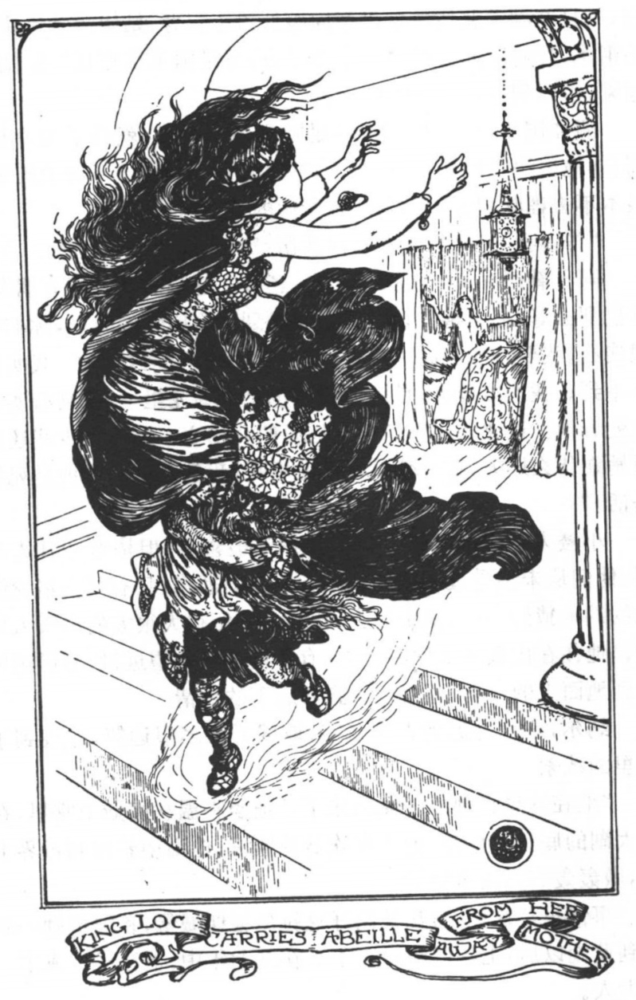

他越是长大，越是为自己在那些绿头发女郎的手中，被当作宠物来玩弄而担忧。有一天，他跪在温狄娜斯女王脚下，请求允许他返回自己的家乡。

女王弯下腰来，抚摸着他的头。

“我们不能让你走，”她温柔而轻声地说，“留下来，你将成为国王，和我结婚。”

“可是，我要和阿贝勒结婚。”年轻人大胆地说。可惜他的话只是像一阵风一样地吹过。女王终于发脾气，命令把他关到一个专门为他修建的水晶笼子里。

国王洛克在纳尔望远镜的帮助下，走了许多星期的路程，才来到这里找到他。我们知道，侏儒走路的速度很慢，路又那么远，那么难走。幸运的是，出来的时候，他随身带着魔环。他用魔环一碰水晶笼子的墙，笼子就从顶上到底下全部裂开。

“沿着那条路走，你就会发现，自己又回到了以前的世界。”他对尤里说。不等年轻人说一句感谢他的话，他就动身赶回自己的家。

“博格，”他对骑着乌鸦来接他的小矮人说，“快点回到王宫里去，告诉阿贝勒公主，在温狄娜斯王国当了七年俘虏的尤里，已经回到克拉里德斯城堡了。”

尤里从山上走下来以后，遇到的第一个人，是他来到这座城堡以后给他做衣服的裁缝。这位老朋友看到失踪多年的小主人，高兴得难以自已。尤里急忙打听养母和阿贝勒的消息。

“啊！我的伯爵，你到底是到哪儿去了？就在你失踪的那一天，阿贝勒公主被小矮人带走了也不知道？起码我们是这么猜想的。这一天，给伯爵夫人留下了巨大的创伤！是的，她一直充满着希望，她的女儿还活着。因为每天晚上，可怜的母亲总会做一个梦，告诉她公主在做些什么。”

好心的人继续告诉他，七年来乡村里发生的变化。可是尤里那里有心来听他说这些。他的心早就飞到阿贝勒那里去了。

他终于站起来，为自己的迟到而羞愧。他急忙赶到伯爵夫人的房间。她把他紧紧地抱在怀里，好像再也不愿意让他走了。过了一会儿，等她安静下来以后，他开始问阿贝勒的消息，打听如何才能把她从小矮人的手中救出来。伯爵夫人对他说，他们失踪以后，她立刻就派人四处寻找。有一个人看到了在很远的山上，有一群小矮人在走动，而且很明显是在抬着一副担架。他赶紧追上去，看到脚下有一只小的绸缎鞋。他弯下腰把它捡起来。可就在这时候，一群小矮人像苍蝇一样蜂拥而来，对准他的头就打，直到他手中的鞋子掉下。他们捡起鞋子就走了，让他一个人头痛得昏沉沉地躺在那里。等他清醒过来的时候，那群山里的小矮人已经无影无踪了。

这天晚上，等所有的人都睡着以后，尤里和他的老仆人法兰斯科偷偷地来到军械库。他们戴上头盔，穿上轻型的盔甲，拿起短剑，全副武装起来。然后，他们来到森林里，骑上法兰斯科事先准备好的马，就动身到侏儒国去。艰苦地跋涉了一个钟头以后，他们来到了一个峡谷。法兰斯科小时候就听说，这里通向地下世界。他们从马上下来，小心翼翼地走进山洞。他们以为里面一定是像外面漆黑的夜一样，伸手不见五指。可是刚走了几步，山洞里忽然大放光芒，几乎把他们的眼睛都照瞎了。光线似乎是从打开了的走廊门里射出来的，这扇门正好把前面的路隔开。

“你们是什么人？”一个声音大声地问。

尤里回答说：“我是尤里，是来救阿贝勒的！”听他这么一说，门慢慢地打开了。他们走进去以后，大门又关闭起来。

尤里听到铛琅一声关门的声音，心里不禁害怕得抖动了一下。不过，已经没有退路了，他又鼓起勇气。前面开过来一群侏儒士兵，他们射出来的箭像冰雹一样地向他倾泻过来。他举起盾牌挡住它们。这时候，他看到一个小矮人站在比其他人高的一块岩石上，头上戴着王冠，肩上披着国王的斗篷。尤里立刻扔掉盾牌，不顾向他射过来的乱箭，奔到前面来。

“啊！是你！真的是你吗？我的救命恩人！是不是你的部下把我心爱的阿贝勒捉起来了？”

“我是国王洛克，”他回答。这个胡子很长的国王仁慈地看着心急如焚的年轻人继续说，“如果说阿贝勒和我们一起住了许多年，大部分时间，她都是很幸福的。我们侏儒在你看来是那么小，但我们是富有正义感的人，我们决不会违背她的意志把她留下来。请公主仁慈地到这里来一下。”他转过身去对路格说。

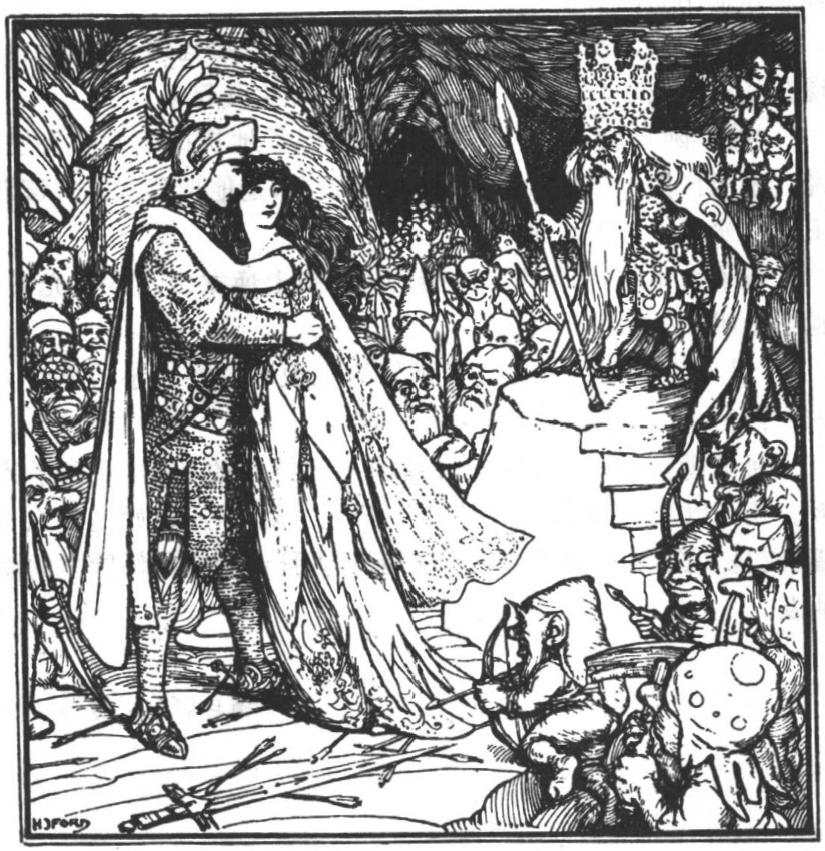

在一片死一般的寂静中，阿贝勒走进这宽广的大厅，注视着她的周围。开始，她只看见许多小矮人坐在地下，或者靠着墙站着。后来，她的眼睛看到了尤里，她禁不住从内心发出一声叫喊，向他扑过去，投入他的怀抱。

“阿贝勒，”国王洛克看了她一会儿，脸色苍白地问，“这就是你想和他结婚的那个人吗？”

“是的，小国王洛克，除他以外，我不会嫁给任何人！你看，我现在是多么快乐！多么幸福！”说着，她开始哭起来。

“嘘！阿贝勒，今天不能哭！”尤里温柔地抚摸着她的头发，说，“来吧！擦干你的眼泪，感谢洛克国王，是他把我从温狄娜斯王国的笼子里救了出来。”

听了尤里的话，阿贝勒抬起头来，脸上焕发出奇异的光彩，她终于明白了。

“是你为了我这样做的！”她轻声地说着，“啊！小国王洛克……！”

阿贝勒怀着歉意，带着洛克国王送给她的礼物，回到了家乡。几天以后，他们举行了隆重的婚礼。后来，不论她是多么幸福，或是多么忙碌，她总是每个月都要去拜访她在侏儒国里的老朋友。

（摘自《阿贝勒》）

 

## 吹牛皮的故事

有一天，一个经营粮食的银行家在乡下赶路。这个银行家也和他的大多数同行一样，非常贪婪。这一天，他很伤心，因为没有机会赚到一分钱。这时候，他看到了前面有一个农民在走，心里忽然一亮。

“好运来了，”他心里想着，“让我看一看，这个农民是不是有空子可以钻。”他加快了步伐赶上去。

他们俩很有礼貌地打过招呼以后，银行家对农民说：“我看到你之前，正感到非常沉闷。既然我们同路，有了一个这么合得来的伙伴，走起路来就轻松得多了。”

“我很同意，你说得对！”农民回答说，“可是我们说些什么呢？像你这样的城里人，对牲畜和庄稼不会感兴趣。”

“哦！”银行家说，“让我来告诉你我们该说什么。我们轮流讲自己能想象得到的最荒唐的故事。谁要是第一个对对方的故事表示怀疑，谁就付给对方一百个卢比。”

对这个提议，农民表示同意，他还说，既然银行家比他大，就请银行家先说。他还暗暗提醒自己，不论银行家的故事是多么荒唐，也不能流露出半点怀疑。农民既然那么客气，银行家也就开始讲他的故事了。

“有一天，我走在这条路上，看到一个商人赶着一大队骆驼，驮着许多货物……”

“不会错，”农民小声地说，“这种事情我也亲眼见过。”

“起码有一百零一头骆驼，”银行家继续说，“用一根绳子把它们的鼻子和尾巴连在一起，在路上排成一队，几乎有半英里那么长……”

“嗯。”农民说。

“咳！这时候，一只老鹰从最前面的那头骆驼头上飞过，用力把它拉上天空。那些骆驼因为都用绳子拴在一起，所以另外一百头也跟着飞上天…… ”

“真惊人！老鹰的力量那么大！”农民说，“可是……啊！是的，毫无疑问，一百零一头骆驼……它把它们怎么办呢？”

“你不相信？”银行家问。

“不！一点也不怀疑！”农民热情地回答。

“这时候，”银行家接着说，“恰巧邻国的一个公主坐在她的私人花园里，一个侍女在帮她梳头。侍女用力往后一梳，公主的头往后一扬，不巧就在这个时候，那倒霉的老鹰带着它的猎物正好从她的头上经过。也是无巧不成书，那些骆驼挣扎了一下，老鹰再也拉不住它们。一百零一头骆驼从天上掉下来，不偏不倚地落在公主的左面一只眼睛里！”

“真可怜！”农民喊道，“眼睛里掉进一粒沙子也痛得要命！”

“嗯！”银行家这时候正非常投入，“公主摇摇头跳起来，用手拍拍自己的左眼。‘我的天！’她喊叫着，‘是什么东西掉到我的眼睛里去了，痛得厉害！’”

“常常有这种事情发生，”农民说，“一点也不错。后来，可怜的公主怎么办呢？”

“听到她的喊声，侍女赶紧跑过来帮忙。‘让我看一看，’她说。说着，她把公主的眼皮翻开，一头骆驼掉出来了！侍女把它放到自己的口袋里去。（‘啊！’农民这时候喊了一声。）接着，她只是挥动一下自己的头巾，就把公主眼睛里的一百头骆驼全部钓出来，塞进自己的口袋，和另一头骆驼放在一起。”

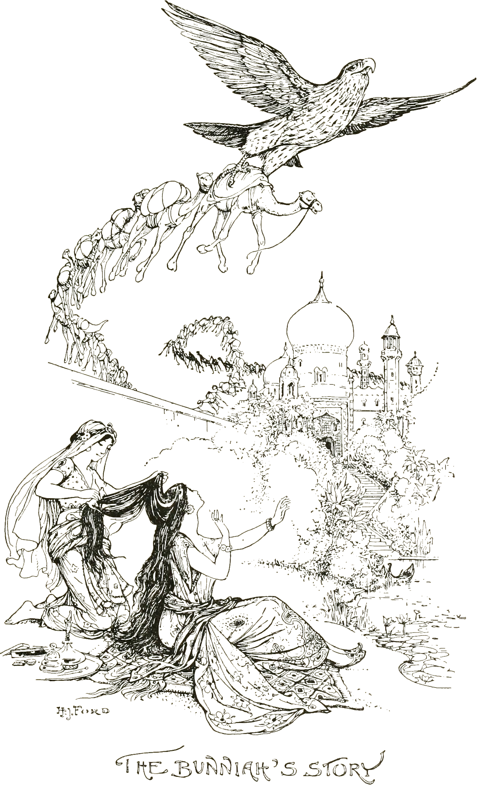

说到这里，银行家像有点喘不过气来似的，深深地透了一口气。可农民只是慢悠悠地看着他说：“后来呢？”

“我再也想不出来了。”银行家回答说，“再说，故事到此也就结束了。你认为怎么样？”

“妙极了！”农民说，“毫无疑问，完全是真的！”

“那好吧！现在轮到你了。”银行家说，“我在等着听你的故事呢！我敢肯定，它一定非常有趣！”

“是的，我想那是一定的。”农民说，接着，他开始讲自己的故事。

“我父亲是个富有的人，他有五头奶牛，三对同轭牛，六头水牛，还有许多山羊。可是，尽管他非常富有，他最喜欢的还是一匹母马。那是一匹良种马！啊！真是一匹好马！”

“是的！是的！”银行家打断他的话说，“说下去！”

“我在继续往下说呢！”农民说，“别催我！嗯！有一天，这一天真倒霉！他骑着母马到市场去，不料拿了一个坏马鞍，把马背擦得很厉害。等回到家的时候，马背上的一块皮也擦烂了，大约有你手掌那么大的一块。”

“是的，”银行家不耐烦地说，“后来呢？”

“那时正是六月，”农民说，“你知道六月份是个什么鬼天气！总是风沙不断，还常常下雨！可怜的牲畜伤口上蒙上了一些尘土，尘土里还夹杂着一些麦粒，再加上天气潮湿，麦粒竟在马背上发芽生长起来！”

“麦子有了一定的条件就会发芽。”银行家说。

“是的，接下来，我们看到了，马背上长出一片庄稼来，看起来有一百英亩地那么大！我们不得不雇用二十个人来帮忙收割！”

“到收割的季节，常常得请人来帮忙。”银行家说。

“从这匹母马的背上，我们打下来近四百磅麦子！”农民继续说。

“收成真不错！”银行家喃喃地说着。

“这时候，你的父亲，”农民说，“一个可怜的家伙，穷得几乎要断气了！（银行家非常气愤，可是他不吱声。）他来找我的父亲，双手尽可能卑贱地合在一起…… ”

银行家怒气冲天地瞪着他的伙伴，可是他咬着嘴唇，一句话也不说。

“‘我已经整整一个星期没有吃过一口饭了，啊！高贵的主人，从你的仓库里借给我十二磅麦子吧，我会还给你的。’”

“‘当然，邻居，’我的父亲说，‘你需要就拿走吧，等你有了再还给我。’”

“嗯？”银行家眼中燃起怒火，哼了一声。

“嗯！他拿起麦子就走了，”农民说，“可是没有来还，一直欠到今天。有时候，我在想，是不是应该上法庭去？”

这时，银行家开始掰着手指很快地算起来，嘴里还不停地念着。

“你这是怎么啦？”农民问。

“还是麦子便宜，我给你麦子。”银行家说。他没有忘记自己想出来的，和农民赌一百卢比的事情。他虽然很失望，但倒也很冷静。

直到今天，当人们向别人讨债的时候还会这样说：“把钱还给我，要不，起码得给我麦子。”

（口头传说）

 

## 豺还是虎

一个夏天的夜晚，在兴都斯顿有个国王和王后在王宫里睡觉。王宫坐落在城市当中，微风不时从窗格里吹过来。他们都希望自己很快就能入睡，可是不能如愿以偿。这时候，外面传来嚎叫的声音，这一下，他们的脑子就更加清醒了。

“听！老虎的叫声！”国王说。

“老虎？”王后说，“老虎怎么会跑到城市里来呢？那是豺的叫声！”

“我跟你说，那是老虎！”国王说。

“我跟你说，如果你认为那不是豺，那你一定是在做梦！”王后回答说。

“我说，那是老虎！”国王喊叫起来，“别跟我顶嘴！”

“胡说！”王后也厉声地说，“是豺！”他们激烈地争吵起来。后来国王说：“很好！我们把卫兵叫过来问。如果是豺，我就走，把王国留给你；如果是老虎，你就走，我再娶一个新娘。”

这样，国王把在外面守卫的两个士兵喊进来，向他们提出这个问题。不过，国王和王后争论的时候，声音那么大，两个卫兵早就听见了他们在吵些什么。于是，一个士兵提醒另一个说：“我们还是说国王是对的吧！当然，那显然是豺在叫。可是，要是我们说真话，国王多数不会守信用，离开这个国家，那时我们的麻烦可就大了。所以，我们最好还是站在他那边。”

另一个卫兵也同意了。于是，当国王问他们听到了什么动物在叫的时候，两个卫兵都说，当然是老虎了。结果像以前一样，国王总是对的。国王不再说什么，叫人抬来一顶轿子，命令王后进去，然后吩咐抬轿的人把她抬到很远的森林里去，把她扔在那里。尽管她泪流满面，但不敢违抗国王的命令。轿夫抬着轿，走了三天三夜，来到森林密处。他们把轿子放下，然后自己回家。

王后这时候在想，国王不会真的想把她送走，等他脾气发过以后，会来把她接回去。所以，她安静地等了好长时间，竖起耳朵听着，听听有没有脚步声走过来。可是什么也没有听到。再过一会儿，她开始不安起来，因为周围一个人都没有。她从轿子里伸出头来，四处张望。这时候，天刚拂晓，鸟儿和昆虫开始活动起来，树叶在暖风的吹动下沙沙作响。尽管王后的眼睛不停地注视着周围，可是一个人影也看不见。这时候，她完全失望了，开始哭起来。

恰巧，就在王后的轿子停放的附近，住着一个农民，他和妻子远离人群，在这密林里居住，种植着一小块地。因为天气很热，农民这天晚上睡在他的平顶屋顶上，早上被哭泣的声音吵醒。他爬起来，很快就从楼梯上下来，向传来哭声的森林里跑过去，看到了王后的轿子。

“啊！可怜的人，你在哭些什么？”农民站在远一些的地方，问她，“你是谁？”对于这个陌生人的问候，王后不知道该说什么好，因为不知道是好人还是坏人，她没有回答。

“喂！哭着的人，”农民又说道，“跟我说话用不着害怕，我就像是你的父亲一样。告诉我吧！你是谁？”

他的声音很和蔼，王后这才鼓起勇气说话。她把自己的经历对他说了以后，农民把他的妻子叫来，把她带回到自己家里去，给她东西吃，铺好床让她睡觉。她在这里住了几天以后，生下了一个小王子。依照母亲的意愿，他们叫他阿米尔·阿里。

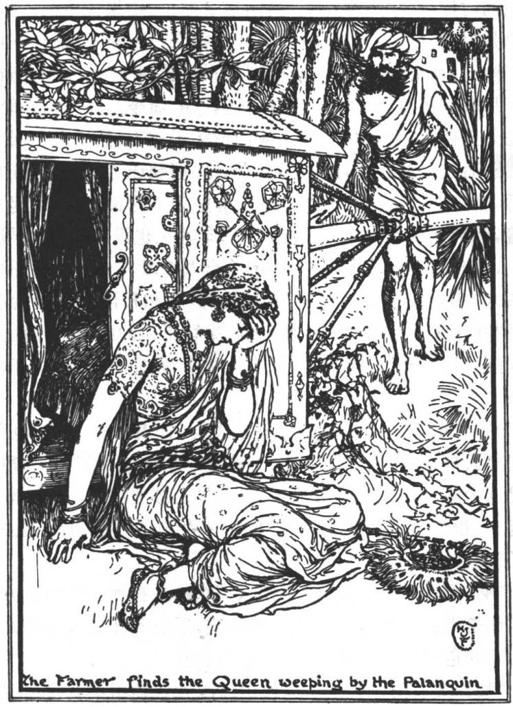

一年又一年过去了，国王那里一点信息都没有，也许他以为妻子早就死了。王后仍然和农民住在一起。王子这时候也长成了年轻力壮、英俊潇洒的青年。他们住在森林里，远离外面的世界，很少有人到这密林中来。王子不断地请求母亲和农民，让他出去自己谋生，寻找自己的幸福。可是，她和聪明的农民总是劝他再等待。等到他满十八岁以后，他们就不忍心再留他了。于是，在一个早晨，他出发了，带着一把剑，一个盛水的大铜罐，一些银币，还有一把双弦弓，以便路上用来射鸟。

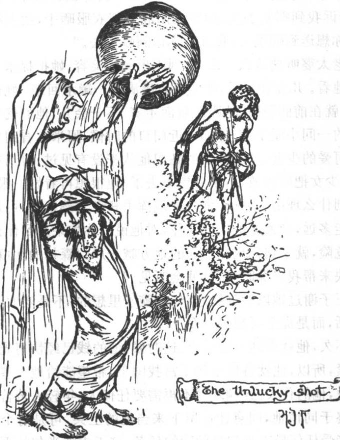

他一连走了许多天，一路上觉得很乏味。后来有一天上午，他看到前面有一片森林，就像他出生和生长的那片森林一样。他兴高采烈地走进去，好像是去见一个老朋友一样。他穿过密林的时候，看到一只鸽子在飞，心想正是一顿好饭，于是拿出弹丸来就射。可是没有射中，鸽子惊慌失措地飞走了。这时候，他听到有人大声喊叫的声音，他走过去一看，只见一个丑老太婆举着一个大水罐，水罐底下有个洞，她正把洞里流出来的水往自己的身上浇。一边浇，一边还大声地喊叫着。看到王子拿着弓走过来，她大声地对他说：“啊！你这个坏家伙，干吗要找像我这样可怜的老太婆开玩笑？你这愚蠢的花招把我一罐干净的水都断送了，叫我再到哪里去找？汲一罐水多不容易，跑一次就把我累坏了，我那儿还有力气跑两趟？”

“大娘！”王子回答说，“我没有和你开玩笑！刚才我在射一只鸽子，想用来当午饭吃，可是弹丸打偏了，一定是打中了你的水罐。不过，我会把我的铜罐赔给你，它不会那么容易坏。至于水嘛，告诉我到哪儿去汲，你在太阳底下把衣服晒干，我去给你提来。你想送到哪里去，我就给你送到哪里去。”

老太婆听他这么一说，立刻露出满脸笑容。她把提水去的路指给他看。几分钟以后，他就提着满满的一罐水回来。她也不说什么，就在前面领路，他跟在后面走着。不一会儿，他们就来到森林里的一间小屋子前。他们走近门口的时候，阿米尔看到里面有一个可爱的少女，这么漂亮的姑娘他从来没有见过。看到有陌生人来，少女把面纱放下，走到屋里去了。他很想再看她一眼，可是找不到什么理由，只好心事忡忡地挥手和老太婆告别。可是他还没有走多远，老太婆就把他叫住，对他说：“你如果遇到什么麻烦事和危险，就来到你现在站着的地方喊一声：‘森林仙女！森林仙女！快来帮我！’那时候，我就会听见。”

王子谢过她以后继续赶路。他脑子里想的，不是老太婆说的那些话，而是那个可爱的少女。

不久，他就来到一座城市。这时候，他的钱已经快用光了，手头很紧，所以，他就直接来到王宫找国王，希望能给他一些活干。国王说，他的仆人已经够了，不再需要任何人。年轻人苦苦哀求，国王终于同情他，同意让他留下来当他的卫兵，可是个条件，他得接受任何最困难和最危险的任务。这正中阿米尔的下怀，他答应愿意干一切国王叫他做的事情。

这以后不久，一个风雨交加的漆黑的夜晚，王宫墙外的河水猛涨起来。狂风暴雨声中，可以听到一个女人的哭喊声。国王叫一个仆人去看一看，到底是怎么回事。可是那个仆人害怕得跪下来，请求国王不要派他这种差使，特别是在这种狂风暴雨的夜晚，外面肯定有邪恶的魔鬼和巫婆。国王心地善良，看到他害怕成这个样子，就叫另一个人去。可是，他们个个都害怕得要命。最后，阿米尔站出来说：“这是我的事情，尊敬的陛下！”他说，“我去！”

国王点点头，他就走了。外面天黑得伸手不见五指，狂风呼叫着，卷着暴雨迎面向他扑来。王宫围墙外面河水暴涨。他小心翼翼地一步一步涉水过去，不时抓住旁边的树枝，免得被旋涡和急流卷走。经过一番搏斗，他终于气喘嘘嘘地登上对岸，浑身都湿透了。他看到，岸边有一副绞刑架，上面吊着一个坏人的尸体。下面有人在哭泣，国王听到的声音，就是从这里传出来的。

在这可怕的夜晚和暴涨的河边，阿米尔什么也没有想，只是为这个哭泣的人感到悲哀。鬼神和巫婆从来没有来找过他的麻烦，所以，他大胆地向蜷缩在绞刑架下的女人走过去。

“你干吗哭啊？”他问。

这个女人不是好人，而是一个可怕的巫婆。她住在女巫国里，凡人的世界里根本没有她的事情。要是谁不幸迷路，走进女巫国，那些女妖魔就会把他吃掉。这个女巫这天正想捉个人来当晚饭吃，所以就跑到这里来哭，希望有人会同情她，跑过来。

所以，阿米尔过来问她的时候，她回答说：“啊！仁慈的先生，吊在上面的是我可怜的儿子，求求你帮我把他放下来，我会一辈子祝福你的。”

阿米尔觉得，她的声音里与其说是充满了悲哀，不如说是充满了一种欲望，心里很怀疑她是不是说真话，他提醒自己要小心谨慎。

“那实在太难了，”他说，“绞刑架那么高，我们又没有梯子。”

“啊！要是你蹲下来，让我爬到你的肩膀上去，”老巫婆说，“我想我会够得着的。”她的声音里杀气腾腾，阿米尔·阿里现在可以肯定，她在打什么坏主意。不过，他只是说：“那好吧，让我们试一试。”说着，他把自己的剑拔出来，像是要用来支撑一下，然后弯下腰来，好让老巫婆爬上去。她手脚利索地爬到他背上以后，他忽然感到一根绳子套住了他的头颈。与此同时，老巫婆也从他的肩膀上跳到绞刑架上，喊道：“你这个傻瓜，我抓住你了，现在要把你杀掉当饭吃！”

可是这时候，阿米尔把他手中的利剑往头上一挥，不但砍断了套在他头上的绳子，而且把老巫婆的一只脚也砍了下来。她又疼痛，又气愤，大叫一声就消失在黑暗之中了。

阿米尔·阿里坐下来定了定神，看到地下有一个脚镯，那显然是老巫婆脚上掉下来的，就把它捡起来放进口袋。这时候，暴风雨已经过去。他回到王宫里，把事情的经过对国王说了以后，又把脚镯拿出来交给国王看。国王和所有看到的人对脚镯上面华丽的珠宝都感到非常惊讶。阿米尔也不例外，当时因为天很黑，他也没有办法看，于是就把它塞进口袋了事。国王对它的美丽感到很满意，赞扬和奖励了阿米尔以后，就把脚镯给了他的女儿，一个骄傲而且被宠坏了的公主。

在公主的房间里，有两个鸟笼子，养着一只鹦鹉和一只白头翁。这两只鸟像人一样会说话。它们都是公主的宠物，她总是亲自喂养它们。第二天，当她戴着那个脚镯骄傲地走来走去的时候，她听到白头翁对鹦鹉说：“喂！托迪（这是鹦鹉的名字），公主戴上这个新脚镯以后，你觉得怎么样？”

“怎么样？”鹦鹉这天早上因为没有人帮它洗澡，正生气着呢，它没好气地说，“她一只脚有脚镯，另一只脚没有，看上去像是女佣的女儿！她干吗不把两个脚镯都戴上，而是只戴一只脚？”

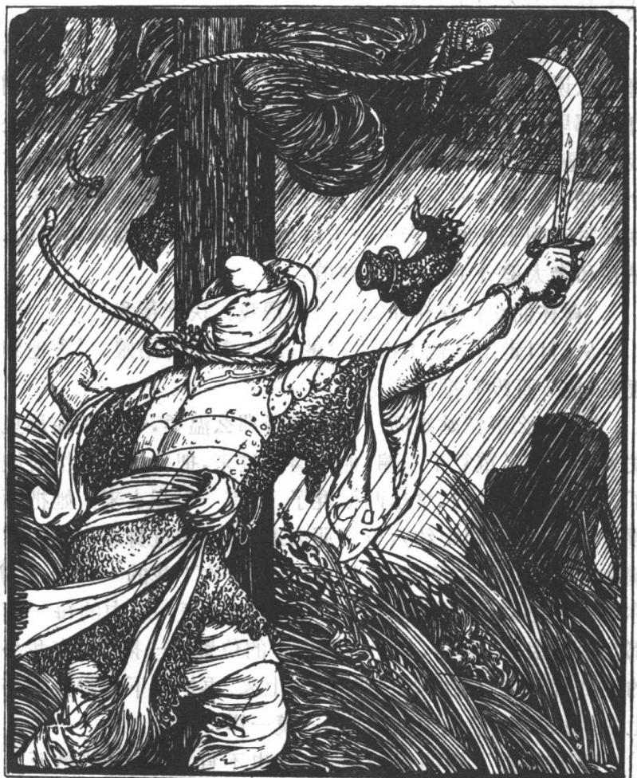

公主听了这些话，气得眼泪都流出来了。她派人去把父亲叫来，说她还要另一个脚镯，好两只脚都戴上，否则就要羞愧地死去。于是国王立刻把阿米尔找来，叫他要在一个月里，找到一个一模一样的脚镯，不然的话，就把他吊死。因为没有另一个脚镯，公主就一定会因为失望而死。

可怜的阿米尔听了国王的话，心中非常烦恼。不过他想，不管怎么说，还有一个月的时间可以安排。他立刻离开王宫，到处打听哪里可以找到最好的宝石。可是，尽管他日夜不停地到处寻找，还是找不到可以和脚镯上的宝石相配的宝石。后来，只有一个星期了。就在他无计可施的时候，他想起了森林仙女，决定立刻抓紧时间去找她。走了一天以后，他来到那间森林小屋前，他站在和老太婆分手的地方，喊道：

“森林仙女！森林仙女！快来帮我！快来帮我！”

从门口走出来他上次见过的那个美丽的姑娘。尽管他到处流浪，他一直没有把她忘记。

“有什么事？”姑娘问。她的声音那么温柔，叫他站在那里直发呆。姑娘又重复了一遍，他才清醒过来，把自己的事情对她说了。她又走进屋去，拿出两根棍子，还有一锅开水来。她把两根棍子插在地下，相距约六英尺那么远，然后转过身来对他说：“我躺在这两根棍子中间，然后你拔出剑来，砍下我的一只脚。接着，你要立刻把砍下的脚拿起来对着那锅水，滴入水中的每一滴血都会变成宝石。然后，你把两根棍子的位置换一换。插在我头上的换到脚下去，插在脚下的换到头上来。再把砍下的脚接到伤口上去，我的脚就会长好，像现在一模一样。”

阿米尔听了她的话，开始怎么也不肯，说情愿被吊死二十次，也不愿意这样粗暴地对待她。后来，他终于被她说服了。他狠狠心把她的脚砍下来以后，看到她躺在那里，像是死过去了一样，他害怕得差一点昏过去。他拿起她的脚，对准锅子，看到滴下的每一滴血都变成宝石，心中又充满了勇气和希望。锅子里很快就有了足够的宝石。他赶紧掉换两根棍子的位置，再把脚接到伤口上去。脚立刻就长好了，和以前一模一样。姑娘张开眼睛跳起来，披上面纱就进屋去了，再也不出来和他说一句话。他站在那里等了很久，见她不出来，只好把那些珍贵的宝石收集起来，回到王宫里去。他不费力气地就找到了把这些宝石串成脚镯的人。这些宝石足够做成三个脚镯，真是稀世珍宝。就在国王规定一个月期限的最后一天，他把这些脚镯都交给国王。

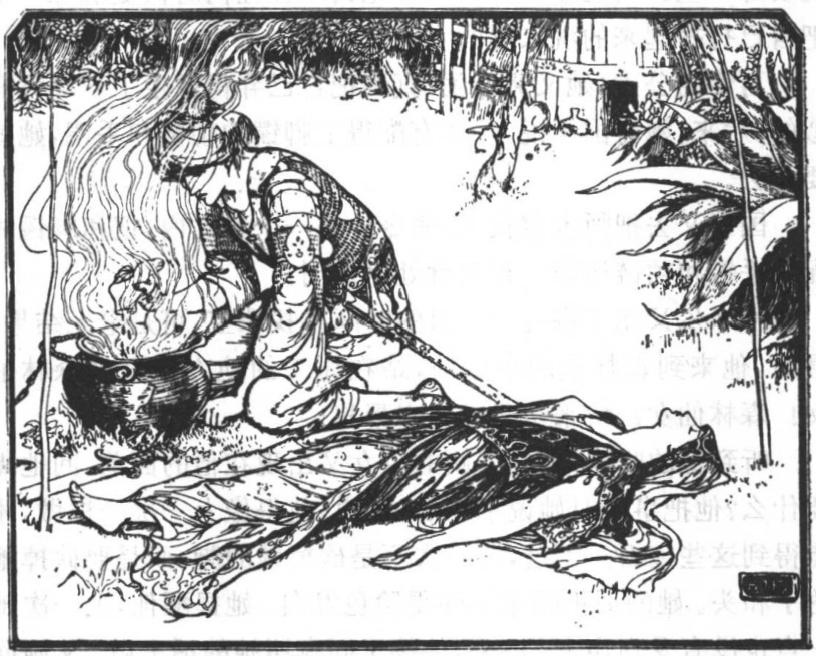

国王亲切地拥抱他，送给他许多贵重的礼物。第二天，爱虚荣的公主每只脚上都套上两个脚镯，骄傲地在房间的镜子前面走来走去，自我欣赏着。

“啊！托迪，”白头翁说，“我们的公主戴上这些美丽的宝石，现在你看怎么样？”

“咳！”鹦鹉不以为然地说，实际上，它上午的时候脾气总是很坏，只有吃过午饭以后才会好一些，“这样一来，她的美丽就荡然无存了。要是她的头颈上和手腕上也能戴上这些宝石，看上去就要好一些。可现在，在我看来，她比以往任何时候更加像一个把自己打扮起来的洗衣婆的女儿。”

可怜的公主！她又哭又闹，直到把自己弄得像生了一场大病似的。后来，她对国王说，除非有配得上脚镯的项链和手镯，她就要死去。

国王又去把阿米尔找来，命令他在一个月之内，把和脚镯相配的手镯和项链送来。否则就处以极刑。

阿米尔又花了将近一个月的时间寻找珠宝，可是毫无结果。最后，他来到森林里的小屋前，站在原来的地方喊道：“森林仙女！森林仙女！快来帮我！快来帮我！”

听到他的呼唤，那位美丽的少女又出现在他的面前，问他需要什么？他把事情对她说了以后，她说，他得像上一次一样做，才能得到这些宝石。不过，这一次不是砍掉她的脚，而是要砍掉她的手和头。她的话把阿米尔吓得脸色发白。她提醒他，上一次她一点也没有受到伤害。后来，他终于同意照她的话去做。从她砍下的手和头上，手镯和成串的钻石、红宝石、绿宝石和珍珠落入锅里。谁也没有见过这么珍贵的珠宝。接着，少女的头和手又接回到她的身体上，丝毫痕迹都没有。阿米尔充满了感激，想和她说几句话。可是她转身回到屋里去，再也没有出来。他只得离开她，带着珠宝回到王宫里去。

到了指定的那一天，阿米尔把手镯和项链拿出来，它们一个比一个漂亮，一个比一个更珍贵。国王的惊讶无法形容，他的女儿也高兴得几乎发疯。第二天，公主戴上她的全部珠宝，心想，挑剔的鹦鹉对她的容貌，再也无可指责了。她仔细地听着两只鸟的对话。

白头翁说：“啊！托迪，现在你认为我们的公主看上去怎么样？”

“毫无疑问，非常好！”鹦鹉嘟囔着说，“可是一个人打扮得那么漂亮干什么？她应该有个丈夫，干吗不和给她弄来所有这些珍贵珠宝的人结婚？”

公主听了以后，把她的父亲找来，对他说，她要和阿米尔结婚。

“我亲爱的孩子，”国王说，“要让你满足可真难，每天你都要些新的东西。现在也该是你成亲的时候了。如果你看中这个男人，他当然应该和你结婚。”

国王派人把阿米尔叫来，对他说，在一个月之内，将授予他和公主结婚，并且继承王位的荣誉。

听了国王的话，阿米尔深深地向国王鞠躬，回答说，他过去和现在随时都准备听从国王的吩咐，国王叫他干什么，他就干什么，可就是不能答应这件事。国王想到和公主结婚，是每一个男子至高无上的奖赏，阿米尔竟然不答应，顿时怒火万丈。公主更是气得发疯。阿米尔立刻被投进王国里能找到的最糟糕的监狱里去，国王命令把他关在里面，等自己有空的时候再想一想，该如何把他处死。

与此同时，国王想公主的婚事无论如何也不能再延迟了。于是，他派人通知邻近国家，宣布某一天，不论是谁，只要认为自己能做公主的丈夫，能继承王位，都可以到王宫里来。

到了这一天，所有求婚的人都来了。那么多男人，年轻的，年老的都有。他们都想，自己也有机会得到公主和王位。国王坐定以后，叫仆人把第一个求婚的人传进来。可就在这个时候，站在人群前面的一个农民说，他有件事情，请求允许对国王诉说。

“好吧！那么就快一点，”国王说，“我没有那么多时间。”

“尊敬的国王陛下，”农民说，“你在这座城市里管理王国，主持正义已经很久了，你当然知道，老虎是百兽之王，它只在森林里生活；而豺却是到处出没，四处寻找猎物。”

“这是怎么回事？这是怎么回事？”国王说，“这个人肯定是疯了！”

“不！尊敬的国王陛下，”农民继续说着，“我只是想提醒你，陛下，今天来了许多豺，他们都想掠夺你的王国和女儿。每一座城市都有人来了，他们饥肠辘辘，虎视眈眈。可是，国王，你千万不能再弄错，或者是故意把豺嚎叫的声音当做是虎在叫了！”

国王先是满脸通红，然后又变得苍白起来。

“在森林里，有一只真正的出身王室的老虎，他才是第一位有资格继承你的王位的人。”

“在哪里？你这是什么意思？”国王的脸色更加苍白，喃喃地说着。

“在监狱里，”农民回答说，“如果尊敬的陛下赶走这些求婚的豺狼，我就会禀告陛下。”

“把这些人都赶走！”国王命令。那些来求婚的人只好恋恋不舍地离开。

“现在，你可以把谜底告诉我了吧！”

接着，农民开始告诉国王和他的大臣，他如何救了王后，把阿米尔抚养大。说着，他把等在外面的王后领进来。国王看到她，心里充满了羞愧和自责。他真希望自己能够再有一次生命，不再娶这个骄傲的公主的母亲。她给他带来了无休止的烦恼，直到她后来去世。

“我的日子已经过去了。”国王说。他把王位交给了儿子阿米尔。阿米尔又回到森林里去找森林仙女，希望她给他找一个王后，好和他一起统治国家。

“我只愿意和一个人结婚。”他说。这一次，少女没有走开，同意做他的妻子。他们很快就举行婚礼，幸福地生活了许多年，英明地治理着自己的国家。

至于那个水罐被阿米尔打破的老太婆，她是森林仙女的祖母。既然她的孙女不再需要她照顾了，她也就回到仙女王国去了。

后来，再也没有听说老国王和他妻子争吵的事。看到他有什么不同意的样子，她就会看着他笑笑，然后问他：“是老虎呢，还是豺？”这样一来，他就再也没有什么话可说了。

 

## 梳子和项圈

从前，在一个名叫隆巴迪的国家有一个国王，他虽然长得比所有的臣民都丑，可他却喜欢长得漂亮的人。他娶了一个妻子，人人都说她是世界上最美丽的女人。可背地里也有些人悄悄地说，她也是世界上脾气最坏的女人。当然，她不喜欢看到长得好看的人，她的侍女都长得非常一般。最糟糕的是，她对国王前妻留下来的儿子和女儿妒忌得要命。

不幸的是，尽管她的品格恶劣，国王却是她百依百顺的奴隶。她对前妻留下的王子很坏，可爱的公主更是受尽她的百般折磨。她不但派一个脾气像她一样坏的女管家去管公主，而且想尽办法来丑化她，叫她看上去像是生来就很丑似的。可是，不管这个继母如何费尽心机，公主只要把涂在脸上可怕的黄色洗掉，换下那身难看的衣服，她美丽的容貌还是那样光彩照人。

隆巴迪国王和普莱新泽大公是表兄弟。普莱新泽最近忽然神智失常，他的儿子帕拉思特斯和女儿费伦蒂娜陷入极大的悲痛之中。医生想尽了办法，也无法恢复他的健康。王子和公主派人去请教一个有名的女巫，也没有得到多少安慰。她只是说：“到你们父亲失去理智的地方去把它找回来。”这个女巫名叫“剑鞘之母”，因为每个来请教她的人都带来一把剑，她把这些剑插入挂在山洞里的剑鞘之中。帕拉思特斯和费伦蒂娜听了女巫的话，不顾首相的反对，动身到一个神秘的城堡去。他们的父亲就是在这个城堡里睡着以后，遭到这种不幸的。可是，他们一走进城堡的大门，就从此一点消息也没有了。

三个星期过去了，王子和公主还是毫无音讯。首相决定召开会议，讨论这个问题。最后决定，再派出一些杰出的人去拜访剑鞘之母，他们带去的宝剑全部用纯金铸成，而且镶上最贵重的宝石。女巫看到这些漂亮的礼物，高兴极了，她不但仔细地听他们的诉说，而且走到山洞里的一个洞穴里去，拿出一个小盒子和一个铁项圈来。小盒子里有一把梳子，铁项圈上挂着一把金钥匙。

“把这把梳子和项圈带到每一个王宫去，直到找到一个美丽的妇女能打开这个项圈；一个善良的男人能把这把梳子抽出来。你们找到这两个人以后，就可以回到原来的地方去了。”

“可是我看不出，这与把我们的王子和公主找回来又有什么关系呢？”有一个侍从问。

“我能够帮你们的，只能到此为止了。”剑鞘之母说，转身就向洞里走去，谁也不敢跟在她后面进去。

接下来几个月，疯国王的几个大臣拜访了一个又一个王国，最后来到隆巴迪王国。他们发现，消息比他们来得还要快。他们一走进晋见厅，国王就张开双臂欢迎他们。因为他毫不怀疑，他的妻子无比美丽，是注定会把项圈打开的。当然，如果颜料、发型和漂亮的服饰能够解决问题，国王的想法就正确了。可惜，他对这丑恶女人盲目的爱蒙住了他的眼睛，他一点也不明白她的妩媚是伪装出来的。

到了约定的时间，王后走进来了，后面跟着年轻的公主。公主那样子确实很凄惨，她穿的衣服故意做成她像驼背的模样，她那白里透红的皮肤被涂上厚厚的一层黄颜色，一头乌黑的美发也被一顶褐色的小布帽子盖住。四周响起一阵愤愤不平的议论声。使者们这时也吃惊得目瞪口呆，他们常常听人说起，这个国家的公主可以和他们可爱的费伦蒂娜相比。至于国王，他羞愧得无地自容，头也抬不起来，示意王子来接替他的位置以后，国王就退了下去。

王子登上宝座，命令马上就开始进行。项圈先是交给公主的女管家，她是最丑的女人之一，当然无法用钥匙把它打开。王子决心利用掌权的短暂机会，对她虐待自己妹妹的行为进行惩罚，特别是，这个女人常常怂恿王后做坏事。王子下令把她处死，立刻执行。随从们个个拍手称快。接着，他叫公主的侍女们伺候她回到自己的房间去洗澡，把王后最漂亮的衣服拿出来给她穿，因为公主自己没有什么好衣服。站在一边的王后虽然气得咬牙切齿，但也不敢进行干预。公主很快就换好衣服出来了，看上去那么美丽端庄，如果说有人还怀疑没有人能打开项圈的话，这时候看到公主，他们一定会说，她肯定能打开了。王子看着她没有说什么。他示意使者把梳子拿过来，让大家试一试。男人们一个又一个地想把梳子从盒子里抽出来，可他们都一个又一个地退了下来。到后来，只剩下王子一个人了，不过，他是主持人，要等到最后一个才能试。

男士们试过以后，女士们依次开始试，看看能不能把项圈的锁打开。可是，谁都没有办法转动钥匙。后来轮到王后，她想办法打开了一点，心里充满了胜利者的骄傲，可是锁马上就卡嚓一声全部锁上。她垂头丧气地坐下，失望得几乎昏过去。

这时候，只剩下王子和公主没有试过了。王子一碰到盒子，盒子自己就自动打开了。公主一拿起钥匙，项圈也马上就开开来。在场的大臣和人群都高兴得欢呼起来。可欢呼声立刻就中断，因为这时天忽然黑下来，刮起了狂风。接着，大地摇晃起来，像地震似的。

等一切都过去，太阳又出来以后，王子和公主都不见了。

风暴虽然只把王子和公主卷走，可不幸的是，他们被刮向不同的方向。因为飞行的速度那么快，公主吓得昏了过去。等她降落在一片茂密的森林之中时，她也害怕得几乎第二次昏倒。她在森林里到处狂奔，呼喊着哥哥的名字，希望他能过来帮她。可是，喊叫声却引来了许多饿狼，它们张着大嘴巴，伸出血红的舌头，向她奔跑过来。她双膝跪在地下，一只手掩着脸，一只手不自觉地放在项圈上，等待着被狼吃掉。她的脸上已经感觉到狼呼出来的热气，吓得蜷缩成一团。跑在前面的狼看到了她手中的项圈，嚎叫了一声，转身就跑了，其余的狼也跟在它后面，森林里到处响起狼嚎的回音。

公主一从惊骇中清醒过来，就不由自主地站起来到处乱跑。后来，她发现自己正站在一条大路上。前面有两个牧羊人正赶着羊群走过来。她赶紧向他们奔过去，想请求他们帮忙。可是，羊一看到她的项圈，立刻四处奔跑。

“我身上一定有什么东西，让动物看到以后都感到害怕。”她心里想着，这使她得到很大的安慰。她精神饱满地继续走，来到一座旧城堡的城门口。她正想走进去，找个过夜的地方，忽然看到一只雪白的狐狸在穿过马路，到她的前面停下来。

它那么漂亮，两只明亮的眼睛好像在恳求什么。公主赶快把项圈藏到衣服里去，免得它看到以后也会跑掉。她慢慢地向它走过去，希望它能够跟她一起到城堡里去。可是，它却向另一个方向走去。而且，尽管她不想跟它走，却似乎有一股不可抗拒的力量迫使她这样做。她转过一个弯，来到一个小宫殿的门口坐下来，心里充满了对它的感激。小宫殿坐落在河岸上。公主站起来以后，它用牙齿拉着她的衣角，把她领进一个房间，里面有一张桌子，上面放着牛奶和水果。她吃过喝过以后，就躺在一堆垫子上睡着了，心里梦想着她那不知道到哪里去了的哥哥。狐狸就睡在她的脚跟。

如果说公主在梦想着她的哥哥的话，王子也一样在惦念着她。狂风把他卷到荒凉的海边，周围光秃秃的，只有站在他整天呆着的一块很高的岩石上，可以看见远方有一个绿色的小岛。岛上棕榈树在摇曳，瀑布在飞溅。

“也许她就在那里。”他心里想着，尽管没有什么理由可以说明公主在岛上，而不是在别的什么地方，可他脑子里还是打发不掉这个念头。

一个他从来没有听到过的、无比美妙的歌喉唱出来的歌声，把他从沉思中唤醒过来。他立刻向歌声传来的方向走去。可是，尽管歌手好像就在附近，可他怎么也找不到她。实际上，他刚赶到一个地方，那歌声又好像是从另一个方向传过来。他跟着歌声上山下山，转来转去，直到忽然看到一张很大的鱼皮才停下来。那张鱼皮就躺在大海和岩石之中。鱼皮难看极了，他厌恶地转过身去。就在这个时候，他背后好像有什么东西跳到大海中去。这才引起他的注意，开始四处寻找。那张鱼皮已经不见了。可是在他身后的一个山洞里，他看到了一个乌木浴桶，上面镶着金，在阳光的照耀下闪闪发光。

日子一天一天地过去了，事情毫无进展。王子几乎已经下决心离开海岸，准备到内陆去寻找他妹妹的时候，又听到了那叫他非常入迷的歌声，看到那带血的鱼皮躺在地上，还有洞里的浴桶也装满了水。这天晚上，他几乎没有合过眼。天还没有亮，他就起来藏到岩石后面去，决心等着那条鱼出来。

他没有等多久，东方刚刚露出第一道曙光，就看到一个白色的东西在微风的吹动下，向岸边靠拢过来。等它靠近一看，原来是一个无比美丽和可爱的少女坐在一个贝壳里，那贝壳色彩非常漂亮，像是蓝、红、绿三种颜色融为一体。她手中拉着一根绳子，贝壳就是靠绳子的拉力游过来的。

王子被她的美丽完全迷住了，忘记了自己是藏起来的。他跑出来，双膝跪在沙滩上，惊讶地伸出自己的双手。可就在他伸出手的时候，藏着梳子的盒子从口袋里掉出来。少女看到那盒子，发出一声惊叫，然后把贝壳转过去，很快就在岛屿的方向消失了。王子脱下衣服，准备下海游过去追赶她。这时候，他看到自己的身边有一只像雪一样白的狐狸，也在朝着少女消失的方向看着，挥着前爪发出深深的叹息，直到有一条小船向他们开过来，狐狸才显得非常高兴。

小船靠岸以后，狐狸对着王子的衣服挥挥手。他明白它的意思是叫他穿上衣服。他照办了。他们一起上了船，准备把船推开的时候，王子看到了把美丽的少女吓跑的梳盒，他气愤地举起来，准备把它扔到海里去。狐狸立刻跳起来捉住他的手，捉得那么紧，他一动也不能动。可是这时候，岸上有一个骑马的人对准狐狸射了一箭，瞄得那么准，可怜的小东西立刻倒在船上，闭上了双眼，像是遭到了致命一箭似的。王子非常悲痛，他马上跳上岸来，但凶手已经跑得很远了。等他再回过头来，船和狐狸都不见了。

一场暴风雨袭来，他赶紧跑回山洞。这时候，山洞里被许多支蜡烛照亮，这些蜡烛都像是从剑鞘里拔出一半的利剑。浴桶的上面是白色的、绣着剑鞘的帐篷一样的帘幔，从帘幔下面传出一个声音来：“王子，不论发生什么事情，你会相信我的心是属于你的，就像我相信，你的心是属于我的一样吗？不过，你要注意，帘幔打开的时候，你如果有半点的害怕，你就会永远失去我。”

她非常及时地提醒了他。即使是这样，他也是很努力才做到面不改色，手不发抖。因为他看到，帘幔拉开以后，一个露出锋利牙齿的鳄鱼头向他伸过来。他尽力地沉住气，沉着地站在那里注视着这个可怕的怪物。这时候，鳄鱼头又缩回去了，在它张开的大嘴里，他看到了那个可爱的贝壳姑娘的容颜。

“快！王子！快！时间要来不及了！用梳子来给我梳头，否则，我就会从你的眼中消失。”听了他的话，他把梳子拿出来。叫他感到奇怪的是，他用尽全身的力气，才把它从盒子里拉出来。而且更令人惊讶的是，随着梳子不断地抽出来，先是姑娘的头从鳄鱼可怕的头中伸出，然后是她的身体慢慢地伸出，接着，她的肩膀和手也伸出来了。她又对他说：“够了，你完全照我的话做了。现在，把我的皮烧掉。”

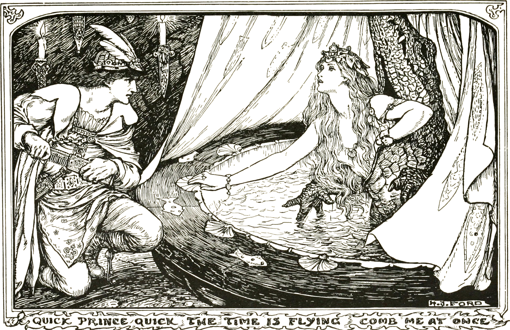

“啊！这我可绝对不能做！”他喊道。可是姑娘打断他的话说： “那我们俩将一辈子感到后悔！”她悲伤地说，“因为我只能嫁给把我的皮烧掉的男人。”就在他还是犹豫不决的时候，帘幔落下来，把她遮住了。蜡烛也熄灭了。

王子十分后悔自己的迟钝，他慢慢地向森林里走去，那里有一堆篝火在燃烧。他不知道自己该干什么才好。走着走着，他差一点被那张鳄鱼皮绊倒。

“啊！我真笨！这肯定就是她要我烧掉的那张皮！”他说。他双手把那张皮抓起来，扔到火里去。皮发出一声巨响，他吓了一跳，不知道会发生什么事情，一连后退了好几步。那张皮不见了，连一点痕迹也没有。可是在灰烬中，他看到什么东西在闪光，后来才看清，就是那个魔项圈。啊！这么说，他一直非常挂念着的妹妹一定就在附近。他还没有来得及捡起项圈或回过头来，他妹妹的双手就把他抱住了，这一下，王子什么都忘记了。

等他们安静下来的时候，妹妹说：“你先说说你的遭遇！”于是，他就开始说了，不过，他满脑子里都是贝壳姑娘的形象，所以，他把狐狸忘得一干二净，一句话也没有说起它。后来，他庆幸自己一点也没有提起它。因为后来公主说起她的经历，最后说到，她的一切全靠一只小的白狐狸帮忙。

“你一点也想象不到在小宫殿的时候，它是多么的关心我。虽然一切都是出于它的善良，可是从它的眼睛中我可以看得出，它希望我能帮它什么忙，可是我猜想不出来。啊！后来有一天，我付出了代价才明白了。我把项圈藏在茂密的灌木丛里，怕狐狸看到它以后会像其他动物一样被吓跑。可是有一天，我们在花园里的时候，太阳光正好照到它，狐狸看到以后，兴高采烈地向它跑过去，它正想用牙齿把它叼起来的时候，项圈卡嚓一声锁了起来。狐狸发出一声尖叫，向远处奔去。后来，我虽然到处寻找，也不见它的踪影。你把那张皮扔到火里去的时候，我恰巧在这里。毫无疑义，在我急忙逃走的时候，项圈从我的身上掉下来了。”她停了一会又继续说：“啊！亲爱的哥哥，我不能离开我亲爱的狐狸，求求你，帮我找到它。”

她是那么伤心，王子不敢告诉她这个小动物的悲惨命运。希望随着时间的流逝，她会平静下来。他向她保证，只要她答应在海边过一天，然后跟她到什么地方去都行。公主也只好答应。

王子站在海边的岩石上，向可爱的小岛方向极目望去，希望能再一次看到那张白帆。这时候，从离他不远的森林里传来一声可怕的尖叫声。他竭尽全力向森林里跑过去，很快就看到一个骑士骑在马上，背着一把弓，正在用力地想把一个妇女拖到他的马鞍上去。骑士没有想到在这么荒芜的地方会有人，看到王子就吃惊地松开那女人的手臂。女人赶紧逃到王子的背后躲起来。王子惊讶地看到，这个女人就是他的继母。

“你怎么会到这里来的？”他冷冷地问道，心里有些后悔，想应该让她听天由命。她从王子的脸上猜出了他在想些什么，就双膝跪在他的面前。

“啊！请原谅我的过错。”她说，“实际上，我早就后悔自己的所作所为，当你的父亲遭到那疯了的大公毒打时，就想来帮助他。你刚才就是把我从大公的手里救出来。”当王子朝马蹄奔跑的方向看过去的时候，她又补充了一句，“现在去追他也来不及了。”他们一起往回走，她把他们分手以后的事情告诉他。

“国王知道我残酷地对待你的妹妹以后，”她说，“他发誓再也不愿意看到我了，然后就离开王宫出来寻找你们。我想暗中跟随着他，可是没有办法找到他。后来我去请教剑鞘之母，她把我带到棕榈树的小岛上去。在岛上，她让我看一个可爱的公主，她因为中了魔法，白天就要变成鳄鱼。每当这一可怕的时刻到来的时候，鳄鱼皮就出现在她的面前。尽管她浑身发抖，一股不可抗拒的力量还是迫使她把鱼皮披上，跳入海中。我要把你领到这个岛上去。可我们先得找到你的妹妹，因为一只白狐狸的生命全系在她的身上，如果它还活着的话。”

“白狐狸！”王子惊叫起来，“关于它，你知道些什么？”

“我知道得并不多，”王后回答说，“可自从我到了岛上以后，它就和我们在一起了，而且很讨我们的喜欢。昨天我们没有见到它。可是到了晚上，一只小船漂流到沙滩上，狐狸浑身是血躺在船上。在王宫里，我尽量地处理好它的伤口，然后就去请教巫师。巫师说，我要到小船上去，在二十四小时之内，把隆巴迪的王子和公主找到，带到狐狸这里来，它就能得救了。在海边的一块岩石旁，我找到了你的父亲，他肩膀上中了一箭，是那疯了的大公射的。当我跑到森林里去的时候，他又从箭袋里拔出一枝箭来要射我！”

“我的父亲就在附近！”王子喊道，“我们要快点回去找他，还有我的妹妹。”

他们在山洞里找到了她，国王的头搁在她的脚上。她在想办法给他止血，但没有多大作用。他们一起把他抬到船上，然后很快地向岛上划去。一路上，王子平静地把狐狸的不幸对他的妹妹说了。

“把我带到它那里去！”船一靠岸，公主就说。王后一言不发地领他们到岛上的王宫里去。

白狐狸正躺在一张柔软的垫子上，旁边生着一个火炉。它的眼睛紧闭着。只要看上它一眼，就知道它的死期不远了。可是，不知道为什么，它感到公主已经来到它的身边，它张开双眼，无力地摇动着尾巴。公主忍不住哭出声来，直到一只手放在她的肩膀上。

“你干吗这样浪费仅有的那么一点宝贵的时间？”岛上的总督严肃地说，“把你戴着的项圈套到它的头上去，它马上就会好起来，不过你得快一点。”

公主听了以后，呆得像个石头人似的。“项圈！”她结结巴巴地说，“可是我把它丢在森林里了。”

墙上挂着的上千把剑鞘都喊叫起来：“项圈丢了！项圈丢了！”

“你们在说什么项圈？”躺在另一张床上的国王说，一个医生正在给他治疗，“我这里有一个，是那个疯子射我之前，我在灰烬里捡到的。也许就是你们要找的那个，或者也一样管用。”他示意一个侍从从他的衣服口袋里把项圈拿出来。

公主一眼看到宝贵的项圈，高兴得冲上来，从随从的手中抢过去，放到狐狸的头颈上。在场的人都屏住呼吸，看看会发生什么事情。只见狐狸的脚越来越长，鼻子却越来越短。接着，狐狸不见了，躺在那里的是帕拉思特斯，盖着一件白色的皮大衣。

隆巴迪王子看到他的朋友和表兄弟虽然很高兴，可是他的心里仍然在挂念着那忽然神秘地失踪的美丽姑娘。岛上的总督看到他脸上的烦恼，就问他是怎么回事。“啊！可能的话，请帮助我吧！”王子说，“想到那中了魔法的美丽少女可能还在受折磨，我的心里就难过。”

“问题比你想象的要严重得多！”总督严肃地说，“不过，只要你的梳子还在，你还是可以把她从苦难中解救出来。”看到王子很快地就把梳子从盒子中取出来，他又说，“啊！那太好了，跟我来！”

不但是王子，所有的人都跟着他出来。总督领着他们沿着一条长走廊下去，来到一扇大铁门前。铁门自动打开。可王子看到的是种什么景象！他上次看到的那个无比美丽的姑娘坐在一张凳子上，周围都是火焰，它们像头发一样地围着她的头。她的脸又红又肿，嘴巴张开着，像是透不过气来。只是双手和头颈没有受到伤害，还是像以前一样白。

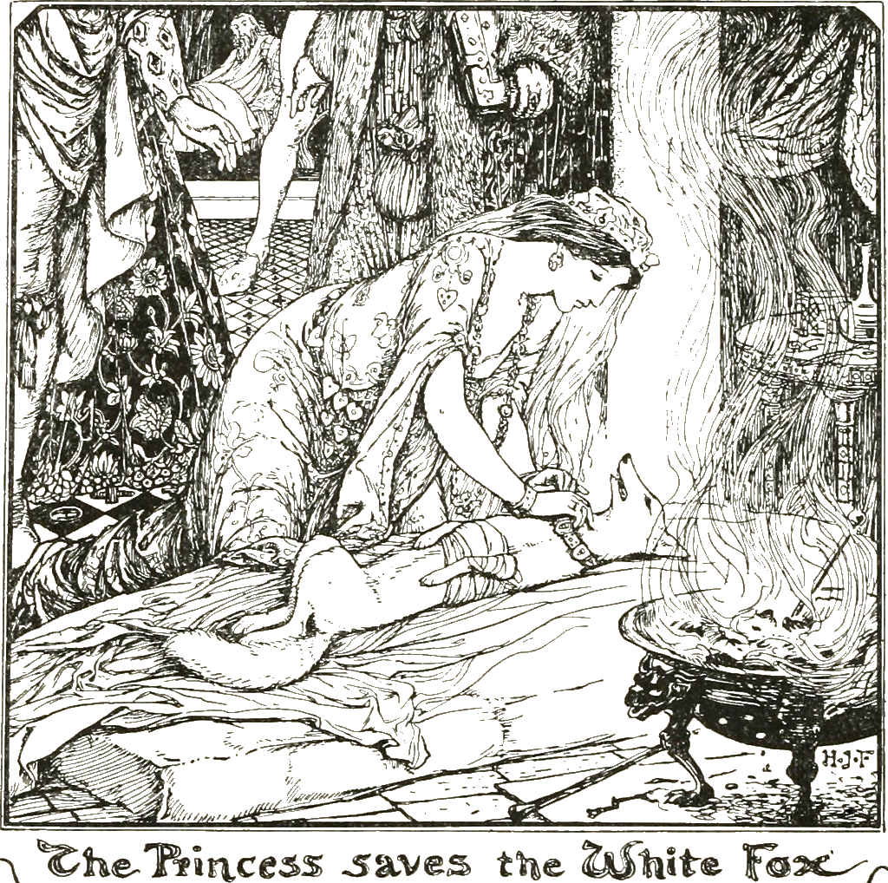

“这就是你干的好事，”总督说，“你把鳄鱼皮烧掉以后，她就落入这般境地。现在试试看吧！用你的梳子能不能解脱她的痛苦！”

梳子一碰到公主，火焰立刻就消失了；再梳一次，公主脸上的痛苦没有了，肿也消退了；梳第三次的时候，公主从凳子上站起来，比以前显得更加可爱。她伸出双手来拥抱她的帕拉思特斯哥哥。

这样一来，除了让这两对年轻人尽快地结婚以外，就没有什么事情可做的了。婚礼以后，帕拉思特斯和他的新娘回到普莱新泽，费伦蒂娜和她的丈夫回到隆巴迪。他们一直过着幸福的生活，直到百年以后。

 

## 宰相的感谢

从前，在兴都斯坦有两个相互接壤的国家。一个国王叫拉贾赫，另一个叫巴得萨。他们在财富和权势上都全面地进行较量，所以相互之间一点也不友好。不过，为了避免永无休止的争吵，拉贾赫和巴得萨签定了一个条约，规定两个国家中，不论是什么人，从最底层的老百姓到最高的国王，只要跨越国界，都可以抓起来处罚。

一天早晨，巴得萨和他的宰相准备开始工作，处理国家的事情。巴得萨拿起一把锋利的小刀削铅笔，不巧削掉了自己的一个手指尖。

“啊！宰相，”国王喊起来，“我把自己的手指削掉了！”

“这是个好消息！”宰相回答说。

“鲁莽的家伙！”国王气愤地说，“你对别人总是幸灾乐祸，连我也不例外吗？卫兵，把他抓起来，关到监牢里去，等我有空的时候再来处罚他，他这是罪有应得。”

随从的军官立刻进来，把不幸的宰相抓起来，从一个小门里把他拖出去。那些倒霉的罪犯都是从这扇门里拖出去关监狱或是处死的。小门打开的时候，只见宰相张着一大把白胡子的嘴一动一动的，不知道在说什么，士兵们没有听清楚。

“这个恶棍在说什么？”怒气冲冲的国王喊道。

“他说，感谢您，尊敬的陛下！”一个看门的人这样回答。听他这么一说，国王又气愤又惊讶，瞪着眼看着关上的门。

“他肯定是疯了！”国王说，“因为他不但对别人的不幸，而且对自己的不幸也觉得高兴！肯定是什么事情弄昏了他的头脑！”

其实，国王很喜欢他的老宰相，虽然这时候王宫里的医生进来给他包扎好伤口，敷上止痛的药膏，但还是医治不了他心里的伤痛，那些大臣和随从们也无能为力。这一天，他们都觉得国王的脾气很坏。

第二天一早，国王吩咐给他准备好马匹，他要出去打猎。马厩和大厅里立刻忙碌起来。等他准备好了以后，一大群官员和猎手们也都站好了，准备陪他一起出去。可是，令他们吃惊的是，国王一个也不要他们陪，他要独自出去。看到国王瞪着他们看的那副凶相，大家也乐得让他一个人去。于是，他就这样独自骑着马走了。一路上也不知道在想什么，许多很肥的鹿和野鸡从他的身边走过，他一点也没有注意到。他也不留神自己在往哪里走，连已经进入拉贾赫的国土也没有想到。忽然间，许多士兵从丛林中冲出来，把他团团围住，这时候，他只好举手投降了。

可怜的巴得萨国王当了俘虏，被投进拉贾赫的监狱。这时候，他大部分时间都在想着他的宰相，他们俩的命运都一样。他希望，自己也和宰相一样，有些值得感激别人的地方。这天晚上，拉贾赫国王召开特别会议，讨论该如何处置这个自己送上门来的对头。他们请来了全部僧侣，这些僧侣什么都知道，能说出哪些日子吉利，哪些日子不吉利。当拉贾赫国王被他手下的人各种各样的建议弄得昏头转向，大发脾气，不知如何是好的时候，那些僧侣都蹲在房间的角落里忙碌着，后来，为首的僧侣向国王走过来。

“好了！”拉贾赫国王不耐烦地问，“你有什么主意？”

“非常不吉利的日子！”他说，“啊！非常不吉利！神正在发怒，命令你明天一定要砍下这个巴得萨的头去祭他。”

“嗯！那好吧！”拉贾赫国王说，“就这么办。这件事就交给你来执行。”他向僧侣行过礼以后就离开了。

天还没有亮，祭神的仪式就在紧张地准备着。成百面旗帜在飘扬，成百面鼓在敲响，成百个人在唱着圣歌，成百名僧侣梳洗打扮妥当以后，在忙碌着自己神圣的使命。拉贾赫国王心神不安地坐在那里等待着，旁边围着许多大臣和随从，他希望一切都很顺利。后来，祭神的时刻终于到了，可怜的巴得萨被捆绑着押上来，要把他的头杀掉。

为首的僧侣面带笑容走上来，手中拿着一把明晃晃的大刀。忽然，他注意到巴得萨的手指上包着布，立刻把手中的刀扔掉，把巴得萨手指上的布解开，眼睛还紧张地注视着。布解开了，他看到，祭品的一个小指头没有了。他满脸通红，非常生气。他把巴得萨带到疑惑不解的拉贾赫面前。

“啊！看吧！拉贾赫！”他说，“这个用来祭神的人没有用！他的一个手指没有了！用来祭神的东西必须完整无缺！”说着，他因为又气愤又羞愧，开始哭起来。

可是，拉贾赫国王不像别人那样哭起来，而且松了一口气，回答说：“好吧！这样一来问题就解决了。至于谁来当祭品，我都不在乎。不过，一个国王和所有的人比起来，把国王来当祭品似乎不太对头。”说完，他站起来，用他那把钻石刀把巴得萨国王身上的绳子割断，和他一起走出寺庙，返回王宫。

让客人洗澡和休息好以后，拉贾赫国王带上许多礼物，亲自带领一大群人马护送巴得萨国王来到两国的边界。在一片欢呼声中，他们撕毁了老的协议，重新订了一个新的协议书。新的协议规定，邻国的任何人，不论是普通老百姓还是国王，不论出于什么理由进入自己的国家，国王都应该表示欢迎和保证安全。他们相互拥抱以后，就各自返回自己的国家。

这天晚上，巴得萨国王回到家以后，立刻就叫人把监狱里的宰相带出来。

“好啊！宰相，”宰相来了以后，国王这样对他说，“想想看，我经历了什么事情？”

“一个被关在监狱里的人，怎么知道外面发生的事情？”宰相回答。

接着，国王把自己的冒险经历对他说了。完了以后，他补充说：“我已经决定，为了庆祝我死里逃生，只要你告诉我，我割断手指的时候你为什么表示祝贺，我就放了你。”

“陛下，”老宰相回答说，“我认为这是一件值得庆贺的事情，是因为你丢了一个指头而保住了自己的头，这难道不对吗？这两件不幸的事比起来，丢掉一点手指头当然要小得多。”

“千真万确，”国王摸着自己的头说，好像是证实一下自己的头还在，“可是，我把你关到监狱里去的时候，你为什么也表示感谢？”

“我表示谢意，”宰相说，“是因为感谢别人总是一件好事情。如果我知道把我关起来以后，神才没有把我当做一个完整的祭品来取代你，我的感谢还要大得多。”

（旁遮普故事）

 

## 胆小的萨巴

在南方很远很远的地方有一个伟大的国家，尼罗河从这里流过。统治这个国家的国王只有一个儿子，他的名字叫萨巴。

萨巴从他会走路的时候起，就显得看到什么东西都害怕。他慢慢长大以后，胆子反而越来越小。开始，国王的朋友都不当一回事，他们说：“我们民族的一个男孩子，听到大象的叫声会跑到屋子里去，看到比他还小的小狮子走过来会发抖，这真是一件奇怪的事情。不过，归根到底，他还是一个孩子，等他长大以后，就会像其他人一样地勇敢。”

“是的，他只不过是个孩子。”听到他们的这些话以后，国王也这么说，“他以后就会好起来的。”尽管如此，他说完以后，还是深深地叹了一口气。朋友们都看着他，不说什么。

一年又一年过去了，萨巴长得又高大又结实，是个非常英俊的青年了。他脾气很好，也很乐观，大家都喜欢他。每当他跟随父亲一起出去打猎的时候，哪里有危险，哪里就不会看到他。大家都那么爱他，谁都不愿意说他。

“等国王举行盛大的宴会，宣布他是王位的继承人的时候，他就会成熟了。”老百姓们都这么说。到了举行仪式的这一天，他们都非常激动，齐声欢呼：

“萨巴！萨巴！他是我们的首领！他将保护我们不受强盗民族的侵犯！”

没有多久，一个村子里的居民早上起来的时候发现，他们的牲畜夜里被别人赶走了，他们的牧民也被人掳去当奴隶。现在到了萨巴表现出他的男子汉气概和勇敢精神的时候了，他应该身先士卒，带领自己的部队去击退敌人。可是，谁也不知道萨巴到哪里去了，一支自愿组织起来的队伍也不管他了，他们自己出去和敌人作战。

过了许多天以后，才见萨巴回来。他的头抬得高高的，有人说他冒着生命危险去跟踪一头狮子，一直追到它的窝里，把它杀了。如果是早一些时候，老百姓会相信这个故事，欢迎他的归来。可是，现在太晚了。

“胆小鬼萨巴！”人群中有人喊叫起来。从此这个名字就传开了，连小孩子看到他也会这样喊。他的父亲也不愿意原谅他。后来，他实在受不了了，决心离开自己的国家，到一个在人们的记忆中一直太平无事的国家去。于是，第二天一早，他悄悄地来到马厩，挑了一匹最安静的马，骑上它向北方走去。

萨巴一辈子也忘不了这次旅程的可怕。晚上，他害怕得难以入眠，担心在每一块石头后面和丛林中，会有野兽在窥视着他。白天，一路上狮子的吼声叫他恐惧得几乎从马上掉下来。无数次，他都想转身回去，但都下不了决心。那不是因为怕别人的讽刺和取笑，而是害怕不得不去参加战争。所以，他继续硬着头皮往前走。当他看到前面有一座比他想象的还要大的城市时，他才谢天谢地，深深地松了一口气。

他挺起胸膛，骑着马趾高气扬地走进城堡的大门，从王宫的门前经过。像往常一样，公主这时正坐在王宫的阳台上，观看着下面繁华的街道。

“这是个威武的年轻人。”公主看到萨巴骑着他的高头大黑马，敏捷地在人群中穿行的时候，心里这样想着。她把一个奴隶叫过来，吩咐他去问一问这个年轻人是什么人，是从哪里来的。

那个奴隶去过以后，回来对公主说：“啊！公主，他是一个国王的儿子，他将继承尼罗河岸边一个大国的王位。”公主听他这么一说，立刻把她的父亲叫来，对他说，如果不让她嫁给这个年轻人，她就一辈子不结婚。

像许多父亲一样，国王也不会拒绝他女儿的任何要求。她已经回绝了那么多求婚者，国王很担心没有一个男人能够配得上她。因此，他把萨巴找来，当面和他交谈。萨巴的一表人才和彬彬有礼的幽默很中他的意，所以，他就同意了。三天以后，举行了最豪华的婚宴，萨巴和公主结婚。

公主对她高大英俊的丈夫非常满意。有一段时间，她很满足于和他一起坐在棕榈树下，听他讲她喜欢听的故事，或者是和自己的国家完全不同的，他的国家的生活习惯和方式。这些她都觉得非常有趣。可是，随着时间的推移，她感到只有这些还不够，她要别人也为她的丈夫感到自豪。于是有一天，她对萨巴说：“我真希望北方的那些摩尔强盗能来进行一次掠夺。我很想亲眼看到你率领我们的人把他们赶出去。啊！当整个城市都在欢呼你的伟大功绩的时候，我该有多幸福！”

她说这些话的时候，那么深情地看着他。可是，使她万分吃惊的是，他的脸色立刻阴沉下来，急急忙忙地回答：“不要再和我说这些摩尔人或什么战争。我就是为了摆脱这些才离开我的国家的。你再说到侵略一个字，我就永远离开你了。”

“你真是太有趣了！”公主忍不住笑起来，说，“像你这样一个高大的人也害怕摩尔人？不过，你这话除了我以外，不能对任何人说，否则他们会认为你是当真的。”

这以后不久，有一天，当这个城市的人在城外举行宴会的时候，有一伙已经躲藏了好几天的摩尔人把他们放牧在山坡上的羊群全部赶走。没有几个钟头，这一事件就被发现了。国王下令擂起战鼓，把士兵们召集到王宫前面的广场上来。大家都为受到摩尔人的耻辱而气愤得发抖，齐声高呼立刻报仇。萨巴作为国王的女婿，负责率领他们出征。可是，不管他们喊得多么响亮，就是不见萨巴出来。

他到哪里去了？原来他正藏在王宫的一个阴暗的地下室里，蜷缩在那些储藏粮食的大土罐之中。公主一阵心痛地在那里找到了他，尽力地劝导他，使他明白这种行为多么羞耻。可是没有用。和打仗的危险比起来，老百姓的耻笑也算不了什么。

“脱下你的衣服和盔甲！”公主后来说。她的声音那么严厉和冷峻，谁也猜不透她是什么意思，“还有你的剑和矛也给我！”萨巴害怕地左顾右盼，把作为国王女婿的这套镶金盔甲和武器脱下来。公主一言不发，用坚定的手把它们一件一件地接过来，穿到自己的身上。她的丈夫高大的身影缩在角落里，她看也不看他一眼，扣好皮带，放下面罩以后，就走出去，骑上萨巴的战马，挥手叫士兵们跟上。

公主虽然比她的丈夫矮得多，可她也是个高个的女子，再加上她骑的马比别人的马高大，所以，大家一看到她一身金光闪闪的盔甲，就一点也不怀疑是萨巴来率领他们出征，朝着她大声地欢呼起来。公主向他们点头表示回答，但没有拉开她的面罩。她用马刺踢了一下马，马立刻奔跑起来，部队跟在她的后面向敌人发起冲击。摩尔人没有想到这么快就受到追击，来不及排成作战的队伍，被迫很快就逃跑。这一支人数不多的骑兵队伍也就回到城里，大家都齐声称赞他们的首领萨巴。

他们一走进王宫，公主就把她的马交给马夫，自己从旁边的一条小楼梯走了。从这里她可以神不知鬼不觉地回到自己的房间。她看到丈夫正懒洋洋地躺在一堆褥子上。看到门打开，他不安地抬起头来看着妻子，不知道她会对他怎么样。可是，他根本用不着害怕挨骂。只见她迅速地脱下盔甲，叫他快点穿上。萨巴照她的话去做，不敢多问一句。等他把盔甲穿好以后，她叫他跟着出来，把他领到阳台上，下面已经聚集了许多人，他们威武地欢呼着：

“萨巴！国王的女婿！萨巴！勇士中的勇士！他在哪里？请他出来！”

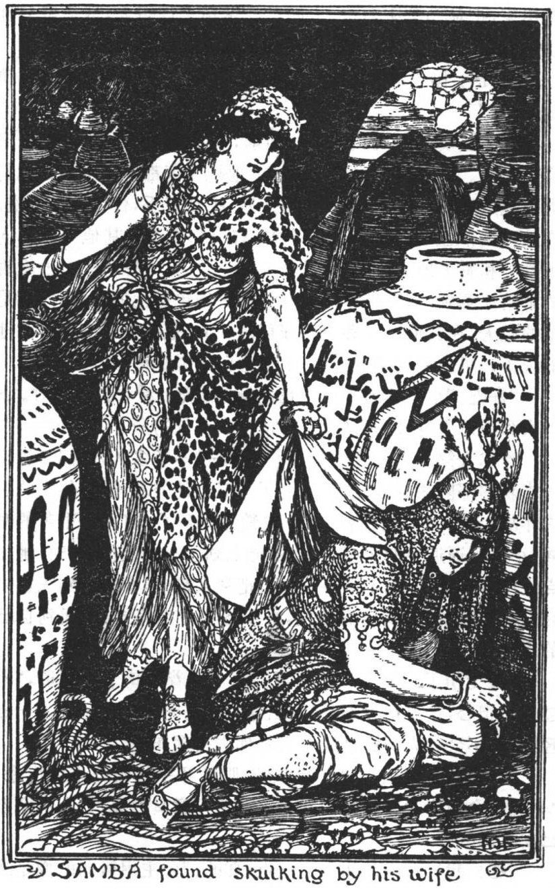

等萨巴真的出现在他们的面前，欢呼声和喝采声更是一浪高过一浪。“看啊！他是多么谦虚！他把光荣都让给别人！”他们大声地这样喊叫着。萨巴只是微笑着，挥动着手，什么也没有说。在这些向萨巴表示尊敬的人群中，有一个人不像其他人一样向他欢呼和赞美他，这个人就是公主的小弟弟。在战斗中，他敏锐的眼睛注意到，那个带领他们打仗的首领更像他的姐姐，而不是他的姐夫。在其他王子答应保守秘密以后，他把自己的怀疑对他们说了。可他们只是取笑他，说他是白天说梦话。

“好吧！”小王子回答说，“我们等着瞧吧！看看到底谁对。下一次和摩尔人打仗的时候，我要留神在首领的身上做个记号。”

摩尔人第一次虽然被打败了，但是过不了多久，他们又派出一支新的部队来挑战。萨巴的妻子又穿上他的衣服，率领军队出去作战。这一次，仗打得比上一次激烈得多了。打得最艰苦的时候，小王子逼近他的姐姐，在她的腿上划了一点轻伤。当时，她一点也没有注意到，也不觉得痛。等把敌人赶走，军队回到王宫以后，她忽然感到浑身没有力气，好不容易才走完楼梯，回到自己的房间。

“我受伤了。”她一头倒在萨巴刚才躺着的垫子上说道，“不过不必担心，这点伤算不了什么。你只要在同一个地方弄上一点轻伤，就不会有人怀疑是我而不是你去指挥作战。”

“什么？”萨巴因为恐惧和吃惊，眼睛几乎从眼眶里弹出来，“你怎么会想到我会同意去忍受这种毫无意义的痛苦？我情愿自己去参加战斗。”

“嗯！我早就应该明白这一点，真的！”公主用微弱的像是从远方传来的声音说着。可就在他转过身去的时候，她很快地拿起长矛，刺向他一只光着的腿。

他尖叫一声，踉跄地退了几步，与其说是因为痛，不如说是因为吃惊。可是，他还来不及开口说话，公主已经出去找王宫的医生了。

“我丈夫受伤了，”她找到医生以后说，“快点去帮他处理一下，因为流血太多，他很虚弱。”她故意大声地说，好让更多的人听到。这一天，很多人都挤在王宫的门口，打听这个勇士的消息。

“你看到了吗？”大王子从萨巴呻吟着的房间里出来，说道，“我聪明的小弟弟，我们说对了，你错了！是萨巴自己上了战场。”可小王子只是怀疑地摇摇头，不说什么。只是过了两天，摩尔人又来了。像以前一样，牲畜很快地就转移到安全的地方。那些摩尔人以为：“上一次他们把我们打得那么惨，他们决不会想到我们这么快又来了。”召唤军队集合起来的战鼓擂响以后，公主站起来找她的丈夫。

“萨巴，”她说，“我的伤比我想象的严重得多，没有人帮忙连马都上不去。今天我不能替你去了，你必须代替我去。”

“你胡说什么！”萨巴说，“我从来没有听说过这种事。我会受伤，甚至被杀死！你有三个弟弟，国王应该派一个去！”

“他们都还小，”妻子回答说，“军队不会听他们的命令。要是你不去，起码应该帮我把马备好。”只要没有危险，别人请他帮忙，他总是很乐意，所以，他马上就答应了。马准备好了以后，公主说：“你把马骑到外面去，我抄近路过去，再把你换下来。”

只要是不打仗，萨巴平时也很喜欢骑马，于是他就翻身骑到马上去了。妻子看到他坐稳了，用鞭子狠狠地抽了一下马屁股。马吃了一惊，立刻冲出去，外面正在等待着的军队看到首领来了，马上就紧跟上来。萨巴这时候想勒住他的马已经是不可能的了。没有几分钟的时间，他们就和摩尔人遭遇上了。

这时候，奇迹发生了。胆小如鼠的萨巴看到自己四面受敌，再也逃脱不掉以后，一股力量忽然涌入他的生命，他全神贯注地投入战斗。像他这样身强力壮的人一旦下了决心，他就表现得非常出色。

这一天的胜利完全应该归功于萨巴。人们的欢呼声比以前更加响亮。当他佩带着摩尔人首领的剑返回王宫时，老国王热烈地拥抱他，说道：“啊！我的孩子！对你立下的辉煌功绩，该怎样来表示我的感激呢！”

摆脱了胆怯心理的萨巴这时候显得更加忠诚和和蔼，他直截了当地回答说：“我的父亲，应该感谢的是你的女儿而不是我。是她把我从一个胆小的人变成一个勇敢的人。”

 

## 库普蒂和英玛妮

从前有一个国王，他有两个女儿，她们的名字叫库普蒂和英玛妮。他很爱两个女儿，和她们一说话就是几个小时。有一天，他对大女儿库普蒂说：“把你的一生和命运交给我安排，你满意吗？”

“非常满意，”大公主对这个问题感到很奇怪，回答说，“如果说，不是交给你安排，那么交给谁呢？”

可是，当国王问他的小女儿这个问题的时候，英玛妮回答说：“不！如果有机会，我就要自己来安排。”

国王听到这个回答，非常失望，说：“你太年轻了，不知道这些话意味着什么。不管怎么说，我要给你一次机会，满足你的愿望。”

国王派人去找来一个年迈的跛足僧人，这个僧人住在城市郊区一间摇摇欲坠的小屋里。

他来到王宫以后，国王对他说：“毫无疑问，你已经是又老又跛，如果有个年轻人来和你住在一起，照顾你，你一定很高兴。所以，我让我的女儿到你那里去。她想自己养活自己，和你一起生活，她就可以这样做。”

当然，僧人一句话也说不出来。即使是想说什么，也因为吃惊和害怕而说不出来。可是，公主却微笑着跟他一起走，样子显得很快活。老人一声不响，一瘸一拐地走回家。他们一走进小屋，僧人就开始考虑如何安排才能使公主舒服一些。可他毕竟只是一个僧人，屋子里除了一张床，两个旧锅，一个装水的土罐以外，就什么也没有了。靠这些东西，很难过得舒服。不过，公主很快就打消了他的忧虑，她说：“你身边有点钱吗？”

“我有一便士，可能放在什么地方。”老人说。

“那好！”公主说，“把钱给我，然后出去借一辆纺车和一台织布机来。”

僧人好不容易才找到了那一便士，把它交给公主以后，就出去干他的差使去了。公主也出去买东西。她用四分之一便士买油，再用四分之三便士买亚麻。回来以后，她叫老人坐在床上，用油来擦他的瘸腿。老人睡觉以后，她坐下来纺线，一直纺到天明。谁也没有见过她纺出来的这么好的线。接着，她又来到织布机前，她不停地织着，到傍晚的时候，就织好一块很漂亮的白布。

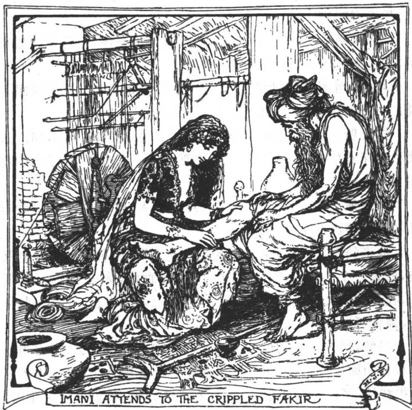

“现在，”她对老人说，“你到市场上去，把这些布卖掉，我要休息一下。”

“我要卖什么价钱呢？”老人问。

“两个金币。”公主回答。

于是，僧人跛着脚来到市场，站在那里卖布。恰巧大公主坐车经过，看到那块布，就停下来问价钱。

“两块金币。”老人说。大公主很乐意地把它买下。老人拿着钱走回家。以后，英玛妮一天又一天地做着这些事情。她总是花一便士去买油和亚麻，回来以后先帮老人擦脚，然后纺线，织出最漂亮的布，高价卖出去。逐渐地，这个城市也因为她织的好布而出名。老人的瘸脚也越来越好，小屋里藏钱的洞也被越来越多的黄金填满。后来有一天，公主对老人说：“我想，我们完全有条件住得更加舒服一些了。”

她找来了造房子的人，他们给她和僧人造了一所很漂亮的房子。在这座城市里，除了国王的王宫以外，再也没有比这更漂亮的房子了。消息传到国王的耳朵里，他问，那是谁的房子。人家告诉他，那是属于他女儿的。

“嗯！”国王说，“她要自己创造自己的事业，在某种程度，看来她已经做到了。”

过了不久，国王要到外国去办事。出发之前，他问大女儿，她希望给她带些什么礼物回来。

“一根红宝石项链。”她说。接着，国王想，他也要去问一问英玛妮。于是，他派一个人去问她，她想要什么样的礼物。那人来的时候，恰巧她正忙着解开织布机上的一个结。他向小公主鞠了一躬，然后说：“国王派我来问你，你希望他从杜尔国带什么礼物回来给你？”

小公主这时候只想着怎样解开这个结，又不把线弄断，所以她只是说：“耐心！”意思是说，使者应耐心地等一下。没想到他以为这就是英玛妮的回答，就回去对国王说，英玛妮公主只要一样东西，那就是“耐心”。

“啊！”国王说，“我不知道在杜尔是否能买到这样东西！我从来没有用过这种东西，不过，如果能弄到，我就给她买回来。”

国王第二天就出发了。他把在杜尔国的事情办完以后，就给库普蒂买了一根漂亮的红宝石项链。然后，他对一个仆人说：“英玛妮公主要一些耐心，我不知道有没有这种东西，可你一定要到市场上去问一问，如果有卖，你就买下给我带回来。”

仆人躬身退出。他来到市场，一边走一边喊叫着：“有没有耐心卖？要买耐心了！”

有些人嘲弄他，有些没有“耐心”的人就叫他别犯傻，快走开。有些人说：“这个家伙是疯了，他以为耐心可以买卖！”

后来，消息传到杜尔国王的耳朵里，说是市场上有一个疯子要买耐心。国王笑起来说：“我想见一见这个家伙，把他带到我这里来。”

随从立刻就去把他找来，带到国王的面前。国王问：“你想要什么？”

他回答说：“陛下！我接受吩咐，要买耐心。”

“嗯！”国王说，“你的主人一定很特别。他要这个干什么？”

“我的主人想把它当礼物送给他的女儿英玛妮。”他回答说。

“嗯！”国王说，“我知道有些耐心，如果这位年轻的女士想要的话，可以得到。可他是不卖的。”

这个国王的名字叫苏巴·科罕。苏巴也就是“耐心”的意思。仆人当然不知道这些，他以为国王是在和他开玩笑。于是他说，英玛妮公主不但年轻美丽，而且是绝顶聪明，最勤劳、最善良的公主。接着，如果不是国王笑着摆摆手阻止他，他还要继续赞扬公主的美德。国王打断他的话说：“好吧！等一会儿，让我看看能做些什么。”

说着，他站起来，回到自己的房间，拿出一个小盒子来。他把一把扇子放到盒子里去，然后小心地把它关上，带着它回到仆人的面前，对他说：“这是一个盒子，它没有锁，也没有钥匙，可是，需要里面东西的人只要一碰它，它就会打开。谁能够把它打开，谁就能得到耐心。不过，我说不准这是不是就是你们需要的那种耐心。”

仆人深深地鞠了一躬，接过盒子。他问国王要多少钱的时候，国王说什么也不要。于是，他回到自己的国王那里，把盒子交给他，还把事情的经过对他说了。

国王一回到自己的国家，库普蒂和英玛妮就各自得到了父亲带回来送给她们的礼物。英玛妮从仆人的手中接到一个盒子时，非常惊讶。

“可是，”她说，“这是什么？我没有说过要什么东西！我没有时间考虑，我还没有把结解开，使者就已经走了！”

可是仆人坚持说，这个盒子就是她的，所以，她就好奇地把它收下，带回到老僧人的家里。老人想把它打开，可毫无用处，盖子盖得那么紧，丝毫也别想去动它，尽管上面没有锁，也没有什么栓或弹簧之类把它关紧的东西。他试得不耐烦以后，把它交给公主。她一碰到它，它就自动地打开了，里面是一把漂亮的扇子。英玛妮又开心又吃惊地叫出声来，拿起扇子开始扇起来。

她刚刚扇了三下，杜尔国王苏巴·科罕就不知道从什么地方冒出来，忽然站在她的面前。公主吃惊得透不过气来，用手揉了揉眼睛。老僧人坐在那里目瞪口呆，好几分钟说不出话来。过了一会儿他才问道：“尊敬的先生，请告诉我们，你是什么人？”

“我的名字叫苏巴·科罕，是杜尔国人。”国王说，然后向公主鞠躬以后又继续说，“这位女士召唤我，所以我就来了！”

“我？”公主结结巴巴地说，“是我召唤你？我生下来就没有见过你，也没有听说过你，这怎么可能呢？”

于是，国王对他们说了，在他的国家里，他如何听说一个人想买耐心，如何把这把扇子放在盒子里交给他。

“这个盒子和扇子都有魔法，”他接着说，“谁只要把扇子扇三下，我就会来到他的面前。假如把扇子折起来，在桌子上敲三下，我就会回到自己的家里。这个盒子不是任何人都能打开，你看，这位美丽的女士需要耐心，那就是我的名字，所以我就来了，很乐意为她效劳。”

英玛妮公主这时兴致勃勃，她迫不及待地想把扇子收起来，在桌子上敲三下，好把国王送回家。可是僧人却很喜欢他的客人，所以他们一会儿这样，一会儿那样，一个晚上过得很愉快，直到国王告辞。

这以后，国王常常被招来。他和僧人都很喜欢下棋，而且都下得很好。他们经常在一起下到半夜。后来，屋子里有一小间就变成了国王的卧室。如果实在太晚了，他就睡在这里，到第二天早上再回去。

慢慢地，库普蒂公主也听说了，经常有一个又英俊又有钱的年轻人拜访她妹妹的房子，库普蒂很妒忌。所以有一天，她也来看妹妹，假装对他们的房子，他们的生活，还有他们高贵而神秘的客人都充满了感情和兴趣。她们一起到各处看一看的时候，英玛妮把苏巴·科罕的房间也指给她看了。后来，她找了个借口，独自来到国王的小房间，把自己随身带来的许多磨得粉碎，而且上过毒药的玻璃粉末撒在床单下面。然后，她马上就告辞，还声称自己一直没有来看他们，不可原谅，以后要弥补自己的过失。

这天晚上，国王苏巴·科罕和往常一样，来和老僧人下棋下得很晚。他感到累了以后，就和僧人与公主道了晚安，到自己的床上睡觉去了。无数的毒玻璃粉末刺进他的肌肤。他也不知道是怎么一回事，不停地翻来覆去，直到浑身都刺满了玻璃。他觉得自己从头到脚都在燃烧似的。可是他一声也不吭，只是通宵达旦地坐在那里，为自己的身体感到烦恼。后来想到自己可能是在英玛妮的房子里中了毒，心里更是痛苦万分。第二天早晨，尽管他已经支持不住，几乎要昏过去了，他还是什么也没有说。魔扇子像往常一样，把他送回家。国王派人找来了全国的医生和药剂师。可是谁也说不清他得了什么病。他一个又一个星期地忍受着，尝试着医生们想出来的、各种各样的治疗方法，每一个白天和黑夜都在痛苦、高烧和折磨中度过。到后来，他看看将不久于人世了。

与此同时，英玛妮公主和老僧人却感到非常不安，因为尽管他们一次又一次地挥动扇子，但总不见苏巴·科罕出现。他们猜想，可能是国王觉得他们烦了，或者是他遭到了什么厄运。到后来，公主又怀疑又不安，心里烦躁极了，她决定要亲自到杜尔国去，看看到底是怎么一回事。她穿上男人的衣服，打扮成一个僧人，像一个云游的僧人一样，开始走上旅途。

有一天晚上，她走进一片大森林，在一棵大树下躺下，准备在这里过夜。因为想念着苏巴·科罕，不知道他发生了什么事情，所以一点也睡不着。这时，她听到头顶上的那棵树上，有两只猴子在说话。

“晚上好！兄弟。”一只猴子说，“你从什么地方来的？有没有什么新闻？”

“我从杜尔国来，”另一只猴子说，“有个消息，说是国王就要死了。”

“啊！”第一只猴子说，“这消息真使我感到遗憾！因为他是射杀那些豹和该死的猛兽的好猎手。他这是怎么回事？”

“没有一个人知道，”第二只猴子说，“可是那些看到这一切和传播消息的鸟说，他是中了国王的大女儿库普蒂撒在他床上的毒玻璃的毒，才变成这个样子的。”

“啊！”第一只猴子说，“这是个坏消息。不过，要是他们知道就好了，我们坐着的这棵树上的果子就可以救他。只要把这些果子浸在热水里，用来进行治疗，最多三天就可以痊愈。”

“真的！”另一只猴子说，“可惜我们不能把这么简单的治疗方法告诉给他们，以挽救一个好人的生命。人是那么蠢，他们把自己关在封闭的城市封闭的房子里，不愿意住在空气新鲜的森林里，所以他们许多好东西都没有看到。”

开始，英玛妮听到苏巴·科罕快要死了，无声地哭泣起来。后来，她听着听着，就擦干了眼泪坐起来。天刚刚发白，她就开始采集树上的果子，直到她的衣服再也装不下。然后，她就尽快地向杜尔的首都城市赶去。两天以后，她走进这座城市的第一件事就是到市场上去喊叫：

“卖药！卖药！谁生病需要用药？”

有个人听到以后对他的邻居说：“一个年轻的僧人在卖药，也许他能治好国王的病！”

“呸！”另一个人回答，“那么多白胡子的人都不行，这么个小青年有什么用？”

“不管怎么说，他总可以试一试！”他说，然后走过来和英玛妮说话，把她带到王宫里去，说是又来了一个医生，要试试给国王治病。

过了一会儿以后，英玛妮被允许进入国王的卧室。她伪装得那么好，国王一点也认不出她来。国王被毒得那么厉害，她也几乎辨认不出是他。公主满怀希望地立刻请求单独给她一个房间，还有一个药罐给她烧水。水烧热以后，她把带来的一些果子浸进去，然后把汤交给国王的随从，叫他们用来擦洗国王的全身。

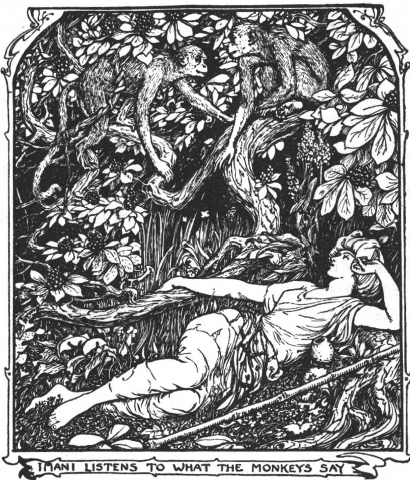

第一次洗过以后，效果那么好，国王一个晚上都睡得很舒服。公主又让他洗了第二次，这一次洗过以后，国王说他饿了，要吃东西。到了第三天，他已经好得差不多了，只是因为病了那么久，感到很虚弱。第四天，他从床上起来，登上宝座叫人去把救了他性命的医生请来。

英玛妮走进来的时候，大家都很吃惊，想不到这么年轻的医生，医术会那么高明！国王要给她许多钱和各种各样贵重的礼物。开始，她什么都不要。后来她说，如果一定要给的话，她想要国王的印章戒指和手帕。既然她别的什么都不想要，国王也就同意把这两件东西送给她。她拿到以后，就尽快地回到自己的国家。

她回到家里，过了一会以后，就把自己的全部经历对僧人说了。他们又用魔扇找来苏巴·科罕国王。他来到以后，他们问他为什么这么久没有来。国王把自己生病，还有如何得救的事对他们说了。他说完以后，公主站起来，打开柜子，拿出戒指和手帕来，笑着问：“这就是你送给你的医生的礼物吗？”

国王看了一下，终于认出她来，他立刻就明白了事情的经过。国王跳起来，把那把魔扇放到自己的口袋里去，宣布谁也不能把他送回自己的国家，除非英玛妮和他一起走，做他的妻子。于是事情就这样解决了。老僧人和英玛妮公主跟着他一起来到杜尔国。公主嫁给了国王，他们从此过着幸福的生活。

（旁遮普故事）

 

## 小梅娅的奇遇

从前有一个妇女，她的家正好在森林的正中央。她有一座漂亮的房子和花园，每年夏天，她总是种种花，听听森林里的鸟儿唱歌，过得非常幸福。可是一到冬天，地上堆起厚厚的积雪，狼经常在她的门口出没，嚎叫。这时候，她就觉得很孤独和害怕。

“如果我有一个孩子说说话，不论她是多么小，那该有多好啊！”她自言自语地说着。雪下得越大，她就越常常说这句话。终于有一天，她再也忍耐不了孤独和寂寞了。她开始动身到最近的村子里去，请求人家送一个或者卖一个孩子给她。

地上的积雪很深，已经埋没了她的踝部，走几百米路，几乎也得花一个钟头。

“这样走下去，等我走到最近的一家人家，天已经黑了。”她心里想着，停下来看了看周围。忽然，她看到有个小女人戴着一顶高帽顶的帽子，从一棵树的后面走到她的面前来。

“这可是赶路的坏日子，你要出远门吗？”小女人问道。

“嗯！我想到村子里去，可是我不知道能不能走到那里。”她回答。

“我能不能问一声，你有什么要紧的事情要到那里去？”小女人问，其实，她是一个巫婆。

“我的家里那么沉闷，没有一个人和我说句话，我一个人待不下去了。我想找个孩子，不论她是多么小，我也好有个伴。”

“啊！就这么一件事！你用不着走那么远。”巫婆把手伸进她的口袋里，说道，“看！这里有一粒大麦种子，做件好事，十二先令卖给你吧！假如你把它种在花盆里，经常给它浇水，过不了多久，你就会看到奇迹。”

这个承诺使女人兴奋起来。她很乐意地付了钱。一回到家里，她就在花盆里挖了一个洞，把种子种下去。

一连两天，她都在等待着，眼睛一刻也不离开放在温暖角落里的花盆。到了第三天早晨，她醒过来一看，一朵红色的郁金香已经长了出来，旁边还护着绿色的叶子。

“多么美丽的花啊！”女人赞叹着，弯下腰来吻它。就在这时候，红色的花瓣张开了，当中出现一个可爱的小女孩，她只有一英寸那么高。小家伙坐在紫罗兰色的垫子上，张着眼睛朝她笑着，好像早就认识她似的。

“啊！我亲爱的！我再也不会感到寂寞了。”她高兴得几乎发疯，喊叫起来。小女孩点点头，好像在说：“是的，你当然再也不会了！”

女人抓紧时间，找来一个大胡桃壳，里面垫上几层白绸布，放上垫子，然后把梅娅放进去，这是她给小姑娘起的名字。胡桃壳就是小姑娘的床，它放在一张椅子上，椅子就在她的养母睡觉的床边。不过，每天早晨，养母就把她送出去，在一个大碗里盛半碗水，放上一张叶子，然后把小梅娅放在叶子上，给她两根白色的马鬃，让她划水玩。她是世界上最幸福的婴儿了，整天不停地唱着歌。她使用的是谁也听不懂的、自己的语言。

她们一起过了几个星期，非常融洽和开心。后来发生了一件可怕的事情。有一天晚上，养母劳累一天以后，睡得很熟。一只又大又丑、浑身湿漉漉的青蛙从开着的窗口跳进来，看到盖着玫瑰叶子的梅娅。

“我的天啊！这是个多么漂亮的小姑娘！”青蛙心里想着，“她可以做我儿子的好妻子。”它用嘴衔起胡桃摇篮，跳到从花园里流过的河边。

回到它在泥塘里的家以后，它大声地喊叫起来：“快来看！我给你带回来了什么？”

“呱！呱！”它的儿子看着睡着的小梅娅，高兴地叫着。

“嘘！声音别那么大，要不就把她吵醒了！”它母亲小声地说，“我想让她做你的妻子。我们筹办婚礼的时候，把她放在河水中的百合花上，这样一来，她就不会从我们这里逃走了。”

就在这片漂浮着的绿色监狱上，梅娅醒过来了，当第一道阳光射出来的时候，她又害怕又困惑。她在百合花叶子上站起来，朝四周观望，希望能找到一条逃走的路。看到没有，她又坐下开始大哭起来。后来，她的哭声让忙着盖房子的老青蛙听到了，它正在用灯心草给新娘子编柔软的地毯，把芦苇和葡萄藤挂在门上，好让新娘的房间更漂亮一些。

“啊！可怜的孩子感到迷惑和不快活，”它同情地想着，因为它心地善良，“好吧！我这活也干完了，我现在就和儿子一起去接她。看到我儿子那么英俊，她一定会高兴得笑起来。”几分钟以后，它们就来到那片叶子前面来。

“它就是你的未婚夫，你看到过像它这么好的人吗？”骄傲的母亲把儿子推到前面来，说道。可是，梅娅只看了一眼，哭得更加厉害。住在河里的一些小鱼都游过来，看看发生了什么事情。

“这么可爱的小姑娘，被迫嫁给一个她不喜欢的丈夫，真是太荒唐了。”它们交头接耳地说着，“而且还是那么难看的丈夫！不过，这件事我们很容易就可以阻止它。”它们转过身来，开始咬百合花在水下的花茎。不一会，花茎就被这些小鱼咬断了。于是，它们就用嘴把梅娅拖走。沿着小河一直拖入一条大河。

啊！梅娅知道青蛙再也不会找到她以后，她是多么喜欢这样的航行！一路上，她经过了许多城市，岸上的人都转过头来看她，高兴地说着：

“多么可爱的小姑娘！她是从哪里来的？”

“多么可爱的小姑娘！”树丛中的小鸟也在叽叽喳喳地说着。一只蓝蝴蝶爱上了她，寸步不离地跟着她。于是，她把自己的腰带解下来，正好能够把她和蓝蝴蝶缚在一起。骑上这匹会飞的马以后，她周游世界可就比以前快得多了。

不幸的是，一只正在河面上嗡嗡地飞着的大金甲虫看到了她，用爪子把她抓住。可怜的蝴蝶看到它吓坏了，拼命地挣扎起来，腰带的一头松开了，蝴蝶立刻向太阳的方向逃去。可是梅娅却没有那么幸运。尽管金甲虫采来花蜜给她当午餐，不止一次地称赞她是多么可爱，她还是感到和它在一起很不舒服。金甲虫感觉到了这一点，就叫自己的姐妹们来和她一起玩。可它们只是粗暴地瞪着它说：“你从哪里把这个怪东西捡来？她实在是太丑了！不过，她只有两只脚，值得大家同情她。”

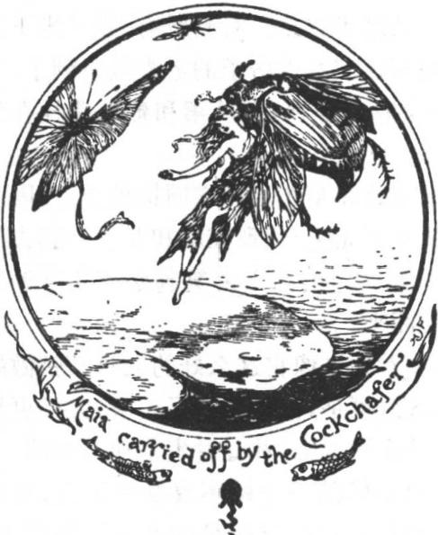

“是的，而且她没有触角，”另一只金甲虫补充说，“又长得那么瘦！哎！我们这个兄弟的嗜好可真怪！”

“是的，你说得一点也不错！”其他金甲虫都同意地点头。它们说话的声音那么响，又不知道说了多少遍。这样一来，把梅娅抢来的金甲虫也相信了。它把梅娅从放在树上的地方抓起来，放到离地面很近的雏菊花上去。

梅娅在这里待了一个夏天。说实在的，她也没有感到什么不快活。她独自一个人到处走动，用草的叶子给自己编了一张床，把它放在苜蓿下以遮风避雨。苔藓头上的红帽子蓄有足够她用的露水，金甲虫也已经教会她如何去采花蜜。可是，夏天总是要过去的。慢慢地花儿凋谢了，雪和冰代替了露水。梅娅不知道该怎么办才好，她的衣服已经穿破，虽然她想办法用花瓣把自己裹起来，可是她的手指一碰，它就破了。后来，她明白了，如果不找到一个新的藏身之处，就会因为饥饿和寒冷而死去。

于是，她鼓起全部勇气，穿过大路，走进夏天的时候原是美丽的一片绿波的庄稼地。可是现在，这里只剩下了一堆硬杆子。她继续徘徊着，除了头上的蓝天以外，几乎什么都没有。忽然，她看到了一个门口，这门口像是通向地下。

“不管怎么说，里面总会暖和一些。”梅娅想着，“也许住在里面的人会给我一点吃的。说到底，总不会比我现在的情况更糟糕吧！”她壮着胆子沿着通道走下去。不久就看到一扇半开着的门。她偷偷地往房间里观望，看到里面堆满了谷物。这使她充满了信心，加快了步伐。她一直走到一个厨房，看到一只老田鼠在烘饼。

“你这可怜的小动物，”田鼠从来没有见过这么小的人，说道，“看起来你饿坏了，快过来坐下，暖和暖和身子，和我一起吃饭吧！”

听到老田鼠说的这些话，小梅娅高兴得几乎哭出来。她用不着再说第二次，就开始吃起来，她生下来还没有一下子吃过这么多东西，尽管还不如一只蹦蹦跳跳的小鸟吃得多。吃够了以后，她伸出手来微笑着。老田鼠对她说：“你会讲故事吗？如果会，你就留下来，和我一起住到太阳暖和吧，还可以帮我整理房间。冬天住在这里很沉闷，除非有个聪明的伙伴来开开心。”

小梅娅从她养母那里学来了许许多多的故事。而且，她死里逃生，还有那么多冒险经历。她还知道该如何去打扫和整理房间。她总是每天很早就起来，帮老田鼠把东西揩干净，把房间整理得有条不紊。

冬天就这样快活地过去了。梅娅开始谈论起春天来，说她又可以到外面的世界去，寻找她的幸福了。

“呵！你用不着这么早就开始考虑这些。”田鼠对她说，“上面的人都这么说：白天变长了，可冬天还没有走远。现在是暖和多了，可随时还会下雪。春天到来之前，这总是难免的。那时候，你就会想到，幸亏你还待在这里，没有到外面去挨冻。不过，我敢说，像你这样年轻的人一定会感到寂寞。我已经邀请我们的邻居鼹鼠来看我们。这几个月，它一直在睡觉，听说它已经醒过来了。要是它爱上了你，想和你结婚，那你就太幸运了。可惜的是，它是个瞎子，看不到你长得多么漂亮。”听到它是个瞎子，梅娅倒不由得高兴起来。她并不希望鼹鼠来做自己的丈夫。

没多久，鼹鼠信守它的诺言，到田鼠家作客来了。梅娅一点也不喜欢它。它也许是很富有，也很有学问。可是它恨太阳光，还有树木和花朵，这些都是梅娅最喜欢的东西。当然，它是个瞎子，从来没有见过这些。而且，它还像许多人一样，认为只要是它不知道的东西，就用不着去学。不过，梅娅的故事倒也引起它的兴趣，虽然它不想让她看出这一点来。它很欣赏她的声音，特别是她唱这些歌的时候：

> 玛丽，玛丽，多么怪僻，
> 你的花儿长得怎么样？
> 或者树上的宝贝，
> 我们悄悄地说再见！

不过，它对她说，这些都是胡说八道。至于那些树啊、花啊，更是愚不可言。等她嫁给它以后，它要教给她许多更加值得学习的东西。

“另外，”它说话的时候，态度非常优雅，“我已经租下了从这里通往我家的地下通道，你可以在上面散步。不过我得提醒你，有一只大动物死了以后，从顶上的一个洞里掉下来，就躺在通道里，你可别吓坏了！”

“那是个什么样的动物？”梅娅迫不及待地问。

“嗯！我真的不能告诉你。”鼹鼠冷淡地回答，“它身上盖着柔软的东西，两只脚很细，头上有一根又尖又长的东西伸出来。”

“那是一只鸟，”梅娅高兴地说，“我喜欢鸟，它肯定是冻死的。”接着，她又降低声音说，“啊！好心的鼹鼠先生，带我去看看它吧！”

“那么，来吧！我正好也要回家。”鼹鼠回答说，还叫田鼠跟它一起走。

“这里就是了，”到了目的地以后，鼹鼠说，“天啊！命运没有把我变成一只鸟，真是谢天谢地。它们什么也不会说，只会喳喳地叫，天一冷就要被冻死。”

“啊！是的，这些可怜的、无用的东西。”田鼠应声说着。它们在说话的时候，梅娅走过去，抚摸着这只小燕子的羽毛，还吻了一下它的眼睛。

这天晚上，她整夜都没有睡，想着躺在通道里的那只死燕子。后来，她再也受不了了，就偷偷地爬起来，来到堆着干草的地方，编了一块厚毯子。然后，她来到田鼠的仓库，拿走她夏天的时候从地里采来的棉花。她带着这些东西回到燕子的身边，把棉花垫在它身下，把毯子盖在它身上。

“也许，我在夏天的时候也听过你唱歌，”梅娅说，“我希望能够让你重新活过来。现在我得走了，再见吧！”说着，她用沾满泪水的脸，贴在小鸟的胸膛上。她的脸上仿佛感觉到了它微微地动了一下！不错，它又动了一下。看来，燕子并没有死去，它只是因为饥饿和寒冷失去了知觉。想到这里，她赶紧回到田鼠的家里去，用叶子带来一滴水和几粒谷子。她把这些吃的东西送到小鸟的嘴边。它下意识地把嘴张开，把水吸进去以后，梅娅又把谷子一粒一粒地送进它的嘴里。

“不要出声，这样谁都不知道你还活着。”她说，“今天晚上，我再给你带一些吃的来。我要叫鼹鼠把上面的洞补好，说是洞里有风进来，我从通道里经过的时候感到冷。再见吧！”说完，她回到田鼠的家里，它睡得正熟。

过了一些日子，在梅娅的精心护理下，燕子的体力恢复了，可以说话了。它告诉她，它是怎么会掉到这里来的。在它还没有长大到能够飞得很高之前，它在树丛里把翅膀划伤了。所以，它跟不上家里人和朋友们的飞行队伍，一起飞到温暖如春的南方去。在这种长途飞行之中，它们也没有注意到小燕子已经掉队了。后来，它因为实在太累了，终于从天上掉下来，一定是从上面的洞里落到这个地下通道里来了。

小燕子非常幸运，因为田鼠和鼹鼠都以为它死了，没有来找它的麻烦。等春天终于来到，太阳暖洋洋的，森林里长出蓝色的风信子，篱笆上也爬满了报春花的时候，它已经像大燕子一样强壮了。

“你救了我的命！小梅娅，”它说，“可现在，我得离开你了。除非你愿意坐在我的背上，让我带你离开这黑暗的监狱。”

听它这么一说，梅娅的眼睛里闪出了火花，可是，她立刻就伤心地摇摇头。

“是的，你该走了。可是我得留下。”她回答说，“田鼠养妈对我很好，我不能就这样离开它。”“你能自己把上面的洞挖开吗？”她又担心地问，“如果能，你最好现在就开始挖。因为今天晚上，我们要到鼹鼠那里去吃晚饭，我的养妈就不知道你把洞挖开了。”

“那倒是真的。”燕子回答说。它飞到通道的顶上，那毕竟没有多高，开始用嘴挖起来。很快，一丝阳光从上面泻下来。

“你愿意和我一起走吗？”燕子问。尽管她很渴望看到树木和鲜花，可她还是像上一次一样地回答：“不！我不能。”

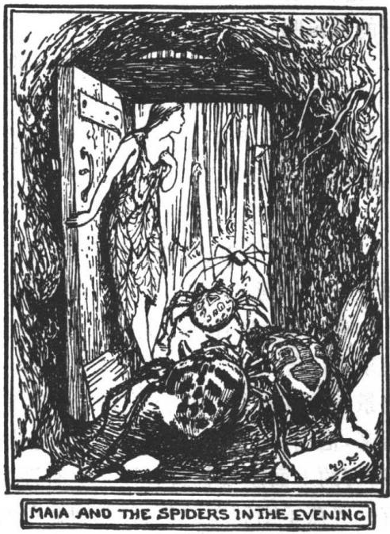

梅娅已经很久没有看到阳光了。田鼠家里和洞里的粮食堆得那么高，把阳光都遮住了。尽管她时时刻刻都在想念着她的鸟朋友，她可没有片刻偷闲的时间。田鼠对她说，她很快就要和鼹鼠结婚了，叫她不停地纺线好做结婚礼服。她一生没有做过一件衣服，所以请来四只聪明的蜘蛛天天到地下来帮她做衣服。梅娅喜欢新衣服，可是一想到要嫁给瞎眼睛的鼹鼠，心里就很恨。她也不知道该如何才能摆脱它。到了晚上，蜘蛛们要回家过夜时，她总是把它们送到门口，等着一阵风把麦穗吹开，好看一眼天空。

“燕子要是现在飞回来就好了，”她自言自语地说着，“我会跟它一起飞到天涯海角去，可是它再也不会回来了。”

“你的衣服做好了！”在一个草莓变红、叶子变黄的日子里，田鼠对她说，“我和鼹鼠决定，你们的婚礼四个星期以后举行。”

“啊！用不着这么快！用不着这么快！”梅娅喊道，哭了起来。这使田鼠非常生气，骂她不如别的小姑娘懂事，不知道好歹。这时候，鼹鼠来了，背着她去看它为她挖好的新房子。房子挖得离地面那么深，梅娅的小脚恐怕连田鼠的家都爬不到。从田鼠的家里，她起码还可以看到阳光。随着时间一天一天地过去，她的心越来越沉重。到了要结婚的前天傍晚，她来到庄稼已经收割的地里，看着太阳下山，准备和它永别了。

“再见！再见！”她喊道，“还有我的小燕子，再见！啊！要是它知道了，它一定会来帮助我。”

“喳！喳！”一个声音在她的头顶上叫着，接着，小燕子飞下来，落在她的身边，“你看上去那么悲伤，你真的愿意嫁给那个很丑的鼹鼠吗？”

“我不久就会死去，这是我唯一的安慰。”她哭着回答。

可是燕子说：“喳！喳！到我的背上来，像我对你说过的那样。我要带你到一个阳光永远明媚的地方去！你会很快就把像鼹鼠这样的东西忘掉。”

“是的，我要去！”梅娅说。

接着，燕子用它结实的嘴拉下一根麦杆，叫她把自己安全地缚在它的翅膀上，他们开始向南方飞去，一连飞了好多天。

啊！梅娅又看到了美丽的大地，她是多么高兴！她上百次地请求燕子停下来，让她好好地看一看。可燕子总是对她说，前面的景色更加好看！他们不停地飞着，有时只是停下来休息一会。后来，他们来到了一个地方。这里到处都是很高的白色大理石柱子，有的上面还盘着藤。柱子上有许多燕子伸出头来观望着；还有一些燕子则躺在白色、黄色和蓝色的鲜花中。

“我就住在那上面。”燕子指着最高的一根柱子说，“可这种房子不适合你住，你会掉下来摔死的。所以，你挑选一朵花吧！它将是属于你自己的。到了晚上，你可以睡在它的叶子上面。”

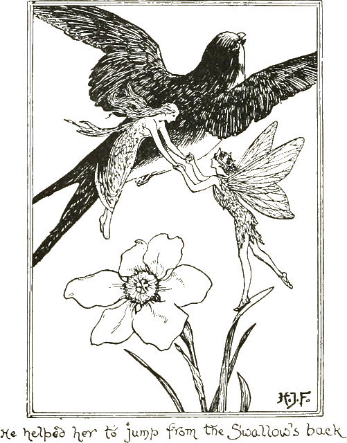

“我要挑那一朵！”梅娅指着一朵白色的、像星星一样的花，花的中央还有红色和黄色的花环。它的花茎那么长，在随风摆动着。“这是这些花中最美丽的一朵，而且那么芬芳。”燕子说着，向它飞过去。他们靠近那朵花的时候，看到一个小人头上戴着王冠，肩上长着一对翅膀，正稳稳地站在一张叶子上。

“啊！这是花仙们的国王。”燕子悄悄地对梅娅说。国王向梅娅伸出双手来，帮助她从燕子的背上跳下来。

“我已经等你很久了。”他说，“现在，你终于来当我的王后了。”

梅娅微笑着，站在他的身边。花儿中所有的仙女都去给她拿来礼物。其中最好的是一对美丽的蓝色轻纱翅膀，可以让她也和她们一样到处飞翔。

这样，梅娅没有嫁给鼹鼠，而是当上了王后。仙女在她的周围围成一个圆圈，跳起舞来。燕子则唱起了婚礼进行曲。

 

## 强中更有强中手

从前，在印度斯坦的一个村子里，住着一个商人。尽管他从起早贪黑，拼命地干活，但还是很穷。他总是那么不走运。后来，他决定离开家乡，到别的国家去碰碰运气。他果然交了好运，十二年过去以后，他积累了许多财富，可以舒舒服服地度过他的余生。这时候，他想起了自己的家乡，希望回去和家里人一起生活，一直到老。为了在回家的路上能安全地携带自己的财富，他买了许多贵重的珠宝，把它们锁在一个小盒子里，藏在自己的身上。为了不引起一路上以抢劫为生的强盗们的注意，他穿上破衣服，打扮成一个身无分文的穷人。

这样准备好了以后，他路上走得很快。到离家只有几天路程的时候，他走进一座城市。现在，他不再害怕强盗了，所以，他决定去买一些好衣服。他穿着新衣服走进城，在城门口看到一个集市。集市里有许多商店，卖着值钱的丝绸、毯子和来自各个国家的货物。其中有一家商店显得特别好。在这家店铺琳琅满目的贵重货物中，坐着它的主人，他抽着一支长长的银烟斗。

商人走上前去，有礼貌地和这家主人打招呼。然后也坐下来开始挑选东西。这家店的主人叫比克·马尔，为人非常精明。他和商人说上几句话，很快就发现这个顾客比他的外表富得多，而且不愿意流露真情。商人买了几样东西以后，主人邀请他进来休息一下。没有多久，他们就谈论得很投机。比克问商人要到哪里去？商人把自己的村名告诉他以后，他说：“哦！你一路上可得小心，那里的强盗非常出名！”商人听他这么一说，脸色都变了。他心里想，眼看就要到家了，辛辛苦苦积累起来的财富这时候被抢，那真是太冤枉了！做生意人的这种心情，比克知道得很清楚，所以商人接着就对他说：“尊敬的先生，你能不能帮帮忙，替我把一个小盒子保管好。用不了多久，等我回到家以后，我叫几个身强力壮的同乡一起来把它拿回去。”

比克摇摇头说：“对不起，这种事情我不能做，也不属于我的经营范围，所以我也不敢接。”

“可是，”商人恳求他说，“在这座城市里，我一个人也不认识。你总有保存自己贵重物品的地方吧！我请求你帮帮忙吧！帮我保管一下！”

比克还是有礼貌但坚决地拒绝他。可是商人已经暴露出了他的富有，又不愿意到处求人，让更多的人知道，所以就继续说服他，直到他点头同意。商人把他藏着珠宝的小盒子拿出来交给比克，比克把它锁到存放宝石的箱子里去。他们相互之间说了许多承诺和感谢的话以后就分手了。

像这种东方式的集市市场，店门都开得很大，货物不但堆在里面，而且堆在外面的走廊和阳台上，高出马路有几英尺。商人和比克这么长时间的谈话，在这条狭窄的马路上，不可能不引起其他店主的注意。如果商人知道，这一地区的店主几乎都是贼，而比克是他们之中最大、最聪明的一个，那就好了。可惜他不可能知道，他只是因为把所有的财富交给一个陌生人，心里自然而然地有点不安。所以，他沿街走下去，到这里或那里买些东西的时候，免不了要打听一些比克·马尔的可靠程度。那些恶棍猜想到，这里面肯定有某种原因。为了能从中得到一些好处，他们异口同声地把他说成是讲道德的模范。

商人的心里虽然轻松了一些，可是忧虑并没有完全消除。他回到家乡以后，不到一个星期，就带着自己的侄子和几个年轻力壮的小伙子返回城里，请他们和他一起把宝贵的盒子带回家。

来到城市中央的大市场，商人叫他的同乡留在外面，他去把珠宝盒子取回来以后就来找他们。他们答应了。商人独自来到比克的商店门前，走上前去和他打招呼。

“先生！你好！”商人说。可是比克假装没有看见他。商人又重复了一遍。

“你要干什么？”比克厉声打断他说，“你说‘你好’已经两遍了！有什么事干吗不快点说！”

“你不记得我了？”商人问。

“记得你？”比克咆哮如雷，“我为什么要记得你？不！我有许多好的顾客要记住，干吗要去记得每一个来讨乞的乞丐？”

听到他说的这些话，商人开始发抖。

“尊敬的先生！”他喊道，“你肯定记得我，还有我托你保管的小盒子！你答应过的，而且是非常仁慈地答应，我随时可以来取它……而且…… ”

“你这个流氓！”比克大声地叫喊着，“立刻从我的店里滚出去！无耻的无赖！谁都知道，我从来不给别人保管财产，我看管自己的财产就够麻烦的了！马上就给我滚出去！”他一边说着，一边动手把商人推出店门。可怜的人想反抗，旁边站着的两个人立刻过来帮比克，把商人扔到马路上去，像是扔一包东西一样。

商人慢慢地从地上爬起来，身上被打伤和擦伤的地方流着血。可是，他一点也不感到痛。他因为自己被掠夺，因为自己财产的损失已经麻木不仁！他缓慢地离开还站在那些零乱的丝绸和毯子中间、肥胖而怒气冲冲的比克，走到马路旁的一堵矮墙边。他靠着墙坐下，双手抱着头，露出一副绝望和十分悲伤的神情。

他一直一动也不动地坐在那里，像是一尊雕像似的。天逐渐地黑了下来。将近十一点钟的时候，一个名叫库斯·朗穆的快活的年轻人和他的朋友从这里经过，看到商人靠着墙坐着，就说：“这个人是个贼，肯定不会错！”“不对！”他的朋友说，“贼不会坐在大家都看得见的地方，即使是黑夜也是这样。”说着，两个人就走过去了，不再去想他。到了第二天早上五点钟，库斯·朗穆返回自己的家，路过这里的时候，非常吃惊地看到，可怜的商人还像昨天晚上一样地坐在那里。一个人通宵达旦地坐在马路上，肯定是碰到了什么麻烦。于是，他决心去问个明白，他走过去摇了摇商人的肩膀，问他说：“你是谁？在这里干什么？是不是病了？”

“病了？”商人用低沉的声音回答说，“是的，我病了，是什么药也治不好的病。”“胡说八道，”库斯·朗穆说，“跟我来！我想，我有一种药可以治好你的病。”这样，年轻人抓住他的手臂，把他拉起来，带他到自己的房子里去。到了那里以后，库斯·朗穆先给他一大杯酒，再给他一些东西吃，等他恢复过来以后，再问他发生了什么事情。商人那些在市场里等候他的朋友，都是一些头脑简单的人。他们想，商人一直没有来，肯定是自己回家去了，他们等得不耐烦以后，就不再理睬他，自己回到村子里去了。所以，要不是遇到库斯·朗穆，商人可就惨了。库斯·朗穆还是个小孩的时候，就得到了一大笔财产，没有人教他该怎么花。他是个心地善良、精力充沛、聪明能干的人。可是他花起钱来就像流水一样，不论遇到什么事情总是喜欢慷慨解囊。现在，他已经下定决心要帮助这个可怜的商人，而且说到做到。至于商人，他这时候也恢复了自信心，用不着库斯·朗穆再多说什么，就把发生的事情一五一十地对他说了。

听到一个陌生人信任地把自己的财富托给比克·马尔保管，库斯·朗穆笑得合不拢嘴。“咳！他是城里最大的恶棍！”他说，“除非你相信他们这些人对我的评论！不过，现在还没有什么办法，你先安静地在这里待一段时间。到时候，我会找到一种能治好你的病的药。”听他这么说，商人又开始有了勇气，心里也安静了一些。他高兴地接受了这个新朋友的邀请。

几天以后，库斯·朗穆请他的一些朋友来看他，他们谈了很久。商人虽然没有听见他们在说什么，可是听到了他们的笑声，像是在讲开心的笑话。不过，这些笑声使他心里纳闷起来。他越想越感到，要想把自己的财富从比克·马尔拿回来是不可能的了。

这以后没有多久，有一天，库斯·朗穆走进来对他说：“你还记得离比克·马尔的商店很近，我遇见你的那堵墙吧！”

“是的，我记得。”商人回答。

“那好！”库斯·朗穆继续说，“今天下午，你到那里去，站在那里看着。等有人暗示你的时候，你就走过去对比克·马尔说，‘啊！先生！你能不能仁慈地把我托你保管的盒子还给我？’”

“那有什么用呢？”商人问，“他还会像我以前向他要的时候一样，不肯还给我。”

“没有关系！”库斯·朗穆回答说，“就照我对你说的去做，一字不错地重复我的话，其他的事情我来对付。”

于是，这天下午，到了说好的时间，他来到指定的那堵墙边站着。他注意到，比克·马尔也看到他了，可是他们谁也不理睬谁。这时候，来了一顶像是坐着高贵女士的轿子。轿子由四个穿着华丽制服的侍从抬着，它的帘子和装饰都非常富丽堂皇。随行的人中有一个脸色严肃的人，商人认出他是到库斯·朗穆家里来过的一个朋友。他的后面跟着一个仆人，头上遮着一块布，手中拿着一个盒子。

仆人们以敏捷的步伐把轿子抬到比克·马尔的商店门口，停了下来。肥胖的店主立刻站起来，向走过来的一个绅士深深地鞠了一躬。

“我能不能问一声，”他说，“坐在轿子里的是哪一位贵人，想到来光顾鄙店？我能够为她效劳吗？”

绅士走到轿子旁边，对着帘子小声地说了几句话，然后回过头来对比克·马尔说，这是他的一个亲戚，要出去旅行。可是她的丈夫因为有事，不能陪她去，所以她想把自己的珠宝盒交给比克·马尔代为保管。店主又鞠了一躬，头几乎着地，说道：“这不属于我的经营范围。当然，如果能为这位女士效劳，让她感到高兴，我愿意用自己的生命来担保她的珠宝盒。”于是，捧着珠宝盒的仆人被叫到前面来。盒子打开着，欣喜若狂的店主看到了里面许多非常贵重的珠宝，口水都要流出来了。

站在一边的商人把这一切都看在眼里。这时候，他看到背着商店一边的轿子帘里，伸出一只手来，开始他还以为自己看错了。等肯定以后，他心里想着：“这是不是就是信号？”

这时候，那只手又伸出来招了一下，好像有点不耐烦。于是，他很快地走上前去，向比克·马尔鞠躬，比克·马尔这时正想着那盒令人眼花缭乱的珠宝，是命运和哪个傻瓜把它送到自己的手里来了。

“啊！尊敬的先生！你能不能仁慈地把我托给你保管的盒子还给我？”商人的话像是针刺了他一下似的，他抬起头来。但他立刻就想到，如果这个人闹起来，他就会失去这个更加富有的新顾客的信任。所以，他控制了一下自己，回答说：“我的天！当然，当然！我把这全忘了。”

他走进去，把小盒子拿出来，交到商人发抖着的手中。商人立刻就把用一根绳子挂在头颈上的钥匙拿下来，把盒子打开。他看到自己的全部珠宝都在里面，就立刻夹着盒子跑到马路上去，大声地笑着，喊叫着，像是疯了似的。

这时候，有个送信的人跑到轿子前面，对那位绅士鞠躬以后说：“女士的丈夫已经回来了，准备和她一起出去旅行，所以珠宝用不着再寄放了。”绅士听他这么一说，立刻就把盒子合上，锁起来，把它交给站在一旁的仆人。接着，从轿子里传出一阵笑声，从里面走出一个人来，根本不是什么女士，而是库斯·朗穆。他下了轿以后，立刻跑过去追上商人，在马路上像他一样发疯地跳起舞来。

比克·马尔站在那里呆呆地看着他们，后来忽然发出一阵刺耳的笑声。接着，他取下自己的头巾，也奔到马路上来，和他们俩一起跳起舞来，一边跳，一边把自己的手指捻得劈啪响，直到喘不过气来。

“先生，”那位扮演轿里“女士”亲戚的绅士走上前来问，“你干吗要跳舞啊？商人跳舞是因为他取回了自己的财宝；库斯·朗穆跳舞是因为他是个狂热的人，成功地耍了你。可你怎么也跳起来了？”

“我跳舞，”比克·马尔用一双通红的眼睛瞪着他，上气不接下气地说，“我跳舞，是因为我有十三种欺骗别人的方法，我假装相信他们。除此以外，我不知道还有别的骗人方法。现在我懂了，还有第十四种骗人的办法！这就是为什么我要跳舞！”

（旁遮普故事）

 

## 绿骑士

有一个国王和王后，他们只有一个女儿，她美丽迷人。对国王和王后来说，这个世界上，再也没有比她更宝贵的了。公主长到十二岁的时候，王后得了病，什么办法都治不好她的病。王宫里的医生已经尽了最大的努力，可是，她的情形还是一天比一天坏。她感到自己快要死的时候，派人把国王找来，对他说：“答应我，我们的女儿不论有什么要求，你都要同意，不管你心里是不是愿意。”

国王开始有点犹豫，王后接着又说：“除非你答应我，否则我死了也不会安宁。”国王终于答应了她的请求。王后十分满意地闭上了双眼。

国王的王宫旁边，住着一个高贵的女士。这个女士也有一个女儿，和公主的年龄差不多。两个小孩经常在一起。王后死了以后，公主请求她的父亲，让这个女士也到王宫里来，和她住在一起。国王并不乐意做这种安排，因为他不信任这个女士。可是公主的请求那么迫切，他又不忍心拒绝。

“我很孤独，爸爸，”她说，“你给我那么多漂亮的礼物，都无法补偿我失去妈妈。要是这个女士住到这里来，我就感觉到，好像是妈妈又活过来了一样。”

于是，王宫里准备了一套豪华的房间，让这位新来的女士住。公主想到她的朋友离她那么近，高兴得难以形容。女士带着她的女儿来了。有一段时间，一切都过得很好。她们对没有母亲的公主很善良，公主也几乎忘记了她们到来之前那些寂寞的日子。

后来有一天，两个小姑娘在王宫的花园里一起玩的时候，女士穿着一身出远门的衣服，走过来温柔地吻着公主，对她说：“再见吧！我的孩子，我和我的女儿要离开你，到别的地方去了。”

可怜的公主开始大哭起来。“啊！你们不能离开我！”她呜咽地说着，“你们走了我怎么办呢？请你们留下来吧！”

女士摇摇头说：“亲爱的孩子，离开你，我的心也要碎了！可是，我不得不走。”

“难道就没有什么办法可以把你留下来了吗？”公主问。

“只有一个办法，”女士回答，“可是那办不到，所以我也就不说了。”

“没有什么办不到的事情，”公主坚持着，“告诉我，一定能办到。”

后来，她的朋友说出来了。“要是国王，你的父亲，能够让我当王后，我就留下。”她说，“可这他不会答应的。”

“啊！那太容易了！”公主叫起来，她高兴地想着，这一回，用不着分开了。她跑出去找她的父亲，请求他立刻和女士结婚。她一直有求必应，她十分相信，他一定会同意。

“你这是怎么啦！我的女儿！”国王看到她，问道，“你哭过了，有什么不高兴吗？”

“爸爸！”她说，“我来请求你和女伯爵（这是女士的衔头）结婚，如果你不同意，她就要离开我们，我就会像以前一样孤独。你从不拒绝我的请求，现在也不要拒绝我。”

国王听了她的话，脸色刷地变白了。他不喜欢女伯爵，当然也不会想到和她结婚；再说，他还爱着自己死去的妻子。

“不！这我不能！我的孩子。”他终于这样说道。

听了他的话，公主又开始哭起来。眼泪像小河一样从她脸上流下，她抽泣得那么厉害，国王也觉得心里非常难过。他想起了自己答应过死去的王后，公主不论什么要求都答应的承诺，后来终于让步了，答应和女伯爵结婚。公主立刻笑逐颜开，跑出去把好消息告诉她们。很快就举行了盛大的婚礼，女伯爵变成了王后。尽管王宫里人人兴高采烈，个个笑逐颜开，国王看上去还是很伤心的样子，脸色很难看。他心里明白，这次婚姻肯定会带来灾难。果然不出他所料，婚后没有多久，王后对公主的态度开始变了。她心里充满了妒忌，因为是原来的公主，而不是她的女儿是王室的继承人。很快，她的这种想法就暴露无遗。她和公主说话的时候，不再像以前那样和蔼可亲，而是变得粗暴无礼。有过一两次，她甚至扇公主的耳光。

看到自己亲爱的女儿受到这种侮辱，国王很不高兴。后来，公主变得那么可怜，他再也忍受不了了。有一天，他把公主叫来对她说：“我的女儿，你不像以前一样快活了，我感觉到这是你继母的过错。你不要和她住在一起了，这对你会更好一些。因此，我已经在湖中间给你建造了一座宫殿，那里就是你未来的家。在那里，你喜欢做什么就做什么，你继母决不会到那里去。”

公主听了非常高兴，看到那座宫殿，更是兴高采烈，因为里面到处都是漂亮的东西。宫殿里还开了许多窗，可以看到迷人的蓝色湖水。湖里有一只船，她可以自己划船游玩。还有一个花园，她随时可以去散步，不必担心会碰到狠心的王后。国王还答应每天都来看她。

相当一段时间，她过着安静的生活，人也长得一天比一天更漂亮。看到她的人都说：“公主是世界上最可爱的姑娘。”这话传到了王后的耳朵里，她更加恨前妻留下的公主，因为她自己的女儿又丑又笨。

有一天，离他们国家有两天路程的一个王国宣布，将举行骑士和贵族的盛大集会，以庆祝这个国家的王子成年。集会上将举行各种欢庆活动，还有各种比赛和宴会。公主的父亲也受到了邀请。出发之前，他来向女儿告别。尽管她有那么漂亮的房子，也不再受到王后的责骂，可是，可怜的公主感到十分孤独。她对父亲说，她还不如死去的好。他尽可能地安慰她几句，答应她很快就会回来。还问她有什么事情要他办吗？

“是的，”她说，“你可以替我问候绿骑士。”

国王听了她的话有点迷惑，因为他从来没有听说过什么绿骑士。可是，时间不允许他详细地问她了，他也就答应下来，匆匆上路。他来到举行庆祝活动的宫殿以后，第一件事就是问别人：“你能告诉我，在哪可以找到绿骑士吗？”

不能！大家都说很遗憾，他们不知道这个人，显然在这里找不到他。这样一来，国王心烦意乱，连那些宴会和比赛也叫他高兴不起来。接着，他到处打听，逢人就问：“你认识绿骑士吗？”可得到的回答只是：“不认识，陛下，我们听都没有听到过。”

后来，他开始相信，公主肯定是弄错了，根本没有这么一个人。他十分悲哀地开始动身回家，很久以来，这是第一次公主要他办的事情他没有办到。一路上，他一心一意只想着这件事，没有注意马走的方向。后来，他发现自己走到一片从未来过的密林之中。他继续走着，想找到一条路，可是眼看太阳即将下山，还是没有找到。他开始意识到，自己迷路了。幸好不久，他就看到有人赶着一群猪过来，他高兴地骑着马过去说道：“我迷路了，你能告诉我这是什么地方吗？”

“你在绿骑士的森林里。”那人回答说，“这些猪都是他的。”这下国王可高兴了。“绿骑士住在哪里？”他问。

“离这里还很远很远。”猪倌说，“不过我会把路指给你的。”他领着国王向前走了一段路，然后叫他走右边那条路，就和他告别了。

接着，他走进了第二片森林，看到又一个赶着一群猪的猪倌。

“这些牲畜是谁的？我的朋友！”国王问。

“它们都是绿骑士的。”那人回答。

国王骑着马继续往前走。到约莫中午的时候，他看到一座美丽的城堡。城堡坐落在最漂亮的花园中间。你简直想象不出花园有多么好。喷泉在大理石的池子里飞舞，孔雀在柔软的草地上漫步。在大理石水池的一边，坐着一个年轻英俊的男子，他从头到脚都穿着一身绿色的盔甲，这时正喂着在清澈的池水里游的金鱼。

“这肯定就是绿骑士了！”国王想着。他向年轻人走过去，有礼貌地对他说：“先生！我来替我的女儿向你问候。可是我走得太远了，在你的森林里迷路了。”

骑士看了他一会儿，像是有点迷惑不解。

“我从来没有见过你，也没有见过你的女儿。”他终于开口说道，“不过，你照样受到热烈的欢迎。”他向城堡挥了一下手。国王没有注意到，只是对他说，“我的女儿叫我带个口信给绿骑士，既然这个国家里你是唯一的绿骑士，这个口信肯定是给你的了。”

“你一定要留下来和我一起过夜。”骑士说。这时候，太阳已经下山，国王也就感激地接受了他的邀请。他们一起在城堡的大厅里坐下享用盛大的宴席。国王虽然去过许多国家，访问过许多国王和王宫，可从来没有哪一张饭桌比这一张更丰盛。主人既聪明又得体。国王十分高兴，心里想着：“这个骑士将是一个多么理想的女婿！”

第二天早晨，当他准备起身回家时，骑士把一个珠宝盒放在他的手中，对他说：“尊敬的陛下，能不能屈尊把这件礼物带给你的女儿公主？里面有我的画像。这样等我来看她的时候，她就会认出我来。我感觉到，她就是我在梦中天天见到的那个女士，我必须娶她做妻子。”

国王对骑士表示祝福，答应把礼物交给他的女儿，然后就出发了。没有多久就回到自己的国家。

国王来到公主的住处时，她正在焦急地等待着他回来。看到父亲，她高兴地跑过去扑入他的怀抱。

“你看到绿骑士了吗？”她问。

“看到了，”国王把骑士给他的盒子拿出来，说，“他叫我把这个交给你，好让你在他到来的时候能认出他来，免得把他错当成别人。”

公主看到画像很高兴，说道：“他就是我在梦中见到的那个人！现在，我会感到幸福了，因为是他，而不是别人，将成为我的丈夫。”

没有多久，绿骑士就来了。他穿上绿色的盔甲，头盔上还插着一根长长的绿羽毛，显得十分英俊。公主比见面以前更加爱他了。他看到公主，也认出了她就是常常梦见的女郎，立刻就向她求婚。公主低着头，微笑着对他说：

“我们要对我的继母保守秘密，直到结婚的那一天。否则，她就会想办法破坏我们。”

“就照你的意思办。”骑士回答，“可是我要天天来看你，没有你我再也无法活下去！我一早就来，天黑了再回去。这样一来，王后就不会看到我在湖面上划船了。”

有一段相当长的时间，绿骑士天天都来看公主，一连几个钟头和她一起在美丽的花园里散步，他们知道，在这里王后看不到他们。可是，我们都知道，保守秘密总是一件危险的事情。后来，终于有一天早晨，王宫里的一个侍女早晨恰巧在湖边走路，看到一个穿着绿缎子衣服、非常英俊的青年男子走到湖边。他没有想到有人在注意，就登上一条停在那里的小船，向公主城堡所在的小岛划过去。侍女在回去的路上想着，这个骑士是谁呢？在给王后梳头的时候，她问道：“尊敬的王后知道吗？有人在向公主求婚。”

“胡说！”王后粗暴地训斥她。可是这个念头使她非常烦恼，因为她的女儿还没有结婚，而且看起来不会有什么希望。她脾气那么坏，又那么笨，不会有人要她。

“这是真的，”侍女坚持说，“他穿着一身绿色的衣服，而且非常英俊。我亲眼看见他，虽然他没有看到我。他上了一条船，向岛上划去，公主站在城堡的门口等他。”

“我要搞清楚这是怎么一回事。”王后心里想着。不过她关照侍女不要再说起这件事，好好做自己的事情。

第二天一早，王后就起来到湖边去，躲在一棵树的后面。真的，来了一个穿绿衣服的英俊骑士，就像侍女说过的那样。他上了船，向岛上划去，公主在那里等着他。气愤的王后在湖边呆了一整天，直到晚上，那骑士才回来，跳上岸，把船停泊好，穿过森林走回去。“这回她真的给我逮住了！”王后心里想着，“她甭想在我可爱的闺女之前结婚。我要想个办法阻止他们。”

于是，她拿来一根毒钉子，把它钉在船桨上。骑士只要拿起桨，手肯定就会被钉子划破。然后，她就笑嘻嘻地回家去，为自己的聪明感到非常得意。

到了第二天，骑士像往常一样来看公主。他一拿起桨想划，就感到手被什么东西划破了。

“啊！”他痛得把桨摔下，叫起来，“是什么东西把我的手划得这么痛！”他仔细地看着，只看见一根小钉子。

“奇怪！只过了一个晚上，上面怎么会有一根钉子出来？”他心里想着，“不过，虽然很痛，伤得还不算严重。”是的，看来好像没有什么了不起，他连和公主说话时，也没有提起这件事。

可是，等他晚上回到家里的时候，他感到病得很厉害，不得不躺到床上去。除了一个老奶妈以外，没有人来照顾他。

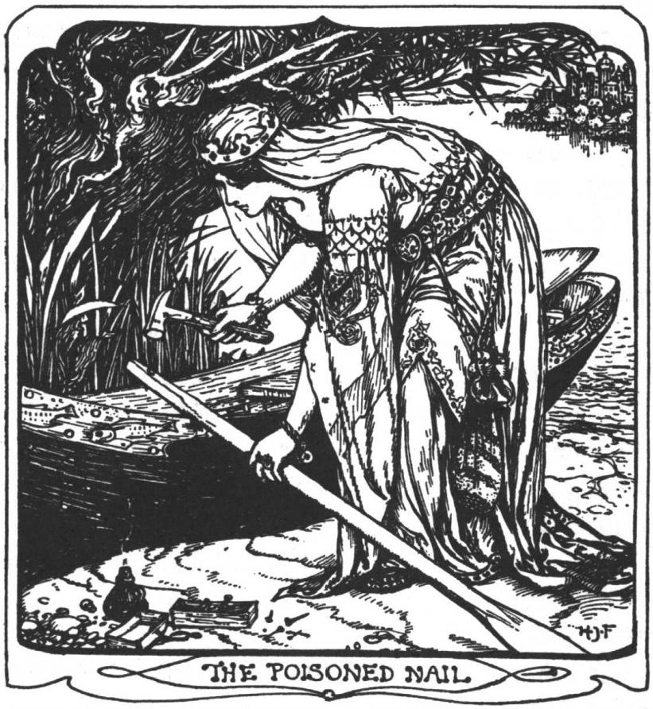

这件事，公主当然一点也不知道。看到他没有来，可怜的姑娘担心他出了什么事情，或者是哪个更加美丽的少女从她这里偷走了他的心。她等得几乎要生病了。她是那么孤独，因为可以来安慰她的父亲已经到外国旅行去了。她不知道如何才能打听到心上人的消息。就这样过了几天。有一天，她坐在窗口哭泣着，心里很难过。一只小鸟飞过来，停在窗口下面的一棵树上，开始唱起来，唱得那么动听，公主也停止了哭泣，听它唱歌。很快，她就看到，小鸟在想吸引她的注意。

“喳！喳！你的心上人病了！”它唱道。

“啊！”公主叫起来，“那我该怎么办？”

“喳！喳！你要到你父亲的王宫里去！”

“我到那里去干什么？”她问。

“喳！喳！在那里你会看到一条大蛇和九条小蛇。”

“啊！”公主吓得发抖，叫出声来。因为她怕蛇。可是小鸟不理睬她。

“把它们放到篮子里，然后到绿骑士的王宫里去。”它说。

“我带着它们到那里去干什么呢？”她说，脸羞得通红，尽管这时候，除了小鸟以外，没有一个人看见她。

“穿上厨房姑娘的衣服，到那里去找活干。然后用这些蛇来烧汤，让骑士喝上三次，他的病就好了。喳！”

“可是，他怎么会病的？”公主问。小鸟这时候已经飞走了。她只好动身到父亲的王宫里去，找那些蛇。她看到一条母蛇和九条小蛇盘在一起，几乎分不出哪是蛇头，哪是蛇尾。公主不想去碰它们，不过，等大蛇爬出窝去晒太阳以后，她把小蛇抓起来，像小鸟对她说过的那样，把它们放到篮子里去，然后就去找绿骑士的城堡。她整整走了一天，有时停下来采一些野草莓，或者一些花束。有时她也休息一下，但在到达城堡之前，她不会躺下来睡觉。后来，她在森林里看到了城堡。就在这时候，她看到一个村姑赶着一群鹅过来。“你好！”公主说，“请问，这是不是绿骑士的城堡？”

“是的，它就是。”放鹅姑娘回答说，“我赶的鹅就是他的。可是绿骑士病得很厉害，大家都说，要是在三天里还治不好，他肯定要死去。”

听她这么一说，公主的脸变得苍白，大地好像在旋转，她连忙抓住旁边的一棵树才没有摔倒。她努力控制自己，缓过气来以后，对放鹅姑娘说：

“你喜不喜欢穿丝绸衣服？”

放鹅姑娘的眼睛一亮，“是的，我喜欢！”

“那么，把你的衣服脱下来给我，我的衣服给你。”

村姑几乎不相信她的耳朵。可公主已经开始脱她的丝绸衣服，还把她的丝袜和漂亮的红鞋子脱下。放鹅姑娘赶紧把她的粗布裙子和上衣脱下来。公主把她的破衣服穿上，把头发放下来，来到宫殿的厨房，要求给她工作。

“你们要不要烧饭的姑娘？”她问。

“是的，我们要。”厨师回答说，他那么忙，来不及问这个新来的姑娘许多问题。

休息好一个晚上以后，公主开始了她的工作。其他仆人都在说着主人的事。说他病得如何厉害，要是三天里还好不起来，肯定要死掉。

公主想起小鸟的话，想起那些蛇。她把头从正在擦着的锅子和盆子上抬起来，说：“我会做一种汤，不论是谁，病得多么厉害，只要喝了它就会好起来。既然医生救不了你们的主人，能不能让我试一试？”

开始，他们都取笑她。

“什么？王国里那些好的医生都治不好的病，一个厨房里的女仆能治好？”

可是后来，既然所有的医生都无能为力，也只好让她试一试了。公主高兴地去把篮子里的蛇拿来，把它们杀了烧汤。好了以后，就给骑士送去，她大胆地走进他的房间，把站在他床边的医生都推开。可怜的骑士病得那么厉害，认不出她来。再说，她穿着破衣服，人又显得肮脏，就是他没病也不一定认得出来。他喝了一点汤以后，感觉好多了，能够坐起来。

到了第二天，他又喝了一些以后，能够自己穿衣服了。

“这真是神奇的汤！”厨师说。

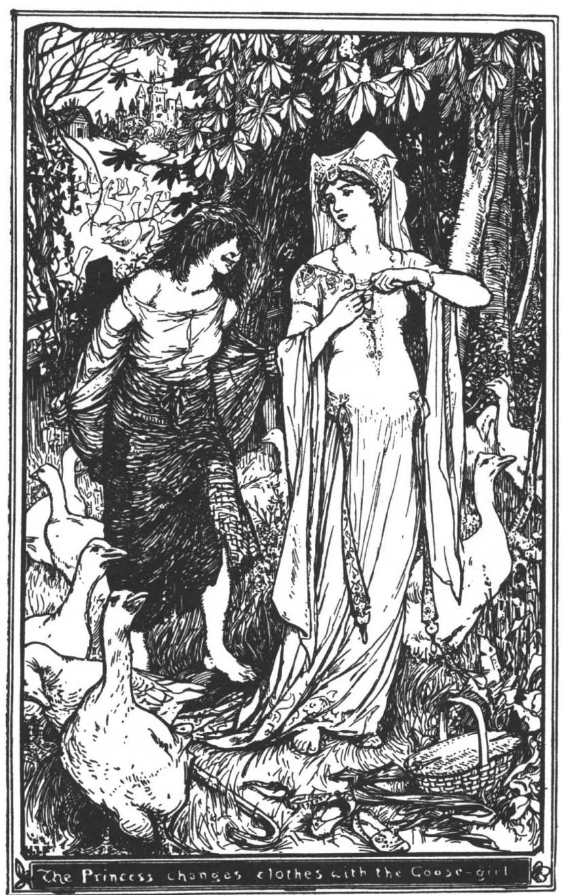

第三天，骑士喝了汤以后，他的身体就完全恢复了。

“你是谁？”他问那姑娘，“是不是你做的汤救了我一命？”“是的。”公主回答。

“那么，你自己挑选吧！你想得到什么报答？”骑士说，“你会得到的。”

“我想做你的新娘！”公主说。

骑士对她的大胆吃惊得皱起眉头。

“这是我唯一不能答应你的。”他说，“我已经发誓要和世界上最美丽的公主结婚。再挑选吧！”

公主立刻跑出去，洗好澡，换好衣服。她回来的时候，绿骑士立刻就认出她来。

你可以想象得出，这次会面是多么高兴！

没有多久，他们就非常隆重地结婚了。王国里所有的骑士和侯爵都受到邀请，来参加他们的婚礼。公主穿着一件像太阳一样灿烂的婚礼服，谁都没有见过这么辉煌的景象。公主的父亲当然也来参加。可是邪恶的王后和她的女儿被赶出王国，以后谁也没有再见到她们。很有可能是被森林里的野兽吃掉了。新郎和新娘那么幸福，早就把她们忘记了。他们和老国王住在一起。老国王去世以后，他们就继承他的王位。

 

## 先生的教诲

从前有一个英俊的年轻人，他的名字叫朗穆·辛格，虽然大家都喜欢他，可是他并不快活，因为他经常遭到后母的责骂。她整天不停地在他耳边唠叨，年轻人再也受不了了，决心离家出走，到外面去寻找自己的幸福。他下定决心以后就想好了计划。第二天一早，他带上几件衣服，口袋里放了一些钱就动身了。

不过，村子里有一个人他想去和他告别。这个人是个上了年纪的西克教徒，很聪明，做过朗穆·辛格的先生，教给他许多道理。所以，他先来到先生的家里，天一亮就敲他的门。老人热情接待他的学生。他很善于察言观色，一眼就看出年轻人碰到了什么麻烦。

“我的孩子，”他说，“你怎么啦？”

“没有什么，老师，”年轻人回答说，“不过，我已经决定离开家乡，到世界上去寻找自己的幸福。”

“请听我的劝告，”先生说，“留在你父亲的家中，外面的金窝银窝，都不如自己家中的草窝。”

可是朗穆·辛格一点也没有听他这句话的意思，老人很快就打消了劝说他的念头。

“好吧！”老人终于说，“假如你已经打定了主意，我想你肯定会走你的路。不过，你仔细听着，记住临别前我送给你的五句话。如果你记住了，噩运就不会降临到你的头上。第一，永远听从主人的命令，不要问这问那；第二，和任何人说话都不要粗暴无礼；第三，永远不要撒谎；第四，不要想和地位比你高的人平起平坐；第五，不论到什么地方，看到有人在读或者讲圣书，要留下来听，即使是几分钟，也会增强你的信念。”

朗穆·辛格答应把老人的话记在心中，就起身走了。

过了一些日子，他来到一座大城市。他随身带来的钱都花光了，所以决定去找工作，不论多么下贱，他都要做。在一间堆满各种粮食的商店门口，他看到一个事业似乎很成功的商人，就走过去问他，能不能给他一点活干。商人盯着他看了那么久，年轻人心里想，不会有希望了。但后来商人开口了：“当然可以，有个地方在等着你。”

“你这是什么意思？”朗穆·辛格问。

“嗯！是这样的，”商人说，“我们王公的首相把他的随身童仆解雇了，正需要一个新的。你恰巧就是他想要的人，因为你年轻，高大英俊，我建议你到那里去！”

年轻人感谢商人的指教，立刻到首相的家里去。事情很快就解决了，他当上了这个大人物的仆从，这得归功于他那英俊的外貌。

没过多久，王公就要出去旅行，首相陪他一起去。跟着一起去的还有一大队仆人、随从、士兵、赶骡和骆驼的马夫、负责提供粮食和饲料的商人、娱乐时需要的歌唱家和乐队，此外，还有大象、骆驼、马匹、骡、小矮马、猴子、山羊，再就是各种各样的马车和车辆。所以，整个队伍看上去像是一个大城市在走动。

他们走了几天以后，来到一个国家。这里像是沙的海洋。大风刮起的飞沙像是云雾一样，人和牲畜都被呛得透不过气来。到了晚上，他们走进一个村庄。牧民们急急忙忙出来迎接王公，向他表示敬意以后，开始面有难色地报告说，王公和他的这么一大队随从的到来，使他们非常为难。因为这里没有一口井，也没有一处泉水，无法让这么多人和牲口饮水。

牧民们的这番话，使他们陷入极大的恐惧之中。可是王公只是对首相说，去想办法弄水来。对于他来说，说一句话也就够了。首相赶紧把这里上了年纪的人都叫来，问他们附近有没有井？

他们无能为力地你看看我，我看看你，都说没有。后来有一个长着白胡子的老人说：“不错，首相，在离这个村子一二百英里的地方有一口井，是从前某个国王挖的。据说那口井很大，水源丰富，用之不竭，用大石头筑成，有台阶一直通到很深的地底下。可是，没有人敢靠近它，因为那里经常有坏精灵出没。都说到井里去的人就再也看不见回来了。”

首相抚摸着他的胡子，想了一会，然后他转过身来对站在他椅子后面的朗穆·辛格说：“有句话说：经过考验的人才值得信赖。你去吧！到井里去给王公和他的人马打些水回来。”

老先生的第一句话闪过他的心里——永远听从主人的命令，不要问这问那。于是他立刻回话，说是准备好了。说完，他马上就准备出发。他把两个大铜罐放到骡子的背上，自己肩上也背上两个小罐出发了，那个村里的老人当他的向导。不久，他们就来到一个地方，这里有几棵大树遮盖着贫瘠的土地。在树荫下面有一个像是古建筑的圆顶。向导指着它说，这就是井。不过，请原谅他已经年迈，太累了，而且太阳已经快下山了，他必须返回家去。于是，朗穆·辛格和他道别，自己拉着骡子走过去。

到了大树底下，他把骡拴好，把水罐拿下来。看到井口以后，他沿着台阶一步一步地向黑暗中走去。宽台阶是用雪花石膏似的白石板做成的，在黑暗中微微发光。他越走越深，下面非常静。连他赤脚踩在台阶上，似乎也会有回声。他手中的一个罐脱手，滚下井去，发出震耳欲聋的声音，把他吓了一大跳。不过，他仍然往前走，直到看见一个大水池，里面是清澈的池水。他小心地洗好水罐，把水灌满，然后提着两个小水罐先上去，那两个大的那么重，只能一个一个地提。忽然，他觉得上面有什么东西在动，抬头一看，只见一个巨人就站在台阶上！他一只手紧抱着一副可怕的死人骷髅，另一只手提着一盏灯，光线在墙上照出很长的影子，使他看上去更加吓人。

“喂！你！生人！”巨人说，“你认为我美丽可爱的妻子怎么样？”说着，他把灯照着骷髅，亲切地看着它。

现在，我得先告诉你，这个巨人有个十分美丽的妻子，他非常爱她。可是，她死了以后，丈夫不相信她已经死了，总是抱着她不放，直到她变成一堆骨头。朗穆·辛格当然不知道这些，可这时，他想起了先生的第二句话，对别人不要说粗暴无礼的话。所以他就说：“是的，先生，我敢肯定，你再也找不到第二个了。”

“啊！你的眼力真好！”巨人高兴地喊道，“你总算看出来了！我不知道杀了多少说她只是一把骨头的人！你是个好青年，我要帮助你。”

说着，他轻轻地把骨头放下，抓起两个大铜罐，等朗穆·辛格把两个小罐提到地面上去的时候，他已经轻而易举把它们送上去了。

“现在，”巨人说，“你让我感到高兴，你可以向我提出一个要求，不论你要什么，我都答应你。也许你想知道死去的国王宝藏藏在哪里？”

可是朗穆·辛格对他说起的藏在地下的宝藏只是摇摇头。

“我希望你帮忙的是，”他说，“离开这口井，好让大家能进进出出汲水。”

也许巨人在想，他会提出难以实现的要求，所以听他这么一说，满脸高兴，答应立刻就离开。当朗穆·辛格在黑暗中带着这些宝贵的水离开井时，看到巨人抱着妻子的骨头，也大步地走了。

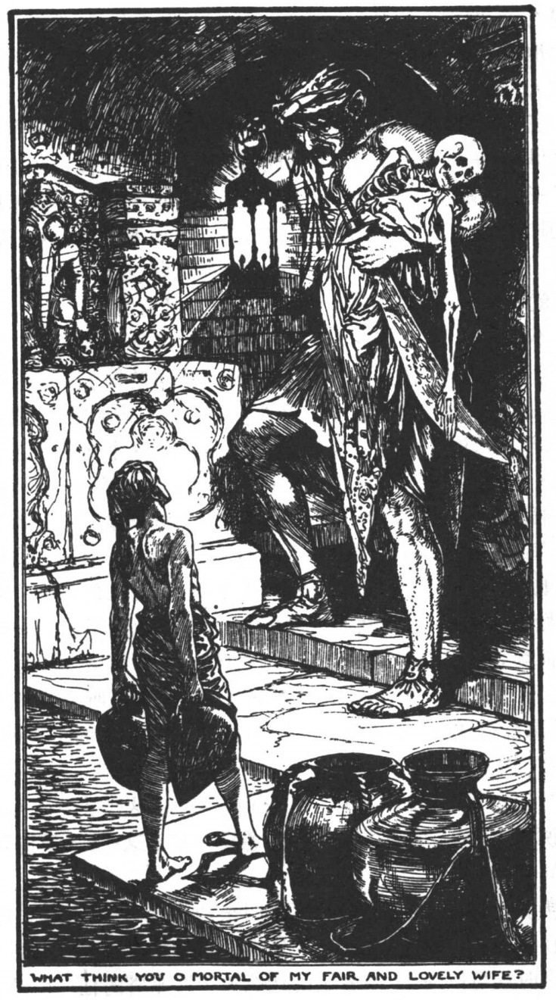

水送回营地，大家又惊讶又欢喜。关于巨人，还有他自己的冒险经过，朗穆·辛格只字不提。他只是对王公说，那口井可以自由地使用，没有什么问题。这倒是真的，因为从此以后，就再也没有人看到巨人了。

王公对朗穆·辛格的行为非常满意，吩咐首相把他送到自己这里来，王公用一个仆人来和他交换。于是，朗穆·辛格就变成了王公的随从。随着时间的推移，王公对这个年轻人越来越喜欢。因为他牢记先生的第三条教诲，为人忠诚老实，从不说假话。后来，王公让他当司库，负责看管王公的宝藏。这样一来，他在王宫里就有了很高的地位，而且手中又有权又有钱。

不幸的是，王公有一个弟弟，这个人非常坏。他想只有把朗穆·辛格骗过来，就可以随心所欲，把国库里的钱一点一点地偷掉。然后，只要有了钱，就可以贿赂军队、大臣，煽动叛乱，把王公赶下台，自己取而代之。当然，他不敢贸然把这个罪恶行径告诉朗穆·辛格。不过，他开始一见到朗穆·辛格就奉承他，后来还答应把自己的女儿嫁给他。可是，朗穆·辛格想起了先生的第四条教诲：不要想去和地位比自己高的人平起平坐。所以，他很有礼貌地谢绝了和公主结婚的荣誉。王子，也就是王公弟弟的阴谋一开始就遭到挫折，当然非常愤怒，决心要把他毁了。他来到王公的面前，编造谎言，说朗穆·辛格如何说了污辱王公和公主的坏话。至于他说了些什么，谁都不知道。可是王公听了却非常生气，脸都涨得通红。他立刻宣布说，除非把这个司库的头杀掉，否则他和公主，还有王子，都不准吃也不准喝。

“可是，”王公说，“我不想让任何人知道，这是我的主意，谁要是说起这件事，就要受到严厉的惩罚。”对于这些，王子也只好点头同意。

接着，王公派人把卫队的军官叫来，叫他带一些士兵立刻到坐落在城外的，正在施工的一座塔那里去。如果有人来问，这座塔什么时候可以完工，或者别的什么关于这座塔的任何问题，立刻就把他的头杀掉带回来，尸体就地埋掉。军官想这个命令非常古怪，但不关他什么事，所以他敬礼以后，就出去执行他的命令去了。

王公一整夜都没有睡好，第二天一早，他就把朗穆·辛格叫来，吩咐他到新建的塔那里去，问一问工程进展如何，什么时候可以完工，然后立刻回来报告。朗穆·辛格带着他的命令出发了。路上经过一座小寺院时，他听到里面有人在大声地朗诵。他想起了先生的第五条教诲，就进去坐下来想听几分钟，他本来不打算听得太久。可是里面的人说得那么好，字里行间充满了智慧，他越听越入神，就一直坐着不动，太阳越升越高。

再说，那个坏王子不敢违抗王公的命令，所以肚子饿得要命。至于公主，她饿得坐在角落里哭着，等待着朗穆·辛格被杀头的消息，以便让她可以吃早饭。

时间一个又一个钟头过去了，那个坏王子不停地往窗外看着，可仍然不见讯问的人来。

后来，王子再也受不了了，他把自己伪装起来，免得让人认出，然后就骑着马来到塔前。王公对他说过，死刑将在这里执行。他看到，这里只有一些人在干活，一些士兵在懒懒散散地看着他们。他忘记了自己已经伪装过，没有人能够认出来，竟骑着马跑过来喊道：“你们这些人！干活为什么这样慢吞吞的？干吗不快一点，这活干到什么时候才能完成？”

听到这句话，士兵们都回过头来看看坐在不远处休息的军官。他做了一个王子看不见的信号，只见一把剑在阳光下闪了一下，王子的头就滚到地下去了。

王子在化装的时候，装上了一大把胡子，所以士兵们没有认出这个人头是王公的弟弟。他们遵照命令，就地埋葬尸体，用布包起人头。军官带着人头，骑着马向王宫奔去。这时候，王公办完事回来，看到没有人头，也不见他弟弟来，心里非常惊讶。又过了一会儿，他开始感到不安起来，决定自己去看一看到底是怎么一回事。

他吩咐备好马以后，就独自骑着马去。

王公快到塔那边的时候，朗穆·辛格还坐在那里听着。这个年轻的司库听到马蹄声，抬起头来一看，见骑马的正是王公本人！他为忘记了自己的差使而深感羞愧，连忙站起来跑出去接王公。他看到，王公见到他似乎很惊讶（这一点也不错）。这时候，军官骑着马提着包裹过来了。他庄严地向王公敬了一个礼，从马上下来，把包裹放在地下打开。王公在一旁又吃惊又奇怪地看着。最后的一根绳子解开了，他弟弟的头摆在他的面前。王公从马上跳下来，抓住军官的手臂，等他安静下来可以说话以后，马上就问这是怎么回事。慢慢地，他心里似乎感觉到了什么。然后他简单地对军官说，干得不错。接着，他把朗穆·辛格拉到一边，几分钟以后才知道，他因为听一个教徒讲道，才耽搁了王公叫他做的事情。后来，王公得到一些证据，发现了他死去弟弟的阴谋，也证明了朗穆·辛格的无辜和正直。他又忠诚地为王公服务了许多年，和一个地位与自己相当的姑娘结了婚，一起过着幸福的生活。他死了以后受到许多人的热爱和尊敬。他有了孩子，他把老先生的五条教诲也传给了他们。

（旁遮普故事）

 

## 金头鱼

从前，埃及有一个国王，因为生了一场大病，眼睛瞎了。当然，他感到非常悲伤，这个国家最好的医生，都没有办法治好他的眼睛。日子一天一天地过去，他的情绪越来越坏，人也因此而越来越瘦。大家都在想，他活不长了，连他唯一的儿子，王子也是这样想。可是不久，整个埃及又充满了欢乐。事情是这样的：有个旅行者乘船顺着尼罗河而下，到埃及以后，看到人人都闷闷不乐的样子，就问他们是怎么一回事。大家对他说了以后，他说，他是一个遥远国家的御医，如果得到允许，他愿意去看一看国王的眼睛。他立刻得到同意，进入王宫。仔细地检查几分钟以后，他宣布说，问题虽然很严重，但还不是毫无希望。

“在大海里某个地方，”他说，“有一条金头鱼。如果你们能想办法抓住它，给我带回来，我可以用它的血制成一种药膏，这种药膏就可以恢复国王的视力。我在这里等一百天。如果一百天以后你们还抓不到，我就得回到自己主人那里去了。”

第二天一早，年轻的王子就带着一百人出去找金头鱼去了。他们每人手中都拿着一张网。一支小船队在等着他们。他们乘船来到了大海。整整三个月，他们起早摸黑，奋力捕鱼，尽管抓到了许多许多鱼，可是没有一条鱼的头是金的。

“现在可是一点用也没有了。”到了最后一个晚上，王子说，“这一百天还有一个钟头就过去了，即使能抓到金头鱼，等我们回到埃及首都的时候，医生已经在回家的路上了。不过，我还是去试试看，我自己来再撒一次网。”于是，他就这么办了。就在这一百天的最后时刻，网里拉上来了一条金头鱼。

“最后终于成功了，可是像常常发生的那样，来得太晚了。”这个在学校里学习哲学的年轻人喃喃地说着，“不过，把它放到装满水的桶里去，带回家，让父亲看看，我们已经尽力了。”可是等他走近金头鱼时，它用非常可怜的眼睛看着他，叫他不忍心判处它的死刑。他心里非常明白，父亲王宫里的医生虽然不知道那药膏的秘密，但他们也一定会从这条鱼的血中提取些什么出来。所以，他把这么多天来的劳动成果拿起来，扔到海里去，开始动身返回。他最终回到王宫，看到国王因为失望正在发高烧。听了儿子讲述事情的经过以后，国王不相信。

“你要用自己的头来赔！你要用自己的头来赔！”国王喊叫着，他立刻派人把执刑官叫来。当然，有人立刻就去给王后送信，把国王的命令告诉她。她马上叫王子穿上普通老百姓的衣服，在他的口袋里塞满金币以后，吩咐他立刻就上船，当晚就离开埃及，到一个远方的岛屿上去。

“过些日子你父亲会后悔的，那时候他知道你还活着，就会谢天谢地。”她说，“我要给你最后一个劝告：要是有人想给你干活，而且每个月付工钱，你不能要他。”

年轻的王子想，这个劝告有些古怪。既然要给佣人付钱，一年付一次和一个月付一次有什么两样？不过，他已经很多次领教过，母亲比他聪明，所以他就答应了。

船开了几个星期以后，他来到了母亲说的那个小岛。岛上到处都是山、树木和鲜花。花园里到处可见白色的漂亮房子。

“这是个多么迷人的住所！”王子心里想着，立刻就买下最漂亮的一幢房子。接着，许多人都进来说愿意做他的仆人，可是他们都说一到月底就得付工钱。年轻人想起他母亲的吩咐，一概拒绝他们。后来，有一天早晨，一个阿拉伯人走进来，请求王子雇佣他。“你想要多少工钱？”王子问过他一些问题，觉得他合适以后说。

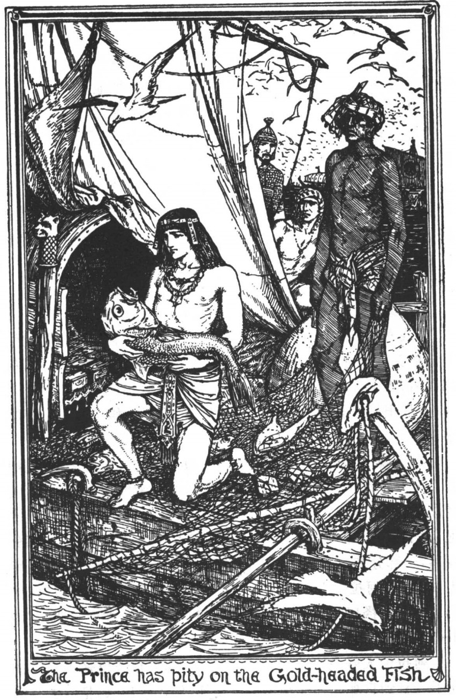

“我不要工钱。”阿拉伯人回答，“到年底你看我干得怎么样，愿意给我多少都可以。”年轻人觉得很满意，就把他留下来。

从王子登陆的这一边看上去，谁都猜想不到，这个岛屿的另一边完全荒芜。那是因为海里上来的一个怪兽，把那边的庄稼和牲畜都吃掉了。岛上的总督派出一队士兵躲在那里等着，准备把它杀掉。可是不知道为什么，那怪兽上来的时候，士兵们总是睡着了。尽管这些士兵受到了严厉的惩罚，同样的事下一次还是出现了。后来岛上发出通告，谁要是能把怪兽杀掉，就给他一大笔奖赏。

阿拉伯人一听到这个消息，立刻就来到总督的王宫。

“如果我的主人把怪兽杀掉，你会给他什么奖赏？”

“我女儿，还有他想要的任何东西。”总督回答。可是阿拉伯人摇摇头。“把你的女儿给他，把你的财富留着。”他说，“不过，从此以后，不论你得到什么，都要分给你女儿一些。”

“那很好，”总督说。他命令写好契约，他们俩一起在上面签字。

这天晚上，阿拉伯人偷偷地到海边去等候。出发之前，他把自己全身都涂了一种油。这种油对皮肤的刺激性很大，他不可能像那些士兵一样睡着。然后，他躲在一块大石头后面等着。慢慢地，海上掀起了波浪。几分钟以后，一个怪物升出水面，它一部分像鸟，一部分像兽，一部分像蛇。它悄悄地上了岸，悄悄地向地里走去。可是阿拉伯人已经准备好了。怪兽从石头旁边经过时，他把匕首刺进怪兽耳后的肉中。那怪兽摔倒在地，大声吼叫，在地上打滚，直到死去，脚还伸在海里。

阿拉伯人躲在石头后面看了一会儿，看看怪兽是不是真的死了。看到它那庞大的身体不再动弹，他才走出来，把它的耳朵和脚趾割下，带回去见他的主人。他对主人说，带这些东西去见总督，说是你自己而不是别人，把怪兽杀了。

“可是你，而不是我把它杀了！”王子反驳说。

“没有关系，照我说的做，我有我的理由。”阿拉伯人回答说。尽管王子不想掠人之美，后来他还是答应了。

总督听到这个消息是那么高兴，他请王子当天就和他的女儿结婚。可是王子谢绝了。他说，他只想得到一条船，好出去看看世界。当然，总督立刻就满足了他的要求。等他和忠诚的仆人一起上船以后，看到上面堆着一堆钻石和宝石，那是感激他的总督偷偷地送给他的。

他们不停地在海上航行着，后来来到一个大国的海岸。主人留在船上，阿拉伯人独自上岸去看一看这是什么地方。过了几个钟头，他回来对主人说，他听说这里的公主是世界上最美丽的公主。王子去向她求婚一定很好。这一回，王子很乐意听他的话。他带上一些最好看的项链，骑上阿拉伯人给他买来的一匹漂亮的马，就向王宫里走去，后面跟着忠诚的仆人。

这个异国国王恰巧这天心情很好，很乐意接见他。他把带来的礼物放在国王的面前，向公主求婚。

国王一言不发地听着，过了一会儿他回答说：“年轻人，我愿意把我的女儿嫁给你。可是，我得先告诉你，她已经和一百九十个青年举行过结婚仪式，可是在十二个小时之内，他们都死了。所以，你先考虑一下吧！还有时间。”

年轻人真的想了一下，他感到害怕了，正打算不再说什么，准备撤回他的请求回到船上去的时候，阿拉伯人在他的耳边悄悄地说：“别害怕，娶她！”

“总会有时来运转的时候，”他终于对国王说，“这样举世无双的公主，谁不愿意冒着生命危险来娶她？”

“就照你的愿望去做。”国王说，“我马上下令，今天晚上就举行婚礼。”

于是，当天晚上，婚礼隆重举行，然后新郎新娘回到自己的房间去吃晚饭，因为这是当地的风俗。这天晚上月光皎洁，王子走到窗口，眺望远处的河流和高山。他忽然看到睡椅上整齐地放着一块丝绸裹尸布，上面用金线绣着他的名字，这也是国王乐意做的事情。看到这个，他吓坏了，赶紧转过头来。他又看见窗外有一群人在挖坑。这时候还有人在干活，真是太奇怪了，这坑是干什么用的？它样子很怪，又窄又长，像是……啊！他知道了，那是……那是给他挖的坟墓！

这些发现带来的震惊使他说不出话来。他站在那里想着，几乎无法移动。这时，一条小黑蛇从坐在桌边的公主嘴里吐出，迅速地向他游过来。可是，阿拉伯人正警惕地注视着会不会出什么事情，他一只手中拿着一把钳子，一下子就把蛇夹住，用另一只手中锋利的刀把蛇头砍下。

第二天一早，当女婿请求来见他的时候，国王几乎不相信自己的眼睛。

“什么！是你？”年轻人走进来的时候，他惊叫起来。

“是的，是我！怎么啦！”新郎问。他想，最好装做什么事情都没有发生过，“你记得我对你说过吗？总会有时来运转的时候，这不就来了吗！我来是请求你，能不能仁慈地吩咐园丁把我窗口外面的坑填掉，它太煞风景了。”

“啊！当然！当然！马上就叫他们填掉！”国王结结巴巴地说，“还有什么事吗？”

“不！没有什么事了！谢谢你！”王子回答后鞠躬退出。

从阿拉伯人把蛇头砍下的时候起，加在公主身上的咒语或什么的，也解除了。她和丈夫非常幸福地一起生活。他们或者在森林里打猎，或者在从王宫门前流过的河里划船。晚上，她弹着竖琴唱歌给丈夫听，要不就是王子给她讲自己家乡的故事。日子就这样过得很快。

后来有一天晚上，一个打扮奇怪，脸被太阳晒得很黑的人来到王宫。他请求要见新郎，他低下头来对王子说，他是埃及王后派来的，国王已经死了，王子要回去继承王位。

“尊敬的王后请你带着新娘立刻赶回去，王国有些事情急需处理。”使者最后说。

王子赶忙请求谒见岳父。国王很高兴地知道，他的女婿不是他想象中的省总督，而是一个大国的国王。他立刻命令准备好一条大船。一个星期以后，他来到码头和年轻人说再见。

尽管国王去世她很悲伤，王后还是很高兴地欢迎儿子的归来。她吩咐王宫里张灯结彩迎接新娘。老百姓对他们的新国王寄予很大的希望，他们在老国王的统治下受过的苦太多了。每天早晨，都有许多人拿着请愿书来，希望国王同意他们的要求。事情确实够他忙一阵子的了。不过，他也感到很快活。

有一天晚上，阿拉伯人走进来，请求让他回到自己的国家去。国王非常沮丧地说：“你要离开我？你真的想离开我吗？”

阿拉伯人伤心地低下头。“不！我的主人，我永远也不想离开你，可是我已经接到了召唤，我不敢违抗命令。”

国王一句话也不说，竭力想克制自己要失去忠诚仆人的悲痛。

“好吧！我不能挽留你。”他颤抖着终于说道，“那样要对不起你为我所做的一切！我所有的一切都是你的！你想要什么就带走什么吧！没有你，我早就离开这个人世了！”

“没有你，我也早就离开这个人世了，”阿拉伯人说，“我就是金头鱼。”

 

## 朵兰妮

从前，在印度斯坦的一个城市里，住着一个销售香水和香精的商人。他有一个非常美丽的女儿，名字叫朵兰妮。

这姑娘有一个仙女朋友，她们俩都深得仙国国王英德罗的喜爱，因为她们俩歌唱得那么好，舞跳得那么美，仙国里没有一个人比得上她们。

朵兰妮有世界上最美的头发，像是用黄金纺成，还散发着一股盛开玫瑰的芬香。不过，她的头发那么长，那么密，那重量她有时也受不了。有一天，她剪下一束来，用一张大叶子包着，扔到从她窗口外面流过的一条河里去。恰巧这时候国王的儿子出来打猎，正好到河边来喝水，看到一张裹着的树叶飘过来，里面还散发出玫瑰的芬香。王子觉得很奇怪，就向水里跨进一步，把从身边流过的树叶捞起来。他把树叶打开，看到一束像黄金一样美的头发，发出一种令人心醉的幽香。

王子回到家里，一句话也不说，看上去很忧伤。国王看到了，以为他碰到了什么不幸的事情，就问他怎么啦？王子把那束头发从胸口拿出来，回答说：“你看，父亲，你看到过这样的头发吗？除非我得到这束头发的姑娘，和她结婚，否则我就会死去！”

于是，国王立刻向全国派出使者，寻找这个头发像黄金一样的姑娘。后来，他终于查到，她是一个香水商的女儿。国王派出使者的消息也很快传开来。朵兰妮和别人一样，也听到了。有一天，她对父亲说：“那束头发要是我的，而且国王要我和他的儿子结婚，我就一定要去。但是记住，你要对他说，结婚以后，白天我都留在王宫里，可是到了晚上，我要回到老家来过。”

老人惊讶地听着她的话，但不说什么，因为他知道，女儿比他聪明。当然，那束头发就是朵兰妮的。使者不久就回到王宫告诉国王。国王把香水商找来，对他说，希望他把女儿嫁给王子。父亲一连三次深深鞠躬，回答说：“陛下就是我们的君主，你所有的吩咐我们都照办。我女儿只提出一个要求，那就是结婚以后，她整个白天留在王宫里，晚上请允许她回到她父亲的家里去。”

国王心想，这是个很古怪的要求。但他又想，归根到底，这是他儿子的事，而且用不了多久，那女孩子就会因为赶来赶去感到厌倦。所以，他也不说什么。事情很快就安排妥当了，婚礼非常隆重而又热闹地举行。

开始，美丽的朵兰妮提出的结婚条件，王子并不在意。他想，起码他整天都可以看到新娘子。可是，令他沮丧的是，他看到，她整天什么都不做，总是头埋在膝盖里，坐在一张凳子上，他连劝她说一个字也办不到。每天晚上，都用一顶轿子把她送回家。第二天天一亮就把她送回来。仍然是听不到她口中说出一句话，也看不到她看丈夫一眼，或者听他说话，留神他在做什么。

一天晚上，王子很不高兴，闷闷不乐地在王宫附近一个古老而美丽的花园里走着。园丁是个上了年纪的很老很老的老人，他还给王子的曾祖父干过活。看到王子，他走过来向他鞠躬，然后说：“孩子！孩子！你看上去那么忧愁，是怎么一回事啊？”

王子回答说：“老朋友，我很悲伤，因为我和一个像星星一样可爱的姑娘结了婚，可是她不和我说话。我也不知道该怎么办才好。每天晚上，她都离开我回到她父亲那里去。白天，她总是坐在我那里，像个木头人似的，一句话都没有，我该说什么，做什么呢？”老人站在那里想了一会儿，然后蹒跚地走回自己的屋子。过了一会儿，他拿着五六个小包回来。他把小包放在王子的手中，对他说：“明天，等你的新娘离开王宫的时候，把小包中的一些粉末撒在你身上，别人就看不见你，你却看得更加清楚。接下来的事情我就无能为力了，但愿一切顺利。”

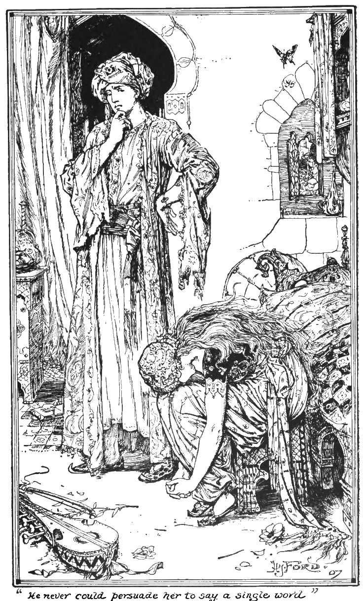

王子对他表示感谢，小心地把这些小包放到头巾里去。

第二天晚上，朵兰妮坐着轿子回到父亲家里去的时候，王子把一包神奇的药粉拿出来，撒在自己的身上，然后急忙跟着她。他发现，正像老人说过的那样，谁也看不见他，而他却像平时一样，什么都看得见。他很快就赶上轿子，跟在她旁边来到香水商的家里。到家以后，轿子停下来，他的新娘紧裹着面纱从轿子上下来，走进房子。他也跟进去，谁也看不见。

进了第一扇门，她取下一块面纱。沿着走廊进了第二扇门，她又取下第二块面纱。接着，她登上楼梯，到了女人住的房间，她移去第三块面纱。这以后，她走进自己的房间，里面有两个大盆子。一个盆子里是从玫瑰花里提炼出来的玫瑰油，另一个盆子里是水。在两个盆子里洗过以后，她吩咐把吃的送上来。仆人给她送来一碗凝乳。她急急忙忙吃完后，就裹上银色长袍，束上珍珠带子，戴上玫瑰花环。一切都穿戴妥当以后，她坐到一张四条腿的凳子上。凳子上有天篷，四面还有丝绸帘子，像一顶轿子似的。她拉好帘子就喊道：“飞吧！凳子！到英德罗国王那里去！”

凳子立刻就升空，看不见的王子正惊奇地注视着这一切，凳子飞起来的时候，他抓住一条腿。他发现，自己也迅速地跟着凳子在空中飞过。

一眨眼的工夫，他们就来到了仙女的家里。这个仙女就是前面说过的，朵兰妮的好朋友。她正站在门口等着，也像朵兰妮一样，穿得很漂亮。凳子在她门口停下来的时候，她吃惊地喊道：“啊！凳子今天飞得弯弯曲曲的！这是怎么回事？我觉得太奇怪了，你是不是和你丈夫说过话了？所以它飞起来就不直了！”

朵兰妮说，她没有和他说过一个字，她自己也想不通，为什么凳子飞起来一边重，一边轻。仙女看上去还是有点怀疑，可是她不再问什么了，上来坐在朵兰妮的旁边。王子也赶紧拉好凳子的脚。凳子在空中飞着，一直来到英德罗国王的宫殿。

整个晚上，两个女人在国王面前唱歌，跳舞。一把诗琴在一旁独自奏出最迷人的乐曲，连坐在一旁看着的王子也感到非常入迷。快拂晓的时候，国王作了个手势，叫她们停下来。两个女人又坐在凳子上，王子也拉住一条腿，飞回到地面上，凳子把朵兰妮和她的丈夫安全地送回香水商人的家。

王子赶在朵兰妮的轿子之前，回到自己的王宫。他一跨进自己家的门槛，就变成一个看得见的人，然后在一张躺椅上躺下，等待着朵兰妮的到来。

朵兰妮一来到，就像往常一样，头埋在膝盖上坐着，一言不发。开始，谁都不说话，一点声音都没有。后来王子开口说：

“我昨天晚上做了一个奇怪的梦，是关于你的。我现在就开始告诉你，尽管你毫不在意。”

真的，那姑娘一点也不关心他说些什么。可他毫不理会，开始详细地讲述昨天晚上发生的事情，凡是他看到和听到的，一点也不遗漏。当他称赞她唱歌唱得好的时候，他的声音有点发抖，朵兰妮抬起头来看了他一下，嘴里不说什么，心里却感到好生奇怪。“多么古怪的梦！”她想，“这仅仅是一个梦吗？他在梦中怎么会知道我做的和说的事情？”不过，她还是一声不吭，只是看了王子一眼，还是像以前一样坐着不动。

到了晚上，王子又隐身跟着她。这天晚上发生的事情和昨天晚上一模一样，只是朵兰妮唱得更加好了。到了第二天上午，王子又把晚上发生的事对她说了，只是假装说是梦见的。他刚说完，朵兰妮就看着他问：“你真的只是做梦，还是你也在那里？”

“我也在那里。”王子说。

“你为什么跟着我？”姑娘问。

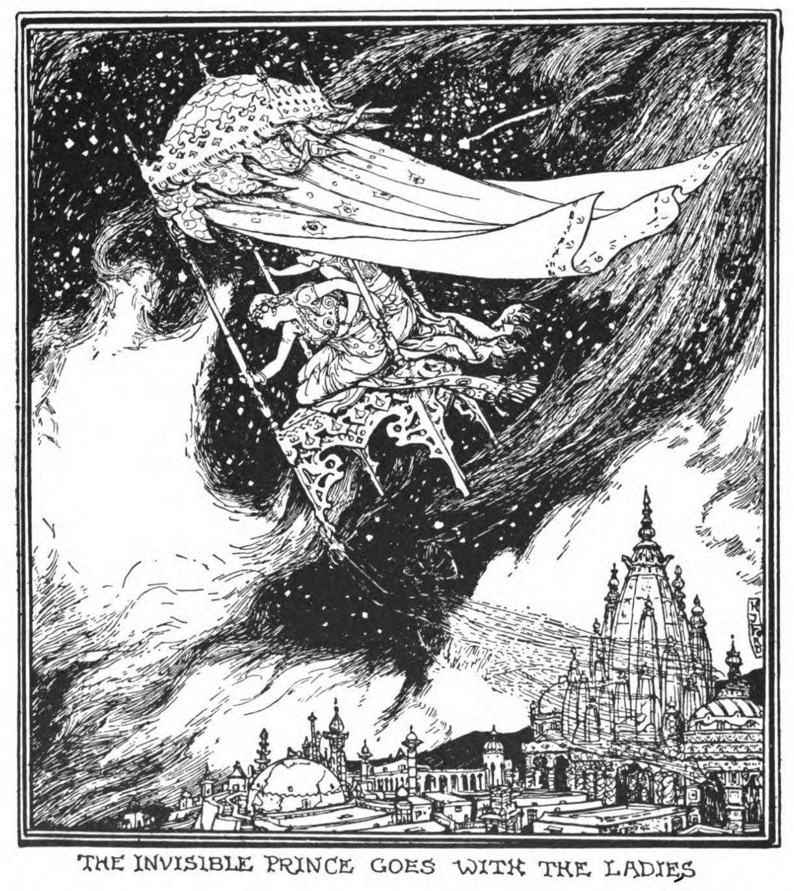

“因为，”王子回答说，“我爱你，和你在一起感到幸福。”

这一回，朵兰妮的眼皮眨了一下，但是不说什么。她又保持沉默，直到天黑。可是，就在她要上轿的时候，她对王子说：“如果你爱我，今天晚上证实一下，不要跟着我。”

王子像她所希望的那样，这天晚上留在家里。

这天晚上，魔凳飞得摇摇晃晃，她们几乎无法坐稳。仙女终于忍不住了，说：“凳子晃得那么厉害，只有一个理由，你和你丈夫说过话了！”

朵兰妮回答说：“是的！我说过了。是的，我说过了。”接着，她不再说什么了。这天晚上，朵兰妮唱得那么好，到结束的时候，英德罗国王站起来发誓说，她提出来要什么都可以，他一定答应。开始，她没有说话。等他再催她的时候，她说：“把神奇的诗琴给我！”

国王听她这么一说，后悔自己那么匆忙地作出许诺，因为他觉得，这把诗琴是他最宝贵的东西。可是，他已经答应过了，不能食言。他只好满脸不高兴地把诗琴给她。

“你不用再到这里来了，”他说，“因为你已经提出了这么高的要求，将来小礼物怎么会满足你呢？”

朵兰妮什么也不说，低头接过诗琴，和仙女一起走出大门，凳子正在那里等着她们。它把她们送回地面，比以前摇晃得更加厉害。

第二天上午，朵兰妮来到王子的王宫，问他是否还做梦到她了？王子幸福地笑着，因为她已经把自己的愿望对他说了，他说：“没有，可我现在又开始做梦了，不是梦过去发生的事情，而是梦将来会发生的事情。”

这一天，朵兰妮安静地坐着，不过王子和她说话的时候，她都回答。到她该走时，她还在那里坐着。王子靠过来，温柔地问她：“朵兰妮，你不回你家了，是不是？”

她站起来，流着泪扑入他的怀中，轻轻地说着：“再也不会了，我的郎君，我再也不会离开你了！”

就这样，王子得到了他美丽的新娘。从此以后，虽然他们俩再也不和仙人与仙道接触了，可是他们每天都从爱情中学到更多神秘的东西。离开了仙人，生活中还是有许多学不完的东西。

（旁遮普故事）

 

## 缎子医生的故事

从前有一个非常强大和富有的国王。尽管他结过几次婚，可是他只有两个女儿。

大女儿长得很平常，而且有点斜视和驼背。她非常聪明和幽默，但是心眼很坏。尽管如此，国王还是很喜欢她。

与此相反的是，小公主既长得十分可爱，而且心地善良，脾气又好。那些了解她的人都说不准，是她妩媚的容貌呢，还是她快活的神态更动人。

他们的邻国由一个年轻的皇帝统治着。这个皇帝不过刚二十出头，可是打起仗来非常勇敢。如果他愿意，他可以征服整个世界。幸亏他爱好和平，不喜欢战争，全心全意地想把自己的国家治理好。他的老百姓都希望他快点结婚。打听下来，既然只有邻国的两个公主年龄相似，地位相当，皇帝就派出使者到她们父亲的王宫里去，请求国王把一个女儿嫁给他。他决心要娶一个可爱的、能幸福地生活在一起的女人，所以他决定，在作出选择之前，自己要亲眼去看一看。因此，在使者出发以后不久，他就伪装一番，跟着出去。使者到达以后，他很快也赶到了。可是，因为他愚蠢地没有把自己的打算和任何人说，等他来到王宫的时候，他发现，他们已经提议把大公主嫁给他。

不久，大家都知道皇帝也来了。早知如此，他还不如公开地来。国王听到这个消息，准备以王室的礼仪来接待他，当然，国王假装不知道哪一个是皇帝。于是，他们商量了一下，使者把皇帝以王子的身份介绍给国王，国王也就这样接待了他。

晚上，举行了盛大的舞会。年轻的皇帝有机会见到了两个公主，和她们相识。大公主那丑陋的脸和模样使皇帝大为失望，他觉得，即使她拥有十个王国，也不能娶她。而小公主那甜蜜的容貌和举止却使他非常入迷，他感到，即使她只不过是个牧羊女，他也愿意和她分享王位。

他感到，他很难克制住自己的这种想法，对大公主表示出客气的态度，尽管他尽量地注意礼貌。后来几天，他的所见所闻更加增强了他对小公主的爱。他终于承认，如果小公主和她的父亲同意，他最大的希望是娶她为妻。

皇帝吩咐使者，把舞会结束的时间稍为推迟，好让国王明白他的真实感情。看到再也不能拖下去了，他就关照他们，以他本人的名义向国王提出，和小公主订婚。

听到和他所希望的完全不同的消息，国王掩饰不住自己的失望。我们前面说过，国王喜爱他的大女儿，深受她的影响。舞会一结束，他立刻就把大公主找来，告诉她皇帝关于娶她妹妹的横蛮无理的决定。听到这个消息，大公主比她的父亲更加气愤。他们一起商量一会儿以后，决定把小公主送到一个皇帝找不到的地方去。可送到哪里，他们一时还拿不定主意。他们绞尽脑汁想了一会以后，终于给她找到了一间监狱，那是一座叫作荒塔的城堡。他们想把她关在那里一定很安全。

与此同时，他们想继续保持王宫里的欢乐气氛，命令继续举行各种各样大规模的娱乐活动。等到准备把小公主送到荒塔里去的那一天，他们邀请所有的人到森林里去打猎。皇帝和小公主都一个钟头一个钟头地等待着这一天的到来，他们想这一天一定很开心。天亮了，国王和客人都来到了集合的地点。可是年轻的皇帝在女士们中间没有找到他的爱人，感到非常惊讶和困惑。他焦急地等待着，东找西找，国王也不和他做任何解释。打猎开始了，她还没有来，他只好跟着大家一起出发。整整一天，他都在找她，可是毫无结果。回来的时候，一个随从对他说，几个钟头之前，他看到了小公主的马车，两边有骑马的士兵护送着，谁也不能接近她、和她说话。他远远地跟着他们，看到马车在荒塔那里停下，回来的时候，公主的马车是空的。皇帝听到这个消息深感悲伤。他立刻离开王宫，命令使者第二天就向国王宣战，除非他答应把小公主放出来。而且，他回国以后不久，立刻就集合起一支强大的军队，占领了国王的一些边界城市。因为国王还来不及组织任何军队进行抵抗。在回去之前，皇帝给他爱着的小公主写了一封信，请求她相信他，耐心地等着。他把这封信交给他宠爱的侍从武官。他知道，这个武官为了执行他的命令，就是牺牲自己也在所不惜。

武官非常仔细地察看了荒塔的周围。后来他发现，关着公主的房间开着一个小窗口，可以看到外面一块布满荆棘的荒地。

公主被关在里面，非常苦闷，因为连房间里唯一的小窗口，也不许她走过去透透气。看守是她姐姐以前的保姆，这女人的眼睛永远也不会闭上。她片刻也不离公主左右，公主的任何小动作也别想逃过她的眼睛。

有一天，看守在她自己的房间里忙着给大公主写汇报，可怜的囚犯抓住这个机会从小窗口伸出头去。她在四处观望的时候，看到树丛里藏着一个人。见到公主，他立刻走出来，从衣服里拿出一封信给她看。她立刻就认出，他是皇帝的一个随从，马上放下一根长绳子。随从把信结在绳子上。你可以想象，公主以多么快的速度把信拉上来。在看守写完报告回来之前，她幸运地刚好把信读完。

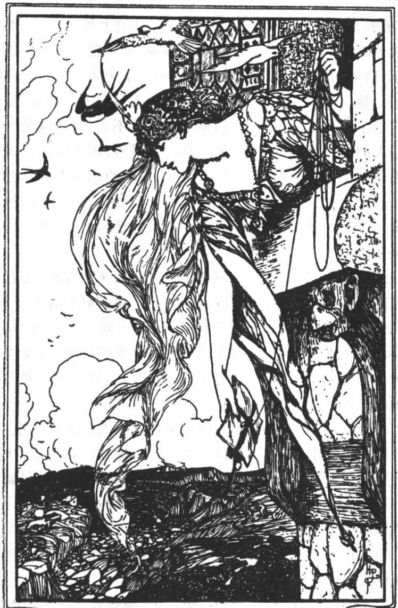

公主的高兴真是无法形容。第二天，她想办法在笔记本的一页上写了一封复信，从窗口扔下来给武官。他拿到以后立刻给主人送去。皇帝得到了他亲爱的公主的消息，感到那么幸福，他决定冒着一切危险，要亲自到荒塔那里去，哪怕是看到她片刻也好。他命令武官去得到公主的允许。公主回答说，她非常高兴能见到他，可是她担心，看守的眼睛会使他劳而无获，除非他在看守在自己房间里写字的短暂时间里来。

当然，这种冒险的念头只会增加他的决心，他生来就喜欢冒各种风险。不过，他听从武官的意见，决定用计谋而不是武力。在他的第二封信中，他放进去一些安眠药，公主想办法放到看守的晚饭里去。这天晚上，皇帝来到塔前时，公主听到他的信号，就大胆地走到窗口。这天晚上他们高兴地谈了很久。分手的时候，他们满怀信心地希望，这次约会没有被发现。可是他们大错特错了，事实证明，这个老女人的眼睛是任何安眠药也对付不了的。所有的一切，她都看在眼里，听在耳里，她立刻就写信向大公主报告了一切。

这消息使恶毒的大公主非常气愤，她决定给皇帝对她的蔑视进行残酷的报复。她命令老保姆假装不知道，并设下一个陷阱。如果皇帝从丛林中经过，到塔的旁边去，他不但会像老鼠一样地被逮住，而且有许多毒箭会向他射过来。一切都准备好了以后，陷阱被伪装起来。公主什么也没有看见。

当天晚上，皇帝像所有恋爱着的人一样，迫不及待地向荒塔走去。快接近的时候，他听到公主一阵欢乐的笑声。他很快上去想像往常一样发出信号，可是脚忽然踩到了什么，他也说不上，只是觉得一阵巨痛穿透全身。他脸色苍白，几乎昏过去。幸亏那陷阱他只陷进去一点，箭只有一小部分射出来。他踉踉跄跄地走了几步，就浑身是血地倒在地上。要是他自己一个人出来，他用不了多久，就必死无疑。幸好他忠诚的武官就在旁边，赶紧把皇帝抱到森林里去，卫队就在那里等着他。他们给他包扎好伤口，砍下树干做一副担架。这时国王已经差不多昏迷不醒，卫兵把他从敌人的国土上抬回自己的王宫。

这时候，公主心急如焚。为了消磨约会前的几个钟头，她和宠物小猴子玩耍。小猴子作着鬼脸，公主尽管心里很烦恼，也禁不住开心地大笑起来，皇帝在外面也听见了。可是，等待着的信号总是没有来，她开始感到不安。当她以为睡着了的女看守命令她立刻上床去睡觉时，要不是胆小，她肯定要反抗。

一连十四个夜晚过去了，可怜的公主感到非常担忧，人也变得消瘦和虚弱。后来有一天早上，保姆像往常一样到她的房间里去写报告，粗心大意地把钥匙留在门上，被公主发现了。公主小心迅速地把她锁在里面，她不到写完决不会发觉自己被锁起来，也不会去寻找她的囚犯。

公主看到自己自由了，立刻跑到窗口来。她恐惧地看到，沾满鲜血的树丛中有几支箭。她吓得不知所措，慌忙从楼梯上奔下来，跑出荒塔。她沿着一条路跑了一会儿，很幸运的是，她遇见了自己保姆的丈夫。他刚刚听说她被监禁起来了，正想出来找找，看看能不能救她出来。公主请求他去给她拿一些男人的衣服来，她在旁边的一片森林里等着。好心的人很高兴能为她效劳，立刻就到最近的镇里去。他很快就发现，这里有一个商店，王宫里的侍从们经常把主人扔掉的衣服拿到这里来卖。公主马上就用他带来的衣服伪装起来。这些衣服的衣料都很好，上面还绣着宝石。她把自己的衣服放进包里，让仆人背在肩上，两个人就一起上路了。

一路上，他们花的时间比两个人想象的都要多。白天，他们根据公主所能，尽量地赶路，晚上就在外面露宿。有一天晚上，他们在一个风景优美的峡谷里露宿，旁边有一条流水潺潺的小溪。早晨，公主被一首美妙的歌声唤醒，这是她小时候喜欢唱的歌。她很想知道谁在唱这支歌，就找到爱神木树丛中来。她看到一个男小孩背着一个箭袋，手中拿着一把象牙弓，温柔地唱着歌。

“你看到我张开眼睛很吃惊是不是？”他笑着问道，“啊！我并不总是什么也看不见！有时候，很容易知道什么样的心要射中。你和皇帝见面那一天，是我射出爱神之箭的。是我一手造成的创伤，我就有责任把它治愈！”

说着，他把一瓶装着神奇药膏的瓶子交给她，叫她找到国王以后，用来擦他的伤，“两天之内，你就可以到达他的王宫，”他说，“要抓紧时间，有时候，时间就是生命。”

公主含着眼泪感谢男孩子，然后赶紧回来叫醒向导，好立刻就出发。

正像男孩子说过的那样，两天后他们看到了城市的城墙和塔楼。就要和皇帝见面了，想到这里她的心不禁狂跳起来。可是，打听他的健康状况，听到他的伤迅速恶化以后，她很害怕。有一刻，她悲痛得难以自制。不过，她想起要做的事情，立刻就鼓起勇气，宣布自己是个医生，说如果让她给皇帝看病，几天之内保证把他治好。

为了在王宫里有个好形象，这个新医生决定做一套淡蓝色的缎子衣服。她把店里最贵、最华丽的衣料买来，找来裁缝，对他说，如果能在两个钟头里做好，就给他双倍的工钱。然后，她又来到市场，买了一头好骡，关照她的仆人也给它配上蓝绸缎的服饰。

一切都在准备着的时候，公主问自己房东的女主人，她是否认识皇帝身边的人。公主满意地听到，她的堂弟就是皇帝的第一贴身男仆。公主立刻要求她，逢人就说，一个有名的医生听到皇帝有病，已经远道而来，说是完全有把握治好他，如果治不好，他情愿被活活烧死。

这个好心的女人恰巧最喜欢嚼舌头，她立刻到王宫去传播她的最新消息。她的话传到御医的耳朵里，御医嗤之以鼻。可是皇帝的随从提醒他们说，尽管他们已经尽力，皇帝还是在他们的眼前渐见恶化，既然如此，请个陌生人来看也不妨。

于是，管家请这位年轻的医生尽快地来给皇帝看病。这个医生也立刻答复说，她将感到十分荣幸地亲自到王宫里去。接着，她马上就骑上骡子出发。一路上，老百姓和士兵看到了，都喊道： “看！缎子医生来了！快看缎子医生！缎子医生万岁！”到了王宫，大家也就这么叫她，立刻把她领到垂死的皇帝的房间里去。

皇帝闭着眼睛躺着，脸色像枕头上的白布一样。可是他一听到新来人的声音，就面带微笑，张开眼睛看着她，示意她靠近一些。缎子医生鞠了一躬，向皇帝保证，她有把握治好他的病。但是，她坚持要所有的人都退出去，除了皇帝喜爱的随从武官以外。然后，她用男孩子给她的神奇药膏擦皇帝的伤口，皇帝的疼痛就好多了。这一整个晚上，他都睡得很熟。

第二天天一亮，大臣和医生们赶紧来到皇帝的房间，看到他一点都不觉得痛了，大为吃惊。缎子医生马上就叫他们出去，好给皇帝用药。这药效果那么好，到第三天早上的时候，他已经差不多好了，可以下床了。随着精神越来越好，他的脑子里越来越多地想到是什么原因，使他受这么大的折磨。因此，他的健康状况越来越好，情绪却越来越坏。新来医生的面容和相貌使他想起了公主，他有点怀疑是公主背叛了他，才使他遭受这场大劫。想到这里，他实在受不了，眼中充满了泪水。

医生注意到他那沮丧的神色，尽可能地用愉快的谈话和有趣的故事来使他高兴。后来，她赢得了皇帝的信任。皇帝给她讲了他如何爱上一个公主，公主如何残酷地对待他，尽管如此，他还是无法摆脱对她的爱的故事。缎子医生同情地听着，同时劝他说，也许公主不会这样，不该受到谴责。皇帝内心也希望这样，但要说服他相信，医生也花了不少时间。后来，皇帝已经基本恢复健康，医生最后一次给他涂上宝贵的药。然后，医生和病人都隐约感到若有所失，但又说不出什么道理来。

次日，公主醒过来，决定穿上自己放在包里带来的衣服。她精心地打扮自己，带上所有的宝石，尽量使自己显得漂亮一些。她刚打扮好走进皇帝的房间，他就醒过来了。看到公主，他几乎不相信自己已经醒了，以为是在做梦。

好几分钟，他们相互对视着，一句话也说不出来。后来，两人都怀着兴奋和感激的心情喊出声来。公主慢慢地向他诉说，自从他们上次在塔里分手以后她的冒险经历。皇帝尽管还有些虚弱，也跪在她的面前，怀着感激和爱的心情向她发誓，一点也没有想到大臣和御医还在等待着他的接见。

皇帝急于要证明他是多么感激缎子医生，亲自去把门打开。外面的人看到他已经如此健康，都又惊又喜，争先恐后地赞扬缎子医生。令他们感到奇怪的是，缎子医生不见了，站在那里的，是世界上最可爱的公主。

“要感谢医生创造出来的奇迹，你们也可以同时对我的皇后表示尊敬。”皇帝说。他想今天就和公主举行婚礼。可是公主说，她必须先得到父亲的同意。

使者立刻就向邻国的首都出发，他很快就带着国王的批准回来。因为国王后来已经发现他的大女儿一手造成的这许多灾难。

心肠狠毒的大公主看到她的阴谋失败了，非常气愤。她躺到自己的床上去，由于极度的愤恨和妒忌，她死在自己的床上。没有人为她感到悲痛。国王对治理国家也感到厌倦了，于是把王冠交给了小女儿。这样，两个王国就统一成一个国家。

 

## 公山羊和国王

从前有一个国王，他能听懂所有鸟类、野兽和昆虫的语言。这个本领是他的仙女教母教给他的，可这也是个很会惹祸的礼物。因为他知道，如果他把听到的这些动物的话说出去，哪怕是只有一句，他就会变成石头。这个故事发生以前，他是如何想办法避免这种悲剧的，我不知道。可是长久以来，他都做到了，一直到成人结婚，都平安无事，享受着一般君主所拥有的幸福。

有一点需要说明的是，这个国王是印度教的信徒。印度教徒在吃东西的时候，都坐在一小块新铺上泥土的干净地面中央，衣服也穿得很少。这和我们的习惯很不相同。

有一天，国王正坐在这样的一块地上吃饭，王后就坐在他的对面陪他。吃的时候，一些饭粒掉到地下。一只觅食的小蚂蚁从这里经过看到了，搬起一粒饭就往洞里走。就在走出国王吃饭的这块地时，碰到另一只蚂蚁。国王听到它说：“啊！亲爱的朋友！把你这粒饭给我吧！你自己再去搬一粒。你看，我的鞋子那么脏，要是走到国王吃饭的地上去，就会把它弄脏。这种事我不能做，那太没有礼貌了。”

可是另一只蚂蚁回答说：“如果你想要，你就自己去搬吧！谁也不会注意到你的脏鞋子。你不会以为，我是在为整个家族搬米饭吧！”

听到这里，国王笑了起来。

王后上上下下看了自己全身，看不出也想不出自己有什么值得国王笑的，于是她问：“你在笑什么？”

“我笑了吗？”国王反问道。

“你当然笑了，”王后说，“你要是觉得我好笑，我希望你能说出来，不要傻笑！你在笑什么呢？”

“我没有笑什么。”国王回答。

“很好！可是你确实笑了，我想知道这是为什么。”

“嗯！恐怕不能告诉你！”国王说。

“你一定要告诉我，”王后不耐烦地说，“如果是毫无理由地笑，那你一定是病了或疯了。到底是怎么一回事？”

国王还是不肯说，王后也宣称，她一定要知道为什么。争吵持续了好几天，王后不肯让国王得到安宁，可怜的人几乎都要疯了。后来他想，这样下去，活着也没有什么意思，还不如把秘密告诉她，事情该怎么样就怎么样吧！

“可是，”他又想，“如果我要变成一块石头，有办法的话，我不想躺在路上，让人们踢来踢去，或者用来打狗，让那些顽皮的孩子们玩耍，那样就不得安宁，太悲惨了。我情愿做一块河底的石头，在清凉的河水里慢慢地漂着，等找到安全舒适的地方就永远留在那里。”

于是他对妻子说，如果她愿意陪他一起到河中心去，他就告诉她为什么笑。她以为他是在开玩笑，就笑着同意了。马备好以后，他们一起出发了。

路上，他们看到一口井，周围是高大繁茂的树木。国王提议下来休息一会儿，喝点清凉的井水，然后再继续赶路。王后同意了。他们下了马，坐在井边的树荫下休息。这时候，有一只老山羊和它的妻子正在井边吃草。就在国王和王后坐在那里的时候，母羊来到井边，看到井壁上长着一些嫩叶子。

“喂！”母山羊喊道，“快到这里来看，这里有些嫩叶子叫我直流口水，快来给我摘一些！”

公山羊慢慢地走过来看了一眼。然后有点生气地看着它的妻子说：“你想叫我去给你摘这些叶子是吗？我想你根本就没有考虑过我怎么能碰到它！你连想都不想一下，你要是想过了，你就会知道，我如果想去摘这些叶子，就会掉到井里去淹死！”

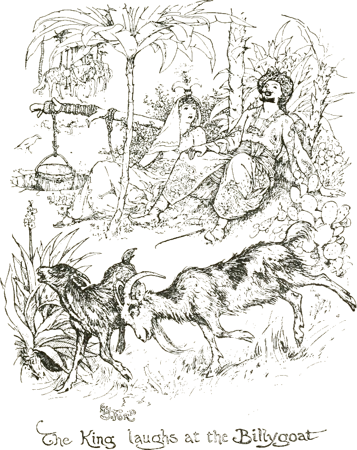

“啊！”母羊说，“你干吗要掉进去呢？试试看嘛！把它们摘下来！”

“我不会那么傻。”公羊回答。

可是母羊哭着求它。

“你看！”公羊说，“世界上是有许多傻瓜，可我不是！这里这个傻国王，因为不能制止他妻子的好奇心，正准备牺牲自己的生命。可是我知道该怎样来治治你的傻劲，你等着吧！”

说着，它用角狠狠地抵了母羊几下，不到两分钟，它就改变主意，觉得井里的叶子也没有什么好了。

国王在旁边听清楚了每一个字，又笑了起来。

王后又奇怪地看着他。他站起来，向她走过去。

“你还下定决心要知道那天我为什么笑吗？”他问。

“非常肯定！”王后生气地说。

“因为，”国王用马鞭拍打着自己的脚，“我已经决心不告诉你了！而且，决心制止你再提出这个问题。”

“你这是什么意思？”王后焦急地问。

“嗯！”国王说，“我看到，山羊如果对它的妻子不满意，就用角去抵它，看起来这很能解决问题…… ”

“你的意思是想打我？”王后叫起来。

“我很遗憾不得不这样做，”国王说，“可是我劝你安静地回家去，当我说不能回答你的时候，不要再去提这些傻问题。当然，如果你要坚持…… ”

王后听国王的话，回家去了。后来据说，他们都比以前更聪明，更幸福。

（旁遮普故事）

 

## 朱维莎的故事

在非洲的一块沙漠中间，过路人看到一座覆盖着美丽森林的高山都会耳目一新。在阳光的照耀下，可以清楚地看到上面瀑布飞溅。当天空晴朗、没有风的日子，还可以闻到森林里传来阵阵花香，听到鸟儿在里面歌唱。可是，尽管山上明明有人居住，因为这边或那边可以看到点点白色的帐篷，那些路过这里到别处去的国王和王子，都不敢到森林里去；那些敢进去的人，没有一个能够回来。山里这种坏名声引起了极大的恐慌。父亲在临终前，反复叮咛他们的儿子，千万不要去探讨这个秘密。可是，尽管如此，每年总有一些年轻人表明他们上山的决心。就像我们前面说过的那样，从此以后，再也见不到他们了。

那时候，沙漠的另一边有一个强大国家，国王临终前也像其他人一样，嘱咐他的七个儿子，不要到山上去。可是，他刚去世不久，接替王位的大王子就宣布，要到这座神秘的山上去探个究竟。老人们摇摇头，竭力地劝阻他放弃这个发疯的念头。可是，没有用，他还是去了，再也没有回来。到了说好的时间，第二个王子接替了王位。

其他五个王子也和他们的大哥一样，都失踪在山里了。最小的王子当上了国王。他也宣布说，要上山去探个究竟。城市里顿时充满了叹息声。

“你肯定会死去！你死了谁来管理国家？”他们说，“留下来和我们一起，我们会让你幸福的！”有一段时间，他同意了他们的请求。国家在他的统治下，变得兴旺发达，富裕起来。可是过了几年以后，那个念头又开始涌上他的心头，这一回谁也劝不了他。他决定要到森林里去。在朋友和随从的陪同下，有一天早晨，他向沙漠里走去。

他们骑着马走进一个多石的峡谷时，看到一头鹿从他们的面前跑过。国王立刻策马追上去，随从们跟在他后面。可是，鹿跑得那么快，他们根本没有办法追上。后来，它消失在森林之中。

国王这时候才把马勒住，看看自己的周围。随从们被远远地抛在后面，他回头看见，他们走进了分布在森林里的帐篷中去了，帐篷里摆放着丰盛的酒席。国王觉得，凉爽的森林比任何好吃的食品对他来说，更有吸引力。他自由自在地在森林里溜达了几个钟头。

天慢慢地黑了下来。他想，是他们该返回王宫的时候了。他叹了一口气，转身回到帐篷里去。他恐惧地看到，他的人都躺在地上死了。那悲惨的情景难以形容，不用说，他们都是喝了有毒的酒死去的。

“我来得太晚了，可怜的朋友！”他悲伤地看着他们说，“可是，起码我可以给你们报仇！谁设下这个圈套，谁就要自食其果。我要躲藏起来，看看他们是些什么人！”

他看到自己的身边有一棵高大的胡桃树，就爬上去。天很快就黑了，没有什么声音打破这森林里寂静的黑夜。可是，东方刚刚露出一丝曙光，就传来一阵马蹄声。拨开树叶，国王看到有个年轻人骑着一匹白马过来。来到帐篷前，骑士从马上下来，仔细地察看那些尸体，然后一个一个地把尸体拖到附近的峡谷里去，把他们扔进谷底的湖中。骑士这么干的时候，那些跟着他的随从把这些可怜人的马都牵走。然后，他们把那头用来做诱饵的鹿放出去，把桌子上的酒和食物重新排好。

等一切都安排妥当以后，骑士骑着马在森林里溜达着。这时，他看到密林深处有一匹漂亮的马，这使他感到十分惊讶。

“死去的人的马都有了，”他自言自语地说着，“那么，这匹马又是谁的呢？”

“我的！”附近一棵胡桃树上传来一个声音，“你是谁，把人们引诱到你这里来，然后把他们毒死？你再也不能这么干了！回到你的屋子里去，不论它是在哪里，我们就在你的家门口决斗！”

听到这些话，骑士生气得半晌没有回答；然后，他努力地克制自己，说：“我接受你的挑战，骑上你的马，跟我走，我是朱维莎。”

说完，他飞身上马，跑得那么快，一会儿就不见了。国王只是看到他和马身上闪烁着光芒，头盔下的头发像是金色的水银在流动着。

显然，这个骑士是个女的，可她是谁呢？是不是女王中的女王？或者是一伙强盗的头目？都不是，她只是一个漂亮的姑娘。

骑士和她的马在森林中消失以后很久，国王还站在胡桃树下出神，想着这些事情。后来，他才想起，必须找到通往敌人家里去的路，至于它在哪里，他心中无数。他只是沿着她走过来的路走去。几个钟头以后，他看到三间小屋并排站着，每间屋子里都住着一个老仙女和她的儿子。

国王这时候又累又饿，几乎说不出话来。等喝了一些牛奶，休息一会儿以后，他才能够张口回答他们急于想知道的事情。

“我去寻找朱维莎，”他说，“她杀害了我的哥哥和我的许多部属，我要为他们报仇。”

他只是和一间小屋里的人说话，可是三间小屋里都传来轻微的回答声音：“我们一点也不知道，真是太遗憾了！今天，她两次从我们的家门口经过，我们本来可以把她抓起来的。”

不过，尽管他们夸下海口，一说到朱维莎，还是叫他们浑身发抖。

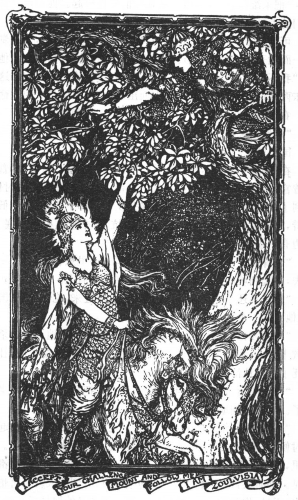

“把朱维莎忘了吧，留下来和我们住在一起。”他们说，“你当我们的大哥，我们都是你的弟弟。”

可是国王不肯。他从自己的口袋里拿出一把剪刀，一把剃刀和一面镜子，分别把它们送给三个老仙女和她们的儿子，对他们说：“我不能放弃我的复仇计划，不过，我接受你们的友谊。这三件东西你们留着。如果有一样上面出现血迹，那就是我的生命垂危。看在我们发过誓，有兄弟情谊的份上，来帮助我。”

“我们会来的。”他们回答。

国王骑上马，朝着他们指引的路走去。

在月光的照耀下，他看到了一间辉煌的宫殿。可是，尽管他绕着宫殿走了两圈，还是找不到门。他正想着该怎么办的时候，听到了响亮的打鼾声，那声音好像是从他的脚下传来的。他低头一看，看到就在墙脚下有一个很深的坑，有个老人躺在坑底下，旁边有一盏灯。

“也许他能给我出点什么主意。”国王心里想着。他费了一些工夫，才爬到坑底下。国王把手放在老人的肩上。

“你是鸟还是蛇，怎么能进来？”老人醒过来，吃惊地问。国王说，他只是一个普通人，要寻找朱维莎。

“朱维莎！这个该诅咒的女人？”老人咬牙切齿地说，“她杀害了数千个人，我是唯一逃脱者。我不知道她为什么饶了我，让我像死了一样地活着。”

“可能的话，请你帮助我。”国王说。他把自己的经历对老人说了。老人仔细地听着。

“那么，你仔细地听着我的劝告。”老人说，“每天太阳升起来的时候，朱维莎就穿上她的珍珠服装，登上她的水晶瞭望塔。从那里，她可以看遍她的土地，不论是人还是魔鬼走进来，她都看得见。那时候，她就会发出可怕的喊叫声，听到的人就会害怕地死去。不过，你藏到塔下的洞里去，把一些交叉的树枝插在洞口。

等她喊过三声以后，你就大胆地走出来，抬起头来看塔上，毫无畏惧地走过去。因为这时候，你已经破了她的魔法。”

国王一丝不苟地照老人的吩咐去做。他从洞里走出来的时候，他们的目光相遇了。

“你征服了我，”朱维莎说，“可以做我的丈夫，因为你是第一个听到我的声音以后没有死去的人。”说着，她把自己的金头发放下来，把国王拉到塔顶上去。然后，她把他领进大厅，领到自己的家里去。

他们在河边绿茵茵的草地上一起坐下来。朱维莎笑着说：“你想要什么，跟我说吧！我会给你的。”国王请求她放了坑里老人，让老人回到自己的国家去。是老人救了他的命。结婚的那一天，朱维莎对她的丈夫说：“我已经完成了骑马在我的土地上巡逻和狩猎的任务。从今天起，供养我们的事情就归你了。”接着，她转过脸来吩咐随从把火马牵过来。

“这是你的主人！我的火马！”她说，“你要像效忠于我一样地为他尽力。”说完，她在马的两只眼睛当中吻了一下，然后把缰绳交给她的丈夫。

马看了一会年轻的国王，然后低下头来。国王拍拍它的头颈，摸摸它的尾巴，直到他们觉得已经是老朋友了。接着，他骑上马，去做朱维莎吩咐他做的事情。出发之前，她把一个珍珠盒交给他，里面有她的一束头发。他把盒子放进胸前的大衣口袋。

他骑着马走了一会，看不到任何野兽可以带回家做饭。忽然，一只牡鹿几乎就从他的脚下奔跑而过，他立刻追赶上去。可是牡鹿不停地打弯，叫国王无法瞄准。他一直追到一条宽广的河边，牡鹿跳下河游过去。国王搭上箭瞄准它，鹿虽然被射伤了，可它还是努力地游到了对岸。激动之中，国王没有注意到，胸前的珍珠盒已经落入河里。

河水又深又急，盒子在水中翻滚着，随波逐流好多英里，最后才在另一个遥远的国家冲上岸。王宫里一个挑水的仆人捡到盒子，把它给国王看。盒子的制作工艺非常奇特，珍珠也非常珍贵，国王爱不释手，他给了仆人一大笔钱，把他打发走了。然后，他把管家叫来，叫他在三天里搞清楚这个盒子的来历，否则就杀他的头。

这个是叫王宫里所有魔士和聪明人不解的谜语，有个自己来到王宫里的老妇人说，给她两把黄金，她就可以解开。

管家当然很高兴满足她的要求。于是老太婆说，这个盒子和里面的头发，是朱维莎的。

“把她带到这里来，老太婆，那样你就可以得到足以站上去的黄金。”管家对她说。

老太婆说，她要尽力而为。

她回到自己坐落在森林深处的家中，站在门口轻轻地吹起口哨来。地下的枯树叶立刻就飞舞起来，许多蛇从树叶下面爬出。它们爬到老太婆的跟前。老太婆弯下腰来拍拍它们的头，从一个红色的盆子里舀起牛奶给每一条蛇喝。完了以后，她又吹起口哨。有两三条蛇盘在她的手臂和头颈上。她把一条蛇变成手杖，一条蛇变成鞭子。接着，她拿起一根棍子，来到河岸，把它变成木筏，自己舒服地坐上去，划到河中央。

她在河里漂流了两天两夜。到了第三天晚上，她来到了朱维莎的花园旁。这时，国王骑着火马正打猎回来。

“你是什么人？到这里来干什么？”国王惊奇地问。因为老太婆坐在木筏上旅行，这在他们的国家里很少见。

“我是个可怜的朝圣者，我的孩子。”她回答，“我错过了旅行车，在沙漠里走了许多天，一点吃的东西都没有。后来我终于走到河边，找到这个小木筏。我把自己的生命托付给它了，也不知道是死是活。不过，既然你看到我了，我请求你给我一点面包吃，晚上让我和你们家看门的狗睡在一起。”

这套可怜的故事打动了年轻人的心。他答应给她吃的，让她在王宫里过夜。

“坐到我的背后去吧！好女人。”他说，“你走了那么远的路，到王宫还有一段很长的距离。”说着，他弯下腰来帮助她。可是马跳到一边去。

这样一连发生两三次以后，老巫婆猜出了其中的道理，可是国王不知道。

“我害怕摔下来，”她说，“既然你那善良的心同情我的不幸，你就慢慢地骑吧！我虽然瘸腿，但我还是会想办法跟上你的。”

到了门口，他吩咐巫婆自己休息一下，他会给她送来需要的东西。他的妻子听到他把什么人带回来以后，脸色变得苍白，她请求给老太婆吃的以后，就把她打发走，好像她会给他们带来灾难似的。

国王看到她的担心，感到好笑，轻松地说：“嗯！她大概是个巫婆，会偷听你说话！即使是这样，她会给我们带来什么危害呢？”说完，他就把侍女叫来，吩咐给她送去吃的东西，让她和她们一起睡觉。

这个老巫婆非常狡猾，她给她们讲各种各样奇怪的故事，叫她们到半夜里还不能入睡。第二天，她们给女主人穿衣服的时候，有一个侍女忽然笑出声来，其他的侍女也跟着笑起来。

“你们这是怎么啦？”朱维莎问。侍女说，她想起了昨天晚上新来的老太婆讲给她们听的，一个滑稽的冒险故事。

“啊！夫人！”侍女说，“她可能是个巫婆，像她们说的那样。可是，我敢肯定，她连一只苍蝇也不会施魔法去伤害它！至于她讲的故事，当国王不在的时候，可以帮你打发许多无聊的时间。”

于是，在一个不吉利的时刻，朱维莎同意了，叫把老巫婆带来见她。从那个时候起，她们俩就几乎形影不离。

有一天，巫婆开始讲起年轻的国王。她说，她到过那么多地方，没见过像他这样的人。“他是那么聪明，能猜到你的秘密，赢得你的心。”她说，“当然，礼尚往来，他也把自己的秘密告诉你了！”

“没有，我想他没有什么秘密。”朱维莎回答。

“没有什么秘密？”老太婆轻蔑地说，“这是胡说八道！每个男人都有奇迹般的秘密，而且总是只对他所爱的女人说。要是他还没有告诉你，那就是说，他不爱你！”

这件事使朱维莎非常烦恼，虽然她不肯对老巫婆承认。可是等到她和丈夫单独在一起的时候，她就开始哄丈夫，想让他把自己力量来源的秘密告诉她。好一会，他温柔地拒绝了她，可是她始终不肯放弃这个念头，于是他回答说：“是我这把剑给了我力量。它日夜跟随着我，寸步不离。现在，我把秘密告诉你了。我和你交换戒指，你要凭着这枚戒指发誓，不把这个秘密告诉任何人。”朱维莎发誓了，可是她立刻就去对老巫婆说了。

四天以后，等夜深人静，万籁俱寂的时候，老巫婆偷偷地来到国王的房间，从熟睡着的国王身边把剑拿走。然后，她把自己的窗口打开，来到阳台上，把剑扔入河中。第二天，国王不像往常那样很早就起来，出去打猎，大家都觉得很奇怪。随从们贴着他的房间锁眼听动静，只听见里面鼾声如雷。他们都不敢进去。后来朱维莎来把门打开。里面的情形叫他们目瞪口呆，国王躺在床上，口中吐着白沫，眼睛紧闭着，像是死过去了一样。他们哭泣着，大声地喊叫他，可是他毫无动静。

忽然，站在最后面的人发出一声惨叫，只见老巫婆走进来。她的头发上、头颈上和手上都缠着毒蛇。老巫婆作了一个眼色，那些毒蛇就向侍女们扑过去，用它们的毒牙去咬死她们。然后，她转过身来对朱维莎说：“你自己选择吧！是跟我一起走呢？还是像她们一样，让毒蛇咬死？”

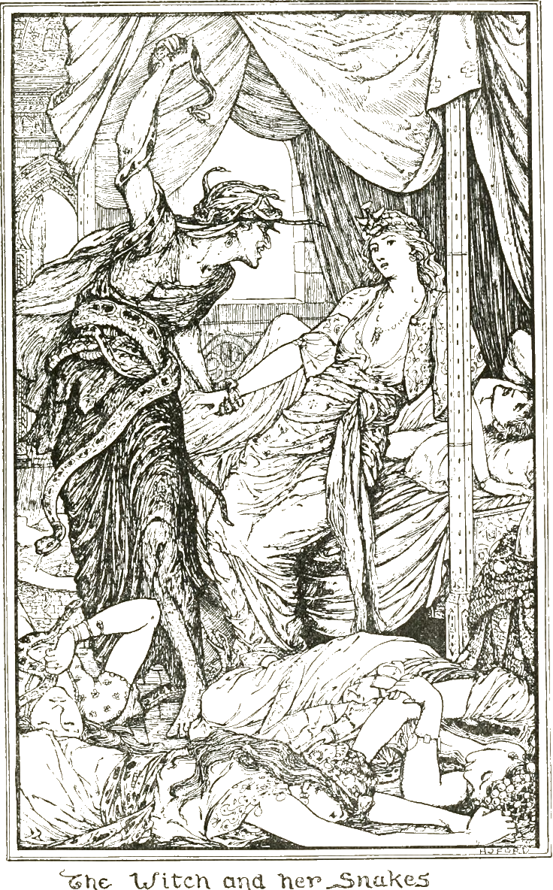

被吓坏了的朱维莎眼瞪瞪地看着她，一句话也说不出来。老巫婆拉着她的手，把她拖到森林中藏着木筏的地方。她们一起坐到放在河里的木筏上以后，老巫婆拿起桨来。她们顺流而下，一直来到那遥远的国家。国王用一口袋黄金把朱维莎买下来。

再说，自从国王经过森林里的那三间小屋，留下那把剪刀、剃刀和镜子以后，仙女的儿子们没有一天早晨不把它们拿出来看。以前，这三样东西总是亮晶晶的，没有一点污点。可是这天早晨，他们把三样东西拿出来以后，看到剪刀和剃刀上有血迹，小镜子也蒙上了一层雾气。

“我们的兄弟肯定碰上了可怕的事情。”他们脸色庄重地说，“我们得赶快去救他，免得太晚了。”他们套上魔鞋，就动身到王宫里去。

仆人们热情地欢迎他们，很乐意把所知道的一切对他们说。可惜他们知道得并不多，只是知道那把剑丢了，谁也说不上丢到哪儿去了。仙女的儿子们花了一整天来找，可怎么也找不到。这时候，天黑了，他们又累又饿，可到哪里去找吃的呢？这一天，国王没有出去打猎，家里什么东西都没有。正当他们感到很绝望的时候，城墙下面的河水泛起一片月光。

“啊！我们真笨，为什么不去抓鱼来吃呢？”他们喊叫起来。他们来到河边，很快就捉上来一些鱼，马上就烧来吃。吃过以后，他们觉得好多了，开始看看四周。

他们看到，在河的中央，河水在奇怪地翻滚着。慢慢地，他们看出那是一条大鱼在不停地扭动着，挣扎着，像是很痛似的。几兄弟的眼睛都瞪着这条鱼。接着，它向空中一跳，一道亮光划破了夜空。“剑！”他们不约而同地喊出声来，一起跳入水中。他们费了好大劲，才把剑从鱼的身上拔下来。那条鱼也精疲力尽地躺在水里不动了。

他们带着剑游回岸上，用衣服小心地把剑擦干，然后把它带回王宫，放在国王的枕头旁边。血色立刻涌上国王那白蜡一样的面孔。国王坐起来，张开眼睛问：“朱维莎呢？”

“那我们就不知道了，”兄弟们说，“不过，现在你得救了，你很快就可以找到她。”

接着，他们把自从朱维莎把他的秘密告诉给老巫婆以后，所发生的事情对他说了。

“我要到我的马那里去！”他只说了这句话。他来到马厩以后，看到他那匹可爱的马，眼泪几乎要掉下来。那马的状况和它的主人差不多，可是一看到国王进来，它马上就站起来，用自己的头来擦他。

“啊！我可怜的马！你比我聪明得多了，我要是像你一样，就不会失去朱维莎了！我们要一起去把她找回来！”

国王骑着马，沿着河走了很久，可是关于朱维莎的消息一点也没有。后来有一天晚上，他们在一间离大城市不远的小屋旁休息。国王躺在草地上，懒洋洋地看着马在吃草。一个老妇人走过来，手中拿着装满牛奶的木碗，送给他喝。

他一口气就把它喝光，因为他已经很渴了。然后，他把碗放下，和老妇人说起话来。

老妇人也很喜欢有人和她聊天。

“你恰好这时候从这里经过，真是太幸运了。”她说，“因为五天以后，国王就要举行婚宴。啊！可是新娘不愿意，她长着蓝眼睛，金头发。她的身边放着一碗毒药，说是情愿喝了它也不愿意嫁给他。国王也是一个漂亮的男子汉，也合适做她的丈夫。她打着灯笼也找不到这么好的丈夫。她也不知道是从哪里来的，只是听说，是个巫婆把她送来的…… ”

国王吃了一惊，难道他终于找到她了？他的心激烈地跳动着，有点气喘嘘嘘地问：“她的名字是不是叫朱维莎？”

“嗯！她是这么说的，虽然老巫婆……你怎么啦？”她停下来问道，因为年轻人跳起来，抓住她的手腕。

“你听我说，”他说道，“你能保守秘密吗？”

“嗯！”老妇人回答，“如果你能给我报酬。”

“你会得到报酬的，你别担心，想要多少就有多少！这里有一把黄金，你先拿去！只要照我的话去做，你还可以得到一样多的黄金。”老妇人点点头。

“那么，去买些王宫里穿的衣服，想办法到王宫里去，找到朱维莎，把这个戒指给她看，接下来的事情，她会告诉你的。”

老妇人穿上黄色的丝绸衣服，戴上面纱走了。她大胆地跟着那些国王派来的、给朱维莎送礼物的商人来到她的面前。

开始，这个新娘子谁也不理睬，后来看到老妇人手上的戒指以后，就变得像绵羊一样温顺起来。她谢过那些商人，把他们打发走，只把老妇人留下。

“老奶奶，”朱维莎把门关好以后，问道，“这戒指的主人在哪里？”

“在我的家里，”老妇人回答，“他正等着你的吩咐。”

“告诉他在你家里再等三天。现在，你到这个国家的国王那里去，说你已经让我回心转意了。这样一来，他就会让我自由，不再派人来监视我了。到了第三天，我就到靠近河边的花园里去散步，你的客人在那里可以找到我。其他的事情就由我自己来办了。”

第三天拂晓，东方刚露出一丝曙光，王宫里就忙碌起来。因为这一天，国王就要和朱维莎结婚了。火红色的帐篷竖了起来，上面装饰着芬芳的白色花环。婚宴将在里面举行。等一切都准备就绪以后，一对人马准备去接新娘。今天一早，新娘就到王宫的花园里去散步，排列在两旁的人都看着她走过去，一眼就可以看到她那金黄色的轻纱在花丛中飘来飘去。忽然间，好像有一道闪电从天而降，向朱维莎站着的地方射过来。两边的人吓得连连后退。可那不是闪电，而是那匹火马！等大伙再抬起头来看时，它已经驮着两个人飞奔而去。

朱维莎和她的丈夫得到幸福以后，懂得了如何去珍惜它。许多男男女女还不懂得这一点，而且，这是任何人都教不会的，每一个男孩和女孩都得自己去学会。

 

## 贪多必失

从前，在印度的一个城市里，住着一个穷苦的卖油郎。他的名字叫迪那，穷得身无分文。他向一个名叫勒那的债主借了一百卢比，勒那不断地向他加利息，到这个故事开始的时候，他已经欠了勒那三百卢比。迪那的生意一直很不好，所以，他一直没有钱去还债。勒那为此非常生气，他每天晚上都要到迪那的家里来骂他，弄得这个可怜人几乎没法子活下去。勒那常常挑他妻子做晚饭的时候来，搞得他们夫妻和女儿一点胃口都没有，连晚饭一口都吃不下。这样一连持续了好几个星期。直到后来有一天，迪那觉得自己再也受不了了，最好还是一走了之。一个人拖儿带女总是走不远的，他想还是把她们留下，独自远走高飞。于是，这天晚上，他干了一天活以后，不是像往常一样回家，而是走出城去。不过，他也吃不准该往哪里去。

到晚上约莫十点钟的时候，迪那来到路边的一口井旁，附近有一棵高大的菩提树。这时候，他很累了，决定爬到树上去休息，明天一早再起来赶路。他上了树，找了一处大树杈舒服地蜷缩着。由于疲倦，他很快就睡着了。就在这天晚上，一些精灵到这里来游玩，它们拔起这棵大树，把它带到遥远的、没有人居住的海岸边，把它种下来。这时候，离天亮还很早。就在这时候，卖油郎醒过来，他看到自己不是在森林之中，而是在荒芜的海岸边，旁边就是辽阔的大海，他恐惧和惊讶得不知所措。就在他坐在那里想定定神的时候，他看到这边或那边不时闪烁着光芒，像是点点火星在飞舞着。这是什么东西呢？他正觉得奇怪的时候，有一颗离他那么近，他伸出手去就把它抓住。他发现，这是一块闪着红光的小石头，比胡桃稍为小一点。他解开束腰带，把它放进去。然后，他又抓住第二颗，第三颗，第四颗，都小心地把它们缚在腰带上。后来，就在天快亮的时候，这棵树又飞起来，很快地从空中飞过，回到昨天晚上的井边种下。

等迪那从这棵怪树带来惊慌失措中稍为镇静下来，他感谢上帝还让他活着。这时候，他想出走的念头也没有了，他回到了城里，回到自己的家。看到妻子以后，他挨了一顿臭骂。她一边骂他，一边不停地问这问那。等她停下来喘口气的时候，迪那说：“我只有一件事要对你说，你看看我带回来了什么？”他小心地把所有的门都关上以后，把腰带解开，把四块小石头拿出来，小石头在他的转动下闪闪发光。

“呸！”他妻子说，“这些傻卵石！我还以为是什么吃的东西呢！这里头好像有些名堂，可这种东西有什么用呢？”接着，她嗤之以鼻就走了。

昨天晚上，勒那像往常一样来骂迪那，看到借他钱的人走了，他非常不安，就把可怜的女人骂个狗血喷头，把她吓得够呛。今天，他一听说迪那回来了，就来到他的家门口，站在外面用大嗓门嚎了好几分钟。等他喊累了以后，迪那才对他说：“如果你肯赏脸到鄙舍里来，我有话对你说。”

于是，勒那走进屋，迪那也像上次一样，把所有的门关好，然后把腰带解开，把四颗闪光的小石头给他看。

“我就这些了，”迪那说，“我全部家当能够还债的就是这些。大人也知道，我一分钱都没有，但这些石头非常漂亮！”

勒那只看上一眼，就知道这是非常漂亮的红宝石，连口水都流出来了，可是他不动声色，继续说：“你这些傻石头关我什么事？我要的是我的钱，是你欠我的债务，不论如何你都要还我，否则你就要倒霉！”

对于这些责备的话，迪那一句也回答不上，只是坐在那里拱手苦苦哀求，请求怜悯和宽恕。后来，勒那假装说，与其让人欠债，不如就损失一些，拿这些石头来抵债算了。迪那听了以后，几乎感激涕零。勒那写了一张三百卢比的收条，用布包起四块石头，把它放到自己的怀中，就回到家里去了。

“我如何把这些宝石变成钱呢？”他一边走，心里一边想着，“我不敢把它们保存着，它们的价值实在太大。王公要是听说我有这些宝石，他可能就会找个借口把我关进监狱，把宝石和我的全部财产抢走。这笔买卖做得多么合算！四块价值连城的红宝石只花了一百卢比！好了！好了！我必须十分小心，不能泄露自己的秘密。”他一边走，一边盘算着。后来，他拿定了主意，换上一身干净的衣服，来到首相的家里。首相名叫穆斯里。得到私下接见以后，勒那把四块宝石拿出来，放在他的面前。

首相看到这么绚丽的宝石，眼睛直发绿。

“很好，真是太好了！”他喃喃地说着，“可是我不能照真实的价钱把它们买下，如果你愿意，这四块宝石我肯出一万卢比。”

这笔生意勒那高兴地同意了。他交出宝石，拿回卢比，急急忙忙回到家里，感谢福星高照，做一笔合法的买卖，获得如此巨大的利润。

勒那走了以后，首相心里开始考虑，如何处置这些宝石。很快，他想最好的办法是交给王公，王公的名字叫卡哈勒。他不失时机地当天就到王宫里去，请求王公私下单独接见他。看到只有他们俩，他把四块宝石拿出来，放在王公的面前。

“啊！啊！”王公惊叫起来，“这些宝石真是无价之宝。你把它们交给我真是太聪明了。作为回报，我把十个村的税收赠给你和你的后代。”

首相听到这些话，欣喜若狂。不过，他不说什么，只是深深地鞠了一躬。当国王把宝石收起来，放到头巾里去的时候，他赶紧回去，想到花一万卢比当上了十个村的地主，心里非常满意。王公也同样很开心，他拿着这些新宝贝来到后宫给王后看。王后喜欢得几乎发疯。她拿在手里翻来复去，嘴里说着：“啊！要是我再有八颗这样的宝石，就可以做一条多么好的项链！再给我八颗！否则我一定会死去！”

“多么不通情理的女人！”王公叫起来，“叫我到哪里去找八颗一样的宝石？我是用十个村换来的，你还不满足！”

“那又有什么关系！”王后说，“你难道想眼睁睁地看着我去死吗？这些宝石从哪得到的，你肯定还可以得到一些。”说完，她就坐在那里哭起来，直到王公答应，明天一早就去想办法，只要她耐心，一定会满足她的愿望。

天一亮，王公就把首相叫来，对他说，一定要想办法再拿来八颗昨天那样的红宝石。“如果不送来，就把你吊死！”王公大声地喊叫着，因为他非常生气。可怜的首相极力辩解，说他也不知道到哪里去找，可是没有用。王公一个字也听不进。

“你一定要找到，”他说，“王后不能因为几颗宝石而死去！那四颗是从哪得到的，就到哪里去找！”

首相离开王宫，心中非常烦恼，他叫仆人去把勒那叫来。勒那一走进他的屋子，他立刻就对他说：“再给我送八颗红宝石来，和昨天送来的一模一样。八颗，要快一点，否则我的性命难保。”

“可我怎么能办得到？”勒那吓得嚎啕大哭起来，“这种红宝石可不是长在树上的！”

“你是从哪弄来的？”首相问。

“从卖油郎迪那那里弄来的。”

“好吧！去把他叫来，问他是从哪里得到的，”首相说，“就是二十个迪那，我也不能因为他们而被吊死！”他立刻派出仆人去找迪那。

迪那来了以后，他们仔细地盘问他。然后，三个人一起到王公那里去，迪那把整个事情的经过都对他说了。

“你睡在菩提树上是哪一个晚上？”王公问。

“我想不起来了，”迪那说，“不过我妻子记得。”

他们把迪那的妻子叫来以后，她说，那是新月后的星期天。

人人皆知，新月的那个星期天，精灵们都有一种神奇的魔力和人们开玩笑。于是，王公命令他们，谁也不许说出去，谁说出去就杀谁的头。到下一个新月的星期天，他们四个人，卡哈勒、穆斯里、勒那和迪那都一起坐到菩提树上去，看看会发生什么事情。

这个星期天终于来到了，到了晚上，他们四人偷偷地凑在一起，来到森林里。没走多远，他们就来到菩提树前。像王公说好的那样，他们一起爬到树上去。到了半夜里，树开始摇起来，接着就向空中飞去。

“先生们，看！”迪那小声地说，“树飞起来了！”

“是的！是的！”王公说，“你说得一点也不错。安静地坐着，看看能发现什么。”

树在空中越飞越远，四个人紧紧地抱着树枝。后来，终于落在荒芜的海岸边，巨大的海浪拍打着沙滩。像上一次迪那看到的那样，他们也看到了点点火光在周围闪烁。这时候，迪那想：“啊！想想看！上次我只拿了身边的四颗，就还清了所有的债务。这一次我能拿多少就拿多少，这样一来我就发财了。”

“如果说，我用四块石头就可以换到一万卢比，”勒那想，“这一回我要自己拿到四十块，那样我就非常富有了，说不定还可以当上个首相呢！”

“用四块石头，我就得到了十个村，”穆斯里默默地想着，“现在，我要拿到足以买下一个王国的石头，自己当上王公，雇人给我当首相！”

王公心里想：“只拿八颗有什么好处！这里足够有做二十根项链的宝石；财富就意味着权势！”

怀着一颗贪婪的野心，四个人都从树上爬下来，解开他们的衣服，东奔西跑，开始捡这些宝石。与此同时，还不时回过头来看看别人，生怕捡得比人家少。他们那么全神贯注地只想着发大财，一点也没有注意到天就要亮了。忽然间，那棵树连根拔起，向空中飞去，把他们抛弃在海滩上，大家眼瞪瞪地看着，每个人身上都装着沉甸甸的宝石。

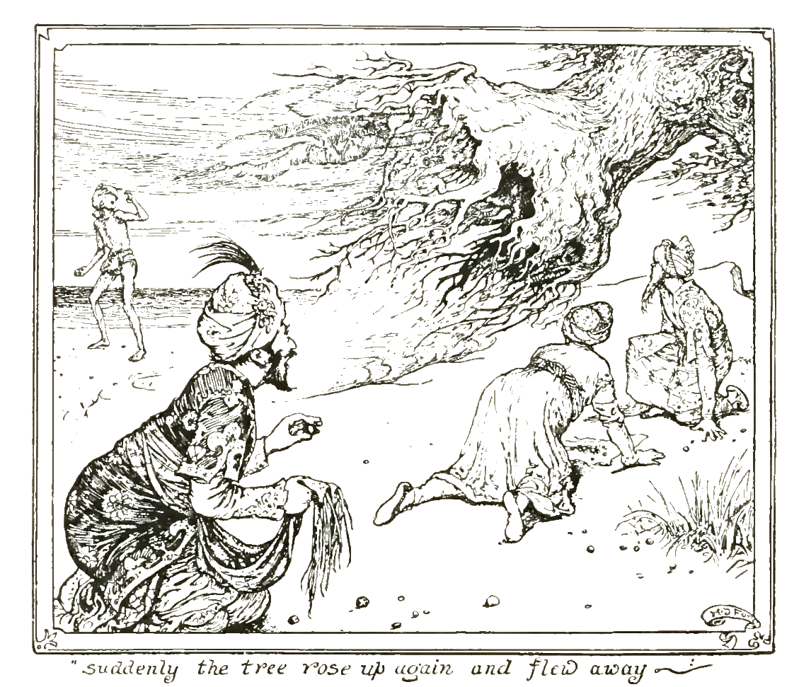

首都又迎来了新的一天。当管家宣布王公昨天晚上出去，到现在还没有回来以后，王宫里一片惊慌。

“啊！”有人说，“用不着焦急，首相穆斯里一定会知道他到哪里去了，因为他是王公的好朋友。”

于是，他们来到首相的家。到了那里他们才知道，首相也是昨天晚上出去，到现在还没有回来。“不过，”一个仆人说，“放债的勒那一定知道他到哪里去了，首相是和他一起走的。”

他们又来到勒那的家里，知道他也是昨天晚上出去以后一直没有回来过。看门的人告诉他们，卖油的迪那和勒那一起走，他一定知道他们在哪里。

他们来到迪那家的时候，他的妻子又哭又闹地来迎接他们，她说，迪那昨天晚上到勒那的家里去以后，到现在还没有回来。

他们白白地等待着，到处寻找也毫无结果。这四个倒霉的人没有丝毫要回来的迹象。倒是迪那妻子那离奇的故事是猜测他们命运的唯一线索。

直到今天，在这个国家里，当某个人因为贪得无厌，最后落得一无所有的时候，大家就说：“他一切都完了！迪那。勒那、穆斯里和卡哈勒也都完了！”不过，十有八九不知道这句话是怎么来的，真正的意思是什么。

 

## 乌龟的命运

在遥远的东方，有一个天气很热的国家。那里有个美丽的小湖泊，两只野鸭子在湖里安家。它们在清澈的湖水里游泳，玩耍，过着悠闲的日子。除了一只乌龟以外，可以说，这个湖泊就归它们所有了。乌龟比它们大好多岁，也比它们早在这里安家。幸运的是，它们不像在这种情形下常常发生的那样，觉得乌龟讨厌，而是成为好朋友。大多数时间里，它们都是在一起度过的。

日子过得又平静又快活。直到有一年夏天，太阳特别厉害，雨又下得很少。每天早上起来，它们都注意到，湖里的水越来越少，岸上的泥越来越多。湖边的百合花慢慢地凋谢了，棕榈树叶也低下了头。鸭子喜欢潜水的最深的地方，也越来越浅。后来有一天，两只鸭子不安地你看看我，我看看你。到了晚上，它们悄悄地说，要是再过两天还不下雨，就要飞走，到别处去安家。如果还留在它们那么喜欢的这个老家，一定会渴死。

这天晚上，它们把头藏到翅膀里去睡觉之前，总是怀着渴望的眼睛看着天空，一连好几个钟头，最后还是满脸忧愁地睡着了。天上一片云都没有，星星又明又亮，闪闪发光，挂得那么低，仿佛伸手都可以把它们摘下来。第二天早晨，它们决定非走不可了。走之前，得把这个打算对乌龟说，和它道别。

鸭子看到它正舒服地蜷缩在一堆枯萎的树丛中，半睡半醒的样子。它已经上了年纪，不能像从前那样，大热天还在外面跑来跑去。

“啊！你们来了，”看到鸭子，它高兴地喊道，“我正想着是不是该去找你们。湖变得越来越小，我也变得越来越虚弱，一个人度过白天和黑夜是很寂寞的。”

“啊！我们的朋友，”两只鸭子中大的一只说，“如果说你在受苦，我们也和你一样。而且我们还有些事要和你说，恐怕你听了以后会更加伤心。如果我们不想渴死，就得立刻离开这个地方，另找一个阳光没有这么强烈的住处。说这些话的时候，我的心在流血，因为在这个世界上，除了这个原因以外，不会有什么理由会让我们分开。”

听了鸭子说的话，乌龟那么震惊，那么烦恼，半晌说不出话来。等它终于忍住眼泪的时候，它用颤抖的声音说：“你们怎么会想到要走，没有你们，我怎么还能活下去呢？长期以来，你们是我唯一的朋友，你们要是走了，我很快就会悲伤地死去。”

“我们的悲伤就像你一样，”另一只鸭子回答，“可是我们没有别的办法，而且你要记住，我们不在这里喝水，你就会有更多的水喝！要不是因为发生了这种可怕的不幸，决不会有什么能使我们和这么爱着的人分开。”

“我的朋友，”乌龟回答说，“水对你们、对我都是一样不可缺少的，死亡要是威胁着你们，那也在威胁着我。看在我们相处那么多年的份上，求求你们，别抛弃我，让我一个人留在这里受惩罚！不论你们到哪里去，都带着我！”

它们沉默了一会，两只鸭子觉得丢下老朋友不管，很过意不去。可是，它们怎么能答应它的请求呢？这看来根本是不可能的。后来，一只鸭子说：“啊！我们用什么话来拒绝你？又怎么能答应你呢？想想看，和你比起来，我们的身体很重，脚却很短，怎么能和你一起翻山越岭，穿过沙漠，到阳光比较柔和的地方去？我们三个肯定不是累死，就是饿死在路上！我们唯一的希望只寄托在翅膀上，而你又不会飞！”

“是的，当然，我不会飞，”乌龟叹了一口气，回答说，“可是你们那么聪明，到过那么多地方，你们总可以想出个办法来吧！”说完，它瞪着双眼，满怀希望地看着它们。鸭子看到乌龟那么真切地想和它们在一起，很受感动。它们向朋友示意，它们想游到湖里去，单独地商量一下。乌龟虽然听不见它们说些什么，但它看得见它们。它们说了半个小时，对乌龟来说，好像有一百年那么久。它终于看到它们肩并肩地走回来，它那么担心自己的命运，在鸭子走过来之前，紧张得几乎要死过去。

“我们希望，我们想出来的办法可以帮助你，”那只大鸭子严肃地说，“可是得提醒你，这里面有很大的危险，特别是如果你不小心地照我们的话去做的话。”

“这关系到我的生命和我的幸福，我怎么会不照你们的话去做呢？”乌龟高兴地回答，“把你们的打算告诉我，我很乐意答应照你们说的去做。”

“那好吧！”鸭子说，“我们按想好的办法，带着你在空中飞，你要一点也不能动，就像是死了一样。不管你发现自己飞得离地面有多高，都不要感到害怕。不论你看到什么，听到什么，不要动手动脚，不要开口说话。你一定要保持稳定，否则，我很难说会发生什么事情。”

“我会绝对地服从，”乌龟说，“不但在这个时刻，而且是一生一世不会忘记。我再一次庄严地保证，头不动，脚也不动，一点也不害怕，整个旅途中一个字也不说。”问题就这样解决了。鸭子在湖里游着，直到在湖面上找到一根结实的棍子。它们用结实的百合花的根，把棍子的两头捆在各自的头颈上，然后尽快地游回到乌龟的身边。它们把棍子轻轻地送到朋友的旁边，然后大鸭子说：“现在，用你的嘴牢牢地咬住棍子，不要把它松开，直到我们把你送回地面。”

乌龟照它的话去做。两只鸭子抓住棍子的两头，展开翅膀，迅速地向空中飞去，乌龟挂在它们中间。

好一会儿，一切都很顺利。它们飞过高山，飞过峡谷，飞过没有人居住的城市，可就是看不到湖泊。乌龟忠诚地听鸭子的话，勇敢地吊在棍子上。

后来，它们看到远处有个小村庄，而且很快就飞到它的屋顶上空。下面的人看到这种情景都觉得很奇怪，男女老少都跑出来看，还相互喊叫着：“快看！快看！快看多么古怪的事！两只鸭子扛着一只乌龟！以前谁见过这种事情吗？”

是的，他们确实吃惊不小，男人们放下手中的犁，女人们放下手中的线，都一起来看热闹，一起来喊叫。

两只鸭子还是不停地飞着，不去理睬下面的事情。可乌龟不是这样。开始它还遵守鸭子的吩咐，一言不发。后来，下面的喧闹声使它飘飘然起来。它开始想，大家肯定是在妒忌它有本事在空中旅行。倒霉的时刻到了，它忘了庄严地答应过鸭子的话，张开嘴想回答几句。可是它一张嘴，一个字也没说，就迅速地掉下来，它很快就吓昏了。就这样，它在一间屋顶上撞得粉身碎骨。两只鸭子把帮助过它们的朋友，可现在一点也没有用的棍子抛下。它们伤心地互相看了一眼，摇摇头。

“我们就担心会发生这种事。”它们说，“不过，也许它是对的，这样死比留在那里等死好。”

 

## 蛇王子

从前，在一座城市里住着一个孤独的老妇人，她很穷。有一天，她发现自己家里只有一把面粉了。她身无分文，想再去买一些，或是再去挣一些，都是没有指望的事情。她拿起小铜罐，伤心地向河边走去，准备洗个澡，汲些水回来，然后用仅剩下来的面粉做个饼吃。至于以后会怎么样，她就不知道了。

她在河里洗澡的时候，把铜罐放在岸上，用一块布盖着，免得把里面的水弄脏。等她回到岸上来，把布揭开，准备把铜罐灌满水时，看到有一条蛇盘在里面，像是死了似的。她赶紧用布把口重新盖好，不让它跑掉。然后对自己说：“啊！这回可以舒服地死去了！我把你带回家，再把你倒出来，你会咬我一口，我就这样死去，那时候，我的一切烦恼都没有了。”怀着这种可怕的想法，可怜的老妇人捂紧罐口的那块布，急急忙忙赶回家。回到家以后，她把所有的门窗都关好，然后把布揭开，把罐对着炉灶倒过来。可是，她非常惊奇地看到，倒出来的不是那条像死了似的蛇，而是叮铃当琅地响着的、非常华丽的项链和闪闪发光的珠宝。

好一会，她呆呆地站在那里看着，像个木头人似的。后来，她用颤抖着的手把项链捡起来塞进面纱里，就马上动身到国王的晋见厅里去。

“请求谒见国王！”她说，“请求单独谒见！”她的请求得到同意。看到单独和国王在一起，她就把面纱抖开，一串一串耀眼的项链掉下来。国王一看到这些项链，心里又惊又喜，越看越想要，恨不得立刻就占为已有。于是，他给老妇人五百块银币，就直接了当地把项链塞进自己的口袋。老妇人满心欢喜地走了，因为国王给她的这些钱，足够她过一辈子了。

国王一处理好国事，立刻就把这些横财拿去给王后看。王后如果说不见得比他更喜欢，起码也是像他一样地兴高采烈。他们心满意足地欣赏了这些奇妙的项链以后，就把它们锁到王后保存珠宝的大箱子里去。这个箱子的钥匙，国王总是挂在自己的头颈上。

这以后不久，邻国的国王派人来送信，说是他们生了一个最可爱的小公主，邀请他们出席庆祝盛宴。王后对她丈夫说，他们当然应该去参加，她要戴上他送给她的项链去。准备的时间很仓促，到快要动身的时候，国王打开箱子，准备把王后要戴的项链取出来。可是，他一根项链也看不见，只见一个胖胖的男婴儿躺在那里哭着。国王吃惊得几乎摔倒。不过，他一镇定下来就大声地喊叫他的妻子。她赶紧跑过来，心想项链肯定是被偷走了。“看这！快看！”国王喊道，“我们不是一直想有个儿子吗？现在，老天爷给我们送来了！”

“你在说什么？”王后说，“你是不是疯了？”

“疯了？不！我希望我没有疯。”国王一边喊着，一边围着打开的箱子跳起舞来，“快过来！看吧！看看项链变成了什么！”

这时候，婴儿也高兴地发出响亮的声音来，好像他也想爬起来，和国王一起跳舞似的。这时，王后才惊讶地叫出声来，跑过去看箱子。

“啊！”她看着婴儿，激动得有点透不过气来，“多么可爱的孩子！他会是从哪儿来的呢？”

“恐怕我也说不上，”国王说，“我只知道，我们把项链锁在这个箱子里，等到我刚才把它打开时，项链不见了，里面是一个婴儿，一个从来没有见过的，那么漂亮的婴儿！”

这时候，王后已经把婴儿抱在怀中。“啊！福星高照的婴儿！对一个王后来说，这比任何项链都要宝贵的多！”她高兴地说着，“快！快给我们的邻居写信，说我们不能来参加他们的宴会了，我们自己也要举行宴会，我们也有了自己的孩子。啊！多么幸福的一天！”

于是，出访的计划取消了。为了庆祝王子的出生，城市里响遍了欢乐的钟声、礼炮声和喇叭声。不论男女老少，整整一个星期都忙着举行各种欢庆活动。各色各样的庆祝集会、比赛、喜庆宴席、歌舞、游戏，其规模之大，前所未闻。

几年以后，国王的儿子和邻国的女儿日见长大，两个国王都同意，等他们一到成年，就为他们举行婚礼。为了正式签下婚约，两国的大臣们开动脑筋，反复琢磨，最后达成一致，在白纸黑字上签名盖章。一切都准备就绪，只等着付诸实施了。

时间也过得很快，王子和公主满十八岁了，两个国王都同意举行婚礼。王子千里迢迢，来到邻国来迎接新娘，婚礼兴高采烈地举行。

有件事我必须向你们交代清楚。那个把项链卖给国王的老妇人后来被请到王宫里来照顾王子，当他的保姆。虽然她很尽忠尽职，是个很出色的保姆，可也难免要说些什么。慢慢地事情就传出去了，说王子的出生有些离奇。这些谣言自然也会传到公主父母的耳朵里。公主就要做王子的妻子了，于是，她的母亲（她像很多人一样，很好奇）在女儿出嫁前的那天晚上对她说：“记住，你要做的第一件事就是，弄清楚王子出生的秘密。为了达到这个目的，不论他和你说什么，你都不要回答；直到他问你为什么不说话，然后你就问他，关于他神秘出生的传说到底是怎么一回事？他要是不肯告诉你，你就不要和他说话，直到他答应为止。”公主答应，照她母亲的话去做。

这样一来，他们结婚以后，王子和他的新娘说话，她总是不答理。即使是说到她自己父母的家，她也是一声不响。他想不出这是什么道理。后来，他问她，为什么总是不说话？这时候她才开口：“告诉我你出生的秘密。”

王子非常伤心和失望。虽然公主一本正经地要他说，他还是不肯告诉她，总是回答说：“我要是告诉你了，你会后悔不应该问我的。”

他们一起生活了几个月，可日子不像应有的那样幸福。因为秘密还是秘密，就像乌云遮住了太阳一样，本该晴朗的天空总是阴沉沉的。

后来，王子再也受不了了，终于有一天他对妻子说：“如果你还坚持，今天半夜里我就把自己的秘密告诉你。”这时候，公主非常高兴，因为她胜利了，全然没有去想一想他的警告。

这天晚上，午夜即将来临的时候，王子吩咐给他和公主备好马。他把公主扶上马，自己也骑上自己的那一匹。他们一起来到老妇人在铜罐里看见那条蛇的河边。王子把马勒住，悲哀地问公主：“你还坚持要我把秘密告诉你吗？”公主回答说：“是的！”

“如果我对你说了，”王子说，“记住，你会后悔一辈子的！”可是公主还是坚持说：“告诉我！”

“那好吧！”王子说，“你听着，我是一个远方国王的儿子，因为中了魔法，变成了一条蛇！”

他的“蛇”字刚出口，人马上就不见了。公主听到一阵窸窣声，看到河面上水波涟漪，在昏暗的月光下，一条蛇在向水里游去，不久就消失了，只留下她孤零零一个人。她怀着一颗破碎的心等待着，等待着王子回到她的身边。可是没有用，什么都没有发生。只有风吹着河边的树叶呜呜地响，鸟儿在半夜里啼叫，豺狼在远方怒嚎，黑色的河水在她脚下静静地流淌。

第二天早晨，人们在河边找到她，她披头散发在哭泣着。关于她丈夫的命运，从她嘴里打听不到一个字，也没有一个人能够说出一点线索。按照她的愿望，他们在河边用黑石头造起一幢房子，让她住在里面哀悼她的丈夫。此外还有一些士兵和佣人来照顾她。漫长的五年过去了，公主还在那里悼念她的丈夫，她谁也不见，除了河边这幢房子和周围的花园，她哪儿也不去。

一天早晨，她醒过来的时候，看到地毯上有一点新鲜的泥土。她把日夜在外面守卫着的士兵叫来，问他们在她睡觉的时候，有没有人进来过。他们说决不会有人能进来。他们守卫得那么严，就是一只鸟飞进来也别想躲过他们的眼睛。可是，他们谁也说不出这些泥土是怎么来的。第二天早晨，公主又看到了新的泥土。她仔细地盘问每一个人，可是谁也说不出道理来。第三天晚上，公主决定自己不睡觉，要看个明白。她担心自己睡着了，就用小刀在手指上划了道伤口，还擦上盐，这种疼痛可以叫她睡不着。于是，她张开眼睛躺着。到半夜的时候，她看到一条蛇弯弯曲曲地在地上爬，嘴里还有一些河里的泥土。它靠近床边就抬起头来，把带着泥土的头搁在床单上。公主非常害怕，但是她尽力地克制自己，问道：“你是谁？到这里来干什么？”

蛇回答说：“我就是王子，你的丈夫。我来看看你。”

公主开始哭起来，蛇继续说：“啊！我不是说过，如果我把秘密告诉你了，你就会后悔吗？你有没有后悔？”

“是的，我后悔！”可怜的公主哭泣着，“我很后悔，我要后悔一辈子！我就不能做些什么了吗？”

蛇回答说：“可以，有一件事你可以做，如果你有胆量的话。”

“你只要告诉我，”公主说，“我什么都敢做！”

“那么！”蛇回答，“在某一个晚上，你把房间四个角落里放上大碗的牛奶和糖。河里所有的蛇就会来喝这些牛奶，走在前面领路的就是蛇王后，你要在门口挡住它，对它说，‘啊！蛇王后！蛇王后！把我的丈夫还给我！’它也许会这么做。可是，如果你害怕了，不敢挡住它，你就再也见不到我了。”说完，蛇就走了。

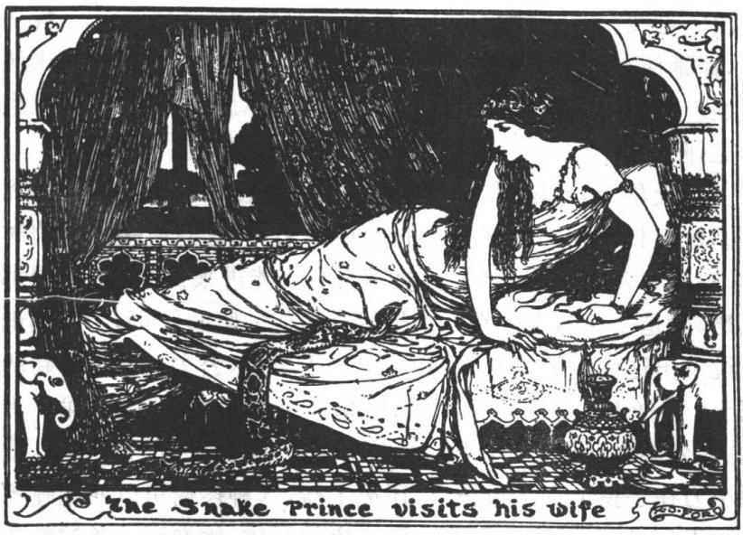

到了蛇告诉她的那天晚上，她准备了四大碗牛奶和糖，放在房间的四个角落里，然后站在门口等着。半夜里，河那边传来巨大的沙沙声和窸窣声。接着，只见大地好像也蠕动起来，到处都是扭动着的可怕的蛇，它们向公主的房间爬过来，眼睛在闪着绿光，叉舌在不停地吐进吐出。爬在最前面的，是一条又大又可怕的蛇。卫兵们恐惧万分，跑得一个也不剩。可是公主还是站在门口，脸色像死过去一样苍白。她紧握双手，生怕自己会昏过去或叫出声了，没有做到自己该做的事情。那些蛇靠近房子，看到她挡在路上，都抬起头来摆来摆去，用恶狠狠的，睁得又圆又亮的眼睛瞪着她，呼出的气似乎要把周围的空气毒化。公主还是一动不动地站在那里。等领头的蛇离她只有几英尺远的时候，她喊道：“啊！蛇王后！蛇王后！把我的丈夫还给我！”

这时，所有那些沙沙作响地蠕动着的蛇好像都在交头接耳地说：“她的丈夫？她的丈夫？”可是，蛇王后还是继续向前，直到它的头几乎碰到公主的脸，它的小眼睛似乎就要射出火焰。公主还是站在门口，丝毫不动，只是又说了一遍：“啊！蛇王后！蛇王后！把我的丈夫还给我！”这时候，蛇王后回答说：“明天，你就会得到他，明天。”

公主听到这句话，知道她已经成功了。她摇摇摆摆地走回来，一头倒在床上，昏了过去。这天晚上，她好像在做梦一样，看到房间里到处是蛇，它们挤来挤去，不停地争吵着，直到把四碗牛奶和糖吃完。然后它们就走了。

第二天，公主很早就起来，脱掉穿了五年的哀悼衣服，穿上色彩鲜艳的漂亮衣服。她把房间清理和打扫干净，用芬芳的鲜花和花环把房间装饰起来，好像是要举行婚礼似的。到了晚上，她把森林和花园全部用灯照亮，摆好一张桌子，像是准备摆上宴席。房子也用上千支蜡烛点亮。然后，她坐下来等候她的丈夫，不知道他出现的时候会是什么样子。到了半夜，河边传来脚步声。王子含笑走过来，可眼睛里充满了泪水。她跑过去迎接他，扑入他的怀中，又是哭又是笑。

于是，王子回家了，他们双双来到王宫。老国王看到他们，高兴得直流泪。沉默了那么久的钟声又响了起来，礼炮齐鸣，喇叭又吹起欢乐的曲调。他们又兴高采烈地摆起丰盛的宴席。

当过王子保姆的老妇人，又当上了王子孩子的保姆，起码她受到了邀请。尽管她已经上了年纪，不能再帮他们干什么了，可是她爱他们。是的，她想她还有用，她知道她很幸福。王子和公主也很幸福。后来，他们当上了国王和王后，生活和统治这个国家很久。王国在他们的管理下，非常富强昌盛。

 

## 森林里的王子和公主

丹麦从前有一个国王和王后，他们只有一个儿子。他是个又聪明又漂亮的小伙子。王子十八岁那年，他的父亲老国王得了重病，没有任何能够好起来的希望了。王后和王子都非常伤心，因为他们很爱他。尽管他们尽了最大的努力，国王的状况还是一天比一天糟糕。终于在夏天来临的一天，当鸟儿在歌唱的时候，他抬起头来久久地望着窗外，然后就倒下来死了。

一连好多星期，王后不吃也不睡，她为国王的死去是那么悲伤，王子很担心，害怕她如果这样下去，也会死去。于是，他请求她一起到他知道的，森林那边一个美丽的地方去。过了一段时间以后，她同意了。王子很高兴，着手安排好一切，准备明天一早就动身。

他们在路上整整走了一天，只是有的时候停下来休息一会儿。王后也觉得好了一些，对看到的景色也有了一点兴趣。就在夜幕降临的时候，他们进入森林。森林里很黑，因为树木长得那么茂密，阳光一点也照不进来。很快，他们就迷失了方向。他们无能为力地徘徊着，不知道该怎么办才好。

王后又累又怕，她说：“如果我们睡在这可怕的地方，野兽就会把我们吃掉。”说着，她开始哭起来。

“开心些，母亲！”王子说，“我有一种预感，好运在向我们走来。”转了一个弯以后，他们看到一间小屋子，从窗口可以看到里面的火光。

“我跟你说过吧！”王子说，“你在这里等一会，我去找找看，看能不能找到吃的和今天晚上睡觉的地方。”说完，他马上就跑过去。这时候，他们的肚子已经很饿了，他们没有带多少食品出来，早就吃得精光了。一个人出去徒步旅行，总不喜欢带很多东西。

王子走进屋子，仔细地查看着，从一个房间走进另一个房间，可是没有看到一个人，也找不到一点吃的东西。后来，他正要伤心地离开的时候，看到里面的房间里挂着一把剑和一件小巧的盔甲的衬衫，上面还挂着一张纸条。纸条上写着一些字，说是谁穿上这件衣服，拿着这把剑，就什么也不怕。

王子看到这些是那么高兴，忘记了自己是多么饿。他立刻把这件小巧的盔甲的衬衫穿到自己的外衣里面，把剑也藏到衣服里，因为他不想让人知道他得到了什么。接着，他回到等得很不耐烦的母亲身边。

“你在干什么？这么久！”她生气地问，“我还以为你被强盗杀了呢？”

“哦！只是到处看看。”他回答，“我到处都找遍了，就是找不到一点吃的。”

“我很担心，恐怕那是强盗的房子。”王后说，“虽然很饿，我们还是快点走吧！”

“不是的。不过，我们最好还是不要留在这里。”王子回答说，“特别是，这里一点吃的都没有。也许能找到别的房子。”

他们又走了一会，果然不出所料，又看到了一间屋子，从窗口也可以看到里面的灯光。“我们进去看看。”王子说。

“不！不！我害怕！”王后说，“我们会遭到袭击，会被杀死的！那是强盗窝，我敢肯定。”

“不错！看起来很像，可是我们没有别的选择。”王子说，“我们好久没有吃过东西了，我也像你一样，累极了。”

可怜的王后这时已经是精疲力尽，几乎站不住了。尽管她很害怕，还是差不多被说服了。

“而且暴风雨就要来了。”王子补充说。他因为有了那把剑，什么也不怕。

他们走进屋子，里面看不见一个人。第一个房间里有一张桌子，上面已经摆好饭菜。各种可口的菜肴和饮料都有，虽然有的盘子已经空了。

“嗯！这看起来很不错。”王子说。他坐下来，吃了一些堆放在一个金盘子里的草莓，还吃了一些冰淇淋柠檬，味道比什么都好。

可是，这真是强盗窟，他们刚吃好饭，又到森林里去看看有什么人可以抢劫了。

王子和王后吃到再也吃不下以后，他们又觉得很累了。王子四处张望，看到一张很舒服的床，上面有丝绸被单，就在第二个房间里。

“你躺到床上去睡吧！母亲。”王子说，“我就睡在旁边。用不着害怕，你放心地睡到天亮。”他手中拿着剑看着，这样一直到天明。王后醒过来说，她睡得很好，可以出发了。

“我先到森林里去，看看能不能找到路。”王子说，“我出去的时候，你生火煮些咖啡，走之前要好好地吃顿早饭。”说完，他就跑到森林里去了。

他走了以后，王后生起火来。然后，她想，去看看别的房间里都有些什么。她看了一个又一个房间。有一个房间家具很豪华，墙上挂着很美的画，帘子是淡蓝色的，还有舒适的沙发和黄色的柔软垫子。就在她观看房间里的这些东西时，地板上的一个暗门打开了，强盗头子从门里伸出手来，抓住她的脚踝。王后大叫一声，吓得几乎昏死过去。接着她双膝跪下请求饶命。

“可以，不过你要答应我两件事。”强盗说，“第一，你要把我带回到你的国家去，让我代替你的儿子当国王；第二，要是你儿子想夺我的王位，你就杀了他。要是你不答应这两件事，我就杀了你！”

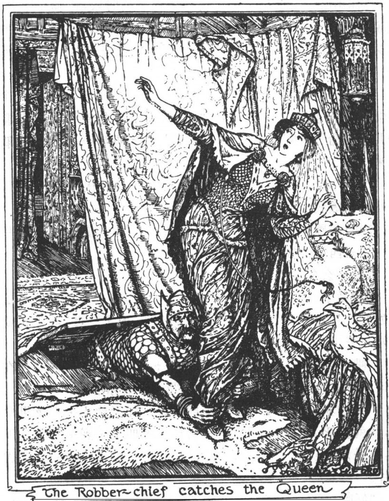

“杀我的儿子！”王后恐惧地看着他，气也透不过来地说。

“你不必亲手杀他，”强盗说，“等他来的时候，你躺在床上，就说你生病了，还说你梦见一英里外的森林里，有些非常好吃的苹果，如果能给你采一些回来，你就会好起来，否则你就会死去！”

王后一边听着，一边发抖。她很爱自己的儿子，可她也是个很懦弱的胆小鬼，所以后来她答应了，希望会发生什么事情，救她儿子一命。她刚答应下来，就听到门外有脚步声，强盗急忙躲起来。

“好了，母亲，”王子一走进来就说，“我在森林里找到路了，一吃好早饭我们马上就走。”

“唉！我感到不舒服，生病了！”王后说，“我一步也走不动，只有一样东西可以救我。”

“是什么东西？”王子问。

“我做了一个梦，”王后用虚弱的声音回答，“离这里一英里远处有一片森林，那里长着最好吃的苹果，吃上一些，我很快就会好起来。”

“哦！可是梦总是梦，不能当真。”王子说，“有个魔法师住在离这里不远的地方，我去找他，讨个咒语来给你治病。”

“我的梦总是很灵，”王后摇摇头说，“如果你不去把苹果拿来，我就会死去。”她不明白强盗为什么要叫王子到那片森林里去，可是谁都明白，那里有许多野兽，会把从那里经过的人撕成碎片。

“好吧！我就去！”王子回答，“可是我无论如何得先吃早饭，那样才有力气赶路。”

“你要不是快一点，等你回来的时候，就会看到我已经死了。”王后焦躁地说着。她觉得儿子并不十分关心她，这时候，她感到自己真的病了。

王子吃过以后，马上就动身，不久就到了森林里。不错，森林里到处是狮子、老虎、熊和狼，它们都向王子奔跑过来。可是，它们非但没有向他扑过来，把他撕成碎片，而且躺在地下舔他的手。他很快就找到母亲要的苹果树，可是树枝那么高，他根本够不着，而且树干十分光滑，毫无办法爬上去。

“看来还是没有用，我爬不上去。”他自言自语地说着，“现在，我该怎么办？”

就在他转身的时候，剑偶然碰到了苹果树，两个苹果立刻落下来。他高兴地把苹果捡起来，正准备走的时候，一只小狗从附近的小山上向他跑过来，拖他的衣服，还呜呜地叫着。

“你想干什么？小狗！”王子低下头来，拍拍它那柔软的黑头。

小狗跑到山旁边的一个洞口前坐下，看着王子，好像在说：“跟我一起进去！”

“也好，我进去看看里面有什么。”王子想着，向洞口走去。可是洞口那么小，他根本进不去。他把剑伸进去，洞口马上就变大了。

“啊哈！”他咯咯地笑起来，“有这样一把剑太值得了。”他弯下腰来走进洞去。

他走完一条又长又黑暗的走廊，走进一个房间，第一眼看到的，是一个美丽的公主。一根铁链条把她锁在铁柱子上。

“是什么不幸把你带到这里来了？”他吃惊地问。

姑娘回答说：“告诉你也没有什么用，除非你要和我一样倒霉。”

“这我不怕。告诉我你是谁，怎么会到这里来的。”王子请求她说。

“我的故事并不长。”姑娘苦笑着说，“我是从阿拉伯来的公主。这里住着的十二个强盗，都抢着要和我结婚。”

“我要不要把你救出去？”王子问。

她回答说：“要是要的，可是你办不到。首先，你怎么解开绑着我的这根铁链呢？”

“哦！那太容易了！”王子说着，把剑拔出来。剑一碰到铁链，铁链就断了。公主自由了。

“来吧！”王子拉着她的手说。可是她缩了回去。

“不！我不敢！”她喊道，“要是在走廊上碰上强盗，他们会把我们都杀了。”

“他们办不到！”王子挥舞了一下手中的剑。“可是你在这里呆多久了？”王子很快又问道。

“大约有二十年了，我想。”公主数着手指头说。

“二十年！”王子惊叫起来，“那你最好闭上眼睛。你在里面呆了那么久，忽然看见阳光可能会伤害你的眼睛。这么说来，你就是阿拉伯公主，你的美丽可是天下有名的。我也是一个王子。”

“你救了我的命，和我一起回到阿拉伯去，做我的丈夫吧！”公主说，“我父亲现在虽然还健在，但他总是要老的，他去世以后，你就是国王了。”

“不！”王子回答，“我不能去！不论是活着还是死了，我都要留在自己的国家里。不过再过一年，我就来找你，和你结婚。”

接着，公主从手指上褪下一个很重的戒指，套在王子的手上。她父母和自己的名字都刻在上面。她叫他好好地保留着，看到它就想起自己的承诺。

“除非我死去，否则决不会和它分开。”王子说，“再过一年，只要我还活着，我就来找你。我相信，我曾经听说过，森林的另一头有个港口，从那里可以乘船到阿拉伯。我们赶快到那里去！”

他们手拉着手，穿过森林，来到港口的时候，有一条船正好要开行。公主和王子告别就上了船。她回到自己的国家以后，到处一片欢腾。她的父母以为这一辈子再也看不到她了。她告诉父母，一个王子如何把她从强盗的手中救了出来，一年以后如何会来和她结婚。父母听了都非常高兴。

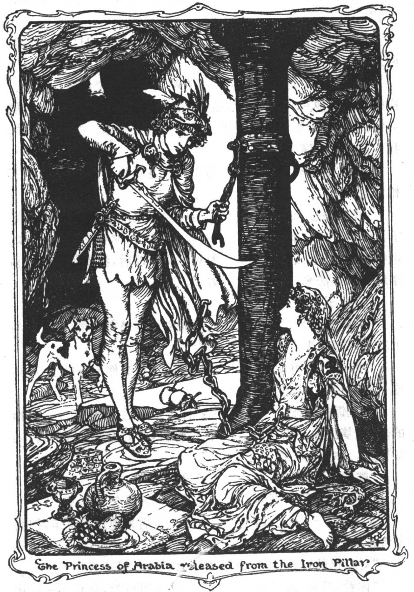

“尽管如此，”国王说，“我希望他现在就来。一年的时间太长了。”

公主走了以后，王子这才想起他到森林里来的目的。他赶紧回到强盗的家里。

强盗头子很远就闻到苹果的香味。他有一个像食人魔鬼一样的鼻子。他对王后说：“他是个非凡的家伙！除非他有某种魔力保护自己，否则一到森林里去就会被野兽吃掉。如果是这样，我们得把他的魔力除掉！”

“不！他什么都没有！”王后说。强盗对她非常着迷，可是不相信她的话。

“我们要想个办法除掉它！”他说，“等他进来以后，就说你好了。给他弄点吃的。在他吃的时候，对他说，你梦见一群野兽攻击他，问他是怎么逃脱的。等他对你说了以后，我就可以轻而易举地想出办法来，去掉他的魔力。”

很快，王子就走进来了。

“你好些了吗？母亲！”他快活地说，“苹果在这里，现在你马上就可以好起来，准备和我一起走了。”

“哦！我已经好了，”她说，“你看，饭已经给你准备好了，趁热吃了，然后我们就走。”

他吃饭的时候，王后对他说：“你走了以后，我做了一个可怕的梦。我梦见你在森林里，到处都是野兽，它们围着你嚎叫着，凶猛极了。你是怎么摆脱它们的？”

“嗯！那只不过是个梦。”王子笑着说。

“可我的梦总是真的，”母亲说，“告诉我是怎么回事。”

王子想了一会儿，该不该告诉她。可后来他还是决定，把秘密告诉她。

“对自己的母亲，不应该隐瞒什么。”他心里这么想着。

“你看，母亲，这里有一把剑和一件盔甲衬衫，是我在进森林以后第一间房子里得到的。我只要带着它们，任何东西都害不了我。就是它们使我免受野兽的伤害。”

“真是谢天谢地！”王后说。王子一走，她立刻就去告诉强盗。

强盗听到这个消息，就马上弄来一些放了安眠药的饮料，叫王后在王子今天晚上上床睡觉之前给他喝。

这样，王子睡觉之前，王后送来一杯有安眠药的饮料。“喝了它吧！让妈高兴！”她说，“它会让你感到舒服，睡得更香，你已经忙了一天了。”

“这味道真怪！”王子一边喝，一边嘟囔着。

他马上就睡着了。强盗走进来，拿走他的剑和盔甲衬衫。

“这些东西是我哥哥的。”他说。这两样东西拿到手以后，他把王子叫醒。

“现在，我是这里的主人。”他说，“两种前途你挑选吧！要么现在就死去；要么就挖掉你的眼睛，把你扔到森林里去！”

王子听到这些话，冷了半截。一个念头闪过，他转过身来对母亲说：“这些都是你干的？”她哭起来，否认是自己干的。王子明白她在撒谎。

“好吧！”他说，“‘留得青山在，不怕没柴烧。’我到森林里去。”

于是，强盗挖掉他的眼睛，给他一根棍子，还有一些吃的和喝的，把他赶到森林里去。希望里面的野兽把他吃掉，因为他现在没有剑和盔甲衬衫了。

“现在，”他对王后说，“我们可以回到你的国家去了！”

第二天，他们就动身。回到王宫以后，他们立刻就结婚，强盗当上了国王。

这时候，可怜的王子还在森林里徘徊着，希望能有人帮助他，或者雇佣他。这时候，他已经是山穷水尽，既没有钱，也没有家了。幸好不久前，猎人刚刚在森林里进行过一次大狩猎，野兽都纷纷逃窜，躲起来了，所以他才没有受到伤害。后来，终于有一天，他身上一点吃的东西都没有了，他相信，自己肯定将饿死无疑。他来到通往阿拉伯的港口，有一只船正好准备起航。船长上船的时候看到了王子。

“啊！多么可怜的瞎子！”他说。“这肯定是那些强盗们干的。让我们把他带到阿拉伯去吧！你愿意和我们一起走吗？我的好人！”他问王子。

又一次听到有人这么友好地和他说话，王子是多么高兴！他说愿意。水手们帮他上了船。到了阿拉伯以后，船长带他到澡堂里去洗澡，叫一个仆人帮他洗。洗澡的时候，王子的戒指从手指上滑下来，后来被打扫澡堂的奴隶看到。他把戒指给一个在王宫里干活的朋友看。

“啊！这是公主的戒指！”他说，“你是从哪得到的？”

“是从一个瞎子的手上掉下来的。”澡堂里的奴隶说，“他肯定是偷来的！不过我想，你可以把它还给公主。”

这天晚上，那人把戒指带回王宫，把它交给自己的女儿，她是公主喜欢的奴隶。她把戒指交给公主。公主看到以后高兴得叫起来。

“这是我给未婚夫的戒指！”她说，“立刻把他带来！”

管澡堂的人觉得很奇怪，公主怎么会和一个瞎子乞丐订婚呢？不过，他还是照公主的吩咐做了。公主看到王子，喊叫起来：“你终于来了！一年已经过去，我还以为你已经不在了呢！现在，我们马上就结婚！”她回到家里，叫父亲派人去把她的未婚夫接到王宫里来。国王对王子的忽然到来，自然感到很惊奇。等他听到，他是个瞎子的时候，更是十分苦恼。

“我不能让一个瞎子来继承我的王位。”他说，“这实在是太荒唐了！”

可是公主向来自有主张。后来，就像以往一样，国王还是让步了。王子被非常隆重地接到王宫里来。国王尽管不满意，也没有办法了。再说，公主也到了该结婚的年龄，虽然她看上去总是那么年轻。有过上百个国王和王子向她求过婚，可她一个也没有答应。现在，她决心要嫁给这个瞎子王子，除他以外，谁也不想要。

一个晴朗的晚上，王子和公主来到花园，坐在一棵树下。

两只渡鸦栖息在附近的树丛里。王子听得懂鸟说的话，他听见一只渡鸦在说：“你知道今天晚上是仲夏节之夜吗？”

“是的，我知道。”另一只说。

“你知道花园里的一块地方叫‘王后之床’吗？”

“知道！”

“哦！也许你不知道，谁要是眼睛不好，或者完全瞎了，应该用那里的露水来洗他的眼睛。这样一来，他就可以重见光明。只是他要在十二点和一点钟之间这样做。”

这对王子和公主来说，无疑是好消息。王子请公主领他到“王后之床”那里去，那是一块绿草地，王后经常在那里睡午觉。到了晚上十二点到一点之间，王子用落下的露水洗眼睛，他发现自己的眼睛又像以前一样明亮了。

“我能看见你了！”他对公主说，双眼直瞪瞪地看着她，好像从来没有见过她似的。

“我不相信！”她回答说。

“那好，你去把手帕挂在树上，如果我立刻就找到它，你就相信了吧！”

于是，公主就这么做了。他马上向手帕走过去。

“真的，一点也没错，你看得见了！”公主喊叫起来，“想想看！我母亲的床让你重见光明了！”她走到河岸边坐下来，不久就睡着了。王子看着她，忽然看见她的头颈上有什么在闪光，原来是一盏小小的金灯在发光，它用一条金项链挂在公主的头颈上。王子想仔细地看一看，就把金链条解下来，可这时候，金灯掉了下来。他还来不及把它从地下捡起来，只见一只鹰飞过来，叼起金灯马上就飞走了。王子立刻起身追赶，可怎么也赶不上，自己也迷路了。他东找西找，一直找到他发现公主的森林里。

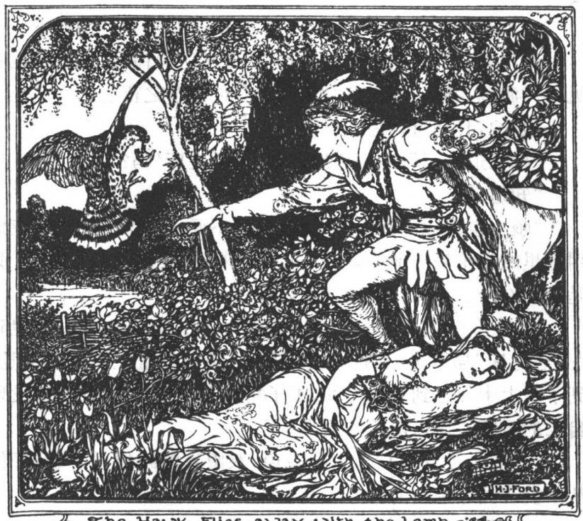

这时候，公主醒过来，看到王子不在，也去找他。后来，她也迷失了方向。就在她到处徘徊，不知道该往哪里走的时候，强盗们发现了她，又把她抓起来，捆绑在王子把她救出来的山洞里。这样一来，他们经历了千辛万苦，到头来一无所获。

王子在森林穿来穿去，想找到回阿拉伯的路。有一天，他看到十二个小伙子兴高采烈地走过来，他们唱着笑着。王子问：“你们到哪里去？”他们说，他们在找活干。

“我可以和你们一起走吗？”王子说。

“人越多越开心。”他们回答说。

王子跟着他们一起走。不久，他们遇见一个老侏儒。

“先生们！你们要到哪里去？”老人问。

“我们在找活干。”他们回答。

“那么，到我这里来吧！”他说，“在我这里，你们有吃又有喝，而且没有多少活。一年以后，如果你们能回答我三个问题，我就每人送你们一袋金子；如果回答不出来，你们就得变成野兽。”

小伙子们想，这听起来很容易，于是就跟着老人一起来到他的城堡。

“你们会看到，这里你们想要什么就有什么。”他说，“你们要干的，就是看好我的房子。我要出远门，一年以后才能回来。”

老侏儒走了以后，只剩下这些年轻人，他们过得快活极了。他们什么活也不用干，只是喝酒唱歌，寻欢作乐。桌子上每天都有吃不完的佳肴，喝不完的美酒。吃饱喝足以后，看不见的手会把碗碟拿去洗干净。只有王子因为思念公主，感到悲伤，吃得也少，喝得也不多。他天天都卖力地干活，把房子弄得干干净净。

有一天，他坐在自己的房间里，听到窗口外面老侏儒在和另一个侏儒说话。

“明天，”他说，“一年的时间就到了。”

“你要问他们什么问题呢？”另一个侏儒问。

“首先，我要问他们来这里多久了？他们不知道！这些年轻的傻瓜。然后，我要问他们，城堡的屋顶上什么在闪光？”

“哪是什么呢？”

“那是公主在花园里睡觉的时候，我从她那里偷来的灯。”

“第三个问题是什么？”

“我要问他们，他们每天吃的和喝的东西是从哪里来的？那是我从国王的桌子上偷来的，可是他们不知道。”

第二天，侏儒走进来。

“现在，我要向你们提出问题了。”他说，“首先，你们到这里来多久了？”

那些年轻人都忙着吃喝玩乐，早就把他们之间的协议忘得一干二净，所以，一下子都答不上来。

“一个星期。”后来一个人说。

“两个月。”另一个猜道。可是王子回答说：“一年！”

“对了！”侏儒说。可是，第二个问题就要难得多了。

“屋顶上闪光的是什么？”

年轻人你猜完我猜，我猜完你猜，“太阳！”“月亮！”……可是没有一个猜对。

“我可以回答吗？”王子问。

“当然可以！”侏儒说。

王子说：“那是一盏灯，是公主在花园里睡觉的时候，你从她那里偷来的。”

侏儒又点点头，说他说对了。可第三个问题就更难了。

“你们在这里吃喝的东西是从哪里来的？”

那些年轻人一个也猜不出。

“我来说，可以吗？”王子问。

“当然可以，只要你能说出来。”侏儒回答。

“是从国王的桌子上来的！”王子说。

所有的问题都解决了。现在，他们可以每人拿一袋黄金回去。他们走得那么匆忙，把王子一个人抛在后面。

在路上，这些年轻人遇见一个老人。老人向他们开口要钱。

“不！我们没有钱！”他们异口同声地说。说完，他们很快就走了。这时候，王子走过来。

“尊敬的先生！你能给我这个穷人一点钱吗？”老人问。

“可以。”王子说着，把整袋黄金都给他。

“我不要。”老人说。原来他就是那个侏儒装的。他接着又说：“既然你那么慷慨，公主的这盏灯就还给你吧！公主现在就在你救过她的山洞里。至于没有了魔剑，你怎么去救她？我就不知道了。”

王子知道公主在那里以后，就开始打算如何去救她。他把自己打扮成小贩，回到他的母亲和强盗居住的、他自己的城市。他来到金匠店，吩咐给他打许多炊具，全是纯金的。这种活，金匠可不是天天有。不过，一切很快就完成。锅子、罐子、烤架，都是纯金制成的。王子把它们收进篮子，就来请求晋见王后。

王后一听说这些奇妙的金锅、金罐，立刻就出来见他。她揭开篮子，情不自禁地欣赏起来。王子趁她全神贯注的时候，偷偷地走进她的房间，拿走挂在里面的剑和盔甲衬衫，然后走出来。王后一点也没有注意到。

“这些东西都非常漂亮！”她说，“你要多少钱？”

“你自己开个价吧！尊敬的王后！”

“我真不知道值多少钱。”王后说，“等我的丈夫回来，男人比我们懂得多。而且，你是陌生人，他会想和你聊聊。”王子点头称是，一言不发地在旁边等着。

没有多久，强盗就回来了。

“去看看那些漂亮的金锅子！”王后对他说。

强盗一走进房间，王子就用魔剑碰了他一下，他立刻就倒在地下。

“现在，你知道我是谁了吧！母亲！”王子取下伪装，说道，“你最好为自己对我犯下的罪忏悔，否则你就活不长了。”

“啊！发发慈悲吧！”她喊道，“我没有办法，我是那么害怕！”

王子很仁慈，他命令把强盗的好衣服剥下来，把他赶到森林里去！在那里野兽很快就把他撕成了碎片。至于王后，他把她送回自己的国家。接着，他来到锁着公主的山洞，凭着魔剑的力量，他毫不费力就把她救了出来。

他们很快就来到港口，乘船回到阿拉伯。在那里，他们举行了婚礼，幸福地统治着两个国家，直到很久很久以后才去世。

 

## 聪明的织布工

从前，在一个很遥远的国家，有一个国王正坐在宝座上倾听着老百姓的申诉，明断是非。这一天上午，案子比平时少，国王正准备起身到花园里去，忽然听到外面有骚动的声音。这时候，宫廷大臣走进来，问尊敬的陛下是不是愿意接见邻国皇帝的使者。这个强大的邻国就在他们的东边，它的强大使周围的国家都非常害怕。国王惶恐不安地站起来，命令马上让他进来，同时准备好欢迎他的宴会。然后，他在自己的宝座上坐下，心里琢磨着，使者会来干什么？

使者一言不发，他走到国王的宝座前面，然后弯下腰来，用手中的一根棍子绕着国王在地板上画了一个圆圈，然后在旁边的座位上坐下，不再理睬任何人。

国王和大臣们对他这种古怪的行为又迷惑又气愤。可是使者坐在那里像个石雕似的，一动不动。大家很快就明白了，他不会再做任何解释。大臣们立刻召开紧急会议，可是谁也不能揭开这个谜。这使国王真是火上加油，他生气地说，除非谁能在太阳下山以前解开这个谜，否则就把他们全部吊死！

大臣们都知道，国王说话可不是闹着玩的。他们赶紧把城市分成几个区，然后挨门逐户去访问，看看谁能解释使者这一奇怪的举动。多数人听了以后只是目瞪口呆，什么也说不上！幸好有一个大臣比较机灵。他走进一间空屋子的时候，看到一个摆子在自己摆动。他心里想，这家主人也许值得看一看。他打开一扇门，走进另一个房间，又看见一个摆子像第一个一样地缓缓摆动。从窗口往外看，有一片玉米地，虽然没有风，可是一根柳树枝却自己在不停地摆动着，以便把那些麻雀赶走。

他越来越觉得奇怪，就沿着楼梯走下去，看到下面是个灯光明亮的工场，一个织布工正坐在织布机前织布。不过，他只是摆弄那些线，他设计的织布机在自动地转动着。等他看到角落里一个大轮子，猜出它是干什么用的以后，他深深地叹了一口气。不管怎么说，即使织布工也猜不出这个谜，他至少可以启发一下大臣的思路。所以，他也不多客气，就把圆圈的故事对织布工说了，还补充说，谁能解开这个谜，就会得到重赏。“马上跟我走！”他说，“太阳已经西沉，得抓紧时间。”

织布工站在那里想了一下，然后走到一个窗口前，窗外有个鸡笼，旁边有两根鸡爪骨。他把鸡爪骨捡起来，把母鸡从鸡窝里抱出来，夹在腋下。

“我准备好了！”他对大臣说。

在王宫里，国王还是坐在他的宝座上，使者还是坐在原来的位置上不动。

织布工跟着大臣走进来以后，示意大臣站住，他自己走到使者的面前，把鸡爪骨放在他旁边的地板上。使者从他的口袋里抓出一把玉米来，撒了一地，算是回答。织布工看到了，就把母鸡放下来，一会儿就把玉米吃光了。使者看到，一言不发，站起来就走了。使者刚一走出大厅，国王把织布工招呼过来，对他说：“看来只有你解开了这个谜，我要重重地赏你！不过，请你先告诉我，那意味着什么？”

“啊！国王陛下！”织布工说，“是这样的，使者绕着你画的圆圈，传达了皇帝的信息：‘如果我派一支军队来包围你的首都，你准备投降吗？’我放在他面前的鸡爪骨等于告诉他：‘和我们比起来，你们只不过是小孩子，只配玩这些玩意儿！’他撒在地下的玉米表示，他的主人会派出大批的军队。可是母鸡把玉米全吃光，这就等于对他说，我们的人可以消灭他们。”

“我想，”他又补充说，“皇帝不会向我们宣战。”

“你救了我，也维护了我的尊严。”国王说，“荣誉和金钱将堆积在你的头上。说吧！即使是要半个王国，我也会给你！”

“我要城门外的一小块地，作为我女儿的嫁妆。这就是我的全部要求。”织布工回答说，他也就只接受这些。

后来，他走的时候对国王说：“不过，国王！我请求你记住，织布工对国家来说，也是有价值的，有时候，他们甚至比大臣还要聪明！”

 

## 终于知道害怕的男孩

从前有个妇女，她只有一个儿子，她非常爱他。他们家的小屋子坐落在森林的边缘，那地方很荒凉，周围一个邻居都没有，所以母子俩就相依为命了。

一个冬天的夜晚，风暴忽然袭来。狂风一下子就把门吹开。女人大吃一惊，颤抖起来，她回头张望，好像有什么可怕的事情就要发生似的。

“去把门关上！”她赶紧对儿子说，“我害怕！”

“害怕！”男孩重复说，“害怕是什么样子？”

“嗯……就是害怕，”母亲回答说，“就是怕出什么事，自己要小心！”

“这种感觉一定很奇怪，”男孩说，“我要走遍整个世界，寻找害怕，直到找到它！”

第二天一早，母亲还没有起床，他就离开了森林。

走了几个钟头以后，他看到一座山，就爬上去。接近山顶的时候，在一块荒凉的岩石旁，有一伙凶狠的强盗正围着一堆火坐着，男孩这时又冷又累，看到火很高兴，就走上前去说：“先生们，你们好！”然后就挤进去，直到双脚差不多碰到燃烧着的木头。

强盗们放下手中的杯子，恶狠狠地看着他。后来强盗头子开口说：“武装的车队不敢到这里来，连鸟看到我们也害怕，你是什么人，胆子这么大，敢到我们这里来？”

“啊！我离开了家，到外面来寻找害怕！也许你们能让我看一看，什么是害怕！”

“我们到哪里，害怕就跟到哪里！”头子说。

“可是在哪里啊？”男孩朝四面看看，说，“我怎么看不到啊！”

“拿着这个锅子，带上一些面粉、奶油和糖，到那边的墓地里去，给我们烤个饼来当晚饭。”强盗说。男孩这时候觉得暖和了，很高兴地站起来，拿起锅子就跑下山。

到了墓地里，他捡来一些树枝生起火来。然后，他从附近的一条小河里打来一些水，把面粉、奶油和糖和好，开始坐下来烤饼。没有多久，饼就又脆又黄。男孩把它从锅里取出，放在一块石头上，准备把火熄灭。这时候，有一只手从墓里伸出来，一个声音在说着：“这个饼是给我的吧？”

“你想，我会把活人吃的东西给死人吗？”男孩笑着回答说，还用匙子敲了一下那只手。然后拿起饼，吹着口哨快活地上山去了。

他把饼交给强盗头子的时候，强盗头子问：“喂！你找到害怕了吗？”

“没有啊！它在哪里啊？”男孩回答，“我什么也没有看见，只见一只手从墓地里伸出来，想拿我的饼。我用匙子敲了他一下，说这不是给他的，那只手就不见了。啊！这火烧得多旺！”说着，他就盘着腿在火前坐下，没有注意到强盗们吃惊地你看看我，我看看你。

“还有一个机会，”后来有一个强盗终于说，“山的那边有一个很深的水池，你到那里去，路上可能会碰到害怕。”

“我希望能碰到，真的！”男孩回答，立刻就起身。

他很快就看到那池池水在月光的照耀下泛着微光。等他走近的时候，只见一个很高的秋千正挂在水面上，上面还坐着个孩子，他拼命地哭着。

“在这里荡秋千可真是太奇怪了！”男孩心里想着，“这孩子干吗哭啊？”他急忙向那孩子走过去的时候，一个少女向他跑过来。

“我想把我的小弟弟从秋千上抱下来，”她说，“可是它那么高，我够不着。你要是能站到池边去，让我站到你的肩膀上去，我想就能碰到他了。”

“很乐意！”男孩回答。转眼之间，少女已经爬到他的肩上，可是，她没有把小孩抱下来，这是轻而易举就可以办到的事，而是用双脚紧紧地夹住男孩的头颈。很快，他就感到自己不是马上被闷死，就是要掉到水池里去了。于是，他用足全身的力气，用力把少女往后一抛。她摔倒在地上，一只手镯从她手上落下，男孩把它捡起来。

“我还是把它保留下来，作为离开家以后遇到这些怪事的见证。”他对自己说。然后，他转过头来看那小孩。奇怪的是，小孩和秋千都不见了。这时，东方已经露出第一道曙光。年轻人把手镯套在自己的手上，走过山脚下的一片平原，来到一个小镇里。他走进一条大街时，一个妖魔把他拦住。

“你这手镯是从哪里来的？”妖魔说，“这是我的手镯！”

“不！这是我的！”年轻人说。

“胡说！把它给我！否则你就要倒霉！”妖魔喊道。

“我们到法官那里去，把事情告诉他。”年轻人说，“他如果相信你，就给你；如果相信我，就给我！”

妖魔同意了。他们来到法官的大厅里，法官仔细地听了他们的诉说，然后宣读判决：他们两人都不能证明手镯是属于自己的，所以手镯要留在法官这里。谁能把另一个手镯拿来，就证明这副手镯是他的。

听完法官的判决以后，年轻人和妖魔你看看我，我看看你，好像都在说：“到哪里去找另一个手镯？”不过，他们知道争辩也是没有用的，于是都鞠躬退出。

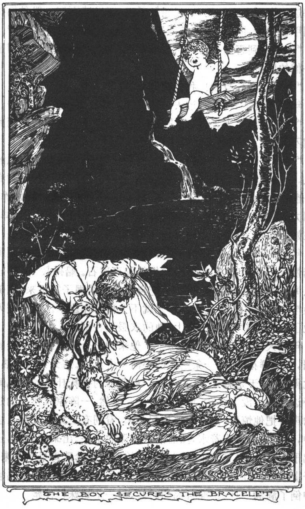

年轻人到处徘徊，不知该到哪里去。后来，他发现自己来到了海边。海面上不远处，一只船触了礁，正迅速下沉。船员们都跑到甲板上来，面无人色，像是死人似的。他们摇着手喊叫着。

“你们看到害怕了吗？”年轻人喊道。在波涛声中，他听到了水手们的回答。

“啊！救命！救命！我们快淹死了！”

年轻人脱下衣服，游过去。船上伸出许多手，把他拉上去。

“船不停地摇来晃去！很快就要沉没，”水手们喊叫着，“死离我们不远了！我们都害怕极了！”

“给我一根绳子。”年轻人说。他拿起绳子，一头结在自己的腰上，一头结在船桅上，然后跳入海中。他不停地往下潜，直到海底。他站在海底，看看周围。不错，他看见一个美人鱼一脸奸诈，正用力地拉着一条铁链。她用一块吸铁把铁链吸在船上，这样，船在她的拉动下，正一点一点地往下沉。

年轻人用双手抓住她的手臂，迫使她松开铁链。于是海面上的船恢复了平衡，水手们慢慢地把船驶离礁石。船得救了。年轻人从海底的海草中捡起一把刀，把自己身上的绳子割下来，把美人鱼牢牢地捆在石头上，这样，她就不会再恶作剧了。他和美人鱼说了一声再见，就游回岸上，他的衣服还在那里。

年轻人很快穿好衣服就走了。他来到一个绿树成荫的美丽花园，里面鲜花盛开，一条清澈的小河从中流过。这天天气很热，他觉得累了，于是就走进门去，在一群盛开的香味扑鼻的红色鲜花旁边坐下。没有多久，他就睡着了。忽然，一阵凉风和拍动翅膀的声音把他惊醒。他小心地抬起头来，看到有三只鸽子跳入小河中，它们快活地泼着水，然后潜入很深的水底。出来的时候，三只鸽子不见了，只见三个美丽的少女抬着一张珍珠母桌子上来。桌子上放着粉红色和绿色贝壳做成的杯子。一个少女从水晶酒杯中倒了满满一杯，正准备喝的时候，另一个姐妹拦住她。

“你为谁的健康干杯！”她问。

“为那个烤饼的青年。当我从地下伸出手来拿饼的时候，他用匙子敲了我一下！”那个少女说，“他不像别人那样害怕！可是你为谁干杯呢？”

“为在池塘边我站到他肩上去的那个青年，他把我狠狠地摔下来，我失去知觉，在地下躺了好几个钟头。”第二个少女说，然后，她转向第三个少女，问道，“可是你呢？我的妹妹，你为谁而干杯？”

“在大海底下，我抓住一条船，摇它，拖它，眼看它就要沉入大海，”她说这些话的时候，看上去和在海底下手拿链条恶作剧时，完全不一样，“可这时来了一个青年，把船给救了，把我绑在一块石头上。我为他的健康干杯！”

她们三个举起杯子，什么也不说，一饮而尽。

她们把杯子放下以后，年轻人走到她们的面前。

“我就是你们为他的健康干杯的青年。我来了。现在，把和你们之中谁掉了的，那个宝石手镯相配对的另一个给我。有个妖魔想把它从我这里拿走，我不肯给他，他拖我一起到法官那里去。法官把手镯扣下，要我把另一个也拿去给他看。我东奔西走，到处寻找，才来到这个奇怪的地方。”

“那么，跟我们来吧！”少女们说。她们领他沿着一条走廊走进一个大厅。大厅里有许多房间，一间比一间更漂亮，更豪华。从一个堆满金子和珠宝的架子上，最大的少女取下一个手镯，不论从那个方面来看，都和法官扣下的一模一样。她把手镯套在他的手上。“快点去吧！把它给法官看。”她说，“这样他就会把另一个还给你了。”

“我永远也不会忘记你们。”年轻人说，“也许要很久我们才能再见面，因为没有找到害怕，我永远也不会安宁。”说完，他就到法官那里去，拿回了另一个手镯。然后，又去继续寻找害怕。

他不停地走着，可是从来没有碰到过害怕。有一天，他走进一个大城市，只见大街小巷和广场上都站满了人，他几乎无法走过去。

“这么多人都出来干什么？”他问站在自己旁边的人。

“这个国家的统治者死了，”那人回答说，“因为他没有孩子，所以必须挑选一个继承者。每天早上，都要从那边的塔里把圣鸽放出来，它站在谁的身上，谁就是我们的国王。再过几分钟，鸽子就要放出来了，等着瞧！会发生什么事情！”

一双双眼睛都瞪着坐落在首都广场中央的宝塔顶上。当太阳正好在塔尖上的时候，上面的一扇门打开，从里面飞出一只闪着红、灰、绿、蓝四种光芒的美丽鸽子来。只见它在空中飞翔，飞着，飞着，最后落在年轻人的头上。四面八方响起巨大的欢呼声：

“国王！国王！”

就在他听着一片欢呼声的时候，一种情景闪电般地掠过他的脑海：他仿佛看到自己坐在宝座上，一生都在殚精竭虑地想让穷人变富，让悲伤的人快活，让坏人变成好人……可是，他想做的事情一件也做不到，连自己爱着的姑娘也不能和她结婚。

“不！不！”他用双手掩住自己的脸，拼命地喊叫起来。可是，那些听到他喊叫的人，都以为他是对等待着他的荣华感到吃惊，所以一点也不在意。

“好吧！为了更有把握，再放几个鸽子。”他们说。可是，放出的鸽子都跟着第一只，落在他的头上。这回欢呼声更加响亮！

“国王！国王！”听到这一片喊声，一阵寒颤流遍他的全身，他不明白这是什么意思。

“这就是你找了那么久的害怕！”一个声音轻轻地在他的耳边响起，好像是专门对他一个人说的。那幅情景又出现在他的面前，他低下自己的头，接受了命运的安排，准备在担惊受怕中度过自己的一生。

 

## 耐心等待就有希望

从前有一个国王，他只有一个女儿。这公主从生下来就被所有的人宠坏了。她长得非常美丽，而且聪明能干。到了该出嫁的年龄，她拒绝父亲喜欢的每一个王子，说是要自己挑选丈夫。国王根据多年以来的经验，知道她一旦打定了主意，就别指望她会改变。所以，他温和地问她，能帮她做些什么？

“从今天起，一个月以后，把王国里所有的年轻人都叫到我的面前来，”公主回答说，“我把这个金苹果给谁，谁就是我的丈夫。”

“可是，我亲爱的……”国王沮丧地说。

“我把金苹果给谁，谁就是我的丈夫。”公主用更加响亮的声音重复说。国王明白了她的意思，叹了一口气，准备照她的话去做。

年轻人都来了。高的，矮的；难看的，漂亮的；富的，穷的。他们都在王宫前的广场里排成行。公主穿着绿色的长袍，金黄色的面纱在身后飘逸。她手中拿着金苹果，从他们的面前走过。有一两次，她停下来犹豫了一下，但又走过去了。后来，她走到最后一排，没几个就是最后一个的青年面前停下。旁边的人都想，这人没有什么特色，毫无姑娘们喜欢之处。比他英俊的青年有成百个，而且个个的衣服都穿得比他漂亮。可是，他以坦诚的眼睛微笑着看着公主，公主也微笑着，拿出苹果。

“一定是弄错了！”站在一边紧张地看着公主一举一动的国王喊叫起来。他希望这些候选人一个也不中她的意。“她不可能愿意嫁给一个穷寡妇的儿子，他在这个世界上身无分文！告诉她！我决不会答应！她必须从头开始，挑选别人。”公主又从头开始，第二次，第三次，可是每一次都把苹果交给寡妇的儿子。

“好吧！如果你愿意就嫁给他！”愤怒的国王宣布，“可是，起码你不能留下来。”公主什么也没有说，抬着头，拉着寡妇儿子的手离开城堡。

这天晚上，他们结婚了。婚礼结束以后，他们一起回到新郎母亲的家。在公主看来，这房子不会比鸡窝大。

老妇人看到儿子领着新娘进来，没有一点高兴的样子。

“好像我们以前还不够穷似的。”她满腹牢骚地说，“我敢说，这是那种什么也不会做，连自己也养不活的漂亮小姐。”

可是公主抚摸着她的手，温柔地说：“用不着烦恼，亲爱的母亲，我是个有名的纺织女，可以整天坐在纺车前，不会弄断一根线。”

她果然说到做到。可是，尽管他们三个人拼命地干活，还是越来越穷。六个月以后，他们商定，丈夫应该到邻近的城市去找工作。他在那里遇见一个商人，商人带着一队骆驼，装着各种各样的货物，正准备出远门去，需要找个人帮忙。寡妇的儿子请求把他带上，让他当仆人。商人同意了，还预先给他一年的工资。年轻人带着这个消息回家，第二天就和母亲和妻子告别。她们都很伤心。

“在外面别把我忘了！”公主拥抱着自己的丈夫说，“经过城门口那口井时，停下来问候一下坐在那里的老人，吻一下他的手，问他对你的行程有什么指教。”

年轻人出发了。来到井边的时候，他照妻子的吩咐，问候老人，并向他请教。

“我的孩子，”老人回答，“你来看我，做得很对。作为报答，我请你记住三句话：‘你心中所爱的，永远是最美的。’‘耐心是通向幸福的第一步。’‘耐心等待就有希望。’”

年轻人对他表示感谢以后，继续赶路。第二天一早，车队又出发了。到了晚上太阳下山之前，他们来到了第一个营地，有一些商人的队伍已经驻扎下来。这里虽然有一些井，可在这个丘陵国家里，已经很久没有下雨了，水非常缺乏，人和牲口都干渴难熬。不错，离这里半英里远是还有一口井，而且里面的水源丰富。可是那口井很深，而且人人皆知，进去的人没有一个是能上来的。

但是，除非他们能在羊皮袋里装满水，否则谁也不敢贸然走进沙漠。年轻人和他的主人到达的这天晚上，那些商人们已经决定，谁要是敢到这口魔井里去汲些水上来，就给他一大笔钱。

于是，第二天太阳升起来的时候，年轻人就被吵醒。有人宣布，谁要是敢冒着生命危险，为大家和骆驼把水送来，每个商人都给他一千个比塞塔（货币单位）。

年轻人听到这个消息，考虑了一会。关于这口井的故事传得很远，他很久以前就听说了。他心里明白，非常危险。可是他又想到，如果他能活着回来，就有了八万比塞塔！他走出来对从帐篷旁边经过的喊话人说：“我去！”

“你疯了！”主人喊叫起来，他恰巧也站在旁边，“你太年轻了，不能就这样断送自己的生命！快点跑过去跟他说，你改变主意了。”可是，年轻人摇摇头，商人明白了，他已经下定决心，再劝也没有用了。

“好吧！那是你自己的事情！”商人最后说，“你一定要去，那就去吧！不过，要是你能回来，我就再给你一只骆驼的货物，还有一头最好的骡子。”说完，他拍拍他的头巾，表示告别以后，就走进帐篷。

商人刚走进去，就有一大群人走出自己的帐篷围过来。

“我们该怎样来感谢你呢！”他们围着年轻人说，“我们，还有我们的骆驼都要渴死了！看！让你下去的绳子我们都准备好了。”

“那么走吧！”年轻人说。他们都一起出发。

到了井边，大家用绳子在他的手臂上牢牢地打了结，然后给他一个大羊皮罐，慢慢地把他放下井。这里，一股清泉在汩汩地从岩石上流过。就在他弯下腰来，准备喝个痛快的时候，一个身材魁梧的阿拉伯人出现在他的面前，大声地对他说：“跟我来！”

年轻人站起来，他心里明白，自己生命的最后时刻到了。可是他有什么办法呢？他跟着阿拉伯人走进一个灯光明亮的大厅，它就在小河的另一头。阿拉伯人坐下来，把两个男孩拉到自己的身边，对年轻人说：“我有个问题要问你，如果你答对了，就饶你一命；如果答错了，那你就像以前的很多人一样，脑袋落地。告诉我，我这两个孩子，我认为哪个更好看？”

这个问题并不难。一个男孩子漂亮绝伦，另一个却丑陋无比。可是，就在年轻人准备回答的时候，老人的指教忽然闪过他的心里，他赶紧回答：“你心中所爱的，永远是最美的！”

“你救了我！”阿拉伯人喊叫着，很快地站起来，紧紧地把年轻人抱在怀里，“啊！你真不知道，那些人回答我的问题时，是多么愚蠢！我真是受够了！一个坏精灵罚我留在这里，直到这个问题得到解答！可是，什么风把你送到这里来了！我该如何报答你为我所做的事情？”

“那你就帮我送上去足够八十个商人和他们的骆驼喝的水，他们已经渴得要死了。”年轻人说。

“这很容易。”阿拉伯人说，“拿着这三个苹果。你把皮罐灌满以后，把一个苹果留在井底；把第二个留在半路上；到了地面上以后，再把第三个扔掉。只要你照我的话去做，就不会出现什么意外。你再把这三个绿、红、白色的石榴带上，有一天你会用得着它们的！”

年轻人照着他的话去做，带着一皮罐水一步一步地走回营地。商人们都在焦急地等待着！他们渴得多厉害！可是，即使是那些骆驼都喝够了以后，皮罐里的水还是满满的。满怀获救以后的感激之情，商人们一个个都把钱塞到年轻人的手里。他的主人叫他自己挑选货物，还有一头骡来运载它们。

这样一来，寡妇的儿子终于变得富有了。商人把所有的货物都卖完以后，回到自己的家乡。年轻人也雇一个人把钱和骡给妻子送去。

“我还要把那三个石榴送回去，”他心里想着，“把它们放在我的头巾里，早晚有一天会掉的。”他把石榴从头巾里取出来。可是石榴不见了，只见三颗绿、白、红色的宝石。年轻人留在商人那里干了很久，慢慢地取得了商人的信任，商人把所有的生意都托付给他，把挣来的钱也分很多给他。商人死了以后，年轻人想回到自己的家里去，可是女主人请求他留下来帮忙。后来有一天，他才忽然想起离家已经有二十年了。

“我要回家去看看妻子，”第二天早晨他对女主人说，“如果什么时候你需要我的话，就送个讯来。我已经关照好哈桑该做些什么了。”说完，他骑上骆驼就走了。

再说公主那里，丈夫跟着商人走后不久，一个小男孩就出世了。为了给孩子吃的和穿的，她和老妇人起早摸黑，辛辛苦苦地干活。等年轻人把钱和石榴送回来以后，她们就用不着再干活了。公主一眼就看到，那不是什么石榴，而是价值连城的宝石。老妇人不像她的媳妇那样，见惯了钻石珠宝，还以为它们真的是水果呢！就在她递给孙子吃的时候，公主赶紧把它们抢过来，藏在自己的衣服里，老太婆为此还非常生气。公主来到市场，买了三个最好的石榴，让老太婆给孙子吃，这事才算了结。

公主给三个人都买了漂亮的衣服，都打扮得很好看。接着，她把丈夫给她的那块红宝石放进一个小的银盒子里，用一块绣金的手帕把盒子包起来。然后，她把老太婆的口袋用金币和银币塞满。

“到王宫里去！亲爱的母亲，”她说，“去把这块宝石交给国王。如果他问你需要什么报酬，你就说，需要国王写一张条子，盖上章，说明任何人都不能干预你想做的事情。离开王宫之前，把这些钱分给仆人们。”

老太婆拿起盒子就到王宫里去。谁也没有见过这么漂亮的红宝石。城里所有的珠宝商都叫来给它估个价，可他们都只能这么说：“如果小孩子把块石头拼命地向空中扔去，然后你把黄金堆得像它那么高，这些黄金的价格也抵上这块红宝石。”

听到这些话，国王的脸不禁阴沉下来。看到这块红宝石以后，他实在不忍心和它分开，可是国库里所有的钱也没有办法把它买下来。他沉默了好一会，盘算着如何才能打发这个老太婆。后来他终于开口说：“如果我不能照价付给你钱，你有没有什么交换条件？”

“给我一张纸，宣布我不论做什么，都不得阻拦，然后亲笔签名，并盖上你的图章。”

她很快就这样回答。国王非常高兴花这么小的代价就得到了，立刻就把这张纸给她。老太婆拿着纸也马上回家。

这块珍奇红宝石的名气立刻传遍天下。许多使者都到这间小房子来，打听是否有更多的宝石出卖。每个国王都想得到这些宝石，都吩咐使者无论如何都要出更高的价钱把它们买下。所以公主把另外两块宝石卖掉以后，所得的黄金可以从家门口一直接到月亮上。她做的第一件事情是，在小屋子旁边建造一座宫殿，它的柱子是用黄金铸成的，上面还镶嵌着大钻石，日夜大放光芒。当然，这座新宫殿的消息首先传到了她的父亲——国王的耳朵里。国王从战场上回来，就急忙去看一看。宫殿的门口站着个二十岁的青年，那就是国王的外孙，当然，他们俩都不知道。国王很看中他的相貌，就把他带回王宫，叫他当整个军队的总指挥。

过了不久，寡妇的儿子回到自己的家乡。不错，前面就是他和母亲一起生活小屋，可旁边那座豪华的建筑他却一无所知。他的妻子和母亲怎么样了？谁会住在那么豪华的房子里？这是他脑子里首先想到的问题。他不想暴露自己，所以也不想去问碰见的陌生人。他爬上宫殿对面的一棵大树，观察着。

不久，一个女士走出来，采摘长在走廊里的玫瑰和茉莉花。他知道这就是他的妻子，自从上次分手以后，二十年已经过去了，她看上去还是那样年轻，那样美丽。他正想从树上跳下来，向她奔跑过去。这时候，一个青年走出来，深情地拥抱着他的妻子。看到这里，丈夫怒火万丈，他拔出箭来，正想射出去。这时，智慧老人的教导在他的耳边响起：“耐心是通往幸福的第一步。”于是，他把手中的弓箭放下。

这时候，公主捧起那青年的头，在他的两颊吻了一下。树上人的无名之火又燃烧起来，他又拿下挂在树枝上的弓。然而，老人仿佛又在对他说：“耐心等待就有希望。”他又把手中的弓放下。青年的声音又在寂静中响起：“母亲！父亲的事你怎么一点也没有对我说！他是不是还活着，但永远也不会回到我们的身边？”

“哎！我的孩子！我该怎么回答你呢？”公主说，“他离开我们去寻找幸福，已经有二十年了。这当中我只有一次听到他的消息。不过，你怎么现在想起他了？”

“因为昨天晚上我梦见他回来了。”青年说，“然后我才想起早就忘了的事情，我有父亲，尽管他对我来说，非常陌生。现在，请你告诉我，你所知道的，关于他的一切。”于是，儿子站在茉莉花下，听着他母亲讲父亲的故事。父亲也在树上听着。

“啊！”听完以后，青年伤心地绞着双手，感慨地说，“我是军队的总指挥，你是国王的女儿，我们有世界上最华丽的宫殿，可是我们还不知道父亲住在什么地方！而且可能像我们想象的那样，过着穷苦和悲惨的生活。明天，我要请求国王给我一些士兵，就是走遍天涯海角，我也要把他找到！”

这时候，父亲从树上下来，把他的妻子和儿子抱在怀里。这天晚上，他们整整说了一夜的话，直到天亮了，话还没有说完。不过，天亮了以后，他就来到王宫，向国王表示他的敬意，同时把自己和全家的身份告诉国王。国王知道他早已原谅并且苦苦思念的女儿就在家门口，而且还是他那么喜欢的青年的母亲，真是欣喜若狂。“这是前世注定的，”国王说，“你生下来就是我的女婿，将来要继承我的王位！”

他深深地鞠了一躬。

他耐心地等待了，他终于有了希望！

 

## 铁手杖

从前，在一片森林的边缘住着一个老妇人。她有一间小房子，房子后面是菜园，里面种着各种各样的蔬菜。此外，她还有一块地，有两三头母牛在地里吃草。邻居们都觉得她很有钱，很妒忌她。

在她身强力壮、能整天在地里干活的时候，老妇人从来就没有感觉过寂寞。可是，她后来得了一场大病，身体就大不如前了。这时候，她才想到，如果有个人陪她，常常说说话，那就好了。就在这时，她听说一个牧羊人和他的妻子死了，留下一个孩子孤零零地在这个世界上。

“这孩子对我正合适。”她想。于是，她请人去把孩子带来，想把他当儿子收养。男孩子约莫有十二岁，他本该觉得很幸运，因为新妈妈对他那么好，就像是亲生母亲一样。但不幸的是，他交的都是坏朋友，他们的恶劣行径使每一个人都感到害怕。可怜的妇人一直在为自己失去清静而后悔莫及。

这种情形持续了好些年，直到这个孩子成年。

“也许结婚以后，他会变得好些。”她心里想着。她向邻居打听，有没有年龄合适的姑娘。后来，她找到了一个，既勤勉，又善良，人也长得漂亮。由于年轻人也不反对，婚礼很快就举行。新郎和新娘就在这间屋子里和老妇人住在一起。可是，丈夫的行为一点也没有改变。他整天都出去和以前的朋友玩。回家的时候，妻子如果敢说他什么，他就用他的手杖打她。第二年，他们的孩子出世了以后，也免不了要挨他的打。

后来，老妇人终于失去了耐心。她看出来了，别想指望这个游手好闲的家伙改邪归正。有一天，她对他说：“你想就这样一直下去吗？记住，你已经不是个小孩子了，要像个人样。是时候了，改掉你的坏习惯，为你的妻子和孩子工作，至少不应该再打他们了。不然的话，我就要把你变成一头驴，你就得天天驮很重的东西，还要给人骑。你还得以吃野蔷薇为生。人们还会用刺棒来刺你，那时你就知道挨打的滋味了。”

如果说，她希望自己的话能够起一点作用，那么，她很快就知道自己错了。因为年轻人只是变得更加怒气冲冲，他粗暴地喊道：“喂！闭上你的嘴，否则我连你一起打！”

“是吗！”她严肃地说，然后闪电般地从角落里拿起一根铁手杖，把它在年轻人的肩膀上点了一下。立刻，他的耳朵变长了，脸也拉长了，手臂变成了两条腿，全身长出灰色的毛来。真的！他变成了一头驴子，而且是一头丑驴！

“从这间房子里滚出去！”老妇人喊道。它摇摇晃晃地走出去了！

它在路旁站着，不知道该做什么的时候，有个人走过来。

“啊！我的好家伙！你对我正合适，我就是在找你。看来你还没有主人，跟我来吧！让我来找点活给你干。”说着，他拉着它的耳朵就走。

一连七年，他过着一头驴的艰苦生活，就像老妇人说过的那样。可是，他不是记住他给自己带来的苦难，为自己的过错而忏悔，而是变得更加冷漠，更加残酷。七年以后，驴皮褪掉了，他又变成了人。有一天，他回到自己的家。

听到有人敲门，妻子出来给他开门。看到外面的人，她手中的门闩掉在地下，跑进去喊道：“奶奶！奶奶！你的儿子回来了！”

“我想他会的，”老妇人回答，继续纺她的纱，“没有他，我们也过得很好。不过，他既然来了，就让他进来吧！”

他走进来了。可是正如老妇人猜想的那样，他变得比以前更坏。好几个星期，她不管他，让他爱干什么就干什么。后来她说：“看来你没有从自己的经历中学到什么！归根到底，很少有人能注意吸取经验教训。不过你要小心，免得我把你变成一只狼，成为人和狗追逐的猎物！”

“你唠叨什么！当心我敲碎你的脑袋！”这就是她得到的回答。

年轻人要是看一看她的脸色，就应该引起警惕了。可惜他在忙着装烟斗，毫不在意。刹那间，铁手杖就碰到他的肩膀，一只大灰狼向门外奔去！

啊！狗叫得多么凶！村里人追赶狼的声音也此起彼伏！

一连七年，它过着被猎人和狗追逐的生活，经常受到寒冷和饥饿的威胁，从来不敢好好地睡上一觉。七年以后，他又褪掉狼皮变成一个人，回到自己的家门口。可是，这七年对他的教训并没有比前七年多，他变得越来越坏。有一天，他残酷地打自己的妻子和儿子，他们大声地向老妇人呼救。

老妇人来了，手中还拿着铁手杖。立刻，这个恶棍不见了，只见一只黑乌鸦在房间里飞着，“呱！呱！”地叫。

窗打开了，它从窗口飞出去。它找到那些毁了他的坏朋友，想办法让他们明白发生了什么事情。

“我们给你报仇！”他们说。然后拿着绳子找上门来，要把老妇人勒死。

可是老妇人早就有了准备。她手中的铁手杖一碰，就把他们全部变成黑乌鸦，直到今天，他们还是一群乌鸦。

 

## 仙女甘加娜的惩罚

从前有一个国王和王后，他们统治的国家那么小，只要花一天的工夫，就可以轻而易举绕他们的国家走一圈。他们为人简朴善良，也许并不是很聪明，不过很注意对每一个人都很友好。可是，这往往是个错误。因为国王允许他的臣民随便地谈论和指点国家大事，好像是处理私人事情那样。这样一来，国家的法律很难得到实施，而且，谁也不愿意听他们的。

所有经过这个国家的人都禁不住要问，这个国家怎么会这么小？下面我们来说说其原因。皮托多（这就是国王的名字）一出生的时候，父母亲就让儿子和他们的朋友、甘加娜仙女的侄女订婚，如果她有侄女的话，因为那时，她的侄女还没有出生。可是，一年又一年过去了，甘加娜的侄女还没有出生，年轻的王子也逐渐地把他的订婚新娘全忘了。到二十五岁的时候，他秘密地和一个富裕农民的漂亮女儿结婚，他早就热烈地爱上她了。仙女一听到这个消息，就气得发疯。她立刻就来找老国王。老国王心里想，他的儿子已经等那么久了，也该够了！可是他不敢这么对她说，害怕可怕的咒语会降临到他们全家的头上。那时候，他们就会变成鸟啊！蛇啊！或者甚至更糟糕，变成几块石头。这样，国王只好非常违心地剥夺了王子的继承权，而且不许他到王宫里来。要不是岳父给他的女儿一笔可观的财富，说不准他已经变成乞丐。凭着这笔财产，皮托多得到允许建立一个小国家。

要是换上别的王子，肯定肺都气炸了。特别是不久以后，老国王就去世了，王后兴高采烈地接替了他的王位。可是，皮托多是个容易满足的青年人。他满足于照父亲的方式安排好自己的小国。他有一个宫廷管家，有几个随从和仆人。年轻的王后也有自己的伴女和侍女。他还指派专人制造货币，叫一个管家指挥五个警察，以维护首都的秩序，处罚那些扔石头打破王宫玻璃窗的小孩。

首先到王宫里来就职的是国王的岳父，他的名字叫卡博奇，是个非常能干的人。大家都非常爱他，所以很快，他就当上了高贵的总管。不过，他也是个普通农民，因此每天还得像以前一样到地里去干活。这样没有多久以后，国王不论事情大小，都要和他一起商量。每天早上，卡博奇和他的女婿一起吃早餐。然后国王就从铁柜中拿出一大捆公文来，想和总管一起讨论。有时候，他们要花上两个钟头来决定那些重大的事情。不过，通常情况下，过不了几分钟，卡博奇就会说：“请原谅，陛下，这种事情你一点也不懂，就交给我来办吧！我来处理它！”

“那我干什么呢？”国王问。

“哦！你可以管管自己的老婆，看看花园里的果树。你会看到，这两件事就够你忙的了！”他的部属这样说。

“好吧！也许你是对的。”国王回答，心里暗自高兴可以摆脱这些国事。

不过，尽管卡博奇包揽了一切事务，皮托多从不忘记在重大的场合出现。这时候，他总是穿着红色的大衣，手中拿着一根镀金的木节杖。此外，他每天上午都看书，从中学习种植果树的合适季节，以及它们该在什么时候剪枝。到了下午，他就来到花园里，把学到的知识付诸实施。晚上，他和岳父一起玩牌，和王后一起在大厅里共进晚餐。到了十点钟，王宫里所有的人都早已进入梦乡。

至于王后，她也和国王一样非常幸福。她喜欢到牛奶场去，王国里没有任何人能做出比她做得更好的乳酪。不过，不论她是多么忙，她决不会忘记做一个小的大麦饼，还有一小块乳酪，然后把它们放到花园里一棵特别的玫瑰树下。如果你问她，这些东西是给谁做的，送到哪里去？她可能会对你说，在她结婚的那天晚上，有个仙女托梦给她，叫她这样做。国王和王后生了六个小孩以后，第七个小男孩又出世了。他一生下来，头上就戴着顶小红帽，所以说，他和哥哥姐姐大不一样。父母爱这个名叫卡迪乔恩的孩子，胜过爱其他六个。年复一年，孩子们都长大了。有一天，王后吉乐笛烘好她的饼，把它放在一个盘子里。一只可爱的蓝色小老鼠沿着桌子的脚爬上来，向盘子跑过去。在这种情况下，大多数妇女都会把小老鼠赶走。可是王后假装没有注意到。小老鼠咬住饼，向烟囱里跑去，这才叫王后非常吃惊。她赶紧跑过来想阻止它。这时，小老鼠和饼都不见了。只见一个不到一英尺高的老妇人站在它们消失的地方，身上穿着破破烂烂的衣服。她拿起一根尖头的铁手杖，在地上画了一些奇怪的符号，同时喊叫七声，接着又低声地说着些什么。王后只是听清楚了什么“忠诚”、“智慧”、“幸福”。然后，她拿起厨房的扫帚，在自己的头上挥了三圈就消失了。

隔壁房间立刻传来巨大的响声。王后把门打开，看到里面有三只很大的金龟子。每只金龟子都用脚抓起一个公主。王子们则是坐在三只燕子的背上。房间当中有一辆用粉红色的贝壳做成的马车，前面有两只红胸脯的知更鸟在拉着，上面坐着那只蓝老鼠，它披着一件华丽的黑色天鹅绒斗篷。卡迪乔恩就坐在它的身边。王后还没有从她的惊讶中苏醒过来，金龟子、知更鸟、老鼠和孩子们就唱着歌，一起从窗口飞出去，很快就消失了。

王后的大声喊叫惊动了她的丈夫和父亲，他们赶紧跑过来。从王后断断续续的话中终于知道出了什么事以后，他们急忙拿起身边一些结实的棍子分头去追赶。

他们追出去以后，王后整整一个钟头坐在房间里哭泣着。后来落在她身边的一张纸引起她的注意。她赶紧弯下腰捡起来，希望上面有关于孩子们的消息。上面没有多少文字，可是读了以后，吉乐笛得到了安慰，因为上面写着，请她放心，孩子们在仙女的保护下很好，很幸福。

“你的忠诚和勤俭给你带来了幸福。”纸条上这样写着，“这些年来，是我一直在享用着你放在玫瑰树下的食品。总有一天我会报答你的。‘只有耐心等待的人，才会得到幸福。’谚语是这么说的。田园仙女”

王后站起来，洗过脸，梳好她那金色的头发。等她离开镜子的时候，她看到一只红雀站在她床上。谁看到了都会以为，这只不过是只普通的红雀，要是在昨天，王后也会这么想。可是今天上午，发生了那么多奇怪的事，她毫不怀疑，写这张纸条的人就在她的面前。

“美丽的小红雀，”她说，“我会尽力照你的吩咐去做。我只希望，你能经常给我带来小卡迪乔恩的消息。”

小红雀拍动翅膀，唱着歌飞走了。王后知道自己猜对了，不由得从心底里感谢她。

不久，国王和总管回来了，他们的追赶毫无结果，反而弄得自己又饿又累。看到刚才还哭哭啼啼的王后这时十分快乐，他们非常惊奇，而且有点生气。难道说，她对自己的孩子们一点也不关心，或者说，很快就把他们忘了吗？是什么原因让她发生这么大的变化？他们提出这个问题的时候，她只是说：“只有耐心等待的人，才会得到幸福。”

“那倒是真的！”她的父亲说，“而且，尊敬的陛下你要记住，凭你这个王国的税收，也很难满足七个王子和公主的需要。所以，有人帮你挑起了这副担子，你应该感到高兴。”

“你是对的！你总是对的！”国王说，他的脸上又露出了笑容。

王宫里又恢复了正常生活，直到有一天皮托多得到一个消息，使他感到非常不安。

老王后，也就是他的母亲，本来一直守寡，忽然决定再结婚。她的意中人是绿岛国上的国王，他的年龄比皮托多还小！他长得很帅，喜欢寻欢作乐，这两点都是皮托多所没有的。这个老祖母虽然在很多方面很愚蠢，可是她也想到，像她这么一个又老又平常的女人，要想得到青年男子的爱，就必须用什么魔法把自己的青春和美丽找回来。当然，这只要甘加娜仙女挥动一下她的魔棍就可以了。可惜她们俩早已经不是朋友了。仙女曾经想办法劝王后，宣布她的侄女是王位的继承人，遭到了王后的拒绝。这样一来，就别想指望靠仙女的帮助再嫁一个丈夫，如果她再结婚，丈夫就是当然的王位继承人了。

为此，王后派出许多使者到临近的国家去，想找个仙女或巫婆，帮助她把愿望变成现实。可是，怎么也找不到有这么大本事的人。后来，王后明白了，要想嫁给绿岛国的国王，非得靠甘加娜仙女的怜悯不可。

仙女得知了王后的想法，心中的愤怒更是火上加油。不过，她心中有数，一旦绿岛国的国王把钱花光，他就很有可能和一个像她的王后朋友这样的老太婆结婚，以便得到更多的钱。因此，为了争取时间，她按住自己的怒气，对王后说，三天以后，魔法就可以准备好了。

王后听了仙女的话那么兴奋，一下子就年轻了二十岁。她焦急地等待着，不是一个小时一个小时地计算，而是一分钟一分钟地计算着。

这个时刻终于到来了。仙女穿着一件红白相间的长袍站在她的面前，一个矮小的棕色侏儒捧着她的长袍，手臂下面还夹着一个小盒子。王后以她所能想到的最隆重的礼节来迎接她。在仙女的要求下，王后命令把大厅的所有门窗都关上，命令随从们都退出去，好让她和客人单独留下。然后，仙女把侏儒单膝跪下递上来的盒子打开，从里面拿出一本有银扣子的牛皮纸书本，还有一根一碰就长的棍子，一个装着清澈绿水的瓶子。她吩咐王后在房间的中间坐下，侏儒站在她的对面。她弯下腰来，用金棒围着他们画了三个圆圈，用棒各自点了他们三下，再把水泼在他们身上。王后肥胖的身躯慢慢变细，脸也逐渐年轻。与此同时，侏儒变得越来越大，到后来差不多有原来的两倍那么高。这种景象，加上那三个圆圈不断地喷射着蓝色的火焰，把王后吓坏了，她在自己的座位上昏了过去。等她醒过来的时候，仙女和侏儒都已经不见了。

开始，她感到很迷惑，一点也想不起来发生过什么事情。后来，记忆慢慢恢复，她立刻跳起来，跑到最近的镜子前。啊！她是多么快乐！长鼻子和龅牙变得那么漂亮，头发又厚又卷，而且是金黄色的！仙女真的兑现了她的承诺。

可是，在她一阵子的激动和兴奋之下，王后一点也没有发觉，自己不是变成一个美丽的青年女子，而是变成了身材高大的八九岁的小姑娘。她身上穿的，已经不是那件绣着金边的、华丽的天鹅绒服装，而是一件简简单单的棉布罩袍。还有一件花边围裙。连她原来总是梳得很好、盘起来用钻石别针固定好的头发，现在也只是随便地披在她的肩上。可是，她还不知道，除此之外，她身上还发生了许多变化。比如说，除了她对绿岛国国王的爱以外，她整个思想就像她的脸一样，和小孩没有什么两样。这一点，如果说她自己一无所知的话，王宫里的人可是看得一清二楚。当然，他们搞不清楚，发生了什么事情，也不知道该怎么办才好，直到首相吩咐他的妻子和女儿也穿上像王后一样的衣服，学王后讲话的腔调，才为他们树立了榜样。

于是，在一段时间里，整个王宫里所有的人，包括男人，都学小孩的样子穿衣服，说话，玩洋娃娃、小锡兵。宴会上，除了做成小鸟和马形状的冰水果、甜饼以外，什么都没有了。但是，不论在干什么，王后总忘不了说起绿岛国的国王，她老叫他“我的小丈夫”。几个星期过去以后，她的“小丈夫”还是没有来，她变得不耐烦起来，常常发脾气，宫里的人都尽可能地躲开她。这时候，他们对装小孩也感到厌倦了，私下议论着离开这里，到别的国家去做事。

有一天，一阵响亮的喇叭声宣告了盼望已久的客人来到。大家的脸上立刻又露出笑容。王后也不管王宫严格的礼仪，坚持要走下台阶去迎接年轻的国王。不巧的是，在匆忙之中，她摔了一跤，从台阶上滚下来。王后害怕得像个小孩子似的尖叫起来。其实，她没有受什么伤，只是划破了鼻子，擦伤了前额。不过，她还是被人抬到房间里去用冷水洗了洗脸。尽管如此，她仍然严格命令，国王一来到王宫，就把他领到自己这里来。

门外一阵刺耳的声音，使王后本来就很不舒服的头一阵激烈的刺痛。只是这时候，她正沉浸在欢迎未来丈夫的欢乐之中，也就不去管它了。年轻的国王在两排大臣们的夹道欢迎之下，低头致意很快地走过来。可是他一看到王后和她头上的绷带，就控制不住自己，大笑起来，他不得不退出去，继而离开王宫。

王后一从国王的无礼引起的烦恼中恢复过来，就吩咐她的随从去把他叫回来。可是，不论是恳求，还是什么许诺，都不能打动他的心，叫他回心转意。这当然只会使王后的脾气变得更坏。大家都开始酝酿一个计划，准备把她从王位上赶下来。要不是仙女甘加娜出面，这个计划肯定会成功。本来嘛！她只是想阻挠王后的婚事，于是，她就恢复了王后的本来面目。不过，王后并没有因为这个而感谢她的朋友，从镜子中看到她的老面孔，王后感到非常绝望。从这一天起，她更加仇恨甘加娜。

在这些日子里，皮托多的孩子们在哪里呢？他们都在巴比尼岛上。那里有许多仙女照顾他们，和他们一起玩。可是，王后这七个王子和公主中，只有卡迪乔恩品格好，肯听话。其他六个孩子都那么粗野，那么喜欢争吵，后来没有一个人愿意和他们一起玩。最后，仙女为了惩罚他们，把他们都变成活动木偶，要等他们都变好以后，才让他们恢复原形。就在一个不幸的时刻，田园仙女决定去拜访她的朋友——仙女王后，想向她打听卡迪乔恩这个孩子的命运。仙女王后住在远方的一个小岛上。

她走进仙女王后的晋见厅时，甘加娜正好出来。两人唇枪舌剑斗了几句。对手气冲冲地飞走以后，田园仙女把甘加娜的恶作剧一股脑儿都对仙女王后说了，并请求王后的指教。“把心放宽一些。”仙女王后说，“有一段时间，她肯定要按照自己的意志行事。这时候，她正把卡迪乔恩抓到她关着自己侄女的岛上去。但是，如果她敢用自己的魔法来干一件坏事，对她的惩罚将迅速而严厉。现在，我把这个宝贵的瓶子给你，要小心地看好它，里面的药水可以让你隐身，叫仙女锐利的眼光也看不见。不过，对于凡人的眼睛，它不起作用。”

怀着轻松了一些的心情，田园仙女回到自己的岛上。为了更好地保护六个新的活动木偶，免受坏仙女的伤害，她给他们洒上了几滴瓶子里的药水。洒的时候，她小心地避开他们的鼻子，好让自己能认出他们来。然后，她动身到皮托多的王国去，发现那里有人正准备造反。因为皮托多自从登上王位以来，第一次准备征税。如果不是仙女及时找到了人人都满意的办法，也许就会爆发战争，国王的头也许还会被砍掉。仙女还悄悄地告诉王后，她的孩子们都很好，可是不敢告诉她，卡迪乔恩失踪了。

卡迪乔恩现在怎么样了？田园仙女终于找到他了，她是在自己的书中找到答案的。书中说，这可怜的孩子被甘加娜关在一个施了魔法的小岛上。小岛四周是一条湍急的河流，河水可以卷走树木和高山。除了这条河以外，还有二十四条巨龙保护着小岛，它们喷出的火焰形成一堵强大的火墙，连鸟也飞不过去。

田园仙女知道这一切。可是她有一颗勇敢的心，决定要想尽一切办法，克服一切困难，把卡迪乔恩从甘加娜的魔爪中解救出来。她拿起隐身药水，向自己泼了一些，然后骑上她喜爱的长翅膀蜥蜴，向小岛飞去。看到小岛以后，她裹上防火斗篷，吩咐蜥蜴自己回去。避开那些龙以后，她来到了岛上。

她刚到岛上，就看到甘加娜正向她走过来。一边走，一边生气地大声责骂在她身边飞着的精灵。从她的话中，田园仙女才知道，原来是老王后——皮托多的母亲听说绿岛国的国王娶了个年轻可爱的新娘以后，气死了。临死前，她嘱咐把王位交给儿子皮托多的一个孩子，而不是交给甘加娜。

“可是，这个傻瓜老女人给我带来的麻烦不能就这么算了！”甘加娜喊叫着，“立刻到马厩里去，挑几只最强壮最快的狮头怪兽，套在那辆黄色的马车上，尽快地赶到巴比尼岛上去，把还留在那里的，皮托多的另外六个孩子也抓来。等把他们都关好以后，我要自己去见皮托多和吉乐笛，把他们俩变成兔子，把他们的孩子变成狗。至于卡迪乔恩，我还没有拿定主意该怎样来处置他。”

田园仙女不想再听下去了，如果想把皮托多一家从可怕的灾难中救出来的话，就得赶紧去找仙女王后帮忙。她也来不及召唤她的蜥蜴，就自己躲过巨龙，飞出岛屿。她的脚刚在陆地上站稳，就见天空中乌云滚滚，雷声大作，脚下的大地激烈地抖动起来。闪电划破了天空，在电光的照耀下，她看到二十四条巨龙在互相厮杀，发出惊天动地的喊叫声，连整个地球都可以听到它们的怒吼。田园仙女浑身颤栗着站在那里。天亮了以后，岛屿、急流和龙都不见了，只留下一块光秃秃的岩石。岩石顶上站着一只鸵鸟，鸵鸟的背上坐着卡迪乔恩和甘加娜的小侄女，就是为了她，甘加娜才干了那么多坏事。正当田园仙女吃惊地看着这种奇怪的景象时，鸵鸟展开翅膀，向幸福岛飞去。好心的田园仙女隐身跟踪，一起来到仙女王后的大厅里。

变成鸵鸟的甘加娜趾高气扬，兴高采烈地站在那里，因为按照仙国的法律，谁成功地把卡迪乔恩送到王后的脚下，并且从王后这里得到他，谁就可以主宰他的生命，怎么处置他都可以。这一点，田园仙女也知道得非常清楚。于是，尽管这个可怕的晚上发生的事情已经把她弄得精疲力尽，她还是竭尽全力把两个孩子从鸵鸟的背上抢过来，送到仙女王后的怀中。

绝望而愤怒的鸵鸟尖叫了一声，不见了。甘加娜恢复原形垂头丧气地站在那里，等待着她自己招来的惩罚。

“你忘记了我的全部告诫，”王后严厉地说，仙女们从来没有见她这么严厉过，“我对你的惩罚是，二百年里，你将失去作为仙女的资格，变成一只鸵鸟，去做你把他当成朋友的，最下贱、最邪恶的精灵的奴隶。至于这些孩子，他们将留在我的王宫里，我亲自来教导他们。”

于是，事情就这样解决了。两个孩子在仙女王宫里长大，一直到可以结婚的年龄，田园仙女才把他们送回老王后的王国。这时候，皮托多正在那里统治着。可是，他和吉乐笛过了那么多年的悠闲日子以后，管理一个国家对他们来说，实在不堪负担。所以，他们非常高兴地把王冠交给卡迪乔恩和他的新娘，她虽然是恶毒的甘加娜的侄女，但却是长得又漂亮又善良。卡迪乔恩在仙女王宫里受到那么好的教育，这个王国在他的统治下，从来没有这么兴旺，老百姓也没有这么幸福过。他们在街道和田野里行走的时候，想想过去，看看现在，脸上充满了笑容，都会心地说：

“只有耐心等待的人，才会得到一切！”

 

## 沉默的公主

从前，在土耳其有个帕夏（大官），他只有一个儿子。他那么爱他，从来不像他的朋友那样，教儿子去学习有用的本领，而是让他整天尽情地玩。

这孩子有一样很喜欢的玩具，一个金球，他可以从早上玩到晚上，从不去麻烦任何人。有一天，他坐在花园的凉亭里玩。他把球扔到墙上，再把它接住。这时候，他看到一个老妇人拿着个土罐，到花园角落的一口井里汲水。他拿起金球，对准她的土罐扔过去，土罐被打得粉碎，掉到地下。老妇人大吃一惊，可是不说什么，转身回去再拿一个。她一走开，小孩子就立刻把他的球捡回来，刚跑回凉亭，就看到老妇人第二次扛着土罐到井边来了。她正想抓住土罐的柄放下来，只听见“砰！”的一声，土罐又被打得粉碎！老妇人当然非常气愤，可是因为害怕帕夏，不敢吱声，只好拿出自己最后的几分钱再去买个新的。可是这个新土罐也难逃厄运，也被金球击成碎片。老妇人再也忍耐不住了，她对着躲在凉亭里的孩子挥舞着拳头，喊道：“我希望你受到惩罚，爱上沉默的公主！”说完她就走了。

有一段时间，小孩子没有把这句话放在心里，他连想都不去想它。可是，随着一年一年的过去，他开始想得越来越多，老妇人的话不断地在他的耳边响起。

“谁是沉默的公主？爱上她为什么是一种惩罚？”他不断地问自己，却找不到答案。

可是，这并不能阻止他一次又一次地问自己。到后来，他被这个问题折磨得精疲力竭，病倒了，什么也吃不下，最后只能躺在床上。他的父亲帕夏被这种怪病吓坏了，把王国里所有的医生都请来给他看，可是谁也找不到良药。

“你是什么时候得这种病的？我的孩子！”有一天，他问儿子，“要是我们知道了，也许会有更好的办法来把你治好。”

于是，年轻人把许多年以前，当他还是个小孩的时候发生的事，还有老妇人说的话，对父亲说了。

“求求你同意，”他把事情讲完以后又说，“求求你，让我出去寻找这个公主，也许这样能治好我的病。”尽管和他唯一的儿子分开，会使他感到非常难过，可是帕夏知道，再把他留在家里，他一定活不了了。

“去吧！你会平安无事的！”他说，然后出去把最信任的仆人叫来，命令他跟随年轻的主人一起去。

他们很快就做好了准备，一天清晨，他们出发了。可是不论是老仆人还是年轻人，该往哪里走？该做些什么？他们一点概念都没有。开始，他们在茂密的大森林里徘徊；后来又走进一片荒原之中，在里面游荡了六个月，看不到一个活人和动物，几乎找不到一点吃的和喝的，人也瘦得皮包骨头，衣服也像破布一样挂在他们的身上。这时候，他们都把什么公主忘得一干二净，只想着能活着回到家里去。

有一天，他们发现自己正站在一座山的山脊上，脚下的石头像钻石一样闪闪发光。当前面有一个小老人走过来时，他们都高兴得心都快跳出来了。看到老人，他们仿佛又回到现实中来，那种恍恍惚惚的感觉也神话般地消失了。他们用高兴的语调和新来的人打招呼：“朋友，我们这是在哪里啊？”

老人告诉他们，他们是在苏丹女儿居住的山上，她头上盖着七块面纱，这些闪光的石头只是反射着她的光彩。

听到这个消息，过去所经历的危险和困苦一下子就从他们的心中消失。

“如何能最快地找到她？”年轻人迫不及待地问。

可是老人回答说：“要有耐心，我的孩子，要有耐心。要到达公主和女士们住的王宫，还得走六个月的时间。即使是到了那里，你还得考虑好，要是不能让她开口说话，你就得和其他人一样掉脑袋。要小心！”

可是，年轻人对他的劝告只是笑笑。

走了三个月以后，他们发现来到另一座山头。年轻人惊讶地看到，山的四周都是美丽的红颜色。不远处的峭壁上，坐落着一个小村庄。年轻人提议到那里去休息一下。村子里的人都很高兴地欢迎他们，给他们送来吃的，铺好床让他们睡觉。两个过路人对能够让他们疲惫不堪的双脚消除疲劳，也十分感激。

第二天早晨，他们问主人，还要走多久才能到公主那里？这座山的颜色为什么比别的山都红？

主人对他们说：“你们还得走三个半月的时间，到时候，你们会看到，已经到了公主的门口。至于这座山的颜色，那是公主红润的脸和嘴唇透过七层面纱反射出来的。可是谁也没有见过她的脸，她坐在那里一言不发，据说很多人因为她的缘故，把命也丢了。”

年轻人不准备再听下去了，他感谢主人的好意，和仆人一起站起来，开始爬到山上去。他们在山上不停地走着，天黑了，就在大树底下或山洞里睡觉；饿了，就吃浆果或者从河里抓上来的鱼。后来，他们的衣服都被撕破了，腿也累得再也不能跨出一步。这时候，他们看到对面的山上有一座黄色大理石宫殿。

“看！那里就是了，终于到了！”年轻人喊道，血管里的血仿佛又沸腾起来。可是，当他和伙伴向山上爬上去的时候，又恐惧万分地停下来，地上铺满了死人的白骨！年轻人首先镇静下来，尽可能若无其事地对他的伙伴说：“这肯定是那些想叫公主说话，但没有成功的那些人的骨头。嗯！要是我们也失败了，我们的骨头也得留在这里。”

“啊！回去吧！我的公子！趁现在还来得及！”仆人恳求他说，“你父亲叫我照顾你，可是出来的时候，我没有想到死亡在等待着我们。”

“鼓起勇气来！拉勒！”年轻人回答，“人只会死一次，再说，公主总有开口说话的那一天！你说是吗！”

于是，他们继续踏着累累的白骨向前走。后来，他们又来到一个村庄，他们决定好好休息一下，以便养精蓄锐，迎接前面的挑战。可是这一次，尽管人们也是善良友好，但他们的脸上都笼罩着一层阴影，不时有悲痛的声音传入他们的耳朵：“啊！我的兄弟，难道你永远离开我了吗！”“啊！我的孩子！难道我再也看不到你了吗！”

当年轻人和他的仆人问起这是什么意思的时候，答案当然是明摆着的：“唉！你们到这里来也是送死！这是公主的父亲，苏丹居住的城市，哪个冒失鬼要想去叫公主开口，就要先得到苏丹的同意。得到允许以后，他就会被领到公主的面前。以后发生的事情，看到这些白骨，也许你们心里也明白了。”

年轻人点头表示感谢，他站在那里想了一会儿，然后转过头来对拉勒说：“好了！决定我们命运的时候到了！要尽可能考虑得周到一些，不要鲁莽行事。”

一连两三天，他们在集市上逛来逛去，留心地看着，听人们说些什么。一天上午，他们看到有个人手中提着鸟笼，鸟笼里有一只夜莺。夜莺的歌声唱得那么动听，年轻人不禁停下来欣赏起来，并且决定把它买下。

“唉！买这种没有用的东西不是累赘吗！”拉勒不耐烦地说，“是不是觉得手中和心里麻烦的事情还太少，再给自己增加一些负担？”可是年轻人向来喜欢我行我素，不去理睬他，高价把夜莺买下，把它带回客栈，挂在房间里。

这天晚上，年轻人独自坐在那里，呆呆地想着，用什么方法可以叫公主开口说话，可到头来觉得一个办法也想不出来。夜莺轻轻地把关着笼子的小棍子移开，把笼子的门打开飞出来，站在年轻人的肩膀上，轻声地在他的耳边说：“我的公子，是什么事使你这样烦恼？”

年轻人大吃一惊，在他的家乡，鸟是不会说话的！开始他像许多人一样，对不理解的事情感到有点害怕。不过他马上就对自己的愚蠢感到难为情。于是就把自己如何跋山涉水，花了一年多的时间，千里迢迢来到这里，为的是想得到苏丹公主的爱。现在，他来到了目的地，可是想不出什么办法来叫公主开口说话。

“啊！用不着为这件事伤脑筋，”小鸟说，“这很容易办到。今天晚上就带着我到女人的宫殿里去。等走进公主的私人房间以后，把我放在那巨大的金烛台下面的基架里。公主头上裹着厚厚的七层面纱，什么也看不见，当然，别人也看不见她的脸。然后，你就去向她请安，不过她不会回答你。接着，你就说很抱歉来打扰她，你现在要和金烛台说几句话。你一开口，我就会答应你。”

年轻人用大衣把鸟藏起来，动身到王宫里去，请求晋见苏丹。他很快就得到应允，把藏着鸟的大衣留在门外黑暗的角落里以后，他走到苏丹的宝座前，向他鞠躬。

“你有什么要求？”苏丹仔细地看着这个高大英俊的年轻人，问道。可是明白了他的来意以后，苏丹同情地摇摇头。

“如果你能让她说话，她当然会嫁给你。”苏丹说，“可是如果办不到，你看到外面山上的白骨吗？”

“啊！总有一天，会有人打破这个咒语，苏丹！”年轻人勇敢地回答。“这个人为什么不能是我呢？不管怎么说，我已经发过誓，不能再收回了。”

“好的，你一定要去，那就去吧！”苏丹说。他吩咐随从把年轻人领到公主的房间里去，不过，只许他一个人进去。

这时候，已经是晚上，他来到走廊，趁天黑没人看见，拿起他的大衣和鸟笼。

年轻人走进一个房间，看到里面除了一堆丝绸垫子和一个很大的烛台以外，什么都没有。他看着那些垫子，心里“扑通！扑通！”直跳。他知道，那些闪光的面纱下，就是他日夜思念的公主。他怀着惶恐不安的心情，急忙把小鸟放到烛台下面去，生怕被别人看见。然后，他回过身来，镇静一下自己的声音，就问公主好吗？

公主连手也不动一下，以表示她是否听见了。年轻人当然早有思想准备，于是开始讲他如何长途跋涉，走过许多奇怪的国家来到这里。可是丝毫也没有打破公主的沉默。“我明白了，你对这些事情一点也不感兴趣。”年轻人终于这样说，“我保持沉默已经好几个月了，我感到，非得找个人说话不可。所以，我只好去对烛台说话了。”他从公主的后面穿过房间，来到烛台的面前大声地说道：“啊！美丽的烛台，你怎么样？”“非常好！我的大人！”小鸟回答说，“恐怕已经有好多年没有人和我说话了，现在你既然来了，我请求你听听我讲的故事。”

“非常乐意。”年轻人说着，就盘起脚来在地板上坐下，因为没有垫子给他坐。“从前，”夜莺开始说了，“有一个苏丹，他的公主是王国里最漂亮的姑娘。向她求婚的人多如牛毛，不过，她可不是那么容易就满足的。后来，有三个青年，她觉得还可以考虑考虑。可是，这三个人之中她挑哪一个呢？她拿不定主意，就去找父亲商量。父亲把三个年轻人找来，对他们说，在六个月里面，他们都得学会一门手艺，谁学得最好，公主就嫁给谁。”

“三个求婚人心中也许有些失望，可是也觉得这种考验合情合理，于是就一起走出王宫，商量着该学什么好。这一天天气很热，他们来到一股山泉旁边，停下来喝水和休息。然后有一个说，‘看来我们最好分开来去寻找自己的运气，让我们把各自的戒指放在这块石头下面，然后分道扬镳。谁回来以后，就把自己的戒指拿走，这样一来，我们就知道是否都照苏丹的话去做了，或者是谁出了什么意外。’”

“‘好的。’另外两个人说。他们都把自己的戒指放在一个洞里，小心地搁上石头。然后各走各的路。一连六个月，他们都不知道别人在干些什么。到了约好的那天，他们又在泉水旁会面了。大家都很高兴，兴致勃勃地说起他们都学了些什么，时间是怎么过去的。‘我想，公主应该是属于我的了！’年长的那位笑着说，‘因为不是所有的人都能像我那样，一个小时就能走完一年的路程！’”

“‘当然，那确实很不错。’第二个回答，‘可是，要是治理一个国家，能看到远处在发生什么事情也许会更有用。我就学会了这种本领。’”

“‘不！不！亲爱的伙伴！’第三个说，‘你们的本领是很好，可是苏丹知道了我可以让死人活过来以后，他就会明白谁该是他的女婿了！不过，现在离指定的六个月只有几个小时了，我们得赶紧回到王宫里去！’”

“‘等一会，’第二个人说，‘最好让我看看王宫里现在在干什么？’他从附近的树上摘下一些小树叶，喃喃地说了些什么，手动了几下，然后把叶子放在眼睛上。很快，他脸色发白，喊叫起来。”

“‘怎么啦？怎么啦？’另外两个人喊起来。第二个人用颤抖着的声音说，‘公主躺在床上，没有几分钟可以活了！啊！难道就没有一个人能够救她了吗？’我能！‘第三个人从头巾里拿出一个小盒子来，说，’里面的药膏能治好任何病，可怎么能及时地送到呢？‘把它给我！’第一个人说。他拿到盒子以后，祈祷自己现在就在公主的床边。”

“公主躺在床上，旁边站着苏丹和哭泣着的随从。的确是一分钟也不能耽搁了，公主已经失去知觉，面孔也已经发冷。他用手指沾上一些药膏，擦到公主的眼睛、嘴巴和耳朵上，紧张地等待着结果。”

“事情的进展比他想象的还要快，在他们的眼光下，公主的脸色很快就红润起来，接着，她的双眼张开了，对着父亲微笑。苏丹高兴得说不出话了，他温柔地拥抱着女儿，然后回过头来问救活他女儿的年轻人，‘你是不是六个月以前，我叫三个青年去学手艺中的一个？’”

“青年人回答说，是的，还有两个正在赶来王宫的路上，苏丹现在可以作出选择了。”

说到这里，夜莺停了下来，问年轻人道，他认为三个人中，谁应该得到公主？

“那个学会制作药膏的人。”他回答说。

“可是，如果不是第二个人能够知道远方发生的事情，他们就永远也不知道公主已经病了。”夜莺说，“公主应该是属于他的。”于是，两个人激烈地争辩起来。忽然，一直听着的公主从她的垫子上坐起来说：

“你们真笨！你们难道就不明白，如果不是那个人有本事及时赶到王宫，药膏又有什么用？她早就死了！是他应该得到公主！”

一听到公主说出的第一句话，守在门口的奴隶立刻飞奔到苏丹那里去，报告奇迹出现了！兴高采烈的苏丹立刻赶到现场。可是这时候，公主发觉自己中了别人狡猾地设下的圈套，已经不再说一个字了。苏丹只能从她那里得到暗示，谁要想做她的丈夫，就得让她开口说话三次。她在厚厚的面纱下面暗暗地笑着，心想这是不可能的。

等苏丹对年轻人说，虽然他已经获得了一次成功，但还得有两次的时候，年轻人的脸阴沉下来，这太不公平了！可是他不敢公开表示反对，只是点头鞠躬，然后想办法走到烛台边，趁黑把鸟笼藏到大衣里，离开王宫。

到了外面安全的地方以后，小鸟对他说：“干吗这样闷闷不乐，一切都很顺利！当然，公主对自己开口说话感到很生气。你看到了吗？她说出第一句话的时候，头上的面纱已经开始破裂。明天晚上带我一起去，把我放在格子旁边的柱子上，别担心，相信我就是了！”

第二天晚上，太阳下山以后，他把鸟笼留在外面，把小鸟藏进大衣，来到王宫，直接向公主的房间走去。守门的奴隶看到，立刻就让他进去。他小心地靠窗走，好让小鸟偷偷地跳到柱子上，不让别人看见。

他回过头来，向公主鞠躬，问她几个问题。可是，她像上次一样，一声不响，也不做任何听见的表示。过了几分钟以后，年轻人又鞠了一躬，然后走到窗前说：“啊！柱子，和公主说话毫无用处，她一个字也不肯说。我想找个人说说话，只好来找你了。这么长久的日子，你过得怎么样？”

“谢谢你！”从柱子里传出一个声音回答说，“我觉得非常好。公主不说话，对我来说，真是太幸运了，否则，你就不会来和我说话了。为了报答你，我要和你讲个最近听到的很有趣的故事，完了以后，还想听听你的意见。”

“那太好了！”年轻人说，“请马上就开始吧！”

“从前，”夜莺开始说，“有个十分美丽的女人，男人们见了都会立刻就爱上她。可是，她要求非常高，没有一个男人能让她满意，尽管她和他们都保持着友谊。年复一年，她还是老样子，任何人都不在她的眼里。后来年轻人一个个都等得厌倦了，就去找那些不那么漂亮，但是也不那么骄傲的女人。结果她身边只留下三个求婚的男人，鲍尔德奇、杰格德奇和法尔德奇。可是，她还是不理睬他们，以为自己比别的女人更漂亮更可爱。有一天晚上，她终于看到了现实。这天晚上，她坐在镜子前梳卷发的时候，看到了一根很长的白头发！”

“这一可怕的现实，使她的心里一震，默然地坐在那里。”

“‘我老了，’她对自己说，‘如果不快点找个丈夫，就再也嫁不出去了。我知道，明天这些人之中任何一个都愿意和我结婚，可是我拿不定主意，得想个办法看谁最好。这件事还得抓紧时间办。’”

“于是，这天晚上，她没有睡着，而是整夜地想着各种各样的办法。天亮以后，她就起来穿好衣服。”

“‘这办法一定行！’她一边拔下那根给她带来无限烦恼的白头发，一边自言自语地说着，‘这办法不一定很好，可是我想不出什么更好的。嗯！他们也不是很聪明，肯定会上当。’接着，她把奴隶叫来，让他去告诉杰格德奇，说准备在一个小时里见到他。然后，她来到花园里，在一棵树下挖一个墓坑，在里面摆上寿衣。”

“杰格德奇听到这个好消息非常高兴，赶紧穿上最好的衣服来见他的心上人。令他十分惊讶的是，他看到，她正躺在沙发上，哭得很厉害。”

“‘怎么啦？我可爱的姑娘！’他低着头，站在她的身旁问。”

“‘发生了一件可怕的事。’她说，‘两天之前，我父亲去世了，我把他埋在自己的花园里。可是我现在才知道，他是个巫师，根本没有死去。因为他的坟墓里什么也没有了，他肯定是到什么地方游玩去了！’”

“‘这是个坏消息，真的！’杰格德奇说，‘可是，为了安慰你，我能做什么吗？’”

“‘有一件事你可以做，’她说，‘裹上寿衣，躺到坟墓里去，一动也不要动。如果三个钟头以后他还不回来，他就不再有魔力控制我了，就不得不到别的地方去游荡。’”

“杰格德奇得到信任，感到很骄傲。他裹上寿衣，笔直地躺到坟墓里去。过了不久，轮到鲍尔德奇来了，看到女士在伤心地叹息着。她对他说，她的父亲是个巫师，很有可能会从坟墓里爬出来，给她施加厄运。她要鲍尔德奇到那里去，拿起一块石头，如果他想动一动，就把石头砸到他的头上去。”

“能为自己喜欢的女人做点事，鲍尔德奇无限欢喜，他来到墓前，拿起一块大石头，守在躺着的杰格德奇身边。”

“不久，就到了法尔德奇来看望女士，对她表示敬意的时候了。像前面两位一样，他看到女士陷入无限的悲哀之中。她对他说，有个巫师是她父亲的敌人，他把父亲的尸体从墓中扔出去，自己取而代之。‘不过，’她又说，‘如果你能把他抓到我这里来，他的魔法就会丧失，不然的话，我就完了。’”

“‘啊！女士，为了你，天底下什么事我都敢做！’法尔德奇说。他跑到坟墓旁，捉住杰格德奇的腰，把吃惊不小的杰格德奇扛到肩上，连奔带跑回到房子里。开始，鲍尔德奇对事情的这种忽然变化不知所措，呆呆地坐在那里，因为女士没有和他说过会出现这种事。后来，他跳起来把石头向两个影子扔过去，想杀死他们，幸亏没有击中。等他们三个人都来到女士的面前以后，杰格德奇想他已经把她从巫师的手中解救出来，就从法尔德奇的背上跳下来，把寿衣扔掉。”

“告诉我，公子，”夜莺把故事讲完以后问道，“他们三个人，谁应该得到公主？我认为应该是法尔德奇。”

“不！不！”年轻人知道小鸟的用意，回答说，“应该是鲍尔德奇，他遇到的麻烦最多，得到公主的当然应该是他！”

可是夜莺不同意，他们开始争吵起来，直到第三个声音插进来说：

“你们怎么会这样胡说八道！”公主开口说话的时候，可以听到面纱撕裂的声音，“你们怎么一点也没有想到杰格德奇！他在墓中躺了三个钟头，头上还有一块石头随时会砸下来！女士当然会选择他当自己的丈夫！”

用不了几分钟，消息就传到苏丹的耳朵里。可是即使是这样，苏丹在他的女儿第三次开口说话之前，也不会同意把女儿嫁给年轻人。年轻人和小鸟商量，如何才能达到最后的目的。小鸟说，公主不慎落入圈套，一气之下已经叫人把柱子敲得粉碎，这一回要把它藏在门帘的折缝里。

第三个夜晚，年轻人又来到王宫，他勇敢地进入公主的房间。夜莺从他的腋下飞到门顶上去，那里厚厚的门帘把它遮住，谁也看不见。开始，年轻人也像前两天一样，先和公主说话，可是也得不到回答。于是，他让她继续盖着面纱躺在那里，这时候，面纱已经撕裂了许多。年轻人向门口走去，那里有个声音愉快地回答他的问题。

他们俩谈了一会儿，然后小鸟问，他是不是喜欢听故事，它最近听到一个，很有趣，但也令它疑惑不解。年轻人说，他很乐意听，请它立刻就说。于是小鸟开始讲下面的故事：

“从前，有一个木匠，一个裁缝，一个学生，他们一起出去周游世界。走了几个月以后，他们开始对旅游感到厌倦，决心在一个小城市里住下来，寻找他们的乐趣。他们租下一间小房子，到外面去找工作，晚上就回来抽抽烟，谈论当天发生的事情。”

“有一个夏天的夜晚，天气比以往什么时候都热。木匠一点也睡不着，与其在床上翻来复去睡不着，弄得浑身不舒服，不如坐起来喝喝咖啡，抽抽烟，木匠聪明地想到了这一点。忽然，他的眼睛落在角落里的一些木头上。木匠心灵手巧，立刻用它做成一个约莫十四岁的小姑娘。这活干完以后，他心旷神怡，烦躁的情绪一点也没有了，躺到床上很快就睡着了。”

“可是，木匠不是这天晚上唯一睡不着的人，天上响着雷声，裁缝心里好烦，他爬起来，下了楼，想到花园门口的泉水旁浸浸脚，让它凉快一下。要到门口去，就得穿过木匠刚才坐着抽烟的房间。这时候，他看到靠墙站着个美丽的姑娘。他一言不发地站了一会儿，才大胆地走过去拉她的手，这时才吃惊地看到，她是木头做的。”

“‘啊！我可以让你变得更美丽！’他说着，从架上拿下一卷白天刚从商人那里买来的黄色丝绸，他又剪又裁又缝，到最后，姑娘苗条的身上终于穿上了漂亮的长袍。这时裁缝的心也安静了下来，也就上床睡觉去了。”

“天就要亮了，学生从床上起来，准备到清真寺去沐浴第一道阳光。可是，当他看到一个少女站在那里的时候，不禁心猿意马，双膝跪下，举起手来。”

“‘啊！你比夜色还要妩媚，比成千上万颗星星加在一起还要美丽！’他喃喃地说着，‘一个如此美妙绝伦的躯体不能没有灵魂！’他走上前来，全心全意地为她的生命而祈祷。”

“他的祈祷显灵了！美丽的雕像变成了活生生的姑娘。于是，三个人都爱上了她，希望能做她的丈夫。”

“现在，”夜莺说，“请你告诉我，这位少女应该是属于谁的？在我看来，木匠最有资格拥有她！”

“可是，如果不是裁缝给她做了漂亮的衣服，让她显得那么妩媚，学生是不会给她祈祷灵魂的！”年轻人说，他猜到自己应该说些什么。于是，他们开始激烈地争吵起来。旁边的公主看到他们一点也没有想到学生，十分气愤，她完全忘记了自己的誓言，忽然大声地说：“你们都是傻瓜！除了学生，她还能属于谁？如果不是他，其他人所做的一切都是徒劳！当然应该是他和姑娘结婚！”

她说话的时候，七块面纱从她的头上掉下，她站了起来，果然是天底下都没有见过的，最美丽的公主！

“你赢了。”她笑着说，把她的手向年轻人伸过来。

这样，他们结婚了。举行婚礼以后，他们派人去把许多年以前，水罐被年轻人打破的老妇人找来。她从此以后就住在王宫里，成了他们孩子的保姆，幸福地生活到老。
