<h1>安德鲁·朗格彩色童话全集</h1>

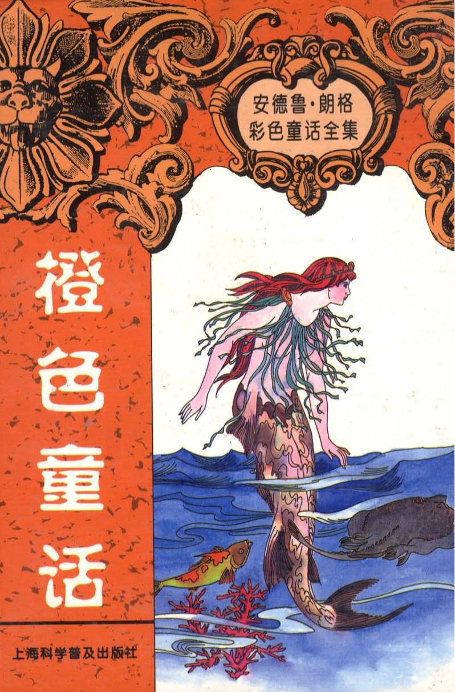

**安德鲁·朗格彩色童话全集**
橙色童话

程盛译

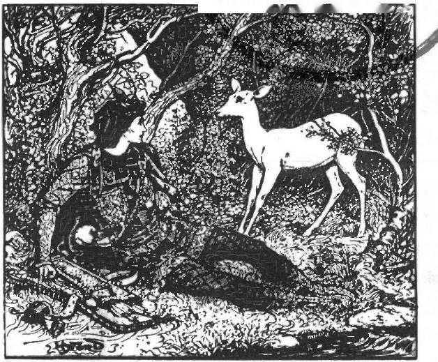

上海科学普及出版社

（沪）新登字第 305 号

Edited by Andrew Lang
The Orange Fairy Book

Published by Longmans, Green, and Co. in 1910

---

安德鲁·朗格彩色童话全集
**橙色童话**

程盛译

---

责任编辑：钟海谷
技术编辑：万福棠
出版：上海科学普及出版社（上海曹杨路 500 号邮政编码 200063）
发行：新华书店上海发行所
印刷：上海新四印刷厂
开本：850×1168 1/32
印张：9.25
插页：4
字数：223000
版次：1997 年 7 月第 1 版 1997 年 7 月第 1 次印刷
印数：1-8000
书号：ISBN 7-5427-1271-3/G·398
定价：14.00 元

---

（本版图书凡印刷、装订错误可及时向承印厂调换）

 

| 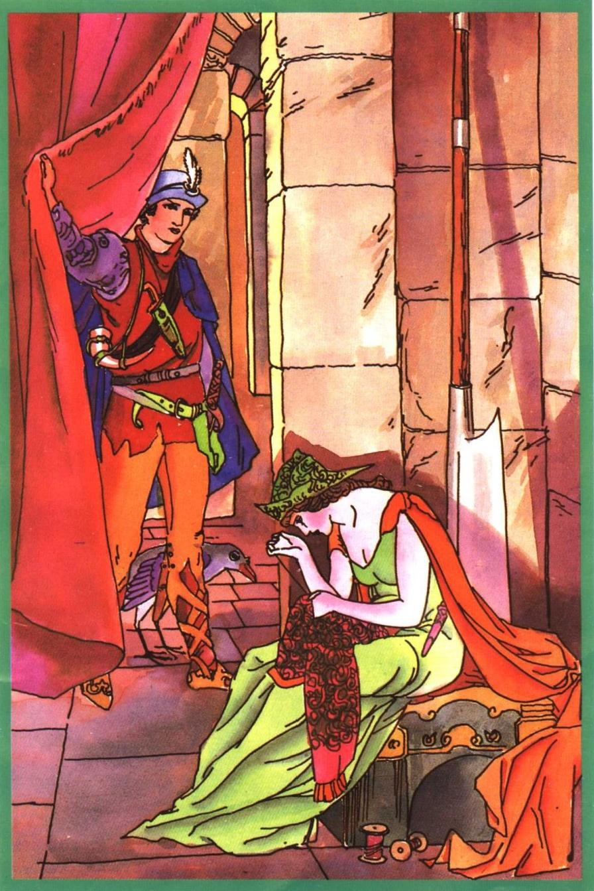 |
| :----------------------------: |
|       《士兵的儿子依万》       |

 

| 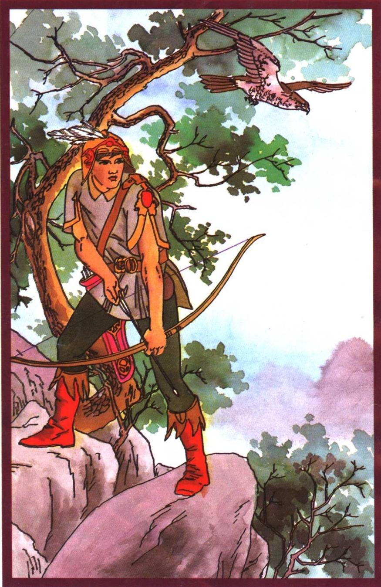 |
| :----------------------------: |
|      《伊恩如何得到蓝隼》      |

 

| 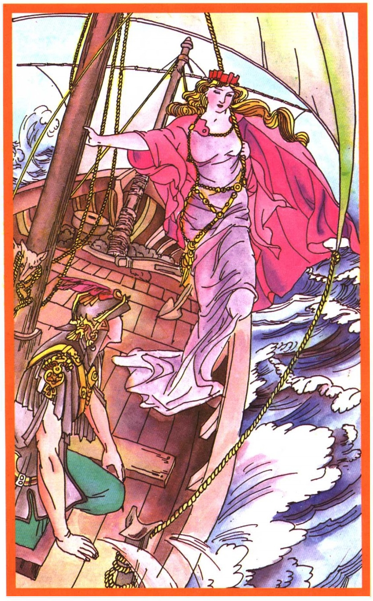 |
| :----------------------------: |
|      《伊恩如何得到蓝隼》      |

 

| 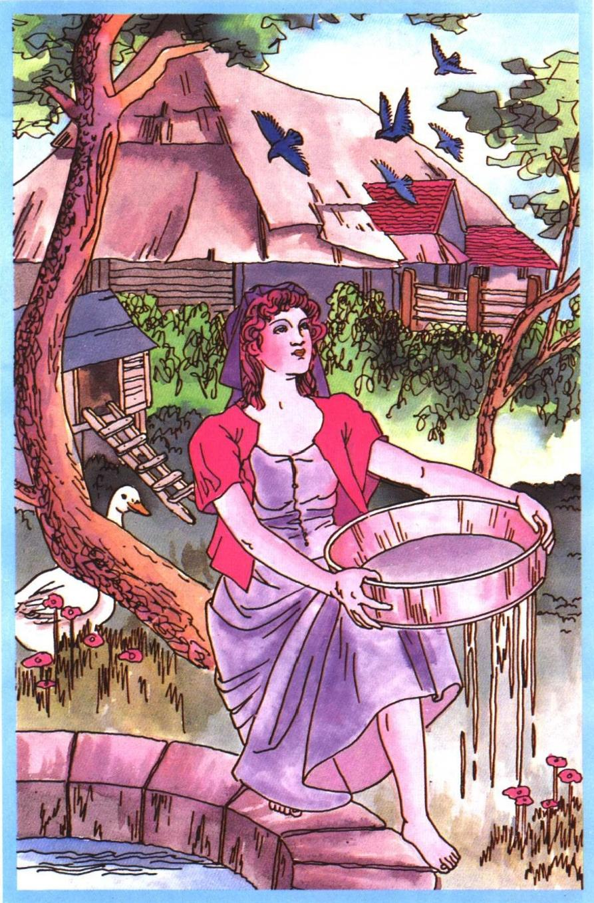 |
| :----------------------------: |
|         《两个首饰盒》         |

 

| 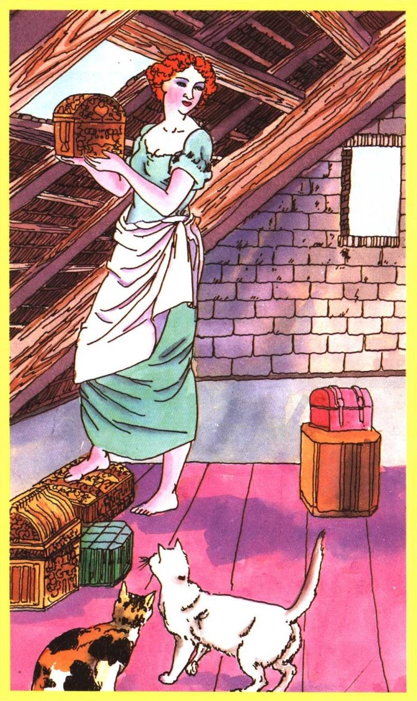 |
| :----------------------------: |
|         《两个首饰盒》         |

 

| 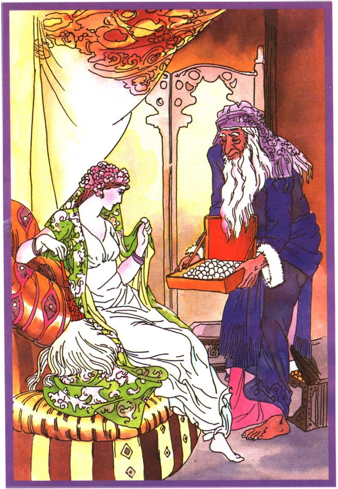 |
| :----------------------------: |
|          《聪明的猫》          |

 

| 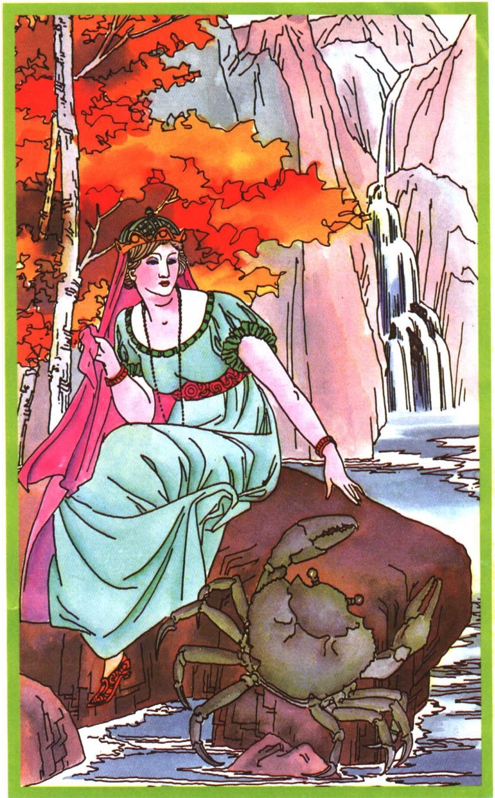 |
| :----------------------------: |
|            《白鹿》            |

 

| 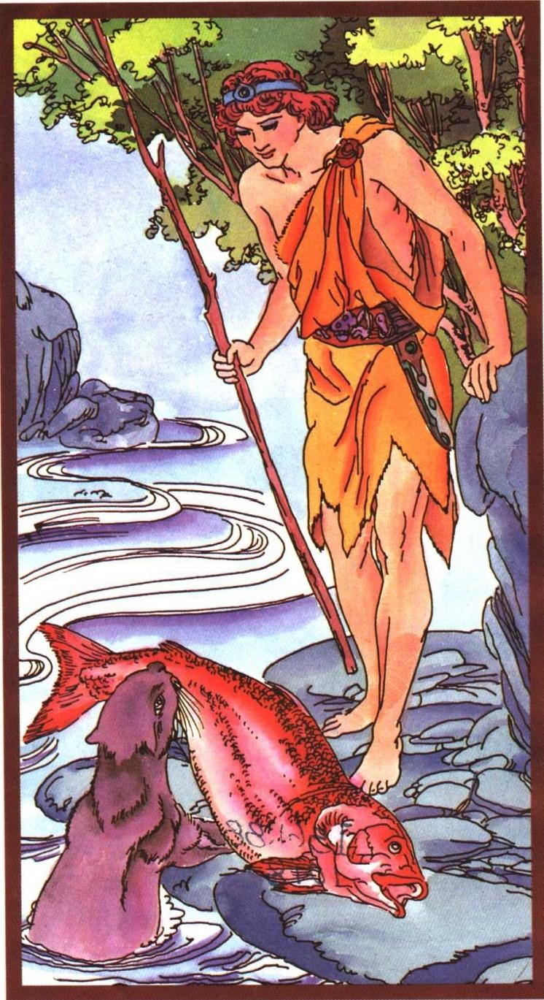 |
| :----------------------------: |
|      《黄头发科凡历险记》      |

 

## 前言

《安德鲁·朗格彩色童话全集》是英国著名文学家安德鲁·朗格（1844～1912）编辑的十二集童话。为了编辑这些童话，他广泛地收集英国、欧洲以至全世界的童话和民间故事。那些非英语的文字，如法文、德文、葡萄牙文、意大利文、西班牙文、加泰隆语等主要由他的妻子莱奥诺拉·布朗歇翻译和整理成英文。最先编成一集，当时编者的意图也只是编这一集。后来搜集的材料越来越多，才决定继续再编三集。其中的艰难和辛苦是外人所难以想象的，编者因此曾发誓，编成这四集以后，再也不编下去了。

四集童话的出版，效果非同凡响。不仅受到英国读者的欢迎，而且被译成多种文字，受到许多国家读者的欢迎。其受欢迎的程度赢得了一代又一代的读者，历数十年而不衰。这不仅源自编者长期的努力，也得益于世界各地广大热衷于这一题材的读者的帮助，他们纷纷把手头的作品和资料寄给安德鲁·朗格。这给了他极大的鼓舞，他一鼓作气，又编了八集。后面八集主要搜集了苏格兰、爱尔兰、加拿大、印度、葡萄牙、斯堪的纳维亚的民间故事和传说。有些则选自以神话、民间传说和英雄传奇为基础的中世纪威尔士故事集《马比诺吉昂》。

安德鲁·朗格认为，这些童话故事很难说是某个人写成的，它们从很久很久以前就流传下来，经过民间艺人和文学家的不断收集和整理，才达到了今天这样思想性和艺术性都比较好的程度。这些童话也被认为是英语、甚至也是全世界各种语言中时间跨度最大、包含地域最广、流传国家和地区最多、内容最丰富的童话集。

她是世界古典童话中的瑰宝，童话世界中永不凋谢的鲜花，被译成多种文字，得以广泛流传，一代又一代的儿童被她的魅力吸引，长大成为家长后，又为能给孩子朗读和讲述安德鲁童话而自豪。

《橙色童话》收集欧洲和非洲等国家和地区 33[^1] 个童话和民间故事。这些故事有的讲述英勇无畏、战无不胜的英雄；有的讲述自以为聪明，处处设计害人，最后反而害了自己的动物；有的讲述一只善良的青蛙，为了救王后和公主，如何经历千辛万苦，不达目的，决不罢休。这些故事颂扬勤俭朴素、助人为乐、正直忠诚；谴责贪得无厌、懦弱无能、奸诈狡猾。读了这些故事，我们还可以从中看到，很久以前，这些地区的人民是怎样生活的；可以看到他们的欢乐和悲伤，理想和追求。

与《安德鲁·朗格彩色童话全集》中的其他各集一样，《橙色童话》中的故事充满了当地的风土人情和乡村气息，展现了从冰雪覆盖的北极圈到赤日炎炎的非洲大陆的美丽风光。读者们可以从中领略到许多乐趣，懂得什么是正义，什么是邪恶；什么值得爱，什么该去恨；而且还会对这些地区的人文历史和地理概貌有所了解，从而更加热爱生活，热爱我们这个世界。

 

**目录**

[TOC]

 

## 英雄马卡玛的故事

从前，在赞比西河的岸边城市森纳，有个很不一般的孩子，他长得非常魁梧，手中拿一把铁锤子，肩上扛一只大口袋，像大人一样说话，不过，平时总是不声不响。

有一天，母亲对他说：“我的孩子，该给你起个什么名字呢？”

他回答说：“把森纳城里所有的头人都叫到河边来。”

母亲叫来了所有的头人。孩子把他们领到水深得阴森森的池塘边，池塘里有许多凶猛的鳄鱼。

“啊！大人们！”他说，“你们之中有谁敢跳进池塘，征服这些鳄鱼呢？”大人们听着，谁也不敢跨出一步。于是这孩子转过身去，跃入水中，转眼就不见了。

大人们屏住呼吸，他们想：“这孩子肯定是中了魔，要去送命，鳄鱼肯定会把他吃掉。”

忽然，大地抖动起来，池塘里的水也开始翻滚，很快被鲜血染红。不一会，孩子升出水面，向岸边游过来。

“啊！现在，我的大人们，”他挥着手喊道，“你们知道我叫什么了吧！我叫马卡玛，也就是‘更强者’的意思，因为谁也不敢冒这个风险，去杀死池塘里的鳄鱼。”

接着，他对母亲说：“请放心吧，我的妈妈，我要自己去安个家，成为一个英雄。”说完，他走进棚屋，拿起铁锤子，扛起口袋就走了。

马卡玛越过赞比西河，向西北方向走去，也不知道走了多少个夜晚，他来到一个多丘陵的国家。有一天，他看到一个巨人在造山。

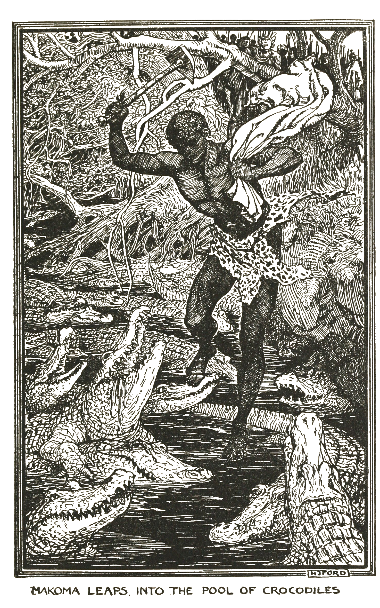

“你好，”马卡玛说，“你是谁？”

“我是奇艾思瓦，高山的制造者。”巨人回答，“你是谁？”

“我是马卡玛，也就是‘更强者’的意思。”他回答。

“比谁更强？”巨人问。

“比你更强！”马卡玛回答。

巨人大吼一声，向他冲过来。马卡玛一声不吭，挥起他的大铁锤，向巨人的头砍过去。这一下砍得那么重，巨人缩成了一个小矮人，双膝跪下说：“你是比我更强。啊！马卡玛，请带上我，让我当你的仆人！”于是，马卡玛把他捡起来，放进口袋，背起来就走。

这一下，他比以前更强了，因为巨人的所有力量都加到了他的身上。他继续赶路，毫不费力地背着口袋，就像老鹰捉着一只小鸡似的。

不久，他来到一个国家，大地好像裂开了似的，深壑的两边堆着巨大的石头和土块。他看到一个巨人正在挖起一块块泥土，向两旁扔过去。

“你是谁？”马卡玛问，“挖这些泥土干什么？”

“我是切杜布拉，”他回答，“我正在挖河床。”

“你知道我是谁吗？”马卡玛问，“我就是叫‘更强者’的那个人。”

“比谁更强？”巨人发出雷鸣般的吼声。

“比你更强！”马卡玛回答。

切杜布拉大叫一声抓起一大块土向他扔过去，可是土块打在他背上的口袋上，一点也不能伤害他。马卡玛抓起铁锤子，向巨人奔过去，一锤就把他打得趴在地上。切杜布拉匍匐在马卡玛脚下，变得越来越小，等他变成像普通人那么大以后，马卡玛把他捉起来，放进口袋，和奇艾思瓦放在一起。

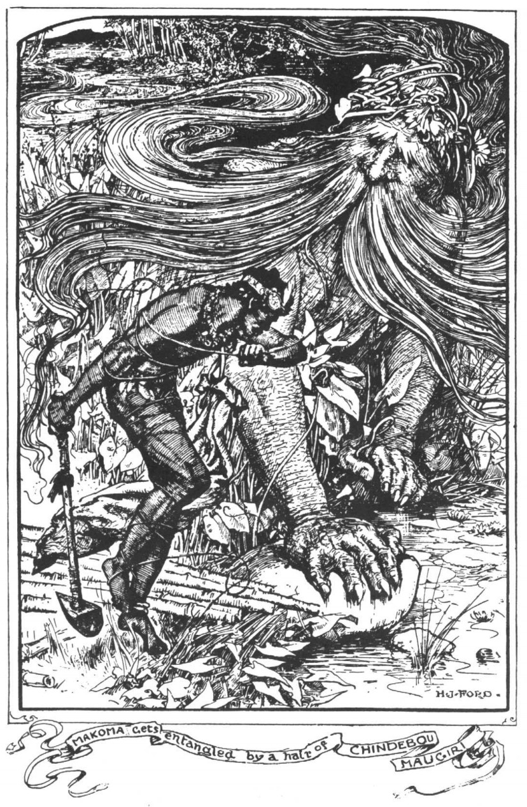

他继续赶路，比以前更加强大了，因为造河巨人的全部力量都集中到了他的身上。他来到一片长满猴面包树和荆棘的森林。这些树长得如此高大，每一棵都高耸入云，粗壮无比，他感到非常惊讶，他从来没有见过这么大的树。在这些树的旁边，他看到了种这些树的巨人奇瓜萨。

奇瓜萨长得比任何一个巨人兄弟都高大，可是马卡玛不怕他，问他：“你是谁，大块头？”

“我是奇瓜萨，”巨人说，“我正在种这些猴面包树和荆棘，用它们来喂养我那些大象孩子。”

“过来，”我们的英雄喊道，“我是马卡玛，我要和你较量一下！”

巨人连根拔起一棵硕大无比的猴面包树，猛然向马卡玛扔过来。可是我们的英雄向旁边一闪，躲了过去。大树深深的砍入松软的土地之中。这时候，铁锤子已经沉重地落在他的头上，一下子就把他打倒了。这一下打得那么沉重可怕，奇瓜萨也和前面两个巨人一样，立刻萎缩成普通人，等他缓过气来以后，就请求马卡玛收容他当仆人。“为你这样伟大的人效劳，真是太荣幸了！”他说。

马卡玛把他放进口袋以后，继续向前走。许多天以后，他来到一个遍地山岩，荒无人烟的国家。大地毫无生气，像被洗劫一空一样。在这片死一般沉寂的旷野中，他看到有一个人在吃火。

“你在干什么？”马卡玛问。

“我在吃火。”那人回答，“我的名字叫奇埃迭莫托，因为我是火神，可以毁灭我想毁灭的一切。”

“你错了，”马卡玛说，“因为我是马卡玛，是胜过你的‘更强者’，你毁灭不了我。”

火神大笑起来，向马卡玛喷出一股熊熊烈火。我们的英雄一跃就躲到一块大岩石后面去了。这一跳非常及时，因为他刚才站立的那块岩石被烧得像熔化了的玻璃一样。

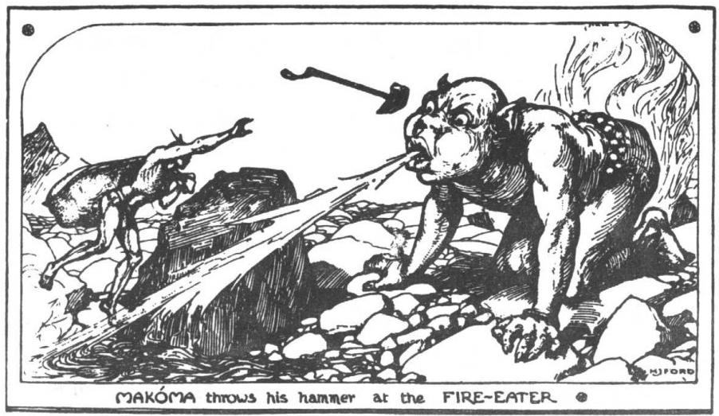

马卡玛对准奇埃迭莫托掷出铁锤子，一下子就击中了他，把他变成平常人，装进口袋，和其他被制服的巨人放在一起。

这样一来，马卡玛真的变成了非常了不起的英雄，因为他有移山倒海的力量，有让河水从荒原上流过的能力，有种植森林的智慧和卓识，还有随心所欲地喷射火焰的本领。

马卡玛继续他的旅程。有一天，他来到一片大平原。这里水草丰茂，充满生机。一条大河从平原上流过，河边有一块地方绿草成茵，景色非常迷人，很适合于安家立业。

马卡玛非常高兴地在一棵大树下的绿草地上坐下，从肩上放下大口袋，把里面的巨人都放出来。

“我的朋友们，”他说，“我已经走了许多路，感到厌倦了。这里不是英雄安家的好地方吗？明天，让我们去砍些树来造房子，竖栅栏。”

第二天，马卡玛带领巨人出去砍树，准备造房子，只留下奇艾思瓦看家，他要烧些他们杀死的野兽当饭吃。

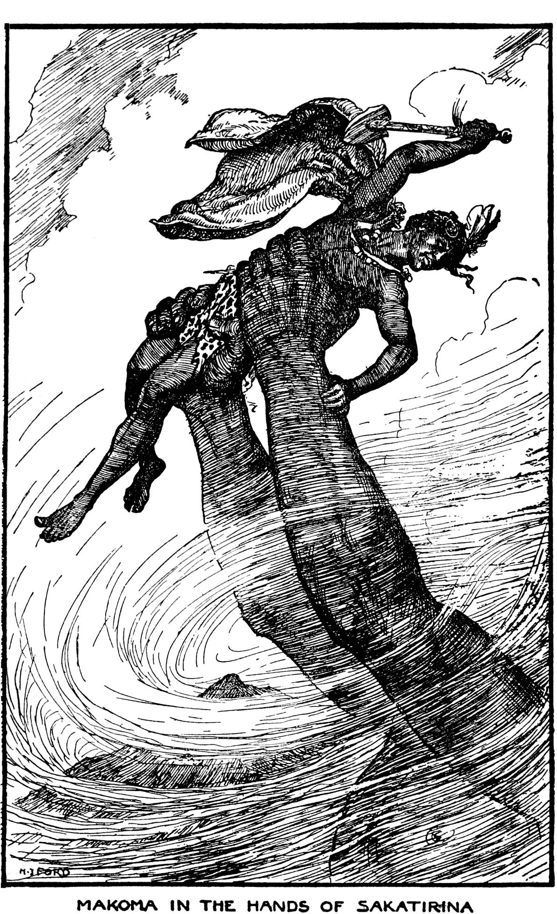

等马卡玛他们天黑回来的时候，看到奇艾思瓦被一根粗壮的胡子捆在一棵大树上，不能动弹！

“这是怎么一回事？”马卡玛吃惊地问，“你怎么会这样被绑起来，一点办法都没有？”

“啊！首领，”奇艾思瓦回答，“中午的时候，有一个人从河里走上来，他身材魁梧，高大无比，灰色的胡子那么长，根本看不到头！他问我，‘谁是你的主人？’我说，‘马卡玛，最伟大的英雄。’他抓住我，拔下一根胡子，把我捆在树上，就是你们看到的这个样子。”

马卡玛非常生气，但是没说什么，用手指甲把这根像麻绳那么粗壮结实的胡子割断，把造山者放了。

接下来的三天，同样的事情天天发生，只是每天换一个人被捆住。到了第四天，马卡玛叫其他人去砍柴，自己留下来，他要亲眼看一看住在河里的这个人是什么样子，胡子怎么会这么长，连人的眼睛都看不到它的尽头。

巨人们走了以后，马卡玛打扫整理了一下营地，把一些野味架在火上烤。到了中午，他听到河里发出一阵响声，抬起头来，就看到一个无比巨大的人头及其肩膀正在露出水面。啊！看哪！巨人灰色的胡子一直从河面伸到天边！

“你是谁？”巨人走上岸来，大吼一声。

“我就是叫马卡玛的那个人。”我们的英雄说，“在我杀死你之前，快把你的名字报来，说说你在河里干什么？”

“我的名字叫津德博，”巨人说，“我的家在河里，我的胡子就是笼罩在河面上的浓密水汽，它把那些来寻找我的人捆住，让他们一个个都死去。”

“可是你捆不了我！”马卡玛边喊边挥起铁锤向巨人冲过去。但是巨人的身上又粘又滑，铁锤打在他的胸膛上很快就滑下来，对他毫无伤害。马卡玛差一点儿滑倒，他正想站稳的时候，巨人抽出一根长胡子把他捆了起来。

开始的时候，马卡玛毫无办法。不过，他很快就想起从火神那里得到的神奇力量。他喷出一团烈火来，把巨人的胡子烧断，给自己松了绑。

津德博扑上来想抓他的时候，马卡玛把口袋套在他那滑溜溜的头上，然后抡起铁锤向他的头打过去。这一下，铁锤打在干燥的口袋上，不再滑下来，津德博也就一命呜呼了。

太阳下山了，四个巨人砍好柴回来，看到马卡玛战胜了河神，高兴地欢呼起来。他们一起大吃烤野味，直到深夜。第二天早晨醒来时，他们看到马卡玛在火堆上烘手，脸色阴沉。

“啊！我的朋友，半夜里，我父亲的神灵走过来对我说，‘去吧！马卡玛，除非你找到萨卡帝里纳并和他决斗，否则，你永远都不会得到安宁，他有五个头，非常高大健壮。和你的朋友告别吧！你必须独自一个人去。’”

巨人们听了都非常伤心，为即将失去他们的英雄而放声大哭。马卡玛安慰他们，把从他们那里得到的礼物都还给他们，和他们告别以后就出发了。

马卡玛向西一直走了很久，他翻过高山峻岭，越过泥泞的沼泽地和湍急的河流，还穿过了普通人难以活着通过的沙漠，最后来到一座屋子前，屋子坐落在几座高山之中。里面住着两个美丽的妇女。

“你们好！”我们的英雄说，“这里是不是长着五个头的萨卡帝里纳的国家？我要找他！”

“啊！我们欢迎你，大个子！”女人们回答，“我们是萨卡帝里纳的妻子，你的目的地到了，他正在那里等着。”她们朝马卡玛原以为是两座大山的地方指了指，又说，“这是他的两条腿，他的身体你看不到，因为被云遮住了。”

马卡玛看到巨人那么高大，非常惊奇。可是，那也没有什么可怕的，他冲过去，对准巨人的腿挥起铁锤猛击。可是，什么事情也没有发生。他不停地锤打着，直到听到一个似乎是从很远的地方传来的声音说：“谁在挠我的脚？”

马卡玛竭尽全力喊叫：“是我，马卡玛，就是叫更强者的那个人！”喊完以后，他竖起耳朵听着，可是没有人回答。

马卡玛把周围能找到的干树枝都搬过来，在巨人的脚下堆起高高的柴火，用火把它点着。

这一下，巨人说话了。他的声音非常可怕，像天上的雷鸣一样，“谁在我的脚下熏烧？”

“是我，马卡玛，”我们的英雄喊道，“萨卡帝里纳，我从很远的地方来找你。我父亲的神灵叫我来找你，和你决斗，否则我就会发胖，无聊地度过一生！”

沉默了片刻以后，巨人温柔地说：“那好吧！马卡玛，因为我也觉得太无聊了，没有人长得像我这样高大，所以我很孤独。留神你自己！”说完，就忽然弯下腰来，用手抓住我们的英雄，把他重重摔在地上。但看哪！他非但没有丧命，反而比先前更魁梧有力，一跃而起，冲上去拦腰抱住巨人扭作一团[^2]。

激烈的战斗持续了一个钟头接一个钟头，高山在他们的脚下翻滚，像是洪流中的卵石。有时候，马卡玛摆脱对方，举起铁锤，用尽全身的力量向对方砍过去；有时候萨卡帝里纳捡起一座大山，向马卡玛猛掷过去。可是，谁也战胜不了谁。

到了第二天，他们相互揪得那么紧，谁也摆脱不了谁。这时候，他们的力气都已用尽。在太阳刚刚下山的时候，一起掉到地上，失去了知觉。

第三天早晨，当太阳升起的时候，他们醒来了。伟大的神穆利莫站在他们的面前，说：“啊！马卡玛和萨卡帝里纳，你们是多么了不起的英雄，任何人都不是你们的对手。因此，你们将离开尘世，和我一起到天上去住。”说话之间，这些英雄从地球上消失了，从此，再也没有人看见他们。

（津巴布韦传说）

 

## 魔镜

很久很久以前，在森纳还没有白人的时候，那里住着一个名叫戈帕尼库法的黑人。有一天，他出去打猎，看到一幅奇怪的景象：一条大蟒蛇缠住了一头羚羊，在它的身上绕了好几圈。羚羊在绝望之中用角刺中了蟒蛇。可是羊角穿过蟒蛇的身体以后，又深深地扎进一棵大树。这样一来，两个动物谁也动不了。

“救命！”羚羊喊叫，“我没有做伤天害理的事情。我被缠住了。如果不进行自卫就会被吃掉。”

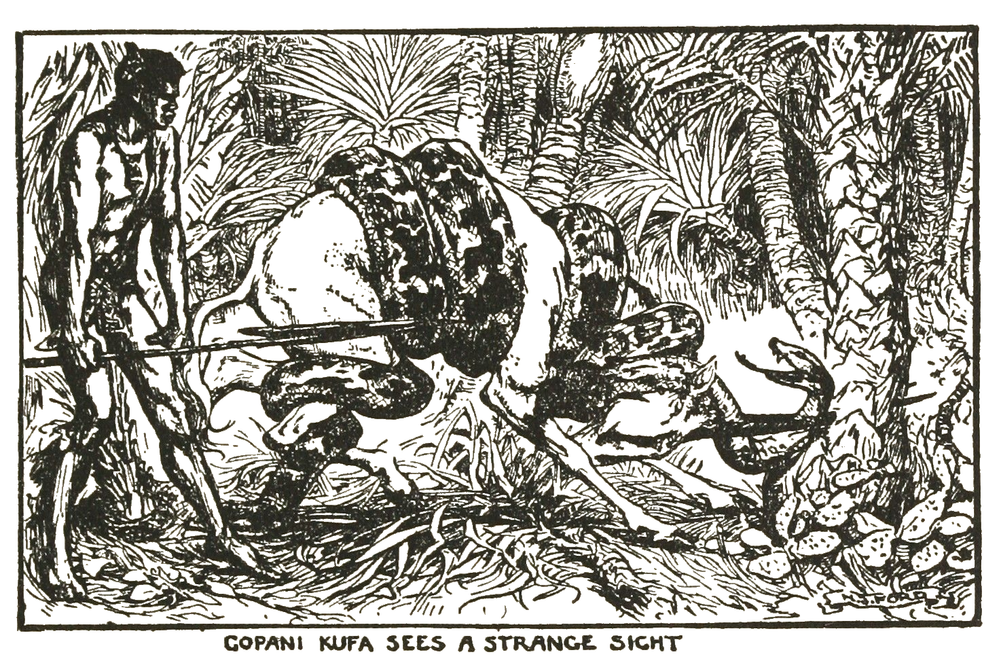

“快救我！”大蟒蛇说，“我叫英索托，是所有爬行动物的国王。我会丰厚地报答你的。”戈帕尼库法考虑了一下后，用他的标枪刺中了羚羊，救出了大蟒蛇。“谢谢你，”大蟒蛇说，“等新月升起来的时候，请再过来。那时候，我已经把羚羊吃掉了。我会像答应过的那样报答你的。”

“是啊！”临死的羚羊说，“它会报答你的，等着瞧吧！你得到的报答将是你的毁灭！”

戈帕尼库法回到自己的村庄。等到新月升起来后，他来到救过大蟒蛇的地方。英索托躺在地上，饱餐一顿以后它睡着了，这时还没有醒来。等英索托张开眼睛看到戈帕尼库法以后，它再次表示感谢后说，“你跟我一起到我的国家皮塔去，我的所有财产中，你喜欢什么，我就给你什么。”

戈帕尼库法开始有些害怕，因为他想起羚羊说过的话。不过，他是终还是同意跟英索托一起走进森林。他们一起走了好几天，终于来到一个洞口。这洞很深，一直通到地下。洞口虽然不大，但足以走进一个人。“拉住我的尾巴，”英索托说，“我先下去，拖着你一起走。”

他们一起进了洞，一直不停地往下走，一连走了好几天，洞里越来越黑。后来他们终于走出黑暗的地洞，走进一块美丽的土地。四周是一片绿草地。草长得并不高，一大群牛和羊正在吃草。远处有许多非常高大的房子，都是用石头砌成的。屋顶上闪耀着金子和白铁皮的光芒。

戈帕尼库法转过头来，可是大蟒蛇不见了，面前站着一个英俊而健壮的男子，他身上裹着那张大蟒蛇皮，把它当衣服穿，手上和颈上戴着纯金手镯和项圈。

那人笑着说：“我就是英索托，不过在我的国家里，我像你现在看到的一样，是一个人。因为这里是我的国家皮塔，我是国王。”说着，他拉起戈帕尼库法的手，领他走进城里去。

一路上，他们经过几条河流。男人和女人都在里面洗澡、钓鱼和划船。再过去是园林，里面长满了丰收的稻子、玉米，还有许多戈帕尼库法叫不出名的粮食。他们从地里经过时，那些在地里一边干活一边唱歌的人都放下手中的活，兴高采烈地向英索托致敬，向这位出远门归来的人献上棕榈酒[^3]和椰子，让他恢复体力。

“他们是我的孩子！”英索托说着，同时向那些人挥挥手。戈帕尼库法对所见所闻都感到非常惊讶，不过他没有说什么。接着，他们走进城里。这里的一切也是非常漂亮，你想要什么就有什么，连马路上的灰尘都不是金的，就是银的。

英索托领着戈帕尼库法走进宫殿，把安排他住的房间指给他看，那些伺候他的侍女对他说，今天晚上将举行盛大的宴会，明天他可以说说想要皮塔国的哪些财宝，到时候就会给他。说完以后，英索托就走了。

戈帕尼库法随身带着一只名叫曾基米齐的黄蜂。这可不是一只普通的黄蜂，因为戈帕尼库法父亲的灵魂已附在它的身上，所以它特别聪明。每当碰到什么难题，戈帕尼库法总要向它请教该怎么办。所以这时，他把放着这只黄蜂的灯心草小篮子拿出来，问：“曾基米齐，我救了英索托的命，明天它会问我想要什么样的礼物作为报答，我该要什么？”

“嗡！”曾基米齐回答，“跟他要镜子西保。”说完，它又飞回小篮子里去了。

戈帕尼库法对这个回答感到非常吃惊。可是他知道，黄蜂的话决不会错，所以，他决心提出这个要求。这天晚上，英索托举行了宴会。第二天早上，英索托又来找戈帕尼库法，高兴地问候以后，他说：“现在，我的朋友，说说在我的所有财宝中，你想要什么，你会得到满足的！”

“啊，国王！”戈帕尼库法回答，“在你的所有财宝中，我希望得到镜子西保。”

国王大吃一惊。“啊！朋友，”他说，“除了这个，你要什么都可以！我没有想到，你会要这件对我来说是最珍贵的东西。”

“那么，让我再考虑一下吧，国王。”戈帕尼库法说，“明天我会告诉你，是否改变了主意。”

国王仍然感到非常烦恼，担心会失去镜子西保，因为这面镜子有一种魔力，它的主人只要一开口，一切愿望就会得到实现。英索托就是靠它才得到了所有的财富。

国王走了以后，戈帕尼库法又从小篮子中拿出曾基米齐来。 “曾基米齐，”他说，“国王好像不情愿满足我想得到镜子的要求，还有没有和它一样值钱的东西，我可以提出来要它？”黄蜂回答： “啊！戈帕尼库法，世界上没有什么东西能比这面镜子更值钱的了，因为它是希望之镜，能满足它的主人提出来的一切要求。如果国王犹豫不决，第二天再去跟他要，再不行第三天再去，这样总有一天他会把镜子给你，因为你救过他的命。”

于是一连三天，戈帕尼库法都给国王同样的答复。后来，英索托终于含着眼泪把镜子给他。那是一面磨得很亮的铁镜子。国王对他说：“啊！那么，戈帕尼库法，把西保拿去吧！祝贺你的愿望变成现实，回到你的国家去吧！西保会给你带路的。”

戈帕尼库法非常高兴，他和国王告别以后，对镜子说：

“西保！西保！我要回到地面上去！”

他立刻看到，自己已经站在地面上了。可是他不认识这个地方，于是又对镜子说：“西保！西保！我要找到回家的路！”看！前面就是回家的路。

他回到家里，看到妻子和女儿正在为他哀悼，她们以为戈帕尼库法被狮子吃掉了。他安慰她们说，他因为追赶一头受伤的羚羊迷了路，走了很长时间，才找到回家的路。

当天晚上，他问依附着父亲灵魂的曾基米齐，下一步该向西保要什么？

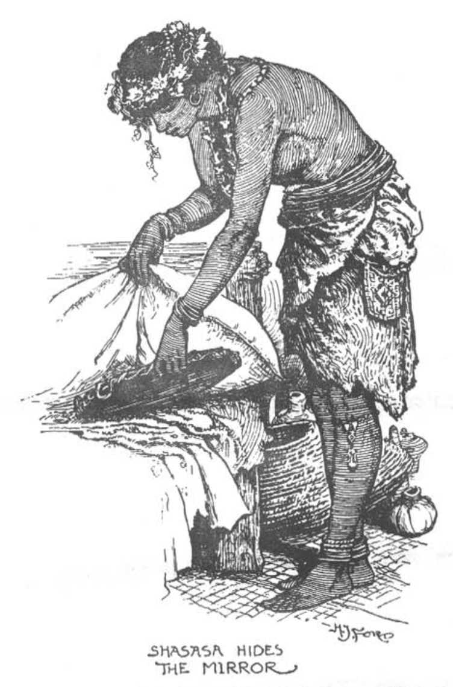

“嗡……”黄蜂说，“你不想像英索托那样，成为一个伟大的领袖吗？”

戈帕尼库法笑了，他拿出镜子来，对它说：“西保！西保！我要一座像皮塔国王英索托有的那样大的城市，我要当这座城市的长官。”

于是，在从附近流过的赞比西河岸边，出现了石头建筑的城市和街道，房子的屋顶也和皮塔国的一样，闪烁着黄金和抛光铁皮的光芒。街道上男男女女熙熙攘攘，男孩子们赶着羊群和牲口上牧场，河边传来那些钓鱼、划船的小伙子和姑娘们的笑声。这座城市的百姓看到戈帕尼库法，就像看到领袖一样，高兴地向他欢呼。

戈帕尼库法现在就像爬行动物的国王英索托一样强大。他和全家一起搬进了宫殿。宫殿坐落在城市中央，远远高于其他建筑。他的妻子对这一切奇迹般的变化非常惊奇，一句话也不问。可是他的女儿莎萨萨却不停地问他，怎么会一下子就变得这么伟大。于是，他向莎萨萨披露了全部秘密，还信任地把魔镜交给她保管，对她说：“交给你比较安全，我的女儿，你和我分开住，这样有人来和我商量国事的时候，也不怕镜子被人偷走。”

于是莎萨萨把魔镜带回去，藏在枕头底下。这以后许多年，戈帕尼库法英明地治理着他的国家，所有的人都热爱他，他不需要再向镜子请教。

随着岁月的流逝，戈帕尼库法的头发变白了。这时候白人开始入侵，他们沿赞比西河而上，和戈帕尼库法展开了激烈而持久的战争。由于魔镜的力量，戈帕尼库法击败了白人，把他们赶到海边。白人的首领中有一个叫雷的人，非常狡猾，他千方百计打听戈帕尼库法的力量从何而来。有一天，他把手下一个名叫巴托的忠诚部下找来，对他说：“你到城里去，给我打听一下，戈帕尼库法这么伟大的秘密在哪里？”

巴托穿上褴褛的衣服出发了。他来到戈帕尼库法的城里，请求见首领。人们把他领到戈帕尼库法的面前。这个白人看到他以后，低声下气地说：“啊！首领，可怜可怜我吧！我已经无家可归了。当雷向你发起进攻的时候，只有我一个人反对，因为我知道，赞比西的全部力量都掌握在你的手中。由于我不肯和你作战，雷就把我赶到森林里，要把我饿死！”

戈帕尼库法听信了这个白人的话，给他饭吃，还给他房子住。

故事到此就要结束了，因为戈帕尼库法的女儿把自己的心交给了奸细巴托，让他打听到了魔镜的秘密。一天晚上，当整个城市都沉睡以后，他把手伸到她的枕头底下，偷走了魔镜，回到白人首领雷那里去了。

于是事情发生了，那一天，戈帕尼库法从宫殿的窗口向河望去，看到白人的战船又开过来了，立刻警惕起来。

“莎萨萨！我的女儿！”他疯狂地喊叫起来，“去把镜子给我拿来，白人又来了！”

“太不幸了，父亲！”她呜咽地说，“镜子不见了！因为我爱上了奸细巴托，他把西保从我这里偷走了！”戈帕尼库法镇静了一下自己，然后从灯心草篮子中拿出曾基米齐来。

“啊！我父亲的灵魂！”他说，“我现在该怎么办？”

“啊！戈帕尼库法，”黄蜂嗡嗡地说，“现在什么办法都没有了，因为被你杀死的那头羚羊的预言就要实现了。”

“天啊！我实在太老了，把这件事也忘了！”戈帕尼库法喊叫起来，“羚羊的话千真万确，我所得到的报答，就是自己的毁灭，这句话终于应验了。”

很快，白人打败了戈帕尼库法和他的军队，连同他的女儿也一起给杀了。从此以后，地球上的权力都落入白人之手，因为他们得到了魔镜西保。

 

## 想看天堂的国王的故事

从前有一个国王，有一天出去打猎，在一个荒漠山谷里碰到一个行者。行者正坐在一张破旧的小床上读《可兰经》，肩上披着一件打补丁的斗篷。

国王问他在读什么？他说，他在读关于天堂的事情，祈祷有朝一日能有资格进入天堂。接着，他们两人开始聊起来。聊了一会，国王问行者，是不是有办法让他看一眼天堂，因为他觉得很难相信看不见的东西。行者回答说，国王的请求是一件非常困难、也是非常危险的事情。不过，他帮国王祈祷，这件事也许能够办到。与此同时，他警告国王说，不相信天堂和提出对这件事的好奇心都是非常危险的。但是，国王并没有因此而退缩，他答应行者，如果他愿意帮助祈祷，就终生给他饭吃。于是，行者答应了他，两人就此分手。

时间一天一天地过去了，国王像他答应过的那样，不断地给行者送去粮食，可是每当他派人去问什么时候可以看一看天堂时，行者总是回答说：“还不行，还不行。”

两年过去了，有一天，国王听说行者病得很厉害，看上去快不行了，他连忙亲自赶过去，看到行者只剩最后一口气了。这时，国王请求行者别忘了自己的承诺，让他看一眼天堂是什么样子。临死的行者回答说，如果国王来参加他的葬礼，等坟墓筑好，所有的人都离开以后，国王去把手放在坟墓上，他就会信守自己的诺言，让国王看一眼天堂。与此同时，他还是请国王放弃这个念头，安心地等待上帝召唤他的时候，再去看天堂。可惜国王的欲望非常强烈，非要现在就看不可。

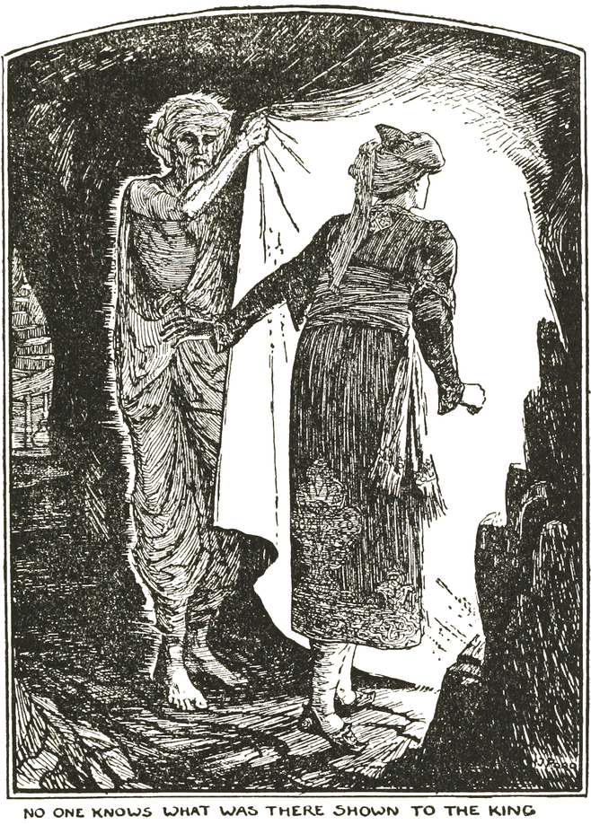

于是，行者被埋葬以后，国王留了下来，等所有的人都离开后，他走过去，把手放在坟墓上！地面立刻就裂开来，大吃一惊的国王朝里望去，只见一条粗糙的楼梯一直通到底部，行者像活着的时候一样，正坐在摇晃的小床上读《可兰经》。

开始，国王是那么惊诧，那么害怕，只是在那里呆呆地看着。后来，行者向他招手，示意他下来，他才鼓起勇气，大胆地走进坟墓。

行者站起来，向国王做了一个跟着他走的手势，并沿着一条黑暗的走廊走了几步，然后停下来，庄严地回过头来看他的伙伴，用手像是拉开一块沉重的窗帘，好让人看到什么的样子。是什么呢？谁也不知道国王看到了些什么，他后来也从不对任何人说。等后来行者放下窗帘，国王转身离开那里的时候，他算是看过了一眼天堂！他双腿发抖地沿着走廊走回来，摇摇晃晃地踏着楼梯走出坟墓，回到空气新鲜的地面。

天已经开始破晓，国王觉得很奇怪，他在坟墓里竟呆了那么长时间！他感到自己只下去了几分钟，走过没几步路，大约看了五分钟窗帘外面的奇妙景色就回来了。看到了些什么？他绞尽脑汁回忆，可是一点也想不起来。那些事情看上去是多么奇怪！而且，连他正在走进的自己的城市，也变得陌生起来。等他走进宫殿的大门，跨入大厅的时候，太阳已经升起来了。大厅里人很多，王座上竟然坐着一个国王！可怜的国王给搞糊涂了，他一屁股坐下，直盯着上面的国王。这时，一个侍从走过来，问他为什么在国王的面前没有得到允许就坐下？“可我是国王！”他喊叫起来。

“什么国王？”侍从问。

“这个国家真正的国王！”他愤怒地说。

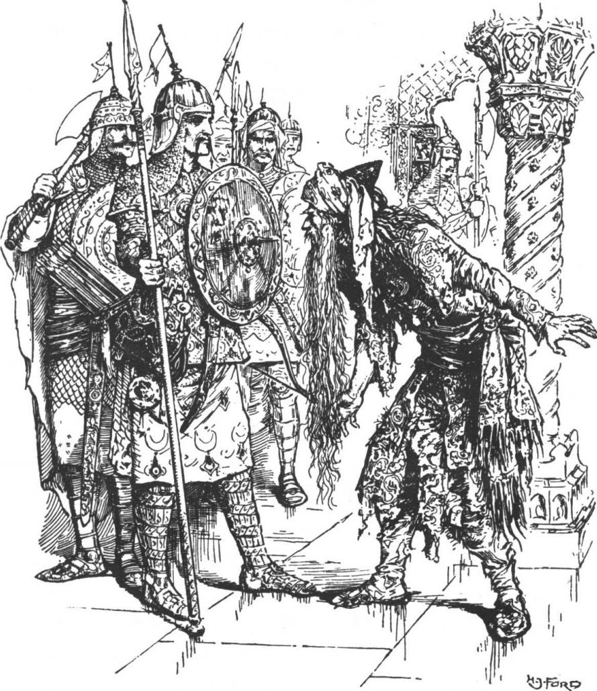

这时，侍从走过去和坐在上面的国王说话，老国王听见了“疯子”、“老糊涂”、“怪可怜的”这样一些话。接着，王座上的国王叫他过去。他走过去了，从卫兵手持的铮亮盾牌中，看到了自己的影子，恐怖得连连后退。他看到自己又老，又脏，穿得破破烂烂；头发和胡子又长又白，蓬乱地披在胸前和肩上。身上唯一能证明是国王的标志的是右手上一枚图章戒指。他用抖索着的手指把它褪下来，举起来给王座上的国王看。

“告诉我，我是谁？”他喊叫着，“这是我的图章戒指，就是在昨天，我还坐在你现在坐的位置上！”

王座上的国王慈善地看着他，好奇地察看着他的图章戒指，然后，吩咐把王国积满灰尘的史册和档案还有从前国王头像的硬币拿出来，仔细地进行比较。最后，他转过脸来对老人说：“老人家，你这个图章戒指的国王七百年前统治这个国家；可是据说他后来失踪了，谁也不知道他到哪里去了。你这个戒指是从哪里得来的？”

这时，老人捶胸顿足，悲痛地放声大哭起来。因为他明白了，由于他不能耐心地等待光明正大地进入天堂的那一天，他已经受到了惩罚。他一言不发地离开大厅，走进森林，在那里过了二十五年祈祷和反思的生活，直到死亡天使来找他，怜悯地让他解脱——他已借这番苦修涤净了罪孽[^4]。

 

## 兔子伊苏罗和狒狒古多

在一个遥远的热带国家，森林茂密，终年不见阳光；河流宽广，水流湍急。森林里曾经住着一对奇怪的朋友，一个是大白兔伊苏罗，一个是身材高大的狒狒古多。它们两个那么要好，总是形影不离。

有一天，阳光特别强烈，天气比任何时候都热。兔子睡完午觉醒来，看到狒狒古多正站在它的旁边。

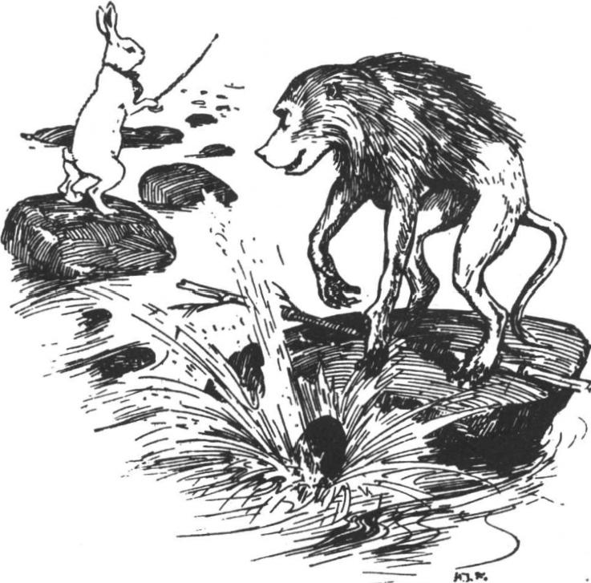

“起来，”古多说，“我要出去求婚，你一定要跟我一起去。用口袋装上一些吃的，背在背上。可能相当长一段时间我们会找不到吃的。”

兔子擦了擦眼睛，从丛林中采集了一些绿色的新鲜食物，然后对古多说，准备就绪，可以走了。

它们兴高采烈地走了一程路，来到一条河边。河面上有许多石头，一直延伸到对岸。

“背着这个大口袋，我们很难从这些石头上跳过河去。”古多说，“要是我们不想掉到河里去，就得把它扔掉。”说着，它背着走在前面的伊苏罗，弯下腰来，捡起一块大石头，扑通一声巨响，把它扔到河里去。

“现在该轮到你了，”它对兔子喊道。兔子深深地叹了一口气，把口袋解下，口袋就掉到河里去了。

河的对岸是一条林荫大道。它们走了没多远，狒狒就把藏在背后长头发里的口袋解下来，开始吃一些看得出是非常好吃的水果。

“你这是从哪里弄来的？”兔子妒忌地问道。

“哦，我发现跳过河去也很容易，把口袋扔掉怪可惜的，所以就留下来了。”狒狒回答说。

“那么，既然是你骗我把口袋扔掉的，你应该让我和你一起分来吃。”兔子说。可是，狒狒假装没有听见，继续走它的路。

走着，走着，它们走进了一片森林。前面有一棵结满果子的大树，树枝也被压得弯下腰来。有些果子还很青，有些已经黄了。兔子高兴得跳起来，因为它肚子已经很饿了。可是狒狒对它说：“摘下那些青的果子，你会发现它们最好吃。我把它们都留给你，因为你还没有吃过饭。把那些黄的都给我。”于是，兔子摘下一个青橘子咬起来，可是它的皮那么硬，用牙齿很难咬破。

“它一点也不好吃，”兔子皱着脸喊叫起来，“我情愿吃一个黄的。”

“不！不！我决不允许你这样做。”狒狒回答，“吃了它们你只会生病，吃那些青的你就应该满足了。”兔子只能得到这些，只好对付着吃。

这种事情发生过两三次以后，兔子终于看清楚了，它下定决心，不管狒狒叫它干什么，它都准备对着干。这时候，它们已经走进一个村庄，古多的未婚妻就住在这里。走进村子以后，古多指着一丛灌木对兔子说：“我吃东西的时候，你如果听到我叫烫坏了，你就快点去给我摘一些绿叶子来，它们能治好嘴巴的烫伤。”

兔子本来想问它，明明知道会烫伤，为什么还要吃？可是它不敢问，只是点点头答应下来。可是走了几步路以后，它对古多说：

“我把我的针丢了，你在这儿等一会儿，我去找回来。”

“那么，快一点。”狒狒回答，说着，爬上一棵树。兔子急忙跑回灌木丛中，摘了许多叶子藏在皮毛下面。它想：“我现在就摘一些，省得跑来跑去好麻烦。”

等摘得差不多以后，它又回到古多那里，它们一起继续走。

到达目的地的时候，太阳已经快下山了，它们都觉得很累，在一口井边坐了下来。盼望着古多到来的未婚妻看到它们来了，就端出一盆水来，向它们泼过去，为的是帮它们洗净一路上的灰尘。接着又拿出两份饭来。可是，兔子想吃饭的希望又一次落空了，因为古多急急忙忙地说：

“根据这个村子里的习惯，你要等我吃完以后才能吃。”

兔子不知道狒狒是在撒谎，其实它是想多吃一些。兔子只好饿着肚子看古多吃，一直等到它吃饱。

过了一会儿，古多大声地喊叫起来：“我烫坏了！我烫坏了！”其实，它一点也没有烫着。这时候，兔子身边虽然有叶子，但是它不敢马上就拿出来，免得狒狒会怀疑它刚才留在后面干什么。所以，它就到角落后面去躲一会，然后再急急忙忙地跑回来。可它的动作虽然很快，狒狒却比它还要快。这样，两份饭只留下几滴汤了。

“你真太不走运了，”古多一边抢过叶子来，一边说，“你刚走了没有多久，就来了许多人，他们洗了洗手，就像你看到的一样，把你的那份饭也吃掉了。”可是，兔子心里很明白，不说什么，饿着肚子就上床睡觉去了，它出生以来，肚子从来没有像今天这样饿过。

第二天一早，它们又动身到另一个村子里去。经过一个大菜园时，看到许多人正在收落花生。

“你终于可以吃到一顿丰盛的早餐了。”古多指着一堆花生壳对兔子说，它相信，兔子一定老实地去吃分给它的这一份，把花生仁留下来给自己。可是，兔子的回答却出乎它的意料之外：

“谢谢你，我想，我宁愿吃这个。”说着，它转过身去大吃起花生仁来，直到把它们吃得精光。更糟糕的是，旁边有那么多人，古多不能抢它的花生吃。

它们来到古多未婚妻母亲住的村庄时，已经是晚上了。女主人拿出肉和玉米粥来招待它们。

“我记得你对我说过，你喜欢玉米粥。”古多说。可是兔子回答说，“你看错人了，只要有肉，我总是要吃的。”这样一来，狒狒又不得不吃它很不喜欢的玉米粥。

不过，在吃粥的时候，它忽然想到了一个主意，便故意设法把火光前的一大锅水打翻，水把火全部浇灭。

“现在，”狡猾的狒狒心里想着，“我可以趁黑抢它的肉吃了！”可是，兔子已经变得和狒狒一样狡猾，它站在角落里，把肉藏到背后去，狒狒根本找不到。

“啊！古多！”它大声地笑着喊道，“是你教我如何变得聪明起来！”接着，它把屋子里的人叫来，叫他们把火生起来，因为古多要在火堆旁边睡觉，它要到另一间屋子里去和别的一些朋友一起过夜。

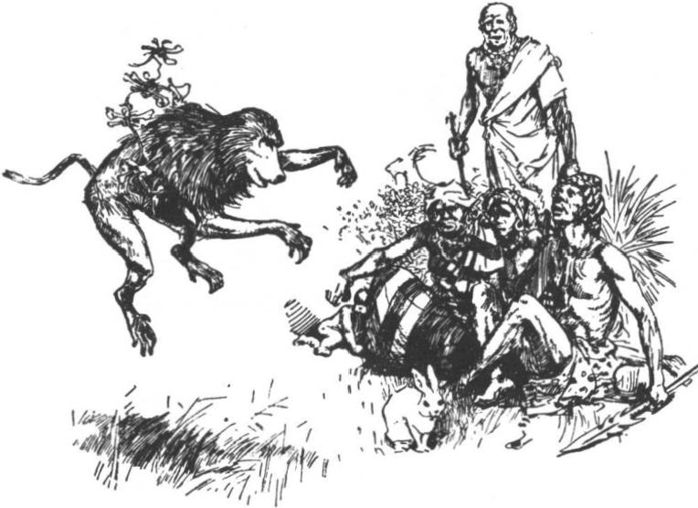

睡梦中，兔子听到有人在轻轻地喊它的名字，这时候，天还很黑，它张开眼睛一看，是古多站在它的身边。它把一个手指放在兔子的鼻子上，示意它不要出声，起来跟着它走。等它们离开屋子有一段距离以后，古多才开口说话：

“我肚子饿极了，想找一些比昨天的玉米粥更好吃的东西吃，这些玉米粥当晚饭吃真是糟透了。我去杀一头羊，你是个好厨师，帮我把这些肉烧熟。”兔子点点头。古多转身到一块大石头后面就不见了。不过，它很快就拖着一只死羊回来。它们俩开始剥皮，然后用干树叶把羊皮填满，这样一来，谁都看不出它是一只死羊。它们还把它拉到丛林里去，让它站着。接着，伊苏罗找来一些树枝当柴火，把火点着。古多急忙到另一间房子里去偷来一口铁锅，到河边去灌满水。它们在地里插上两枝树杈，把锅支起来，把肉放进去烧。

“起码还得过两个钟头才能吃。”古多说，“所以我们俩可以小睡一会。”说着，它躺在地上，假装睡得很熟。其实，它是在等机会好独自把羊肉全部吃掉。“我肯定是听到它打呼噜了。”它心里想着，偷偷摸摸地来到兔子睡觉的柴堆旁。可是，它看到兔子的眼睛张得很大。

“真烦！”古多嘀咕着，回到自己睡觉的地方。又过了一会儿以后，它又起来去看兔子，还是看到兔子的红眼睛张得很大。它要是知道兔子一直睡得很熟就好了，这一点它怎么也想不到。它等着等着，慢慢地自己也累了，不久就睡着了。很快，伊苏罗醒过来，它觉得很饿，就轻轻地走过去，把锅里的肉全部吃光，还把所有的骨头都连起来，挂在狒狒的皮毛上。干完了这些，它又回到柴堆旁睡觉。

第二天一早，古多未婚妻的母亲起来给她的母羊挤奶，来到最大的那头羊挂起来的灌木丛里，她发现了这个诡计。她哭喊得那么伤心，村子里的人都跑过来。古多和伊苏罗也蹦蹦跳跳地过来了，假装像其他人一样地好奇和吃惊。可是，它们一定是露出了作案的痕迹，一个老人忽然指着它们喊叫：

“它们就是作贼的人。”听到他的喊声，大个子的古多浑身发抖起来。

“这种事情你怎么能这样乱说？我要你拿出证据来。”伊苏罗理直气壮地说。它跑到前面来，翻了一个跟斗，在众人面前抖起精神来。

“你是清白的，我刚才说得太急了。”那个老人说，“现在，叫狒狒也像你一样，翻个跟斗。”古多跳起来的时候，羊的骨头嘎嘎地响起来。人们都叫起来：“是古多把羊杀死的。”可是古多回答说：

“不！羊不是我杀的，是伊苏罗杀的。它还把肉都吃光，把骨头挂到我的背上来。该处死的是它！”大家你看看我，我看看你，不知道该相信谁的话才好。后来有一个人说：

“把它们俩都处死，不过，让它们自己挑选死的方法。”

这时，伊苏罗说：

“如果我们非死不可，那就把我们送到砍掉树丛的地方去，用树木把我们围起来，免得我们逃跑，然后把树木点着。如果一个被烧死，一个还活着，那个被烧死的就是杀羊贼。”

人们照兔子的话去做了。可是兔子知道树堆下面有个地洞，火点着以后，它从地洞里溜之大吉，狒狒却被烧死了。

等火全部烧尽，只留下一堆灰的时候，兔子从洞里钻出来，对大家说：“看到了！我说得对不对？把你们的羊杀掉的人就在这一堆灰里面。”

（马绍那故事）

 

## 士兵的儿子依万

在西方一块名叫格里安耐哥的土地上，住着一个骑士，他有三个女儿。就她们的美丽和善良而言，在所有的岛国中，都是无与伦比的。人人都喜欢她们。有一天，三个少女坐在海边的岩石上，把脚浸在海水里的时候，海涛下面忽然升起一个巨大的怪兽，把她们卷到海底。谁也不知道她们被带到哪里去了，也不知道该如何去找她们。消息传开，人们都放声大哭。

离这里几英里远的一座城市里，住着一个士兵，他有三个儿子，都是身强力壮的好小伙子，而且都是当地玩曲棍球的好手。这一年圣诞节期间，许多家庭都聚集在一起，举行盛大的宴会，三兄弟中年纪最轻的依万说：

“让我们到格里安耐哥骑士的草地上去进行曲棍球比赛，他的草地宽广，草也比我们这儿的柔软平整。”

可是其他人说：“不！他现在很悲伤，我们在他的草地上玩球时，他会想到他的女儿在一旁观看的情景。”

“不论他是高兴还是生气，”依万说，“反正我们今天要在他的草地上打球是打定了。”

于是，事情就这么办了。依万赢了他哥哥三局。骑士从他的窗口看见了，非常生气。他叫人把这些年轻人叫来。可当他站在大厅里看到这些年轻人时，他的心就软了一些，但还是满脸怒色地责问他们：

“你们为什么选择到我的城堡前面来玩球？你们明明知道这会使我想起我的女儿。你们给我带来了痛苦，这种痛苦你们也得承受。”

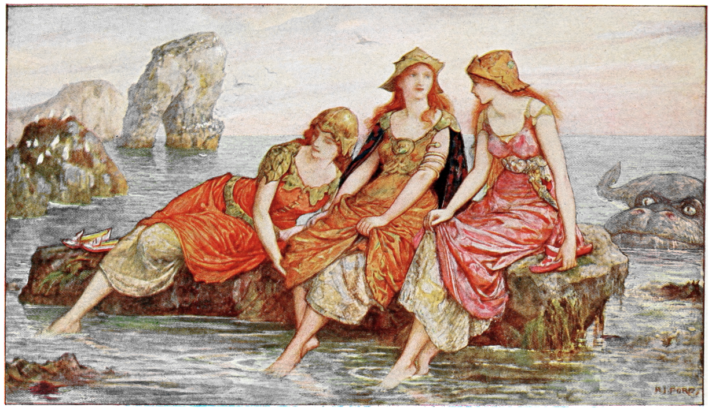

“既然我们做了对不起你的事情，”最小的依万回答说，“那就给我们造一条船吧，我们会出去寻找你的女儿，不论她们是在天涯海角，还是在万丈深渊，不出一年零一天，我们一定找到她们，把她们带回格里安耐哥。”

七天以后，船造好了，船上装了大量的食品和酒，三兄弟驾驶着它向海上开去。到了第七天，船泊上了一片白色的沙滩，他们都上了岸。这个地方他们从未来过，于是就仔细地观看起来。他们看到不远处有一群人正在一块岩石上干活，有一个人站在上面看着。

“这是什么地方？”大哥问。站在上面的人回答说：“这是格里安耐哥骑士的三个女儿住的地方，明天，她们就要和三个巨人结婚了。”

“我们怎样才能找到她们？”最小的弟弟问。

上面的人回答说：“要想看到格里安耐哥骑士的三个女儿，你们得先坐到这个篮子里面，然后用一根绳子把你们拉到这块岩石前面来。”

“哦！这太容易了。”大哥说，他跳进篮子，绳子很快就被拉动起来。篮子不断地往上升。到了半路的时候，一只肥大的黑渡鸦向他飞过来啄他，差一点就啄瞎了他的眼睛。他只好掉头回去。

接着，第二个哥哥走进篮子，可是他的命运也不好，渡鸦一样飞过来啄他，他也像他哥哥一样回来了。

“现在该轮到我了，”依万说。可是，他走到半路的时候，渡鸦也照样向他扑过来。

“快点！快点！”依万对拉绳子的人大声喊叫，“否则我的眼睛就要变瞎了！”拉绳子的人用尽全力，一转眼，依万就来到了顶峰，渡鸦跟在他后面。

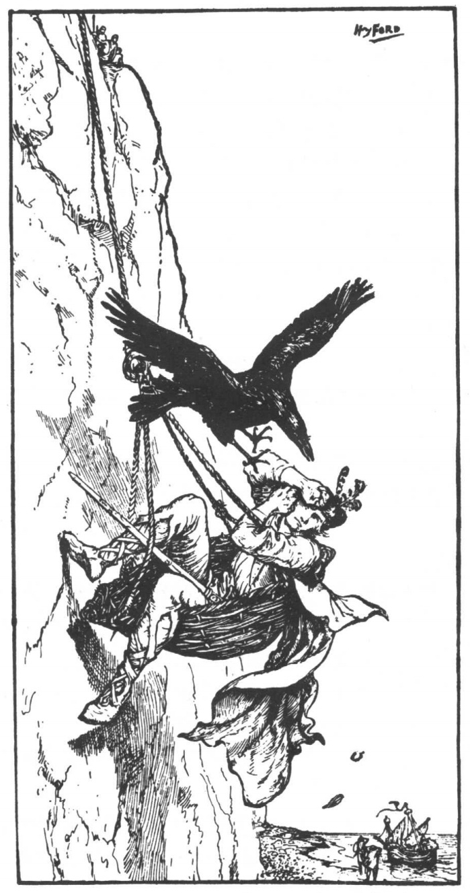

“给我一点烟草好吗？”渡鸦问，这时候，它已经安静下来。

“你这个恶棍！你想把我的眼睛啄出来，我会把烟草给你吗？”依万回答。

“那也是我的责任。”渡鸦说，“还是给我一点吧！我会证明是你的好朋友。”于是，依万拉下一些烟草给它。渡鸦把它藏在翅膀下面，继续说：“现在，我把你带到巨人的房子里去。骑士的女儿就坐在那里缝衣服，缝啊！缝啊！直到泪水把顶针箍湿透，还不能停下。”渡鸦在前面一跳一跳地走着，给他带路，来到一座大房子面前，门开着。他们走进去，穿过一个又一个大厅，直到找到骑士的女儿。

“是什么风把你吹到这里来了？”她问。

“既然你能来，我为什么不能来？”依万回答说。

“我是被巨人带过来的。”她说。

“我知道。”依万说，“请告诉我巨人在哪里？我好去找他。”

“他正在狩猎山上，”她说，“除非把挂在门外的铁链摇动，才能叫他回家。不过，以天下之大，找不到一个人是他的对手，除非是士兵的儿子依万。可他现在只有十六岁，那能是巨人的对手？”

“在我居住的地方，有许多人力气和依万一样大。”依万边回答边走出门去拉铁链，可是拉不动，自己反而摔倒在地。他很快就站起来，用尽全身的力气去拉链条。这一回，不但拉动了，而且链条也被他拉断了。巨人在狩猎山上听到了，抬起头来想：

“这像是士兵的儿子依万弄出来的声音，可他现在只有十六岁，不管怎么样，还是回去看一看。”于是，他向家里走去。

“你是士兵的儿子依万吗？”巨人一走进城堡就问。

“不！当然不是。”年轻人回答，他不想让他们知道他是谁。

“那么，你是从什么鬼地方冒出来的，能够摇动我的铁链？”

“等你和我摔一跤以后就明白了，就像我和我妈妈摔跤一样，第一次她赢我，第二次她就输了。”

于是，他们就抱在一起，各显神通，角斗起来。后来巨人用力把依万摔倒在地。

“你比我力气大。”依万说。

“这个人人都知道。”巨人回答。

接着，他们又开始第二次较量。这一回，依万把巨人摔倒。这时，他希望渡鸦能够过来帮忙。他刚这么想，渡鸦就飞过来了。

“把你的手伸到我的右翅膀下面去，你会找到一把锋利的刀，它可以把巨人的头割下来。”渡鸦说。那把刀确实锋利，它一下子就把巨人的头砍下来了。

“现在，进去对骑士的女儿说。但是注意不要照她的话去做，她会想办法把你留下来，叫你不要再走了。你要继续去找骑士第二个女儿。找到以后，给我一些烟草作报答。”

“那好，我把所有的烟草分一半给你。”依万说。

渡鸦摇摇头说：“你只知道已经发生过的事情，不知道还会出什么事。你要想成功，就到清水里去洗个澡，把放在门顶瓶子里的香油拿下来，擦一擦你的身体，明天你的力气就抵得上许多人。然后我再领你到第二个女儿住处去。”

依万照渡鸦的话去做了，他不顾大女儿的恳求，动身去找她的大妹妹。找到的时候，她也在缝衣服，泪水也把她手上的顶针箍打湿了。

“什么风把你吹到这里来了？”第二个女儿问。

“你能来的地方我为什么不能来？”他回答，“你干吗哭啊！”

“因为明天我就要和巨人结婚了，他现在正在狩猎山上。”

“怎样才能把他叫回来？”依万问。

“除非把挂在门外的铁链摇动，才能把他叫回来。可是天底下没有一个人能够和他对抗，只有士兵的儿子依万才是他的对手。可惜他今年只有十六岁。”

“在我住的地方，有许多人的力气和依万一样大。”他说。他走出门去拉铁链，可是拉不动，还摔了一跤。他又站起来，用尽全身的力气抓住铁链，这一回，他把三个铁环也摇断了。第二个巨人在狩猎山上听到声音，抬起头来想着。

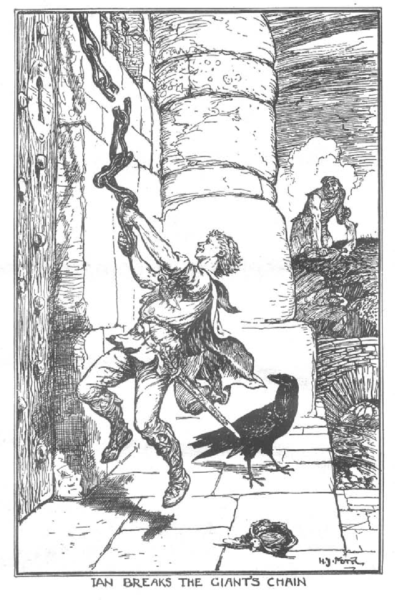

“听起来像是士兵的儿子依万的声音，”他自言自语地说着，“可是他只有十六岁。不管怎么样，还是回去看一看。”于是，他向家里走去。

“你是士兵的儿子依万吗？”他一走进城堡就问。

“不！当然不是。”依万回答，他也不想让巨人知道他是谁，“可是，我也要像他一样和你摔跤。”

他们俩互相抓住对方的肩膀，巨人把他摔在地上。“你比我力气大，”依万喊道，“可是，我还没有输给你！”他站起来，双手抱住巨人。

他们俩扭在一起，摔来摔去，一会儿这个占上风，一会儿那个占上风。后来，依万用自己的脚钩住巨人，一下子就把他摔倒在地。接着，他大声地叫渡鸦。渡鸦拍着翅膀飞过来，说：“把手伸到我的右翅膀下面去，那里有一把锋利的刀，可以砍下巨人的头。”这把刀果然锋利，只一下，巨人的头就从他的头颈上滚下来。

“现在，去洗个温水澡，用香油擦一下全身，明天，你的力气就会抵得上许多人。留神骑士的女儿和你说的话，因为她很狡猾，会想尽办法把你留在她的身边。再见吧！不过，你得先给我一些烟草。”

“这我非常乐意。”依万说着，拉下许多烟草给它。

这天晚上，他像渡鸦和他说过的那样，洗了澡，擦了香油。第二天，他来到骑士的女儿坐着的房间。

“留下来和我一起住吧！”她说，“做我的丈夫，这个城堡里有数不清的白银和黄金。”可是，他不听，继续走他的路，直到来到骑士最小的女儿住的城堡，她正在大厅里缝衣服，泪水从她的眼中流出，滴到顶针箍上。

“是什么风把你吹到这儿来了？”她问。

“你能来的地方我为什么不能来？”依万回答说。

“我是被一个巨人带到这里来的。”

“这我非常清楚。”他说。

“你是士兵的儿子依万吗？”她又问。

他回答说：“是的，我是。可是，请告诉我，你为什么哭？”

“明天，巨人就要从狩猎山上下来，我就得嫁给他了。”姑娘呜咽地说着。依万对她说的这些话并不在意，只是说：“我怎么能把他叫回家？”

“摇动挂在门外的铁链。”

依万走出去，由于拉铁链用力过猛，摔倒在地。不过，他马上就站起来，用力去拉铁链，力气那么大，把四个链环都拉下来了。这时候，狩猎山上的巨人正在把打到的猎物装进口袋，听到了传来的声音。

“天下之大，除了士兵的儿子依万以外，谁都别想拉得动我的铁链。要是他找到我了，那就是说，我的两个兄弟都被他杀了。”他一边想着，一边大步流星地赶回城堡，大地在他的脚步下抖动着。

“你是士兵的儿子依万吗？”

“不！我当然不是！”年轻人回答。

“那么，你是从什么鬼地方冒出来的，能够摇动我的铁链。这个世界上，只有士兵的儿子依万能够做到这一点，可他现在只有十六岁。”

“等你和我摔过一跤以后，我再告诉你我是谁。”依万说。他们伸出手来互相抱住，巨人用力把依万摔倒在地。可是他立刻就站起来，用脚钩住巨人的肩膀，一下子就把他沉重地摔倒在地下。“矮胖子黑渡鸦，快来啊！”他接着大声喊叫。渡鸦飞过来了，用它的翅膀拍打巨人的头，使他站不起来。然后，它叫依万从它的羽翼下拿出那把锋利的刀来，这是它随身带着用来砍野果的。依万用它向巨人的头砍去，刀那么快，只一下，巨人的头就滚到地下去了。

“休息一下吧，今天晚上好好睡觉，”渡鸦说，“明天，你要带骑士的三个女儿到通往地下世界的那块岩石边上去。不过你要当心，你自己先下去，叫她们跟在你后面。我要走了，先给我一点烟草吧。”

“你都拿走吧！”依万说，“这是完全应该的。”

“不！给我一点就行了。前面发生的事情你都很清楚，后面的事情你就不知道了。”渡鸦说着，用嘴叼起一点烟草就飞走了。

第二天早晨，骑士的小女儿把城堡里所有能找到的金子和白银，全都装到驴背上去，和士兵的儿子依万一起动身到她二姐那里去，她正在等待着他的消息。他们来到以后，她也把城堡里所有贵重的东西用驴子拉走。他们来到关着大女儿的城堡，找到大女儿以后，她也是这么做了。他们一起来到那块岩石的边缘，依万躺下来对下面喊叫，一个篮子被拉上来，他们把行李一件一件地放进篮子，把东西先送下去。等最后一件东西送下去以后，依万本该自己先下去，三姐妹跟在他后面。可是他忘了渡鸦的警告，叫她们先下去，他也是为了怕出什么意外。他只是要求最小的女儿把头上戴着的小金帽留给他，她们三人头上都戴着小金帽。然后，他帮助她们一个一个地跨进篮子，放到下面去。

依万在上面等着，可是等了很久，也不见篮子上来。原来骑士的女儿得到自由以后，就把依万忘得一干二净。她们乘坐着那条把依万和他的兄弟送来的船，回到格里安耐哥去了。

后来，他终于明白发生了什么事情。正当他在想该怎么办的时候，渡鸦飞过来了。

“我的话你没有听进去。”渡鸦严肃地说。

“是的，我没有听你的话，所以还在这里。”依万低着头回答。

“过去的事情已经无法补救了。”渡鸦继续说，“不听好言劝告，只好准备吃苦。今天晚上，你得在巨人的城堡里过夜。现在，该给我一点烟草了。”

“我给你，不过，我请求你，留在城堡里和我作伴。”

“那不行，不过明天一早我就来。”

第二天一早，它来了。他叫依万到巨人的马厩里去，那里面有一匹马，它既能在陆地上，也能在海洋里奔跑。

“不过，你要小心，”它补充说，“想好该怎样走进去，因为那扇门老是不停地晃荡着，如果给它碰到了，你会大喊大叫。我走在前面给你带路。”

“走吧，”依万说。渡鸦一跳一跳地走在前面。它自以为很安全，可是门碰到了它尾巴上的一根羽毛，它尖声地喊叫起来。

接着，依万向后退了几步，然后向前冲，想跳过去，可是门碰到了他的脚。他摔倒在马厩的地板上，昏迷过去。渡鸦赶紧扑过去，用嘴和爪子把他抓起来，飞回城堡，给他的脚上敷上药膏，直到他完全恢复健康。

“现在，出去走走，”渡鸦说，“不过，不论看到什么都不要大惊小怪，也不要去碰任何东西。现在，先给我一点烟草吧。”

依万在岛上看到许多奇怪的东西，比他能想象得到的还要多。在一条峡谷里，仰面躺着三个死了的英雄，三支长矛刺中了他们的胸膛。他听从渡鸦的劝告不说什么，只是把那些长矛都拔出来。三个人坐起来说：

“你是士兵的儿子依万，有一条咒语命令你和我们一起走，到黑渔夫的洞里去。”

于是，他们四个人一起走，直到来到那个洞前。有一个人先进去，看看能找到什么。他看到一个女巫坐在一块石头上，外貌非常可怕。他还没有来得及开口说话，女巫就用她的棍子碰了他一下，把他变成一块石头。另外两个人也遭到了同样的命运。依万最后一个走进去。

“这些人中了咒语。”女巫说，“除非你到大女人岛上去，把那里的水弄来，给他们擦一下，他们才能活过来。你最好不要耽搁。”依万心情沉重地走出去，他真希望当初跟骑士的小女儿一走了之。“你不听我的劝告，”渡鸦跳着过来对他说，“所以麻烦就来了。现在先去睡觉吧！明天，你骑上巨人马厩里那匹能在陆地和海洋上奔跑的马去。到了大女人岛以后，会有十六个男孩子出来迎接你，给马送来草料，想把它的马鞍和马勒拿走。你要注意，不要让他们碰到马。你自己给马喂草，把它拉到马厩里去，把门关好。还要小心地记住，十六个小马夫轮流给你的锁你都得换掉。现在，你拉下一些烟草给我吧。”

第二天早晨，依万把马从马厩里拉出来，没有被门碰伤。他骑着马跨过海洋，来到大女人岛。十六个小马夫出来迎接他。他们个个都想来牵马，喂马，把它送到马厩里去。可是依万只是说：

“我自己来照顾它，把它牵进去。”他给马洗刷的时候，马对他说：“他们会给你送来各式各样的饮料，可是你要注意，除了乳汁和水以外，什么都别喝。”事情就这样发生了。十六个小马夫看到送来的饮料他都不喝，就自己喝了，接着，一个挨着一个地都倒在地下。

依万没有被他们的甜言蜜语所迷惑，心里感到非常高兴。可是，他忘了马同样事先给他的警告：“注意别睡着了，再次错过回家的机会。”那些小家伙睡着以后，他耳中听到了甜蜜的音乐，所以也睡着了。

事情发生以后，马从马厩里冲出来，用脚踢他，不顾一切地把他喊醒。

“你把我的劝告当耳边风，”马说，“谁知道会不会错过过海的时机？你先把墙上挂着的剑拿下来，把十六个马夫的头砍掉。”

依万为自己的又一次粗心大意而感到羞愧，他站起来照马的话去做。接着，他骑着马来到井边，把皮囊灌满水，然后骑着马跨过海洋，回到渡鸦等着他的岛屿。

“把马牵到马厩里去。”渡鸦说，“躺下来睡一觉。明天，你要把那些英雄救活，把女巫杀掉。可要注意，不要像今天一样傻呼呼的。”

“留下来和我做伴吧！”依万请求它说。可是，渡鸦摇摇头，飞走了。

第二天早上，依万醒来，急忙赶到老女巫坐着的洞里。她还没有来得及向他施魔法，就被他打死了。接着，他把水泼到那些英雄的身上，他们都恢复了生命。他们一起来到岛屿的另一端，渡鸦正在那里等他们。

“你终于能够听从别人的劝告了。”渡鸦说，“你现在学聪明了，可以回到格里安耐哥的家里去了。到了家里，你会看到，就在今天，骑士的两个大女儿准备嫁给你两个哥哥，最小的女儿准备嫁给岩石上的头人。不过，你得把她的金帽子交给我。如果你想要它，只要想到我就行了，我会立刻把它送过来。我还得再次提醒你，如果有人问你从哪里来，你就说从他的后面来；要是问你到哪里去，你就说到他的前面去。”

于是，依万骑上马，掉转马头对准大海直奔过去，一直奔到格里安耐哥教堂。他们来到一块草地上，马在一口井旁站住，他从马鞍上跳下来。

“现在，”马对他说，“拔出你的剑来把我的头砍下。”

可是依万回答说：“你帮了我那么多忙，我怎么能恩将仇报呢？”

“这是唯一能把我和渡鸦从巨人的咒语中解救出来的办法。我原来是一个姑娘，他是我的未婚夫。所以，别害怕，照我的话去做。”

这样一来，依万就拔出自己的剑来，把马的头砍下来，然后头也不回地向前奔去。半路上，他看到一个妇女站在家门口，问他是从哪里来的，他照渡鸦教他的话回答说，是从她身后来的。问他要到哪里去，他说要到她的前面去。不过，他感到口干了，想喝点水。

“你是个卤莽的家伙，”那妇女说，“不过你还是会有水喝的。”她给他端出一些牛奶来，她丈夫回来之前，她只有这么一点牛奶了。

“你丈夫到哪里去了？”依万问。

那妇女回答说：“他到骑士的城堡里去了。他要想办法给他的小女儿做一顶金银帽子，像她两个姐姐戴的一样。这种帽子在本地找不到。看！他回来了，现在可以听听他干得怎么样了。”

这时候，那人走进门来，看到一个陌生的小伙子，就问：“小伙子，你是干什么的？”

“我是一个铁匠。”依万回答。

那人说：“我的好运气来了，你可以帮我一起做骑士女儿的那顶帽子。”

“那顶帽子你做不出来，这一点你很明白。”依万说，“嗯！我必须试试看，”那人回答，“否则，就会把我吊死在树上。所以，帮我的忙就是做了一件好事。”

“我行的话，一定会帮你的。”依万说，“你把那些金和银都自己留下来，今天晚上，把我锁在铁匠铺里，我要施展我的魔法。”

那人感到很奇怪，不过还是把他锁进去了。

铁匠刚把钥匙插入，把门锁上，依万就希望渡鸦飞来。渡鸦飞过来了，嘴里还叼着那顶帽子。

“现在，把我的头砍下来。”渡鸦说。

可是依万回答：“你帮了我那么大的忙，我怎么能恩将仇报呢？”

“这是你唯一能感谢我的方法。”渡鸦说，“我在中咒语之前和你一样，是个小伙子。”

这样，依万就把他的剑拔出来，把它的头砍下。与此同时，他把眼睛闭起来，免得看到这种情景。这以后，他就躺下来，一直睡到天亮。那个铁匠过来把门打开，把他摇醒。

“帽子在这里。”依万睡眼朦胧地说着，从枕头底下拿出一顶帽子来，接着马上又睡着了。

等他再醒过来的时候，太阳已经很高了。这时候，他看到一个长着金头发的身材魁梧的年轻人站在他的身边。

“我就是渡鸦，”他说，“魔法已经破了。起来跟我一起走吧！”

他们俩一起来到砍马头的地方。可是，马不见了，只见一个美丽的少女。

“我就是那匹马。”她说，“魔法已经破了。”她和那年轻人一起走了。

这时候，铁匠已经把帽子送到城堡。他让骑士小女儿的仆人把帽子送给她的女主人。可是，那少女一看到帽子，就喊叫起来：

“他说假话，如果他不把做这顶帽子的真正的人带来，我就把他吊死在窗口外面的那棵树上。”

听到这些话，仆人非常害怕，赶紧跑出去对铁匠说了。铁匠也以最快的速度去找依万。找到以后，他把依万带进城堡。姑娘看到他的时候，高兴得一下子说不出话来。接着，她宣布，除了他，她谁也不嫁。这时候，有人去把骑士叫过来。他听了依万讲述事情的经过以后，严肃地说，姑娘是对的；他的两个大女儿，也决不会嫁给那些不但抢夺别人的荣誉，而且不管别人死活的人。

来参加婚礼的客人都说，骑士说得好。两个哥哥不得不离开这个国家，因为在这里再也没有人愿意和他们说话。

（西苏格兰高地故事）

 

## 狐狸和狼

从前，在一群高山的山脚下有一个小村庄。离村庄不远有一个交叉路口，一条路向东，一条路向西。村民们都是勤劳而且安分守己的人。他们整天在地里劳作，到晚上小教堂的钟声响了以后才回家。一到夏天，他们就把牲畜赶到牧场里去。每天从日出到日落，他们都是又快活又满足。

一个夏日的夜晚，当一轮满月照在白色的大路上时，一只大狼在角落里走来走去。

“我回窝之前，一定要吃上一顿好饭。”它自言自语地说着，“差不多已经快一个星期没有好好地吃过东西了，尽吃一些乱七八糟的东西。当然，山里头有的是兔子。可是，要想捉住它们，可还得有点本事，可惜我已经不年轻了。要是我能吃到两星期前碰上的那只狐狸，然后美美地睡上一觉，也就心满意足，不再要求什么了。那天，我正好要吃掉它，不巧它的丈夫就睡在它的身边。谁都知道，狐狸不管大小，跑起来都像一阵风一样。说实在的，除了狼以外，这个世界上好像没有什么东西是我可以捉住的了。可是，俗话说：‘狼不咬狼。’不管怎么说，先去看看这个村子里有些什么东西再说，我已经饿得像个穷教书先生一样了。”

就在狼这样想着的时候，它想到的那只狐狸这时候正在另一条路上奔跑。“整整一天了，我都听见村子里的母鸡咯咯叫个不停，我再也忍耐不住了。”它一边奔跑，一边嘀咕着，双脚几乎不着地，“当你喜欢上鸡肉和鸡蛋以后，就再也没有比这更美妙的了。我今天晚上非得吃到一些不可，这就像天上的太阳一样明摆着。我近来这么瘦，浑身的骨头都在嘎嘎作响，我可怜的宝贝也饿的直哭。”它这样说着的时候，来到了一块草地上，这里正是交叉路口。它躺在一棵树下想休息一会儿，考虑一下行动计划。这时候，狼跑过来了。

看到狐狸就躺在它的嘴边，狼的口水都流出来了。不过，看到它那么瘦，狼的兴奋就大打折扣了。狐狸的耳朵很尖，尽管狼的脚步声像是踩在地毯上一样轻，它还是听到了。它回过头来有礼貌地说：

“是你啊，邻居！在这里见面真是太巧了！我希望你过得不错！”

“就我的身体来说，还算过得去！”狼回答着，眼里闪烁着贪婪的光，“起码说吧，一个人饿到这种地步，像我这样就算不错了。可你究竟是怎么回事。两个星期以前，你还胖得够令人满意的。”

“我病了，病得很厉害。”狐狸回答，“你说得很对，一只虫也要比我胖得多了。”

“是这样的。不过，我对你这个样子也够满意了，俗话说，饥不择食嘛！”

“嗯！你总是很会说笑话！我想你还没有我一半饿呢！”

“那我们很快就会看得出来。”狼喊道，接着它张开大嘴，蹲下身来准备扑过去。

“你这是在干什么？”狐狸退后几步说。

“我要干什么？我要干的事情就是把你当晚饭吃掉，这花不了多少工夫。”

“我想你肯定是在开玩笑。”狐狸满不在乎地回答，可是，它的眼睛一直紧紧地盯着狼。狼咆哮一声，露出它的牙齿说：“我不想开玩笑，我要吃东西。”

“可是，像你这样有本事的人肯定会明白，即使是把我一口吃掉，也一定觉得像是没有吃过东西一样！”

“在这个世界上，谁的肚子最饿，谁就最聪明。”狼回答说。

“啊！那倒是真的。可是…… ”

“我没有工夫去听你说什么‘可是’或‘是’的，”狼粗暴地打断它的话，“让我们说到点子上去吧！问题是我要把你吃掉，而不是和你说话。”

“你难道不同情一个可怜的母亲吗？”狐狸用尾巴擦了擦眼睛，同时偷偷地注视着它。

“我都快饿死了，”狼坚决地回答。“你应该明白，”它又龇牙咧齿地笑着说，“慈悲只有在家里才找得到。”

“千真万确，”狐狸说，“我没有丝毫理由反对你把我吃掉，以填饱你的肚子。但是，如果狐狸准备作出牺牲，作为母亲，我提出最后的一个要求。”

“那就快说吧，别浪费时间，我不能再等下去了！你想要什么？”

“你肯定知道，”狐狸说，“村子里有一个富人，他每年夏天都做很多乳酪，可以够他吃整整一年。他把这些乳酪保存在院子里的一口枯井里。井旁的一根柱子上吊着两个桶，那是过去用来打水用的。一连许多个晚上，我都偷偷地跑到那里去，坐在桶里溜到井底去，拿回足够的乳酪去喂我的孩子们。我对你的唯一请求是跟我一起去走一回，用不着去捉那些鸡啊什么的，我死之前，那些乳酪就足够我美餐一顿的了。”

“可是，那些乳酪到现在也许早就吃完了。”

“你只要去看看它们有多少就明白了！”狐狸笑着说，“即使是它们都被吃光了，你还有我可以吃啊！”

“好吧！我去。你在前面领路。不过，我警告你，如果你想逃跑或者耍什么花招，那你就看错人了。也就是说，我的腿比你长。”

村子里万籁俱寂，除了天上的明月发出皎洁的光以外，一点灯光都没有。狼和狐狸悄悄地走着。忽然，它们都停下来，你看看我，我看看你。原来是一股煎香肠的香味扑鼻而来。一只睡着了的狗也闻到了这股香味，贪婪地吠起来。

“继续往前走没有问题吧！你看呢？”狼小声地问。可是狐狸摇摇头。

“狗还在叫，不能这么说。”它回答，“可能会有人出来看到底是怎么回事。”接着，它示意狼到暗处躲藏起来。

约莫过了半个钟头，狗也许是叫累了，或者是香肠被吃掉了，香味闻不到了，狗安静下来。这样，狼和狐狸又站起来，急急忙忙地向墙脚下走去。

“我比它轻。”狐狸心里想着，“如果快一点可能会抢在它前面，在它之前跳过这堵墙去。”它这样想着，加快了步伐。可是狼虽然跑得不快，却跳得很快，它一下子就跳到同伴的身边。

“你想干什么？伙计！”

“嗯，没什么。”它回答。计划失败了，它非常恼火。

“我想，要是在你的屁股上咬一口，你会跳得更远些。”狼说着就真的咬了它一下。狐狸很不安地缩回去。

“小心一点，不然我就叫了！”狐狸骂起来。狼心里明白，狐狸如果真的叫起来，会发生什么事情。所以它赶紧示意狐狸跳上墙去，它紧随其后。

到了墙上以后，它们蹲下身来看看周围的动静。院子里一个人影都没有，并就在离屋子最远的角落里。正像狐狸说的那样，两只桶挂在一根柱子上。它们两个沿着墙角偷偷地走过去，一直走到井边。狐狸拼命地伸长脖子，看到井底下只有少得可怜的一点水，刚好能够映出天上又大又圆又黄的月亮。

“太走运了！”它对狼说，“里面有一块像磨盘那么大的乳酪。看！看！你见过这么漂亮的东西吗？”

“从未见过！”狼回答，轮到它看的时候，它真的把水中的月亮当成了乳酪，眼中闪出贪婪的光。

“现在，你还信不信！你该说什么呢？”狐狸微微地笑着说。

“你的话像是个真正的女人说的。”狼回答。

“好吧！到桶里去，下去吃个饱！”狐狸说。

“嗯！这是不是你耍的诡计？”狼奸笑着问，“不行！先坐在桶里下去的应该是你！你要是不肯下去，就叫你脑袋搬家！”

“当然，我应该先下去，我非常乐意。”狐狸回答，它早就料到狼会这么说了。

“注意别把乳酪都吃光了，否则你就更加倒霉。”狼继续说。可是狐狸含着眼泪看着它。

“再见了！多疑的人！”它伤心地说着，跨进了水桶。

一会儿工夫，它就到了井底，看到井下的水还没有它的腿高。

“天啊！比我想到的还要大，还要味道好。”它抬起头来对狼说。狼这时候正靠在井上看着。

“那就快点把它拿上来。”狼命令说。

“那我怎么行呢？它那么重！我拿不动。”狐狸说。

“要是很重，当然应该把它分成两半。”狼说。

“可是，我没有刀，”狐狸回答，“你应该自己下来，我们一起把它抬上去。”

“我该怎么下去呢？”狼问。

“哎！你真笨！跨进你身边的另一个篮子里去！”

狼看了看，篮子就在旁边。它有点艰难地爬进去。因为它起码有四只狐狸那么重，篮子一下子就掉到井底，另一只狐狸坐着的篮子立刻升到地面上来。

等狼明白发生了什么事情时，它愤怒地喊叫起来，露出了狼的本来面目。不过，想到乳酪还留在井下，它多少也得到一些安慰。

“可是，乳酪在哪里？”它问狐狸。这一回，轮到狐狸靠在井墙上微笑着看热闹了。

“乳酪？”狐狸说，“我要带回家去喂我的孩子，它们还小，不能自己找吃的。”

“啊！你这个贼！”狼暴跳如雷地喊叫着。可是，狐狸不再在那里听它的谩骂，它已经到隔壁一家鸡棚里去了。昨天，它注意到那里有几只小鸡很肥。

“也许，我真的对它太残酷了一点。”狐狸自言自语地说着，“不过，天上乌云密布，马上就要下大雨了，那时，另一个桶会灌满水，沉到井下去，那样它就可以上来了。至少还有这种可能！”

 

## 伊恩如何得到蓝隼

很久以前，有一个国王和王后统治着一个西方的岛国，他们有一个儿子，两个人非常喜欢他。孩子长得又高大又结实又英俊；而且不论是赛跑、射击、游泳还是潜水，在他们的国家里，没有一个年轻人比得过他。此外，他还会航海，会在竖琴的伴奏下唱歌。每年冬天的夜晚，人们都聚集在大厅里制作弓箭或织衣服的时候，伊恩就会给他们讲祖先们的故事。

这样年复一年，按照当时的说法，伊恩几乎已经是一个大人了。这时候，他的母亲——王后去世了，整个岛屿充满了巨大的悲痛，孩子和他的父亲更是悲伤万分。可是第二年，国王又娶了一个妻子以后，似乎把他的前妻忘记了。只有伊恩铭记在心。

峡谷里的树叶已经变黄的一天早上，伊恩把箭袋装满，背上弓箭，到山里去打猎。可是，不论他走到哪里，都连一只鸟的影子也看不见。后来，一只蓝隼从他的头上飞过，他举起弓来瞄准。不过，尽管他的眼睛敏锐，弓也举得很稳，蓝隼却飞得比他的箭还要快。他只射下了它翅膀上的一根羽毛。这时，太阳已经贴近海面，他只好把羽毛放进口袋，动身回家。

“今天，你是否给我带许多猎物回来？”他一走进大厅继母就问。

“除了这个，什么都没有。”他把蓝隼的羽毛交给继母，说道。她拿着羽毛尖默默地看了一会，然后转过身来对伊恩说：

“我要把它当作十字架和咒语加到你头上，直到今年年底！你要一直感到寒冷、潮湿和肮脏，你的鞋子里总是积水，直到你把长着这根羽毛的蓝隼给我带回来。”

“如果这是你给我的咒语，我也同样可以给你。”伊恩回答，“你将一只脚站在这间大房子上，一只脚站在城堡上，直到我回来。不论风从何方来，你的脸将一直对着风。”接着，他就照继母的吩咐，出去找那只鸟。他从山上回过头来看家里，看到王后正一只脚站在大房子上，一只脚站在城堡上。不论狂风从什么方向刮过来，她的脸总是对着风。

一路上，他翻山越岭，渡过急流，来到一块宽广的平原上。那只蓝隼连一丝影子都没有。天越来越黑，小鸟开始纷纷飞回自己的巢穴，伊恩终于什么也看不见了。他在树丛里躺下，睡意开始袭来。睡梦中，他感到一个柔软的鼻子在碰他，一个温暖的身体蜷缩在他旁边，一个低沉的声音在轻轻地对他说：

“伊恩，命运在和你作对，我只能给你羊脸和羊蹄，有了这些，你就应该满足了。”伊恩张开眼睛，看到狐狸吉勒。

他们生起了一堆火，开始吃晚饭。然后，狐狸吉勒像刚才一样躺下，睡到天亮。第二天，他醒过来以后，吉勒说：

“你要找的蓝隼在一个巨人那里，他有五个头，五个头颈，五个驼背。我领你到他的房子那里去，教你怎样又快又好地照他的话去做。首先，要好好地照顾他的那些鸟，这样，他可能会把蓝隼交给你喂养和看管。那时，等巨人出去以后，你就用布把蓝隼包起来，把它带走。不过你要注意，不能让它的翅膀碰到房子里的任何东西，否则，你就要倒霉。”

“谢谢你的好主意，”伊恩说，“我会小心地照你的话去做的。”接着，他开始动身到巨人那里去。

“谁在那里啊？”巨人听到有人大声地敲他的门，喊叫起来。

“是想来干活的人。”伊恩回答。

“你会干什么活？”巨人又问。

“我会养鸟，喂猪，放牧和挤牛奶，还会放羊，你有没有这些活！”伊恩回答。

“那么，进来吧！我很需要这种人。”巨人说。

于是，伊恩走了进去。他小心地照料那些鸟和牲畜，干得那么好，巨人从来没有这样满意过。后来，他想可以放心地让伊恩去喂养蓝隼。伊恩心里非常高兴，他把蓝隼养得那么好，它的羽毛像天空一样明亮。巨人非常满意，有一天，他对伊恩说：

“我住在山那边的兄弟早就想叫我去看看他们，由于担心我的蓝隼，我一直没有去。现在，我想可以由你来照顾一天，天黑之前我就会回来。”

第二天一早，巨人刚刚走出门，伊恩就迫不及待地捉住蓝隼，用一块布包好，急急忙忙走出去。他们经过门柱的时候，强烈的阳光透过那块布，照到蓝隼，它跳了起来。一根羽毛尖碰到门柱子上，蓝隼惊叫起来。巨人听到了，三两步就赶回来了。看到巨人，伊恩浑身发抖，可是巨人只是说：

“如果你想要我的蓝隼，你就得先给我把那把白光剑拿来。这把剑在帝呼拉特赫的大女人家里。”

“她们住在哪里？”伊恩问。

可是巨人回答：“嗯，那是你的事情，你自己去找吧。”伊恩不敢再问了，急忙向外面的荒野走去。正如他所希望的那样，他碰到了狐狸吉勒。它吩咐他先吃饭，然后躺下来睡觉。

第二天他醒过来的时候，狐狸对他说：“让我们到海边去。”于是，他们向海边出发。到了海边以后，他们看到，面前就是茫茫的大海，帝呼拉特赫岛就在大海的中间。伊恩不禁心里一沉，转过脸来问吉勒，干吗把他带到这里来，叫他到这里来的巨人肯定知道，没有船，他就没有办法找到大女人。

“别泄气，”狐狸说，“这件事太容易了。我会变成一条船，你乘到船上来，我把你带过海，到帝呼拉特赫去找七个大女人。你要对她们说，你精于擦亮金和银，她们就会雇佣你。要是你能小心地干活，让她们满意，她们就会把白光剑拿出来，叫你磨亮。你想办法偷到它以后，别让剑鞘碰到任何东西，否则你就要倒霉。”

于是，伊恩照狐狸的吩咐一一去做了。七个大女人留他下来干活。一连六个星期，他干得那么卖力，七个女主人说：“从来没有一个人把东西擦得像他这么亮，我们把白光剑也交给他，让他擦得和其他东西一样亮。”

她们把白光剑从铁壁橱里拿出来，叫他把剑擦亮，直到能照出他的脸来。他照她们的话去做了。有一天，七个大女人出去了。他想这正是把剑拿走的好时机，他把剑放回剑鞘，把它扛到肩膀上。可是，就在他走过门的时候，剑鞘的尖端碰到了门，门发出响亮的尖叫声。大女人听到声音，跑回来，把剑从他手中拿走，说：

“如果你想要我们的剑，你必须把埃里茵国王的枣红色小马给我们带来。”

伊恩羞愧地离开这间屋子，来到海边坐下。不久，狐狸吉勒就跑过来了。

“显然，你把我的话当成耳边风了，伊恩。”狐狸说，“不过，还是先吃饭再说吧，我还会帮助你的。”

这些话使伊恩重新打起精神来，他找来一些树枝，生起一堆火，和狐狸一起吃过饭，然后就在沙滩上睡觉。

第二天一早，狐狸对他说：“我要把自己变成一条船，把你送过大海，到埃里茵国王居住的地方去。你要毛遂自荐，到他的马厩里去干活，照料他的马，直到他非常满意，让你给枣红色马洗刷。可是，当你骑着它走的时候，除了马蹄，不能让它的任何地方碰到王宫里的任何东西。否则你就要倒霉。”

它这样关照过伊恩以后，就把自己变成一条船，向埃里茵开去。国王让伊恩来照料他的马，后来这些马变得皮毛从来没有这么光亮过，跑起来从来没有这么快过。国王非常满意。一个月以后，他把伊恩找来，对他说：

“你尽职尽忠地为我效劳，现在，我要把王国里最宝贵的东西托付给你。”他这样说着，把伊恩领到马厩里，枣红色的小马就关在里面。伊恩给它擦洗，喂它吃东西，骑着它到处奔跑，直到连疾风也被他远远地抛在后面。

“我要出去打猎了，”有一天，国王看到伊恩正在马厩里照料枣红色的小马，对他说，“鹿已经从山上下来，是出去追逐它们的时候了。”说完，他就走了。国王一从他的眼睛中消失，伊恩马上就把小马从马厩里牵出来，骑到它的背上。可是，他从宫殿的大门口经过的时候，小马挥动了一下尾巴，碰到柱子上，柱子发出响亮的尖叫声。国王立刻奔跑回来，他捉住小马的缰绳，说：

“如果你想要我的枣红色小马，你先得把福兰克斯国王的女儿给我带来。”

伊恩垂头丧气地向海滩走去，脚步是那么缓慢，狐狸吉勒正在那里等着他。

“事情很清楚，你没有照我的话去做，看来，你永远也不会听我的话，”狐狸吉勒说，“不过，我还是要再帮助你一次，我第三次变成一只船，我们驶到法国去。”

船向法国开去。船是吉勒变成的，它爱怎么走就怎么走。船开到陆地上的一块岩石裂缝里。然后，狐狸叫伊恩到国王的王宫里去，去对国王说，他遇难了，船被夹在岩石的裂缝里。船上的人都遭到不幸，只有他一个人活下来。

伊恩听从狐狸的话，他的故事讲得那么悲惨，国王和王后，还有他们的女儿公主都跑出来听。听完以后，他们还不满足，要亲自到海边去看那条船。这时候，因为涨潮，船漂浮起来了。船又破又旧，疮痍满目，好像经历过千难万险。尽管如此，船里面却传出来美妙而甜蜜的音乐。

“给我弄一条船来，”公主喊道，“我要亲自上去看一看奏出这种音乐的竖琴。”一条船划过来了，伊恩自己上去把它划到自己的船边。

他把船靠在离岸较远的一边，所以岸上的人看不见。等他帮助公主上船以后，他把小船推开，公主再也不能回到小船上去了。音乐非常美妙，可就是不知道是从哪里传出来的。他们从船的这一头找到那一头，最后找到甲板上，才发现船已经在茫茫大海之中，看不到一片陆地，只有翻滚着的海浪。

公主一声不吭地站着，脸色变得阴沉起来。后来她说：

“你跟我耍了一个花招！你这是想干什么？我们要到哪里去？”

“你将成为一个王后，”伊恩回答，“埃里茵的国王派我来找你。作为交换，他把他的枣红色小马给我。我把小马交给帝呼拉特赫的七个大女人以后，她们就把白光剑给我。我要把这把白光剑交给有五个头、五个颈、五个驼背的巨人，他才肯把蓝隼给我。我答应过继母，要把蓝隼给她送去，这样，她就会解除加在我头上的咒语。”

“我宁愿做你的妻子。”公主回答说。

不久，船就驶入埃里茵海岸的港口，在里面抛锚。狐狸吩咐伊恩去对公主说，她必须在岩石的山洞里待一会儿，他们要到岸上去办一些事，完了以后再回来找她。然后，他们找来一条船，划到山脚下去。登上陆地以后，吉勒把自己变成一个美丽的女子，笑着对伊恩说：“我要给国王送上一个漂亮的妻子。”

这时候，埃里茵的国王正在山上打猎。他看到一条奇怪的船驶进港口，猜想可能是伊恩回来了。他停止打猎，跑下山来，急不可待地到马厩里去，把枣红色的小马牵出来，给它装上金马鞍，在它的头上套上银马勒。然后急急忙忙去接公主。

“我把法国国王的女儿给你带来了。”伊恩说。埃里茵的国王看着这个少女，觉得非常满意，不知道她是狐狸变的。他向她鞠躬，请她赏脸，到他的王宫里去。狐狸变成的少女一边走，一边回过头来对伊恩笑着。

到了大厅里，国王停下来，指着放在角落里的一个铁箱子说：“这箱子里有一顶王冠，它等你已经等了许多年了。现在，你终于来了。”说完，他弯下腰来打开箱子。

一眨眼，少女就跳到他背上，咬了他一口。他立刻就倒在地下失去了知觉。狐狸很快恢复自己的原状，跑回海边。伊恩、公主和枣红色小马正在那里等它。

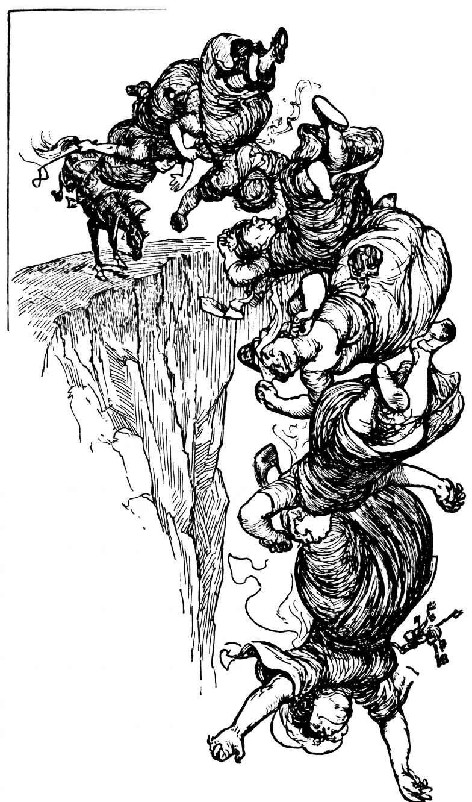

“我要变成一条船，”狐狸说，“你们乘到船上来。”它变好以后，伊恩牵着小马上船，公主跟在他们后面。船向帝呼拉特赫开去。一路上正好是顺风，他们很快就看到，前面就是帝呼拉特赫的山头。狐狸说：

“让小马和国王的女儿藏在那些岩石里，我自己变成小马，和你一起到七个大女人的家里去。”

大女人看到伊恩把枣红色的小马拉到她们的家门口，高兴得心都快跳出来了。最小的那个把白光剑拿出来，交到伊恩的手中。伊恩把金马鞍和银马勒拿下来，拿着剑走下山来，来到公主和真正的枣红色小马等着他的地方。

“现在，我们可以骑枣红马了，这一天我们已经等了很久了。”七个女人喊叫着。她们给小马安上马鞍和马勒。最大的那个先跨上马去，然后就是第二个，她坐在第一个的后面。接下来是第三个、第四个……一直到第七个。她们都坐好以后，最大的用鞭子抽了一下小马，小马立刻奔腾起来。它飞一样地越过沼泽地，绕着高山驰骋。大女人们抓住它，开心地哼着鼻子。后来，小马高高地跃入空中，落到最高的山莫拿赫山顶上。前面就是悬崖绝壁，它稳住前蹄，扬起后蹄，七个女人被抛出去，摔死在山谷里。小马哈哈大笑，又变成狐狸，跑回到海边，那里伊恩、公主、真正的枣红色小马和白光剑都在等着它。

“我要把自己变成一条船。”狐狸吉勒说，“把你，还有公主、枣红色的小马和白光剑一起带回去。”他们靠岸以后，狐狸又变回自己的形状，给伊恩出主意说：

“让公主、白光剑和小马留下，我把自己变成白光剑的样子。你把我拿去见巨人，他就会把蓝隼给你。”伊恩照狐狸的话去做，向巨人的城堡出发。巨人很远就看到白光剑的光芒，心里非常高兴。他捉住蓝隼，把它放到篮子里去，交给伊恩。伊恩带着它很快就回到公主、枣红色小马，还有真正的白光剑等他的地方。

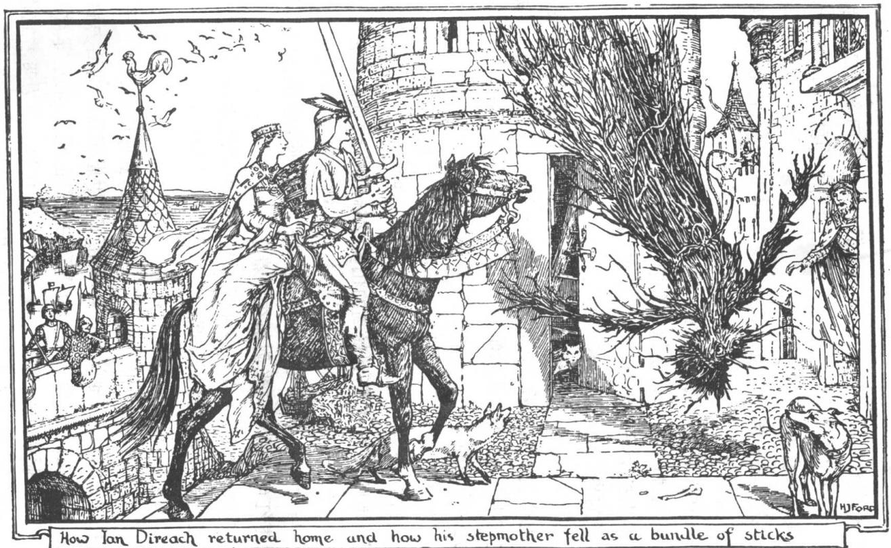

巨人得到渴望已久的白光剑，非常满意。他立刻拿着剑舞动起来，又是劈又是砍。开始，狐狸让巨人这样玩一会。然后它把巨人的手一扭，把巨人的五个头颈砍断，巨人的五个头滚落到地下去了。它这才回来对伊恩说：

“给枣红色的小马安上金马鞍，装上银马勒，把装着蓝隼的篮子背到肩上，拿起白光剑，剑背要对着你的鼻子。然后骑上枣红色小马，叫公主坐在你后面，回到你父亲的王宫去。但是一定要记住，剑背一定要永远对着你的鼻子。否则，你继母看到你的时候，就会把你变成一捆干草。可是，如果你照我的话去做，她自己就会变成干草人。”

伊恩认真地记住狐狸的话，于是继母在他的面前变成了一捆干草。他给干草点上了一把火，继母给他的咒语从此就打破了。这以后，他和公主结了婚，她是西部所有的岛国中最好的妻子。从此以后，他再也不会受到什么伤害。因为他有比疾风还快的枣红色小马，有蓝隼捉来猎物给他吃，有白光剑击败任何敌人。

伊恩知道，他所有的这一切，都归功于狐狸吉勒。他和它说好，不论什么时候，只要饿了就可以从他的牲畜中挑任何牲口吃；从此以后，不允许用箭来射它或它的同类。可是狐狸不愿意接受伊恩的任何帮助，它只要他的友谊。这样，伊恩的一切事业都兴旺发达，顺利地度过了他的一生。

（西苏格兰高地故事）

 

## 丑小鸭

丹麦这个国家整年的大部分时间里，景色并不见得怎么样，只有夏天显得特别美丽。这时候，麦子黄了，燕麦一片碧绿；干草晒得又干又软，最适合在上面打滚[^5]。从那间没有人居住的破屋，一直到小河旁，是一大片茂密的牛蒡，它们长得那么高大，一大群孩子躲在里面，谁都找不到。

就在这些牛蒡里面，一只鸭子筑了一个温暖的窝。它现在整天坐在窝里孵着六个可爱的蛋。五个蛋很白，可是第六个比其他的都大，而且是很难看的灰颜色。鸭子看到这个蛋也总是觉得很奇怪，它怎么和别的不一样？其他鸟也许会这样想，这只鸭子早晨和晚上到河里去游泳，开心地伸伸腿的时候，哪只偷偷地在一旁守候着的懒母鸭，可能就把自己的蛋下到它的窝里去了。而这只孵蛋的鸭子又偏偏不聪明，也不数一数自己有几个蛋，所以也就不把这件事情放在心上，只是留神让这只大蛋也和别的蛋一样地能够孵到。

这是这只母鸭下的第一批蛋，它感到非常高兴和自豪。它还取笑其他母鸭，它们总是忽视自己的职责，去和别人聊天，或者是除了早晚两次有益于健康的游泳以外，还常常溜出去多游一回。不过到后来，它对整天抱窝也渐渐地感到厌烦。“当然，蛋孵这么一点时间是不够的。”它自言自语地说着。也开始找机会玩一会儿。可是，它也知道，如果丢下这些蛋不管，让小鸭死在里面，就不会再有一个朋友来和它说话了。所以，它还是待在窝里，只是一天有好几次要站起来看看蛋壳破了没有。也许就是因为这个原因，蛋壳迟迟没有裂开。

起码看过一百五十次以后，母鸭终于高兴地看到，有两个蛋壳出现了裂缝。它急急忙忙蹲回去，把蛋一个一个地靠靠拢，整天孵着一动也不动。第二天早晨，它得到了报偿，看到五个蛋壳都裂开了。到了中午两只小小的黄脑袋从蛋壳里伸出来。这使母鸭很受鼓舞。它用嘴啄破蛋壳，让这两个小东西得到解放以后，整个晚上都专心致志地孵着，一动也不动。等太阳升起来的时候，五个蛋壳里都空了，十只眼睛惊讶地注视着外面绿色的世界。

这只母鸭从小就受到很好的教育，很爱干净。再说，坐在蛋壳上或者在蛋壳上走路，都是很不舒服的事情。所以，它把那些蛋壳推出去。它感到很高兴，在最大的那个蛋孵出来之前，有人可以和它们说说话了。可是，一天又一天过去了，那个大蛋一点也没有裂开的迹象。它越来越感到不耐烦，开始想问一问它的丈夫，可是它的丈夫从来不来。

“我一点也想不出，这是怎么回事！”它对来看它的邻居抱怨说，“孵这个蛋用的时间，可以孵出两窝小鸭来了！”

“让我瞧一瞧，”一个老邻居说，“嗯！我明白了，这是一个火鸡蛋。我年轻的时候，有一次，它们骗我，叫我去孵火鸡蛋。这些家伙孵出来以后，教它们游泳怎么也学不会。想起这件事我就觉得很烦。”

“好吧！我再给它一次机会，”鸭子叹息着说，“要是它二十四小时里还不出来，我就只好让它去了，我得去教其他的孩子学会游泳，学会自己找吃的东西。不能指望我同时做两件事情。”说着，它用羽毛把蛋推到窝的中间。它在窝里整整待了一天，早上连澡也不洗了，就怕寒风会吹到那个蛋。到了晚上，当它大胆地偷看一眼的时候，它好像看到了蛋壳的上方有一条小缝。它心中充满了希望，继续履行自己的职责。这个晚上，它激动得无法入睡。等第一道阳光照进来，把它唤醒的时候，它感到身下有什么东西在动。是的，小东西终于出来了，它挪开身体以后，看到一只又大又丑的鸭头朝前跌倒在地。

毫无疑问，它长得很丑，连母亲也不得不承认，尽管它嘴上只是说，它很大，很结实。“你下水以后，用下着教，自己就会游泳。”母鸭这样对它说，同时吃惊地看了一眼它背上暗淡的棕色绒毛，还有那又光又长的头颈。说实在的，它还没有自己身后那些小黄鸭子一半好看。

它们回来的时候，看到老邻居正站在岸上等着，要把它们带到院子里去。“不！它肯定不是一只小火鸡，”它自信地小声对母鸭说，“它虽然瘦得皮包骨头，也说不上有什么颜色，可它也有一些与众不同的地方。它的头也抬得很好。”

“你这样说真是太客气了。”母鸭这时候对它的魅力也开始感到疑惑，说，“当然，当你看着它的时候，一切都很正常。可和别的小鸭子比起来，却是有些不一样。但是，我们总不能指望所有的孩子都长得很漂亮！”

这时候，它们已经走到院子中间。里面坐着一只很老的鸭子，现在，所有的飞禽都很尊敬它。

“你们都要上去给它鞠躬，”母鸭小声地对它的孩子说，还向着老鸭子的方向点了点头，“两条腿要注意分开，就像你们看到我的这个样子。只有没有教养的小鸭子才会脚趾朝里。有父母教育的孩子都是这样的。”

小鸭子们尽量控制着自己又小又胖的身体，学着妈妈的样子走。老鸭子看到了很喜欢。可是，其余的鸭子都不满意地看着，交头接耳地说：

“啊！我的天啊！又来了这么多小鸭子，院子里已经挤满了。你看到过像那只大小鸭那么丑的东西吗？它给所有的鸭子都带来了耻辱，我去把它赶出去！”说着，它拍动翅膀，跑到大个的小鸭子前，咬它的头颈。

小鸭子大声地叫起来，它生下来第一次感觉到痛。听到它的叫声，母鸭马上转过身来。

“放开它！”它严厉地说，“否则我就把它的父亲叫来！它又没有惹着你。”

“是没有，可是它长得那么丑，谁也不愿意和它待在一起。”陌生鸭说。小鸭子虽然听不懂这些话是什么意思，但感觉得到这是在说它。当那只管理飞禽院子的老西班牙鸭子插进来说话时，它更加感到不舒服了：

“它与这些美丽的小鸭子如此不一样，真是太可惜了！它要是能够再孵一次就好了。”

可怜的小家伙低着头，不知道该看哪里才好。不过，妈妈的话使它得到了安慰：

“它虽然不像其他鸭子那样好看，可是，它游泳游得比它们好，也长得很结实。我相信，它也会像其他人一样，在这个世界上过得很好。”

“好吧！你们会觉得这里就像是自己家里一样。”老鸭子说着，摇摇摆摆地走开。那些小鸭子确实是这样，只有这只丑小鸭不一样。只要它的妈妈不在，谁都要来咬它。连那只火鸡，它的个子那么大，从它身边经过时，总忘不了嘲讽它几句。它的兄弟姐妹本来不会去注意它们之间的不同，经别人这么一说，也变得和别人一样，对它开始粗暴起来。

后来，它再也受不了了。有一天，它好像看到妈妈也不理睬它了。于是，那天晚上，当鸭子和鸡都在睡觉的时候，它偷偷地从一扇开着的门走出去。在牛蒡叶子的掩护下，它沿着河岸急急忙忙地走着，直到来到一片长着芦苇的大沼泽地。它躺下来，可是因为害怕，加上太累，它睡不着。第二天太阳露出第一丝光亮，芦苇开始嘎嘎作响的时候，它看到自己混进了一群野鸭子中间。看到自己再也跑不掉了，它站起来，有礼貌地向它们鞠躬。

“你长得很丑，”那些野鸭子仔细地看过它以后说，“不过，这和我们没有关系，除非你想和我们的一个女儿结婚，不过我们是不会答应的。”丑小鸭回答说，它没有和任何人结婚的意思，只要求在走了那么长的路以后，能自己待一会儿。

这样，它十分安静地在芦苇丛中过了两天，吃一些能找到的食物，喝池塘里的水，觉得自己又恢复了体力。它希望能永远地在这里住下去。离开所有的人，它感到既舒服又幸福，没有人来咬它，也没有人来说它丑。

就在它想着这些事情的时候，两只小雄鹅看到它。这两只小雄鹅这时正在芦苇塘里游荡，寻找晚饭吃。

“我们对这块沼泽地已经感到厌倦了。”它们说，“明天，我们想到别处去。那里的湖很大，找吃的东西更容易，你要不要和我们一起去？”

“那里是比这里好吗？”丑小鸭怀疑地问。话音刚落，只听见“砰！砰！”两声，两个新来的鹅就直挺挺地倒在它的身边。

听到枪声，水里的野鸭向空中飞去。接着的几分钟，不断地响起枪声。

幸好它还不会飞，它挣扎着从水里游过去，奔到洞里一些高大的植物丛中藏起来。可是，还没有奔进洞，它就看见一只四条腿的大动物站在那里瞪着它看，红舌头从嘴里伸出好长。后来它才知道这就是狗。丑小鸭害怕得直发抖，拼命地想把头藏到翅膀下面去。可是狗只是嗅嗅它就走了，它终于得以到安全的地方躲起来。

“我太丑了，连狗也不想吃。”它自言自语地说，“这实在是太幸运了。”它蜷缩在柔软的草中，直到枪声在远处消失。

等一切都安静下来好一会儿，只有天上的星星在看着它的时候，它才爬出来看了看四周。

它决不会再走进一个池塘了，决不！它心里这样想着。它看到沼泽地一直伸向很远的地方。它勇敢地继续往前走，一直走到一间小屋前。小屋看上去摇摇欲坠，全靠几块石头在支撑着，连门也只是挂在铰链上。屋子里唯一的亮光是一堆小火里发出来的。丑小鸭小心翼翼地走进去，在靠近破门口的一张凳子上躺下，如果必要，从这里它可以逃出去。可是，谁也没有来看它或闻它，所以，它平安地度过了一夜。

这间小屋子里住着一个老太婆，还有她的一只猫和一只母鸡。而且正是它们，而不是老太婆，才是这间屋子的主人。老太婆整天都在纺纱，然后送到最近的城里去卖掉。她喜欢猫和母鸡就像喜欢自己的孩子一样，从来不说它们。所以，小鸭子首先要得到的，是它们而不是老太婆的慈悲。

第二天天亮以后，它们才注意到家里来了客人。客人颤抖着站在它们的面前，眼睛瞪着门，随时准备逃出去。它们看上去好像并不是很生气，它们向它走过来的时候，它就不那么害怕了。

“你会下蛋吗？”母鸡问。

小鸭子老实地回答：“不会，我不知道该怎么下。”母鸡听了转身就走。

猫接着走上来。“你生气的时候会把毛竖起来吗？高兴的时候会呜呜叫吗？”它问。小鸭子又不得不承认，除了游泳，什么都不会。游泳对别人来说，好像没有多大用处。

于是，猫和母鸡走到老太婆的面前，她这时候还睡在床上。

“这个没用的东西到我们这里来避难，”它们说，“它称自己是小鸭子，可既不会下蛋，也不会呜呜叫！这对我们会有什么用？”

“当然得把它留下来！”老太婆兴致勃勃地回答，“说它不会下蛋，那是胡说八道。不管怎么样，先让它在这里住一段时间，看看会怎么样再说。”

于是，小鸭子留下来住了三个星期，和猫和母鸡一起吃饭。可是蛋始终没有生下来。

太阳出来了，天气暖洋洋的。小鸭子对整天关在屋子里感到厌倦了，一心一意想出去游泳。有一天，它觉得那么烦躁，连它的朋友也看出来了。

“你这是怎么啦？”母鸡问它。

小鸭子告诉它：“我很想回到水里去。你真是难以想象，把头扎入水中，一下子潜到水底去是多么开心。”

“我想我不会喜欢。”母鸡怀疑地回答，“我看猫也不会喜欢，”它们去问过猫以后，猫同意说，再也没有比这更令它讨厌的了。

“我这里再也待不下去了，我一定要到水里去。”鸭子又说道。猫和母鸡觉得自己的自尊心受到伤害，简单地回答：“那么好吧！去吧！”

小鸭子还想和它们说再见，并感谢它们的善良，它从小就很讲礼貌。可是，它们这时候已经转过身去，背对着它。它只好从摇摇欲坠的门走出去，心里感到很难过。尽管如此，它一呼吸到新鲜的空气，跳到水里去，就不由得一阵子兴奋，也不去理睬那些动物的难看面孔。有一段时间，它感到十分幸福和满足。可是，没有多久，冬天来了，开始下起雪来。周围的一切都变得潮湿和不舒服起来。小鸭子很快就发现，在水里游泳很开心是一回事；而在陆地上受潮又是另一回事。

有一天，太阳西沉，像是一个巨大的红色火球。叫小鸭子感到非常迷惑不解的是，河水变得又硬又滑。它听到一阵拍动翅膀的声音，一群天鹅正从高空飞过。它们像昨天晚上下的一场雪一样白，它们长长的头颈和黄色的嘴指向南方。那就是它们要去的方向，虽然具体在什么地方还说不出，但肯定是整天阳光明媚。

啊！要是它能和它们一起飞走多好啊！当然，那是不可能的。而且，像它这样丑的小鸭子，怎么能去和这些美丽的天鹅作伴呢？于是，它伤心地向池塘走去，一直潜到池底，尽可能地想象这是它最大的快乐。尽管如此，它心里明白，这不是！

每天早上起来，它都觉得天气越来越冷。小鸭子几乎已经没有办法使自己暧和起来。的确，说它一直就没有觉得温暖过会更加确切一些。后来过了一个特别寒冷的夜晚以后，它的脚冻僵了，走得非常缓慢。冰块逐渐向它靠拢，到了早上太阳出来的时候，它完全被冰住了，像落入圈套一样。不久，它就失去了知觉。

再过几个钟头，可怜的小鸭子的生命就要结束了。幸运的是，正好有一个人从河面上走过，要去工作，看到了这里发生的事情。他脚上穿着一双很厚的木鞋，他走过来用力踩那些冰块，把它们踩碎。然后，他把小鸭子抱起来，把它放到皮大衣里面去，它那冻僵的骨头才开始暖和起来。

那人也不去工作，他带着小鸭子转身回到家里，把它交给他的孩子。孩子们给它热的东西吃，把它放在一个盒子里，摆在火炉旁边。等他们放学回家的时候，它已经觉得很舒服。自从离开老太婆的家以后，它还没有感到这么舒服过。他们都是一些好孩子，想和它一起玩。可是，天啊！可怜的小家伙自从出世以来还没有玩过，它以为，他们是在惹它，吓得飞到牛奶锅里去，后来又飞到奶油盘子，面粉桶里去。后来，它被这种热闹和吵闹的场面吓坏了，从门口逃出去，躲到房子后面树丛的积雪中。

后来，它怎么也说不出，这个冬天是怎么度过的。它只是记得，过得非常可怜，从来就没有吃饱过。慢慢地，情况就好起来了。地面开始变得松软，太阳光也越来越温暖，鸟儿在歌唱，草地上又开始长出花来。当它站起来的时候，它感到和从农民的家里逃出来，睡到芦苇里去的时候不一样了。它的身体长大了，翅膀也长得结实了。山脚下有个什么粉红色的东西在看着它，它想飞过去看一看。

啊！从空中飞过是多么神气，一会儿飞到这里，一会儿又飞向那里！它从来没有想到过，飞行就是这个样子。等它接近那片粉红色的云彩时，未免有点失望。那是长在一间屋子旁边的一片苹果树上的花。这家人家的果园一直伸到小河旁。它慢慢地飞回地面，在茂密的紫丁香花丛中休息一会。就在它向四周张望的时候，它看到那边慢慢地走过来一群几个月以前它看到过的，那些美丽的鸟。它入神地看着它们一个又一个地走进河里，安静地在水面上漂浮着，自然地融为一体。

“我要跟它们走，”小鸭子自言自语地说着，“我虽然丑，可我情愿被它们杀死，也不愿意去忍受过去的饥饿和寒冷，和那些鸭子和飞禽对我的侮辱，它们本该对我好一些。”它很快就飞到水里去，尽快地跟在它们后面游着。

用不了多久，它就跟上它们了，因为它们停在一个绿色的池塘里休息，一棵树的树叶覆盖着池水。它们一看到它过来，一些年轻的就向它游过来，嘴里还喊叫着欢迎它。小鸭子又一次不大明白这是怎么回事。它高兴地向它们靠拢，不过，还是有点发抖。它向一只年纪较大的鸟游去，这时，这只鸟正游出树荫。小鸭子对它说：

“要是我该死，我情愿让你杀了我。我不知道为什么会孵出来，我那么丑，真不该生下来。”它一面说着，一面低下头来看着水面。

水面平静如镜的池塘里，它看到许多长着长头颈、金黄色嘴巴的白影子。它下意识地寻找自己那暗淡的灰色的影子，还有那皮包骨头的难看的头颈。可是什么也看不到，只见它下面是一只美丽的白天鹅！

“那只刚来的最好看了，”那些睡觉以前拿饼干和饼来喂天鹅的孩子们说，“它的羽毛更加白，嘴比其他的更加黄。”小鸭子听到这些话以后，觉得经历了那么多折磨和孤独很值得，否则，它就永远也不知道什么是真正的幸福。

（汉斯·克里斯蒂安·安徒生）

 

## 两个首饰盒

在很远很远的一片松树林中间，住着一个妇女。她有一个女儿，一个继女。自从亲生女儿出世以后，她要什么，母亲就给她什么。可是，她长大以后，不但人长得丑，而且脾气很坏，不讨人喜欢。与此相反，她的异母姐姐却是在帮助父亲维持家庭的艰苦劳动中度过自己童年的。父亲在第二次结婚以后不久就去世了。不过，因为她又勤劳又善良，人又长得美丽，所以，邻居们都很喜欢她。

日子一天一天地过去，姐妹之间的差异越来越明显，老妇人对待她的继女也越来越坏。她总是在寻找机会打她，或者不给她饭吃。不管是什么机会，她都不会放过。有一天，她实在想不出什么好办法，就叫两个姑娘坐到一口井的矮墙上去纺纱。

“你们最好留点神，”她说，“谁的线先断掉，就把谁扔到井底去！”

当然，她留神把那些好的结实的亚麻交给自己的女儿，而把那些没有用的粗糙的亚麻交给继女。可以想象，可怜的姑娘手中的线很快就断掉。站在门后看着的老妇人跑过来，抓住她的肩膀，把她推到井里去。“这就是你的下场！”她说。可是她错了，这仅仅是开始。

向下，向下，向下，姑娘不停地往下掉，好像这口井一直通往地球的中心。后来，她的脚终于碰到地面。她发现自己站在一块土地上，这块土地比她家乡山里夏天的牧场更美丽。树木在微风的吹拂下摆动着，色彩艳丽的花朵在草地上跳舞。尽管很孤独，姑娘的心也不禁欢跳起来。自从她的父亲去世以后，她从没有感到这样高兴过。于是，她穿过草地一直向前走，走到一堵摇摇欲坠的旧篱笆前。篱笆已经那么破旧，却没有倒下，真是一件奇怪的事情。看上去，像是爬满四周的像老人胡子一样的线在拉着它。

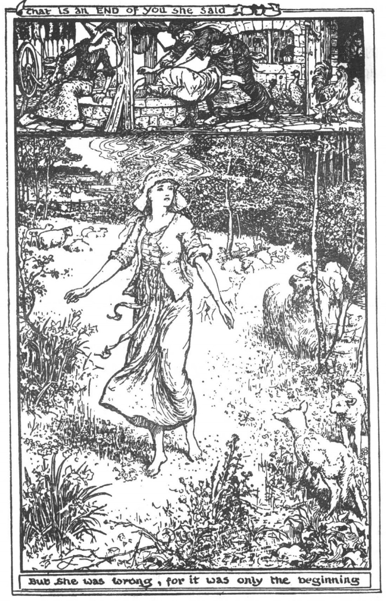

姑娘走过来，停了一会儿，想找个地方能安全地过去。可她还没有跨出一步，就听到篱笆喊出声音来：“别伤害我，小姑娘，我那么老了，那么老了，活不了多久了。”

姑娘回答：“不！我不会伤害你，别害怕！”

后来，她看到有个地方铁线莲长得比较稀少，就轻轻地跳过去。

“祝你一切顺利！”姑娘继续往前走的时候，篱笆这样说。

不久，她就走出草地，走上一条两旁都是花篱笆的路。在她的面前有一个烤箱，烤箱的门开着，可以看见里面有一堆白面包。

“面包你能吃多少就吃多少，可是不要伤害我，小姑娘。”烤箱说。姑娘对它说，不用害怕，她从不伤害任何东西。她非常感谢烤箱的好心，给她吃那么多好面包。等吃完最后一小块面包以后，她把烤箱的门关上，说：“再见！”

“祝你一切顺利！”小姑娘走的时候，烤箱说。

走着，走着，她觉得口渴了。她看到一头奶牛，角上挂着一个牛奶桶，向她走过来。

“挤我的奶吧！想喝多少你就喝多少，小姑娘。”奶牛说，“可要当心，别把牛奶泼在地上，也不要伤害我，我从来没有伤害过任何人。”

“我也是，”姑娘回答，“别害怕。”她坐下来挤牛奶，直到把牛奶桶快挤满。然后，她开始喝牛奶，喝到桶底只留下几滴。

“把剩下的一点倒在我的蹄子上，把桶挂回我的角上去，”奶牛说。姑娘照它的话做了，接着吻了一下奶牛的头就走了。

自从姑娘掉到井里以后，好多时间过去了，这时候，太阳已经下山。

“我到哪里去过夜呢？”她想着。忽然，她看到前面有一扇她刚才没有注意到的门，一个很老的老太太靠在门上。

“晚上好！”姑娘很有礼貌地向老太太问好。

老太太回答说：“晚上好，我的孩子，但愿人人都像你这样懂礼貌。你是不是在找什么？”

“我在找个地方过夜。”姑娘回答。

老太太笑着说：“那么就留下来一会儿吧！帮我梳梳头，告诉我你能干些什么。”

“我很乐意，老妈妈。”姑娘回答。她开始给老太太梳头发。她的头发又白又长。

这样，半个钟头过去了。老太太说：“既然你不觉得自己了不起，肯给我梳头，我要告诉你，到哪儿去找工作。只要你能耐心、谨慎，一切都会好的。”

姑娘向她表示感谢，然后向离这里不远的一个农场走去。她在农场里干挤牛奶和筛谷子的活。

第二天天刚放亮，姑娘就起来到牛棚里去。“我想你们肯定饿坏了。”她轻轻地拍着每一头牛说，然后到仓库里去搬来草料。在牛吃草的时候，她把牛棚打扫干净，在地下铺上干净的草。奶牛受到她这么好的照顾，非常高兴。当她来挤奶的时候，它们都安静地站着，不耍任何花招；而那些粗暴无礼的挤奶姑娘来的时候，它们常常这样干。她挤完奶，准备从凳子上站起来时，看到自己的周围坐着一圈猫，有白的，有黑的，有斑猫，也有花猫，它们都异口同声地喊叫：

“我们口渴了，请给我们喝一些牛奶。”

“可怜的小猫咪，”她说，“当然，你们可以喝一些。”

她走进牛奶场，那些猫都跟着。她给每只猫一小盘。那些猫在喝牛奶之前，都用身体在她的膝盖上擦一擦，还呜呜地叫着，表示感谢。

姑娘要做的第二件事，是到仓库里去筛谷子。就在她正忙着的时候，她听到一阵拍动翅膀的声音。原来是一群麻雀从窗口飞进来了。

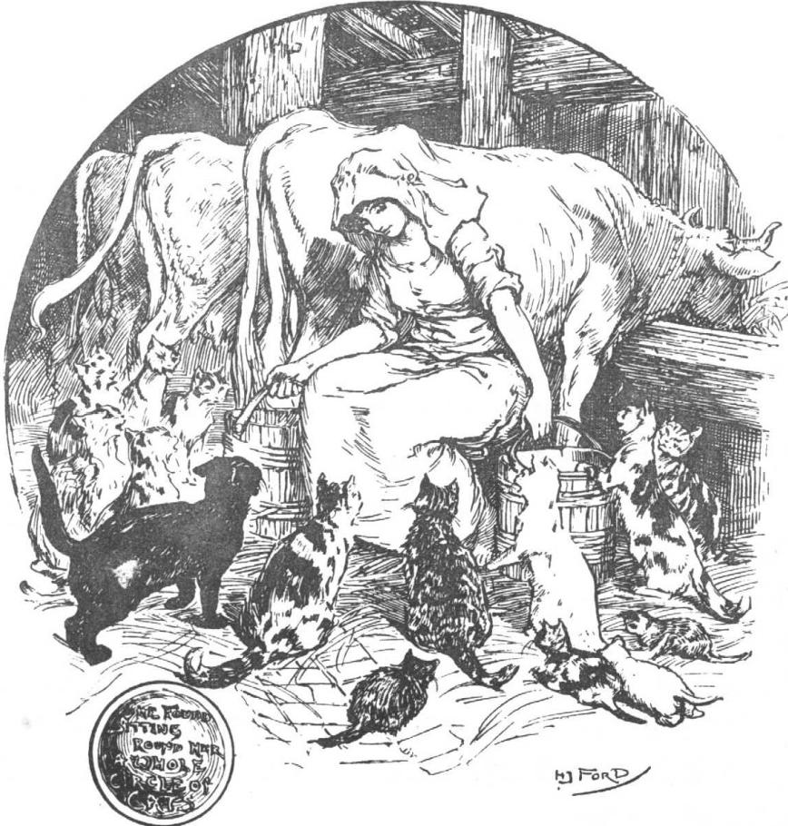

“我们肚子饿了，给我们一些谷子吃！给我们一些谷子吃！”它们喊叫着。

姑娘回答说：“当然，可怜的小鸟，会给你们一些的！”她抓起一大把撒在地下。它们吃饱以后，都飞到她的肩膀上拍拍翅膀，表示感谢。

日子一天一天地过去了，整个乡下没有哪家的牛像她养的这样肥壮，没有哪家的牛奶场像她的那样出那么多牛奶。农场的女主人非常满意，给她更高的工资，待她像自己的亲生女儿一样。

后来有一天，女主人把她叫到厨房里对她说：“我知道你养牛和管理牛奶场很能干，让我看看你还能干些什么。拿着这个筛子到井边去，把水装满带回来，一路上不要让一滴水溅出来。”

姑娘听了她的吩咐，不禁心里一沉，这种事情怎么能办得到呢？不过，她还是一言不发地拿着筛子到井边去。她弯下腰来把筛子里装满水，可是一举起来，水就全部从孔里漏掉了。她一次又一次地舀着，可是筛子里还是一滴水也没有。正当她绝望地准备走开的时候，一群麻雀从天上飞下来。

“灰！灰！”它们嘁嘁喳喳地叫着。

姑娘看着它们说：“好的！我怎么那么笨，我马上就照你们的话去做。”她跑回厨房，把筛底撒上一层灰。接着，她再用筛子去装水。看！这回一滴水也没有漏出来。

“筛子把水装来了，女主人！”姑娘回来，对坐在房间里的老太婆说。

“你比我想象的还要聪明。”她回答说，“或者是哪个会魔法的人帮了你的忙。”姑娘没有回答，她也就不再问了。

许多天过去了，姑娘像往常一样地干活。后来有一天，老太婆把她叫过来说：

“我还有些事情要你去做。这里有两股纱线，一股是白的，一股是黑的。你要做的事情是，把它们拿到河边去洗，直到黑的变成白的，白的变成黑的。”姑娘把它们拿到河边，拼命地洗了几个钟头。可是不论她怎么洗，它们的颜色还是一点也没有变化。

“这情形比筛子还要糟糕。”她想。正当她失望地想放弃的时候，空中传来了拍动翅膀的声音，岸边的每一棵树枝上，都站着一只麻雀。

“黑的向东，白的向西！”它们异口同声地唱起来。姑娘擦干了眼泪，又鼓起勇气。她拿起黑纱，面向东方，把它浸入河里，它立刻就白得像雪一样。然后，她面向西面，把白纱浸入水中，它立刻变得像乌鸦的翅膀一样黑。她回过头来看着麻雀笑着，点点头。它们拍动翅膀算是回答，然后很快就飞走了。

看到那些纱线，老太婆惊讶得说不出话来。后来她才开口问姑娘，是哪个魔法师帮她干的？这件事从来没有人做过。可是，她没有得到答案，因为姑娘怕给她的小朋友带来麻烦。

一连好多星期，女主人把她关在自己的房间里。姑娘像往常一样干着自己的活。她希望，再也不会叫她去干那种难做的事了。可是，她错了。有一天，老太婆忽然来到厨房，对她说：

“这是我必须对你进行的再一次考验。如果你成功了，你就永远平安无事。这是你洗过的纱线，你拿去把它们织成一块布，要像国王的长袍一样光滑。不过，要在太阳下山以前织好。”

“这是叫我干的最容易的一件事。”姑娘心里想着，她是一个出色的纺织女。可是，等她开始织的时候，她发现，那些线老是缠在一起，而且很容易断掉。

“啊！我干不了了！”后来，她失望地喊叫起来，头靠在织布机上哭着。这时候，门开了，一群猫一个接一个地走进来。

“这是怎么啦！可爱的姑娘？”它们问。

姑娘回答说：“我的女主人叫我把这些线织成一块布，要在太阳下山以前织好，我现在还无法开始，这些线一碰到它们就要断掉。”

“要是就这么一点事，请别哭。”猫说，“我们会帮你做好的。”它们跳到织布机上，织得那么好，那么快，不到一会儿那块布就织好了。它的质量可以和任何一个国王身上穿的相媲美。姑娘看到了非常高兴，她在每只猫的额头上都吻了一下。那些猫像进来的时候一样，一个接一个地走出去。

老太婆用手在那块布上摸了两三次，找不到一点疵点以后，问：“谁教会你这么聪明的？”可是，姑娘只是笑笑，没有回答。她早就知道，沉默是金。

又过了几个星期，老太婆把姑娘找来，对她说，她干活的期限已经满了，可以自由地回家了。不过，她本人觉得姑娘干得那么好，倒是希望她继续留下来。可是，姑娘摇摇头，和蔼地说：

“我在这里很快活，夫人，谢谢你对我那么好。可是，我家里还有一个继母和继妹，我希望能继续和她们一起生活。”

老太婆看了她一会，然后说：“好吧！你想走就走吧！不过，你忠心耿耿地给我干活，我要给你一些报酬。你现在到仓库上面的阁楼上去，在那里你会看到许多首饰盒。挑一个你自己最喜欢的。不过要小心，要到你想永久地存放它的地方才能打开。”

姑娘走出房间，向阁楼走去。她刚走到外面，就看到所有的猫都在外面等她。它们像往常一样，一个接着一个，跟着她走上阁楼。阁楼里堆满了首饰盒，有大的，有小的，有一般的，有好看的。她拿起一个来看一看，又放下来看另一个更漂亮的。该挑哪一个呢？是黄的，还是蓝的？是红的，还是绿的？是金的，还是银的？她犹豫了好久，一会儿拿这个，一会儿又拿那个。这时候，她听见那些猫的声音在喊叫：“拿黑的！拿黑的！”

听猫的这些话，她朝四周看了看，她没有看到有黑的盒子。可是那些猫不停地喊叫着，她又仔细地看了几个没有注意到的角落，终于找到了一个小的黑盒子。它那么小，那么黑，很容易把它漏掉。

“这是我最满意的盒子，女主人。”姑娘拿着盒子进屋，说道。老太婆笑着点点头，对她说，可以走了。于是，姑娘和奶牛、猫，还有麻雀一一告别就走了。它们在和她说再见的时候都哭了出来。

她不停地向前走着，走着，走着，一直走到鲜花盛开的草地上。然后，她也不知道是怎么回事，就发现自己已经坐在继母院子里的那口井上了。她站起来，向屋子里走去。

那女人和她的女儿呆呆地看着她，好像是变成了木头人似的。后来，她的继母终于结结巴巴地说：

“这么说你还活着！唉！命运总是和我作对！这一年你到哪里去了！”于是，姑娘说了，她如何在地下世界里做工，如何除了工资以外，还带回来一个小盒子。她希望把它放在自己的房间里。

“把钱给我，把这个难看的小盒子拿走！”女人生气地喊叫着。姑娘看到她发怒，十分害怕，赶紧抱着她那宝贵的盒子出去。

外面那间屋子很脏，自从她掉到井里去以后，谁都没有来过。不过，她又是打扫，又是洗擦，直到把屋里的一切都弄得干干净净。她把小盒子放在角落里的一个小架子上。

“现在，我可以把它打开了。”她自言自语地说着，用挂在它手柄上的钥匙把锁打开。她把盖掀开，但立刻就退了几步，盒子里面放出来的光彩叫她眼睛张不开。谁也没有想到，这个小小的黑盒子里，会有这么多美丽的东西！戒指、王冠、腰带、项链，全都是用最宝贵的宝石做成的。它们放射出那么灿烂的光彩，不但继母和她的女儿，连周围所有的邻居都跑过来，看看房子是不是着火了。当然，那女人看到这些，由于贪婪和妒忌，感到非常不舒服。要不是怕邻居们愤怒，她早就把这些宝石全拿走了。邻居们都爱这个姑娘，恨她的继母，两者的程度一模一样。

可是，如果说她偷不到这个盒子和里面的东西，她起码可以去要一个，也许里面的东西比这个还要值钱，贵重。于是，她叫自己的女儿坐在井边，也像对待继女一模一样把她推下井去。事情也完全像上一次一样，下面是鲜花盛开的草原。她沿着她继姐走过的每一步走着，姐姐看到的东西她也都看见。可后来发生的事情就完全不一样了。当篱笆请求不要伤害它时，她放肆地笑着，把篱笆上的一些桩子拉掉，自己好方便一些走过去。当烤箱给她面包吃的时候，她把面包撒得满地都是，还用脚去踩。接着，她去给奶牛挤牛奶，自己喝够了以后，就把剩下的牛奶全泼在地下，还把桶踢坏。她根本不理睬它们看着她的背影说的话：“你对我们干的这些事，不会没有报应的。”

到了晚上，她来到老太太靠着门柱站立的地方。可是，她一句话也不说就从她的身边走过去。“你在家里也是这样不讲礼貌的吗？”老太太问。

“我没工夫停下来说话，我在赶路。”姑娘回答，“天黑了，我得找个地方住下。”

“你停下来，帮我梳一会儿头，”老太太说，“我就帮你找个地方。”

“帮你梳头，想得真美！我有比这更值得做的事情！”她用力把门一关，碰在老太太的脸上，头也不回地就走了。她根本没听到老太太后面说的这句话：“你这样对我不会没有报应的。”

走着，走着，她来到了农场。和她姐姐一样，她也是干照顾奶牛和筛谷子的活。可是，只是有人盯着她的时候，她才肯干活。其他时间，牛棚里总是很脏。奶牛吃得很差，而且经常挨打。所以，那些牛把桶踢翻，都想用牛角来顶撞她。谁都没有见过这么瘦的奶牛，出的奶少得那么可怜。至于那些猫，她把它们统统赶走，对它们坏极了。所以那些猫根本提不起精神来去捉老鼠，害得那些老鼠到处乱跑。当那群麻雀飞过来想向她要些谷子吃的时候，它们的遭遇也不见得比奶牛和猫好。她把自己的鞋子脱下来扔它们，把它们吓得飞到森林里去，到树丛里去躲起来。

这样过了几个月以后，女主人把她叫过去，对她说：

“我叫你干的活，你都干得一塌糊涂。”女主人说，“不过，我还是要给你别的机会。你虽然照顾不好奶牛，也不会把谷物从谷壳里分开，也许别的事情你会做得好些。把这个筛子拿到井边去，打些水回来。留神不要洒掉一滴。”

于是，她也像她姐姐一样，拿着筛子来到井边。可是没有一只小鸟来帮助她。筛子把井里的水漏掉两三次以后，她只好拿着空筛子回来。

“我早就料到会这样，”老太婆生气地说，“一件事情都做不好的人，别的事情也不会做得好。”

也许女主人想，姑娘会从中吸取教训，可是，她要是这么想，那就错了。事情还是像以前一样糟糕。后来，她又把姑娘叫过来，叫她把那些白纱和黑纱拿到河边去洗。可是，没有人告诉她把白纱洗成黑纱，把黑纱洗成白纱的秘密。所以，她还是原封不动地把它们拿回来。这一回，老太婆只是严厉地看着她。可是她那么自傲，根本不去想别人会怎么看她。

又过了几个星期，对她的第三次考验来了，像她的姐姐一样，叫她把那些纱线织成布。可是，没有一只猫走进来帮她织。等到太阳下山的时候，她只好把一捆又脏又乱的线还给她的女主人。

“看来，在这个世界上，你一样事情也不会做。”老太婆说，也不去管她了。

不久，一年的时间就这样过去了。她来找女主人，对女主人说，她想回家。

“我一点也不想留你，”老太婆说，“你该做的事情一件也没有做好。不过，我还是要给你一些报酬。你到阁楼上去吧，从那些首饰盒中自己挑一个。不过要留神，不到你想放置它的地方别打开。”

这正是她所一直希望的，所以，她非常高兴，连停下来对老太婆说一句感谢的话都没有，就急不可待地跑到阁楼上去，能跑多快就跑多快。上面有许多首饰盒，蓝的、红的、绿的、黄的、金的、银的，角落里还有一个黑色的小首饰盒，和她姐姐带回家的一模一样。

“要是那个小的黑盒子里有那么多宝石，这个大的红盒子中起码有两倍那么多。”她心里这样想着，抓起那个红盒子就朝回家的路上跑，连她的女主人也不去说一声再见。

“看！妈妈，看我带回来了什么？”她双手捧着盒子，一跑进家门就大声喊叫。

“啊！你拿到了和小黑盒子大不一样的东西。”老太婆高兴地回答。她女儿这时正急于找个地方把它放下来，也不去注意她的母亲。

“把它放在这里最好，不！还是这里好！”她说着，一会儿把它放在这件家具上，一会儿又把它放在那件家具上。“不！放在厨房里太显眼了，还是放到客厅里去吧！”

于是，母亲和女儿神气地把它拿到楼上去，放在炉壁架上，然后，她们把手柄上的钥匙解下来，把盒子打开。像上一次一样，盖子一掀开，一道亮光就冲了出来，但那不是宝石的光泽，而是火焰的光芒。火焰沿着墙壁冲上去，把屋子和里面的全部东西都烧着了，连她们母女也逃不过。

就像当初她的继女回来的时候一样，邻居们都急忙赶过来看发生了什么事情。可是太晚了，整间屋子烧得只剩下一个鸡棚。继女后来很有钱，一直幸福地生活到她的晚年。

（《圣诞节故事》）

 

## 金匠的命运

从前，有一个村子里住着一个金匠。这个村子里的人又坏、又馋、又贪婪，能有多坏就多坏。不过，尽管他周围的人都是这样，他倒是长得胖乎乎的，生活也过得不错。他只有一个朋友，这个人他很喜欢。那是一个放牛郎，给村子里的一个农民放牛。每天晚上，金匠都来到牛郎的家门口说：“来吧，让我们一起出去散步。”

问题是，牛郎不想晚上出去散步，因为他说，他白天整天在外面放牧，晚上想在家里坐坐。可是，金匠老是来缠着他，可怜的人不得不去。后来，他对这件事情感到那么恼火，就想如何找个借口和他大吵一场，免得他再来找自己一起出去散步。他向另一个牛郎请教，那个人对他说，最好的办法是干脆把他的妻子杀掉，这样一来，金匠肯定会把他当成敌人。由于这个牛郎很笨，加上那个国家也没有法律来惩罚犯这种罪行的人，于是，有一天晚上，他拿起一根大棒，来到金匠的家里。这时候，只有金匠的妻子一人在家。他对准她的头就狠狠一棒，这一下那么重，当场就把她打死。

金匠回到家里，看到妻子死了。他也不说什么，只是把她抱到外面很黑的弄堂里，把她靠在自己的墙上。然后回到自己的院子里等着。这时候，一个陌生的富人走进弄堂。他猜想是有个人站在那里，就打招呼说：

“晚上好！朋友，今晚的天气真好！”

可是，金匠的妻子不说话。那人又大声地重复了一下，还是没有回答。那人第三次地喊叫起来：“晚上好！朋友！你聋了吗？”

影子还是没有声音。陌生人非常生气，他认为这样太没有礼貌了，就捡起一块大石头，向金匠的妻子扔过去，说：“让它来教你懂礼貌。”

可怜的金匠妻子立刻倒在地下。陌生人看到他闯下了祸，吓坏了。这时，金匠立刻跑出来把他抓住，喊道：“混蛋！你把我的妻子杀死了！啊！太可恶了！我们要叫你受到惩罚！”

他们一个骂着，一个辩解着，吵成一团。后来，陌生人请求金匠不要声张，他愿意拿出许多钱来赔偿这件倒霉的事情。金匠也终于不再说什么了，同意接受陌生人给他的一千块金币。陌生人立刻帮他把可怜的妻子埋葬掉，然后急忙赶回旅馆，收拾好东西，当天就离开，生怕金匠会后悔，指控他杀了他的妻子。现在，大家很快就看得出，金匠有了很多钱，开始问他这个问题，最后，要他说出忽然发财的理由。

“嗯，”他说，“我妻子死了，我把她卖掉。”

“你把死了的妻子卖掉？”大家惊奇地问。

“是的。”金匠回答。

“卖了多少钱？”

“一千块金币。”金匠回答。

那些村里人立刻跑回去，把他们的妻子都捉起来扼死。第二天，他们都出来卖死掉的妻子。他们走了许多路，可是，除了得到他们想兜售死尸的人的恶言恶语和冷嘲热讽以外，什么也没有得到；有的人还告诉他们，最近的公墓在哪里。后来，他们终于明白了，是金匠想法子骗了他们。他们赶回家里，把那个倒霉的人抓起来，不管他怎么喊叫和恳求，把他抬到河边，找了一个水最深、草最多、最肮脏的地方，扑通一声把他扔下去。

“这样可以教训教训他，叫他再也不敢欺骗我们。”他们说，“他不会游泳，很快就会淹死，再也不会来找我们的麻烦了。”

金匠真的不会游泳，他一被扔到深水里，很快就往下沉。他的仇人以为再也看不到他了，就回去了。可是，实际上，他并没有被淹死，只是被水冲到河道的转弯处，在那里幸运地被一棵半沉半浮的树枝卡住了。他抓住树枝，非常走运地在两三里远的下游爬上了岸。在他上岸的地方，他又恰巧碰上一头又大又壮的母水牛，他跳上去把它骑回家。村子里的人看到他，都吃惊地跑出来问：

“你从什么鬼地方跑出来的？从哪里弄来这头水牛？”

“啊！”金匠说，“我这回冒险是多么开心！就在你们把我扔下河去的那个地方，我看到了草原、树木和很好的牧场，还有水牛，各种各样的牲畜。说实话，我真舍不得离开那里，只是想我应该让你们都知道。”

“哦！哦！”那些贪婪的村民们心里想，“要是那里有水牛可以随便牵，我们也去牵一些回来。”第二天天刚蒙蒙亮，几乎所有的村民都在金匠的怂恿下来到河边。为了快一点到达金匠对他们说的那个美丽的地方，他们都在头颈和脚上捆绑大石头，一个接一个都急急忙忙地跳到水里去，结果都被水淹没了。要是有人把手伸出水面来挣扎，金匠就会喊叫：

“看！他在招呼你们剩下的人快点下去，他已经得到一头好水牛了！”那些还有些犹豫的人就跟着跳下去，直到一个也不留。这样，这个狡猾的金匠就回到村子里，把整个村子占为己有，变得非常富裕。可是，你想想看，他幸福吗？一点也不！谎言从来不会让一个人幸福。不错，他是比一群丑恶和贪婪的人好一些，可结果自己也变得丑恶和贪婪起来。他有了钱以后，越来越胖，后来胖得路也走不动了。有一天，他中风死了，世界上没有一个人为他感到可惜。

 

## 魔花环

从前，在一座森林附近住着一对夫妻，他们有两个女儿，一个是丈夫和他的前妻生的，一个是妻子和她的前夫生的。丈夫的女儿又善良又美丽，妻子的女儿却是又丑又粗鲁。可是，她的母亲一点也没有想到，还以为她的女儿是从未见过的最迷人的姑娘呢。

有一天，丈夫叫他的女儿和他一起到森林里去砍柴。他们辛辛苦苦地干了一天，可是，尽管他们不停地挥动斧头，还是觉得浑身发抖，因为雨实在下得太大了。等他们回到家里，全身都湿透了。然而，更令他烦恼的是，他把斧头忘在森林里了。他知道，如果让斧头整整一夜浸在泥水里，斧头就会生锈，变得一点用处都没有了。因此，他对妻子说：

“我把斧头忘在森林里了，叫你的女儿去找回来。我的女儿干了一天重活，很累，而且全身都湿透了。”

可是他的妻子回答说：“要是你的女儿已经淋湿了，那就更应该是她去把斧头拿回来。再说，她比我女儿强壮多了，一点小雨对她来说，算不了什么，如果叫我女儿去，她肯定会得重感冒。”

根据以往的经验，丈夫知道再多说也不会有什么好结果了，他叹了一口气，对可怜的女儿说，她得再到森林里去把斧头取回来。

这段路得走一段时间，因为天已经很黑了，她的鞋子经常陷到泥里去。可是，她既美丽又勇敢，决不会因为道路难走和吃力就想到要回去。后来，尽管她的衣服被黑夜里看不见的荆棘撕破，脸也被树枝刮伤，她终于来到白天和父亲一起砍柴的地方，找到他丢在那里的斧头。令她感到惊诧的是，三只小鸽子正站在斧头的柄上，那样子看上去非常悲伤。

“你们这些可怜的家伙，”姑娘抚摸着它们说，“你们干吗站在这里给雨淋湿？回你们的窝里去吧，那儿比这里可要暖和多了。不过，先吃一点面包吧，这是我省下来的。这样，你们也许会觉得快活一些。你们正站在我父亲的斧头上，我要尽快地把它拿回去，否则我的继母就要把我大骂一顿了。”说着，她把面包捏碎撒在地下，很高兴地看到小鸽子拍着翅膀，十分快活地跑过来吃。

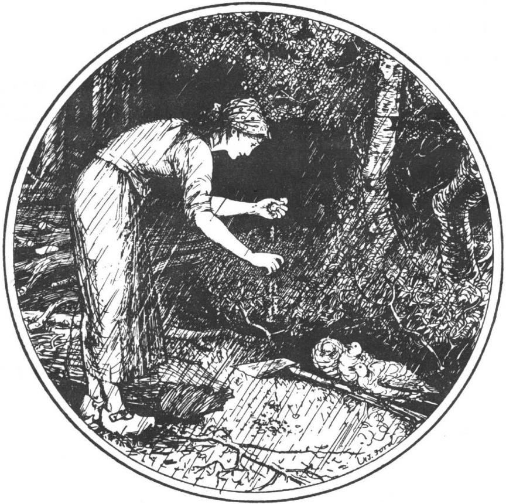

“再见吧！”她说，拿起斧头就转身回家去了。

这时候，小鸽子吃完了面包屑，感觉好多了，也有力气飞回到自己树顶上的窝里去了。

“这是个好姑娘，”一只鸽子说，“她没来之前，我真是衰弱得连伸出一只翅膀的力气都没有。我想做点什么，以表示我是多么感激她。”

“那么，就让我们送给她一个花环，只要她戴着，就永远也不会凋谢。”另一只鸽子说。

“还让世界上那些最小的，会唱歌的鸟住在花环里。”第三只鸽子补充说。

“是的，这样就太漂亮了。”第一只鸽子说。

姑娘刚踏进她的家门口，一顶蔷薇花蕾做成的花环就出现在她的头上，一群看不见的小鸟在里面唱着歌。

尽管她浑身都是泥泞，坐在火炉旁边的父亲看到她回来，心里还是在想，他的女儿从来没有像现在这样可爱。可是，她的继母和她的女儿却妒嫉得快要发疯了。

“在倾盆大雨的夜晚，打扮成这个样子出去成何体统！”继母气势凶凶地骂道，一边骂，一边粗暴地把她头上的花环拉下来，戴到她女儿的头上。可这时候，蔷薇凋谢了，小鸟也从窗口飞出去了。

“看，这是什么玩意儿，一钱不值！”继母喊叫着，“去吃你的晚饭，然后去睡觉，都快半夜了。”

虽然她表面上装作看不起这个花环，可心里也很想自己的女儿也能有一个。

第二天晚上，恰巧独自到森林里去的父亲回家的时候，又一次把斧头忘在森林里了。继母看到了，心里很高兴，她满面笑容地说：

“唉！你又把斧头忘了，你这个粗心的男人！不过，这一回，你的女儿留在家里，让我的女儿去把它拿回来。”她把一件斗篷扔到自己女儿的肩上，叫她快点到森林里去。

她女儿满脸不高兴地走了，一边走一边发牢骚，她虽然想要那个花环，可又不想经历那么多的麻烦。

等她来到她继父砍柴的地方，看到那把斧头，还有三只浑身沾满了泥土的小鸽子，正搭拉着脑袋站在斧柄上的时候，她的脾气已经坏到了极点。

“你们这些肮脏的东西，”她大声地喊着，“快点滚开，否则我就给你们扔石头。”小鸽子吓得赶快张开翅膀，向树顶飞去，它们气得浑身发抖。

“我们该如何来报复她？”最小的一只鸽子问，“从来没有人这样对待我们。”

“绝对没有过。”最大的一只鸽子说，“我们要想想办法，以其人之道，还治其人之身。”

“我知道，”排行第二的鸽子说，“她的这一生，除了只会说，‘肮脏的东西’以外，什么也不会说了。”

“啊！你真聪明！这真是太美妙了。”另外两只鸽子说。它们兴奋地拍动翅膀，咯咯的叫声那么响，把附近森林里的小鸟都吵醒了。

“这是怎么啦？发生了什么事情？”小鸟们睡眼朦胧地问。

“这是我们的秘密。”鸽子回答。

这时候，继母的女儿已经回到家里。火气比以往任何时候都大。她母亲一听到她拉门闩的声音，就急忙跑出来听她讲事情的经过。“好了！你得到花环了吗？”她问。

“肮脏的东西！”她女儿回答。

“怎么能这样跟我说话！你这是什么意思？”继母说。

“肮脏的东西！”女儿重复着这句话，除此之外，她什么也不会说。

这时候，继母看出，什么不幸的事情已经降临到她女儿头上，于是就迁怒于继女。

“这件事情是你一手造成的，我知道！”她喊叫着。只要姑娘的父亲不在，她就要拿起棍子来打她，直到她痛得大喊大叫，跑到床上去哭泣。

如果说，姑娘本来的生活就很悲惨，那么，她现在的情形比以前还要悲惨十倍。只要她父亲一走，她们两个就欺负她，折磨她，从早上一直到晚上。看到她头上戴着的，鸽子送给她的花环，她们更是怒气冲天。

这样过了几个星期，有一天，国王的儿子骑马从森林里经过听到一些奇妙的，从来没有听到过的鸟的歌声。他把马拴在树上，跟着鸟的声音走过去。他吃惊地看到，面前是一个美丽的姑娘在砍树，头上戴得一顶蔷薇花蕾花环，歌声就是从里面传出来的。他躲在一棵大树后面看了很久，然后手中拿着帽子走出来，对她说：

“可爱的姑娘，你是谁？这顶会唱歌的蔷薇花环是谁给你的？”那些唱歌的鸟那么小，不仔细看是看不出来的。

“我住在森林边上的一间屋子里，”她羞涩地回答，因为她从来没有和王子说过话，“至于这顶帽子，我也不知道是怎么来的，也可能是那些小鸽子给我的礼物，它们挨饿的时候，我喂过它们。”王子很高兴听到这样的回答，因为这说明了姑娘的心地善良。这时候，他已经爱上了这个美丽的姑娘，一定要她答应跟他一起回到王宫去，做他的新娘，他才心满意足。

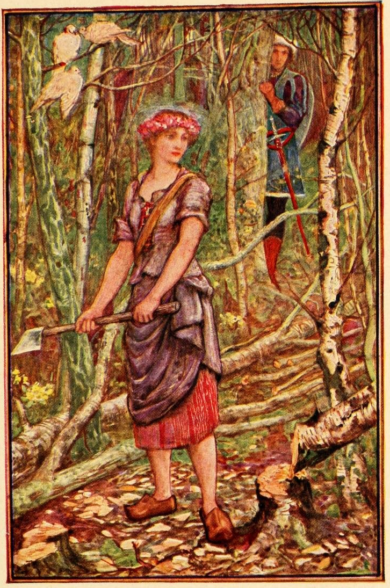

老国王对儿子这样挑选来的新娘，自然感到很失望。可是，自从出世以来，王子不论做什么事情总是自己拿主意，从来不听别人的。于是，国王也没有什么可说的了，豪华的婚礼和宴会很快就准备就绪。

婚礼以后的那一天，新娘就派人带上丰厚的礼物去见她的父亲，告诉他幸运已经降临到她的头上。可以想象，继母和她的女儿听到这个消息是多么妒嫉，她们气得立刻大病一场，不得不躺倒在床上。要是她们从此再也爬不起来了，谁都不会感到惋惜。可惜这种事情没有发生。后来她们慢慢地觉得好了一些，继母想出来一个恶毒的阴谋，要陷害从来没有对她做过坏事的继女。

她的计划是这样的，在她未出嫁之前，她居住的家乡有一个老巫婆。这个老巫婆会的魔法比她所知道的其他巫婆都多。她要去找这个巫婆，请她给自己做一个和继女一模一样的面具，有了这个面具，其他一切事情也就好办了。她把自己的阴谋对女儿说了。尽管她女儿只能说“肮脏的东西”来回答，不过，她又是点头又是笑，表示她很满意。

一切都像这个女人所希望的那样，巫婆在她的魔镜帮助下，看到了新来的王妃穿着一件绿色的丝绸衣服，正在花园里散步。不到几分钟，面具就做好了，那么像王妃，很少有人看得出有什么不一样。不过，她还是关照这个女人，她的女儿第一次戴的时候，最好假装牙痛，而且用花边面纱把自己的头遮盖起来。女人对她表示感谢，并且给她丰厚的报酬，然后把面罩藏在大衣里面，回到自己的家里。

没几天，她就听到王室准备举行一次盛大的狩猎活动，王子一大早就要出去，他的妻子要一整天留在家里。这个机会不能错过，她带着女儿来到王宫，这里她可是从没有来过。王妃在她的新家庭里太幸福了，她早就把过去所受的苦忘记了。她高兴地欢迎她们俩，还给她们许多好看的东西带回去。后来，她把她们领到岸边去看丈夫送给她的，一条漂亮的船。在这里，女人终于有了机会，她悄悄地走到王妃的背后，把她从站着的岩石上推到海里去，海水很深，王妃一下子就沉入水底。这时，她立刻把面具拿出来，套在女儿的头上，还把王妃留下来的天鹅绒大衣披在她肩上。最后，再用花边面纱遮住她的脸。

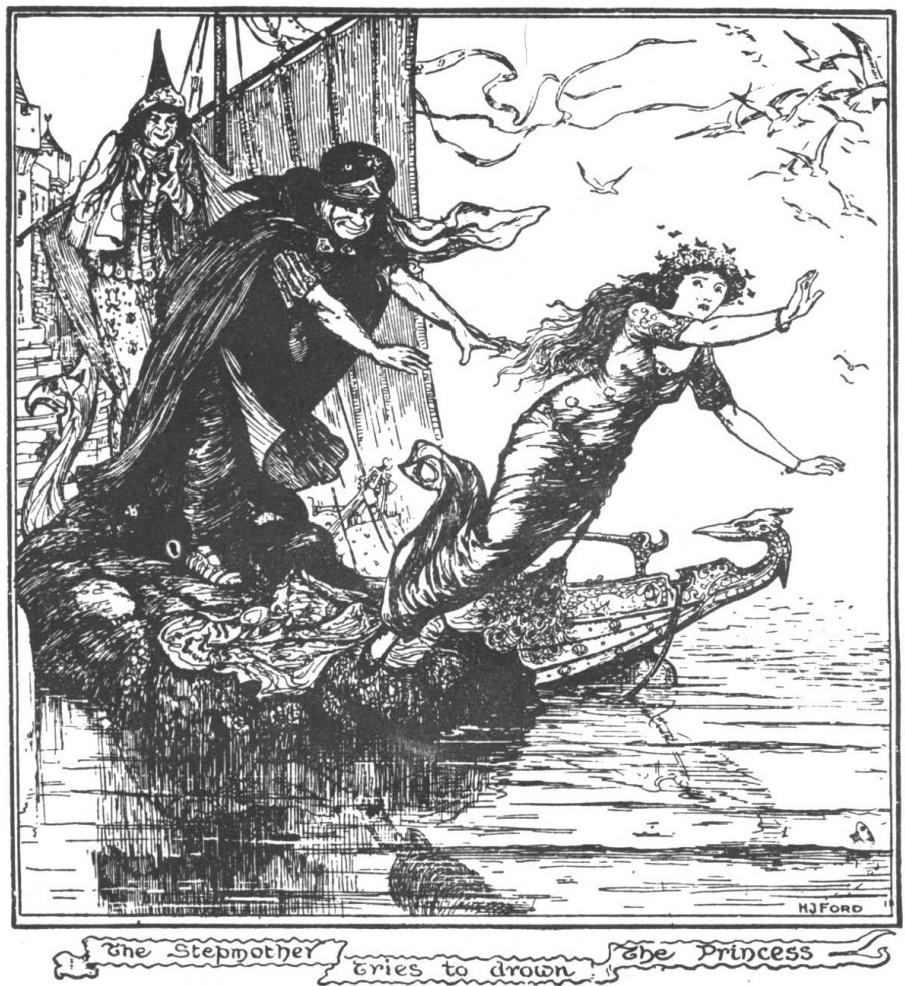

“等王子回来的时候，用手托着你的脸，装出痛苦的样子来。”她对女儿说，“要留神，不论干什么，都不要开口说话。我要回到巫婆那里去，看看她有没有办法，把这些可怕的鸟加在你头上的咒语去掉。唉！我原先怎么没有想到！”

王子一回到王宫，立刻赶到王妃的房间里去。他看到她正躺在沙发上，像是很痛苦的样子。

“我亲爱的妻子，你这是怎么啦！”他跪在她的面前说道，同时就举起她的手。可是，她把自己的手缩回去，指着自己的脸，嘴里低声地在嘟哝着什么，他听不清楚。

“你这是怎么啦！快告诉我！是不是痛得很厉害？什么时候开始的？要不要把侍女叫来，帮你把疼痛的地方洗一洗？”王子一个接着一个问题不停地问，可她只是不停地摇头。

“我不能让你这个样子下去，”王子继续说着，站起来，“我要把王宫里所有的医生都叫来，给你疼痛的地方敷上止痛的膏药。”他说着，就很快地准备走出去找他们。这可把假冒的妻子吓坏了！她知道，那些医生一来，她的诡计立刻就会被拆穿。这时，她忘记了母亲关照过她，不要开口说话，甚至连小鸟加给她的咒语也忘得一干二净。她抓住王子的外衣，用一种恳求的语调喊道：“肮脏的东西！”

年轻人站住了，他简直不相信自己的耳朵，他想可能是痛苦使她变得粗鲁起来，这种情形有时也会出现。不过，他还是认为她想一个人安静一会儿，所以，他只是说：

“好吧！我敢说，要是你能想办法睡一会儿的话，就会好一些。等明天你早上醒过来的时候会更好。”

这天晚上，天气又闷又热。王子想睡也睡不着，就起来走到窗口。忽然，在月光下，他看到从窗外的大海里走出一个人来，她头上戴着蔷薇花环，伸出双臂向沙滩上走来，向王宫的方向走来。

“这姑娘很像我的妻子，”他想，“我要走过去，靠得近一点看看她。”他赶紧跑到海边。可是等他到了海边，他的那真王妃，已经消失得无影无踪了。王子开始怀疑，是不是自己的眼睛花了。

第二天早晨，他来到假王妃的房间。她的侍女对王子说，她不说话，也不起床，不过，送给她的东西她都吃光。王子非常烦恼，不知道她到底是怎么一回事。当然，他不可能知道，她分分秒秒都在盼望着她的母亲回来，把鸽子加给她的魔法去掉。同时，她也不敢开口说话，害怕暴露自己。后来，王子下决心把宫廷里所有的医生叫来。他也不把这件事告诉她，怕她知道了事情反而更加糟糕。他亲自去请国王的四个御医，叫他们一起来到王妃的房间。不幸的是，他们一走进房间，假王妃一看到他们就暴跳如雷，把那些鸽子也忘了，尖声地喊叫起来：“肮脏的东西！肮脏的东西！”那些御医受到这样的攻击，立刻就退出去，王子不论说什么，他们都不肯留下来。接着，王子想劝他的妻子派人去为她的粗暴道歉，可是，她一句话也不肯说。

这天晚上，王子办完了所有的王子得办的繁琐事务以后，他独自依着窗户，呼吸着从海上吹过来的清凉的风。他的脑子又回想起早上的那一幕，他反复地思索着，和一个出身低微的姑娘结婚，尽管她长得很美丽，是不是犯了一个大错误。他怎么也想象不出，一个文静善良，婚后那些日子里那么相亲相爱的伴侣，一天的时间里，会变成一个粗野而且怪僻的女人，连做对她自己有利的事情也控制不住自己的脾气。有一点很清楚，要是她不能很快地改掉这种行为，他就不得不把她从王宫里送出去。

他在想着这些事情的时候，眼睛看着大海。像上一次一样，一个很像他妻子的身影正站在海边，两只脚浸在海水里，向他伸出双臂来。

“等等我！等等我！等等我！”他拼命地喊叫着，也不知道自己在说些什么。可是，等他跑到海边的时候，除了月光下自己的影子以外，什么都没有了。

王国外地的一个城市有国事活动，王子一早就得赶过去参加。他不和妻子告别就走了。

“也许明天她会恢复理智，”他想，“不过，不管怎么说，如果我想把她送回到她父亲那里去，我们还是不要见面的好。”这以后，他就把这件事暂时搁在一边，集中精力去尽自己的职责。

等他返回王宫的时候，已经是快午夜了。可是，他没有进屋，而是来到海边，躲在一块岩石后面。他刚藏好，那姑娘又从海里走出来，对着他的窗口伸出双臂。一转眼工夫，王子就抓住了她的手臂。尽管她疯狂地挣扎着要回到水里去，因为她中了魔法，他还是紧紧地捉住她不放。

“你是我的妻子，我决不会放你走！”他说。可是话刚出口，他看到自己手中是一只兔子，他正抓住它的一只脚。接着，兔子又变成一条鱼，鱼又变成一只鸟，鸟又变成一条粘糊糊地扭动着的蛇。这一下，王子的手差一点儿松掉。可是，他尽全力把手捏紧，同时拔出剑来砍掉它的头。咒语被打破了，姑娘像他第一次见到的时候那样，站在他的面前，花环戴在她的头上，小鸟在愉快地歌唱。

就在第二天早晨，继母来到王宫，拿来了老巫婆给她涂到女儿舌头上去的膏药。如果真正的新娘淹死在海里了，这些膏药就起作用，鸽子的咒语就会被破除；如果新娘还活着，那就一点也没有用。她向老巫婆保证说，她亲眼看到继女沉入海底，用不着担心她会爬上来；可是，为了保险起见，她请求老巫婆再给她继女施魔法。老巫婆照她的要求做了。这以后，罪恶的女人连夜尽快地赶回王宫，直奔女儿的房间。

“我拿到了！我拿到了！”她以胜利者的口气喊叫着，把药膏擦在女儿的舌头上。

“现在，你该说什么了？”她骄傲地问。“肮脏的东西！肮脏的东西！”她女儿回答。她绞着双手痛哭着，她知道，她所有的计划都落空了。

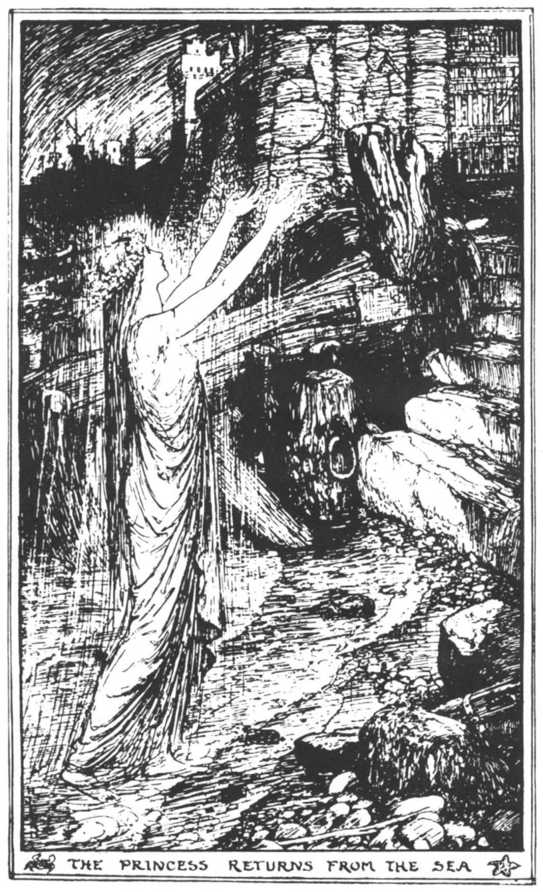

这时候，王子带着真正的新娘走进来了。“你们俩都得处死，”他说，“要是由我来决定，你们就该这么办。可是王妃已经请求过我，饶你们一命。所以，你们将被押到船上，送到一个荒芜的海岛上去，在那里度过你们的一生，直到死去。”

船准备就绪以后，恶毒的女人和她的女儿被押到船上去。船扬起风帆开走了。以后就再也没有人听到她们的消息。王子和他的妻子一起幸福地生活了很久，很好地管理着他们的国家。

（《圣诞节故事》）

 

## 愚蠢的织布工

从前有一个织布工，到处寻找工作，后来给一个农民放羊。

农民知道他的脑子很迟钝，所以不论叫他做什么事情，都非常详细地向他交代清楚。最后，他说：“要是狼或者什么野兽想来伤害羊群，你就这样捡起大石头，这样扔过去，它就会吓跑。”（他一边说，一边捡起身边的一块大石头，做个样子给他看。）织布工说，他懂了。于是，他赶着羊群来到山脚下，羊要一整天在这里吃草。

有一天下午，一只豹跑过来。织布工立刻拼命地跑回家去，以便捡起农民给他看过的石头来打豹子。等他回来的时候，那些牲畜不是被咬死，就是跑掉了。农民听了他的故事，狠狠地打了他一顿。“难道山上没有石头吗？你干吗要跑回来捡？你这个蠢货！”他喊道，“你不会放羊，明天，你就留在家里照顾我的老母亲，她生病了。你不会把野兽从羊群边赶走，从她脸上把苍蝇赶走总可以吧！”

于是，第二天，织布工留在家里照顾农民生病的母亲。因为她睡在外面的一张床上，因此那些苍蝇变得非常讨厌起来。织布工想找些东西把苍蝇赶走，农民教过他，捡起最近的石头把野兽从羊群身边赶走。他想这一回，他要让别人看一看，他是多么聪明地执行主人的命令。就这样，他捡起最近的一块石头，那可是又大又重，向苍蝇扔过去。不幸的是，石头也击中了老太婆。他怕农民发怒，就逃跑了。从此，在这个村子里就再也看不见他。

他整整走了一天一夜，后来走进一个村子，这个村子里住着许多织布工。

“欢迎你！”他们说，“先吃饭睡觉吧，明天我们六个人要去找一些新羊毛来织，请你和我们作伴，一起去吧！”

“我很乐意。”织布工说。第二天一早，七个织布工一起到一个村子里去，那里他们可以买到需要的羊毛。路上，他们要经过一条溪谷。这条溪谷原先积满了水，不过近来已经干涸。可是织布工已经习惯于游过这条溪谷，所以他们也不管里面是不是有水，都脱掉衣服，把它们缠在头上，从溪谷底下的沙子和石子上走过去。这样，他们倒也平安地到达对岸，只是膝盖和手肘都磨破了。他们一上岸，就有人开始点人数，看看是不是都安全地过来了。他数来数去，把自己忘掉了，于是就大声地喊叫起来，少了一个人！接着，大家都忙着数起来，但是都犯同样的错误，把自己忘了！大家一致认为，是少了一个人！他们急得沿着溪谷的岸边跑来跑去，十分痛苦地绞着双手，寻找着失踪伙伴的踪迹。这时候，一个农民看到了他们，问他们这是在干什么？

“啊！”他们回答，“我们七个人从对岸游过来，有一个肯定是在半当中淹死了，我们数来数去，只留下六个人！”农民看了他们一分钟，然后拿起棍子，重重地每人打一下，一边打，一边数：“一！二！三！……”一直数到七。织布工看到他们又是七个人，都由衷地感激他，认为他是一个了不起的魔法师，明明是六个人，他却能变出七个来。

（普什图人的故事）

 

## 聪明的猫

从前，在一块平原的边缘有一座小房子，里面住着一个老人，他有一个儿子。老人的年纪已经很大了，他一生都在辛辛苦苦地工作，后来终于病倒了。他感到自己再也没有希望从床上爬起来了。

于是有一天，他吩咐妻子把儿子叫来，他儿子刚到最近的城里去买面包回来。

“过来吧！我的儿子，”他说，“我知道我快要死了，我没有什么东西留给你，只有我的猎鹰，我的猫和我的灰狗。不过，只要你能好好地使唤它们，就不会缺少吃的。要好好地对待你妈，就像对待我一样。再见吧！”

说完，他把脸转向墙壁，就这样去世了。

一连许多天，房子里充满了巨大的悲痛。后来，儿子站起来，招呼他的狗、猫和猎鹰，离开屋子走出去，说要带些东西回来当饭吃。在草原上走了一会儿以后，他看到了一群瞪羚，就叫灰狗去追。不一会儿，灰狗就叼回一只很肥的野兽，年轻人把它扛到肩上去，就往家里走。路上经过一个池塘的时候，一群鸟从天上飞过，他抖一抖手臂，站在他手臂上的猎鹰立刻飞上去，冲向他指点的猎物，猎物立刻从天上掉下来。他把它捡起来，放进口袋，继续朝家里走去。

屋子旁边有一个小谷仓，里面存放着一些谷子，那是从院子里那块地上打下来的。他走到这里的时候，一只老鼠几乎是从他的脚下跑过，接着又是好几只。可是猫比他想得还要快，一下子就扑上去把它们咬死，一只也逃不掉。

把那些老鼠都杀死以后，年轻人离开谷仓，走到自己的家门口。他感到有人把手放在他的肩膀上，于是就停下来。

“年轻人，”食人魔（这个陌生人是个食人魔）说，“你是个好孩子，你值得有今天这样的好运气。跟我一起到那边那个闪光的湖泊去吧，别害怕。”

年轻人想了一会，不知道会出什么事情，就听妖魔的话，跟他走了。他们来到湖边的时候，妖魔转过脸来对他说：

“闭着眼睛走到水里去，你会发现自己慢慢地沉入水底。不过，别害怕，鼓起勇气来，一切都会好的。你只要尽量地拿一些银子上来，能拿多少就拿多少。我们俩一起分。”

于是，年轻人勇敢地走入湖中。他感到自己在不停地往下沉，往下沉，直到后来，觉得脚碰到了坚硬的地面。他看到，在他的面前有四堆银子，银子中间有一块奇怪的闪光石头，上面刻着奇怪的，他从来没有见过的文字。他把它捡起来，想仔细地看一看，石头在他的手中说话了。

“你只要拥有我，你的一切愿望都会实现。”它说，“不过，你先把我藏在你的头巾里，对妖魔说，你准备上来了。”

没有几分钟，年轻人又站在湖边的岸上了。

“好了！那些银子呢？”一直在上面等着的妖魔问。

“啊！我的父亲，我该怎么对你说呢！我看到的每一样东西都那么华丽，那么耀眼，弄得我眼花缭乱，不知所措，像一座雕塑似的，一动也不能动。后来，我听到有脚步声走过来，非常害怕，就大声地喊你。这你也听到了。”

“你并不比别人聪明。”妖魔生气地喊道，转身走了。

妖魔走远以后，年轻人把那块石头从头巾里拿出来看着。“我要一头能找到的最好的骆驼，还有一件最华丽的大衣。”他说。

“那么，闭上你的眼睛。”石头回答。他闭上了眼睛。等他再次张开的时候，看到他想要的骆驼就站在他的面前，一件沙漠王子穿的节日长袍已经套在他的肩上。他骑上骆驼，招回他的猎鹰，就向家里走去，他的灰狗和猫跟在他的后面。当这个富贵的陌生人骑着骆驼走过来时，他的母亲正在家门口缝衣服，她惊讶万分地向他鞠躬。

“你不认识我了吗？妈妈！”他笑着说。听到她儿子的声音，善良的女人吃惊得差一点摔倒在地上。

“你是怎么得到这头骆驼和这身衣服的？”她问道，“像我这样的儿子为了得到这些东西会去杀人吗？”

“别害怕，它们是非常光明正大地得到的。”她儿子回答，“回头我再慢慢地对你说。现在，你得先到王宫去对国王说，我要娶他的女儿。”

听到这些话，他母亲想，她的儿子肯定是发疯了，茫然地瞪着他，年轻人猜得出她在想些什么，笑着对她说：“别害怕，他要什么都答应他，这些事情都能办到。”

于是，她来到王宫，看到国王正坐在公正厅里听老百姓的申诉。女人在一旁等着，等到所有的人都说完走掉以后，她才走上来跪在国王的面前。“我的儿子派我来向公主求婚。”她说。

国王朝她看着，心里想，她大概是疯了。不过，他没有叫卫兵把她赶出去，而是非常严肃地说：“在他想娶公主之前，他必须给我建造一座冰宫，里面能够生火取暖，那些最珍贵的会唱歌的小鸟能在里面居住！”

“这能办到，尊敬的陛下。”她说，然后就站起来走出大厅。

她的儿子正在宫殿的大门外面焦急地等着，穿着平常穿的衣服。

他把母亲拉到一旁，生怕说话会被别人听到，然后焦急地问：“好了，我该做些什么？”

“啊！是一些肯定办不到的事情，我希望你还是不要去动公主的脑筋吧。”她回答。

“咳！可到底是什么事情？”他坚持着问。

“也不过是造一座冰宫，里面能生火取暖，让那些最珍贵的会唱歌的鸟能在里面生活。”

“我想，还会有比这难得多的事情。”年轻人说，“我要马上就试试看。”他离开母亲，独自来到田野里，从头巾里把那块石头拿出来。

“我要一座冰宫，里面能够生火取暖，还要有许多珍贵的会唱歌的鸟！”

“那么，闭上你的眼睛吧！”石头说。他把眼睛闭上。等他再张开眼睛时，看到面前是一座宫殿，那么漂亮，是他无法想象得到的。炉火在冰上映出柔和的粉红色的光。

“就是公主在里面住也很合适。”他心里想着。

第二天早晨，国王一醒过来，就跑到窗口前，看到了平原上的那座宫殿。

“这个年轻人肯定是个了不起的巫师，他对我也许有用。”他想。等年轻人的母亲又来对他说，他的吩咐已经完成了的时候，他非常隆重地接待她，告诉她回去转告儿子，婚礼定在明天举行。

公主对她的新家庭，还有她的丈夫都感到很满意，一连几天，她都在玩赏着宫殿里那些瑰丽的物品，时间就这样幸福地过去了。后来，年轻人对整天呆在家里感到厌倦了。第二天，他对妻子说，他要出去打几个钟头猎。“你不会介意吧！”他问妻子。

她以一个好妻子的口吻回答说：“我当然介意。不过，我要花这一天的时间做出一些新的衣服来，你回来的时候就会很高兴。”

这样，丈夫就出去打猎了。猎鹰站在他的手腕上，灰狗和猫跟在他的后面。宫殿里那么暖和，连猫也不想老呆在里面。

他走了没有多久，一连好几天等待着机会的妖魔来了，他敲了敲宫殿的门。

“我从一个非常遥远的国家回来，”他说，“我带回来一些全世界最大最耀眼的宝石。大家都知道，公主喜欢漂亮的东西，也许她想要买一些？”

公主已经好几天在考虑着用什么来装饰她的服装，好让自己的打扮在王宫里更加非同凡响，比其他女士更胜一筹。她想不出什么更好的东西，所以，当侍女告诉她，有人带着装饰品来到宫殿门口时，她立刻吩咐把他带进自己的房间。

啊！展现在她面前的宝石是多么漂亮！那些红宝石多么讨人喜欢！别的女士绝对不会有这样的珠宝！这一点公主非常清楚。不过，她把眼睛朝下看，免得让妖魔看出来，她是多么想得到它们。

“恐怕对我来说，价钱太贵了，”她漫不经心地说，“而且，眼前我还不需要这么多宝石。”

“我也不是特别想把它们卖掉。”妖魔也同样以满不在乎的口吻回答，“可是我父亲给我留下了一条闪光宝石项链，上面刻着符咒的最大的一颗掉了。我听人家说，就在你丈夫的手里。你要是肯把那颗宝石给我，这些宝石就随便你挑。不过，你要装作是你自己要的，特别是，千万不要提起我。因为他非常想保存它，决不会把它让给陌生人！明天，我还要带一些比这些更好的宝石来。再见吧，夫人！”

只留下公主一个人了，她开始考虑许多问题，但首先是要不要说服她的丈夫把那块石头给她。有时，她想丈夫已经给了她那么多，再跟他要他唯一保留下来的东西太不好意思了，那就显得太庸俗了，她不能这么做。可是，那些钻石，还有那成串的珍珠……再说，他们结婚毕竟仅仅只有一个星期，对她丈夫来说，送东西给的快乐，应该远远胜过把它留下来的快乐！她敢肯定，这样说千真万确！

这天晚上，年轻人吃过公主精心地为他做的、非常可口的晚饭以后，她紧挨着他坐下，抚摸着他的手。有一段时间，她什么都不说，只是安静地听着他讲述这一天出去打猎的全部经过。

“不过，我整天都在想你，”他到结束的时候这样说，“希望能带一些你喜欢的东西回来给你。可是，想想看，哪样东西你还没有呢？”

“你在面临那么危险和艰苦的时候，也没有把我忘记，你真好。”公主回答说，“是的，不错，我已经有了许多漂亮的东西。但是，如果你真的想给我一件礼物，明天就是我的生日，有一样东西倒是我非常想要的。”

“那是什么东西？你当然马上就可以得到它！”他急切地问。

“就是前几天从你头巾里掉下来的，那块明亮的石头。”她回答说，一边还玩弄着他的手指，“那块有许多有趣的符号在上面的小石头，我以前从来没有见过像它这样的石头。”

年轻人开始没有回答，后来才慢慢地说：

“我已经答应过了，所以我必须兑现。可是，你必须发誓，永远也不要和它分开，永远安全地把它保留在身边，行吗？我不能再跟你多说了，但是我真切地请求你记住我的这些话。”

他的这种态度叫公主有些吃惊，她开始后悔不该听妖魔的话。可是，她也不想收回自己的请求。拿到自己的小玩意儿以后，她装作非常开心的样子，吻着她的丈夫表示感谢。

“不管怎么说，我不把它交给那个人就是了。”她心里这样想着，就睡觉去了。

不幸的是，第二天一早，年轻人又出去打猎去了。妖魔一直在外面观看着，知道他走了以后也不急，等到比上次晚得多的时候才过来敲门。这时候，公主对所有陪她的人都已经感到厌倦，那些人也已经是黔驴技穷，再也想不出办法让她开心。这时，一个身穿绯红色制服的大个子黑人走进来说，卖宝石的人就在下面，他想知道，公主是否有话要和他说。

“立刻把他带进来！”她从坐垫上跳起来喊道，完全忘记了昨天晚上下的决心。没有多久，她就欢天喜地弯下腰来看那些珠宝。

“你拿到它了吗？”妖魔小声地问，因为公主的侍女们在允许的范围内，都尽可能地靠得近一些，观看这些美丽的珠宝。

“是的，在这里。”她回答，让那块石头从腰带里滑下来，放到那些珠宝里去。然后，她提高嗓门，开始很快地报出那些链条和项链的价格。为了欺骗她的随从，她假装讨价还价一会儿以后，说她喜欢那串珍珠，它比其他那些珠宝都好，妖魔可以把它们都拿走，它们的价钱还不及这串珍珠的一半。

“随你的便，夫人。”他说，然后弯腰鞠躬走出宫殿。

他刚走不久，奇怪的事情就发生了。公主无意中碰到她房间的墙壁，这些墙壁平时都在映射着炉火的红光，今天她的手却感到十分湿。她转过身来，是她自己的幻觉呢？还是炉火真的比以前暗淡得多了？她急匆匆地走进画廊，地板上到处都是积水，一股寒气向她全身袭来。这时候，那些吓坏了的女士们都从楼梯上冲下来，喊叫着：

“夫人！夫人！出了什么事，宫殿正在我们的眼中消失！”

“我丈夫很快就要回家了，”公主回答，她虽然差不多和她们一样害怕，可她觉得，必须给她们做一个好榜样，“等着吧！他会告诉我们该怎么办。”

于是，他们裹上厚大衣，坐在能够找到的最高的凳子上，脚下垫着一叠垫子。那些可怜的鸟拍着冻得麻木的翅膀飞来飞去，直到在那些被人遗忘的角落里，幸运地发现开着的窗口。飞过窗口以后，就再也看不见它们了。

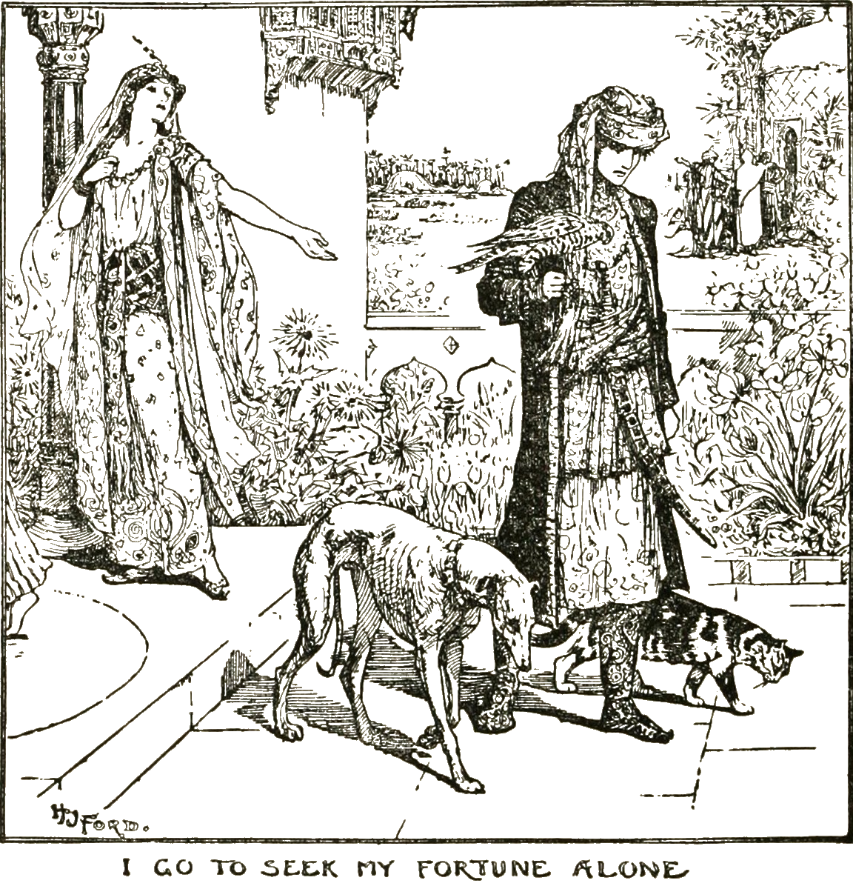

后来，上面房间的墙壁和地板开始融化，公主和她的侍女们被迫离开，到下面的厅里来避难，这时候，年轻人才回到家里。他骑马沿着一条弯曲的道路回来，所以到了家门口才看到宫殿。见到眼前的情景，他站在那里吓呆了。他立刻明白，是妻子辜负了他的信任。不过，他不想责备她，她自己肯定已经受够了。他赶紧跨过宫殿的残墙断壁，冲进去。公主看到他，如释重负地喊叫起来。

“快出来！”他说，“否则你们会被冻死的！”于是，一支垂头丧气的队伍向国王的王宫跑去，灰狗和猫在后面压阵。

到了门口，他准备和她们告别，虽然公主请求让她一起去，他却严肃地说：“你辜负了我，也把我毁了，我要自己去找回我的财富。”然后，他不再多说一句话就离开她走了。

猎鹰站在他的手腕上，灰狗和猫跟在他后面，年轻人走了一段很长的路程。他逢人就问是否看到他的对头妖魔，可是没有一个人见过。他吩咐猎鹰飞上天空，越高越好，试试它敏锐的眼睛能否发现老贼。猎鹰飞得那么高，要好几个钟头它才飞回来。它告诉主人说，妖魔在海对面一个遥远的国家里，正在一座华丽的宫殿里睡觉。这对年轻人来说，是个好消息。他立刻买来一些肉，叫猎鹰好好地吃饱喝足。

“明天，”他说，“你要飞到妖魔居住的宫殿里去，在他睡觉的时候，搜查他全身，找一块刻着奇怪符号的石头，把它带回来给我。我希望你能在三天之内回来。”

“好的，不过，我得带着猫一起去。”猎鹰回答说。

猎鹰展翅飞向蓝天的时候，太阳还没有出来。猫坐在它的背上，紧紧地抓住它的头颈。

“你最好把眼睛闭上，免得头晕。”猎鹰说。猫除了爬上树以外，从来没有离开过地面。它照猎鹰的话做了，把眼睛闭起来。

它们整整飞了一天又一夜。第二天早晨，它们看到妖魔的宫殿就在下面。

“我的天！”猫说，它第一次张开眼睛，“我看下面很像是一座老鼠城，让我们下去看一看。它们也许对我们有用。”于是，它们在老鼠城中央的一些树丛里降落下来。猎鹰留在原地不动，猫却跑到老鼠的城门外躺下来，这在老鼠中间引起可怕的骚动。

后来，那些老鼠看到猫躺在那里不动，一只胆子比别人都大的老鼠从城堡上面的窗口伸出头来，用发抖的声音问：

“你到这里来干什么？你想要什么？请跟我们说，只要我们能办得到，我们一定照办。”

“你们以前要是听我的话，我也早就对你们说了，我是作为朋友到你们这里来的。”猫回答，“要是你们能派出四只最强壮，最聪明的老鼠来帮我，我将感到很满意。”

“啊！我们很乐意！”老鼠回答，大大地松了一口气，“不过，要是你能告诉我，想叫它们去做什么，我就可以更好地判断，谁最合适。”

“那就谢谢你了！”猫说，“嗯，它们要去做的事情是这样的：今天晚上，它们必须在城堡下面打个洞，要一直通到一个妖魔睡觉的房间里去。这个妖魔在他的房间里藏着一块石头，上面刻着一些奇怪的符号。它们找到这块石头以后，不要把妖魔惊醒，把它带回来给我。”

“你的命令将立刻执行。”老鼠回答，接着，它就下去布置任务去了。

大约半夜里的时候，猫还在城门口睡觉，被老鼠首领从上面浇下来的一盆水弄醒，老鼠不敢把城门打开，让猫进来。

“这里是你要的石头，”它说，这时，猫大叫一声站起来，“如果你把手伸出来，我就把石头扔下来。”石头扔下来以后，老鼠又说：“现在，再见吧！你还要赶好长的路程，如果天没亮就动身，会更好一些。”

“你的主意不错。”猫笑了笑，回答说。它把石头含入口中，就去找猎鹰。

到这个时候为止，猫和猎鹰都没有吃过一点东西。猎鹰背着那么重的猫飞行，很快就觉得累了。到了晚上，它说，它再也飞不动了，要在河岸边过夜。

“现在，该轮到我来保管这块石头了，”猎鹰说，“要不好像什么事情都是你做的，我一点也不做似的。”

“不！既然是我找到，就应该由我来保管。”猫说，它这时候又累，火气又大。它们开始激烈争吵起来。不幸的是，猫提高嗓门争吵的时候，那块石头从嘴里喷出，掉进恰巧从这里游过的一条大鱼的耳朵里。虽然猫和猎鹰同时跟着扑到河里去，可是也太晚了。

两个忠诚的奴仆与其说呛得厉害，不如说是淹个半死。他们无可奈何地爬上岸来。猎鹰飞到一棵树上去，张开翅膀让太阳晒干。可是猫抖了抖身体以后，开始挖岸边的石子，把它们扔到河里去。

“你这是在干什么？”河里的一条小鱼问，“你不知道这会把河水弄得很脏吗？”

“这跟我毫无关系，”猫回答说，“我要把这条河全部填满，让河里的鱼全都死掉。”

“这非常不好，我们又没有做过什么对不起你的事，”鱼说，“你干吗这样生我们的气？”

“因为你们之中有一个拿走了我的一块石头，上面刻着奇怪的符号。要是你们答应把它还给我，那么，也许我就让这条河留着。”

“我一定去试试看，”鱼急急忙忙地回答，“可你得有一点耐心，也许要办好这件事并不容易。”转眼间，它很快就游走了。它拼命地向海里游去，这段距离并不远。到了海里，它把附近所有的亲戚和朋友都叫来，告诉它们，可怕的危险正在威胁着住在河里的鱼。

“我们谁都没有见过这块石头。”那些鱼都摇摇头说，“可是，在那边的河湾里住着一条金枪鱼，它虽然很老了，但还是喜欢到处游来游去，要是说有谁知道的话，它肯定知道。”于是，小鱼游到金枪鱼那里去，又把事情对它说了一遍。

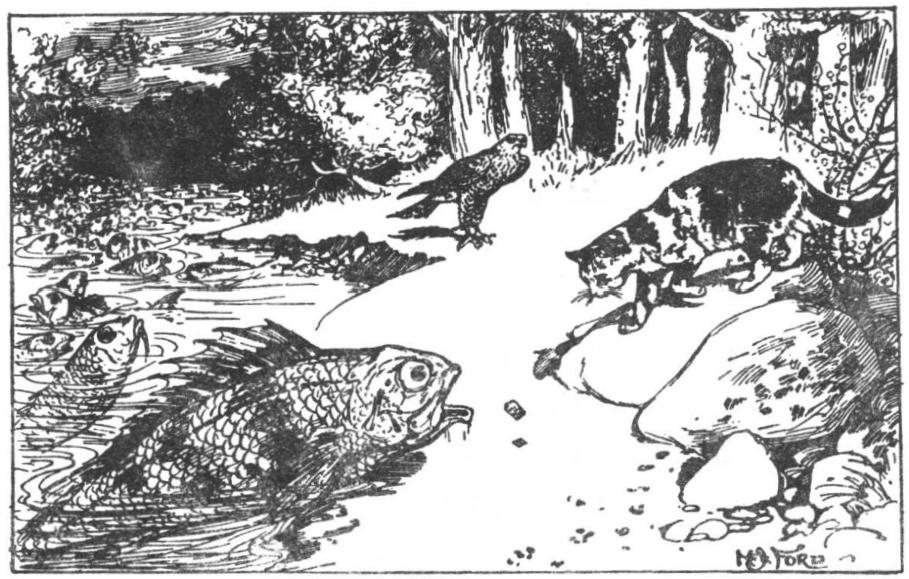

“嗯！几个钟头以前，我刚游到河里去！”金枪鱼说，“在回来的路上，有什么东西掉到了我的耳朵里，现在还在里面。因为我回家以后就想睡觉，所以把它也忘了，也许它就是你要找的石头。”说着，它举起了尾巴，晃动一下身子把石头抖出来。

“是的，我想就是它。”小鱼高兴地说着，把石头含在嘴里，来到猫等着它的岸边。

“我非常感谢你，”鱼把石头放在沙滩上时，猫说，“为了报答你，我就让你们的河留着。”说完，它爬到猎鹰的背上去，它们飞回到主人的身边。

年轻人看到他们带着魔石又回来了，是多么高兴。他马上就再要一座宫殿，但这一回是绿色大理石的。然后，他又希望公主和她的女伴们一起回来居住。他们在里面生活了许多年，后来老国王去世了，公主的丈夫接替了他的位置，当上了国王。

 

## 马纳斯的故事

遥远的大海西边，有一个国王，他有两个儿子。一个叫欧里尔，一个叫依雷特。在他们还小的时候，他们的父母都相继去世。于是，大臣们召开了全体会议，推选一个人出来治理国家，直到孩子们长大，能够自己治理国家。

时间年复一年地过去了。不久，又召开一次议政会议，会议认为，国王的儿子已经到了能掌握属于他们的权力的年龄。于是，两个年轻人被请到议政厅来。大儿子欧里尔比他的弟弟矮小，瘦弱。

“我不喜欢离开山上的鹿群和河里的鱼群，坐在这里管理我的百姓。”欧里尔听完首相的话以后这样说。首相非常生气，他很快地回答说：

“今天，你如果不像你的国王父亲一样宣誓就职，你就永远也别想得到一块土地。”这时候，老二依雷特开口说话了：“让一半土地归你，一半土地归我，这样，你要管理的老百姓就要少一些。”

“可以，这我能答应。”欧里尔说。

从此以后，洛荷兰这块土地上的人民，一半效忠于欧里尔，一半效忠于依雷特。他们尽职地管理着自己的王国。几年以后，他们都变成长胡子的大人了。依雷特和希腊国王的女儿结了婚，欧里尔也娶了奥克尼国王的女儿。第二年，他们都生了一个儿子。欧里尔的儿子是个胖小子，依雷特的儿子却比较弱小。此外，他们还各自收养了六个养子。这些养子不论到什么地方，都跟着两个王子。

有一天，欧里尔的儿子马纳斯和他的堂弟各自叫来自己的养兄弟，一起到王子和贵族子弟就读学校附近的草地上玩简化曲棍球。他们玩了很久，球在他们之间飞快地传来传去。马纳斯把球传给他的堂弟，依雷特的儿子。可这孩子不习惯和别人随便相处，连开个玩笑都不行。这时，他大哭起来，说是他受伤了，而且伤得很厉害。他带着自己的养兄弟回到家里，把事情告诉他妈妈。依雷特的妻子听了以后，气得脸色发白，她把儿子推到一边去，到议政厅去找依雷特，他正坐在里面。

“马纳斯对准我的儿子击球，想要杀死他，”她说，“让他和他的恶劣行为一起见鬼去吧！”

可是依雷特回答：“不，我不能杀害我哥哥的儿子。”

“可是，他也不能杀害我的儿子。”王后说。接着，她把管家叫来，命令他把王子送到安全的地方去，叫一个聪明的人来照顾他，不要让他受到任何伤害。那个聪明人把他送到山顶上去，那里终年可以看到明媚的阳光。他还可以看见别人，可是任何人也看不见他。

然后，王后把马纳斯叫到城堡里，把他整整关了一年，连他的母亲想和他说话也不行。后来，他的母亲，欧里尔的妻子病了，马纳斯才从他的监狱，那座楼塔里逃出来，偷偷地回到自己的家。

他太平地过了几年，后来，他的叔叔依雷特的妻子派人来找他。

“你到了该成亲的年龄了。”她看到马纳斯长得又高大又健壮，像依雷特一样，就这样说，“你长着一张标致的脸，而且高大结实，我知道有个姑娘很适合你。那就是芬海德大伯爵的女儿。大伯爵为了他的土地的缘故，对我很尊敬。我要亲自带大队人马到他家里去，你和我一起去。”

于是，事情就这么办了。虽然伯爵的妻子还不想马上就把女儿嫁出去，可她也不得不答应。因为依雷特的妻子发誓说，如果不听她的话，那么，伯爵就连一路得（面积单位，一路得等于 1077.7 平方米——译注）土地也不会有。但如果他把女儿嫁给马纳斯，她就把她的王国的第三部分给他，此外还要给他许多财宝。她这样做，并不是出于对马纳斯的爱，而是想害他。这样，他们结婚以后，就跟着依雷特的妻子一起回到王宫。这天晚上，他睡着了以后，一个聪明人走近来，这个人是他父亲的朋友。他把马纳斯叫醒以后对他说：“你的处境非常危险，马纳斯。你娶了大伯爵的女儿做新娘，觉得很满意。可是你知道依雷特的妻子准备给她的儿子娶什么样的媳妇吗？她给儿子娶的媳妇不是凡人，而是敏捷的‘三月风’，你决不是她的对手。”

“是这样？”马纳斯回答。第二天东方刚刚露出一丝曙光，他就来到王后的房间，她正躺在一群侍女中间。

“我来了，”他说，“要那三分之一的王国，还有那些财富，这是你答应过我的。”可是，依雷特的妻子听了只是笑笑。

“这里你一块土块都得不到，”她说，“你要到老伯根那里去要，也许在他那嶙峋的高山和石头底下，你会找到财宝！”

“那好，把你儿子的六个养兄弟都给我，让他们和我的养兄弟一起走。”他说。王后把六个养子都给他，他们一起去找老伯根。

一年过去了，他们还是在荒山野林里打野鹿，挖陷阱捕捉山羊。有一段时间，马纳斯和他的十二个伙伴过得很愉快，后来，马纳斯对过陌生的乡村生活越来越感到厌倦，他们一起乘船返回洛荷兰。寒冷的海风凛冽刺骨，航程十分漫长。后来，终于在春天的一天里，他们驶进了依雷特城堡下面的一个港口。王后从她的窗口看见，马纳斯正在登上山来，后面跟着那十二个养兄弟。

她对丈夫说：“马纳斯和他的十二个养兄弟回来了，我是不是可以把他干掉，免得后患无穷。”

“那实在是太可惜了，”依雷特说，“我实在不能做这种事情。”

“你不干，我来干。”她说。她把十二个养兄弟叫来，叫他们宣誓效忠于她。这样一来，马纳斯只剩下孤零零的一个人了，他单独回去寻找老伯根，感到非常悲哀。他登上陆地，向森林里走去的时候，已经很晚了。半路上，他碰到一个穿着红色束腰大衣的人。

“是你，马纳斯，你又回来了？”他说。

“是我，”马纳斯回答，“我单独一个人从洛荷兰回来了。”那人默不作声地看了他一会儿，然后说：“我梦见有人送给你一把剑，你成了洛荷兰的国王。”

可是马纳斯回答：“我没有什么剑，连弓也断了。”

“你要是答应我一件事，我就送给你一把新剑。”那人又说。

“假如我是国王，我一定答应。”马纳斯回答，“不过，你说吧，要我答应你什么。”

“我是你祖父的军械士，”那人回答，“我还想当你的军械士。”

“这我很乐意答应你，”马纳斯说着，跟着那人走进他的屋子。他的房子离他们说话的地方不远，可他的房屋和别人的不一样，每个房间里的墙壁上都挂满了兵器，连壁板都看不见。

“挑你自己喜欢的吧，”那人说。马纳斯摘下一把剑来，用膝盖碰一下试试，剑一下子就断了。他接着试了一把又一把，结果也断了。

“别管这些折断的剑，”那人说，“看看我跟随你祖父打仗时用的这把老剑，盔甲和战袍，也许你会发现，它们的钢更加坚硬。”马纳斯把剑在膝盖上弯了三次，剑丝毫不动。于是，他把这把剑佩在身上，穿上旧盔甲，在束皮带的时候，看到窗口外面飘动着一块布。

“这是块什么布？”他问。

“这块布是森林里的小人编织的，”那人说，“当你肚子饿的时候，它会给你吃的和喝的。有了这块布，敌人碰到你的时候，他们就会弯下腰来吻你的手背，表示服从。拿着它，好好地用它。”马纳斯高兴地把这块布绕在自己的手臂上。就在他准备离开房子的时候，他听到一根链条被风吹得格格响。

“那是什么链条？”他问。

“谁把这根链条带到自己的头颈上，就可以以一当百。”那人说。马纳斯把他带上，然后走到森林里去。

忽然间，从灌木丛中跳出两头狮子来，后面还跟着一头小狮子。这些凶猛的野兽向他扑过来，大声地吼叫着，眼看就要把他吃掉。可是马纳斯很快就弯下腰来，把那块布铺在地下。狮子看到了马上停下来，低下它们那硕大的头，吻了一下他的手背，然后就走开。不过，那只小狮子在布上打起滚来。马纳斯把小狮子连同那块布一起抱起来，带着它一起去见老伯根。

又是一年过去了，马纳斯带着小狮子一起回到洛荷兰。依雷特的妻子出来接他，她还带着一条褐色狗，这只狗虽然个子小，可是胆子很大。它看到小狮子就冲上去，想把它吃掉。可是，小狮子咬住它的头颈，摔了几下，就把它摔死了。依雷特的妻子为它的死感到非常悲伤，满腔怒火也因此被煽动起来。有许多次，她想杀死马纳斯和他的小狮子，可是办不到。后来，他们又回到老伯根那里去，十二个养兄弟也和他们一起走。

“让他们去吧！”依雷特的妻子说，“不管是在老伯根，还是在什么地方，我的兄弟格拉咖赫都会砍下他的头。”

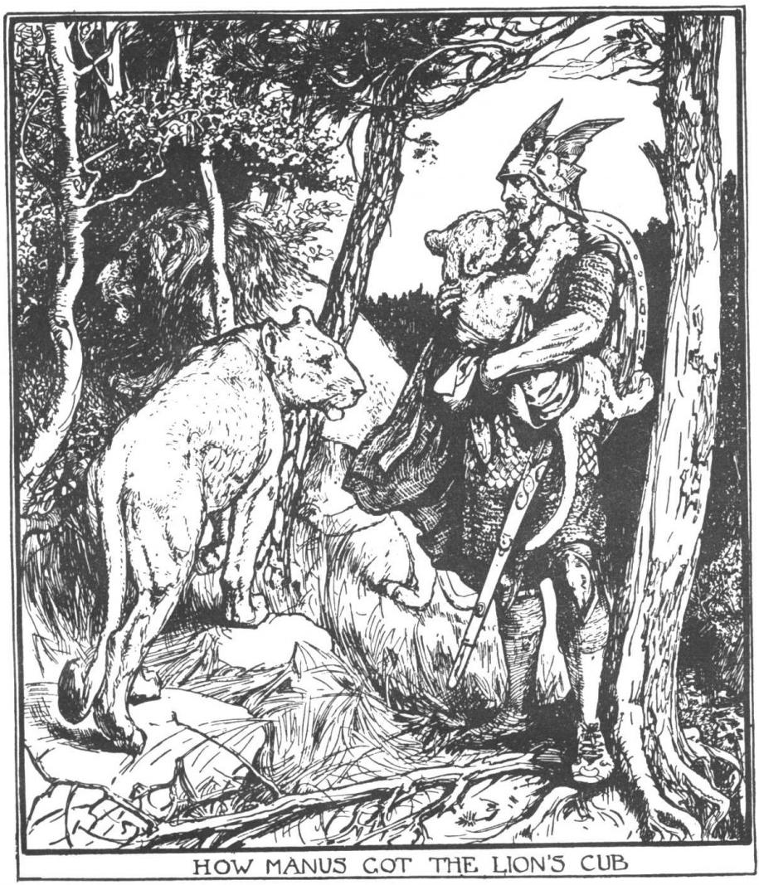

这句话被人传到欧里尔的妻子那里，她赶紧派一条船到老伯根去，抢在格拉咖赫杀害马纳斯之前把他接走。船上还有一个领航员。可是依雷特的妻子在海面上布下了大雾，水手们不敢划船，害怕船会触礁。到了晚上，小狮子偷偷地来到马纳斯的面前，它的眼睛又明亮又尖锐。马纳斯骑到它的背上，小狮子带着他跳上岸，叫马纳斯留在岩石旁等它。马纳斯睡着了。后来，有一个声音在他的耳边响起：“起来！”他看到一条船就停在下面的海里，小狮子变成领航员坐在船上。

他们在雾中航行，谁也看不见他们。船到达洛荷兰以后，狮子的头颈上挂着链条，跳到岸上，马纳斯跟着它，小狮子把守卫城堡的人都杀了，还有依雷特和他的妻子。这样，欧里尔的儿子马纳斯就成为洛荷兰的国王。

（西苏格兰高地故事）

 

## 小偷小红毛

很久很久以前，有一个寡妇，她有三个儿子。两个大的都长大了，尽管大家都知道他们俩很懒，但有些邻居看在他们母亲的面子上，还是给他们工作做。不过，到我们这个故事开始的时候，因为他们又懒又粗心，主人已经把他们解雇，说再也不用他们了。

这样，他们就回到母亲和小弟弟的身边。因为小弟弟在家里很管用，还喂鸡，给奶牛挤奶，所以两个哥哥看不起他，轻蔑地叫他小红毛。后来，“小红毛”这个名字就在村子里叫开了。

两个年轻人想，在家里闲呆着，比不得不去干令人讨厌的活好得多了。要不是寡妇对他们失去信心，说既然他们在家里不干活，就得到外面去找工作，她再也不愿意把他们留在家里了，他们也许就会整天坐在火炉边，一直到老死。可是，当小红毛对她说，他也长大了，也要出去闯一闯的时候，她对自己的话感到很后悔。小红毛说，等他交了好运，他就来接母亲去给他管家。

寡妇因为小儿子要走，流了许多泪。不过，她看到他已经下定决心，一定要和他的哥哥一起走，也就不再说什么了。于是，这些年轻人在一个早晨兴高采烈地出发了。他们满怀信心，在身边带着的这点钱用光之前，一定会找到满意的工作。

可是，流浪了一些日子以后，他们明白了。没有人需要他们。就是有人要，这些年轻人也说，他们干不了那些农民、磨坊主或砍柴人叫他们干的那么多活。最小的弟弟比他们聪明，他倒是愿意干两个哥哥不愿意干的活，可是他人小体弱，人家不愿意把活给他。这样，他们从一个地方走到另一个地方，靠在森林里找到的水果充饥，肚子一天比一天饿。

一天晚上，走了好几个钟头路以后，他们觉得非常疲倦。他们来到一个大湖边，湖的中间有一个岛屿。岛屿上发出一道明亮的光，在这道光线的照耀下，周围的一切几乎像是白天一样，都看得清清楚楚。他们看到，湖边的树丛里，半隐半现地藏着一条船。

“让我们上船，把它划到岛上去，那里肯定有一幢房子，”老大说，“也许他们会给我们吃的，让我们住一夜。”他们一起上了船，朝发光的方向划过去。快接近岛屿的时候，他们看到，光是从一盏金灯上发出来的，金灯挂在一间小屋的门上。小屋的附近还养着一只羊，羊长着金色的角，上面挂着铃，发出叮叮当当甜美的音乐。年轻人心里都感到非常高兴，他们想起码可以让疲惫不堪的双脚休息一下。走进屋子，他们吃惊地看到了一个丑陋的老太婆，裹着一件金色的斗篷，把整个房间都照亮了。老太婆领着她的女儿走过来的时候，他们的心里都感到非常不安。因为看到那件斗篷，他们就知道这是个非常闻名的巫婆。

“你们想要什么？”她问，同时示意她的女儿照看一下火上的锅。

“我们又累又饿，想找个地方过夜。”老大回答说。

“你们不能在这里过夜，”巫婆说，“但是在湖对面的宫殿里，你们会找到吃的和睡觉的地方。上你们的船，到那边去吧！不过，把这个小孩给我留下，我可以给他安排工作，尽管我有预感，他又敏捷又狡猾，可能会给我带来灾难。”

“像我这样一个可怜的孩子，会给你这样的大人带来什么灾难？”小红毛回答，“我请求你让我和哥哥一起走吧，我答应决不伤害你。”后来，巫婆终于同意让他走，他跟着哥哥一起回到船上。

路程比他们想象的远得多，他们来到宫殿的时候，天已经亮了。

现在，看起来，他们终于时来运转了。两个哥哥被安排在国王的马厩里干活，小红毛当上了小王子的童仆。他既聪明，又讨人喜欢，什么事情都躲不过他的眼睛，连国王也注意到了这一点，常常叫他来给自己办事情，因此，两个哥哥很妒忌。

这样过了一段时间，小红毛一天比一天更讨王室的喜欢，两个哥哥也越来越吃醋，到后来终于忍耐不住了。他们一起商量，如何毁了他在国王那里的信誉。他们并不想杀他，尽管，他们如果听到他死了，也不会感到遗憾。他们只不过是想提醒他，归根到底，他只不过是一个小孩，还没有他们的一半聪明和老成。

机会终于来了。国王习惯于每星期都要到马厩里去看一看，那些马是不是照顾得好。这一次国王到马厩里来的时候，两兄弟想办法在场。当国王夸奖那些马在他们的照料下，美丽的皮毛像缎子一样光滑，它们的情形和马夫刚从湖那边来的时候如何不一样时，年轻人马上就接着说，那间屋子的灯如何发出奇妙的光。国王有一个习惯，喜欢收集所有能找到的珍贵的东西。听他们这么一说，立刻就中了他们的圈套，问他们如何能够得到这盏神奇的灯。

“派小红毛去取，陛下，”他们说，“它是属于一个老巫婆的，肯定也是来路不明。小红毛很会说话，能够讨好任何女人，不论是老的还是少的都喜欢。”

“那么，叫他今天晚上就去，”国王高兴地喊起来，“要是他能把灯给我带回来，我就让他当个队长。”

小红毛一想到他的这个冒险差使，倒也很高兴。他也不说什么，就借了一条泊在岸边的船，立刻向岛上划去。到达岛上的时候，天已经快黑了。不过，巫婆烧晚饭的香味一阵一阵地传过来，所以他不怕找不到。他悄悄地爬上屋顶，偷偷地窥视着，等老太婆一转身，就从口袋里拿出一包盐来，扔到锅里去。他刚干完，就听到巫婆叫她的女儿把炖汤从火上端起来。因为汤已经炖了好长时间，她的肚子也饿了。可是，她刚刚尝一下味道，就马上把调羹放下。说女儿肯定瞎弄过了，汤里全是盐，根本不能吃。

“到山谷的井那边去，给我提些水回来，我好重新做晚饭。”她喊道，“我都快饿死了。”

“可是，妈妈，”女儿回答，“天这么黑，我怎么能找到那口井呢？你知道，灯的光线照不到那里。”

“那好吧，提着灯去，”巫婆说，“晚饭我不能不吃，附近一点水都没有。”

于是，女儿一手提着桶，一手拿着金灯，急急忙忙到井边去，小红毛偷偷地跟在她后面，小心地避开灯光。等她来到井边弯腰汲水的时候，小红毛顺势将她推到井里去，拿起金灯急忙回到船上，把船划离小岛。

等他离开小岛好长一段路以后，巫婆才想起女儿为什么还不回来，走出门去找她。屋子的周围一片漆黑，可是湖面上为什么射出移动的灯光？巫婆立刻就明白出了什么事，心里不禁一沉。

“是你吗？小红毛！”她喊叫着。

“是的，亲爱的大娘，是我！”

“你不是一个贼，来抢我的东西吧？”

“不！大娘，我是的！”小红毛回答。他加快了划船的速度，怕巫婆会追上来。可是，她在湖面上已经无能为力，只好气鼓鼓地回到屋子里去，还不停地唠叨着：

“当心！当心！下一回想逃跑就没有这么容易了！”

小红毛回到王宫，走进国王的房间的时候，太阳还没有升起。他把灯举起来，好让光线照到床上。国王立刻就醒过来，看到金灯发出的光照在自己的身上，他跳了起来，高兴地拥抱着小红毛。

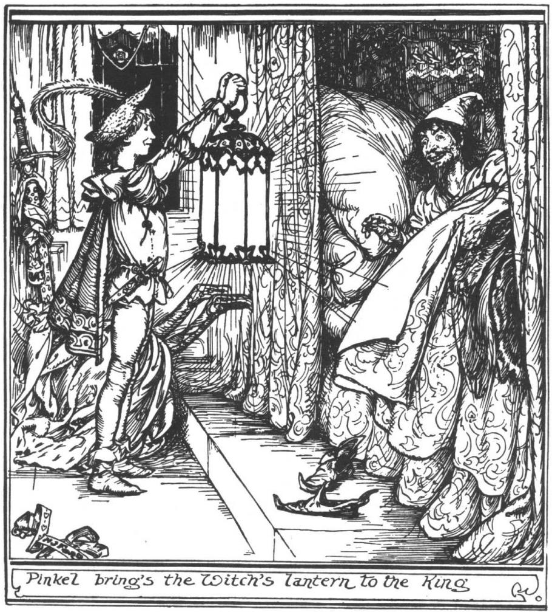

“啊！聪明的家伙，”他喊道，“你给我带来了多么宝贵的财富！”他马上叫来随从，吩咐他们把隔壁的房间准备好，给小红毛住。还说年轻人不论什么时候都可以来见他，让他在议事厅里也有一个席位。

很容易猜到，他两个哥哥这回比以前更加妒忌了。他们又开始盘算，如何才能更好地叫他倒霉。后来，他们想起来那只金角上挂着铃的羊，不禁高兴万分。“因为，”他们说，“这一回，老太婆肯定提防着。而且，不论他怎么聪明，羊角上的铃肯定会让老太婆知道。”于是，当国王像以前一样，到马厩里来称赞他们的弟弟聪明时，他们就对国王说起巫婆家的另一件奇宝，长着金角的羊。

从这个时候起，国王彻夜难眠渴望着能得到这件奇宝。他知道，要想得到它会有危险，因为巫婆已经提高警惕。他绞尽脑汁想着欺骗她的方法，可怎么也想不出好办法来。后来，像两兄弟猜到的那样，他把小红毛找来。

“我听说，”他说，“岛上的老巫婆有一只长着金角的山羊，角上挂着的铃能发出叮咚响的美妙音乐。这只山羊我一定要得到！请告诉我，怎样才能得到它？谁要是把它给我带回来，我就把三分之一的王国送给他。”

“我自己去把它拉回来！”小红毛说。

这一回，因为没有金灯把湖面照亮，所以，小红毛很容易地偷偷来到岛上。可是，话得说回来，山羊睡在屋子里，得从老太婆的眼皮底下偷走，怎么办才能到手呢？他一面划船，一面想着。后来，他终于想出一个办法，似乎可以行得通，不过，他知道，真的做起来也非常困难。

他上岸以后要做的第一件事，就是找一块木头。找到以后，他就躲在屋子附近。等到天很黑，巫婆和她的女儿准备上床睡觉的时候，他偷偷地溜出来，把木头放在门下面。门是朝外开的，这样，你越是用力关门，门就卡得越紧。当巫婆的女儿像往常一样出来关门的时候，事情就这样发生了。

“你在干什么？”女儿在用力拉门的时候，巫婆问。

“门不知道怎么了，总是关不上！”她回答。

“那就算了，让它去吧！没有人要来伤害我们。”巫婆说。女儿听她的话，门也不关就上床睡觉了。

很快就听到了她们打鼾的声音。小红毛知道，他的机会到了。他把鞋脱下来，踮着脚偷偷地走进房间，从口袋里拿出山羊特别喜欢吃的东西，放到它的鼻子底下。在山羊忙着吃的时候，他把随身带来的毛线塞进羊角上的金铃里，每隔一分钟就停下来听一听，生怕巫婆会醒过来，把自己变成什么可怕的鸟或野兽。可是鼾声并没有中断，他尽快地继续干下去。把最后一个铃塞好以后，他又从口袋中再拿出好吃的东西来，给山羊塞过去。山羊立刻站起来，跟着小红毛走。他慢慢地向门口退过去，一出门，就马上把山羊抱起来，向他停着船的岸边跑去。

把船划到湖中间以后，他把铃里的毛线拉出来，铃马上就叮当叮当地大声响起来。响声把巫婆惊醒，她像上一次一样地喊叫起来：

“是你吗？小红毛！”

“是的，亲爱的大娘，是我！”

“你把我的金山羊偷走了吗？”她问。

“是的，亲爱的大娘，我把它偷走了。”小红毛回答。

“你不是一个贼吧？小红毛！”

“亲爱的大娘，我是的。”他回答。

老巫婆愤怒地喊起来：“啊！看你下一次怎么来，下一次你怎么也逃不掉了！”

小红毛只是哈哈大笑，继续把船划走。

国王那么喜欢山羊，日日夜夜都带在身边。像他答应过的那样，小红毛现在统治着三分之一的王国。可以想象，他的哥哥比以往更加气愤，因为妒忌，人也消瘦了许多。

“我们该如何除掉他？”他们互相商量着。后来，他们想起了金斗篷。

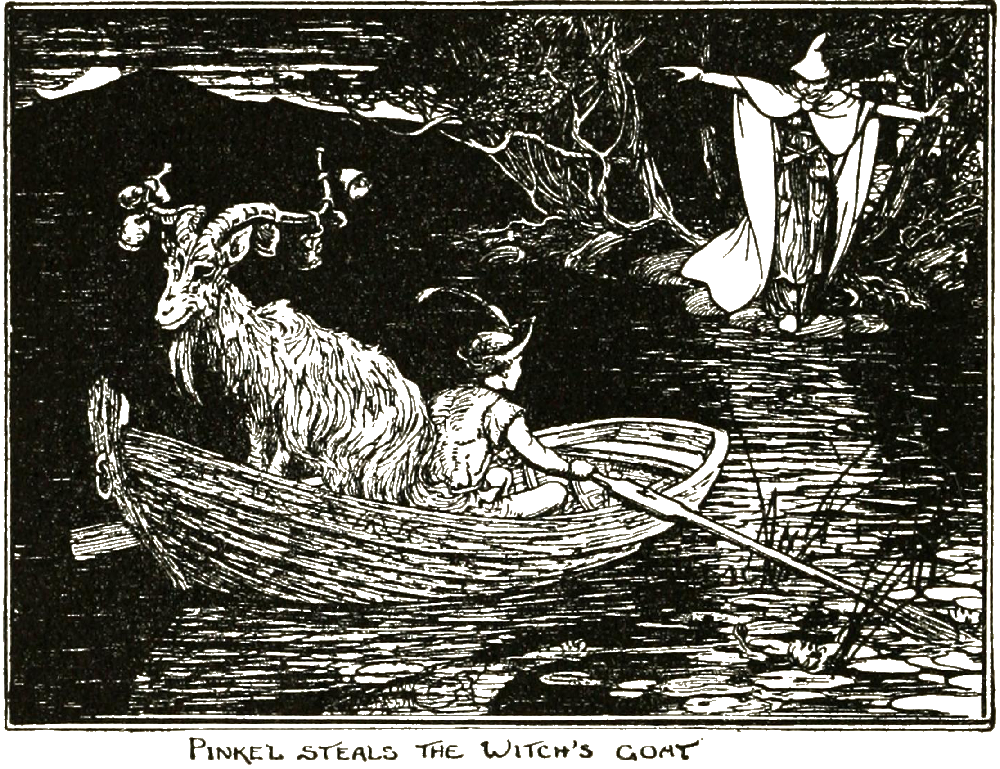

“他要想偷到它，就得更聪明一些！”他们吃吃地笑着说。等到国王又来看他的马的时候，他们又开始说起小红毛如何特别聪明，如何想办法偷到灯和山羊，这是任何人都无法办得到的。

“不过，他既然已经去了，没有把那件金斗篷带回来，总是一件遗憾的事情。”他们接着说。

“金斗篷！那是什么？”国王问。年轻人用非常美丽的词藻来描述金斗篷的辉煌，国王接着宣布说，如果不把金斗篷披到肩上，他就不会有一天感到快活。

“而且，”他补充说，“谁把它给我带回来，我就把女儿嫁给他，他也将继承我的王位。”

“除了小红毛，谁都没有办法得到它。”两个哥哥说。他们不敢想象，老巫婆在受到两次教训以后，第三次会让他们的弟弟逃掉。于是，小红毛又被派出去了，他十分高兴地起程。

他花了好长时间，想了一个又一个办法。后来想出一个计谋来，觉得很有把握能够成功。

他把一个大口袋塞进外衣里，然后来到湖边，把船推开。这一回，他算好在白天里到达岛上。把船拴在一棵树上以后，他低着头向小屋走去，装出一副又悲伤又惭愧的样子来。

“是你吗？小红毛！”巫婆看到他，眼睛里闪出残忍的光。

“是的，亲爱的大娘，是我。”小红毛回答。

“这么说，你干了那么多事以后，还敢自己送上门来！”她喊道，“好啊！这一回你逃不掉了！”她拿出一把大刀，开始磨起来。

“啊！亲爱的大娘！饶了我吧！”小红毛双膝跪下来喊叫着，眼睛紧张地看着四周。

“饶了你，想得倒好，你这个贼！我的灯和山羊在哪里？不行！不行！强盗的下场只有一个！”她举起刀来，刀在火光的照耀下闪闪发光。

“那么，如果我非死不可，”小红毛这一下可真的吓坏了，说，“起码得让我挑选死的方法。我肚子很饿，整整一天没有吃过东西了。如果你愿意，把毒药放到粥里去吧，这样，起码在临死前我还可以吃一顿饱饭。”

“这个主意倒不坏，”巫婆回答，“反正你总得死，至于怎么死，对我来说都是一样。”她盛出一大碗粥来，把一些毒草药拌进去，然后去做一些等着要做的事情。这时候，小红毛急忙把粥倒到衣服里面的口袋里去，还故意用调羹弄出很响的声音来，好像把最后一口也吃得精光。

“不管有毒没毒，粥倒是好吃得很。我一滴都没有剩下，再给我一些吧！”小红毛转过身来对巫婆说。

“好啊！你的胃口真不错，年轻人。”巫婆回答，“不管怎么说，这是你最后的一顿饭了，所以我再给你一碗！”她把剩下的全都倒给他，还拌上毒草药。然后走到窗口去叫唤她的猫。

小红毛立刻又把粥倒到口袋里去，过了一分钟，他就躺在地下打起滚来，像是非常痛苦的样子，嘴里还大声地呻吟着。忽然，他一点声音也没有，直挺挺地躺在那里不动了。

“哦！这种毒药用两次，对你来说可能太多了，”巫婆看着他说，“我警告过你，你再来的话会有什么下场。我希望所有的贼都像你一样全都死光！可是，我那懒闺女叫她去弄柴火，怎么到现在还不回来？天很快就要黑了，她怎么能找到路？不行，我得出去找她，女孩子总是那么讨厌！”她走到门口，想看看有没有她女儿的影子，可是什么也看不见，外面正下着大雨。

“今天晚上可不能穿斗篷出去，”她嘴里嘀咕着，“否则回来的时候就会沾满泥土。”于是，她把它脱下来，小心地挂到房间的橱里去。然后，她穿上木底鞋就出去找她的女儿。等木底鞋的声音一消失，小红毛立刻跳起来，拿起斗篷回到船上，竭尽全力把船划走。

他还没有划出去多远，一阵风吹过来，把斗篷掀开，它的光芒立刻射过湖面。巫婆这时候正好走进森林，转过身来看到了金色的光芒。这一下，她把女儿也忘得一干二净，一直跑到湖边，大声地喊叫起来，因为第三次被欺骗，她非常气愤。

“是你吗？小红毛！”她叫喊道。

“是的，亲爱的大娘，是我！”

“你把我的金斗篷拿走了吗？”

“是的！亲爱的大娘，我把它拿走了！”

“你不是一个大窃贼吗？”

“是的！不错！亲爱的大娘，我是！”

的确，事情正是这样！

可是，不管怎么说，他把斗篷带进了王宫。他也因此得以和国王的女儿结婚。大家都说，倒是公主应该在婚礼上穿金斗篷。

可是国王那么喜欢，他说什么也不肯把它脱下，一直到死，他都没有把它换下来过。他死了以后，小红毛当上了国王。让我们希望他改掉偷窃的坏习惯，很好地管理自己的国家。至于他的哥哥，他并没有惩罚他们，还是让他们在马厩里干活，他们在马厩里整天牢骚不断。

（《圣诞节故事》）

 

## 狐狼的冒险故事

在一块土地上，生活着各种各样的野兽。其中有一只狐狼和一只刺猬，尽管它们不是同一种动物，却也成了非常要好的朋友，总是形影不离。

一天下午，它们一起走在一条路上，身材比较高大的狐狼大声喊叫起来：“啊！那里有一个堆满谷物的仓库，让我们过去吃一些。”

“好的，我们去吧！”刺猬回答说。于是，它们来到谷仓，吃到再也吃不动为止。这时候，狐狼才穿上刚才因为害怕弄出声音而脱下来的鞋，它们又回到大路上。

走了一段路程以后，它们碰到一头黑豹。黑豹停下来，有礼貌地向它们点头说：

“请原谅我说几句话，我不得不说很欣赏你的鞋子，你能不能告诉我是谁做的？”

“是的，我想它们是做得不错。”狐狼回答，“不过，是我自己做的。”

“你能帮我做一双一样的吗？”黑豹热切地问。

“当然，我要尽力而为，”狐狼回答，“不过，你得先给我杀一头母牛，等我们把肉吃掉以后，牛皮就用来给你做鞋子。”

于是，黑豹到处寻找，后来看到一头肥壮的母牛离开了牛群，单独在一块地方吃草。它马上就把它咬死，然后大声地喊叫狐狼和刺猬过来。它们很快就把死牛的皮剥了，铺开晾干。然后，它们又在晚上睡觉之前大吃一顿，这天晚上，它们睡得可舒服了。

第二天早上，狐狼一大早就起来做鞋，黑豹坐在一旁高兴地看着。后来，鞋终于做好了，狐狼站起来，伸伸腰。

“现在，把它拿到太阳底下去，”它说，“过两个钟头就可以穿了，在这之前不要急着穿，否则你就会觉得很不舒服。外面的太阳还很高，我们还得继续赶路。”

黑豹总是很相信别人对它说的话，完全照狐狼的话去做。过了两个钟头，它开始把鞋穿上。鞋套在脚爪上当然非常好看，它把前爪举起来，骄傲地欣赏着。可是，当它想走路的时候，啊！那可是另一回事了！鞋那么紧，那么硬，每走一步，它都痛得哇哇直叫！后来，它就一屁股坐在地下，大哭起来。

过了一会，一群鹧鸪从旁边走过，听到可怜的黑豹的哭声，就走过来看是怎么一回事。它从来没有想过要吃鹧鸪，鹧鸪也总是很友好。

“你好像很疼，”一只鹧鸪飞近它，对它说，“我们能帮你吗？”

“啊！都是那只狐狼！它给我做了这双鞋，它们又紧又硬，把我的脚都弄伤了，脱又脱不下来！”

“躺着别动，我们来把它弄得软些。”善良的鹧鸪回答。它把其他鹧鸪叫来。它们飞到最近的泉水旁去，用嘴含来一些水，把水喷到鞋子上，一直喷到硬皮变软，黑豹能够把脚从里面拔出来。

“啊！谢谢你们！谢谢你们！”它说着，高兴地跳来跳去，“感觉完全不一样了。现在，我要去找狐狼算账。”它向森林里奔跑过去。

可是，狐狼生来就非常狡猾，它一会儿钻到这里来，一会儿又不知道钻到哪里去，所以，很难知道它的行踪。后来，黑豹终于看到了它的敌人，但同时狐狼也看到了它。黑豹大叫一声扑过去，可是狐狼比它还要快，一下子就钻进密林中，叫黑豹无法追赶。

黑豹对自己的失败感到很懊恼，同时也觉得更加气愤。它躺下来考虑着，下一步该怎么办。这时候，一个老人走过来。

“啊！大爷，请告诉我，我被狐狼捉弄了，该怎样来报复它！”接着，它就直截了当地把事情对他说了。

“你要是听我的劝告，”老人回答说，“你就去把一头母牛杀了，邀请森林里所有的狐狼来赴宴。在它们吃东西的时候，你注意看着，大多数狐狼的眼睛都盯着吃的，但如果有一只盯着你看，你就知道它就是那个坏东西。”

黑豹的行为向来正派，它谢过老人，就照他的话去做。母牛杀好以后，小鹧鸪飞到森林里去邀请狐狼，它们来了许多，那只很坏的狐狼也在里面。可是，黑豹因为只见过它一面，所以认不出它来。它们都在母牛的周围木凳子上坐好，杀好的母牛搁在一棵倒地的树杈上。大家开始吃。狐狼那些贪婪的眼睛都盯着面前的肉，只有一只狐狼看上去很不安，不时朝主人的方向窥视着。黑豹注意到了这一点，冷不防向这个坏家伙扑过去，抓住了它的尾巴。可是，狐狼的动作还是比它快，它抓起一把刀，迅速地把自己的尾巴砍掉，一下子就窜到森林里去了。其他的狐狼见状也纷纷地跟在它后面。等黑豹从惊讶中醒过来，一看只剩下自己了。

不久，老人走过来看事情干得怎么样了。黑豹看到了就问他：“我现在该怎么办？”

“这实在是太不走运了，”老人说，“不过，我想你能在一个地方找到它。离这里两英里远有一个甜瓜园，狐狼都非常喜欢吃甜瓜，它们肯定要到那里去。你只要找一只没有尾巴的狐狼，那就不会错了。”于是，黑豹谢过他以后，就动身走过去。

这时候，狐狼已经猜想到，老人会给它的对头出什么主意。

于是，当它的朋友们在强烈的阳光下，围着一个最甜的甜瓜贪婪地吃着的时候，它偷偷地跑到它们的后面，把它们的尾巴都捆在一起。它刚把这件事干完，耳朵里就听到了树丛里传来树枝被踩断的声音。它马上喊叫起来：“快！快！瓜园的主人来了！”那些狐狼都马上跳起来，朝四处奔跑，把尾巴都扯断了！这样一来，黑豹怎么知道谁是它的敌人呢？

“它们都没有尾巴，”它垂头丧气地对老人说，“我追赶它们追得太累了，不管它了！我得去捉点什么来当晚饭吃。”

当然，刺猬一直没有能参加这些冒险过程。等一切危险都过去以后，狐狼就去找它的朋友。很幸运，它就在家里。

“啊！你在家里，”它高兴地说，“自从上一次我们分手以后，我把尾巴也丢了。其他的狐狼也丢了。不过，这没有什么关系！我饿了，和我一起到住在那边的牧羊人那里去，向他买只羊。”

“好的，这个主意不错。”刺猬回答。它尽快地迈开自己的小脚，以便跟得上狐狼。它们找到牧羊人以后，狐狼从它的前腿下拿出钱袋来，开始做这笔买卖。

“只需等到明天，”牧羊人说，“我会给你们一只从没见过这么肥的大羊。它总是在离别的羊远一些的地方吃草，要抓住它得花点时间。”

“嗯！这件事倒也很麻烦，但我想还是等一等吧！”狐狼回答说。它和刺猬去找了一个干燥舒适的洞，准备今天晚上舒服地睡一觉。可是，它们走了以后，牧羊人杀了一只羊，把它的皮剥下来，紧紧地缝到跟随他的一条灰狗身上去，然后在它的头颈上套上一根绳子。这些事情干好了以后，他就躺下来睡觉。

第二天一大早，太阳还没有升起来，狐狼和刺猬就来找牧羊人，拉着他的衣服喊道：“快起来，把羊给我们，我们一个晚上都没有吃东西，肚子都饿坏了。”

牧羊人打着哈欠，擦擦眼睛说：“它就拴在那棵树上，你们自己去拿吧！”它们来到那棵树旁，把绳子解开，拉着灰狗走了。走进洞以后，狐狼对刺猬说：

“在杀掉它之前，让我看一看它肥不肥。”它们退后几步，以便看得更清楚一些。它歪着头看了一两分钟以后，认真地点着头说：“这只羊够肥的了，是一只好羊。”

刺猬有时候比人们想象的更聪明，它回答说：“我的朋友，你这是在胡说八道，不错，它的毛确实是羊毛，可是它下面的爪子却像我的灰狗叔叔一样。”

“它是一只羊。”狐狼又重复了一遍，它不愿意承认别人比它更聪明。

“把绳子拉紧，让我再看一看。”刺猬说。

狐狼很不情愿地拉着绳子，刺猬慢慢地绕着灰狗走，最后再回到狐狼的身边。根据它的爪子和尾巴来看，刺猬很清楚，牧羊人卖给它们的是一条灰狗而不是羊。它想象不出接下来会发生什么事情，所以还是决定快点走开为妙。

“嗯！是的，你说对了！”它对狐狼说，“不过，不喝点水我就吃不下任何东西，我就到森林那边的泉水旁去喝点水，止止渴，然后我就回来准备吃早饭。”

“那么，就快去快回。”狐狼说。刺猬拔腿就拼命地逃跑，狐狼还躺在一块石头下面等它回来。

一个多钟头过去了，刺猬有足够的时间到泉水旁去一个来回，可这时候还是不见它的影子。这事情非常奇怪，原来，它已经到一棵大树下面的草丛里藏起来了。

后来，狐狼想，它的朋友可能是出于什么理由跑开了。它决心不再等了，自己先吃早饭。它走到拴着灰狗的地方，把绳子解开。可是，就在它想跳到羊的背上去，一口把它咬死的时候，狐狼听到了一声低沉的咆哮声，这种声音决不是任何一只羊的喉咙里能够发得出来的。狐狼赶紧把绳子扔掉，像闪电一样向草原上奔去。可是，尽管它的腿很长，灰狗的腿比它还要长，它很快就追上了自己的猎物。狐狼转过身来想抵抗，可它哪里是灰狗的对手。不到几分钟，它就躺在地下死了，灰狗平安地跑回到牧羊人的身边。

 

## 狐狼大儿子的冒险故事

狐狼虽然死了，可是，它留下了两个儿子。不论做什么事情，它们都像父亲一样狡猾和诡计多端。大儿子外表长得很英俊，性格很开朗，交了许多朋友。它最常见的动物是一只鬣狗。有一天，它们一起出去散步，捡到一件美丽的绿色斗篷，那是谁骑着骆驼经过草原时偶然掉下来的。它们两个当然都想要，为了这件事差点吵起来。后来，它们想出一个解决的办法，斗篷白天给鬣狗穿，晚上给狐狼穿。可是没过多久，狐狼对这样安排很不满意。它宣称，它的朋友和鬣狗的朋友大不一样，它们都看不到这件斗篷的光彩。只有让它白天也能穿，这样才显得公平合理。这个建议鬣狗说什么也不同意。它们眼看就要吵起来，后来，鬣狗建议，应该去问狮子，由它来进行裁决，狐狼同意了。鬣狗披上斗篷，它们一起来到狮子的洞穴里。

善于辞令的狐狼立刻把事情一五一十地说起来。等它说完以后，狮子转过身来问鬣狗，它说的是不是真的？

“千真万确，威严的大王。”鬣狗回答。

“那么，把斗篷放在我脚下的地上，”狮子说，“我将作出判决。”于是，斗篷在红色的地面上放好，鬣狗和狐狼站在两旁。

沉默了一会儿以后，狮子站起来，看上去又伟大又聪明。

“我的判决是，明天一早，谁第一个敲响最近那座清真寺的钟，斗篷就完全属于它。现在，你们可以走了，还有许多事情等着我去处理！”

整个晚上，鬣狗都没有睡好，它怕狐狼会抢先到了清真寺，清真寺那么近。东方刚露出一丝曙光，它就赶紧向清真寺的钟奔过去。这时候，一个晚上都睡得很舒服的狐狼正站起来。

“祝你好运！”狐狼说着，把那件斗篷披到自己的身上，穿过草原直奔而去。它的朋友鬣狗再也看不到它了。

一连跑了好几英里以后，狐狼想不会有人再追它了。这时，它看到一头狮子和另一条鬣狗在说话，就走过去一块说。

“早上好！”它说，“我可以问一下你们在说什么吗？看上去你们像是在认真地讨论什么问题。”

“请坐，”狮子说，“我们在商量该朝哪个方向走，才能找到最好吃的饭。鬣狗想向森林的方向走去，我想向山的方向走去，你说呢？”

“嗯！我刚从草原上走过，看到一群羊正在吃草，有一些走进了小山谷，牧羊人的眼睛绝对看不见。只要你们躲在石头当中，就肯定不会被发现。不过，也许你们愿意让我一起去，好给你们带路？”

“你真是太好了，”狮子说。它们偷偷地走过去，来到山谷口，看到一只公羊、一只母羊、一只小羊正在吃着肥壮的草，一点也没有觉察到眼前的危险。

“我们该怎样来分它们？”狮子小声地对鬣狗说。

“啊！那很容易，”鬣狗说，“那只小羊给我，母羊给狐狼，公羊给你！”

“这么说，我只能吃这个瘦巴巴的东西了，它除了骨头以外，什么都没有，是不是？”狮子生气地喊道，“我要教训你一下，看你还会不会这样分东西！”说着，它狠狠地揍了鬣狗两下，鬣狗立刻直挺挺地躺在地上，死了！然后，它转过脸来问狐狼：“我们该怎样来分？”

“和鬣狗的方法大不一样，”狐狼回答说，“早餐你把小羊吃掉，中餐你把母羊吃掉，晚餐你把公羊吃掉！”

“我的天，你怎么会这样聪明？这种智慧是谁教给你的？”狮子赞赏地看着它，称赞它说。

“是鬣狗的命运！”狐狼笑着回答。说着它以最快的速度跑开，它看见两个手中拿着长矛的人正在从狮子的后面偷偷地向它靠拢。

狐狼一口气不停地跑着，直到跑不动为止。它扑到一棵树下喘着气，这时，忽然听到草里有动静，它父亲的老朋友刺猬出现在它的面前。

“啊！是你吗？”小东西问道，“我们在离家那么远的地方见面，真是太奇怪了！”

“我刚刚非常侥幸地从死里逃生，”狐狼上气不接下气地说着，“我需要睡一觉，然后我们得想出什么事情来玩一玩。”说着，它又躺下来美美地睡了两个钟头。

“现在我准备好了，”它说，“你有什么好主意吗？”

“在这些树旁边有一个山谷，”刺猬回答说，“那里有一间小农舍，里面做出来的奶油全世界最好。我对他们很了解，再过一个钟头，农民的妻子就要出去挤牛奶，那里离屋子有一段距离。我们很容易从窗口跳进她放奶油的小屋。进去以后，你先好好地吃一顿，我先给你看着，免得有人突然闯进来；然后你给我看着，我再去吃。”

“听起来好像是个好主意。”狐狼说。于是它们两个就一起去了。

可是，到了那间农舍以后，狐狼对刺猬说，“你进去，把那罐奶油拿出来，我把它藏到安全的地方去。”

“啊！不！”刺猬喊道，“我真的不能这样做。他们很快就会发现的。再说，隔一段时间吃一点多没劲！”

“立刻照我的话去做，”狐狼严厉地瞪着它说，刺猬不敢再说什么了。它进去把奶油罐一个一个地滚到窗口，狐狼一个一个地把它们拿出来。

等奶油罐排成一排以后，它忽然大吃一惊，小声地对它的伙伴说：“快逃命，我看到农妇从山那边过来了！”刺猬吓得心扑嗵扑嗵直跳，拔腿就拼命地跑起来。狐狼站在那里不动，笑得前俯后仰，因为农妇连影子也看不见，它骗走刺猬，只是不想让它知道奶油罐埋在什么地方。它每天都偷偷地来到藏奶油的地方，美美地吃上一顿。

后来，终于有一天早晨，刺猬忽然问：“你从来没有跟我说过，那些奶油罐你怎么处理了？”

“嗯！我把它藏在安全的地方，直到那些农民把它彻底忘掉！”狐狼回答说，“可是现在，他们还在到处寻找，我们还得再等一等，然后我就把它们拿回家，我们俩一起分掉。”

于是，刺猬等了又等，每次它问起是否可以把奶油拿回来的时候，狐狼总是找理由把它支开。过了一段时间以后，刺猬起了疑心，它说：“我想去看一看你把它藏在什么地方。今天晚上天很黑，你可以带我去看一看了。”

“我真的不能告诉你，”狐狼回答，“你的话那么多，肯定会把这个秘密告诉别人，那我们就白辛苦了！此外还要冒着脖子被农民拧断的危险。我看得出，他已经有点垂头丧气的样子了，很快就会放弃寻找了，还是再耐心地等一回吧！”

刺猬不再说什么了，装出一副很满意的样子。过了一些日子以后，狐狼因为连续打了几个钟头猎，睡得正香，刺猬跑过来把它喊醒。

“我刚刚接到一个请帖，”刺猬说，“我的大家庭明天想举办一个宴会，它们也邀请你去参加，你去不去？”

“当然去！”狐狼说，“我非常荣幸！不过明天上午我得出去，你可以在大路上等我。”

“那很好，”刺猬回答说。狐狼说好以后又睡觉去了，因为它得很早就起来。

刺猬准时地来到约会的地点，狐狼还没有来，它就坐下来等它。

“啊！你终于来了！”刺猬看到那满是灰尘的黄影子终于在拐弯处出现，喊道，“我差一点就自己走了，说实在的，我真不希望你来！因为我实在找不到好的地方把你藏起来。”

“你干吗要把我藏起来？”狐狼问，“你这是怎么回事？”

“唉！很多客人都把他们的狗和骡带来了，我担心你在它们中间不安全。不！别朝那边跑，因为有一群人正从山那边过来。快躺下来！我把这些口袋盖在你身上。不论发生什么事情，要想活命就别动！”

后来的事情是这样的，狐狼躺在小山下被盖起来后，刺猬把一块大石头滚下来，把它压死了。

 

## 狐狼小儿子的冒险故事

狐狼的父亲和大儿子都死了，现在，狐狼的家庭只剩下小儿子了。它一点也不比它们笨，它也像它们一样，不喜欢呆在一个地方。谁也不知道，下一次该到乡村的什么地方去找它。

有一天，它正在到处游逛，看到一只很肥的羊。羊正在心满意足地吃着它的草。

“早上好！”狐狼说，“见到你我很高兴，我在到处找你。”

“找我？”羊吃惊地说，“可我们从来没有见过面！”

“是没有，可是我听说过你。啊！你不知道我听说过多少美好的事情！有些人总是很幸运！”

“你真好，我敢肯定。”羊回答说，眼睛也不知道看什么地方好，“我能帮你什么忙吗？”

“我已经做好了一些安排，虽然我不是很乐意和一个刚认识的朋友商量。不过，从别人对我说的情况来看，你和我可以舒舒服服地在一起安一个家，不知道你愿不愿意试试看。我有几块地，只要好好地浇水，就会长出好的庄稼来。”

“也许我可以来住一些日子试试看，”羊有点犹豫不决地说，“要是合不来，我们还可以分开。”

“啊！谢谢你！谢谢你！”狐狼说，“让我们说干就干！”它伸出手来做出邀请的样子。羊起身和它一起走，来到它的家。

“现在，”狐狼说，“你到井里去挑水，我把水倒到庄稼地的沟里去。”它一边倒着水，一边还兴高采烈地唱着。羊干的活很累，可是它毫无怨言。慢慢地，艰苦的劳动终于看到了成果。小绿芽从地里冒出来，在温暖的阳光照耀下，很快就长大成熟。收割的季节到了。庄稼收割下来，脱粒以后准备出售。

一切都准备就绪以后，狐狼对羊说：“让我们把粮食分一分，这样自己的一份爱怎么处理就怎么处理。”

“你分吧！”羊回答，“秤在这里，你要仔细地称！”

这样，狐狼开始称份量。称好以后，它开始大声地数：

“一，二，三，四，五，六，七份是狐狼的，一份是羊的。如果它喜欢，可以把它拿走；如果它不喜欢，可以把它留下。”

羊看着两堆粮食，默不作声，一堆那么大，一堆那么小。过了一会儿，它回答说：

“请等一下，我去拿个口袋来把我的一份拿走。”

可是，羊并不是去拿口袋。等狐狼看不到它以后，它立刻以最快的速度跑到灰狗的家里。跑得那么急，到了灰狗的家里它气都喘不过来。

“啊！好大叔！求求你，帮帮我了！”等它缓过一口气以后，它说。

“哦！出了什么事？”灰狗问，吃惊地看着它。

“我请求你和我一起回去，吓唬一下狐狼，叫它把欠我的还给我！”羊回答说，“几个月来，我们住在一起。我每天去挑两次水，它只是把水倒到水沟里去。我们一起收割粮食，现在，到了分粮食的时候，它自己拿了七份，只分一份给我。”

说完，它转过头来，用毛茸茸的尾巴擦了一下眼睛。灰狗看着它，样子很镇静，然后说：

“给我拿个口袋来。”羊赶紧跑出去找口袋，很快就回来，把口袋放在灰狗的面前。

“把口张开，好让我进去。”它说。等它在里面舒服地躺下以后，它就叫羊把它背到肩上，赶快回到它和狐狼分手的地方去。羊看到狐狼在等着它，而且假装在睡觉，可是羊清楚地看到它在眨一只眼睛。不过，它装作没看见，没好气地把口袋放在地下说： “现在，分吧！”

狐狼站起来，走到身边的那堆谷子面前，还是像上一次一样分成八份，七份留给自己，一份分给羊。

“你这是什么意思？”羊愤怒地说，“你明明知道，水都是我挑来的，你只是把它倒到沟里去！”

“你弄错了，”狐狼回答说，“是我把水挑来，你只是把水倒到沟里去。这件事情谁都清楚，要是你愿意，我们可以去问那边挖土的人！”

“那很好，”羊回答。

狐狼大声地喊叫起来：“喂！挖土的人！告诉我，你们听到谁一边干活一边唱歌？”

“呵！当然是你，狐狼！你唱得那么响，整个世界都可以听得见！”

“那么，是谁在唱呢？是挑水的人，还是倒水的人？”

“呵！当然是挑水的人！”

“你听到了吗？”狐狼转过身来对羊说，“现在，你去把自己的一份拿走，否则我就要拿了。”

“我真服了你了，”羊回答说，“我想我得承认你赢了！不过，我没有什么恶意，我在口袋里带来了一些枣椰子，你去吃一些吧！”

狐狼很喜欢吃枣椰子，它立刻跑回去把口袋拉开。可是，它正想把鼻子伸进口袋的时候，看到里面一对褐色的眼睛在冷冷地看着它。它立刻把口袋扔下，跑回到羊站着的地方去。

“我只不过是闹着玩的，你就把我的灰狗大叔带来了。把口袋拿走，我们重新分一分。”于是，它把那堆谷子重新分过。

“一，二，三，四，五，六，七，这是给我的母亲羊的，这一份是给狐狼的。”它一边数，一边说，还不时胆怯地朝口袋观望。

“现在，你可以把你的那一份拿走了，”羊说。狐狼不等它说第二次拔腿就跑。羊抬起头来看时，看到它还在草原上狂奔。据我所知，它现在还在草原上不停地跑着。

 

## 巨人的三件宝物[^6]

很久很久以前，有一对老夫妻，他们有三个儿子：大儿子叫马丁，二儿子叫迈克尔，小儿子叫杰克。

一天晚上，一家人围坐在桌旁，吃面包和牛奶当晚饭。

“马丁，”老人忽然说，“我觉得自己活不长了。你是老大，这间小屋就归你；不过，你要是想得到我的祝福，就得好好待你妈和两个弟弟。”

“那当然，爹！你怎么会以为我会亏待他们呢？”马丁一边说，一边气呼呼地把碗里最好的几块都拨到自己面前。老人什么也没看见，迈克尔却惊讶地看着他，杰克更是吃惊得连自己的晚饭都忘了吃。

没过多久，父亲病倒了，派人把在外打猎的儿子们叫回来，要跟他们告别。他先对两个大儿子叮嘱了一番，然后转向杰克。

“我的孩子，”他说，“你的脑子不如别人灵光，可是老天爷少给了你几分聪明，却给了你一副好心肠。你要常听它的吩咐，也要尽力听你妈和你哥哥的话！”说完，老人往枕头上一靠，就咽了气。

马丁和迈克尔放声大哭，哭声传遍了整座屋子。杰克却守在父亲床边，一动不动，一声不响，好像自己也死了过去。过了好一阵，他才站起来，走进花园，躲在树丛里，像个孩子似的哭起来。这时候，两个哥哥正在张罗丧事。

父亲一下葬，马丁和迈克尔就商量好，要一同出门去闯天下，碰碰运气，让杰克留在家里陪母亲。杰克倒巴不得坐在火边发呆。可是母亲自己上了年纪，说家里没有活给他干，他必须跟两个哥哥一道出去找活路。

于是，在一个晴朗的早晨，兄弟三个上了路。马丁和迈克尔背着两只装得满满的大口袋，杰克却什么也没背。两个哥哥气坏了：天热，口袋又沉。到了晌午，他们在一棵树下坐下来吃东西。杰克跟他们一样饿，可是他知道开口要也没用，就一头倒在另一棵树下，伤心地哭起来。

“下回你也许就不这么懒了，会自己带点吃的。”马丁说。没想到杰克回答说：

“你们俩可真行！口口声声说要出去闯天下，好不拖累母亲，一开头却把家里所有的吃食都卷走了！”

这话来得太突然，两个哥哥一时都答不上来。过了一会儿，他们才分了些吃的给弟弟；等他吃完，三个人又上路了。

快到傍晚的时候，他们来到一间小屋前，敲敲门，问能不能在这里借宿一夜。屋主是个樵夫，请他们进屋，又请他们坐下吃晚饭。马丁道了谢，可是他自尊心强，解释说他们只要有个地方歇脚就行，吃食自己带得很多。说着，他和迈克尔就打开口袋吃起来，杰克却躲到角落里。樵夫的妻子见了，心里可怜他，叫他过来一起吃。杰克高高兴兴地去了，觉得这顿饭香极了。马丁闻着弟弟喝的那碗汤的香味，再看看自己手里又干又硬的面包和干酪，后悔自己不该逞强推辞。

“不能再让他碰上这种好事。”他心里想。第二天早晨，他执意要钻进一片密林，那儿多半碰不上什么人。

他们在林子里东一头西一头地转了很久，因为没有路可走。后来，他们终于走到一片空旷的林地，中间立着一座城堡。杰克高兴得叫起来，马丁却正在闹脾气，没好气地说：

“咱们准是走岔了路！回去吧。”

“傻瓜！”迈克尔回答。他也饿了，而且跟许多饿了的人一样，脾气坏得很。“咱们本来就是出来走天下的，往左往右有什么要紧？”说完，他就朝城堡走去，杰克紧紧跟在后面，过了一会儿，马丁也跟了上去。

城堡的大门敞着，他们走进一间大厅，四下张望。厅里一个人影也没有。马丁忽然觉得有点害怕，自己也说不出为什么。他本想马上离开城堡，可是杰克已经壮着胆子走到墙边一扇门前，把门推开了。他到底不好意思让弟弟比下去，便跟着走进去，进了另一间富丽堂皇的大厅。大厅里从地上到房顶，堆满了大块的铜钱。

马丁和迈克尔看得眼花，把口袋里剩下的吃食统统倒出来，一把一把地往里装铜钱。

刚装完，杰克又推开一扇门，这一回里面是一间堆满银子的大厅。两个哥哥立刻把口袋翻过来，铜钱哗啦啦倒了一地，又大把大把地往里装银子。还没装完，杰克又打开了第三扇门，三个人都惊得倒退一步：这间屋子里堆的全是金子，亮得叫人眼睛发疼。不过他们很快就回过神来，赶紧把银子倒掉，改装金子。等口袋再也装不下了，马丁说：

“咱们得赶快走，别等别人来了，咱们可对付不了。”

说完，他就带着迈克尔匆匆离开了城堡。杰克在后面耽搁了几分钟，往自己口袋里塞了些金币、银币和铜币，又把两个哥哥扔在第一间屋子里的吃食吃了个干净。他这才去追他们。他找到他们的时候，他们正躺在树林里歇脚。太阳快下山了，马丁觉得肚子饿，见杰克来了，就吩咐他回城堡去，把丢在那儿的面包和干酪拿来。

“何必费这个事，”杰克回答，“那些碎块我都捡起来吃了。”

听了这话，两个哥哥气得发昏，扑上去就打，一边打一边骂，直到打累了才住手。

“你爱去哪儿就去哪儿，”马丁又踢了他一脚，吼道，“以后别再让我们看见你！”可怜的杰克哭着跑进了树林。

第二天早晨，两个哥哥回了家，买下一所漂亮的房子，跟母亲住在一起，过得像老爷一样。

杰克在藏身的地方待了几个钟头，庆幸自己躲开了那两个折磨他的人。等到没有人来找他的麻烦，背也不那么疼了，他才开始盘算往后怎么办。最后他打定主意，要到城堡里去，尽量多带些钱走，好舒舒服服地过完下半辈子。主意一定，他就跳起来，顺着通往城堡的那条路走去。大门还是敞着，他一直走到堆金子的那间大厅，脱下上衣，把两只袖子系在一起，做成一个口袋的样子。然后一把一把地往里装金子。忽然，一阵响雷似的轰隆声震动了整座城堡，接着传来一个公牛般沙哑的声音：

“我闻到了人味。”

两个巨人走了进来。

“好哇，小爬虫！原来是你在偷我们的宝贝！”那个最大的巨人嚷道，“这下可逮着你了，晚上就把你炖了吃！”

可是另一个巨人把他拉到一边，两个人嘀咕了一会儿。最后，大个子巨人开口了：

“看在我朋友的面子上，饶你一命。不过从今往后，你得替我们看守这些宝贝。你要是饿了，就拿这张小桌子敲一敲，嘴里说：‘皇帝的宴席！’你要多少吃的，就有多少吃的。”

杰克轻轻松松地答应了下来，一连几天过得快活极了。他要什么有什么，从早到晚什么活也不干。可是日子一长，他就腻烦起来。

“让巨人们自己看着他们的宝贝去吧，”他最后对自己说，“我要走了。金子银子我一样也不带，只带你走，我的好桌子。”

他把桌子往腋下一夹，动身进了树林。他在林子里没有多耽搁，很快就走到另一边的田野上。在那里，他看见一个老人，正在求他给点东西吃。

“你算是找对人了。”杰克快活地回答。他招呼老人跟他一起在树下坐下，把桌子摆在他们面前，敲了三下，喊道：“皇帝的宴席！”话音未落，桌上就摆满了各种各样的鱼和肉。

“你这手本事真不错。”老人吃饱以后说，“把它给我吧，我拿一件更好的宝贝跟你换。你看见这只号角没有？你只要对它说，你想要一支军队，你要多少兵，就有多少兵。”

杰克自从独自一人闯荡以来，心也大了。他迟疑了一下，就接过号角，把桌子换给了老人。老人跟他道了别，走一条路，杰克走另一条路。有很长一段时间，他对这件新宝贝十分满意。后来他觉得饿了，四下一看，不见一处人家，心里直盼着那张桌子还在身边。忽然，他想起了号角，心里冒出一个坏主意。

“两百名轻骑兵，前进！”他喊道。

近处立刻响起了马嘶声和刀剑的碰击声。领头的军官骑马来到杰克跟前，恭恭敬敬地问他有什么吩咐。

“顺着这条路走一两英里，”杰克回答，“你们会碰到一个老人，手里拿着一张桌子。把桌子夺过来，给我送到这儿。”

军官敬了个礼，回到队伍里，士兵们就策马飞奔，去办杰克吩咐的事。

十分钟后，他们带着桌子回来了。

“就这些，谢谢你们。”杰克说。士兵们随即消失在号角里。

那天晚上，杰克这顿晚饭吃得可真香，早把这是靠卑鄙手段弄来的忘得一干二净。第二天，他早早吃过早饭，就往最近的一座城走去。半路上又碰见一个老人，向他讨东西吃。

“当然，当然，有东西给你吃。”杰克回答。他把桌子往地上一放，喊道：“皇帝的宴席！”各种菜肴立刻摆了上来。老人起初只顾狼吞虎咽，一句话也不说；等他吃饱了，才转过头对杰克说：

“你这手本事真不错。把桌子给我，我给你一样更好的东西。”

“我不信还有比这更好的东西。”杰克回答。

“有的，有的。你看我这只口袋，你要多少座城堡，它就能给你多少座。”

杰克想了想，回答说：“好吧，我跟你换。”他把桌子递给老人，把口袋挎在胳膊上。

五分钟后，他从号角里召来五百名长矛骑兵，叫他们去追那个老人，把桌子夺回来。

他凭着一肚子计策，把三件宝物都弄到了手，就打定主意回故乡去。他把泥巴抹在脸上，把衣服撕破，装成乞丐的样子，拦住过路的人，假说要讨钱讨饭，顺便打听村里的闲话。这样，他才知道两个哥哥已经发了迹，方圆一带的人都很敬重他们。听到这些，他立刻赶到那所漂亮的房子门口，求他们给他一点吃的，让他住一夜。可是他能得到的只有几句难听的话，还叫他到别处去讨。后来还是母亲替他说情，才让他在马厩里过夜。他在马厩里一直等到屋里的人都睡熟了，才从斗篷底下取出那只口袋，让它变出一座城堡来。号角给他变出士兵守卫城堡，桌子给他摆上一顿丰盛的晚饭。第二天早晨，他又让这一切都消失。两个哥哥走进马厩时，只见他躺在干草上。

杰克在这里住了许多天，什么活也不干，而且在别人看来，什么也不吃。两个哥哥觉得十分奇怪，三番五次地追问他，最后他只好把桌子的秘密说了出来。他还请他们吃了一顿饭，那排场远远超过他们见过、听说过的任何宴席。他们虽然郑重其事地答应绝不外传，可是不知怎么的，这话还是传了出去，不久就传到了国王耳朵里。当天晚上，国王的宫廷总管就到杰克的住处来，说国王想借这张桌子用三天。

“行啊，”杰克回答，“你带回去就是。不过请告诉陛下，三天以后要是不还，我就跟他开战。”

宫廷总管把桌子带走了，径直送到国王那里，同时把杰克的威胁也说了。两个人笑得腰都直不起来。

国王得了这张桌子，又吃了它变出来的几顿饭，喜欢得不得了。三天期满，他实在舍不得还回去，就把木匠叫来，叫他照样仿造一张。假桌子做好以后，他让宫廷总管把真桌子还给杰克，还让他带去国王千恩万谢的话。正好到了吃饭的时候，杰克就请宫廷总管留下来一起吃饭。总管不知道其中有诈，痛快地答应了。这三天他吃了这桌子变的好几顿好饭，哪怕是在马厩里吃，他也乐意，就在杰克身边的干草上坐下来。

“皇帝的宴席！”杰克喊道。可是连一小块干酪也没有出现。

“皇帝的宴席！”杰克又喊了一声，声如雷鸣。这时他才明白过来，双手一用力，把桌子掰成了两半，转过身去看宫廷总管。总管又糊涂又害怕，正想着怎么脱身。

“回去告诉你那个不讲信用的国王，明天我要把他的城堡砸个稀烂，就像掰断这张桌子一样容易。”

宫廷总管赶紧跑回王宫，把杰克的话禀告国王。国王听了笑得更厉害，还把大臣们都叫来听这段笑话。可是第二天早晨一觉醒来，看见一万名骑兵和同样多的弓箭手把王宫围得水泄不通，他们就笑不出来了。国王知道硬撑也没有用，就一手拿着白旗，一手拿着那张真桌子，出来找杰克。

“我做了错事，”他说，“不过我要尽力弥补。这是你的桌子，我惭愧地承认，我本想把它偷下来；除此之外，我把女儿嫁给你做妻子！”

有这张桌子能摆出空前丰盛的喜宴，婚事自然不用再拖。等众人吃饱喝足，杰克取出他的口袋，让一座装满各种宝贝的城堡在花园里为他和新娘拔地而起。

看到这一手，国王的心彻底凉了。

“你的法术比我的高明，”他说，“你又年轻又强壮，我又老又累。你把我手里的权杖拿去，把我头上的王冠拿去，替我好好治理我的百姓吧。”

杰克的野心终于得到了满足。他再往上也没有什么可盼的，总不能比国王还大；只要号角能给他变出兵来，他就不怕任何敌人。他一直不肯原谅两个哥哥当初那样待他，不过还是送给母亲一座漂亮的城堡，凡是她想要的东西都置办齐全。他自己的王宫正中有一间宝库，桌子、号角和口袋就供在里面，是他最珍视的三件宝物。杰克——如今叫约翰国王——每个星期都要亲自来看一次，生怕它们有什么闪失。他治国长久，政绩也好，活到很大年纪才去世，百姓都爱戴他。可是他的儿孙不肯学他的好样子。他们越来越骄横，觉得自己的祖先曾经是个穷小子，实在丢人。只要那三件宝物还摆在宝库里，他们和世上的人就免不了要想起这件事。于是有一个国王比别的都糊涂，索性把它们扔进了一间又黑又潮的地窖。

这个王国又延续了些年头，只是一年比一年衰弱。有一天，国王听到风声，说有一支大军正向他的国土开来。他隐隐约约记起听过的故事：有一只神奇的号角，能变出足以征服天下的兵将，后来被他的祖父搬进了地窖。他急忙赶到地窖，想再借它重振威风。在那又黑又黏的角落里，宝物倒真的还在。可是他的手一碰，桌子就散了架；号角里只剩下几片被老鼠啃过的皮带碎屑；口袋里除了几块碎石，什么也没有。

国王低下头，听凭命运的安排，心里咒骂着自己和祖辈的骄傲与愚蠢招来的这场灾祸。

（《柏柏尔故事集》，勒内·巴塞编）

 

## 平原上的流浪者

在一个非常遥远的，靠近非洲东部海岸的地方，曾经住过一对夫妻。他们有两个孩子，一个儿子和一个女儿。他们都很爱自己的孩子。像别的地方的父母一样，他们经常说起年轻人总有一天要办的美好婚姻。在那个地方，男孩和女孩都是很早就结婚。没有多久，就听说山那边的一个富裕人家派人来提亲，他们对母亲说，要用一群肥壮的牛来换她的女儿。家里和全村的人都非常高兴。姑娘就这样嫁到她的新家去了。等这件事情平静下来以后，父亲对儿子说：

“我们现在有这么漂亮的一群牛，你得赶快娶个媳妇，免得这些牛生了病就不好办了。这个村子里我们都看过了，有一二个姑娘的父母只要我们不到一半的牲口，就肯把他们的女儿嫁过来。因此，告诉我们你喜欢哪一个，我们好把她给你买过来。”

可是儿子回答说：“这不行，我看到的姑娘都不中我的意。要是我非得结婚不可，让我自己出去找一个。”

“你爱怎么办就怎么办吧！”父母说，“往后要是有什么麻烦，那是你的过错，和我们无关。”

可是年轻人并不理睬他们，和父母亲告别以后，他就动身出去找了。他走得很远很远，翻过了许多大山，渡过了许多大河，最后来到一个村庄。这里的人和他的民族大不一样。他看了看四周，注意到姑娘们都长得很好看。她们在舂玉米，或者在土锅里烧香味四溢的汤，特别是你又热又累的时候，这些香味更是这样诱人。当一个姑娘向这个陌生人转过头来，给他饭吃时，他就打定了主意，非她不娶。

于是，他给她的父母送去口讯，请求他们同意把女儿嫁给他。第二天，他们就来给他答复。

“我们可以把女儿嫁给你，”他们说，“可是，你得给我们一个好价钱。从来没有见过一个姑娘像她这么勤劳，而且，她走了以后我们怎么过还不知道！不过，我们相信，你的父母会亲自把钱送过来的吧？”

“不！我自己身上带着钱！”年轻人回答说，他把一把金币拿出来，“就在这里，拿去吧！”

老夫妻俩眼中闪出贪婪的目光，可是，按照习惯，事情没有安排好之前，他们不能碰这些钱。沉默了一会儿以后，他们又说，“起码，我们可以等待你的父母来把你的妻子带回家吧？”

“不！他们不习惯于出门，”新郎回答说，“婚礼用不着耽搁，立刻就举行。然后我们马上就动身，路途很遥远。”

于是，父母把他们的女儿叫进来，她这时候正躺在外面晒太阳。当着全村人的面，他们杀了一头羊，然后大家跳起了庄严的舞蹈，向这对年轻人表示祝福。接着，父亲把新娘叫到一边，他的责任是临别时教导她，婚后怎么过日子。

“要孝敬你丈夫的父母，”他说，“不要违抗你的丈夫。”姑娘顺从地点点头。然后就轮到她的母亲，按照部落的习惯，问她的女儿说：“你要哪个妹妹和你一起去，帮你砍柴和挑水呢？”

“我一个也不要，”她回答说，“她们没有用，砍柴挑水都不行。”

“那么，你要不要带其他的女孩子去？这里有许多女孩子可以供你挑选。”她母亲又问。

新娘很快就接着说：“我都不要！你一定要把我们家的那头水牛——草原流浪者给我。它足可以帮我了。”

“你这话说得多傻！”她的父母喊叫起来，“把我们的草原流浪者给你！你不是不知道，我们的生命全寄托在它的身上。它在这里吃得很好，睡在柔软的草地上。可是谁知道，到了另一个地方以后会怎么样？吃的东西可能很糟糕，它可能会饿死。它死了我们也就活不了了！”

“不！不！”新娘说，“我可以像你们一样，很好地照顾它。给它准备好，太阳已经西沉，我们该走了。”

说完，她就去收拾东西：一个装满草药的小罐，一个用来治疗病人的角，一把小刀，还有一个装鹿油的葫芦。她把这些东西放好以后，就告别父母，跟着丈夫开始翻山越岭。

可是，年轻人并没有看见跟在他们后面的水牛。它远离自己的家乡，去给他的妻子当佣人。

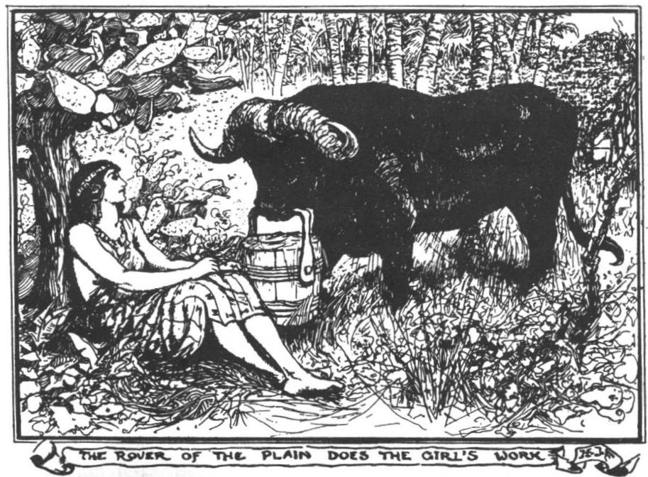

谁也不知道消息是怎么传开的，全村人都知道年轻人回来了，还带回来了妻子。可是不管怎么说，他们俩走进村的时候，男男女女都站在路口，发出欢迎的喊叫声。

“啊！你到底还活着，”他们说，“还带来了自己喜欢的老婆！虽然你不再娶我们的姑娘了。好吧！好吧！你照自己的方式挑了一个，可是如果发生了什么不幸，到时候你可别后悔。”

第二天，丈夫把妻子带到地里去，告诉她那些地是他的，那些地是他母亲的。姑娘仔细地听着丈夫对她说的话，然后和他一起走回家。可是到了家门口，她停下来说，“我把我的珠项链丢在地里了，我要回去找一找。”其实，事情并不是这样，她只是找个借口去找她的水牛。

她走过来的时候，牛正蹲在一棵树下。看到她走过来，高兴地哼着鼻子。

“你可以在这块地，这块地，还有这块地里走，”她对牛说，“这些地都是我丈夫的；那边是他的林子，你可以躲到里面去。可别的地是他母亲的，小心不要走过去。”

“我会记住的。”水牛点点头回答。接着，姑娘就走了。

啊！它是一个多么好的仆从，比任何一个新娘拒绝带来的小姑娘都好。如果她需要水，她只要穿过屋子后面的玉米地，找到水牛躺着的地方，把桶放在它的身边。然后，她就可以安安稳稳地坐在那里，牛就会到湖边去，把满满的一桶水提回来，要是她需要柴火，它就会把树枝折下来，放在她的脚下。村子里的人看到她提水砍柴回来，都交头接耳地说：

“她家乡的姑娘肯定比我们的姑娘强壮，我们的姑娘没有一个能砍得这么快，提得这么多！”谁也不知道，她有一头水牛在帮忙。

可惜的是，这么多日子，她从来没有给水牛吃过一点东西。因为他们家吃饭的时候只有一个盆子，她和丈夫都用这个盆子吃饭。而在她的老家，水牛专门有一个盆子吃饭。水牛尽可能地忍耐着。可是有一天，女主人叫它到湖边去提水的时候，它的四条腿饿得发抖，几乎站不起来。它一言不发地忍受着。一直到了晚上，它才对女主人说：

“我快饿死了，到这里以后，我没有吃过一点东西。我再也做不动了。”

“啊！”姑娘回答说，“可我怎么办呢？我家里只有一个盆子。你只好到地里去偷些豆吃。这里偷一点，那里偷一点，千万不要在一个地方偷得太多，否则主人就会注意到。”

到现在为止，水牛一直老老实实地过日子。可是，如果女主人不给它饭吃，它就得自己去找。所以这天晚上，等全村子的人都睡着以后，它从林子里走出来，这里吃一点豆子，那里吃一点豆子，像它女主人对它说的一样。等它不再觉得饿了以后，它就回到自己的窝里。可是，水牛毕竟不是仙女，第二天早晨，那些女人到地里去干活的时候，她们都惊呆了，你看看我，我看看你，说：

“看看地里，一只野蛮的野兽把我们的庄稼都毁了！我们可以看到它留下来的脚印！”她们赶紧回家告诉这件事情。

晚上，姑娘偷偷地来到水牛藏身的地方，对它说：“他们知道出了什么事，所以今天晚上，你最好到更远的地方去找吃的。”牛点点头，照她的话去做。可是到了天亮，妇女们又出去干活的时候，还是清楚地看得出地下的脚印。她们急忙去告诉自己的丈夫，请求他们带着枪，提防这个强盗。

正巧这个外乡姑娘的丈夫是全村最好的神枪手，他躲在一棵树下等着。

水牛想，人们可能到昨天晚上被它踩过的地里去找它，所以就来到属于它的女主人的那块豆地里。

年轻人吃惊地看到它走过来。

“啊！是一头水牛！”他喊道，“在这里我从来没有看到过！”他举起枪，瞄准它耳朵后面的脑袋。枪一响，水牛一下子跳了起来，然后就倒在地上死了。

“这一枪打得太好了。”年轻人说。他跑回村里对大家说，贼受到了惩罚。

他回到自己家里的时候，看到他的妻子扭着身子在哭泣，她已经听到了一点消息。

“你是不是生病了？”他问。她回答说：“是的，我浑身都在痛。”其实，她一点也没有生病，只是为水牛的死而悲伤，它那么好地为她效力。他的丈夫很担心，就把医生请来。可是，虽然表面上她很听医生的话，医生一走，她就把给她的药全扔到门外去。

东方刚露出一丝曙光，整个村子的人就都起来了。女人们提着篮子，男人们拿着刀，都想来割一些水牛肉。只有那姑娘独自留在家里。过一会儿，她也来了，一边走，一边哭泣和叹息着。

“你到这里来干什么？”丈夫看到她来了，就问她，“你要是病了，最好呆在家里。”

“啊！我不能一个人留在村子里。”她说。她的婆婆放下手中的活，走过来责备她，对她说，她干这种蠢事会害了自己的。可是媳妇不听她的，坐下来看着。

等他们把水牛肉都分了，女人们的篮子里都有自己家的一份以后。这个外乡妻子走上来说：“把牛头给我。”

“你不能拿这么重的东西。”男人说，“再说，你在生病。”

“你们不知道我力气有多大。”她回答说。后来，他们同意给她了。

她没有和其他人一起走回村里去，而是一个人慢慢地拖在后面。她也没有走进大屋里，而是走到放着烧东西的锅子和玉米的小屋里去。接着，她把牛头放在地上，坐在它旁边。丈夫走进来找她，请她离开小屋，睡到床上去，说她肯定累坏了。可是，她还是坐在那里不动。她的婆婆来说她，她也不听。

“我希望你们别来烦我！”她粗暴地回答，“老是有人走进来，怎么睡得着！”她把脸转过去，连他们送进来吃的东西也不吃。于是，他们都走了。年轻人很快就上床去睡，可是妻子的古怪叫他很不放心，他整夜没睡，仔细地听着。

等万籁俱寂以后，姑娘生起火来烧水。等一罐水烧热以后，她把从家里带来的药抖进去，然后把牛头拿出来。在牛耳边中弹的太阳穴附近，她用小刀割开小口，把带来的角对准小口用力地吹起来。牛的血开始流动，然后，她又把葫芦里的鹿油放在热水的蒸汽上热一热，再擦一点在牛的伤口上。最后，她低声地对着草原上的流浪者唱起了挽歌。

她唱完最后一句，牛头开始动起来，身体和脚也开始出现，牛摇着双角，好像恢复了生命，站起来伸伸腰。不幸的是，就在这关键的时候，丈夫自言自语地说：“不知道她是不是还在哭，事情不知道怎么样了，也许我最好去看一看。”他从床上起来，叫着她的名字，跨进小屋。

“走开！我不需要你来！”她生气地喊叫着。可是，太晚了。水牛又倒在地上，死了。头上的伤口和原来一样。

年轻人不像他部落里的其他男人，很怕老婆。他什么都没有看到就回到自己的床上去了，可心里还是很纳闷，这么长时间，她在干些什么呢？过了几分钟以后，她又从头开始，后来牛又像上一次一样站起来。可就在姑娘高兴她终于把事情办好的时候，她的丈夫又走进来，要看他的妻子在做什么。这一回，他坐在小屋里，要亲眼看个明白。姑娘只好拿起她的罐子和其他东西，离开小屋，想第三次恢复牛的生命。

可惜太晚了，东方已经拂晓，牛头掉在地上，还是一块没有生命的烂肉。

姑娘走进屋子，她的丈夫和婆婆正准备出去。

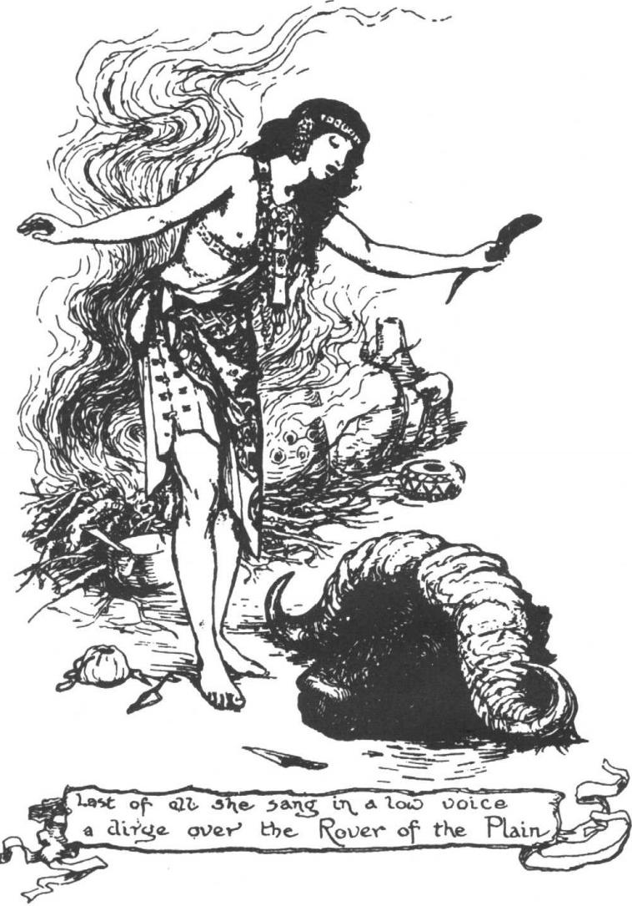

“我要到湖边去洗个澡。”她说。

“可是，你走不了那么远的路，”他们回答说，“你太累了，连站一会儿的力气都没有。”

尽管他们这样警告她，她还是离开屋子向湖边走去。没有多久，她就哭着回来，啜泣着说：“我在村子里碰到了一个住在我家乡的人，他告诉我，我的母亲病得很厉害，要是我不马上回去，就再也见不到她了。我得尽快地赶回去，再见吧！”说完，她就朝山里的方向走去。可这个故事是她自己编出来的。母亲的消息她一点也没有。她只是想找个借口回家，好对家里说，他们的预言变成了事实，水牛死了。

她头顶着篮子，开始翻山越岭。一走出村子，她就唱起了草原上的流浪者之歌。到太阳下山的时候，她走进了父母居住的村落。她的朋友们都跑出来迎接她。她哭泣着告诉他们水牛死了的消息。

这个坏消息像闪电一样传遍了整个乡村。人们从四面八方赶来，哀泣他们一直为之感到骄傲的这头牲口。

“当初要是你听我们的话，”他们说，“它就不会死去，可是，我们给你的小姑娘你一个也不要，只要这头水牛。还记得药剂师怎么说来的，‘水牛死了，你们也都得死！’”

于是，他们又开始为自己的悲惨命运而哭泣，姑娘的丈夫来到他们中间坐下，把手中的枪搁在一棵树上，他们也没有注意。后来，有一个人回过头来看到他，嘲弄地向他鞠躬：

“嗨！刽子手！嗨！你把我们都杀了！”

年轻人目瞪口呆，不知道他们在说些什么，惊讶地回答说：“我只是开枪打死了一头水牛，你们为什么叫我刽子手？”

“一头水牛！是的，可它是你妻子的仆人！是它给你们砍柴提水，你知道不知道？”

“不！我一点也不知道，”丈夫吃惊地回答，“为什么没有人告诉我？我如果知道，当然不会向它开枪！”

“可是现在，它死了！”他们说，“我们也得死！”

这时候，姑娘拿来一个碗，里面冲了一碗毒草药。她双手捧着碗嚎啕大哭：“啊！我的父亲，草原上的流浪者！”接着，她喝了一大口，倒在地上死了。她的父母、兄弟姐妹也一个接一个地接着喝，唱着悼念水牛的悲歌死去。

姑娘的丈夫恐惧地看着，然后伤心地翻山越岭，回到自己的家里。他一进屋，就一头倒在地上，累得一句话也说不出来。慢慢地，他抬起头来，把事情的全部经过对父母说了，他们坐在一旁看着他。等他说完以后，他们摇摇头说：

“现在你看到了，我们说的话不是没有道理，我们说过，你的婚姻不会有什么好结果！我们给你找了一个又勤劳又善良的妻子，你就是不要。现在，你失去的不仅仅是妻子，连财产也没有了。他们人都死了，谁还会还给你钱呢！”

“那倒是真的，我的父亲。”年轻人回答。可是，他心里想得更多的是失去的妻子，而不是为了娶她付出的钱。

（亨利·朱诺德）

 

## 白鹿

从前，有一个国王和王后，他们俩相亲相爱，要是他们有个儿子或者女儿，那他们的幸福可就是完美无缺了。不过，他们从来没有说起这件事，好像他们在这个世界上并没有缺少什么似的。可有的时候，看到别人的孩子，他们的脸上就会流露出伤感的神情，大臣和随从们都知道这是为什么。

有一天，王后一人独自坐在花园里的瀑布旁，花园就在城堡的旁边，瀑布从一些岩石上泻下。这一天，她感到特别悲伤。她把侍女们都打发走，免得让她们看到她的伤心。忽然，她听到瀑布下的池塘里有什么东西在爬的声音，她抬头一看，看到一只大螃蟹正爬到她身边的一块石头上。

“伟大的王后，”螃蟹说，“我来是为了告诉你，你心中的愿望很快就要实现了。不过，你先得答应让我领你到仙女王宫里去。虽然说，王宫离这里不远，可是凡人的眼睛从来没有看到过。因为它总是被厚厚的云雾所遮盖。如果你信任我，跟我走，到了那里你就会知道得更多。”

王后从来没有听到动物说话过，她吃惊得说不出话来。不过，她被螃蟹的话迷住了，甜蜜地笑着伸出手来。拉住她的手的；不是刚刚还在那里的螃蟹，而是身穿红白两色漂亮服装，灰白的头发上扎着绿色缎带的小老太婆。而且奇怪的是，她的衣服上一滴水都没有。

老太婆沿着一条路轻快地走着，这条路王后以前已经走过上百次。可是，令她难于置信的是，今天完全不一样了。她今天不必像以前那样，拨开那些荆棘和荨麻行走，头上挂着玫瑰和茉莉花，脚下是芬芳的紫罗兰。橘子树那么高大，那么茂密，即使是烈日焰焰的中午，这里也不会感到热。走到路的尽头，不知道是什么放出耀眼的光芒，王后不得不把手遮住眼睛，从手指缝中偷看。

“那是什么？”她转过身来问向导。

向导回答说：“哦！那就是仙女的王宫，看！她们有些人出来接我们来了！”

这时候，门向后打开，六个仙女迎上来。她们手中都拿着用钻石做成的鲜花，像真的一模一样，你如果不用手去摸，根本区别不出来。

“夫人，”她们说，“我们真不知道该怎样来感谢你对我们的信任；我们十分荣幸地告诉你，不久，你将有一个小女孩。”王后听到这个消息，像是在梦幻中一样，高兴得几乎要昏过去。等她从惊喜中清醒过来以后，她说出心里所有感激的话，感谢仙女们答应给她的礼物。

“现在，”王后说，“我不能再停留了，否则我的丈夫会以为我逃跑了，或者是被哪头凶恶的野兽吃掉了。”

没过多久，正像仙女们预言的那样，一个女婴儿在王宫里出世了。国王和王后当然都很高兴。他们给她起名叫迪西拉，也就是“盼望”的意思，因为他们盼望着这个孩子的到来已经整整五年！

起初，王后除了她的小婴儿以外，什么都没有想到。后来才记起给她送来孩子的仙女。她叫侍女把仙女们在王宫里送给她的钻石花束拿来。她把一束一束花拿在手里，喊着仙女们的名字。仙女们一个一个地来到她的面前。可是，不幸的事情总是常常发生。她把最应该感谢的螃蟹仙女忘记了！这一下，就像其他故事书中说到的那些婴儿的命运一样，悲剧由此而来。

不过，这个时候，王宫里还是充满了欢乐。大家都跑到窗口去看仙女们乘坐的车辆，没有一部是相似的。一个仙女的车子是乌木做成的，用白鸽子来拉；另一个仙女躺在她的象牙车子里，用十只黑乌鸦来拉；其他仙女也都选用珍贵的木料或五光十色的贝壳车子，用红色或蓝色的金刚鹦鹉、长尾巴的孔雀或者绿色的情鸟来拉。这些车辆只有在正规的礼仪场合使用，如果是在战场上，这些美丽的鸟就要用飞龙、凶猛的蛇、狮子或豹来代替。

仙女们走进王后的房间，后面跟着小侏儒，他们手捧着礼物，看上去比他们的女主人还要神气。他们一个接着一个把礼物放在地上，谁也没有见过这么可爱的礼物。婴儿能够穿的和玩的这里都有了；此外，还送给她许多珍贵的东西，这些礼物只有教母是仙女的孩子才可能有。

她们都围在婴儿睡觉的粉红色的床边看着。这时，一个阴影遮住阳光，投到她们的身上，房间里吹起了一股冷风。大家抬头一看，原来是螃蟹仙女，她因为气愤，变得像屋顶那么高大。

“这么说，我是被忘记了！”她喊叫着，声音那么大，王后听到了直发抖，“你在万分烦恼的时候，是谁安慰你？是谁把你领到仙女王宫去？又是谁把你安全地送回家？是啊！我完全被忘记了，而这些和我比起来微不足道的人，却受到了宠爱和感激。”

王后因为恐惧，几乎麻木了，尽力地想作一些解释或道歉，可是一句话也说不出来，只好承认她的过错，请求原谅。仙女们也尽力地想办法消除这个姐姐的怒气。她们都知道，她像许多不是仙女的凡人一样，虚荣心很重。他们劝她脱下螃蟹的外衣，变成她们习惯的那副迷人得多的人样。

有一段时间，愤怒的螃蟹仙女不理睬她们。后来，夸奖和奉承起了作用。螃蟹的外壳从她身上褪去，她缩成了普通人大小，怒气也消失了一些。

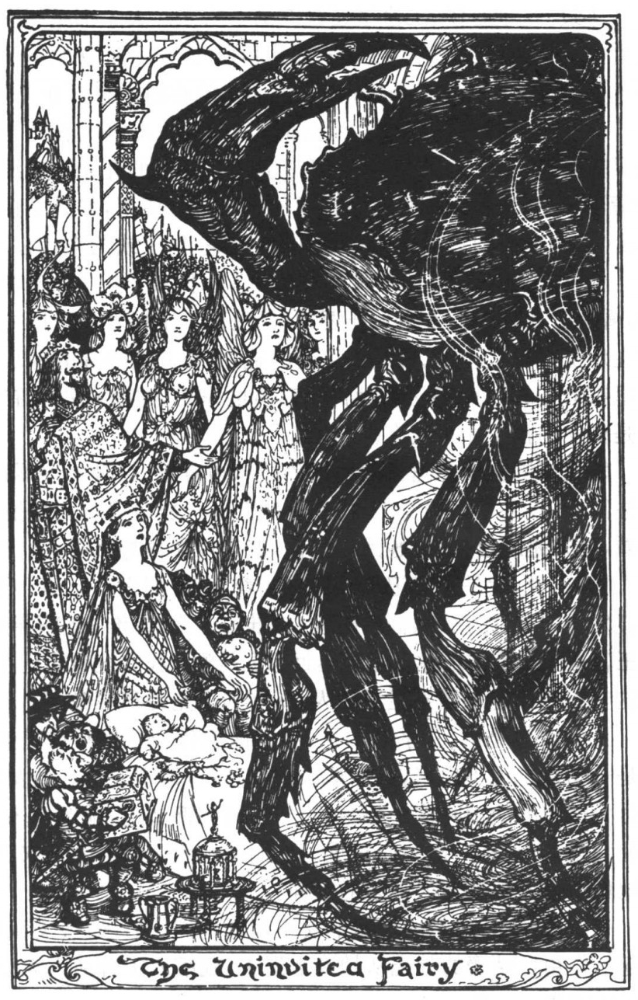

“好吧！”她说，“我不会叫公主去死，我本来是打算这样做的。可是，她要因为母亲的过错受到惩罚，像她以前的许多孩子一样。我给她的惩罚是，如果在十五岁生日之前让她见到一丝阳光，她就会后悔莫及，也许要为此付出生命。”说完这些话，她就从进来的窗口消失了。仙女们安慰着泣不成声的王后，帮她出主意，让公主如何平安地度过她的童年。

过了半个钟头，她们就想出办法来了。在仙女们的命令下，在国王和王后居住的王宫旁边，一座美丽的宫殿拔地而起。可是，和世界上所有的宫殿不同，它没有一扇窗，只有在地下开了一扇门。可是一到里面，就根本想不到需要什么阳光。墙壁上无数支点燃着的蜡烛，把里面照耀得如同白昼一样。到现在为止，公主的命运和其他你读过的许多公主一样。可是，就在她的囚禁生活即将结束的时候，她的命运发生了转折。将近十五年来，仙女们无微不至地关怀着她，让她受到良好的教育，过着无忧无虑的生活。这样，等她跨入这个世界的时候，在一个公主应该具备的魅力和学问方面，就不会比别的公主差。她们都很爱她，特别是郁金香仙女。随着她的十五岁生日即将到来，仙女开始担心会发生什么以前没有发生过的，可怕的事情。

“你每时每刻都要注视着她，”郁金香仙女对王后说，“与此同时，像通常的习惯那样，把她的画像画出来，送到临近的国家去，让国王们知道，她的美丽远远地超过其他公主。这样，他们就会替他们的王子来求婚。”

于是，事情就这么办了。正像仙女所说的那样，看到这张画像的所有王子都爱上了她。尤其是最后看到它的王子，除了画像他什么都不去想了，连画像也不肯让人把它从房间里拿走。整天凝视着它。

国王对儿子的变化感到非常吃惊，他过去可是天天在山里打猎和放鹰。后来，当他听到两个大臣议论，说王子变得那么忧郁，真担心他会精神失常的时候，他马上就去看他的儿子。他刚走进房间，王子就跪在他的脚下。

“你为我订婚的新娘我决不会爱她！”他大声地说，“如果你不同意解除这个婚约，去向迪西拉公主求婚，我就会悲惨地死去，再也不想活了。”

这些话使国王深感失望，他知道，解除已经订好的婚约，几乎可以肯定，会给老百姓带来长期的流血战争。所以，他一句话也不说就走了，希望过几天以后，儿子会恢复理智。可是，王子的状况迅速地恶化，绝望之下，他只好答应立刻派使者到迪西拉公主那里去。

这个消息立刻就治好了王子的病。他开始着手精心计划出使人员所必需的服装、马匹和车辆。他很想自己也一起去，哪怕是打扮成一个侍从也行。可是，这一点国王不允许。王子只好满足于到全国去寻找一切珍贵和漂亮的礼物送给公主。他赶回来的时候，使团正带着宫廷画家秘密地为他画下的像，准备出发。

能够把女儿嫁给这样伟大和强盛的王族，国王和王后觉得再好不过了。他们热情接待使者，处处都洋溢着欢迎的气氛。他们甚至还想让他去见一见迪西拉公主，可是郁金香仙女阻止了他们，生怕会出什么意外的事情。

“你们还千万别忘了对他说，”仙女补充说，“婚礼一定要等她满十五周岁以后才能举行。否则，可怕的灾难会降临到孩子的头上。”

所以，贝卡思格和他的随从正式提出，让迪西拉公主嫁给他们的王子的时候，国王回答说，他感到非常荣幸，将十分乐意地答应下来。可是，在公主满十五周岁之前，谁也不能见到她，因为当她还在摇篮里的时候，一个邪恶的仙女就给她加上了咒语。这个咒语要等她满十五岁以后才能解除。使者大为震惊，也深感失望。不过，他也清楚地知道，仙女是万万不可得罪的。所以，他只好满足于把王子的画像交给王后。王后不失时机地马上把它交给公主。画像一到了公主的手里，马上就开口说话，好像有人教过它似的。它问候公主的话那么得体，那么迷人，公主高兴得脸都涨红了。

“有这样一个丈夫，你喜不喜欢？”王后笑着问。

“我怎么知道什么丈夫不丈夫的事！”迪西拉回答，她早就知道使者是干什么来的。

“嗯！再过三个月，他就是你的丈夫了！”王后说，吩咐把王子的礼物带进来。公主非常喜欢这些礼物，爱不释手。王后注意到，她的眼睛不时离开那些最柔软的丝绸和最璀璨的钻石，窥视王子的画像。

使者看到没有希望见到公主了，就起身告辞，回到自己的国家。可这里又出现了新的难题。王子虽然知道迪西拉将是他的新娘以后，非常高兴，可是她不能跟随使者一起回来，却叫他深感失望，他一直在傻乎乎地等待着她的到来。王子从小就是要什么有什么，从来不会控制自己的感情。这样一来，他又像上一次一样发起毛病来。他什么都不吃，整天闷闷不乐，躺在床上看着公主的画像。

“要是还得等三个月才能和公主结婚，我一定会死去！”这个任性的男孩只会说这句话。后来，绝望下的国王只好决定再派使者去，请求迪西拉的父亲答应，立刻举行婚礼。“我本来要亲自来请求你的，”他在信中这样写道，“可是我年事已高，身体又不允许我长途跋涉。不过，我已经命令我的使者，一切都听从你的安排。”

到达王宫以后，贝卡思格急切地诉说了他的小主人的情形，还诉说了他的父亲国王想尽一切办法所作的努力。他请求公主能够答应这件事。王后急忙赶到大理石城堡里去，把王子的不好状况告诉公主。公主听到消息马上就昏过去。不过，她不久就苏醒过来，开始想办法，如何才能到王子那里去，又不会冒坏仙女给她设下的危险。

“我有办法了！”她终于高兴地喊叫起来，“做一辆一点也不漏光的马车，把它拉到我的房间里来。我就在房间里上车，我们可以在晚上赶路，拂晓之前进入王子的王宫。到了那里以后，我就留在地下的房间里，阳光不会透进来。”

“啊！你是多么聪明！”王后把她抱在怀里喊道。她赶紧起身去告诉国王。

“我们的王子将会有一个多么了不起的妻子！”贝卡思格深深地鞠了一躬，说，“不过，我得赶紧回去，给公主准备好地下的房间。”

几天以后，公主要的马车准备好了。车篷用绿色天鹅绒制成，上面装饰着大朵的金色蓟花图案，衬里是绣着粉红色玫瑰花的银色织锦。当然，没有窗口。不过，他们请教过郁金香仙女，她用一种柔和的光把里面照亮，至于这些光是从哪里来的，谁也说不上。

马车直接送到塔楼的大厅，公主走进车里，后面跟随着她忠诚的伴女英格兰丁和贴身侍女塞里丝特。塞里丝特看到王子的画像以后，也爱上了他，因此特别恨她的女主人。同时上车的第四个人是塞里丝特的母亲，她是王后特地派去照顾三个年轻人的。

现在，我们还得说起喷泉仙女，她是那拉公主的教母，那拉是王子在没有看到迪西拉公主画像之前订婚的女子。王子轻率地解除了和她的教女的婚约，使她感到非常气愤。从那时起，她就留神着迪西拉公主。这次公主出门，她看到机会来了。于是，她隐身坐在塞里丝特的身边，把坏主意灌进她们母女的脑袋。

要到王子居住的城市去，大部分路程都是穿过一片茂密的森林。每到夜晚，树木就把月光挡住，连一颗星星都看不见。这时候，护送公主的卫兵就把车厢打开，让里面透透风。这样一连走了好几天，最后只剩下十二个钟头的路程，就可以到达目的地了。这时候，塞里丝特叫她的母亲用一把锋利的刀在车篷上划出一个洞来，这把刀就是为了这个目的，她才随身携带来的。在黑暗的森林里，谁也没有发现她干了些什么。可是，马车一走出森林，太阳已经升起来了，迪西拉有生以来，第一次看到白天的光。

她吃惊地看着从洞里射进来的耀眼的光芒，然后深深地叹了一口气，这口气仿佛来自她的内心深处。车厢的门像是着了魔似的，忽然向里打开，一只白鹿从里面跳出来，一转眼就消失在森林之中。不过，尽管只是一瞬间的事情，她的伴女还是看到她奔跑的方向，从车上跳下来追赶她，紧接着是那些卫兵。

塞里丝特又惊讶又高兴，和母亲相视而笑。她们简直不相信自己的运气会那么好，一切都像她们所希望的那样发生了。她们要做的第一件事是把划开的洞隐蔽好，这件事干完以后（愤怒的喷泉仙女帮了她们的忙，虽然她们并不知道），塞里丝特急忙把自己的衣服脱下，穿上公主的衣服，戴上公主的钻石王冠。她感到王冠比她想象的还要重，不过，她从来没有戴过王冠，感觉当然就不一样了。

到了城门口，马车被国王派来护送儿子新娘的仪仗队拦住。虽然塞里丝特和她的母亲看不见外面在干些什么，不过她们可以清楚地听到马路两边欢迎人群的欢呼声。

马车终于在贝卡思格专门为迎接公主而准备的大厅里停下。神气的侍从和国王的大管家正在那里等候着她。当假新娘走进灯火辉煌的房间时，他们都低头鞠躬，说他们接到命令，公主一到就禀报殿下。宫廷里严格的礼仪不允许王子来到地下大厅，他这时候正心急如焚地等在自己的房间里。

“这么说，她终于来了！”他扔下手中假装修理的弓箭，喊道，“好啊！我是不是说对了？她是不是奇迹般地美丽和优雅？是不是举世无双？”大臣们你看看我，我看看你，没有回答。后来，胆子比较大的侍从才开口说道：

“我的殿下，关于她的美丽，你可以自己去判断。不错，她是像你说的那样了不起。可是就现在看来，她好像因为路途劳累，大为逊色，这也是常有的事情。”

这些话当然不是王子所想听到的。是不是画像把她美化了？这种事情他以前也听说过。想到这里，他不由得打了一个寒噤。他努力克制自己，不再提出问题，只是说：

“国王是否知道，公主已经来到王宫？”

“是的，殿下，也许他已经去看她了。”

“那么，我也去吧。”王子说。

王子因为长期生病，身体虚弱。他在侍从的搀扶下走进房间，正好听到他父亲看到塞里丝特以后，因为厌恶和吃惊而大声地喊叫着。

“这是一个骗局！”他大声疾呼。王子因为惊骇，一句话也说不出来，无力地靠在门柱上。可是侍女已经多少料到会出现这种情形，她走上前来，手中拿着国王和王后交给她的信，假装什么也没有听到，说：

“我是迪西拉公主，我十分荣幸地把我的国王陛下和王后给你的信，还有装着珠宝的首饰盒交给你。”

国王站在那里不动，也不答理她。王子在贝卡思格的搀扶下，向假公主走近一些，希望刚才是自己的眼睛看花了。可是他越看，越觉得他父亲说得对，里面肯定有问题，眼前这个女人和画像一点也不像。塞里丝特长得那么高大，公主的衣服还不到她的脚脖子。而她长得那么瘦，连衣服也遮不住她的骨头。此外，她还长着一个鹰钩鼻子，牙齿又黑又丑。

这时候，王子站在那里像生了根似的。后来，他终于说话了，不过，他的话不是对千里迢迢来和他结婚的新娘，而是对他父亲说的。

“我们受骗了，”他说，“我将为之付出自己的生命。”他那样无力地靠在特使的身上，贝卡思格担心他会昏过去，连忙让他躺在地板上。好几分钟，大家的注意力都集中在王子的身上。可是他一苏醒过来，侍女母亲的话又把大家吸引过去。

“啊！我可爱的公主，我们干吗要离开家？”她喊道，“可是，等你把你到这里来的遭遇告诉他以后，国王会为你所受到的侮辱报仇的。”

“我会亲自告诉他！”国王气愤地回答，“他答应给我送来一个绝世佳人，可是却送来一个骷髅！我毫不惊奇，他把她整整藏了十五年，不让世人看见。把她们都带走！”他又转过身来对卫兵继续说：“把她们关到王国的监狱里去，我还要看一看，这里面还有什么名堂。”

他的命令立刻得到执行。为自己的悲惨命运而大声痛哭的王子，被送回到他的床上。他一连好多天发高烧，躺在床上。后来，他的体力慢慢地得到恢复。可是，他的悲哀是那么巨大，连看到陌生人的脸他也受不了。说起要他参加王宫的各种仪式，他就浑身颤抖。他打算一有可能就出逃，准备到一个偏僻的地方去单独度过他的一生。这个计划他除了贝卡思格以外，谁都没有告诉，连国王也不知道。几个星期以后，他的身体已经恢复到足以实现这个计划。后来，在一个星光灿烂，景色迷人的夜晚，两个朋友一起偷偷地出走了。第二天早晨，国王醒过来的时候，看到一封信放在他的床上。信中说，他的儿子已经走了，可是不知道到哪里去。看到这个消息，他痛苦地流下了眼泪。因为他很爱王子。不过，他也想到，年轻人这样做也许是明智的。他希望时间和贝卡思格的影响最终会把流浪者送回来。

在这些事情发生的时候，白鹿怎么样了呢？她从车上跳下来的时候，心里就明白，不幸的命运已经把她变成了动物。可是，在她从一条小河里看到自己的影子之前，她还不知道自己变成了什么。

“这真的是我，迪西拉吗？”它自言自语地哭着说，“邪恶的仙女竟然会这样地对待我！我将永远永远也不能恢复原形了吗？我唯一的安慰是，在这个狮子和毒蛇出没的大森林里，我的生命不会长久。”

郁金香仙女对公主的悲惨命运，就像她的亲生母亲一样地感到悲痛，尽管王后还不知道这件事。可是，她不能不想到，如果国王和王后听她的话，公主就会太平无事地住在她的新家里了。不过，她太爱迪西拉了，只要能够想办法，她决不会让她忍受更多的痛苦。也就是她，引导英格兰丁来到白鹿吃草的地方，这就是它的午餐了。

听到脚步声，美丽的白鹿抬起它的头来。看到忠诚的伙伴走过来，它向她奔跑过去，用它的头擦着英格兰丁的肩膀。伴女感到非常惊讶，不过，她很喜欢动物，就轻轻地抚摸着白鹿，还温柔地和它说话。忽然，美丽的白鹿抬起它的头，看着英格兰丁的脸，眼泪夺眶而出。一个念头忽然闪过她的心中，姑娘立刻双膝跪下，举起白鹿的脚一只一只地吻。“我的公主！啊！我亲爱的公主！”她喊叫着。白鹿又用它的头来擦擦她。邪恶的仙女虽然剥夺了她说话的能力，可无法剥夺她的思想！

她们整天都待在一起。英格兰丁感到肚子饿的时候，白鹿就把她领到长着许多梨和桃的森林里。可是当夜幕降临的时候，伴女非常害怕，生怕公主在森林里的第一个晚上，就遭到野兽的攻击。

“难道就没有一间屋子或洞让我们进去吗？”她问。可是，白鹿摇摇头。她们俩坐下来，害怕地哭泣着。

郁金香仙女尽管还很生气，可是她的心肠很软。看到她们的烦恼很同情，就很快地飞过来帮她们。

“我不能把咒语全部解除，”她说，“因为喷泉仙女的法力比我大。可是，我可以缩短你受罚的时间，减轻你受罚的痛苦程度。只要天一黑，你就可以恢复原来的相貌。”想到随着黑夜的降临，它将不再是一头白鹿，一到晚上，它就恢复人的形状，这对现在的迪西拉来说，真是一件值得高兴的事情。它在草地上以最优美的姿势欢快地跳跃着。

“沿着眼前的这条路一直走下去，”仙女看着它笑着，继续说，“你们就会看到一间小屋子，在那里你们可以找到住处。”说完这些话，她就消失了，留下她们俩为这意想不到的消息而高兴。

当白鹿跟在英格兰丁的身旁，一路小跑来到小屋前的时候，一个老太太正站在门口。

“晚上好！”英格兰丁说，“你能不能让我和我的小鹿在这里住一宿？”“当然可以，”老太太回答。她把她们两个领进房间，里面有两张小床，那么干净和舒适，看上一眼就叫你想睡觉。老太太一进屋刚把门关上，太阳就已经下山。迪西拉又变成了一个美丽的姑娘。“啊！英格兰丁！如果不是你跟在我身边，我会是个什么样子呢？”她喊叫着，扑到她朋友的怀抱里，以表达自己高兴的心情。第二天一大早，英格兰丁就被谁在抓门的声音吵醒。她张开眼睛。看到白鹿正拼命地想出去。小东西抬起头来看着她的脸，看到她过来拉开门闩又点点头。但门一打开立刻就向森林里奔跑过去，一转眼就不见了。这时候，王子和贝卡思格正在森林里徘徊，直到王子走得很累。他在一棵大树下躺下，对贝卡思格说，最好能找点吃的，再找个地方睡觉。贝卡思格还没有走出多远，在路的转弯处就面对面地碰上一个老太太，她正在自己的小屋前喂自己的鸽子。“你能给我一些牛奶和水果吗？”他问，“我非常饿了，而且我还有一个朋友在后面，他因为生病，仍然很虚弱。”“当然可以，”老太太回答，“不过，先进来，到我的厨房里去坐一会儿，我去把山羊捉回来挤奶。”贝卡思格很高兴照她的话去做。过了几分钟，老太太就提着满满的一篮子橘子和葡萄回来。“你的朋友要是病了，就不能留在森林里过夜，”她说，“我屋子里有一间房间，不错，虽然很小，但总比没有好，欢迎你们俩来住。”贝卡思格衷心地感谢她。这时候，太阳已经快下山了，他动身去叫王子。他离开以后，英格兰丁和白鹿走进屋来。当然，她们一点也没有想到，就在隔壁的房间，会住着那个因为他孩子般的性急，导致她们吃那么多苦头的人。尽管很疲倦，王子整夜都没有睡好。天一亮他就起来，吩咐贝卡思格留在家里，他要独自出去走一走。王子信步走进森林，完全跟着感觉慢慢地走着。忽然，他发现自己来到了一块空地上。空地的中间，一只白鹿正悠闲地吃着早餐。看到有人过来，它连忙逃跑。但这时，王子已经拔出箭来，不加思索地朝它放了几箭。幸亏郁金香仙女暗中照顾，不让它受伤。可是，尽管它跑得很快，不一会它就觉得力不从心了。十五年关在塔楼里的生活，没有教会公主如何锻炼自己的四肢。幸好王子还很虚弱，追不上它。前面一转弯，它就回到了老太太的家，英格兰丁正在门口等着它。它气喘嘘嘘地跑进房间；累得在地上躺下来。

天黑以后，它又变成公主迪西拉，把白天发生的事情告诉英格兰丁。

“我害怕喷泉仙女，还有那些凶猛的野兽，”她说，“可从来没有想过逃避人的危险。我现在还不知道是什么救了我。”

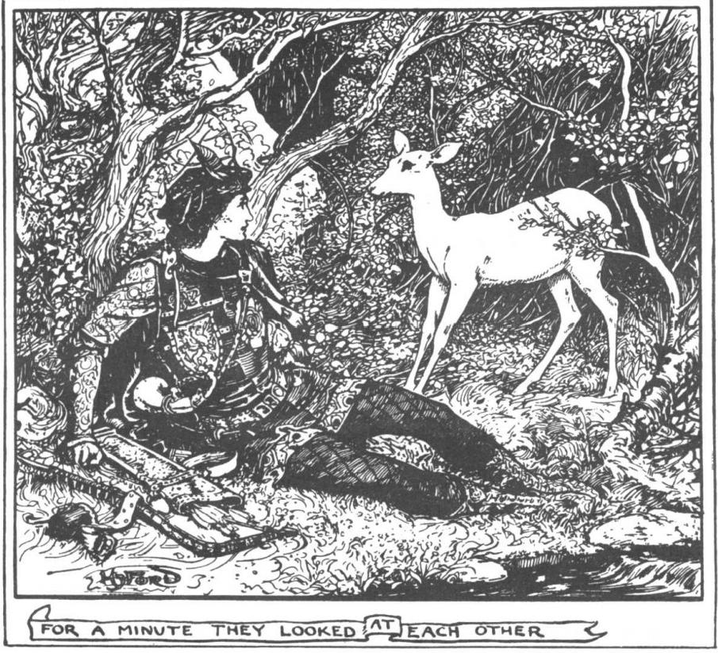

“你要耐心地在这里等待，直到受惩罚的时间过去。”英格兰丁回答说。可是，一到天明，她又变成一头鹿，心里又充满了要到森林里去的欲望。它像昨天一样，又冲了出去。

王子一醒过来，就急忙赶到昨天看到白鹿吃草的地方。当然，白鹿已经小心地选择了另一条路。王子在绿色的森林小道里走来走去，最后感到非常失望。由于走得太累了，他躺在地上，很快就睡着了。

这时候，白鹿从附近的密林中跳出来。看到自己的敌人就躺在那里，吓得浑身发抖，连连后退。不过，它没有转身逃跑，一股力量在怂恿着它走过去偷偷地看他。它看着看着，一股激情流过它的全身，它看到了，尽管他因为生病而十分憔悴，但这张脸就是她命中注定的丈夫的面孔。它慢慢地弯下腰来，吻着他的前额。在它的亲吻下，他醒了过来。

整整有一分钟，他们相互凝视着。这头白鹿就是昨天从他手中逃脱的那一头。这时候，白鹿忽然意识到自己的危险，迅速地向森林密处飞奔而去。王子闪电般地在它后面追赶，不过这一回，他没有杀它或者伤害这头美丽的动物的意思。

“可爱的白鹿！可爱的白鹿！等一下！我不会伤害你。”他喊叫着，可是，他的声音只是被风吹散。

后来，白鹿再也跑不动了。王子追上它的时候，它正直挺挺地躺在草地上，无力地等待着致命的一击。可是，只见王子跪在它的身旁，轻轻地抚摸着它，叫它别害怕，他会照顾它的。他用自己打猎用的角杯，到旁边的小河里去打来一些水，然后，他砍下一些树枝，编成一张床，上面铺上苔藓，把白鹿抱起来，轻轻地放上去。

好长一段时间，他们就这样静静地待着。后来，白鹿看到太阳斜照在树梢上，知道它就要落山了。它心里充满了恐惧，害怕黑夜会降临，王子会看到它变成人样。

“不！我不能让他在这里第一次看到我的模样。”它想着，而且立即开始动脑筋，如何才能摆脱他。接着，它张开嘴巴，伸出舌头来，好像是口干得要命的样子。王子看到以后，正如它希望的那样，赶紧再到河边去，再给它弄些水来。

等他回来的时候，白鹿不见了。

这天晚上，迪西拉对英格兰丁说，追赶她的人不是别人，正是王子。他的那幅画像，不是美化他，而是远不及他本人。

“我们俩彼此那么相爱！我这副样子怎么去见他？”她哭泣着说。英格兰丁安慰她说，事情很快就会好起来的。

王子看到白鹿跑了，想到自己不怕麻烦帮它做了那么多事情，得到这样的报答，非常生气。他回到小屋，一股脑儿对贝卡思格诉说自己的经历和愤怒。贝卡思格忍不住笑出来。

“它别想再从我手中逃跑，”他说，“我天天去找它，一年下来不怕抓不到它。”他心中愤愤不平地上了床。

第二天早晨，白鹿走进森林的时候，它还拿不定主意，是去见王子呢？还是避开他，躲到他不知道的密林中去？后来，它想还是不要见他为好。要不是王子也沿着它走的方向去找它，事情真的就是这样了。

王子十分偶然地看到它那白色的皮肤在丛林中闪过。几乎就在同时，它也听到了他踩断树枝的声音。它立刻就跳起来逃跑。王子不知道该如何才能抓住它，就搭起了一枝箭，瞄准它的脚射过去，白鹿应声跌到在地。

年轻人像是犯了罪似的，赶紧跑过去，尽量地减轻它的伤痛。实际上，这是喷泉仙女给它的最后一次惩罚。他先是给它弄一点水来，然后采来一些草药，在手中搓碎以后敷到它的伤口上。

“啊！我是多么卑鄙，让你受了伤！”他喊叫着，把它的头放在自己的膝盖上，“现在，你要恨我，永远地离开我了！”

白鹿就这样安静地躺了一会。后来，它又像上一次一样想到，它变成人的时候又要到了。它挣扎着站起来。可是，王子不忍心让它走路，他想，小屋里的老太太可能会比他更好地处理它的伤口，就把它抱起来，向小屋走回去。可是，它虽然个子很小，却很重。他摇摇晃晃地走了几步，就把它放下来，把帽子上的带子解下，把白鹿拴在一棵树上。然后回去找人帮忙。

这时候，英格兰丁看到女主人迟迟不归，心里很不安，正出来找它。王子刚一走，她就看到了那飘动着的带子，看到美丽的公主被绑在一棵树上。她跑过去，竭尽全力要把带子的结解开。

可是，看上去很简单，可她一个结也解不开。就在她手忙脚乱的时候，后面传来了一个声音：

“对不起！美丽的女士，这是我的白鹿，你想偷走吗？”

“请原谅，好骑士！”英格兰丁头也不抬地回答，“可是，拴在这里的这头鹿是我的！你要想证实一下吗？你可以看看它是不是认识我！和我亲热一下，我的小宝贝！”她说着，在白鹿的身边跪下来。白鹿把一只脚搁在她的身上。“现在，抱住我的头颈，叹一口气。”鹿又照她的话做了。

“你说得对，”王子说，“可是，把它交给你，我会很悲哀的。我虽然伤害了它，可我深深地爱着它。”

英格兰丁不说什么，她小心地把白鹿扶起来，领着它慢慢地走回去。

不论是王子，还是贝卡思格，都不知道老太太除了他们以外，还另有客人。王子远远地跟在后面，看到英格兰丁领着白鹿走进小屋，非常惊讶。他们马上就去问老太太。她说，她对这个女士和她的白鹿一点也不了解，她们就睡在王子和贝卡思格隔壁的房间里。她们都很安静，从不拖欠房租。说完，她就回到自己的厨房里去。

“你知道吗？”等他们单独在一起的时候，贝卡思格对王子说，“我敢肯定，我们看到的那位女士，就是迪西拉公主的伴女。我在王宫里见过她。她的房间就在我们隔壁，很容易在墙板上弄出一个小洞来，就可以证明我的想法对不对。”

于是，他从口袋里拿出一把小刀来，开始在墙板上挖洞。姑娘们听到了锯木头的声音，不过她们以为那是老鼠弄出来的，也不在意。贝卡思格得以悄悄地进行他的计划。等到洞挖得足够大以后，他从洞里往里窥视，看到的情景又使他惊讶得不知所措。他猜得一点也不错，那高个的女士正是英格兰丁。可另一个是谁？他好像在哪儿见过她！啊！他想起来了，她就是画像上的那个女子！

迪西拉穿着一身光滑的绿色丝绸衣服，正躺在床褥上。英格兰丁弯下腰来，在给她洗脚上的伤口。迪西拉开始说话。

“啊！让我去死吧！”她说，“这总比这样活下去好。整天变成一头野兽，不能和自己所爱的人说话，这种痛苦是无法形容的。由于他的急躁，给我带来了这样悲惨的命运！可是，即使是这样，我还是一点也不恨他。”

她说这些话的时候，声音虽然很低，可贝卡思格还是清清楚楚地听到了。他简直不敢相信自己的耳朵。他默默地站了一会，然后走到正坐在窗口，向外眺望的王子跟前，拉着他的手穿过房间，走到小洞口前。王子只需看上一眼，就知道她是迪西拉。可是，另一个人是怎么冒充她的名字到王宫里来的呢？这真叫他弄不明白，他也不去管它了。他悄悄地走出房间，敲响她们房间的门。英格兰丁来开门，她以为是老太太送饭来了。

看到王子，她吃惊地朝后退，这时候，她也认出他来了。王子把她推到一边，冲到公主的床前跪下，向她倾诉自己满腔的爱。

天亮了，他们还在交谈着。太阳已经高高升起，公主才发觉自己还是人的样子。啊！她知道自己受折磨的日子已经过去，她是多么高兴啊！她用兴奋的声音向王子诉说着自己中了魔法的经过。

这样，故事的结尾叫人高兴。郁金香仙女，小屋的老太太原来就是她变的，给他们举行了婚礼，婚宴可是开天辟地以来，从来没有这么好过。人人都兴高采烈，当然，除了塞里丝特和她的母亲以外。她们被押到一条船上，发送到一个小岛上去，要想活下去，就得拼命地工作。

（奥尔诺夫人）

 

## 鱼姑娘

从前，在一条河的岸边，住着一对夫妇，他们有一个女儿。夫妻俩只有这么一个女儿，而且长得很漂亮，所以，她不论做错什么事情，从来不处罚她，也不去教她讲究礼貌。至于干活，母亲要是叫她相帮做饭或者洗碗，她就冲着母亲做鬼脸。她整天就知道和朋友们一起跳舞和游玩，父母那里一点也不肯帮忙，对他们来说，就好像没有这个女儿一样。

有一天上午，母亲看上去那么累，连这个自私的女孩子也看不下去了，问是不是有什么活她可以干，好让她母亲休息一下。

善良的母亲对女儿的主动那么惊喜，那么感激，姑娘感到很羞愧。这时候，如果叫她把整幢房子都擦洗一遍她都肯。不过，母亲只是请她把渔网拿到河边去，把上面的洞补好，因为今天晚上，她父亲就想出去打鱼。

姑娘把网拿走，干得那么卖力，一会儿就把所有的洞补好了。她自己也感到很高兴，虽然她错过了许多好玩的机会，因为每一个经过这里的人都停下来和她说话。这时候，太阳已经很高了。就在她卷起网准备回家的时候，她听到身后传来“扑通！”一下的声音，回过头来，她看到一条大鱼正跳出水面。她双手抓住渔网，向水波涟漪的地方撒过去。与其说是水平高，不如说是运气好，她拉上来了一条大鱼。

“啊！你真漂亮！”她自言自语地说。

可是，鱼看着她，也开口说话：“你最好别杀我，否则，我就把你变成一条鱼！”

姑娘轻蔑地笑了笑，跑回家去找她的母亲。

“看！我捉到了什么？”她高兴地喊道，“不过，吃了它也有点可惜，因为它会说话。它说，要是我杀了它，它就把我也变成一条鱼！”

“啊！放它回去！放它回去！”她母亲恳求说，“可能它会魔法。你要是出了什么事，我就活不了，你父亲也会死去。”

“咳！那是胡说八道，妈妈，这样的玩意儿对我会有什么法力？再说，我饿了，要是不快点给我吃饭，我会生气的。”说完，她就走出去，采些花插在自己的头上。

大约一个钟头以后，号角的声音传来，告诉她饭准备好了。

“我说过吧！这条鱼一定很好吃！”她说。她把汤匙伸进盘子里，舀起一大块鱼。可是，她的嘴一碰到鱼，一股冷气立刻流遍全身。她的头变得又扁又平，眼睛古怪地缩到两边去，腿和手都紧贴身体，还不停地喘着气。它用力一跳，从窗口跳出去，掉到了河里。这时候，它感觉好多了，也能向离这里不远的大海里游去。

它刚游进大海，那副愁眉苦脸就引起其他一些鱼的注意。它们向它围过来，请它说说自己的事情。

“我根本不是一条鱼，”新来的鱼说，不小心吃了一口咸海水，“我根本不是一条鱼，我是一个女孩子，起码几分钟以前还是，只是……”它低下头来，免得别的鱼看到它在哭。

“你只是不相信，你抓到的那条鱼，有本事把它的威胁变成现实。”一条老金枪鱼说，“好了，没有什么关系，我们都这样经历过。这种生活也不见得就很糟糕。开心些，和我们一起去见我们的女王，她住在一幢美丽的宫殿里，比你们陆地上女王的宫殿要漂亮得多。”

新来的鱼对这么远的路程感到有点害怕，可是它更怕独自留下。它摇摇尾巴表示同意。它们就一起出发了，总共有成百条鱼。岸上和船上的人看到它们游过，都说：

“看！多么壮观的鱼群！”他们一点也不知道，它们是在向鱼女王的宫殿游去；这也难怪，生活在陆地上的人很少知道海底下的事情，当然，新来的小鱼也不知道。它还是姑娘的时候，只看到水母和缸鱼在水面上游，还有五颜六色的水草在水面上漂，就这些了。现在，它潜入大海的深处，看到了许多千奇百怪的东西。

楔子般的黄金，巨大的锚，堆积如山的珍珠，数不清的宝石，价值连城的珠宝，都散落在这海底下！海底下也有死人的骨头。还有又长又白的生物，它们大多生长在岩石的缝隙之间，从来见不到阳光。开始的时候，我们的小鱼好像是瞎眼似的，看不清东西，后来在阴暗的绿色之中，慢慢地也能分辨出周围的物体来。等它游过几个钟头以后，一切都变得清楚起来。

“我们总算到了。”一条大鱼说。它们游进一条很深的山谷。海底和陆地一样，也有高山和峡谷。“这就是我们鱼女王的宫殿，我想你必须承认，皇帝的宫殿也比不上它漂亮。”大鱼说。

“是很漂亮。”小鱼气吁吁地说。它为了跟上其他鱼的速度，游得很累。宫殿的瑰丽是无法形容的，浅红色的珊瑚筑成的墙壁被海水冲刷得非常光滑，窗口上是成排的珍珠。宫殿的大门敞开着，整个鱼群游进大厅。女王的上半身完全是女人的样子，坐在用绿色和蓝色的贝壳做成的宝座上。

“你是谁？是从哪里来的？”她问被大家推到前面来的小鱼。刚到海里来的来客用颤抖的声音讲述着它的故事。

“我以前也是一个姑娘，”小鱼讲完它的故事以后，女王说，“我父亲是一个伟大国家的国王。他们给我找了一个丈夫。出嫁的那一天，母亲把她的王冠戴在我的头上，对我说，只要我戴着它，我就是一个王后。一连好多日子，我是世界上最幸福的女子，特别是我生了一个儿子，可以天天和他一起玩以后更是如此。可是，有一天上午，我在花园里散步的时候，来了一个巨人，把王冠从我的头上抢走。他紧紧地捉住我，对我说，他要把王冠交给他的女儿，用来迷惑我的丈夫和王子，叫他们辨认不出来。从那天起，他的女儿就取代了我的位置，当了王后。我感到那样悲伤，就纵身跳入大海。我的女侍们那么爱我，看到我跳入大海，她们也说不想活了，纷纷跟着我跳下去。可是我们没有死，一个巫士同情我的命运，把我们都变成鱼。不过，他让我保留了女人的脸和上身。除非有人能把我的王冠带回来，否则我将永远是一条鱼！”

“要是你能告诉我怎样去做，我就去把它拿回来！”小鱼喊道。只要能把它送回到陆地上去，叫它干什么它都答应。

女王回答说：“我告诉你该怎么去做。”

她沉默了片刻，然后继续说：“你只要照我的话去做，就不会有什么危险。首先，你得回到陆地上去，然后到一座高山的顶上去。巨人的城堡就坐落在上面。你会看到他在台阶上为他的女儿哭泣，她在王子出去打猎的时候死了。临死前，她派一个忠诚的仆人把我的王冠送给她的父亲。不过，我得警告你，他看到你就会把你杀了，所以，你得小心。因此，我要赋予你一种本领，能把自己变成对你最有用的生物的本领。你只要拍一拍自己的前额，说出那种生物的名称就可以了。”

这一回，返回陆地的路程似乎要短得多了。小鱼来到岸边以后，用尾巴猛拍一下自己的额头，说：“我要变成鹿！”

刹那间，鱼那瘦小的身躯不见了，一头美丽的小鹿站在它原来的地方。它长着树杈一样的角，修长的腿，抖擞着精神准备奔跑。它昂首挺胸，吸了一口气，撒开四蹄奔跑起来，轻而易举地越过面前的河流和障碍。

这一天，国王的儿子正好一大早就出来打猎，可是什么也没有捉到。他在一棵树下休息的时候，鹿从他的面前跑过，他下决心要捉住它。他飞身上马，像疾风一样奔驰起来。王子经常在这片森林里打猎，所以知道抄近路，终于追上了气吁吁的鹿。

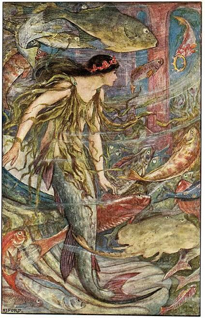

“行行好，让我走吧，别杀了我！”鹿转过脸来对王子说，眼睛里含满了泪水，“我还要走很远的路，还有许多事情要做。”王子吃惊得不知所措，呆呆地看着它。鹿跳过面前的一道障碍，很快就消失了。

“那肯定不是一头鹿！”王子心里想着，他把马勒住，不再去追赶它，“鹿不会有这样的眼神，它肯定是一个着了魔法的少女。我要和她结婚，除了她，我谁也不要。”他掉换马头，慢慢地走回王宫。

鹿喘着粗气来到巨人的城堡。它看着城堡周围又高又滑的城墙，不禁心里一沉。接着，它鼓起勇气说：“我要变成蚂蚁！”转眼之间，那美丽的鹿角和身影不见了，只见一只小小的棕色蚂蚁正在向墙上爬去，要是不注意，根本看不到它。

这小东西爬得那么快，真是令人惊讶！那围墙那么高，起码是它身长的几千倍。然而，它以难以想象的速度翻过去，进入里面的院子。它停下来考虑，下一步应该怎么办。它看了看四周，看到有一堵墙的旁边长着一棵高大的树，最高的一枝树枝一直伸到一个窗口前。

“我要变成猴子！”蚂蚁喊道。一转身工夫，猴子已经爬上树梢，从窗口进入巨人的房间。巨人正在呼呼地睡大觉呢！

“他看到我这个样子，也许会吓得要死。那样我就得不到王冠了。”猴子想，“我最好还是变成别的什么。”于是，它轻轻地说：“我要变成鹦鹉！”

接着，一只长着红色和灰色羽毛的鹦鹉跳到巨人的身边。这时，巨人伸伸腰，打了一个哈欠，整个城堡都抖动起来。鹦鹉又等了一会儿，等到他完全醒过来，然后大胆地对他说，它是被派来取王冠的。他的女儿王后已经死了，王冠也就不再属于他了。

听到这些话，巨人气得大吼一声，从床上跳起来，扑向鹦鹉，要捉住它，用他的大手把它的脖子拧断。可是，鹦鹉非常敏捷，早就飞到他的背后，请求他耐心一些，因为拧死它对他没有什么好处。

“这倒是真的，”巨人说，“可是，我也不会那么傻，把一顶王冠白白地送给你。让我想一想，有什么可以作为交换条件！”他抓抓自己的大头，想了好几分钟，巨人的脑子总是很迟钝的。

“嗯！对了，就这么办！”巨人终于想出来了，说道，“你要是把格雷特城圣马丁拱门上的蓝宝石项圈给我拿来，我就把王冠给你！”

当它是一个姑娘的时候，她就常常听说，那奇妙的拱门和镶嵌在上面的宝石和大理石。想起来，要把蓝宝石从上面挖出来，肯定是很困难。但是，至今为止，一切都很顺利，不管怎么说，也应该去试一试。它向巨人敬了个礼，就飞到窗外巨人看不到的地方，然后赶快说：

“我要变成一只鹰！”

它还没有飞到树上，就感到自己长了一副非常强壮的翅膀，要是它想，一定可以直冲云霄。它在天空中翱翔着，看上去只有一个黑点。它不停地飞着，直到看见圣马丁城堡就在远远的下方，在阳光的照耀下闪闪发光。它从天空中俯冲下来，藏身在一块拱壁里，免得被下面的人看见。它开始用嘴挖那些最近的蓝宝石。这工作比它想象的要艰苦得多了。可是，它后来终于成功了，心里又充满了希望。它从树上找到了一根绳子，坐下来一边休息，一边把蓝宝石串起来。等项链做好以后，它把项链挂在自己的头上，然后喊道：“我要变成鹦鹉！”没有多久，一只红灰色的鹦鹉就站在巨人的面前。

“这就是你要的项链。”鹦鹉说。巨人把蓝宝石项链拿到手，眼睛一亮。可是，巨人并不想把王冠交出去。

“它们一点也不像我想象的那么蓝。”他不满意地说，可是鹦鹉和他自己心里都明白，他说的不是真话，“所以，你得给我拿别的东西来，交换你很想要的王冠。要是你弄不到，不但得不到王冠，恐怕连你的性命也难保。”

“你现在想要什么？”鹦鹉问。

巨人回答说：“你想要我的王冠，你就得拿更加漂亮的王冠来换。这一回，你得给我送一顶星星王冠来。”

鹦鹉转身出去，到了外面以后，它小声地说：“我要变成蛤蟆！”于是，它变成了一只蛤蟆，开始去寻找星星王冠。

它还没有走多远，就看到一个池水清澈的池塘。水面上映出十分明亮的星星，那么真实，可以用手去拿和摆弄。它弯下腰来，用随身带来的口袋装了满满一袋闪闪发光的池水，回到城堡。它用反光的星星编成一个王冠。然后像上一次一样喊道：

“我要变成鹦鹉！”这样，它又以鹦鹉的样子出现在巨人的面前。

“这就是你要的王冠。”它说。这一回，他也情不自禁地发出赞叹声来。他明白，自己已经输了。手中拿着星星王冠，转过身来对鹦鹉说：

“你的法力比我大，把王冠拿去吧！你光明正大地赢了！”

鹦鹉用不着他再说第二遍，抓住王冠跳到窗口喊道：“我要变成猴子！”变成猴子以后，用不了半分钟，它就从树上爬到院子里。它又说：“我要变成蚂蚁！”王冠也跟着缩小得几乎看不见。蚂蚁兴高采烈地抓紧王冠，爬出巨人的城堡。到了外面以后，它喊道：“我要变成鹿！”它又变成比蚂蚁大得多的鹿。

可以相信，从来没有一头鹿跑得这么快过。它不停地奔跑着，越过河流和障碍，一直来到海边。在这里，它最后一次喊道：“我要变成一条鱼！”

它跃入大海，迅速地向王宫游去。王宫里，王后和所有的鱼都集中在那里等着它。

自从它走了以后，时间过得那么慢，当你等待着什么的时候，总是有这种感觉。许多鱼开始不抱有什么希望了。

“我在这里等得太累了。”一条美丽的小鱼开始发牢骚，它每动一下，身体就变一种颜色，“我要上去看看外面的世界变得怎么样了！自从这条鱼走了以后，起码有几个月过去了。”

“这个任务太艰难了！巨人肯定把它杀死了，否则，它早就应该回来了。”其他的鱼说。

“现在，那些小苍蝇肯定都飞出来了，”又有一条鱼小声地发着牢骚，“它们会被河鱼吃光的，真是太糟糕了！”

这时候，忽然从后面传来喊声：“看！看！那是什么闪亮的东西迅速地向我们游过来？”王后看到了，她用尾巴站起来，样子非常激动。

大伙都安静下来，连那些发牢骚的鱼也不做声，和大家一起看着。那条鱼嘴中紧紧地咬着王冠，正在游过来，其他鱼忙给它让开一条道。它一直向王后游过去，王后弯下腰来，拿起王冠，戴到自己的头上。奇怪的事情发生了，她的尾巴不见了，或者说，是分成了两条腿和世界上最美丽的两只脚。围着她的侍女们，也纷纷褪去鱼鳞，变成了少女。她们都转过头来，你看看我，我看看你。接着，小鱼也恢复了人的样子，而且比她们更加漂亮。

“是你，让我们恢复了人的生命！是你！是你！”她们围着她喊叫着，眼中闪出高兴的泪花。

就这样，她们都返回陆地，回到王后的王宫，把海底下的王宫忘得一干二净。可是，她们离开这里的日子那么久，回来以后，发现已经有了许多变化。原先的王子，王后的丈夫已经去世了好些年。她的儿子已经接替了他的位置，当上了国王。不过，她的儿子再次看到母亲的欢乐，也掩盖不住他脸上的忧愁。后来，王后实在受不了了，请他一起到花园里去散步。他们一起坐在茉莉花的凉亭下，她做新娘的时候，在这里度过不少光阴。王后拉着她儿子的手，请求他告诉她，为什么这么悲伤。“因为，”她说，“只要我能给你幸福，我一定会给你！”

“没有什么用，”王子回答，“谁也帮不了我的忙，我只能自己承担。”

“可起码我可以分担你的忧愁。”王后尽量地劝他。

“谁也办不到，”他说，“我爱上的却不能嫁给我，我必须尽自己最大的努力生活下去。”

“也许事情并不像你想象的那样完全没有可能。”王后说，“不管怎么样，对我说一说吧！”

两个人沉默了一会，然后王子转过头去，平静地回答：

“我爱上了一头美丽的鹿！”

“啊！就是这件事！”王后高兴地喊起来。她断断续续地对他说，正像他想象的那样，她不是鹿，而是一个中了魔法的姑娘。正是这个姑娘，把王冠赢了回来，使她能够返回家乡，和亲人团聚。

“她就在这里，就在我的王宫里。”王后补充说，“我带你去见她。”

可是，当王子面对那姑娘站着的时候，发现她比自己想象的要美丽得多了，顿时失去了勇气，在她的面前低着头站着。

这时，姑娘向他靠近，双眼看着他，这就是他在森林里看到的，那双鹿的眼睛。她用温柔的声音说道：

“行行好，让我走吧！别杀了我！”

王子想起了她的这句话，心里充满了幸福。王后看着他们笑了。

（西班牙民间故事）

 

## 猫头鹰和鹰

从前，在一片一年有好几个月积雪的原野里，住着一只猫头鹰和一只鹰。尽管它们在许多方面并不相同，但却成了很要好的朋友。后来，它们共同盖起房子住在一起。一个白天出去打猎，一个晚上出去打猎。这样，它们相互见面的时间并不多，也许它们都认为这样更好。不管怎么说，它们都觉得非常满意。它们只有一个愿望，或者说是两个愿望，那就是娶个老婆。

“晚上回家以后，还得打扫房子，真是太累了！”鹰说。

“整个晚上在外面打猎，早上回来又要扫去屋子里的灰尘，我觉得太困了。”猫头鹰回答。它们俩都下决心，一定要娶妻子。

它们有空的时候就飞出去找那些认识的姑娘，可是，她们都说，她们情愿只嫁给一个丈夫，不愿意嫁给两个。可怜的鸟开始感到失望。一天晚上，它们出去找了一会儿以后，看到两姐妹正熟睡在两张床上。鹰看看猫头鹰，猫头鹰看看鹰。

“要是她们愿意和我们住在一起，那就是再好不过的妻子了。”它们异口同声地说。它们飞到别处去洗了个澡，好让姑娘们醒过来的时候，在她们面前显得漂亮一些。

一连好几个钟头，姐妹俩睡得很熟。她们来自一个几乎没有什么东西可以吃的城市，走了很长的路程，所以非常疲倦和虚弱。不过，慢慢地，她们张开了眼睛，看到两只鸟正注视着她们。

“我希望你们睡得很好！”猫头鹰有礼貌地说。

“啊！是的，谢谢你。”姑娘们回答，“可是我们肚子很饿，你们看，能不能给我们弄点吃的东西来？”

“当然可以！”鹰回答。它飞到一二英里远的一个农民家里，用它那强劲的嘴带回来整整一窝鸡蛋。与此同时，猫头鹰也抓起一个锡罐，飞到一个老太太和她的奶牛家，从窗口飞进屋子，把锡罐放进新鲜牛奶桶里，灌了满满的一罐。

姑娘们对主人的善良和聪明感到那么高兴，两只鸟问她们，是否愿意嫁给它们，永远地留下来的时候，她们没有花时间去想，就一口答应下来。于是，鹰娶妹妹做妻子，猫头鹰和姐姐结婚，他们的家庭可是世界上最和睦的家庭了。

这样幸福地过了几个月以后，鹰的妻子生了一个儿子。也就在这一天，猫头鹰的妻子生了一只青蛙，她直截了当地就把它送到旁边的河里去，因为它似乎不喜欢留在屋子里。两个孩子都长得很快，他们老是在一起玩，从不感到厌倦，也不再需要别的伙伴。

一个春天的晚上，冰雪都已经溶化，姐妹俩坐在家里纺线，等待着丈夫回来。可是她们等了好久，不见猫头鹰，也不见鹰回来。这一夜没有，第二天也没有，第三天也没有……后来，她们感到不会再有希望了。不过，她们都是很机灵的女人，她们没有坐在家里哭，而是把孩子们叫回来，带他们一起出去，她们决心就是走遍天涯海角，也要把丈夫找回来。

女人们并不知道，她们的鸟是朝哪个方向飞走的。可是她们知道，过去一些路程，是一片茂密的森林，那里是打猎的好地方。似乎应该到那里去找它们，起码在那里可以打听到它们的一些消息。她们加快了脚步，为自己能够干些什么而感到高兴。忽然，走在前面的妹妹喊起来。

“啊！看前面的湖！”她说，“我们没有办法过去了！”

“不！我们会有办法过去的。”姐姐说，“我知道该怎么办。”她从口袋里拿出一根绳子来，把一头套在青蛙的嘴上，像马嚼子一样。

“你要游到湖对岸去，”她弯下腰来把它放入湖中，“我们踩着绳子跟着你走过去。”于是，他们就这么办。大约到了湖中间的时候，她的孩子青蛙忽然停下来。

“我不喜欢这么玩，我不高兴再往前游了。”它满脸不高兴地说。母亲答应给它许多好的东西，它才答应继续往前游。

他们终于来到湖的对岸。猫头鹰的妻子把绳子解下来，告诉青蛙可以在湖边休息，游玩，等他们从森林里回来。然后，她和妹妹，还有那个孩子继续往前走。前面的大森林已经隐隐约约可以看见。可这时候，他们已经走了不少的路，觉得很累了。所以，看到前面有袅袅炊烟从一间屋子里升起来，感到非常高兴。

“让我们进去，要点水喝。”鹰的妻子说。他们走了进去。

屋子里面很黑，开始，他们什么也看不见。接着，他们听到角落里有轻微的声音。姐妹俩走过去看，正是她们要寻找的丈夫，翅膀和脚都被捆绑，眼睛也凹下去了。她们赶紧把捆住它们的鹿皮带割断。可怜的鸟因为饥饿和痛苦的折磨，变得很虚弱，只能发出轻微的表示欢乐的声音。可是，它们刚刚获得自由，就听到一个雷鸣般的声音。姐妹俩吓得跳了起来，小孩子紧紧地抱住他母亲的头颈。

“你们在我的房间里干什么？”一个女妖魔走进来说。这时，两个妻子勇敢地回答她，既然已经找到了丈夫，她们就决心要把他们从这个恶毒的女妖魔手中救出去。

“好吧，我要给你们一次机会。”女妖魔露出狰狞的笑容，说，“让我们看看，你们是否能从这座山上滑下去。要是你们能够滑到谷底，你们就可以带走丈夫。”说着，她把她们推出门口，来到悬崖的边上，谷底有几百英尺深。青蛙的母亲趁女妖不注意的时候，把那根魔绳的一头捆住自己，小声地叫小男孩拉住另一头。她刚安排好，女妖就转过头来。

“看来，你们并不想做这一笔交易。”她说。

可是，姑娘回答说：“啊！不！我已经准备好了。我只是在等你。”她坐下来，开始往下滑。她滑得那么快，那么深，连妖魔的眼睛也跟不上。女妖以为，她是必死无疑，叫她的妹妹接下去滑。可就在这个时候，姐姐的头露出来了，那根魔绳把她拉了上来。女妖发出令人厌恶的嚎叫，把脸埋在自己的手里。妹妹趁此机会把魔绳拴在自己的腰上，女妖什么也没有看见。

“你别指望这一次也会有好运气。”女妖说。姑娘坐下来，从悬崖边上滑下去。几分钟以后，她也上来了。女妖看到她失败了，害怕自己的魔法会从此消失，尽管她气得浑身发抖，她也不敢发作，只是阴险地笑了笑。

“我不会就这么轻而易举地把俘虏放掉！”她说，“让我的头发长得和你们的一样黑，一样密，否则，你们的丈夫就永远也别想再见到天日。”

“那很容易，”姐姐回答，“不过，你要照我们的办法去做，也许你不会喜欢。”

“如果你们受得了，我当然也可以。”女妖回答。于是，姑娘们对她说，先得把沥青涂在头上，然后搁上热的石头。

“那是很痛的，”她们说，“可除此以外，我们不知道还有什么办法。为了保证一切都顺利，在浇沥青的时候，要有一个人来抱住你。”

于是，事情就这么办了。姐姐让自己的头发垂下来，遮住女妖的眼睛，让她感到，好像是自己的头发长出来了。妹妹拿来一块大石头，一下子就结束了女妖的性命。

她们看到女妖死了，就回到屋子里去，小心地照料自己的丈夫，直到他们恢复健康。然后，他们叫回青蛙，回到大湖的对面去，重建自己的家庭。

（《人类学学会杂志》）

 

## 青蛙和狮子仙女

从前有一个国王，他和邻国的战争连年不断。这件事也令人费解，因为他是一个仁慈和善良的人，不想侵占别人的一寸土地。也许，他太想尽可能地让所有的人都心满意足了，而结果往往与愿望相反，没有一个人感到满意。不管怎么说，经过残酷的战争以后，他发现自己已经被打败，不得不退回首都，固守城墙。回城以后，他开始做好长期坚守的准备。第一件要办的事情，就是如何很好地把妻子转移到安全的地方去。

王后很爱她的丈夫，她宁愿留下来和他共同承担风险，可是国王不答应。于是，他们挥泪告别。王后在一支强大的卫队护送下，来到二百英里以外的一座加强防卫力量的城堡，它坐落在一片大森林的边缘。一路上，王后不停地哭泣。到了城堡以后，她哭得更加伤心。城堡里的一切都非常陈旧，而且积满了灰尘。仅有的一间院子，也是用碎石头铺成的。国王还命令，她不能走出城墙，除非有两个士兵护送。

这时候，王后结婚才几个月。她在自己家里的时候，习惯于一个人骑马或步行到山上去，不需要任何人跟随。所以，她对这种被禁锢起来的生活感到很沉闷。不过，她还是这样地忍耐了一段时间，因为这是国王的愿望。随着时间的流失，城堡附近没有什么发生战事的迹象，于是，她的胆子慢慢地大起来。有时候，她就跑到靠近森林那一边的城墙外面去。

接着，可怕的时刻到了，国王那里的消息完全断绝了。

“他肯定不是病了，就是死了。”可怜的姑娘想，她这时候仅仅十六岁，“我实在受不了了，要是这几天还收不到他的信，我就离开这个鬼地方，回去看一看到底出了什么事。啊！我真不应该离开。”

她心里的打算没有对任何人说，就吩咐做一辆低矮的小车子，有点像雪橇一样，不过它有两个轮子，只能坐一个人。

“老是待在城堡里，我感到烦透了，”她对随从们说，“我想出去打打猎，当然就在附近。”看到他们脸上忧心忡忡的样子，她补充说，“你们也没有什么理由一定要留在家里。”

听她这么一说，他们的脸上也露出了笑容。说实在的，他们也和女主人一样，觉得很烦闷。于是，两匹漂亮的马从马厩里拉出来，拉着王后乘坐的小车子，他们就这样出发了。开始，王后小心地和其他打猎的人保持距离，后来，她就越走越远。终于在一天早晨，她乘着大家追赶一头野猪的时候，掉转车头，向另一条路的方向奔去。

不幸的是，这条路的方向正好和她想去的，国王的王宫方向相反。因为怕别人看到她跑了，她还抽了两鞭，叫两匹马奔跑起来。

等她明白方向不对以后，可怜的年轻王后吓坏了，她扔下缰绳，靠在马车上。两匹马失去了控制，盲目地奔跑起来，马车撞在一棵树上，王后被摔在地下，失去了知觉。

附近一阵沙沙响的声音把她唤醒，她张开眼睛，看到面前站着一个身材高大的女人，几乎像女巨人那么高大。她赤裸着身体，只是肩上披着一张狮子皮，头发用一张干了的蛇皮编起来。她一只手拿着一根棍子，一只手拿着装满箭的箭袋，人靠在那根棍子上站着。

看到这陌生的形象，王后想，她肯定是死了，眼前看到的是另一个世界上的人。她喃喃地自言自语道：“怪不得人们那么怕死，因为他们知道，人死了以后，会看到这种可怕的东西。”可是，尽管她说话的声音很低，女巨人还是听到了，她开始笑起来。

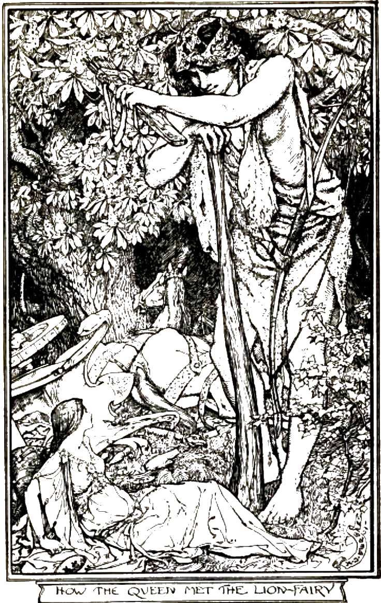

“嗯！别害怕，你还活着。不过，也许你会为此而感到后悔。我是狮子仙女，你要到我的宫殿里去，和我一起度过你的余生。我的宫殿离这里不远，跟我走吧！”可是王后害怕地缩了回去。

“啊！狮子仙女，送我回到我的城堡里去，求求你了！你要多少赎金都可以，不论多少，我丈夫都会付给你的。”可是女巨人摇摇头。

“我已经够富了。”她回答，“只是我常常感到很闷，我想你会使我开心一些。”她一边说，一边把自己变成一头狮子，把王后扔到自己的背上，然后走下通到她的王宫里去的一万级台阶。狮子在一幢房子的门前停下来的时候，已经走到了地球的中心。房子建造在一个水银湖的旁边，里面灯光通明。湖中可以看到，各种各样巨大的怪兽在玩耍或打架，反正王后也说不准。湖边飞着一群乌鸦，发出凄惨的叫声。远处有一座山，河水在山坡上慢慢地流淌着，那是那些不幸的情人的眼泪。离门不远的地方长着一些树，树上既没有果子，也不开花。地上长满了荨麻和荆棘。王后看到这种情景，会怎么想？

一连几天，王后因为被所经历过的事情所惊吓，闭着眼睛躺着，不动，也不说话。等她好一些以后，狮子仙女对她说，要是她愿意，可以自己建造一间小屋，因为她要在这里度过余生。听到这些话，王后泣不成声，请求将她关起来的人把她处死，也不要让她接受这种生活的折磨。可是，狮子仙女只是笑笑，劝她尽量快活一些，因为很多更悲惨的事情还在等待着她。

“难道我就没有一点办法打动你的心了吗？”可怜的姑娘绝望地问。

“嗯！要是你真的想让我高兴，那就用蜜蜂的刺给我做一个馅饼吧，而且一定要做得好吃。”

“可是，我一只蜜蜂也看不见。”王后朝四周看了看，说道。

“是的，这里一只也没有。”折磨她的人回答，“可你得自己去找。”说完，她就走了。

“说到底，那又有什么关系？”王后心里想着，“我只有一条命，大不了一百了。”她不再在乎自己要干些什么，走出宫殿，坐在一棵紫杉树下，倾诉着自己满腹的悲伤。

“啊！我亲爱的丈夫！”她哭泣着说，“当你来到城堡来找我，看到我不在的时候，你会怎么想？我情愿你一千次地以为我死了，也不要认为我把你忘了。啊！但愿那撞坏的马车还留在森林里，那样，你就会以为我是被野兽吃掉了而感到悲哀。要是有人取代了我在你心中的位置，啊！起码我永远也不会知道这件事！”

要不是头顶上一只乌鸦的叫声吸引了她的注意力，她也许会这样想好久。她抬起头来，想看看是怎么回事。在暗淡的光线下，她看到一只乌鸦抓住了一只青蛙，显然是想把它当晚饭吃掉。王后赶紧站起来，用挂在身上的扇子朝乌鸦用力打去，迫使它把青蛙扔下。青蛙掉在地下，已经半死不活。乌鸦的晚饭落空，气呼呼地飞走了。

青蛙一恢复知觉，就向王后跳过来。王后这时候还是坐在紫衫树下。青蛙用后腿站起来，深深地向王后鞠了一躬，说：

“美丽的女士，你是遭受了什么不幸才到这里来的？自从因为一次致命的好奇心，把我带到这里来以后，你是我唯一看到的做好事的人。”

“你是什么样的青蛙，竟然会说人的话？”王后反问说，“要是你能够，请告诉我，我是不是这里唯一的囚犯？因为到现在为止，除了湖里的怪兽以外，我一个人也没有看到过。”

“从前，他们也是男人和女人，像你一样。”青蛙回答说，“可是，他们手中有了权力以后，就只顾自己寻欢作乐，因此，命运就把他们安排到这里来，让他们因为自己的过错而受惩罚。”

“可是你呢？青蛙朋友，你不是这些坏人之中的一个吧！我相信。”王后说。

“我是半个仙女，”青蛙回答，“我虽然会一些魔法，可是我还不能样样如愿。要是狮子仙女知道我在她的王国里，她会马上就把我杀掉。”

“可是，你既然是仙女，为什么差一点被乌鸦吃掉呢？”王后皱起眉头问。

“因为我的魔力的秘密，全都在我那顶用玫瑰花叶做成的小帽子里。我把它放在一边的时候，可怕的乌鸦就向我扑过来。要是帽子戴在我头上，我就什么都不怕了。可是，我还得说，如果不是你，我这一回是死定了。要是我能帮你什么忙，或者能减轻你的痛苦，就请你告诉我。”

“唉！”王后叹了一口气，说，“狮子仙女吩咐我用蜜蜂的刺给她做一个馅饼。可是，我找来找去，也不见一只蜜蜂的影子。这里连它们采蜜的花都一朵也没有，哪来蜜蜂。再说就是有了，我又怎么能抓住它们？”

“这事就交给我吧！”青蛙说，“我会给你做好的。”接着，它发出一种奇怪的声音，用脚在地上踩了三下，立刻有六千只青蛙跑过来，有一只青蛙拿着一顶小帽子。

“把你们全身都涂上蜂蜜，到蜂窝周围去跳去。”青蛙把它朋友嘴里叼着的小帽子拿过来戴上，下命令道。然后，它又转过身来对王后补充说：

“在通往上面世界的一万级台阶下附近，有一个秘密的地方，狮子仙女在那里藏着许多蜜蜂。她不是给自己留用的，而是有时候用来惩罚她的受害者。这一回，我们要干得比她更聪明。”

它的话刚说完，六千只青蛙就回来了。它们浑身都沾满了蜜蜂，看上去非常古怪。可怜的王后虽然心情不好，也情不自禁地笑起来。那些蜜蜂吃了青蛙身上的东西以后，都醉倒了，不费吹灰之力就可以把它们的刺拔下来。于是，在朋友的帮助下，王后很快就做好了馅饼，送到狮子仙女那里去。

“胡椒粉还不够，”女巨人咬了一大口，为了掩盖自己的惊讶，故意这样说，“好吧！这一次算你逃过去了。我也很高兴找到一个伙伴，她比以前我试过的人要聪明一些。现在，你最好去给自己造一间房子”。

于是，王后捡起门口的一把小斧头就走了。在青蛙朋友的帮助下，她开始砍下一些柏树，准备造房子。这还不够，六千只青蛙仆人也叫过来帮忙。用不着多久，他们就盖起了一间世界上最漂亮的小屋子。它们还到一万级台阶的上面去，采来干燥的蕨类植物，做成一只床放在房间的角落里。床那么柔软，那么舒服，王后忙碌了一天，累极了，很乐意躺在上面。可是，她刚刚睡着，湖里的怪兽就开始发出最可怕的声音。一只小龙爬进来，她吓得赶紧跑出去，这正是小龙爬进来的目的。

可怜的王后蜷缩在一块岩石下面度过了整整一夜。第二天一早，她从可怕的梦中醒过来，只见青蛙正看着她，高兴极了。

“看来，我们得另给你造一座宫殿，”它说，“嗯！这一次，可不能离湖太近了。”它咧开有趣的大嘴笑着，直到王后又有了信心，她们才一起去找造新房子的木头。

小宫殿不久就造好了。她们用百里香草做了一张新床，非常芬芳。王后和青蛙都没有声张，可事情往往是这样，消息传到了狮子仙女那里，她派一只大乌鸦把囚犯找来。

“是什么神灵还是什么人在保护你？”她皱着眉头问，“大地因为连续不断的酸雨和火灾，已经寸草不生，可我听说，你的床是用芬芳的草做成的。不过，既然你能给自己弄到花来，当然也可以给我弄到。一个钟头里，我的房间里要摆上一束最珍贵的花。要是弄不到……哼！现在，你可以走了。”

可怜的王后回到自己的家，满脸的忧愁，等着她的青蛙一眼就看出来。

“你这是怎么啦？”它笑着问。

“啊！你怎么还笑得出来！”王后说，“这一回，我要在一个钟头里面给她送去一束最珍贵的花，叫我到哪里去找？要是不给她送去，我知道，她一定会杀了我。”

“嗯！我要看看，是不是能帮助你。”青蛙说，“我这里唯一的朋友是一只蝙蝠。它是个好朋友，我叫它干什么，它就干什么。我只要把帽子借给它，它戴上帽子飞到上面的世界去，就能把我们需要的东西带回来。我要亲自去找它，它得快一些才行。”

王后擦干了眼泪，耐心地等待着。离一个钟头还早着的时候，蝙蝠就采来地面上长着的，最美丽最芬芳的鲜花飞回来了。姑娘看到了，高兴得跳了起来。她赶忙带着它到狮子仙女那里去。狮子仙女惊讶得一句话也说不出来。

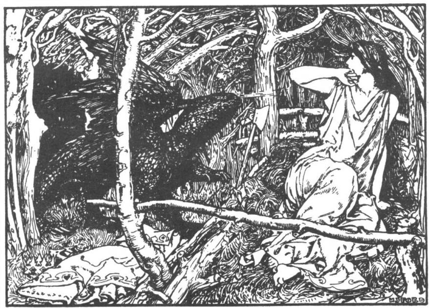

可是，拿到美丽的鲜花，闻到它的香味，使公主更加想念她的家乡。她对青蛙说，如果不想办法逃离这个地方，她一定会死去。

“让我和我的帽子商量一下。”青蛙说。它把帽子摘下来，放到一个盒子里去。然后又把它右脚带着的杜松树枝、驴蹄草，还有两粒豌豆放进去，然后把盖子盖上，喃喃地说了一些王后听不懂的话。

过了一会儿，盒子里传出来说话的声音。

“命运掌握着我们大家，”那声音说，“你现在还不能离开这个地方，要等该做的事情都做完以后才能走。不过，你将会得到一件礼物，她将会让你在碰到一切烦恼的时候得到安慰。”

那声音说得一点也不错。几天以后，青蛙从门外朝里张望，看到王后身边躺着一个全世界最美丽的婴儿。

“这么说，帽子说话算数。”青蛙高兴地喊起来，“她的脸蛋多么嫩，小脚多么可爱！我们该叫她什么呢？”

这当然是很重要的，要好好商量商量。她们想了上千个名字，又上千次地否定掉。有的名字太长，有的太短，有的不雅，有的又使王后想起她不喜欢的人。不过，王后的脑子里忽然闪过一个名字，她喊叫起来：

“有了！我们叫她莫芙特。”

“这名字太好了！”青蛙高兴地跳到半空中，喊叫起来。于是，问题就这样解决了。

公主莫芙特长到六个月的时候，青蛙注意到，王后又开始忧愁起来。

“你的眼神看上去怎么是这个样子？”有一天，青蛙来和婴儿玩的时候这样问她。婴儿这时候已经会爬了。

她们是这样玩的，先让莫芙特爬到青蛙的跟前，然后青蛙就高高地跳入空中，再轻轻地落在她的头上，背上或脚上。这样，她总是高兴得叫起来。再也没有比青蛙更好的游玩伙伴了。不过，它一定要是青蛙仙女，否则，就很容易伤害她，发生什么可怕的事情。

青蛙注意到王后的脸色不对，就不失时机地问她，到底是怎么一回事。

“我想不出你现在还有什么不满意的。莫芙特长得那么好，那么快活，连狮子仙女看到也喜欢她。究竟是什么原因叫你不高兴？”

“啊！要是她的父亲能够见她一面就好了！”王后紧握着双手说，“或者我能够告诉他，我们分别以后发生的事情。看到那辆破碎的马车，他会以为我不是死了，就是被野兽吃掉了。他会为我悲伤很久，这一点我知道得很清楚，可是到头来，大家会说服他再娶一个，她一定又年轻，又漂亮，他肯定会把我忘记。”

王后想得一点也不错。不过，那是九年以后，国王才同意娶新娘。

青蛙不再说什么，它不再玩了。它穿过柏树林，一跳一跳地走了。然后，它坐在树下想了又想。第二天一早，它来找王后，对她说：

“夫人，我来给你提供一次帮助。你看我是不是代替你到国王那里去，把你的不幸告诉他，还对他说，他有一个全世界最美丽的女儿？路很远，我走得很慢。可是早晚我会走到的。可是有一件事我不放心，没有我的保护，你独自留下来怕不怕？你要认真地考虑一下，最后要由你来决定。”

“啊！用不着再考虑了！”王后举起合着的双手，高兴地喊叫起来，她还把莫芙特的双手也举起来，以表示感谢，“可是，为了让他知道，你是从我这里来的，我要给他写一封信。”她刺破手指，用血在手帕的一角写下几个字，然后把它交给青蛙。大家相互告别。

青蛙花了整整一年零四天的时间，才登上那一万级台阶，走到上面的世界来。那是因为它仍然在一个邪恶的仙女魔法控制下。它到了上面以后，那么累，不得不在一条小河边住下来，休息一年的时间，同时着手准备去见国王的事情。因为它知道得非常清楚，随随便便地到王宫里去，它和它的随从会受到什么待遇。在和它的帽子反复商量以后，事情终于决定下来。离开公主以后的第二年年底，它们出发了。

走在前面的，是它那由蚱蜢组成的护卫队，后面跟着它的侍女，由田野里那些绿色的小青蛙组成，它们都骑在蜗牛上，上面铺着天鹅绒鞍垫。接下来的是水老鼠，打扮得像听差一样。最后是青蛙自己，坐在由八只蛤蟆抬着的用龟壳做成的轿子里。它戴着帽子，在里面可以很舒服地躺着。因为里面很宽敞，青蛙不坐的时候，放两个鸡蛋足足有余。旅途足足花了七年的时间。在这七年的时间里，王后饱受了等待的折磨，小公主尽她最大的努力来安慰她的母亲。实际上，要不是狮子仙女为了好玩，领着小姑娘和她的母亲一起到上面的世界去打猎，王后说不定已经离开人世了。尽管她很悲伤，但每一次见到阳光总是让她燃起了欢乐和希望。至于小莫芙特，她虽然只有七岁，但已经是箭无虚发了。所以，七年的等待也很快就过去了，不像王后想象的那么漫长。

青蛙总是小心翼翼地保持着它的尊严，不论什么理由，它都不会在大庭广众露面。即使是在公路上，它也不会露面，因为路上有可能碰到人。不过，如果队伍要经过一条小河，或者经过一片沼泽地的时候，它就会命令停下来。它们就会把身上的好衣服脱下，把缰绳扔在一边。蚱蜢、水老鼠，连青蛙自己，都会在泥地里玩上一二个钟头。

终于，目的地就在眼前。看到国王宫殿的塔顶，路上的辛苦都被忘得一干二净。一个阳光明媚的早晨，队伍带着皇家使者的辉煌和气派，走进城堡的大门。可以肯定，还没有一个使者能够带来这么大的激动。所有的门户和窗口，就是连屋顶上，都站满了人。欢呼声一直传到国王的耳朵里。可是这个时候，他没有时间来关心这些事情。过了九年以后，他终于同意了大臣们的请求。这时候，他正处于第二次结婚的前夕。轿子抬到王宫的台阶前，青蛙的心激动地跳起来。它伸出头来，招呼站在门口的卫兵。

“我想见国王陛下。”它说。

“国王陛下有事，谁也不能见！”卫兵说。

“国王陛下会接见我的。”青蛙眼睛看着他，回答说。不知不觉地，那名卫兵就把队伍领进了大厅。国王的身边坐着许多高贵的人，正在安排着大家在婚礼上该穿的衣服。

队伍走进来的时候，大家都吃惊地看着。当青蛙从轿上跳到地下来，又从地下跳到国王的宝座扶手上的时候，更是惊讶万分。

“陛下，我来得正是时候。”青蛙说，“我要是晚来了一天，你就会违背九年前，你对王后立下的誓言。”

“回想起她的形象，我总是感到非常亲切。”国王和蔼地对它说。尽管这时候，所有在场的人都以为，他会严厉地责备青蛙的鲁莽，“可是你要知道，青蛙女士，作为一个国王，他很少能按照自己的意愿去行事。他必须受到他的臣民的愿望的约束。九年来，我一直在反对他们，现在，我不能再坚持下去了。我已经选中了在那边舞会上跳舞的年轻公主。”

“你不能娶她，不管她是多么美丽。因为你的妻子，王后她还活着。她给你送来了一封用自己的鲜血写成的信。”青蛙说着，一边把那块手帕拿出来，“而且还有，你有了一个女儿，她已经快九岁了。她比全世界所有的孩子加起来还要美丽。”

国王听完这些话，脸色变得苍白。他双手抖动着，连手帕上的字也看不清楚。接着，他亲吻了手帕两三次，眼泪不禁夺眶而出。好几分钟，他一句话也说不出来。等他能控制住自己以后，他对大臣们说，这些字是王后写的。知道她还活着，他感到非常高兴。当然，他就没有必要再结一次婚了。这当然引起那些把新娘引进王宫里来的使者的极大不快。其中一个气愤地问，是不是单凭一只青蛙的一句话，就让公主蒙受这样的耻辱。

“我不仅仅是‘一只青蛙’，我会给你证明这一点的。”小东西气愤地反驳着。它把帽子戴上，喊道：“我的仙女朋友，你们来啊！”一转眼工夫，一群美丽的形象就站在它的面前，她们头上都戴着一顶王冠。当然，谁也猜不出她们是蜗牛、水老鼠和蚱蜢变的，它的随从就是从它们中间挑选出来的。

在青蛙的示意下，仙女们开始跳起芭蕾舞来。大家都看得兴高采烈，请求她们再跳一次。可这一回不是小伙子和姑娘们，而是花在跳了。接着，花又变成了喷泉，泉水在空中飞舞着，交织在一起。然后又从大厅的四周泻下，像瀑布一样从台阶上冲出去，在城堡的周围变成一条河流。水面上有着最美丽的小船，都油漆和装饰得很漂亮。

“啊！让我们到船上去航行！”那位早已忘记了跳舞的公主，看到这些奇迹，不禁喊叫起来。既然她那么喜欢船，那些负责照顾她的使者们，也只好跟着她走。要是他们能做主的话，决不会到船上去。

可是，他们和公主刚在柔软的座垫上坐好，河和船就不见了，公主和使者也消失得无影无踪。而蜗牛、蚱蜢和水老鼠又恢复了原来的样子，站在青蛙的周围。

“现在，”青蛙说，“尊敬的陛下也许会相信，我是一个仙女，说的是真话了吧！因此，请抓紧时间，安排好国家的事情，动身去寻找你的妻子。这里有一个戒指，它可以帮助你见到王后，还能让你和狮子仙女见面而不会受到伤害。尽管她是世界上从来没有过的最可怕的人。”

这时候，国王已经完全忘记了准备再娶的公主，他所以答应娶她，完全是为了让他的臣民高兴。此刻，他急于要踏上青蛙为他指点的征途。他委托一个大臣负责管理国家，给青蛙一切它想要的东西，然后戴上戒指，骑着马向森林里走去。到了森林边上，他打发马自己回去，迈开双脚继续往前走。

可是，没有什么作向导，他不知道哪里是地下世界的入口处。他盲目地找来找去，游荡了好久。后来有一天，他坐在一棵树下休息时，有一个声音对他说话。

“你为什么毫无结果地自找麻烦，你本来应该知道可以打听一下。靠你自己，你永远也找不到通向你妻子身边的路。”

国王吃惊地四处张望，可是什么人也看不见。他仔细地想了一想，那声音好像是从他身上发出来的。忽然，他的眼睛落在戒指上，一切都明白了。

“我真笨！”他喊道，“白白地浪费了多少宝贵的时间。亲爱的戒指，我请求你，让我看一眼我的妻子和女儿！”他还在说话的时候，一头巨大的狮子就从他的身边闪过，后面跟着一个女士和一个美丽的少女，她们都骑在仙马上。

他注视着她们，高兴得几乎要昏过去，然后浑身颤抖地倒在地下。

“啊！带我到她们那里去！带我到她们那里去！”他喊叫着。戒指勉励他鼓起勇气，把他安全地带到阴暗的地下去，他的妻子在这里整整住了十年！

这时候，狮子仙女已经事先知道了国王打算到她这里来。她下令在水银湖中心建起一座宫殿，为了让它更加难于接近，她让它总是漂浮不定。她们打猎一回来（国王刚才就是在她们追逐猎物的时候看见她们的），她就把王后和公主送到宫殿里去。叫湖里的怪物把她们看守起来。这些怪物都看上了公主，彼此之间极其妒忌。为了公主，它们随时都可以把对方吃掉。所以，它们都非常乐意接受这个差使。它们有的守在漂浮不定的宫殿周围，有的守在门口，那些小的和轻的就在屋顶上看着。

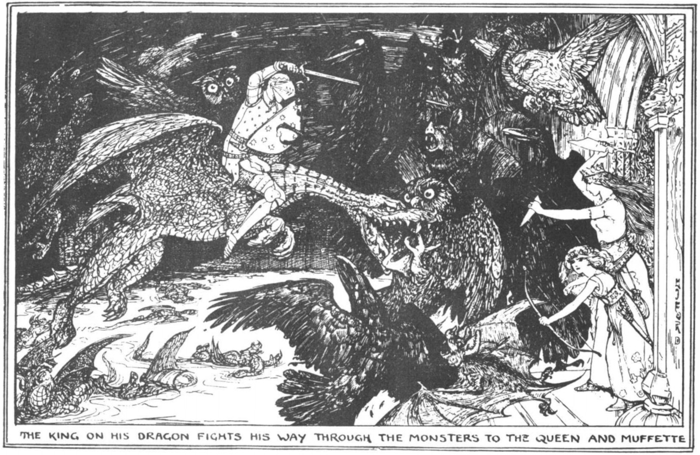

当然，国王对这些安排一无所知，他勇敢地进入狮子仙女的王宫。她正在那里等着他，愤怒地挥动着尾巴，因为她仍然保持着狮子的形状。她大吼一声，向国王扑过去，墙壁也在她的吼叫下摇晃着。可是国王早有防备，一剑就砍掉了那准备置他于死地的爪子。狮子倒在地下，国王仍然头戴盔甲，手举盾牌，用脚踩住她的喉咙。

“把我的妻子和女儿还给我！是你把她们从我的身边偷走的！”国王说，“否则，我马上就把你杀掉！”

可是，狮子仙女回答说：“透过窗口看看湖里吧！看看她们是在谁的手里。”国王朝窗外望去，透过水晶墙壁，看到妻子和女儿在水银湖里漂浮着。这时，他把狮子和她的恶毒都全忘记了，他摘下头盔，朝着她们拼命地呼喊起来。王后听出是丈夫的声音，就和莫芙特一起跑到窗口，向他挥手。国王庄严地发誓，就是牺牲自己的生命，也决不会把她们抛下。他说到做到，虽然这时候，他还不知道这将意味着什么。

三年过去了，国王为实现自己的愿望所做的一切努力，没有取得任何进展。这三年来，他经历了难于想象的艰苦，睡的是荨麻铺就的床，吃的是比胆汁还要苦的水果。他天天都在和阻止他进入宫殿的怪物搏斗着。他丝毫也不占优势，也没有前进过一步。这时候，他几乎已经绝望，准备不顾一切地扑到湖中去。

就在他处境最凄惨的时候，一天夜里，一条一直在屋顶上看着他的龙向他爬过来。

“你自以为爱可以战胜一切，”龙说，“现在，你看到不见得了吧！不过，如果你用你的王冠和节杖对我发誓，如果你用我百吃不厌的食物招待我吃一顿饭，而且我什么时候要，你就什么时候给我，我就让你得到你的妻子和女儿。”

国王听到这些话，是多么高兴！只要能把妻子和女儿搂入自己的怀抱，还有什么誓是他不愿意发的？他高兴地照龙的愿望发了誓，然后跳到龙的背上。本来，龙那强健的翅膀一下子就可以把他送进宫殿的。可惜不巧，附近的一头怪兽正好醒着，听到了他们说的话，游到岸边来和龙展开了搏斗。这一仗打得又艰苦又长久，国王打退了一批敌人，前面又有一批敌人在等着他。在门口，巨大的蝙蝠、猫头鹰、乌鸦从四面八方向他扑过来。不过，龙的牙齿和爪也很厉害，王后在焦急之下，也敲碎玻璃，把玻璃当武器，投入战斗。后来，那些可怕的怪物都逃走了。只听见雷鸣般的一声巨响，宫殿和怪物都不见了。也不知道是怎么一回事；这时候，国王发现，他和妻子女儿已经站在自己王宫的大厅里了。

龙也和其他怪物一样消失了。一连好些年，也没有听到它的消息，大家也把它忘了。莫芙特公主一天比一天长得更美丽。到了十四岁的时候，邻国的国王都派人来说亲，要公主嫁给他本人，或者是他的王子。好长一段时间，姑娘一概拒绝这些求婚者。后来，一个很有天赋的王子打动了她的心。再说国王虽然答应让公主自己去挑选丈夫，不过，他心中却暗暗希望，这一个能成为他的女婿。于是这一天，他们举行了非常隆重的订婚仪式。然后，王子挥泪和公主告别，带着她的画像回到自己的国家去。

王子走了以后，莫芙特公主真是度日如年。她努力地克制着自己，不让自己的哀怨去影响别人。有一天上午，她在王后的房间里弹竖琴的时候，国王忽然闯进来，紧紧地抱住自己的女儿，力气那么大，几乎把她吓坏了。

“啊！我的孩子！我亲爱的孩子！你为什么要生出来呢？”等他能开口说话的时候，他喊道。

“是不是王子死了？”莫芙特公主吓得脸色苍白，浑身发冷，无力地问。

“不！不是！我怎么能告诉你呢！”他瘫倒在一堆垫子上，妻子和女儿跪在他的身边。

后来，他终于把事情的经过说了出来，那是一件多么可怕的事情啊！宫殿外面来了一个巨人，他是那条龙派来的，就是那条帮助国王把王后和公主从水晶宫殿里救出来的那条龙。这条龙这些年来一直很忙，早就把公主忘得一干二净。后来公主订婚的消息传到它的耳朵里，它才想起来和国王的交易。关于公主的消息它听得越多，它就越觉得把她吃掉一定味道鲜美。于是，它命令它的仆人巨人立刻就去把她带来。

没有任何语言可以表达王后和公主听到这可怕的消息以后的恐惧。她们立刻冲到巨人等候着的大厅，跪在他的脚下，请求他怜悯公主，如果他愿意，他可以把整个王国都拿去。巨人仁慈地看着她们，因为他不是铁石心肠的人。可是，他说，他无能为力，如果公主不太太平平地跟他走，龙就要亲自出马。

一连几天过去了，国王和王后一刻也没有停止过请巨人帮忙。巨人这时候已经因为等待而感到忧虑了。

“只有一个办法可以救你们，”他后来这样说，“那就是把公主嫁给我的侄子。他不但长得年轻漂亮，而且学过魔法，知道如何保护她，不受龙的威胁。”

“啊！谢谢你！谢谢你！”公主的父母握着他的大手，一直举到胸前，“你真是搬走了我们心上的一块石头。我们要给公主半个王国做嫁妆。”可是，莫芙特站起来，把他们推开。

“我不能够靠出卖信义来换取自己的生命。”她骄傲地说，“我现在就和你一起到龙那里去。”父母亲的眼泪和苦苦哀求，也丝毫不能打动她的心。

第二天早上，公主就被轿子抬着，在巨人的看护下走了。国王和王后，还有那些泪流满面的侍女们跟在后面，要把她送到巨人城堡的山里去。尽管道路崎岖不平，但显得那么短。他们到了龙指定的地点以后，巨人命令抬轿子的人站住。

“你们和女儿告别的时候到了，”巨人说，“我看到龙正向我们飞过来。”

那倒是千真万确，一片乌云正遮蔽太阳飞过来。在乌云和太阳之间，隐隐约约可以看到，一个有半英里那么长的巨大身影越来越近。开始，国王不相信这就是在水银湖边看到的，哪个似乎很善良的小动物。不过那时候，对于巫术，它毕竟知道得很少，也从来没有研究过把身体变大和变小的方法。这千真万确就是那条龙，而不是别的什么。它拍动着六个翅膀，使它以最快的速度飞过来，尽管它那么重，尾巴那么长，一共打了五十个半弯。

它来得是很快，可是青蛙头戴帽子，骑着一条灰狗，跑得比它还要快。它跑进王子的房间，对正坐在那里看他心上人画像的王子大声喊道：

“你还在这里磨蹭什么，公主的生命已经危在旦夕！院子里有一匹三个头，十二条腿的绿马，它的身边有一把十八码长的剑，快去救公主！晚了她就没命了。”

战斗进行了整整一天。王子的力气看看就要耗尽，龙以为它已经获胜，张开嘴来哈哈大笑。王子看到机会来了，抓紧他的敌人没有闭嘴的时候，把剑对准它的喉咙深深地刺进去。龙的巨爪抓着地皮拼命地挣扎，可是尾巴的摆动越来越慢，最后滚到一边去不动了。公主得救了。

事情结束以后，他们都回到王宫。婚礼第二天就举行。莫芙特公主从此以后就和她的丈夫一起过着幸福的生活。

 

## 黄头发科凡历险记

在西部海岸线上，耸立着一座座高山，山脚一直延伸到海底下。那里住着一个牧羊人和他的妻子，还有他们的三个儿子和一个女儿。男孩子们天天不是捕鱼就是打猎，小姑娘就赶着小山羊到山里去放牧，或者留在家里帮助她妈妈做家务和补渔网。

他们就这样幸福地生活了好多年。有一天，小姑娘赶着小山羊在山上放牧，海上忽然升起浓浓的白雾，太阳被遮住，天顿时黑了下来，空气也变得越来越冷。小姑娘颤栗着站起来，想把那些小山羊叫回来，可是声音在喉咙里就消失了，怎么也喊不出来。自己也像是被有力的双手抱住。

时间一个钟头一个钟头地过去了，还不见小姑娘回来，海边的这座小房子里充满了悲哀的哭声。夜已经很深了，外面伸手不见五指，根本看不出哪里是山，哪里是河。父亲和哥哥们好几次跳起来，以为是听见了她的脚步声。小山羊一只接着一只地自己回家，每次听到羊叫的声音，他们就赶紧去开门，唯独听不到姑娘的声音，打破这深夜的寂静。整整一夜，谁也没有睡着。天一亮，雾散了，他们赶紧到海边和山上去找她，可丝毫也找不到她的踪影。

一年零一天过去了，牧羊人戈拉和他的妻子显得一下子就衰老了许多。孩子们也比以前更加悲伤，因为他们都爱自己的妹妹，没有一天不为她感到难过。后来，大儿子阿丹说：

“妹妹离开我们已经一年零一天了，我们既伤心又耐心地等待着她回来。她肯定是遭到什么不幸了，不然一定会带口信回来，好让我们放心。我已经发过誓，不管是死是活，一定要找到她，否则就死不瞑目。”

“你既然发过誓，就应该遵守自己的誓言。”戈拉说，“你在发誓之前，如果能够征得你父亲的同意就好了。不过，既然你已经发过誓，你母亲会给你烤一个饼，让你带着路上吃。谁能说得上，你得出去多久？”

于是，母亲起身给他做饼，不是一个，而是两个，一个大，一个小。

“挑一个吧！我的孩子。”她说，“你是要这个带着你母亲祝福的小饼呢？还是要那个因为你背着父亲起誓而没有祝福的大饼？”

“我要那个大的，”年轻人回答，“我要是饿死了，母亲的祝福对我来说，还有什么用？”他拿起那个大饼就出去了。

他大步流星地向前走，高山和湍流也阻挡不了他的去路。他走的那么快，像是一阵风从山上刮下来似的。鹰和鸥从树上的巢中往下看，看他急急忙忙地赶路，把鹿也抛在后面。后来，他终于停下，因为肚子饿了，他再也走不动了。他累得浑身发抖，在一块岩石上坐下，掰下一块饼来吃。

“给我吃一点吧！戈拉的儿子阿丹。”一只大乌鸦从树上飞下来，对他说。

“咳！到别处去找去，你只会带来坏消息。”戈拉的儿子阿丹回答，“我自己也只有这么一点。”说完，他躺了一会儿，然后又站起来继续赶路。他不停地走着，直到小鸟都回到自己的巢里去，天一点一点地暗下来，最后什么也看不见。后来，他看到有一丝亮光从一间屋子里射出，就赶紧向它走过去。

门开着，他走了进去。但看到里面的情景，他又站住了。火炉旁的一张凳子上，躺着一个老人。他的对面坐着一个少女，用一把银梳子梳着金色的头发。

“欢迎！漂亮的小伙子！”老人转过头来说，“坐下来暖和暖和，告诉我外面怎么样了！我已经很久没有到外面去过了。”

“我给你带来的唯一消息就是，我要找工作。”阿丹回答说，“我天一亮就从很远的地方赶过来，在黑暗中，看到你们的灯光我很高兴。”

“我需要一个人来帮我喂养三头暗褐色的，没有角的母牛。”老人回答，“要是在一年的时间里，你能在每天太阳下山以前，把它们赶回到我这里来，我就付给你心满意足的报酬。”

这时候，姑娘抬起头来很快地回答说：“他要是接受你的工作，事情就不会有好结果。”

“送上门来的主意一钱不值！”阿丹粗暴地说，“要是我不能把三头母牛赶出去放牧，保证不会被山上下来的狼吃掉，我就什么活也干不了了。所以，好大爷，明天天一亮，我就给你干活，不到新年不向你要工钱。”

第二天一早，牧场里鹿铃的声音还未响起，金发姑娘就挤好牛奶，把奶牛牵到门口来，老人和阿丹已经在那里等着。

“它们要到哪里去，就让它们去，”老人对他说，“不要想让它们走别的路。因为它们知道好的牧场在哪里。但是，要小心地跟着它们，不要走散。不论是看到什么，或者听到什么，都不要受诱惑，离开母牛。现在去吧，愿智慧和你在一起。”

老人说完以后，用手碰了一下一头母牛的前额，它就沿着前面的路迈步走去，另外两头母牛一左一右地跟在它的后面。戈拉的儿子阿丹遵照老人的吩咐，跟在牛的后面。碰上这么容易干的活，他心里好不高兴。他想，到了年底，口袋里就会有足够的钱，可以到遥远的国家去找他的妹妹；而且放牛的时候，过路的人也许会给他带来妹妹的消息。

就在他心里想着这些事情的时候，忽然看到一只金公鸡和银母鸡从他前面的草地上迅速地跑过。刹那间，他把老人关照他的话忘得一干二净，开始去追。它们离他那么近，眼看就要抓住它们的尾巴了。可是，他每次伸出手去，心里想十拿九稳的时候，总是落空。后来，他实在跑不动了，就停下来喘口气。公鸡和母鸡还在前面跑着。这时，他才想起了母牛，感到害怕起来。他赶紧回去找它们。幸运的是，它们还在茂盛的绿草地上慢悠悠地吃着草。

阿丹坐在一棵树下，看着母牛吃草。忽然看到一根金棍和银棍在他眼前的草地上奇怪地舞动着。他赶紧站起来去捉它们。棍子在前面跑，他在后面追。棍子就在眼皮底下，可就是怎么也拿不到，一直追得他累坏了。后来，他不得不放弃这个念头的时候，因为非常疲倦，他的双脚直发抖。看到旁边有一棵结满各种各样水果的树，他又高兴起来，贪婪地吃了许多。

太阳已经快下山了。母牛停止吃草，开始掉头向家里走去。

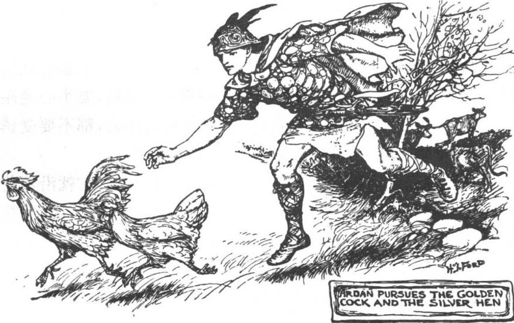

戈拉的儿子阿丹跟在它们的后面。在牛棚的门口，姑娘站在那里等着他们。她什么话也不说，就是坐下来开始挤牛奶。可是，流进她桶里的不是牛奶，而是很细的清水流。她从最后的一头牛身边站起来的时候，老人走过来了。

“不守信用的家伙，你辜负了我对你的信任！”他对阿丹说，“你连一天都做不到！好吧！你现在马上就可以得到报答，别人也好从你这里得到教训。”他举起手中的棍子，在年轻人的胸口点了一下，立刻就把他变成石柱。

现在，牧羊人戈拉和他的妻子充满了悲哀，他们不但失去了女儿，还失去了一个儿子，因为关于大儿子的消息，他们一点也没有。后来，从姑娘赶着小山羊到山上去，再也不回来的那天算起，过了两年零两天以后，有一天早晨，戈拉的第二个儿子鲁艾思说：

“我妹妹和阿丹哥哥离开我们很久了，我已经发誓，不论他们在什么地方，我都要找到他们。”

他的父亲说：“要是你能事先征得我和你母亲的同意，那就更好了。不过，既然你已经发过誓，那你就得去。”他吩咐妻子给他做一个饼。不过，她不是做一个，而是做了两个。她也是叫他挑一个，像阿丹一样，鲁艾思也是挑选了那个没有祝福过的大的。所以，用不着多说接下来发生了什么事情。后来，他也变成了一根石柱，竖立在那间小屋后面的山坡上。这样，人人都可以看到，等待着那些违背自己诺言的人的命运是什么。

又是一年零一天过去了。这一天早晨，戈拉最小的儿子，黄头发的科凡对他的父母亲说：“我妹妹失踪已经三年多了。我两个哥哥也走了，谁也不知道他们到哪里去了。四个人只留下我一个。所以现在，我想去找他们，我希望你们不要给我设下什么障碍。”

他的父亲回答说：“那么，走吧！带着我们的祝福一起去！”

于是，牧羊人戈拉的妻子做了两个饼，一个大，一个小。科凡拿着那个小的出发了。走到森林里，他觉得饿了，因为他已经走了好长的路。他坐下来，开始吃饼。忽然，有个声音在他的身后喊道：“给我一点！给我一点！”

他转过身来，看到是一只荒山野林里的黑乌鸦。

“是的，你也可以吃一点。”黄头发的科凡说。他掰下一块来递给乌鸦，它贪婪地吃起来。科凡吃好以后，站起来继续赶路，一直走到看见小屋子里射出来的灯光。他很高兴，因为黑夜已经降临。

“也许我在这里可以找到什么活干。”他心里想着，“起码我可以弄到一点钱，好帮助我继续去寻找。谁知道我的妹妹和哥哥走得有多远？”

门开着，他走了进去。老人欢迎他的到来，金发姑娘也是一样。事情和他的哥哥相同，老人叫他去放牛。姑娘劝他不要干。科凡不像两个哥哥那样粗暴地回答她，而是有礼貌地对她表示感谢，尽管他并不打算照她的话去做。他留神地听着新主人的话和警告。

第二天一早，他就跟着那些暗褐色的母牛出去，不管它们走到哪里，他都耐心地跟随着。在路上，他也看到了金公鸡和银母鸡从他的面前跑过，甚至比两个哥哥靠得更近。诱惑力那么大，他很想去追赶它们。可是，他立刻想起，他不能左顾右盼，他努力地克制自己，把目光从鸡的身上移开。接着，金棍和银棍好像是从地下冒出来，出现在他的面前。但这一次，他也克制住了自己。还有那棵魔树上的水果，尽管已经快要伸进他的嘴巴，他还是把它们推开，继续坚定不移地向前走。

这一天，母牛走得很远很远，它们还从来没有走得这么远过。一直走到一块石南花在燃烧着的荒原上。火势非常猛烈，可是母牛毫不在乎，坚定不移地走过去。黄头发的科凡在后面紧跟着。接着，它们走进一条翻滚着的河流，科凡也跟着走下去，虽然水一直没到他的腰部。河对岸是一片宽广的平原，牛走到这里就躺下来休息，科凡还是看着它们。附近有一幢用黄石头盖起来的房子，房子里传出来美妙的歌声。科凡听到这美妙的歌声，心里觉得轻松了许多。

就在他坐在那里等的时候，一个年轻人跑过来，跑得那么快，几乎话也说不出来，后来他终于大声喊叫：“快点！快点！黄头发的科凡！你的母牛跑到玉米地里去了，快点去把它们赶出来！”

“不！”科凡笑着说，“你刚才就可以把它们赶出来，这比跑过来告诉我轻松得多了。”说完，他继续听他的音乐。

过来没多久，那个年轻人又跑回来，上气不接下气地喊道：

“呸！戈拉的儿子科凡，你还呆呆地站在这里！我们的狗在追你的母牛，你快点去把它们赶走！”

“不！用不着！”科凡像上一次一样地回答，“你刚才就可以把你们的狗叫走，这比跑过来告诉我容易得多了！”他还是坐在那里不动，一直到音乐结束。

然后，他起身去看他的牛，发现它们还在原来的地方。看到科凡过来，它们就起身向家里走去。不过，这一次它们走另一条路。它们走过一块平原，上面光秃秃的，什么都不长，连丢在上面的一根针也能轻而易举地找到。可是，科凡惊奇地看到，一匹小马和母马在这里放牧，却长得膘肥体壮，好像这里的牧草很茂密一样。

接着，它们又穿过另一块平原，这里的草又密又绿。可是，在这里吃草的一匹小马和母马却是瘦得可怜，连它们身上有几根骨头都数得出。

过了草原，它们来到一个湖边。湖里有两只船，一条船上坐满了兴高采烈的年轻人，他们的船要开到太阳国去；另一条船上的人样子可怕，都穿着黑衣服，他们的船要开到黑夜国去。

“这是什么意思？”科凡跟在牛后面，自言自语地说着。

天黑了，狂风呼啸起来，暴雨直扑他们而来。科凡不知道还有多远，甚至也不知道路走得对不对。他看不见母牛，他的心情很沉重，担心能不能把牛安全地带回去。他能干些什么呢？

他进又不能进，退又不能退，只好站在那里干等着。忽然，他感觉到一只大爪子友好地放在他的肩膀上。

“我的洞就在这里，”一只毛尔—摩狗对他说，科凡经常听到别人说这种狗，“到里面去过夜吧！吃上一些羊肉，恢复一下你的体力。”

科凡走进去，吃了晚饭，睡了一个晚上。第二天一早，像换了一个人似的。

“再见吧！科凡！”毛尔—摩狗说，“祝你成功，因为你真心实意地接受我的帮助，没有嘲笑我。你如果遇到什么困难，只要想到我，我就一定来帮忙。”

说完这些话，毛尔—摩狗就回到森林里去了。科凡去找他的牛，看到它们都停留在山谷里过夜。

看到黄头发的科凡来了，就继续往前走。科凡紧紧地跟着它们，既不往左看，也不往右看。它们整整走了一天。到天黑的时候，它们走进一片荒野，只有石头可以遮风避雨。

“我们只能在这里休息了。”科凡说。那些牛点点头，就在原地躺下。这时候，飞过来一只大渡鸦，它的眼睛永远也不会闭上，它的翅膀永远也不会疲倦。它飞到科凡的面前对他说，它知道山里面有个裂缝，那里有好多吃的东西，还有柔软的苔藓地可以睡觉。

“跟我到那里去，”它说，“睡上一觉，明天就一切疲倦都没有，精力充沛地赶路了。”科凡满怀感激地听他的话。第二天一早，他就起来找他的母牛。

“再见！”黑渡鸦说，“你相信我，我为了报答你曾经给我东西吃而给你的一切，你都乐意地接受了。因此，如果你需要朋友的话，请叫我，我一定来帮忙。”

像前几次一样，牛还是站在他们分手的地方，准备出发。整整一天，它们不停地走着，科凡跟在它们的后面。到天黑的时候，他们来到了一条河边。

“我们不能再往前走了。”科凡对母牛说。它们停下来，开始在河边吃草。科凡看着它们，自己也想吃晚饭了。他走了那么多路，双脚现在直发软。这时候，他脚下传来哗哗的流水声。一只水獭从河里伸出头来。

“请相信我，我会给你找一个温暖的住处，”水獭说，“还有许多好吃的鱼。”科凡感激地跟着它走。吃过，休息过以后，完全恢复了体力。第二天太阳升起来的时候，他从用海水冲上来的干海草铺成的床上起来，满怀谢意地和水獭告别。

“因为你相信我，接受了我的帮助，科凡，你已经成了我的朋友。”水獭说，“你如果碰到什么困难，需要会游泳和潜水的朋友帮助，请叫我，我一定来。”说完，它就潜到水里去，不见了。

母牛还是站在昨天晚上他们分手的地方等他。它们又继续走了整整一天。一直走到天黑的时候，他们回到了小屋。母牛走进牛棚以后，老人非常高兴。他注视着浓浓的牛奶流进金发姑娘的桶里。

“你确实干得很好，”他对戈拉的儿子科凡说，“现在，你需要什么样的报酬？”

“我自己什么都不要。”黄头发的科凡回答说，“我只求你让我的哥哥和妹妹回到我的身边，她失踪已经整整三年了。你很有智慧，知道仙女和女巫的事情。请告诉我到哪里可以找到他们？要做些什么才能恢复他们的生命？”

听了科凡的话，老人的神情严肃起来。

“是的，我知道他们在哪里，”他回答，“我不说他们再也不能复活了，但是太危险了，对你来说，危险实在太大了。”

“告诉我有些什么危险，”科凡又说，“这样我就会明白能不能克服它们。”

“那么，你听着，好好地想一想。在那边的山上有一头獐，它的脚是白的，头上长着像鹿一样的角。在通往太阳国的湖上，有一只鸭，它的身体是绿色的，头颈是金色的。在科里—毕池塘里，有一条鲑鱼，它的皮像银一样闪光，它的鳃是红的。把它们都给我带来，然后，你就会知道，你的哥哥和妹妹在什么地方了。”

“明天鸡一叫我就动身。”科凡回答。

一条笔直地通往山上的路就在眼前。他爬到高处，就看到了那头身上有斑点的白脚獐在前面的山顶上。

他满怀信心地去追赶它。可是，他刚爬上山顶，獐已经跑到另一个山顶上去了。等他再追过，獐又跑到另一个山顶上去了。这样连续几次以后，科凡几乎失去了勇气。这时候，他才忽然想起了那条毛尔—摩狗。

“啊！它要是在这里就好了！”他喊道。他抬起头来，果然看到它来了。

“你叫我来干什么？”狗问。科凡把自己的麻烦事，獐如何从一个山头逃到另一个山头对它说了以后，狗回答说：“别担心，我马上就把它给你抓来。”一会儿工夫，那头獐就毫无损伤地送到他的面前。

“你还要我干什么？”狗问。

科凡回答说：“老人吩咐我把这头獐，还有金黄色头颈的鸭，银色的鲑鱼带回到他的家里去。我不知道能不能捉到它们。你先把獐送到他家后面去，把它用绳子拴好，别让它跑了。”

“这能办到。”毛尔—摩狗说。

接着，科凡动身到通往太阳国的湖那边去。他看到金黄色的头颈，绿色羽毛的鸭子正在水百合花中游。

“我是个游泳好手，肯定能捉住它。”他心里想着。他游得是不错，鸭子却游得更好。后来，他一点力气也没有了，只好回到岸上来。

“啊！要是黑渡鸦来帮助我就好了！”他心里想着。一会儿工夫，黑渡鸦就站在他的肩膀上了。

“我如何帮你？”渡鸦问。

科凡回答说：“把在湖面上游的鸭子给我捉来。”渡鸦拍动有力的翅膀，用有力的嘴把鸭子叼起来，一下子就飞回科凡的身边。

这一回，科凡可以轻而易举把他的猎物随身带走。在感谢渡鸦的帮忙以后，他径直来到池塘边。

在那湖水阴森的池塘旁，那条银色的鲑鱼正躺在一块石头下面。

“像我这样的好渔夫，肯定可以抓到它。”科凡心里想着。他从树上砍下一根细树枝，一头结上一根绳子，开始想把鲑鱼钓上来。可是，不论他怎么用心，还是毫无结果。因为鲑鱼对诱饵看都不看。

“看来，我是毫无办法了，除非水獭能够来帮忙。”他说。就在他说话的时候，传来了哗哗的流水声，只见水獭从水中伸出头来看着他。

“啊！请你把石头下面的鲑鱼给我抓过来！”科凡说。水獭潜下水去，不一会就咬住鲑鱼的尾巴，把它送到科凡的脚下。

“獐、鸭，还有鲑鱼都在这里了。”科凡回到屋子以后，对老人说道。老人对他笑笑，叫他去吃点东西喝点水，等他吃饱喝足以后，再和他说话。

下面就是老人对他说的话：“你一开始就做得很好，我的孩子。你接受了母亲的祝福，所以，你注定要成功。在渡鸦肚子饿的时候，你给它东西吃。你忠诚地履行了对我的承诺，没有被那些虚荣的东西所诱惑。你很聪明地觉察到，那个想引诱你离开教堂房子的男孩子是在撒谎。你还怀着感激的心情接受别人的帮助。但最重要的是，你遇到困难的时候，不是垂头丧气，而是鼓起勇气。现在，作为对你的报答，你将真正地把自己的妹妹带回家。同时，我将恢复你两个哥哥的生命。但是，他们既懒惰，又不讲信用，他们的命运将是永远流浪。再见吧！愿智慧永远和你在一起。”

“请告诉我你的名字。”

“我是寿神。”老人说。

（凯尔特人的故事）

 

## 贝拉·弗洛公主

从前有个人，他有两个儿子。他们长大以后，大儿子远走他乡，去寻找自己的运气。他一去就是许多年，谁也不知道他的下落。小儿子留在家里，和父亲一起过日子。父亲活到高龄以后去世了，留下许多财产。

有一段时间，小儿子任意挥霍父亲留下来的财富，以为他是唯一的继承人。可是有一天，他从楼梯上下来的时候，吃惊地看到一个陌生人走进大厅，他东张西望，好像走进自己的房子一样。

“你不认识我了？”那人问。

“我不会记得一个不认识的人。”他得到的是粗暴的回答。

“我是你哥哥。我想出去赚点钱，但是两手空空地回来了。更糟糕的是，村子里的人对我说，我的父亲死了。要是我能见上他一面，损失的那些金子也就算不了什么。”

“他六个月之前死了。”富弟弟说，“作为你的一份遗产，他给你留下一个旧箱子，放在搁楼上，你最好上去看一看。我没有时间陪你了。”说完，他就自己走了。

于是，这个流浪者向仓库顶上的搁楼走去。在上面找到了那个木箱子，那么久了，好像很快就要散架似的。

“这种破烂东西给我有什么用？”他自言自语地说着，“嗯！可以用它来生把火，起码可以暖暖身子，所以，总是比什么也没有好。”

这个名叫乔西的人背起箱子，动身回到旅馆里去。他借来一把斧头，开始把箱子劈开。这时候，他发现箱子里有一个秘密抽屉，抽屉里有一张纸头。他不知道纸头里包着什么东西，就把它打开。他吃惊地看到，这是别人向他父亲借一笔巨款的借据。他把这张宝贵的纸条放进口袋，赶紧去问店主，到哪里可以找到在上面签字的这个人，然后立刻就去找他。

借债的人原来是个老吝啬鬼，他住在村子的另一头。几个月来，他一直希望这张借条不是丢了就是毁了。的确，当他看到借条时，很不情愿偿还欠人家的这笔钱。可是来人威胁要把他送到国王那里去。吝啬鬼看到实在没有办法了，只好把钱一块一块地数还给人家。乔西把钱装进口袋，回到旅店，觉得现在自己也是一个有钱人了。

几个星期以后，他在附近的城里走着，看到一个可怜的妇女正在嚎啕大哭。他停下来问她，是怎么回事？她啜泣着回答说，她的丈夫快要死了，更不幸的是，他因为还不起借人家的钱，债主要把他送到监狱里去。

“你尽管放心，”乔西和气地对她说，“他们不会把你的丈夫送进监狱，也不会变卖你的家产。我不但帮你还清债务，万一他死了，我还会帮你支付安葬费。回家去吧！好好地照顾你的丈夫。”

女人听他的话，回家去了。可是，尽管她尽心照料，她的丈夫还是死了。乔西帮她埋葬了丈夫。这些花费比他原先估计的要大，等把钱都付掉以后，他发现自己只剩下三块金币了。

“我现在该怎么办？”他问自己，“我想最好还是到王宫里去，去帮国王干活。”

开始，他只是国王的仆人，帮国王提洗澡水，帮他把床铺好。他把自己的活干得很好，很快就引起主人的注意，短短的时间里，就把他提升为卧室管家。

这些事情发生的时候，弟弟把父亲留给他的钱全部花光了，不知道该如何去为自己多挣一分钱。他后来想起哥哥是国王的宠儿，就跑到王宫里诉苦，请求他过去那么粗暴地对待的哥哥保护他，帮他找个地方安身。哥哥总是乐意帮助别人，就亲自去和国王说。第二天，弟弟就被安排在王宫里干活。

不幸的是，这个新来的人既妒忌又刻毒，他容不得别人的运气比自己好。他利用通过门上的钥匙孔偷看和偷听的办法，知道国王尽管又老又丑，却爱上了贝拉·弗洛公主。公主和他没有什么可说的，就偷偷地躲到山里的城堡中去，谁也不知道这个城堡在什么地方。

“这真是太妙了！”这个恶棍搓着两只手说，“很容易就可以叫国王派我的哥哥去找公主，要是他两手空空地回来，就要被杀头。不管怎么说，这颗眼中钉就可以拔掉了。”

他立刻就去请求晋见国王，说有非常重要的事情要报告。国王同意立刻就接见他，叫他快点把要说的事情讲出来。

“啊！陛下，贝拉·弗洛公主……”说到这里他忽然停下来，好像是害怕似的。

“贝拉·弗洛公主怎么啦？”国王急不可待地问。

“我在王宫里听到有人悄悄地说，尊敬的陛下想知道她藏在什么地方。”

“谁要是能把她给我带来，我就给他半个王国。”国王急切地说道，“快说吧！混蛋！是不是空中的飞鸟把这个秘密告诉你的？”

“不是我，是我的哥哥知道，”这个坏蛋回答，“要是陛下叫他……”他的话还没有说完，国王已经用他的节杖敲响了挂在墙上的金盘子。

“立刻把乔西叫到我这里来！”他对跑近来听从吩咐的仆人喊叫着，声音那么大。乔西跑进来，看到国王因为气愤和激动，几乎说不出话来，惊讶这个世界到底发生了什么事情！

“立刻把贝拉·弗洛公主给我带来！”国王结结巴巴地说着，“你要是两手空空地回来，我就要活活地把你淹死！”然后，他不再多说一个字就走了。留下吃惊和恐惧的乔西呆呆地站在那里。

“我见都没有见过贝拉·弗洛公主，叫我怎么能找到她？”他心里想着，“可是，留在这里除了被处死以外，不会有什么结果。”他慢慢地向马厩走去，想给自己挑一匹马。

马厩里有着一排又一排的好马，它们的名字都用金字写在旁边。乔西看了一匹又一匹，拿不定主意要哪一匹好。这时，一匹老白马转过头来，招呼他过去。

“挑我吧！”它小声地说，“一切都会很顺利的。”

国王派给他这样一个差使，乔西这时候仍然感到心烦意乱，所以马会说话也没有引起他的惊讶。他只是机械地解开马的缰绳，把白马拉出马厩。他正想骑上去的时候，马又说话了：

“看到那边有三块面包吗？拿起来放到你的口袋里去。”

乔西照它的话去做，他急于要出发，也不问它什么问题，只是跨身上马。

他们一路没有遇到什么危险。后来他们来到一座蚂蚁山，马停下来。

“把三块面包捏碎，给蚂蚁吃。”马说。

可是他有点犹豫不决，说：“嗯！可是我们自己也要吃！”

“没有关系，给蚂蚁吃也是一样，不要错过帮助别人的机会。”面包被捏碎撒在地下以后，马又继续朝前奔跑。

他们走进一条两座山之间的石子路，看到一只鹰被猎人布下的网逮住了。

“下去，把网割破，把可怜的鸟放出来！”马说。

“可是，这很费时间，可能会错过看到公主的机会。”乔西说。

“没有关系，不要错过帮助别人的机会。”马回答说。网被割破，鸟被放出来以后，马又继续向前奔跑。

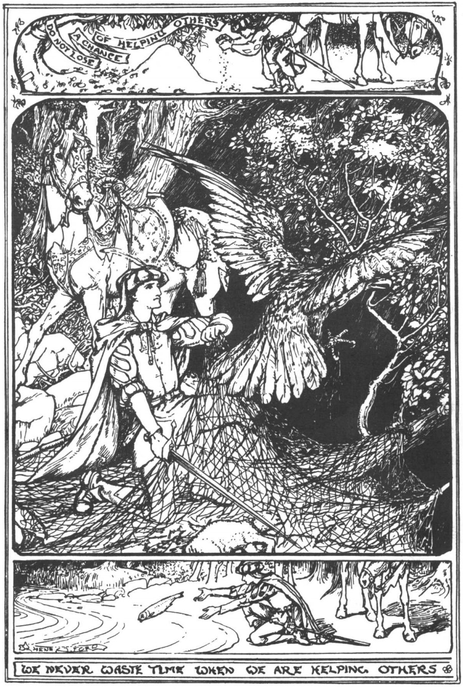

他们跑了许多路以后，来到一条河旁边，看到一条小鱼躺在地上喘着粗气，马说：

“看到那条小鱼了吗？如果不把它放回河里去，它就要死了。”

“可是，说真的，要是我们这样浪费时间，就永远也找不到贝拉·弗洛公主了！”乔西说。

“帮助别人永远也不是浪费时间！”马回答说。很快，小鱼就在河里高兴地游走了。

过了没多久，他们就看到了一座城堡。这座城堡建造在非常茂密的森林之中。贝拉·弗洛公主正在城堡前面喂她的母鸡。

“现在，你听着，”马说，“我要去做出各种各样奔跑跳跃的姿势来，引起公主的兴趣。然后，她会对你说，她想骑一下。你要把她扶上马。等她上来以后，我就开始又踢又叫。你就对她说，它从来没有给女人骑过，最好让你骑在后面，好控制住马。等你上来以后，我就像风一样，向国王的王宫跑回去。”

乔西一丝不苟地照马的话去做，果然，一切都像马预料的那样。所以，一直到马上气不接下气地向王宫奔去的时候，公主才知道，她落入了别人的手中。公主一声不吭，可是，她悄悄地把围裙解开，里面用来喂鸡的麸皮立刻撒得满地都是。

“啊！我的麸皮撒了！”她喊叫起来，“请下去帮我捡起来！”

可是乔西回答：“我们要去的地方有的是麸皮！”马继续朝前奔跑。

现在，他们从一片森林里经过，公主拿出她的手帕来，朝天上一扔，手帕飞到最高的树枝上挂住了。

“天啊！我真笨，我的手帕让风吹走了。”她说，“你爬到树上去给我拿下来好吗？”

可是乔西回答：“我们要去的地方有的是手帕！”马继续向前奔跑着。

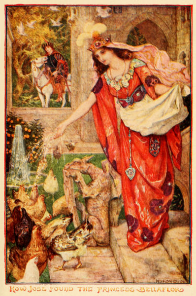

过了森林，他们从一条河边经过。公主从手上褪下一个戒指，把它扔到河里去。

“我真是太粗心了，”公主气喘吁吁，开始啜泣起来，“我把我喜欢的戒指丢了，不论如何请停一下，看看我能不能找到它。”

可是乔西回答：“你要去的地方，你可以找到许多戒指。”马继续朝前奔跑。

他们终于走进王宫的大门。国王看到他所爱的贝拉·弗洛公主，高兴得心直跳。可是公主根本不理睬他，好像他是一只苍蝇似的。她走进最近的一个房间，把门锁起来，不论他怎么苦苦哀求，她就是不肯开门。

“除非把我丢在路上的三样东西拿回来，我还可以考虑考虑。”这是她唯一要说的一句话。国王没有办法，只好去找乔西商量。

“我看再也没有办法可想了。”国王说，“可是你知道这三样东西丢在哪里，你去把它们找回来。要是空着手回来，我就把你活活淹死！”

可怜的乔西听了这些话，心里非常烦恼。他想，他已经不折不扣地照他的话去做了，应该太平无事了。不过，他还是低头鞠躬，走出去和他的朋友马商量。

“用不着自找烦恼，”马听完他的话以后告诉他，“上来吧！我们出去找这些东西。”乔西立刻跨上马去。

他们一直不停地奔跑，直到来到蚂蚁山。

“你想要找回麸皮吗？”

“想又有什么用！”乔西回答。

“那就把蚂蚁叫来。叫它们给你找回来。要是有些被风吹散了，就用你给它们的面包屑代替。”乔西惊讶地听着，他不大相信马的这个办法。可是，他也想不出什么更好的主意来。于是，他把蚂蚁叫来，叫它们尽快地把麸皮收集起来。

然后，他坐在一棵树下等着，马在一旁吃青草。

“看那边！”马忽然抬起头来喊道。乔西回过头来，看到身后的麸皮堆积得像小山似的。他把麸皮装进放在马鞍上的口袋里。

“好心早晚会得到好报。”马在旁边说着，“快上来吧！我们还有许多路要走。”

他们来到那棵树下，看到手帕像一面旗子似的，在最高的树枝上飘着。乔西又开始垂头丧气起来。

“我怎么能拿到这块手帕呢？”他喊道，“我得有一副《圣经》中说的，天使上下的天梯！”

可是马回答说：“别害怕，叫你从网中救出来的鹰，它会给你拿下来。”

于是，乔西把鹰叫来，鹰飞到树顶上去，用嘴把手帕叼下来。乔西谢过它以后，飞身上马，向河边奔跑而去。

昨天晚上刚下过一场大雨，河水不像往常一样清澈见底，而是非常混浊。

“我一点也看不见，也根本不知道它掉在什么地方，怎么能从河底把戒指捞上来呢？”乔西问。马回答说：“别害怕，把你救过的小鱼叫来，它会把戒指给你送上来的。”

他把小鱼叫来。鱼潜入河底，在大石头下面仔细寻找，还用尾巴把小石头搬开，终于找到了戒指，用嘴给乔西送上来。

乔西对自己所做的事情感到很满意，动身返回王宫。国王把这些宝贵的东西给贝拉·弗洛送去。可是她说，除非把那个抢她到这里来的强盗扔到油锅里去煎，否则她决不会开门。

“我非常遗憾，”国王对乔西说，“我真的不愿意这样做，可是你看，我没有别的办法。”

大锅里的油烧热了以后，乔西到马厩里去找他的朋友马，问它有没有办法可以逃过这一关？

“别害怕，”马说，“骑到我的背上来，我要全力奔跑，直到浑身被汗水湿透。然后，你用我的汗水擦全身，这样，不管油有多热，也不会损伤你的一根毫毛。”

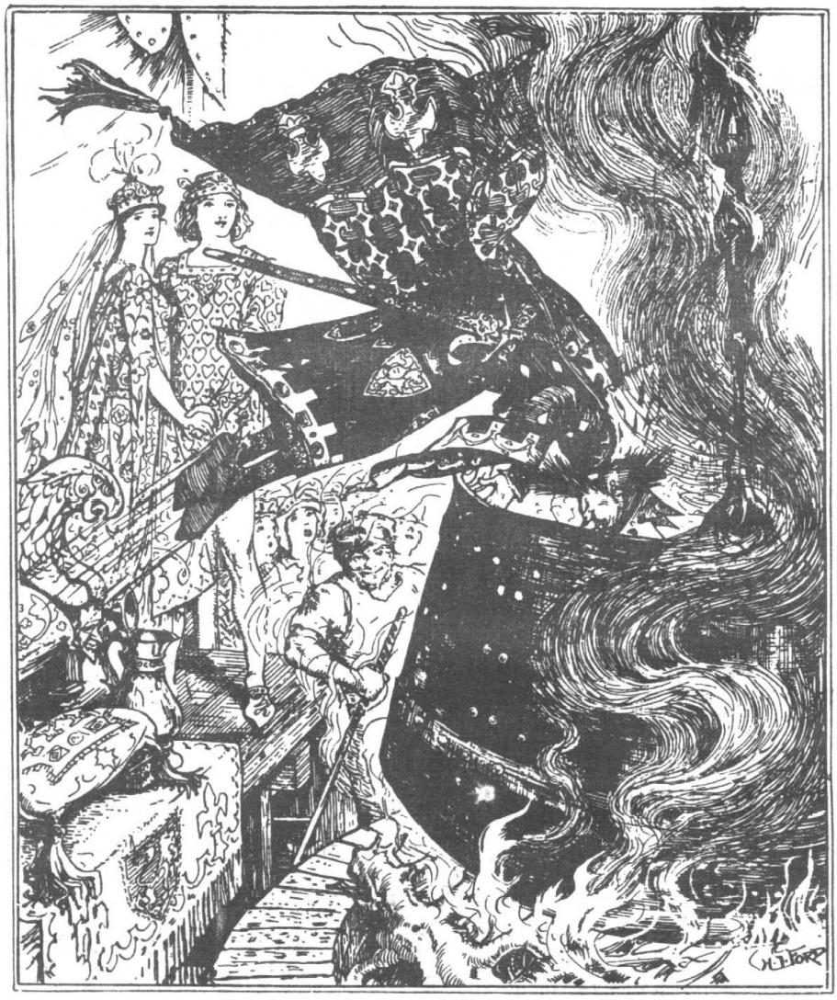

乔西不再提什么问题，只是照马的话去做。人们把他扔到滚烫的油锅里去的时候，都对他脸上的笑容感到吃惊。一直到公主说他煮够了以后，他才从油锅里出来。他显得又年轻，又漂亮。人人都喜欢他，尤其是公主，她已经爱上他了。

至于老国王，他觉得自己已经输了，绝望地跳到油锅里去，代替乔西，被活活地煎死。接着，大家推选乔西当国王，条件是他要和贝拉·弗洛公主结婚。乔西答应第二天就举行婚礼。可是，他想做的第一件事，是到马厩里去找那匹马，对它说：“因为有了你，我才得以活下来并得到了王位。你为什么要帮我做这一切？”

马回答说：“我就是哪个你为我破费了全部财产的，不幸的人的灵魂。当我看到你的生命有危险的时候，我想，我能够帮助你，就像你帮助过我那样。因为，像我曾经说过的一样，好有好报！”

（费尔南·卡巴勒罗）

 

## 真理鸟

从前，有一个穷苦的渔夫，他在一条河岸边造了一间小屋。河水从森林和灌木丛中安静地流过，避开了耀眼的阳光和城市的喧嚣，倾听着鸟儿在它的头上欢乐地歌唱。

有一天，渔夫像往常一样出去撒网，看到一个水晶摇篮随波逐流向他漂过来。他赶紧把网向它撒过去，把它拉过来。掀开盖在上面的丝被单，他看到两个婴儿睡在一张柔软的棉花小床上。一个是男孩，一个是女孩，他们张着眼睛冲着他笑着。渔夫看了一眼，不免怜悯他们起来。他扔下手中的网，捧起摇篮和婴儿，回家去找他妻子。

好心的女人看到摇篮里的孩子，绝望地摊开双手。

“难道八个孩子还不够吗？又带两个回来！”她说，“你是怎么想的，我们如何养活他们？”

“你总不能叫我让他们活活地饿死吧！”他回答说，“或者让海水把他们吞没！有八个人吃的，就有十个人吃的。”

妻子不再说什么。她也同情这些小东西。小屋里多少总有一些吃的。孩子们长大了，那么斯文，那么善良，养父母爱他们就像爱自己的子女一样，甚至胜过爱自己的亲生孩子。这使他们感到妒忌和不平。不久，这两个孤儿就注意到了，那些男孩子并不喜欢他们，总是和他们耍花招。所以，他们常常是自动避开，整天整天地到河边去。在河边，他们会把早餐省下来的面包捏碎，喂那些鸟吃。为了报答他们，鸟教会他们许多事情，如早上如何早点起来，如何唱歌，如何说鸟的语言，很少有人懂得鸟的语言。

可是，尽管两个孤儿尽可能地避免和他们的兄弟争吵，但也很难做到太平无事。后来情况越来越糟。有一天早晨，大哥哥对两个双胞胎说：

“你们总是装得很有礼貌，比我们强得多。可我们起码还有父母，你们呢？就像那些青蛙和癞蛤蟆一样，只能呆在河边。”

两个可怜的孩子对这种侮辱没有回答，但这使他们很不高兴。他们私下悄悄地说，这个地方他们再也待不下去了，要到外面去寻找自己的命运。

第二天，他们就像鸟儿一样，很早就起来，偷偷地下了楼梯，谁也没有听见。楼下有一扇窗开着，他们轻轻地从窗口爬出去。他们来到河边，好像找到了一个朋友似的，在河岸上走着，希望能看到可以照顾他们的人。

整整一天，他们不停地走着，可是一个人影也看不见。到了晚上，他们又累又怕的时候，才看到前面有一间小屋子。一时间，他们鼓起了勇气。可是，屋子的门关着，里面也是空无一人。他们深感失望，差一点儿哭出来。不过，男孩强忍住眼泪，快活地说：

“嗯！起码这里还有一张凳子，我们可以坐下来。休息的时候，我们可以想一想，接下来我们该怎么办。”

于是，他们坐下来，开始因为太累了，所以什么也没有注意到。后来，他们看到了，屋顶下面有一些燕子，它们在愉快地交谈着。当然，燕子一点也没有想到，孩子们听得懂它们的话，否则它们也不会这样自由自在地说话了。正因为它们没有想到，所以，它们想到什么就说什么。

“晚上好！城里来的好夫人！”一只燕子打招呼说，它的样子比较粗鲁，乡里乡气的，另一只燕子就要高雅得多，“看到你真叫人高兴！在王宫里住了那么多年以后，又回到你早已忘记的乡下朋友这里来了！”

“我从父母亲那里继承了这个窝，”另一只燕子回答，“既然是它们留下来的，我当然要在这里安家。”接着，它又有礼貌地补充说：“我希望你和你全家都过得很好。”

“确实很好，我很高兴地这么说。就是前些日子，我可怜的女儿眼睛严重感染，要不是我及时地找来神奇的草药，把它治好，它的眼睛早就瞎了。”

“那只夜莺唱得怎么样？云雀是不是还像以前一样，飞得很高？红雀是不是还打扮得很漂亮？”说到这里，乡下的燕子变得严肃起来。

“我从来不说别人的闲话，”它一本正经地说，“我们以前都是规规矩矩，天真无邪，可是学了人的样子以后，都变得堕落了，这真是太遗憾了。”

“什么？规规矩矩，天真无邪在我们鸟中，在乡下也找不到了？我亲爱的朋友，你在说些什么？”

“千真万确！想想看！我们回到这里的时候，正是春暖花开，气候宜人的季节，看到一些红雀准备到北方去，那里不是正冷吗？出于真诚的感情，我们劝它们放弃这种愚蠢的行为，可是得到的却是最无礼的回答。”

“多么令人震惊！”城市里的燕子说。

“是的，是这样！还有更糟糕的，那只原先胆小腼腆，头上有冠羽的云雀，现在变得和贼也差不多了。只要看到粮食和玉米就偷！”

“你这话真让我吃惊！”

“我跟你说一件事，你听了以后还要吃惊！夏天我回到这里来的时候，发现自己的窝被一只无耻的麻雀占了!‘这是我的窝，’我对它说。‘你的？’它放肆地笑着回答。‘是的，我们世世代代都生在这里。我的孩子也要在这里出生。’然后，我丈夫捉住它，把它从窝里扔出去！我相信，这种事情在城里不会发生。”

“也不一定，这种事情我也见过不少，你真不知道！”

“啊！那就跟我们说一说吧！”它们都叫起来。等它们都舒服地坐好以后，城里的燕子开始讲它的故事：

“那么，就让我来告诉你们吧！我们的国王爱上了一个裁缝的小女儿，她不但长得美丽，而且又文雅又善良。他的贵族们希望，他能够从他们的女儿中挑选王后，所以竭力阻挠这门亲事。可是国王不听他们的，还是和裁缝的小女儿结了婚。几个月以后，爆发了一场战争。国王带领军队出征了，留下因为分离而万分悲伤的王后。战争结束以后，国王回到王宫。他们对他说，他不在的时候，王后生了两个孩子，但都死了。王后也疯了，不得不把她关到山里的一座塔里去，那里新鲜的空气也许会治好她的病。”

“这都是假的吧？”那些燕子迫不及待地问。

“当然都是假的。”城里的燕子回答说，有点看不起它们的愚蠢，“就在那个时候，孩子们还好好地待在花匠的家里。可就在那个晚上，管家把他们放进一个水晶摇篮里，扔到河里去”。

“整整一天，他们平安无事地在河面上漂着。河水虽然很深，但是很平静，所以没有什么危险。早上，他们被住在河岸上的渔夫救起。这是我的朋友鱼狗告诉我的。”

孩子们躺在长凳上，懒洋洋地听着燕子聊天。可是，当他们听到养母经常对他们说起的水晶摇篮的时候，他们都坐起来，你看看我，我看看你。

“啊！我们能听懂鸟说的话是多么开心！”他们的眼睛这样交流着。

这时候，燕子又开始说话了。

“那真是太幸运了！”它们喊道。

“等孩子们长大以后，就可以回到父亲那里去，把他们的母亲救出来。”

“事情可没有你们想象的那么简单。”城里的燕子摇摇头说，“他们先得证明自己是国王的孩子，还要证明他们的母亲没有疯。实际上，这件事情非常难，而且只有一个办法可以向国王证明这一点。”

“是什么办法？”所有的燕子都异口同声地叫起来，“你是怎么知道的？”

“我当然知道，”城里的燕子说，“因为有一天，我从王宫花园经过时，碰到一只杜鹃鸟。你们也知道，它们总是装出一副能知道将来的事情的样子。我们开始谈论王宫里发生的事情，还有过去一年里的新闻。‘啊!’它说，‘唯一能揭露那些大臣们的丑恶，让国王明白他错了的，只有那只会说人话的真理鸟。’”

“‘那么，到哪儿去找这只真理鸟呢？’我问。”

“‘它被关在一座城堡里，由一个可怕的巨人看守着。他一天二十四个钟头只睡一刻钟。’杜鹃回答。”

“城堡又在哪里呢？”乡下的燕子问，它和其他燕子，尤其是两个孩子，都在聚精会神地听着。

“这就是我唯一不知道的。”城里的燕子说，“我能告诉你们的是，离这里不远有一座塔，塔里住着一个老巫婆，她知道到城堡去的路。可是，她只肯告诉能把彩色泉水带回来给她的人，她用这些泉水来变魔法。可是，她从来不肯告诉别人真理鸟藏在什么地方。因为她恨这只鸟，要是能够，她恨不得把它杀了。可是她知道这是不可能的，因为这只鸟是永生的。她把它严密地关起来，叫那些虚伪鸟日夜看守着。它们想封住它的嘴，叫大家都永远听不到真理鸟的声音。”

“如果两个可怜的孩子想办法到塔那里去，除了她以外，难道就再也没有人能告诉他们，到哪里去找真理鸟了吗？”乡下的燕子问。

“没有了，”城里的燕子回答说，“除非是一只猫头鹰，它现在隐居在沙漠了。它只会说一句人的话，那就是‘十字架’。所以，即使是王子能成功地找到那里，他也无法听懂猫头鹰说些什么。啊！你们看，太阳正在回到它海底深处的窝里去！我也得回我的窝了。晚安！朋友们，晚安！”

接着，燕子飞走了。孩子们听到这惊人的消息，高兴得忘记了饥饿和疲劳，站起来向它飞的方向走去。大约走了两个钟头，他们走进一座大城市。他们相信，这里就是他们父亲王国的首都。看到一间房子门口站着一个善良的妇女，他们走上去问她，能否让他们过一夜？妇女看到他们那么漂亮的脸，那么讲礼貌，她很高兴，热烈地欢迎他们进屋。

第二天，当小姑娘打扫好房间，小男孩给花园里的花浇好水的时候，天刚蒙蒙亮。等那善良的女人下楼来，她已经没有什么事情可做了。为此，她感到非常高兴，请求孩子们留下来和她一起住。男孩回答说，他很高兴把妹妹留下，但他自己有很重要的事情去做，一点也不能耽搁。于是，他和她们说过再见以后就走了。

他在偏僻的路上一连走了三天，可连那座塔的影子都不见。第四天的上午，事情还是这样。他感到非常失望，就扑倒在一棵树下，用双手蒙住自己的脸。过了一会儿，他听到头上有沙沙响的声音。抬起头来，他看到一只斑鸠正在用明亮的眼睛看着他。

“啊！斑鸠！”他用鸟的话对它说，“请你告诉我，有来无回的城堡在哪里？”

“可怜的孩子！”鸟回答说，“谁派你来干这种没有结果的事情？”

“也许是我的好运，也许是我的厄运，”男孩子回答，“我现在也说不上。”

“你要想到那里去，”鸟说，“就得跟着风走，它今天正好朝着城堡的方向吹。”

男孩子对它表示感谢，然后跟着风走。一路上担惊受怕，生怕风会改变方向，把他引入歧途。可是，风好像也很同情他，一直朝一个方向吹。

每朝前走一步，原野就显得越来越沉闷。可是，到天黑的时候，他可以看到，在夜幕和光秃秃的岩石后面，有个更黑的影子，那就是巫婆居住的塔。他走到塔前，抓起门环，响亮地敲了三下。声音在空旷的山地里回响着。

门慢慢地打开了。一个老太婆走出来，手中的蜡烛照亮了她的脸，那么可怕，男孩不由自主地退了几步。同样可怕的是，她身边还围着一群蜥蜴、甲虫之类的东西。

“你是谁？竟敢来敲我的门，把我吵醒！”她喊道，“快点告诉我，你想干什么，否则你就要倒霉！”

“夫人！”男孩子回答说，“我相信，只有你知道到有来无回城堡去的路。请你告诉我！”

“很好！”巫婆回答，不怀好意地笑着，“可是，今天太晚了，你明天再去！今天晚上，你和我的蜥蜴睡在一起。”

“我不能留下，”他说，“我马上就得回去，好回到我早上出发的地方去。”

“如果我告诉你了，你就得答应我，从城堡的院子里，用这个瓶子给我装满满的一瓶多色泉水回来！”她说，“要是你办不到，我就把你永远变成蜥蜴。”

“我答应。”男孩子回答。

老太婆把一条很瘦的狗叫过来，对它说：“把这个小崽子带到有来无回的城堡去，别忘了提醒我的朋友，他来了！”狗站起来，摇摇身子就出发了。

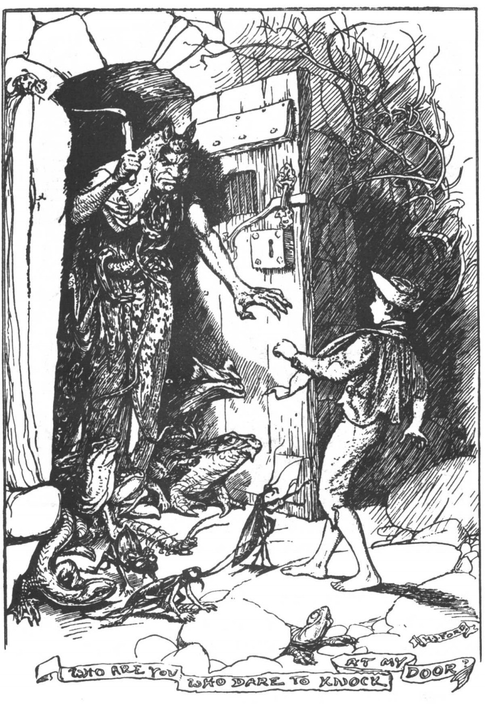

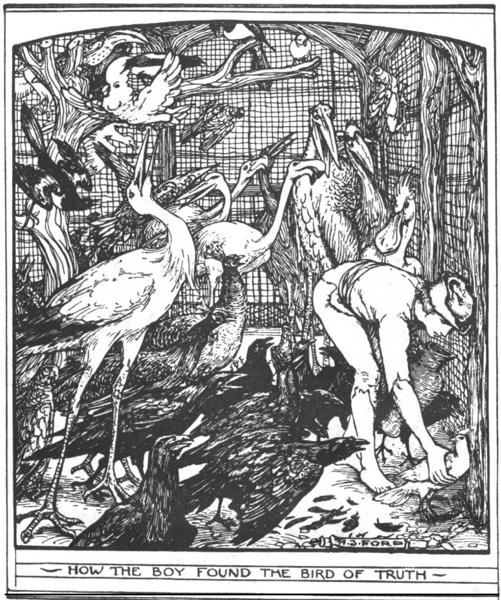

两个钟头以后，他们来到一个高大而阴沉的城堡门前停下，城堡黑乎乎的，门大开着，里面既没有声音，也没有灯光，也不像有人的样子。狗好像早就料到了这一切，狂叫了一声以后，继续向前走。男孩子吃不准现在是不是正好巨人睡一刻钟的时候，犹豫不决地跟在后面。看到一棵野橄榄树，他停下来片刻。这是他离开斑鸠以后看到的，唯一的一棵树。

“啊！上帝！救救我！”他喊道。

“十字架！十字架！”一个声音在回答他。

男孩子高兴得跳起来，他听得出，那是燕子说过的，那只猫头鹰的声音。他用鸟的话轻轻地说道：“啊！智慧的猫头鹰，请保护我，指引我。我是来寻找真理鸟的。首先，我得先把这个瓶子灌满城堡院子里的多色水。”

“不要灌多色水，”猫头鹰回答，“灌多色水旁边的泉水。然后，到大门对面的鸟棚里去。可是要小心，千万不要去碰里面那些羽毛漂亮的鸟，它们个个都会对你叫喊，我就是真理鸟。挑藏在角落里那只白色的小鸟，其他鸟一直都在想杀死它，不知道它是永生的。快去吧！现在正是巨人睡觉的时候，所有的事情，你都得在一刻钟里做完。”

男孩子尽快地跑到院子里去，里面有两股靠得很近的泉水。他跑过多色泉水，连看都不看它一眼，把瓶子灌满另一股又清又纯的泉水。然后，他赶紧跑到鸟棚里。他刚把门关上，鸟叫的声音就令人震耳欲聋。孔雀、乌鸦、鹊的声音一个比一个响，都说自己是真理鸟。男孩毫不犹豫地从它们的身边走过，来到角落里。他要找的小白鸟被一群凶恶的鸟围着。他小心翼翼地把它抱在胸口，向门口走去，后面一大群虚伪鸟叫喊着，跟随着，他不去理睬它们。

到了外面，他一鼓作气跑到巫婆的塔楼，把她要的一瓶水交给她。

“变成鹦鹉！”巫婆把水泼在他的身上喊道。可是，男孩不但没有像以前的人一样，变成动物，反而变得比以前漂亮十倍！因为这是善良的仙水，而不是邪恶的魔水。在巫婆身边爬着的动物看到了，纷纷在水里打滚，然后一个个都变成人站起来。

巫婆看到了所发生的一切，拿起扫帚柄飞走了。

妹妹看到哥哥带着真理鸟回来，谁能猜得出她有多高兴？可是，男孩子虽然已经做了许多事情，还有更加困难的在前面。那就是如何把真理鸟送到国王的面前，而不被邪恶的大臣们发现。他们知道，自己的阴谋一旦暴露，他们就完了。

不久，真理鸟就在王宫上空翱翔的消息传开了，谁也不知道是怎么传开的。大臣们开始想尽各种各样的办法，阻挠真理鸟接近国王。

他们准备好各种锐利的武器，有毒的武器；还放出猎鹰，准备把它抓住；做好笼子，想如果不能杀死它，就把它关起来。他们还扬言，说它的白色羽毛只是为了遮盖它那黑色的羽毛。总而言之，为了阻挠国王见到真理鸟，或者见到以后，也不去理睬它，他们什么办法都想出来了。

事情往往是这样，与大臣们的愿望相反，他们谈论那么多真理鸟，后来终于让国王听到了。国王表示，他想见一见真理鸟。大臣们越是千方百计阻止他，他想见到的愿望就越强烈。后来，国王发出通告，谁要是找到了真理鸟，就应该马上带到他那里去。

看到这条布告，男孩子马上就叫妹妹和他一起到王宫里去。他们把鸟藏在大衣里面。可是，可以想到，大臣们拦住了他们的去路，说小孩子不能进入王宫。男孩说这是遵照国王的命令也没有用。大臣们只是说，国王陛下还在睡觉，不能叫醒他。

他们还在说话的时候，鸟自己出来解决问题了。它飞出来，从开着的窗口飞进国王的房间。它站在国王的枕头上，靠近国王的头，先向他鞠了一躬，然后说：

“我的陛下，我就是你想见的真理鸟。把我带进来的孩子们被大臣阻拦在王宫的门外，所以我只好这样进来见你。”

“他们这样傲慢，要受到处罚。”国王说。他立刻命令随从马上把孩子们带到他的房间里来。不一会儿，男孩子拉着他妹妹的手走进来。

“你们是什么人？”国王问，“真理鸟和你们有什么关系？”

“如果尊敬的陛下愿意听，真理鸟自己会向你解释。”男孩子回答说。

真理鸟开始解释了。国王第一次听到，这个狠毒的阴谋竟然得逞了那么多年。他把自己的孩子们抱在怀里，眼泪夺眶而下。他急忙带着孩子，赶到山上关着王后的塔里。可怜的女人因为终日不见阳光，白得像大理石一样。可是一见到自己的丈夫和孩子，脸上就露出红润，恢复了以往的美貌。

他们一起隆重地返回王宫，到处都响起欢呼声。那些恶毒的大臣都被杀头，财产也全部被没收。至于那对年迈的夫妇，他们得到了尊敬和财富，一直到去世都受到大家的爱护。

（费尔南·卡巴勒罗）

 

## 貂和狼

在北美的一片大森林里，住着许多各种各样的野生动物。它们相互见面的时候，都很客气。可是，尽管如此，它们相互之间都小心地提防着，都怕被别人杀死或吃掉。不过，它们看上去那么文雅，很难猜想到，会发生这种事。

有一天，一只伶俐的小狼出去打猎，它答应祖父母说，天黑睡觉以前一定回来。它快活地在森林里奔跑，来到它最喜爱的地方，这里正是河流的入海处。就像它所希望的那样，一只貂正坐在小船上钓鱼。

“我也要钓鱼！”小狼喊起来。可是貂假装没有听见，一声也不吭。

“我请求你，让我到你的船上去！”小狼用更加响的声音喊叫。它不停地叫着，貂终于感到不耐烦了，才把船划近岸，让小狼跳上来。

“坐在船尾别动！否则船就要翻了！”貂说，“你要是喜欢吃海胆蛋，篮子里有的是。不过你要注意，吃那些白的，那些红的会要你命的。”

狼的胃口总是很好，它贪婪地吃起蛋来。吃饱了以后，它对貂说，它想睡一会儿。

“那好吧！躺下来，头枕在那块木板上！”貂说。狼听它的话，很快就睡着了。这时候，貂走过来，拿起刀对准它的心脏刺过去。狼动都没有动一下就死了。然后，它把船划到岸边，把狼的皮剥了，拿回家去，挂在火炉边烘干。

小狼的祖母在亲戚朋友的帮助下，到处寻找孙子。没过几天，它来到貂的家里买海胆蛋，看到那张皮，马上就猜想到，是它孙子的。

“我知道它死了！我知道！我知道！”它喊叫着，伤心地哭起来，直到貂粗暴地对它说，它的声音那么响，最好到外面去哭，它喜欢安静。于是，老母狼泪眼朦胧地沿老路跑回家，一进门就扑倒在火炉前。

“你哭什么？”老狼和它的朋友问，它们下午待在老狼的家里。

“我再也见不到我的孙子了！”它回答说，“貂把它杀了！啊！啊！”它低下头来，又放声大哭起来。

“好了！好了！”它的丈夫把手放在它的肩上，说，“安静一些，它要是死了，我们就给它报仇！”它把朋友都叫过来，开始讨论最好的办法。它们各有各的办法，商量了很久以后，最后一致认为，老狼应该在家里举行一次盛大的宴会，邀请貂也来参加。为了抓紧时间，它们还一致决定，大家分头去邀请离自己家最近的客人。

狼自以为它们很狡猾，可是，貂比它们还要狡猾。它虽然请路过的白兔给它带个讯，说它很高兴出席，可暗地里却打定主意，要多加小心。它来到平常对它很好的一只老鼠家，深深地向它鞠躬，然后说：“我的老鼠朋友，有件事我想请你帮帮忙。你要是答应，我就整整一个星期，每天晚上背你到山上的玉米地里去！”

“那倒是你帮了我的忙了。”老鼠说，“请说吧！有什么事，我能荣幸地帮你效劳？”

“啊！很容易。”貂回答，“我只是请你从今天起到下一个满月为止，把那些狼家里的弓和桨都咬坏，让它们一用就断掉。不过，你要做得仔细一些，不要让它们看出来。”

“当然，”老鼠回答说，“再也没有比这更加容易的了。只是满月就在明天，时间太紧张了，我得马上就开始。”于是，貂谢过以后就走了。可是没走多远它又回来。

“也许你到狼的家里去找弓的时候，不妨把它们墙板上的孔弄得大一些。”它说，“当然，不要弄得太大，免得引起它们的注意。说不定什么时候会有用。”它点点头又走了。

第二天晚上，貂洗过澡，仔细地梳理一番以后，就赴宴去了。

它注意到一路上留下许多狼的脚印，可是一个客人都看不到，它心中不禁暗暗好笑。它心里明白，这意味着什么，可是，它已经小心地做好了准备，一点也不害怕。

狼家里的门开着，透过门缝，貂可以清楚地看到一群狼挤在角落里。不过，它还是大胆地走进去。它一进屋里，门就砰的一声关上。狼群向它一起扑过来，红色的舌头伸得很长。它们虽然很快，可是貂比它们还要快。它一下子就从墙板上的洞里跳出去，向停在河里的自己的小船飞奔而去。

墙板上的洞对狼来说，太小了。屋子里又有那么多狼，得花一点工夫才能把门打开。接着，它们拿起挂在墙上的弓和箭，跑出去对准飞奔的貂射起来。可是，弓一拉就断，它们只好把弓扔掉，向河边追去。它们的小船都停在沙滩上。

狼虽然跑得比貂快，可是貂先跑，等跑得最快的狼跳上小船的时候，貂的小船已经动起来了。狼把小船推入水中，拿起桨来准备划的时候，桨也像弓一样，纷纷折断，毫无用处。

“我知道什么地方有新的。”一只年轻的狼跳上岸，向一个小山洞奔去。貂听到这句话，不禁心里一沉，它一点也不知道，狼还有一个秘密仓库。

长时间的追逐以后，狼终于想办法把它们的猎物貂包围起来。貂看到再抵抗也没有用了，就宣布投降。一些年纪较大的狼把随身携带的香柏带子解下来。貂看到了轻蔑地笑着。

“我一会儿工夫就可以把它咬断。”它说，“你们要是不想让我逃跑，最好是用海草绳子把我捆起来。”

“你说得很对，”小狼的祖父说，“你比我们聪明。”它吩咐自己的随从去捡来足够的海草，搓一根绳子。因为这种绳子它们没有随身带来。

“搓绳子的时候，你们可以让我跳最后一次舞。”貂又这样说道。那些狼回答说：“那很好！你可以跳。也许我们也能像你一样，高兴高兴！”于是，它们把两条船靠拢。貂用后腿站立，开始跳起舞来。一会儿在这条船上跳，一会儿又跳到另一条船上去。它的舞姿那么优美，连狼也忘记了，它们准备把它处死，高兴地喊叫起来。

“把两条小船分开一点，跳这种新的舞蹈，它们显得太靠近了。”貂停下来一会儿，说道。狼把船分开一些。貂开始做一系列的跳跃。它用一只脚站在小船的船头旋转着。“现在，靠拢一些……现在，分开一些……”它一边跳，一边喊着。“不！还要分开一些！”在一片喝彩声中，它高高地跃入空中，然后头朝下地插入水中。这一下，狼的喝彩声变成了怒吼声。它们到处寻找貂，可是怎么也找不到。它藏在一块岩石后面，直到狼走远了以后才出来。然后，它把自己的家搬到另一片森林里去了。

（《人类学学会杂志》）

 

## 印第安勇士历险记

很久很久以前，在北美洲的西部住着一个老人，他有一个儿子。他们居住的村子周围，覆盖着茂密的森林。森林里住着各种各样的野兽。年轻人常常整天和他的伙伴一起出去打猎，他是整个部落最好的猎手。

冬天降临的一个早晨，年轻人和他的伙伴像往常一样出去，想打一些山羊和鹿回家，以便腌起来，对付暴风雪。森林里一旦刮起大风，飘起雪来，那就得一连几个星期无路可走了。不过，老人和他的老伴不和他们一起去，而是留在家里做些弓和箭。

森林里一会儿就变得冷极了。后来有个伙伴终于说顶不住，不能再往前走了，除非能想办法暖和暖和身子。

“这很容易，”首领说。他向一棵大树踢了一脚，大树的树干立刻迸发出火花来。这些火花还没有烧尽，他们就觉得很热，好像是在夏天一样。他们继续向森林里山羊和鹿最多的地方走去。很快就捕杀到他们想要的数量。首领杀得最多，因为他的箭射得最准。

“现在，我们得把猎物宰了，把肉分掉。”首领说。于是，他们就这样干起来。大家拿好自己的一份以后，一个接一个地走回村去。可是，他们走到一条大河边的时候，老人的儿子嫌麻烦，不想再背着自己的一份往前走。他把肉留在岸边。

“我走另一条路回家。”他对其他伙伴说。他另走一条路，第一个回到家里，而且比其他人早得多。

“你怎么空着手回来了？”老人看到儿子开门进来，问道。

“我什么时候空着手回来过？你怎么会问我这个问题？”年轻人反问道，“我杀死了很多野兽，够我们吃好几个月的了。可是太重了，我把它们扔在大河堤上了。把箭给我，我来把它们做好。你到河堤上去把它们拿回来！”

于是，老人起身到河堤上去，把肉捆好，背到肩上：可是，他在涉水过河的时候，绳子断了，肉掉入河里。他停下来就抓住它们，但都被河水卷走。他还想伸过手去抓，不料失去平衡，自己也被卷入急流中。他的头撞在石头上，沉入水底被淹死了。他的尸体被冲到下游，到水流比较平稳的地方才浮上水面。可这时候，他已经变成一块木头。

木头随波逐流向下游漂去。河水流进另一个国家，河面也越来越宽广。木头被浪头冲到岸边，从一个正在洗衣服的女人身边漂过，被那女人抓住。她自言自语地说着：“多么光滑的一块木板！我要用它来做桌子，好放吃的东西。”她拿着木板，提着衣服就回家去了。

吃晚饭的时候，她把木板搁在从屋顶上挂下来的两根绳子上，把一碗炖得很香的汤放上去。女人劳累了一天，肚子很饿了。她拿起一个最大的调羹，准备舀汤喝。令她震惊和烦恼的是，大碗连同里面的汤，竟然就在她的眼皮底下消失了！

“啊！你这可怕的木板！你给我带来了噩运！”她喊叫起来，拿起木板把它扔出去。

女人看到吃的东西消失，已经吃惊不小；可这一回，她看到自己扔出去的不是一块木板，而是一个婴儿，她更是大惊失色！不过，她很喜欢小孩，自己又没有，所以，她决心把他留下，抚养他长大。这孩子长得很快，比这个国家里任何一个孩子都快。四天里，他就长成了一个大人，像部落里的所有勇士一样，又高大又壮实。

“你对我很好，”他说，“你家里决不会缺肉吃。不过，现在我得走了，因为我还有许多事情要做。”然后，他动身向自己的家乡走去。

一连走了好多天，他才回到自己的家。看到儿子坐在他的位置上，他不禁怒火中烧。心中萌发要报复他的念头。他很快就走到森林里去，开始流泪。每一滴泪水都变成一只小鸟。他对它们说：“留在这里等我来叫你们。”说完，他就回家。

“我在那边的一棵树上，看到一些没见过的美丽小鸟。”他对儿子说。“给我带路，我去把它们抓回来烧菜。”他儿子回答说。

他们俩一起出去。大约走了半个钟头以后，父亲停下来。“就是这棵树。”他说。儿子开始爬上去。

奇怪的事情发生了。年轻人越爬越高，鸟好像也在不断升高。年轻人往下一看，地球也变得像星星一样小了。尽管如此，他还得想办法爬下来，可是办不到。那些鸟虽然再也看不见了，可是他感觉到，好像有什么东西在不停地把他往上拉。

他心里想着，这棵树他已经爬了好几天了。也许一点也没有错。他忽然看到，眼前是一片美丽的田野。金黄色的玉米地一直向天边铺展。令他高兴的是，他已经从树上下来，站在田野里。他在玉米地里走着，也不知道该到哪里去。这时，他听到有敲打的声音。走过去，他看到两个瞎眼的老太婆在用石头敲东西吃。他踮着脚悄悄地走过去。当一个老太婆把饭递给另一个的时候，他伸过手去把它接过来，自己吃掉。

“你做一个饼怎么这样慢！”另一个老太婆终于忍不住，喊叫起来。

“什么，我已经给你了，你还想要什么？”那个老太婆说。

“没有啊！起码我没有拿到！”另一个说。

“我敢肯定你已经拿走了！不过，这里还有一些，拿去吧！”年轻人又伸过手来把它接走。两个老太婆又争吵起来。可是，等这种事情第三次发生的时候，两个老太婆想到了，这里面有问题。

“我敢肯定有个人在这里！告诉我，你是不是我的孙子？”

“是的，”年轻人为了讨好她们，回答说，“为了报答你们给我的好饭，我要看看能不能治好你们的眼睛。我们部落里最好的医生教过我。”说完，他就走开，在田野里到处找，直到找到他要的草药。然后，他急忙赶回来，请老太婆给他烧一些水，他把草药放进去煎。锅里的水一开，他就揭开盖子，再用药水来洗老人的眼睛。果然，她们又重见光明。

在这个国家里没有黑夜，所以，他不像以前在自己家里的时候一样，很早就上床睡觉，而是到外面去散步。一阵哗哗的流水声把他吸引到一条峡谷前，一条大河从峡谷里流过。在瀑布前面，好些鲑鱼在跳跃着，在空中闪着多么明亮的银光！他是多么想抓几条大家伙！可是，两手空空怎么抓呢？在这里，除了两个老太婆以外，他一个人都没有见过。她们似乎很难帮得上忙。于是，他叹了一口气，又回到老太婆那里去。一路上，他忽然想到了一个主意。他拔下一根差不多到他腰部那么长的头发，头发立刻变成将近一英里那么长的结实绳子。

“给我织一张网，我好去抓些鲑鱼。”他对两个老人说。这样，她们就给他织了一张网。一连好多星期，他都守候在河边，只有需要把鱼烧熟的时候，他才回来找老太婆。

终于有一天，在他吃饭的时候，那个总是第一个说话的老太婆对他说：

“我们很高兴见到你，孙子，可现在是你该回家的时候了。”她们把一块石头推开，他看到下面是一个很深的洞。那么深，他根本看不到底。然后，她们从屋子里拿出一个篮子来，在上面结上一根绳子。“进去吧！用这张毯子把你的头包住。”她们说，“不论发生什么事情，除非到了底下，你都不要把它揭开。”然后，她们说了再见，他就用毯子把自己裹住。

向下！向下！向下！篮子不停地往下降，他还会不会停下来？可是，当篮子真的停下来的时候，他忘记了老人关照过的事情，把头伸出来看看是怎么回事。篮子立刻又动起来，可令他恐怖的是，它不是往下降，而是把他向上拉！很快，他就看到了两个老太婆的脸。

“你如果不听我们的话，就永远也见不到你的妻子和孩子！”她们说，“现在，进去吧！在听到鸡叫之前别动！”

这一回，年轻人学乖了。篮子虽然时不时停下来，有些奇怪的东西也好像停在他的头上，拉他的毯子。他把毯子紧紧拉住，直到听见鸡叫的声音，才把毯子掀开，从里面跳出来。篮子立刻在空中消失。

他沿着回家的路飞快地走着。不久，他看到妻子背着小儿子在前面走着。

“看！爸爸终于回来了！”小孩子喊叫起来。他母亲却叫他不要胡说八道。

“可是，妈妈，这是真的，爸爸走过来了！”小孩子又说了一遍。为了说服他，母亲回过头来，可真的看到了她的丈夫。

啊！他们又团聚了，是多么高兴！每当森林里呼呼地刮起大风，门外堆起厚厚的积雪，父亲就常常抱起小儿子，让他坐在自己的膝盖上，和他讲自己在太阳国里抓鲑鱼的故事。

（《人类学学会杂志》）

 

## 斯特罗如何上当

有一天，在北欧拉普兰地区的一间小屋里，一个小男孩手中抱着母亲叫他去捡的柴火回来说：“妈妈，我看到了一个奇怪的人。”

“是吗？我的孩子，他长得怎么样？”母亲问道，一边帮他脱下羊皮大衣，在门口抖一抖。

“嗯，我弯着腰捡树枝觉得累了，就靠在一棵树上休息。这时，我听到地下的树叶传来沙沙响的声音，我想大概是狼来了，就站在那里一动也不动。可是不久，就看到一个身材高大的人从旁边走过。啊！他起码有两个爸爸那么高！他的红胡子很长，穿着一件红色的大衣，腰上束着一根银色的腰带，腰带上挂着一把银柄的大刀，他身后跟着一条大狗，看上去比随便什么狼都壮实，可能连熊都比不上它。可是，妈妈，你的脸色怎么这样苍白？”

“他是斯特罗，”母亲用颤抖着的声音回答说，“吃人的斯特罗！你做得很好！幸亏你藏起来了，否则你永远也回不来了。不过，你要记住，虽然他很高大结实，可是他很笨。许多拉普兰人被他抓住以后，只要耍一些聪明的花招，就可以从他那里逃回来。”

就在母子俩这次谈话以后不久，森林里开始传说，一个名叫帕托的老人的孩子，一个接一个地不见了，谁也不知道他们是到哪里去了！不幸的父亲方圆几英里都找遍了，却一点线索都无法找到，连一只鞋子或一块手帕都没有。后来，有个男孩子说，他看到斯特罗躲在一口井的后面，那里离孩子们经常去玩的地方很近。这个男孩藏在树丛的后面，想看看会发生什么事情。后来他注意到，斯特罗在通往那口井的路上设下了一个圈套，谁要是落入这个圈套，就会掉到井里去淹死。

他躲在那里看的时候，看到帕托的小女儿兴高采烈地沿着这条路跑过来。就在最陡的地方，被一根绳子绊倒，立刻就滚到水里去，正好落入斯特罗的手中。

帕托一听到这个消息，心里燃起怒火。他发誓要报仇。他立刻就取下挂在墙上的老皮袄披在身上，向森林里走去。走到通向井的那条路时，他先很快地看看周围，确定没有被人发觉，然后假装中了圈套，落入井中。不过，他小心地把头抬出水面。

很快，他就听到树叶沙沙响的声音，斯特罗正推开树丛走过来，他要看看今天午餐会吃什么！他一看到帕托的头在水面上，就哈哈地大笑起来：

“哈！哈！今天是一头老驴！不知道他的味道会是怎么样？”他把帕托从井里拉上来，把他背到肩上，就向家里走去。回到家以后，他用一根绳子把帕托捆起来，准备放在火上烤。不过，他得先把箱子做好，以便用来装帕托的肉。那箱子他已经在门外做得差不多了，只需要用斧头来修一修就行了。这点活在家里就很容易做好，所以，他叫一个在家里闲逛着的儿子把斧头拿来。

年轻人东找西找，可就是找不到。原来帕托已经有了好主意，想办法把斧头拿到手，藏在皮袄里了。

“笨蛋！真是废物！”父亲生气地说着。然后，他叫一个又一个儿子去找。可是，谁也没有更聪明一些，没有一个人能找到。

“看来，我得自己去了！”斯特罗把箱子放下，说道。可这时候，帕托已经从钩子上滑下来，躲在门后。斯特罗一跨进来，他的俘虏就举起斧头，朝妖魔的头砍下去。妖魔的头立刻滚到地下。他的儿子看到以后，都吓坏了，都纷纷逃跑。

帕托就这样给死去的孩子们报了仇。

斯特罗虽然死了，可是他的三个儿子还活着，而且没有跑多远。他们来找在牧场里饲养驯鹿的母亲，对她说，不知道是什么魔法的缘故，父亲的头从他身上滚了下来。他们看到以后害怕极了，担心灾难会降临到他们的头上，所以就跑到母亲这里来躲一躲。女妖魔听完以后，什么也没有说。她早就知道，她的儿子是多么笨。因此，她只是叫他们去挤鹿奶，她到另一间房子里去埋葬丈夫的尸体。

离女妖魔牧场上这间房子三天路程的地方，有一间小屋，里面住着姓索得诺的两兄弟和妹妹利玛。两兄弟出去打猎的时候，妹妹留在家里看管着一大群驯鹿。最近，人们都在传说，三个小斯特罗在牧场上出现。可是，索得诺两兄弟毫不在意，似乎危险离他们还远着呢！

不幸的是，有一天，利玛一个人在家的时候，三个斯特罗来了。他们把利玛和所有的驯鹿都抢到自己的家里去。这个地方很偏僻，也许谁也不知道他们是朝哪个方向走了。幸好姑娘急中生智，把一个线团的一头结在后门的拉手上，然后带着线团一起走。当然，线团没有那么长，不能跟她走到底，可是，它在雪地里指出了这条通往斯特罗家的小路。

两兄弟打猎回到家中，看到屋子和鹿棚里都是空空的。他们大声地喊叫着：“利玛！利玛！”没有人回答他们。他们开始四处寻找，看看妹妹会不会给他们留下什么线索。后来，他们终于看到了雪地里的一根线，于是，他们跟着线走出去。

他们不停地向前走，后来，线没有了。两兄弟知道，这里离斯特罗的家有一天的路程。当然，他们不敢大摇大摆地走过去。因为斯特罗兄弟的力气像巨人一样大，而且他们有三个人。索得诺两兄弟爬上一棵枝叶繁茂的大树，从这里可以清楚地看见下面的一口井。

“也许他们会叫妹妹到井边来汲水。”他们说。

一直到月亮升起来，他们的妹妹才走出来。她把水桶放进井里的时候，听到树叶仿佛在轻轻地呼唤着：“利玛！利玛！”

姑娘吃了一惊，抬起头来看，可是什么也没看见。过了一会儿，那声音又开始响起来：

“小心！不要引人注意，继续汲水，同时仔细地听着。我们告诉你怎么办，这样，你和那些驯鹿就可以逃出来了。”

利玛弯下腰来，好像在忙着汲水。

“你知道，”她的哥哥说，“斯特罗家的人只要看到吃的东西掉进一点别的什么，他们就一口也不肯吃了，把它扔了去喂狗。等锅子搁在火上烧，汤快烧开的时候，你就把木柴拿起来，故意让一些灰掉到汤里去。斯特罗家的人很快就会注意到，然后就会叫你把吃的东西拿去喂狗。你就马上给我们拿来。我们已经三天三夜没吃也没喝了。你现在要办的就是这些事。”

利玛提起水桶，拎进屋去。她照他们说的话去做，不久就把吃的东西给他们送来。他们俩都饿极了，一句话也不说，贪婪地吃起来。等到锅子里一滴汤都没有了以后，大哥才开口说：

“仔细地听着我说的话。等斯特罗老大重新烧好晚饭，吃过以后，他就会上床去睡觉。他睡得那么熟，连巫婆也喊不醒他，一英里以外也可以听到他的鼾声。这时候，你就走进他的房间，把他身上盖的铁斗篷拿下来，放到火上去烧。等到差不多烧红以后，你就来找我们，我们再告诉你接下来该怎么办。”

“我什么都听你们的，亲爱的哥哥。”利玛回答说。接着，她就照他们的话去做了。

恰巧这天晚上，斯特罗把一些驯鹿从牧场赶回来，把它们拴在屋子的墙上，以便明天就可以很方便地杀来吃。索得诺兄弟看到了他们在干什么，驯鹿拴在什么地方。等夜深人静以后，他们从树上爬下来，抓起鹿角把它们连在一起。这些动物都吓坏了，开始又叫又踢起来，好像是在打群架一样。声音那么大，连斯特罗老大也被吵醒，这种事情真是从来没有发生过。他从床上坐起来，叫最小的弟弟出去把那些鹿分开，否则它们就会自相残杀。

小斯特罗听他的话，走出屋子。可是，他刚一跨出门口，心脏就被一个索得诺捅了一刀，他一声也没有吭就倒下了。接着，两兄弟又去弄那些鹿。这一回，声音比上一次还要响。斯特罗老大又被吵醒。

“这孩子没有办法把那些鹿分开。”他对第二个弟弟喊道，“出去帮帮他的忙，要不我就没有办法睡觉了。”于是，第二个弟弟出去了。可是他一出来，就被索得诺老大用刀子捅死。斯特罗老大躺在床上，想过一会儿鹿就会安静下来。可是，那些鹿角相互顶撞的响声依旧。他生气地从床上爬起来，一边还嘟囔着：

“它们怎么不能把鹿角分开了，真奇怪！既然没有人能帮它们的忙，只好我自己来了。”

他揉了揉眼睛，站到地板上，伸直两只大手臂打了个哈欠，把墙壁也震动了。外面的索得诺兄弟听到了，立刻就站好位置。一个站在前面的大门口，一个站在后面的小门口。因为他们不知道敌人会从哪扇门出来。

斯特罗伸出手到床上去，想拿他的铁斗篷，他总是把它扔在床上。可是，斗篷不在床上。到哪里去了呢？他感到很奇怪，谁动过它了。他找遍整个房间，看到它挂在厨房的炉火上。他伸过手去拿，被烫得很厉害，只好让它去了。他手中只拿着一根棍子，从后门走出来。

小索得诺早就站在那里等着他了。他刚跨出门，小索得诺就狠狠地给他当头一棒，他一下子就滚到一边去不动了。索得诺兄弟不再去理睬他，他们迅速地剥下两个小斯特罗的衣服，给自己穿上。然后，他们俩坐在那里等天亮，好去找斯特罗的母亲，以便查到他们的宝藏藏在什么地方。

东方刚露出第一道曙光，小索得诺就来到楼上，走进那老妇人的房间。她已经起来穿好衣服了，这时正坐在窗口织衣服。年轻人悄悄地爬过去，蹲在地板上，把头搁在她的衣服下摆上。他安静地等了一会儿以后，用温柔的声音轻轻地问：

“告诉我，亲爱的母亲！我大哥的钱藏在哪里？”

“你这问题问得多怪！这你应该知道的！”她回答说。

“不！我已经忘记了，我的记性不好。”

“他在门下面挖了一个洞，钱就藏在里面。”她说。

沉默了一会儿以后，索得诺又问：“我二哥的钱藏在什么地方？”

“这你也不知道吗？”他母亲惊奇地叫起来。

“啊！是的，我以前还记得。可是自从那次摔跤，头撞了一下以后，就什么也不记得了。”

“他的钱就藏在炉子后面。”

又是一阵沉默以后，年轻人终于又开口问道：“母亲，亲爱的母亲，我真的不敢再问你了！不过我近来真的变得很笨，我把自己的钱藏到哪里去了？”

可是这个问题使老妇人大发脾气。她发誓说，她要是能找到一根棍子，一定会帮助他恢复记忆。幸好她身边没有棍子。过了一会儿，索得诺想办法哄她，让她安静下来。后来她终于对他说，小斯特罗的钱就藏在她的座位下面。

“亲爱的母亲，”这时候，利玛悄悄地走进来，坐在火炉前说，“亲爱的母亲，你知道你在和谁说话吗？”

老妇人吃了一惊，但很快就回答说：

“是我的儿子斯特罗，不是吗？”

“你猜对了！”利玛回答。

斯特罗的母亲想找她的铁手杖，她总是用它来杀人。可是铁手杖不在了，利玛已经把它扔到火里去了。

“我的铁手杖在哪里？”老妇人问。

“在那里！”利玛指着火回答说。

老妇人扑过去抓手杖，可是她的衣服着了火，没有几分钟就把她烧成灰了。

就这样，索得诺兄弟找到了财宝。他们拿着财宝，带着妹妹，还有那些驯鹿，回到了自己的家，成了拉普兰最富有的人。

（《拉普兰人的故事》）

 

## 安德拉斯·贝夫

从前，在拉普兰住着一个镇长，他身体很健壮，长着一双飞毛腿。在他的家乡瓦德瑟镇，每当夏天的夜晚举行赛跑的时候，没有一个人能够追得上他。瓦德瑟的人都为他们的冠军感到骄傲，以为世界上再也没有第二个像他这样的人了。后来，慢慢地有消息传到他们的耳朵里，说是山里有一个名叫安德拉斯·贝夫的人。他的朋友都说，他比瓦德瑟的镇长跑得还要快。当然，瓦德瑟的人没有一个相信，他们说，山里人为了让自己高兴，编了这个谎言，那就让他们去说吧！

冬天漫长而寒冷，镇里的人都在忙着对付狼，没有时间去想安德拉斯·贝夫。可是，在一个严寒的日子里，他忽然出现在瓦德瑟小镇上。镇长很高兴有机会试一试他的力量，立刻就去找安德拉斯，说服他证明一下自己的力气。他一路走过去的时候，看到岸边有一条八桨的船停在那里，脸上立刻露出笑容。“这真是太好了！”他说，“我要叫他跳过这条船。”安德拉斯很愿意接受这个挑战，他们很快就说好了打赌的条件。谁能够跳过去，而且连脚后跟也没有碰到船，谁就算是赢了，将获得一大笔钱作为奖励。于是，在一大群人的跟随下，他们来到了海边。

他们推选一个老渔民出来当裁判，他拿着奖金站在船的旁边看着。外乡人安德拉斯先跳。他退到作为起点，插在沙滩上的一面旗子旁边，然后向前跑过去，头一扬，用力一跳就飞过船去。站在一旁观看的人都欢呼起来。他真是当之无愧。与此同时，他们也心急地等待着看看镇长跳得如何？看！他走过来了，比安德拉斯高好几英寸，但块头也比安德拉斯大。他也跳得很高，跳得很好。可是下来的时候，脚后跟轻轻地擦了一下船边。镇里的人一声不吭，死一般的寂静。只有安德拉斯笑着毫不在意地说：

“只差那么一点，镇长，下一次你一定会跳得更好！”

镇长听了他的对手这轻蔑的话，气得满脸通红，他马上就回答说：“下一次，你就得吃苦头了。”说完他就转过身去，脸色阴沉地走回家。安德拉斯把赢得来的钱放进口袋，也回家去了。

第二年春天，安德拉斯恰巧赶着他的驯鹿沿着大海湾到瓦德瑟的西部去。一个曾经见过他的男孩赶紧去告诉镇长，说他的对头只是在几英里远。镇长把自己打扮成斯特罗，也就是吃人妖魔，然后招呼他的儿子和狗跟着，划船穿过海湾，来到那孩子见到安德拉斯的地方。

这时候，山里人正懒洋洋地在沙滩上散步，心里在想着他盖起来的新房子，这些钱就是靠那天幸运的一跳赢来的。他慢慢地走着，眼睛看着沙滩，所以没有注意到镇长把船划到一块岩石后面，然后把自己变成一堆遇难船只上漂过来的东西。这时，安德拉斯被石头绊了一下，这才回过神来。他回头看到海上漂来的一堆东西。“我的天，也许能找到一些有用的东西。”他说，然后急忙向海边跑去。等着能捞起一些向他漂过来的绳子。忽然，他也说不出是什么原因，只感到一阵莫名其妙的恐惧。他拼命地逃离海边，像是在逃命一样。他跑着的时候，听到了一阵哨子的声音。这种哨子只有像斯特罗那样的妖魔才会用。他心里忽然闪出跳船比赛时，镇长说过的那句话：“下一次，你就得吃苦头了。”所以，他才想到他看到的决不是船上的东西，而是镇长自己。

北极的夏夜里，因为太阳总不下山，人们很难入睡。幸好在以前这些漫长的夜晚里，安德拉斯花了很长的时间来学习魔法。现在魔法对他可就有用了。一听到斯特罗的哨声，他马上就把自己变成鹿，像风一样，一连跑了好几英里才停下来喘一口气，再看看敌人在干什么。他什么也没有看见，可是耳朵里还是听到那哨声从远处穿过平原飘过来，而且越来越近。

安德拉斯不由得打了一个寒噤。这一回，他把自己变成一头小驯鹿。因为第一次退毛的小驯鹿跑得很快，不论是鸟，还是什么野兽都追不上它，所有动物中，要数小驯鹿跑得最快。可是，它还是比不上斯特罗。安德拉斯停下来歇息的时候，他又听到了哨声！

有一会，他的心不禁阴沉下来，甚至准备去死。后来他才想起，离这里不远有两个小湖，一条不长但很宽的河流把它们连在一起。河流的中间有一块石头，平时总是淹在水中，除非是特别干旱的季节才会露出水面。今年冬天雨水特别多，他想，石头的顶端也肯定是浸在河水里，什么也看不见。接下来，如果有人注意看，他就会看到一只小鹿向北边奔跑过去。然后用力一跳，跳到河的中间。可是它没有沉入水底，而是站在水面上，休息一会儿以后，它又用力一跳，一下子就跳到了对岸。然后，安德拉斯跑到一个小山顶上坐下，开始大声地喊叫，好让斯特罗知道他在什么地方。

“啊！你在这里！”斯特罗在对岸出现，喊道，“刚才我还真的以为追不上你了呢！”

“没有那么走运。”安德拉斯伤心地摇摇头，回答说。这时候，他已经恢复了原来的样子。

“嗯！可是我不知道怎样才能抓到你！”斯特罗左顾右盼地说。

“跳过来，像我刚才一样。”安德拉斯回答说，“这太容易了。”

“可是，我跳不过这条河，我也不知道你是怎么跳过去的。”斯特罗回答。

“这种话说出口，你不感到羞耻！”安德拉斯说，“连一个最衰弱的拉普兰孩子也能轻而易举地跳过来，你难道是想对我说，你却办不到？”

正如安德拉斯所希望的那样，斯特罗听到这些话，气得满脸通红。他飞身一跳，可是却掉入河里。不过没有关系，他深谙水性。安德拉斯拿起拉普兰人随身携带的弓和箭，瞄准斯特罗。他是瞄得很准，可惜斯特罗用力一跳，跳入空中，箭从他的脚下飞过。第二箭瞄准他的前额，可是他往旁边一跳，箭从他的大拇指和食指之间飞过。第三箭，安德拉斯瞄准他的头部稍高一点。这样，他跳起来的时候，正好射中他的肋部。斯特罗虽然受了致命伤，但他没有立刻死去。他挣扎着游到岸上，在沙滩上伸着身子，缓慢地对安德拉斯说：

“答应我，你会隆重地把我埋葬。把我的遗体葬入坟墓以后，乘我的船穿过海湾。到我家里去，凡是属于我的东西，你找到的都可以拿走。我的狗你一定要把它杀掉，可是要给我儿子一条活命。安德拉斯。”

说完这些话，他就死了。安德拉斯驾着他的船穿过海峡，找到了那条狗和他的儿子。那条狗看上去又残忍又凶猛，安德拉斯一拳就把它打死了。人们都知道，只要斯特罗的狗舐一下它主人伤口上的血，他就会活过来。这就是为什么真正的斯特罗身边总是跟着一条狗。可镇长只是半个斯特罗，所以他到小湖泊去找安德拉斯的时候，忘了带自己的狗。接着，安德拉斯把所有在船上找到的黄金和宝石放进自己的口袋，再叫男孩子到船上去，然后把船从岸边推开，让它随波逐流而去。

安德拉斯回到家里，用他现在拥有的财宝，买了一大群驯鹿。不久，他和一个有钱人的女儿结了婚，原先他很穷的时候，她的父母不肯把女儿嫁给他。从此以后，他们俩一起过着幸福的生活。

（《拉普兰人的故事》）

 

## 白鞋子

从前有一个国王，他有一个女儿，这一年，她刚满十五岁。她是一个多么漂亮的女儿！

所有那些有女儿的母亲都不得不承认，公主要比她们自己的女儿漂亮和优雅得多了。至于那些父亲，不论是谁，只要偶然看到她一眼，就会整天不停地说她，别的什么事情都忘了。

当然，这个名叫巴兰瑟的国王自从把她从死去的妻子手中抱过来以后，就完全成了他小女儿的奴隶。真的，除了女儿以外，他不知道这个世界上还有什么人值得他去爱。

迪曼蒂娜，这就是公主的名字，在未满十五周岁之前，世界上所有的国家都派人来说亲。但不论是谁，国王都一概拒绝。

王宫后面有一个大花园，它一直伸展到群山脚下。花园里不止有一条河流流过。每天晚上日落之前，公主都在侍女们的陪同下来到这里，采集鲜花去装饰她的房间。此外，她还带来一把剪刀和一个篮子，把那些开败的花剪下来，放到篮子里去。这样，等第二天太阳升起来的时候，就看不到败景了。干完这些以后，她就到城里去走走，让那些穷苦的百姓有机会和她说话，向她诉说心中的烦恼。然后，她会回来找她的父亲，一起商量帮助这些穷人的最好办法。

读者可能会问，这些和白鞋子又有什么关系呢？

请耐心一些，下面你就会看到。

除了女儿以外，巴兰瑟国王还喜欢打猎。他常常每星期花上几个上午的时间，在离城市几英里的山上追逐野猪，那里的野猪很多。有一天，他从山上全速奔跑下来，脚踏在一个洞里摔倒了，接着滚进长满荆棘的岩石坑里。他的伤势并不是很严重，可是手和脚都划破了，脚的伤更加糟糕，因为为了便于奔跑，他没有穿合适的猎靴，只是穿了一双便鞋。

几天以后，国王基本上恢复了健康，划伤的痕迹也差不多看不出来了。可是，一只脚还是很痛，有一根刺扎进去很深，而且伤口已经化脓。国王最好的医生都想尽了办法，他们帮他冲洗伤口，然后敷上药，上绷带，但都没有用，伤口一天比一天恶化，脚一天比一天肿，一天比一天痛。

所有的医生都拿出自己的绝招，可是都没有用，后来，传来消息说，离王宫有些路程的地方，有个神医，他治好过许多最疑难的疾病。打听过以后，他们知道这个神医从来不肯走出自己城市的围墙，病人要想看病，就得亲自去找他。可是，国王答应给他一大笔钱以后，终于说服这个神医亲自出马，到王宫里来。

神医一到，马上就把他领到国王的面前。他仔细地检查了国王的脚。

“天啊！尊敬的陛下，”他检查好了以后，说道，“你的脚已经超越了人能够治愈的范围。不过，我虽然不能治好它，可起码可以减轻你的疼痛，让你走路的时候不会感到那么痛苦。”

“啊！只要你能做到这一点，”国王说，“我就终生感激你。你说吧，他们会照你的话去做。”

“那么，请尊敬的陛下吩咐你的鞋匠，做一双很宽松和舒适的山羊皮鞋，然后，我会涂上一些药膏，这种药膏只有我能配制。”说完，神医就鞠躬退出去了。国王多少天来，还没有今天这样高兴和充满希望过。

国王觉得做鞋和制药膏的日子过得那么慢！好不容易到了第八天的早晨，神医用盒子装着那双鞋子来了，他把鞋子拿出来给国王穿上。在羊皮上，他擦上了一层白色的油膏，像雪一样的耀眼。

“穿上这双鞋子，你就一点也不会感到疼了。”神医说，“因为我在鞋子的里里外外擦上的这层油，除了起到治病的作用以外，还能改善它附着的材料的质量。因此，即使是国王活到一百岁，这双鞋子还是像现在一样新。”

国王性急得不耐烦了，他不等神医给他穿好，自己动手从盒子里把另一只鞋拿出来，迫不及待地把脚伸进去。当他发现自己能像流浪的孩子那样走路和奔跑的时候，高兴得泪水也流出来了。

“我能给你什么呢？”他向创造奇迹的神医举起双手喊道，“留下来吧！我要给你连做梦也想不到的财富。”可是神医说，他只要说好的价钱，多一分也不要。而且，他必须立刻回到自己的国家去，那里有许多病人在等着他。这样，巴兰瑟国王只好满足于用王国的礼仪来招待他，并隆重地护送他回家。

接下来，一连两年太平无事。对于巴兰瑟国王和他的女儿来说，太阳准时升起，又按时落下。国王的生日在六月份，这一年天气特别好。国王对公主说，今年的生日她爱怎么庆祝就怎么庆祝。迪曼蒂娜公主特别喜欢在河里乘船，她很高兴利用这个机会享受一下。她要以前所未有的方式欢庆一番。晚上，等划船和航行累了以后，他们要奏乐，跳舞，游玩和放焰火。最后，等大家都准备回家的时候，每个穷人都可以领到一个面包。还有，今年结婚的姑娘将得到一套新服装。

迪曼蒂娜公主觉得这个伟大的日子来得太慢了。不过，它像所有的日子一样，也终于来到了。当太阳缓缓地从地平线上升起的时候，公主已经激动得在王宫里呆不住了。她走上街头，身上装饰着那么多闪闪发光的宝石，所以，你如果想看她一眼，就得用手遮一遮眼睛。

慢慢地，喇叭吹响了。公主急忙赶回家，但很快就陪她的父亲走出来，向河边走去。那里有一条华丽非凡的船在等着他们。在船上，他们可以看到各种各样的游泳、潜水比赛和表演。等比赛和表演结束以后，船就向上游开去，那里在举行舞会和音乐会。等公主把奖品发给优胜者，把面包和衣服发给老百姓以后，他们就和客人们告别，回到船上，准备返回王宫。

这时，可怕的事情发生了。国王上船的时候，有一只白鞋子已经松了，不巧又被一根高出来的钉子勾住，把国王绊了一跤。一阵巨痛叫他不由自主地晃起了脚，鞋子立刻脱掉，刹那间，这只宝贵的鞋子就落入河中。

事情来得那么突然，谁也没有注意到那只鞋子已经落入水中，连公主也不例外。听到国王的喊叫声，她赶紧向他跑过来。

“怎么啦？亲爱的父亲！”她问。可是，国王没有办法告诉她，只是断断续续地喊着：“我的鞋！我的鞋！”水手们都围拢过来，站在那里看着，心想尊敬的陛下突然疯了。迪曼蒂娜公主看到父亲眼瞪瞪地看着河里，赶紧也朝那个方向张望。只见一个白点在急流中跳动着，他们的眼光随着白点越走越远。国王再也看不下去了。再说，鞋上的膏药没有了，他的脚又像以前一样痛得厉害。他忽然大叫一声，一个踉跄越过栏杆掉入水中。

立刻，河里就浮动着许多人头，他们都以最快的速度，向已经被急流冲得很远的国王游过去。后来，一个比别人身强力壮的人抓住了国王的束腰大衣，把他拖到岸边。上千只手都在准备把他拉上岸去。大家把失去知觉的国王抬到他女儿的身边。公主这时候也因为看见父亲消失在河水里，恐惧得昏了过去。他们俩被送上一辆马车，向王宫驶去。城里最好的医生已经在那里等待着。

几个钟头以后，公主就完全恢复过来了。可是，国王因为落水，惊吓和疼痛，情况越来越严重。一连三天，他高烧不退。与此同时，悲痛得几乎发疯的公主下令，不论多远多难，也要把白鞋子找回来。人们照她的吩咐去做，可是，再高明的潜水好手，也难于在河底看到鞋子的踪影。

事情越来越明白，鞋子肯定是被河水冲到海里去了。迪曼蒂娜开始想别的办法。她派人去找救过父亲的神医，请他尽快地给父亲再做一只鞋，代替丢失的那一只。可是，派出去的人带回来坏消息，神医在几个星期之前去世了，更糟糕的是，他的秘方也和他一起进了坟墓。

这个消息给本来就很虚弱的国王打击太大了。医生们担心，他会像以前一样病倒。谁也无法劝他吃一点东西。整个晚上，他不停地呻吟着。一半是因为痛，一半是因为自己的愚蠢，没有请神医给他多做几打白鞋子，这样万一出了什么问题，也不怕没有这种鞋子穿。不过，慢慢地，他明白唉声叹气和哭泣解决不了问题，于是下令，加紧寻找他失去的宝贝。

在那些日子里，河的岸边是多么壮观！好像全国所有的人都到这里来了。可是，这一次寻找的结果并不比上一次幸运。后来，国王终于发出公告，谁要是能找到丢失的白鞋子，就让他继承王位，而且把女儿嫁给他。

应该说，许多做女儿的不会同意这样来安排自己的终生。必须承认，公主听到这个消息，心里也很不痛快。不过，她那么爱自己的父亲，把他的幸福看得比世界上的任何东西都重要。所以，她也就不再说什么了，只是低下自己的头。

公告公布以后的结果是，河岸上聚集了前所未有的人群。公主的求婚者从四面八方赶来，希望自己能幸运地找到这只白鞋。好多次，河底闪光的石头都被人当成是白鞋捞起来。每天晚上，都可以看到一大帮人像落汤鸡似的垂头丧气地回家去。可是，有一个年轻人总是逗留到最后。到了晚上仍然可以看到他在寻找的身影，尽管单薄的衣服紧裹着他的身体，人冻得牙齿也格格直响。

有一天，国王躺在床上忍受着痛苦，听到前厅传来吵闹的声音。他拉响了床边的一个金铃，把仆人叫进来，问他是怎么回事。

“陛下，”仆人回答说，“吵闹的声音是城里来的一个年轻人引起的。他冒失地到这里来问，是否可以量一量你脚的大小，以便能再给你做一只鞋，代替丢失的那一只。”

“你们对这个年轻人干了些什么？”国王问。

“仆人们把他推出王宫，还揍了他几下，教训他以后别这样不懂礼貌。”仆人回答说。

“那么，他们这样做就完全不对了。”国王皱着眉毛说，“他来这里完全是出于好心，没有理由这样粗暴地对待他。”

“啊！尊敬的陛下，他厚颜无耻地想碰一碰你神圣的身体。他只是一个鞋匠的学徒，也许还是一个无能的孩子。即使他能做出像样的鞋子来，没有能减轻痛苦的药膏还是等于零。”

国王沉默了一会儿，然后说：“没有关系，去把那个年轻人带来见我。只要能减轻我的痛苦，什么办法我都乐意尝试一下。”

于是，过不了多久，他们把走离王宫不远的年轻人带进来见国王。

他是个高个子，而且长得很英俊。尽管他自称是鞋匠，但举止文雅端庄。他低头向国王鞠躬，请求国王不但让他量一量脚的大小，而且让他给伤口敷上一些药膏。

巴兰瑟国王很喜欢这个年轻人的声音和相貌，心想他是认真而且内行的。这样，他就把自己受伤的脚伸出来。年轻人非常仔细地进行检查，然后小心翼翼地敷上药膏。

很快，药膏就减轻了伤口激烈的疼痛。国王越来越有信心，就问年轻人叫什么名字。

“我没有父母，他们在我六岁的时候就去世了，尊敬的陛下。”年轻人彬彬有礼地回答，“城里的人都叫我基格里拉，也就是红雀的意思。因为我小的时候尽管很不幸，我还是走到哪里就唱到哪里。很幸运，我是一个天生快活的人。”

“你真的认为可以治好我的伤吗？”国王问。

“完全有把握，尊敬的陛下。”基格里拉回答。

“你认为要花多少时间？”

“这不是一件轻而易举的事情。不过，我要试试看，在两个星期里治好它。”年轻人回答。

用两个星期的时间去做一只鞋子，国王觉得太长了。不过，他只是说：“你需要什么帮助吗？”

“我只需要一匹好马，如果尊敬的陛下能够仁慈地答应的话。”基格里拉说。这个要求大大地出乎大臣们的预料，他们忍不住都笑了起来。国王注视着他，不作声。

“你会得到一匹马，”过了一会儿他终于说，“我希望你在两个星期里回来。要是答应的事情都办到了，你也知道会得到什么样的奖赏；要是做不到，你就要因为鲁莽而挨鞭打。”

基格里拉躬身退出王宫，一路上受到人们的嘲笑和讽刺。可是他毫不在意，因为他的目的已经达到了。

他等在大门口，直到一匹威武雄壮的马给他送出来，他十分轻松地飞身上马。这使那些随从们感到很意外。他骑着马迅速地奔出城去。许多人听到他那大胆的举动，都围拢过来笑话他。乘他在赶路的时候，让我们来说一说，他是一个什么样的人。这孩子还没有满六岁的时候，父母亲就去世了。他和一生都在研究化学的叔叔过了许多年。叔叔因为自己有一个儿子，所以他没有钱留给自己的侄子，不过，他把自己所知道的一切都教给了侄子。他死了以后，基格里拉找到了一个公职，在那里每天工作许多钟头。空余的时间，他不像其他小孩一样游玩，而是研读书籍。因为他胆子小，又喜欢孤独，所以大家都认为他是一个小疯子。当人们知道他已经答应要治好国王的脚，骑着马到谁也不知道的地方去了以后，全城都纷纷扬扬，挖苦和取笑他，给他编造了不少流言蜚语。

要是他们真的知道基格里拉这个时候在想些什么，他们就会更加以为他真的是疯了。

事实是这样的。在准备游船庆祝国王生日的那一天，公主一早就在马路上散步的时候，基格里拉从自己的窗口看到了她，而且立刻就爱上了她。当然，他知道这是渺无希望的事情。一个药剂师的侄子怎么可能和国王的女儿结婚呢？所以，他尽可能地把她忘掉，比以前更加努力地学习。后来，国王的布告又立刻使他的希望复燃。他有空的时候，不再把宝贵的时间花在书本上，而是到河岸上去徘徊，或者到清澈的河水里去寻找和打捞发光的东西，可惜捞上来的不是白卵石，就是玻璃。

后来他明白了，依靠这条河是得不到公主的。他又到书本中去寻找安慰，比以往任何时候都用功。

有一句谚语说得好：“天下无难事，只怕有心人。”不是所有的人都能知道如何耐心地去等待的，能够不断地总结经验的人更是凤毛麟角。基格里拉就是这样一种人，他不认为自己得不到最想要的东西是虚度年华，而是投身于别的方向。所以，终于有一天，在他感到山穷水尽疑无路的时候，却是柳暗花明又一村。

他恰巧读到了一本已经有几百年历史的书，这本书告诉人们如何去治疗各种疑难杂症。他知道，里面大部分都只是那些上了年纪的女人们想出来的，她们都想证明自己如何比别人聪明。可是，后来他看到了一篇文章，眼睛立刻明亮起来，他马上端坐在椅子上读下去。这是一篇关于一种药膏配方的文章，它可以治好各种各样的伤和肿痛。它是从一种植物中蒸馏得到的。这种植物生长在离这里很远的一个国家，步行的话，来回得花两个月的时间。

书中说到，这种药能够治愈各种各样的伤和肿痛，但也有例外的情况。这种情况书中也有具体的说明。这就是为什么基格里拉在决定是否要给国王治疗之前，要看一看国王的脚。为了得到允许，他自称是一个鞋匠。幸运的是，书中说的绝症他没有看到，想到公主已经不是可望而不可及，他的心不禁激烈地跳动起来。

不错，也许能够得到公主，可是还有许多事情得去做，他只给自己规定了很短的时间。

他只随身携带非要不可的东西。尽管如此，他还是花了六天的时间，才到达这种植物生长的国家。前面就是一片茂密的森林。他把马牢牢地拴在一棵树上，趴在地下寻找他的宝贝。好多次，他都以为找到了，可到头来都不是。不过，到天就要黑，他几乎已经绝望了的时候，他发现脚下一大片都是他要找的植物！他兴奋得浑身发抖，摘下了每一张看到的叶子，装进口袋。然后，他跨上马背，全速地飞奔回去。

他进入城门的时候，已经是晚上。明天就是规定日子的最后一天。他眼皮非常沉重，很想睡觉，浑身都因为长时间的紧张而酸痛。可是他顾不得休息，赶紧生起火来，把罐子装满水，把草药放进去煮起来。然后，他才躺下来舒舒服服地睡觉。

他醒过来的时候，太阳已经大放光芒。他从床上跳起来，向药罐跑过去。那种植物已经不见了，取代它的是浓浓的汤汁，像书上说的一模一样。他把药汁舀出来，放在太阳底下晒，直到它差不多晒干，然后把它装进水晶瓶。

接着，他干干净净地洗了一个澡，穿上自己最好的衣服，把水晶瓶放进口袋，就动身到王宫里去，请求立刻晋见国王。

巴兰瑟国王自从敷上基格里拉的药膏以后，疼痛就好得多了，这时候，他正天天数着基格里拉该回来的日子。听说他已经来了，国王命令叫他马上进来。他一走进房间，国王立刻就从枕头上抬起头来。可是，看到他没有带鞋子来，国王的脸马上阴沉下来。

“你失败了，是不是？”国王绝望地摊开手说。

“但愿不是这样，尊敬的陛下。我想不会吧！”年轻人回答。他从口袋里把瓶子拿出来，在国王的伤口上滴了两三滴。

“这样一连滴三个晚上，你就会看到，伤已经好了。”他说，不等国王谢他就躬身退了出去。

当然，这消息立刻就传遍了全城。男男女女都口口声声地说基格里拉是骗子，预言三天以后，他不是上绞刑架，就是被投进监狱。但基格里拉只把这些粗暴的话当耳边风。国王也不加理睬，只是小心地自己滴药，不让别人帮忙。

到了第四天早晨，国王醒了以后立刻把受伤的脚伸出来。他要证实，年轻人的治疗方法是真的还是假的。这边的伤口是治好了，那边又怎么样呢？啊！是的，也好了。连一点疤痕也没有，根本看不出是受过伤！

国王那么满意，世界上还有哪个国王像他这样幸福吗？

他像一头鹿一样从床上跳下来，开始翻跟斗，做各种滑稽的动作，以证明腿真的是完全好了。等他玩得累了以后，才把他的女儿叫来，吩咐大臣们去把那个幸运的年轻人带到他的房间里来。

“他果真又年轻又漂亮。”公主心里暗暗地想着，她深深地叹了一口气，庆幸不是一个可怕的老头子把父亲的脚治好了。当国王向大臣们宣布，伤已经奇迹般地治好了的时候，公主想，基格里拉穿这些普通的衣服也那么英俊，如果穿上王子的华丽衣服，不知道要好看多少倍！不过，她一句话也不说，安静地站在那里，饶有兴趣地看着那些大臣们对这个药剂师的孩子恭敬而顺从的样子，他们知道，现在木已成舟。

接着，他们给基格里拉送来一件豪华的绿色天鹅绒大衣，上面绣着金边，还有一顶插着三根白色羽毛的帽子。看到他这一身打扮，公主毫不犹豫地就爱上了他。婚礼定于八天以后举行。婚礼以后的舞会上，没有人跳得像巴兰瑟国王那么久，那么好。

 

## 魔术书

从前有一对老两口，佩德和柯尔斯顿，他们只有一个儿子，名字叫汉斯。他还是个小孩子的时候，父母就对他说，满十六岁以后，就得自己到外面去当学徒。于是，一个天气晴朗的夏天的早晨，他走出家门，到外面去寻找自己的幸福，除了身上穿的衣服以外，他什么都没有带。

一连好多个钟头，他愉快地走着，不时停下来喝一点清澈的泉水，或者摘树上成熟的水果吃。那些小动物从树丛里探头探脑地看着他，他也笑着朝它们点点头，祝它们早上好。走了一些时间以后，小路对面走过来一个长着白胡子的老人。年轻人没有给他让道，老人也不准备这样做，于是，两个人撞了个满怀。

“我认为，”老人说，“年轻人应该给老年人让道。”

“路是你的，也是我的，大家都一样。”小汉斯粗鲁地回答，他没有受过应该讲礼貌的教育。

“嗯！那倒也是真的！”老人和气地回答，“你要到哪里去？”

“我去找活干。”汉斯说。

“那么，你可以到我这里来干活。”老人说。

汉斯说可以，可是工钱给多少呢？

“一年二十元，只是打扫一些房间，没有什么别的活。”老人说。

汉斯觉得这很容易，于是就同意了，他们一起走。后来他们穿过一个很深的峡谷，来到一座大山前。老人打开一扇地板门，叫汉斯跟着他。他们爬进去以后，就沿着一条很长的台阶走下去。走到底以后，汉斯看到许多房间，有许多灯把房间里照亮，里面放满了漂亮的东西。他在观看着四周的时候，老人对他说：

“现在，你该知道干什么了吧！你每天都得把这些房间打扫干净，然后在地板上撒上沙子。这里有一张桌子，上面有你吃不完，喝不尽的东西。那边是一张给你睡觉的床。你也看到了，墙上挂着许多衣服，随便你穿。可是你要记住，千万不要打开那些锁着的门，否则你就要倒霉。再见吧！我又要出门了，也说不准什么时候会回来。”

老人走了没多久，汉斯就坐下来美美地吃了一顿饭，然后就上床睡觉，一直睡到第二天早上。开始，他想不起来发生了什么事情。过了一会儿，他从床上跳起来，去仔细地察看每一个房间。“叫我把沙子撒在地板上，这个主意太愚蠢了！”他心里想着，“这里除了我以外，再也没有别人了，我才不干这种事呢！”于是，他很快地把其余房间的门关上，只打扫和整理自己的房间。

过了几天以后，他觉得这也是多余的，因为没有人来看房间是不是干净。到后来，他什么事也不干，只是坐在那里想着，那些锁着的门后面有些什么？终于，他决心要亲自去看一看。

锁轻而易举地被钥匙打开。汉斯走进去，不免为自己的行为感到有些心惊胆战。开始，他看到了一堆骨头，这使人感到不愉快。就在他准备走出去的时候，他看到了一个书架。他很喜欢读书，心想这倒是消磨时间的好地方，他从书架上拿下一本书来。里面讲的全是魔术，告诉你怎样把自己变成你喜欢的，世界上的一切东西。还有什么比这更有用，更令人兴奋的吗？于是，他把书藏进口袋，从一扇开着的小门跑出去，很快地跑出山里。

回到家里以后，父母问他都干了些什么，身上穿的这身好衣服是从哪里来的？

“嗯！是我自己挣来的。”他回答说。

“这么一点时间里，你不可能挣得到这么多！你滚吧！这里不会留你，我家里没有人做贼！”

“好吧！我只是想来帮助你们。”年轻人悻悻地说，“现在我要走了，像你希望的那样。明天一早，你起来以后，就会看到门口有一条大狗。不要把它赶走，把它拉到城堡里去卖给公爵，他们会给你十元钱；只是你别忘了把拴狗用的皮带拿回来。”

事情果真如此，第二天，门口站着一只狗，等着他们牵进来。老人很怕惹麻烦，可是他妻子怂恿他像儿子关照的那样，去把它卖掉。这样，他就把狗牵到城堡里去卖给公爵，得了十元钱。他没有忘记把拴着狗的皮带解下来，带回家。回到家里，他的妻子正站在门口等他。

“喂！佩德，你把狗卖掉了吗？”她问。

“是的，柯尔斯顿。我带回来十元钱，正像那孩子说的一样。”佩德回答说。

“啊！那太好了！”妻子说，“现在你看到了吧！听好人的话不会错。要不是我，你早就把狗也给赶走了，我们就一分钱也拿不到了。归根到底，我总是分得清好歹。”

“胡说八道！”丈夫说，“女人总是自以为是，不管你是不是对我说，我都会把狗拉去卖掉。把钱拿去放好，别唠唠叨叨说个没完。”

第二天，汉斯又回来了。尽管一切都像他说过的那样，他发现，父亲还是不满意。

“你滚吧！”他父亲说，“你会给我们带来麻烦！”

“我给你们的帮助还很不够。”年轻人说，“明天，会有一头很大的母牛到这里来，像我们的房子一样大。把它带到国王的王宫里去，你可以得到一千元钱；只是，你一定别忘了把套母牛的缰绳解下带回来，还有回来的时候不要走大路，要穿过森林回来。”过了一夜，老两口起来的时候，看到一个很大的头在他们卧室的窗口朝里面观望，原来是一头大母牛，几乎像他们的房子一样大。柯尔斯顿想到这头母牛会给他们带来那么多钱，高兴得发疯。

“可是，你怎么用缰绳来套住它的头呢？”她问。

“你等着瞧吧，老太婆。”丈夫说。佩德把爬到干草堆上去的梯子拿来，架在母牛的头颈上，然后爬上去，用绳子把它的头套住。等他肯定牛鼻子已经牢牢地套紧以后，就动身到王宫里去，看到国王正在散步。

“我听说公主就要结婚了，”佩德说，“我给尊敬的陛下带来了一头母牛，它比我们见到过的任何一头母牛都要大，尊敬的陛下想不想屈尊把它买下？”

说实在的，国王从来没有见过这么大的牲口。他乐意地付给了佩德一千元钱的开价。佩德离开之前，没有忘记解下缰绳带回去。他走了以后，国王把屠夫叫来，告诉他把母牛杀了，用来办婚宴。屠夫把屠牛斧拿出来，可是，就在他挥起斧头准备砍下去的时候，母牛变成一只鸽子飞走了。屠夫像石头人似的，站在那里呆呆地看着它飞走。可是，鸽子看不见了，他只好去向国王报告发生的事情。国王立刻派出传令兵，叫他们去把老头子抓回来。可是，佩德从森林里走回去很安全，他们找不到他。等他觉得危险已经过去以后，他才回到家里。柯尔斯顿看到他带那么多钱回家，高兴得几乎要昏过去。

“现在，我们有钱了，应该盖一间大房子。”她说。可令她烦恼的是，佩德只是摇摇头说：“不行，要是我们这样做，人家就会说我们的钱来路不明。”

过了几天，汉斯又回来了。

“你走吧，免得给我们惹麻烦。”他父亲说，“现在，钱也足够了，可是我也不依靠它。”

“用不着担心，父亲！”汉斯说，“明天你会看到门口有一匹马，骑着它到市场上去卖，你会得到一千元钱。只是把马卖掉以后，别忘了把缰绳解下来。”

早晨，他们果然看到了那匹马。柯尔斯顿从来没有见过这么好的马。“小心，别让它伤着你了，佩德！”她说。

“胡说八道，老太婆，”丈夫没好气地回答，“我还是个小伙子的时候，就和马打交道了。不论是什么马，都能骑上它跑二三十里地。”可这些话有点吹牛，他至今从来没有骑过一匹马。

幸好那匹马很温顺，他太平无事地骑着它来到市场。有人愿意出九百九十九元来买，可是佩德说什么也要一千元，少一分也不行。后来，来了一个长着白胡子的老人。他看了看那匹马，愿意把它买下。可是他一碰到马，它就又是踢，又是跳。“我得把缰绳拿掉，”佩德说，“通常它是不和牲口一起卖的。”

“我给你一百元，把缰绳买下。”老人把钱包拿出来，说。

“不！我不卖！”汉斯的父亲说。

“五百元！”

“不卖！”

“一千元！”

价钱这么高，精明的佩德终于同意了，让这么多钱白白地放过，那就说不过去了。可那匹马变得很不听话起来，他几乎拉不住它。于是，他把马交给老人，自己带着二千元钱回家。

柯尔斯顿对这么好的运气当然感到非常高兴，她坚持要盖新房子，买一些地。这一回，佩德同意了。不久，他们就有了一个很好的农场。

这时候，老人骑着他刚买来的马来到铁匠铺，他要铁匠给他打马掌。铁匠提议说，他们先一起喝一杯，马就把它拴在井旁边，他们一起走进屋。这一天，天气很热，两个人都觉得口干，再说，他们都有许多话要说。所以，几个钟头过去了，他们的话还没有说完。这时，一个女佣人出来提水。她是个好心肠的姑娘，把水给马送过来，让它喝。令她吃惊的是，马开口对她说：“你把我的缰绳解开，就救了我一命！”

“我不敢，”她说，“你的主人会大发脾气的。”

“他不会伤害你的。”马回答，“你可就救了我一条命。”

听它这么一说，她就把缰绳拿掉。可是，当她看到正好老人出来的时候，马变成一只鸽子飞掉，她吃惊得差一点儿昏过去。老人看到发生的事情，马上变成一只鹰，去追那只鸽子。它们飞过森林，飞过田野，来到了国王四面都是美丽花园的王宫里。公主和她的侍女正在玫瑰花园里散步，鸽子变成一个金戒指，掉在她的脚下。

“啊！这里有一个戒指！”她喊道，“它会是从哪里来的呢？”她把戒指捡起来，套在自己的手指上。这样一来，山里的老头对汉斯就毫无办法了。当然，说到这里你已经知道，那些狗、母牛、马和鸽子都是他变的。

“啧！真是太奇怪了，”公主说，“正好合适，好像是给我做的一样。”

就在这个时候，国王走进来了。

“看！我找到了什么！”他女儿喊道。

“嗯！这值不了多少钱，亲爱的女儿。”国王说，“再说，我想你有的是戒指。”

“那又有什么关系呢！我喜欢它。”公主回答。

可是，等她只有一个人的时候，戒指忽然从手上褪下来，变成一个男人。这使她大吃一惊。你可以想象，她被吓成什么样，这当然不奇怪，人人都会这样。可刹那间，那人又变成戒指；然后一会儿又变成人。这样变来变去以后，公主也就习惯了。

“我很抱歉吓着你了。”汉斯感到可以安全地和公主说话，她不会吓得尖叫起来以后，这样对她说，“我是到你这里来逃命的，因为我得罪了一个山里的老人。他千方百计想杀我，只有你这里，我才是安全的。”

“那你最好就留在这里吧。”公主说。于是，汉斯就留了下来。他们俩成了好朋友。当然，只有在没有别人的时候，汉斯才会变成人。

一切都很顺利。可是有一天，正当他们一起说话的时候，国王走了进来。尽管汉斯很快地变成戒指，国王还是看到了。

国王的愤怒可怕极了。

“这就是你为什么总是拒绝那些来求婚的国王和王子？”他喊叫道。

他不容女儿开口说话，就命令把她和她的情人一起关在凉亭里，用墙封死，叫他们活活地饿死。

这天晚上，公主带着那只戒指，被关到凉亭里，只给她送来够吃三天的东西，接着，就用砖头把门封起来。过了一两个星期以后，国王想不管她的行为多么不规矩，还是应该给她举行一个隆重的葬礼。他命令把凉亭的门打开。可是，他几乎不相信自己的眼睛，里面不见公主，也不见汉斯。只见脚下有一个很大的洞，两个人足以通过。

原来，事情是这样的：

公主和汉斯感到没有希望以后，就躺在地下准备等死。这时，他们忽然掉进这个洞里。这个洞一直通到地球的对面。这样，他们就掉到了世界另一头用黄金筑成的一座城堡里。他们在那里生活得非常幸福。当然，这些事情国王一点也不知道。

“谁愿意下去，看看这个洞通到什么地方去？”国王转过脸来问他的随从和卫兵，“谁要是能勇敢地去探个明白，我就重赏他。”

好长一段时间，没有一个人回答。那洞又黑又深，如果说有底的话，谁也看不见。后来有一个士兵，他也是一个天不怕，地不怕的人，说愿意效劳，然后小心翼翼地向黑呼呼的洞里走去。不过，他立刻就身不由己地掉下去了。掉啊！掉啊！他心里想着，看来是永远也不会有尽头了。啊！谢天谢地，终于到头了。他走进城堡，看到了公主和汉斯，他们看起来那么好，一点也不像挨饿的样子。他们开始说起话来。士兵告诉他们，国王很后悔这样对待自己的女儿，日日夜夜都盼望着她能够回来。

后来，他们一起乘船返回自己的家乡。到达公主的国家以后，汉斯把自己打扮成邻国的君主，独自到王宫里去。他受到了国王热烈的欢迎，国王很为自己的好客而感到骄傲。晚上，他设宴招待自己的客人。宴会上，他们一起喝酒的时候，汉斯问国王：

“我早就听说，国王的智慧名扬四海，我远道而来就是向你请教：在我的国家里，有个人因为自己的女儿爱上了一个农民出身的青年，就把她活埋了。应该如何处罚这个没有人性的父亲？因为这件事得由我来作出决定。”

国王这时候还在为失去女儿而深感悲痛，他不加思索地回答说：“把他活埋，把他的骨灰撒遍全国。”

汉斯目不转睛地看了他一会儿，然后脱下他的伪装。

“你就是这个人！”他说，“我就是爱上你女儿，变成她手上的金戒指的人。她平安无事，在离这里不远的地方等着。可是，你已经对自己做出了判决。”

这时，国王跪下来请求饶恕。鉴于他在其他方面都是一个好父亲，他们就宽恕了他。汉斯和公主举行了非常隆重的婚礼，庆祝活动一直持续了一个月。至于那个山里的老头，他也想来参加。他走在通往王宫的路上的时候，一块松动的石头掉下来，正好落在他头上，把他砸死了。从此，汉斯和公主过着太平和幸福的日子。老国王去世以后，他们就继承了他的王位，继续治理国家。

[^1]: 原书有 32 篇，漏掉了第 19 篇《巨人的三件宝物》（The Three Treasures of the Giants），原本排在《狐狼小儿子的冒险故事》和《平原上的流浪者》之间，此处按原书风格补译。
[^2]: 马卡玛的战斗被全部删除，这里按英文补上，下一段里他们的战斗时间 hour by hour 被错译为一个多钟头，这里修正。
[^3]: 丢掉了 wine。
[^4]: 原翻译将惩罚的净化作用抹去了。
[^5]: 中文版误译为“收藏”。
[^6]: 补译。
