<h1>安德鲁·朗格彩色童话全集</h1>

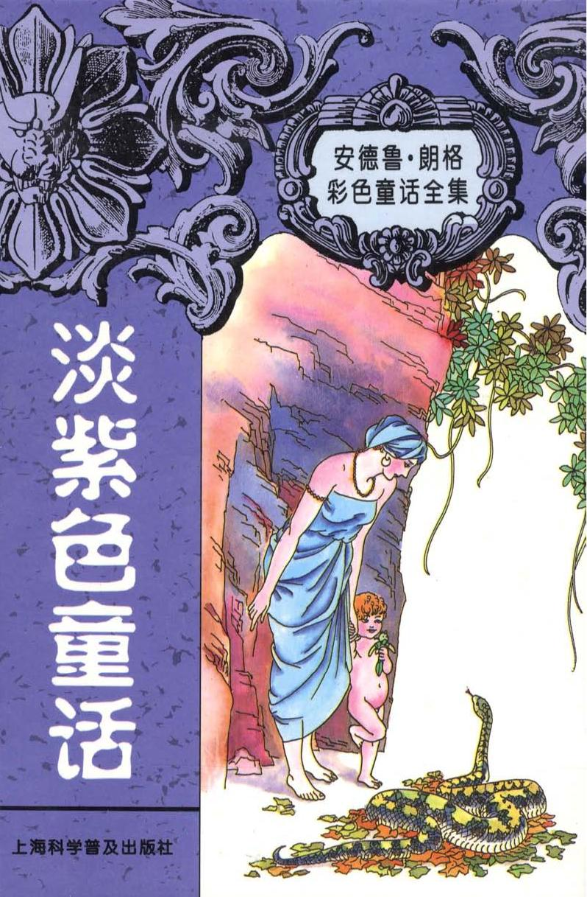

**安德鲁·朗格彩色童话全集**
淡紫色童话

陆益 陈新译

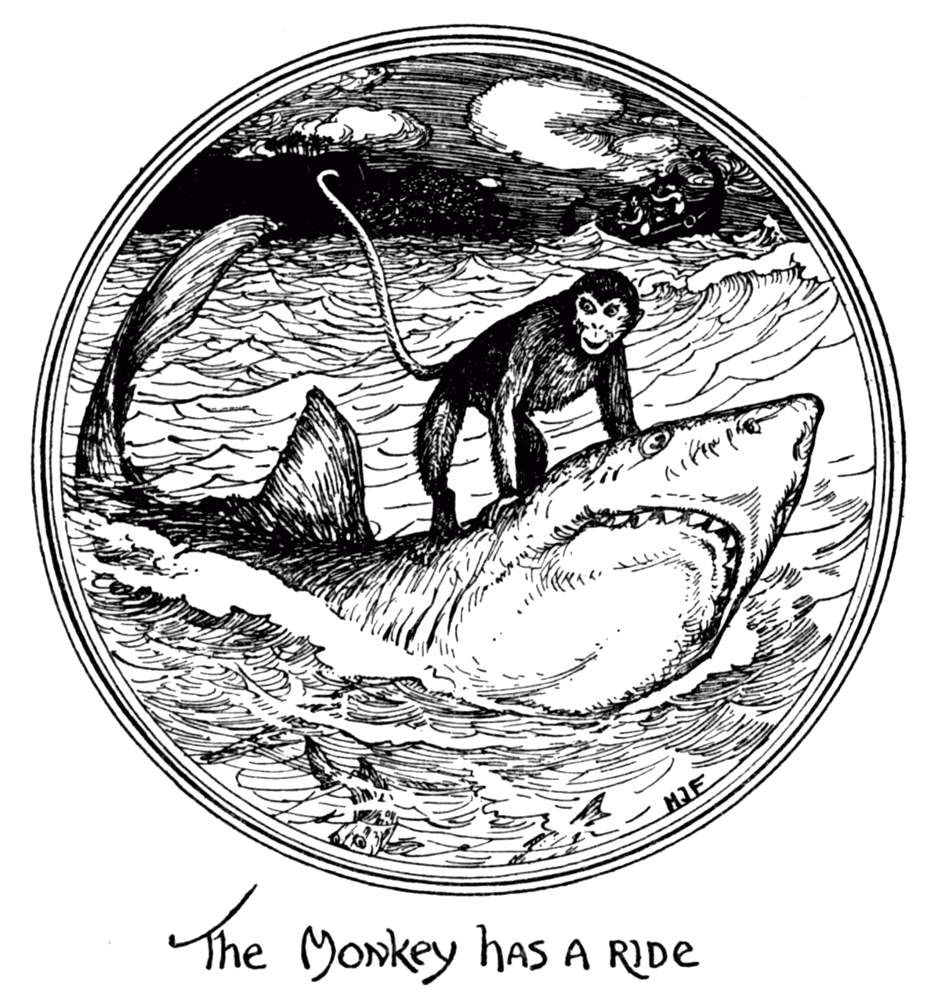

上海科学普及出版社

（沪）新登字第 305 号

Edited by Andrew Lang
The Lilac Fairy Book

Published by Longmans, Green, and Co. in 1901

---

安德鲁·朗格彩色童话全集
**淡紫色童话**

陆益 陈新译

---

责任编辑：钟海谷
技术编辑：万福棠
出版：上海科学普及出版社（上海曹杨路 500 号邮政编码 200063）
发行：新华书店上海发行所
印刷：上海新四印刷厂
开本：850×1168 1/32
印张：9
插页：4
字数：218000
版次：1997 年 7 月第 1 版 1997 年 7 月第 1 次印刷
印数：1—8000
书号：ISBN 7—5427—1200—4/G·345
定价：14.00 元

---

（本版图书凡印刷、装订错误可及时向承印厂调换）

| 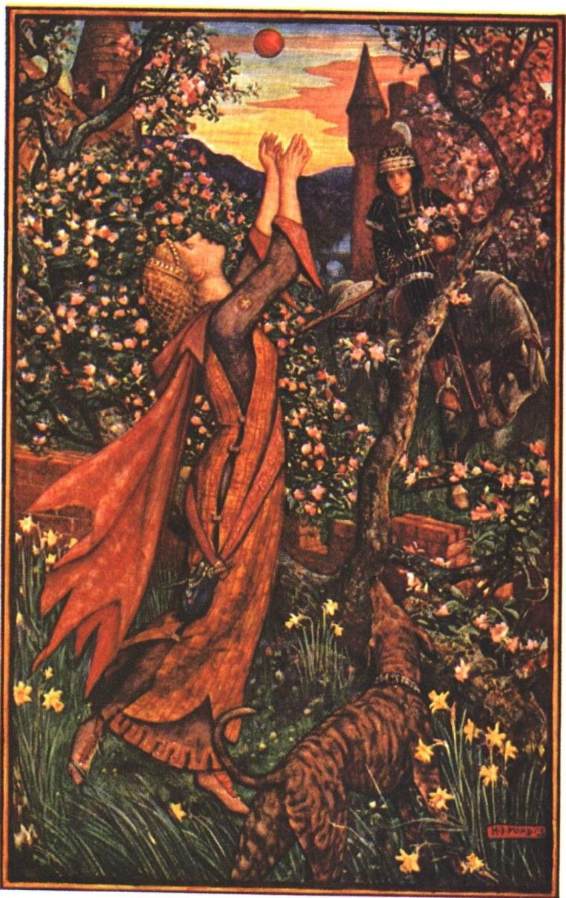 |
| :------------------------------: |
|           《真假王子》           |

 
 

| 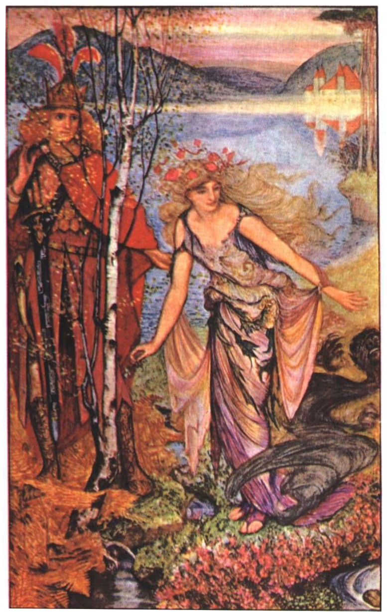 |
| :------------------------------: |
|       《和妖精玩牌的国王》       |

 
 

| 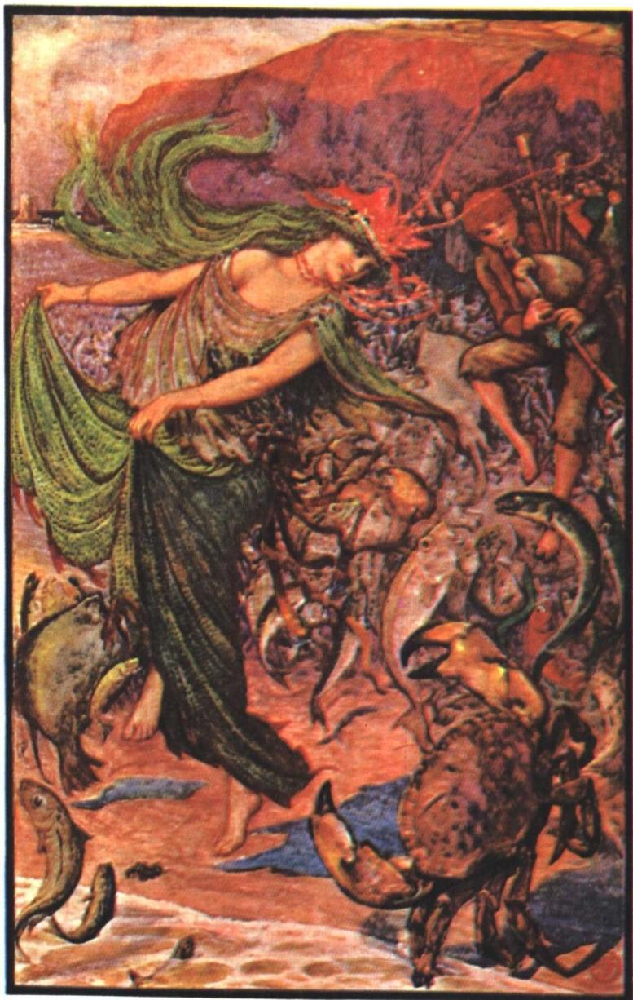 |
| :------------------------------: |
|          《神奇的曲调》          |

 
 

| 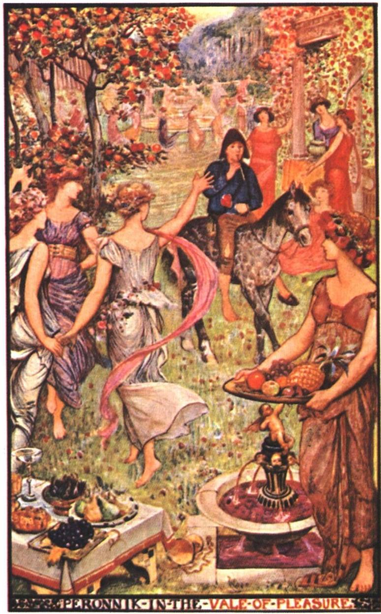 |
| :------------------------------: |
|         《凯哥拉斯城堡》         |

 
 

| 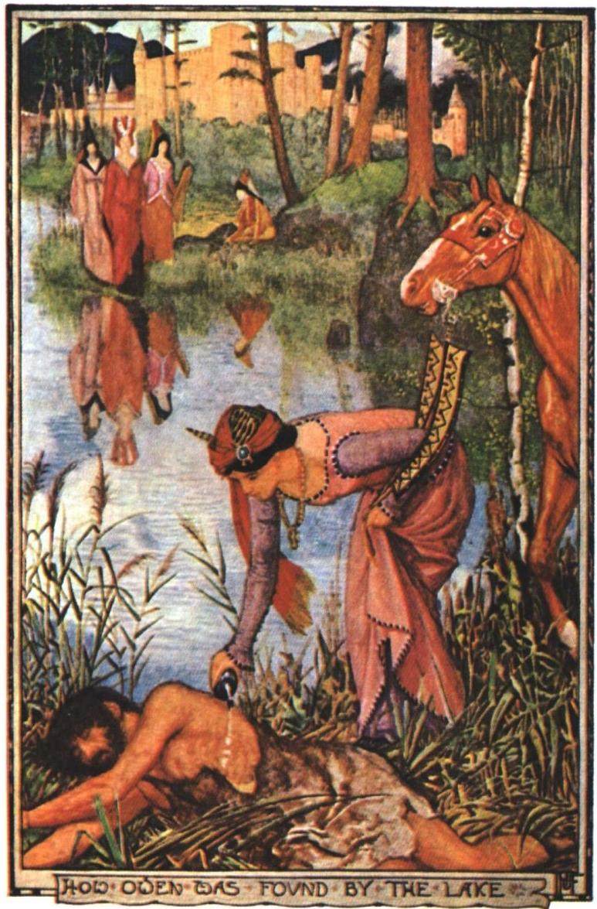 |
| :------------------------------: |
|           《喷泉夫人》           |

 
 

| 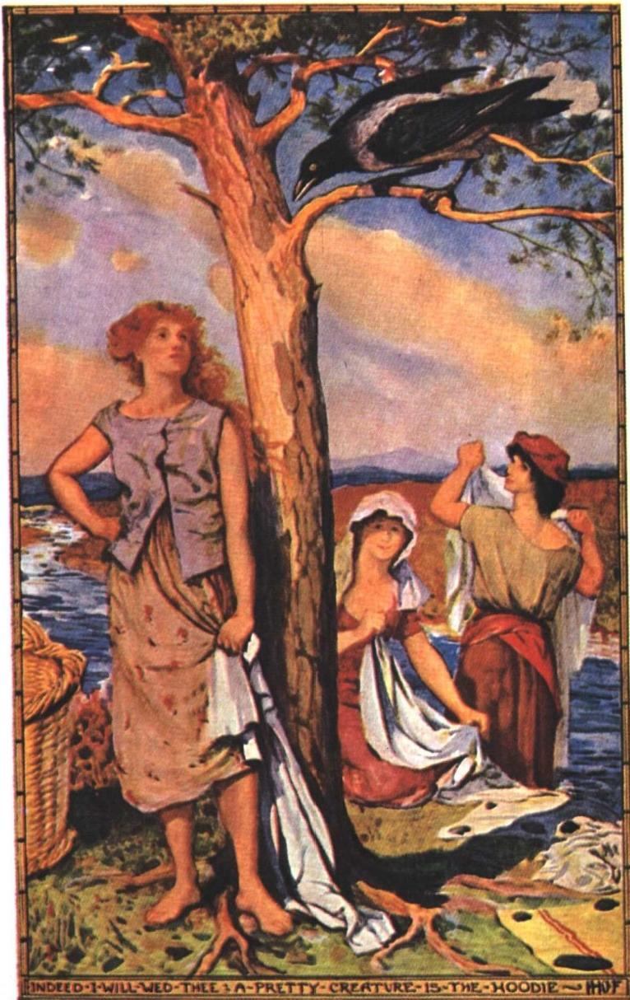 |
| :------------------------------: |
|             《冠鸥》             |

 
 

| 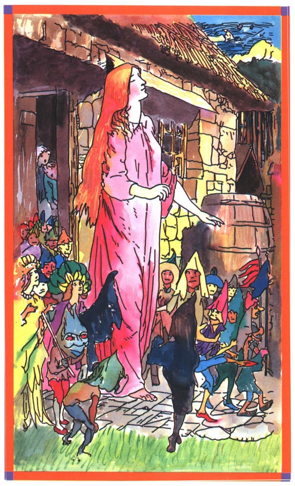 |
| :------------------------------: |
|          《妖精的保姆》          |

 
 

| 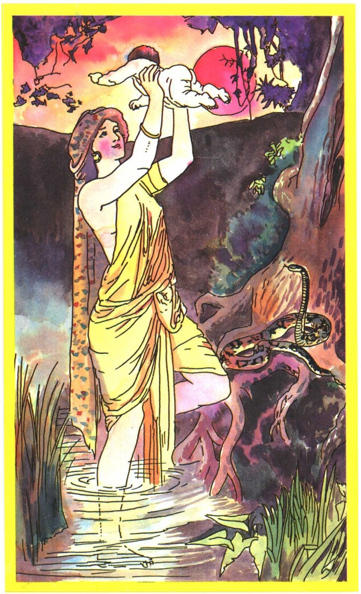 |
| :------------------------------: |
|         《一只手的姑娘》         |

 
 

前言

《安德鲁·朗格彩色童话全集》是英国著名文学家安德鲁·朗格（1844～1912）编辑的 12 集童话。为了编辑这些童话，他广泛地收集英国、欧洲以至全世界的童话和民间故事。那些非英语的文字，如法文、德文、葡萄牙文、意大利文、西班牙文、加泰隆语等主要由他的妻子莱奥诺拉·布朗歇翻译和整理成英文。最先编成一集，当时编者的意图也是只编这一集。后来搜集的材料越来越多，才决定继续再编三集。其中的艰难和辛苦是外人所难以想象的，编者因此曾发誓，编成这四集以后，再也不编下去了。

四集童话的出版，效果非同凡响。不仅受到英国读者的欢迎，而且被译成多种文字，受到许多国家读者的欢迎，经历了一代又一代的读者，历数十年而不衰，这不仅源自编者长期的努力，也得益于世界各地广大热衷于这一题材的读者的帮助，他们纷纷把手头的作品和资料寄给安德鲁·朗格。这给了他极大的鼓舞，他一鼓作气，又编了八集。后面几集主要搜集了苏格兰、爱尔兰、加拿大、印度、葡萄牙、斯堪的纳维亚的民间故事和传说。有些从以神话、民间传说和英雄传奇为基础的中世纪威尔士故事集《马比诺吉昂》中选出。

安德鲁·朗格认为，这些童话故事很难说是某个人写成的，它们从很久很久以前就流传下来，经过民间艺人和文学家的不断收集和整理，才达到了今天这样思想性和艺术性都比较好的程度。这些童话也被认为是英语中，也许是全世界各种语言中时间跨度最大、包含地域最广、国家和地区最多、内容最丰富的童话集。

她是世界古典童话中的瑰宝，童话世界中永不凋谢的鲜花，被译成多种文字，得以广泛流传，一代又一代的儿童被她的魅力吸引，做家长后，又为能给孩子朗读和讲述安德鲁童话而自豪。

《淡紫色童话》主要收集苏格兰、爱尔兰、法国、葡萄牙、斯瓦希里、阿富汗和澳大利亚等国家和地区的民间故事和传说。这些故事有的讲述一个从小聪明的孩子，为何不听母亲的话，不好好学习一门手艺，借以谋生，却专门去干盗窃和诈骗的勾当。他尽管得意于一时，最后还是落得死于非命；有的故事讲述一个小男孩老是喜欢吹牛，到头来自己吃尽了苦头；有的故事讲述兄弟姐妹之间，老实忠厚的开始总是被人欺负，受尽折磨，后来在主持正义的人们帮助下，终于得到了应有幸福。这本童话集还从以神话、民间故事和英雄传奇的基础的，中世纪威尔士故事集《马比诺吉昂》中选了几篇精彩故事。亚瑟及其骑士助人为乐的豪爽性格和英雄们追求理想的不屈不挠的精神感人至深。

这些美丽的童话故事为我们展现了很久以前，这些地区的人民是怎样生活的，展现了他们的欢乐和悲伤、理想和追求；颂扬了勤俭朴素、助人为乐、正直忠诚；谴责了贪得无厌、懦弱无能、奸诈狡猾。

与《安德鲁·朗格彩色童话全集》中的其他各集一样，《淡紫色童话》中的故事充满了当地的风土人情和乡村气息，展现了从冰雪覆盖的北方到赤日炎炎的南方的美丽风光。小朋友们可以从中领略到许多乐趣，懂得什么是正义，什么是邪恶；什么值得爱，什么该去恨；而且还会对这些地区的人文历史和地理概貌有所了解，从而更加热爱生活，热爱他们这个世界。

 
 

**目录**

[TOC]

 
 

## 狡猾的男孩

从前，在一个叫埃里恩的地方住着一个寡妇。她只有一个儿子，他是一个聪明的孩子。因此，她省下足够的钱送他去读书，准备等他长大以后，送他去学任何他愿意选择的生计。但是，他却说，他不愿做任何事情，他要去做贼。

母亲听了以后非常悲哀。她十分明白，假如阻止他，那只会加强他的决心。所以她所能做的只是说，做贼的人要被吊死在达布林桥上。她决定不管他了，希望他成熟以后会明白事理。

有一天，她要到教堂去听一个有名的神父讲道，她求儿子一起去。他却冷笑着说，他不喜欢听讲道，还说，“我答应你一件事，你从教堂回来以后听到的第一件事情，就是我的职业。”

这些话给可怜的母亲带来一丝安慰，觉得心情比以前好了一些，她和儿子告别以后就走了。

狡猾的男孩估计讲道快要结束时，就在从教堂回家的小路旁边的丛林中藏起来。他母亲从这里经过，正想着所听到的那些美好事情时，一个声音突然在她耳边响起：“偷！偷！偷！”这突如其来的声音吓了她一跳。那声音装模作样，所以她听不出这是儿子的声音。男孩躲藏得很好，她左顾右盼也找不到喊叫的人。她一转弯，男孩马上就穿过丛林，飞跑回家。她到家时，他正舒服地在火炉前伸着脚。

“你有什么消息要告诉我吗？”儿子问。

“没有什么。一结束我就离开教堂，也没有停下来和谁说过话。”

“哦！也没有人和你说过什么生计！”他以失望的声音说道。

“嗯！”她慢慢地回答，“是这样，我回来的路上有个声音在叫喊：偷！偷！偷！也不过就这样。”

“那就够了。”男孩说，“我跟你说什么来的？那就是我的生计。”

“那样的话，你会在达布林桥上被吊死。”她说。这一晚上，她通宵睡不着，在黑暗中想着儿子的前途。

“假如他要去做贼，就要做一个有本事的贼。谁能来教他呢？”她自问自答。她想出了一个主意。第二天一早她就起来。太阳还没出来，她就赶到“黑无赖”、又叫“黑绞台鸟”的家里去。这是一个神奇的贼，所有的人都被他偷过，但是没有人能抓住他。

“你早！”她一到黑绞台鸟的家中就和他打招呼，这时他还没有出去做他的生计。“我儿子想学你的生计，你能不能好心教他？”

“假如你儿子聪明，我试试也可以。”黑绞台鸟说，“当然了，要是有人能把他教训成第一流的贼，那就是我了。但如果他人笨，我也无能为力，我最讨厌笨蛋。”

“不！他不笨。”女人叹息着说。“那么，今天晚上天黑以后，我就把他送来。”

回家后，她告诉儿子到什么地方去过时，他高兴得跳了起来。

“我一定要成为全埃里恩最好的贼！”他叫道。她母亲摇着头，嘴里咕噜着什么“达布林桥”时，他全不在意。

每天晚上天黑以后，这个狡猾的男孩就来到黑绞台鸟的家，学了许多狡猾的诡计。慢慢地，他被允许和黑鸟一起出去，看他如何下手。终于有一天，他师傅认为他已机灵到能帮他进行一次大盗行动。

“山上有一家很富的农民，他刚刚卖掉所有肥壮的牲口，赚了许多钱，准备花少许钱去买些小牲口来养。现在正是他拿到卖牲口的钱，还没有付掉买牲口的钱的时候，钱就放在农舍里。明天他就要带钱上市，所以今天晚上我们必须下手。夜深人静以后我们就躲在草料棚里。”

这天晚上正好是万圣节前夕，没有月光，人们都在炒栗子，吃苹果，玩着各种游戏。他们在草料棚里等着人们上床去睡觉。黑鸟是老行家了，他叫男孩等人们散了以后叫醒他，就睡着了。男孩等得很不耐烦，再也忍耐不住了，就爬到牲口棚里去，把拴牲口的绳子解开。那些牲口开始踢来踢去叫起来。里面的人听到响声就出来，重新拴好牲口。男孩乘机到农舍里去抓起一大把栗子，返回草棚。这时黑鸟还在睡觉。开始男孩也闭上眼睛，但不一会他就站起来，从口袋中拿出一枚针和一根线，把黑鸟的大衣缝在挂在他背后的一张大牛皮上。

这时候，农民把牲口全都重新拴好了，他们回到屋里，但找不到栗子，于是就围着火炉坐下来讲故事。

“我要嗑栗子吃。”男孩说。

“你不能嗑，”黑鸟说，“他们会听到声音的。”

“我不管，”男孩说，“我过万圣节都要嗑栗子吃。”说着他嗑了一个。

“有人在那边嗑栗子，”农舍里一个正在说笑话的人听到了，“快去看看是谁。”

他说话的声音很大，黑鸟听到了急忙起来逃出草棚，那张大牛皮就拖在他身后。

“他偷我的东西！”农民看到了，喊叫起来，他们一起追过去。但黑鸟跑得比他们更快。他想法扯下那张牛皮，像兔子似地跑回他的老窝。就在这个时候，男孩溜进了农舍，找到了藏着金子和银子的箱子。它藏在一堆稻草的下面，上面还放着面包和一大块乳酪。男孩把装满钱的钱袋挎在肩上，拿走了面包和乳酪，静悄悄地回到了黑鸟的家里。

“你这个小恶棍，你终于回来了。”他的师傅生气地喊叫着，“看我怎么来整你。”

“别发火！”男孩不动气地答，“我把你要的东西都带回来了。”他把钱袋和面包、乳酪都放在地上。

“啊！你是个更高明的贼。”黑鸟的老婆说。

“不错，你是一个聪明的孩子。”黑鸟说。他们坐地分赃，各人一半。

几个星期以后，黑鸟听说附近有人要举行婚礼。新娘有好多朋友，每个朋友都要送给她一件礼物。住在荒坡附近的一个农民很有钱，他想，对于一对刚刚成家立业的青年夫妻来说，再没有比送给他们一只肥羊更合适了。于是他吩咐牧羊人到山上去把最壮的一头羊带回来。牧羊人到山上，挑了一头最大最肥的羊，它长着最洁白的羊毛。他把它的脚捆起来，扛在肩膀上，慢慢地走下山，这是一条很长的路。

这一天，男孩正好在荒坡上溜达，看见那人扛着一只羊从一条通往黑鸟门前的小路上走过。羊很重，那人走得很慢。

男孩回师傅家，他知道那牧羊人还要好一会才能走到这里。

“我敢打赌，”他对黑鸟说，“在那人路过这里之前能偷走他的羊。”

“你行吗？”黑鸟说，“我看你办不到，我赌一百块银币。”

“好吧！让我试试！”男孩回答，消失在房子周围的灌木丛中。他跑到牧羊人要路过的一片森林里，脱下一只鞋，把它沾上泥，扔在路上，然后躲在一块大石头后面等着。

不久，牧羊人走过来，看到那只鞋，停下拿起来看。“这是一只好鞋，”他自言自语，“但很脏，不过如果能找到另一只，我情愿花时间去把它擦干净。”他把鞋扔在一边，继续赶路。

男孩听到他的话，得意地笑了。他拿起那只鞋，抄近路赶到牧羊人的前面，把另一只鞋扔在路上。几分钟以后，牧羊人走过来，看到那只鞋。

“哇！这和那只脏鞋正好是一对。”他说，“让我回去拿回那一只。我有一双好鞋了。”说着，他把羊放在草地上，回去捡鞋。男孩把鞋穿上，扛起羊就回家。黑鸟只好付给他一百块银币。

牧羊人空手回到农舍，告诉他的主人所发生的事情。主人骂他是笨蛋，粗心大意。告诉他第二天再上山去，带一只小羊回来做结婚礼物。

牧羊人带着小山羊下山时，被男孩发现了。他躲在树林里，牧羊人扛着小羊经过的时候，男孩学着羊叫起来，学得那么像，恐怕连羊自己也分辨不出来。

牧羊人听到羊叫的声音很高兴，他想，一定是昨天捆那只羊的绳子松了，它自己跑到树林里躲起来了。于是他把小羊放在草地上，迎着羊叫的声音去找那只羊。那男孩乘机跑回来，扛起小山羊就回去了。

牧羊人找不到羊就返回来。他简直不相信自己的眼睛，小山羊也不见了。他不敢回家告诉主人。他在荒山上找啊！找啊！直到天黑了才无可奈何地回家说实话。

主人当然非常生气，但还是叫他上山去赶一头牛回来，警告他，假如再把牛丢了，就把他赶走。

男孩看到那人赶着一头牛回来，就跑回去告诉黑鸟说，“我们静悄悄地到森林里去，设法把那头牛弄到手。”

“这怎么可能呢？”黑鸟问。

“呃！太容易了！你躲在那边学母羊叫，我躲在这边学小羊叫，我保证事情就妥了。”

牧羊人赶着牛慢慢地走过来。当他突然听到那边母羊叫，这边小羊叫的时候，他还是认为肯定是丢掉的两只羊在叫。他把牛拴在树上，到处寻找，直到精疲力尽。当然，当牧羊人回来牵牛的时候，牛早已被两个贼拉走，杀来吃了。他只好回家告诉主人，他又上当了。

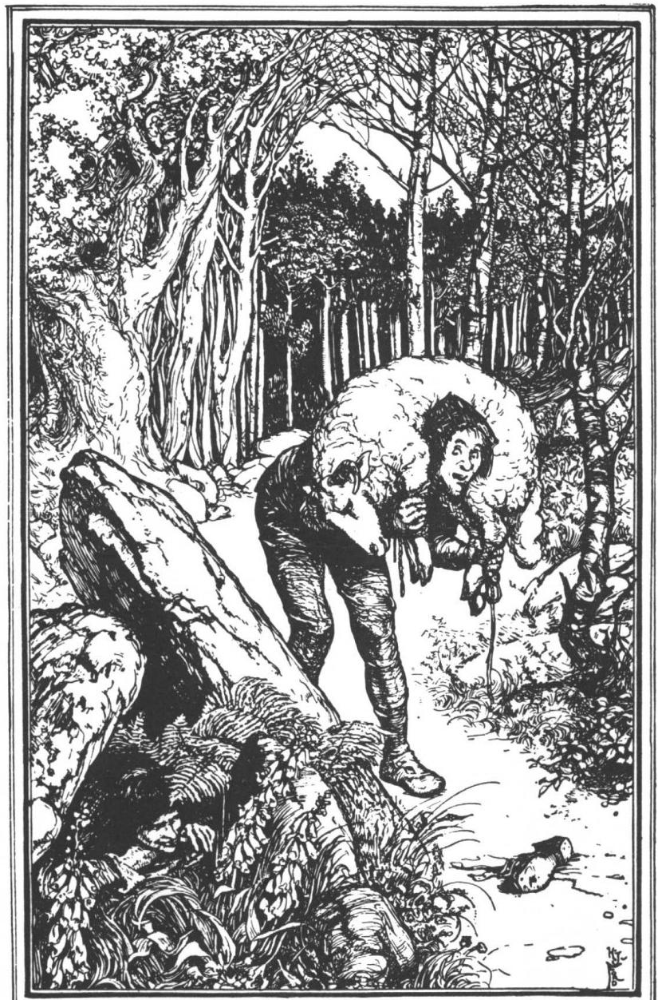

从此以后，狡猾的青年（现在我们该叫他青年了）和他的师傅胆子越来越大。他们偷了许多牲口去卖，变得非常富有。有一天，他们从市场上卖牲口回来，口袋里装满了钱。他们看到山顶上有一个绞刑架。

“让我们去看看。”青年说，“我们从来没有走近去看过。有人说这是所有做贼人的归宿。”

四周没有人，他们仔细地观看着。青年说，“不知道被吊起来的滋味怎么样，我很想知道，那样被抓到就有数了。我先试试，再轮到你。”

他说着，就把绳子的活结套在自己的脖子上，告诉黑鸟把绳子的另一头拉起来，把他吊起来。“我觉得没劲的时候就摆摆腿，你就把我放下。”他说。

黑鸟把绳子拉起来，不到半分钟，青年的脚就晃起来了，黑鸟赶紧把他放下。

“真是难以相信，被吊起来是这么有趣。”青年的脸色有点发紫，说话的声音也很奇怪，“我想你肯定从来没有试过，要不你就不会让我先试了，这是我从来没有做过的最快活的事情。我只是高兴才摆动腿。假如你上去，你也会摆动腿的。”

“既然这么妙，让我也试试看。”黑鸟说，“但你要把结打牢。免得我掉下来摔断脖子。”

“我会照顾好的，”青年说，“你觉得没劲的时候就吹口哨，我就放你下来。”

黑鸟被吊了起来，青年把他拉到顶，对他说，“想下来的时候别忘了吹口哨。如果觉得好玩，就摆摆腿。”

很快，黑鸟的脚开始晃动和乱踢。青年站在下面看着，笑得很开心。

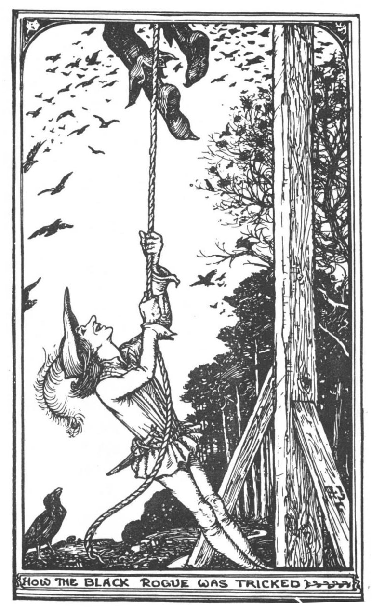

“啊！你太有趣了，你能看到自己这个样子就好了，太棒了。玩够了就吹口哨，我会放你下来的。”说着又笑得前仰后合。

但是，听不到口哨声。不久，黑鸟的脚也不动了。当然，他死了，这正是狡猾的青年所希望的。

青年回到黑鸟的家，告诉他老婆，她丈夫死了。还说假如她愿意，他准备娶她。但是那女人还是爱黑鸟，虽然他是个贼。她害怕地躲开青年，叫人来抓他。青年只好逃到别的地方去，那里的人不知道他的妄做非为。

假如青年的母亲知道了这些事情，也许她会以为，现在儿子应该对偷窃感到厌倦了，想学别的正经的生意了。事实并非如此，他生性爱好冒险和耍诡计，离开了这些，他就会感到生活是多么单调和乏味。他还是像以前一样地偷窃，和他认为诡计多端的人交朋友。最后，他们发展到盗窃国王的仓库，国王决定派士兵来捕捉这伙窃贼。

然而很长一段时间，士兵们一无所获，毫无办法对付他们。这个狡猾的青年实在是比他们棋高一着，计谋总是胜他们一筹。有一天晚上，他偷偷溜进士兵的一个营地，在他们睡觉的时候杀了他们。他还叫村子里的人把其他士兵也干掉，否则村里的人都会被绞死。当太阳升起来的时候，士兵全部被杀害。

国王听到这个消息非常生气，他把这个国家里最聪明的巫师叫来，和他商量对策。巫师提议国王邀请这个村子里所有的人都来参加一个舞会，那个胆大妄为，厚颜无耻的贼也一定会来，而且肯定会邀请国王的女儿一起跳舞。

“这是个好主意。”国王说，他设下了一个宴席，还准备举行舞会。村子里所有的人都来了，不出巫师所料，狡猾的青年也来了。

大家吃饱喝足以后，都进入舞厅。大家蜂拥而入，但是巫师还是辨认出了这个狡猾的贼。巫师穿的袍子里藏着一瓶黑色的油膏，他轻轻地在这个贼的脸颊上点上一点，青年当时并没有觉察。不过当他去邀请国王的女儿跳舞时，从一面镜子中看了出来。他立即猜出这是谁干的，出于什么目的。他不动声色。他跳舞跳得非常好，连公主也十分喜欢他。跳舞结束后他向舞伴鞠了一躬就离开她，和大伙一起挤到门口。当他从巫师身边经过时，轻而易举地就偷到了那瓶油膏，还在巫师的脸上也点了两点。接着又在其他共二十人的脸上也点了一点，又偷偷地溜回巫师的身边，把油膏放回。这一切都做得神不知鬼不觉。

第二轮舞开始了，他又来到公主的身边，请她赏脸，她同意了。他停下来结鞋带的时候，公主拿出巫师给她的一瓶黑油膏，也在青年的脸上点了一下。但是她不如巫师高明，青年感觉到了她的手指碰了他一下。这一轮舞一结束，他就偷到了公主的油膏瓶子，在另外的二十人脸上又加了一点，在巫师的脸上又加上两点，再把瓶子偷偷地还给公主。

最后，舞会宣告结束，国王命令把所有的门都关上，命令士兵搜查脸上有两点黑墨的人。但是他们很快发现共有二十一个人脸上有两点黑墨。而巫师脸上有四点。

国王的内侍也不知道如何是好，他赶紧过来向国王报告。国王立刻派人把巫师和公主找来。

“那个贼肯定是偷了你的瓶子。”国王对巫师说。

“不，我的陛下，它还在这。”巫师取出瓶子答道。

国王转过脸来对公主说：“这么说，他一定是偷了你的了。”

“没有呀！父亲，它还好好的在我口袋里。”说着，她把瓶子也取了出来。他们三人面面相觑，不知道说什么好。

“好了，”国王终于开口了，“干这些事的人比大多数人都聪明，假如他向我公开自己，我就把公主嫁给他。我在世的时候，他管理半个国家；我去世以后，他就接管整个国家，立刻到舞厅里去宣布这个决定，把那个人带到这里来。”

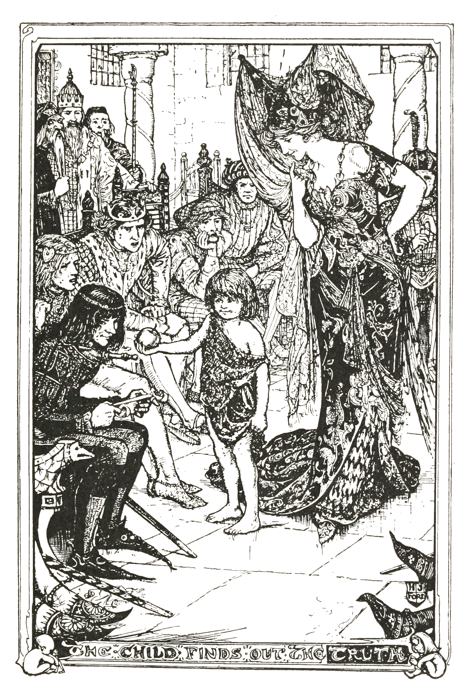

内侍按照国王的吩咐，到舞厅去宣布了这个决定。令他吃惊的是，二十一个人都站起来说，“我就是你要找的人。”内侍和随从们都觉得非常为难，只好把他们都带到国王的面前。

国王也觉得这个问题难以解决，就把他的大臣们找来商量。他们争论了几个小时，最后才想出了一个办法。

他们决定把一个小女孩带到宫殿里来，给她一个苹果，然后把她带到二十一个脸上有黑点的青年中间去。小女孩把苹果交给谁，谁就可以娶国王的女儿做妻子。

“当然，”国王说，“也许选中的人不是我们所要的那个人，但也可能就是他。不管怎么说，这是我们能想出的最好的办法。”

公主亲自把小女孩带到二十一个青年的房间里去。女孩站在房间当中，一个一个地看着这些青年，最后把苹果交给了这个狡猾的青年。他显得与众不同，他手中绕着一块好看的布，头颈上挂着一个风笛的吹口。

“你不应该带着别人没有的东西。”跟着女孩的国王内侍对他说。内侍吩咐女孩出去一会，把狡猾的青年手中的布和风笛的吹口拿掉，又给他换了一个位置，再把女孩叫进来。但是女孩还是认出了他，把苹果给他。

内侍把狡猾的青年带到国王面前，“他是小女孩两次挑选中的人，我们试了两次，一切都显得公平合理。”于是，他第二天就和国王的女儿结婚。

几天以后，新郎和新娘出去散步，他们来到一条河边；河上有一座桥。

“这是什么桥？”新郎问，公主告诉他这是达布林桥。

“真的吗？”他叫起来，“以前当我和母亲耍诡计的时候，她总是说，我要被吊在达布林桥上。”

“哦！假如你想实现她的预言，”公主笑着说，“我只要用头巾捆住你的双脚，把你倒挂在桥上就行了。”

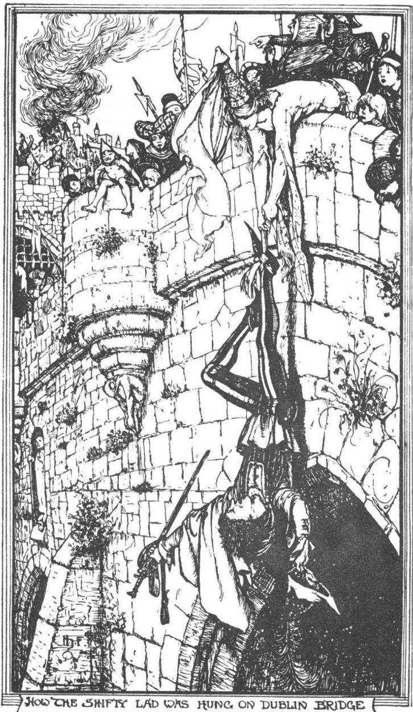

“这非常有趣，”他说，“但你没有那么大的力气拉住我。”

“我当然有，不信试试看。”公主说。于是她用头巾把他的双脚捆住，用双手把他倒吊在桥上，俩人开心地哈哈大笑。

“好了，把我拉上来吧！”他叫着。这时，突然有人大叫“宫殿失火了”。公主吃了一惊，回过头去，一不小心松掉了手中的头巾。狡猾的男青年掉下来，头撞在一块大石头上，死了。

他母亲的预言最终变成了现实。

（西苏格兰高地传说）

 
 

## 真假王子

这是一个炎热的夏天，国王刚午睡醒来。在热带的国家里，人人都是早早起来，中午从十二点休息到三点。他穿上凉爽的衣服，穿过大厅来到议事厅，就看到一群穿着高贵的青年人走进来，有一个走上前来对他说：

“陛下，今天上午，王子和这位绅士，还有其他一些人在院子里打网球。后来发生了一些争执，王子发了脾气，说了一些侮辱对方的话，结果这位绅士动手猛击了王子的脸，王子的嘴巴和鼻子流出了鲜血。看到这些我们都吓坏了。他竟敢动手打王子，要不是他的外祖父、公爵拦住我们，说这个事情应该由国王来处理，我们当时可能就把他杀了。”

国王仔细地听着他的诉说，完了以后问：

“我想当时王子没有带武器，要不他就使用它了！”

“陛下，他有武器，他的皮带上总是插着一把匕首。但他看到血从自己的脸上流下，就跑到院子的角落里哭了起来。真是令人觉得奇怪。”

听到这里，国王走到窗前，望着窗外，站了几分钟，那伙青年人谁也不说话。国王转过头来，脸色显得苍白而严厉。

“我要对你们说，”他说，“这关系到一种高贵的人格。我情愿听到你们告诉我，王子已经死了。虽然他是我唯一的儿子，但我不愿意知道他在受了这样的侮辱以后也不想报仇。关于那个绅士，他将被送上法庭。他可以为自己辩护，但是在攻击了王室的继承人以后，我想他是必死无疑的了。”

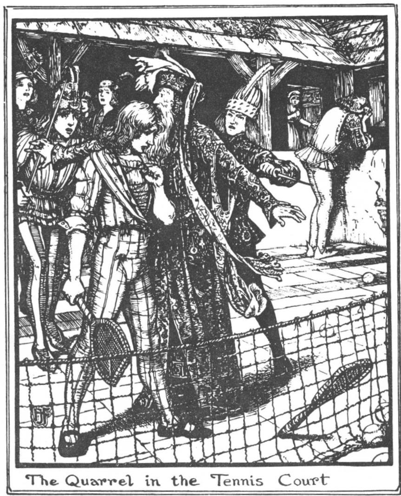

那年轻的绅士抬起头，想要回答，但国王不理睬他，命令士兵逮捕他。还说，假如犯人想到这个城市的各处去看看，他可以在严密的监护下这样做。十五天以后，他将被押上最高法庭审判。

年轻人在士兵的押送下离开了国王，许多朋友都陪伴着他，因为许多人都喜欢他。在朋友的劝说下，他花了十四天的时间，到处请教各种聪明人，如何才能免于一死。但是没有人能够帮助他，谁也不能为他动手打了王子找到借口。

第十四个晚上降临，年轻人绝望地走出来，最后一次漫步于这个城市。他毫无目的，脸色苍白，不知何去何从，伙伴们没有一个敢和他说话。

几个钟头就这样过去了。当他走到一家修道院门口时，角落处出现一个老妇人，她突然站到青年人的面前。她满脸皱纹，身体显得干瘪，背驼着几乎着地，看起来起码九十岁了。但是她的眼睛却清澈明亮，像个少女。

“阁下，”她说，“我知道你所发生的一切事情，也知道你在寻找能够救你一命的智慧。但是除了我，没有任何人能够解救你，不过你要答应我的所有要求。”

听到她的话，年轻人顿时觉得如释重负。

“啊！救救我！我愿意做任何事情！”他喊道，“离开这个光明世界，走向黑暗是多么的艰难。”

“你用不着走这条路。”老妇人说，“你只要和我结婚，很快你就会获得自由。”

“和你结婚！”他叫了起来，“可是我还不到二十岁，而你起码有一百岁了。不！这是不可能的。”

他还没来得及想一想后果就这样说了。她眼中射出愤怒的目光，令他非常不安。不过，她只是说，“随你的便，既然你拒绝了我，那么就让乌鸦和你作伴吧！”说着，就匆忙地走了。

即将来临的死神带来的恐惧气氛立刻笼罩了他。他明白，他拒绝了唯一能够得到生存的机会。这是唯一的机会，他绝不能放弃，他对自己说着，开始拼命地去追赶那妇人。这时尽管有月光，那妇人也几乎是看不见了。谁能相信一位年过九旬的老妪能走得这么快，她简直是在飞。最后，他气喘吁吁地追上了她，喘息着说：

“女士，请原谅我刚才的快言快语。我错了，我万分感谢地接受你的恩赐。”

“嗯！我想你会明白的。”她回答，声音很奇怪，“我们没有多少时间了，立刻跟我走。”

他俩一言不发地飞奔到一间小屋子门前，这里住着一位神父。在神父的面前，老妇人让年轻人宣誓娶她为妻，他这样做了。然后，老妇人请神父和其他人离开，告诉青年人应该怎么去做。

第二天一早，年轻人被带到国王和法官的面前，大厅里挤满了人。大家看到年轻人精神饱满，容光焕发，都感到非常惊讶。国王问，他是否有什么理由，为自己攻击王室继承人所犯下的最严重的叛逆罪行辩护，假如有，赶快说出来。

青年深深地鞠了一躬，用清晰响亮的声音说：“啊！我的陛下！仁慈的国王！还有你们，这个国家高尚而充满智慧的人。我完全放心地听从你们的处理，知道你们会听完我的诉说，做出公正的判决。”

“啊！尊敬的国王，当时你和王后结婚四年以后，还没有孩子，你感到非常悲伤。王后看到这一切，预感到将失去你的宠爱。她日思夜想，希望能想出个办法来阻止悲剧的出现。后来，有一次你远征他国的时候，她决定秘密地收养一个穷苦的采石工人的婴儿，并派人给你送信，说你有了一个儿子。没有人怀疑这件事情。只有一个神父知道，王后向他说了真情。几个星期以后，她染病死了，婴儿被抚养大，变成了王子。现在，假如至高无上的国王允许，我将讲述我的身世。”

国王说：“你刚才告诉我的一切是这样的离奇，我很难想象你还有什么可说的了。不过，继续讲下去吧！”

“有一天，王后死后不久，”年轻人继续说，“陛下出去打猎，在追逐一只鹿的时候，所有的随从都走散了。你一个人来到了一个陌生的地方，看到一片盛开着桃红色和白色鲜花的果园，果园里结满了苹果。一个姑娘正在果园里玩球。你走过去问路。当她回过头来回答你时，她的美丽震撼了你的心灵，世界上的一切似乎都从你心中消失。你骑马走了以后，一次又一次地回头看她，最后决定劝她嫁给你。她以为你是一个贫穷的骑士，同意了，而且还同意像你所希望的那样，不公开你们的婚姻。”

“举行婚礼以后，你给了她三个戒指，还有一个带有十字架的项链，然后把她安置在森林里的一间小屋里，不希望把事情公诸于众。”

“一连几个月，你每星期都来光顾小屋。后来王国的一个地方有人谋反，需要你去解决。事情结束以后，你再次来到小屋时，已经是人去屋空。没有人能够告诉你新娘的去向。陛下，关于这一点，我现在可以告诉你。”

年轻人停了一下，看了一眼国王，国王显得脸色苍白。

“她回到了父亲的身边，她的父亲就是老公爵，你以前的大臣。看到她女儿身上戴的十字架，他立刻就知道了她的恋人是谁。听了她的叙述，他非常生气。他发誓要把她藏起来，叫你找不到她，直到你公开宣布她是你的王后。”

“不久，我出世了，在外祖父的抚养下，在一幢大房子里长大。这是你给我母亲的戒指，这是项链。这些东西可以证明我是不是你的儿子。”

说着，年轻人把这些戒指和项链放在国王的面前。大臣和法官都凑上去仔细察看。只有国王一人安坐在座位上，丝毫不动。他已经忘记了这里是审判的大厅，周围有着许多人。他只看到二十年前的那个苹果园，一个美丽的小姑娘正在玩着球。周围的一片寂静唤醒了他。他抬起头来，看到大厅里所有的眼睛都在看着他。

“这是真的，他才是我的儿子，而不是那一个。”他吃力地说着，“让在这里的人都发誓，在我死了以后，承认他继承王位。”

这样，所有的人都一个接着一个地跪在国王的面前发誓。假王子也接到了通告，永远地禁止他进入王宫。不过，也给了他一笔丰厚的年金。

仪式结束以后，国王示意新找到的儿子跟他走，他们走进另一个房间。

“告诉我，你是怎么知道这一切的。”国王坐在一张精致雕刻，堆满大红垫子的椅子上说。

王子告诉他和老妇人的相遇，是老妇人从他母亲那里拿来了这些戒指和项链。他还告诉国王，已经在神父面前发誓要娶她为妻。但是考虑到年龄的差异，他不想这样做，他宁愿国王为他挑选一个新娘。

国王皱起眉头，严厉地说：

“你发誓说，假如她救了你的性命，你就娶她。现在你得救了，你应该实现自己的承诺。”说完，他敲了一下挂在旁边的银牌，对一个立即出现的侍从说：

“到居住在监狱旁边的神父那里去，问他在什么地方可以找到昨天晚上曾经来找过他的那个老妇人。找到她以后，就把她带到王宫里来。”

尽管花了一些时间，侍从最终还是把老妇人找到了。当她被带到王宫里来的时候，受到了隆重的王室仪式的接待，因为她将是王子的新娘。

当年迈驼背的老妇人从人们中间走过时，卫兵们都吃惊地交换着眼色；但是当他们看到她以轻松愉快的步伐跨上台阶，来到国王和王子并肩而立的宫殿前时，他们更是惊讶不已。

如果说国王和王子在看到老妇人时，内心深受震撼的话，那么，他们的外表却仍然显得十分安静。国王向老妇人鞠了一躬，拉着她的手，带她来到教堂。一位主教将在这里为王子和老妇人举行结婚仪式。

婚礼以后的几个星期，很少看到王子的踪影。他整天在野外打猎，想忘记家中年迈的妻子。至于王妃，也没有人多管闲事去过问她。她整天整夜地一个人待在房间里，谢绝了所有国王派来的服侍她的人。

有一天，王子在一次比以往更远的逐鹿以后，很晚才回到王宫。他感到十分疲劳，就上床睡着了。忽然，他被一种奇怪的声音惊醒。他想可能小偷进来了，立刻从床上跳起，抓起身边的宝剑。后来，他发现声音是从隔壁王妃的房间里传出来的，他蹑手蹑脚地走到她的门前。在一把火炬的照耀下，他看到她正静静地躺在那里，头上还戴着镶着黄金和宝石的王冠。她的脸上的皱纹已经消失，脸庞比雪还洁白，像一个十四岁的少女似的容光焕发。这异常美丽的姑娘真的是他的妻子吗？

当姑娘张开双眼，对他微笑的时候，王子还在惊讶地看着她。“是的，我是你的妻子，”她仿佛猜透他的心思似的，“魔法已经结束。现在，我要告诉你，我是谁，是什么使我变成了老太婆的模样。”

“我的父亲是格拉纳达王国的国王，我出生在能够鸟瞰整个贝加草原的宫殿里。当我只有几个月的时候，一个仇恨我父母的巫婆对我念了一个咒语，使我皮肤变皱，腰背弯曲，像一个年过百岁，令人讨厌的老太婆。后来，国王命令我的保姆把我从王宫中带走，她是唯一关心和照顾我的人。我们居住在这座城市里，靠国王给我们的一点费用过日子。”

“大约在我三岁的时候，一个老人来到我的家。他累得再也走不动了，请求我的保姆让他进来休息一会儿。她看到他病得很严重，就把他安置在床上，照料他。他逐渐地恢复了健康。为了报答她的好心，老人告诉她，他是一个巫师，除了生和死之外，他可以给她任何她希望得到的东西。她回答说，在这个世界上，她最希望的是皱纹从我的脸上消失，让我重新获得出生时那样的美貌。对于这个要求，他说，由于我的不幸来自一个咒语，要解脱它是非常难的。但是不论如何，他也要尽最大的努力。起码他可以答应，假如我在十五岁生日之前，能够找到一个发誓娶我为妻的男人，我就能够从咒语中解脱出来。”

“你可以想象，这并非易事。我长得这样丑，没有人愿意看我第二眼，我连和一个男人说话的机会也没有。随着我十五岁生日的临近，我和保姆都几乎绝望了。后来，巫师来看望我们，告诉我们宫廷里发生的事情和你的故事，吩咐我在你绝望的时候拉住你，在你同意娶我的时候救你。”

“这就是我的过去。现在，你必须请求国王派人到格拉纳达去送个信，把我们的婚姻告诉我父亲。”她哭着补充说，“我想，他不会拒绝为我们祝福。”

（摘自葡萄牙童话）

 
 

## 苦行僧受惩罚

从前，古城拉姆特巴德来了一位道貌岸然的苦行僧。他在城外的一棵树下住下。有时，他一连几天坐在那里斋戒，不吃也不喝，一动也不动，只有手指头不停地转动手中的珠链。他这种神圣的功德很快就传开了。每天都有很多人来看他，敬仰他的虔诚，渴望聆听他的教诲，得到他的祝福。

不久，王公也听到了苦行僧的消息，开始常常来拜访他，和他商量事情，希望他为他祈祷，让自己能够得到一个儿子。日子一天一天地过去了，王公对苦行僧越来越崇拜，他决心想办法让他归属于自己。因此，他在附近造了一座小神殿，还造了一两间房间，一个小院子，四周筑起围墙。一切都准备好了以后，他请求苦行僧去住下，要求他除了他和王后，以及苦行僧所选择的继承者以外，不再接见其他人。苦行僧答应了。就这样，他在王公的恩典下住了一段时间，名气也与日俱增。

拉姆特巴德的王公虽然没有儿子，但是有一个女儿，模样美貌是人世间绝无仅有的。她的父亲早就把她许给邻近迪拉姆城王公的儿子，而且订了婚。由于婚期尚未来临，她过着安静而甜蜜的深闺生活。公主当然也听说了苦行僧的高尚和斋戒的故事。她充满了好奇心，很想去看看他，和他说话。但这是很难的，因为不允许她私自出宫廷，一出去总是有一大群人保护着。后来，她终于找到了一个机会，在一个晚上独自出去找这位苦行僧。

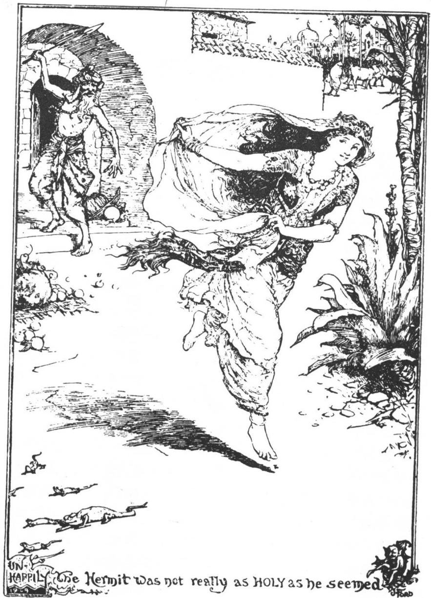

不幸的是，苦行僧并不像人们所说的那么高尚。他一看见公主，就立刻被她绝伦的美貌迷住了，看中了她。他心中开始策划如何得到她，做她的丈夫。但是，这位少女不但相貌惊人，而且聪明透顶。她从苦行僧的表情中看出他的邪恶，立刻跳起来，罩上她的面纱，拼命地奔跑出去。苦行僧想追上去，但毕竟赶不上。眼看不能得到她，他怒火中烧，抓起一根长矛向她投去，刺中了她的腿。勇敢的公主停下来，迅速从伤口中拔出长矛，又继续奔跑，直到安全地返回家中。她偷偷地洗好伤口，把它包扎好，没有告诉任何人自己是多么的愚蠢。因为她知道，父亲为了这个将严厉地惩罚她。

第二天，当王公来拜访苦行僧时，他既不说话，也不看王公一眼。

“怎么啦！”王公问，“你今天为什么不和我说话。”

“我说的话你不会感兴趣！”苦行僧回答。

“为什么？”王公说，“你当然知道，我很看重你所说的一切，告诉我这是怎么回事？”

但苦行僧还是头朝一边，爱理不理的样子。王公越是要他说，他就越是沉默，越是神秘的样子。最后，在再三的请求下，他开了口：

“让我告诉你，这个城市里有一个怪物，假如你不消灭它，这里的每一个人都活不了。”

这骇人听闻的消息吓得王公脸色苍白。

“什么？”他紧张得气也透不过来，“这个害人的怪物是什么？我怎么样能找到它，抓住它？只要你告诉我，帮助我，我会照你的吩咐去做的。”

“啊！”苦行僧回答，“实在是太可怕了。它的外表像一个美丽的姑娘，而实质上是一个恶毒的精灵。昨天晚上它来拜访我，当我看着它时，它的美貌消失了，变成了丑陋，洁白的牙齿变成像毒蛇般的毒牙，迷人的眼睛像烧红了的炭，纤纤的手指变成了可怕的巨爪。假如我不是圣僧的话，它可能就把我吃掉了。”

王公惊骇得说不出话来，好久才说了一句，“我怎样才能抓到这可怕的怪物呢？”

苦行僧说，“搜查一个腿上受过长矛枪伤的漂亮姑娘。找到她以后，保证她的安全，再来告诉我，我会告诉你下一步该怎么办。”

王公匆匆忙忙地走了，他派出所有的士兵，到处寻找一个腿上受过长矛枪伤的姑娘。搜查共进行了两天，才发现腿上受过伤的只有公主一人。王公大大地松了一口气，去告诉苦行僧，请他放心，说一定是搞错了。当然，苦行僧对此已早有准备，他胸有成竹地回答：

“她不是你的女儿，你女儿的灵魂在出生的时候已经被偷走了，这个邪恶的精灵占据了她的肉体。”他还严肃地说，“你爱怎么办就怎么办，但是如果你不听从我的劝告，她将把你们全部杀死。”他说这些话的时候，神情是那么庄重，信心是那么不可动摇。王公的智慧完全被他蒙骗了。王公宣称，相信他所说的一切，决定照他的话去做。苦行僧叫王公秘密地派来两个木匠。木匠来到以后，苦行僧叫他们做一个大箱子，要做得非常巧妙，密不透风，水也不能漏进去。一切都准备好了以后，苦行僧吩咐王公在晚上的时候把公主带来。他们俩人把可怜的姑娘推入箱子中，用木板和长钉把她封起来，叫人把箱子抬到河边，推入水中。

干完这些以后，苦行僧回到家中，叫来两个学生，假装说，他预感到河流中将漂来一个大木箱，里面装有贵重的东西。他吩咐两个学生到下游去等候，当箱子随波逐流而来时，抓住它，把它迅速而秘密地运回来，交给他。他现在决心要亲自处死公主。学生们立刻出发，他们对这件神秘的差使感到很有趣。对苦行僧能预见这样的秘密，更是倍感崇敬。

恰巧，第二天早晨天刚亮的时候，迪拉姆年轻英俊的王子到河边来打猎，身边跟着一大群大臣和随从。他骑在马上，看到河里有一只大箱子正在随波翻滚，慢慢地顺流而下。他下了一道命令，立刻有好几个人跳入河中，把箱子拉到河岸上。许多人都围了上来，想看看里面究竟藏着什么东西。王子当然也不例外。但他是一个办事谨慎的人，他吩咐大伙儿让开，只留下几个人，并叫他们拔出剑来，以防万一。他要亲自打开箱子，说不定里面藏着什么野兽、怪物或巨人呢。一切都准备好了以后，王子用他的短剑撬开了箱盖，把它扔在一边。这时，他看到里边躺着一个从来未见到过的美丽姑娘。

由于箱子的禁闭，她已处于半昏迷状态，但很快就苏醒过来。她坐起来后，王子开始问她，你是什么人？为什么被钉在箱子里，让河水漂流？发现自己在这么多陌生人的面前，她又颤抖，又害羞。她告诉王子，她是拉姆特巴德的公主，是她的父亲把她放进箱子里来的。当他告诉她，他是迪拉姆的王子时，这对已经订婚的年轻人无限的感慨，他们第一次见面竟然是在这样一种场合下。王子的心被公主的美貌和端庄温雅所打动，深深地爱上了她。他把身边的大臣叫来，宣布立即和她举行婚礼。然后，他们回到王子居住的王宫。王子的父亲，迪拉姆的王公听到这个消息以后，对他们表示赞许和欢迎。这一天，全国举行盛宴，到处充满了欢乐的气氛。宴会以后，新娘告诉新郎，在他们新婚佳节之际，她还有许多冒险的经历要告诉他。于是，她毫不保留地告诉他私访那邪恶的苦行僧以后所发生的事情。

第二天一早，王子把他的侍从叫来，吩咐他们把王宫里用链条锁着的一只大猴子带来，把它封在那只大木箱里，然后把大木箱扔到河里去，让它继续顺流漂下。王子还派人秘密地跟着它，看看会发生什么事情。

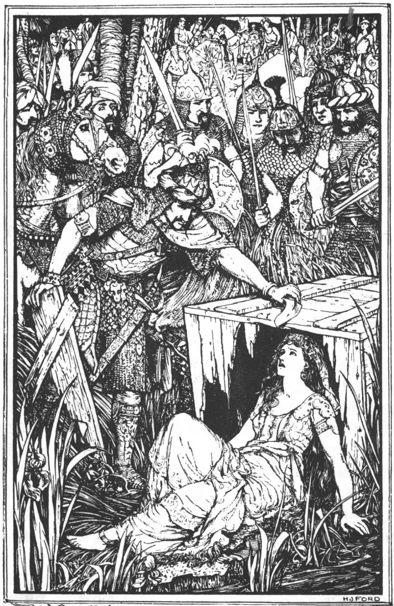

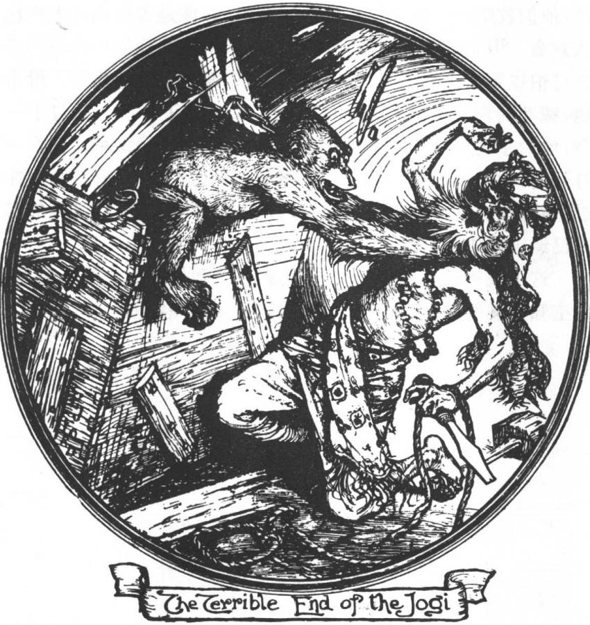

这时候，苦行僧的两个学生在下游已经等得不耐烦了，开始怀疑他的预言是否可靠。第二天上午，他们终于发现了一只大箱子在水面上晃荡着缓缓漂来，高兴得手舞足蹈。他们为老师的智慧感到无比自豪。两人费了好大的劲，才把箱子从水中捞上来，秘密地把它运回家中。这时候，苦行僧已经等得很急，坐立不安了。他叫学生把箱子放下以后出去，让他自己来打开这个充满魔法的箱子。“即使你们听到喊叫声，不论多么可怕，你们也绝对不能进来。”苦行僧说完，就走到一个大橱的面前，取出绳子，准备勒死公主。

两个学生听从老师的教训，出去以后就关好所有的门。很快，他们就听到了屋子里可怕的喊叫声，好像是苦行僧在大声地喊救命。但是他们不敢违背师令。老师不是叫他们不论喊声多么可怕也不要进去吗？所以他们就在外面好奇地等候着。慢慢地，喊叫的声音微弱了，消失了，一切又恢复了平静。又过了一会，他们才决定打开门进去看看，事情是不是已经结束。他们一打开门，就差一点被一只大猴子撞倒。只见大猴子夺门而出，冲过庭院，很快就消失得无影无踪。他们走进房间，看到老师的身体已经被撕成了碎片。

这个故事很快就传出去了，传到公主和她的丈夫的耳朵里。公主知道她的敌人已经死亡，又和她的父亲和好如初。

（梅杰·坎贝尔，弗罗希普）

 
 

## 猴子的心

很久以前，在海岸的峭壁下有一绿色的峡谷，峡谷里有一座由许多低矮的小屋构成的小城市。当然，人们小心翼翼地把房屋建筑在高处，免得西风刮起的时候，大海潮会冲上来把房子吞没。在峭壁上，有一棵很高大的树，一半树叶遮住房舍，一半伸入海中。这里的海水深而清澈，鲨鱼也喜欢到这里来游玩。这棵大树上结满了果实，每天天一亮，可以看到一只灰色的大猴子在树顶上享受着它的早餐，快活地自言自语着。

它把陆地那边的果子全部吃光以后，开始吃靠海那边的果子。它正想找一块荫凉的地方玩耍时，看到海水中一条鲨鱼正贪婪地注视着它。

“我能帮你做些什么吗？我的朋友？”猴子有礼貌地问道。“啊！只要你能给我扔下一些甜蜜的果子，我就非常感谢你了。”鲨鱼回答，“当你靠鱼为生，活了五十年以后，你就会想改变一下生活方式。而且我非常非常厌恶盐的味道。”

“是啊！我也不喜欢盐。”猴子说，“如果你愿意把嘴张开，我就扔一些果汁甜美的果子到你口中。”说着，它采下头上的一个果实。但是，要投中鲨鱼的嘴也不是一件容易的事情，尽管鲨鱼已经翻过身来，张口朝天，不巧，第一个果子打在鲨鱼的牙齿上，滚入了大海。第二次猴子很幸运，不偏不倚投入鲨鱼的口中。

“啊！味道美极了。”鲨鱼叫起来，“请再给我一个。”鲨鱼要了一个又一个，在它还没有满足以前，猴子就觉得厌倦了。

“天不早了，我要回家去照顾孩子。”最后猴子说：“不过明天这个时候你还来的话，我会再招待你的。”

“谢谢你！谢谢你！”鲨鱼高兴得嘻嘻地笑着，露出丑陋的大牙齿，“你难以想象，你给我带来了多么大的快乐。”说着它游向海洋深处，希望睡过一觉以后猴子会再来。

一连几个星期，猴子和鲨鱼一起用早餐。也不知道树上的果子是否够它们吃，反正它们变成了好朋友，相互告诉对方自己的家庭和孩子的情况，交流如何教会孩子学习应该学会的本事。慢慢地，猴子对自己在城里棕榈树下的绿房子感到厌倦了，它渴望去看看从鲨鱼那里听到的海底下的奇妙景象。鲨鱼清楚地觉察到了这一点，开始描绘海底最大的奇观，猴子听着听着变得越来越忧伤。

事情就这样一天天地过去了。有一天鲨鱼说，“这几个星期来，你对我这么好，我真不知道该怎么感谢你才好。我没有什么东西送给你，但是假如你同意跟我一起回家，我愿意给你喜欢的一切。”

“再也没有什么比这个让我更高兴的了。”猴子咧嘴笑道，它高兴的时候牙齿总是碰得卡嗒卡嗒响，“但是我怎么去呢？这些海水，我一看到它就发愁。”

“不用害怕，”鲨鱼回答，“你只要坐在我背上，我保证一滴水也不会碰到你。”

事情就这样定了。第二天早餐后，鲨鱼游到大树底下的水面上，猴子跳下来，正好坐在它的背上，一点水也没有溅起。开始的时候，猴子觉得有点害怕，它从来没有到海上来过。几分钟以后，它就尽情地享受了，不停地问鲨鱼关于海里的鱼、海草，还有从它们身边飘过的奇奇怪怪的各种东西的问题。鲨鱼总是给它类似的回答。猴子根本没有想到，这些问题对它的向导来说，也完全是新的。

太阳已经升起，鲨鱼突然说，“我的朋友，行程已经过半。现在我该告诉你一件事了。”

“什么事？”猴子问，“不会是不愉快的事情吧！你的声音好像有点悲哀。”

“啊！不！没什么，只是刚才我出来的时候，听说我们的国王病得很厉害，只有猴子的心才救得了它。”

“可怜的人，我为它感到悲痛。”猴子说，“但是你太不聪明了。我们出发之前，你就应该告诉我了。”

“你这是什么意思？”鲨鱼问道。猴子现在知道了它的阴谋，并不急于回答，要考虑一下怎么说才好。

“你为什么不说话？”鲨鱼再次问它。

“我在想，在岸上的时候，你没有把这件事情告诉我，真是太可惜了，否则，我就带上我的心了。”

“你的心？你的心为什么不在？”鲨鱼困惑地问道。

“嗯，不，当然不在。你可能不知道，我们离开家的时候，总是把心挂在树上，免得它带来麻烦。当然，你可能不相信，猜想我只是因为害怕，才编了这个故事。还是让我们尽快地赶到你们国家去吧！到时候，你们可以找找我的心。找到了，就杀了我。”

猴子说得那么镇静，那么认真，鲨鱼完全被蒙骗了，开始后悔不该这么匆匆忙忙了。

“你既然没有带着心，去了也没用。”鲨鱼终于这样说了，“我们还是先回去吧！等带上你的心再来。”

当然，这正是猴子求之不得的。但是它必须装出没有什么值得高兴的样子。

“嗯！我不知道，”它谨慎地说着，“路这么远。不过，也许你是对的。”

“我肯定是对的。”鲨鱼说，“我会尽快地游回去。”

猴子终于又看到了海边的那棵大树。

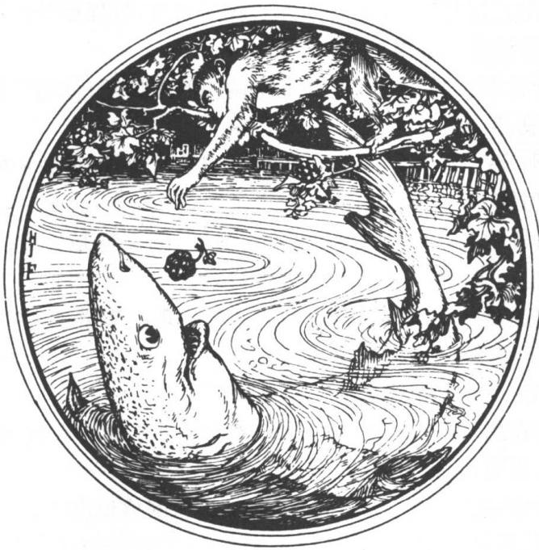

猴子因活命而深深地叹了一口气，它抓住最近的树枝跳了上去。

“在这里等着我。”它对鲨鱼喊道，“我饿极了，要吃一点早饭，然后去取我的心。”

它不停地在树枝中往上跳，越跳越高，最后鲨鱼看不到它了，就卷起身睡了。

“你在哪里？”过了一会，鲨鱼叫了起来。在岸边游泳令它很疲倦，它也想快点回去。

猴子醒了，但没有回答。

“你还在吗？”鲨鱼更加大声地喊叫，显得非常生气。

“哦！我在。”猴子回答，“但愿你没有吵醒我，我睡得多么舒服。”

“你拿到了吗？”鲨鱼问，“我们该走了。”

“走了？到哪里去？”猴子问。

“当然是到我的国家去了。带着你的心！你不会忘记吧！”

“我亲爱的朋友，”猴子咯咯地笑着回答，“我想你是疯了，你是不是把我当成了洗衣匠的驴子了。”

“别胡说八道，”鲨鱼叫道，它生来不爱被人取笑，“你说洗衣匠的驴子是什么意思？我希望你快一点，否则我们就太晚了，来不及救国王了。”

“你真的从来没有听说过洗衣匠驴子的故事？”猴子问。这时，它正为自己的聪明自鸣得意，“它是一只没有心的动物。我现在的感觉不太好，太阳这么高，我不想讲故事，怕中暑。不过如果你想听，我就靠近一点告诉你。”

“太好了，”鲨鱼绷着脸说道，“反正现在没事干。”

于是，猴子开始讲它的故事。

“城的那边有一片大森林，森林里曾住着一个洗衣匠，有一头驴子和他作伴；他不论到哪里去，都骑着它，他们相处得很好。后来，驴子渐渐变懒，对仁慈的主人也越来越不忠诚，最后终于离家出走，来到森林深处。它什么事也不干，整天只是吃呀！吃呀！吃呀！越长越肥，路也走不动了。”

“有一天，驴子尝到一种新草，正想着它的味道是不是和昨天中午吃的一样，一只兔子从它身边经过。”

“‘唷！这就是那个肥家伙。’兔子想，它转过身来跑去告诉它的好朋友狮子。这时，狮子正病得很厉害，没有力气去打猎。兔子跑来告诉它，一头很肥的驴子正在附近的时候，无能为力和失望的泪水从狮子的眼眶中流了下来。”

“‘你告诉我这些有什么用？’狮子用非常虚弱的声音回答，‘你知道，我现在是寸步难行。’‘没有关系，’兔子快活地说，‘假如你没有力气去找饭吃，饭自己会送上门来的。’说着，它和狮子点头告别，去找那头驴子。”

“‘早上好！’兔子有礼貌地向驴子鞠躬，驴子吃惊地抬起头来。兔子接着说，‘请原谅我打搅了，我有重要的事情要告诉你。’‘是吗？’驴子说，‘你真好，不怕麻烦，是什么事啊？’”

“‘是这样的，’兔子回答，‘我的朋友狮子听说你长得妩媚迷人，性情温和，就派我来向你求婚。它为自己不能亲自来求婚而深感遗憾，因为它正在生病，身体太虚弱，不能走路。’‘可怜的家伙，太不幸了！’驴子说，‘请你告诉它，我非常荣幸地接受它的求婚，很高兴做兽中女王。’‘你能不能亲自去告诉它。’兔子说。”

“它们一起向狮子的家走去，这要花很长的时间，因为驴子吃得太肥了，走起路来非常慢。本来这段路兔子只要跑五分钟就够了，现在只好耐着性子跟着驴子一步一步地蠕动，把它累死了。它们来到了狮子的家，狮子正站在家门口等着，脸色苍白而消瘦。驴子忽然觉得很害羞，低下头来。狮子摆出最好的姿态，邀请两位客人入室就坐。”

“很快，兔子站起来说，‘好了，我还另有约会，希望你和未来的丈夫熟悉起来。’说着，向狮子眨眨眼就走了。”

“驴子以为，兔子走了以后，狮子就会开始向它求婚，和它商量结婚的事情。听不到狮子的声音，它就抬起头来，吃惊地看到，狮子正蹲在角落里，眼中布满了吓人的血丝，接着大吼一声向它扑来。驴子幸好还来得及跳向一边，还重重地踢了狮子一脚，痛得它哇哇直叫。狮子一次又一次地张牙舞爪向驴子扑来，但因为身体衰弱，老是抓不到驴子，反而被驴子咬了好几口，最后还被驴子踢中要害，倒在地上痛苦地呻吟着。驴子乘机逃了出去。”

“兔子其实并没有什么约会，它清楚地知道将会发生什么事情，正躲在旁边的树丛里看热闹，撕打的声音也听得一清二楚。一切都平静下来后，它偷偷地走出来。”

“‘怎么样？你杀了它没有？’兔子问狮子。‘杀了它！是的，’狮子生气地说，‘是它差一点杀了我。我从未见过驴子踢人这么厉害！不过，我也在它的背上留下了我的爪印。’‘我的天！想不到这样一个肥家伙还会打架，真是太有趣了。’兔子说，‘别烦恼，躺下好好休息，你的伤很快会好的。’它和好朋友说一声再见以后就回家了。”

“两三个星期以后，驴子除了背上留下狮子的爪印以外，一切都恢复了。狮子的病也好了，又恢复了以前的健壮。它想，是出去打猎的时候了。”

“一天早上，它听到草窝里有窸窸响的声音，兔子的头伸了出来，‘啊！用不着问你的身体怎么样了。’它说，‘不过，你还是用不着太劳累了。要不要我把早餐给你带来？’”

“‘如果你把那头驴带来，我就把它撕成两半。’狮子生气地叫道。兔子哈哈大笑，点点头去干它的差使去了。这一次，驴子跑得更远了，兔子花了很长时间才找到它。它正在柔软的草地上打滚取乐。兔子看到它的时候，它正四蹄朝天躺在地上。”

“‘早上好！’兔子有礼貌地说。驴子翻过身来，慢慢地站起来，看看来访的客人是谁。‘哟！是你！’它说，‘请过来，我们聊聊。有什么消息吗？’‘我不能停留，’兔子说，‘我答应狮子，来请你去做客。它还没有完全好，不能亲自来请你。’”

“‘嗯！我不知道该怎么办？’驴子忧郁地回答，‘上次我去的时候，它抓我很厉害。说真的，我非常害怕。’‘它只是想吻你。’兔子说，‘但是你咬它，它当然非常生气。’‘你敢肯定是这样的吗？’驴子有点半信半疑。‘哦！我完全可以肯定。’兔子笑道，‘在狮子当中我有许多朋友，让我们快点去吧！’驴子有点不情愿地跟着它去了。”

“狮子看到它们走过来，就躲在一棵大树的后面。驴子一走近，它就从树后一跃而出。在它的巨爪一记沉重打击下，可怜的驴子一下子就断了气。‘把它拖走，剥下它的皮，烤来吃。’狮子对跟在后面的兔子说，‘不过，我今天的胃口不好，只对它的心感兴趣，其余的你可以自己吃了，或分给你的朋友。’”

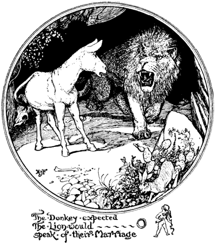

“‘谢谢你，’兔子说。它想办法把驴子拖到一块空地上，架起火来烤肉吃。等得不耐烦的狮子走过来时，它刚好把心吃掉。‘我饿了，’狮子说，‘正好要想吃晚饭，把驴子的心递过来。’‘可是它没有心啊！’兔子装做满脸疑惑地看着狮子。‘胡说，’狮子叫了起来，‘你这是什么意思？每个动物都有一颗心。’‘但这是洗衣匠的驴子。’兔子一本正经地回答。‘好了，那又怎么样？’狮子问。”

“兔子大叫起来，‘哎！去你的吧！你一头大狮子怎么会问出这样的问题来。假如驴子有心，它会到这里来吗？它第一次来的时候，就知道你要杀它，逃跑了。第二次它又来了，如果它有心，它会再来第二次吗？你说呢？’狮子慢慢地回答，‘不，不会来了。’”

说完了故事，猴子对鲨鱼说，“所以，你以为我是洗衣匠的驴子吗？你错了！我不是。太阳已经快下山了，你该动身回家了。归途一定很凉爽，希望你回家以后看到国王好些了。再见！”说完，猴子就消失在森林之中，再也看不见了。

（斯瓦希里传说，爱德华·斯蒂尔编写）

 
 

## 妖精的保姆

在古罗城附近，曾经住着一个农民约翰和他的妻子玛丽。他们有三个孩子。故事开始的时候，他们最小的孩子还是个婴儿。妻子是个好主妇，但是她整个心思都花在家庭和农场里，每次到教堂里去做礼拜时，总是睡着了。她想，花在教堂里的时间实在太长了。

有一天，玛丽让丈夫带着两个孩子先去做弥撒，自己却去询问关于一头牛生病的事情，迟到了。丈夫为此非常忧伤，她也感到很后悔，因为她深深地爱着丈夫，不愿意令他伤心。

那天晚上，约翰被孩子们喊叫“妈妈！妈妈！”的声音惊醒。他坐起来揉了揉眼睛，看到妻子并不在身边，就问孩子们发生了什么事情。孩子们说，他们看见房间里站满了许多好看的小矮人，男的、女的都有，穿着红的、白的、绿的衣服。妈妈站在他们中间，梦游一样地向门口走去。约翰赶紧跑出去，在房子的周围到处寻找。但是，一连好几天，一点也没有得到关于她的消息。

约翰真是够可怜的了，他非常爱妻子，就像妻子爱他一样。看到可怜的孩子没人照顾，又饿又脏，他经常流泪。隔壁的好邻居有空时过来帮他料理一下家务。最小的婴儿只好托人带走。

大约六个星期以后，一天早晨，约翰正好准备下地去干活，一位经常替妇女看病的女邻居来找他，和他一起下地，还告诉他以下的故事：

“昨天晚上，我刚好要睡着的时候，听到了马蹄踩在草地上的声音，接着还有敲门声。我出来开门，看到一个很好看的浑身上下都是黑色的人骑着一匹黑马，对我说，快点准备好，有一个女人急需我去看她，我穿好斗篷，拿好东西，他就拉着我的手，让我坐在他后面。‘先生，我们要到哪里去？’我问。‘你很快就知道了。’他答。说着，他伸出手来在我眼前划了一下，我什么也看不见了。我紧紧地抓住他，也不知道是向前，还是向后，走了多少路。直到他再次拉起我的手，才觉得站在地上了。他又用手在我眼前划了一下，我才看得见了。我们站在一座城堡的大门前，进去以后，穿过一个大厅，进入一间漆着很好看的绿颜色的房屋。红色和金黄色的装饰物点缀着整个房子，地上铺着漂亮的地毯。窗帘、桌子、椅子都显得非常高雅，高贵的女士和先生们在走来走去。接着，我被领进了一间卧室。一个漂亮的女子躺在床上，旁边是一个生龙活虎的男小孩。那女人拍了拍手，黑人走进来，吻了一下女子和婴儿，夸奖了我几句，给我一个装有绿色油膏的瓶子，让我用来擦婴儿的全身。”

“我开始擦小孩的全身，觉得右眼有点痒，就用手去擦。再看看四周，可怕的事情发生了，我一生之中还没这样吓过。漂亮的房间变成了一个大的洞穴，水从石头和泥土中渗出、滴下。那美丽的女人，那个男子，还有那个健壮的婴儿都一下子枯萎了，像是几十天没有吃过东西似的，瘦得皮包骨头。华丽的服装变成了破衣裳。我故作镇静，没有流露出丝毫恐怖和惊骇的神色。过了一会，黑人说：‘到大厅的门那边去，我马上就来，送你安全回家。’”

“当我走进外面的洞穴时，我看到门口有一个人正在看着我，仔细一看，才认出是你的妻子，可怜的玛丽。她害怕地四处张望，小声地对我说：‘我被带到这里来当妖精国王和王后小孩的保姆，但还有一个机会可以得救。下个星期五晚上，整个宫廷的妖精都要穿过坦普沙博的十字路口，去拜访老罗斯的妖精。我从那里经过的时候，假如约翰能抓住我的手或斗篷，而且鼓足勇气不肯松手，我就得救了。国王来了，你不要开口说话。’”

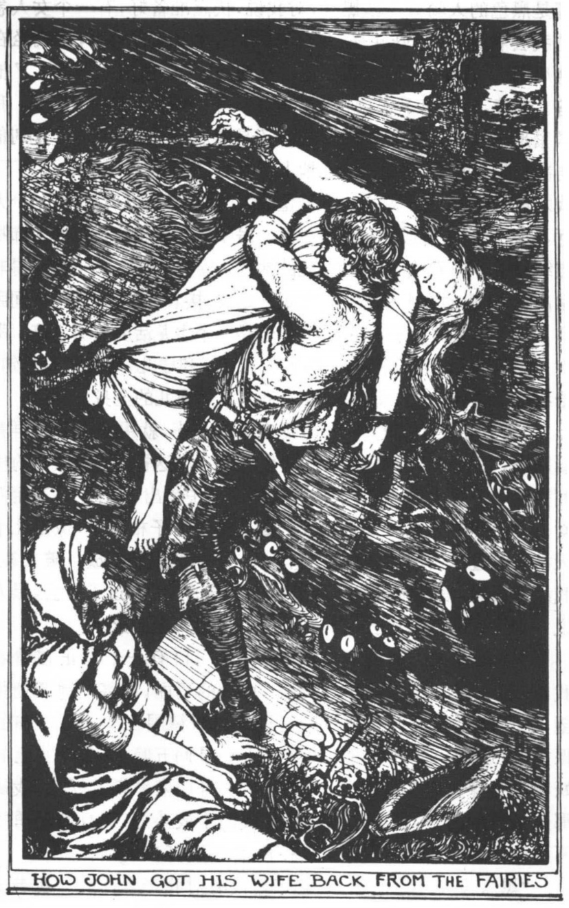

“黑人没有注意玛丽，看起来他没有对我产生怀疑。我走出来的时候，看了看周围，你猜我在什么地方？是在克罗莫哥古墓的堤坝上。我又骑上了马。那是什么马啊！其实只是一捆乱草，每一秒钟我都担心自己会掉下来摔死。幸好没有发生什么不幸，我回到自己的家里。一下地，国王就把五块金币塞到我的手里，说了声谢谢，祝我晚上好。但愿我再也不会看见他了。我躺在床上，好久不能入睡。今天早上起来，再看看放在桌子抽屉里的五块金币，结果看到的只是五张凋谢了的橡树叶子！”

听完了这个故事，你可以想象可怜的约翰那又喜又忧，百感交集的样子。说着，说着，他们等待着星期五晚上的到来。

星期五晚上，他们站在通往老罗斯的十字路口，在暗淡的月光下注视着瑟亚桥。一会儿，她小心地说：“他们来了。”但是约翰什么也看不见。女邻居张大眼睛注视着，紧张得直颤抖。“我看见你妻子了，她正好靠着我们这一边。我们继续往前走，假装什么也看不见。我推你一下时，你快点动手，否则就大难临头。”

他们继续往前走，心砰砰直跳。约翰虽然看不到什么，但似乎可以听到人马通过的喧哗声和马蹄声。终于，女邻居推了他一下。他赶紧伸出双手去抓，感觉到抱住了妻子的腰。接着，他看见了她身上穿的衣服。这时候，好像突然发生了地震一样，响起震耳欲聋的喧闹声。他看到许多可怕的妖精围住他，向他怒吼着，要把他的妻子抢走。他赶紧划了个十字，用尽平生的力气紧紧地把妻子抱住，口中不停地祈祷上帝保佑。他觉得自己的手臂从来没有这样坚强，像是钢铁铸成的一样。双方僵持了一会，一切又恢复了平静。可怜的玛丽已经昏迷过去，躺在丈夫的怀中。

不久，玛丽又可以重新操劳家务了。这次可怕的经历以后，她日日夜夜小心地避开那些精灵，特别是星期天，都准时地到教堂去做礼拜。

（爱尔兰居尔特人传说）

 
 

## 失去的天堂

很久以前，在一片大森林里住着一个烧炭人和他的妻子。他们结婚的时候，都年轻漂亮，身强力壮，什么活也难不到他们。但是后来运气越来越不好，他们变得越来越穷，饿着肚子上床睡觉的日子越来越多了。

有一天晚上，国王恰巧打猎从他们家门口经过，听到房子里有呜呜咽咽的哭声。国王是个好人，他想这家人家可能有什么困难需要帮助，就停下来听听。

“还有谁比我们两个人更不幸吗？”一个女人的声音说：“我们俩情愿像奴隶一样地整天干活，但却找不到任何工作。这都是老天爷不公平。像我这样一个安分守己，不管闲事，不异想天开，只知道老老实实地干活的人，应该像国王一样的快活，不愁吃不愁穿，唉！……”这时，响亮的敲门声打断了她的叹息。

“谁在那里？”她问。

“是我。”有人回答。

“‘我’是谁？”

“我是国王，让我进来。”

女人吃惊地跳了起来，赶紧把门栓拉开。国王走进房间，看到房间里一切非常简陋，没有什么家具，连一张椅子都没有。他假装有着急事情要走，对他们说：“请不要麻烦，我马上就要走了，看来你们的日子不好过，告诉我，你们是不是很不快活？”

“啊！国王！我们找不到工作，已经两天没有吃东西了！”她回答，“眼看只好等着饿死了。”

“不！不！你们不要这样。”国王说，“假如这种事情发生，那只是你们的过错。我要你们跟我到王宫里去。我答应，让你们觉得好像生活在天堂里一样。不过，我只要求你们一件事，你们要按照我的命令去做。”

烧炭人和他的妻子吃惊地看了国王一会儿，他们简直不敢相信自己的耳朵。当然，国王的话是不容置疑的，他们齐声回答：

“啊！是的，是的，我的国王！我们将按照你的一切吩咐去做！你这样仁慈，我们怎么能忘恩负义，违背你呢？”

国王微笑着，眨了眨眼睛。

“那么，让我们走吧！”国王说：“锁上门，带着钥匙。”

女人觉得这是多余的，没有必要，她好像肯定自己再也不会回到这个穷地方来似的。不过她不敢这么说，还是照国王的吩咐去做了。

穿过大森林，他们来到了王宫。按照国王的命令，佣人把他们领进了一个房间。房间里布置着他们做梦也想不到的漂亮的设备和家具。他们先在深色大理石的浴池里洗澡，舒服得像在海里游泳一样。然后穿上柔软舒适的丝绸衣服。等他们准备好了以后，佣人又把他们领到一个小厅里，这里已经为他们准备好了丰盛的宴席。这当然是最受欢迎的，因为他们已经尝够了挨饿的滋味。

他们正想坐下来的时候，国王走了进来，“我希望你们得到很好的接待，好好地享受晚宴。我的佣人将考虑你们的一切要求，你们高兴做什么就做什么。啊！对了，有一件事你们要注意。看到桌子中间的那个砂锅了吗？小心，不论出了什么事也不要把盖子打开，假如把盖子打开了，你们的好运气也就结束了。”说完，国王向他们鞠了一躬，就离开了。

日子一天天地过去了，生活就像一场美丽的梦。床铺是这样的舒适，他们每天早上都恋恋不舍地爬起来；衣服是这样的柔软和整洁，他们每天晚上都舍不得把它们脱下；每天的饭菜和点心都是美味佳肴，他们吃饱喝足以后还真不愿意站起来。房子外面就是公园，公园里种着许多名贵的果树，还有愉快的鸟儿在歌唱，真是鸟语花香，令人陶醉。如果想出去，一辆装饰漂亮的金黄色马车随时都在恭候他们。国王有时还来看看他们。他看看脸色红润，心宽体胖的烧炭人，再看看他的妻子。不过，当他的眼睛看着那女人时，眼神中总是充满了一种神秘的神情，只是夫妻俩都觉察不出来。

有一天中午，他们像往常一样来到餐厅坐下，准备用餐。

“你为什么不说话，”烧炭人问他的妻子，“以前你总是爱说这个，爱说那个，唠叨个没完。现在我几乎忘记你的声音了。”

“嗯！没什么，我不想说话就是了。”她停了一会儿，又接着说，“你从来不想知道砂锅里的是什么吗？”

“不，从来不！”他回答，“这关我们什么事？”妻子又不响了。

妻子的话越来越少了，好像着了什么魔似的。丈夫看到她这个样子，越来越担心、害怕。她不但话越来越少，而且吃得也越来越少，后来几乎是什么东西也不吃了。

“我亲爱的妻子，”丈夫说，“你无论如何要吃点东西，究竟是怎么了，到底发生了什么事情，这样下去，你会活不了多久的。”

“不知道砂锅里是什么，我宁愿死去。”她说话的声音这样气愤，丈夫实在吃惊。

“就为了这个？”他叫道，“这就是你那么可怜的原因？你不知道这样一来我们就会被送出王宫，回去挨饿吗？”

“啊！不！不会的。国王这个人太好了，他当然不会在乎这么一点点小事情。再说，也用不着打开整个盖子，只要掀开一道缝，我瞥一眼就可以看出来了。现在只有我们俩人，没有人会知道的。”

丈夫犹豫起来，是啊！这是一件小事情，而且能让妻子得到满足和高兴，值得冒这个险！于是，他小心地拿起盖子的抓手，慢慢地、小心谨慎地掀开一点点。妻子凑过头来，眯着眼睛看着。忽然，她惊叫起来，一只小老鼠从砂锅里跳出来，差一点撞在她的眼睛上。小老鼠在房间里到处乱窜，夫妻俩跟着拼命地追，想抓住它。他们撞倒了椅子，撞翻了桌子，打碎了花瓶，心里只有一个念头，快点抓住它，放回砂锅里去。

这时候，门打开了，国王站在门口，小老鼠从国王的脚下闯了出去。夫妻俩吓得赶紧躲到桌子底下。

“你们还是快点出来吧！”国王说，“我有话要对你们说。”

“我知道你要说什么，”丈夫垂头丧气地说，“小老鼠逃走了。”

“士兵将送你们回到森林里的农舍里去，”国王说，“你的妻子口袋里有钥匙。”

许多年以后，烧炭人夫妇的孙子听完了这个故事，说，“爷爷和奶奶怎么会这样傻？要是我有这样的机会多么好啊！我永远也不会想要去知道砂锅里装的是什么。”

（法国口头文学，保罗·西比雷特编写）

 
 

## 勇敢的沃尔特如何打狼

公路旁边有一座房子，红褐色的木栅，一扇又高又大的栅门，门两边有两棵美丽的山梣树。栅门里的公园长着修剪得整整齐齐的树木，春天总是最先发绿，夏天总是最先结出沉甸甸的果实。

房子的后面就是一排树篱，高大的白杨树在晨风中沙沙作响；树篱后面是一条路；路的后面就是一片森林，森林的后面就是广阔的世界了。

房子的另一边有一个湖泊，湖泊的后面是村庄，村庄的周围伸展出无垠的草原和田地。一年四季中，有时变黄，有时变绿。

在这座有着白色窗框、整洁的台阶、明亮的走廊的漂亮房子里，住着沃尔特的一家。他的父母，他的兄弟姐妹，还有他自己。

沃尔特很快就要去上学了。他还不太懂事，但是会做许多事情。他会翻筋斗、竖蜻蜓、玩球、滚雪球，还会学公鸡叫。有时他会闯祸，如扯破衣服，敲碎碗碟，打破玻璃窗，把花草踩坏。他的良心很好，但是记忆很坏，常常忘记父母的话，所以经常惹麻烦。但最有趣的还是他自个儿打算去打狼的故事。

有一年春天，炎热的夏天还未来临。沃尔特听说森林里有许多狼，感到很高兴。他在伙伴和兄弟姐妹之间，常常吹嘘自己的勇敢，说，“我一个人对付一只狼不稀奇，我起码可以对付四只狼。”

他和别的男孩打架，从背后打人家的时候，就会说，“碰到狼的时候，我就这样来教训它。”他用竹片做成箭射别人的时候，就说，“你如果是一只狼，我就这样射死你。”

虽然也有人怀疑这个小孩是在吹牛皮，但他说得那么认真，也有不少小伙伴相信他，看到他来的时候也会说，“看，打狼的沃尔特来了！”“沃尔特真勇敢，他一个人就能对付四只狼。”

当然，最相信自己的还是沃尔特。有一天，他准备去打一只真的狼。他带上了自己的一只破鼓，因为有一次他踩在鼓上采草莓，把鼓踩破了。还带着他的宝剑、弓箭、气枪，口袋里还带着一把小刀，准备割下狼的耳朵。他的帽子上插着一根红色的羽毛，看上去威风凛凛。总而言之，是武装到了牙齿。

这时，恰好比他大一点的哥哥詹尼斯赶着马车送谷子上碾房，他就坐在马车上一起去了。穿过森林的时候，沃尔特小心地注视着周围，看看丛林中是不是有狼。他没有忘记问詹尼斯，狼是不是怕鼓声？詹尼斯告诉他，当然怕，于是一路上，他不停地打着鼓。

到碾房了，沃尔特问老板，最近这里有没有看到狼？“哎呀！有啊！”老板说，“昨天晚上狼在离这儿不远的窑洞里，把我们最肥的一头羊吃掉了。”

“唷！”沃尔特说，“是不是有许多狼？”

“不知道！”老板回答。

“哦！无所谓，我只是问一问，看看是不是要带詹尼斯和我一起去。”沃尔特说，“我完全可以一个人对付三只狼，再多的话，我就怕来不及杀死它们，让它们逃跑了。”

“假如我是你，我就一个人去了，这样才显得更勇敢。”詹尼斯说。

“不！最好你一起去。”沃尔特说，“也许有许多狼。”

“不！我没有时间。”詹尼斯说，“而且最多只有三只狼，沃尔特一个人完全可以对付得了。”

“是的，”沃尔特说，“我一个人当然行。但是，你看，詹尼斯，可能有一只狼从背后咬我，我杀起来就难了。假如肯定最多只有两只狼，那我就放心了。我可以两只手抓住两只狼，把它们摔在地上，就像苏珊娜姐姐有一次摔我那样。”

“我敢打赌，最多只有两只狼。”詹尼斯说，“狼出来吃小孩和羊的时候，最多只有两只。没有我，你也能摔死它们。”

“可是，你看，詹尼斯，”沃尔特说，“就是只有两只，也可能有一只逃脱以后咬我的腿。你知道，我的左手不像右手那么有力气。你跟我一起去一定很安全。带上一根棍子，免得真的会碰上两只狼。你看，假如只来一只狼，我就两只手抓住它，把它背朝下摔倒在地，随它怎么乱踢，我也不会松手。”

“让我认真地想一想，”詹尼斯说，“我敢肯定只有一只狼。如果有两只狼，抓到一只羊怎么分？我看最多只有一只狼。”

“不管怎么样，你还是应该跟我一起去。”沃尔特说，“对我来说，一只狼真的不算什么，可是我很少和狼打交道，它会把我的新裤子扯破的。”

“好了，听着，”詹尼斯说，“我开始怀疑，沃尔特不像别人说的那么勇敢。开始，沃尔特可以对付四只狼，后来变成三只，两只，最后只剩下一只。现在对付一只狼也需要别人帮忙。这种事情真是太不应该了。要是别人知道了会怎么说？他们可能会认为沃尔特是个胆小鬼！”

“这是胡说，”沃尔特说，“我并不是害怕，只是两个人一起去更加有趣，我只是要一个人去看一看，我怎样把狼杀死的。”

“那好！沃尔特可以带碾房老板的小女儿丽萨一起去，她可以坐在石头上看着你。”詹尼斯说。

“不！她一定会害怕的。”沃尔特说，“再说，怎么能让一个小姑娘去打狼呢？跟我走吧！我把狼皮给你，我只要狼的耳朵和尾巴就可以了。”

“不！谢谢你！”詹尼斯说，“狼皮还是留给你自己吧！现在，我明白了，你是一个胆小鬼，真是太令人伤心了！”

这句话刺痛了沃尔特骄傲的心，他说，“我要让你们瞧一瞧，我不是胆小鬼。”他赌气地拿起了自己的全部武器，独自向森林里走去。

这是一个景色迷人的傍晚，鸟儿在丛林里愉快地歌唱着，仿佛在赞美勇敢的沃尔特。沃尔特小心谨慎地、慢慢地走着。每走一步，他都要仔细地看看周围，石头后面是不是藏着什么。他觉得好像有什么东西在沟里移动，也许就是一只狼。“我还是先敲一会儿鼓再走过去看。”他想。

“咚！咚……”他用足气力打着鼓。“呱！呱！”一只乌鸦吓得从沟里飞上天。沃尔特顿时勇气倍增，“幸好我带着鼓！”他想，继续勇敢地向前迈进。不久，就来到了狼吃掉小山羊的窑洞旁边。他越是靠近，就越觉得窑洞很可怕。它显得那么阴森，谁知道会有多少狼躲在里面？也许那只把羊吃掉的狼还蹲在角落里。周围一个人也没有，太不安全了。在天黑以前就被狼吃掉，太可怕了，沃尔特想。他越是这样想，那窑洞就越显得面目可憎，怪吓人的。想到要被狼吃掉，沃尔特不禁感到恐怖和害怕起来。

“我是不是回去说，打到一只狼，后来它逃跑了！”沃尔特想，“不！你忘了，对于上帝和人来说，撒谎是罪恶的根源这句话了？今天如果撒谎说打了一只狼，明天就会被狼吃掉。”

“不！我要到窑洞里去。”沃尔特想。他继续往前走。还没有靠近，他就看到了被羊的鲜血染红的一片草地，还有狼从羊身上扯下的一些羊毛。

真是令人毛骨悚然！

“羊被狼吃掉的时候不知道是怎么想的？”想到这里，沃尔特突然觉得一股冷气直从脚跟冲到头顶，不禁打了一个寒噤。

“我最好把鼓敲起来！”他想，开始用力打鼓。但是鼓的声音令人胆战心惊，而且从窑洞那边传来的回声很像是狼在嗥叫。沃尔特敲鼓的手有点发僵了。

一只毛茸茸的狼头好像从窑洞里伸出来！怎么办？沃尔特扔掉他的鼓，扭头就跑，用尽吃奶的力气朝碾房奔去。但是，坏了，狼紧紧地追了过来，离他只有几步远，恐惧完全控制了他。他似乎什么也看不见，什么也听不见，只是越跑越快。他跳过石头，跨过浅沟，踏着野草拼命地跑啊！跑啊！打鼓的棒丢了，弓箭也丢了，气枪也丢了……气急败坏中他不慎被乱草绊倒，倒在地上，狼向他扑了过来……

这真是一个悲惨的故事。可怜的沃尔特，连同他的冒险经历看来是完了。奇怪的是，狼扑上来以后并没有咬他，只是拉拉他的衣服，用鼻子去擦擦他的脸，幸好这是一只友好的狼。但是这也足以把沃尔特吓得魂不附体，发出令人毛骨悚然的叫声。

这时候，离碾房已经不远了。詹尼斯听到了他那可怕的叫声，赶快跑过来，把他一把拉起。

“发生了什么事？”他问，“是什么把沃尔特吓得这个样子？”

“狼！狼！”沃尔特魂不附体，话也说不出来，只是不停地叫着。

“狼在哪里？”詹尼斯说，“我怎么一只也看不见？”

“小心，它就在这里，差点没把我咬死。”沃尔特呻吟着。

詹尼斯哈哈大笑起来，笑得差一点把皮带也绷断了。那里是什么狼，那是沃尔特的好朋友，小狗卡罗。沃尔特到哪里，它就跟到哪里。在窑洞里，卡罗正好找到一只被狼吃剩下来的羊腿，听到沃尔特的鼓声，它就跑了过来。

“趴下，卡罗，你把一个大英雄吓成这个样子，不难为情吗？”

沃尔特站了起来，那样子非常可笑和尴尬。但他很快就恢复了英雄本色，“那只是一条狗，如果真的是狼，我早就把它杀死了。”

“沃尔特，但愿你能听我的劝告，吹得少一些，做得多一些。”詹尼斯说，“你一定会成为一个真正勇敢的人。”

“我！那当然！詹尼斯，你看着吧！下次如果我碰到一只熊，我也敢和它搏斗！”

“是吗？沃尔特，你又开始新的冒险了，是不是？要记住，只有胆小的人才吹牛，真正勇敢的人是从来不吹嘘自己的。”

（Z·托普路斯）

 
 

## 和妖精玩牌的国王

当年轻的国王登上王位的时候，他想到的第一件事就是如何想办法玩得痛快一些，他对以前那些曾令他开心的游戏忽然都感到厌倦，想做一些以前从来没有做过的事情。

后来，他的心情豁然开朗。“我想出来了，”他说，“我要去和格鲁盖克玩牌。”格鲁盖克是一个顽皮的妖精，长着卷曲的棕色头发，住在离王宫不远的地方。

国王尽管年轻，性情豪放，但他做事还是相当谨慎的。他的父亲临死前在病床上也告诉过他，和那些被称为“雅士”的妖精打交道时，要特别小心谨慎。因此，在他出发之前，他请来一个巫师。

“我想去和卷头发的格鲁盖克玩牌。”国王对他说。

“这是真的吗？”巫师问，“假如你听从我的劝告，你最好去和别人玩。”

“不！我要和格鲁盖克玩。”国王坚持说。

“好！我想你想去的话，是肯定要去的了。”巫师说，“假如你赢的话，就要站在门后剪短头发的丑姑娘作奖品。”

“我会的。”国王说。

第二天，太阳还没有出来，他就早早起来赶到格鲁盖克的家中，格鲁盖克正站在家门口。

“啊，国王，今天是什么风把你吹来了？”妖精问道，“欢迎！欢迎！要是你能和我一起玩牌，那就更受欢迎了。”

“我来就是为了这个。”国王说。于是他们就玩了起来。有时候好像是国王要赢；有时候，好像是妖精要赢，最后是国王赢了。

“你愿意要什么样的奖品？”格鲁盖克问。

“站在门后那个剪短头发的姑娘。”国王说。

“为什么？房子里还有二十个姑娘，个个长得比她漂亮！”妖精说。

“也许都比她漂亮，但我愿意要她做妻子，其他人一个也不要。”妖精看到国王决心已下，就到房间里去，叫里面的姑娘一个一个地走出来，从国王面前经过。她们有的高，有的矮，有的胖，有的瘦，有的金发白脸，有的黑发黑脸。她们走到国王面前时都说，“我就是你要的女人，你不要我就是个大傻瓜。”但是国王一个也看不中。

最后，剪短头发的姑娘走出来，尽管她长得很丑，大多数男人都不会看她第二眼，国王还是说，“她是我的，我们马上结婚，带她回家。”

他们举行了结婚仪式，然后就返回王宫。穿过草原的时候，新娘弯下腰来，从草丛中摘下一枝白花酢浆草。等她站起来的时候，完全变了一个模样。可以这么说，国王的身边从来没有站立过这么美丽的姑娘。

第二天，太阳还没有出来，国王就从床上跳起来，对新娘说，他今天还要去和格鲁盖克玩牌。

“假如你赢了我的父亲，”她说，“你就要那匹用木条子做马鞍，长满粗毛的幼马作奖品。”

“好的。”国王回答后就走了。

“你的新娘让你满意吗？”站在门口的格鲁盖克看到国王来到，就问道。

“哦？她会不让我满意吗？除非是我太难满足了。”国王说，“今天我们还玩牌吗？”

“要玩的。”妖精回答。于是他们又玩了起来。有时好像是国王赢，有时好像是妖精赢，最后还是国王赢了。

“今天你要什么奖品？”妖精问。

“长满粗毛，有木条子马鞍的那匹幼马。”国王回答。他注意到妖精在克制自己，他从马厩里牵出马的时候，眉毛紧锁着。这匹马的鬃毛又粗又密，皮肤是棕色的，国王并不留意这些，跨上马鞍，像一阵风似的飞奔而去。

第二天早晨，国王像往常一样起得很早。吃过早饭以后，他准备出去。他的妻子拦住他，“我希望你不是去和格鲁盖克玩牌，你已经赢了两次，总有一天也会输的。那时候，他就会给你找麻烦了。”

“哦！但我还是要和他再玩一次，这是最后一次了。”国王说完，就动身到妖精的家里去。

看到国王来到，妖精的心中顿时充满了欢乐。他们也顾不得说话，就开始玩起牌来。不知道怎么回事，国王这次的技巧和毅力都大不如前了。很快，妖精就获胜了。

“请选择你的奖品吧！”国王说，“但不要太难为我了，或者提出什么我不能做到的要求。”

妖精说，“我要选择的奖品是，要么你把栎木窗国王家中挂着的光剑给我带来，要么就是那个剪短头发的家伙把你的头送来。”

“我会拿到光剑的。”年轻的国王勇敢地回答。但走出妖精的视线以后，他的勇气就消失了，脸色阴沉，步履蹒跚。

“你今天晚上没有带什么东西回来。”王后说，她正站在台阶上等着。她是这样的美丽，国王看到她的时候，也勉强地露出了一丝笑容。想起刚发生的事情，他的心又变得沉重起来。

“怎么了？发生了什么事情？告诉我，你为什么悲哀，我可以帮你承担，或者帮你解除。”国王告诉她事情的经过。她用手理了理他的头发。

“用不着担惊受怕的，”听完了他的故事，她说，“你有埃里恩最好的妻子，有埃里恩最好的马。只要照我的话去做，一切都会好的。”听了这些话，他多少得到了一些安慰。

国王还在睡的时候，王后就早早地起来，穿戴好了以后，开始为国王做好一切旅行的准备。她先到马厩里去，让那匹粗毛棕色马吃饱喝足，装上马鞍。很多人都以为那马鞍是木条子做的，其实他们没有看到藏在其中的金子和银子在闪烁着点点光芒。她把马鞍套好以后，就牵到房子门前，国王正在那里等候。

“祝你好运，旗开得胜。”她说，在他上马之前吻了他一下，“用不着我吩咐你什么，马会告诉你怎么去做的，请听它的。”

她挥手向他告别，送他上了征途。那匹棕色马比疾风还快地向前飞奔，既不停留，也不朝后看。当天天黑，他们来到了栎木窗国王的城堡。

“我们的目的地到了。”马说，“在国王的寝室里，你会找到那把光剑。假如没有发出什么响声，那就是一个好兆头。这时候国王正在吃晚饭，寝室里没有人，不会有人看见你。那把剑有一个球形捏手，你抓住以后，要小心轻轻地把它从剑鞘中抽出。走吧！我在窗下等你。”

年轻的国王沿着走廊偷偷地溜进去，不时停下来看看是不是有人跟着。他蹑手蹑脚地走进国王的房间。一种奇怪的白光告诉他光剑在那里。他小心翼翼地穿过房间，抓住剑的球形捏手，慢慢地把它从剑鞘里抽出。国王紧张得屏住呼吸，生怕会发出一点声音，惊动城堡的人追赶过来。剑慢慢地，无声地被抽出来。不幸的是，剑尖最后碰了一下，发出一种低沉的，好像刀叉碰到银盘般的声音。国王这一惊非同小可，几乎把光剑扔下。

“快！快！”马叫了起来，国王赶快从窗口里跳出来，跳到马鞍上。

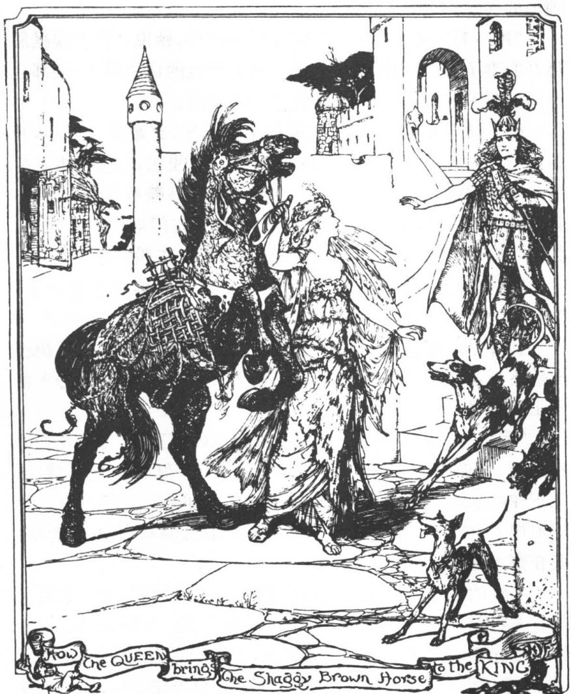

“城堡里的人已经听到了响声，马上就会追过来。”马说，“但是我们的开头不错。”他们马不停蹄地疾驰着，把风都留在后面。

不久，马放慢脚步，对国王说，“看看后面有人跟着吗？”国王往后面看了一下。“我看一群棕色的马在疯狂地追了上来。”他说。

“我们比他们快！”马说着加快了速度。

“再往后看一看！国王，又有谁跟上来了没有？”

“一群黑色的马，有一匹马长着白脸，上面坐着一个人，他就是栎木窗国王。”

“那是我的哥哥，它跑得比我快。”马说，“栎木窗国王很快就会追上我们。你必须抓紧那把剑，做好准备。等他追上来，转过头来看你时，立刻把他的头砍下来，世界上除了这把剑，没有任何宝剑可以把他的头砍下。”

“我会照你的话去做。”国王回答，他全神贯注地倾听着，当他断定那匹白脸的马已经接近时，他挺起腰，做好一切准备。

一瞬间，忽然传来像暴风骤雨般的响声，国王一眼就看到有人回过头来看。他也来不及看准，闪电般地挥了一剑，也吃不准是否击中要害。但是那个人头滚了下来，被棕色马用嘴咬住。

“快跳到黑色马的背上去，尽快地回家，我会紧随其后。”棕色马急匆匆地叫道。国王不敢怠慢，立即纵身一跃。尽管他的马术非常高明，但还是慢了一步，坐在马屁股上，差一点被摔下来，他赶紧用尽全力抓住马鬃，拼命地爬到马鞍上去。

东方刚刚露出微红，他回到了家中。王后整夜不曾合眼，等待着他的归来。看到丈夫走进来，她非常高兴，没有说什么，只是拿起竖琴，唱着他最爱听的歌，直到他上了床，幸福地睡着了。

当他醒过来时候，已是晌午了。他跳了起来，说，“我要到格鲁盖克那里去，看看他还说什么。”

“小心，”王后说，“他不会像以前那样微笑着欢迎你，看到你一定很生气。他会愤怒地问你，剑拿到了没有。你要回答说，拿到了。接着他要问你是怎么拿到的。你一定要回答说，那圆圆的球形捏手没有拿到。接着，他就会抬起头来看那光剑的捏手在不在。这时，你必须用剑刺中他头颈右边的那颗痣。一定要小心，如果不能刺中这颗痣，那么你我就死定了。他是栎木窗国王的哥哥。他肯定会知道，要不是栎木窗国王死了，这把剑是绝对不会到你手中的。”说完，她吻了他一下，祝他快去快回。

“你拿到剑了吗？”他们在老地方见面时，格鲁盖克问他。

“我拿到剑了。”

“你是怎么得到它的？”

“假如不是剑柄上有一个圆球，我就得不到它了。”国王模棱两可地回答。

“把剑拿过来我看看。”格鲁盖克说着伸出头来。像闪电一样，国王就在他的鼻子底下抽出剑来，不偏不倚地刺中了他头颈右边的那颗黑痣。格鲁盖克一声也不吭就倒在地上死了。

“现在，一切都太平了。”国王想。

可是，他错了。

他回到家中，看到佣人被背对背地捆在一起，嘴被衣服塞了起来，不能说话。他赶紧解开他们，问是谁干的。

佣人说，“你走了不久，闯进来一个巨人，把我们捆了起来，抢走了你的妻子和两匹马。”

“我发誓要把妻子和两匹马带回来，否则死不瞑目。”他说完，就循着马在地上留下的脚印追去。来到一片森林的时候，天已经黑了。

“我就睡在这里，”国王说，“让我先生起一堆篝火。”他从地上捡起一些树枝，堆在一起，再拿起两根干树枝，用力摩擦，直到起火。

树枝劈里啪啦地燃烧着，吐出蓝蓝的火焰。一只瘦小的小黄狗从树丛中跑过来，躺在国王的身边，国王抚摸着它的头。

“呜！呜！”小狗说，“昨天晚上巨人抓到王后和你的马，从这里经过的时候也是这样。”

“我到这里来就是为了追赶他们。”国王说。忽然间，国王好像丧失了信心，觉得自己再也不能追下去了。

“我斗不过那巨人，”他嚷起来，脸色苍白地看着小狗，“我害怕了，还是让我回家吧！”

“不！不要这样。”小狗回答，“吃过晚饭就睡觉，我看着你。”于是国王晚饭以后就躺下来，一觉睡到天亮。

“你应该启程了。”小狗说，“如果遇到什么危险，就叫我，我会帮助你的。”

“再见！”国王说，“我不会忘记你的好意。”

他继续走啊！走啊！走到一个悬崖下面，地下到处是枯枝败叶。

“天快黑了。”他想，“让我生起火来休息。”当火焰升起来的时候，一只银灰色的鹰飞到他头顶上的一棵树上。

“你的妻子和马跟着巨人到这里的时候也是这样。”鹰说。

“我怕是再也找不到他们了，”国王伤心地说，“一切都可能是徒劳的。”

“啊！鼓起勇气来！”鹰回答，“困难虽然很大，但事情还不至于这么糟。吃饱了就睡吧！我会看着你的。”

国王照着鹰的吩咐做了。第二天早晨，他觉得勇气倍增。

“再见，”鹰说，“有危险的时候就叫我，我会来帮助你的。”

他走啊！走啊！直到天黑的时候，来到了一条大河旁。河边到处是树丛。

“让我生起一堆火来。”他想。火焰升起来的时候，他看到一个光滑的褐色的头从河里冒出来，后面是长长的身体。

“昨天晚上，你妻子和马从这里经过的时候也是这样。”水獭对他说。

“我到处寻找，但不见他们的踪影。”国王回答，“我不辞辛苦，遇难而上，也许会一无所获。”

“不要这样悲观失望。”水獭说，“明天中午以前，你就会看到自己的妻子。吃过晚饭睡觉吧！我会看着你的。”

国王照水獭的话做了，第二天太阳升起，他醒过来的时候，看到水獭躺在岸上。

“再见吧！”水獭说着跳入水中，“如果有危险就叫我，我会帮助你的。”

国王走了几个钟头以后，来到一块又高又大的岩石旁边。这块大岩石被一次大地震劈成两半，当中是山谷。国王趴在岩石边缘往下看，看到妻子和马都在下边的山谷里。他的心砰砰地跳着。所有的恐惧和担忧都一下子消失了。但是他还不能性急，因为岩石的边缘光滑得连一只小山羊也站不住脚。他只好站起来，沿着山谷绕过去。他越过岩石，穿过丛林，涉过水沟，才来到了两块岩石当中的谷底。

看到国王，他的妻子高兴地叫了起来，接着，伤心的泪水又滚滚而下，因为她又累又怕。她的丈夫也很累，因为爬山越岭而遍体鳞伤，心中也充满了烦恼。

“我为了寻找你，几乎丢了性命，”他咕噜着，“你却这样来接我。”

“不要管他说什么，”两匹马对哭泣着的王后说，“把他安置在我们中间，他在这里会很安全的。给他一点吃的，他很疲倦了。”

王后照马的话去做了，他吃过以后就躺下来休息。不久，一个很大的阴影笼罩了他们。他们的心因紧张而激烈地跳动起来，因为他们知道，巨人回来了。

“我闻到了生人的气味。”巨人走进山谷的时候叫了起来。但是深谷中很暗，国王又蜷缩在两匹马之中，他看不到。

“什么生人！我的上帝！没有什么生人会来这里。”国王的妻子快活地笑着说。她走过去，抚摸着巨人一只垂下来的大手。

“是的，很奇怪，我也没有看见什么。”巨人说，“到了喂马的时候了。”他拿起了一捆草，向两匹马递过去。两匹马向他走过来，他把手伸过来的时候，两匹马开始咬他。他痛得哇哇直叫，一里外都听得见了。接着，两匹马又轮番拼命地踢他，直到用尽所有的力气。巨人被踢得连滚带爬，蜷缩在一个角落里发抖。王后向他走过来，说：“真可怜！真可怜！两匹马看来是发疯了，真难伺候。”

“假如我的灵魂在身上，肯定死在它们手里了。”巨人呻吟着。

“那真是太幸运了，”王后说，“告诉我，你的灵魂在哪里？我好照顾它。”

“在上面，在那块大石头里。”巨人说，指着岩石边缘的那块不怎么平稳的大石头，“走开，我要睡觉了，明天我还要赶远路。”

不久，巨人躺下的角落里就传来打鼾声。王后听到这声音也睡下。两匹马也躺下，国王就睡在他们中间，谁也看不见。

黎明时分，巨人就起来走了。王后马上跑到那块大石头旁边，用力推它，但是反而把它弄稳了，怎么也推不动了。

晚上，巨人回来了，看到他的影子，国王就躲到两匹马当中去了。

“喂！你干吗去动那块大石头？”巨人问。

“你的灵魂在里面，我怕它掉下来碎了。就把它放放平。”

“我的灵魂不在那里，”巨人说，“我的灵魂在门槛里。到喂马的时候了。”他拿了草料去喂马，两匹马又像昨天那样，又咬又踢他，直到他半死不活躺在地上。

第二天一早巨人又出去了。王后马上来到洞口的门槛边，冲洗做门槛的石头，拔掉长在石头缝里的一些小花和苔藓，她以为这就是巨人的灵魂。

不久，天黑了，巨人回来问道。“你冲洗过门槛了？”

“我想看看你的灵魂还在不在里面，这样做不对吗？”

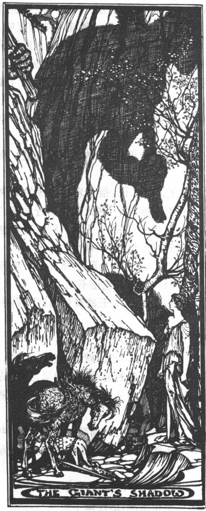

“我的灵魂不在里面。”巨人说，“门槛下面有一块石头，石头下面有一只山羊，山羊的肚子里有一只鸭，鸭的肚子里有一只蛋，蛋里面就是我的灵魂。天黑了，我要喂马了。”

像前两天一样，他又被马连咬带踢，弄得死去活来，要不是灵魂不在身上，早就死了。

巨人起身出发以后，天还没亮，国王和王后跑出来掀掉门槛，两匹马在旁边看着。一点也不假，正如巨人所说的，在门槛下面是有一块石头，他们连推带拉把石头搬开。突然有什么东西跳了出来，差点把他们撞倒。等那东西跑过去时，他们才看清是一只山羊。

“假如森林里的小黄狗在这里，它一定能抓住山羊。”国王说。话音刚落，就看到小黄狗从森林中出现，口中还叼着那只羊。国王猛力一击，羊就倒地死了。他们剖开它的肚子，一只鸭子突然展翅飞了出来。

“假如岩石上的灰鹰在这里，它一定会抓住这只鸭。”国王说。话音刚落，就看到灰鹰从天而降，嘴里还叼着那只鸭。国王用剑砍下鸭的头，取出它的蛋。他正为胜利而高兴的时候，不小心蛋从手中掉下来，从山坡上滚下，一直滚入河里。

“假如褐色的水獭在那里，它一定会找到蛋。”国王说。一会儿水獭出现了，潜入水中，口中衔着蛋上来了。这时候，一个巨大的阴影出现了——巨人回来了。

国王呆呆地看着影子，吓得像一座雕像似的。王后迅速地从水獭嘴中接过蛋，用双手把它捏得粉碎。影子晃了两下就消失了。巨人死了，因为他的灵魂已经被粉碎。

第二天，他们骑着马回家，一路上还拜访了他们的朋友：褐色的水獭、灰鹰和小黄狗。

（西苏格兰高地传说）

 
 

## 法国小精灵

在法国中部山区的牧场和山谷中，住着一群爱恶作剧的精灵。他们唯一感兴趣的是和一切人耍诡计和花招，特别是那些牛仔和牧羊人。这些可怜的人整天提心吊胆，不知道什么时候能够摆脱他们。他们能够变成男人、女人和小孩，或者羊、棍子和犁铧。只有一样东西他们不会变，那就是一枚针。即使他们想变成一枚针，也无法变出针眼来，妇女总是一眼就可以看得出来。这一点，那些精灵也很清楚。

这些小精灵恶作剧的时候往往是半夜里，那些牛仔和牧羊人由于整天的劳累，大都熟睡了。这时候，小精灵就会到牛棚里去，把拴牲口的铁链打开，扔在地下。吵闹的声音这么大，那些十分疲倦，睡得正香的牛仔也会被吵醒，只好无可奈何地爬起来，去重新捡起链条，拴好牲口。他们刚躺进温暖的被窝，同样的事情又会发生，这样直闹到天明。有时候，小精灵会花上整个晚上，把两匹马的马鬃和尾巴编织在一起。早晨，那些牛仔就得花上几个钟头，才能把它们解开。小精灵这时候就会躲进草堆里看着，乐不可支。

八十多年以前的一个晚上，一个名叫威廉的牧羊人从小河旁走过，看到一只羊在大声地叫唤着。他想，这只羊肯定是离群迷路了，只好先把它带回家，等找到主人以后再说。他走到羊的身边，那只羊显得非常疲劳，路也走不动了。他把羊扛到肩上，就继续赶路。那只羊非常重，好在威廉也不嫌弃，吃力地一步一步向前迈动着。

前面就是一条两旁种满胡桃树的林荫道。“不远了。”他心里正在想，突然听到一个声音在他头上说话，把他吓了一跳。

那声音说，“你在哪里？”

羊回答，“在一只猴的肩膀上。”

说着，羊已经跳到了地上站着，威廉吓得拔腿就跑，拼命地逃回家。一个声音夹杂着笑声传进了他的耳朵，“啊！亲爱的，这个玩笑开得多开心，真的。”

小精灵还注意不老在一个地方耍花招，他轮流着走访各个村庄，弄得大家都提心吊胆，生怕下一个就轮到自己。有一次，一个小精灵对牛仔和牧羊人恶作剧感到厌倦了，就想着谁能让他开开心。后来他知道有一对年轻人要到城里去买东西，以准备他们的婚礼，布置新房间。小精灵想，他们肯定会忘记买什么必不可少的东西，就在他们回来的路上等着。他变成一只苍蝇，以便偷听他们的对话。

有好一会儿，他们说的话非常乏味，都是关于下个月举行婚礼的事情，还有该邀请哪些人啦。后来新娘想起她的结婚礼服，叫了起来：“真是的，我怎么这样笨，怎么忘了买一些各种颜色的线来缝结婚礼服。”

“亲爱的，”年轻的小伙子说，“太不走运了，你不是告诉我，明天裁缝就要来了吗？”

“是的，我说过。”她说着，突然又惊叫起来，“你看！你看！”新郎沿着她指的方向看去，看到路旁有一捆各种颜色的线团。“好啊！真是幸运，我想这是仙女送给我们的结婚礼物。”

“也许是她送来的。”姑娘开心地笑出声来。接着，她好像听到了笑声的回声。

裁缝非常喜欢这些五颜六色的纱线，它们和布料非常相配。她缝起来又快又好，超过了她的想象。新娘也非常高兴，请裁缝结婚的那一天一定要到教堂里去，看看她穿结婚礼服是如何漂亮。

新郎新娘从小就讨人喜欢，父母又很有钱，所以结婚的那天，许多客人都来参加他们的婚礼。教堂的门打开了，从老远就可以看见，新娘从林荫道的远处走过来。

“多漂亮的姑娘！”男人说。

“多漂亮的结婚礼服！”女人说。

当她走进教堂，拉起等着她的新郎的手时，忽然传来响声。

“劈啪！劈啪！”结婚礼服一下子就掉在地下，弄得新娘子非常狼狈。

婚礼只好暂停，慌乱中有人给新娘送来了长长的披风。新娘受了这样的惊骇，眼泪忍不住掉下来。有一位客人走过来，想检查一下礼服，看看究竟是什么原因。

“线可能老化了，”她说，“我看看能不能扯断它。”可是她什么也找不到。那些五颜六色的线都消失了。

（法国口头文学，保罗·西比雷特编写）

 
 

## 三顶王冠

曾经有一个国王，他有三个女儿，两个大女儿非常自傲，而且喜欢吵吵闹闹；小女儿却恰恰相反，非常善良。

三个王子来求婚，两个王子的性格和两个大公主一模一样，另一个王子也和小公主一样可爱。有一天，他们几个人一起到草坪旁边的湖畔去散步，看到一个很穷的乞丐。国王没有给他什么。两个大公主和她们的心上人也分毫不肯施舍，只有小公主和她的恋人给了他一些，还说了几句祝福的话，这当然比什么都值钱。

他们来到湖边的时候，看到湖里有一只从未见过如此漂亮的船。两个大公主都异口同声地说，“我要坐这只漂亮的船去航行。”小公主却说，“我不坐这只漂亮的船去航行，我怕这是一条施了魔法的船。”但是其他人都劝她上去。国王想跟着三个女儿上去的时候，船上突然出现一个只有七英寸高的小矮人，他命令国王回去。岸上的男人都伸手去拔剑，可是抽不出来，他们手臂的力量完全没有了。小矮人解开系着船的银链，咧开嘴笑着，对他们说，“暂时和你的女儿，你们的新娘告别吧！”他还对最年轻的王子说，“你，用不着害怕，你将会重新得到你的公主，你们俩人将永远幸福。至于坏人，即使是光着身子在黄金里滚，也不会富起来。再见！”船开走了。公主们挥着她们的手，但一个字也说不出来。

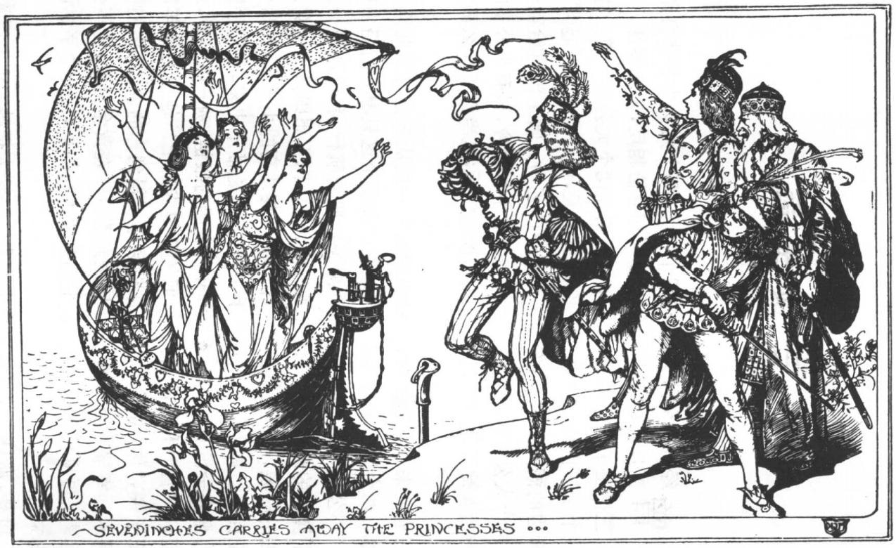

可是，那只船并没有向河中驶去。小矮人把她们抱上岸来，抱着她们到一个从来没有见过的一口井旁，用吊篮把她们放下去。国王和三个王子眼睁睁地看着她们，好像被钉子钉住似的，一动也不能动。等她们完全消失以后，他们才恢复了行动的自由，急忙跑到那口井旁，看到辘轳上绕着丝绳，绳子上挂着一个好看的白色吊篮。“让我下去，”小王子说，“我誓死也要找到她们。”第二个王子说，“不！应该是我先下去！”另一个王子说，“我最大，我先下去。”于是，大王子跨进吊篮，其他人把他慢慢地放下去，渐渐地，就看不见他了。大约放了几百米以后，丝绳松了，大概是到井底了。他们停止了转动，耐心地大约等了两个钟头，也不见有动静，就吃饭去了。

晚上，他们在井旁布置了卫兵。第二天早晨，二王子下去了当然也是毫无音讯。到了第三天早晨，小王子也下去了。他一米一米地往下沉。头顶上的亮光越来越微弱，最后像是盖上了盖的，井里一片漆黑。终于，他看到井底有一丝亮光，不久就着地了。他走出了像大窑洞似的井底。啊！真令人惊讶，下面是一片海阔天空。有茂盛的森林、碧绿的草地，草地上有一座城堡，还有蓝蓝的天空。

“我大概是到了他乡异国，”他想，“让我去看看城里住着什么样的人。”他穿过田野和草地。城堡的大门打开着，没有人欢迎，也没有人阻止他进去。城堡里有许多漂亮的房间。他走进一间又一间，一间比一间更漂亮。最后他来到了最漂亮的那一间，里面已经摆好了一桌丰盛的宴席。王子这时候已经饿极了，但他是一个很有教养的人，没有人邀请，他是不会自己动手的。他坐在火炉旁等着。没多久，传来了脚步声。小矮人拉着最小公主的手走进来。王子和公主惊喜得紧紧地抱在一起。小矮人问，“你为什么不吃？”王子说，“我想，先生，等候别人的邀请是一种有礼貌的表现。”小矮人说，“另外两个王子不是这么想的。当我对他们说，你们太随便了的时候，他们的回答是一些粗鲁的话。我想，他们不会再觉得饿了。现在，他们是漂亮的大理石而不是血肉之躯。”说着，他指了指竖立在房间两个角落里的两座雕像。王子被惊骇得不敢说一句话。小矮人请他坐在自己和公主之间用餐。要不是看到角落里变成石头的两个王子，他该有多么高兴啊！这一天就这样过去了。第二天早晨，小矮人对他说，“现在，你必须沿着这条路走。”说着用手指了指太阳的方向，“今天晚上，当你觉得饿了累了的时候，你会在一个巨人的城堡里看到二公主。明天晚上你就会看到大公主。用不着请求她们的主人许可，就可以把她们带到这里来。也许她们回家以后，看到穷人也会想到，他们和自己一样，也是有血有肉的人了。”

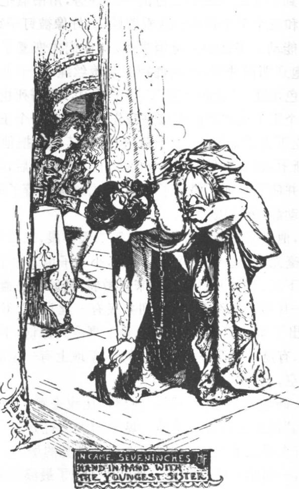

小王子踏上了征途，天啊！太阳下山的时候，他才看到第一座城堡，真是又饿又累。二公主看见他真是非常高兴，招待他一顿十分丰盛的晚餐。她听到巨人来到门口的声音，就把他藏在小房间里。巨人进来，不停地嗅着，嗅着，说，“我敢打赌，我闻到了生肉的气味。”“哦！”公主说，“那只是我今天杀的小牛肉的气味。”巨人说，“嗯，嗯，晚餐准备好了吗？”“是的，准备好了。”公主说。巨人狼吞虎咽地吃掉大半只牛，一大瓶酒，才从桌子旁站起来，他还是说，“我想，我还是闻到生肉的气味。”“你打瞌睡了，”她说：“睡觉去吧！”巨人说，“你什么时候和我结婚，时间拖得太久了。”她说，“圣蒂博节前夜。”巨人说，“我真想知道，还有多久才到这个节日。”说着就头伏在盘子里睡着了。

第二天，巨人吃过早饭就出去了。公主把小王子送走，让他去找大公主住的城堡。在那里也发生了同样的事情。但是当巨人开始打鼾的时候，大公主把小王子叫醒，从马厩里牵出两匹骏马，安上马鞍，两人骑着马小心地走出去。可是马在走出大门口时把旁边的一块大石头踢了一下，发出响声。巨人惊醒了，追赶出来，还大喊大叫着。他越是叫喊，两匹马就越是跑得快。但是，到天快黑的时候，巨人离他们只有二百米左右了。这时，王子勒住马，抽出一把从小矮人城堡里带来的短剑，朝后一扔。立刻，一片茂密的森林出现在巨人和他们之间，挡住了巨人。他们又骑着马飞快地跑了，抛下了后面追来的风，赶上了前面的风。他们终于来到了二公主居住的城堡，她骑在一匹骏马上，在一个高大的栅栏下，等着他们。

紧接着，巨人也跟随而来，愤怒的叫声好像是一百头狮子在怒吼。另一个巨人也从城堡里追出来。于是，三匹马在前面奔驰，两个巨人在后面紧追不舍。马跳跃两步，巨人就跨出三步，距离越来越近。到只有三百米的时候，王子停下马来，扔出第二把短剑，刹那间平地陷了下去，他们和巨人之间出现了一条几百米深的横沟，沟底充满了黑色的水。在巨人设法从旁边绕过来的时候，王子和公主们已经来到了充满着神秘的魔法的王国。高大的布满荆棘的篱笆自动打开了一扇大门，让每个愿意的人进去。三个公主团聚在一起，那高兴的样子真是难以形容，直到两位大公主看到她们的爱人变成的石头，才转喜为悲。在她们痛苦地流着泪水时，小矮人走进来，用手中的棒点了他们一下，石头变成了肉体，血液开始流动，生命再次恢复。两对恋人欢天喜地拥抱和接吻。接着，他们坐在一起吃早餐，小矮人坐在主人的位置上。

早餐以后，小矮人领他们来到另一个房间。房间里堆放着金子、银子、钻石、丝绸和缎子。一张桌子上有三套王冠，都是一顶金冠贴在银冠里，外面还套着一顶铜冠。他拿起了第一套王冠，把它交给大公主、把第二套给二公主，把第三套给小公主。接着，他说，“现在你们都可以到井底去，用不着做什么事情，只要摇动吊篮，井上守着的人就会把你们拉上去。但是，女士们，要记住，要好好地保存好自己的王冠，要在同一天戴着它们结婚。假如你们分别结婚，或者是不戴着王冠结婚，灾祸马上降临！千万要记住我的话。”

他们怀着十分崇敬的心情离开了小矮人，手挽着手走了出来。外面是蓝天和太阳。他们来到了一堵很高很高的墙壁面前，墙壁根本看不到顶，墙上长满了常春藤和玫瑰。最年轻的一对恋人走在最后。小公主对小王子说，“我看得出来，两个王子对你不怀好意。把这顶王冠藏在你的斗篷里。假如你最后一个上去，不要走进吊篮，放一块大石头或者别的什么重的东西进去，看看会发生什么事情。”

墙壁的下面有一个拱形的大洞，黑魆魆的井底就在洞里。他们把大公主先放在吊篮里，摇动了吊篮，绳子开始收紧，把她拉了上来。吊篮放下来了，接着是二公主上去。轮到小公主的时候，她用双手抱住小王子的头颈，吻他，哭了一会。最后一个轮到小王子，他把一块大石头放在吊篮里面，退到一旁看看动静。吊篮上升到一百米高度时，突然掉下来，石头被砸得粉碎，那声音像是在打雷。

可怜的小王子无路可走，只好返回城堡。他在城堡里和四周游荡。到处都可以找到非常好吃的食品和好喝的饮料，还有非常舒适的床睡觉。整整一个星期，他常常穿过公园和草地，不停地走啊！走啊！但怎么也看不见小矮人的影子。他感到厌倦了。他思念着心爱的人，心中感到非常凄凉。一个月过去了，他也不知道是如何是好。

有一天早晨，他来到藏珍宝的房间，看到一只漂亮的烟盒，他记着上次来这里没见到过。他拿起来，把它打开。小矮人从里面跳出来，站在桌子上。他说，“我想，王子，你对我的城堡有点厌倦了吧！”“啊！”王子说，“假如我的公主在这里，而且能常常见到你，那就绝对不会有忧郁的一天。”小矮人说，“好！你待在这里的日子够长了，上面在等待着你。保存好你新娘子的王冠。什么时候需要我的帮助，就打开这个烟盒。你现在到公园里去散散步，累了就回来。”

王子沿着一条砾石路走去，两旁是匆匆搭起的篱笆。他的眼睛朝下看着，心里想着这样和那样的事情。后来他抬起头来，看到自己就站在以前经常经过的铁匠铺的门口，这里离公主的王宫只有一里多远。这时，他身上穿的衣服突然变得破烂不堪，只是在这褴褛的斗篷里还珍藏着那一顶王冠。

铁匠走出来，对他说，“像你这样健壮的人，有那么多活不去干，变得这么懒，真是太不知羞耻了。你会用锤子和钳子吗？进来帮帮手吧！我会给你吃的和住处，你还可以赚一些零用钱。”王子说，“不用再说了，我现在需要的是干活。”于是他拿起锤子，把铁匠从炉子中取出的，烧得通红的铁块打成一副一副马蹄铁。

他们还没干多久，一个裁缝走进来坐下，开始说，“你们都听说了吗？两个王子很讨厌要等最小的公主找到她的王冠和心上人以后再一起结婚。自从那天他们把小公主未来的新郎拉上来时，绳子突然松掉以后，那口井，连同绳子，辘轳都无影无踪了。两个向公主求婚的王子都缠住公主和国王不放，不让他们片刻安宁，直到他们同意举行婚礼。婚礼今天上午举行。怀着十分好奇的心情，我也去看了。两位新娘身着华丽的服装，头上戴着金、银、铜套在一起的王冠，看了真叫人高兴。最小的公主站在一边，够悲伤的了。一切都准备好了。两位新郎神气傲慢地走了进来。就在他们向圣坛走过去时，地板突然裂开有两米多宽，两人都掉进教堂下的墓穴里，睡在死人和棺材之间。人们乱成一团，女人们发出尖锐的叫声，许多人都跑过来往里看。神父赶紧打开墓穴的门，两个王子狼狈地走出来。漂亮的衣服上沾满厚厚的蜘蛛网和泥土。”

“国王不得不宣布婚礼推迟举行。他说，‘因为，只能等小公主找到她的王冠，和她们一起结婚，其他没有什么法子可想。谁能把像两位公主戴着的一样的王冠带来，我就把最小的公主嫁给他。如果他本人不愿意结婚，会有人想结婚的，我将让他幸福。’”

“我希望我能做出这顶王冠。”铁匠说，“但是在公主回家的路上，我仔细地看了看王冠，我想地球上任何一个铁匠也不能仿造出来。”

“懦夫是不会得到好姑娘的爱的。”王子说，“到王宫里去，向他们要四分之一磅黄金，四分之一磅银子和四分之一磅铜，借一顶王冠来做样子，我敢用头来打赌，我会给你一顶一模一样的王冠。”铁匠问，“你可当真？”“我发誓！”王子说，“去吧！再没有比失去机会更可悲的了。”

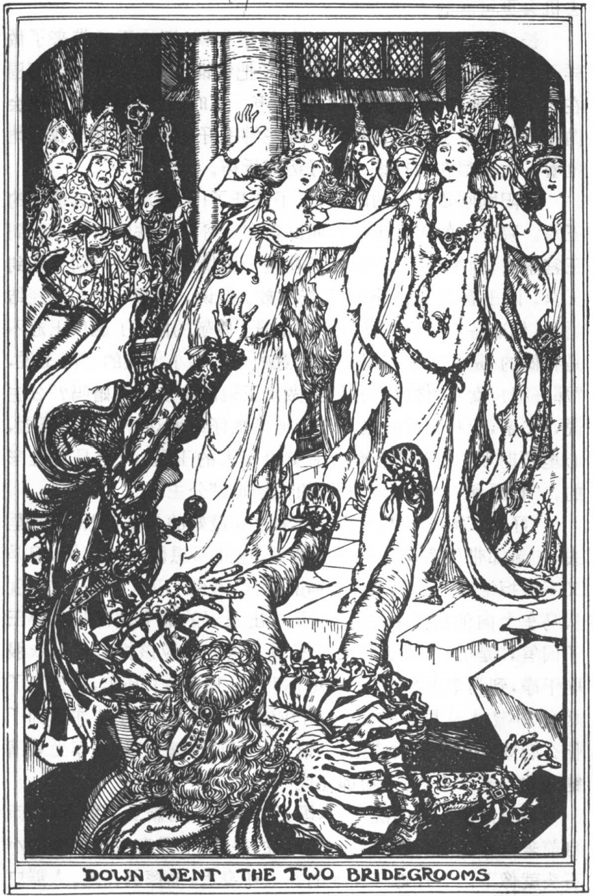

长话短说，铁匠拿来了金子、银子和铜，还给王子带来了做样子的王冠。到了晚上的时候，王子把铁铺门锁起来。邻居都围在院子里，他们听到了整夜的铁锤声。不时，从铁铺的窗口里会抛出一些碎金子、银子和铜屑。那些游手好闲的人都你争我夺地抢着。大家都在为打铁人的好运气祈祷。

太阳刚刚要升起的时候，王子打开了门，拿出了货真价实的王冠。院子里的人发出一片叫好声和欢呼声。铁匠请他一起到王宫里去，他拒绝了。于是铁匠在整个城堡的老百姓陪同下来到王宫。国王看到王冠，顿时心花怒放。他说，“好极了！你已经结婚了，你准备要什么？”铁匠说，“信誉！尊敬的陛下！这顶王冠不是我做的，是昨天才来跟我学生意的一个棒小伙做的。”国王说，“那好吧！女儿，你愿意和那个做出王冠的小伙子结婚吗？”公主说，“父亲，让我先看看这顶王冠吧！”她仔细地观看了这顶王冠，心里顿时明白，这就是她亲手交给恋人的王冠，一定是他送来的。“我愿意和叫人送来王冠的人结婚。”公主说。

“好吧！”国王对大王子说，“乘上我最好的马车，到铁匠那里去，把新郎带回家。”大王子很傲慢，他并不想做这些事情，但是又不敢拒绝国王。他来到铁铺的时候，看到小王子站在门口，就从马车上向他招招手，说，“你是打出王冠的那个伙计吗？”小王子回答，“是的！”“那么！”大王子说，“也许你应该把自己的衣服刷干净，到马车上来，国王想见你。”小王子上了马车，他打开了烟盒，小矮人从里面跳出来，站在他的大腿上，问他，“你遇到了什么麻烦？”小王子说，“主人，请让我回到铁铺去，让马车上装满铺路的石子。”不久，一切都完成了。

马车回到王宫的院子里，国王为了表示对新女婿的尊敬，亲自前来打开车门。他刚刚转动开门的手柄，从马车上滚下来的小石头就像下雨一样地打在他的头上和身上，他摔倒在地。人群中立刻爆发出一阵尖叫声，还有一些嘲笑声。国王狼狈地站起来，擦掉脸上的血，非常生气地看着大王子。“我的陛下，”大王子说，“我对这个不幸事件深表遗憾，但是我没有什么过错。我看着年轻的铁匠走进马车，路上一分钟也没有停下来过。”“肯定是你对他很不礼貌，走吧。”国王说。接着他转过头来对二王子说，“把年轻的铁匠带来，要有礼貌些。”“不用担心。”二王子说。

但有些人就是怎么也装不出善心来，这位新使者的所作所为并没有比第一个好些。因此，当国王第二次打开马车门，一堆土向他倾泻下来。“真是没用，”国王说，“难怪狐狸永远找不到一个比自己更好的使者。”

国王洗了个澡，换了一身衣服，亲自来到铁匠铺请王子，请他坐在自己的身边。王子请求让他坐另一辆马车。半路上，他又打开了烟盒。“主人，”他说，“现在我想恢复自己原来的衣着。”“没问题。”小矮人说，“现在我要和你说再见了，永远像以前那样仁慈和善良，爱你的妻子，这就是我给你的全部劝告。”说完，小矮人消失了。马车到院子里，门打开了，人世间最漂亮的王子从车上走下来，他做的第一件事，就是跑过去拥抱他的新娘。

除了两个大王子以外，在场的人都兴高采烈。婚礼很快就举行，三对夫妇都在同一天结了婚。不久，两对大的夫妇回到自己的王国，最小的一对留下来和老国王住在一起。他们像所有的故事中所说的那些最幸福的夫妻一样，白头偕老。

（西苏格兰高地传说）

 
 

## 一个坏孩子的故事

从前在法国中部的一个小村庄里，住着一个寡妇和她的独子，叫安东尼，大约十五岁。他们非常穷，每天晚上刮风的时候，小屋就会不停地摇晃，发出刺耳的声音，令他们提心吊胆，生怕它会倒下来，砸在身上。安东尼不像其他年轻人那样，出去找工作做，只是整天在街上闲逛，眼睛老是盯着地上，好像在寻找什么东西。

“我亲爱的孩子，你真是非常非常笨！”他的母亲有时会这样对他说，然后就笑笑，“当然，你也永远不会抓住一只狼的尾巴！”

有一天，老妇人叫安东尼到森林里去，找一些干的树叶子，用来铺床。这件事还没有做完，天就下起大雨来，他赶紧躲到一棵大树的树洞里。里面又干又舒服，他等着，等着，就睡着了。不久，他被洞口一种好像狗叫的声音惊醒，不知道为什么，他觉得害怕起来。他小心地抬起头，看到一只毛茸茸的动物正在退到洞里来，尾巴在最前面。

“这就是大人常常说的狼。”想到这个，他吓得在角落里缩成一团，发抖着。

狼慢慢地退到树洞里来，安东尼像木头做的，气也不敢喘。忽然，他有了主意，想这样也许可能得救。他记得母亲曾经说过，狼不能弯腰或者转过头来看后面的人。他像闪电一样地伸出手去，抓住狼的尾巴，一下子就把它拖牢。接着，他离开了树洞，把狼拖到家里。

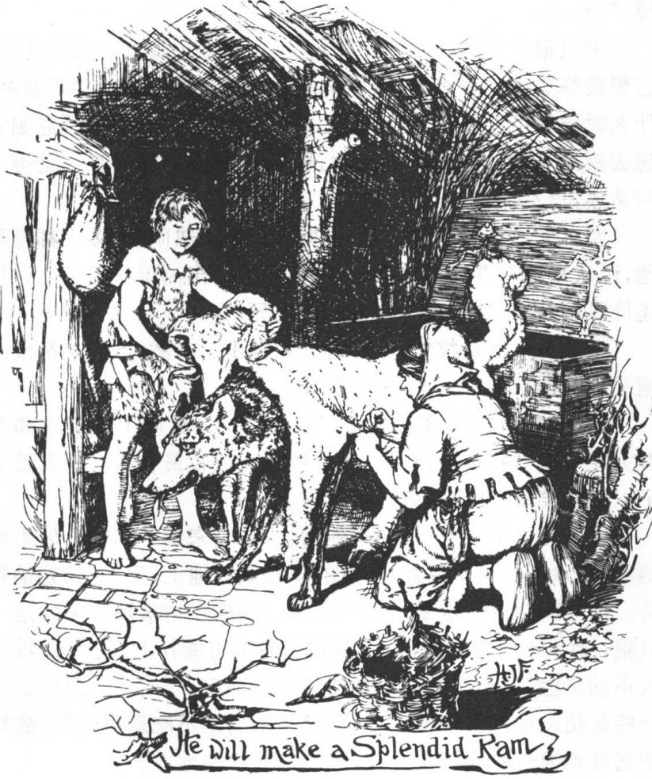

“妈妈，你常常说我太笨，抓不住狼的尾巴，现在你看。”他骄傲地喊道。

“好的，好的，奇迹总是在不断地出现。”那妇人说着，小心地和狼保持着安全的距离。“你真的抓住了一只狼，让我们看看派什么用场。把上个星期死掉的那只羊的羊皮取来，把它缝在狼的身上，看上去就是一只很壮实的羊。明天就把它带到市场上去卖掉。”

那只狼也是又聪明又狡猾，它已经明白了那妇人说些什么，它想最好是不动声色，让她把羊皮缝在自己身上，“只要我愿意，什么时候都可以逃走，用不着太急。”于是它安静地站着，克制着想去咬离它这么近的那妇人的诱惑，尽管那张羊皮使它觉得又闷又热，很不舒服，它也忍耐着。

安东尼把狼带来的时候，市场上正好最热闹，许多人都围着他，说从来没有看到过这么壮实的羊，争着出高价钱买下。讨价还价以后，安东尼以高价钱卖给了三兄弟。

这三兄弟都是牧羊人，养着一大群羊。当然，这些羊都没有刚买到的那只羊那么大，那么肥壮。

“我的牲口棚离这里最近，”老大说，“今天晚上先把它和羊群关在一起。明天再看看，到哪个牧场去放牧最合适。”那只狼听了以后冷笑着，把头微微地抬起来。

第二天一早，老大来巡视他的牲口，先来到了羊棚。他恐怖地看到，除了一只羊以外，所有的羊都躺在地上，死了。到处是骨头。他立刻明白了这是怎么一回事。蜷缩在角落里装羊的是一只狼。他本来可以转身逃跑，但狼随时都可能扑上来。所以牧羊人不动声色，想到这是报复老二的机会，老二以前曾经跟他耍过一些花招。他跑去告诉老二，那只买来的羊不吃这里的草，最好把它赶到河边的牧场里去，那是老二放牧的地方。

老二满心欢喜地吞下了这个食饵。这天晚上，他把羊赶到自己放羊的牧场。第二天早上，所有的羊又都被咬死。可是，他也保持沉默，要让老三也分担这个厄运。后来，他们三个人碰在一起，承认了各自遭遇的灾难，决定尽快地把狼还给安东尼，让他受到严厉的惩罚。

安东尼看到三个牧羊人时，正坐在邻居的一棵洋李树上吃着果子，他赶紧溜下来跑回家，上气不接下气地叫道：“妈妈！妈妈！那些牧羊人带着狼过来了。他们已经知道了狼的真相，肯定要杀死我，说不定还要杀你。只要你照我的话去做，我们俩都可能得救。躺在地板上装死，不论出了什么事情，也不要做声。”

这样，当三兄弟各人拿着一根鞭子走进来的时候，他们看见一个妇女直挺挺地躺在地上。安东尼跪在她面前，对着她的耳朵大声地吹着哨子。

“这是在干什么？你这个恶棍！”老大问道。

“我在干什么？呵！可怜的朋友，我是这个世界上最可怜的人了。我失去了最亲爱的妈妈，以后可怎么办？”说着，他双手掩着脸又哭了起来。

“你对着她的耳朵吹哨子干吗？”

“啊！那是唯一可以救她的办法。这种哨子能够起死回生，我希望……”他又把脸埋在手里，但透过手指缝看着三兄弟，他们的六只眼睛都张得大大的，像六个盘子。

“看！”他忽然叫起来，“看！我敢肯定她的身体在动了，鼻翼也在动了！啊！哨子真是太有效力了。”说着，他又弯下腰，更加响亮地吹起哨子。那妇人的手和脚好像开始复活，不久，手就能举起来了。

牧羊人看到她的复生，惊讶得好久说不出话来。后来，老大转过身来对他说，“现在，你听着，没有疑问，你是一个小恶棍。你明明知道是一只狼，却把它当羊卖给我们。今天我们来就是找你算账的。但是，只要你把那个哨子给我们，以前的事情就一笔勾销，不再来找你了。”

“它是我唯一的宝物，我靠它得到了许多财富。”男孩子装做犹豫不决，“不过，既然你这么想得到它，我想是难以拒绝的。”他把哨子拿出来，老大接过去，把它放进自己的口袋。

带着这个珍贵的哨子，三兄弟高高兴兴地回家去。他们走着，走着，老三对两个哥哥说，“我有一个好主意！我们的妻子都又懒又爱发牢骚，给生活增添不少麻烦。让我们教训她们一下，一到家就把她们杀了。当然我们会马上叫她们活过来，她们肯定会吓得要死。”

“你真聪明，”两个哥哥说，“没有人会想得出这个主意。”

三位丈夫快活地打起他们的妻子来，直到她们倒在地上断了气。接着，他们一个接着一个吹哨子，吹得这么响，他们的肺几乎要爆炸了，但是妻子却僵硬地躺在那里，连眼皮也不动一下。三位丈夫脸色越来越白，浑身发冷。他们丝毫也没有想伤害妻子的意思，做梦也没有想到会是这样。过了一会，他们明白了一切努力都是徒劳的，那男孩子又一次欺骗了他们。三兄弟脸色铁青地站起来，拿起一只大口袋，转过身来去找那个男孩子。

他们走进房间时，安东尼已经睡了，见他们进来只是张了张眼睛，没有逃跑。没有人说一句话，他们把他抓起来，塞进口袋里，把袋口用绳子捆好。老大把口袋扛在肩上，三兄弟就向河边走去，准备把他扔到河里去淹死。

河离安东尼的家很远。天气非常炎热，安东尼很重，比整口袋麦子还重。三兄弟轮流扛着，即使是这样，他们也觉得越来越累，越来越渴。看到路旁有一家小酒店，他们高兴地把口袋放在一张长凳上就进去了，没有注意到一个乞丐正坐在长凳另一头的树荫下。安东尼的耳朵很灵，听到旁边有人在吃东西，等三兄弟进入小店以后，他就低声地哼起来。

“怎么回事？”乞丐靠过来问道，“可怜的孩子，他们为什么把你捆在口袋里？”

“他们要我去当主教，我不同意。”安东尼说。

“我的天，”乞丐叫道，“当主教并不是什么坏事情。”

“我没有说这是坏事情，”小坏蛋回答，“我只是不想当。如果你对戴主教的桂冠有兴趣，你只要解开口袋，和我换个位置就是了。”

“这最好不过了。”那人说，弯下腰来解开口袋。

结果，是乞丐，而不是安东尼被扔到河里去了。

第二天上午，三个不幸的妻子被埋葬了。她们的丈夫在葬礼后回来的路上，看到安东尼赶着一大群羊，惊呆了。

“你这个恶棍！”他们叫了起来，“昨天我们把你淹死了，今天怎么又看到你好好的！”

“很奇怪，是不是！”他说，“也许你们还不知道，在这个世界下面，还有一个更加美丽、更加富有的世界。你们把我扔到河里去的时候，就是把我送到这个世界去了。开始我还觉得有点陌生，不久我就开始看看周围发生的事情。我看到离我掉下来的地方不远，有一个买卖羊的集市。旁边一个人告诉我，这个城里每天都在卖马和其他牲口。要是我有福气被扔到卖马的集市那边，我就发大财了。不过，我能买到这些羊也就满足了，总比你们什么也没有强多了。”

“你知道卖马的集市在哪里吗？”

“当然知道。”

“那么，如果你不想让我们为死去的羊群和妻子报仇，就把我们扔到下面的马集市里去。”

“很好，但是你们要带好三个口袋，和我一起到有一块大石头伸入河里的地方去，我会从那里把你们扔下河，你们就会掉入马市的附近。”

就这样，他把三兄弟一个一个地扔了下去，他们从此不再回来，所以也就没有人知道他们掉在哪个集市里。

（法国口头文学，保罗·西比雷特编写）

 
 

## 挪威的棕色熊

爱尔兰曾经有过一个国王，他有三个女儿，都长得非常漂亮。有一天，他们一起在草地上散步，国王和三个公主开玩笑，问她们愿意嫁给谁。大公主说，“我要嫁给阿尔斯特的国王。”二公主说，“我要嫁给芒斯特国王。”最小的公主说，“我什么人也不嫁，只嫁给挪威的棕色熊。”因为她小时候常常听保姆讲一个着了魔法变成棕色熊的王子的故事。这是她小时候第一个会讲的名字。昨天晚上，她还梦见了他。听了她的话，国王和两个公主都笑了起来，那天晚上，他们一直拿她开玩笑。

就在这天晚上，她从梦中醒来，觉得自己走进了一个金碧辉煌的大厅。大厅里被上千盏明灯照得如同白昼一般。地板上铺着最华丽的地毯。墙上贴着金黄色和银白色的装饰品。里面站着许多高贵的来宾，她在梦中看到的英俊王子就站在中央。他向她走过来，一只脚跪在她面前，向她倾诉着对她的炽热的爱，问她愿意不愿意做他的皇后。她不忍心拒绝他，当天晚上，他们就结了婚。

“听我说，亲爱的！”客人们都走了以后，他说，“你必须知道，我是一个中了魔法的人。一个女巫有个美丽的女儿，她要我做女婿。我拒绝了，她就施魔法，让我白天变成一只熊。要等到有一位女士愿意嫁给我，并且忍受五年严峻考验后，魔法才能解除。”

公主早上醒过来，非常思念丈夫，忧愁地独自一人度过白天。但是，当大厅里被灯光照亮的时候，王子就会出现在她的身边。每到这个时候，她总是坐在铺着丝绸的沙发上等候着丈夫的出现。他们又一起度过充满欢乐的夜晚。王子告诫她说，什么时候她开始讨厌他了，或者是对他不忠诚了，他们就会永远分开，他就不得不去和女巫的女儿结婚。

后来，她习惯了白天丈夫不在身边，就这样幸福地过了十二个月，一个漂亮的小男孩诞生了。以前她很幸福，现在她是双倍的幸福了，因为白天丈夫不在时，有着孩子和她作伴。

一天晚上，三个人坐在房间里，因为天气很闷热，窗口打开着。忽然飞进来一只老鹰，用嘴咬住小孩的腰带飞走了。她尖叫起来，跟着老鹰要从窗口跳出去。王子抓住了她，表情严肃地看着她，她想起了他结婚后不久对她说的话，才停止了哭泣和怨恨。白天，她又非常孤独。这样又过了十二个月，一个美丽的小姑娘问世了。她想，这回要好好地看护她，窗最多只打开一道缝。

她的谨慎毫无作用。有一天晚上，他们快活地坐在一起，王子抱着婴儿在玩耍，突然窜进来一只好看的大灰狗，从父亲的手中把婴儿叼走，一眨眼就从门口跑出去了。这一次，她喊叫着从门口追出去，但是外面房间的几个佣人都说，没看到什么孩子和狗从这里跑出去。她似乎觉得是丈夫的过错，但还是控制住自己的情绪，一点也没有责备他。

第三个孩子出世以后，她决不允许把窗和门打开着。但是她不可能永远把孩子抱在手里。有一天晚上，他们坐在火炉旁，一个女人突然出现在他们身旁，公主张大眼睛吃惊地看着她，刹那间，那女人用一块大毛巾把坐在父亲膝上的孩子抱起，不是从大烟囱里，就是钻入地下走了。这一次，伤心的母亲在床上整整地躺了一个月。

“我亲爱的，”公主开始恢复以后，对丈夫说，“我想，我如果回去看看我的父母和姐姐，会觉得好一些。你要是同意我回家几天，我会高兴的。”“很好，”他说，“我同意，你什么时候想回来，只要晚上躺在床上提起这个念头就行了。”

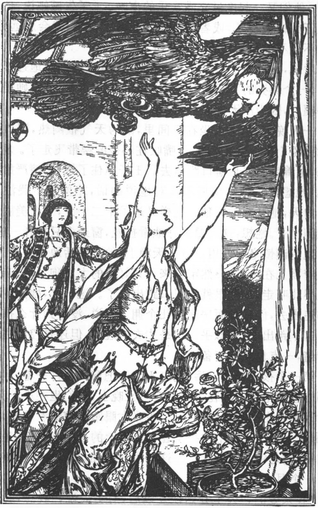

第二天早上醒过来，公主发现自己已经回到父亲的王宫，躺在以前的寝室里了。她打响了铃声，很快，她的父母和已婚的姐姐都围坐在她身旁，看到她平安地回家，都快活地哭着、笑着。

她把自己的经历告诉给他们，他们也不知道应该劝她做什么好。她还是像以前一样，很爱自己的丈夫，她肯定丈夫也不愿意让孩子离开，但是眼看着孩子们一个一个地离去，她非常害怕。后来，母亲和姐姐请教了一个常常送鸡蛋到城堡里来的女人，她们很相信这个女人的智慧。她说，唯一的办法是把王子每天早上要穿的熊皮藏起来，把它烧掉。这样，他白天就不会变成熊了，魔法也就解除了。

她们都劝小公主这样去做，她也答应了。八天以后，她非常渴望能见到丈夫，当天晚上就许了个愿。三个钟头以后，她醒过来，发现自己已经在丈夫的王宫里，丈夫正在看着她。两人都非常高兴。这样，他们又过了许多幸福的日子。

后来，她想，她从来不责怪丈夫一早就离开她，也从来没有发现过，丈夫在她每天晚上上床之前，会忘记从金杯里倒来一杯甜饮料给她喝。

有一天晚上，她假装喝了那杯甜饮料，其实一滴也没有沾。第二天天还没有亮，她就醒过来了。她微微地张开眼睛，看到丈夫穿过墙板走了出去。第二天晚上，她把几滴安眠的甜酒加进丈夫的饮料里。这天晚上，他睡得特别甜。半夜三更时，她爬起来，穿过墙板，看到里面的墙角里挂着一张漂亮的棕色熊皮。她把它拿到手，来到客厅的火炉旁，把它扔入火中，看着它，直到它化为灰烬。她回到丈夫的身边，在他的脸颊上吻了一下，睡了下来。

假如她能活到一百岁，也永远忘不了那天早上醒过来时，丈夫看着她的那副既愤怒，又悲伤的神情。“不幸的女人，”他说，“你把我们永远地分开了。为什么你不能再耐心地等待两年呢？

现在，不管我愿意不愿意，我都要赶上三天的路程，到女巫的城堡里去，和她的女儿结婚。你把保护我的熊皮烧掉了。那个卖鸡蛋，给你们出主意的女人，就是女巫自己。我不会责备你，你受的惩罚已经够严厉的了。永别了。”

他最后一次地吻了她就站起来，以最快的步伐走了。她哭喊着追出来，但没有丝毫作用。她穿好衣服去追赶他，可是他一步也没有停留，连头也不回过来看一下。尽管这样，她还是紧追不舍，不让他从视线中消失。他在山顶上时，她就在山沟里；他在山沟里时，她就在山顶上。到太阳下山的时候，她已经累得要命了。他走进一条小路，走进一间小房子里。她连走带爬紧跟着进去，看到他的膝上正坐着一个漂亮的小男孩，他正吻着他，逗他玩。“我可怜的爱人，”他说，“这是你的大儿子。”他又指着旁边一个微笑着的女人说，“她就是把他带走的老鹰。”此刻，公主忘记了所有的悲伤，抱着她的孩子，一会儿哭，一会儿笑。那女人帮王子和公主洗了脚，用一种油膏帮他们擦，他们浑身的酸痛立刻消失，又恢复了原来的体力。

第二天破晓之前，王子起身准备出发，他对妻子说，“这件东西可能对你有用，这是一把剪刀，不论用来剪什么东西，都会变成丝。太阳出来的时候，我会失去所有关于你和孩子们的记忆，直到太阳下山以后才能恢复。再见！”这一天又和昨天一样，她离开了孩子去追赶他。上午，影子在他们的前面；下午，影子在后面跟着他们。他片刻不停地赶路，她也马不停蹄地紧紧盯着，决不让他的身影从眼中消失。到太阳下山的时候，他又走进一条小路。在一间小房子里，他们找到了小女孩，这一晚上又充满了欢乐，直到天明，他们又开始准备赶路。出发之前，他给她一把梳子，告诉她，不论什么时间用它来梳头，她的头发里都会掉下珍珠和钻石。白天，他突然丧失记忆，在魔法的引诱下拼命地赶路，连头也不回。只有到晚上才恢复正常。这天晚上，他们来到了最小的孩子居住的地方。次日出发之前，王子最后一次地向她告别，“我可怜的妻子，这是一个卷线用的卷筒，上面的金线永远没有尽头。这是半只我们的结婚戒指，假如你能进入我的房间，把你的半只给我，我会想起你的。那边有一片森林，我走进森林以后，就会忘记我们之间的一切事情，就像昨天刚刚出生一样。亲爱的妻子和孩子，永别了！”这时太阳升起来，他走进了森林。她看见森林的大门为他而开。他进去以后，又关上了。她走过去，随便怎么也走不进去，面前好像是一堵石头砌起的墙壁。她悲痛地挥着手，哭泣着，但毫无结果。她控制了一下自己的感情，喊叫道，“森林！我用我的三件宝物——剪刀、木梳和卷筒作交换，让我进去吧！”森林打开了门。她沿着一条小路走啊！走啊！直到看到一座宫殿，一片草坪。靠近宫殿的森林旁边，有一幢伐木工人的小屋。

她走进了伐木工人的小屋，请求伐木工人和他的妻子让她留下来当佣人。他们开始不同意。她说，她不要工资，要是他们想要的话，她可以给他们钻石、珍珠、丝绸和金线。这样他们才同意让她留下来。

不久，她就听说森林里来了一个年轻的王子，住在年轻的女主人的宫殿里。他很少出来走动，看到他的人都说，他既沉默又悲伤，好像在寻找什么失去的东西。

宫殿里的佣人和那些自负的老百姓开始注意到伐木工人小屋里这个美丽的妇女，开始无理地骚扰她。特别是那个男仆领班最令人讨厌。后来，她决定邀请他来一起喝茶。啊！他是多么高兴，在佣人中到处以此为荣，吹嘘自己。晚上，他来到了小屋，进了她的起居室。因为这时，小屋的主人出于对她的敬畏，给了她两间漂亮的房间。领班毕恭毕敬地坐着。她把茶和烤好的面包拿进来时，他自豪地唠叨着自己在宫殿里干的那些自以为了不起的事情。

她对他说，“你能不能把手从窗口伸出去，采下一两枝忍冬树枝。”他高兴地站起来，把头和手都从窗口伸出去。她接着说，“凭着我的神奇礼物的魔力，让你的头上长出一对角来，对着小屋喊叫吧！”她刚说完，一对角就从领班的两个耳朵边长出来，在他的脑后相会。可怜的人伏在窗台上，对着窗外大声地喊叫着。那些常常听他夸耀自己的佣人，纷纷从宫殿里跑出来，咧嘴笑着，大声叫好，有的还高兴地敲着铁锅、铁铲和钳子。领班诅咒着，眼睛也快暴了出来。两只脚在后面发疯似地乱踢。

最后，她可怜他了，把魔法解除，两只角掉在地上。要不是浑身软得像一团棉花，他可能就杀了她了。他手下的仆人过来把他带回宫廷去了。

这个故事不知怎么，传到了王子的耳朵里。他沿着那条路溜达过来。她正坐在窗下缝衣服，一身乡村女人的打扮，但这掩盖不住她的美貌。他仔细看了她一眼，就觉得很迷惑，好像和他有什么牵连，或者是在做梦一样。女巫的女儿听到了这个故事，也来看这个奇怪的姑娘。她看姑娘在用一把剪刀，在褐色的纸上剪出长袍的式样。剪刀所到之处，纸变成了她从未见过的如此好看的丝绸。女巫的女儿贪婪地看着，对她说，“你想要什么才能换你这把剪刀？”“我不要什么，”她说，“只要在王子的寝室里坐一个晚上。”骄傲的女巫女儿火冒三丈，正想要说什么恶毒的话，但看到剪刀还在不停地剪着，纸不停地变成越来越华丽的丝绸。她终于同意了她的要求。

夜色降临，她被允许进入王子的寝室。王子已睡得像死过去一样，她怎么也弄不醒他。她唱起了一首歌：

> 我们成婚已经三年，
> 我为你生了三个孩子，
> 回到我的身边吧！
> 挪威的棕色熊。

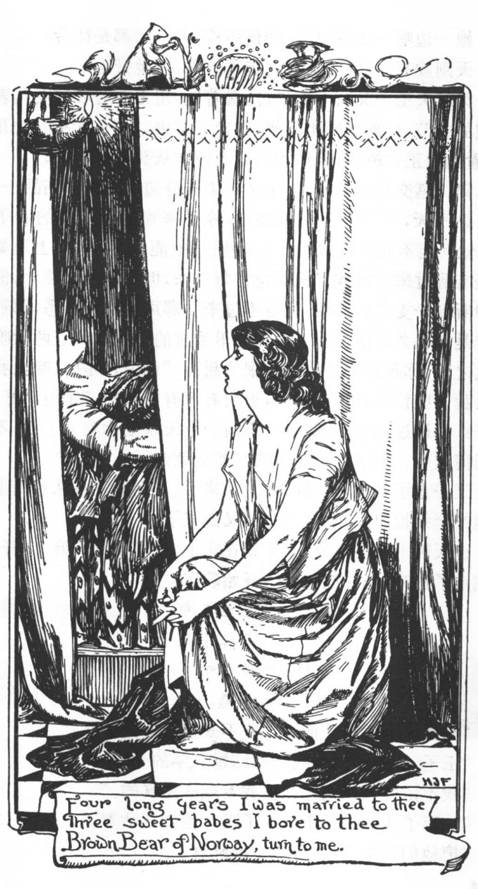

她一边唱一边哭泣着，整夜不停，但一切都是徒劳。

天刚放亮，骄傲的女人就走了进来，把她带走。

第二天王子又从小屋走过，看着她，用王子对农家女儿表示礼貌的礼节，仁慈地向她问候，就走了过去。不久女巫的女儿经过，看到她正在梳头，珍珠和钻石不停地从头上掉下来。

第二笔交易成功了。公主又在丈夫身边度过了悲伤的一夜。

第三天，王子又从小屋经过，停下来和这位奇怪的女子说话。他问能不能为她做些什么？她说，他能。她问他晚上睡觉是不是有醒过来的时候。他说也常醒过来，但是前两天晚上，他在梦中听到一支美妙的歌，但醒不过来。那声音非常熟悉，那歌手一定是他很久以前在另一个世界里爱过的。她问，“这两天晚上睡觉之前，你是否喝过什么安眠的甜酒？”他说，“是的，晚上我妻子给我一些饮料，但我不知道里面有没有安眠药。”她说，“好吧，王子！你说过，愿意帮我做点事情。今天晚上你就为了我，不要喝任何饮料。”王子说，“我不喝！”然后就走了。

王子走了不久，女巫的女儿又来了。看到她正在从卷筒上不停地把金线拉出来，第三次交易又做成了。

这天晚上黄昏时分，王子躺在床上，觉得心乱如麻。门开了，公主走了进来，坐在他的旁边开始歌唱：

> 我们成婚已经三年，
> 我为你生了三个孩子，
> 回到我的身边吧！
> 挪威的棕色熊。

“挪威的棕色熊！”他说，“我不知道你唱些什么？”

“王子，你忘了吗？我是你结婚三年的妻子。”

“我不记得了，”他说，“但我希望这是真的。”

“你忘了我们的三个孩子了吗？他们还活着。”

“把他们带来，我的心像一堆乱麻。”

“看看挂在你头颈上的半个结婚戒指，再拿来对对我这半个。”她说。

他们把各自半个戒指拿出，合在一起。魔法顿时被破除了，他完全恢复了记忆，伸出双手拥抱着妻子，两个人都哭了起来。

这时，忽然传来巨大的响声，城堡的墙壁开始破裂。所有的人都非常惊慌，纷纷逃命。王子和公主也赶紧跑出去。当他们都逃出城堡，来到外面的草坪上时，城堡倒塌了，发出震耳欲聋的响声，好几英里外的地面都在抖动着。

谁也没有看见女巫和她的女儿。王子和公主很快就找到他们的孩子，回到了自己的王宫。爱尔兰、阿尔斯特、芒斯特的国王，还有他们的妻子不久都来看望他们，祝愿大家都像挪威的棕色熊一家那样幸福。

（西苏格兰高地传说）

 
 

## 小拉斯

有个小孩叫拉斯，因为他个子很小，大家都叫他小拉斯。他是一个勇敢的小人，曾经乘坐豆壳做成的船周游世界。

这年夏天，公园里的豆壳长得又长又绿。小拉斯走进豆圃，爬上豆茎，采了十七个最长最直的豆壳，自以为没有人看见，可是错了。公园里的园丁拿着枪正走过来，听到豆圃里有动静。“一定是一只麻雀！”他想，“嘘！嘘！”他喊了起来，想赶走麻雀。但是没有声音。小拉斯只有两只脚，没有翅膀飞不起来。

“等着瞧！我要装上子弹，用枪来打它。”园丁说。小拉斯这回吓坏了，赶快爬起来，说，“请原谅，亲爱的园丁，我想做一些好的船。”

“嗯！这一次我原谅你。下一次小拉斯必须得到允许才可以到豆圃里去找船。”

“我会的。”小拉斯答应。他走出花园，来到岸边，用针小心地把豆壳打开，分成两半，又折来一些小树枝安在豆壳上，做成划手的座位。他把豆壳中的豆取出来，再放在船上做货物。有些豆壳在制作的时候坏了，有些很好，所以最后小拉斯共有十二条好船。这可不是一般的船，而是战舰。有三艘班船，三艘护卫舰，三艘双桅船，三艘纵帆船。最大的班船叫“赫尔克里士号”，最小的纵帆船叫“弗莱号”。小拉斯把十二条船全部放下水，它们在水面上整齐威武地漂游着，就像巨轮在大海的波涛中航行一样。

现在，船队就要起航去周游世界了。最大的岛屿是亚洲，最大的石块是非洲，最小的岛屿是美洲，最小的石块是波利尼西亚。船队出发的海岸是欧洲。整个船队都要离开海岸，开往世界各地。班船船队直航亚洲，护卫舰队驶往非洲，双桅船船队开往美洲，而纵帆船队将开往波利尼西亚。船队出发了，但是小拉斯仍然留在欧洲，向大海里扔小石头。

在欧洲海岸有一条真正的船，那是小拉斯爸爸的，一条漆着颜色的漂亮的船。小拉斯走上去，爸爸妈妈禁止他上船，可是他忘记了。他真的很想到世界各地去旅行。

“我划出去一会，只划出一段短短的航程。”他想，豆壳船已经走得很远很远，在大海上只能看到一个小点了。“我要在非洲海岸逮住‘赫尔克里士号’，然后把它拖回欧洲。”

他拉了拉拴着船的绳子，奇怪的是绳子松了。男人就要有男人的气概，于是小拉斯开始驾驶这条船。现在，他必须拿起桨来。划船不稀奇，他在家的时候就把爸爸的拐杖当船桨，把楼梯当船来划过。可是，这条船上却找不到一根桨。船桨都锁在岸上的船室里，小拉斯没有注意到船是空空的。没有桨，船怎么能划到非洲去呢？

小拉斯现在怎么办呢？船已经远离海岸，从陆地上吹过来的风把船越吹越远。小拉斯害怕起来，开始哭了。岸上一个人也没有，谁也听不见他的哭声。只有一只乌鸦站在一棵白桦树上，园丁的黑猫蹲在树下，等着要抓乌鸦。他们谁也不会关心正在向大海漂流的小拉斯。

小拉斯多么后悔没听爸爸妈妈的话，自作主张地跑到船上来。现在后悔也太迟了，他没有办法回到岸上。也许他会从此消失在茫茫的大海之中，怎么办呢？

他喊啊！叫啊！哭啊！直到累倒了，也没有人听见。他合起双手来说，“仁慈的上帝啊！请不要对小拉斯发怒！”接着就睡着了。这时候虽然是白天，梦神仍然坐在梦乡的岸边，用长长的钓鱼竿在钓小孩。他听到了小拉斯说话的声音，立刻把船拉过来，把小拉斯放在一张用玫瑰花做成的床上睡觉。

梦神对一个梦孩说，“和小拉斯一起玩，免得他感到孤独。”这是一个小梦孩，他是这么小，比小拉斯还小得多。他长着金头发，蓝眼睛，红色的帽子有一条银白色的杠，白大衣的领子上镶着珍珠。他走过来对小拉斯说，“你愿意乘船走遍整个世界吗？”

“是的，”小拉斯说，“我愿意。”

“那么来吧！”梦孩说，“让我们乘你的豆壳船去。你乘‘赫尔克里士号’，我乘‘弗莱号’。”

他们从梦乡开始出发远航。不久，“赫尔克里士号”和“弗莱号”就来到了世界的另一头，亚洲海岸。在这里，海水从北冰洋流过白令海峡，进入太平洋。在冬天的迷雾中，他们远远可以看见探险家操纵着探险船，寻找一条通过冰封的航道。天气是这样冷，巨大的冰块在奇怪地飘流。大鲸鱼在冰下面游着，它们也无法用巨大的头把冰层撞出一个洞来。陆地上的天空也是黑沉沉的，飘着一眼望不到头的雪花。远处可以看见，穿着皮大衣的人驾驶着狗拉的雪橇在移动着。

“我们要在这里登陆吗？”梦孩问。

“不！”小拉斯说，“我很怕那些鲸鱼会吞掉我们，那些狗会咬我们，还是让我们开到世界别的地方去吧！”

“很好！”戴着白杠条红帽子的梦孩说，“美洲离这里不远。”说着，他们就到了美洲。

太阳在天空中照耀着，天气很暖和。高大的棕榈树在海岸边排成长长的队伍，树枝上长着沉甸甸的果实。古铜色皮肤的人们骑着马，在辽阔的绿色草原上，用弓箭追射着野牛。这些野牛毫无畏惧，勇敢地用锋利的双角来和猎人对抗着。一条又长又粗的眼镜蛇爬在高高的棕榈树上，忽然跳下来，咬了站在树下张望着的一头小美洲驼的脚，可怜的小骆驼一声也不吭就倒在地上死了。

“我们要在这里登陆吗？”梦孩问。

“不！”小拉斯说，“我怕野牛会用角来刺我们，大蛇会来吃掉我们。还是让我们开到世界的别的地方去吧！”

“很好！”穿着大衣的梦孩说，“去波利尼西亚只有一点路。”说着就到了波利尼西亚。

这里的气候非常暖和，暖和得像在芬兰洗热水澡一样。海岸边长着许多价值很高的植物：胡椒、樟属植物、生姜、藏红花，此外还有咖啡和茶叶。长着长长的耳朵、厚厚的嘴唇和棕色皮肤的人，脸上画着吓人的颜色，正在海岸边长满高大竹林的树林里，追逐着一头黄斑点的老虎。老虎忽然转过身来，用爪抓住了一个褐色皮肤的人，双方可怕地打斗起来。

“我们在这里登陆吗？”梦孩问。

“不！”小拉斯回答，“你没看见胡椒林旁边的老虎吗？让我们到世界的其他地方去。”

“可以！”长着蓝眼睛的梦孩说，“非洲离这里不远。”说着他们就到了。

他们在一条大河的河边抛锚。只见海岸边一片碧绿，像天鹅绒。远离海岸的地方，是一望无垠的沙漠。在沙土的映射下，天空也是黄颜色的。太阳射出灼热的光芒，好像要把整个地面烧焦。皮肤像煤一样黑的人，骑着高大的骆驼在沙漠里穿行。狮子干渴地怒吼着，巨大的鳄鱼不时从河里露出像壁虎似的灰色的大头，还有那吓人的锋利的牙齿。

“我们在这里着陆吗？”梦孩问。

“不！”小拉斯说，“太阳会把我们烤焦。狮子和鳄鱼会吃掉我们，让我们到世界的其他地方去。”

“我们可以驶回欧洲去。”金头发的梦孩说。说着，就回到了欧洲。他们靠了岸，这里的空气那么凉爽，那么清新，那么熟悉。岸边高大的白桦树垂下茂盛的叶子。一只老乌鸦正坐在树顶上，树下面蜷缩着园丁的那只黑猫。不远处有一座小拉斯以前见到过的房子。房子的附近是一个公园，公园里的豆圃正长着长长的豆壳。穿着绿色大衣的老园丁正在走来走去，看看黄瓜熟了没有。法勒斯正在台阶上叫着，看见小拉斯，它摇了摇尾巴。老斯蒂娜正在农场里挤牛奶。小拉斯很熟悉的一个阿姨，围着方格子的羊毛围巾，正向洗衣店走去，看看她的衣服漂白了没有。一个知名的绅士穿着黄颜色的夏装，嘴里叼着长长的烟斗，正去看裸麦收割了没有。有个男孩和女孩在岸上跑着，叫道，“小拉斯，快回家来吃面包和奶油。”

“我们在这里着陆吗？”梦孩淘气地眨着他的蓝眼睛，问道。

“跟我来，我要妈妈给你一些面包和奶油，还有一杯牛奶。”小拉斯说。

“等一会，”梦孩说。这时，小拉斯看到厨房的门打开了，里面传来一阵轻微的令人开心的吱吱声，好像是在油锅里煎奶油饼的声音。

“也许我们应该驶回波利尼西亚去？”快活的梦孩说。

“不！在欧洲，他们现在正炸薄饼。”小拉斯说着，准备跳到岸上去。可是他动不了。梦孩已经用花做成的链把他锁住。这时，几千个小梦孩都来了，他们围着小拉斯唱道：

> 世界宽广无边，小拉斯！
> 你虽然曾在浪上航行，
> 但还不知道那边的天有多高，海有多深！
> 你已经看见，小拉斯！
> 有些地方那么热，
> 有些地方那么冷，
> 只有上帝无处不在，
> 关怀着人世间的一切生灵。
> 人们在那里生活，
> 就像我们在这里耕耘。
> 跟随着上帝的天使，
> 哪怕是野兽成群，
> 谁也不敢伤害你。
> 小拉斯！请告诉我们，
> 你漫游了整个世界，
> 是否还是家乡最好？
> 小拉斯！小拉斯！

梦孩们唱完了歌，悄悄地走了。梦神把小拉斯送回船上。他在那里又静静地睡了好久，耳朵里还听得见炸薄饼的吱吱声。这声音越来越清楚，他醒过来，擦了擦眼睛。

他发现自己还躺在船上。当他睡着的时候，风向已经改变，船随着风飘来飘去，这时已经靠到岸上。他听到的在油锅里炸薄饼的声音，其实是海浪拍打着海岸上的石头的声音。

小拉斯揉着双眼，赶走了睡意，看着周围，一切还是老样子。乌鸦还在白桦树上，猫还在草地上等着。小拉斯的豆壳船队有的已经返航靠岸，有的已经沉没。“赫尔克里士号”满载货物从非洲回来，“弗莱号”也完成了出航波利尼西亚的使命。

小拉斯这时不知道想些什么，他经常堕入梦乡，不知道这些梦孩以后还会和他耍什么把戏，小拉斯从来不把他们放在心上。他把能找到的豆壳船收起来，走上海岸，向家中走去。

他的哥哥和姐姐跑出来接他，老远就叫道，“你到什么地方去了这么久，拉斯？回家来吃奶油面包。”厨房的门开着，里面传来一种奇怪的吱吱声。

园丁正在大门附近浇灌着莳萝、荷兰芹、胡萝卜和防风草。看见小拉斯，他说，“唷！小拉斯到哪里去了这么久？”

小拉斯挺着胸回答，“我乘坐着豆壳船，航行了整个世界。”

“哦！”园丁惊讶地说。

他已经忘记了梦的世界。但是你不会忘记。你知道它确实存在。你看到过梦中美丽的景色，银光闪闪的墙壁永不褪色；闪闪发亮的钻石永远不会暗淡；悠扬美妙的音乐陪你到黎明；年轻美丽的仙女永远也不会老，就像夜空中的星星那样永远年轻。也许你曾见过她们从你枕边飞过时那闪光的翅膀。也许你也曾遇到过那个金头发、蓝眼睛的梦孩，他头上戴着有银白色杠条的红帽子，穿着领上镶有珍珠的白色大衣。也许他曾经带着你去拜访整个世界和那里的人们。那寒冷而荒芜的土地；那燃烧着的沙漠；各种肤色的人；海洋里的鱼和森林里的野生动物。你学到许多东西，然后高高兴兴地回家。是啊！谁知道，也许你和小拉斯一样，曾经驾驶着一只豆壳航船走遍整个世界。

（Z·托普路斯）

 
 

## 莫特

从前有一个青年叫莫特。他长得又高又大又结实，但却笨得出奇。笨到经常把大脚踩在他母亲晾在门口的牛奶和奶油盒子里。常常不是打翻这个，就是敲碎那个。后来他的父亲实在受不了，就对他说，

“莫特，这里是我们多年积蓄下来的五十块银币，带着它们走吧！去碰碰运气，自己谋生去吧！”

于是，一个早春的黎明，莫特肩扛着根粗棍，愉快地唱着歌走了。

开始，他日子过得不错。一个炎热的夜晚，他来到了一个城市，走进一家供来往旅客过夜的客栈。你要知道，那里的客栈通常只是一个大院，周围是高高的围墙，里面搭起柱廊，人和牲口全部住在里面。不过，有些客栈的角落里也修起塔楼，供一些有钱人，或者是要面子，不愿意和牲口睡在一起的人住宿。当然，莫特是一个乡下孩子，从小就和牲口住在一起。他既不富裕，也不要面子。所以，他只向店主要了一张床铺，把唯一从家里带来的一头小牛拴在一边，躺下来五分钟就睡着了。

半夜里他醒过来，觉得好像有人碰过他。他伸手到枕头底下去摸，发现钱包不见了，这一吓非同小可。他不动声色地跳起来，在庭院里到处走来走去，看看有谁醒着，还故意跌倒在他们身上，弄醒一些人和牲口。但是在整个客栈里找来找去，找不到一个看起来像小偷的人。他正想停止寻找的时候，好像听到两个人在小声地说话，有一个还吃吃地笑着。他躲在一根柱后面偷看，看到两个阿富汗的马贩子正在从他的钱袋里掏钱出来数。莫特也不吱声，回到床铺上睡觉了。

第二天早晨，莫特跟着两个阿富汗马贩子来到城外的马市场。他们准备在这里把马卖掉。莫特挑了一匹最好的马，问道，“这马是卖的吗？我可不可以试一试？”马贩子同意了。他跨上马背，踢了一下马的脚，马就跑开了。莫特从来没有骑过马，不知怎么样用双手和双脚来控制马，只好听凭马自由地奔跑。马一阵狂奔，就回到了住过几天的客栈里来了。

“很好！”莫特想。一到马厩，马就停了下来。莫特从马上跳下来，把马拴好，就叫店主送早饭来。这时，两个阿富汗人也气喘吁吁地赶到了，想要回他们的马。

“你想要干什么？”莫特喊叫着，口里还含着一口饭，“这是我的马，我付给你们五十块银币买了它，够便宜你们的了！”

“胡说！这是我们的马。”一个阿富汗人说着，就开始去解开马的缰绳。

“放下！”莫特大叫起来，同时拿起他的木棍，“你们敢再动我的马，就打断你们的脊梁骨。你们这些贼！我认识你们。昨天晚上你拿走我的钱，今天我牵走你的马，这是公平交易！”

这时，两个阿富汗人开始觉得有点不自在。莫特看来决心要留住这匹马。他们决定向国王申诉，说莫特偷了他们的一匹马，不肯还给他们，也不肯付钱买下。

很快，士兵来传莫特去见国王。莫特来到国王面前，鞠了一躬。国王问他，为什么不付钱就把马骑走。莫特说，他用五十块银币换来这匹马。马贩子说，他们身上的钱是卖别的马得来的。这样争论来，争论去，搞得国王好糊涂（他真的想是莫特偷了马），他最后说，“好了，告诉你们，我这样决定了。我要把一样东西锁在这个盒子里，假如莫特猜得出来，马就是他的，假如猜不出，马就是你们的。”

对于国王的决定，莫特同意了。国王站起来，独自一个人从宫廷的后门走出去，然后在衣服里面藏着什么东西走了进来，把它偷偷地放到盒子里去，锁上，然后把盒子放在大家面前。

“现在，”国王对莫特说，“猜吧！”

事情恰巧这样，国王打开后门的时候，莫特看到了外面是个花园。不等国王回来，他就开始想了，花园里有什么东西可以拿来放在盒子里呢？“可能是果子或一朵花。不！不可能是花，因为他的手握得很紧，那么就是果子或石块了。当然不是石块，他不会用漂亮的衣服去藏一块脏石块。一定是果子了，而且是没有什么香味的果子，否则他会担心我会闻出来的。现在这个季节，什么果子没有多少香味呢？我知道了这一点，就可以猜出谜底了。”

像前面说过的，莫特是在乡下长大的，习惯于在他父亲的花园里干活。他知道所有一般的水果，他想应该猜得出来。但是为了不让别人看出太容易了，他先抬头看着天花板，装做很迷惑的样子；然后看着地板，用手摸摸前额，装做动脑筋的样子。接着，不慌不忙地看着国王说，“它是新摘下的，又红又圆，是石榴。”

国王除了知道水果好吃以外，对于水果的知识却一无所知。每到一个季节，他总是先问什么水果好吃，再叫人去采来。在他看来，莫特能猜出水果的名字真是一个奇迹，这清楚地证明了他是多么聪明而且无罪。因为是他亲自把这个石榴放在盒子里的。当然，国王夸奖莫特的智慧时，所有的人都跟着说些好听的话。两个阿富汗人十分狼狈地退了出去。莫特得到了马，而且当上了国王的侍从。

莫特晚上还是住在客栈里。事情发生后不久，在一个风雨交加的晚上，莫特回来发现他的马失踪了。除了一个断了的马笼头以外，没有留下任何线索。莫特问了每一个可能知道情况的人，

谁也说不出发生了什么事情。他拿起笼头和木棍就去找马去了。他找啊！找啊！走出了城市，走进了森林。他在地上发现了马蹄留下的印子。这时候天已经很晚了，莫特还在找着。正当他在森林里徘徊的时候，在黑暗中忽然看见一只老虎正在心满意足地吃他的马。

“你这个贼！”莫特大叫起来。他跑过去，老虎这时正在啃一根骨头，见到他扑过来大吃一惊。还没等老虎搞清楚是怎么一回事，头上已经重重地挨了莫特一棍，只觉得两眼发黑，几乎晕过去。接着，第二棍、第三棍又像雨点一样地下来，打得它趴在地下，站不起来。莫特用马笼头套住它的头颈，拖回客栈。

“你吃掉了我的马，”莫特说，“我就要抓住你，这是公平交易。”他用绳子牢牢地捆住老虎的头和脚。这时天已经很黑了，就倒头睡着了。

你可能想象不出来，早上客栈里的人醒过来，看到他们和牲口之间有一只老虎的时候那害怕的程度。老虎虽然遍体鳞伤，奄奄一息，而且被捆住手脚，但毕竟是老虎，两只眼睛仍然是虎视眈眈地看着人和牲口。人们聚在一块议论着，责怪老店主把这么危险的动物放进客栈。店主也吓得直发抖，根本不敢挨近老虎的身边。而这时，莫特正在老虎旁边大声地打鼾呢！

莫特用马换来一只老虎的消息传到国王那里。国王半信半疑，要亲自来看真假。莫特这时还睡得真香，有人终于把他弄醒，告诉他国王来了。他先是打打哈欠，看到国王站着，高兴起来，赶紧向国王解释他是怎样得到老虎的。可是国王一点也不高兴，命令士兵开枪打死老虎。在场的人除了莫特以外，都松了一口气。假如说国王以前相信莫特是最聪明的人，那么现在更认为他是最勇敢的人，把他的薪水增加一百倍。这样，我们的英雄就觉得自己是最幸运的人了。

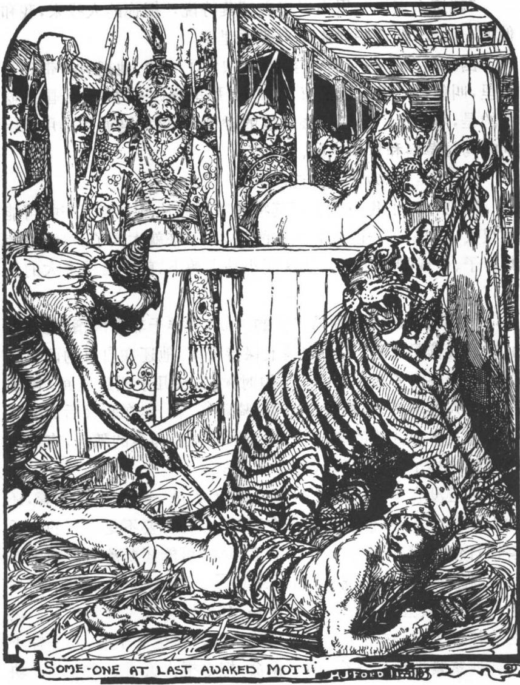

一两个星期以后，国王派人找来莫特。国王神情沮丧，对莫特说，邻近有一个国家向他宣战，这个国家的士兵比他的多。他现在已经是山穷水尽，既没有足够的士兵去打仗，又没有很多的钱去求和。怎么办？

“就这么点事？用不着担心。”莫特说，“把你的人找来，我和他们一起去，把这些强盗抓来评评理。”

国王听了这些充满希望的话，快活了一些。他把莫特带到马厩里，叫他挑一匹自己最喜欢的马。那里有许多好马。令国王吃惊的是，莫特挑了一匹又矮又瘦的矮种马，这种马通常是用来给别的马拉草料和饮用水的。

国王问：“你为什么挑这匹马？”

“嗯！你看！我的陛下！”莫特回答，“我从马上摔下来的可能性很大。如果挑一匹又高又大的马，摔下来就太高了，可能会摔断脖子、手或脚什么的。从这匹小马上摔下，就不会受多大的伤害。”

莫特骑着这匹矮种马出征的时候，那样子非常滑稽。他带着的唯一武器是木棍。为了在马上保持平衡，他还在自己的两只脚上缚上两块大石头。马在行走的时候，石头几乎碰到地面。国王的骑兵人数不多，但都披盔戴甲，骑着好马。走在骑兵后面的是拿着各式各样武器的乌合之众。最后是国王和他的随从，有点提心吊胆的样子。这支部队就这样出发了。

队伍没有走多远，莫特的小矮马因为被一个大个子骑着，还加上两块大石头，慢慢地就落在骑兵的后面。要不是后面的步兵害怕打仗，故意慢吞吞地跟在后面，莫特可能还要落后。他坐在马上，随着马缓慢地摇晃着，越来越慢。最后，莫特觉得不耐烦了，用木棍狠狠地打了一下矮种马，马大发脾气飞奔起来。一块石头松开了，掉在路边滚滚的尘埃里。莫特失去平衡，几乎摔下来。他紧紧地抓住马鬃，为了保命，把木棍也丢了。幸亏另一块石头也掉下来，滚到旁边的深沟里去了，前面的骑兵看到莫特奔驰过来，赶紧给他让开一条道。莫特一边奔驰着，一边恶狠狠地咒骂着他的马。

“你等着吧！我要抓住你，我要活活地剥下你的皮，扭断你的脖子！敲断你的每一根骨头！”

骑兵们听到这些话，以为他是在咒骂敌人，不禁对他的勇气肃然起敬。许多战马受到这匹英勇驰骋疆场的矮种马感染，也开始跟着奔驰起来。整个部队都紧随在莫特的后面。

莫特骑着那匹发了疯似的马，远远地奔跑在前头。前面的路上出现一片碧绿的蓖麻油树丛，有三米多高，长得非常茂盛。莫特为了摆脱这匹疯狂的马，抓住了一棵树，结果是连根拔了出来。莫特抱着它继续奔驰着，树好像就是从马的身上长出来似的。

这时候，敌人已经排成作战队形，在草原上不断地向前迈进着。他们的国王充满了自信，正在兴高采烈。前面突然来了一个骑兵，以闪电般的速度向他奔驰过来。

“陛下！”传令兵喊道，“快救救你自己！敌人冲过来了。”

“你这是什么意思？”国王问。

“啊！陛下！”传令兵喘息着说，“快跑吧！没有多少时间了。前面有一个发疯了的巨人，正向我们狂奔过来。他抱着一棵树当武器，愤怒地喊叫着，‘你等着吧！我要抓住你，我要活活地剥下你的皮！扭断你的脖子，敲断你的每一根骨头！’其他人马紧跟其后。你最好还是赶快避开这股毁灭性的旋风吧！”

就在这时，只见尘土飞扬，莫特骑在那匹小马上飞奔过来，相比之下，真像是一个巨人。他手中挥动着的蓖麻油树，大得像栎树。他喊叫和咒骂的声音顺风而来，更是令人胆颤心寒。紧随在其后的战马奔驰声，像滚滚的雷鸣。钢盔和钢枪在阳光下闪耀着一片刺眼的光芒。这光芒和响声使国王吓破了胆。他调转马头，往回就跑，想尽快逃避这一群愤怒地叫喊着的巨人。他的部队也跟着纷纷逃命。一个肥胖的军官受不了这种高速度的奔跑，莫特追上了他，把他吓得从马上掉下来。莫特的马受了一惊，莫特也从马上滚了下来，正好落在胖军官的身上。他站起来，挥动着那棵树对胖军官喊道：

“你的人在哪里？把他们叫来，我要杀了他们！我的骑兵团，全体继续前进！你的国王在哪里？把他带来见我。我所有的好士兵都在这里，他们每人都连根拔起一棵树，要摆平你们，夷平你们的房屋和城市！前进！”

可怜的胖军官只吓得跪在地下求饶，不停地发抖。莫特把他拉起来，叫他回去把他的国王叫来，就饶了他的命。这时候，莫特这边的部队已经到齐。看到莫特打了胜仗，他们显得更加威风凛凛。胖军官把他的国王叫来了。国王显得非常恭顺和谦卑，连连道歉，声称愿意赔钱，再也不敢发动战争了。莫特叫他干什么，就干什么。

双方的军队都高高兴兴地班师回朝。这下，笨蛋莫特可真的走运了。他的一生都受到尊敬，被誉为智慧和勇气的象征。只有他的亲戚不以为然，他们怎么也弄不明白，莫特究竟干了些什么，会被人认为比什么人都聪明。

（阿富汗故事）

 
 

## 着了魔法的鹿

有一天，一个名叫伊恩的青年牵着一匹肥壮的马，在埃里恩一边行走，一边想着他的母亲，想着自从打鱼为生的父亲在海上被淹死以后，家里变得穷困潦倒。干些什么才能养活母亲和自己。忽然有人拍拍他的肩膀，对他说，

“你愿意把马卖给我吗？渔夫的儿子？”

他抬起头来，看到那人手中拿着一杆枪，肩膀上站着一只鹰，一条狗跟在后面。

“你用什么来换我的马呢？”伊恩问，“你愿意给我那杆枪，那条狗和那只鹰吗？”

“我把它们都给你。”那人回答，拉走了马。伊恩带着枪、狗和鹰，回到家中。母亲知道了这一切，非常生气，就用手中的拐杖来打他。

“我要教训你一顿，看你还敢不敢卖掉我的财产！”她边说边打，直到手臂发酸。伊恩没有说什么，心里非常悲伤，就上床躺下。

当天夜里，他轻轻地爬起来，带着他的枪走了。“我不愿意留在家里挨打。”他想。

他整夜不停地走，直到天亮，觉得肚子饿了，就看看周围，想找点东西吃。不远的地方有一间农舍，他走过去，敲了敲门。农民和妻子把门打开，请他进来一起共进早餐。

“哦！你有一杆枪！”农民看到伊恩把枪放在角落里，说道，

“太好了，一只鹿每天晚上总是来吃我们的庄稼。我抓不到它，是命运把你派到我这里来了。”

“为了射死这头鹿，我很高兴留下来。”伊恩说。

那天晚上，他躲在庄稼地里，看到那头鹿走进来。他举枪瞄准，正要扣动扳机，天哪！鹿不见了，一个长长头发的姑娘站在那里！他吃了一惊，枪差点从手中掉下来。可是看着看着，又看见鹿在吃庄稼。这样一连三次，那头鹿就向荒野跑去，伊恩紧跟在后面。

他们一个在前面跑，一个在后面追，来到了一间茅屋旁。鹿纵身一跃上了屋顶，躺下来后什么也看不见了。但它的声音却传出来：“进去啊！渔夫的儿子，尽量地吃饱喝足。”

他走进屋子，看到桌子上摆着食品和酒。里面空无一人，因为这座房子是强盗的。这时候，他们还不知道在什么地方干着罪恶的勾当呢！

伊恩吃够了以后，就躲在一个大木桶后面。很快，他听到了吵闹的声音，有人从草丛中向茅屋走过来，那些小树枝被踩断，发出响声。从黑暗的角落里，伊恩看见一伙人走进屋，一共有二十四人。个个身材高大，满脸横肉，很吓人。

“有人把我们的饭吃了。”他们喊叫起来，“剩下的不够我们吃。”

“肯定是躺在大木桶后面的那个人。”强盗头子说，“去把他杀了，然后过来吃饭，吃好饭就睡觉。明天一大早就出发。”有四个强盗走过去，把可怜的伊恩杀了，扔在那里就上床睡觉。

太阳出来的时候，强盗们都走了，他们还要赶远路。等看不到他们的影子后，鹿从屋顶上下来，来到死了的伊恩身旁。它对着他摇摇头，蜂蜡从它的耳朵里掉下来，落在他身上。他跳了起来，像以前一样好好的。

“相信我，像昨天一样，你尽管吃吧！你不会受到任何伤害。”

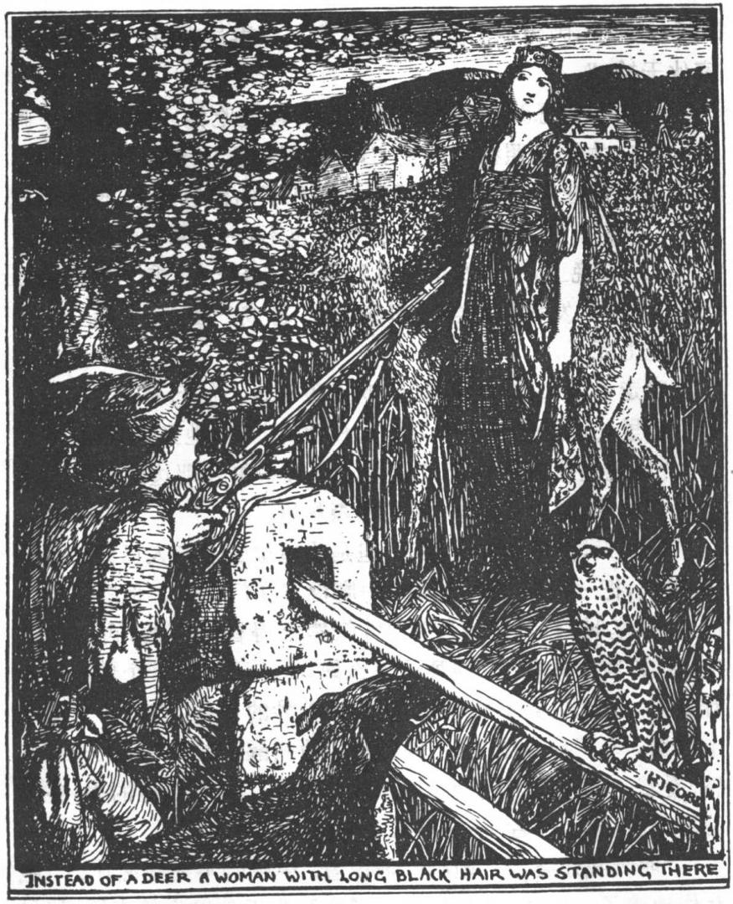

它说，这一天，伊恩又吃饱喝足，倒在大木桶旁边睡着了。

晚上，强盗们回来，个个非常疲倦，而且怒气冲冲。因为他们今天的运气不好，没有带回来什么东西。

“又有人把我们的饭吃了！”他们叫道。

“是躺在桶旁边的那个人。”强盗头子说，“先把昨天晚上那四个人杀了，因为他们没有杀死这个人。再过去四个人，把这个家伙干掉！”

可怜的伊恩第二次被杀。其余的强盗吃饱以后，就躺下睡了。不久，太阳光照在他们脸上，他们起身后又出发了。这时候，那头鹿又走进来，把救命的蜂蜡撒在死了的伊恩身上，他又活过来了。伊恩知道鹿会救他的命，什么也不在乎，同样的事情又发生了。这天晚上，又有四个强盗和伊恩一道死去。剩下的强盗因为饭不够吃，发疯似地争吵起来，最后打成一团，一个接一个地倒在地上死了。

鹿走了进来，把伊恩救活，叫他跟它走。他们来到一间白色的小屋里。这里住着一个老妇人和她的儿子，他又黑又瘦。

“我现在要离开你了，”鹿说，“明天中午到那边的教堂里去找我。”说着，跳过了小河，消失在森林里。

第二天，伊恩动身去教堂。但是小屋里的老妇人已经比他先到教堂，把一根叫“伤心之刺”的魔棍安在门板上。他跨过门槛进入教堂时，碰到了这根魔棍，忽然觉得昏沉沉的，再也站不住，倒在地上睡着了。他睡得这么熟，根本不知道一个黑小孩正看着他。怎么也弄不醒他，即使是最美妙的音乐。这时一个姑娘走进来，弯下身来碰他，还是无法把他叫醒。姑娘的脸上充满忧愁，看着一切都无济于事，只好放弃努力。她举起他的手，在上面写下了自己的名字——“水下城国王的女儿”。

“明天我还要来，”她喃喃地说着。伊恩听不到她说什么。她悲伤地走了。不久，他醒过来。黑小孩告诉他发生的事情，但是没有告诉他，姑娘在他手上留下了名字。伊恩觉得非常伤心。

第二天早晨，渔夫的儿子又来到教堂，发誓再也不睡着了。但匆匆忙忙地走进教堂时，他的手碰到了“伤心之刺”，立即倒下熟睡了。这时，空中传来美妙的音乐，那姑娘轻轻地走进来。尽管她把伊恩的头靠在她的膝上，用一把金梳来梳理他的头发，他的眼睛还是紧闭着。眼泪禁不住滚滚地从她的脸上流下来。她把一个包装漂亮的盒子放进他的口袋以后，就走了。

第三天，同样的事情又发生了。这一次，那姑娘哭得更加伤心。她说，今天是最后一次机会了，她再也不被允许到这里来，她必须回家去了。

姑娘走了以后，伊恩醒过来。黑小孩告诉他姑娘的来访，还说在他有生之年，他再也看不到她了。渔夫的儿子只觉得自己像落进冰窟似的，浑身发冷。他知道，这不是他的过错，因为睡神控制了他。

“我要走遍整个世界，直到找到她。”他说。黑小孩听见他的话，

笑起来。但伊恩不理睬这些，他出发了。他跟着太阳光走了一天又一天，鞋子走破了，脚又肿又痛。一路上，只见鸟儿在树上筑巢，偶尔也见山羊和兔子跑过。他日以继夜，头也不回地走着，走着。直到有一天，他忽然看到路边有一间小房子，一个妇女站在门口。

“你好啊！渔夫的儿子！”她说，“我知道你在找什么，进来休息一会，吃点东西。明天我将尽可能地帮你，送你上路。”

伊恩高兴地接受了她的邀请。那女人用油膏来擦他的脚，医治好了他的伤痛。他休息了整整一夜。第二天一早，他起床后就准备出发。那女人和他告别，对他说，

“我有一个妹妹住在你要经过的路旁。这段路很长，很长，你要走一年零一天，才能到达。但是把这双穿孔的棕色旧鞋穿上，不知不觉地你就会到了。到了以后，把鞋脱下来，把鞋头对准走过的路，它们就会自己走回来。”

伊恩照那女人的话去做，一切都像她所说的那样。在告别她妹妹的时候，她也给了他一双鞋子，对他说，

“到我小妹那里去。她有个儿子，专管空中的飞鸟，到晚上就送它们去睡觉。他非常聪明，也许能帮助你。”

伊恩谢了她，就出发去找小妹。

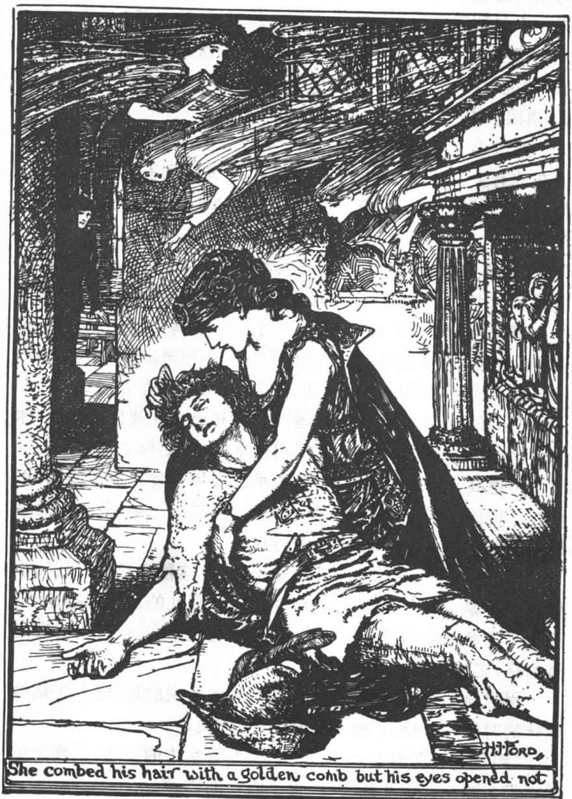

小妹很仁慈和善良，但不能帮他出什么主意。他吃饱喝足就等她的儿子回家。儿子回来以后，先把所有的鸟送去睡觉。听完妈妈给他讲的伊恩的故事以后，他想了好一会。最后他说饿了，要把那头牛杀掉，烧晚饭吃。他们把牛肉吃掉，把红色的皮用来做成一个皮袋。

“现在，走到皮袋里去。”小妹的儿子对伊恩说。伊恩带着枪进了皮袋，那只狗和老鹰留在外面。管鸟的儿子把口袋上的绳子收紧，把它放在一旁，又继续吃他的晚饭。这时一只大鹰从门口飞进来，用巨爪抓住口袋就向外飞去，把伊恩带到一个岛屿上。岛上没有什么吃的，伊恩想，他要饿死在岛上了。后来他想起姑娘放在他口袋里的盒子，就把它拿出来，打开盖，里面飞出三只很小的鸟，它们拍动着翅膀问道：

“好主人！我们能为你做些什么吗？”

“把我带到水下王国的国王那里去。”他说。

一只小鸟飞到他头上，两只小鸟站在他的肩膀上。他闭上眼睛，不一会他就到了水下王国。小鸟飞走了，伊恩看了看周围，想到这里就是他走遍整个世界要寻找的姑娘居住的地方，他的心快速地跳动着。

他沿着街道行走，看到一家编织工的房子。编织工正站在门口休息。

“你是一个外来人，这是明摆着的。”编织工说，“请进！我请你喝点水和吃点东西。”伊恩很高兴，因为他也不知道要到哪里去。他们坐在一起，说着话，一直到很晚。

“请留下来和我住在一起吧！我只有一个人，喜欢有个伴。”编织工说着，指了指角落里的一张床。伊恩就在这张床上睡了一夜，直到天明。

“今天，城里将举行一次赛马。”编织工说，“赢者将娶国王的女儿为妻。”伊恩听到这个消息，激动得有点发抖。他用颤抖着的声音回答，“这个奖励真是至高无上，我想去看一看比赛。”

“喔！那太容易了，任何人都可以去。”编织工说，“我本来可以陪你去的，但我已经答应了要为国王织好这件衣服。”

“真是太遗憾了。”伊恩有礼貌地回答，但心里却暗暗高兴，因为他希望单独去。离开房子以后，他来到了后面的丛林里，把盒子从口袋里拿出来，把盖打开，三只小鸟从里面飞出来。

“好主人，我们能为你做些什么吗？”小鸟问。他说，“把人们从来没有见过的，最好的马带来，还有最华丽的衣服和玻璃鞋。”

“它们都在这里。”小鸟说。真的，伊恩从来没有见过这么好的马，衣服和鞋子。

伊恩骑上马，来到了赛马场，站好了位置。许多参赛的马曾经赢得过许多奖，伊恩的马把它们全部抛在后面，第一个到达了终点。国王的女儿等着他来相见，但是却白等了。伊恩回到了森林里，下了马，穿上旧衣服，又吩咐小鸟在他的口袋里放些黄金。准备好了以后，他又回到编织工的家里。为了感谢编织工对他的好心，伊恩把黄金送给他。还说这些黄金是赛马冠军给他的。

因为没有人上来和公主订婚，国王命令举行第二次赛马。渔夫的儿子伊恩穿着比第一次更加漂亮的衣服进入赛场。他轻而易举地把所有的人抛在后面。这一次他还是没有上台去和公主见面。赛马不得不再举行第三次。水下王国所有的老百姓都倾城而出，观看比赛。他们都怀着好奇的心情，要看看这个奇怪的优胜者是谁。

“如果他自己不愿意来，就把他带来。”比赛结束以后，国王说。所有见到过这个冠军的传令兵都被派了出去，走遍城市每一条大街小巷，寻找他。他们花了许多天，最后才根据有人提供的消息，在编织工的家里找到了他。由于中过“伤心之刺”的魔法，他显得又脏又丑，外表很古怪。传令兵说，他不可能是赛马冠军，肯定是那个杀过许多人又设法逃跑了的强盗。

“是的，他肯定是那个强盗。”伊恩被带到国王面前时，国王说，“马上竖起一个绞刑架，当着我所有的老百姓的面，把他吊死，让他们看看这个罪犯受到什么样的惩罚。”

绞刑架立即在一个高台上竖起。渔夫的儿子伊恩在刽子手的押送下，一步一步地走上台阶。在台阶上，像所有无辜被害的人一样，他大声地为自己辩护。说着，他无意间举起了自己的手，国王的女儿这时正坐在父亲的身边，看到了自己在他手上留下的名字。她尖叫着从座位上站起来，在场所有人的眼睛都转过来瞪着她。

“停下，停下！”她大声地喊叫着，自己也不知道说什么好，“假如他被吊死，这个国家所有的人都活不了。”说着，她跑到绞刑架下，拉着伊恩的手说，“父亲，他不是强盗，也不是杀人犯，他是三次赛马的冠军，是他破除了加在我身上的魔法。”

接着，她不等任何人回答，就领他走进了王宫。伊恩在大理石浴池里洗了澡。魔法加给他的一切肮脏顿时消失。穿上公主给他的华丽服装，看上去他完全配得上埃里恩国王的女儿。他来到了大厅，公主正在那里等着他。他们有千言万语要和对方说，但是没有时间。因为国王，来访的各国王子，还有全国的老百姓都在外面等着公主出来。

“你是怎么找到我的？”在走廊里，公主忍不住问了他一句。

“盒子里的小鸟告诉我的。”他回答。

这时，他们已经走到了挤满人群的广场。公主停下来，转过身对国王和大家说，“啊！国王，今天假如有人被杀，所有的人都将会消失。这个人是忠诚于我的，他为了我被杀了三次。我要嫁给他而不嫁给任何人。许多王子都曾经想把我从魔法中解救出来，但只有渔夫的儿子伊恩敢为我而死，为我破除了魔法。”

（西苏格兰高地通俗故事）

 
 

## 鱼的故事

也许你会以为，鱼终究是鱼，只能生活在水中。但是，假如你到澳大利亚去，和中部沙漠地区的黑人交谈，你会知道一些完全不同的事情。他们会告诉你，很久很久以前，鱼也生活在陆地上，它们常常从一个地方走到另一个地方，猎取各种动物过日子。你知道鱼的样子是怎样的，你就会想到这是多么的艰难，鱼是多么的聪明。真的！鱼非常聪明，如果不是发生了一件意想不到的事情，它们还会继续在陆地上打猎下去。

有一天，整个鱼族出去打猎回来，都感到非常疲劳，想寻找块阴凉的地方宿营。天气很热，它们发现河边一棵大树下比任何地方都舒服。于是，就在河边的陡坡上生起火来做饭吃。做饭的时候，它们都懒洋洋地躺在树荫下，迷迷糊糊地快要睡着了。谁也没有注意到，一片乌云飘过来，遮住了太阳。接着，豆大的雨滴开始倾盆而下。火被雨浇灭了。你也知道，在荒山野林里，没有火是非常可怕的。更糟糕的是，突然刮起一阵阵冷风，可怜的鱼都被冻得浑身发抖。

“这样下去不行，”鱼族中年纪最大的苏盖说，“不把火点起来，我们都会冻死。”它吩咐儿子们用两根木棒来摩擦，希望能生出火来。它们直擦得精疲力尽，一点火星也没有。

“让我试试，”多骨鱼比努戈说。但它也没有什么好运气。隆头鱼库巴尔也不行，许多鱼都试过了，没有一条能把火点着。

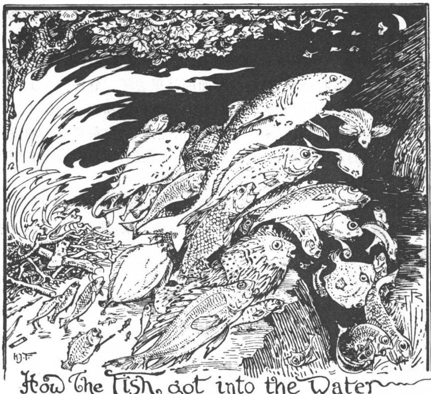

“没用，”苏盖最后说，“木头太湿了，我们只好坐着等太阳出来，把它晒干。”这时走过一条族中最小的鱼，大约只有十厘米长。它向苏盖鞠躬后说，“叫我的爸爸鳕鱼古特胡来点火。它惯于用魔法，比其他鱼都行。”于是，苏盖把古特胡叫来。古特胡从一棵树上剥下一些树皮，把它们放在篝火的灰烬上，跪下来不停地吹。吹了好久，柴堆中才发出一点点红光。其他的鱼看到这情景，都围过来，挡住刮过来的风，免得把火吹灭。但是古特胡叫它们到一边去，它要靠风来把火吹旺。慢慢地，火苗变成了火焰，不久就发出木材燃烧时劈劈啪啪的响声。

“快拿柴过来！”古特胡说，鱼都跑开去捡来更多的树皮，把它们堆在篝火上，火焰跳跃着，发出呼呼的声音。

“古特胡真了不起，我们很快就会暖和了。”为了取暖，鱼都围拢过来，越靠越近。忽然，从山坡上刮过来一阵风，火仗风势，向它们扑过来。鱼吓得直往后跳，忘记了它们坐在什么地方，从山坡上你撞我，我碰你，都滚到下面的河里去了。好冷呵！太阳从来没有晒到水下过。但一会儿它们又觉得暖和起来。原来这股大风把火也刮到河底来了，在河里正烧得旺呢！鱼都高兴地围拢过来，它们发现火在河底和岸上一样地燃烧，而且永远不会熄灭！

现在你知道了吧！为什么在寒冷的冬天，河面上的水很冷，但当你潜到水下去的时候，就会觉得温和舒服，那时，你会十分遗憾不能在水底生活。

（澳大利亚民间故事）

 
 

## 神奇的曲调

芒斯特国有一个风笛手叫莫里斯·康纳尔，能够不停地吹奏快乐舞曲和苏格兰双人舞曲、奥利斯特姆进行曲，还有鹰的叫声、鸡的奏鸣以及多种多样的调子，更令人惊讶的是，他会奏一个曲调，这个曲调有一种神奇的力量，可以让任何东西，不论是活的还是死的，跟着跳舞。

我不知道他是怎么学会这个曲调的。他也相当谨慎，不告诉任何人。这个曲调开始奏出第一个音符时，任何听见的人，不管是老的还是少的，脚上的鞋子就开始抖动，像得了抖抖病似的。然后，穿着鞋子的脚就开始迈步，最后就跳着，旋转着，不断地移动着，好像旋风中的一根稻草，不会停止，除非音乐停下来。

周围七个教区的所有婚礼，宴会和比赛，假如没有瞎子莫里斯和他的风笛参加，简直是一钱不值。他的母亲，可怜的穷妇人，经常领着他像所有卖艺人一样到处流浪。

后来，莫里斯·康纳尔和他的母亲来到艾弗拉奇。这里有陡峭的山岭，面临着汹涌的大海。在山上行走时，不小心就会摔断你的脖子；在海边漫步时，不留神就会被海涛吞没。但是在巴林斯克利湾也有一块好去处，供人憩息。那里有一片清洁平整的沙滩，面临安静的大海。夏天的晚上，在月光的照耀下，海面微波荡漾，景色格外迷人。

在这里，莫里斯的音乐最受欢迎。许多地方的青年男女都闻讯而来，聚集在一起。每当风笛管吹奏的美妙声音把年轻人的心弦拨动时，舞会就开始。他们觉得，从来没有跳得这么开心过。“伟大的音乐”，“了不起的演奏”，乐曲终止的时候，人们都这样称赞莫里斯。

“加把劲！莫里斯！”有点驼背的跳舞大师帕迪·多尔曼喊道，他负责维持舞会的秩序。

帕迪是一个好心人，他怕莫里斯累坏了，就问他，“风笛手，要喝点什么吗？”“是的，先生，”莫里斯回答，风笛手和教师一样，不会拒绝别人送来的饮料。

“你想喝点什么饮料？莫里斯！”帕迪问。

“我没有什么特别的嗜好，”莫里斯说，“除了生水以外，我什么都喝。假如你不介意，多尔曼先生，请给我一杯威士忌。”

“我没有杯子，莫里斯，”帕迪说，“我只有瓶子。”

“但愿这没有什么关系，”莫里斯说，“我以前试过，我的嘴正好只能装一杯酒。”

帕迪毫不在意地递给他一瓶威士忌——帕迪多么傻啊！这回可吃苦头了。他发现，莫里斯的嘴虽然只能装一杯，但是他的喉咙是一个洞，不知道要倒多少才能灌满它。

“威士忌还不错，”莫里斯说，把空瓶子还给了帕迪。

用不着我告诉你，你也知道，体面的先生和女士喝酒的时候，是不会一口气喝完一瓶威士忌的。我一生之中只看到过五个人一口气喝完一瓶威士忌以后若无其事。莫里斯当然不是其中的一个。请不要以为我责备他，他可能挺得住。但是俗话说，“酒进去了，感觉就出来了”。他吐了一口气，又开始吹那神奇的曲调。

舞会的欢乐气氛真是令人难以置信。莫里斯自己也稳不住了，两只脚也开始扭动起来，像汹涌的大海之中的一只船，努力地跟上曲调的节拍。他的母亲也开始像年轻的姑娘似地转动她的老骨头。但是，值得称道的还不是她的舞姿，也不是在场的其他人。

这时候，海滩上的每一寸土地，都可以看到各种各样的鱼在跟随着音乐跳跃着。在神奇美妙的旋律诱惑下，每时每刻都有越来越多的鱼从海水中跃出。巨大的螃蟹像无比敏捷的舞蹈大师，靠一只爪着陆旋转着。其余的脚爪在空中划出优美的姿态，实在令人惊讶不已。也许你听说过作家弗洛伦斯·康里，他为这些跳舞的鱼写下了一首优美的诗。如果不让你在这里读到它，你会觉得万分遗憾的。

> 海豹在旋转，
> 肥胖的脚踏着舞步，
> 多像海上的波涛。
> 快乐的鱼群蜂拥而来，
> 螃蟹、龙虾和蝲蛄，
> 不断地翩翩起舞。
>
> 跟着美妙的乐曲，
> 喘息的鳕不肯止步。
> 一切是那么奇妙。
> 大菱鱼，还有比目鱼，
> 它们团团地围在一起，
> 舞技令人赞叹不已。
>
> 海鲂轻快地走来。
> 迟钝的狗鳕也一蹦一跳，
> 像小狗在把尾巴轻摇。
> 伶俐的鲭鱼在雀跃，
> 像彩虹在天空飞舞，
> 要随风而去。
> 黑线鳕听到乐曲，
> 离开了盐水牧塘，
> 来到舞场。
> 扁头的鳐鱼不甘落后，
> 只有那鳎鱼没有动静，
> 至今不见起程。
>
> 银光闪闪的鲱鱼，
> 显得多么神气，
> 排起长长的队伍，
> 未免有点趾高气扬，
> 使拥挤的沙滩，
> 在闪烁着光芒。
>
> 扇贝和牡蛎披盔带甲，
> 也在大摇大摆，
> 像在为舞会击节。
> 帽贝的舞姿最动人，
> 笑声伴随着鲜明的节奏，
> 洋溢在天空和海上。

不论是过去还是现在，世界上从来没有这么热闹过，天和地好像已经融合在一起。这一切，都是出于莫里斯神奇的曲调！

在舞会最高潮的时候，跳舞的鱼群中出现了一位美丽的姑娘，像破晓的早霞那么光彩照人。她头上戴着一顶三角帽，长长的、像海水那样碧绿的头发垂下来，伴着她的舞步飘扬着。她的牙齿像一排雪白的珍珠。她的嘴唇像红色的珊瑚。她穿着一件闪光的浅绿色的长裙，像波浪一样摆动，上面绣着几小行紫色和红色的海草图案。不论在陆地上还是海洋里，没有一个女人出行的时候不留神打扮自己。

她跳着，跳着，来到莫里斯的身边。他这时正急速地跟着旋律旋转。当这神奇的曲调还在演奏的时候，世界上没有任何东西能够保持安静。她用蜜一样甜的声音对他唱道：

> 我是受人尊敬的女人，
> 生活在海洋里。
> 下来吧！莫里斯·康纳尔，
> 做我的丈夫！
> 金碗和银盘都属于你，
> 和我结婚，
> 你就成为鱼的国王。

莫里斯因为喝了许多酒，头脑还不太清醒。可能不是每个女人都愿意把自己许配给一个瞎了的风笛手。因此，为了报答她的好意，莫里斯也唱道：

> 我非常感谢你，姑娘，
> 不是为了金碗和银盘。
> 成为国王，有了金碗和银盘，
> 我天天会有豪华的宴席。
> 有你这样的公主作伴，
> 我怎么会忍心拒绝！
> 但要我喝盐水，
> 实在不习惯。

姑娘吃惊地看着他，像个大学者似的，头一会儿倾向左边，一会儿倾向右边。“天啊！”她说，“莫里斯，假如你不是诗人，到哪儿去找诗人呢？”

他们就这样各自唱着自己心中的歌，一问一答，脚步随着乐曲的节奏跳动着，快得像口中的舌头。所有的鱼也在不停地跳着。莫里斯听着它们咔嚓咔嚓的舞步，不敢停止吹奏，生怕鱼会不高兴。他也不知道这么多鱼如果不高兴的话，会把他怎么样。

那长着绿头发的姑娘继续用款款细语来劝导莫里斯，直到最后他同意和她结婚，做所有的鱼，不论是大鱼还是小鱼的国王。它们想要一个能让自己跳舞的国王，莫里斯是再合适不过了。他看来是要和所有的鱼一样，到酒吧间去喝海水了。

莫里斯的母亲看到儿子在一个长着绿头发，不像常人的姑娘引导下，亲密地和她跳着舞，穿过密集的鱼群，慢慢地向海边走去，就喊住他，叫他回来。

“喂！好了！”她说，“好像我做个寡妇还不够似的，现在，他又要离开我去和那个长鳞片的女人结婚。谁知道我会不会是一条鳕鱼的外祖母呢？啊！上帝，可怜我！帮助我吧！这是一种超自然的势力。说不定我会加一点盐和黄油，把我的孙辈烧来吃掉也不知道呢！啊！莫里斯，莫里斯，假如你还有一点爱心和天性，回到你的老母亲身边来吧！我把你当作基督的后代来抚养！”说着，可怜的女人开始哭泣，哭得那么伤心，任何好心的人都会触动同情之心。

莫里斯离水边已经不远了，他还是若无其事地吹奏着，舞蹈着，一个滔天巨浪向他翻滚过来，像要活活地把他吞没。但是他看不见，所以丝毫也不害怕，他的母亲看得一清二楚，大滴大滴的泪水从她脸颊上流下。像所有眼看着要失去儿子的母亲一样，她的心觉得一阵一阵地揪痛。她继续跳着舞，为她毫无意义的生命而舞。她也是迫不得已，因为莫里斯从不中止吹奏那神奇的曲调。

他只是把母亲的话当耳边风，怕她的话会令他回头，他给母亲的回答是，“多保重，妈妈，我决定要到海底去当鱼的国王。为了证明我交了好运，证明我还活着，过得很好，每隔十二个月的这一天，我要送一块木炭到特拉弗拉斯卡来给你。”这时候，莫里斯再也说不出话来了。那长着绿头发的姑娘看到那巨浪向他们盖过来，把一件有着兜帽，像斗篷似的东西盖在他们两个人的头上。巨浪两次从他们的头上卷过，吞没了整个海滩，发出震耳欲聋的声音。

十二个月后的这一天，一块木炭在特拉弗拉斯卡登陆。莫里斯从那么远的海底送来的东西真是有点奇怪。也许一件衣服或一双鞋子会更像送给母亲的礼物。但这是他的诺言，他必须遵守。这块木炭在约定的日子里都准时地登陆，可能持续了一百多年。这一天现在人们已经忘记了。这也是为什么人们都说，莫里斯·康纳尔已经停止了送给母亲交好运的礼物。

可怜的母亲也没有活着收到儿子每年送来的礼物。也许是因为失去了莫里斯，也许是由于担心把她的孙子吃掉，那次跳舞以后三个星期，她就死了。也有人说她是因为疲劳过度而死的。不管怎么说，老康纳尔夫人还是体面地和她的家人埋葬在一起。

在风平浪静的夜晚，出海的人们常常在远离凯里海岸的海里听到水中传来的音乐。那些耳灵的人，还能清楚地辨认出，莫里斯·康纳尔的声音在伴随着风笛的演奏唱道：

> 美丽的海岸，宽广的海滩，
> 钻石般的沙子，清澈的海浪，
> 要不是为了心爱的姑娘，
> 我怎会离开你远走他乡。

（南爱尔兰童话和传说）

 
 

## 穷富兄弟

以前有一个年老的富翁，妻子已经去世。他有两个儿子，大的和他住在一起，帮助他管理财产。很长一段时间里，日子过得很好。年轻人每天早早起来，整天努力地干活。每到周末，父亲数着他们挣来的钱，看到堆在铁箱子里的黄金越来越多，高兴地搓着双手说，“黄金很快就要铺满箱子，我要去买一个更大的。”他只顾自言自语，脑子里只想着钱，没有注意到儿子近来总是喜气洋洋，有时和他说话的时候，儿子总是心不在焉。

有一天，老人到城里去做一笔生意，他已经三年没有到城里去了。这一天正好是集市，他碰到了许多老朋友。他来到一家客栈的院子里，吩咐马伕给马配一副鞍子的时候，天已经很晚了。他在厅里等着马鞍，女店主走过来和他聊天，说了一些什么天气啊，葡萄啊以后，问他是不是喜欢他的新媳妇，对这件婚事是不是感到意外。

老人吃惊地瞪着她。“媳妇？婚事？”他说，“我不知道你在说些什么！我还没有媳妇，最近也没有听说什么人结婚。”

其实，这就是那爱管闲事的女店主想知道的事情。她装做很吃惊的样子，说，“啊！亲爱的！我希望不会带来什么不幸，我只是无意的……喔！当然，我本来不该说出来的……但是……”她不说了。把手在围裙上擦着，好像很窘的样子。

“你既然已经开了头，那么就请说下去。”老人说，怀疑她在挖苦他。女店主也很高兴地说下去：

“一连好几个月，你英俊的儿子每星期到城里来，并不仅仅是为了做买卖，他也不是走最近的一条路。他穿过小山坡，沿着河边走，从种葡萄的米格尔的房子那里经过。米格尔有一个女儿，人人都说是这个国家最漂亮的姑娘。不过在我看来，皮肤未免太白了。”说到这里，她停了一下，看了一眼老人，但看不清楚老人的表情。他只是紧闭着嘴，眼睛看着正前方。看到她停下来，他急匆匆地说，“讲下去。”

“没有多少话可说了。”女店主回答，她突然想起来要烧晚饭了。每逢集市的日子，许多赶集的人这时肚子都饿了，要在客栈里吃完晚饭后赶回家。“有一个天气晴朗的上午，他们两人到山顶的教堂里去结婚。我侄女是神父的侍从，她看到了他们，就告诉我了。祝你快乐！你的马备好了，我要赶快到厨房里去做饭了。”

幸好那匹马认得路，老人骑在马上想他的心事，松着缰绳，根本没有留神马往哪里走。到家以后，他把马牵到马厩，就去找儿子。

“我都知道了，你欺骗了我，立刻滚出去，我再也不愿意看到你了。”他气冲冲地向儿子走来，因气愤而结结巴巴地说着。

儿子这时正在门口削着一根木棍，快活地吹着口哨。

“可是，爸爸……”儿子说。

“你再也不是我的儿子了，我只有一个儿子，走吧！否则你就倒霉。”他说着，举起了手中的鞭子。

年轻人缩了回去，他害怕父亲因情绪激动而痉挛倒下。这时，老人的脸气得通红，眼珠子好像要从眼眶里暴出来。留下来是没有用的了，也许明天早上老人会听他诉说理由，但在儿子的心目中，老子的话是从来不会收回的。他慢慢地转过身去，心情沉重地沿着山坡的一条小路走去，直到来到一个岩洞里。他在洞里坐了一个晚上，想着究竟发生了什么事情。

是的，他错了，这是毫无疑问的。但是他不明白事情是怎样发生的。他本来打算把一切都告诉父亲。他相信，而且十分肯定，老人一看到他的媳妇，会因为她美丽和善良而原谅她的穷苦。可是，他把这件事情拖了一天又一天，总是想找一个更好的机会，想不到结果会是这样。

儿子整夜没睡，老子也没有睡好。天一亮，老子马上就叫人带讯给在大城市里的小儿子，叫他回来。老二一回到家，老人也不罗嗦，直接了当地告诉他，现在他是唯一的继承人，要继承所有金钱和土地。从今天起，他要住在家里，帮助他管理财产。

两兄弟很少相互关怀。所以想到自己将变成一个富人，老二非常高兴。不过，他很快对乡下的生活感到厌倦，希望住在老地方，过大城市的生活。但是，他把这种想法藏在心里，努力做好一切事情，像他哥哥一样地卖力干活。

日子就这样一年一年地过去了，但庄稼却长得一年不如一年。老人决定，城里正在建造的一些房子停下来，不去管它们了。因为要造好这些房子，就要花掉所有积蓄。从那天吵架以后，再也没有听见老人提起过老大。临死前也没有见他一面。像老人所答应的那样，所有的钱和土地，都留给了老二。

没有得到一分财产的老大变得越来越穷，他和妻子总是在寻找工作做，决不乱花一分钱。然而，命运偏偏和他作对，到他父亲死的时候，他们已经到了没有面包吃，没有衣服穿的程度。假如只有他自己，随便怎么的，还能打发日子，可是他不忍心看着孩子们一天比一天瘦下去。最后，他收起了自己骄傲的自尊心，越过山坡，来到现在是他弟弟住的老家。

两个人已经很久没有这样面对面地站在一起了。他们你看着我，我看着你，一句话也不说。眼泪不禁要从老大的眼眶中涌出，他眨眨眼，把它忍住了，说，“兄弟，用不着告诉你，我现在是多么穷，你自己也能看得出来。我来不是为了向你讨钱，只是求你把城里那些没有完工的房子给我，它们能避风遮雨。这样，我的妻子和孩子就能住下，还能省下租房子的钱。这些房子现在这个样子，也不能为你赚钱。”

老二听了他的话，产生了同情之心，就把他要的房子给了他。老大高兴地走了。

过了好几年，富裕的老二开始觉得孤独，想想自己越来越大了，到了该结婚的时候了。他选中的妻子非常有钱，但也非常贪婪，不论有多少，也从不满足。此外，她还属于这么一类可怜人，这种人由于贪心，总觉得别人的东西比自己的好。可怜的丈夫经常后悔，当初怎么会遇上她。她的吝啬和菲薄常常令人无地自容。但是他也没有勇气去管教她，她也就变得越来越坏。

结婚几个月以后，新娘子决定到城里去给自己买些新衣服。她从未到城里去过。买好东西后，她想去看看没有见过面的嫂子，顺便休息一会。她要找的房子坐落在一条大街上，本来应该是相当富丽堂皇的。可是，精雕细刻的石柱门廊上，却装上了一扇破破烂烂的木板门。一排漂亮的石柱下面空空如也，大厅西边的住所尚未完工，没有泥好的墙壁在往下滴着水。看到这所房子的人都会摇摇头走开。只有这个新娘子在想，只要再花点钱就可以把它修整得像原来计划的那么漂亮。她暗下决心，要把它弄到手。

带着满脑子的这个念头，她踏着大理石台阶，走进嫂子坐着的小房间。这时，她正在为孩子们缝衣服。看起来新娘子对这所房子很有兴趣，问了许多问题。当嫂嫂的觉得这个新亲戚比她原来想象的好多了，希望她们能成为好朋友。

新娘子一回到家，马上就去找她的丈夫，要他把这些房子从哥哥的手中要回来，说这些房子非常合适她。她可以轻而易举地把它修理得像王宫一样。丈夫只是说，不要动这些房子的脑筋了，她可以在城市里的其他地方买房子，许多年前已经把房子当礼物送给哥哥。他们在那里已经住了许多年。

听到这些话，妻子非常生气。她开始又哭又闹，声音惊动了所有的邻居，他们都从窗口伸出头来，看看发生了什么事情。“太荒唐了，”她边抽泣边喊叫着，“太不公平了，你为什么不想一想，这算什么礼物！房子给他们的时候，你是光棍一条。现在结婚了，你怎么就不问一问妻子同不同意！”她整天整夜不停地唠叨着，埋怨着，直搅得可怜的丈夫烦得要死。最后他照她的话去做，把他的哥哥传到法庭上，要他把房子交出来，说那些房子只是借给他的。但是，法官听了双方的申诉以后，做出了对穷哥哥有利的判决。那个富女人更是火上浇油，暴跳如雷，决心要把房子弄到手，否则决不罢休。她说，假如这个法官不给她房子，别的法官会给她的。于是，这个案子就被转来转去，最后转到了埃弗拉这个城市最高法官手里，她的丈夫被这件事情搅得精疲力尽，心烦意乱，而且也觉得羞愧难言。但他的问题在于没有一开始的时候，就阻止事情的发生。现在陷入这样的困境，只好硬着头皮顶下去了。

这一天两兄弟同时起程到城里去。富的骑着马，背包里装满了吃的东西。穷的靠两条腿，只带着一片面包和四根葱，以便路上充饥。山路崎岖不平，两人都走不快。傍晚时分，他们都高兴地看到，不远的地方有一间房子的窗口透出灯光。

灯来自一个农民的家庭，他正打算吃一顿丰盛的晚餐，因为今天是他妻子的生日。看到他们两兄弟过来，他请富的进去坐下，自己把马牵到马厩里去。穷的小心翼翼地问他，能否在角落里过一夜，还说自己带着晚饭。如果是别的时候，老大肯定会遭到拒绝，因为这个农民欺贫爱富。但今天例外，他让老大也进去，指着一张木椅子让他坐下。

晚餐很快就送上来了，老二兴高采烈地吃着，走了这么多路程，他觉得非常饿。农民的妻子什么也不吃。最后她说，她只想吃老大正在火上煮的一根洋葱。当然，老大给了她一根，不过他很想留着自己吃，因为走了一天，三根葱是不够的。他们都睡觉以后，可怜的老大也尽量让自己在角落里睡得舒服些。

几个小时后，农民被妻子的叫声和呻吟声吵醒。

“唉！我肚子痛得很厉害，我肯定要死了！”她哭着说，“肯定是那根葱，我知道，我真不应该吃它，它肯定有毒！”

“谁给你下毒，就应该得到报应。”她丈夫说着，抓起一根粗棍子，跑下楼梯，见到睡着的老大就打。老大完全没有防备。幸好吵声惊醒了老二。他跳起来，从农民手中夺过棍子，说，

“我们要到埃弗拉去打官司，假如他想抢你或者是杀你，那么就一起去告他。但现在不要杀了他，否则你就要倒霉。”

“好吧！也许你是对的。”农民说，“这个家伙越是早受罚，我就越高兴。”他不再说什么了，走到马厩里去，把老二的马牵出来，自己也牵了一匹。老大害怕再挨打，也马上就站起来走了。

整个晚上，天下着大雨，丝毫也没有停下来的迹象。路面上非常泥泞，难以行走。有一头驮着行李的骡子陷在泥坑里，不论主人怎么用力，也无法把它拉上来。骡子的主人没有办法，只好请正好骑着马经过的老二和农民帮忙。这时，他们正小心地绕过泥坑，根本不理睬他的呼喊。他只好回过头来拍拍自己的骡子，希望它再鼓起劲来。

这时候，老大也艰苦地过来，从头到脚都是泥水。但他还是愿意帮助骡子和他的主人。首先，他们找来一些结实的大木头，以便放在泥坑里，踏过去拉骡子。因为用力挣扎，骡子的缰绳已经断了，而且越陷越深。老大小心地踩着木头，走到骡的屁股后用力推他。为了保持平衡，他抓住了骡的尾巴。在老大的推动下，骡子用力一跃，终于跳出泥坑。老大来不及松手，把骡子的尾巴拉断了。骡子的主人忘记了是老大帮他救出了骡子，看到骡子的尾巴断了，他暴跳如雷，开始咒骂可怜的人，说他毁了他的牲口，

法律将判决他赔偿。说着，他跨上了骡子的背，骡子这时正为走出泥坑而高兴，根本不在乎把尾巴丢了。就这佯，这个忘恩负义的坏蛋也走了。这天晚上，他也来到了埃弗拉的旅店。富老二和那个农民也早已到了，准备在这里过夜。

可怜的老大满腹忧愁地走着，他真不知道前面还有什么厄运在等待着他。“我肯定不是因为这个，就是因为那个被处罚。”他伤心地想着，“说到底，反正就是一死，与其死在冤家的手里，不如自己去死。”他来到埃弗拉，就开始寻找合适的地方实现自己的计划。他终于找到了，但实在太晚了，天又很黑，他不知道能否成功，就在一家门口蜷缩着，一直睡到天明。

虽然是冬天，太阳出来后，天气却非常晴朗。可怜的人醒过来的时候，阳光正照在他的身上，使他觉得一点温暖。他想，这是他活在这个世界上的最后一天了，尽管他把妻子和小孩抛在身后，他还是觉得有点快活。他和命运搏斗了那么久，已经非常疲倦了；他也不在乎是否能证明自己无罪，是否能战胜敌人，他们实在是太强大了，自己不是他们的对手，他已经没有力量去和他们较量。他沿着台阶，一步一步地爬上城墙的城垛。他停了下来，凝视着自己的周围。

恰巧有一个住在附近病得很重的老人，这天也要求家人把他抬到墙底下，以便晒晒早晨的阳光，和路过这里去做工的老朋友说说话。他根本没有想到，就在城垛上，正好在他头顶上，站着一个就要拥抱死神的人，正在看着这个太阳最后一眼。

阳光照到了对面教堂的尖顶，可怜的老大闭上双眼，纵身一跃。城墙很高，他穿过空间，迅速地落下，但是没有掉在地上，而是不偏不倚地落在老人的身上。老人一声不吭地滚在一边死了。老大一点也没有受伤，他慢慢地站起来，立刻有人上来把他抓住。

“你杀死了我们的父亲，看到了吗？看到了吗？”两个年轻人喊叫着，“你马上跟我们到法官那里去，看你怎么说！”

“你的父亲？但是我不认识他，你这是什么意思？”这突然从天而降的灾难令他非常迷惑。他不明白，自己为什么又增加了一条新的罪行。但是没有人回答他，他被推搡着穿过街道，来到法庭。他的弟弟、骡子的主人，还有那个农民这时也刚到。他们都非常气愤，争先恐后地指责他，直到法官走进来，叫他们安静下来。

“我要听你们一个一个地讲。”法官说，叫老二开始。

他没有花多少时间就讲完他的案子。他说，那没完工的房子，还有其余的财产，都是他父亲留给他的，他哥哥拒绝还给他。老大也申辩了几句，说他如何请弟弟把房子给他，这就成了弟弟给他的一件礼物，他也成了房子的主人。

法官一声不吭地听完了他们的诉说，又问了几个问题，立即做出判决。

“房子应该是接受馈送人的财产。至于你！”他转过身来对老二说，“明明知道这个状子是不公正的，恶毒的，还告到法院来。我命令你，除了放弃对房子的要求以外，还要赔偿你哥哥一千英镑的损失费。”

老二听了法官的判决，心中非常恼火。老大又惊又喜，心中充满了感激之情。但是他还有难关在后头。现在轮到那个农民。法官听了他的话，忍不住笑了出来，问他离开家的时候，妻子是不是死了。他说他急于要来告状，来不及看她了。接着，老大说了事情的经过。判决又一次对他有利，农民要赔给他一千二百英镑。至于那个骡子的主人，法官告诉他，事情很明白，对于别人的帮助，他不但忘恩负义，而且非常卑鄙，必须受到赔给老大五十英镑的处罚，而且把骡子交给老大，直到尾巴长出来以后才还给他。

最后，轮到重病老人的两个儿子，“这是杀了我们父亲的坏人。”他们说。“我们要求处死他。”

“你是怎么杀死他的？”法官转过身来问被告。老大说，他从城上跳下来，不知道下面有人。

“好了，这是我的判决，”听完了他们的申诉以后，法官说，“让被告站在墙下，让死去的老人的两个儿子从城顶上跳下来，把他撞死。假如他们不愿意这么做，就必须为他们的假控告赔偿八百英镑。”

两个青年人你看看我，我看看你，慢慢地摇着头。“我们愿意付罚款。”他们说。法官点点头。

就这样，老大骑着骡子回家，还带回足够一家子舒舒服服地过日子的钱。

（葡萄牙民间故事）

 
 

## 一只手的姑娘

有一对年老的夫妇，住在棕榈树丛间的小屋里。他们有一个儿子，一个女儿，一家人平安地过了许多年。后来，父亲病得很重，觉得自己快要死了。他把孩子们叫到自己睡觉的地板旁边——这个国家没有一个人有床睡觉，对儿子说，“我没有什么牲口留给你们，只有房子里的几样东西。你知道，我是个穷人。你希望选择什么：我的祝福，还是我的财产？”

“当然是你的财产。”儿子回答，父亲点点头。

“你呢？”老人转过身来问站在哥哥旁边的女儿。

“我要你的祝福。”她说。于是，父亲给了她许多祝福。

这天晚上，老人死了。他的妻子、儿子和女儿为他哀悼了七天，按照当地人的风俗习惯把他埋葬了。他死后不久，老伴忽然得了一种这个国家的常见病。她用虚弱的声音对孩子说。“我就要离开你们了。在我走之前，儿子，你希望什么：祝福还是财产？”

“当然是财产。”儿子说。

“你呢？我的女儿。”

“我要祝福。”姑娘说。母亲给了她许多祝福。当天晚上，她就死了。

哀悼之日刚刚结束，哥哥就把小屋里所有属于父母的东西全部搬出来，把东西全部拿走，带回自己住的村子里去，只留下一个臼和一只锅，让妹妹用来杵米煮饭。可是她没有一粒粮食可杵。

她饿着肚子坐在家里。有一个邻居来敲门，对她说，“我的锅在火上烧裂了，想借你的来烧晚饭。我给你一点米做报答。”姑娘非常高兴，今天晚上，她可以自己烧饭吃了。

第二天晚上，又有一个人来借锅。接着第三天，第四天……这个村子里从来没有这么多人的锅烧坏过。她靠借锅给人烧饭换米过日子，倒也长得胖起来了。

有一天晚上，她从角落里捡到一粒南瓜籽，就把它种在井的旁边。不久，就长出南瓜藤来，藤上结了许多南瓜。

后来，姑娘村里的一个青年从她哥哥住的地方经过，碰到了她哥哥。两个人就聊起来。

“我妹妹现在怎么样？”哥哥问。

“她长胖了，很好看。”那青年说，“许多女人借她的臼杵米，借她的锅煮饭，给她许多粮食做报酬，她吃都吃不完。”

听了那青年的话，哥哥心中充满妒忌。他马上就动身，天还没亮就赶到了妹妹的家里。看到那个臼和锅放在外面，拿起来就走，心里还很高兴，觉得自己很聪明。他妹妹醒后想烧早饭，找来找去找不到锅，就对自己说，“是哪个贼趁我睡觉的时候把它偷走了，让我看看南瓜熟了没有。”

是的，地下那么多南瓜都熟了。她吃也吃不完，就摘下来送给村子里的其他人。她们拿粮食来报答她，还说从来没有吃过这么甜的南瓜。这样，她天天给人送南瓜，靠南瓜换来许多粮食。除了吃以外，还有节余，就用它们换来一只新的臼和新的锅。她想，她现在非常富有了。

南瓜的消息传到了她嫂嫂的耳朵里。她派一个佣人带一些粮食去买她一个南瓜。开始，姑娘告诉他，剩下的南瓜不多了，恐怕不能卖给他。后来知道他是哥哥的佣人，就改变了主意，到南瓜地里摘了一个最大最熟的南瓜。

“这个给你，”她对佣人说，“把它带给你的女主人，粮食也带回去，就说南瓜是送给她的礼物。”

她的嫂嫂看到那么大的南瓜，非常高兴。尝一尝以后，也说从来没有吃过这么好的南瓜。整个晚上，她都想着南瓜。第二天一早，她派另一个佣人（她很有钱，佣人不止一个）再去要一个南瓜。这一回，姑娘刚从南瓜地回来，告诉他熟的南瓜都吃光了。他只好空着手回去见女主人。

晚上，她丈夫从很远的地方打猎回来，看到妻子正在哭泣，就问，“你怎么啦？”

“我叫一个佣人带一些粮食到你妹妹那里去买南瓜。她一个也不肯卖给我，说是没有了。但是我知道，她卖给了许多人。”

“好吧！没有关系！睡你的觉去吧！”他说，“明天，我要去拔掉这些南瓜藤。她对你这么坏，应该这样惩罚她。”

第二天太阳还没有出来，他就动身到妹妹的家里去，看到她正坐在那里把粮食捡干净。

“昨天我妻子来买南瓜，你为什么不肯卖给她？”他问。

“熟的都摘下来卖掉了，剩下的还没有长熟。”姑娘回答，“前两天她的佣人来过。那天还有四个，我送给她一个，她给我粮食，我不要。”

“我不相信，你把南瓜全部卖给别人了。我要把南瓜藤砍掉。”她哥哥非常气愤地说。

“你想砍掉南瓜藤，除非砍掉我的手。”姑娘说，跑过去用手护住南瓜藤。她哥哥跟过来，挥起一刀，砍断了南瓜藤，也砍断了她的手。

然后，他跑到房子里去，拿走一切可以找到的东西，把房子卖给了一个朋友，这个人一直想得到这间房子。他妹妹无家可归。可怜的姑娘忍着痛，把伤口洗干净，用附近可以当药的树叶子敷好伤口，再用衣服包扎好。她决定躲到森林里去，免得她哥哥再来找她。

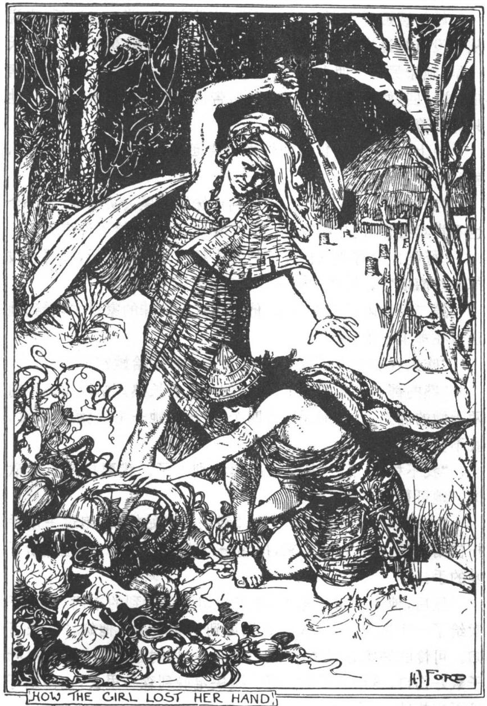

一连七天，她在森林里徘徊，吃着树上长的果子。晚上就爬到树上，睡在树杈里，免得让狮子、老虎或豹把她吃掉。

第八天早晨，她醒过来，远远看见森林边缘有一个小村庄，村庄里的房子正冒着烟。看到这景象，她觉得自己是多么孤单。附近一条小溪都没有，她口渴得要命。这时，她多么想能喝上一杯牛奶啊！想到这里，她心灰意冷，伤心地落下泪来。

这一天，国王的儿子正好一早就出来打猎。太阳升高的时候，他就觉得很累了，就对随从的人说，“我要在这棵树下躺下来休息一会。你们留下一个人，其余的人继续去打猎。”他们走了以后，王子就睡着了。突然，他被惊醒过来，原来是什么东西滴在他脸上，把他弄醒了。

“这是什么？下雨了吗？”王子问他的随从，“去看看！”

“没有啊！主人，没有下雨。”随从回答。

“爬到树上去看看，有没有什么东西。”他说。随从爬了上去，不一会就下来说，“是一个美丽的姑娘坐在上面哭。肯定是她的眼泪掉下来，落在你的脸上。”

“她为什么哭？”王子问。

“我不知道，我不敢问她，也许她会告诉你的。”王子觉得非常奇怪，就自己爬到树上去。

“你这是怎么啦！发生了什么事情？”他和蔼地问。见她越哭越厉害，就说，“你是一个女人，还是森林里的精灵？”

“我是一个女人，”她慢慢地回答，用面前的一张叶子擦掉自己的眼泪。

“那你为什么哭？”他继续问着。

“我有许多伤心的事情，”她说，“你怎么猜也猜不出这么多。”

“跟我回家吧！”王子说，“没有多少路，到我父母那里去，我是国王的儿子。”

“那你为什么到这里来？”她问，张着眼睛看着他。

“每个月有一天，我和朋友们一起到这个森林里来打猎。今天我累了，就留下来休息。你呢？你在树上干什么？”王子说。

她又开始哭起来，告诉王子自从母亲死了以后发生的事情。

“我不能跟你下去，我不想让人看见我这个样子。”她抽泣着说。

“哦，我会安排好一切的。”王子说，他跳到低树枝上，吩咐树下的随从快点回去，叫四个年轻力壮的人带来一顶轿子。那人走了以后，姑娘爬下树来。他让她躺在树丛里。很快轿子就来了。王子叫他们把轿子停在树丛旁边。

“现在，你们都过去，把前面打猎的人全部叫回来，我要马上回去了。”王子说。他们走了以后，他叫姑娘出来，到轿子里去，把帘子拉得严严实实，等其他人回来。不一会，他们就气喘吁吁地跑过来了。“怎么回事？王子！”他们问。

“我觉得很冷，可能是病了。”他说着，示意轿夫准备好，就走进了轿子。他们穿过森林，回到家里。

“告诉我的父母，说我在发烧，送些粥来。越快越好。”王子一到家就吩咐佣人。

佣人赶紧到王宫里去给国王送讯，这使国王和王后感到非常担忧。热粥马上就烧好送来。王宫里例行的会议一结束，国王和大臣们就赶来看望王子。他们还给王后送讯，叫她也一起来。

王子假装只是有点不舒服，以宽慰父母的心。第二天他就说好多了。他来到父母居住的房间，对他们说，“我昨天在森林里看到一个姑娘，想和她结婚。我已经用轿子把她带回来了，随从们不知道。我请你们同意这个婚事。她虽然只有一只手，但是没有别的女人比她更令我满意。”

当然，国王和王后希望他们的媳妇有两只手，而且很有钱。不过，他们不忍心拒绝儿子。所以他们说，尊重他的选择，吩咐立即准备结婚宴席。

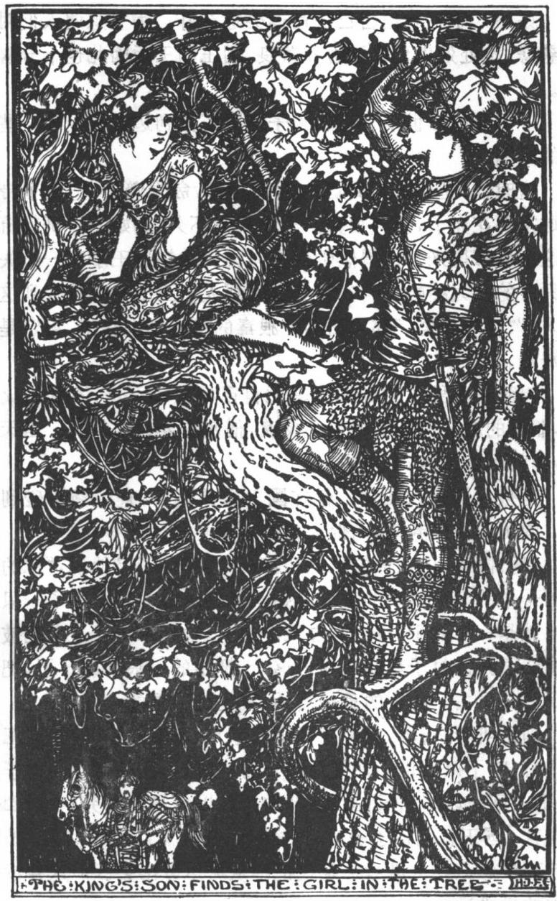

姑娘几乎不相信自己的命运会这么好。为了感谢人们对她的慈悲，她处处表现出谦逊和善良，国王和王后因此也十分喜欢她。

一个婴孩出世了。不久，王子被国王派到边疆去处理一些棘手的问题。

这时候，姑娘的哥哥因为大手大脚，贪吃懒做，把妻子带来的财富都花光了，变得很穷。王子刚走不久，姑娘的哥哥就流浪到这个城市里来。他偶然听到有人说，“你知道王子和一个失去一只手的女人结婚了吗？”就马上问那人，“王子在哪里找到这个女人？”“在森林里。”那人回答。狠毒的哥哥马上猜出，肯定是他的妹妹。

想到被他毁了的妹妹变得比自己好上千百倍，不禁妒火中烧，罪恶的念头控制了他整个灵魂，他发誓要让她倒霉。当天下午，他就赶到王宫，求见国王。

他被允许进入王宫。他在国王面前跪下，直到额头碰到地板。国王叫他站起来，问他为什么要来见他。

“啊！国王，由于你的仁慈和善良，你被骗了。”他说，“你的儿子和一个只有一只手的女人结婚。你知道她为什么丢了一只手吗？她是一个女巫，曾经嫁过三个丈夫，他们都一个一个地被她用魔法杀死。村子里的人为了这个，把她的一只手砍掉了，把她赶到森林里去。我说的都是真话，我是她村里的人。”

国王听着，听着，脸色变得阴沉起来。不幸的是，这个国王脾气很急，听了以后也不仔细地想一想，就派人到她住过的村子里去。那人回来以后，告诉国王，他的媳妇以前是怎么穷，生活如何的艰苦。国王就相信了她哥哥的谎言，还让王后也相信了。他们一起商量怎么办。最后决定也把她从城里赶出去。但这并没有使她的哥哥满意。

“杀了她！”他说，“她竟敢嫁给王子，罪有应得。这样，她也不会再害别人了。”

“我们不能杀了她！”国王和王后说，“杀了她，儿子回来就要杀了我们。让我们像对其他人一样，把她从城市里赶出去。”这样，她恶毒的哥哥也就无话可说了。

可怜的姑娘很爱她的丈夫，但是，孩子出世以后，她觉得这个世界没有什么东西比孩子更宝贵的了。只要和孩子在一起，她对什么也不在乎。她抱起儿子，头颈上挂上一个煮饭的砂锅，离开了舒适的王宫和成群的佣人，走进森林。开始，她毫无目的地走着。后来累了，就在一棵树下坐下休息，哄孩子睡觉。她偶然抬起头来，看到一条蜷曲在树上的蛇正在向她爬过来。

“我今天是死定了。”她想，坐着一动也不动。实际上，她也吓得动弹不了。很快，蛇就爬到她的身边。令她吃惊的是，蛇开始说话了，“把你的砂锅打开，让我进去。你把我从阳光下救出来，我也会把你从雨中救出。”她把砂锅打开，蛇爬进去以后，就把盖盖上。不久，她看见另一条蛇爬过来，到她身边的时候停下来，问她，“你刚才看见有一条小灰蛇从这条路经过吗？”

“是的！”她回答，“它走得很快。”

“哦！我要赶快去抓住它。”第二条蛇回答，就急匆匆地走了。

等看不见它的影子后，一个声音从砂锅里传出来，“把盖打开，让我出来。”她把盖拿掉，小灰蛇很快地从里面出来，爬到地上。

“我现在得救了，”它说，“请告诉我，你要到哪里去？”

“我无法告诉你，我自己也不知道。”她说，“我只是在森林里徘徊。”

“跟我来，让我们一起回家。”蛇说。姑娘跟着它，沿着一条绿色的路，穿过森林，来到一个大湖旁边，停下来休息。

“天气很热。”蛇说，“你走了很远的路程，带着你的孩子，到有树叶遮盖的湖水里去洗个澡。”

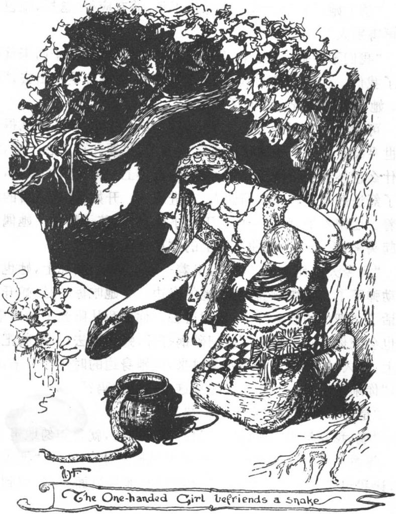

“好的，我去洗个澡。”她说，带着孩子一起下水。孩子在水里玩得很高兴，忽然用力一跳，挣脱了母亲的手，落入水中，不停地往下沉，母亲怎么也找不到他。

她恐慌地跑上岸来，告诉蛇说，“我的宝贝丢了！他被淹没了！我再也看不见他了！”

“再下去！”蛇说，“各个地方都找一找，水底下有树根的地方也摸一摸，恐怕是被树根卡住了。”

她赶快跳下水去，用唯一的一只手到处摸索着，连最窄的，螃蟹也无法藏身的裂缝也不放过。“没有，找不到他。”她哭着喊起来，“没有他我怎么活下去？”但是蛇不理睬她，只是说，“用另一只手一起去找！”

“这只断了的手有什么用？怎么去摸？”她说。不过，她还是照蛇的话去做。立刻，断臂在水草里的两块石头中碰到一个柔软的东西。

“我的宝贝！我的宝贝！”她叫了起来，把他高高地举起。孩子高兴地笑着，一点也没有受伤和惊吓。

“你找到了吗？”蛇问。

“是的，找到了！”她回答，“奇怪……啊！我的断手也长出来了！”喜事一件接一件，她高兴地流下了泪水，哭了起来。

蛇让她哭了一会，说，“现在，让我们动身到我家里去。我们要报答你对我的恩情。”“你把手还给了我，已经远远地超过了我应得的报答。”姑娘说。蛇只是笑笑。过了一会，它说，“要快一点，太阳快下山了。”说着，它爬得快了起来，姑娘几乎跟不上。

他们走进了蛇在大树下做成的房子里。蛇告诉父母它的冒险过程，如何在她的帮助下从敌人的手中逃脱。它的父母不知道做什么才能表达感激之情。它们请客人躺在用坚韧的藤条织成的、挂在树上的吊床上，让她在长途跋涉以后得到充分的休息。它们帮助她照顾孩子，叫好朋友猴子弄来椰子汁，让孩子喝，还给母亲采来鲜果。她觉得这里既安全又幽静。她没有忘记丈夫，经常想到他，希望让他看一看他们的儿子。晚间有时她会醒过来，想着他这时会在什么地方。

就这样，许多星期过去了。

这些时候，王子在干什么呢？他在遥远的边疆忽然得了重病。那里许多善良的人在看护他，治疗他的病。但是他们不知道他是谁，所以国王和王后一点也得不到王子的消息。他好些以后，就慢慢地踏上回家的路程。他走进了父亲的王宫，看到一个陌生人站在王座的后面，这个人就是他妻子的哥哥。国王这时很喜欢他，把他留在身边。当然，王子不知道发生了什么事情。

国王和王后瞪着王子看了一会，好像不认识他似的。因为大病一场后，他身体很瘦，很虚弱，背驼得像个老人。

“你们这么快就把我忘了！”王子说。

听到他的声音，他们惊叫起来，向他跑去，“怎么会变成这个样子？”他们的问题一个接着一个，但王子什么也没有回答。

“我的妻子怎么样了？”他问。大家默不做声。

过了一会，王后说，“她死了！”

“死了！”他向后一仰，重复着，“我的孩子呢？”

“他也死了！”

年轻人默默地站着，过了一会，他说，“带我去看看他们的墓。”

听了这些对话，国王已经感到不太舒服，又担心起来。要不是已经准备好了两个漂亮的坟墓让儿子去看，叫他永远猜不出事情的真相，他还不知道儿子会对母亲怎么样呢？这几个月来，国王和王后常常说起，他们当初没有听那人的话，把她处死，是多么仁慈。但现在看起来，到底是对还是不对，真说不准。

国王在前面领路，他们来到了王宫后面的院子里，走出大门，走进了漂亮的公园，在树荫底下有两个华丽的坟墓。王子自己走上前来，把头靠在石碑上，痛哭着。他的父母无声地站在后面，感到心在砰砰地跳，有种说不出来的惆怅，也许是为自己的所做所为感到羞耻。

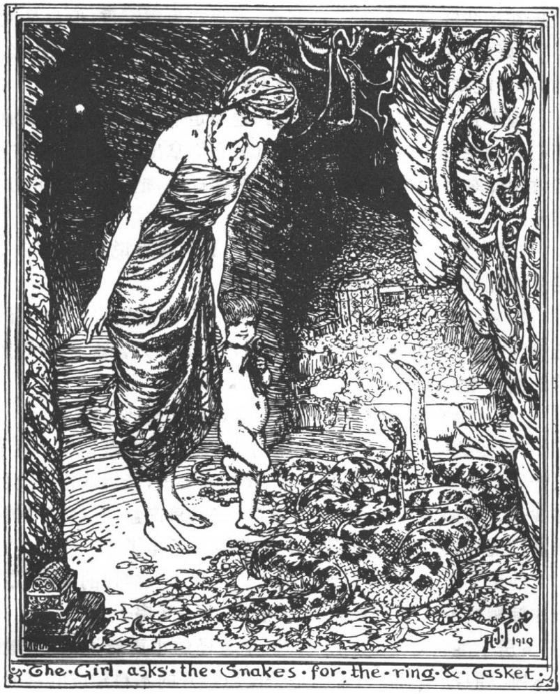

过了一会，王子转过身来，从他们身边走过，来到王宫，告诉佣人他准备守丧。一连七天，谁也看不见他。七天以后，他就出去打猎。而后又像从前一样，帮助父亲管理国家。可是谁也不敢向他提起他的妻子和儿子。

有一个夜晚，姑娘整夜没有睡着，躺在床上想着她的丈夫。天一亮，她就去找好朋友蛇，对它说，“你们对我都这么好，我现在身体也好了，想回家去，听听我丈夫有什么消息，看看他是不是还在为我守丧。”蛇听了这些话，觉得心里很沉重，但只是说，

“好的，应该这样，去和我的父母告别。如果它们给你什么礼物，你只能拿我父亲的戒指和母亲的首饰盒。”

她来到了蛇的父母那里。听到她要走了，它们都为失去她而伤心地痛哭着。为了让她记住它们，它们拿出许多黄金和钻石，告诉她能拿多少就拿多少。但是姑娘摇摇头，把金光灿灿的小山推开。

“我永远也不会忘记你们！永远！”她呜咽地说着，“我唯一能接受的礼物是这个小戒指和旧首饰盒。”

两条蛇狼狈地互相看着，这戒指和首饰盒是它们唯一不想送给她的东西。沉默了一会，它们问，“你为什么喜欢这个戒指和首饰盒？是谁告诉你的？”

“哦！没有人告诉我！只是我喜欢！”姑娘回答。

“不是这样，肯定是我们的儿子告诉你的。它既然这么说了，只好这么办了。假如你需要食品，衣服或房子，告诉戒指，它会帮你找来。假如你不快活或遇到危险，告诉首饰盒，它会把事情安排好。”说完，它们都为她祝福。她带着孩子走了。

她走了很久，最后来到了她的丈夫和国王居住的城市。她在一片棕榈树旁边停下来，告诉戒指，她要一间房子。

“房子准备好了，女主人。”一个古怪的小声音说道，把她吓了一跳。朝身后一看，她看到了一座用最好的木料建成的宫殿就在眼前，一排佣人正在门口恭恭敬敬地弯着腰等她。她很高兴地走进去。她实在累了。在一间房间里，她看到了有牛奶和水果的丰盛晚餐。吃过晚饭以后，她倒在一堆舒服的垫子上睡着了，孩子就睡在她旁边。

在这房子里，她平静地过着日子，孩子一天比一天长高，越来越健壮，很快就到处乱跑，还学会了说话。当然，关于这幢房子，邻居们有许多传说。它在城市的郊外建造得这么快，实在太令人惊奇了。他们编造了各式各样的故事来讲住在房子里的贵夫人。慢慢地，这些故事传到了从战场上归来的国王和王子的耳朵里。

“棕榈树丛里的那幢房子，的确是非常奇怪。”国王对王后说，“我必须想办法知道，这位从未有人见过的夫人是谁？我敢说，里面住的根本不是一位夫人，而是一伙想夺走王位的阴谋家。明天我要带着王子和首相，下决心进去看一看。”

第二天太阳升起来了。王子的妻子站在房子后面的一座小山上。她看到城市里滚起一片云似的尘埃。接着，听到了远处传来的鼓声，可见是国王出来了。不一会，就有一群人向棕榈树林这边走过来。她的心急速地跳动起来，她的丈夫会在其中吗？不论如何，他们还不知道她在这里。她回到房子里去，吩咐戒指准备好吃的东西招待他们。然后用金色的面纱把头遮起来，拉着孩子的手，到门口来迎接他们。

没有多久，整个队伍都来到了。她走上前去，请他们进去休息。

“我很乐意，”国王说，“请你先走，我们跟着你。”

他们跟着她来到一个大厅里，一张桌子上放着金色的杯子和装满了椰子和枣子，还有各种各样水果的篮子。国王和王子坐在软垫子上，由佣人们来招待。那个站在国王后面的首相，她认出来了，就是她的哥哥。

“啊！我的一切不幸都是他带来的，”她对自己说，“从一开始他就恨我。”但是她外表不动声色。当国王问她有什么消息时，她只是说，“你从那么远的地方赶来，一定又渴又饿，先吃一点，喝一点，然后我再告诉你关于我的消息。”

“你说得很有道理，”国王说。大厅里又安静了好一会。然后国王又说，“现在，夫人，我吃好了，也休息好了。所以，我请求你，请告诉我，你是谁？从哪里来？不过，首先请你坐下。”

她鞠躬以后就坐在一个鲜红色大垫子上，把睡在角落里的儿子抱过来，就开始讲她的故事。她的哥哥听着，听着，恨不得立刻离开这所房子，逃到森林里去。但是他的责任是为国王扇一把大扇子，赶走飞虫。他一离开自己的位置，就要被国王忠诚的卫兵抓回来。他必须留下来，一步也不能离开，这是无法逃避的。幸运的是，国王被她的故事深深地吸引住了，没有注意到扇子已经停下，苍蝇正在他那卷曲的头发上盘旋。

她继续讲着故事，即使有面纱，她也不看王子一眼。而王子的眼睛却一直盯着她。当她说到坐在树上哭泣的时候，王子再也按捺不住了。

“这是我的妻子！”他叫喊着，向她和孩子冲过去，“他们骗了我，你并没有死，孩子也还活着。但是发生了什么事情，他们为什么骗我？你为什么离开我的家，在那里不是很安全吗？”他转过脸来，生气地看着他的父亲。

“先让我说完我的故事，你就知道了。”她拿下了她的面纱，接着说，她的哥哥怎样到王宫里来，咒骂她是一个巫婆，想要说服国王杀死她。“但是国王是不会这样做的。”她继续温柔地说，“而且，归根到底，假如不离开你的家，我就不会碰到蛇，也不会重新得到我的手。所以，让我们忘记这一切吧！重新开始幸福的生活。看！我们的儿子已经长得这么大了。”

“怎么处理你的哥哥？”国王问，他很高兴地想到，在这件事情上，有人比他更坏。

“把他赶出城去。”她回答。

（斯瓦希里传说，E·斯蒂尔编写）

 
 

## 贾龙的骨头

在南部海边的一个美丽岛屿上，鲜艳的紫色花和茂密的树林长在一起，白天和黑夜一样长，一样热。岛上住着一家人，父母早死了，留下七个姐妹，没有兄弟。最大的姐姐当家长，其他六个都要听她的。一个负责清理和打扫房间；一个负责到泉水旁去挑水；一个负责做饭烧菜；最小的任务最重，她要出去砍柴，把它背回家，让炉火不停息地燃烧。这是又累又热的活，每天她要背柴回来，把炉子里的柴火加足，把剩下的柴堆好，以便晚上不断地添加，让火烧到天明。这些活干完以后，她往往累得倒在一棵树下睡着了。

有一天上午，她背着柴慢慢地走回家，看到门口那条小河河水清澈，那么诱人，她不想像往常那样，干完活就坐下来打盹，想到河里去洗澡。她匆匆地把柴火放下，往炉子里添了一些柴，就跑到河边跳下去。在这条河里玩耍是多么舒服，四周是繁茂的森林，把强烈的阳光挡住。她游了一会以后，就开始看看周围，看到河里有一条可爱的小鱼，长得像天上的彩虹一样美丽。

“我要把它当做我的宠物。”她想。小鱼游过来时，她伸出手来轻轻地把它抓住。她上了岸，沿着一条野草丛生的小路，来到一个山洞旁边。这里有一条瀑布从山岩上冲下来，落在山洞口的水池里。她把小鱼放入水池，还给它起了个名字，叫“贾龙—贾龙”，答应过一会就回来，带给它一点吃的东西，就跑回家去了。

她回到家里，米饭已经煮好。大姐姐把饭分到七个木碗里，一人一份。但小妹妹没有吃完自己的一份，趁没人注意，偷偷地跑到森林里的水池旁，小鱼正在里面游着呢！

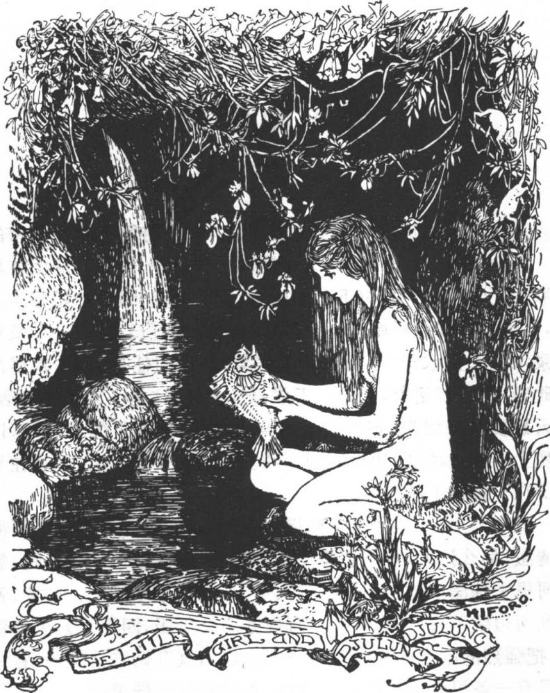

“看！我没有忘记你吧！”她叫着，把饭一粒一粒地放下水里，小鱼贪婪地吞食着，它从来没有吃过这么好的东西。

“好了，今天的吃完了。”她说，“明天我还要来。”她和鱼说了一声再见，就回家了。

小妹妹没有告诉姐姐关于鱼的事。她每天都节省出一半米饭来喂它，还编了一首歌，用来呼唤它。有时候，她觉得很饿，但是没有人知道，她自己也满不在乎，只要看到那条鱼高兴，她就很开心。慢慢地，鱼越长越大，越长越肥；她却越来越瘦，越来越虚弱，身上的柴一天比一天重。后来终于引起了姐姐们的注意。

她们坐在一起商量，决定要去看看她最近在干什么。一个姐姐偷偷地跟着她来到贾龙住的池水边，看到小妹妹正在把节省下来的米饭送给它吃。她急忙地跑回家，告诉其他人。还说，这条鱼又肥又大，可以抓到。大姐姐跑到池塘边，把鱼抓回来，烧来当晚饭吃了。这时候，小妹妹还在森林里，一点也不知道这件事。

第二天，她像往常一样来到水池旁，唱着自己编的歌。但是贾龙没有出来。她跪在水池边，唱了一遍又一遍，双眼瞪着深深的池水。高大的树木投下森森的阴影，她没法看到池底。

“贾龙不会死的，要不它就会浮上来。”她对自己说，站起来向家里走去。这时，她觉得非常疲倦，浑身像散了架似的。

“我这是怎么啦！”她想，挣扎着回到家里，一头倒在角落里就睡着了。一连好几天，没有人能够叫醒她。

一天清晨，一只公鸡大声地啼叫着，她醒过来，再也睡不着了。公鸡继续奏着它的晨曲。慢慢地，她明白了公鸡想对她说些什么。它说，贾龙已经被她的姐姐杀来吃掉了，它的骨头就埋在厨房的灰烬里。她缓慢地爬起来，从灰烬中取出鱼的大骨头，把它带到水池旁边，挖了一个很大的洞，把它埋了。一边挖，她还一边唱着一支歌，祈祷鱼的骨头长成一棵参天大树，树叶跨洋过海，伸到另一个岛屿上，让那里的国王能够摘到树叶。

因为用不着分饭给贾龙吃，姑娘很快又长胖了。她还是从前那样做着自己的工作。姐姐也不再来找她的麻烦。她们根本没有想到，她到森林里去收集柴火的时候，总忘不了看一看那棵树。它越长越高，越长越奇妙。它的树干是铁的，它的叶子是丝绸，它的花是黄金，它的果子是钻石。

有一天晚上，一阵温柔的风吹起一片叶子，带着它飘过大海，落到一个国王侍从的脚下。这件事姑娘当然不知道。

“多么珍奇的叶子！我从来没有见到过，我要让国王看一看。”他说。国王看到这片叶子以后说，他要找到长出这片叶子的那棵树，否则决不罢休，哪怕是用尽毕生的精力，走遍四周所有的海岛也在所不惜。幸运的是，他恰巧从这个最近的岛屿开始。在那片森林里，他忽然看到了那棵铁树，它的树枝上长满了闪光的叶子，就像他带来的那片一样。

“这是什么树？它是怎么到这里来的？”他问一起来的侍从。可是谁也回答不了这个问题。正当他们想离开森林的时候，一个男孩子走过，国王拉住他，问有没有人住在附近，可以找来打听一些消息。

“下面的一间小屋里住着七个姐妹。”男孩子回答，用手指了指太阳下山的方向，“去把她们找来。”国王说。男孩跑过去告诉七姐妹，说一个头颈上挂着一串珍珠项链的大首领派他来找她们。

六个姐姐听了以后非常高兴，她们马上跟着男孩走，只有小妹妹正忙着，她对陌生人也不感兴趣，就留下来继续做她的事情。国王热情地欢迎这些姑娘，问她们关于这棵树的各种问题。但她们从未注意，也没有听说过这棵树，也根本不知道它的存在，所以什么问题也回答不出来。

“我们住在森林附近的人也不知道，你可以相信，不会再有人知道了。”大姐姐说。她非常不高兴，国王找她们来，只问这棵树的事情。

“可是，男孩告诉我，你们有七姐妹，怎么只来了六个？”国王问。“哦！最小的还在家里，但她总是半睡不醒的样子，除了砍柴生火以外，什么也不会。”她们异口同声地说。

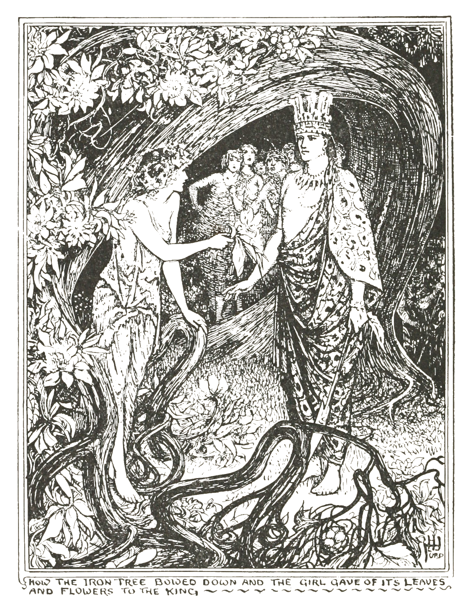

“有这种事，可能她在做梦。”国王说，“不管怎么样，我也想和她说说话。”他示意一位侍从去把她找来。侍从沿着小孩下山的路走去。

不久，侍从回来，还带来了小姑娘。她一来到那棵树下，树就自己弯下来向她鞠躬。她伸出手去，摘下一些叶子和花献给国王。

“能够创造这种奇迹的姑娘，应该成为伟大的国王的妻子。”他说。于是，国王和她结了婚，带着她越过海洋，回到自己的家，他们幸福地一直生活下去。

（A·F·麦肯译成英语）

 
 

## 海上国王的礼物

从前有个渔夫叫萨蒙，教名叫马特。他住在辽阔的大海边。除了这里，他还能住在什么地方呢？他的妻子叫梅尔，你还听到过比这更好听的名字吗？冬天，他们住在海边的一间小屋子里。春天一到，他们就搬到海上一块红色的大岩石上去，整个夏天都住在那里，直到秋天。大岩石上的屋子比岸上的更小。门上没有铁锁，只有一根木闩。此外，屋内还有一个石头炉子，屋顶上有一根旗杆，一个风向标。

这块大岩石叫阿托拉，比城市里的市场大不了多少。在石缝里生长着一棵小山梨树和四棵冬青树丛。天知道它们是怎么到岩石上来的，也许是冬天的风暴把它们带来。除此以外，岩石上还长着一些天鹅绒似的草丛，零零落落的芦苇，一种叫艾菊的黄药草，一些白花和四朵红花。岩石上最珍贵的可算是三棵大蒜根。梅尔把它们种在裂缝里，北边有岩石筑成的墙，南面可以晒到太阳。三棵大蒜看起来不多，但也足够梅尔用来做草药了。

好事总是有三。马特和妻子春天捕鲑鱼，夏天捕青鱼，秋天捕鳕鱼。每到星期六，天气晴朗，风不大的时候，他们把船开到最近的城市里去卖鱼，星期天就上教堂。但有的时候，他们也常常孤独地留在阿托拉。这时候，他们只能看看带来的小黄狗，它有一个漂亮的名字，叫“王子”，还有那些树木、草丛、花、海湾和鱼。有时看看乌云密布、风雨交加的天空和蓝色的、翻滚着白浪的大海。岩石远离大陆，周围数里也没有住人的绿色岛屿，只有海面上有时露出一些像阿托拉那样红色的岩石，海浪日夜不停地拍打着它们。

马特和梅尔非常勤劳。他们住在简陋的小屋里，也觉得幸福和满足。他们腌了许多桶鱼，准备过冬。还有一些用来给老头子买烟，给老太婆买一两磅咖啡。他们觉得自己很富有。他们还有许多晒干的谷子，菊苣茶、面包、奶油、一桶啤酒、一罐乳酪。还需要什么呢？要不是梅尔有一个奇怪的念头，因而不得安宁的话，日子过得多么美好！她总是在想，怎么样才能得到一头母牛。

“你要一头母牛干什么？”马特说，“它不会游得这么远，我们的船也不够大，没法把它运到这里来。即使我们有了一头母牛，我们用什么来喂它？”

“我们有四棵冬青树丛，还有十六堆青草。”梅尔回答。

“当然，”马特笑起来，“我们还有三棵大蒜，大蒜用来喂牛真是太好了。”

“母牛都喜欢吃咸青鱼，”他的妻子说，“连王子也喜欢吃鱼。”

“也许吧！”丈夫说，“假如我们用咸青鱼来喂母牛，它一定会变得更可爱。王子倒是太可爱了，它自己会抓海鸥吃。还是把母牛这个念头从你脑海中去掉吧！我的妻子，我们现在不是过得很好吗？”

梅尔叹了一口气，她清楚地知道，丈夫说得很对。但她怎么也丢不掉养母牛这个念头。加在咖啡中的乳酪不像以前那么香了，她多么想吃新鲜的奶油啊！世界上再也没有比这更好的东西了。

有一天，马特和他妻子在清理大蒜，听到王子叫起来。他们看到一只漆得很漂亮的船载着三个年轻人向岩石驶过来，他们都是学生，乘船出来游览，想过来吃点东西。

“给我们一点乳酪，好妈妈！”他们对梅尔说。

“啊！要是我有，一定给你们。”她叹息道。

“那么就给一罐新鲜的牛奶吧！”学生说，“但不能是撇过奶油的。”

“是的！要是我有的话！”老妇人比上次更遗憾地深深叹息着。

“什么？你们连一头母牛都没有？”

梅尔不做声了，这个问题深深地刺痛了她的心，她说不出话来。

“我们没有母牛。”马特说，“但是我们有很好的烟熏青鱼，烧一两个钟头就可以吃了。”

“好吧！这也行！”学生们说着，都跳到岩石上来。就这样，五十条银白色的青鱼在呼呼叫的火苗上不时地翻动着。

“大海中的这块小石头叫什么名字？”一个学生问。

“阿托拉。”老人回答。

“好的。你们生活在海上国王的领地里，用不着需要什么。”

马特不明白他说些什么，他没有读过芬兰那首关于神和英雄的诗，不知道那古老的海上之神。学生们开始给他解释。

“阿蒂是住在他的国土阿托拉上的强而有力的国王，”他们说，“除了有一个宝库以外，还有许多好的东西。他统治着水下的所有鱼和动物。他有最好的母牛和最快的马，它们吃海底的草为生。谁和阿蒂相处得好，很快就会变成一个富翁。但是和他相处的时候必须小心，他性格多变。有时候因为一点小事也会大发脾气，甚至一块小石头扔入水中也会激怒他。那时，他就会收回自己的礼物，把海洋搅得巨浪滔天，把水手们拖下水。阿蒂还有许多十分漂亮的姑娘，她们跟随着他的王后韦拉莫斯。在美妙的音乐声中，她们梳理着闪闪发光的长头发。”

“啊！”马特惊叹地说，“你们这些受尊敬的人亲眼见到过这些吗？”

“我们好像亲眼目睹过一样。”学生们说，“这些都印在书上，印在书上的都是真的。”

“我不敢十分肯定是真的。”马特摇着头说。

这时，青鱼已经烤好了，学生们吃了六条就够了。他们把带上船的一些冷肉给王子吃。王子坐在两条后腿上，像一只可爱的猫似的兴高采烈地嚼着。这一切都结束以后，学生们把一块闪光的银币递给马特，让他在烟斗上点起一种名贵的烟草，感谢他热情的款待，他们又继续自己的旅行。王子觉得非常遗憾，露出悲伤的表情，不停地在岸上走来走去，直到航船在船尾犁出白色的浪花消失为止。

梅尔一句话也没说，但却在想着许多事情。她的耳朵很灵，阿蒂的故事深深地打动了她的心田。她想，“有一头神奇的母牛多好啊！每天早上和晚上去挤牛奶多么开心，还用不着为喂养它而烦恼。在窗口放一个架子，上面可以放装牛奶和凝乳的盘子。可是，我永远不会有这么好的运气。”

“你在想什么？”马特问。

“没什么。”他妻子说。她一直在回忆着一些神秘的韵文，那是她小时候从一个跛脚老人那里听来的，据说能在捕鱼的时候带来好运气。

“我来试一试会怎么样？”她想。

这一天是星期六。星期六晚上，马特从来不安装渔网，因为他星期天不出去捕鱼。到了傍晚，他妻子说：

“让我们把网装起来，就这一次。”

“不！”她丈夫说，“今天是星期六晚上。”

“昨天晚上风那么大，我们捕不到多少鱼。”她怂恿他说，“今天晚上海面像镜子一样平，风向又是朝这边，青鱼肯定会向岸边游过来。”

“你看，西北边的天空上有灰色的条纹，王子今天晚上也在吃草。”

“它肯定不会吃掉我的大蒜。”老妇人说。

“不是，明天太阳下山的时候会有坏天气。”

“听我说，”妻子说，“我们只在靠岸的地方张一张网，这样就可以把半桶鱼装满，把它们腌好盖起来。半桶鱼老开着会变质的。”

老头子被说服了，他们带着网，把船划出去。到达水最深的海面时，她喃喃地开始哼起那神秘的韵文。为符合她心中的愿望，她做了一些修改：

> 啊！胡子长长的阿蒂，
> 住在深深的蓝色海底。
> 你有最珍贵的宝藏，
> 闪闪发光的鱼群属于你。
> 硕大的珍珠无与伦比，
> 都珍藏在你的海底王国里。
> 在那海底的绿色草原上，
> 皮毛光滑，壮实无比的母牛在嬉戏。
>
> 海上之王，那么遥远，那么亲近，
> 我不要你的金子，
> 也不戴你的珍珠和宝石，
> 披金戴银我不稀奇，
> 一是单数，二成双，
> 给我一头母牛吧！勇敢的国王，
> 为了报答你，
> 我还给你太阳的金子和月亮的银子。

“你在哼什么？”老头子问。

“哦！只是我脑子里记得的那些古老的韵文诗。”老妇人回答，又放开声音哼起来：

> 呵！胡子长长的阿蒂，
> 住在深深的蓝色海底。
> 你有母牛上千头，
> 我只求你给我一头。

“这是一首无聊的歌。”马特说，“除了鱼以外，能向海上国王要些什么？这种歌不是星期天唱的。”

他的妻子装做什么也没有听见，在船上不停地唱着。马特也不再去注意她，坐在那里继续划着船，想着他那烟斗和上等的烟草。然后，他们回到了岛上，就上床睡觉。

可是，马特和梅尔都一点也睡不着，马特想着自己怎样亵渎了星期天，梅尔想着阿蒂的母牛。

半夜时分，渔夫坐起来，对妻子说，

“你听到什么声音吗？”

“没有，”她说。

“屋顶上的风向标旋转的声音好像不太对头。”他说，“暴风雨要来了。”

“不会的，那只是你的想象。”妻子说。

马特睡下，但很快又坐起来，

“风向标在吱吱叫。”他说。

“又胡思乱想了，快睡觉。”妻子说，老头又睡下。

马特第三次爬起来，从床上跳下。

“风向标从来没有叫得这么响过，好像着了魔似的。暴风雨就要来了，赶快去把网收起来。”

两个人都起来了。这时，夏天的夜晚黑得像十月里一样。风向标呼叫着，风暴好像就要从四面八方袭来。他们来到海边，海边翻滚着白色的浪涛，就像下过一场大雪似的。海水溅起的浪花撒在渔夫的小屋顶上，马特不记得他生下以来，是否有过这样的夜晚。要想划船出海，把渔网收回，真是白天做梦。渔夫和他的妻子站在门口，吓呆了，紧紧地抓住门柱，浪花不停地打在他们的脸上。

“我跟你说过吗？星期天捕鱼不会有好结果。”马特脸色阴沉地说。他的妻子被吓得目瞪口呆，这时绝对不会想到阿蒂的母牛。

看看毫无办法可想，只好走回屋里去。他们的眼皮因为通夜没睡而沉重，很快就睡着了，好像愤怒的大海并没有在他们孤独的房子周围怒吼着一样。他们醒过来的时候，太阳已经高高地升起，风暴已经停息，只有涨潮的海水在轻轻地拍打着红色的岩石，溅起层层银色的浪花。

“那是什么？”老妇人从门口向海上望去，问道。

“好像是一头大海豹。”

“我敢肯定那是一头母牛！”梅尔叫道。

是的，那是一头母牛，一头红色的，壮实的，生气勃勃的母牛，好像是天天吃菠菜似的。它在岩石上安静地走来走去，那几堆可怜的草它看也不看一眼，根本不把它当做一回事。

马特简直不敢相信自己的眼睛，但这确实是一头母牛。当老妇人走过去挤牛奶时，大水罐、锅、甚至桶，都一下子就装满了最香甜的牛奶。

老头子怎么也想不通，母牛是怎么到这里来的。他走出去寻找渔网。还没走多远，就看到网已经冲上岸来，里面装满了鱼，连网眼都看不见。

“有一头母牛确实不错，”马特一边洗鱼，一边说，“但是我们怎么喂养它呢？”

“我们会想出办法来的。”他妻子说。办法倒是母牛自己想到了。它走下海去，从海岸边拖上来许多海草。这些海草在海岸边的海水里总是茂盛地生长着。大家认为它真是聪明，只有王子不这样认为，它现在有了一个争宠的竞争者。

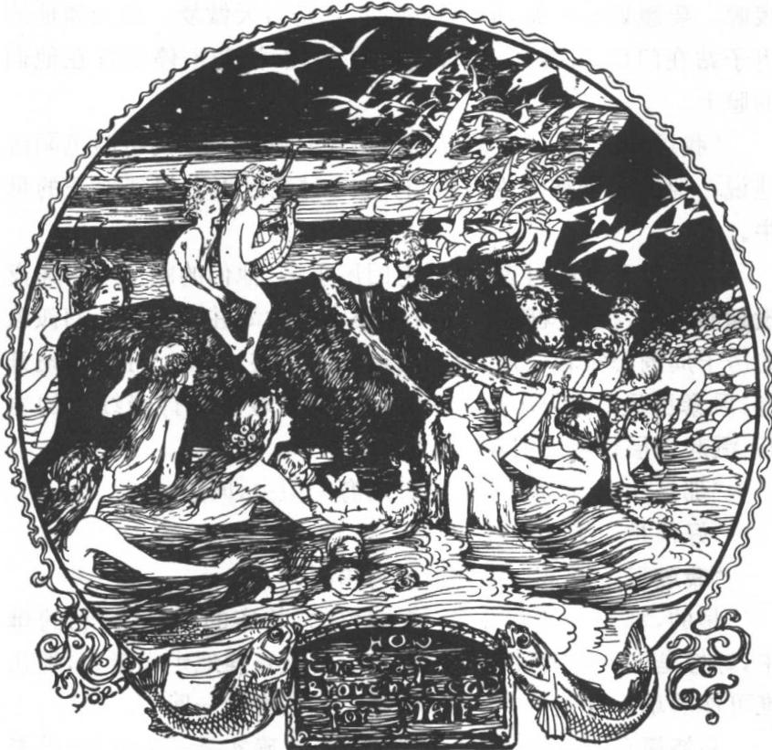

从那天开始，红色的岩石上有了丰富的牛奶乳制品，撒下的网拉上来都是满满的鱼。马特和梅尔过着优裕的生活，都长胖了，而且一天比一天富。梅尔制造了大量的奶油，马特雇了两个人帮他一起捕鱼。大海好像是他存放鱼的大桶。他要多少就能拉上来多少。母牛也总是自己喂养自己。秋天，当马特和梅尔返回陆地的时候，母牛就到海里去；春天，他们返回岩石上时，它已经站在那里等着。

“我们需要一间更好的房子。”第二年春天，梅尔说，“老房子太小了。住不下我们和雇工。”

“是的，”马特说。他们造了一间大房子，装上真正的锁。还造了一间仓库，用来存放鱼。他们抓到许多鱼，成吨成吨地把大马哈鱼、青鱼和鳕鱼送到俄国和瑞典去卖。

“我一个人照顾这么多人，太累了。”梅尔说，“找个姑娘来帮忙不会错。”

“那就找一个吧！”丈夫说，于是他们雇了一个姑娘。

梅尔又说，“这么多人，牛奶不够了。现在我有了一个帮手，反正一样做，她一个人可以照顾三头母牛。”

“那好吧！”丈夫用一种带有挑逗的口吻说，“那你就对着海上国王唱一支歌吧！”

这句话使梅尔觉得有点烦恼。但星期天晚上，她还是划着船出海，像以前那样唱道：

> 啊！胡子长长的阿蒂，
> 住在深深的蓝色海底，
> 你有母牛上千头，
> 我求你给我三头。

第二天早晨，岛上站着不是一头，而是三头母牛。它们像第一头母牛一样，都吃海草，自己照顾自己。

“现在你满意了吧！”马特对他的妻子说。

“假如我有两个佣人来帮忙，有些好衣服穿，我就十分满意了。你没注意，我现在穿得像老太婆一样吗？”妻子说。

“好吧！好吧！”她丈夫说，于是梅尔又雇了几个佣人，做了一些与贵夫人相称的衣服。

“要是我们有一所好一点的夏天住的房子，一切就完美无缺了。你可以造一间两层楼的房子，再装些土来做公园。然后可以在那里搭一个凉亭。我们可以在凉亭里观看大海的景色。还可以找一个小提琴手来，到晚上为我们演奏小提琴。再买一艘小汽艇，这样，刮风的日子也可以送我们上教堂。”

“还有什么？”马特问。不过，一切他都按妻子的要求去做了。

阿托拉这块岩石变得那么豪华，梅尔变得那么富丽，所有的海胆、青鱼都惊叹得不知所措。连王子现在也是吃牛排和奶油烤饼，肥得像只奶油罐似的。

“现在你该满足了吧！”马特问他的妻子。

“假如我有三十只母牛，我就十分满足了。这么大的一个家庭，这个数目是最起码的。”

“那么，到海上国王那里去吧！”马特说。

他妻子开着汽艇到海上，对着海上之王唱起那支歌。第二天早晨，三十头母牛站在岸上，它们都自己找海草吃。

“你应该明白，好丈夫，这块可怜的岩石对我们来说太狭小了。我到哪里去找房子给这么多母牛住？”

“没有什么办法了，除非把海水抽干。”

“胡说！”妻子说，“谁能把这么多海水抽干？”

“用我们的新汽艇来试试，上面有一个水泵。”

梅尔知道，丈夫只是拿她开玩笑。但是，她心中也有了一个计划。她想，“我永远也抽不干海水，但假如筑起一条大坝，也许我能把它填平。我可以堆起石头和沙子，让海岛越来越大。”

梅尔把她的船装满石头，开向大海。小提琴家也和她一起去。小提琴曲如此动听，阿蒂和韦拉莫斯，还有所有海的女儿都到海面上来听音乐。

“波涛上什么东西如此闪闪发光？”梅尔问。

“那是海浪在阳光下闪烁光芒。”小提琴手说。

“把石头扔下去！”梅尔说。

船上的人开始扔石头，“扑通，扑通……”石头一块左，一块右，不停地投入海涛之中。有一块石头打中了韦拉莫斯的第一侍女，有一块击中了王后的脸蛋，有一块差点打中了阿蒂的头，刮去了他半边胡子。这时，海水开始涌动起来，像锅里烧开了水。

“哪来这么大的风？”梅尔说。话音刚落，海水忽然张开大口，把汽艇吞了下去。梅尔像块石头似的，一直沉到海底。她赶快伸出手脚，用力浮上水面。她看到了小提琴手的小提琴，把它当救生圈。这时，她看到了阿蒂可怕的头，脸上只有半边胡子。

“你为什么向我扔石头！”海上国王生气地吼叫着。

“啊！尊敬的陛下，这是一个错误，把一些胡子膏涂在你的胡子上，它们会重新长出来的。”

“老妇人，我不是把你要的一切东西都给了你吗？不，甚至还更多！”

“是的，是的，尊敬的陛下！非常感谢你的母牛。”

“好了，你答应给我的太阳的金子和月亮的银子在哪里？”

“啊！尊敬的陛下，它们已日日夜夜地撒落在海面上，除非是乌云遮住了天空。”梅尔狡猾地回答。

“让我来教训你！”海上之王咆哮如雷。他对着小提琴猛吹一口气，老妇人像一颗炮弹一样，一下子就落在自己的岛上。那里，王子正躺着，咬着一只死乌鸦，还是那副经常吃不饱的模样。马特穿着一件破旧的灰茄克衫，一个人坐在那旧小屋子的台阶上补着网。

“天啊！老太婆，”他说，“你到哪儿去过了？浑身湿漉漉的，这么丧魂落魄，步履蹒跚的样子。”

梅尔惊奇地看着四周，说，“我们那座两层楼的房子呢？”

“什么房子？”她丈夫问。

“我们的大房子，还有花园，男雇工，女佣人，还有三十头漂亮的母牛，汽艇，这一切东西呢？”

“你在胡说什么？老太婆！”他说，“那些学生把你的头搞昏了。昨天晚上我们把船划出去的时候，你唱着那些傻乎乎的歌，

回来以后一直睡不着。整个晚上天气很不好。风暴过去以后，我也不想叫醒你，就一个人划出去把网收回来。”

“可是我见到阿蒂了。”梅尔反驳说。

“你一直躺在床上，做着那些无聊的梦，睡梦中自己走到水里去了！”

“可是那把小提琴呢？”梅尔问。

“好一把小提琴！那只是一根棍子。不！不！老太婆，下一次我们一定要小心，星期天去捕鱼不会碰上好运气。”

（Z·托普路斯）

 
 

## 山莓虫

“唷！”利萨叫。

“呸！”艾娜叫。

“又怎么啦！”大姐姐叫。

“一条虫！”利萨叫。

“在山莓上！”艾娜叫。

“杀了它！”奥托叫。

“一条可怜的小虫有什么可大惊小怪的！”大姐姐轻蔑地说。

“可是，我们已经很仔细地洗过山莓。”利萨说。

“它是从最大的山莓里爬出来的。”艾娜补充说。

“说不定已经有人吃过山莓。”利萨说。

“那么，他们肯定把虫也吃进去了。”艾娜说。

“好了，那又有什么害处？”奥托说。

“吃掉一条虫！”利萨叫了起来。

“一口把它咬死！”艾娜喃喃地说。

“想想多可怕！”奥托笑着说。

“它爬到桌子上去了。”艾娜又叫了起来。

“把它吹掉！”大姐姐说。

“踩死它！”奥托说。

利萨拿起一张山莓叶子，小心地把虫拨到叶子上，拿到院子里。艾娜注意到，一只麻雀站在篱笆上，正准备扑过来抓可怜的小虫。她拿着叶子，小心地把它拿到森林里，藏在一棵山莓树下。

贪婪的麻雀再也找不到它了。是的，关于这条山莓虫还能说什么呢？谁会为了这可怜的小东西给三捆稻草呢？但是，在安静的森林里，在鲜花和绿叶之中，它有一所芳香的、红黑颜色的漂亮住所，谁看到了都会羡慕。谁会不想住在这里呢？

午饭的时间到了，他们都在吃午饭，有山莓和鲜奶油。大姐姐说，“奥托，别把糖打翻了。”但是没有用。奥托的盘子里都是糖，像冬天的一堆雪，雪下面只有一点红，那是一颗山莓。

吃完午饭后，大姐姐说，“所有的山莓都吃完了，冬天的储备也没有了。我们最好去采两篮子山莓，今天晚上把它们洗干净，明天放在大锅子里煮，我们就有山莓酱涂面包吃了。”

“来吧！让我们到森林里去摘。”利萨说。

“好的，我们走。”艾娜说，“你拿黄篮子，我拿绿篮子。”

“别迷路了，傍晚平安地回来。”大姐姐说。

“向那条山莓虫问候。”奥托嘲弄着说，“下一次我见到它的时候，就把它吃掉，让它享有这个荣誉。”

艾娜和利萨来到森林里，这里多么美丽！多么令人快乐！虽然也有令人讨厌的时候，譬如要爬过倒下的树，被树枝勾住，被灌木丛和蚊子缠住。但这算不了什么，小姑娘穿着短裙子，走起来很快，不久就到了森林深处。

这里有许多越桔和老草莓，但是没有山莓。她们找来找去，最后来到……啊！这是真的吗？她们来到了一大片山莓森林里。这片森林以前好像被火烧过。现在新的山莓树都长出来了，它们一眼望不到边。每一棵山莓树上，都挂满了又大、又红、又熟的山莓，把树枝都压弯了。这么多山莓，她们从来没有看到过。

利萨摘，艾娜也摘；利萨吃，艾娜也吃。一会儿工夫，她们的篮子都装满了。

“现在，我们该回家了。”艾娜说。

“不！让我们再多摘一点。”利萨说。

她们把装满的篮子放在地上，开始用围裙来装。很快，围裙也装满了。

“现在，我们该回家了。”艾娜说。

“是的，我们该回家了。”利萨也说。

两个小姑娘一手提着篮子，一手托着围裙，转身回家。但是说说容易，做起来可难了。她们在大森林里从来没有走这么远过。她们迷失方向了，一条小路也找不到。

更糟糕的是，树在夕阳的照耀下，影子变得那么长，天快黑了。小鸟也开始飞回家。不久，太阳被松树遮住，大森林里开始凉起来，还有一点雾，白天就要过去了。

小姑娘开始担心起来，但她们还是不停地往前走，希望很快就能走出森林，看到她们家里的烟囱在冒烟。

走了一段路以后，天开始黑了。她们来到一块平坦的，周围树木又高又大的空地里。在黑暗中，远远看去，周围还是望不到边的山莓林。她们觉得累极了，坐在一块大石头上哭起来。

“我很饿。”利萨说。

“我也是，要是有两块夹肉的三明治有多好啊！两块就够了。”艾娜说。

她正说着，忽然觉得自己手里拿着什么东西。低头一看，是一块很大的面包和鸡肉三明治。

这时利萨也嚷起来：“多奇怪，我手里拿着一块三明治。”

“我也有，”艾娜说，“你敢吃吗？”

“我当然要吃。”利萨说，“啊！要是再有一杯热牛奶就好了。”

话音刚落，她就看到了自己手中拿着一大杯牛奶。艾娜这时也叫出声来，“利萨！利萨！我手里有一杯牛奶，这真是太奇怪了。”

小姑娘非常饿了，她们胃口很好地吃着，喝着。吃完以后，艾娜打了个哈欠，伸伸手臂和懒腰，说，“啊！现在要是有一张漂亮的软床睡觉多好啊！”

话刚说完，就有一张漂亮舒适的床出现在她的身旁，利萨身边也有同样的一张。小姑娘觉得更加奇妙了。她们又累又困，也想不了那么多，都把床罩拉开，爬到床上去，很快就睡着了。

她们醒过来时，太阳已经升得很高。夏天的早晨，森林显得很美丽。鸟儿在森林里，在树梢上飞来飞去。看到自己在山莓林里睡了一夜，她们都很惊讶。你看看我，我看看你，再看看床。那是最好的亚麻铺上叶子和苔藓做成的。

利萨问：“艾娜！你醒了吗？”

“醒了。”艾娜说。

“我好像还在做梦。”利萨说。

“不！”艾娜说，“这些山莓林里，一定住着一些好仙女。啊！假如现在有一杯热咖啡，有一片香面包吃多好啊！”

话还没有说完，她就看到身边放着一个银盘。上面放着一壶咖啡，两个珍贵的瓷杯，一盒精制糖，银制的糖夹子和刚烤好的白面包。小姑娘把香咖啡倒进杯子，放进一些奶油和糖，尝了一口。她们从来没有喝过这么美的咖啡。

“现在，我非常想知道这是谁送给我们的。”利萨感激地说。

“是我，我的小姑娘。”一个声音从丛林中传出来。

孩子们吃惊地看着周围，看到一个很仁慈的小老人，穿着白大衣，戴着红帽子，从树丛中一瘸一拐地走出来。他的左脚有点跛。利萨和艾娜都吃惊得说不出话来。

“别害怕，小姑娘，”老人和善地对她们笑着。他的嘴有点歪，笑得不太自然。“欢迎到我的王国来！你们睡得好吗？吃得好吗？喝得好吗？”他问。

“是的，很好！”两个小姑娘说，“但是，请告诉我们……”她们想问老人是谁，但又有点害怕。

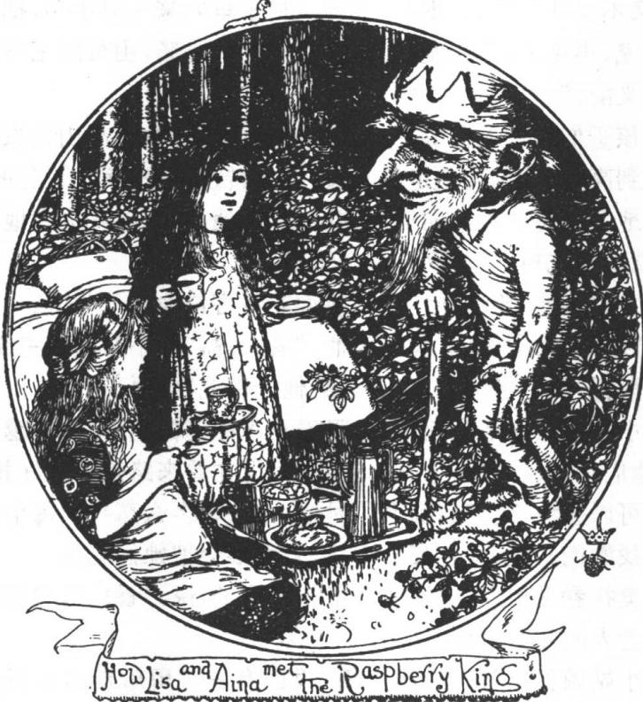

“我会告诉你们，我是谁。”老人说，“我是山莓王，统治着整个山莓森林王国。我在这里已经生活了一千多年。可是，统治着整个森林、海洋和天空的神灵不愿意看到我为自己的王位和长寿而骄傲。因此，他宣布，每隔一百年的一天，我将要变成一条软弱无能的小山莓虫，从太阳升起到太阳下山为止。这一天，我的生命就像一条小虫一样。小鸟可以把我吃掉，小孩可以把我和山莓一起捡起来，一脚就可以结束我这上千年的生命。昨天正好是我变形的日子，我和山莓一起被人摘去，要不是你们救了我一命，我就被踩死了。我无能地躺在草地上，直到太阳下山。昨天从你们的桌子上被推下来的时候，扭伤了一只脚，我的嘴也因为惊吓而扭曲。到晚上，我才恢复了原来的形状。我到处寻找你们，以感谢和报答你们。看到你们在我的王国里，就想办法既能见到，又不会吓了你们。现在，我要从村子里叫来一只小鸟，把你们带回家。再见了，小朋友们，谢谢你们的好心肠，山莓国王不会忘恩负义的。”

孩子们和老人握着手，感谢他，也为她们救了小山莓虫的命而感到高兴。她们准备走的时候，老人转过头来，咧开歪着的嘴，顽皮地笑着说，“替我向奥托问好！告诉他，下一次我见到他的时候，就把他吃掉，让他享有这个荣誉。”

“啊！请不要这样！”小姑娘们非常害怕地叫了起来。

“好吧！为了你们，我原谅他。”老人说，“我不是复仇主义者。请向奥托问候，告诉他，我要送给他一件礼物，再见！”

小姑娘快活地拿起山莓，跟着小鸟穿越树丛。森林里越来越亮，她们很奇怪，昨天怎么会迷路的，现在看来路是这么好找。

可以想象，她们回到家的时候，大家是多么高兴！每个人都在寻找她们，大姐姐整夜没睡，担心着狼会把她们吃掉。

奥托看见她们，他手里拿着一只篮子，说，“看！这些东西是一个老人刚才留给你们的。”

小姑娘们把篮子拿过来看，里面有一对用珍贵的宝石做成的最漂亮的深红色手镯。宝石都做成熟山莓的形状，上面还刻着字：“赠给利萨和艾娜。”此外，还有一个做成山莓虫形状的钻石胸针，上面刻着：“奥托，永远不要伤害弱者。”奥托觉得很羞愧，他非常明白它的意思。他想，老人对他的报答非常高尚。

山莓国王没有忘记大姐姐，当她整理桌子准备开饭的时候，她看到竹篮子里最漂亮的山莓。谁也不知道这是怎么来的，但人人都猜得出来。

她们做了许多许多山莓酱，假如你愿意帮忙，你也会得到一点，因为她们肯定会一直做到现在。

（Z·托普路斯）

 
 

## 普洛辛纳克的石头

你们中也许有人读过拿破仑的《肯尼思：伟大军队的后卫》这本书。假如你读过，你就会记得在俄罗斯找到的两个苏格兰小孩，如何受到法国士兵的保护，免去了在可怕的大撤退中受苦的经历。有一个名叫布雷顿的士兵经常给他们讲自己家乡的故事，让他们忘记饥饿和寒冷。这个士兵的家乡在布列塔尼。那里有过许多令人惊叹的事情。营地篝火旁最暖和的地方总是让给这些孩子。尽管如此，霜冻还是冻得他们直发抖。这时候，布雷顿就会开始讲，“普洛辛纳克是靠近赫纳波尼的一座海边小城……”直到肯尼思或埃菲打断他，问这样或那样急于知道的问题。那时候，他就会想不起来，他妈妈是怎么说下去的，又不得不从头开始。所以故事讲得很久，到要结束时，孩子们已经用能找到的一切东西裹起来，准备睡觉了。

我要告诉你的，就是这个故事。

普洛辛纳克是靠近赫纳波尼的一座海边小城，它的周围是一望无际的荒芜沼泽地。那里不长任何庄稼，野草是如此粗糙，连这里的野兽也是瘦骨嶙峋。偶尔可以看到一些枞木树丛。地面上到处布满密密的小石头，所以别指望能把它建成海边沙滩。再远一点，神仙们在很久很久以前竖起了两排很大的石头。那些石头那么大，那么重，真令人难以相信，神仙会把它们竖得那么直。

离这些大石头不远，在一条叫英泰勒小河的岸边，住着一个名叫马茨纳的人和他的妹妹罗泽尼卡。他们总是有足够的黑面包吃；有木鞋或木屐穿，还养着一头大肥猪。邻居们都想，他们很有钱。更令人高兴的是，他们也认为自己很富。

罗泽尼卡是个漂亮的姑娘，她知道怎么能把一切事情办好。要是她愿意，完全可以从普洛辛纳克的青年中挑选一个丈夫。但是除了伯奈兹以外，她谁也看不上眼。她从小就和他一起玩。伯奈兹虽然做工非常卖力，但总是穷得那么可怜。马茨纳干脆没好气地告诉他，必须到别的地方去找老婆。但是不管马茨纳怎么说，罗泽尼卡还是像以前那样，看到他就微笑着点头。从他身边经过的时候，常常回过头来看他，还唱上几句老的歌。

圣诞节除夕来临，那些为马茨纳干活的人和附近农场里的工人，都到大厨房里来吃蜂蜜汤，还有很大的布丁。这是这里的规矩。在桌子当中，有一个很大的木头碗，四周放着木调羹，这样每个人都可以舀一点。凳子上坐满了人，当马茨纳准备宣布晚餐开始的时候，门忽然打开，一个老人走进来，祝大家晚饭胃口好。人们都楞了一下，有些人脸上露出害怕的神情。他们都知道新进来的人是乞丐，还有人说他是巫师，会给牲口念咒语，让谷子变黑，让老人死去。还有什么，谁也不知道。不过，今天是圣诞节除夕，最好还是不要去得罪他。所以，马茨纳还是请他进来，在桌子旁坐下，还给他一个木调羹。

没有多少人谈论乞丐的到来，晚饭结束的时候，大家都很高兴。乞丐问，他能不能在马厩里睡觉，外面太冷，他会冻死的。马茨纳很不情愿地同意了，吩咐伯奈兹拿钥匙把马厩的门打开。那里有许多空的房间，足够一打乞丐住，现在只拴着一头老驴和一头瘦公牛。晚上天气很冷，巫师躺在两头牲口之间取暖，拿一袋芦苇当枕头。

即使是巫师，也有觉得累的时候。他走了一整天，尽管地板很硬，当教堂的钟声敲响十二下的时候，他也想躺下睡觉了。这时，驴子抬起头来，摇摇它的耳朵，转过来看看公牛。

“喂！我亲爱的老弟！”它说，“自从去年圣诞节除夕我们一起交谈以后，你的日子过得怎么样？”

公牛没有马上回答，用厌恶的眼光看了乞丐一会。

“说话有什么意思？”它粗暴地回答，“这个没用的东西听得懂我们在说什么。”

“哦！发牢骚也不要错过机会。”驴子快活地回答，“你没有看见巫师已经睡着了吗？”

“他爱玩这种恶作剧，肯定不会发财。”公牛说，“他不够聪明，要不就会去寻找一个星期以后从天而降的好运气了。”

“什么叫好运气？”驴子问。

“哦！你不知道？”公牛反问说，“每隔一百年，普洛辛纳克荒坡上的石头就要下来，到河边去饮水。它们走了以后，藏在下面的宝藏不就露出来了吗？”

“对了！我想起来了！”驴子说，“不过，石头很快就会回到原来的位置上，你肯定会被砸死，除非手里拿着一把蒺藜和五张叶子的车轴草。”

“是的，这还不够。”公牛说，“即使你平安地离开，但假如不用一个受过洗礼的灵魂来交换，这些宝藏也会变成灰尘。为了能够享受普洛辛纳克的宝藏，必须牺牲一个基督徒的生命。”

驴子还想问一些问题，但忽然觉得自己说不出话来，允许它们说话的时间已过。

“啊！我亲爱的家伙！”乞丐想。驴和公牛说的话他全部听到了，“你们让我富起来了，比瓦讷和洛里昂最富的人还要富。没有多少时间了，我明天就去找那些珍贵的植物。”

他不敢在普洛辛纳克附近寻找，生怕知道这个故事的人会猜出他在干什么。他向南方走去，那里的空气温暖潮湿，植物一年四季绿油油的。从东方刚刚露出曙光，到最后一丝阳光从天空消失，他不停地搜索着可能生长这些神奇植物的每一寸土地，难得浪费一分钟去吃和喝。最后，他在一个小山谷里找到了蒺藜，他非常高兴。但是，没有五叶车轴草，只有蒺藜也没有用。时间已经不多了。

已经到了要返回普洛辛纳克的最后一天了，还没有找到五叶车轴草，他几乎绝望了。他艰苦地爬上一块大岩石，突然注意到大岩石下面长着一小堆车轴草，激动得几乎停止了呼吸。他把它们全部拔起来，然后一棵一棵地数着叶子，心烦地把那些二叶、三叶车轴草扔在一边。到剩下没几棵的时候，他终于高兴地叫了起来，手中的车轴草正好有五张叶子。

巫师从地上爬起来，没有停留片刻，就在通往北方的大道上赶路。月光很明亮，他不停地走着，走着，也不知道走了几个钟头、走了多少路，也不觉得累。

太阳出来了，大地开始苏醒。他来到一家农舍门口，讨了一杯牛奶和一块面包，请求让他在门廊里休息一会，然后又继续他的旅程。到新年除夕，太阳下山的时候，他终于返回普洛辛纳克。

他从那排又高又长的石头墙上经过时，看到伯奈兹正在用一把凿子在一块最高的石头上干活。

“你在干什么？”巫师问，“是不是想在这块大石头上凿出一张床来给你睡觉？”

“不！”伯奈兹很快地回答，“我今天正好没事干，想在这块石头上凿一个十字，这不会出什么岔子吧！”

“我相信，你想这会祝福你娶罗泽尼卡做妻子吧！”巫师笑着说。

伯奈兹停下手中的活，看了他一会：“哦！你也知道这件事？不幸的是，马茨纳希望他的妹夫有比我的分币还要多的英镑。”

巫师朝四周看一看，肯定没人听见以后，小声地对他说，“假如我给你更多的英镑，比马茨纳做梦也想不到的还要多呢？”

“你？”

“是的，我！”

“那么，为了得到这些钱，我该干什么呢？”伯奈兹问。他清楚地知道，这人不会白白地送人东西。

“我要你做的事情，只需要一点点勇气。”巫师说。

“假如就这样，告诉我应该做什么，我会去做的。”伯奈兹放下手中的凿子，“我做好了准备，哪怕是冒三十次生命危险。”

巫师肯定伯奈兹不会给他找麻烦后，就告诉他，今天晚上，石头下面的宝藏将暴露出来。只要几分钟，他们就可以拿到一辈子也用不完的钱。但是，等待着手中没有蒺藜和五叶车轴草的人，将是什么命运，他却保持沉默。伯奈兹以为，这没有什么，只要有胆量和敏捷就可以了。所以他说，“老人，我非常感谢你给我这样的机会。真的，我生命的一部分将为你效劳。让我刻完这个十字，它快完成了。你什么时候要我来，我就什么时候到枞树林里等你。”

“午夜之前一个钟头，你一定要准时到那里去。”巫师说完，就自己走了。

约定时间的钟声响了，伯奈兹来到森林里。巫师已经等在那里了。他手中拿着两个口袋，头颈上还挂着一个。

“你很准时，”巫师说，“现在还没有到时候，你最好坐下来想一想，口袋里装满了金子、银子和钻石以后，你想干什么？”

“嗯！这用不了多少时间就可以想出来。”伯奈兹笑着说，“我要给罗泽尼卡一切她想要的东西。各式各样的衣服，从棉布的到丝绸的；还有各种各样好吃的东西，从白面包到桔子。”

“这些东西用你拿到的银子就够用了，金子用来干什么？”

“金子我用来帮助罗泽尼卡在教区里的一切亲戚和每一个朋友，让他们也富起来。”他说。

“这样金子也就差不多了。那么钻石呢？”

“然后，”伯奈兹叫起来，“我要把钻石分给世界上的每一个人，让他们都能够有钱和快乐。我还要告诉他们，罗泽尼卡也和他们一样。”

“嘘！快到午夜了，我们该走了。”巫师小声地说。他们一起蹑手蹑脚地走出森林。

随着午夜的第一声钟声敲响，一阵雷鸣般的声音打破了荒野的寂静。大地在他们的脚下抖动起来。接着，月光下，他们看见巨大的石头纷纷离开它们的位置，沿着山坡滚向小河，急忙中相互撞击着，它们从两人的身边经过，消失在黑暗中，好像是一队巨人似的。

“快！”巫师用很低的声音说，他冲到空洞里去。即使是在伸手不见五指的黑夜，也可以看到里面的宝藏在闪闪发光。他跪下来，开始装带来的口袋。一边装一边仔细地听着，石头是不是返回来了。伯奈兹要比他慢得多，把看得见的珍宝放进口袋。

巫师刚刚装满三袋子，正想着还能带走什么更贵重的东西，忽然听到一种低沉的声音，好像远处在打雷。

石头已经喝完了水，正急匆匆地赶回来。最大的一块石头走在最前面，把挡路的一切东西撞得粉碎。

“我们失算了，它们会把我们撞死的。”

“我不会，”巫师说，举起蒺藜和五叶车轴草，“它们会保护我的。为了保护我的财产，我不得不牺牲一个基督徒的生命来祭这些石头。恶运把你送到我手中来了。”他说着，把神奇的植物对着迅速滚过来的石头。这些巨大的石头好像知道遇到了一种比自己更强大的力量似的，纷纷向巫师两边让开，但过后又汇拢起来，向伯奈兹冲去。

年轻人不想躲避，知道这是没有用的。他蹲下来，闭上了眼睛。忽然，领头的大石头在伯奈兹面前停下来，其他石头也就不能从这里过去。

这就是那块伯奈兹刻上十字的石头。它已经受过洗礼，有力量去救他。它停在那里不动，等其他石头都找到自己的位置停下以后，它才像小鸟似地跳起来，回到自己的位置上去。碰巧的是，它正好要从被三口袋珍宝拖得快要走不动了的巫师身上经过。

巫师自以为很安全，他满不在乎地慢吞吞地走着。看到最大的那块石头滚过来，他赶紧举起神奇的植物。但是，受过洗礼的石头再也不受这种魔法的约束，径直从巫师的身上滚过，把他碾得粉碎。

一切又安静如初。伯奈兹回到家里，把他的财富给马茨纳看。马茨纳这一回不再拒绝他当妹夫了。伯奈兹和罗泽尼卡结了婚，一直幸福地生活着。

（布雷顿民间故事，E·索瓦斯特编写）

 
 

## 凯哥拉斯城堡

佩罗尼克是个可怜的傻子，无家可归的流浪儿。村子里的人很善良，只要他开口，总会给他一些吃的，要不然他早就饿死了。夜里困了的时候，他就找一堆稻草，挖个洞，像蜥蜴一样地爬进去睡。虽然是傻瓜，但他从未觉得不快活，总是高兴地感谢那些给他吃的人，有时还唱歌给他们听。他很会模仿云雀的声音，谁也分不出是真的，还是假的。

有一天，他在森林里徘徊了几个钟头，觉得肚子饿了。幸好这里的森林并不茂密，可以看到不远的地方有一间小农舍。佩罗尼克向它走过去，看到门口站着一个农妇，手中拿着一只大碗，正在喂她的孩子们吃饭。

“我饿了，给我一点吃的好吗？”佩罗尼克问。

“只要有一点吃的，你总是会受欢迎的。”她说。的确，碗里没有多少东西了，孩子们的调羹都在伸过来。佩罗尼克也加入了他们的队伍，觉得从来没有吃过这么好的东西。

“这是乡下最好的厨师用最好的面粉加最浓的牛奶做成的。”佩罗尼克自言自语地说着，农妇听到了。

“可怜的傻瓜，”她喃喃地说着，“他不知道自己在说些什么。让我再给他一块新麦子面粉烤出来的面包吧！”佩罗尼克狼吞虎咽地吃着每一粒碎屑。还说除了主教的厨师以外，谁也烤不出这么好的面包。农妇听到这些话非常高兴。又在面包上涂上了一层奶油。

正当他站在门口吃着面包时，一个全副武装的骑士骑着马奔驰过来，问道，“你们能告诉我，到凯哥拉斯城堡怎么走吗？”

“凯哥拉斯！你真的要到凯哥拉斯去吗？”农妇脸色苍白，叫了起来。

“是的，为了到那里，我从一个非常遥远的国家赶来，已经整整奔驰了三个月。”

“你到凯哥拉斯去干什么？”她问。

“我去寻找城堡里的金盒和钻石长矛。”他回答。这时，佩罗尼克抬起头来，问，“那盒子和长矛是非常珍贵的东西吗？”

陌生人回答，“比世界上的所有王冠都值钱和宝贵。那盒子不但能给你一切梦寐以求的食物，而且用它来饮水，可以治好一切疑难和危险之症。用它来碰死人的嘴唇，他们就能活过来。至于那根长矛，它可以刺穿所有的石头和金属。”

“那么，这些神奇的东西属于谁呢？”佩罗尼克惊讶地问。

“属于一个名叫罗吉尔的魔术师，他住在城堡里。”农妇回答，“每天，他都骑着一匹黑母马从这里经过，后面跟着一匹十三个月的小马。他手里总是拿着那根长矛，没人敢攻击他。”

“这是真的，”骑士说，“但有一个咒语管住了他，禁止他在凯哥拉斯城堡里使用它。他一进入城堡，金盒和长矛就会被锁在一间暗室里，只有一把钥匙能够打开，那里就是我要和魔术师决斗的地方。”

“你赢不了他！骑士先生。”农妇摇着头回答，“已经有一百多个骑士从这里经过，为了同一个目的。但没有一个能活着回来。”

“我知道，仁慈的妇人。”骑士回答，“但是他们不像我一样，得到布劳维特隐士的指点。”

“隐士告诉你什么？”佩罗尼克问。

“他告诉我，我必须通过一片充满各种魔法和声音的森林。这些魔法和声音都试图吓唬你，让你迷失方向。在我之前的许多人，都在那里被弄得晕头转向，不知何去何从。最后因为寒冷、饥饿和疲劳而死去。”

“那么，要是你能安全地通过森林呢？”佩罗尼克问。

“要是我能通过，”骑士继续说，“我会遇到一个精灵，他手中拿着一枚火针，能够把碰到的一切烧成灰烬。这个精灵守卫着一棵苹果树。我要从树上摘下一个苹果。”

“然后呢？”

“然后，我要寻找一朵会笑的花。有一头狮子守着这朵花。这头狮子的鬃毛是一条条毒蛇。我要摘下这朵花，再到龙居住的一个湖泊去，和一个手中拿着铁球的黑人决斗。这个铁球从来不会错过它要打击的目标，还会按主人的意愿自己返回。这以后，我就进入一个消遥谷。在那里，一些过了许多险关的骑士留下了他们的尸骨。假如我能顺利地通过，将到达一条河边。这条河只有一处可以涉水而过。有一个穿黑衣服的妇女坐在那里。她会骑上我的马，坐在我背后，告诉我接着应该怎么做。”

他停了下来。那农妇摇摇头，说，“你永远也无法办到这些事情。”但是，骑士不听她的，请她记住，这些都是男人们的事情。说完就沿着农妇指引的方向走去。

农妇叹息着，又给佩罗尼克一些吃的，向他道了晚安。佩罗尼克起身，准备到森林里去。这时，农夫从屋子里走出来。

“我要一个男孩来照顾我的牲口。”他说，“原来那个男孩跑掉了。你愿意留下来干这活吗？”佩罗尼克虽然不想干活，喜欢自由自在。但想到刚才吃的那些好东西，也就点头同意了。

太阳升起的时候，他小心地赶着牲口来到森林边的茂盛牧场，砍下一根榛树枝来管这些牲口。他的活可不像看起来那么简单。那些牛老是想溜到森林里去。赶回这一头，那一头又走了。有一次，一头黑母牛特别讨厌，跑得很远，他只好跟着它进去。不久，他听到马蹄响的声音。透过密林，他看见巨人罗吉尔骑在母马上，后面跟着一匹小马。巨人的头颈上，用链条挂着那个金盒，手中握着像火一样闪光的长矛。巨人的影子消失以后，佩罗尼克怎么也找不到他经过的路。

这样的事情一次又一次地发生着。后来佩罗尼克也就习惯了，再也不会害怕得躲起来。他想得到金盒和长矛的愿望越来越强烈。

有一天晚上，佩罗尼克独自一人坐在森林边。一个长着白胡子的人走过来。“你想问到凯哥拉斯去的路吗？”佩罗尼克问。

“这条路我非常熟。”那人回答。

“你到那里去过，没有被魔术师杀掉？”佩罗尼克问。

“哦！他并不怕我抢他的宝贝。”白胡子的人说，“我是他的哥哥，巫师布鲁克。我想去看他的时候，总要从这里经过。就是我从充满魔法的森林里穿过，也会迷失方向。我叫小马来给我带路。”

说着，他弯下腰来，在地上转了三圈，声音很轻地说了些什么，佩罗尼克一点也听不见。然后他就大声地说，

> 小马，自由地奔跑，自由地吃，
> 小马，快跑过来，让我们相遇。

立刻，小马蹦蹦跳跳地出现在巫师的面前。他把笼头给马套上，就骑着马走了。

佩罗尼克心中有了打算，但对他的冒险计划保持沉默。他非常清楚，要想到凯哥拉斯去，首先必须抓住识路的小马。不幸的是，他没有听到巫师说的那些咒语，也不知道怎么画那三个圆圈。他要想找到小马，就得想别的办法。

他放牧时，总是想着如何把小马召来。他十分相信，只要骑到小马背上，他就能度过其他难关。他必须准备抓住一切可能出现的机会。晚上，大家都睡着以后，他回忆起巫师所做的事情。他从马厩的角落里拿来一个旧的马笼头，搓了一根麻绳，准备套住小马的脚，还准备了一张捉鸟一样的网。他找来一些旧衣服和布片，把它们缝在一起，充当口袋。在口袋里装一些胶水，云雀的羽毛，一串珠子，一个木制的口哨，还有一块擦过奶油的面包。准备好了以后，他就来到罗吉尔、母马和小马总要经过的路旁，把面包弄碎，撒在地上。

巨人罗吉尔准时地出现了。佩罗尼克躲在树丛中，紧张地看着。他的计划会不会成功呢？也许是母马，而不是小马把面包碎片吃掉！也许，啊！不！母马和它的主人平安地走过去了，消失在转弯处。小马却低下头来溜达着，寻找香味四溢的面包片，贪婪地吃起来。“啊！多好吃的东西！怎么从来没有人给我吃过！”它全神贯注地寻找面包片吃，根本没有注意到佩罗尼克偷偷地爬过来，把马笼头套在它头上，用绳子拉住了它的脚。一刹那，佩罗尼克已经骑到它的背上。

他还来不及解开套在小马一只脚上的绳子，小马就像一阵狂风似地向那充满魔法的森林里奔去。佩罗尼克被森林里看到的景象吓得发抖。有时，地面裂开，横在他们面前的是无底深渊；有时，大火熊熊燃起，他们就在烈焰中穿行；有时，他们从河水中涉过，河水突然猛涨，要把他们吞没；在山脚下，巨大的石头纷纷向他们滚过来，要把他们砸烂。直到他活着的最后一天，他也搞不清楚，这些是真的，还是仅仅是幻影。佩罗尼克把帽子拉下来遮住眼睛，任凭那匹小马把他带到哪里去。

终于，森林被他们抛在后面。他们来到一片宽阔的平原上。强劲的风带来了新鲜的空气。佩罗尼克壮着胆子朝四周看了看，令他宽慰的是，魔法已经消失。但草原上到处散落着人和马的骨头，叫人毛骨悚然。远处有些灰色的东西走来走去，那会不会是狼？

草原虽然宽广，但用不了多久他们就穿过去了。小马带着他来到一个荫绿的花园里。那里长着一棵唯一的苹果树。沉甸甸的苹果把树枝压得弯到地上。苹果树前面站着一个矮子——一个小精灵。他手中拿着一把火剑，能把碰到的一切东西烧成灰烬。看到佩罗尼克，他发出凶狠的叫声，举起他的剑。佩罗尼克却一点也不吃惊地摘下帽子。不过，他小心地和小精灵保持着一段距离。

“别发火，我的王子。”佩罗尼克说，“我只是要到凯哥拉斯那里去。神圣的罗吉尔请我去办点事情。”

“请你去？”小矮人重复着，“那么，你是谁？”

“我是他请来的新佣人，你知道得很清楚。”佩罗尼克说。

“我一点也不知道。”小矮人阴沉地回答，“我只能说，你可能是个强盗。”

“我非常遗憾，”佩罗尼克回答，“我自称佣人可能不对，因为我只是一个养鸟人。请你不要耽误我的时间，尊敬的魔术师在等着我。你看到了吧！他把自己的小马借给我，好让我快点到达他的城堡。”

听了他的这些话，小精灵第一次注意到那匹小马。他知道魔术师有一匹小马，开始想佩罗尼克可能是在讲真话。在仔细地看了那匹马以后，就观察起骑手来。他是那么单纯，简直是无知，不像会编故事的样子。尽管这样，小矮子还是不敢十分肯定，一切都没有问题，还是问他，魔术师要一个养鸟人干什么？

“从他说的话来看，他想要一个高明的养鸟人。”佩罗尼克说，“他说，凯哥拉斯的粮食和公园里的果实都被鸟吃光了。”

“你有什么办法可以阻止它们呢？我的好伙伴！”小矮人问。佩罗尼克把准备好的网给他看，还说，不论什么鸟，别想从这个网中逃脱。

“我也希望这样。”小矮人说，“我的苹果全被画眉吃掉了。把你的网装起来，如果能抓住它们，我就让你过去。”

“这个买卖太便宜了。”佩罗尼克说着就跳下马来，把小马拴在树上。然后弯下腰来，把网的一头结在苹果树上，叫小矮人拿住另一头，他要取出木钉。小矮人照他的话去做了。佩罗尼克忽然把一个活结套在他的头上，把他拉过来。小矮人像被牢牢套住的小鸟似的，再也逃不掉了。他暴跳如雷地大叫起来，想解开活结，但是越拉越紧。他已经把火剑放在草地上，现在怎么也拿不到。佩罗尼克轻而易举地摘下一个苹果，骑上马走了。小矮人眼瞪瞪地看着他走远，自己只好听天由命了。

佩罗尼克骑着马离开了草原，来到一个狭窄的山谷。山谷里是一片树丛，长满了各种各样的香花——五颜六色的玫瑰，黄色的金雀枝，桃红色的忍冬。它们之上是绯红色的样子奇异的三色紫罗兰。这就是那朵笑花，谁看到它都会忍不住发笑。想到他成功地来到第二次考验面前，佩罗尼克的心情十分激动。他沉着地看着在树丛前面走来走去的狮子，无数条毒蛇在它背上盘旋着，卷曲着。

佩罗尼克把帽子从头上摘下来。虽然是个傻瓜，他也知道，当和比你大的人打交道时，帽子拿在手里比戴在头上更有用。在祝福狮子和它的一家交各种好运以后，他问到凯哥拉斯的路是不是从这里经过。

“你到凯哥拉斯去干什么？”狮子咆哮着问，露出了它的牙齿。

“向你致敬！”佩罗尼克装作非常害怕的样子回答，“我是一位夫人的佣人。她是高贵的罗吉尔的朋友，叫我送一些云雀给他做肉饼。”

“云雀？”狮子叫道，舐了舐它的长胡子，“嗯！我肯定已经整整一个世纪没有吃云雀了！你带来很多吗？”

“满满的一袋。”佩罗尼克说，一边把装着羽毛和胶水的口袋张开。为了证明他的话，他转过身去，背对狮子学云雀唱歌。

“过来。”狮子叫道，口水都流出来了，“让我看看这些送给我主人的鸟是不是够肥。”

“我很高兴给你看。”佩罗尼克回答，“但是我一把口袋打开，鸟就全部飞走了。”

“那好吧！打开到让我看得见就可以了。”狮子说，又靠近了一点。

这正是佩罗尼克所希望的。他拿着口袋，狮子小心地把口打开，以便它能把头伸进去，吃一口云雀。它刚把头伸进去，羽毛和胶水就把它粘住。它还来不及把头缩回，佩罗尼克就把袋口的绳子收紧了，打了一个谁也解不开的结。然后，他迅速地摘下笑花，骑着小马飞奔而去。

他们很快就来到湖边。湖上没有渡船，他们要游过去。小马已经习惯了游泳，它毫不犹豫地跳下水。湖里的龙看到佩罗尼克，立刻从四面八方游过来，要把他吃掉。

这一回，佩罗尼克不慌不忙地摘下帽子，把带来的珠子扔入水中，就像向水中的鸭子扔黑谷子一样。每条龙吞下一个珠子，就肚子朝天，死了。佩罗尼克再也没有遇到什么麻烦，就来到了湖的对岸。

前面就是黑人看守的峡谷。离他很远的时候，佩罗尼克就看见了他。黑人的一只脚被链条锁在岩石上，手中拿着从来不会错过打击目标、还会自己回到主人手中的铁球。黑人头上有六只眼睛，从来不会同时闭上。这时候，他六只眼睛全张着。佩罗尼克知道，只要有一只眼睛看见他，黑人就马上把铁球打出来。他把小马藏在茂密的树丛里，自己沿着一条小沟悄悄地爬过去，爬到锁着黑人的岩石旁边。

天气很热，黑人不久就开始瞌睡，闭上了两只眼睛。佩罗尼克开始唱一些催眠的歌曲。一会儿，第三只眼睛也闭上了。他继续唱着，第四只眼睛的眼皮也沉重地闭起来，接着是第五只，第六只。黑人完全睡着了。

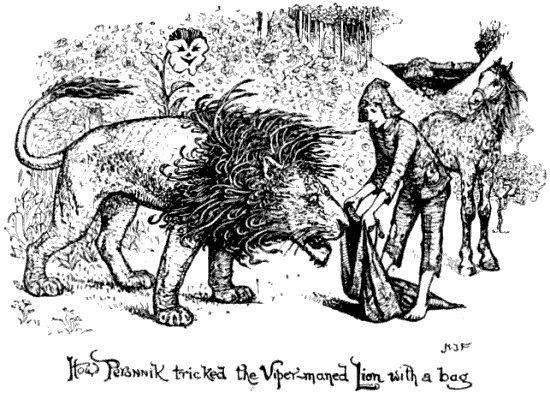

佩罗尼克小心地，轻轻地踮起脚，回到小马身边，骑上小马从柔软的草地上走过，来到了消遥谷。消遥谷里有一个美丽的公园。

颜色鲜艳，香气诱人的水果从树枝上挂下，一直伸到你的嘴边。泉水像美酒一样地潺潺流动。连鲜花也会发出温柔迷人的声音。再往前走，桌子上摆满了美味佳肴。美丽的姑娘在草地上跳舞，热情地请你一起参加。

佩罗尼克听着，闻着，一点也没注意到小马的步子越来越慢。要不是好像忽然看到了金盒和钻石长矛，他一定会像以前的那些骑士那样，忘掉了自己的使命，停下来吃喝玩乐了。他从口袋中拿出哨子，拼命地吹响，以掩盖那甜蜜诱人的声音。他吃起自己带来的面包和咸肉，以免被那些香气扑人的水果和食品吸引。他的眼睛死死地盯着小马的耳朵，以免受那些舞女的诱惑。

就这样，他走过了公园，隔着一条河，他终于看到了凯哥拉斯城堡。河上只有一处渡口，要涉水而过。河边是不是像那人所说的那样，有个姑娘坐在那里呢？他抬头张望，是的，她穿着一件黑缎子衣服，坐在一块石头上。她的脸色像摩尔妇女那样。

佩罗尼克骑着马走过去，彬彬有礼地摘下帽子，问她是不是愿意一起过河。

“我在等待着你，帮我一起过去。”她回答，“靠近一点，我好坐在你的后面。”

佩罗尼克照她的话去做，伸出一只手来拉她。她敏捷地跳上了马背。

“你知道怎么杀死魔术师吗？”他们一起涉水过河的时候，她问。

“我想，他是一个魔术师，生命是不朽的，谁也杀不了他。”佩罗尼克说。

“劝他把那个苹果吃下，他就会死掉。假如这还不够致命，我就会用手指去碰他，我是他的祸根。”

“但是，假如我杀了他，没有钥匙，我怎么能拿到藏在小室里的金盒和钻石长矛呢？”佩罗尼克问。

“笑花能打开一切门户，驱走一切黑暗。”姑娘说。

说着，他们来到了对岸，向城堡进发。

在城堡门口，许多竿子支撑起一顶帐篷，巨人正坐在帐篷下晒太阳。他一看到佩罗尼克和姑娘骑着小马走过来，就抬起头来，用雷鸣般的声音喊道：

“喂！你一定是那个傻瓜，骑着我十三个月的小马！”

“最伟大的魔术师，你说对了。”佩罗尼克回答。

“你怎么抓到它的？”巨人问。

“重复我在森林边从你哥哥布鲁克那里学来的话，我只是说：

> 小马，自由地奔跑，自由地吃，
> 小马，快跑过来，让我们相遇。

它就跑过来了。”

“那么！你认识我的哥哥？”巨人问，“告诉我，他派你来干什么？”

“带给你两件他刚从摩尔国家得到的礼物。”佩罗尼克说，“一个非常好吃的苹果和一个温柔的姑娘。你吃了这个苹果，就不想再尝别的什么了；你有了这个姑娘当佣人，就不想再要别人了。”

“好吧！给我那个苹果，叫那姑娘下来。”巨人说。

佩罗尼克把苹果递给他，巨人刚尝了一口，就摇晃起来。姑娘那纤长的黄手指一碰到他，他就倒地死了。

离开了巨人倒下的地方，佩罗尼克带着那朵笑花走进了宫殿，五十扇门在他的面前打开。最后他来到了一个地下室门口，长长的台阶好像一直通到地壳的底下。台阶一直引他到一扇没有闩也没有锁的银门前。他把笑花举起来，门慢慢地打开，里面是一个很深的洞穴，在金盒和钻石长矛的光芒照耀下，洞穴内像白天一样明亮。佩罗尼克跑过去，把金盒拿起来，把链条挂在头颈上，把钻石长矛拿在手里。这时候，大地抖动起来，好像大地震一样。接着，宫殿消失了，他发现自己站在放牲口的森林边上。

黑夜降临，佩罗尼克不会再想回到农夫的家里去了。他沿着通往布列塔尼古王国宫殿的大路一直走去。路过瓦讷的时候，他走进一家服装店，用凯哥拉斯城堡里带来的金币，买了一件棕色的天鹅绒，白色夹黑的大衣，然后继续向正在受到法国军队进攻的南特城走去。

快到南特城门时，佩罗尼克停下来看了看周围。方圆几英里的乡村一片荒芜。侵略者已经砍倒了每一棵树，烧光所有的庄稼。佩罗尼克想，城里的人必定饿死无疑。正当他恐怖地看着这片骇人的景象时，一个吹号手出现在城墙上，响亮地吹了一阵号以后，宣布了国王的通告：谁能把法国侵略者赶出这个国家，将可继承他的王位。

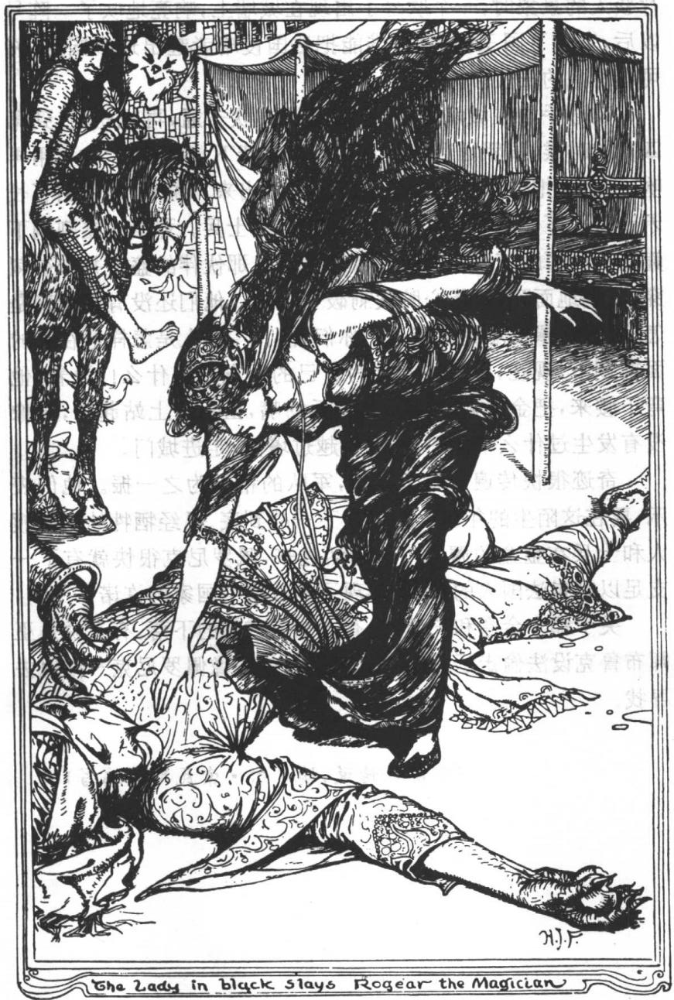

吹号手站在城墙上，对着四面八方吹一通，再喊一通，到第四次的时候，佩罗尼克已骑着马来到城墙下，对他说，“你不用再吹了，我将把城市从敌人的围困中解救出来。”说着，他用钻石长矛碰了一下一个挥舞着剑向他冲过来的士兵。那士兵立刻倒下毙命。后面跟随而来的士兵都惊呆了。那伙伴的盔甲并未被刺穿，却倒地而死，好像心脏被刺破了一样。他们还没有搞清楚是怎么回事，佩罗尼克又喊道，“你们看到了，敌人是怎样地在我的面前倒下；现在，再看看我能为自己的朋友做些什么！”说着，他弯下腰来，把金盒碰了一下那士兵的嘴，士兵马上站起来，好像没有发生过什么事似的，跳上马越过壕沟，走进城门。

奇迹很快传遍了整个城市，军队的精神为之一振。他们表示，要在这陌生的年轻人指挥之下一战到底。已经牺牲的布雷顿人和士兵在金盒的魔力下纷纷活过来，佩罗尼克很快就有了一支足以赶走法国人的军队，实现了拯救这个国家的许诺。

关于那个金盒和长矛，没有人知道它们的下落。有人说是巫师布鲁克设法偷走了。谁要想得到它，就要像佩罗尼克一样地去寻找。

（布雷顿传说，埃木尔·索瓦斯特编写）

 
 

## 鸟的战争

地上的动物和天上的鸟将进行一场大战，这个消息传到国外。特瑟城国王的儿子说，战争打起来的时候，他要到那里去看，还要带回来谁当国王的消息。尽管如此，他还是来迟了，战争已经快结束了，只剩下蛇和大乌鸦的一仗。这一仗也打得很激烈，最后表明蛇是强者，它用身体缠住乌鸦的头颈，乌鸦眼看就要坚持不住了。这时，王子拔出他的剑，一下就把蛇的头砍下。乌鸦看见敌人已死，非常感激地对王子说，“为了感谢你今天的好心，我要让你鸟瞰一下这里的风光。请站到我的翅膀上来。”

王子照它的话去做，他们飞越了七座山峰，七条峡谷，七块沼泽地，才停下来。

“你看到那边那座房子吗？”乌鸦说，“直接到那里去，我有一个妹妹住在那里。她也会同样地欢迎你。假如她问你，‘打仗的时候，你在吗？’你要说在的。要是她问你，‘看到和我很像的吗？’你要说看到。但是别忘了，每天早上到这里来见我。”

王子照乌鸦的话去做。那天晚上，他吃得好，喝得好，还有热水洗脚，有柔软的床睡觉。早上起来就去和乌鸦见面。

这样一连过了三天。到了第四天早上，他来到约会的地方，等着他的不是乌鸦，而是一个陌生的，漂亮的青年男子，手中拿着一捆东西。

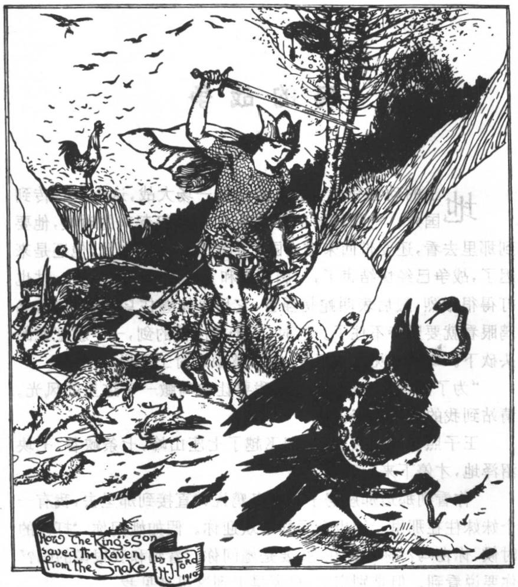

“你看到一只乌鸦吗？”王子问那个青年人。青年人回答，“我就是那只乌鸦。你把我从魔法中解救出来。为了报答你，我给你这捆东西。沿着你走过来的路回去，每天晚上换一个地方住一住，直到你认为是最适于居住的地方，才把这捆东西打开。”

王子走了，他走进了一片大森林，这里离他父亲居住的地方还有一段距离。走了那么长的路，那捆东西显得越来越沉重。开始，他把它放在一棵树上，后来，他想看看里面到底是什么东西。

打结的绳子非常容易解开，他把包打开以后，看到了什么呢？一座华丽的城堡，四周都是果园，里面长着许多水果和鲜花，还有各种鸟在飞来飞去。非常舒适的房子，可惜坐落在森林的中间。他多么希望到父亲王宫旁边的绿色山谷里再把包打开啊！现在一切都晚了。正当他对着华丽的城堡叹息时，一个巨人向他走过来。

“把房子造在这里很糟糕，是不是，王子？”巨人问。

“是的，我并不想把房子造在这里。”王子回答。

“假如我重新把它捆起来，你给我什么做报酬呢？”巨人问。

“你想要什么？”王子问。

“你第一个儿子长到七岁的时候，我要他。”巨人说。

“假如我有一个儿子，就把他给你。”王子说。说话的工夫，城堡又回到了那捆包里去了。

“现在，你赶你的路，我走我的道。”巨人说，“你可以忘了自己的诺言，我是不会忘记的。”

王子高兴地走上归途，来到父亲王宫旁边的绿谷。他小心翼翼地把包打开，生怕里面什么也没有，或者是只有一块石头或垃圾。啊！不！一切还是和刚才看到的一样。他把城堡的门打开，里面站着世界上最美丽的少女。

“进来吧！王子！”少女说，“一切都准备好了，我们马上就结婚。”于是，婚礼立刻开始。

那少女确实是个好妻子，王子不久也成了国王，日子过得那么幸福，他压根儿没有想起过那个巨人。儿子出世以后，七年零一天过去了。这一天早晨，他站在城堡上，远远看见巨人在向城堡走过来，这才想起，这件事还没有和王后说过。现在，他必须告诉她，也许她能想办法。

王后一声不响地听他讲事情的经过，完了以后，她只是说，“这件事你就别管了，让我来对付那个巨人。”

巨人走进大厅，站在他们面前，“把你们的儿子带出来，兑现你七年零一天以前的承诺。”

国王看了他妻子一眼。她点点头，于是他说，“让孩子的母亲把他的东西整理一下。”

王后走进去，把厨师的儿子叫来，让他穿上王子的衣服，带他出来见巨人。巨人拉着他的手，两人走了出去。还没走多远，巨人就停下来，拿出一根棍子对男孩子说，“假如你爸爸拿着这根棍子，他会用来干什么？”

男孩子说，“我爸爸要是有这根棍子，就用它来打偷吃国王东西的狗和猫。”

“你是厨师的儿子！”巨人说，“回家，到你妈妈那里去。”小孩子转过身来，回到王宫里。

“这一次要是你们还骗我，我就把这里的石头打得粉碎。”他对国王和王后说。他们吓得直发抖，但仍然不愿意把孩子给他。

“膳司的儿子和我们的一样大，”王后小声地对国王说，“他不会认出来。”她把膳司的儿子找来，给他穿上王子的衣服。巨人把他领了出去。但没有走多远就停下来，拿出那根棍子。

“要是你爸爸有这根棍子，他会用来干什么？”他问那男孩子。

“他要用来打那些敲碎国王杯子的狗和猫。”孩子回答。

“你是膳司的儿子！”巨人叫起来，“回家，到你妈妈那里去。”说完，他非常气愤地赶回城堡。

“把你们的儿子马上带出来，”巨人吼叫着，“否则，我就把这里的石头全部打碎！”这一回，他带走了真的王子。

国王和王后大哭一场。以为孩子要受尽各种折磨，经历种种苦难了。其实，巨人对他就像亲生的儿子一样。不过，他从来不让他见到自己的女儿。几年工夫，王子长成了一个小伙子。有一天，巨人告诉王子，他要出远门去旅行，王子要自个儿玩一段时间。

王子独自走出去，沿着河流一直走向大海。他来到了从未来过的城堡最高处。正当他徘徊不定的时候，传来一阵美妙的音乐。离他最近的一幢房子的窗打开了。他看见一个少女坐在窗口，抱着一个竖琴。

“快走！我背上感到了父亲呼出的热气，他就要来了。”她急急忙忙地小声说，“但等他睡着以后，回到这里来，我要和你说话。”王子听了她的话，走开了。到了午夜，他又爬到城堡上来。

那少女就是巨人的女儿。她告诉他，“明天，你将有机会选择和我的两个姐姐结婚。但是，你一定要说，她们两个你一个也不要，只愿意要我。我父亲听了以后一定很生气，他想把我嫁给绿城国王的儿子，这个人我一点也不喜欢。”

说完，他们就分手了。第二天一早，正如那个少女说的那样，巨人把他三个女儿和王子叫来，对王子说，“现在，特瑟城国王的儿子，我们分别的时候到了。挑选我两个大女儿中的一个做妻子，举行婚礼以后，就带她回到你父亲那里去。”

“把最小的给我吧！”王子回答。

听了王子的话，巨人的脸阴沉下来。“那你必须先做三件事。”他说。

“说吧！我会做的。”王子回答。

巨人走出房子，叫王子跟着，来到关牛的牛棚。

“一百年了，没有来打扫过这个牛棚。”巨人说，“天黑以前，我回家的时候，你必须把它打扫干净，让金苹果能够从这一头滚到那一头，否则你就要流血。”

整整一天，王子拼命地干着。但这事就好像要把海水淘干那么难。最后，他累得再也动弹不了了。这时，巨人的小女儿出现在门口。

“抛弃你的忧愁！”她对王子说。这时他再也支持不住了，像马上就要死了似的，一头倒在地上就睡着了。他醒过来时，少女不见了。牛棚打扫得像镜子一样明亮，金苹果可以从这一头滚到那一头。他惊奇得跳起来。这时候，巨人来了。

“你把牛棚打扫干净了吗？国王的儿子！”巨人问。

“打扫干净了。”王子回答。

“好的，你今天干活真卖力气。明天，你要用各种鸟的一根羽毛做出牛棚的屋顶来，否则你就要流血。”巨人说完就走了。

第二天太阳还没有出来，王子就带着弓和箭袋出去射鸟，他在荒野里走来走去，但是一只鸟也看不见。最后累得脚也快要断了，他终于失望了。“看来只有一死了事了。”他想。

中午的时候，巨人的小女儿找他来了。

“你累了吧！国王的儿子。”她说。

“是的，”他说，“我找了好几个钟头，只抓到这两只黑乌鸦，它们都是一种颜色的。”

“把你的忧愁抛在草地上吧！”她说。听了她的话，他就倒在草地上睡着了。他醒过来的时候，少女已经不见了。他回到牛棚，走近一看，不禁用力擦着眼睛，以为自己在梦中。一个非常漂亮的屋顶已经盖在牛棚上。一切都像巨人吩咐的那样。

他在门口碰到了巨人，“牛棚的屋顶盖好了吗？国王的儿子。”

“是的，盖好了。”

“好吧！既然你今天这么卖力，我还有些事情找你，湖边长着一棵枞树，枞树的树顶上有一个喜鹊巢，巢里有五个蛋。你明天去把这些蛋带回来，给我当早饭，要是打碎一只，你就要流血。”

第二天天还没亮，王子就从床上跳起来，赶到湖边。找到那棵树并不难，在黎明的曙光照射下，树干已隐约可见。这棵树干足足有一百多米高。他围着树走来走去，想找个树节爬上去。可是树皮长得非常光滑，根本无法踏脚。要想爬上去，只能像水手那样用双脚夹住树干，用手来爬。可惜他是王子，不是水手。

站在树下看是没有用的，不管怎么样，他总得试试。他爬上去一米多，就滑了下来。有一次爬到两米，他心中充满了希望，可是又滑了下来。一连好几次以后，手臂和脚又酸又痛。最后，只好靠在树干上喘气。

“这不是休息的时候。”巨人的小女儿来了，对他说。

“哎！我爬不了多高就滑下来了。”王子说。

“再试试看。”她说。她把一只手指贴在树干上，叫他踩着她的手指上去。然后，又把另一只手的手指贴在高一点的树干上，给他当梯子踩，直到他爬上树顶，看到喜鹊巢。

“赶快把蛋取下来。”她喊道，“我背上已经感觉到了父亲呼出的热气。”他拿了蛋赶快爬下。少女的手指被粘在树顶上，时间那么紧迫，她也顾不上了。这时太阳已经爬上了小山顶。

“听我说，”她对王子说，“今天晚上，我两个姐姐和我将穿上同样的衣服，你认不出我。我父亲会对你说，‘国王的儿子，去找你的妻子。’你就去找那个右手没有小手指的就是了。”

王子到巨人那里去，把蛋交给他，他点了点头。

“准备结婚吧！”他说，“婚礼今天晚上就举行。到时候，我会叫新娘来欢迎你。”

晚上，他把三个女儿都叫来。她们都穿着一样的绿色丝绸服装，头上套着金色的头巾。王子看看这个，看看那个，谁是他的心上人呢？他看到了中间那个手上缺少小指。王子把手放在她的肩膀上。巨人说，“这一次你也选中了。不过，我们还可以用另一种方法试试。”说着，他装做高兴地笑出来的样子。但新娘看到他眼中露出一丝凶狠的杀机。

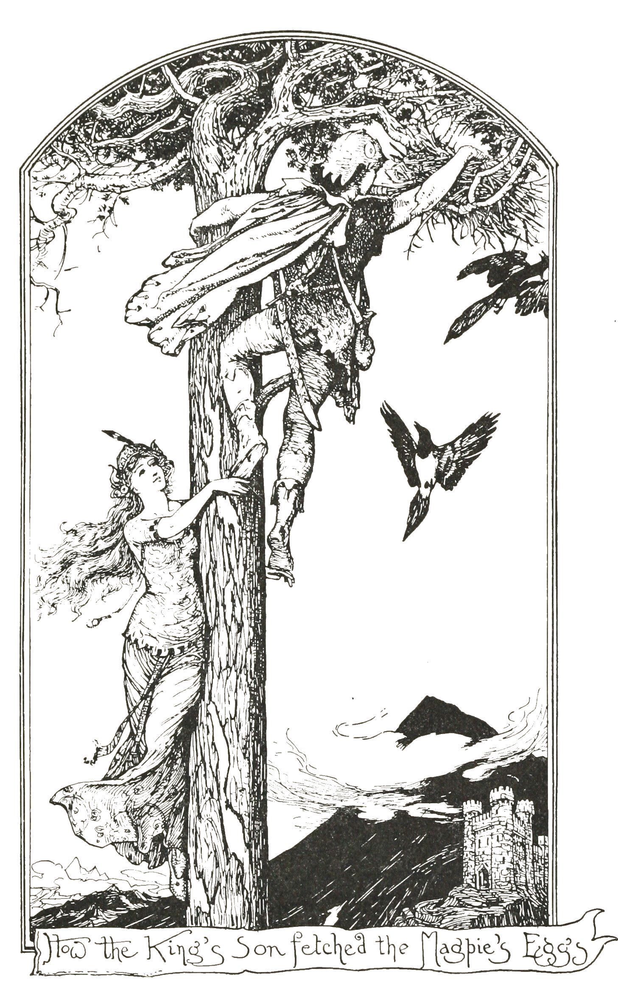

婚礼当天晚上举行，大厅里来了许多巨人和绅士。他们跳起舞来，房子从地基一直摇到屋顶。最后大家都累了，客人走了，只留下王子和新娘。

“要是我们留在这里，直到天明，我父亲就会杀了你。”她小声地对他说，“你是我的丈夫，我要像以前那样救你。”她把一个苹果切成九片，把两片放在床头，两片放在床脚，两片放在厨房的门口，两片放在大门口，一片放在房子外面。做完了这些，她听到巨人在打鼾，就和王子轻轻地走出来，来到马厩，拉出一匹蓝灰色的母马，跳上去就跑。巨人醒了。

“你们睡了吗？”巨人问。

“还没有。”床头的苹果回答。巨人翻了个身，不久就像刚才一样地大声打起鼾来。过了一会，他又醒过来问，

“你们睡着了没有？”

“还没有。”床脚的苹果回答，巨人觉得很满意。不久，他第三次问，

“你们睡着了吗？”

“还没有。”厨房里的苹果回答。几分钟以后，他第四次发问，得到门口苹果的回答。他猜到发生了什么事情，就跑到新娘子的房间里去看，床上又空又冷。

“我背上感到了父亲呼出来的热气。”姑娘喊道，“把你的手伸到马的耳朵里去，不论找到什么，把它往后面扔。”

在马的耳朵里，他拿到了一枝野梅，把它朝后扔出去。后面方圆二十英里地马上长出密集的荆棘丛，连鼬鼠也不敢穿过去。巨人追赶过来，他的头发和胡子被荆棘钩住。

“这是我女儿耍的诡计。”他说，“要是有一把斧头和砍刀，很快就可以开出一条路来。”说完，他就跑回家去取斧头和砍刀。

用不了多久，他就从荆棘丛中开出一条路来。他把斧头和砍刀放在一棵大树底下，“等我回来的时候再来拿。”

树上站着一只乌鸦，听到了他的话，说，“你把它们留在这里，我就要偷走它们。”

“你会的。”巨人说，“我要把它们拿回家去。”他把它们拿回家，又重新开始追赶。

“我背上感到了父亲呼出来的热气。”姑娘说，“把你的手伸到马的耳朵里去，不论找到什么，往后扔。”王子在马的耳朵里找到了一块灰石头，往后一扔。一瞬间，方圆二十英里的地方布满了大岩石，把他们和巨人隔开。

“我还从来没有碰到过，我女儿的诡计真是难对付。”巨人说，“要是我带着杠杆和铁橇，用不了多久就能开出一条路来。”他没有随身带出来，只好回家去取。没花多少时间，他就打开了一条通道。

“我先把这些工具留在这里。”他大声地说。

“你把它们留在这里，我就把它们偷走。”站在岩石上的一只乌鸦叫道。巨人说，“偷就偷吧！我没有时间把它们送回家了。”

“我背上感到了父亲呼出来的热气。”姑娘喊道，“国王的儿子，看看马的耳朵里有什么？否则我们要来不及了。”他看了看，在马的耳朵里找到了一袋水，就把它扔到背后去，后面立刻出现一个大湖泊。巨人奔得这么快，停不下来，冲到湖里去淹死了。

蓝灰色的马像一阵风似地奔驰着。第二天，王子看到了他父亲的宫殿。

“下来进去吧！”新娘子说，“告诉他们，我们结婚了。要注意，不能让任何人或动物吻你。那样的话，你就会把我全部忘记。”

“我会记住你的话的。”王子回答，在门口和她道别就进去了。他受到了所有人的欢迎。他告诉父母不要吻他。但在他和父母说话的时候，他的小灰狗爬上他的肩膀，在脸上吻了他一下，巨人的小女儿就从他脑海的记忆中消失了。

整整一天，她坐在门口的一口井旁等着他。但王子一直没有出来。天黑了，她爬上一棵橡树，橡树的树影倒映在井里。在树上，她又整整等了一夜。

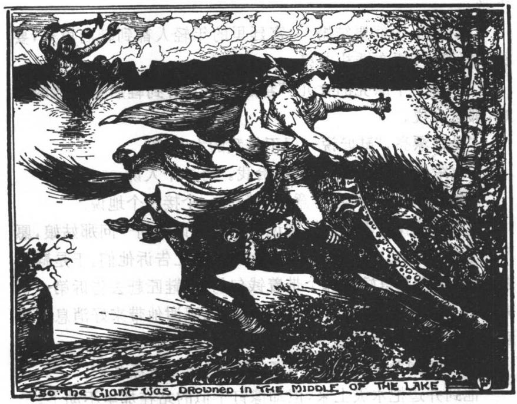

第二天中午，一个制鞋匠的妻子到井边来汲水给她丈夫喝。她看到了树上新娘子的影子，以为是自己的。

“我多么漂亮啊！真的。”她盯着井底看着。为了看得更清楚些，她弯下腰来，不小心把水罐撞在井壁上，打碎了。她只好空着双手回去。他的丈夫非常生气，怒气冲冲地说，“你变得懒了！我的女儿，你去，给我汲些水来。”

他女儿和他妻子一样，也是空着手回来。

鞋匠只好自己去井边汲水，他也看到了新娘子的倒影。不过，他抬起头来找影子的来处，看到了待在树上的世界上最美的姑娘。

“下来，”他说，“你可以住在我家里。”姑娘很高兴地从树上下来。

现在，王子就要结婚了，宫廷里的年轻人都到鞋店里来，要买双好鞋，以便在婚礼上穿。

“你有一个漂亮的女儿。”宫廷里的人看到鞋店里干活的姑娘，都这么说。

“是很漂亮，”鞋匠说，“但不是我的女儿。”

“我给你一百英镑，让她嫁给我。”有一个人说。

“我也愿意！”“我也愿意！”年轻人一个接一个地说。

“这不是我的事情。”鞋匠说。年轻人请他问一问那姑娘，愿不愿意从他们之中挑选一个丈夫，明天早上告诉他们。于是鞋匠去问她，她说愿意嫁给那个带着钱包的人。鞋匠赶去告诉第一个提亲的人。这人来了，给鞋匠一百英镑，感谢他带来好消息。然后，他来找姑娘，她正在等他。

“是你吗？”她问，“我口渴了，请到井边去汲点水来。”

他到井边把水汲上来，但却像钉子似的站在那里不动了。一站就是好几个钟头。

“把这个傻小子给我带走！”姑娘终于对鞋匠喊道，“这个人真叫人讨厌！”这时，那青年能走动了。他一声不吭地回家，没有告诉任何人发生了什么事情。

第二天，来了另一个青年。鞋匠走了以后，只留下他和姑娘。她说，“去看看门闩在不在门上。”年轻人赶紧照她的话去做，但手一碰到门闩就粘住了，在那里一站就是几个钟头，直到鞋匠回来。姑娘叫那青年滚蛋。他垂头丧气地走了，不告诉任何人事情的经过。

接着，第三个人来了。他的脚粘在地板上，直到姑娘把他松掉。他千恩万谢，头也不回地走了。

“把这些装金子的钱袋拿去。”姑娘对鞋匠说，“这些东西对我没用，对你倒有好处。”鞋匠拿了钱袋，告诉姑娘，他要把结婚用的鞋子送到王宫去。

“我很想在王子结婚之前看他一眼。”姑娘说。

“那么，就跟我走吧！”他说，“那些佣人都是我的朋友，他们会让你站在过道旁，王子和整个队伍要从那里经过。”

他们来到城堡。那些年轻人看到姑娘站在那里，就把她领到摆婚宴的大厅里，给她倒了一杯酒。她举起杯子正要喝，忽然从杯中升起一团火焰，火焰中飞出两只鸽子。一只是金色的，一只是银色的。它们绕着姑娘的头飞来飞去。这时，有三粒大麦掉在地板上。银鸽子飞下来，把它们吃掉。

“要是你记得，我如何帮你打扫牛棚，你就应该分一点给我。”金鸽子说。这时，又有三粒粮食掉下来，银鸽子又把它们吃掉。

“要是你记得，我如何帮你盖牛棚顶，你就应该分一点给我。”金鸽子又说。又有三粒粮食掉下来，银鸽子第三次又全部把它们吃掉。

“要是你记得，我如何帮你取得喜鹊蛋，你就应该分一点给我。”金鸽子说。

王子这时候明白了，这些鸽子是来帮他恢复记忆的。忘了的事情又重新在脑海中浮现。他认出了自己的妻子，吻了她。既然婚宴已经准备好，浪费掉很可惜，所以他们宣布第二次举行婚礼，坐下来享受这美味的婚宴。

（西苏格兰高地传说）

 
 

## 喷泉夫人

在阿斯克的卡利恩城堡大厅里，亚瑟王坐在垫着绿色垫子，铺着火焰一样红的丝绸椅子，手下垫着红色的缎子软垫。周围是他的骑士欧文、肯恩和凯。再远一点，靠近窗口，是王后圭尼维尔和她的女仆，正在白色的长袍上刺绣各种奇妙的金色图案。

“我累了，”亚瑟说，“在吃饭以前，我要睡一会。你们可以讲故事，凯会从厨房里给你们拿来一瓶蜂蜜酒和一些肉。”

他们边吃边喝，年纪最大的肯恩开始讲他的故事。

“我是父母的独子，他们给我留下许多财产。但是我并不满足于留在家里，和父母在一起。我想，世界上的一切都不是不可战胜的，没有任何力量可以阻挡我。在自己的国家里，我已经成功地经历了许多冒险。我告别父母，动身去周游世界。我越过高山，跨过沙漠，涉过河流，直到来到一个绿树成荫的美丽山谷。一条路沿着河流向前延伸着。沿着这条路，我走了整整一天，来到一座城堡门前。门口站着两个年轻人。他们穿着黄色的衣服，手中拿着象牙做的弓和鲸鱼骨做的箭，身上插着孔雀的羽毛，腰间挂着金色的短剑，剑柄是用鲸鱼的骨头做成的。”

“两个青年人旁边，站着一个服装华丽的男人。他走过来，带我一起向城堡走去。城堡里的居民都聚集在大厅里。在一个窗口旁，站着二十六位美貌的少女，她们之中最不美的也比圭尼维尔最漂亮的时候好看。她们走过来，有的牵着我的马；有的解开我的盔甲，拿去刷洗；有的取下我的宝剑和长矛，把它们擦得闪闪发光。我洗了个澡，穿上她们给我的紧身上衣和马甲，就和那个陪我进来的人坐在一张银桌前，上面摆着我从没吃过的佳宴。”

“到这个时候为止，那个男人和少女们一句话也没有说过。宴会进行到一半，我还没有吃饱的时候，那个男人开始问我是谁。我告诉他我的名字，父亲的名字，我为什么要到这里来。说实在的，我对在自己的家乡征服和统治所有的人感到厌倦了，希望能够找到一个能征服和控制我的人。”

“那人听到这里，笑着回答：‘要是我不担心会给你带来过多的烦恼，我将告诉你所要寻找的人。’他的话使我感到自卑和担忧。他看出了我的心思，继续说，‘假如你说的话是真的，真切地希望能证实你的勇气，而不是吹嘘自己天下无对手，我有些东西要让你看。今天，你就睡在城堡里。明天一早你就起来，沿着你过来的那一条路一直走下去，穿过山谷，走进森林。森林里有一条向右的岔路，你沿着这条岔路走，就会看到一片宽阔的草地，草地当中有一个小山丘。山丘的顶上站着一个黑人，个子比任何两个白人加起来还要高大。他的一只眼睛长在前额的正中央。他只有一只脚，手中拿起一根铁棍。这根铁棍两个白人也很难把它举起来。他是森林的监护人。他的四周围着上千头各种各样的野兽。就是这个人，能告诉你到什么地方去找你所希望的冒险。’”

“这天晚上，对我来说显得特别长。黎明之前我就起床，穿好盔甲，骑上马出发，来到了他告诉我的那片宽广的草地。正如他所说的那样，黑人站在山丘顶上。实际上，不论从哪个方面来说，他都比我想象中的强大得多。他那根铁棍，我们要四、五个士兵才抬得动。他等待着我说话。我问他，你有什么力量，可以让这些野兽集聚在自己的周围。”

“‘我会让你看到的，小矮人。’他说着，用手中的棍敲了一下站在身边的雄鹿的头。雄鹿大声地叫起来。听到它的叫声，成千上万头野兽都奔跑过来，简直像天上的星星那么多。我能站立在它们之间，也感到非常吃惊。这些野兽中有蛇，有龙，还有各种奇形怪状的动物，有些不该长角的地方也长出角来。黑人只是看了它们一下，就叫它们回去吃草。它们向他鞠躬，就像臣仆向君主致敬一样。”

“‘小矮人，我已经回答了你的问题，显示了我的力量。’他说，‘你还要问什么事情吗？’接着，我向他问路。他非常生气，好像想要阻止我。后来我告诉他我的身份，他的怒气才消失了。”

“‘沿着这条路走过去，’他说，‘它将领你走到这块草地的尽头。你会看到山坡上有一片森林，沿着山坡爬上去，一直爬到山顶。山顶上有一块空地，空地当中有一棵高大的树，树的下面有一口喷泉，喷泉的旁边有一块大理石石板，石板上有一个银碗，上面有一根银链。把碗放到水里去舀水，把水泼在石板上，你就会听到雷鸣般的响声。天和地在雷声的震撼下，好像在发抖。雷声以后，冰雹就袭来，这些冰雹又大又重，你要是忍受不了就会丧生。冰雹过去以后，太阳就会出来，但是每一片树叶都被吹落在地上。接着，一群鸟会飞来，落在树上。你会听到它们唱出一支从未听到过的美妙的歌。歌唱到最动听的时候，你就会听到从山谷里传来低沉的抱怨声，看到一个骑着黑马，穿着黑天鹅绒的骑士。他手中握着一根长矛，矛上插着枪旗。看到你，他就会持枪策马来和你决斗。你要是转身逃跑，他就会抓住你。要是你站在那里不动，他就要把你打下马来。如果能经得起这次冒险的考验，在你的一生中，就不必再去寻找新的冒险了。’”

“就这样，我告别了黑人，向森林的深处走去。一切都像我听说过的那样。我来到大树旁，大树的下面就是那喷泉。我把银碗拿起来，舀了满满的一碗水，把它倒在大理石石板上，顿时雷声大作，比我想象中的还要响得多。雷声刚停，冰雹就铺天盖地地降下来。这些冰雹比我想象到的要大得多。告诉你吧！人的皮肉根本抵挡不了它，它要一直敲打到你的骨头上。我把马侧过身来，伏在马颈上，用我的盾牌来保护我和马的头。冰雹过后，树上一片叶子也没有了。天空万里无云，一片碧蓝，阳光照射下来。树枝上站满了各种各样的鸟，唱着我从来没有听到过，以后也不会听到的最迷人的歌。”

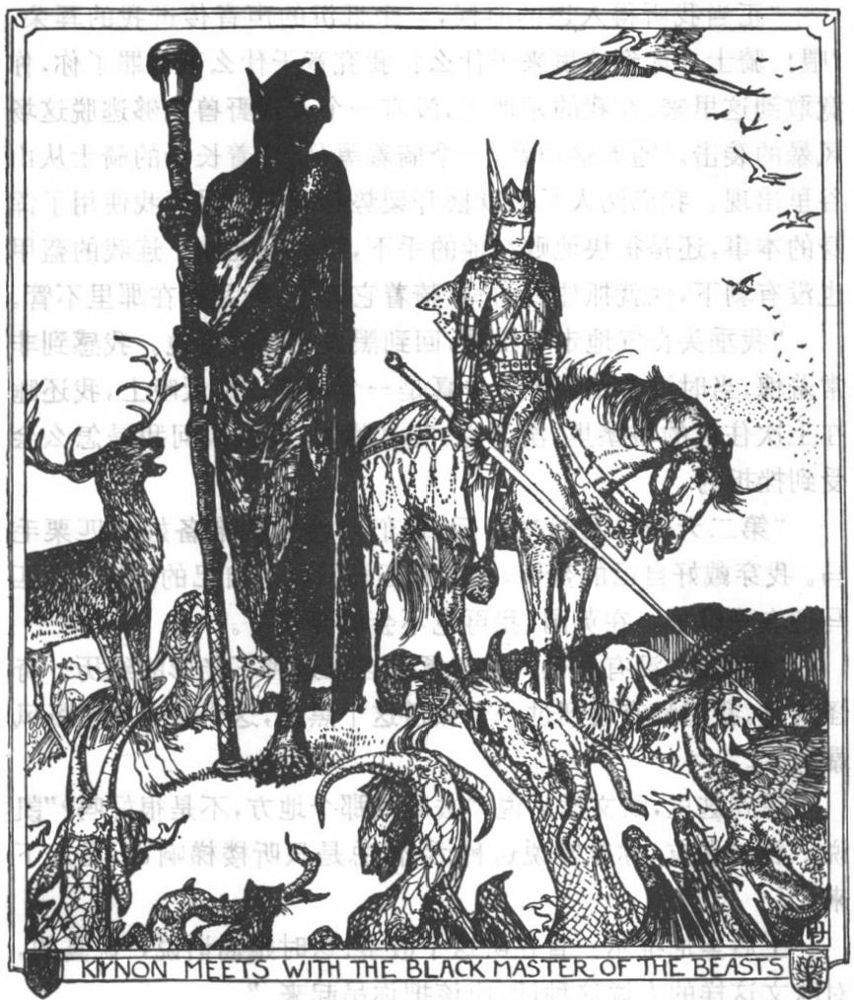

“正当我听得入迷的时候，一个低沉的声音传进我的耳朵，‘喂！骑士！你到这里来干什么？我究竟干什么事得罪了你，你竟敢到这里来。在我的领地里，没有一个人或野兽能够逃脱这场风暴的袭击。’随着这声音，一个骑着黑马，拿着长矛的骑士从山谷里出现。我们两人马上就摆开架势斗起来。尽管我使用了浑身的本事，还是很快地败在他的手下，我摔倒在地。连我的盔甲也没有剥下，他就抓住我的马，骑着它走了。把我扔在那里不管。”

“我垂头丧气地走下山坡，回到黑人站立的草地。我感到非常羞愧，当时没有钻到地下去真是一个奇迹。那天晚上，我还睡在上次住过的城堡里，洗了澡，吃过晚饭，没有人问我是怎么会受到挫折的。”

“第二天一早我起来以后，他们已经为我准备好一匹栗毛马。我穿戴好自己的盔甲，骑着那匹马回到了自己的国家。那匹马还在马厩里。在英国，我再也不会抛弃它了。”

“事实上，没有一个人敢于承认自己这种不光彩的经历。奇怪的是，我还没有遇到过一个知道这个黑人，这个骑士和这场风暴的人。”

说到这里，欧文插话说，“去寻找那个地方，不是很好吗？”凯说，“我的朋友，你常常说这种话，但总是只听楼梯响，不见人下来。”

王后圭尼维尔一直在听这个故事。这时她插话说，“说真的，对欧文这样的人说这种话，应该把你吊起来。”

“我的话没有什么恶意，夫人，”凯回答，“你赞扬欧文，比我高明不了多少。”

这时，亚瑟王醒过来，问欧文是否睡了一会。

“是的，陛下，”欧文回答，“你睡过一会了。”

“是不是到了吃饭的时间？”

“是的，陛下。”欧文说。

这时候，洗澡的号角响了。他们洗过澡以后，就坐在一起吃饭。吃过饭以后，欧文走出去，准备他的马和武器。

第二天，太阳射出第一道金光时，欧文就出发了。他穿过沙漠，越过山岭，跨过河流。一切都像肯恩经历过的一样，直到最后站在光秃秃的树下，听着鸟儿唱歌。后来他听到了那低沉的声音，转过身来，看到骑士在向他奔跑过来。他们的战斗非常激烈，两个人的长矛枪断了，接着拔出剑来。欧文一剑砍穿了骑士的头盔，砍伤了他的头颅。

骑士感到自己受了致命伤，骑着马逃走了。欧文跟着追赶，他们来到了一座漂亮的城堡。骑士冲过城门口壕沟上的桥，进了城门。这时候欧文的马已经冲到桥中央，吊桥忽然被拉起来，城门也被关闭。欧文和马被夹在当中，不知如何是好。

正当他处境危急的时候，城堡大门上一扇小门打开了。从小门往里看，可以看到一条街道，还有高大的房子。一个长着金色卷发的姑娘从小门伸出头来，叫欧文把大门打开。

欧文喊道：“我发誓，我没有办法打开它。你能不能把我救出去？”

“好吧！”姑娘说，“要是你照我的话去做，我会尽力救你出去。拿住这个戒指，把它和一块石块紧紧地握在手里。只要你能把它遮住，它就会把你遮住。里面的人商量过了以后，他们就要出来抓你，把你处死。找不到你，他们就会非常悲伤。我站在那块上马石上，虽然我看不见你，你却可以看到我。你向我靠拢，把手放在我肩膀上。我走到哪里，你就跟到哪里。”

说完这些话，她就走了。城堡里的人出来找欧文，可是什么也看不见，非常悲哀地返回城堡。

他们走了以后，欧文靠近那姑娘，把手放在她的肩膀上。她把他领到一个大房间里来，里面漆着漂亮的颜色，装饰着许多金色的雕像，给他送来了饭和饮料，还有洗澡水和穿的衣服。洗完澡，他躺在柔软的床上，盖着深红色的毛皮被，舒服地睡着了。

半夜里，他被响亮的声音惊醒，跳起来穿上衣服，来到大厅。那姑娘正站在那里。

“怎么回事？”他问，她回答说，统治这个城堡的骑士死了。他们正把他的尸体送到教堂去。欧文还从来没有看到过这里有这么多人。跟随在死了的骑士后面，是一个世界上最美丽的妇女。她的哭声比任何人都响，甚至比喇叭吹出来的声音还要响。欧文看着她，爱上了她。

“她是谁？”他问那姑娘。

“她是我的主人，女伯爵，喷泉夫人，也是你昨天杀死的那个人的妻子。”

“真的！”欧文说，“她是我最爱的女人。”

“她将同样地爱你！”她说。

那姑娘离开欧文，来到了女主人的寝室，告诉她这些事情，但是女伯爵不吭声。

“女主人，你在为什么而烦恼？”姑娘问。

“在我悲痛的时刻，你为什么离开我，伦蒂？”女伯爵问。

“为了一个死了的人，为了一件远离你而去的事情，你值得这么悲痛吗？”伦蒂反问她。

“在这个世界上，没有一个男人能够和他相比。”女伯爵说，她的脸颊因为生气而通红，“为了你这些话，我将不得不把你赶出去。”

“请不要生气，夫人，”伦蒂说，“请听听我的劝告。你非常清楚，你一个人是保护不了你的国土的，必须找个人来帮助你。”

“怎么找呢？”女伯爵问。

“我会告诉你的，”伦蒂说，“不找个人来，你将保不住喷泉，将会失去一切。除了亚瑟王的骑士以外，谁也不能负起这个责任。我将去寻找他。我发誓，假如我不能带回来一个能像国王那样保护喷泉的人，我就要遭灾。”

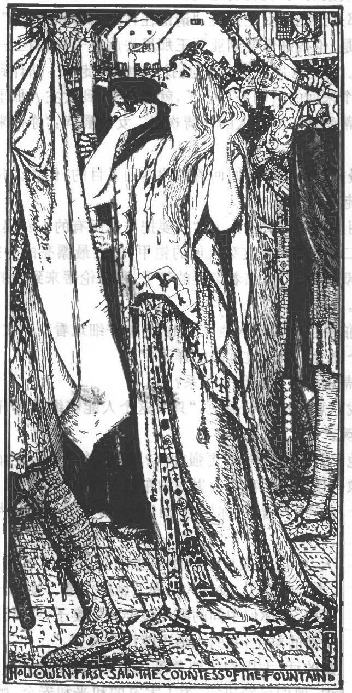

“那么走吧！”女主人说，“请记住你的诺言和保证。”

于是，伦蒂好像要到亚瑟王那里去旅行一样，骑上一匹白马出发了。其实她并没有走，而是找个地方藏起来。估计到亚瑟王那里一个来回的时间差不多了，就走出来，到女主人那里去。

伦蒂受到了女主人的热情欢迎。女伯爵问：“你带来了什么消息？”

“最好的消息。”姑娘回答，“我达到了目的。你什么时候接见和我一起来的骑士？”

“明天中午，”女主人说，“我要把城里所有的人召集起来。”

第二天中午，欧文穿上他的铠甲，披上最漂亮的斗篷，脚上套上一双皮靴，上面结着金色的带子，跟着伦蒂来到她的女主人的房间。

女伯爵也非常高兴地见到他们。她仔细地看着欧文，说，“伦蒂，这个骑士不像走过远路的样子！”

伦蒂说，“这又有什么关系？”

“我同意了！”女伯爵说，“只有这个人能够继承离开君主肉体的灵魂。”

“他不是比你的君主更强壮吗？”伦蒂说，“人的生命一旦消亡，就像一切过去的事情和失去的东西一样，无可挽回。”

“让我一个人留下，你们走吧！”女伯爵说，“我要和大臣们商量一下。”

第二天，女伯爵在城堡的院子里召见了她的大臣，告诉他们，她的丈夫已经死了，没有人来保卫她的土地。她说，“请你们来选择吧！要么，你们中间的哪一位娶我做妻子；或者让我自己去挑选一个新的君主，我的土地不能没有君主。”

听了她的话，大臣们退到角落里去，一起商量了一会儿，然后走出来说，他们已经决定，为了大家的和平和安全，她应该自己选择一个丈夫。这样，欧文被召到女伯爵的面前，高兴地握住了她伸过来的手。他们当天就举行婚礼，其他人也举行了对他效忠的仪式。

从那天起，欧文就像以前那个君主一样地保护喷泉。每个路过的骑士都败在他的手下，做他的俘虏。俘虏的赎金分给那些贵族。这样，三年过去了，世界上恐怕没有人比欧文更受爱戴了。

这时候，发生了一件事情。这一天，瓜却美王正好和亚瑟王在一起，他发现亚瑟王神色非常不对头。

“我的君主，你一定是发生了什么事情。”他问。

“啊！瓜却美，我为欧文感到悲伤。我失去他已经整整三年。假如第四年过去了还看不到他，我就活不下去了。我肯定，是肯恩讲述的故事使我失去了他。我要亲自带着王室的人马出去。他要是死了，就为他报仇；他要是被监禁，就把他救出来；他要是活着，就把他带回来。”

于是，亚瑟带着王室的三千人马出去寻找欧文，叫肯恩当向导。亚瑟到达那个城堡时，两个青年正在原来的地方射箭，旁边还是站着那个穿黄衣服的人。他看到亚瑟，就向他致敬，邀请他进去。他们一起进入大门，城堡是那么大，亚瑟王的三千人马看起来好像只有二十个人似的。

太阳出来的时候，亚瑟又出发了，还是肯恩当向导。他们先看到黑人，接着来到小山顶上。喷泉和碗，还有树，都在那里。

“我的君主，”凯说，“让我把水撒在石板上，经历可能降临的第一次冒险。”

“你可以这样做。”亚瑟说，凯把水泼了。

立刻，一切就像以前一样发生了。雷暴和冰雹杀伤了亚瑟的许多人马。在鸟的歌声中，黑骑士出现了。凯第一个上去迎战。黑骑士把他打败以后就走了。亚瑟和他的人马就地宿营。

第二天早晨，凯请求去和黑骑士决战，要打败他。亚瑟同意了。但是，他再次被打败落马。黑骑士的长矛刺破了他的盔甲，刺伤了他的皮肉，直至骨头。他低声下气地回到营地。

这以后，骑士们一个一个地和黑骑士决战，但没有一个能赢。最后只剩下亚瑟自己和瓜却美了。

“让我和他决战吧！我的君主。”瓜却美说。他看见亚瑟王举起自己的双手说，“好！决战吧！”

瓜却美给自己和马披上长袍，所以谁也认不出他来。他们整整打了一天，谁也赢不了谁。第二天又打了一整天，还是决不出胜负。第三天打得更加凶猛，两人都掉下马来，继续再战。最后，黑骑士一枪刺中他头部，把头盔击落在地，脸也露了出来。

“我不知道是你，瓜却美。”黑骑士说，“请把我的剑和武器拿去吧！”

“不！欧文！”瓜却美说，“你才是胜者，把我的剑拿去吧！”但是欧文不肯。

“把你们的剑都给我。”亚瑟从后面说，“因为你们谁也没有战胜谁。”欧文转过身来，把剑挂在亚瑟的头颈上。

第二天，亚瑟准备下令回去，欧文阻止了他。

“我的君主，”他说，“这三年我离开了你，但我清楚地知道，你会来找我的。我已经为你准备了宴会。请你和你的人马留下来，和我一起住几天。”

他们骑着马，来到了喷泉夫人的城堡，在那里休整和吃喝了整整三个月。临走的时候，亚瑟请求夫人允许欧文和他一起回英国去，逗留三个月。她心情沉重地同意了。

欧文再次和旧伙伴相处，非常高兴。三年而不是三个月像梦幻一样地过去了。

有一天，欧文正坐在城堡里吃饭，一个骑着栗色马的少女进入大厅。她骑着马一直走到欧文的面前，把他手上的戒指拉下来，说，“对不守信用的叛逆者，应该这样。”说完就转过马头走出大厅。

听了她的话，欧文回想起所有忘记了的事情，感到非常羞愧和悲痛。他回到住处，准备起程。

黎明时分，他动身了。他心情十分沉重，没有回到喷泉夫人的城堡去，而是在荒原中徘徊。后来身体越来越瘦，越来越虚弱，头发也长得很长。野兽成了他的朋友，他就睡在它们的身旁。后来，他渴望再看到人的面孔，就走进一个山谷，在一个湖边睡着了。这里是一个守寡的女伯爵的领地。

这时候，女伯爵出来散步，女仆跟随其后。她们看到湖边躺着一个人，丝毫不动，以为他死了，吓得惊叫起来，连连后退。后来一个女仆壮着胆子走近他，碰碰他，觉得他还活着。女伯爵赶快返回城堡，拿去一瓶珍贵的油膏，把它交给一个女仆。

“把那边吃草的马牵过来。”她说，“再拿来一件男人的长袍。把它们放在这个人的身边。在他的心脏附近倒上一些油膏。要是他还有一点希望，就会活过来。如果他动了，你们就躺到附近的树丛里去，看他干什么。”

女仆拿过瓶子，照女主人的吩咐去做。很快，欧文的手动了，慢慢地站起来，一步一步地走到马的身边，把马鞍上的长袍取下，披在自己的身上，然后艰难地爬上马。他坐稳以后，那位当女仆的少女走出来，问候他。他很高兴地看到有人来，问她前面是谁的城堡。

“它属于一个守寡的女伯爵。”少女说，“她丈夫留给她两块领地，但都被一个男伯爵夺走了，只留下这城堡。因为她不愿意嫁给他。”

“这太令人遗憾了。”欧文说。不过，他接着不再说什么，因为太虚弱，说话很吃力。少女把他领到城堡，生起火来，给他吃的。他在城里住了三个月，受到很好的照顾，因此比以前更加强壮和英俊。

一天中午，欧文听到城堡外面有军队走动的声音，问那位少女是怎么回事。少女说，“这就是我跟你说过的那个伯爵，他领了一支大部队，要把我们的女主人抢走。”

“请你的女主人借给我一匹马和一副盔甲。”欧文说。少女听他的话去了。女主人听了以后不禁苦笑起来，说，“那有什么用！不过我还是借给他。给他从来没有见过的，最好的马，最好的盔甲和最好的武器。虽然我还不知道，这些东西对他来说，有多大用处，但至少可以不让它们白白地落入我的敌人手中。”

马拉出来了，欧文跃身上马，两个小侍从跟随其后。他们看到，一支强大的军队就驻扎在前面。

“谁是那个伯爵？”欧文问那两个小侍从。他们回答，“他在插着四面黄旗的队伍里。”

“在城堡的门口等着我。”欧文对他们说。他跑上前去大声向伯爵挑战，伯爵应声出来会他。两个人打得很激烈，欧文打败了敌人，把他捉进城堡的大厅里。

“请看！这是对你那赐福于我的香膏的报答。”欧文对女伯爵说。他叫伯爵跪在她面前，发誓把从她这里抢走的一切还给她。

这以后，他又出发了。他走进荒野，从一片树丛中经过，听到一声响亮的叫声。他推开树丛，看到一头狮子站在山岗旁。狮子想到山岗上去，但每次都被岩石上的一条蛇伸出头来把它挡住。欧文抽出剑来，一下就把蛇的头砍下，接着继续赶路。那头狮子跟着他，逗他玩，好像一条狗跟着主人似的。实际上，它比一条狗还要有用。每到晚上，它总是用嘴搬来许多大木头，把火烧旺，还会猎取一头鹿来当晚餐。欧文剥下鹿皮，把一些肉在火上烤，其余的给狮子当晚饭。

有一天，他准备烤鹿肉吃的时候，听到一声深深的叹息。

“你是谁？”他喊道。

“我是伦蒂。”一个声音从树丛和绿叶掩盖着的洞里传出来。

欧文这时才注意，那里还有个洞。

“你在这里干什么？”他问。

“因为那个娶了喷泉夫人后又离开她的骑士，我被监禁在这里。小侍从说了他的坏话，我告诉他们说，世界上没有一个人能比得上他。他们就把我关在这里，说除非那个骑士在后天之前来救我，否则就要处死我。这个骑士名叫欧文，是尤里恩的儿子。可是没有人替我送讯给他，说我遇到了危险。他得到这个消息，肯定会来救我。”

欧文不愿意告诉她，自己是谁。但给她一些肉，叫她别悲伤，开心些。然后，在狮子的跟随下，来到了草原另一头的一座大城堡。人们走进来，把他的马拉进马槽。那头狮子也跟着他们走，睡在稻草堆里。城堡里的人非常慈悲，款待他也非常周到，但是到处充满了悲伤的气氛，好像死亡就要降临似的。吃过宴席以后，欧文问城堡的伯爵，为什么他们这么悲伤。

伯爵说，“昨天，我两个儿子在打猎的时候，被一个怪物抓走。那怪物住在山上，发誓说，除非我把女儿给他做妻子，否则不会放他们。”

“这绝对不可能。”欧文说，“那怪物长什么模样？”

“他样子像人，但个子像巨人。”伯爵说，“我宁愿他杀了两个儿子，也不愿意把女儿给他。”

第二天一早，城堡里的人就被响亮的吵闹声惊醒。他们发现，是巨人带着伯爵的两个儿子来了。欧文披上盔甲去会那个巨人，狮子跟在他后面。狮子看到巨人给主人沉重的一击，就对准巨人的喉咙扑过去，巨人花了很大的力气才摆脱它。

“说真的，”巨人说，“要不是有狮子帮忙，对付你一点也没有问题。”听到这句话，欧文为不能用自己的剑战胜巨人而感到羞愧。他把狮子关进城堡的一个塔楼里，再回来和巨人决战。但是，从战斗中传来的声音判断，狮子觉得形势对欧文很不利。它爬到塔楼顶上，那里有一扇窗通屋顶。它从窗口跳出，来到城墙上。又从墙上跳下来，大吼一声向巨人扑过去。在狮子的巨爪猛击下，巨人倒地死了。

现在，笼罩着城堡的阴郁一扫而光，到处充满了欢乐。伯爵请求欧文留下来，要为他摆一个大宴席。他说还有别的事情要做，骑着马走了。

他来到关着伦蒂的山洞，狮子跟随其后，看到那里生起了一堆大火。两个年轻人正押着那少女，准备把她扔到火堆上去。

“站住！”他大喊一声，冲到他们面前，“你们控告她什么罪？”

“她吹嘘说，这个世界上没有一个男人比得上欧文。”年轻人说，“我们把她关在洞里，告诉她，除了欧文本人以外，谁也不能救她。如果规定的期限到了，他还不来，就处死她。现在时间已经到了，还不见他的踪影。”

“说真的，他是个好骑士。如果他知道这个少女有生命危险，他肯定会来救她。”欧文说，“不过，我请你们，让我来代替他。”

“我们同意。”他们说，双方开始斗起来。

两个青年人武艺非常好，把欧文逼得很紧。狮子看到情况紧急，就过来帮主人的忙。青年人打了个手势，要求停战，说，“首领，我们约好的，只和你一个人决战。要对付这头狮子，比对付你还难。”

于是，欧文把狮子关在监禁伦蒂的山洞里，外面堆上石头封住。可是，由于和巨人作战消耗了他很大体力，加上两个青年人打得非常出色，形势非常严峻。狮子看到这个局面，大吼一声，冲倒石堆，向两个青年人扑过去，杀了他们。伦蒂也被解救出来。

少女骑在欧文的马上，回到喷泉夫人的领地。欧文把妻子带回亚瑟王的王宫，在那里幸福地生活着，直到离开人世。

（摘自《马比诺吉昂》）

 
 

## 四件礼物

布列塔尼这块古老的土地从前叫康沃尔，曾经住过一个名叫巴巴克·布尔斯的妇女。她在侄女特弗妮的帮助下，整天在农地里干活。从东方露出曙光到晚霞从天边消失，都可以看到她们不是在庄稼地里，就是在牛奶房里挤牛奶，做乳酪，喂家禽。她们不但自己卖力工作，还留神别人是不是偷懒。假如巴巴克给自己留一点时间休息一下，考虑别的事情，可能会好一些。她现在变得自私自利，非常爱钱。她只给自己和特弗妮买绝对需要的食品和衣服。她非常恨穷人，说他们懒惰，活在这个世界上没有什么用。

巴巴克就是这么一种人。所以你会猜到，有一天，她看到特弗妮在牛棚外和丹尼斯说话时，她多么生气。丹尼斯是从普洛维村到这里来打工的。她抓住侄女的手，气愤地把她拉走，说，“你不感到羞耻吗？姑娘，消费自己的时间去和一个老鼠一样穷的人说话。要是你愿意，那里有一打青年人非常乐意给你买银戒指。”

特弗妮气得满脸通红，她说，“丹尼斯是一个好工人，你知道得很清楚，他正在存钱。不久，他就能自己买一个农场。”

“胡说，”巴巴克生气地说，“他活到一百岁，也挣不到能买一个农场的钱。这个人一生的命运都背在背上。我看你还没有成为他的妻子，就会先进坟墓。”

“一个人只要年轻力壮，命运算得了什么？”特弗妮说。她的婶婶听了这话非常惊愕，打断她，愤慨地说，“命运算得了什么？

你真的会这么笨，对钱也不在乎了？假如这是你从丹尼斯那里学来的，我禁止你再和他说话。要是他敢在这里再露面，我就把他赶出农场。马上去洗衣服，把它们晒出去。”

特弗妮不敢违背她，心情沉重地向河边走去。她自言自语地说，“她比石头还顽固。是的，顽固千百倍。这些石头起码还会被水冲掉。你就是哭个不停，她也不会来管你。和丹尼斯说话是唯一能使我快活的事情。要是不能再见到他，我宁愿到修道院去。”

她想着，想着，来到了河边，把一大堆要洗的亚麻布衣服倒出来，准备洗。一阵拐杖的“嘚！嘚！”声引起她的注意。她抬起头来，看到前面站着一个陌生的矮小的老妇人。

“奶奶，你坐下来休息一会吧！”特弗妮把衣服推到一边，对她说。

“天就是你的屋顶，你爱在那里坐就在那里坐。”老妇人用颤抖着的声音说。

“你这么孤独吗？”特弗妮充满同情地问，“你有没有朋友请你到他们家里去？”

老妇人摇摇头，回答说，“他们很久很久以前就死了。我仅有的朋友就是那些有着一颗善良的心的陌生人。”

姑娘沉默了一会，然后拿出她准备当午饭的一小片面包和咸肉，说，“拿着吧！不论如何，你今天能吃一顿好饭。”老妇人接过来，看着特弗妮。

“帮助别人的人，应该得到帮助。”她说，“你的眼睛还是红红的，因为吝啬鬼巴巴克禁止你和普洛维村的青年人说话。你是个好姑娘，快活起来吧！我给你一件东西，它能让你每天和他见一次面。”

“你？”特弗妮叫起来。这个乞丐一样的老妇人知道她的秘密，令她吃惊得不知所措。但是老妇人没有注意她。

“拿着这枚长铜针。”她继续说，“每次，你把它别在衣服上的时候，布尔斯大妈就会离开房子，去数她的大白菜。只要铜针别在你的衣服上，你就是自由的。除非你把铜针放进盒子，否则她永远不会回来。”说着，她站起来，朝特弗妮点点头就消失了。

姑娘像块石头似的呆呆地站在那里。要不是手中还拿着那枚铜针，她一定以为自己在做梦。拿着这枚针，她才知道，给她针的人不是普通的老妇人，而是仙女，能够预言将来会发生的事情。特弗妮的眼睛又落在那堆衣服上，为了追回失去的时间，她以旺盛的精力开始洗衣服。

第二天晚上，到了丹尼斯天天在牛棚后面和她相会的时间，特弗妮把针别在衣服上。巴巴克立刻穿上木鞋，穿过果园，向种着大白菜的田地走去。特弗妮的心情和脚步一样地轻松，走出房子，和丹尼斯幸福地度过了一个傍晚。这样，一连过了许多日子。后来，特弗妮发现有些不对劲，这使她非常伤心。

开始的时候，丹尼斯也和她一样，觉得他们相处的时候过得非常快。但是，在教会了她唱全部他会唱的歌，讲完了他致富和成名的全部计划以后，他觉得没有什么话要对她说了。因为他和许多人一样，只喜欢说自己，不爱听别人的。有时候，他干脆就不来。第二天，他就会对她说，昨天晚上必须到城里去办些事情。虽然她从不责备他，但是，她也没有被他骗了。她清楚地看到，他不再像以前那样关心她了。

日子一天一天地过去，她的心情越来越沉重，脸色越来越苍白。有一天晚上，在等不到他以后，她把水罐放在肩膀上，慢慢地向泉水走去。在路上，她碰到了给她铜针的仙女。仙女看着她，顽皮地笑着说，“嗨！尽管能够在想见的时候见到心上人，我漂亮的姑娘看上去也不像以前那么快活了。”

“他已经讨厌我了。”姑娘用发抖的声音说，“他总是找各种借口避开我。啊！亲爱的奶奶，我希望不但能够见到他，还希望能让他快活，愿意和我相处。你知道，他很聪明，让我也变聪明吧！”

“你想要的是这个？”老妇人说，“好吧！把这根羽毛和枝条插在头上，你就会像所罗门那样地聪明。”

特弗妮又兴奋又羞愧地回到家里，把那根羽毛钉在蓝色绸带上。那个地方的姑娘头上总是带着绸带。不一会，她就听到丹尼斯高兴地吹口哨的声音。她让婶婶去数大白菜以后，就赶忙去和他相见。这一回，年轻人被她的谈吐惊呆了。她几乎无所不知。她不仅能唱布列塔尼各个地区的所有歌曲，还会自己创作。这是那个急切地想学会教给她一切的那个姑娘吗？还是换了一个人？也许一个邪恶的灵魂占据了她，她忽然变得疯狂了。但不管怎样，他还是天天晚上来见她，发现她一天比一天聪明。

不久，邻居也觉得很奇怪，开始议论起她来。特弗妮总是舍不得把羽毛从头上取下来。那些因为她穿着寒酸而看不起她的人，常常受到她的挖苦和讽刺。当然，这些话也传到了那些人的耳朵里，她们摇摇头说，“她是一只性情不好的小猫。谁要是娶她做妻子，一切都要听她的。”

不久，丹尼斯听到了这些话，也觉得有道理。他是一个喜欢作主张的人。他开始害怕特弗妮那厉害的嘴巴。当她拿别人开玩笑的时候，他不再像以前那样开怀大笑，而是涨红了脸，觉得很不舒服，想想下一次就要轮到他了。

有一天晚上，丹尼斯对她说，他不能再逗留了。他已经答应去参加别的村子里举行的舞会。

特弗妮的脸沉了下来。她干了一天累活，希望能安静地和丹尼斯待一会儿。她尽力地劝他留下来，他怎么也不听。最后，她发脾气了，“我知道你为什么这么急，要去跳舞。因为佩内鲁村的阿兹利泽也在那里。”

阿兹利泽是方圆几十英里最可爱的姑娘，丹尼斯从小就和她认识。

“啊！是的！阿兹利泽也在那里。”他说，很高兴看到她吃醋了。“当然，大家都愿赶远路去看她跳舞。”

“滚吧！”特弗妮喊叫着，走进房间，呼的一声把门关上。

她悲伤地一人坐在火炉旁，看着火焰在燃烧。然后，把羽毛从头发上拉下来，用双手掩着脸激动地哭泣着，“聪明有什么用，男人只喜欢女人长得漂亮，这才是我应该要的东西。但现在已经晚了，丹尼斯再也不会回来了。”

“既然你这么想，你会变得漂亮的。”一个声音在她旁边说道，她朝四周看了看，看到老妇人正倚着拐杖站在那里。

“把这根项链套在你头颈上，只要你戴着它，你就是世界上最美丽的女人。”仙女继续说着。

特弗妮高兴得叫出声来，她接过项链戴上，扣好项链的钩子，就跑到挂在角落里的镜子面前。啊！这一回，她再也不怕阿兹利泽或别的什么女孩子了，肯定不会有哪个姑娘比她更白晰，更美丽。她看着自己的脸，忽然有了主意。她急急忙忙地穿上最好的衣服，套上有扣子的鞋子，就向舞会奔去。

路上，她看见一辆漂亮的马车，上面坐着一个年轻人。特弗妮向他走过来的时候，年轻人嚷了起来，“多么可爱的姑娘！我的国家里没有一个比得上她。除她以外，没有任何人能够做我的妻子。”

路很窄，马车很大，特弗妮很不情愿地停下来让他，她瞪了那年轻人一眼，回答说，“走你的路吧，尊敬的阁下，让我过去赶我的路。我只是一个穷苦的农家姑娘，习惯于挤牛奶，堆稻草和纺纱。”

“你可能是个农民，但我将把你变成一个贵妇人。”青年人说着，抓住她的手，想把她拉上马车。

“我不想成为贵妇人，我只想做丹尼斯的妻子。”她回答，摔掉他的手跑到把路和田地分开的沟里去，想躲开他。不幸的是，那青年猜到了她想干什么，向他的随从打了个手势。他们把她抓起来，拉上马车。门关上了，马车越跑越快，在路上奔驰起来。

一个钟头以后，他们来到了一座华丽的城堡。特弗妮没有行动自由，她被带到一个大厅里，那里请来了一位牧师，准备为他们举行婚礼。青年人为了博得她一笑，告诉她做他的妻子以后所有美妙的事情。但是特弗妮不理睬他，只是观察四周，寻找逃跑的机会。这看起来并不容易，三扇大门都用门闩关得紧紧的。她进来的那扇门也被弹簧关紧。不过她头发上还插着那根羽毛，这使她很机灵。她发现木制的天花板上有一道缝，隐约可见一丝光线透进来。她碰了一下别在衣服上的铜针，令大厅里所有的人都去数大白菜，她从小门走出去，也不知道走到了什么地方。

这时候，夜幕已经降临，特弗妮非常累了。她很高兴地发现自己来到一个修道院的门口，请求让她留在这里，直到天明。但是，那个女看门人粗暴地拒绝了她，说这里从来不收容乞丐，叫她走开。可怜的姑娘拖着疲倦的身体慢慢地沿着路走着，直到灯光和狗的叫声告诉她，快到一家农场了。

房子的前面围着几个人，两三个妇女和农民的几个儿子。特弗妮请求在这里过夜，母亲心里充满同情，准备请她进去。几个青年人却被姑娘的美貌吸引住了，开始争吵为她做些什么最合适。最初只是吵吵，后来竟打起来，母亲吓坏了，就把气出在特弗妮身上，用各种各样难听的话大骂她。她吓得赶快逃跑，想逃进森林里去躲避他们，但很快就听到他们追赶过来的脚步声。她吓得双脚直发抖。这时，她突然想起颈上的项链，就用力把它拉下来，挂在正在沟里哼哼着的一头猪身上。接着，她听到脚步声不是向她奔过来，而是朝着那头猪跑去。她的魔力消失了。

她继续向前走，也不知道东南西北。后来她惊喜地发现，已经走到了婶婶的房子附近。一连好几天，她觉得那么累，那么不快活，干起活来也无精打采。更糟糕的是，丹尼斯难得来找她。

“他太忙了，”她想，“只有富人才有那么多时间聊天。”

特弗妮的脸色一天比一天苍白。除了她的婶婶，村子里的人都看出来了。水罐对她来说，已经重得不堪负担，每天早上和晚上，她还得到泉水边去打水，她吃力地把它举上肩膀。

“我怎么会这样傻！”一天傍晚她去打水的时候，自言自语地说着，“我需要的不是能自由地和丹尼斯见面，他很快就讨厌我了；也不是一张厉害的嘴巴，因为这使他感到害怕；也不是美貌，因为除了麻烦以外，它不会给我带来什么。只有财富才能让我和别人的生活过得舒适。啊！我应该比以前更聪明，知道选择什么会更合适。要是我有勇气向仙女请求这个礼物该多好！”

“你会得到满足的。”老妇人的声音在说话，她好像就站在特弗妮面前，但是什么也看不见。“回家以后，你看看右边的口袋，就会找到一个小盒子。用里面的油膏来擦擦你的眼睛，就会看到，你自身有了数也数不清的财富。”

姑娘一点也不懂她说的是什么意思，但是她以最快的速度跑回农场，兴高采烈地用手摸右边的口袋。是的，里面有一个小盒子，装有珍贵的油膏。她正用油膏来擦自己的眼睛，巴巴克走了进来。自从她不得不停下手中的事情，去数大白菜以来，一切事情都变糟了。由于她的脾气很坏，没有人愿意给她干活。所以，当她看到侄女站在那里照镜子的时候，她忍不住骂起来：

“原来我在地里的时候，你在干这种事情。啊！怪不得农场被毁了。你这样做，不感到羞耻吗？”

姑娘结结巴巴地想争辩几句，但她的婶婶已经气得快发疯了，一记耳光打在姑娘的脸上。特弗妮受了伤害，又激动又懊丧，再也控制不住自己，失声哭了起来。令她吃惊的是，她看到掉下来的眼泪都变成了闪闪发亮的珍珠。

门开了，丹尼斯走进来。这时候，巴巴克还在捡珍珠。

“珍珠！这是真的珍珠吗？”他问，也跪下来在地上捡起珍珠来。他抬起头来看了看特弗妮一眼，看到还有更多美丽的珍珠正从她的脸颊上滚下来。

“别嚷！小心别让邻居听到了，丹尼斯。”巴巴克说，“当然，你也可以分到一份。至于别人，别想拿到一粒。哭吧！我亲爱的，继续哭。这对你，对我们都有好处。”说着，她把围裙打开，去接珍珠。丹尼斯则拿下他的帽子。

特弗妮再也受不了。看到他们这副贪婪的样子，她气得几乎要窒息，转身就想跑出房间。巴巴克抓住了她的手，拉住了她，说了许多好话，想叫她再哭下去。特弗妮强忍住自己的眼泪，擦了擦自己的眼睛。

“不哭了！”巴巴克失望地叫起来，“哦，再试试看，亲爱的。你看是不是打她一下会好些！”她对丹尼斯说。丹尼斯摇摇头，说，

“这一次够了，我要到城里去，看看每粒珍珠值多少钱。”

“我和你一起去。”巴巴克说，她从来就不相信别人。

他们两个就这样走了，只留下特弗妮一个人。她安静地坐在椅子上，两只手紧紧地握在一起，好像在追忆着什么，眼睛瞪着地板。不久，她抬起头来，看到仙女正站在火炉旁边的角落里，嘲笑般地看着她。她发抖地站起来，拿出铜针、羽毛、盒子，把它们全部还给老妇人。

“都在这里。”她叫道：“这是属于你的，我再也不愿意看见它们了。但是它们已经给我上了一课。也许其他人会拥有财富、美丽和智慧。但我不希罕这些，我愿意永远做一个农家姑娘，为她所爱的人努力工作。”

“是的，你已经长了知识。”仙女说，“现在，你将平安地过着日子，和你所爱的人结婚，这不但是你的愿望，也是他的愿望。”

从此以后，特弗妮再也看不到老妇人了。丹尼斯把她的眼泪卖掉，她也原谅了他。后来，他成了一个好丈夫，干着自己应该干的活。

（布雷顿民间故事，E·索瓦斯特编写）

 
 

## 洛克岛上的格罗

从前，当许多神奇的故事都发生在布列塔尼的时候，在拉尼利斯村里住着一个名叫霍安·波戈姆的青年和一个名叫巴拉赫·波斯蒂克的姑娘。他们是表兄妹，他们的母亲是非常要好的朋友，经常你来我往。两个人从小就睡在一个摇篮里，长大了天天一起玩耍。

他们的母亲都说，“等他们长大了，就让他们成亲。”但是，正当村子里的人都等着喝喜酒的时候，他们的母亲相继去世。这对表兄妹没有钱，只好都到一家人家去当佣人。这当然比分开好。但要是自己有房子，自己过日子，做自己喜欢做的事情，那就更好了。不久，他们就开始一起叹息，埋怨生活的艰难。

“要是我们想办法买一头母牛，养一头肥猪就好了。”霍安说，“我想从主人那里租一块地，我们就能够结婚。”

“是啊！”巴拉赫深深地叹了一口气，说，“可是现在的世道那么艰难，上次集市的时候，猪的价格又上涨了。”

“我们还得等很久，这是明摆着的事情。”霍安回答，转身又去干活去了。

每次见面，总是重复着他们的忧愁。最后，霍安再也忍耐不住了。一天早晨，他来找巴拉赫，告诉她，他决定远走他乡，出去碰碰运气。

姑娘听了他的话，非常伤心，也悔恨自己不能把事情弄得好一些，恳求霍安不要离开她，可是他不听。

他说，“鸟在不停地飞来飞去，直到找到一块谷地；蜜蜂从不停留，寻找能够采蜜的花朵。人为什么连它们都不如？我要像它们一样，找到自己所需要的东西，赚到够买一头母牛，一头猪来养的钱。要是你爱我，巴拉赫，你就不应阻拦我去实现一个能早日结婚的计划。”

姑娘知道，再说也没用了。她痛苦地回答，“好！你决心要走，那就走吧！不过先让我们分父母留给我的全部财产。”他们来到她的房间，打开一个小箱子，拿出一个铃，一把刀和一根小棍子。

她说，“这个铃不论隔多远都能听得见。但是它的铃声只会告诉我们，我们之中的一个遇到了很大的危险。这把刀只要碰一下，就能解除一切魔法。我把这把刀给你，以保护你免受魔法的侵害。这个铃也给你，以便及时地告诉我你的处境。这根棍子留给我，在你需要我的时候，我能用它飞到你的身边。”

说完，他们抱头痛哭起来。过了一会，霍安就向山上走去。

那时候，也像现在一样，乞丐到处都是。每到一个村子，他们都成群地跟着霍安，错认为他是一个有钱的人，因为他的衣服一个洞也没有。

“这里不是走运的地方。”他想，“在这里只会花钱，不会赚钱。看来，我还要走得更远些。”他来到了庞蒂—埃文，这是建筑在一条河边的漂亮小城市。

他坐在一家旅店外面的小凳子上，看到有两个人往骡子身上装东西，听到他们在谈论着洛克岛上的格罗。

“格罗是什么东西？”他问，“我从来没有碰到过。”那两个人告诉他，格罗是一个仙女的名字。她住在湖里，非常富。啊！比世界上所有的国王加起来还要富。许多人都曾经到岛上去，希望能得她的一些财富，但是没有一个人回来。

听了这些话，霍安心中有了主意，他对两个骡夫说，“我要去，而且还要回来。”他们吃惊地瞪着他，劝他别发神经病，干这种白白地送命的蠢事。但他只是笑笑，说要是他们能告诉他，还有什么办法可以弄到一头母牛和一头猪来养，他就不想去了。可惜他们也想不出什么办法了，只好对他的固执摇摇头，让他去听天由命了。

霍安来到了海边，一个船夫愿意把他送到洛克岛上去。

岛很大，岛上有一个大湖，几乎贯穿全岛，有一条狭窄的河道通向大海。霍安付了钱给船夫，让他走了。他绕着湖边走着，在湖的另一头，在绿荫的遮掩下，他看到一只小船，漆着蓝颜色，样子像大天鹅。远远看去，天鹅的头就藏在翅膀底下。霍安从来没有见过这样的船，好奇地向它走过去，跑上去想看个清楚。但是他一登上船，船忽然动了，原来这是一只真天鹅在睡觉，霍安把它弄醒了。它把头从翅膀下面伸出来，脚开始在水下划起来。一会儿，就到了湖的中央。

年轻人刚从惊骇中醒过来，准备跳水游上岸时，天鹅好像猜出了他的意图，一头就扎入水中，把他带到格罗的王宫里来。

除非你曾到过海底，看到过海边的奇妙景象，否则你无法想象格罗王宫是什么样子。它完全是用贝壳做成的，蓝色、绿色、粉红色、紫色、白色相互交织在一起，色彩斑斓夺目。楼梯用水晶砌成，每踏上一格就会听到像林中的鸟在歌唱一样的音乐。宫殿的周围是美丽的大花园，长着各式各样的海底植物，开出来的花就是一颗颗钻石。

在一个大厅里，格罗躺在一张金色的卧榻上。白里透红的肤色让你想起她那宫殿的贝壳。长长的黑发用珊瑚枝盘在一起。身上绿色的丝绸服装好像也是大海的产物。看到她，霍安被她惊人的美貌迷惑了，止步不前。

“过来吧！”格罗站起来，对他说，“陌生人和英俊的青年在这里总是受到欢迎。不要害羞，请告诉我，你是怎么找到这里来的，你想要什么？”

“我叫霍安。”他说，“家住在拉尼利斯。我想挣尽够的钱去买一头小母牛和一头猪来喂养。”

“好的，这太容易了。”她说，“用不着担心，进来玩个痛快。”她招招手，叫他跟着她走进第二个大厅。这里的墙壁和地板都是用珍珠做成的。桌子上摆满了各种名贵的酒和水果。他一边吃，一边喝着。格罗陪着他，告诉他，这里的财富都是神秘的海流从沉船上带过来的。

“我不奇怪。”霍安说，他觉得这里就像自己的家那么自在和舒服，“陆地上的人关于你的财富有许多传说。”

“有钱人总是受人妒忌。”

“至于我嘛，”他笑着说，“我只要你一半财富就够了。”

“你只要愿意，就可以得到它。”格罗说。

“你这是什么意思？”他问。

“我的丈夫科兰顿死了。”她说，“假如你愿意，我就嫁给你。”

年轻人吃惊地看着她。这么有钱，这么漂亮的人真的愿意嫁给他吗？他又看了她一眼，把巴拉赫也忘记了，说，“那个男人要是拒绝这种请求，那肯定是疯了。我很高兴地同意。”

“那么，婚礼越快越好。”格罗说着，吩咐她的佣人去筹办。说完，请霍安陪她到公园里的鱼塘那边去。

“来吧，律师！来吧，厂主！来吧，裁缝！来吧，歌唱家！”她手中拿着一个铁丝网兜，叫着。每叫到一个名字，就有一条鱼跳入网中。网兜装满以后，她来到一个大厨房，把鱼放进一个金色的锅里。锅里的水不断地有气泡升起。霍安听到一种很轻的，沙沙的声音。

“格罗，谁在金锅里轻声地说话？”他终于忍不住，问她。

“没有什么，那是木柴燃烧发出的声音。”她说。但霍安听起来一点也不像。过了一会，他又说，“那声音又响起来了。”

“那是因为水热了，鱼在跳。”她回答，不久，声音越来越大，好像谁在喊叫。

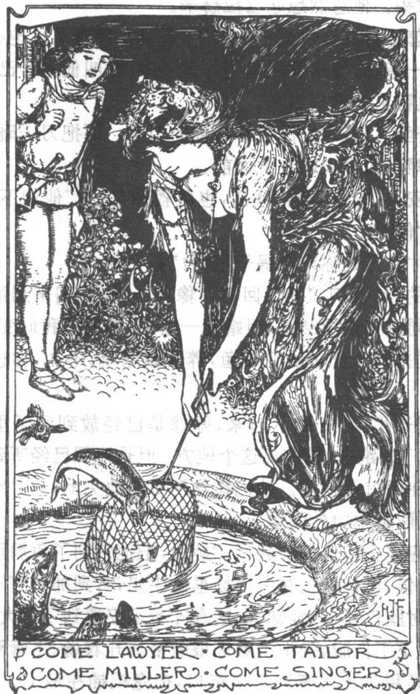

“这是什么声音？”霍安问，开始觉得不安起来。

“这是炉子旁边的蟋蟀在叫。”她说，接着就唱起一支歌来，掩盖了那叫的声音。

霍安虽然不再说什么，但不再像刚才那么快活了。有些事情好像不对头。他忽然想起巴拉赫来。

“我怎么会这么快就把她忘了，我真是坏透了！”他心里在想着，站在一旁，看着格罗把鱼倒入盘子中。她叫他先自己吃起来，她要到地窖里去拿些酒来。

霍安坐下来，拿出巴拉赫给他的刀子。那把刀一碰到鱼，魔法立刻解除，四个人站在他面前。

“霍安，求求你，救救我们，也救救你自己！”他们不敢大声，轻轻地对他说。

“刚才肯定是你们在锅子里叫！”霍安说。

“是的，是我们。”他们回答，“像你一样，我们来到洛克岛碰运气，也同意和格罗结婚。但婚礼一结束，她就把我们变成鱼。所有到这里来的人都被她变成鱼，养在鱼塘里，不久，你也要到那里去。”

听到这里，霍安跳了起来，好像是已经放到锅子里煮了一样。他向门口跑去，想逃离这个地方。但是格罗已经听到了他们的谈话，在门口拦住他。她把铁丝网罩在他头上，一对绿色的青蛙眼睛从网眼中向外张望。

“你应该去和他们一起玩。”她说，把他带到了鱼塘里去。

这时候，巴拉赫正在牛奶场里撇牛奶，听到那铃声不停地响起来，顿时脸色苍白。她知道，这意味着霍安遇到了很大的危险。她赶紧换下工作服，手中拿着那根魔棍离开农场。尽管双脚在发抖，她还是用足力气奔到十字路口，把魔棍插在地上，口里念着妈妈教给她的一首韵文诗：

> 小小苹果树枝，
> 跨过海洋和土地。
> 你在空中带着我，
> 要到哪里就到哪里去。

立刻，小棍变成了一匹漂亮的小马。两只耳朵上插着玫瑰花，头上插着一根羽毛。它安静地站着，等到巴拉赫跨上它的背，就开始跑起来，步伐越来越快，到后来姑娘也看不清向她身后闪过去的房屋和树木。但尽管这样，巴拉赫还是觉得太慢。她弯下腰来说：“燕子飞得不如风快，风不如闪电快。我的马啊！假如你爱我，就要跑得比它们还快。因为我的心一半在受难，那最珍贵的一半正在危急之中。”

听了她的话，马跑得像风暴中的一根稻草那么快。一会儿就到了鹿跳崖的脚下，马停了下来。所有的马和骡都爬不上这块悬崖。巴拉赫也知道，所以她开始唱道：

> 利昂的马你快来，
> 跨过海洋和土地。
> 你在空中带着我，
> 要到哪里就到哪里去。

她刚唱完，马的前腿越来越短，最后变成翅膀，后腿变成双爪，浑身长出羽毛。她坐在一只大鸟的背上，飞到了悬崖的顶端。

在那里，她看到一个用泥土和干苔藓做成的巢。巢里坐着一个又黑又瘦的小矮人，看到巴拉赫，他惊喜地叫起来，“喂！你就是那个来救我的漂亮姑娘？”

“来救你？”巴拉赫说，“你是谁啊！我的小朋友！”

“我是洛克岛格罗的丈夫，是她把我关在这里的。”

“可是你坐在鸟巢里干什么？”

“我坐在六个石头蛋上，要孵出鸟来我才能得到自由。”

听他这么一说，巴拉赫笑起来。

“可怜的小公鸡！”她说，“可是我怎么救你呢？”

“救出霍安，就能救我。他现在在格罗的手中。”

“啊！请告诉我怎么去救他！哪怕是跪在地上走遍布列塔尼，我也要去救他。”

“好的。首先，你要把自己打扮成一个男青年，然后去找格罗。找到她以后，你要设法得到挂在她腰上的铁丝网，把她永远地关在网里。”

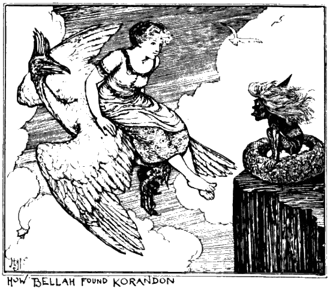

“可是，我到哪里去找男青年的衣服呢？”她问。

“你等着瞧！”他说着，从头上拔下四根红头发，把它们吹跑，口中念着什么咒语。一眨眼工夫，四根头发变成四个裁缝。第一个拿着大白菜，第二个拿着一把剪刀，第三个拿着一枚针，第四个拿着铁熨斗。不等别人吩咐，他们就在巢边坐下来，舒服地叉着腿，开始为巴拉赫做衣服。

他们用大白菜的一张叶子做上衣，第二张做马甲。做当时时兴的骑马裤用掉了两张叶子。大白菜的心子用来做帽子。一根菜秆子用来做一双鞋。一切都完工以后，巴拉赫穿上边是用白色的缎子做的绿色天鹅绒服装，看上去像个绅士。

她十分感激地谢了小矮人。他吩咐她几句以后，巴拉赫骑上大鸟，向洛克岛飞去。一到岛上，她叫大鸟仍然变成小木棍，把它拿在手里，走上那只蓝鸟船，来到了贝壳宫殿。

格罗看到她非常高兴，说她从来没有看到过这么英俊漂亮的男青年。很快，她把客人请到大厅里，那里总是摆着招待来宾的酒和水果。桌子上还留着那把霍安用过的神奇小刀。趁格罗不注意，巴拉赫把它偷偷地藏在上衣的口袋里，然后跟着女主人来到花园，来到养鱼的鱼塘。那些鱼都闪烁着上千种不同的色彩。

“啊！多么漂亮，多么好看的鱼！”巴拉赫说，“我一辈子都看不厌。”她在岸边坐下来，一只手撑在膝盖上，一只手托着下巴，凝视着从她面前游过的鱼。

“你愿意永远留在这里吗？”格罗问，巴拉赫说，那再好不过了。

“那只要和我结婚就可以了。”格罗说，“啊！请不要拒绝我，因为我已经深深地爱上你了。”

“好吧，我不拒绝。”巴拉赫笑着说，“但你要先同意，让我用你的网来抓一条这些可爱的鱼。”

“这可不像你想象的那么容易。”格罗笑着，同意了，“拿着吧！试试你的运气。”

巴拉赫接过格罗的网，迅速地转过身来，把它套在格罗的头上。“变回你的原形吧！”巴拉赫叫道。

立刻，可爱的海上仙女变成了非常难看的癞蛤蟆。她拼命地挣扎着，想把网撕破，但毫无用处。巴拉赫把网越收越紧，然后把这个魔鬼扔到一个坑里，搬来一块大石头把坑堵死，就走了。

她来到鱼塘边，成群结队的鱼向她游过来，用粗哑的声音喊着，“她就是我们的主人，是她把我们从铁网和金锅里救了出来！”

“她还要把你们恢复原来的形状。”巴拉赫接着说。她从口袋里拿出小刀。正当她准备去碰最前面的一条鱼时，看到了坐在她旁边的一只绿色的青蛙，两只前脚在他胸前交叉着。巴拉赫好像喉咙被卡住一样，哽咽地问道，“是你吗？我的霍安！”

“是我。”小青蛙哇哇地叫着。小刀第一个碰了他一下。他跳起来变成了人。把他的巴拉赫紧紧地抱在怀里。

“我们不能忘了其他人。”过了一会，她对霍安说，开始用小刀把一条条鱼变成人。一共有这么多鱼，还真的花了不少时间。事情刚刚结束，鹿跳崖上的小矮人坐着一辆六只金龟拉着的战车来到了，这六只金龟就是那六个石头蛋。

“我来了！”他喊道，“你打破了约束我的咒语。现在请跟我来，领取你的报答。”他跳下战车，把他们领到一个堆满金子和钻石的密室里，叫巴拉赫和霍安想要多少就拿多少。

他们把口袋装满以后，巴拉赫把她的小棍变成一辆有翅膀的大车，让他们和所有得救的人都坐上去，飞回拉尼利斯。

第二天，他们就举行了婚礼。不过，他们不像以前希望的那样，买头小母牛和小猪来养。他们买了许多土地，还给每个从格罗那里救出来的人买一个小农场。他们都在拉尼利斯过着幸福的日子，直到天年。

（布雷顿民间故事，E·索瓦斯特编写）

 
 

## 老鼠得救

王子马纳韦顿和他的朋友普里德里无家可归，到处流浪。马纳韦顿的哥哥是国王，可是被人杀害了，王位也被人抢走。马纳韦顿非常悲痛。但是普里德里很坚强，他叫马纳韦顿开心些，他知道怎样来摆脱这个困境。

“你有什么办法呢？”马纳韦顿问。

“你娶我的母亲莱安娜做妻子。我要给她一片庄园做嫁妆，你就成了这片庄园的主人。世界上没有一个女子比她更聪明。她年轻的时候，也没有人比她更可爱。就是现在，她也是非常漂亮。”

“你是最好的朋友，”马纳韦顿说，“让我们到莱安娜居住的地方去，到那里去找她。”

他们开始动身。可是消息比他们的行动更快。莱安娜和普里德里的妻子基克娃知道他们要来，赶紧为他们准备宴席。马纳韦顿看到，普里德里关于他母亲的话句句是真。他向她求婚，问她是否愿意做他的妻子。她高兴地答应了。他们很快就成了亲。这两对夫妻日夜不分离，他们之间的爱非常深。四个人经常一起出去打猎。

有一天，他们打猎归来，在一片绿色的草原上休息。忽然雷声大作，震耳欲聋。接着，浓浓大雾从天而降，像一幅幅屏障，把他们遮得严严实实，谁也看不到谁。在黑暗中，他们浑身发抖，等待着黑暗过去，光明再来。可是浓雾消失以后，房屋、放牧着的牲口、牛羊也消失了。没有人烟，也没有野兽。这块绿色的草原上，除了他们，什么都突然消失得无影无踪了。

他们走了许多路，才看到了一家旅店。但是里面空空如也。“人都到哪里去了？那些旅客呢？”马纳韦顿奇怪地问。他们找遍了所有的房间，除了野兽以外，什么也没有看见。他们在这里整整住了一年。吃的是马纳韦顿和普里德里打猎得来的野兽，还有野蜂采来的蜂蜜。这一年，他们不奢望什么。但是第二年开始，他们发愁了。

“我们不能就这样过一辈子。”马纳韦顿说，“让我们到英国去，学一点生意，以维持生活。”

他们离开了威尔士，来到赫里福德住下，做马鞍出去卖。马纳韦顿用蓝色的搪瓷把马鞍装饰得非常漂亮。顾客非常喜欢他们的马鞍。别人的马鞍在赫里福德一副也卖不出去。后来，那些马鞍商人都凑在一起商量对策，要把马纳韦顿他们杀掉。

普里德里听到这个消息非常气愤，决心留下来和他们血战到底。但后来他们还是听从马纳韦顿的意见，连夜搬到另一个城市去。

“接下来我们做什么手艺呢？”普里德里问。

“我们做盾牌。”马纳韦顿说。

“这门手艺我们一点也不懂。”普里德里说。

“我们试试看。”马纳韦顿说。他们模仿见过的盾牌，开始做起来。同样，还是用搪瓷来当装饰，又获得了巨大的成功。城里的人只买他们做的盾牌。后来，城里其他做盾牌的人气愤地凑在一起，商量对策，也决定把他们杀掉。幸亏他们事先得到消息，连夜逃到别的城市去。

“这一回让我们做鞋子吧！”马纳韦顿说，“做鞋子的人胆子小，不会有人来和我们斗。”

“做鞋子的手艺我一窍不通。”普里德里说，其实他很不愿意做这种无聊的生意。

“我知道怎么做。”马纳韦顿说，“我教你们怎么缝针。我们买剪好的皮，把它们缝起来就成鞋子了。”

他走遍整个城市，找到质量最好的皮，又找到一个金匠，请他打做鞋子用的扣子。他站在旁边看着，以学会自己做。

不久，他成了全城闻名的“金鞋匠”，生意越来越兴旺。只要能买到他的鞋，城里人就不会去买别人的鞋。其他鞋匠都非常气愤，也决定要合伙把他们杀掉。

马纳韦顿得到这个消息，说，“普里德里，我们在英国呆不下去了，还是动身回纳博兹去吧！”

他们踏上旅途，来到自己的家乡纳博兹，把所有的狗都找来，又开始了打猎的生涯。这样又过了一年。

后来，一件奇怪的事情发生了。一天早晨，普里德里和马纳韦顿像往常一样，出去打猎。他们来到了一个小树丛前。那些狗看到小树丛，都退却到主人的面前来，好像很害怕似的，背上的毛都竖起来了。

“让我们看看树丛里有什么！”普里德里说。他们看到里面有一只皮毛像雪一样白的熊。熊走出树丛。那些狗在主人的驱赶下向它发起进攻。开始，它站在那里，被狗围住，无法动。后来它和狗打斗起来，向一座城堡跑去。这座城堡他们从未见过，好像是新造起来的。狗跟在后面，都追进了城堡。他们站在外面，看着，听着，什么也看不见，什么也听不见，好像根本没有熊和狗进去过似的。

“我要到城堡里去看看，那些狗到底怎么啦！”普里德里说。

“你这样做不聪明。真的！肯定是那个用咒语控制了这片土地的人，在这里筑起了这个城堡。”马纳韦顿说。

“我不能把狗丢了。”普里德里说着，走进了城堡。

城堡里没有狗，也没有熊，没有人，也没有其他野兽，只有一个喷泉，周围是大理石，旁边有一个金碗，非常诱人。普里德里看到以后，十分喜欢。他忘记了自己的狗，走过去拿金碗，可是一碰到金碗，他的手就被粘住了，脚也被钉在大理石石板上，失望笼罩了他的心。

马纳韦顿在外面等他，直到太阳下山才回家。他想，普里德里大概是在城堡里迷路了。

“你的朋友和你的狗呢？”莱安娜问。他告诉她普里德里失踪的事情。

“你失去了一个好朋友。”莱安娜说。她来到城堡，走进开着的城门。在院子的中央，看到普里德里站在那里，赶紧向他走过去。

“你站在这里干什么？”她问，也用手去碰那个金碗，手和脚也被粘住了，一句话也说不出来。这时雷声响了起来，黑幕降临，他们和城堡一起消失了。

普里德里的妻子看到丈夫和母亲都没有回来，痛不欲生。马纳韦顿心中也非常难过，对她说，“我们把狗丢了，无法打猎维生，不能留在这里了。我们到英国去，那里比较容易谋生。”于是，他们开始动身，路上基克娃问他，“你做哪一门手艺呢？”他说，“我还是像以前那样做鞋子。”

他买来了城里最好的皮，用镀金的扣子来做鞋子。城里的人都争先恐后地来买他的鞋子。弄得其他的鞋匠都失业了，他们非常气愤，一起商量要杀掉他。幸好，马纳韦顿得到消息，和基克娃连夜逃回纳博兹。他还带回一袋小麦，把它种在三块地里。

小麦在地里生长的时候，他就出去打猎和钓鱼，食品也就足足有余。时间过得很快，收获的季节到了，一天晚上，马纳韦顿到最远的一块麦地去察看，看到麦子熟了。“明天我就来收割。”他说。

第二天早晨，他来到麦地。可是麦子一粒也没有了，只有麦秆子还在。他非常失望，赶到第二块地去。这块麦地一片金黄，麦子也熟了。“明天我就来收割。”他想。可是，次日早晨他来到麦地时，麦穗不见了，只剩麦秆。

“算了！我还有一块地。”他来到第三块麦地，发现这里的麦子比前两块地还要好。“今天晚上，我要留在地里看守。”他想，“谁偷走了那两块地的小麦，今天照常会来。到时候我就知道是谁偷的了。”他找了个地方躲藏起来，等待着。

时间一点一点地过去。一切都是那么安静，马纳韦顿几乎都要睡着了，但是到了午夜时分，响起了几乎是世界上最响亮的吵闹声。他看到来了一大群老鼠。这些老鼠大得没法说，多得数不清。每只老鼠爬上一棵麦秆，把它压弯，然后咬断麦穗拖走。没有一棵麦秆能逃脱老鼠的光顾。

马纳韦顿非常气愤地跑出来追这些老鼠。可是它们好像一群蚊子，或者是一群鸟那么快，他追不上。只有一只老鼠姗姗地跑在最后面。马纳韦顿追上去捉住了它的尾巴，把它装进口袋，用一根绳子把袋口扎紧，不让它跑掉。

他回到家中，基克娃正坐在那里。他点起了一把火，把口袋挂在一个钉子上。

“口袋里装的是什么？”她问，

“一个贼。”他回答，“它抢我的东西，被我抓住了。”

“这是个什么样的贼，能够装在口袋里？”基克娃问。

“我会告诉你的。”他说。于是讲了庄稼怎么被偷，他如何看守，如何抓住老鼠。“有一只老鼠跑得不那么快，被我抓住装在口袋里。明天我要吊死它，要是我能抓住所有的老鼠就好了。”

“这是个奇迹，真的。”她说，“不过，像你这样一个高贵的人去吊死一只动物，好像不太合适。别管它了，让它跑吧！”

“我捉到多少就吊死多少。现在捉到一只，就吊死一只，否则就会灾祸临头。”他说。

“那倒是真的。”她说，“我没有必要去救这只动物，除非是不相信你。”

“要是我知道有任何理由可以放它，我就听从你的劝告。但是一条理由也没有，我就决心要杀了它。”

“那么就这么办吧！”基克娃说。

他来到山坡上，架起两个树杈。这时，他看到一个衣服褴褛的学者走过来。七年以来，在这个地方从未见过一个人，一只野兽。看到有人来，他非常惊奇。

“你好啊！我的君主！”学者说。

“你好，学者，你从哪里来？”

“从英格兰演唱会来，你问这个干什么？”

“因为这里已经七年不见有人来。”

“我知道到了什么地方。”学者说，“你在干什么？”

“我正要吊死一个抢我东西的贼！”

“这是一个什么样的贼？”学者问道，“我看到你手里拿着一只像老鼠一样的动物。像你这样高等的人抓住这样的爬行动物，不太合适。让它走吧！”

“我不会让它走的。”马纳韦顿叫道，“它抢了我的东西，被我捉到，它应该受到做贼的惩罚。”

“君主！”学者说，“看到像你这样的人做这种事情，倒不如我把刚得到的一英镑捐款给你，放它走吧！”

“我不会放它走，也不会把它卖掉。”

“你爱怎么做就怎么做吧！君主！”学者说着，走了。

马纳韦顿把一根木条架在两个树杈上，准备吊死老鼠。这时候，一个牧师从这里经过。

“你好啊！我的君主，你在干什么？”

“我要吊死一个贼，它抢我东西的时候被我抓住。”

“什么样的贼，君主？”

“像老鼠一样的东西，它抢了我的东西，应该像贼一样受惩罚。”

“君主！”牧师说，“与其看着你惩罚一个爬行动物，不如我花钱买了它。”

“我不会卖它，也不会放它。”

“不错，一只老鼠不值什么钱。不过，看到你弄脏自己去吊死一个这样的小动物，我情愿花三英镑把它买下。”

“多少钱我也不卖，我要把它吊死，这是它应得的。”

“好吧！我的君主，随你高兴。”牧师说完就走了。

马纳韦顿用绳子把老鼠的头颈套上，正准备拉紧，一个主教骑着马走过来，后面跟着驮着大包的马队。

“你在干什么？”主教勒住缰绳，问道。

“吊死一个贼，它抢我东西的时候，被我抓住。”

“可是，我看到你手中是一只老鼠？”主教问。

“是的，它就是那个贼。”马纳韦顿回答。

“好吧！既然我看到了这个小动物即将死亡，我愿意出七英镑来为它赎身，免得看到你这样高等的人去碰它。松开它，让它走吧！”

“我不会松开它。”

“我给你二十四英镑，放了它。”

“再加一倍我也不放。”

“要是你还不肯放，我就把这里所有的马和七口袋东西给你。”

“那我也不放。”

“那么，告诉我，你要多少价钱才放了它，我会给你的。”

“解除加在莱安娜和普里德里身上的魔法。”马纳韦顿说。“这可以办到。”

“这还不够，加在我所有领地上的魔法也必须解除。”

“这也可以办到。”

“在松开老鼠之前，我还要知道它是谁？”

“她是我的妻子。”主教回答。

“她到我这里来干什么？”马纳韦顿问。

“为了掠夺你。”主教答，“是我把魔法加在你的土地上，为了报复我的朋友格卢德的儿子格瓦勒。是我把咒语加在普里德里身上，也是为了报复格瓦勒。不但我一个人感到愤怒，我的人也感到愤怒。他们知道你搬来这里住以后，请求我把他们变成老鼠，好来吃你的庄稼。前两天晚上，是我家里人变成老鼠来毁坏你两块地的庄稼。第三天，我的妻子和她的女仆来请求我，也把她们变成老鼠，以便她们也能报复格瓦勒。我答应了她们。要不是因为她病了跑得慢，你也不会捉住她。既然她被捉住，我把普里德里和莱安娜还给你，并且解除加在你土地上的魔法。我已经告诉你她是谁了，现在，请放了她。”

“我不会放她。”马纳韦顿说，“除非你发誓，不会因为这件事而报复普里德里，或者莱安娜和我。”

“我答应你这个请求。你非常聪明，想到了这个问题。因为在你头上，已经有许多灾难降临。现在，把我妻子放了吧！”

“看到普里德里和莱安娜，我就放了她。”

“看！他们来了。”主教说。

马纳韦顿伸出手来，欢迎普里德里和莱安娜，他们高兴地坐在草地上。

“啊！君主，你所有的要求不是都得到了吗？马上把我妻子放了！”主教说。

“我很高兴这样做。”马纳韦顿松开她头颈上的绳子。主教用手中的棍子碰了她一下，她立刻变成一个年轻的，非常美貌的女人。

“看看你的土地吧！”他说，“你将会看到，它像很久以前一样地庄稼茂盛，人丁兴旺。”

马纳韦顿放眼看去，只见田地里长满了农作物，牛羊在山坡上吃草，处处可见炊烟袅袅的房屋。他心满意足，不过，还有一个问题他想问主教：

“你在普里德里和莱安娜身上加上什么咒语？”

主教笑着说，“普里德里被我宫殿门上的门环吊起来。莱安娜头颈上套着我制服上的花领。”

（摘自《马比诺吉昂》）

 
 

## 听话的丈夫

从前，埃里恩有个青年人想娶个妻子，附近的姑娘都不能令他满意，他只看中了一个农民的女儿。那姑娘和她的父亲都同意了。他们很快就结婚，住在农民的家里。

春去秋来，又到了收割水苔藓的季节。每年这个时候，他们都要收割大量水苔藓，把它们晒干堆起来。以便冬天生火取暖。

这一天，天气非常晴朗。农民和妻子、女儿、还有女婿，都一起到沼泽地去。他们一口气干了几个钟头，觉得饿了，就叫女儿回家去拿点吃的东西来，同时还给马喂点饲料。

她走进马厩时，突然抬头看到，那匹斑色母马的大马鞍正好挂在她头上。她吓了一跳，自言自语地说，“要是这副又重又大的马鞍落下来，肯定砸死我，太可怕了。”她正好坐在大马鞍下面，吓得开始哭起来。

这时候，留在沼泽地的人觉得越来越饿。他们想，“她到底是怎么啦，到现在还不来？”最后，她母亲等不住了，说她必须去看看，到底发生了什么事情。

回到家里，她在厨房和牛奶棚都找不到女儿，就到马厩里去找她，看到她正在哭。“你怎么啦，我的宝贝！”她问。女儿边抽泣边说，“我走进来，看到头上挂着个大马鞍。我想，它要是掉下来，肯定砸死我，多么可怕啊！”说完哭得更加伤心。

老妇人听她这么一说，两手一拍，说，“是呵！多吓人。要是发生了这种事情，我可怎么办？”说着坐在女儿旁边，也哭起来。

“一定是发生了什么奇怪的事情！”老头子在沼泽地里等得很焦急，他又饿又气，“我要回去看一看！”

他回到家里，在马厩里找到了她们。“怎么回事？”他问。

“啊！”他的妻子说，“我们的女儿回到家里，看到马鞍正好挂在她的头顶上，多么吓人。要是掉下来，不就把她砸死了吗？”

“啊！真的，想想真可怕！”老头子也吓得一屁股坐下来大哭。

到了傍晚时分，年轻人非常气愤地回到家里，看到他们都在马厩里哭着。他问，“出了什么事？”

“你妻子回到家的时候，”老头子说，“看到马鞍正好挂在她头上。她想，要是掉下来就会砸死她，多么可怕！”

“可是，它没有掉下来啊！”年轻人回答。他到厨房里找点吃的，让他们在那里哭，爱哭多久就哭多久。

第二天，太阳一出来他就起床，对他的岳父母和妻子说，“再见！要是找不到三个和你们一样笨的人，我就不回家了。”

他走了很久，来到一个城镇，看到一家人家的门开着。他走进去，里面没有人，只有三个妇女在纺纱。

“你们不是本地人！”他说。

“你说对了！”她们回答，“你也不是吧！”

“我不是。”他说，“这里是不是过日子的好地方？”

妇女们你看看我，我看看你，说，“这里的男人非常傻，我们说什么，他们都相信。”

“好吧！这是一个金戒指。”他说，“谁能叫她的丈夫相信最不可能发生的事情，我就给她。”

第一个妇女在家里等着，丈夫一回来就说，“你病了！”

“我病了？”他问。

“是的，你病了。”她回答，“把衣服脱掉，躺下来。”

他把衣服脱掉，躺在床上。过了一会，他妻子走进来对他说，“你死了！”

“啊！我死了？”他问。

“是的，你死了！”她说，“闭上你的眼睛，手和脚都不要动。”他觉得，他是死了。

第二个妇女看到丈夫回来，对他说，“你不是我丈夫！”

“啊！我不是？”他问。

“不，你不是！”她说。他走出去，到森林里去睡觉。

第三个妇女等丈夫回来，像平常一样，吃过晚饭后就叫他上床睡觉。第二天，有个小孩敲门，叫他去参加那个死人的葬礼。他正想起来，妻子把他拦住，“还早呢！来得及！”他又躺下了。

送葬的队伍从他们家门口经过。他妻子说，“起来吧！快点！”丈夫赶紧起来，看看四周，说，“我的衣服呢？”

“你真笨，衣服不是穿在你身上了吗？”她说。

“已经穿好了？”他问。

“是的，”她说，“快去吧！葬礼快结束了。”

他跑了出去，那些送葬的人看到一个穿着裤衩的人跑过来，都吓得忘记了在干什么，四处逃走。他裸着上身站在棺材旁。

这时候，在森林里过夜的人走出来，“你认识我吗？”

“不！我不认识你！”裸体的人说。

“你干吗裸着身体？”那人问。

“我裸着身体？我妻子说我已经穿好衣服了。”

“我妻子说，我已经死了！”棺材里的人说。

听到棺材里的人说话，两个人都吓得赶快逃命。棺材里的人也爬起来跟着他们跑。

结果，说她丈夫死了的女人得到了戒指，因为她的丈夫比另外两个人更傻。

（西苏格兰高地传说）

 
 

## 冠鸥

从前有一个农夫，他有三个女儿。她们都很能干，每天和太阳一起起来，家里所有的活都做。有一天上午，她们三个人一起到河边去洗衣服。一只冠鸥飞过来，停在旁边的一棵树上。

冠鸥对大女儿说，“你愿意嫁给我吗？农夫的女儿！”

“说真的，我不愿意嫁给你。”她说，“冠鸥是一种猛禽。”冠鸥听了非常生气，展开翅膀飞走了。

第二天，它又飞过来对农夫的第二个女儿说，“你愿意嫁给我吗？农夫的女儿？”

“说真的，我不愿意嫁给你。”她说，“冠鸥是又丑又凶的野禽。”冠鸥听了，比上次还要气愤，愤怒地飞走了。

不过，过了一个晚上，它的气都消了，想想今天可能会碰到好运气，又来到了姑娘们洗衣服的河边，对最小的女儿说，“你愿意嫁给我吗？农夫的女儿？”

“我真心实意地想嫁给你，冠鸥长得很可爱。”她说。

当天，他们就结婚了。

“我有些事情要问你。”他们回到自己的房间以后，冠鸥对她说，“你喜欢我白天是冠鸥，晚上是人；还是白天是人，晚上是冠鸥？”

姑娘听了他的话非常吃惊。她想，它就是一只冠鸥，从来没有想过，它还会变成别的什么。不过，她没有说什么，只是回答，“我希望你白天是人，晚上是冠鸥。”于是，白天，他是一个英俊的青年。晚上，他变成一只更漂亮的冠鸥。不管是白天，还是晚上，姑娘都非常爱他，从不希望这情景有什么变化。

不久，他们有了一个儿子，两个人都非常高兴。有一天晚上，远处传来温柔的音乐，他们都睡着了。第二天，他们醒过来，发现孩子不见了。他们到处寻找，都不见孩子的踪影。来看女儿的农夫也觉得很伤心。他不喜欢一只冠鸥来做他的女婿，因此，他也很担心夫妻俩会怀疑小孩是他偷走的。

第二年，他们又生了一个儿子。这一次，每扇门都有人看守着。他们决心晚上不闭眼，以防万一。但是没有用。当那温柔的音乐声又传过来时，他们又睡着了。第二天，农夫来看女儿时，看到他们都在哭。他们睡着的时候，第二个儿子又失踪了。

第三年，同样的事情又发生了，第三个儿子也丢了。冠鸥看到妻子如此悲痛，决心把她带到别的住所去。她的两个姐姐也陪她去。他们坐着一辆大马车一起走。还没走多远，冠鸥问道，“你肯定没有丢下什么东西吗？”他妻子摸了摸口袋说，“我忘了带那把粗木梳了。”她刚说完，马车变成了枯萎的干柴，她的丈夫又变成了冠鸥，飞走了。

两个姐姐返回家，妻子跟着丈夫追去。有时，她看到冠鸥在山顶上，她赶紧爬上山顶，希望能抓到它。但等她爬到山顶，它已经飞进山谷。到了晚上，她觉得非常累了，想找个地方休息。幸运的是，她看到前面有一间房子，里面的灯光正亮着。她赶紧朝它奔过去。

门口站着一个小男孩。看到他，不知道为什么，她心里觉得非常高兴。一个妇女走出来欢迎她，给她端来饭菜，还为她准备了一张柔软的床。她在床上躺下，由于非常疲劳，所以第二天太阳升起来，她醒过来时，觉得好像只睡了一会儿。她继续翻山越岭追赶着冠鸥。它在山顶上的时候，她在山谷里。它在山谷里的时候，她在山顶上。这样，一直到天黑，她想找个地方过夜，前面不远处有一间房子露出灯光，她赶紧跑过去。门口也是站着一个小男孩，看到他，她心里也觉得非常高兴。一个妇女走出来，吩咐她进去，招待她吃饭，为她准备好床铺睡觉。天明太阳升起，她又出去追赶冠鸥。这一天和前两天一样。晚上，她走进了一间小房子。但那个妇女告诉她，晚上别睡着了。冠鸥飞进来时，想办法抓住它。

可是，她走了那么长的路，非常累了，不管她怎么挣扎，还是睡着了。

她睡了好几个钟头，冠鸥从窗口飞进来，把一只戒指放在她手中。她醒过来，伸出手来想抓住冠鸥，可它已经飞起来了。她只抓到一根羽毛。天亮了，她起来把事情的经过讲给那妇女听。

“它已经翻过了毒刺岭。”她说，“没有马掌鞋，你不能去追它。不过，我会帮助你的。穿上这些男人的衣服，沿着这条路走下去，直到看见一家铁匠铺。在那里，你可以学会为自己打马掌鞋。”

她谢了老妇人，穿上男人的衣服，朝老妇人指引的路走去，来到了铁铺。她干活那么卖力，没几天工夫，就学会了打铁掌鞋，第二天一早，她就向毒刺岭走去。尽管她手上和脚上都套着马掌鞋，她还得非常小心，以免绊倒。那些有毒的荆棘一碰到人的皮肤，就会把人毒死。

她翻过毒刺岭后，听到的消息是，她的丈夫今天就要和当地的领主女儿结婚。

这时，城里即将举行一次赛马活动，除了两个人以外，所有的人都去参加，一个就是这个刚翻过毒刺岭来的陌生人；一个是厨师，他必须准备婚宴。厨师非常喜欢赛马，看不到赛马，他觉得非常难过。所以当他看到一个陌生的女人在街上行走时，心中有了主意。

“你愿意为我准备结婚宴会吗？”他问她，“等我从赛马场回来，会付给你很好的报酬的。”

她很高兴地同意了，在厨房里烧起来。从这里可以看得见宴席的大厅。她看到了自己的丈夫坐在新郎的位置上，就给他送去一碗汤，汤里放了那个戒指和那根羽毛。

新郎第一调羹就舀起那只戒指，觉得浑身都震撼起来。当他看到碗里的那根羽毛时，就从椅子上站起来，问，“这婚宴是谁准备的？”厨师这时已经从赛马会上回来，他被带到新郎的面前。

“他可能是厨师，但是宴席不是他做的。”新郎说。经过询问，姑娘被带进来。

“这是我的已婚妻子，”新郎说，“我不会再和别人结婚了。”这时候，咒语被破除了，他永远也不会再变成冠鸥了。他们都为再次相聚而感到非常幸福。他们手携手越过毒刺岭，找到了他们的三个儿子，回到自己的家乡。

但是这个故事没有告诉我们，谁偷走了他们的三个儿子，还有那把粗木梳有什么作用。

（西苏格兰高地传说）

 
 

## 湖中的棕仙

在法国，曾经有过一个名叫詹姆·里欧的人。你就是花上一天的时间，也找不到一个比他更幸福、更满足的人。

他有很大的农场，很多的钱，尤其是有一个名叫巴巴克的女儿。她是全乡村穿得最漂亮、舞跳得最好的姑娘。每逢假日，当她头戴刺绣的帽子，穿着五条一条比一条短的裙子，还有一双银扣子的鞋子出现的时候，妇女总是非常妒忌。但是，不管人们在她背后说些什么，她都毫不在意，因为她穿得总是最漂亮，舞伴总是比任何一个姑娘多。

在所有向她求婚的青年男子中，她最看得中的是父亲的领班。不过，因为他长得特别难看，举止又很粗鲁，她也就不再说什么了。更糟糕的是，她还常常和别人一起取笑他。

这个领班的名字叫杰古，他当然也知道巴巴克和别人一起取笑他。这使他很不高兴。不过，他还是不愿意离开这个农场，到别处去找工作。因为这样，他就再也看不到巴巴克了。如果是这样，生活还有什么意义？

有一天晚上，他赶着马群从地里回来，半路上牵它们到路边的一个小湖去饮水。工作了一整天，他觉得累了，一只手放在马背上站着，心里在想着巴巴克。这时，一个声音从附近的金雀花丛里传出来，

“你怎么啦！杰古！你还不至于那么失望！”

年轻人吃惊地四处张望，问是谁在说话。

“是我啊！湖中的棕仙！”那个声音回答。

“但你在哪里呢？”杰古问。

“仔细看看旁边，你就会看见芦苇中的一只绿色小青蛙。那就是我变的。”他自豪地说，“我可以变成任何想变的形状。还可以隐身，不让人看见，不过这要难得多。”

“那么，请你变成通常在家的形状，让我看看。”杰古说。

“当然可以。”说着，青蛙跳到一匹马的背上，变成一个小矮人，全身上下都穿着绿衣服。

这种变化使杰古很害怕。棕仙叫他不必担心，他不会伤害他。实际上，他希望杰古能发现，他有些用处。

“可是，你为什么对我这么感兴趣呢？”杰古疑心地问。

“因为去年冬天，你帮了我一次忙，我永远不会忘记。”小矮人说，“住在白谷国的坏仙人向我们宣战，他们自称是人类的朋友，迫使我们流落他乡，变成各种各样的动物模样，以保护自己。从那个时候起，一方面是因为习惯了，一方面也是为了乐趣，我们不停地变化着自己。正因为这样，我才有机会认识了你。”

“怎么会的？”杰古吃惊地问。

“你还记得三个月前在河边的地里掘土时，在捕鸟的网里捉到了一只红胸脯的知更鸟吗？”

“是的，”杰古说，“我记得很清楚，我把网打开，放它走了。”

“好！我就是那只红胸脯的知更鸟。从那时候起，我就发誓要做你的朋友。既然你想娶巴巴克，我就要帮助你办到，以证明我说的话是真的。”

“啊！我的小棕仙，要是你能帮我办到，除了我的灵魂，我什么都愿意给你。”

“那么，就让我走吧！”小矮人说，“我答应你，短短的几个月之内，你就是农场和巴巴克的主人。”

“可是，你如何去达到这个目的呢？”杰古惊奇地问。

“那是我的事情，也许以后会告诉你，你还是照常吃饭和睡觉，用不着担心什么事情。”

杰古说，没有什么事情比这更容易的了。他摘下自己的帽子，衷心地感谢小矮人。接着，就牵着马回到农场。

第二天是个节日，巴巴克比平常还要早就起来了，她想早点把活干完，以便去参加舞会，举行舞会的地点离这里还有一段路程。她先来到奶牛棚，打扫牛棚是她的工作。到了牛棚，她吃惊地看到，新鲜的稻草已经放好，架子上也堆满了做饲料的干草，牛奶已经挤好，牛要喝的水也一桶一桶整齐地放在那里。

她想：“肯定是杰古干的，他希望我能陪他跳舞。”在门外看到他时，她停下来，谢谢他的帮助。可是，杰古只是粗鲁地回答，说他不明白她在说些什么，他的回答使她更相信，这些事情就是他干的。

同样的事情天天发生，牛奶棚从来没有这么干净过，奶牛从来没有这么肥过。每天早晨和晚上，巴巴克都看到，陶罐里是满满的牛奶，还有一磅新鲜的黄奶油，上面还装饰着一些好看的叶子。几个星期过去了，巴巴克似乎对此也习以为常。每天早晨，她只要及时起来做早饭就是了。

不久，做早饭也是多余的。有一天早上，她从楼梯上下来，看到房子已经打扫好，家具已经擦干净，火已经生起来，早饭都准备好了。她只需打铃叫在地里干活的人回来吃饭。所有这一切，她想都是杰古帮她干的。她自然而然地想到，对于一个喜欢睡懒觉和贪玩的姑娘来说，有这样一个丈夫真是不错。

实际上，巴巴克只要说出一个愿望，总是能实现。要是怕外面的冷风或强烈的阳光会毁坏她的容颜，她只需跑到附近的泉水旁边轻轻地说，“我希望所有的盛奶罐都装满牛奶，把那些湿的亚麻布晾在篱笆上晒干。”接下来，她就用不着再去想它了。

要是她觉得黑面包太硬了，不好烤；或者是炉子热得太慢，她只要说，“我希望看到架子上的六块大面包烤好放在面包箱里。”两个钟头以后，面包箱里就会有又香又软的热面包。

要是她懒得走那条肮脏的路上市场，她只要在晚上大声地说，“我干吗不是已经从市场上回来了，罐里的牛奶已经卖掉，换回来了黄奶油，一磅野樱桃，围裙口袋里还有卖牛奶得来的钱。”第二天早上她起来，就会发现床边是空的牛奶罐，还有野樱桃，黄奶油，围裙的口袋里还有六块银币。她相信这一切都是杰古干的，她现在干什么也离不开他了，脑子里总是想着他。

事情到了这个地步，棕仙告诉年轻人，他最好去请求巴巴克嫁给他。这一回，巴巴克没有生气地走开，而是耐心地听他说完。在她的眼里，他还是像以前那么黑，那么笨，但他肯定是一个最有用的丈夫。她可以像一个高贵的夫人似的，每天早晨睡到吃早饭的时候再起来。白天只需用半天的时间，就可以把活干完。她可以穿上自己想要的最漂亮的衣服，出去串门，去找人聊天。那些邻居肯定妒忌得要死，只要她高兴，就可以自由自在地去跳舞。杰古随时都会帮她干活，照顾她。

像一个娇生惯养的姑娘一样，巴巴克回答说，只要她父亲同意，就嫁给他。她心里很清楚，父亲肯定会同意。因为他老是说，他死了以后，没有人能像杰古那样能干，能管理这个农场。

婚礼在第二个月举行。几天以后，老人突然去世了。现在，杰古什么都得过问，事情并不像老人活着的时候那么容易。不过，小矮人又来帮忙了，他胜过十个劳动力。他耕地、播种、收获。如果有急活要干，他还会叫自己的朋友来帮忙。天刚蒙蒙亮，你可以看到一群小矮人在地里忙着用锄头，叉或镰刀干活。等到人们来到地里的时候，一切活都已经干完，那些小矮人也不见了。他们所需要的报酬只是一碗清汤。

从她结婚的那天起，巴巴克又奇怪又生气地看到，再也没有人像结婚以前那样地帮她干活了。她当面抱怨杰古变得懒惰了。

杰古被她弄得莫名其妙。站在旁边的小矮人笑出声来。他承认，那些事情都是他干的，目的是为了杰古。现在，他有其他事情要做，到了她自己照顾家务的时候了。

巴巴克非常生气。每天天还没亮，她就得起来挤牛奶，然后上市场；到了晚上，她还得坐下来搅拌牛奶，做黄奶油，直到午夜。她心里充满了对小矮人的愤恨，是他唤起了她对享受舒适生活的欲望，现在又不管她了。每当她看到杰古那黑色的脸，蓬乱的头发和迷离恍惚的小眼睛时，她的愤怒更是火上加油。

“要不是你，你这无耻的小矮人，”她咬牙切齿地说，“我就永远也不会嫁给这个人。我还会常常去参加舞会，那里有许多小伙子会送给我核桃和樱桃，说我是整个教区最漂亮的姑娘。现在，除了我的丈夫，谁也不会送给我礼物。除了我的丈夫，没有人和我跳舞。啊！你这可恶的小矮人，我永远，永远也饶不了你。”

尽管她的话说得相当激烈，但表面上，她一点也没有流露出来。有一次，她被邀请去参加婚礼。她请求小矮人借一匹马给她。令她十分高兴的是，他同意了，吩咐她自己到小矮人居住的城里去，告诉他们需要什么。巴巴克激动地开始她的旅程。她很快就到了小矮人居住的城市，他们正在一块绿色的草地上开会。她对他们说，“听着，我的朋友！我来请求你们借一匹黑马给我，有眼睛，有嘴巴，有耳朵，还有马笼头和马鞍。”

她的话刚说完，一匹黑马就出现在眼前。她跨上马，向举行婚礼的村庄走去。

开始的时候，她很高兴有这个机会，可以不去干那些讨厌的活，她没有注意到什么。很快，她就觉得很奇怪，她从路上经过，人们都看着她的马笑着。后来，她听到路边的人说，“嗨！农夫的妻子把她的马尾巴卖了。”她在马鞍上转过身来看，真的，马没有尾巴！她忘了向他们说了，这些淘气的小矮人真会咬文嚼字。

“好吧！不管怎么样，我就要到了。”她想，拉了拉缰绳，想叫马跑得快一些，但是没有用。它还是不紧不慢地走着，不肯奔跑。她只好忍耐着听别人的笑话。

晚上，她回到农场，火气比以往任何时候都大，决心一有机会，就要报复小矮人。这个机会很快就来了。

春天到了，这是一年里棕仙们举行庆宴的时节。有一天，小矮人问杰古，他是否可以带自己的朋友到大仓库里来吃饭，能不能让他们在那里举行舞会。当然，杰古非常乐意为棕仙做任何事情。他吩咐巴巴克在仓库里铺上最好的台布，准备好大量的小面包、饼和牛奶。他以为她会拒绝，因为他知道，她恨小矮人。可是她什么也没有说，照他的吩咐去准备晚饭。

一切都准备好了，那些小矮人穿着新的绿衣服，高高兴兴地走进来，在桌子旁边坐下。但是，很快，他们惊叫着跳了起来，哭喊着逃出去。巴巴克在桌子下面放了一盆盆烧得通红的木炭，可怜小矮人的小脚趾都被烧伤了。

“我要让你们一辈子都记住。”巴巴克冷笑着说。但很快，那些小矮人又回来了，还拿来了一大盆水，把火浇灭。他们手拉着手，围着桌子跳起舞来，边跳边唱着：

> 狠毒的女叛徒，巴巴克，
> 可怜我们的脚趾被你烧伤，
> 我们急忙从仓库逃跑，
> 厄运从此把你笼罩。

当天晚上，他们永远地离开了这个国家。没有他们的帮助，杰古越来越穷，最后悲惨地死去。巴巴克只好到市场去找一份工作。

（布雷顿民间故事，E·索瓦斯特编写）

 
 

## 得到奥尔温

有一个国王和王后，他们生了一个小男孩，取名库尔威奇。他出生以后不久，他的母亲，王后就病了。由于她自己不能照顾孩子，就把他送到山上一个她认识的妇女那里去。这样，他就能学会适应外面的各种天气，不怕冷也不怕热，长得高大而健壮。库尔威奇和他的保姆在一起，过得非常幸福。他和那里的小孩一起赛跑，一起爬山，成了好伙伴。冬天，地下积着厚厚的雪，有时，一个拿着竖琴的人会来请求避风寒。作为报答，他会唱一些歌给他们听。这些歌讲述过去岁月里发生的一些奇怪故事。

但是，在这些事情发生以前，在库尔威奇父亲的王宫里，发生了一些变化。送走婴儿不久，王后的健康状况日益恶化。最后，她看到自己快不行了，就把丈夫叫来，对他说，“我再也不会从这张床上爬起来了。不久，你就会另娶妻子。为了不让你忘记你的儿子，我请求你，在看见我的坟墓上没有长出两朵野玫瑰之前，不要结婚。”他同意了。她又嘱咐他，看好她的墓，不要让别的什么长在上面。他也同意了。不久，她就去世了。

一连七年，国王每天早上都派人去照看王后的坟墓，不让上面长东西。但是七年过去以后，他把这事忘了。有一天，国王出去打猎，从王后的坟墓旁边经过，看到墓上长出了两朵野玫瑰。

“我该娶个妻子了。”他说。找了很久以后，他终于有了一个意中人。可是，他没有告诉她关于儿子的事情。实际上，他已经差不多把儿子忘了。后来，她去拜访一个老妇人，才从老妇人那里听到儿子的消息。新王后非常高兴，马上派人去把孩子接回来。库尔威奇从此就住在父亲的王宫里。

一年又一年过去了。有一天新王后告诉库尔威奇，有个预言家预言，他将娶伊斯珀达登·佩克尔的女儿奥尔温为妻。

听到这个消息，库尔威奇觉得非常骄傲和幸福。他想，他现在是个男子汉了，否则就说不上娶妻子。他心中整天想着未来的妻子，当他看到她的时候，她会是怎么样呢？

有一天，他忘了去做父亲吩咐过他的事情，他父亲终于忍不住问他，“是什么事情使你烦恼，我的儿子？”库尔威奇红着脸回答，“我继母说，不是别人，是伊斯珀达登·佩克尔的女儿奥尔温将成为我的妻子。”

“这应该很容易做到。”他父亲回答，“亚瑟王是你的表兄，到他那里去，请他帮你剪理头发，把她赐给你。”

库尔威奇选了一匹四岁的精悍灵活的灰色马，手中拿着两支钢矛银枪，肩上披挂着一根象征着久经战场的象牙，腰间插着一把金黄色的宝剑。他身穿紫色长袍，长袍的肩上都挂着黄金做成的苹果，每个苹果的价值相当于一百头奶牛。他的前面是两条白色胸脯的花色狗，狗的头颈上戴着红宝石领带。两条狗交叉地在他前面跑，像海鸥在穿梭飞行。灰色马撒开四蹄在空中腾跃，四只马蹄像四只燕子在飞舞，一会儿上，一会儿下。它跑起来是那么潇洒，那么敏捷，带着他向亚瑟王宫殿的大门奔驰而去。

“有守门人吗？”来到城门口，库尔威奇看看四周，想找人来开门。

“有的，每年一月份的第一天，我是亚瑟的守门人。”有人走出来对他说，“其他时间由别人看门，其中有个叫彭平杨，他两脚朝天，用头走路。”

“好吧！请把门打开，我说。”

“不！我不能开门，除非是王子和进去卖好东西的小贩。不过，这里有食物喂你的狗，有饲料喂你的马。在客栈里，也为你准备了美酒和胡椒肉片。”

“我不需要这些东西。”库尔威奇说，“要是你不把城门打开，我就要大喊三声，从康沃尔一直传到北方，传到爱尔兰，那里都听得见。”

“不管你怎么说，”守门人说，“在我通报亚瑟之前，你不能进去。”

守门人走进大厅，亚瑟问他，“城门口有什么消息？”

守门人说，“我到过许多地方，这个岛屿，还有世界各地，见过许多国王一样高贵的人。但是，没有一个人比现在站在门口那个人更威严。”

“假如你是走进来的，那么你就跑回去。”亚瑟回答，“所有的人都张开眼睛再闭上，以表示对他的尊敬和忠诚。把这样的人挡在门外，让风吹雨淋不合适。”

守门人把城门打开，库尔威奇骑着他的战马走进来。“向你致敬！啊！这块土地的主宰！”他喊道，“同样，向你手下所有的人致敬！”

“同样，也向你致敬！”亚瑟回答，“请坐在我的两位骑士之间。歌手就要来为你演唱。只要你留在我的王宫里，你会受到国王一样的待遇。”

“我到这里来。”库尔威奇说，“不是为了吃和喝，而是为了得到恩赐。如果你答应，我会报答你，还要向天下四方传颂你的恩德。如果你不给我，我就要向所有知道你的人宣扬你的无礼。”

“你需要的是什么？”亚瑟问，“风吹干了大地，雨水带来了湿润。太阳在天上运转，海洋包围着大陆，土地无限宽广。除了我的战舰、斗篷、宝剑、长矛、盾牌和短刀，还有我的妻子圭尼维尔，你要什么都可以。”

“我要你帮我剪头发，为我祈福。”库尔威奇说。

亚瑟回答，“可以赐福于你。”他叫人取来金梳子和有银环的剪刀，开始梳理他的客人库尔威奇的头发。

“告诉我，你是谁？”他说，“因为看到你，我的心感到温暖，觉得你我同出一个血统。”

“我叫库尔威奇，库利德的儿子。”年轻人回答。

“那么，你就是我的表弟。”亚瑟说，“你希望得到什么样的恩赐呢？”

“我所要的恩赐是奥尔温，伊斯珀达登·佩克尔的女儿。希望你能帮助我得到她。也同样请求你的骑士帮我得到她。我请求索尔，他一只脚能站一整天；请求奥索尔，他站在世界最高的山顶上，能够像鸟拍动翅膀一样地把山顶削成平地；请求克拉斯特，他埋在地下，也能听到五十英里以外的蚂蚁出窝，请求凯；请求贝德韦；请求你所有强而有力的人。”

“啊！库尔威奇！”亚瑟说，“我从来没有听到过你说的这位姑娘，还有她的亲戚的名字。不过，要是你给我时间，我将派人去找她。”

“从今天晚上开始到年底，我同意给你这段时间。”库尔威奇说。可是到了年底，派出去的人空手回来。库尔威奇生气了，对亚瑟说了一些粗鲁的话。

凯，最勇敢的骑士，他跑得最快，能够一连九天不睡觉，在水下呆九天九夜，他对库尔威奇说，“你竟敢这样对亚瑟说话，未免太鲁莽了。跟我们一起出去吧！我们永不分离，直到找到那位姑娘。如果找不到，你得承认，天底下没有这个人。”

亚瑟召来手下五个最有本领的人，和库尔威奇一起出发。他们是贝德韦，凯的战友和兄弟，救过亚瑟，英国跑得最快的人；基德利格，他在陌生的大地上旅行，就像在自己的国土上一样熟悉；格瓦，他能够讲所有的语言；瓜却美，他不达目的，决不罢休；

还有门努，他能编织咒语，把他们隐蔽起来，使别人看不见他们，他们却能看见别人。

他们七人走上旅程。不久，来到一片宽广辽阔的平原。平原上有一座漂亮的城堡。看看那么近，可是他们足足走了三天，到傍晚才靠近它，在城堡前，有一群一眼望不到边的羊群。一个牧羊人站在山丘上看守着。他身旁有一条狗，像九岁的马那么大。

“这座城堡是属于谁的？牧羊人！”骑士们问。

“你们真是太笨了。”牧羊人说，“全世界都知道，这座城堡是属于伊斯珀达登·佩克尔的。”

“你是谁？”

“我叫卡斯坦因，伊斯珀达登的兄弟。他对我不好。你们是谁？到这里来干什么？”

“我们从亚瑟王那里来，寻找伊斯珀达登的女儿奥尔温。”

听了他们的话，牧羊人叫起来，“啊！警告你们，赶快转头回去还来得及。许多人来找过她，没有人能够出来讲完这个故事。”说完，他站起身来，准备走了。库尔威奇拿出一只金戒指给他。他想套在手指上，但太小了，只好放在手套里。他回到家中，把戒指交给妻子。

“这戒指是从哪里来的？”她问，“这种好运气从不降临到你的头上。”

“今天晚上，你会在这里看到戒指的主人。”牧羊人说，“他叫库尔威奇，库利德的儿子，亚瑟王的表弟。他到这里来找奥尔温。”

听了这些话，他妻子知道库尔威奇是她的侄子，心中不禁十分挂念。一半是因为要见到他而感到高兴，一半是因为担心他会遭到厄运。

不久，他们听到脚步声向这边走来。凯和其他人走进来坐下，吃了些东西，喝了些水。然后，那妇女打开一个箱子，从里面走出一个长着卷曲黄头发的青年。

“这样把他藏起来太可怜了。”格瓦说，“据我所知，他并没有干什么坏事。”

“我有二十三个儿子被伊斯珀达登杀害了，我只希望能够救他。”她说。凯心中充满了悲愤，说，“让他跟我走，做我的伙伴。他再也不会被杀，除非我也被杀了。”那妇人同意了。

“你们到这里来干什么？”那妇人问。

“我们帮这个青年人来找奥尔温姑娘。”凯说，“她到这里来过吗？有人看到过她吗？”

“她每个星期六都到这里来洗头。她把脱下来的戒指全部留在洗头盆里，从不叫人来取走。”

“要是受到邀请，她会来吗？”凯沉思着，说。

“她会来的，但除非你们发誓不伤害她，否则我不会叫她来。”

“我们发誓。”他们说。

她来了，穿着一件火焰一样红的丝绸长袍，肩上披着一块金黄色的披肩，上面的绿宝石闪烁着光芒。她的脸比盛开的鲜花还要辉煌，皮肤比白色的波浪还要洁白，两只手比怒放的牡丹还要漂亮。她走过的地方，都长出四朵白色的三瓣花，她就是奥尔温。

她走过来，在库尔威奇坐的凳子旁边坐下。

库尔威奇对她说，“啊！姑娘，从第一次听到你的名字那天起，我就爱上了你。你愿意和我一起离开这个鬼地方吗？”

“这个，我不能答应。”她说，“因为我已经向父亲做出保证，没有告诉他之前，我不会离开他。我订婚就会给他带来死亡。不管怎么样，我可以给你一个忠告。到我父亲那里去，请求他把我给你。不论他要什么，你都答应他。那样，你将得到我。如果你拒绝他任何要求，你就得不到我。那样的话，你能够逃命就是幸运了。”

“所有这一切，我都同意。”库尔威奇说。

她回到城堡，亚瑟的人马都跟随着她，一起走进大厅。

“向你致敬！伊斯珀达登·佩克尔。”他们说，“我们来是为了请你把女儿嫁给库尔威奇，库利德的儿子。”

“明天到这里来，我会答复你们的。”伊斯珀达登·佩克尔说。他们转身准备离开大厅时，他抓起身边三枝毒镖中的一枝，向他们投过去。但是，贝德韦看到了飞镖，用手接住它，把它投回去，力量这么大，把伊斯珀达登·佩克尔的膝盖打穿了。

“真是一个文雅的女婿！”他痛得扭曲着身体，叫道，“这种野蛮的行为叫我一辈子都不好走路了。那些该死的铁匠，打出这种镖枪来，还有那些锻造出它来的铁砧。”

这天晚上，他们都睡在牧羊人卡斯坦因的家里。第二天，他们又来到城堡，进入大厅，说，“伊斯珀达登·佩克尔，把你的女儿交给我们吧！她的嫁妆你可以留下。你要是不同意，我们就杀了你。”

“她的上四代祖父和祖母还活着。”伊斯珀达登·佩克尔回答说，“我有必要和他们商量一下。”

“那好吧！我们要去吃饭了。”他们刚转身，伊斯珀达登拿起身边的第二枝毒镖，向他们投过去。门努看到了，抓住它，向他投回去，刺中了他的胸膛，穿透了他的背。

“真是个文雅的女婿！”他叫道，“这些铁叫我痛极了，像马蛭咬一样。那些该死的，把它烧红的炉子，还有那些把它锻造出来的铁匠。”

第三天，亚瑟的人又来到王宫，来到伊斯珀达登面前。他说，“今天不要再刺伤我了，除非你们想死。把我的眉毛挑起来，它们把我的眼睛遮住了，我要看看我的女婿。”他们走过来的时候，伊斯珀达登拿起第三枝毒镖，向他们投过去。库尔威奇抓住它，把它投回去，击中了伊斯珀达登的眼睛，一直穿到后脑壳。

“真是个文雅的女婿！那些该死的，把它炼出来的火，还有那个把它打出来的人。”

第四天，亚瑟的人又来到王宫，说，“不要再投射我们，除非你想比前几天痛得更厉害。把你的女儿给我们，不要再啰嗦了。”

“想要我女儿的人在哪里？叫他走出来，我好看看。”

库尔威奇走出来，坐在一张椅子上，面对面地和他说话。

“就是你想要我的女儿吗？”

“是我。”库尔威奇回答。

“首先，你要答应，不能对我做任何不公道的事情。然后，在你找到我想要的东西以后，你就可以和我的女儿结婚。”

“我很乐意答应。”库尔威奇说，“说出你想要的东西。”

“看到那座山吗？有一天，它将被铲平、耕耘、播种、收获。我要用收割的小麦面粉来烘饼，用来摆我女儿的婚宴。”

“这件事在你看来，可能并不容易；但是对我来说，没有什么。”库尔威奇回答。他想到奥索尔，在他的脚下，多高的山也能削成平地。

伊斯珀达登不理睬他，继续说道，“看到那边那块地吗？我女儿出生的时候，在那里种了九片亚麻地，但是一片亚麻叶子也没有长出来。我要你去种一些新亚麻。等它们长出来以后，我女儿好用它纺出来的纱织面纱，结婚的时候好用。”

“这对我来说，也容易。”

“这些事你虽然可以办到，但有一件事你办不到。你必须把格德诺伊·加伦赫的篮子拿来，这个篮子能供给全世界的人吃肉。这是用来准备婚宴的。你还必须给我拿来里面的酒永远不会干的角制杯；还有没有命令永远不会停止演奏的竖琴；还有，一只叫特拉兹的熊的两只耳朵中有一把梳子，一把剪刀和剃须刀，你也要去拿来，好让我理好头发，参加婚礼。有些东西你能得到，有些东西你得不到。熊特拉兹不会让任何人拿走它的梳子和剪刀，除非遭到小狗德鲁迪恩的追逐。但是世界上除了坎特·尤因的皮带，没有任何皮带能拴住德鲁迪恩；除了坎汉斯的颈圈，没有任何颈圈能配坎特·尤因的皮带。”

“也许你觉得这很难，但对我来说，很容易做到。”库尔威奇回答。

“你就是得到了所有这一切，还有一样东西你永远也得不到。这个世界上，除了莫德恩的儿子马本以外，谁也不能带这条小狗去打猎。马本生下来三天就被人从母亲身边带走。现在谁也不知道他在哪里，是生还是死。即使你能找到他，没有巨人格纳赫的剑，你也不能把熊杀死。假如你能得到它们，你就能得到我女儿了。”

“我有马，有我的君主亚瑟王的骑士。我将得到你的女儿，你将失去生命。”

库尔威奇和伊斯珀达登·佩克尔的对话到此结束。

库尔威奇跟着亚瑟的人马出发了，他们来到世界上最大的城堡，一个黑人出来见他们。

“你从哪里来？”他们问黑人，“这是谁的城堡？”

“全世界都知道，这是巨人格纳赫的城堡。”黑人回答，“但是，没有任何客人能活着从这里回去；也不允许任何人进入城堡，除非他是手艺人，进城做买卖。”

可是亚瑟的人马不听他的，继续向城门走去。

“开门！”格瓦喊道。

“我不开！”守门人回答。

“为什么？”凯问。

“刀插在肉里，酒在角杯里，巨人格纳赫的大厅里正举行盛大的宴会。除了做买卖的手艺人，今天晚上不开门。”

“那好吧！我可以进去。”凯说，“再没有任何宝剑比我的更亮了。”

“我先去告诉巨人格纳赫，再把他的话告诉你。”

“叫那人进来见我。”格纳赫听了守门人的故事以后说，“我的剑很需要磨一磨。”

于是凯走进来，向巨人格纳赫致敬。

“守门人说你能把剑磨亮，是真的吗？”巨人问。

“是真的。”凯回答。格纳赫把剑交给他。

凯把磨刀石拿出来，说，“把它磨成白色还是蓝色？”

“随你的便。”巨人说。凯飞快地磨着半边剑。巨人看到他的技术，觉得很惊讶。

“像你这样的人没有一个伙伴，真是太奇怪了。”巨人说。

“我有一个伙伴，一个高尚的人，但是他没有这门手艺。”

“他叫什么名字？”巨人问。

“让守门人过来，我告诉他如何去认出我的伙伴。他的枪矛可以离开枪杆，在空中杀人，然后再返回枪杆上。”

守门人把门打开，贝德韦走进来。守门人要把其他人关在外面。卡斯坦因的儿子戈鲁说服了他。他们都进了城堡，找地方躲藏起来。

这时候，剑的两面都磨好了。凯把它交到巨人手中。他用手摸了摸，说，“你干得真好，我很满意。”

凯说，“是剑鞘把你的剑弄锈了。把它给我，我给你换上新的木头。”他一手拿着剑，一手拿着剑鞘，走到巨人的背后，装做要把剑插入剑鞘的样子，朝巨人的头上挥了一下，巨人的头应声落地。

他们拿走了城堡里的金子和钻石，带着巨人的宝剑，回到亚瑟的王宫。他们告诉亚瑟，是如何成功的，一起商量以后怎么办。最后决定去找莫德恩的儿子马本。格瓦知道野兽和鸟的语言，和他们一起去。他们踏上旅程，后来看到一只黑鸫的窝，格瓦走上去和它说话：

“告诉我，你知道莫德恩的儿子马本吗？他生出来三天就被人从母亲身边带走了。”

黑鸫回答说，“我搬到这里来的时候，还是一只小鸟。这里有一块铁匠用的铁砧，但从那天起就没人用它了。只有我每天晚上都要啄它几次。到现在，它已经小得像个胡桃。这么长时间来，我从来没有听到过这个人的名字。不过，那边有一种动物比我还要老，我领你们去找它们。”

黑鸫飞到前面领路，找到了雷德瓦鹿。他们向鹿打听马本的消息，它摇摇头说：

“当我第一次到这里来的时候，这里光秃秃的，只有一棵小橡树。后来它曾经长出几百枝树枝，现在只剩下枯萎的树墩。这么长时间以来，我从来没有听见过这个人的名字。不过，既然你们是亚瑟的人，我领你们到一个地方去，那里有一个动物年纪比我还大。”

鹿在前面领路，他们找到一只猫头鹰。但他们打听马本的消息时，它摇摇头说，“我到这里来的时候，山谷里都是树丛，后来有人搬来了，把树全部铲光。后来又长出第二代树丛。现在你们看到的已经是第三代了。你们再看看我的翅膀，已经衰老得只剩下骨头了。可是直到今天，我还没有听见过这个人的名字。不过，我领你们到森林里最老的动物那里去，它走遍了全世界许多地方，它就是格温·艾比雕。”

猫头鹰尽力地拍动它的老翅膀，在前面领路。他们找到了格温·艾比雕。可是当他们打听马本时，它也摇摇头说，“我到这里来的时候，这里有一块高大的岩石。我每天晚上都站在顶上啄这块岩石。你们看，到现在它还没有一掌高，可是我只有一次听到过这个人的名字。那是在我到很远的卢恩—卢埃去寻找食物的时候，我看到一条鲑鱼，向它俯冲下去，用爪抓住它。但是，它把我拖到水中，差点把我淹死。我把所有认识的雕都叫来和它斗，它终于和我讲和。我从它的背上拔下五十枝鱼叉，它真是身经百战。它可能知道你们要打听的这个人的消息。我领你们去找它。”

他们跟着雕出发了，雕在前面飞得那么高，有时看也看不清。最后，它在一条很深的河边停下来。

“卢恩—卢埃鲑鱼，”雕叫起来，“我带着亚瑟的人来找你。他们想问，你是否知道莫德恩的儿子马本的消息？”

鲑鱼说，“我知道多少就告诉你们多少。我随波逐流向上游去，直到来到格洛斯特城堡。在那里，我看到了从未见过的邪恶。为了让你们亲眼看看我说的是真的，你们来两个人，站在我背上，我带你们去。”

凯和格瓦站在鲑鱼的背上。它把他们带到一间监狱的围墙外面，听到里面有大声哭泣的声音。

“谁在石头城里悲叹？”

“是我，莫德恩的儿子马本。”

“是金银，还是战斗能把你救出来？”格瓦问。

“只有战斗才能使我获得自由。”马本说。

他们派人带信给亚瑟，说马本已经找到。亚瑟把他的军队带到格洛斯特城堡，向它发起猛烈的攻击。凯和贝德韦坐在鲑鱼的背上，来到地牢的门口，把牢门打破，把马本救出来。现在，他可以自由地跟随亚瑟回家了。

这以后不久，有一天，克拉斯特从一座山上走过，听到悲惨的哭声，他赶紧走过去。在一个小山谷里，看到树木在燃烧，火迅速地向蚂蚁山上蔓延。蚂蚁都像在热锅上一样地慌忙奔来奔去，不知如何是好。格瓦可怜它们，把火扑灭了。为了感激他，蚂蚁搬来了伊斯珀达登·佩克尔向库尔威奇要的亚麻种子。

接着，亚瑟和他的骑士又创造了一个又一个的奇迹。最后只剩下和熊特拉兹一仗，以便得到它耳朵中的梳子、剪刀和剃须刀了。可是这只熊很难抓到，它和亚瑟的人马展开非常残酷的战斗，许多人都被它杀害了。

熊特拉兹在原野上到处逃窜，亚瑟的人马紧跟其后，一直追到塞文海。三个骑士偷偷地抓住它的脚，把它拖入水中，一个拿到剃须刀，另一个拿到了剪刀。但他们还没有拿到梳子，就被它挣脱了。不论是人，还是马和狗，都不能接近它。它一直跑到康沃尔，亚瑟和他的骑士紧追不舍。为这把梳子的战斗比剃须刀和剪刀激烈得多。有许多时候，熊好像占上风，但最后还是亚瑟的军队获胜了。熊被赶入大海。直到今天，还不知道它是淹死了，还是逃到别处去了。

所有的奇迹都创造出来了，库尔威奇和卡斯坦因的儿子戈鲁手中拿着胡子刀、剪刀和梳子来找伊斯珀达登·佩克尔。凯帮他刮胡子。

“现在，你的女儿属于我了吧！”库尔威奇说。

“她是属于你的。”伊斯珀达登回答，“是亚瑟，而不是其他人帮你得到了她。要是照我的意愿，你永远也得不到她。因为现在，我将失去自己的生命。”

卡斯坦因的儿子戈鲁把他的头砍了下来，这是命中注定的。事情结束以后，亚瑟把参战的人马都送回他们自己的家乡。

（摘自《马比诺吉昂》）
