<h1>安德鲁·朗格彩色童话全集</h1>

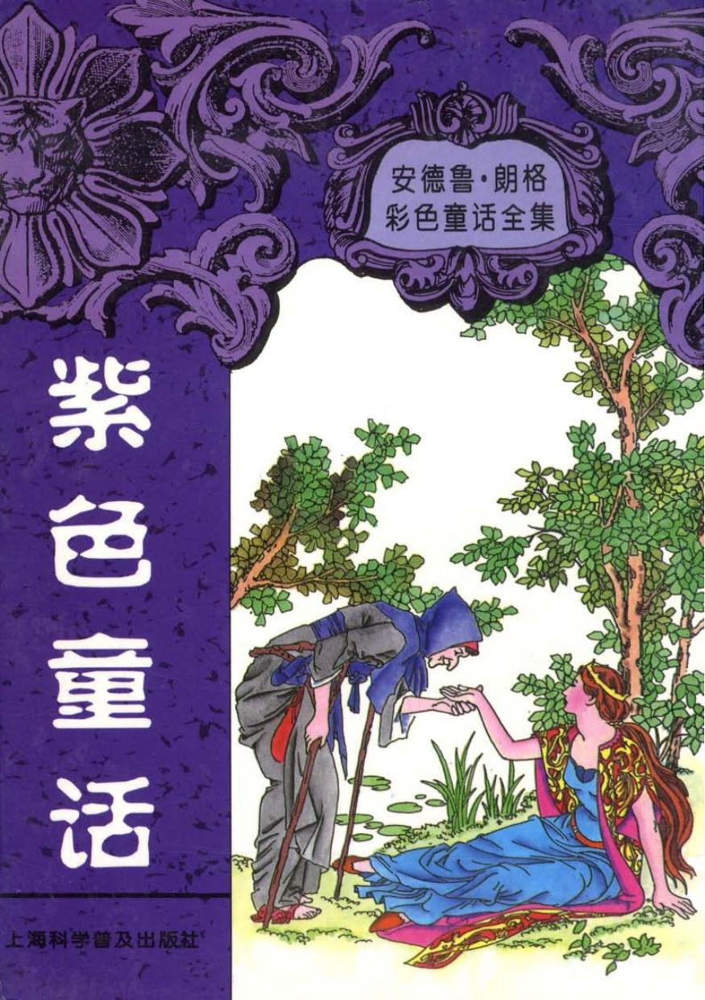

**安德鲁·朗格彩色童话全集**
紫色童话

周文晖 陈群译

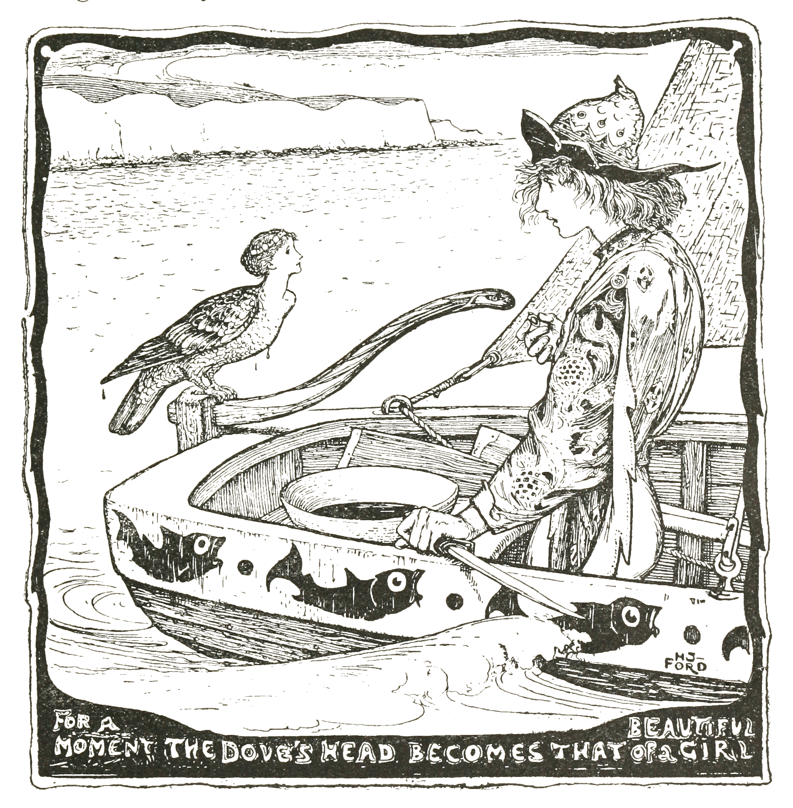

上海科学普及出版社

（沪）新登字第 305 号

Edited by Andrew Lang
The Violet Fairy Book

Published by Longmans, Green, and Co. in 1901

---

安德鲁·朗格彩色童话全集
**紫色童话**

周文晖 陈群译

---

责任编辑：钟海谷
技术编辑：万福棠
出版：上海科学普及出版社（上海曹杨路 500 号邮政编码 200063）
发行：新华书店上海发行所
印刷：上海新四印刷厂
开本：850×1168 1/32
印张：10.25
插页：4
字数：248000
版次：1997 年 7 月第 1 版 1997 年 7 月第 1 次印刷
印数：1-8000
书号：ISBN 7-5427-1195-4/G·341
定价：14.00 元

---

（本版图书凡印刷、装订错误可及时向承印厂调换）

| 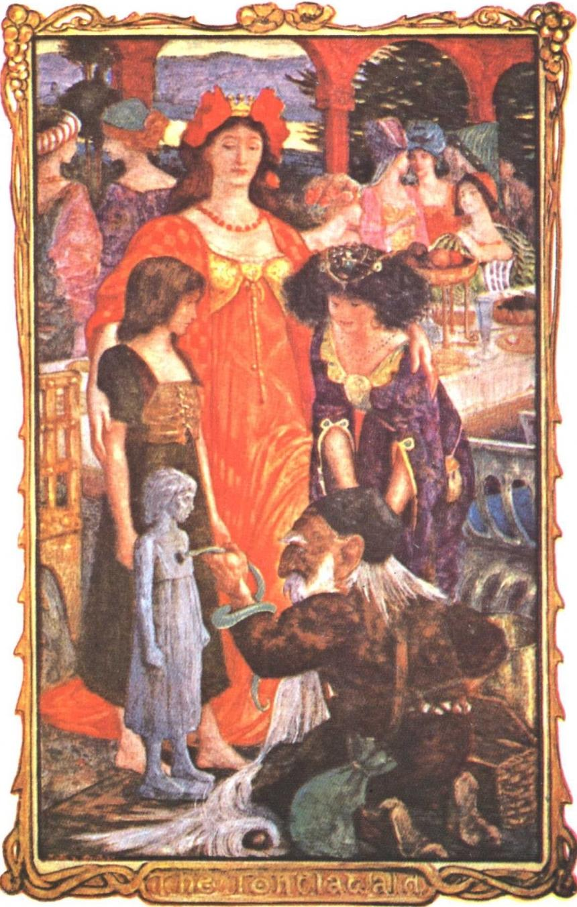 |
| :----------------------------: |
|       《托拉瓦特的传说》       |

 

| 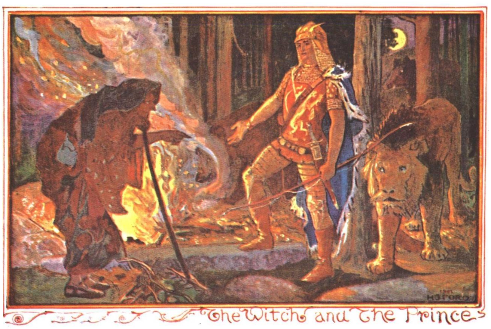 |
| :----------------------------: |
|    《三个王子和他们的野兽》    |

 

| 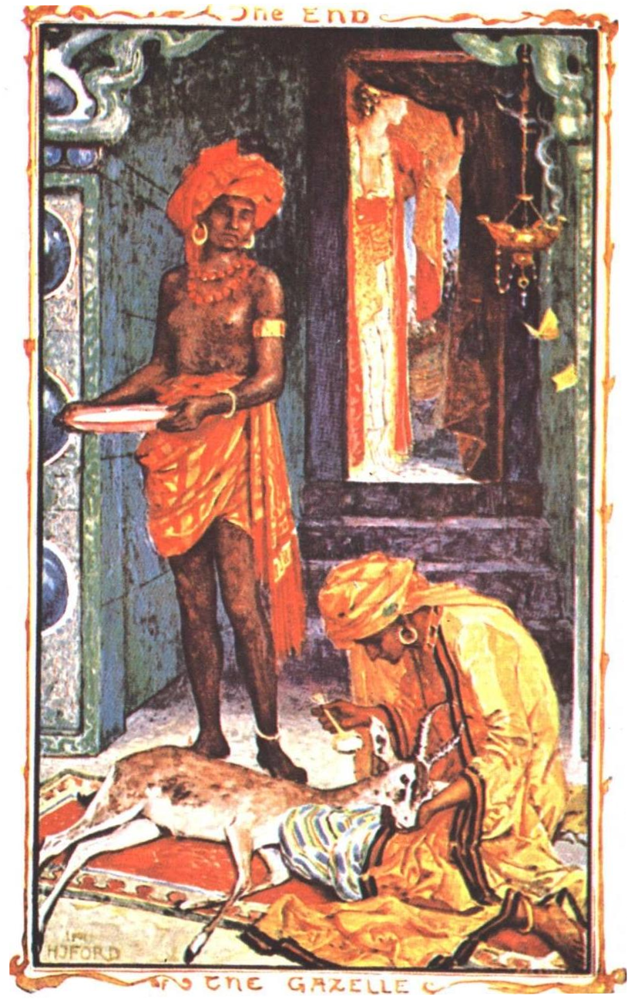 |
| :----------------------------: |
|         《瞪羚的故事》         |

 

| 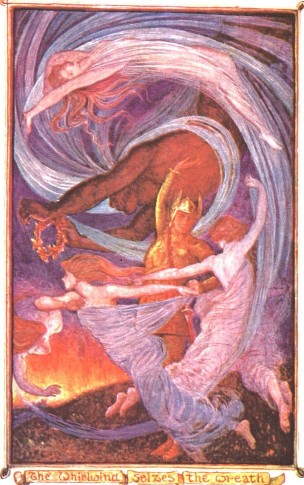 |
| :----------------------------: |
|          《朝霞仙女》          |

 

| 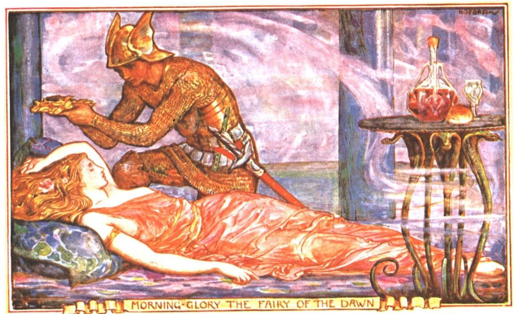 |
| :----------------------------: |
|          《朝霞仙女》          |

 

| 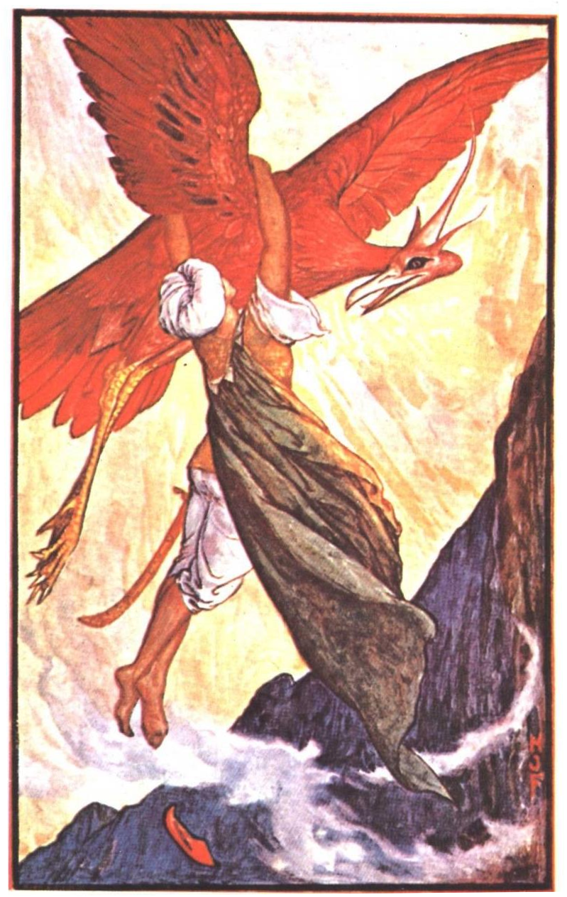 |
| :----------------------------: |
|         《吃人的努达》         |

 

| 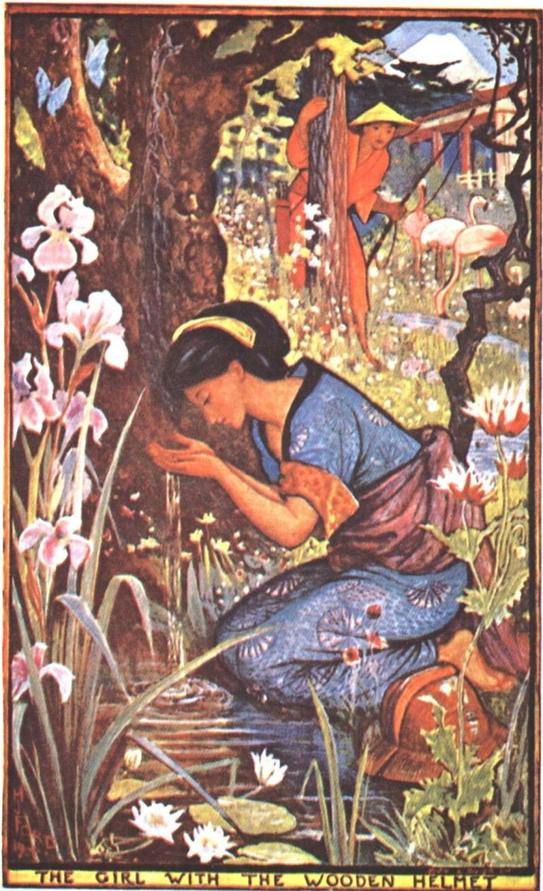 |
| :----------------------------: |
|          《木盔姑娘》          |

 

| 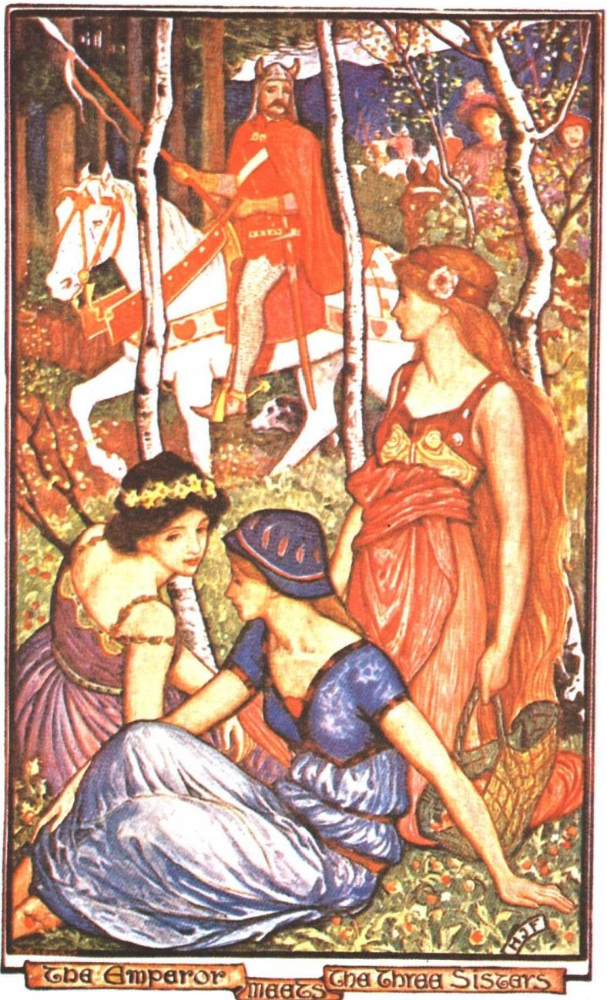 |
| :----------------------------: |
|          《金星少年》          |

前言

《安德鲁·朗格彩色童话全集》是英国著名文学家安德鲁·朗格（1844～1912）编辑的十二集童话。为了编辑这些童话，他广泛地收集英国、欧洲以至全世界的童话和民间故事。那些非英语的文字，如法文、德文、葡萄牙文、意大利文、西班牙文、加泰隆语等主要由他的妻子莱奥诺拉·布朗歇翻译和整理成英文。其中的艰难和辛苦是外人所难以想象的。安德鲁·朗格童话的出版，效果非同凡响。不仅受到英国读者的欢迎，而且被译成多种文字，受到许多国家读者的欢迎，赢得了一代又一代的读者，历数十年而不衰。这不仅源自编者长期的努力，也得益于世界各地广大热衷于这一题材的读者的帮助，他们纷纷把手头的作品和资料寄给安德鲁·朗格。这给了他极大的鼓舞。

安德鲁·朗格认为，这些童话故事很难说是某个人写成的，它们从很久很久以前就流传下来，经过民间艺人和文学家的不断收集和整理，才达到了今天这样思想性和艺术性都比较好的程度。这些童话也被认为是英语中，也许是全世界各种语言中时间跨度最大、包含地域最广、国家和地区最多、内容最丰富的童话集。她是世界古典童话中的瑰宝，童话世界中永不凋谢的鲜花，被译成多种文字，得以广泛流传，一代又一代的儿童被她的魅力吸引，做家长后，又为能给孩子朗读和讲述安德鲁童话而自豪。

《紫色童话》收集日本、塞尔维亚、立陶宛、非洲、葡萄牙、意大利、罗马尼亚、俄罗斯等国家和地区的三十五个童话和民间故事。读了这些故事，我们从中可以看到，很久以前，这些地区的人民是怎样生活的；可以看到他们的欢乐和悲伤，理想和追求。这些故事颂扬勤俭朴素、助人为乐、正直忠诚；谴责贪得无厌、懦弱无能、奸诈狡猾。在这本童话书中，我们还可以读到，那些贫困悲惨和不幸的儿童，如何经过自身不屈不挠的努力和奋斗，在他人的帮助下，获得了新生；那些王子和公主，如何在国家面临困境的关键时刻，挺身而出，迎接挑战，担负起捍卫祖国的神圣职责；此外，还有那些善良的动物，如何忠心耿耿地效忠于主人……

像《安德鲁·朗格彩色童话全集》中的其他各集一样，《紫色童话》中的故事充满了当地的风土人情和乡村气息，读者从中可以领略到许多乐趣，懂得什么是正义，什么是邪恶，什么值得爱，什么值得恨；而且还会对这些地区的人文历史和地理概貌有所了解，让他们更加热爱生活，更加热爱我们这个世界。

 
 

**目录**

[TOC]

 
 

## 托拉瓦特的传说

很久很久以前，在瑞典的中部，有一片宽广的沼泽地，叫托拉瓦特，里面还有许多湖泊。从来没有人敢到里面去过，但不时有些胆子大的人出于好奇，到沼泽地的周围去转转。回来的时候，他们都说在茂密的丛林中，看到一间毁坏了的房子，旁边有许多像吉普赛人那样很脏，穿着破烂衣服的人。他们像蜜蜂一样，在草地上来来去去，有许多是老年妇女和半裸着的儿童。

有一天晚上，一个农民赴宴回家，走进了托拉瓦特的边缘地区，回来也说了同样的故事。说是有许多妇女和儿童围着一堆大火，有的坐在地上，有的在平坦的草地上跳着奇怪的舞蹈。一个干瘪的丑老太婆手中拿着一把长柄铁勺，不时去捅捅燃烧着的篝火，每当她挑起灰烬时，那些小孩就像夜里的猫头鹰一样，尖叫着四处逃窜，好久好久才敢偷偷地溜回来。

除了这些以外，有一两次，他还看见一个长着长胡子的小老头，从森林里蹑手蹑脚地走出来，背着一个比他还大的口袋。那些妇女和儿童看见他来了，都跑过来，哭泣着要抢他的口袋。老头子把他们赶跑，继续走自己的路。

他还说了那里有一只大黑猫，大得像马驹一样。

可是，人们很难全部相信农民说的这些怪事，也分辨不出他说的话中，哪些是真的，哪些是假的。不过，有一点大家确信不疑，那里是发生过奇怪的事情。瑞典国王也曾经下令，砍伐这块弄神弄鬼的森林。可是没人有胆量去执行他的命令。后来，有一个人胆子比别人都大，用他的斧头砍了一棵树，只见斧头砍开的树皮上，一股鲜血喷出来，还听到了像人被砍伤以后，痛得大声尖叫的声音。樵夫吓坏了，拼命地逃跑。从那以后，不管是命令，还是威胁，再也没有人敢到这充满魔法的沼泽地里去了。

在离托拉瓦特几英里的地方，有一个大村庄。村庄里有个农民前妻死了，最近和一个年轻的妇女结婚。可是这次婚姻没有给他们带来幸福。夫妻俩整天吵架，打闹不停，妻子把整个家搞得翻天覆地。当然，这种事情在乡下常有发生，不足为奇。

前妻留下一个女儿叫埃尔莎，是个安分守己的小姑娘。她只希望能过太平日子，可惜她的继母不让她安宁，从早到晚，不是打就是骂。父亲又被继母捏在手中，所以小姑娘受尽折磨，也没有人帮她。

埃尔莎在继母的虐待下，整整过了两年。有一天，她和村子里的其他小孩一起去摘草莓。他们毫不在意地到处乱走，来到了托拉瓦特的边缘。这里的草莓长得最好，草地上一片红色。孩子们如鱼得水，开心地摘着草莓。等吃够以后，就开始装篮子。过了一会，一个年纪最大的孩子叫起来：“跑！快跑啊！我们走进了托拉瓦特！”孩子们像惊弓之鸟一样，纷纷逃窜，只有埃尔莎例外。

这群孩子中，埃尔莎走得最远。在树林中，她找到了一块最好的草莓地。她也听到了那个男孩子的喊叫声，可是不知道是逃跑呢还是留下来好？

“说到底，那又有什么关系呢？”她想，“那些住在托拉瓦特的人，总不会比我的继母更坏了吧！”她抬头看见一只颈上带着小银铃的小黑狗走过来，向她吠叫，后面跟着一个穿着丝绸衣服的女孩。

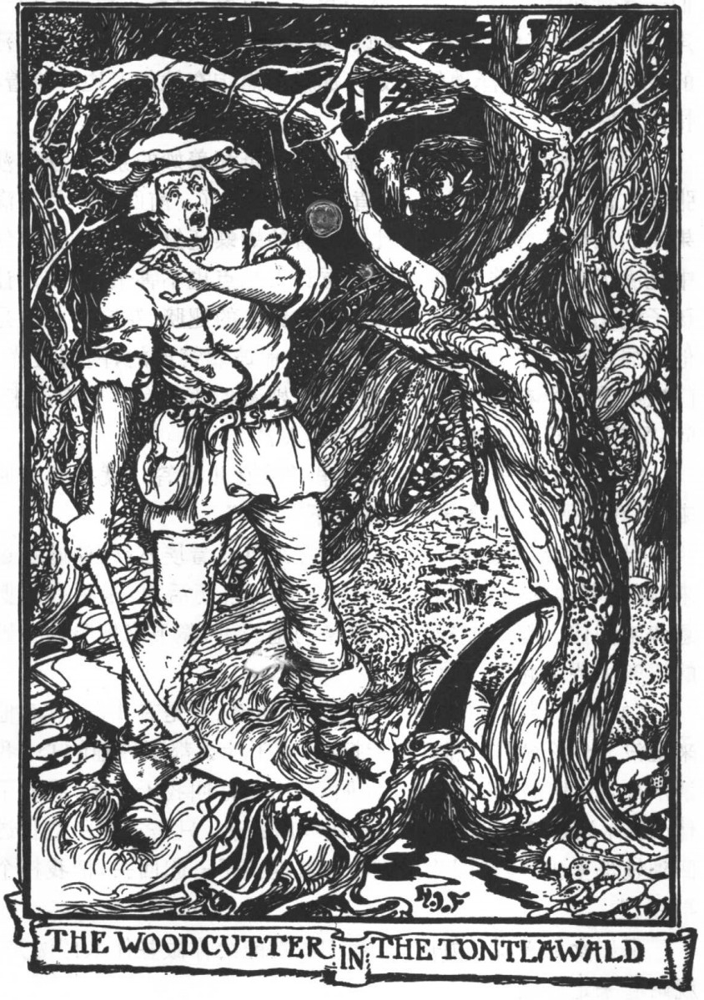

“别叫！别叫！”女孩子把狗弄安静，转过脸来对埃尔莎说，“我很高兴，你不和别的孩子一样逃走。留下来做我的朋友吧！我们一起玩快活的游戏，每天都一起去采草莓。只要我和他们说一声，谁也不敢打你。来吧！我们一起去见我妈妈。”她拉起埃尔莎的手，把她领进沼泽地的深处。那只小黑狗在她们旁边奔跳着，快活地吠叫。

啊！展现在她面前的是一幅多么神奇和美妙的景象，埃尔莎张开吃惊的大眼睛。她想，她肯定是到天堂了。前面是一片结满果实的果树林。树上有许多比最好看的蝴蝶还鲜艳的鸟儿，空气中充满了它们的歌声。这些鸟儿看到人一点也不害怕，它们还让孩子们托在手中，抚摸它们那金色和银色的翅膀。花园的中央是他们居住的房子，这些房子是用宝石和玻璃筑成的，闪闪发光。门口站着一个衣着高贵华丽的妇女，她看到两个女孩子走过来，问：“你今天给我带来了什么样的客人？”

“我看到她一个人留在森林里，”她女儿回答，“就把她带回来，做我的伙伴，你会同意让她留下来吧？”

母亲笑着，不说什么。她上下仔细打量着埃尔莎，叫她走过来，抚摸着她的面颊，和蔼地问她父母是否还活着，是否真的愿意和她们住一起。埃尔莎弯下腰来吻她的手，跪下来把脸埋在她的裙兜里哭泣起来。她说：

“妈妈已经死了好多年了，爸爸还活着。可是有我没我，对他来说没有什么两样。继母整天打我，我干什么都不称她的心。我请求你，让我留下来吧！我可以照看牲口；你叫我干什么，我就干什么。你只要轻轻地说一句，我就听你的话。只是求你别把我送回到她那里去。她会因为我没有和其他孩子一起回去，把我打个半死。”

那妇女笑着说：“好吧！让我们看看能给你做些什么！”说完，就站起来走进屋。

那女孩子对埃尔莎说：“一点也用不着害怕，我妈妈会成为你的朋友。从妈妈的眼神中，我看得出，她考虑过以后会同意你的请求。”她叫埃尔莎在外面等着，就到房子里去找她妈妈。埃尔莎独自站在那里，在希望和害怕之间摇摆着，她觉得，那女孩子也许永远也不会出来了。

埃尔莎终于看到那女孩子穿过草地走过来，手中还拿着一个盒子。

“我妈妈说，今天我们可以一起玩。她还要考虑一下，能帮你做些什么。不过，我很想你能永远地留在这里。你走了我真受不了。你到海上去过吗？”

“海？”埃尔莎惊奇地问，“什么是海？我从来没有听说过这种东西！”

“啊！我很快就会让你看到。”女孩子说。她把盒子的盖打开，盒子里面有一小块布，布上有两滴水，一个贝壳，两片鱼鳞。女孩把两滴水抖在地上。一转眼，花园和草地，连同上面的房子什么的，都全部不见了。好像地球忽然裂开，把它们全部吞掉了一样。取而代之的是，一眼望不到边的海洋，一直延续到天边，和天相接。只有她们俩站的地方，是一块干地。女孩把鱼鳞拿在手里，把贝壳放入水中。贝壳越来越大，越来越大，最后变成一只漂亮的小船，上面可以坐 12 个小孩。女孩子走上船，埃尔莎有点害怕，小心翼翼地跟着，女孩子为此还笑她。女孩把鱼鳞当舵，把船开出去。海浪温柔地拍打着小船，小船轻轻地摇着，她们就好像在摇篮里一样，在海上飘流着。她们还看到其他船只，船上有许多人，他们高兴地唱着歌，闹着玩。

“我们要唱一首歌来回答他们。”女孩子说。可是埃尔莎不会唱歌，女孩只好自己唱起来。埃尔莎一点也听不懂他们在唱什么，只是有一个词在歌中反复地唱着，那就是“基西克”。埃尔莎问她，这是什么意思。女孩说，这是她的名字。

她们在船上过得很开心，要不是有人喊她们，她们决不会想到要回去。那声音喊道：“孩子们，时候不早了，你们该回家了！”

基西克从口袋中拿出小盒子，把里面的那块小布拿出来，浸在水里。啊！转眼间大海消失了，周围一滴水也没有，花园和那幢漂亮的房子又出现了。她们像刚才一样，站在房子的旁边。基西克把贝壳和鱼鳞放回盒子，她们一起走进房间。

她们走进一个大厅，那里有二十四个衣着华丽的妇女正围着一张桌子坐着[^1]，好像是参加结婚典礼。桌子一头的主人位置上，放着一张金色的椅子，上面坐着房子的主人。

埃尔莎不知道看什么好，周围的一切比梦中能想象的还要漂亮。她和大家一样坐下来，吃着那些香甜的水果。她想，自己肯定是进了天堂。客人们温柔地说着话，可用的是一种奇怪的语言，所以她什么也听不懂。过了一会，女主人转过头来，对站在她身后的侍女小声地说了些什么。那侍女走出去，领进来一个小老头。小老头的胡子比他人还要长。他向女主人深深地鞠了一躬，然后安静地站在门口，听候她的吩咐。

“你看到这个小女孩了吧！”女主人指着埃尔莎对他说，“我想认领她做女儿，你照她的样子，再给我做一个，我好把她的替身送回她的家去代替她。”

老人从头到脚仔细地观察着埃尔莎，好像在测量她的尺寸，然后向女主人鞠躬，走出大厅。

吃过饭以后，女主人和蔼地对埃尔莎说：“基西克请求我，让你留下来和她一起住。你也跟她说过，你喜欢留在这里，是这样的吗？”

埃尔莎跪下来，吻她的手和脚，感谢她让自己能够摆脱残忍的继母。女主人把她从地上扶起来，抚摸着她的头，说：“只要你是个听话的好小孩，一切都会好的。我会照顾你的，直到你长大，能够自己照顾自己，不再需要别人的帮忙。我有个侍女教基西克做各种手工活，她也会来教你。”

过了一会儿，那个老人走进来，肩膀上扛着一个模子，里面都是泥土，左手还提着一个篮子，篮子盖着，看不出里面的东西。他把模子和篮子放在地下，把泥土拿出来，开始做一个像人一样大的泥人。做好以后，他在泥人的胸口挖了一个洞，把一些面包放进去，再从篮子里拿出一条蛇来，把它塞进泥人体内。

“现在，”他对女主人说，“我们需要的，只是这小女孩的一滴血了。”

埃尔莎听见他的话，吓得面无人色。她想，这是叫她把灵魂卖给替身了。

“别害怕！”女主人赶紧对她说，“我不会用你的血来做任何坏事，我只是想给你自由和幸福。”说完，她拿出一枚金针，扎入埃尔莎的胳膊，抽出来以后就交给老人。老人把针插入泥人的心脏。做完这些以后，他把泥人放入篮子，说明天，她们将会看到他的杰出作品。

第二天早晨，埃尔莎醒过来，她睡在一张铺着丝绸的床上，头下枕着柔软而雪白的枕头。床边一张椅子的靠背上，放着一套漂亮的服装，那是准备给她穿的。一个侍女走进来，帮她梳理长长的头发，还带来一套最好的内衣，叫她换上。最令她高兴的，是侍女手中拿着的那双绣花小鞋。自从残酷的继母来了以后，埃尔莎从来就没有穿过鞋，继母强迫她光着脚跑来跑去。在激动和兴奋之中，埃尔莎没有想到，她昨天穿的那套破旧衣服到哪里去了，它们像变魔法一样，一个晚上就不见了。谁会拿走这些旧衣服呢？

原来埃尔莎的那套旧衣服，已经给她的泥人穿上了。过了一个晚上，泥人已经长得和她一样大，她们真是一模一样，谁也分辨不出来，哪个是真的，哪个是假的。埃尔莎看到昨天的自己，吓得连连退了几步。

“你别害怕，”女主人看到她的恐惧，对她说，“这个泥人不会给你带来伤害，她只是为了对付你的继母，代替你去挨打。她尽管用力去打泥人，它一点也不会觉得痛。要是这个邪恶的女人不知悔改，对你好一些，你的替身总有一天会给她应得的惩罚。”

从这一天起，埃尔莎像从小就在金色的摇篮里长大的幸福孩子一样，过得非常快活。她没有任何烦恼，也不要担心什么。她要做的事情也越来越容易。过去的日子越来越像是一场恶梦。可是，她越是觉得幸福，对周围的一切就越觉得惊讶。她越来越感到，这其中一定会有一股强大的，不可捉摸的力量。

在院子里，在离房子二十步远的地方，有一块巨大的花岗岩石台。每到吃饭的时候，那个长着很长胡子的老人，就来到这个石台上，拿出一根小银棍，敲三下石块，那声音可以传得很远。到第三下的时候，会有一只金色的大公鸡跳到石台上。公鸡拍动翅膀啼叫的时候，石台就会分开，里面会有东西流出来。开始是一张长桌子，上面放着一套套餐具，份数正好是要围着桌子吃饭的人数。桌子会自动地走进屋子里，用不着人去搬。

公鸡叫第二声的时候，椅子就会出现，走到桌子的旁边。然后就是一道一道用盆子装着的菜，还有酒、苹果和其他水果，毫不费力地来到每个人的面前，用不着麻烦任何人。大家都吃饱以后，老人又开始敲石台，金鸡又开始啼叫，那些桌子、椅子，连同盘子、刀叉，又自动进入石台中去。

可是，到第十三道菜送上来的时候，没有一个人去碰它。一只大黑猫跳上石台，站在公鸡的旁边。公鸡的另一边就是这第十三道菜。它们站在那里等着，直到老人走过来。他把菜盆子托在手中，另一只手抱住黑猫，叫公鸡站到他的肩膀上。然后，他们一起消失在石台之中。

这块奇妙的大岩石中不但有食物，而且还有衣服和一切你生活中所需要的东西。

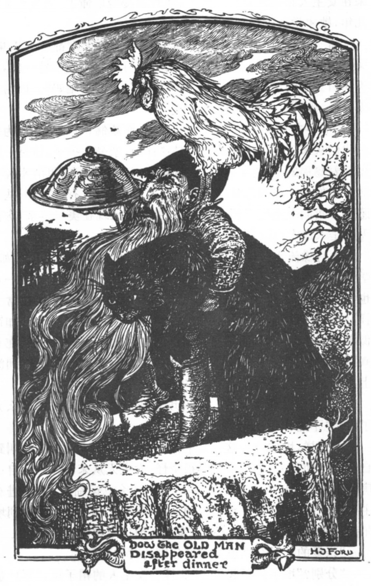

吃饭的时候，他们经常讲一种埃尔莎听不懂的奇怪语言。后来在女主人和她的女儿帮助下，她开始慢慢地懂了。只是过了好几年，她才学会讲这种语言。

有一天，她问基西克，为什么第十三道菜天天都送上饭桌，又天天都送回去，一点也不去动它呢？可是基西克和她一样，也不明白其中的道理。不过，基西克肯定是去问过她妈妈，因为几天以后，她严肃地对埃尔莎说：

“不要去为满足自己无聊的好奇心而烦恼。你想知道，为什么我们从来不吃第十三道菜？是这样的，亲爱的孩子，这是一道象征着赐福的菜。吃了这道菜，就意味着结束我们这里的幸福生活。假如人不是那么贪婪，不去把一切都占为己有，留下一些来感谢给我们幸福的赐福者，这个世界就会比现在美好得多。贪得无厌是人最大的缺点。”

岁月像流水一样地过去了。埃尔莎长成了一个可爱的姑娘，学到了许多在自己的家里根本学不到的知识。可是基西克一点也没有变，还是那个第一天遇见埃尔莎时的小姑娘。像往常一样，她们每天早上都一起读和写，大约有一个钟头。埃尔莎如饥似渴地想学会一切，而基西克却仍然最喜欢玩小孩的游戏。在有兴致的时候，她会把一切事情抛在脑后，拿出那个宝盒子，到海上去玩，那里对她来说，也十分安全。

“真可惜！”她常常叹息着对埃尔莎说，“你已经长得这么大了，再也不能和我一起玩了。”

就这样，埃尔莎在这里过了九年。有一天，女主人把她叫到自己的房间里去。埃尔莎觉得很奇怪，女主人从来不叫她到自己房间里去。她心情非常沉重，担心会有什么厄运临头。她跨进女主人房间的门槛时，看到她两颊通红，眼中充满了泪水。看到埃尔莎进来，她赶紧把泪水擦掉，像是害怕让埃尔莎看见。

“亲爱的孩子”，她说，“我们分别的时候到了。”

“分别？”埃尔莎哭起来，把头埋在女主人的裙子里，“不！亲爱的妈妈，我们永远也不要分别，除非死亡。你曾经张开双臂拥抱我，现在，你不能就这样把我推开。”

“啊！亲爱的孩子，请安静下来。”女主人说，“你不知道，为了你的幸福，我在做些什么。你现在已经是一个妇女了，我没有权力继续把你留在这里。你必须回到人类的世界去，那里欢乐在等待着你。”

“亲爱的妈妈，”埃尔莎再次哀求，“我恳求你，不要叫我离开。我不希罕别的什么幸福，只希望生和死都和你在一起。让我当你的侍女吧！或者叫我干些什么别的事情都行，只是别把我送回原来的世界去。要是当初你让我继续和继母待在一起，也比把我带到天堂来，再把我送回去好一些。”

“不要这么说，亲爱的孩子，”女主人说，“你不明白，为了你的幸福，要做那么多事情，我要付出多大的代价。事情也只能这么办。你只是一个普通的人，总有一天会死去，你不能再留在这里了。我们虽然和人一样，有着一样的身体，可我们完全不是人类。当然，要弄懂这些，对你来说，太难了。将来某一天，你会找到自己的丈夫，他注定是为你而生的。你将会幸福地和他生活在一起，直到死亡把你们分开。和你分开，对我来说也非常艰难，可又不得不这样做，你也必须要下这个决心。”

女主人拿出一把金梳子，慈祥地帮她梳着头发，然后叫她回去睡觉。可是，可怜的姑娘哪里睡得着，等待着她的日子，好像是暗无天日，没有月亮，也没有星星的黑夜！

现在，让我们回过头来，看看埃尔莎的家这几年来发生的事情，看看埃尔莎的替身日子过得怎么样？谁都知道这个事实，坏女人随着年龄的增长，只会越来越坏，不会变好。埃尔莎的继母当然也不例外。可是埃尔莎的替身一点也不怕痛，那些日夜不停，像雨点一样落在她身上的抽打毫无意义。孩子的父亲要是想帮女儿说句好话，继母就会向他大发脾气，事情反而弄得更加不可收拾。

有一天，继母把女孩狠狠地打了一顿，那样子实在骇人听闻。打了还不够，还说要杀了她。女人疯狂地伸出双手，扼住她的喉咙，要把她卡死，这时候，女孩子的嘴里吐出一条黑蛇，咬了女人一口，她一声也不吭，就倒在地下死了。

晚上，丈夫回到家里，看到妻子躺在地下死了，尸体浮肿，样子完全变了。女孩子到处也找不到。他的喊叫声惊动了邻居。他们从家里走过来看，可是谁也不知道，这究竟是怎么一回事。他们说，中午的时候，是听到很大的吵闹声。不过，事情既然发生在大白天，他们也就不当一回事了。这一天，后来也没有发生什么，就是谁也看不到女孩子的踪影。

丈夫给妻子准备后事，把她的尸体埋葬以后，疲倦地躺在床上，心中暗暗庆幸，这个给家庭带来不幸的祸女人终于死了，他也可以从此得到解脱了。他看到桌子上有一片面包，因为肚子饿，就把它吃了，然后睡着了。

第二天，邻居发现，他也死了，尸体像他妻子一样浮肿，因为那片面包是老人在做埃尔莎的替身时，放在里面的。人们把他埋葬在妻子的墓旁。他们的女儿从此也毫无音讯。

再说埃尔莎和女主人谈话以后，整夜都在哭泣，为自己被迫离开这个可爱的家庭，为自己不幸的命运而悲哀！

第二天一早她醒过来，女主人把一枚印章金戒指套在她手指上，把一个结着绸带的小金盒挂在她头颈上，然后把老人叫来，忍着眼泪叫他把埃尔莎领走。

埃尔莎想说些什么，可是还来不及感谢女主人，老人手中的银棍就轻轻地在她头上点了三下。埃尔莎立刻看到，自己在变成一只鸟，双臂长出了翅膀，双脚变成了鹰的脚，爪很长，鼻子弯曲起来，像鹰的一样，羽毛覆盖了全身。接着，她展翅向蓝天翱翔，好像生下来就是一只鹰一样。

一连好几天，她不断地向南方飞去，只有翅膀觉得累的时候，才停下来休息，因为这几天，她一直没有感到饥饿。

这一天，她在一片森林上空飞行着，听到森林里有猎狗在跟着她吠叫，它们没有翅膀，不能奈何她。突然，她觉得到刺骨穿心般的疼痛，失去知觉，从天上掉下来，落到地上，一枝箭射中了她。

等她醒过来的时候，发现自己恢复了人的形状，正躺在森林里。出了什么事，怎么会躺在这里，她好像做了一场恶梦一样，不太明白。

正当她想不出该怎么办的时候，一个王子骑着马奔驰过来。看到埃尔莎，他从马上跳下来，拉住埃尔莎的手说：“啊！今天命运把我带到这里来，真是太幸福了。亲爱的姑娘，半年以来，我一直在梦见，有一天我会在这片森林中找到你。虽然我到这里来找过几百次，每次都毫无结果，我从来没有放弃过希望。今天，我在寻找一只被我射中的大鹰。可是鹰没有找到，却找到了你。”

说完，他把埃尔莎抱上马，带她回到城里。老国王热情地欢迎她的到来。

几天以后，他们举行了婚礼。埃尔莎披上婚纱的时候，五十辆装满各种漂亮物品的马车来了，这是托拉瓦特的女主人送给新娘的嫁妆。

国王死了以后，埃尔莎成了王后。她上了年纪以后，给人们讲了这个故事，这也是我们听到的，关于托拉瓦特的最后消息。

## 天下最大的谎话

森林的边沿住着一个老人，他只有一个儿子。有一天，他把儿子叫来，叫他到磨坊里去，把一些小麦磨成面粉，同时关照他，要小心，绝对不要找不长胡子的磨坊主。

男孩子背着小麦走出去，还没有走多远，就看到一个大磨坊，一个没有胡子的人站在门口。

“你好！不长胡子的人。”男孩子说。

“你好！小孩。”那人回答。

“我可以在这里磨些面粉吗？”

“当然可以！等我磨好以后，你爱磨多久就磨多久。”

男孩子忽然想起父亲说过的话，赶紧和那个人告别，沿着河流走下去，来到另一个磨坊。可是他没有想到，他刚一转身，那个人就抓起一包小麦，跑在他的前面，先来到了这个磨坊。男孩子走进来，看到又是一个没有胡子的人坐在那里，也就不停下来，继续向前走，来到第三个磨坊。可是这一次，那个人还是比他聪明，已经抄近路先来到这里。到第四个磨坊的时候，同样的事情又发生了。这一次，男孩子很恼火，他想，再走也没有用了，看起来每个磨坊主都是不长胡子的。他把小麦放下来，决定就在这里磨面粉。

没有胡子的人把自己的小麦磨好以后，男孩子开始磨。那个人对他说：“小孩，我们是不是用你的面粉做些饼吃？”

小孩想起父亲说过的话，觉得很不自在。不过，他想，事情既然已经来了，就让它来吧！所以他说：“很好，做吧！”

那人站起来，把一些面粉放入盆中，中间弄出一个洞来。他叫男孩到河边去取些水来和面。面粉和好以后，他们放进火中去烤，上面还盖上一些热灰。饼烤好了，那人对男孩子说：

“孩子，你看，要是我们俩分这个饼吃，谁都吃不饱。这样吧！我们来个吹牛比赛，谁的牛皮吹得最大，最好，这个饼就属于谁。”

于是，那人开始动足脑筋吹牛。等他吹得差不多，再也吹不出新的玩意儿以后，男孩子对他说：“我的好伙伴，你吹牛的本领只有这些？算不了什么，听着，我要告诉你一个真实的故事。”

“在我的青年时代，当我还是一个老头的时候，我们家有许多蜂箱。每天早上，我起床以后，总要数一遍蜂箱的数目。蜂的数目很容易数清楚，可这些蜂箱的数目，我从来没有数清过。有一天，我数蜜蜂的数目时，发现我最好的一只蜂不见了。我不敢怠慢，赶快给一只公鸡装上鞍子，骑上它就出去寻找。我一直找到海边，知道它已经飞过海了，我必须跟过去。等我到对岸的时候，我看到一个人把我的蜜蜂套上犁在耕地，还在地里撒上玉米种子。”

“‘这是我的蜜蜂！’我喊叫起来，‘你是从哪里抓到它的？’”

“‘兄弟！’那人回答，‘假如它是你的，那么你带走吧!’他不但把蜜蜂还给我，还给了我一袋玉米种子，作为使用我的蜜蜂的补偿。我把那口袋玉米种子扛上肩膀，把公鸡上的鞍子卸下来，装在蜜蜂的背上，然后骑上去，这样好让公鸡休息一下。我用一根绳子拉着公鸡，就开始飞越海洋，准备回家。当我们在海洋上空飞行时，口袋上的一根绳子忽然断了，一袋玉米种子全部落入海中。损失当然不小。不过，再想它也没有用了。我们回到家，天已经黑了。我从蜜蜂上下来，解下鞍子和缰绳，好让它休息，吃晚饭。给公鸡喂些饲料以后，我就去睡觉了。”

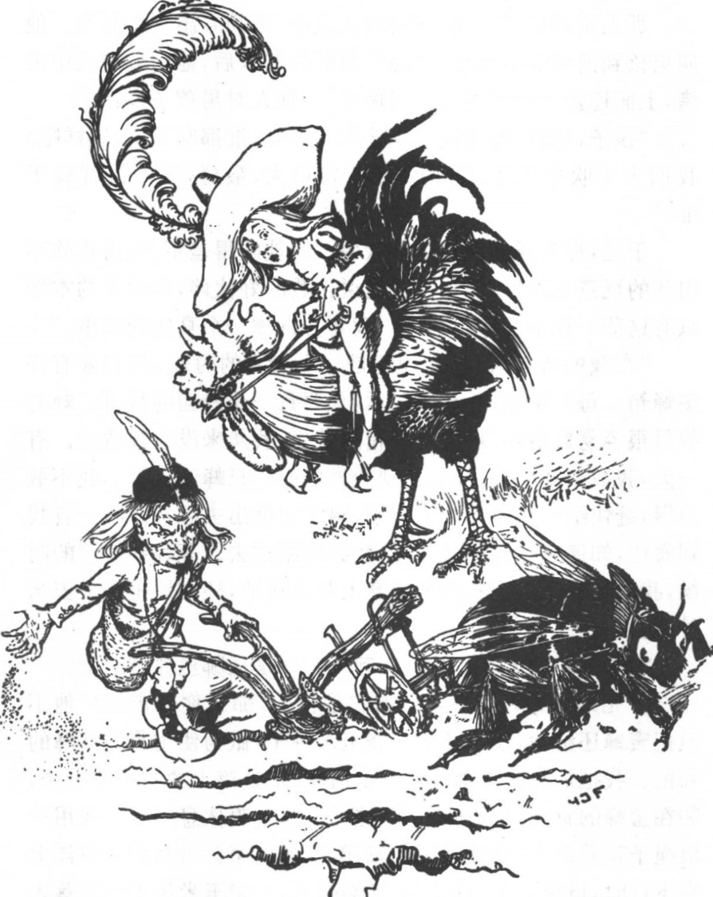

“第二天太阳升起，我醒过来，眼中看到的是一种什么样的景象！晚上，来了一群狼，把我的蜜蜂吃掉了。蜂蜜到处都是，山谷里的蜂蜜有人的膝盖那么深，山上的蜂蜜有脚腕那么深。我开始考虑，怎么样才能把这些蜂蜜收集起来，带回家。”

“我恰巧有一把小斧头，就带着它到森林里去，希望能杀死一些野兽，好用它们的皮来做袋子。来到森林，我看到两头鹿在用一条腿走路。我挥动一下斧头，一下子就砍倒两头鹿，用它们的皮做了三个口袋。我把这三个口袋装满蜂蜜，放在公鸡的背上驮回家。”

“回到家以后，邻居告诉我，我父亲刚出世。所以，我必须出去取回一些圣水，好给他洗礼。一路上我在思考着，用什么办法把掉进海里的玉米种子收回。我带着圣水，来到丢玉米种子的地方，看到种子落在一块肥沃的土地上，长得非常好。更有趣的是，一只无形的手把它们收割了，而且做成了一个玉米饼。”

“我拿着圣水和饼，从海洋上空飞过。这时，忽然下起倾盆大雨，海水拼命地往上涨，把我的玉米饼也冲掉了。我虽然安全地降落下来，却为丢了玉米饼而非常烦恼。”

“我突然想起，我的头发太长了。虽然我坐着的时候，头发只到耳朵根；可是站起来的时候，头发一直拖到地下。我拿起一把刀，割下来一绺，把它编在一起。到晚上睡觉了，就把它打个结当枕头。”

“到哪里去找火呢？我有一个取火盒，可是没有木柴。后来我想起，我的衣服上插着一根针，就把它劈成片，烧起来。我在火边舒服地躺下来睡觉。厄运总是跟随着我。我睡着以后，一个火星落在我的头发上，燃烧起来。绝望之中，我扑倒在地下。我很快就沉下去，一直沉到腰部。我拼命地挣扎，想爬出来，可是越陷越深。没有办法，我只好跑回家去，拿来一把铲子，把我挖出来。出来以后，我就带着圣水回家。”

“在回家的路上，我看到许多人在一块成熟的庄稼地里收割庄稼。空气突然燥热起来，不少人受不了，昏迷过去。我把他们救醒，问：‘你们干吗不把我们家的那块阴影带来遮太阳？它有二天那么长，半天那么宽。’我父亲听了我的话，马上跳起来去拿那块阴影。那些农民在阴影下面干劲十足，非常卖力地干活。我拿起一个木桶，准备去汲些水来给他们喝。”

“我来到井旁，看到井水已经结了很厚的冰。为了汲水，我不得不把我的头拿下来，把冰敲开。我提着水桶回来，那些农民都惊叫起来：‘啊！你的头到哪里去了？’我伸出手来摸，真的，我的头没有了，肯定是留在井边了。我赶快跑回去找，发现有一只狐狸正在咬我的头。它刚才恰巧从这里经过，把我的头从井水里拖上来。我偷偷地走过去，狠狠地踢了它一脚。它大叫一声跑了，留下一张羊皮纸，上面写着，这个饼是我的，不长胡子的人什么也没有得到。”

说完这些话，小孩站起来，拿着饼回家了，留下那个没有胡子的人，在那里咽自己种下的苦果。

## 三个奇怪的乞丐

有个商人叫马克，人们都叫他“富人马克”。他心狠手辣，从来容不得穷人。他看到乞丐靠近他的房子，要么就叫仆人把他赶走，要么就把狗放出去咬他。

有一天，三个很穷的老人到他家门口乞讨，他正想把那条凶猛的狗放出来咬他们，他的小女儿安娜塔莎走过来，对他说：

“亲爱的爸爸，今晚让这些穷老人睡在这里吧！让我高兴高兴。”

她父亲不忍心拒绝她，就让三个乞丐睡在阁楼里。半夜，房子里的人都睡熟以后，小安娜塔莎爬起来，到阁楼上，朝里面偷看。

三个老人靠着拐杖，站在阁楼中间，灰白的长胡子一直拖下来，盖在他们的手上。他们正在低声地说着话。

“有没有什么消息？”年纪最大的一个问。

“旁边的村子里，一个叫伊万的农民，刚生下第七个孩子，我们该给他起个什么名字？送给他什么命运？”第二个说。

第三个接着小声地说：“叫他瓦西里。把这家狠心肠的主人的全部财产都给他。这个人想把我们从家门口赶走。”

说了一会儿话以后，他们准备妥当，就悄悄地走了。

小安娜塔莎听清楚了他们说的每一句话，跑去告诉她父亲。马克非常吃惊，他想了又想，第二天一早就赶到旁边的村子里，想打听一下，是否真有这个孩子出生。他先来找牧师，问在他的教区里有没有小孩出世。

“昨天，”牧师说，“这个村子里最穷的一家，生了一个男孩。我给这个不幸的小东西起名叫瓦西里。他是这家第七个儿子，最大的也只有七岁。他们连一口饭都吃不上，谁愿意来当这些小乞丐的教父呢？”

商人的心急速地跳动着，他已经想好了一整套恶毒的方法，来对待这可怜的小婴孩。他说，他愿意当这个孩子的教父，还吩咐准备好一顿丰盛的洗礼宴席。小孩被带来接受洗礼。马克对他的父亲非常友好。洗礼结束以后，他把伊万拉到一旁来对他说：

“你看，我的朋友，你这么穷，怎么能把这个孩子养大呢？把他交给我吧！我会为他做点事情，我给你一千块克朗作为礼物，你看合算不合算？”

伊万抓抓头皮，想了又想，最后同意了。马克把钱数给他以后，用一块狐狸皮把小孩包起来，放在雪橇上，就动身赶回家。走了几里地以后，他停下来，抱起小孩向悬崖边走去，狠心地把他扔下去，嘴里还咕噜着：“去吧！到那里去，想办法拿我的财产去！”

这时候，恰巧有些外国商人也沿着这条路赶来看马克，准备还给他一万两千块克朗。他们从悬崖边经过时，听到小孩的哭声。他们顺着哭声的方向看过去，看到两堆大雪中间，有一块绿色的花草地，有个小孩正躺在花丛中。

他们把小孩捡起来，小心地包裹好，继续向前赶路。他们来到马克的家，把看到的这件奇怪的事情告诉他。马克马上猜出，那小孩肯定是他的教子，请他们让他看看，说：

“这小家伙真好玩，我想收养他，你们要是同意，欠我的债就免了。”

商人们非常愿意做这笔好买卖，他们把小孩留给马克就走了。

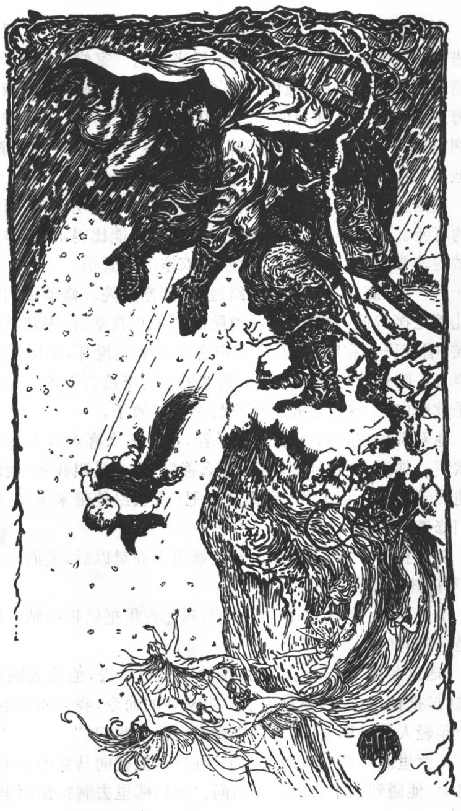

到了晚上，马克把小孩放进一个木桶，把桶盖钉紧，把木桶扔进海里。木桶在海里漂了很远，后来漂到一家修道院旁。那些修道士正在海边晒网，他们听到了小孩的哭声，那声音好像是从在海边飘泊着的木桶中传来。他们把木桶拖上岸来，把盖打开，看到里面有一个小孩！修道院院长听到这个消息，决定收养他，给他起名叫瓦西里。

瓦西里和那些修道士一起生活，长成一个聪明、善良而又英俊的青年。他读书、写字、唱歌，没有一个人能比得上，样样事情都做得非常好。院长让他当上了藏衣室的保管员。

有一天，商人马克从这里路过，来到修道院。修道士们非常有礼貌地接待他，领他参观修道院的房子和教堂。他来到教堂的时候，唱诗班正在唱歌，有一个声音非常响亮悦耳，他问这是谁的声音。院长就把瓦西里怎么到这里来的奇迹告诉他。马克一下子就明白了，这肯定是他两次想杀死的教子。

他对院长说：“我无法向你形容，我是多么喜欢这个青年人的歌声。你说，他是那么聪明，那么善良，他要是跟我走，我就会让他照管我的一切事务。把他给我吧！我会给他带来幸福，我给你们修道院两万块克朗。”

院长犹豫了好久，在和所有的修道士商量以后，他们一致认为，不应该妨碍瓦西里的前途。

于是，马克给妻子写了一封信，叫瓦西里把信带给她。他的信是这样写的：

“送这封信的人来了以后，带他到肥皂厂去，他从大锅旁边走过时，把他推进去。要是你们不服从我的命令，我会非常生气。这个年轻人是个坏家伙，他活着肯定会毁了我们。”

瓦西里的航行一帆风顺。上岸以后，他就向马克的家走去。半路上，他碰到三个乞丐。他们问：“你到哪里去啊？瓦西里。”

“我到商人马克的家里去。他有一封信，叫我带给他妻子。”瓦西里回答。

“把信给我们看看。”

瓦西里把信交给他们。他们对着信吹了一口气，又把信还给他，说：“现在可以走了，把信交给马克的妻子，你再也不会被抛弃了。”

“瓦西里来到商人的家，把信交给他妻子。女主人读着，读着，简直不敢相信自己的眼睛。她把女儿叫来一起看，信中明明白白地写着：

当你们收到这封信的时候，准备举行婚礼。明天就把我的女儿安娜塔莎嫁给他。要是你们不服从我的命令，我会非常生气。”

安娜塔莎看着送信来的人，觉得很喜欢他。他们给瓦西里穿上漂亮的衣服。第二天，两个人就结婚了。

马克按照原来的计划，准时地返回家。他的妻子、女儿，还有女婿，都出来欢迎他。马克看到瓦西里，不禁火冒三丈，向妻子大发雷霆。“没有得到我的许可，你怎么敢把我女儿嫁给他。”他气愤地问。

“我只是照你的吩咐去办。”她说，“这是你的信。”

马克看了信，这肯定是他的笔迹，可决不是他的意愿。

“好吧！”他想，“你已经逃过三次了。可是现在，我有办法对付你了。”

他耐心地等待了一个月。在这个月里，他对女儿和女婿都非常仁慈和善良，大家相处得很快活。

一个月过去了，他对瓦西里说：“我要你替我走一趟，到我的朋友蛇国王那里去，它那美丽的国家在这个世界的尽头。十二年以前，它在我的一块土地上建起一座城堡。我要你去跟它要这十二年的地租，顺便向它打听一下，三年前，我有十二只船开到它的国家去，这些船现在到哪里去了？”

瓦西里不敢违背他的话。他背上一口袋饼干，向妻子告别就出发了。妻子不忍心和他分离，哭得非常伤心。

我也无法对你说，这些路程到底是长还是短。正当他在赶路，忽然听到有个声音喊叫：“瓦西里！你要到哪里去？”

瓦西里抬起头来找说话的人，可是一个人影也不见。他喊道：“是谁在和我说话？”

“是我，老橡树，告诉我，你要到哪里去？”

“我到蛇国王那里去，去收十二年的地租。”

“到那里以后，别忘帮我问一问蛇国王，我的根已经烂了，一半已经死了，可还是绿叶葱葱，我到底还能活多久？”

瓦西里继续往前走。他来到一条河边，乘上渡船。老船夫问他：“你要赶很远的路，是吗？我的朋友！”

“我要到蛇国王那里去。”

“那么，到时候请帮我问一问蛇国王，三十年来，我在这里划过来，划过去，我老了，累了，我还要划多久？”

“好的，”瓦西里说，“我会问它的。”

他不停地向前走，来到一个很狭窄的海峡旁。一条很大的鲸鱼横跨海峡，人和车子都从它的背上走过去，好像它是一座桥似的。他从上面走过去的时候，鲸鱼问他：“你到哪里去？”

“我到蛇国王那里去！”

鲸鱼请求他说：“到时候，请别忘了帮我问一下蛇国王，我在海峡里已经躺了三年，人和马在我背上来来往往，几乎把我的肋骨都踩断了，我还要在这里躺多久？”

“我会记住的。”瓦西里说完，继续向前走。

他走啊！走啊！走啊！看到一片宽广的绿草地。草原上有一座辉煌的大城堡，白色的大理石墙壁在阳光下闪闪发光。城堡的顶端铺满了珍珠，像天上的彩虹那样色彩缤纷。太阳光照在晶莹的玻璃窗上，像火焰一样地燃烧着。

瓦西里走进城堡，从一个房间走进另一个房间。房间里的富丽堂皇令他目瞪口呆。他走进最后一个房间，一个美丽的姑娘坐在床上。一看到他走进来，她马上开口说：

“啊！瓦西里，什么风把你吹到这可诅咒的地方来？”

瓦西里对她说了到这里来的原由，还把路上看到和听到的一切事情告诉她。

那姑娘说：“他派你到这里来，不是收租，而是把你送进坟墓。那条蛇会把你吞了！”

她的话还没有说完，只见整个城堡都抖动起来。接着，传来一阵窸窸声、沙沙声和呼噜声。姑娘赶紧把他推到床下的箱子里去，把箱子锁好，小声地对他说：“仔细听我和蛇说些什么。”

说完，她站起来迎接蛇国王。

那怪兽冲进房间，躺在床上喘息着，说：“我走了半个地球，累极了。我要睡觉了，挠挠我的头。”

那美丽的姑娘坐在它身边，抚摸着它那可怕的头，用甜美的声音来哄它：“这个世界上你无所不知。你走了以后，我做了一个奇怪的梦，你能告诉我梦中的意思吗？”

“那就快说吧！什么梦？”

“我梦见自己在一条大路上走着，一颗橡树对我说，‘去问那个国王，我的根都烂了，一半都死了，可还是绿叶葱葱，我到底还能活多久？’”

“它要一直站在那里，直到有人来把它推倒，连根拔起，它就会倒下。在它的根下面，有许多金子和银子，比富人马克的钱还要多得多。”

“后来，我梦见来到一条河边。一个老船夫对我说，‘三十年来，我在这里划过来，划过去，我老了，累了，我还要划多久？’”

“那得看他自己了。看见有人上了他的船渡河，老人只要把船推开，然后头也不回地一直走开，船上那个人就将顶替他的位置。”

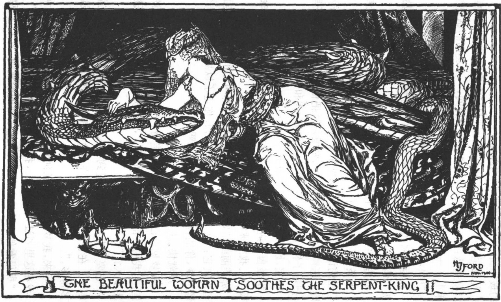

“最后，我梦见从一座桥上走过，那座桥是一条活的鲸鱼。它对我说，‘我在这里已经躺了三年，人和马在我的背上来来往往，几乎把我的肋骨都踩断了，我还要在这里躺多久？’”

“它要在那里永远地躺下去，除非它把吞进肚子的，马克的十二条船吐出来。那时它就可以重归大海，治好自己的背。”

说完，蛇国王转过身去，闭上眼睛，开始大声地打鼾，玻璃窗震得哗哗响。

那可爱的姑娘赶紧帮瓦西里从箱子里钻出来，指给他回家的路。他非常有礼貌地对她表示感谢，急忙走了。

他来到海峡，鲸鱼问他：“你问了我的问题了吗？”

“问了，我到海峡对岸以后，就告诉你想知道的事情。”

过了海峡，瓦西里对鲸鱼说：“把三年前你吞下去的，马克的十二条船吐出来！你就自由了。”

鲸鱼使劲地把十二条船，还有船上的船员一起吐出来，然后快活地晃晃身体，一头扎入海洋深处。

瓦西里继续走着，来到了渡口，老人问他：“你问了我的问题了吗？”

“是的，问了，你把我摆渡过去，我就告诉你想知道的事情。”

他们过河以后，瓦西里对他说：“下一次有人上船以后，你让他留在船上，自己走上岸来，把船推开，然后头也不回地走开，那人就会接替你的位置。”

不久，瓦西里来到老橡树旁，把橡树连根推倒。在树根下，他看到了比马克的财产还多的金子和银子。

这时候，鲸鱼吐出来的十二条船正好开过来，在附近抛锚。第一条船的甲板上，站着瓦西里见过的三个乞丐。他们说：“上帝已经赐福于你，瓦西里。”说完就消失了，瓦西里从此再也见不到他们。

那些船员把所有的金子和银子都装上船，然后带着瓦西里一直开回家乡。

马克见他们回来，比以往任何时候都更加气愤。他套上马车，亲自驾驶着要去见蛇国王，准备责骂它的背叛行为。当他来到河边的时候，他跳上渡船。可是船夫跳到岸上，把船推开。

瓦西里和他的妻子一起过着幸福美满的生活，他那慈祥的岳母和他们住在一起。马克的全部财产归他所有，他帮助穷苦人，让他们有饭吃，有衣服穿。

许多许多年，马克一直在渡口划船。把过路人送过来，送过去。他的脸上布满了皱纹，头发和胡子像雪花一样白，眼睛也越来越模糊，可是他还得划下去。

（塞尔维亚）

## 白野太郎

日本过去有个传统，小孩子成年以后，必须离开家乡，出去冒险。要是在外面遇到出来冒险的其他青年，他们就会展开一场友好的格斗，看看谁的本事更大。要是遇上坏人，如打家劫舍的强盗，那时就会有一场十分激烈的生死搏斗。

有一天，一个年轻人离开自己的家，决定出去干一番惊天动地的事业，好扬名天下，否则决不回来。可是他花了很长的时间，走了许多地方，也没有碰上一个可怕的巨人，或者是一个遭受不幸，等着解救的姑娘。看来，这次冒险实在是太乏味了。

后来，他看到远处有一座荒山野林，上面有一半覆盖着茂密的树丛。他想，那里可能会有英雄用武之地，就朝那座山走去。那山路果然非常艰险，他要爬上陡峭的山崖，游过湍急的河流，穿过荆棘丛生的荒坡。不过，这一切也令他热血沸腾，信心倍增。他是一个真正勇敢的青年，像许多伟大的人物一样，任何艰难困苦都能克服。

可是，山上毕竟荒无人烟，不管他如何聪明，如何尽力，还是迷路了。天快黑了，他想，今天晚上要在山上过夜了。他张大眼睛，想找个地方能够遮风蔽雨。后来，他在一块空地上，看到了一间小庙，就赶快奔过去，在一个温暖的角落里蜷缩成一团，睡着了。

开始几个钟头，森林里鸦雀无声，非常安静。到了午夜时分，忽然响起很大的喧嚷声。年轻人虽然非常疲倦，睡意正浓，也被吵醒。他小心地从庙宇的木柱当中向外偷看，只见一大群可怕的猫在跳着疯狂的舞蹈，喊叫声令人毛骨悚然。整个景象在月光的照耀下，充满了神秘的色彩。年轻的武士惊奇地观看着，尽力地控制着自己，不发出一点声音，免得被发现。

听了一会以后，他从野猫的嘶叫声中似乎听出了其中的含义：“别告诉白野太郎！保守秘密！保守秘密！别告诉白野太郎！”

午夜过后，那些猫突然不见了。周围的一切又恢复了平静，留下年轻人孤独一人。经历了白天和黑夜的这一切，他万分疲惫，倒在地下又睡着了，一直到太阳升起，才醒过来。

他感到非常饿，想找点什么东西吃。他站起来，走出庙宇。幸运的是，还没有走多远，就看到一条小路，总算找到了一些人的足迹。他沿着小路走过去，不久就看到一些零零落落的屋舍，再往前看，就是一个村庄。

他觉得很高兴，正准备向村庄走过去，这时，他听到一个女人哭泣和叹息的声音，诉说着希望有人来可怜她，救救她。那悲切的声音使他忘记了饥饿。他向一间农舍走去，打听到底发生了什么可怕的事情。可是人们只是摇摇头，告诉他，不关他的事，谁也帮不了这个忙。他们还说，所有这些悲惨的事情都是那个山神引起的。每年，他们都得找一个姑娘送给它吃。

“明天晚上，”他们说，“那可怕的怪物就要来了。你听到的哭声，就是前面那个姑娘发出来的，今年抽签轮到她。”

年轻人问，那姑娘是不是直接从家里送出去，送给山神。他们回答说，不是，姑娘被放在一个大木桶里，然后把大桶抬到森林里的庙宇里去。

听完他们的叙说，年轻人非常希望能把姑娘从山神手中救出，帮助她摆脱这可怕的命运。说起那个庙宇，他想起了昨天晚上看到的那一幕，想起那些疯狂的猫，想起它们喊叫的声音。

“谁叫白野太郎？”他忽然问道，“你们之中谁知道吗？”

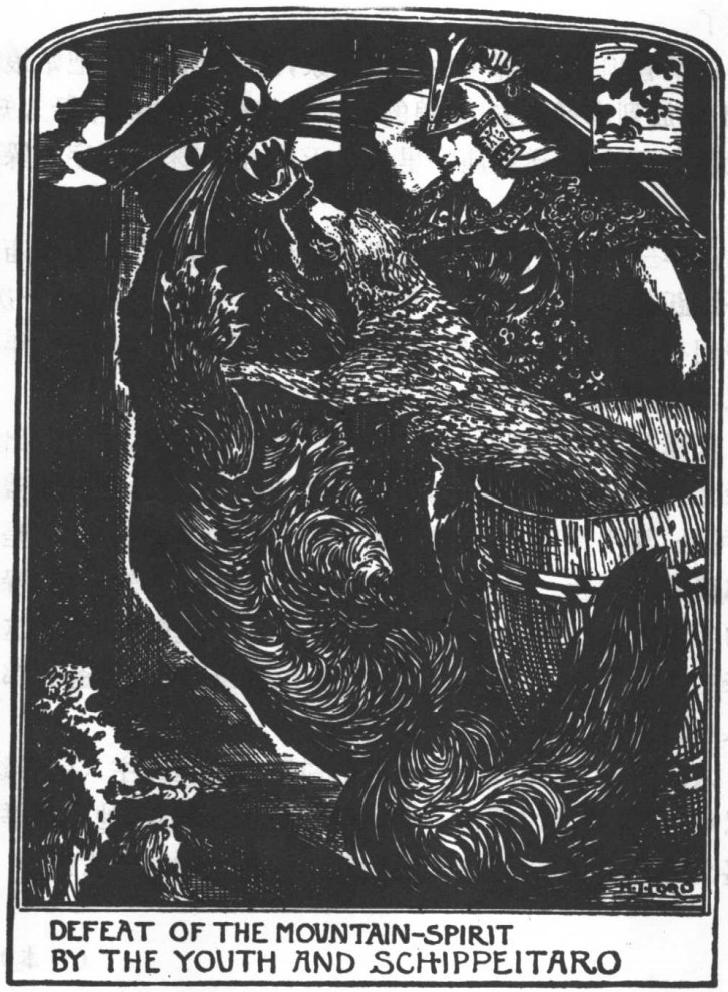

“白野太郎是一条大狗，是我们公主的总管养的，他住的地方离这里不远。”人们告诉他，还讥笑他怎么会突然想出这个奇怪的、无聊的问题。

年轻人并不觉得好笑，他立刻去找狗的主人，请求把狗借给他，只借一个晚上。总管开始不愿意把狗借给一个完全不认识的陌生人，后来总算同意了。年轻人保证明天一定把狗还来，带着狗走了。

他牵着狗，来到那可怜的姑娘家，请求她的父母把姑娘藏起来，把狗放到木桶里去。姑娘的父母当然非常乐意。年轻人知道，今天晚上，木桶将送到庙宇里去。于是，他先来到庙宇里躲藏起来。

夜半三更的时候，月光又撒满了森林。那些野猫又在庙宇里欢呼跳跃起来，像昨天晚上年轻人看到的一样。不过这一次，它们中间有一只很大的大黑猫，看上去好像是它们的大王。年轻人猜想，它可能就是那个山神。

那怪兽急切地观看着四周，看到那个大木桶，眼中闪出快活的绿光。它高兴地叫唤着，从空中猛扑过来，拉开捆着桶盖的带子。可是，等待着它的，不是可以大饱口福的美丽姑娘，而是白野太郎锋利的牙齿。山神忽然被咬了一口，正在不知所措，躲在一旁的年轻人跳出来，一剑就把它的头砍下。那些野猫看到这突如其来的可怕景象，吓得魂不附体，纷纷逃窜，来不及逃的都被年轻人和白野太郎杀死。

太阳出来了。年轻人把勇敢的白野太郎送回主人的身边。从此以后，山里的姑娘再也不会担惊受怕了。每年，他们都举行一次盛大的宴会，纪念这位年轻的武士和勇敢的白野太郎。

（日本）

## 三个王子和他们的野兽

有三个王子，他们有一个同父异母的妹妹。有一天，他们三个人一起出去打猎，在密林中走了一段以后，看到一只大灰狼和三只小狼崽。他们正想射死这只狼，狼说：“别射死我，我给你们一人一只小狼，它们将会成为你们忠实的朋友。”三个王子同意了，他们继续向前走，三只小狼在后面跟着。

不久，他们看到一头母狮和三头小狮子。那头母狮也请求别把它杀死，它愿意把三头小狮子送给他们。后来，他们又碰到一只狐狸和三只小狐狸；一只兔子和三只小兔子；一只野猪和三只小野猪；一只熊和三只小熊。它们都请求别杀它们，把小野兽都送给他们。这样，每个王子后面都跟着几个小动物。

到了晚上，他们来到森林中的一块开阔地里。这里有一个三叉路口，每条路边都长着一棵白桦树。大王子拔出一枝箭来，向一棵白桦树的树干射去，回过头来对两个弟弟说：

“让我们在分开之前，在每棵树上留下自己的记号。谁回到这里，要绕着另外两棵树看一看。如果看到血从做记号的地方流出来，就知道这个兄弟死了；如果流出来的是牛奶，那就说明他还活着。”

两个弟弟照哥哥的话做了。他们都用箭在白桦树上留下记号以后，就动身回家，问妹妹愿意和哪个哥哥一起过日子。

“我和大哥一起过。”妹妹说。于是三兄弟带着妹妹来到三叉路口，互相道别，各走一条叉路，后面还跟着小野兽。妹妹和大王子一起走。

大王子和妹妹沿着他们选中的叉道走了一会，来到一片森林里。在森林深处的一块空地里，他们发现一个城堡，里面住着一帮强盗。大王子走过去敲门。门一开，那些野兽就冲进去，把那帮强盗都咬死，把他们的尸体都拖到地下室里去。

可是，有一个强盗并没有死，只是受了重伤。他一动也不动地躺着，让那些野兽摆弄，假装像其他强盗一样，也死了。大王子和妹妹进了城堡，在那里住下来。

第二天，大王子出去打猎。临走时，他告诉妹妹，可以到各个房间里去，但不要去放着强盗尸体的地下室。

哥哥刚刚出去，她就把他说过的话忘了。走遍所有的房间以后，她来到地下室，把门打开。她朝里面张望着，那个装死的强盗起来对她说：

“别害怕！照我的话去做，我会成为你的朋友的。要是你肯嫁给我，跟我在一起，会比跟你哥哥在一起幸福得多。不过，你先要到客厅里去，里面有一个碗橱，碗橱里有三个瓶子，你把这些瓶子拿来。第一个瓶子里装的是医治创伤的药膏，你把它涂在我的下巴上，我的伤就会好。然后我把第二瓶喝了，就会完全恢复健康。把第三瓶喝了，我就会比以前更加强壮。等你哥哥带着那些野兽从森林里回来了，你就走过去对他说，‘哥哥，你非常健壮，要是我用一根很牢的丝绳，在你的背后把两只手的大拇指捆起来，你自己能够挣得开吗？’要是他不能挣脱，你就叫我。”

妹妹照强盗的话去做了。大王子回来，她用丝绳把他的两只大拇指捆在背后。可是大王子一用力，绳子就断了，他说：“这根绳子对我来说，不够结实。”

第二天，大王子又带着野兽到森林里去。强盗告诉他妹妹，用更加结实的绳子来捆他。不过这一次，大王子还是挣脱了，当然不像第一次那么容易。他对妹妹说：“这根绳子也难不倒我。”

第三天，他从森林中回来，同意让妹妹再试一试他的力气，不过他说，这是最后一次了。她拿出强盗帮她准备好的一根丝绳，结结实实地把他的拇指捆起来。大王子使足力气，还是无法把它拉断。他对妹妹说：“妹妹，这根绳子很牢，我拉不断了，过来帮我解开吧！”

可是她没有过来，而是大声地叫强盗。强盗冲出来，手中挥舞着一把刀，准备把大王子杀掉。

大王子对他说：“请你忍耐一分钟，在我死前，我想吹三下我的打猎号角。一次在这个房间里，一次在楼梯上，一次在院子里。”

强盗同意了，大王子开始吹响号角。吹第一次的时候，在院子里睡觉的狐狸醒过来。听到号角，它知道主人遇到麻烦了，需要帮忙。它用尾巴扫了扫狼的眼睛，把狼弄醒。然后，它们又把狮子叫醒。狮子用力把关着它们的铁笼子打开，它们一起冲出来，冲进主人的房间。狮子向强盗猛扑过去，把他杀死，撕成碎片。狐狸跑过来，咬断捆着大王子的绳子。三只动物把强盗的尸体拖了出去。

大王子转过身来对妹妹说：“我不会杀你，但要把你留在这里忏悔。”

他用链条把她锁在房间里，把一个大碗放在她面前，说：“我再也不愿意见到你；除非你的眼泪装满这只碗。”

说完，他带着那些动物，又踏上旅途。

走了没有多远，他就看到一家客栈。客栈里的人看上去都非常悲伤，他问他们，出了什么事。

“啊！今天我们的公主就要去死了，她今天要送给那可怕的九头龙。”

王子问：“她为什么要去死？我非常强壮，我要去救她。”

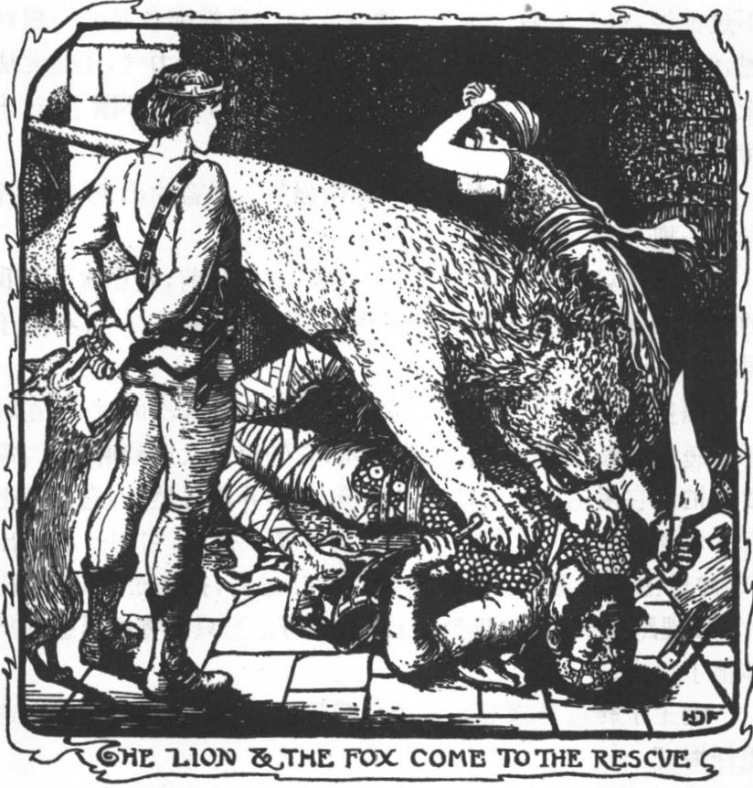

他来到海边，这是九头龙来抢公主的地方，那些动物都围在他的周围。不久，一大群人马走过来，当中的马车上坐着不幸的公主。他们到了海边以后，只留下那辆马车，其他人都悲痛地和公主告别，返回家去。

过了一会，王子看到远方的海水在翻滚着，好像是一队巨轮向这里开过来。王子知道，那是九头龙在向这里游，他和那些动物商量好对策。九头龙靠近以后，狐狸用它的大尾巴搅动海水，溅起一层一层浪花，熊和狮子也在一旁兴风作浪。咸咸的海水溅在九头龙的眼睛里，叫它什么也看不见，弄不清到底发生了什么事情。这时候，王子抓紧时机冲过来，拔出剑来杀了九头龙。那些动物把它的尸体撕成碎片。

公主得救了，她走过来，感谢王子把她从可怕的九头龙魔爪中救出。她说：“请和我一起上马车，我们要回到父亲的王宫里去。”她把自己的戒指和半块手帕送给他。

可是在回去的路上，那个马车夫和另一个士兵说：“我们干吗要把这个陌生人带回王宫去。让我们在路上偷偷地把他杀了，回去告诉国王说，是我们杀死了九头龙，救出公主，公主就会嫁给我们之中的一个。”

这样，他们趁王子不备的时候，把他杀了，扔在路旁。那些忠诚地跟随着他的动物，围着他的尸体哭泣着，不知道怎么办才好。

后来，狼想出了一个办法，它来到森林里，看到一头牛，把它杀了。它把狐狸叫来，叫它看着死牛，等有鸟飞过来吃牛肉的时候，把鸟抓住，带它回来见狮子。

不久，一只乌鸦飞过来，要吃牛肉。狐狸把它抓住，带到狮子面前。狮子对乌鸦说：“我们不杀你，只要你答应飞到一个地方去，把那里三口井中能够救人的水带回来，把这个人救活。”

乌鸦同意了，它飞到狮子告诉它的那个地方，从救命之井、力量之井和敏捷之井中取回井水，滴入王子的嘴中。王子活过来了，他不但坐起来，而且能够行走。

王子在那些忠心耿耿的动物陪同下，向城里走去。他们来到王宫，看到人们都在忙着准备盛大的宴会，公主要嫁给马车夫了。王子找到马车夫，对他说：

“你有什么可以证明，是你杀了九头龙，得到了公主的爱情？我这里有公主给我的赠品——戒指和她的半块手帕。”

国王看到公主的戒指和手帕，知道王子说的是真话。他下令把马车夫捆起来，投入监狱。王子和公主结了婚，还得到了半个王国。

结婚以后不久，有一天晚上，王子带着那些动物穿过森林，由于天黑了，方向难以辨别，他迷路了。他们在森林中转来转去，好久都找不到回王宫的路。后来，他看到远方有火光，就寻找过去。在森林里的一块空地上，有一个老太婆正在用耙子把树枝和干叶耙过来，投入火中燃烧。

这时候，夜已经很深了，王子觉得非常累，决定不再走了，请求老太婆让他留下来，在篝火旁度过这个晚上。

“当然可以，”她说，“可是我很害怕你的野兽。让我用我的棍子碰一碰它们，我就不害怕了。”

“好的！我不在意。”王子同意了。她把手中的棍子伸过去，点了一下那些动物，它们立刻变成石头，连王子也不例外。

大王子变成石头以后不久，小王子来到他们三兄弟分手的三岔路口。想起他们曾在三棵白桦树上留下记号，他就走过去看。他看到，大哥留下记号的白桦树，正在渗出血来，知道大哥已经死了。

他带着自己的那些动物，沿着大哥走过的岔路走去，来到了大王子结婚和居住的城堡，看到人们都在为失去大王子而极度悲痛。

他们看到了小王子，后面还有那些动物跟着，以为他就是失踪了的大王子，都非常高兴。他们告诉小王子，他们如何千方百计地到处找他。小王子在他们的带领下，来会见国王，国王也以为，他就是自己的女婿。只有公主看得出，他不是自己的丈夫。她请求小王子到森林里去，带着那些动物，去寻找他的哥哥，直到把他找回来。

小王子听了嫂嫂的话，立即动身去找大王子。可是到了森林里以后，他也迷了路，天开始黑下来。黑暗中他看到了那片火光，来到了林中的这块空地。那个老太婆还在那里拨弄着树枝和叶子，烧着篝火。

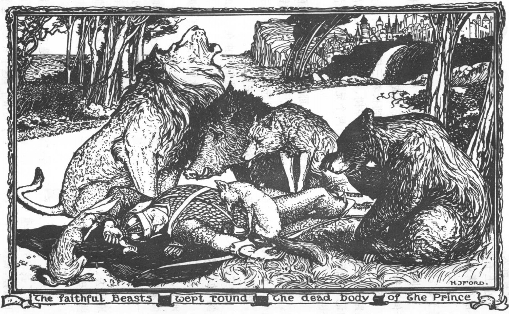

小王子走过去对她说，天这么晚，这么黑了，他回不了城，能不能在篝火旁度过这一夜。

老太婆回答：“当然可以，但是我害怕你的野兽，我能不能用棍子碰它们一下，这样，我就不怕它们了。”

他同意了，因为他不知道，她是个巫婆。巫婆把她手中的棍子伸出来，那些动物和它们的主人立刻都变成石头。

这件事情发生以后不久，二王子回到长着三棵白桦树的交叉路口。他看了看两兄弟做过记号的白桦树，看到血从箭头射出的记号中流出，非常悲伤。“啊！我的两个兄弟都死了！”他哭泣着说。

他沿着岔路来到大王子统治的城市，那些忠实的野兽跟随着。走进城门，城里的人都以为是他们的王子回来了。像当初错把小王子当大王子一样，他们把二王子围起来，问他到哪里去了，怎么这么久没有回来。他们领他到王宫来见国王。

公主还是认出来了，他不是自己的丈夫。他们单独在一起的时候，她恳求他出去找他的哥哥，把他带回来。

于是，二王子带着他的野兽，也来到了森林里。他把耳朵贴在地上，看看能不能听到兄弟的野兽发出的声音。他仿佛听到一种微弱的声音，但不知道是从哪个方向传过来的。他又仔细地听了一下，这一回，依稀可以辨得出，是从有火光的方向传过来的。

他来到篝火旁，那个老太婆还在那里，把树枝和干树叶拨到火堆里去。他问她，能不能让他在火堆旁过一夜。她说，她很怕这些野兽，他要同意让她用棍子碰一下它们，才允许他在这里过夜。

可是这一回，二王子却回答：“当然不可以，我是它们的主人，除了我以外，谁也不能碰它们。把棍子给我。”他用棍子碰了一下狐狸，狐狸立刻变成石头。二王子知道了，这个老太婆是个巫婆。他转过身来对她说：

“除非你立刻恢复我的兄弟和他们那些野兽的生命，否则我的狮子会把你撕成碎片。”

巫婆吓坏了，她拿起一棵小橡树，把它烧成白灰，把白灰撒在那些人和动物变成的石头上。两个王子复活了，那些野兽也复活了，站在它们主人的旁边。

三个王子一起动身回到城里，国王认不出哪个是他的女婿，可是公主认得出她的丈夫。这时候，整个国家到处喜气洋洋，充满了欢乐。

（立陶宛）

## 皇帝的山羊耳朵

从前有个皇帝，名字叫特罗杰，他长着一副山羊耳朵。每一天早晨，当理发师给他刮胡子的时候，他总是要问，我身上有没有什么奇怪的东西？要是哪个新来的理发师说，皇帝长着一副山羊耳朵，他立刻就下令，把这个理发师杀掉。

这种事情连续发生一段时间以后，城里几乎找不到一个能给皇帝刮胡子的理发师了。这一回，该轮到理发公司的老板来给皇帝刮胡子了。可不幸的是，他突然病了，于是叫一个徒弟顶替他去。

年轻人被带到皇帝的寝宫。皇帝问他：“你师傅为什么不来？为什么叫你来？”年轻人回答说，师傅病了，除了他以外，没有人有资格享受这种至高无上的荣誉。

皇帝对这个回答非常满意，他坐下来，让年轻人给他围上一块布，开始给他刮胡子。像其他理发师一样，他注意到了皇帝的山羊耳朵。胡子刮完了，皇帝又提出那个老问题问年轻人，他身上有没有什么奇怪的东西？年轻人毫不犹豫地回答：“没有，一点也没有。”

皇帝非常高兴，给了他十二块金币，说：“从今天起，你每天都来给我刮胡子。”

徒弟回到家里，师傅问他，给皇帝刮胡子怎么样了？年轻人回答说：“喔！很好，他叫我天天去给他刮胡子，还给我十二块金币。”至于皇帝的山羊耳朵，他什么也不说。

从那天起，年轻人每天都去给皇帝刮胡子，每天都得到十二块金币的报酬。可是过了一段时间以后，他小心地埋在心里的秘密，像火一样地在胸中燃烧，弄得他很不自在，非常想去和什么人说说。

师傅看出他心中有事，就问他怎么了。年轻人说，有件事折磨了他几个月，如果不把这个秘密告诉给别人，他就觉得很难过。

“那好吧！”师傅说，“请相信我，我会替你保守秘密的。要是你不愿意告诉我，就去找你的神父说去；或者是到城外的地里去，挖一个洞，然后跪下来，小声地对洞说三遍你的秘密，然后把洞填好再回来。”

年轻人想，看起来这是一个最好的办法。当天下午，他就来到城外的草地上，挖了一个很深的洞，跪下来小声地说了三遍：“特罗杰皇帝有一副山羊耳朵。”说完以后，如释重负，心情顿时轻松起来。他小心地把挖出来的土填回去，快活地跑回家。

几个星期过去了，年轻人挖过的洞里长出三根笔直的竹子来。一些牧羊人赶着羊从旁边经过，看到了这些竹子。其中有一个砍下一根做笛子。做好以后就想吹奏，可是笛子只会奏出一句歌：“特罗杰皇帝有一副山羊耳朵。”

过了不久，整个城市里的人都知道了这枝奇妙的笛子，而且知道了它会唱什么。后来，这个消息传进王宫，传到皇帝的耳朵里。他立刻把那个学徒找来，问他：

“关于我本人，你对我的老百姓说了些什么？”

年轻人开始还想为自己辩护，说他看到什么从来不告诉任何人。可是皇帝不听他的，只是从剑鞘中把剑拔出来。可怜的年轻人吓得直发抖，只好承认他干过些什么，如何挖了个洞，对着洞说了些什么，洞里如何长出三根竹子来，牧羊人如何用它做成笛子，笛子怎么老是重复着那句话。

皇帝听完以后，命令马车夫准备好马车，带着年轻人一起到郊外去，他要亲自看一看年轻人说的是否是事实。

他们来到目的地以后，那里只剩一根竹子了。皇帝叫一个随从把它砍下来，也做成笛子。做好以后，他叫乐师来演奏。可是，尽管乐师是王宫里最好的笛子演奏家，那枝笛子却什么乐曲也奏不出来，只是反复着那句歌：“特罗杰皇帝有一副山羊耳朵。”

皇帝明白了，连土地也泄露了他的秘密。他宽恕了年轻人，叫他回去。可是从此以后，不再叫他来刮胡子。

（塞尔维亚）

## 九只雌孔雀和金苹果

从前有一个国王，他的王宫前面有一棵苹果树，每到晚上就会开花结果。可是一到早上，那些苹果，还有花都不见了，谁也不知道，是哪个贼来把它们偷走。

有一天，国王对他的大儿子说：“要是有人能够阻止这些强盗，不让他们偷走我的苹果，我该有多高兴啊！”大儿子说：“今天晚上我不睡觉，坐在那里守夜，看着是谁来偷的。”

天黑以后，大王子就来到苹果树旁，躲藏起来，留神观察。可是，那些苹果还没有长熟，他就睡着了。到太阳出来，他才醒过来，树上的苹果早就没有了。他觉得十分羞愧，只好慢吞吞地来到父亲的面前，说他睡着了，什么也没有看到。

不过，尽管大王子失败了，二王子却仍然信心十足，相信自己会成功。晚上，他兴高采烈地来苹果树旁守夜。可是不久，他就觉得眼皮非常沉重，躺了下来。当金色的阳光把他从睡梦中唤醒时，树上一个苹果也没有了。

最后轮到最小的王子了。他在苹果树下放了一张舒适的床，准备睡觉用。睡到半夜，他醒过来。噫！苹果开始成熟了，发出灿烂的金色光芒，把整个王宫都照耀得金碧辉煌。

这时候，从天空中飞来九只金色的雌孔雀。有八只轻盈地落在长满金苹果的树上，第九只拍动着翅膀，落在小王子的身边，变成一个美丽的姑娘。这姑娘长得那么美，王宫里没有一个女人比得上她。小王子看上一眼，就爱上她。他们坐在一起说话。过了一会，姑娘说，她的姐妹已经摘完苹果，该回家了。小王子殷切地请求她留下一些苹果，姑娘就把两个苹果给他，一个给他自己，一个送给他父亲。然后，她变成一只金孔雀，和那八只孔雀一起飞走了。

天亮了，小王子回到王宫，把金苹果交给国王。国王看到金苹果十分快活，由衷地夸奖小王子，说他聪明。

这天晚上，小王子又来到苹果树下过夜，一切都像昨天晚上发生过的那样。这样一连过了好几天。两个哥哥看到他每天都带两个金苹果回来，既妒忌，又生气。他们去向一个老巫婆请教，巫婆答应帮他们去侦探，看小王子是怎么样得到金苹果的。

晚上，巫婆躲在树后等小王子。不久，她看到小王子来了，他躺在那张床上，很快就睡着了。半夜里，传来一阵拍动翅膀的声音，飞来了九只金孔雀。八只落在苹果树上，一只落在小王子的身旁，变成一个姑娘，向小王子问候。这时候，巫婆拿出一把剪刀，伸出手去剪下姑娘的一绺头发。姑娘跳起来，变成一只金孔雀，飞走了。她的姐妹也跟着她一起飞走。

王子看到姑娘忽然变成孔雀飞走，觉得非常奇怪。从惊讶中醒悟过来以后，他问自己，到底发生了什么事情。他四处张望，看到老巫婆藏在床底下，就把她拖出来。因为十分气愤，他叫来卫兵，下令把老巫婆杀了，越快越好。可是杀了她也没有用，金孔雀已经飞走了。

小王子每天晚上都到苹果树下来等待着，可惜金孔雀再也不来了，他为失去自己心爱的姑娘而十分伤心。这样过了几天，王子再也忍受不住了。他决心，就是走遍整个世界，也要把她找回来。父亲尽力地劝他，说这样出去寻找，是不会有结果的，总可以找到一个和她一样美貌的姑娘。可是父亲的劝告没有用，小王子不听他的。他只带着一个随从，就出去了。

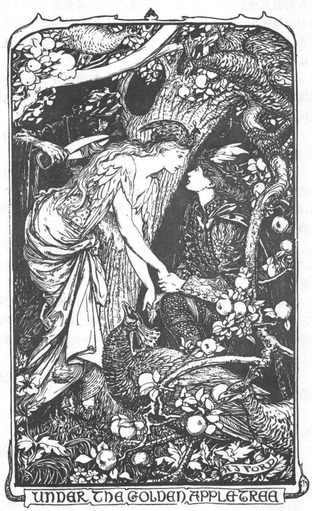

走了许多天以后，他终于看到一个大城门。站在城门口，可以看到城市里的街道和王宫。王子想走进去，可是看守门口的卫兵不让他进去。卫兵要问明他的身份，到这里来干什么，怎么会找到这里来的。还说，除非女王亲自来让他进去，否则他只能留在城外。

女王接到报告，亲自来到城门口。看到眼前的女王就是自己远离家乡，出来寻找的那个姑娘，王子简直是惊呆了。女王这时也认出他，快步走过来，拉着他的手，一起进入王宫。

几天以后，他们结婚了。王子决定在这里生活，直到生命结束，他把父亲和哥哥都忘了。

一天早晨，女王对他说，想独自出去散步。她把十二把地下室的钥匙交给他，叫他保管，说：“要是想看前面的十一间地下室，你可以进去。不过千万要小心，绝对不能把第十二间地下室的锁打开，否则你就要倒霉。”

王子独自留在王宫里，觉得很无聊，想找点事情来娱乐一下。“第十二间地下室里会有什么呢？”他想，“为什么我不能去看一看？”

他走下楼梯，来到地下宫殿，把一间又一间地下室的门打开。到第十二间地下室门口时，他犹豫了一下。可是他的好奇心太重，他终于把锁打开。里面空空的，只有一个大桶，上面扣着三个大铁环。

这时候，大桶里忽然传出一个恳求的声音：“兄弟！看在上帝的份上，给我一点水，我都快渴死了。”

王子的心地非常善良，他立刻去取来一些水，从大桶的一个洞口倒进去，这时候，一个大铁环断开了。

他正想走开，那声音又叫起来：“兄弟！可怜可怜我吧！再给我一些水，我快渴死了。”

王子又取来一些水倒进桶里，第二个铁环断开了。

桶里那个声音第三次请求，再给一些水喝。王子第三次把水倒进去。最后一个铁环裂开了，大桶也像被炸开似的，变成碎片。一条巨龙腾空而起。这时候，女王正好散步回来，巨龙抓住女王，飞走了。一些随从看到出事了，都向王子奔跑过来，可是已经无济于事。

可怜的王子看到，由于自己的愚蠢带来那么可怕的结果，急得几乎要发疯。他喊叫着，哪怕是走遍天涯海角，也要找到巨龙，把妻子找回来。

一个月又一个月过去了，王子毫无目的地到处寻找，一会儿东，一会儿西，丝毫也找不到那条巨龙和他妻子的踪影。后来，他来到一条小河旁，看到有一条小鱼躺在河岸上，拼命地拍着尾巴跳跃着，想回到河里去，却毫无办法。

看到王子走过来，小鱼对他说：“啊！可怜可怜我吧！我的兄弟，救救我，把我放回河里去，有一天我会报答你的。拿走我的一片鱼鳞，你遇到什么危险的时候，在手中搓一搓，我就会来。”

王子把小鱼捡起来，投入水中。在此之前，他照小鱼的吩咐，拿下一片鱼鳞，用一块布小心地包起来，放进自己的口袋。他又继续往前走，走了几英里路以后，他看到一只狐狸被圈套套住了。

“啊！像兄弟一样救救我吧！”狐狸看到王子走过来，对他说，“把我从圈套里解救出来，我不会忘记你的。你需要的时候，我会来帮助你的。拔下我的一根头发，遇到危险的时候，在手中搓一搓，我就会出现。”

王子把圈套解开，拔下它的一根头发，把狐狸放了，又继续他的旅程。他从一座山上走过，看到一只狼被网罩住。狼看到王子，对他说：“救救我吧！让我免于一死，你永远也不会后悔的。拔下我的一绺毛，需要我的时候，在手中搓一搓。”王子把网解开，让狼走了。

王子又独自一人走了很久，既找不到妻子，也没有碰到什么大事情。后来他碰到一个同路人。

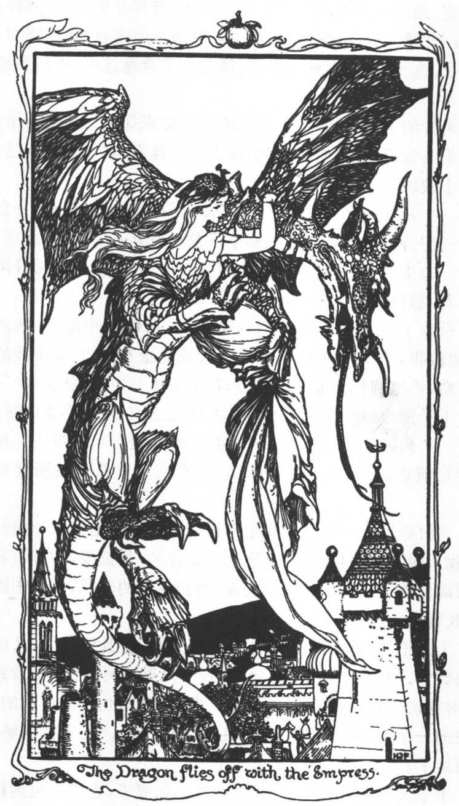

“啊！兄弟！”王子向他打招呼，问，“你能够告诉我，龙王住在什么地方吗？”

那人告诉他，龙王居住的王宫离这里有多远，怎么样才能找到。王子谢了他，沿着他指引的方向走去。终于有一天晚上，他来到了龙王居住的城市。

他走进王宫，非常高兴地看到，妻子正独自坐在一个很大的大厅里。他们赶紧一起想逃走的计划。时间非常紧迫，龙王随时随地都会回来。他们从马厩中拉出两匹马，像闪电般地奔驰出去。

他们马不停蹄，跑到连王宫也看不见的时候，龙王才回到家里。它很快就发现，女王逃跑了，立刻把它那匹会说话的马找来，问它：“请你告诉我，我现在该做什么，是像往常一样吃晚饭呢？还是出去追赶他们？”

“先安下心来，吃你的晚饭，吃完了再去追赶他们。”马这样对它说。

龙王听马的话，坐下来吃晚饭，一直吃到午夜，再也吃不下了，就骑上马去追赶两个逃亡者。一会儿工夫，就追上了他们，它把女王从马鞍上抓起来，对王子说：

“这一次，我饶了你，因为我锁在桶里的时候，你给我送来了水。不过请你注意，不要再回来了，否则你就要付出自己的生命。”

王子悲痛得快要发疯了，他一时也不知道该怎么办才好，让马带着他又向前走了一段。后来，他再也忍受不住了，决心不管龙王的威胁，返回龙王的王宫去。

女王像上一次一样，独自坐在大厅里。他们又开始想办法，如何才能逃出龙王的手掌。

王子说：“等龙回来了，你问问它，它从哪里得到这匹神奇的马，然后告诉我，我也想办法去找到这样一匹好马。”说完，他怕龙王回来看见，就偷偷地溜出城堡。

龙回家后不久，女王走过来，在它身边坐下，说些好听的话来哄它，让它高兴。接着，她说：“你昨天骑的那匹马真是太了不起了，这恐怕是世界上独一无二的。请告诉我，你是从哪里弄来的？”

龙说：“只有我，才能有办法得到这匹马。在一座高山的山顶上，住着一个老太婆。她的马厩里有十二匹马，一匹比一匹漂亮。在马厩的角落里，有一匹又瘦又难看的马，看见它的人，都不愿意再看第二眼。其实，它才是里面最好的马，是我这匹马的孪生兄弟，它能够飞得像天上的云彩一样高。可是，谁要想得到它，就要先给老太婆当三天佣人。除了这些马以外，老太婆还有一匹母马和马驹。给老太婆干活的人，要一连三天三夜照看好这匹母马和马驹，要是三天三夜下来，母马和小马还在，他就可以从老太婆那里任选一匹马作为报酬；要是让母马和小马逃跑了，他的头就要被砍下来。”

第二天，王子等龙出去以后，就溜进来见女王。她把昨天听到的事情全部告诉他。王子决定不失时机，立刻就动身到高山上去，去找那个老太婆。王子历尽艰辛，在崎岖的山路和陡峭的悬崖上攀登好久以后，终于来到山顶，找到老太婆。

“向你问好，妈妈！”王子对老太婆说。

“向你问好，我的孩子！你到这里来干什么？”

“我来给你当佣人。”王子说。

“可以，”老太婆说，“三天之内，要是你能照顾好我的母马，我就给你一匹马当报酬。”说完，她领王子走进院子，院子的周围围着木桩。木桩上面都挂着一个人头，只有一根木桩空着。他们经过的时候，这根木桩突然发出声音来：“女人！把我等着的这个头给我！”

老太婆不答理它，转过身来对王子说：“看！这些人都给我当过佣人，条件和你一样，可是没有一个能看得住母马。”

王子的决心并不因此而动摇，他说，他将恪守自己的诺言。

夜幕降临，王子把母马从马厩中拉出去，骑着它，免得让它逃走。那匹小马跟在后面。尽管那匹母马想方设法要把他摔下来，他还是坚持了很长时间。可是到后来，由于又累又困又担心，他掉下来睡着了。

等他醒过来，发现自己睡在一块木头上，手中还握着缰绳，可是母马和小马都不见了。他恐怖地跳起来，紧张得心怦怦直跳，可到处都找不到母马和小马，地上连一点痕迹也没有。

他找到一条河边。看到河水，他想起了自己救过的那条鱼，赶紧从口袋中把那片鱼鳞拿出来。他刚用手碰一下，那条鱼就游过来。

“有什么事吗？我的兄弟。”鱼担心地问。

“昨天晚上，老太婆的母马丢了，我不知道到哪里去找它。”

“呵！我能告诉你。母马变成了一条大鱼，小马变成了一条小鱼。不过，你只要用手中的缰绳拍打水面，说，‘快过来吧！山巫婆的母马！’它就会过来了。”

王子照鱼教他的办法去做了，母马和小马立刻出现在他的面前。他用缰绳把母马套住，骑着它回家。小马也总是跟在后面。

老太婆站在门口迎接他们，她从王子手中接过马，给王子一点吃的，就把马拉回马厩。

“你应该到那些鱼当中去！”老太婆用棍子打着那匹母马，叫喊着。

“我是到鱼当中去了！”母马回答，“可是它们不是我的朋友，它们一下子就把我出卖了。”

“好了，下一回到那些狐狸当中去！”她说完，就走进屋子，没有注意到王子在一旁听见了。

天开始黑下来，王子第二次骑着母马到草原上去，小马在后面跟着。像上次一样，他坚持到深夜后。就挡不住睡意，从马上掉下来睡着了。等他醒过来，发现自己睡在一块木头上，手中拿着缰绳。

他沮丧地喊叫了一声，站起来，开始到处寻找母马。后来，他突然想起老太婆对马说过的那句话。他把狐狸的头发拿出来，搓了一下。

“怎么啦！我的兄弟！”狐狸立刻出现在他的面前，问他。

“老巫婆的母马从我手中逃走了，我不知道到哪里去找它。”

“它和我们在一起。”狐狸回答，“它变成了一只大狐狸，小马变成了一只小狐狸。不过，你只要用手中的缰绳打一下地面，说，‘过来吧！山巫婆的母马！’它就会过来。”

王子照它的话去做。一会儿工夫，一只狐狸变成了母马，小马也站在它身边。王子骑上马回家。老太婆把饭菜放在桌子上，把马拉进了马厩。

“你应该听我的话，到那些狐狸中去！”她用棍子敲打着母马，说着。

“我是到狐狸中去了，”母马回答说，“可是它们不是我的朋友，把我出卖了。”

“好了！下一次你最好到狼群中去。”她说，没有注意到，王子听到了她的话。

第三个晚上，王子又骑着母马，带着小马来到草原。他努力挣扎着，不让自己睡着。可是没有用，天一亮，还是发现自己睡在一块木头上，手中拿着缰绳。

他站起来，准备去找。这时，他想起老太婆说过的那些话，把狼的一绺灰毛拿出来，搓一下。

“有什么事啊！我的兄弟！”狼站在他的面前，问。

“老巫婆的母马从我手中逃走了。”王子说，“我不知道该到哪里去找它。”

“呵！它和我们在一起！”狼说，“它变成了一只母狼，小马变成了小狼羔。不过，用你手中的缰绳在地下打三下，喊，‘快到我这里来吧！山巫婆的母马。’”

王子照它的话做了，那只狼变成了母马，小马站在它旁边。他骑着马回到家里，老太婆站在门口接他。她把饭菜端上来，把马牵回马厩。

“你应该到狼群中去。”她说着，用棍子来打那匹母马。

“我是到狼群中去了。”母马说，“可它们不是我的朋友，把我出卖了。”

老太婆不再说什么，离开马厩走出来。王子站在门口等着她，对她说：“我为你干得那么好，现在应该给我报酬了！”

“我答应过的事情，一定会兑现。”她说，“从这十二匹马中挑一匹吧，你喜欢哪一匹都可以。”

“把角落里那匹像吃不饱饿不死一样的马给我，”王子回答，“我喜欢它胜过这十二匹漂亮的马。”

“你这是在开玩笑吧！”老太婆说。

“不！我说的是真话。”王子回答。

老太婆只好让他把这匹马拉走。王子把缰绳套在马身上，带着它来到森林里，给它洗刷干净，马的皮毛像金子一样地闪光。

他骑上马，马腾空而起，一会儿工夫就飞回龙的宫殿。女王日日夜夜地等待着他。看到他来了，她悄悄地跑出来，王子把她拉上马背，马立刻向空中飞去。

不久，龙回家了，它发现女王不见了，就问它的马：“我们该怎么办，是先吃一点，喝一点呢？还是去追赶逃跑者？”

马回答说：“不管你是吃也好，喝也好，留在家里也好，出去追他们也好，都没有什么两样，因为你永远，永远也抓不到他们了。”

可是龙不听它的话，跳上马背，去追赶他们。

王子和女王看到龙追上来，非常害怕，叫马快些！快些！再快些！马对他们说：“放心！我们不会有什么危险。”王子和女王这时才放下心来，因为他们相信这匹马的智慧。

不久，他们听到龙骑着的那匹马的喘息声，它对王子的马喊道：“啊！我的兄弟，别飞得那么快！我跟不上你，再快一些我就掉到地上了。”

王子的马回答说：“你为什么去给这样一个怪物效劳，把它踢下来，让它在地上摔成碎片，然后到我们这里来。”

龙的马向地下俯冲，又突然爬高，把龙从背上摔下来，撞在岩石上粉身碎骨。它跟上王子的马，女王跳到它背上，和丈夫一起飞回自己的王国，他们一起统治了许多许多年。

（塞尔维亚）

## 弹琵琶的人

从前有一个国王和王后，他们相亲相爱，无忧无虑，幸福地生活在一起，日子过得十分美满。

后来，国王不甘心过这种平静的生活，他渴望着驰骋疆场，征服世界；渴望着在战斗中英勇杀敌，以威震四海，扬名天下。

于是，他把自己的军队召集起来，准备去征服一个异教徒统治的国家。那里的国王是个暴君，他虐待所有的百姓，作恶多端。

国王向大臣们交代好国事，和王后温柔地告别以后，就下令军队登上战舰，向他乡异国开航。

我不能告诉你，这次航行有多远。反正后来，他们来到了这个异教徒统治着的国家，向他们发起进攻，而且打败了一切敢于抵抗的敌人。可惜好景不长，有一天，他们从山下经过时，遭到一支事先埋伏好的强大军队袭击，他们打败了国王的军队，那些士兵四处逃窜，国王也当了俘虏。

国王被关进了俘虏集中营。这一下，我们这位可怜的朋友可惨了。晚上，所有的俘虏和犯人都用手铐和脚链锁起来。天一亮，就得像牛马一样下地干活，直到天黑。

国王每天都在想，如何能给他的王后送个讯，可是一直没有机会。这样过了三年，王后才收到了丈夫想尽办法送到的一封信。信中写道：“把我们所有的城堡和宫殿卖掉，把所有的财宝都抵押掉，快点来，把我从这可怕的监狱中救出去！”

王后收到这封信，读着，读着，不禁嚎啕大哭起来。“如何才能救出我最亲爱的丈夫呢？”她想，“要是我亲自去，那个异教徒国王看到我，肯定要我当他的又一个妻子。派一个大臣去？可是我不知道，他们是否信得过。”

她想着，想着，终于想出了一个主意。

她把自己那美丽的金黄色长头发剪掉，穿上男孩子的衣服，带着自己的琵琶，也不和任何人说一声，就勇敢地走向那茫茫的世界。

她走过许多地方，经过许多城市，历尽艰难困苦，终于来到了这个异教徒统治的国家。她围绕着宫殿走着，在宫殿的后面看到了关押俘虏和犯人的监狱。

她来到宫殿前面的大广场，拿起琵琶，开始弹奏无比优美和动听的曲子。那些过路人都被迷住了，不禁驻足倾听，谁都舍不得离开。

演奏一会以后，她开始唱起来，那婉转的声音比云雀更加甜美，比夜莺更加动人：

> 从遥远的故乡，
> 来到这陌生的地方；
> 手中的琵琶，
> 是我唯一的财产。
>
> 像恋人在窃窃私语，
> 我日夜向你倾诉衷情；
> 啊！谁会感谢我的歌声，
> 给我一点报酬。
>
> 盛开的鲜花啊！
> 阳光和雨露使你那么娇艳；
> 情侣的初吻震憾心田，
> 分别却带来惆怅和缠绵。
>
> 可怜的战俘啊！
> 在高高的围墙里；
> 他们远离亲人，
> 孤独的心无人挂念。
>
> 我渴望你的怜悯，
> 慷慨地馈赠礼物吧！
> 为请求你的恩赐，
> 我来到你的门前。
>
> 尊敬的陛下，
> 要是你在王宫中听见，
> 啊！在这美好的日子里，
> 请满足我的思念。

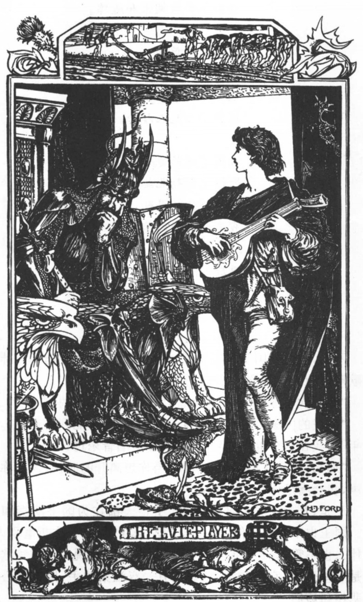

不久，异教徒国王也听见了，那甜蜜的声音在唱出感人肺腑的歌声。他派人把歌手带来。

“哦！欢迎你，琵琶手，”他说，“你是从哪里来的？”

“从我的国家来，陛下，要渡过许多海洋，才能到达这里。许多年了，我在这个世界上到处流浪，靠演唱音乐过日子。”

“那么，请在这里多留几天吧！当你想离开的时候，为了你的歌声，我会满足你心中的愿望。”

于是，琵琶手留在王宫中，几乎整天都在为国王演奏和歌唱。国王也不感到厌倦，几乎忘了吃，忘了喝，忘了去折磨别人。他什么也不管，只是醉心于音乐，不时还点点头说：“乐曲和歌声中是有些道理，它使我觉得，好像有一双温柔的手，抹去我心中的悲伤和烦恼。”

三天以后，琵琶手来向国王告别。

“好吧！”国王说，“你想得到什么样的报答？”

“陛下！把一个犯人给我吧！你的监狱中有那么多犯人，假如有人伴我旅行，让我一路上能听到他那快活的声音，我将是多么高兴！我会想起你的仁慈，感谢你的好意。”

“那么来吧！”国王说，“你自己来挑一个中意的。”国王亲自领她到监狱中去。

王后在犯人中走来走去，终于找到了自己的丈夫，把他带出监狱，带上归途。路途那么遥远，花了不少时间，可是他一点也看不出这个“男孩子”是谁。她领着他，离自己的国家越来越近。

他们来到了国界，犯人说：“让我走吧！善良的小伙子！我不是普通的犯人，我是这个国家的国王。我们分手了！你想要什么报酬就说吧！”

“别提什么报酬，太太平平地走吧！”琵琶手回答。

“那么请跟我来吧！亲爱的小伙子，做我的客人。”

“到适当的时候，我会到你王宫里来的。”她说。他们就这样分手了。

王后选了一条近路，抢先在国王之前回到王宫，换好衣服。一个钟头以后，整个王宫都沸腾起来，人们欢呼雀跃，奔走相告：“我们的国王回来了！我们的国王回来了！”

国王和蔼地同每一个人打招呼，可是对王后却有点另眼相看。后来，他把大臣们召集起来开会，对他们说：

“你们看吧！我有一个什么样的妻子！现在，她对我那么亲热。可是，当我被囚禁在监狱里，给她送信来的时候，她却无动于衷，丝毫也不肯想办法来救我。”

他的大臣们异口同声地说：“陛下，你的信送到王宫来了以后，王后就不见了。谁也不知道她到哪里去了。她只是今天才回来。”

国王勃然大怒，喊道：“把我这不忠的妻子送去审判！要不是一位年轻的琵琶手救了我，你们永远也看不到自己的国王了。我将永远记住他，爱他，一辈子都感谢他。”

就在国王和那些大臣们开会的时候，王后抓紧时间伪装自己。她拿起那把琵琶，走进王宫前的广场，开始用她那清甜的歌喉唱起来：

> 可怜的战俘啊！
> 在高高的围墙里；
> 他们远离亲人，
> 孤独的心无人挂念。
>
> 我渴望你的怜悯，
> 慷慨地馈赠礼物吧！
> 为请求你的恩赐，
> 我来到你的门前。
>
> 尊敬的陛下，
> 要是你在王宫中听见，
> 啊！在这美好的日子里，
> 请满足我的思念。

国王听到歌声，立刻出来见琵琶手，拉着她的手，把她领进宫殿。

“看吧！”国王说，“这就是把我从监狱里救出来的男孩！现在，我真正的朋友，我将货真价实地满足你的思念！”

“陛下！我相信，你一定会比那异教徒国王更慷慨大方。我从他那里希望得到你，他把你给我了。这一次，我不希望失去我已经得到的东西，我还是要你！”

她说完以后，把披在身上长长的斗篷扔掉，大家都认出来了，她就是王后。

谁能形容，国王该有多么高兴！在无比的欢乐之中，他下令举国上下摆开盛宴，连他乡异国的人都闻讯赶来，在这里狂欢了整整一个星期。

恰巧那时候我也在，吃了喝了许多山珍海味，我永远也忘不了这么丰盛的宴会。

（俄罗斯）

## 仁义王子

戈尔登国王在森林里迷失了方向，怎么也走不出去。他在森林里茫然地转来转去，一个陌生人走过来。

“朋友，你在这里干什么？”陌生人问，“天很快就要黑了，野兽即将出窝来寻找食物。”

“我迷路了，”国王回答，“正在想办法走回去。”

“这样吧！假如你答应我一件事，我就给你指路。你到家以后，把出来迎接你的第一样东西给我。”陌生人说。

国王没有回答，过了一会，他说：“我干吗要把自己最好的一条猎狗给你，我肯定能够像你一样，找到一条回家的路。”

陌生人走了。国王走了这条路，又走那条路，路是走了不少，可是三天以后，还是在森林里。当他就要绝望的时候，那个陌生人又突然出现了，挡住他的去路。

“这一回，你同意把回家以后最先出来见你的东西给我了吧！”陌生人问。

可是国王非常顽固，他还是不肯答应。

他又在森林里徘徊了许多天，最后终于失去了信心，垂头丧气地在一棵树下坐下，觉得自己的末日即将来临。

这时候，陌生人第三次出现在国王的面前，对他说：“你怎么这样傻？一条狗对你来说，算得了什么？为了它，你难道就这样牺牲自己的生命吗？答应我的条件吧！我马上就可以把你领出森林。”

“好吧！我的生命比一千条狗还要宝贵。”国王说，“整个王国都需要我。我满足你的要求，把我领回王宫去吧！”

他的话音刚落，就发现自己已经站在森林的边缘上，王宫在远处隐约可见。

他以最快的速度赶回去，刚走到大门口，保姆抱着出生不久的王子走出来，小王子伸出双臂来欢迎他的父亲。

国王浑身一震，连连后退，喝令保姆快点把王子抱回去。这时候，他的猎狗才扑过来。可是它的热情没有得到主人的青睐，国王狠狠地踢了它一脚。

国王的怒气消失以后，开始考虑怎么办才好。他决定，把自己漂亮的男孩和一个农民的女孩交换。于是，王子像穷人的儿子一样，过着简朴的生活；而农民的女儿却盖着丝绸被子，睡在金色的摇篮里。

一年以后，那个陌生人来到王宫，要国王兑现他的承诺。他把小女孩抱走了，相信她就是国王的真女儿。

国王看到自己的计划成功了，欣喜若狂。他下令准备举行盛大的宴会，还送给王子的养父母许多贵重的礼物，让他们从此生活中不再缺少什么。不过，他还不敢领回自己的孩子，生怕诡计被拆穿。农民得到大量的金钱和食品，对这个安排也觉得非常满意。

一年又一年过去了，王子长大了，长高了，在他养父母的家里过着幸福的生活。可是一个阴影总是笼罩着他的心灵，使他时时觉得不快。那就是一个无辜的、可怜的女孩在替他受罪。他的养父母把这件事情秘密地告诉他了，说他是国王的儿子。王子早已暗下决心，等他成年以后，他要走遍整个世界，不把那女孩子救出来，决不罢休。为了当国王，让一个女孩子为他付出整整一生，这个代价实在太高了。

这一天，王子穿上农民的服装，背上一袋豆子，向十八年前国王迷路的森林里走去。走了一段路以后，他大声地喊叫起来：“啊！我多么不幸！这是什么地方？有谁能告诉我，把我领出这片森林吗？”

一个陌生人走出来。他长着长长的灰白胡子，腰上挂着一个皮袋。他高兴地对王子点点头，说：“这个地方我太熟悉了，只要你肯给我好的报酬，我就领你出去。”

“像我这种乞丐一样的人，能答应你什么呢？”王子说，“你救了我的生命，我也没有什么东西给你。我身上的衣服也是我主人的，他给我吃，给我穿，把我养活，我靠干活来报答他。”

陌生人看着他背上的一袋豆子，说：“可总有些东西属于你吧！你背上这个口袋，看上去很重的。”

“里面全是豆子。”王子说，“我的老伯母昨天晚上去世了，没有留下足够的钱给守夜人买豆子，这是这个国家的风俗习惯。我只好去向主人借来这袋豆子，想穿过森林，找条近路回去，可是迷路了。你也看见了。”

“那么，你是个孤儿了？”陌生人问，“你干吗不来给我干活？我需要一个能干的伙计，觉得对你比较满意。”

“是啊！为什么不呢？只要我们把条件说好了就行。”王子说，“我生来就是干活的，到哪里都是混口饭吃，给谁干都一样！你给我多少工资呢？”

“每天都有新鲜的食物，奶油和蔬菜，一个星期两次肉。还有夏天和冬天的衣服，此外，还给你一块土地。”

“好的，我很满意。”王子说，“让别人去埋葬我的伯母吧！我跟你走。”

老头子对这么容易就成交，大概觉得非常满意。他高兴得像陀螺似的，在地上打起转来，还高兴地唱着歌，森林里充满了他的声音。

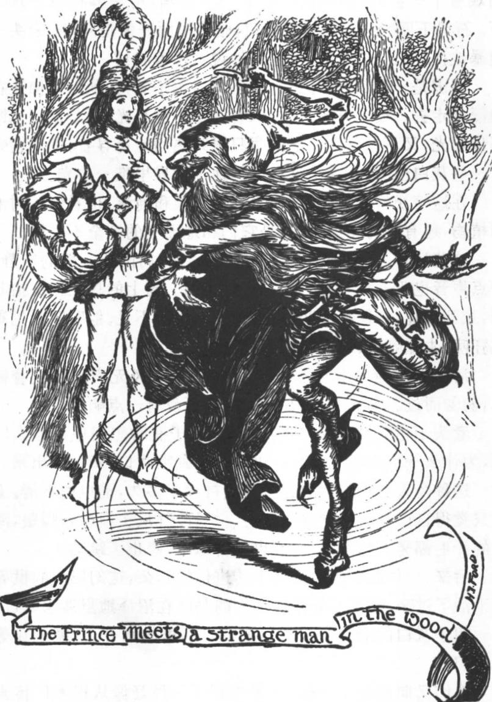

他快活地带着王子走着，一路上说个不停。他只顾了说话，没注意新佣人在一路上撒着豆。晚上，他们睡在一棵无花果树下，太阳出来了又继续赶路。

中午，他们来到一块大石头前。老头子停下来，仔细地朝四周观看了一会，然后响亮地吹了一下口哨，用左脚在地下踩三下。石头下面突然出现一扇暗门，暗门里面好像是洞口。老头子粗暴地抓住王子的手臂，不客气地说：“跟着我！”

周围是一片漆黑，什么也看不见。王子觉得，他们仿佛还在向深处走去。过了好久，他好像看到了一丝亮光，可是这亮光既不像阳光，又不像月光。他的两只眼睛热切地追寻着，发现它来自一些灰白色的云，这是这奇异的地下世界里唯一的光。

在这暗淡的光映照下，他看到了土地和河流，也看到了树木和植物，还有飞禽和野兽，可是它们和地面上的完全不一样。

这些还算不了什么，最令人恐惧的是，周围死一般的寂静，一点声音也听不见。有时候，他也注意到，树上的鸟在把头抬起来，张开喉咙，好像在鸣叫，可是他什么也听不见。他明明看见狗在狂吠，牛在嘶鸣，可仍然是万籁俱寂。

河水无声地冲击着岩石，湍急地奔流。风无声地摇晃着树木，匆匆而过。鸟儿在林中飞来飞去，可没有一点响声。

老头子也只顾赶路，一言不发。王子有时想问他是怎么回事，为什么一点声音也没有？可是声音到喉咙口，却发不出来。

这种令人毛骨悚然的寂寥到底持续了多久，谁也说不清。王子只觉得自己好像掉进冰窟似的，一股冷气从头顶透到脚跟，浑身的汗毛都竖了起来，心仿佛也变得冰冷，停止了跳动。

后来，一种微弱的声音终于传进他的耳朵，这幻影般的世界终于活了过来。那声音好像是远方的马队在沼泽地里涉水而过。

胡子灰白的老头子终于开口说话：“锅里的水开了，家里在等着我们。”

他们又向前走了一段，王子听到了一种好像从锯木厂传来的声音，像是许多锯子在一起锯木头。可是老头子说：“祖母睡得可真熟，你听，她的鼾声多响！”

他们爬过一座山以后，王子从远处可以看到主人的房子。它的周围还有许多建筑。从整体看上去，像是一个大村庄，甚至可以说是一个小城镇。

他们终于到家了，门前有一间空洞洞的狗窝似的鄙陋住所。“你进去！”主人说，“我去看祖母，你在这里等我。像所有上了年纪的人一样，她非常固执，不愿意看见陌生人的面孔。”

王子战战兢兢地爬进狗窝，开始后悔不该那么大胆，来到这么可怕的地方。

过了一会，主人出来，把他从狗窝里叫出来。好像发生过什么事情，他脾气变得很坏，皱着眉头对王子说：“小心地看着，我们家是怎么过日子的，不许出任何差错，否则你就倒霉。张开你的眼睛，竖起你的耳朵，闭上你的嘴，叫你干什么，你就干什么。不许提问题，要老老实实，除非有人问你，不许你说话。”

王子跨进门槛，看到一个仙子般美丽的姑娘，长着卷曲的金头发和褐色的眼睛。

“好了！”王子想，“要是老家伙有许多这样美貌的女儿，我留下来当他的女婿也没有关系。这一个就很讨人喜欢。”

他看着，她放好桌子，端上饭菜，在火炉旁边坐下，好像他这个陌生人完全不存在一样。她拿出针和线，开始补她的长袜子。

主人独自在桌子边坐下，既不叫那姑娘，也不邀请他这新仆人，一个人就吃起来，也不见他那个老祖母。他的胃口真是大得吓人，一会儿就把足足够十二个人吃的饭菜扫得差不多了。等他吃饱了，再也吃不下了，才对那姑娘说：“现在，你可以吃剩下的东西了，还有铁锅里的那些，骨头要留下来给狗吃！”

王子一点也不喜欢去刮锅底，吃残羹剩饭，可是也不得不帮那姑娘把剩下的饭菜凑拢来。不过，他发现还有不少东西可以吃，而且味道确实很好。吃饭的时候，他不停地偷看着那姑娘，还很想和她说话，但是她不理睬他。有几次，他话已经到了嘴边，可是每次姑娘都严厉地瞪了他一眼，好像在说：“别说话！”所以，他只能用眼睛来表达自己的思想和感情。再说，主人吃了那么多以后，正躺在炉子旁边的一张凳子上，说什么他都可能听得见。

那天晚上，吃过晚饭以后，老头子对他说：“你可以休息两天，以消除旅途的疲劳。这两天你可以到处看看。可是从后天开始，你就要给我干活，我会分派你的工作。那姑娘会指给你睡觉的地方。”

王子想，从现在开始，他可以说话了。没想到老头子转过脸来，声色俱厉地骂道：“你这当佣人的狗！要是再敢违背这个家的规矩，你很快就会发现，自己矮了一个头。管住你的舌头，让我安静一些。”

姑娘给他打了个手势，叫他跟着。她打开一扇门，点点头叫他进去。她看上去很伤心，王子本来还想拖延一下，但是不敢这样做，怕老头子会发脾气。

“她不可能是老头子的女儿。”他想，“因为她有一颗善良的心。我敢肯定，她就是那个代替我来这里的姑娘。所以，我必须冒着生命危险来到这里。”

他上了床，好久好久还睡不着。就是睡着了，那些梦也不让他得到安宁。他梦见自己危机四伏，生命旦夕难保，只有那姑娘才能帮他度过难关。

他醒过来，首先想到的是那姑娘。他看到，她已经在卖力地干活。他从井里打上水来，给她送到房子里去，帮她把炉火点着。总而言之，只要能想得到的，都尽量地帮她。

下午，他走出去，想熟悉一下这个新的家。他很惊讶没有碰到那个老祖母。

他走着，走着，来到院子里，看到一匹漂亮的白马独自占着一个马厩。一间牛棚里，只关着一头黑色的母牛和两头白头的小牛。那些鹅、鸭、鸡看到他，都咯咯地叫着向他奔跑过来。

早餐、午饭和晚餐都一样的美味可口。要是能和那姑娘说说话，他也就心满意足了。最叫他难过的是，要在姑娘面前保持沉默。

第二天晚上，遵照老头子的吩咐，王子来到他的面前，接受明天的任务。

“明天，我只派一些最容易的事情给你做。”老头子看到佣人来了，对他说，“把这把镰刀拿去，去割草来喂那匹白马。它一天要吃多少，你就给它割多少，把马厩打扫干净。要是我回来以后发现马槽空着，你就要倒霉！小心点！”

王子走出房间，心中觉得非常高兴。他想，“好吧！我很快就会干这种活。虽然我从来没有用过犁或镰刀，起码我还看到那些农民用过，看上去很容易。”

他正要把自己的房门打开，那姑娘悄悄地走过来，在他耳边小声地问：“他叫你明天干什么？”

王子说：“没有什么大不了的事情，明天我只要割草喂饱那匹白马，把马厩打扫干净。”

“啊！可怜的人！”姑娘叹息道，“这活你怎么干得了呢？那匹白马，就是主人的祖母，它总是吃不饱。要二十个人不停地割草，才够它吃；还要二十个人，才能把它的马厩打扫干净，你一个人怎么能干得过来呢？你要听我的，照我的话去做，这是你唯一可以得救的办法。你把马槽里装满草以后，就用灯心草编成一个牢固的网，砍下一根结实的木头做桩子。干这些活的时候，你要故意让那匹白马看见，它会问你在干什么，你要回答说，‘我要用这个网来罩住你的嘴，叫你不能再吃了；要用这根木桩来拴住你，叫你动弹不了，不会把这些饲料和水弄得满地都是！’”

说完这些话以后，姑娘像刚才进来一样，悄悄地走了。

第二天一早，王子就起来出去干活。他的镰刀在草堆里飞舞着，速度比他所希望的还要快，一会儿就足够填满马槽。他把草倒入马槽以后，又出去割草。等回来的时候，他恐惧地看到，马已经把马槽里的草吃光。这时候，他明白了，要是不照姑娘的话去做，他肯定要完蛋。

他开始照姑娘教的办法行动起来，从草中挑出夹杂在里面的灯心草，很快地编织起来。

“我的孩子！你在干什么呢？”白马吃惊地问。

“哦！没有什么！”他回答，“我只是在编一个绳套，好把你的嘴套起来，叫你不能再吃了！”

白马听了他的话，深深地叹了一口气，决定适可而止，不再多吃了。

王子开始打扫马厩。白马知道这个主人的厉害，也不敢乱来了。到中午的时候，马槽中的草还是满满的，马厩里干干净净，像新造好的一样。

王子把这些活刚干完，老头子就走出来。他吃惊地站在门口看着，说：“你真是那么聪明，知道这些活该怎么干吗？还是谁给你暗示过什么？”

“呵！除了我这可怜的笨脑子，谁都没有帮过我。”王子回答。老头子皱着眉头走了。王子很高兴，一切都变得那么顺利。

到了晚上，主人对他说：“明天没有什么特别的活要你干。那姑娘在家里有许多事情要做，你去帮她给黑母牛挤牛奶。记住，要把牛奶挤干净，否则你就要倒霉了。”

“好了！”王子边走出去边想着，“除非这里头有什么诡计，这活看起来不难。我虽然没有挤过一滴奶，可是我有一双强壮的手。”

他觉得很困，正想到自己房间里去，那姑娘走过来问他：“明天叫你干什么？”

“明天我来帮你。”他说，“不过没有什么很多的事情，只是把黑母牛的奶挤干净。”

“你真是太不幸了！”姑娘说，“从早上挤到晚上，你也挤不光这头母牛的奶。只有一个办法可以救你。你去挤牛奶的时候，拿一盆烧着的炭和一把火钳来。把那盆炭放在牛棚的地板上，把火钳放在火里烧。用尽你的力气去吹那盆火，让那些炭烧得通红。那头黑母牛看到了，会问你在干什么，你要照我的话去回答它。”说着，她踮起脚丫，贴着他的耳朵小声地说了几句，就走了。

第二天，东方刚刚透出一点曙光，王子就从床上跳起来，一只手拿着一盆炭，一只手拿着牛奶桶，急匆匆地来到牛棚，开始照姑娘昨天晚上跟他说过的去做。

黑母牛奇怪地看了他一会，然后问：“孩子，你在干什么呢？”

“哦！没什么！”王子说，“我只是把这把火钳烧红，免得你的奶太多了，超过我的需要。”

母牛深深地叹了一口气，害怕地看着挤奶人。他好像毫不在意，开始挤奶，不一会就挤干了。

这时候，老头子走进牛棚，亲自蹲下来挤奶，可是一滴也挤不出来。“这些事情都是你自己干的吗？还是有人帮了你的忙？”

“没有人帮过我。”王子说，“全靠我这可怜的脑袋。”

老头子站起来走了。

那天晚上，王子又到主人那里去，看明天叫他干什么？老人对他说：“在草地上，我有一小堆草在晒干。明天你去把它搬到草棚里去。你要是还想活的话，小心，一根也不许拉下！”王子听了很高兴，这件事情应该很容易做到。

“搬一小堆草不怎么难。”他想，“用不着我花多大力气，让那些马拉进来就是了，何必让老祖母闲着呢？”

不久，那姑娘偷偷地走进来，问他明天干什么？

王子笑着说：“看来，我得学会干所有的农活。明天，我要去把那堆草搬进来，一根也不许留在草地上，那就是我一天的活。”

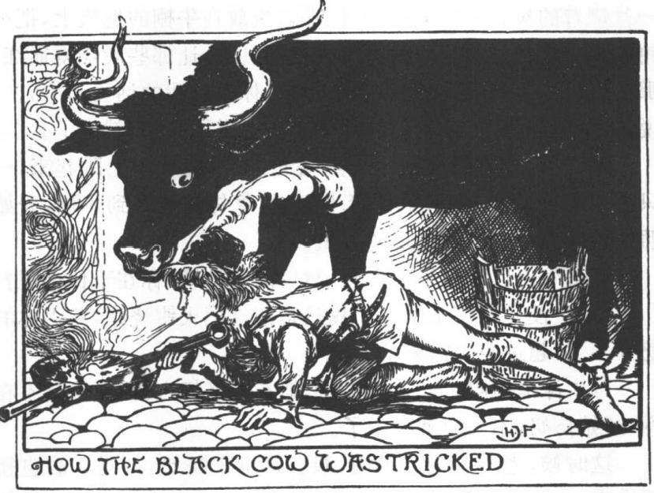

“啊！你这不幸的人！”姑娘说，“你想，这活你一个人怎么干得了呢？就是全世界的人都来帮你，一个星期里也别想搬完这堆草。上面的草还没有搬完，下面的草已经长出来了。不过，你听我说，明天天蒙蒙亮，你就快点起来，偷偷地拉着那匹白马，带着一些结实的绳子走出去。到草地上以后，用绳子把那堆草绕住，再把绳子的一头套在马身上。这些事情做好了，你就爬到草堆上去，开始数一、二、三……那匹马听到了，就会问你在数什么，你千万要记住，照我的话去回答。”说着，她小声地在他耳边说了些什么就走了。

王子觉得没有什么事情可做，就上床睡觉了。

这天晚上，他睡得很好。天还没亮，他就起来，准备照姑娘教他的去做。他找来一些结实的绳子，从马厩中拉出那匹白马，骑着它到草地上去。那堆草足足可以装满五十辆马车，天知道，老头子怎么会说是“一小堆草”。

王子照姑娘说过的那样去做，完了以后就坐在草堆上，开始一、二、三地数，数到二十的时候，马惊奇地问：“孩子，你在数什么呢？”

“哦！没什么，”他说，“我只是数着玩，看森林里有多少群狼。可狼那么多，我怎么数也数不清。”

王子口中的“狼”字刚刚出口，白马就像闪电般地奔跑起来，一眨眼工夫，就把那堆草全部拖到草棚里了。老头子吃过早饭，看到他把一天的活都干完了，惊得目瞪口呆。

“你真是这么聪明吗？”他问，“还是谁给你出了个好主意？”

“哦！我只能和自己商量。”王子说。老头子摇摇头，走开了。天黑了，王子来找他的主人，问明天干些什么？

老头子说：“明天，你把那头白头的小牛带到草地上去。你要是还想活下去，就小心点，别让它跑了！”

王子没有说什么，他想，“好的，很多农民到了十九岁，就要放牧一大群牲口，一头小牛我总可以应付得了。”他向自己的房间走去，碰见了那姑娘。

“明天，叫我去干傻瓜也能干的活。”他对她说，“把那头白头小牛带到草地上去。”

“呵！你这不交好运的人！”她叹息着，“你知道这头小牛跑得有多快吗？一天之内，它就能绕地球三圈！你仔细地听我说！把这根丝线的一头结在小牛的前左腿上，把另一头结在你左脚的小脚趾上。这样，不管你是站着，躺着，还是在走路，小牛也永远不会离开你左右。”

王子回到房间，舒舒服服地睡了一个晚上。

第二天早上，王子照姑娘教他的办法去做，用一根丝线把小牛带到草原上去。小牛果然像一条忠诚的狗一样，跟在他的身旁。

太阳下山了，小牛回到牛棚。老头子走过来，皱眉蹙额地问王子：“你不会这么聪明吧！谁教你这么做的？”

“哦！除了我这个笨脑袋，谁能帮我的忙！”王子回答。“我一个字也不相信，你肯定找到了一个聪明的朋友。”老头子嘟嘟哝哝地说着，满脸怒气地走了。

晚上，老头子把王子叫来，对他说：“明天，我没有什么活要你干。可是，当我早上醒过来的时候，你必须来到我的床边，伸出你的手来向我问候！”

这个怪念头使王子感到有点莫明其妙，他十分好笑地到处找那姑娘。

“啊！这可不是什么好笑的事情。”姑娘说，“他这是要把你吃了。我只有一个办法可以救你。你明天一早找一把铁铲来，把它烧得通红，到老头子那里去以后，用它来代替你的手伸过去。”

第二天，王子很早就起床，在老头子醒过来之前，就把铁铲烧得通红。不久，他听到老头子的叫声：“你这个懒鬼，到哪里去了？快过来向我问候早上好！”

可是当王子拿着通红的铁铲走进房间的时候，老头子只是说：“我今天病得很厉害，连握你的手的力气也没有，你今天晚上再来吧！那时候我会好一些。”

这一整天，王子到处踯躅。晚上，他来到老头子的房间，令他非常吃惊的是，他受到了最友好的接待。他的主人对他说：“我对你非常满意，明天一早，你带着那姑娘一起来见我。我知道，你们相爱已经很久了，我让你们成亲。”

王子高兴得几乎跳起来。不过，他想起了这里的规矩，尽量地使自己安静下来。他找到那姑娘，把这个消息告诉她，可叫他困惑的是，她的脸色变得像纸一样白，人也呆若木鸡。

“老头子已经知道了，谁在帮你出主意。”好半天，她才定下神来，说，“他想杀了我们俩，我们得想办法逃走，要不就来不及了。你去拿一把斧头来，用一斧头把那头小牛的头砍下，再一斧头把它的头劈成两半。在它的脑子里，有一个发光的红球，你把它带来给我。我这里也做一些必要的准备。”

王子想，“杀了那头小牛，总比杀了我们好。要是能逃出去，我们就回家去。我撒在路上的豆肯定发芽长叶了，路应该很容易找到。”

他来到牛棚，一下子就把小牛的头砍下，再一下把它劈成两半。一个红色的小球从牛头中滚出来，把牛棚照得通红。王子把球捡起来，用一块厚布包好，藏入怀中。幸好那头母牛睡着了，要不，它叫起来，就会把老头子惊醒。

他看了看四周，在门口找到了那姑娘，她手中拿着一个小包。

“球在哪里？”她问。

“在这里。”他拍拍胸口说。

“我们得抓紧时间，赶快逃走。”她把裹着小球的布拉开一点，以照亮黑暗中的路程。两人手拉着手赶紧奔出去。

像王子所希望的那样，那些豆已经生根，发芽，长出叶子，连成一条小小的篱笆，他们完全可以放心地奔逃，不会迷路。

在他们一路奔跑逃命的时候，姑娘对他说，她听到过老头子和他祖母的谈话，说她是国王的女儿，老头子设了一个圈套，让她的父母上钩，才把她骗到手。

王子当然知道事情的真相。不过，他听了姑娘的话以后也不做声。他能亲自把她救出来，打心底感到非常高兴。他们马不停蹄，一直跑到天明。

老头子这天睡到很晚才醒，他揉揉眼睛，想起那对年轻人今天早晨应该来见他。他等着，等着，好久不见他们来，不禁咧嘴笑起来，自言自语地说：“好的！他们并不急着要结婚。”

他又等了一会，开始有点不安起来，大声喊叫：“小伙子和姑娘，你们怎么啦？”

他喊了好几遍，没有什么动静，不见王子，也不见那姑娘来。

他有点害怕了，又叫了几遍，还是没人答应。他生气地从床上跳下来，开始寻找他的囚犯。可是房间里空空的，床上也没有人睡过。

他来到牛棚，看到那头死了的小牛，明白了是怎么回事。他大声地诅咒着，把第三个房间的门打开，把里面的妖怪叫出来，叫他们去追赶两个逃亡者。“无论如何要给我抓到他们，把他们给我带回来！我一定要得到他们！”他说。那些妖怪像风一样地追赶出去。

这时候，王子和姑娘正在旷野里奔跑，姑娘突然停下来。“出了什么事了！”她说，“我手中的球在不停地转，肯定有人在追我们。”

他们回头看见，风吹着一块乌云正迅速地向他们靠近。姑娘把手中的球转了三次，说：

> “小球，小球，听我说，
> 快把我变成河流，
> 把我爱人变成小鱼在河中游。”

一眨眼工夫，田野中出现了一条河流，河中有一条小鱼在愉快地游着。那些妖怪也不含糊，他们刚变成河和鱼，他们就赶到了。可是找来找去，看不到他们要抓的人，也不去管那条河和水中的鱼，就回家去了。

姑娘和王子看到他们走远了，又变回原来的模样，继续赶路。

那些妖怪气喘吁吁地空手回到家里，主人问他们看到了什么，有没有什么奇怪的东西出现。

“没有什么，”他们回答。“旷野上空荡荡的，只有一条小河在流，河中还有一条鱼。”

“白痴！”老头子大声地吼叫着，“那当然是他们变的！”说着，他冲过去打开第五个房间的门，把里面的妖怪放出来，叫他们赶快去把那条河水喝干，把那条鱼抓回来。那些妖怪立刻冲出去，像一阵风似的不见了。

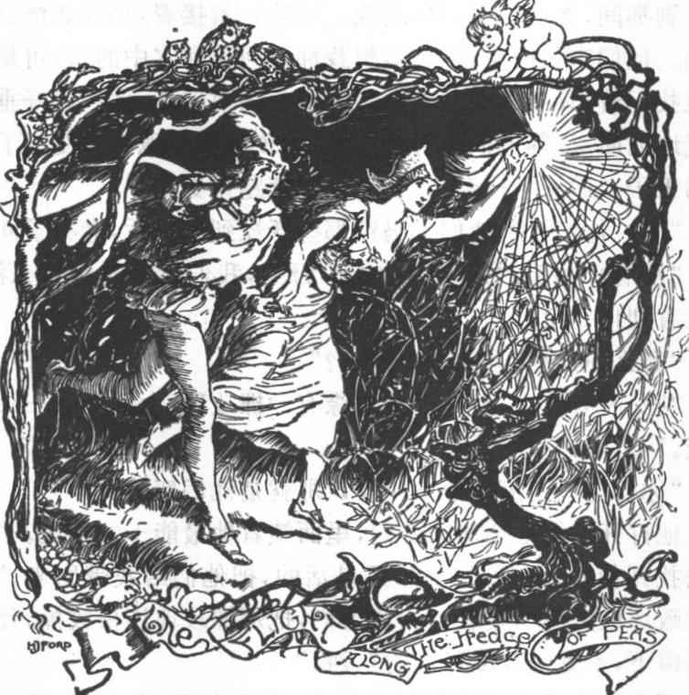

这对年轻人已经快到森林边缘了。姑娘又停下来，说：“要出什么事了！我手中的球转个不停！”

他们回头张望，看到一块乌云在向他们飞过来。这块乌云比上次那一块还要大，还要黑，当中还有红色的条纹。

“这是来追赶我们的。”她说。她把手中的球转了三次，说：

> “小球，小球，听我说，
> 快把我们变一变，
> 我是一棵野玫瑰，
> 他是枝上玫瑰花！”

刹那间，地上长出一棵玫瑰。好险！紧接着，那些妖怪已经赶到。他们东张西望，急切地想找那条河流和水中的鱼，可是怎么也找不着，只见一棵玫瑰上盛开着一朵玫瑰花。他们只好垂头丧气地返回家。等他们走得看不见了，玫瑰和玫瑰花又变成了姑娘和王子。休息了一会儿以后，他们奔跑得更快了。

“喂！你们找到他们了吗？”那些妖怪到家以后，老头子问。

“没有！”领头的妖怪说，“在旷野上，我们没有看到什么河，也没看到什么鱼！”

“那么，有没有看到别的什么？”

“嗯！没有什么，只是森林边缘有一棵玫瑰，上面开着一朵玫瑰花。”

“你们这些白痴！”他喊叫着，“那就是他们变的。”

他打开了第七个房间的门，里面锁着他最能干的妖怪。“想办法找到他们，不管是死的，还是活的，把他们给我带回来。”他气急败坏地大声叫嚷着，“我要他们，把那棵玫瑰连根拔掉，什么也别留下，不管是什么可疑的东西！”

两个逃命的人正在树荫下休息，吃着东西，喝着水，以补充体力。姑娘突然抬起头来观察，她说：“要出什么事了，小球几乎要从我胸口的口袋里跳出来！肯定有人在追赶我们，危险在向我们袭来，只是树林把我们的敌人遮住了。”

她把球拿出来说：

> “小球，小球，听我说，
> 快把我们变一变，
> 他是一只小蚊子。
> 我是一阵清风，
> 轻轻地把他托起。”

话刚说完，姑娘就变成了一股清风，王子变成一只蚊子，随风飘荡着。

顷刻之间，那群妖怪就赶到了。他们到处寻找，可是既没有玫瑰树，也没有玫瑰花，什么可疑的东西也看不见。

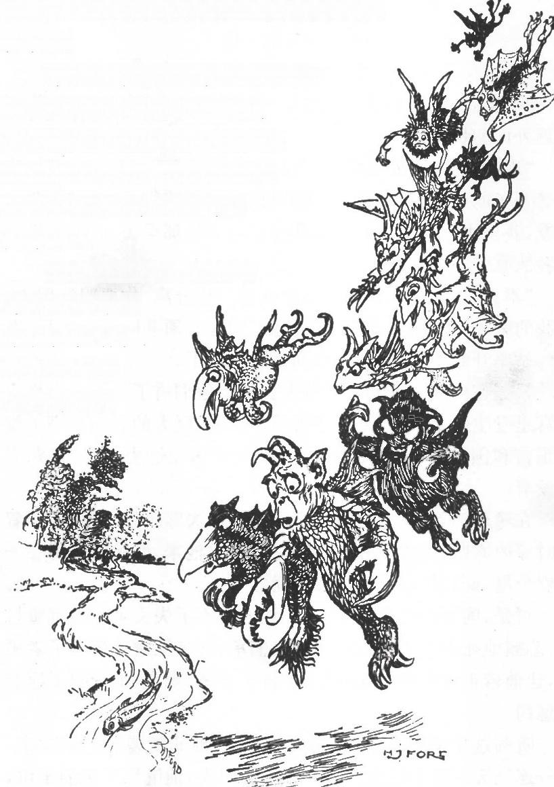

可是他们刚刚转身，空手回去，王子和姑娘又出现了。“我们要用最快的速度奔跑，”姑娘说，“免得让老头子亲自来抓我们，不论我们变成什么，他都能认得出。”

他们逃到了地下最黑暗的地方，要不是那个小球闪闪发光，就根本无法找到路。

王子和姑娘终于上气不接下气地跑到一块大石头旁边，那个球开始不停地转动着，姑娘看到了，说：

> “小球，小球，听我说，
> 快把石头搬一边，
> 好让我们找到门。”

只见石头向一边滚去，露出一扇大门，他们冲了出去，终于重返外面的世界。

“现在，我们平安无事了。”姑娘高兴地喊道，“我们已经逃出了老头子的势力范围，他的咒语再也管不了我们了。不过，我的朋友，我们也该分手了！你回到自己的父母那里去，我也应该去找我的家了！”

“不！不！”王子说，“我永远也不会和你分离。你要跟我回去，做我的妻子。我们共同度过了难关，现在必须共同分享快乐。”

姑娘开始不答应，后来也同意跟他走了。

他们在树林里碰到一个樵夫。他给他们讲了外面的世界和王宫里发生的事情。自从王子失踪了以后，巨大的悲痛充满了整个王宫和国家，人们到处寻找他，可是许多年过去了，一点踪影都没有。

在魔球的帮助下，姑娘把王子打扮成失踪时候的模样，穿着当时穿的衣服，以便他的父亲能立刻认出他来。姑娘自己躲在一间农舍里，好让他们父子单独重逢。

可是，国王已经离开了人世。他经受不了失去王子的沉重打击，悲痛地死去了。临终前，他向人们承认，是他设计欺骗了老巫师，让他带走农民的女儿，把王子留了下来。现在，他受到了应有的惩罚。

听到这个消息，王子嚎啕大哭，因为他非常爱自己的父亲。他一连三天三夜不吃也不喝。到了第四天，他继承父亲的王位，当了新国王。

他把大臣们召来，告诉他们自己所经历的那些奇怪的事情，还说了，那个姑娘如何帮助他度过一个又一个险关，奇迹般地活着回来。

那些大臣们异口同声地欢呼：“让她做你的妻子，我们的王后！”这就是故事的结尾！

## 蛋孩子

从前有个王后，因为没有孩子，整天闷闷不乐。丈夫在家陪她，她也打不起精神来；丈夫要是出去了，她孤零零的一个人呆在家里，就会整天流泪。

后来，她的国家和邻国发生战争，王后独自留在王宫里，觉得非常沉闷，四周的墙壁好像把她压得透不过气来似的。于是，她来到花园里散步，想解解闷。

她在一块绿草地上坐下，高大的树木投下巨大的阴影，空气显得格外凉爽。她在那里坐了一会，一阵“嘚！嘚！嘚！……”的声音引起她的注意，她抬起头来，看到一个老太太正扶着拐杖向流过花园的一条小河走去。

老太太喝了一些水，解渴以后，向王后走过来，对她说：“别那么伤心！高贵的夫人！我和你说话，你别害怕！说不定我会给你带来好运气。”

王后半信半疑地看着她，回答说：“看上去你自己也并不走运；也不像会给别人带来好运气的样子。”

“在粗糙的树皮里，有着光滑的木材和甜蜜的核。”老太太说：“让我看看你的手，我会预卜未来。”

王后把手伸过去，老太太仔细地察看着她的手纹，然后说：“你的心因为两件事情而非常沉重。一件是新的，一件是旧的。新的是为了你的丈夫，他正在远方作战。不过，请相信我，他非常好，很快就会给你带回欢乐的消息。另一件伤心的事却由来已久，因为没有孩子，把你幸福的生活毁了！”

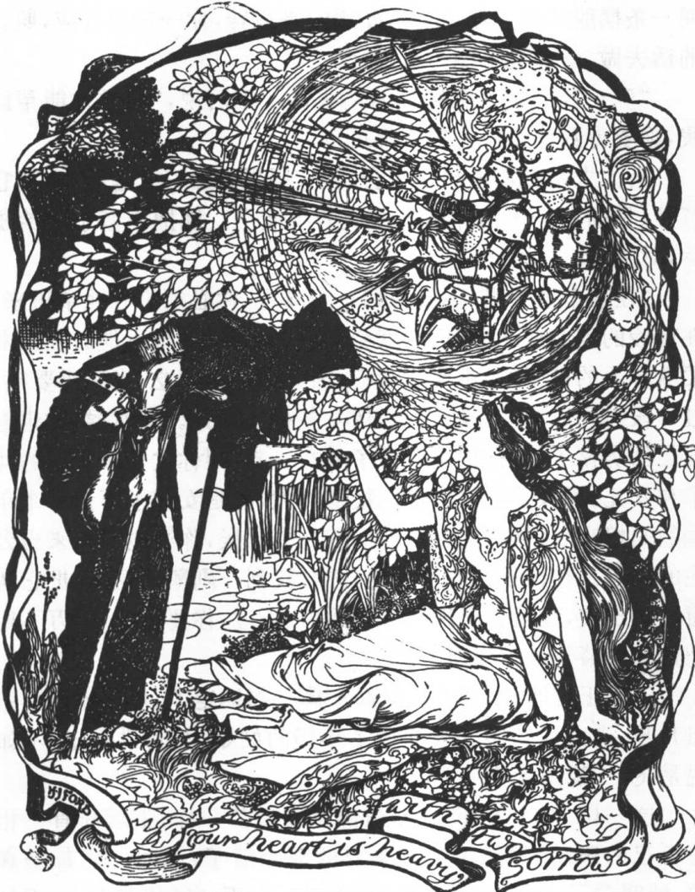

王后听了这些话，满脸通红。她想抽回自己的手，可是老太太不肯放，继续说着：“请耐心一点！有些地方我想看看仔细。”

“可你是谁呢？”王后问，“你好像能看透我的心思。”

“我是谁并不重要。”老太太回答，“重要的是，我可以给你指明一条摆脱悲伤的路。不过，要想时来运转，你一定要答应，照我的话去做，丝毫也不能打折扣。”

“呵！我一定完全照你的话去做。”王后说，“要是你能帮助我，你要得到什么样的报酬都可以。”

老太太站在那里想了一会，从衣服里拿出一个包裹来，把它打开，里面是一个白桦树皮做成的小篮子。她把小篮子交给王后，对她说：

“在这个篮子里，你会找到一个鸟蛋。你必须小心地拿出来，在温暖的地方放三个月，它就会变成一个玩偶。把玩偶放在铺着柔软羊毛的篮子里，不要去管它，因为它不需要吃，也不需要喝。过一段时间以后，它就会长得像女婴孩一样大。那时候，你也有自己的男孩子了。你把两个孩子放在一起，叫你丈夫来看他的儿子和女儿。男孩子你可以自己把他养大，可是女孩子要请一个年轻的姑娘来当保姆。到该给他们洗礼的时候，你要邀请我来当公主的教母。在孩子们的摇篮里，你会找到一副鹅的翅膀，把它从窗口扔出去，我就会出现在你的面前。不过，你要记住，千万不要把这些事情告诉给任何人。”

王后正想回答，老太太已经一瘸一拐地走了。可是还没有走出几步，老太太转眼间就变成了年轻的姑娘，与其说是走，不如说是飞，一瞬间就不见了。

这一切，发生得那么快，仿佛是在做梦一样，王后简直不相信自己的眼睛，只有手中还拿着的那个篮子，说明一切都是真的。她明白了，这个流浪到花园里来的，乞丐一样的穷女人，不是一个普通的人。

王后赶紧回到自己的房间，小心地抚摸着篮子中的蛋。是的，它还在那里，浅蓝式的蛋壳上有着小小的绿点子。她小心地把它拿起来，放在自己的胸口。她想，这应该是最温暖，最合适的地方。

两个星期以后，国王打了胜仗凯旋归来。老太太第一个预言实现了。王后的心中充满了希望，她已经预感到，老太太的其他预见也将会出现。她把那只篮子和蛋当成自己最宝贵的珍宝，还为篮子做了一个金色的盒子，好让蛋和篮子能安全地放在里面。

三个月过去了，像老太太吩咐过的那样，王后把蛋从胸中取出，小心翼翼地把它放进铺着柔软的羊毛的篮子里。

第二天早上，她去看篮子中的蛋。她看到，蛋壳已经裂开，一个小玩偶正躺在碎蛋壳之中。王后觉得非常幸福，她轻轻地走开，让她自己平安无事地生长。她耐心地等待着，等待着像老太太预言的那样，把自己生下来的孩子放在她身边。

一切都像预言中所说的那样准确，王后生下了一个儿子。篮子中的小玩偶也变成了女婴，王后把小女孩从篮子里抱出来，和她的儿子一起，放在金色的、镶着闪闪发光的宝石的摇篮里。接着，她派人去把国王叫来。国王看到这对婴孩，高兴得几乎要发疯。

不久，整个王宫都准备为这对王室的后代举行洗礼仪式。一切都准备好了以后，王后把窗子轻轻地打开，让那对鹅的翅膀飞出去。

客人们纷至沓来。突然，六匹乳白色的马拉着一辆豪华的马车奔驰过来。从马车上走下一个年轻的女子，她的衣着华丽，像太阳一样闪烁着光芒。她头上罩着面纱，所以人们看不清楚她的脸。她来到王后和两个孩子的身边，取下面纱，大家都为她的美貌惊讶不已。她抱起小女孩，面对大家宣布，从今以后，这女孩子的名字叫杜德琳。谁也猜不透，这个名字是什么意思。只有王后知道，这个女孩是从蛋黄里孵出来的。男孩子的名字叫威廉。

宴会结束以后，客人们都走了。教母把女孩子放进摇篮，对王后说：“不论什么时候，只要女孩子睡着了，你别忘了把篮子放在她的旁边，让蛋壳留在篮子里。你只要这样做了，邪恶就不会来伤害她。要像看护自己的眼睛一样地看着这些珍宝，教你的女儿也这样来保护自己。”说完，她吻了小孩三次，就乘上马车走了。

孩子们茁壮地成长着。杜德琳的保姆爱她就像爱自己的亲女儿一样。女孩子长得一天比一天漂亮，看到她的人都说，她很快就会长得像她的教母一样美丽。可是，除了保姆以外，谁也不知道，每天晚上，女孩子睡着以后，总有一个陌生而十分迷人的年轻女子来看她。后来，保姆把这件事告诉给王后，她们决定对这件事保守秘密，不再让任何人知道。

这对孪生子长到快两岁的时候，王后突然得了一场重病。王国里所有最好的医生都请来了，可是没有用，谁也不能把她从死神手中夺回。

王后知道，她快要死了，就派人把杜德琳和她的保姆找来。王后把那个象征着吉祥和幸福的篮子交给了保姆——她最信赖的仆人，关照她要像珍宝一样地保存它。

“等我的女儿长到十岁以后，”王后说，“你就把这个篮子交给她，要严肃地对她说，她将来的幸福都在于她如何保存好这个篮子。至于我的儿子，我没有什么可担心的，他是王室的继承人，他的父亲会照看好他。”

保姆向王后保证，照她的吩咐去做、而且还要严守秘密。这天早晨，王后去世了。

几年以后，国王又结婚了。可是他不像爱前妻那样地爱他的新娘。他和她结婚，完全是为了达到自己的政治目的。后娘也不喜欢前妻留下来的子女。国王看到了这些，就把他们都送出去，交给杜德琳的保姆照顾。

杜德琳满十岁了，保姆把那个篮子交给她，还把她母亲临死前的话对她说了。可是女孩子还小，不懂得这件礼物的真正价值，并不怎么把它放在心上。

这样，两年又过去了。有一天，国王不在的时候，新王后看到杜德琳坐在一棵酸橙树下。像往常一样，王后的无名之火直冒三丈，跑过去狠狠地打了她一顿。杜德琳好不容易逃回自己的房间。

保姆不在，她哭了一会，看到装着篮子的金盒子。她想，里面可能会有好玩的东西，就跑过去打开来看。可是里面除了一些羊毛和碎蛋壳以外，什么也没有。她大失所望，拿起那些羊毛，看到那对鹅翅膀。

“都是些旧垃圾！”她说着，转身把翅膀扔到窗外去。

一转眼，一个美丽的女子站在她的面前。

“别害怕，”那女子抚摸着杜德琳的头，说，“我是你的教母，专程来看你的。你这双通红的眼睛告诉我，你并不幸福。我知道，你的继母对你很不好。要有耐心，勇敢一些，好日子就会到来。等你长大以后，她就管不了你了。只要你小心，不要和你的篮子分开，不要把里面的蛋壳丢掉，就不会有人能伤害你。做一个丝绸套子，把小篮子套起来，日日夜夜地把它藏在你的衣服里，你的继母和任何想伤害你的人都毫无办法，你会太平无事的。要是遇到什么事情，不知道该怎么办才好，你就把鹅翅膀从篮子里拿出来，从窗口扔出去，我马上就会来帮助你。现在，我们一起到花园里去，到酸橙树下去，我有话要对你说，那里谁也听不见。”

她们俩有那么多话，等教母把一切她想让杜德琳知道的事情讲完以后，太阳已经西沉。教母看到她该走了，说：“把篮子给我，我想你该吃晚饭了，不能让你饿着肚子去睡觉。”

教母弯下腰来，对着篮子说了几句咒语。立刻，一张桌子出现在她们面前，上面放着水果和饼。吃完以后，教母领她回去，一路上教给她一些咒语，只要对着篮子说这些咒语，要什么就有什么。

几年以后，杜德琳长成了一个大姑娘。看到她的人都说，想不到天底下也有这样漂亮的姑娘，真是像天上的仙女一样美丽。

这时候，一场可怕的战争爆发了，国王和他的军队节节败退。后来，他们全部退到城里，准备固守城池。双方对峙了很久，城里的粮食越来越少，连王宫里的食品也开始短缺。

一天上午，杜德琳一连饿了两顿，昨天晚饭和今天早饭都没有吃，觉得非常难过。她把那对鹅翅膀放出去。

教母来了，杜德琳那么虚弱，那么悲惨，不禁对着教母伤心地哭起来，好久说不出话。

“别哭得这么伤心，亲爱的孩子。”教母说，“我要带你离开这里。至于其他人，只好让他们去等待机会了。”

说完，她吩咐杜德琳跟着。她们从城门走出去，那些守城的军队，还有城外的军队，都没有阻拦她们。那样子，好像根本就没有看见她们。

第二天，城池被攻破了，国王和他的大臣都当了俘虏。混乱之中，王子想办法逃走了。王后被乱箭射中，死了。

杜德琳跟着教母逃离敌阵以后，脱下自己的衣服，穿上农民的服装。为了让她伪装起来，教母把她的脸完全变了一个模样。

“等时来运转以后，”教母说，“要想见到自己的本来面貌，只要对着篮子说出我教过你的话，你就会恢复原来的模样，这花不了多少工夫。不过，你还得耐心地等待一段时间。”

在再次提醒她注意看好篮子以后，教母就和她道别了。

一连好多日子，杜德琳从一个地方流浪到另一个地方，找不到安身之处。虽然从篮子那里得到的食物足以充饥，后来，她还是很乐意到一个农民家里去干活，等着好日子的到来。

开始，她觉得农民家里的活可真难。过了不久，不知道是她人很聪明，学得很快呢？还是那个篮子暗中帮忙。反正三天后，她干什么活都得心应手，好像生来就会刷锅子，打扫房间似的。

一天早上，杜德琳正忙着擦洗一个木桶，一个衣着高贵的妇人恰巧从村子里经过，姑娘那光彩照人的面容吸引了她。她停下来，叫杜德琳过来，对她说：

“你愿不愿意到我那里去干活？”

“非常愿意，”姑娘回答，“只要我现在这家女主人同意。”

“呵！这个问题我可以解决。”那贵妇人说。她当天就和女主人谈好，杜德琳上了马车，坐在她的身旁，跟着她到她家里去。

六个月过去了。终于传来了令人兴奋的好消息，国王的儿子召集起一支军队，打败了征服他的王国，夺取他父亲王位的敌人。可是，与此同时，她也听到了老国王在监狱中死去的消息。姑娘为痛失父亲而大哭一场，可是她不敢声张，因为关于她的身世，她什么也没有对女主人说。

一年以后，对老国王的哀悼结束。新国王宣布，他准备结婚。为此，他将举行一个盛大的宴会，邀请全国所有的漂亮姑娘都来参加，他要从中亲自挑选新娘。

一连几个星期，全国所有的姑娘和她们的母亲都十分忙碌。她们准备好新的漂亮衣服，想方设法精心地打扮自己。

杜德琳的女主人有三个可爱的女儿，她们也同样十分激动。杜德琳心灵手巧，整天忙着为她们做漂亮的服装。可是到了晚上，一闭上眼睛，就梦见她的教母弯下腰来对她说：“给女主人三个女儿穿好衣服，送她们去参加宴会的时候，你也跟着她们一起去。没有哪一个姑娘比得上你。”

激动人心的这一天终于来临。杜德琳觉得难以控制自己。她给三个小女主人穿好衣服，打扮好，送她们和女主人走了以后，倒在自己的床上，埋头痛哭起来。

这时，她好像听到一个声音在对她轻轻地说：“看看你的篮子，你要的东西它都能给你。”

姑娘用不着等说第二次。她跳起来，拿起那个篮子，重复着那些神秘的语言。啊！看哪！床上出现了一件美丽的衣裳，像星星一样地闪闪发光。

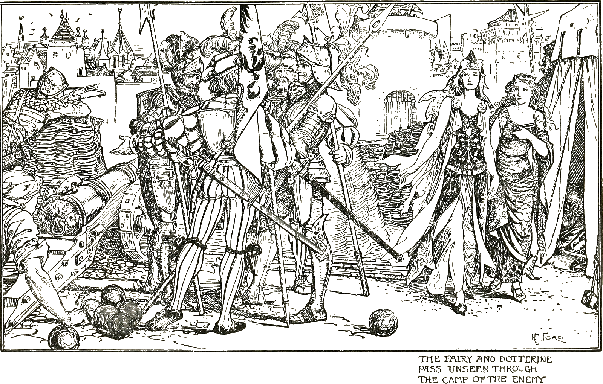

到王宫去的路很远，可她的马车一会儿就到了。她下了马车，向王宫的大门走去，突然想起，她忘了带那个篮子。怎么办呢？没有篮子，会不会交上厄运？要不要再回去拿，还是就这样走进去碰碰运气？正当她犹豫不决的时候，一只小燕子飞过来，给她送来了小篮子。姑娘的脸充满了幸福。

宴会达到了高潮，大厅里到处是浑身闪耀着珠光宝气的美女。这时候，大厅的门打开了，杜德琳神采奕奕地走进来，所有的姑娘看到她，都显得黯然无光。她们满怀希望的心像泼上了一盆冷水。可是她们的母亲不是这样想，她们交头接耳地说：“这肯定是我们失去了的公主！”

年轻的国王没有认出她来，完全被她吸引住了，总是在她的左右，不肯离开半步，眼睛一直瞪着她。

午夜，奇怪的事情发生了。大厅里忽然黑暗下来，好像是厚厚的乌云把灯光遮住了。接着，乌云一下子就散开，大厅里大放光芒。杜德琳的教母出现在大家的面前。

她对国王说：“这就是你总以为是自己妹妹的那个姑娘，打仗的时候，她忽然失踪了。其实，她不是你的妹妹，而是邻国国王的公主。她生下来就交给你母亲照看抚养，免得遭受恶魔的侵害。”

说完，她消失了，从此再也看不到她，那个神奇的篮子也不见了。现在，杜德琳的灾难已经过去，不再需要它了。她和年轻的国王结为夫妻，幸福地生活在一起，直到离开人世。

## 斯坦·博罗范

过去的事情总是发生过了，要不，就不会有这个故事了。在一个村庄的边沿，有一间小房子。房子的外头就是放牧牛羊的牧场。那些农民养的猪，也喜欢到这里来拱树根，找吃的东西。小房子里住着一个名叫斯坦·博罗范的男人，还有他的妻子。不过，他的妻子总是整天唉声叹气的，很不快活。

“亲爱的妻子，你这是怎么啦？整天垂头丧气的，像枯萎了的玫瑰花！”有一天，丈夫这样对妻子说，“你什么都有了，为什么不能像别的女人那样，快活些！”

“你别管我，也不要去追根刨底，问为什么！”妻子流着眼泪回答。丈夫想，现在问她可能不是时候，就干活去了。

不过，他总忘不了这件事。几天以后，他又问她为什么这样闷闷不乐，可是只得到同样的回答。

后来，他觉得这样下去实在受不了，又第三次问她。她转过头来回答说：“天哪！你就不能听其自然吗？我告诉你了，你只会和我一样的烦恼。要是相信我的话，最好别去管这些事，好不好！”

可是丈夫对这种回答很不满意。你越是叫他不要问，他好奇心越是重，非问出个究竟来不可。

“好吧！你既然那么想知道，我就告诉你吧！”妻子说，“我们这个家不走运，太不走运了！”

“为什么？你的奶牛不是全村最好的吗？你的果树上不是结满了果实吗？你的蜂箱里不满是蜜蜂吗？谁的庄稼地长得像我们的这样好？你这不是在胡说八道吗？”

“是的，你说的话，句句都是真的！可是我们没有孩子！”妻子说。

这时候，斯坦明白了。男人的心一旦想到了这种事情，他的日子可就难过了。从这天起，村庄旁边的这间小屋子，除了一个满脸愁云的女人以外，又多了一个心事重重的男人。听到丈夫悲伤的叹息声，妻子的心更加沉重。

这个状况持续了一段时间。

几个星期过去了，斯坦想，他最好去请求一个圣人，他住的地方离这里约有一天的路程。

斯坦来到的时候，圣人正坐在他的家门口。斯坦双膝跪在他的面前，请求他说：“我的圣人！给我孩子吧！给我孩子吧！”

“想想你在说些什么？”圣人回答，“你想抚养孩子？你有足够的钱给他们吃，给他们穿吗？”

“你只管给我孩子吧！我的圣人！我会想办法安排他们的！”斯坦说。

圣人向他点点头，斯坦向他告别，回家了。

晚上，他风尘仆仆地回到家里，虽然十分劳累，心中却充满了希望。靠近家门口的时候，他听到十分吵闹的声音，抬起头来一看！呵！到处都是孩子！院子里，花园里，甚至每个窗口上都有小孩坐在那里张望。看样子，好像全世界的小孩都集中到这里来了。走在前面那个最大，后面的一个比一个更小，一个比一个更吵闹，一个比一个更冒失，一个比一个更大胆。

看到这种景象，明白了这些孩子都是他的以后，他害怕得浑身发冷。

“天哪！一共有多少孩子！一共有多少！”他喃喃地说着。

“嗯！可是没有一个孩子是多余的。”他妻子笑着走出来，又有许多孩子拉着她的裙子跟出来。

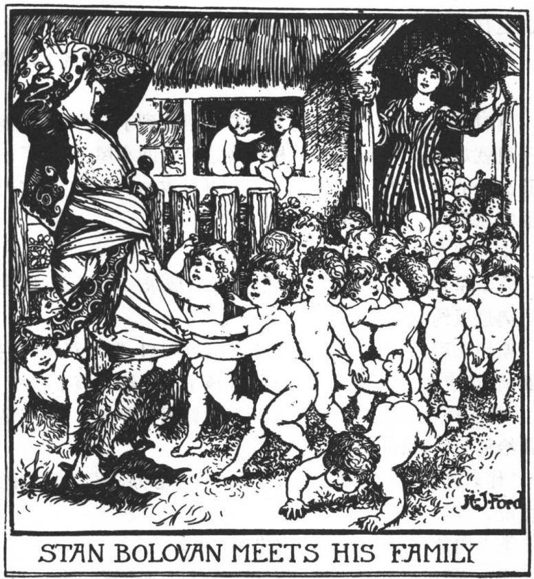

话是这么说，可她也觉得要照顾好这上百个孩子也真不容易。几天以后，家里的存粮全部吃完。孩子们开始哭喊：“爸爸！我饿！我饿！”斯坦只能抓抓头皮，不知道怎么办才好。他不是觉得孩子太多了！真的，一点也不！自从这些孩子来了以后，他妻子总是乐滋滋的！问题是他不知道该用什么来喂他们。奶牛已经停止产奶，而那些果树上的果实又还没有熟。

“你知道吗！老太婆！”有一天，他对妻子说，“我要出去走一走，看看能不能找点吃的东西带回来。不过，我现在还说不上，该到哪里去找。”

对于一个急于要喂饱一百个挨饿的孩子和自己的人来说，路总是嫌太远了。

他走啊！走啊！走啊！最后好像是来到了世界的尽头。这里的事情好像和整个世界不一样，有点似是而非。他看到不远的地方有一个羊圈，里面有七只羊。再过去一点，树荫底下，还躺着一群羊。

他蹑手蹑脚地走过去，想偷偷摸摸地拉几头羊，把它们赶回去给孩子们充饥。不过，他很快就发现，这是不可能的。

半夜里，他听到一阵沙沙响的声音，从空中飞来一条龙。它赶走一只公羊，一只母羊，还有一只小羊羔。此外，它还挤走了七十七只母羊的羊奶，带回去给它的老母亲洗澡，好让它返老还童。这种事情每天晚上都发生。

斯坦看到牧羊人苦苦地哀求那条龙，可是没有用，龙只是笑笑。斯坦想，这里不是给他家里找东西吃的地方。

不过，尽管他明白和这样凶恶的野兽对抗，似乎不会有什么好结果，可是一想到在家里嗷嗷待哺的孩子，他的脚步就变得沉重起来，怎么也走不开。后来，他对牧羊人说：“假如我帮你除掉这条龙，你答应给我什么？”

“给你三分之一公羊，三分之一母羊，三分之一羊羔。”牧羊人回答。

“这很合算，”斯坦回答。这时候，他根本没有想过，要是他真的赢了那条龙，怎么样才能把这么多牲口赶回家。

不管怎么说，这些事情以后总可以解决。天已经黑了，现在最要紧的是，考虑怎么样才能战胜这条龙。

午夜的时候到了，一种莫名其妙的恐怖又控制了斯坦。这种莫名其妙的感觉他自己也说不出来，只觉得有一股力量在强迫他离开这里，赶快抄近路回家。他几乎就要转身跑了，可是，他又想起了那些孩子，池又定下心了。

“不是你死！就是我活！”斯坦下了决心，在一块岩石上站稳。

空中又传来沙沙的响声，那条龙正在向这里俯冲过来。“站住！”斯坦突然大喊一声。

“我的天！”龙看了看四周，对斯坦说，“你是谁？从哪里来？”

“我是斯坦·博罗范。我白天吃山上的野花，晚上吃山里的岩石。要是你敢再碰这些羊，我就砍断你的腰！”

龙听到这些话，乖乖地在路上停下来。它知道，这回真是碰到对手了。

“可是，你得先和我较量较量看。”龙用发抖着的声音说。事情就是这样，你只要勇敢地站出来，它就会害怕。

“和你较量？我干吗要和你较量，我吹一口气就可以要了你的命。”斯坦说着，弯下腰来拿起脚下的一大块黄色乳酪，“你到河边去，拿来一块这样的石头，我们就可以较量出来，谁更有本事！”

龙听他的话，到河边搬来一块石头。

“你能从石头中挤出牛奶来吗？”斯坦问。

龙一只手拿稳石头，另一只手用力挤压。石头被捏成粉末，就是挤不出牛奶来。

“我不能！”龙有点生气地说。

“看着吧！你不能，我能！”斯坦说。他用双手挤压乳酪，牛奶从他的手指中流出来。

龙看到这些，它想，最好是快点逃回家吧！可是斯坦挡住了它的去路。

“我们还有些账得算一算。”他说，“就是你在这里干过的那些事。”可怜的龙吓得不敢动一动，怕他吹一口气把它杀了，埋在荒山的野草丛中。

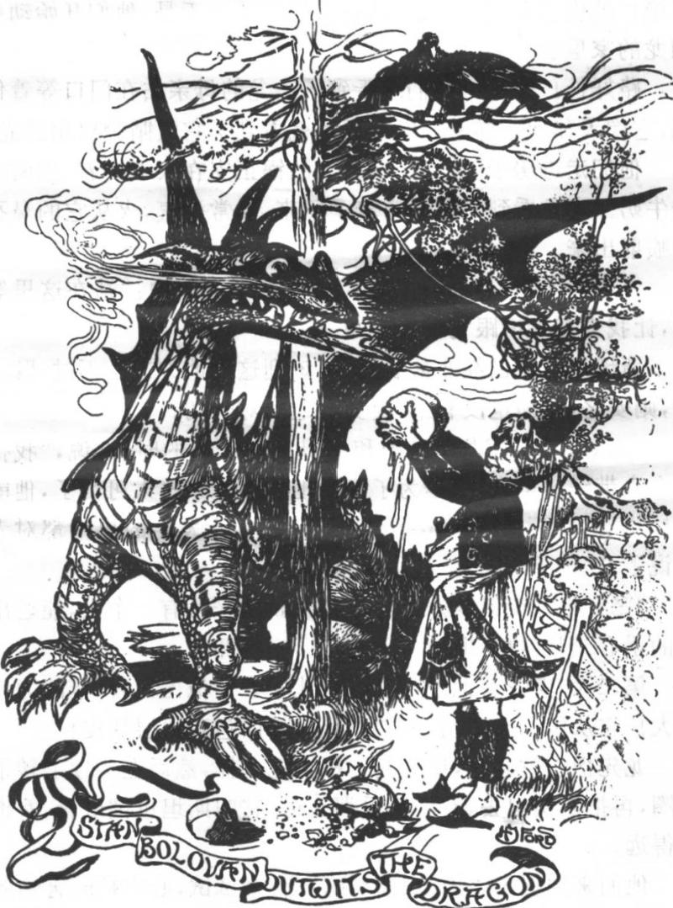

“听我说，”龙终于能定下神来，开口说话，“我看，你是一个很有用的人。我妈妈正需要一个像你这样的人。要是你能够为它服务三天，大约相当于你们一年，它就会每天给你七口袋满满的金币。”

满满的二十一口袋金币！这样的报酬太吸引人了，斯坦难以拒绝！他也不多说一句话，就点头答应了。于是，他们开始动身到龙的家里去。

路好长！好长！他们终于到了。龙的母亲站在门口等着他们，它像天和地一样老。斯坦很远就看到了它眼睛中射出的光。

他们走进房子，看到一口很大的锅正支在火上烧着，里面满是牛奶。老龙看到它儿子空着手回来，非常生气，火从它的鼻孔中喷射出来。

不等老龙开口说话，龙就转过身来对斯坦说：“站在这里等我，让我去把事情跟它解释清楚。”

斯坦这时候已经非常后悔，不该到这种地方来。不过，既来之，则安之，后悔也没有用，要勇敢地面对一切。

“听着，母亲！”龙单独地和它母亲在一起的时候，说，“我把这个人带到这里来，只是为了摆脱他。这个家伙太可怕了，他能吃掉岩石，从石头中挤出牛奶来。”它把晚上发生的事情都对老龙说了。

“嗯！把他交给我好了！”老龙说，“从来没有一个人，能逃出我的手心。”就这样，斯坦留下来当了它的佣人。

第二天，老龙对他说，今天，它儿子要和他比比看，谁的力气更大！它从房子里拿出一根大棍子，外面包着七层铁皮！

龙先把它举起来，像举起一根羽毛一样，然后在头顶上转了几圈，再把它扔出去，有三英里那么远。它叫斯坦也试试看，看谁扔得远。

他们来到棍子落地处。斯坦弯下腰来试试，心中顿时害怕起来。他明白了，即使是他和所有的孩子一起来，也无法举起这根棍子。

“你想干什么？”龙问。

“我在想，这是一根多么漂亮的棍子。让你死在这根棍子上，真是太可惜了。”

“你这是什么意思，我死？”龙又问。

“恐怕我把这根棍子扔了，你就活不到明天了。你不知道，我的力气有多大！”

“嗯！没有关系，快点扔吧！”

“你既然这么热情，那么让我们先去赴宴三天吧！这样，你起码可以多活三天。”

斯坦说得那么坦然，那么镇静，龙倒是真的有点害怕起来。不过，它还不十分相信事情会像他说的那样可怕。

他们回到家里，把老龙贮藏在家里的所有吃的东西，全部搬到外面来，搬到那根棍子的旁边。斯坦坐在那些食品箱上，安静地看着西沉的月亮。

“你想干什么？”龙问。

“等月亮给我让路。”

“你在说什么？我不明白。”

“你没看到吗？月亮正好挡住我的路！当然，如果你愿意，我就把棍子扔到月亮上去。”

听到这些话，龙再一次感到很不舒服。它很喜欢这根棍子，这是它的祖父留给它的，很不愿意把它扔到月亮上去。

“我想跟你说，”龙想了一会，说道，“你不用扔这根棍子了。我再扔一次，问题就这样解决了。”

“不！当然不！”斯坦说，“等着月亮下去吧！”

可是，龙非常担心他会做出对自己不利的举动，就想办法来收买他，最后说定给他七袋金币，让龙自己把棍子扔回去。

“呵！我的天！他真是个非常健壮的人。”龙对它的母亲说，“不知道你信不信，我花了九牛二虎之力，才说服他别把棍子扔到月亮上去！”

老龙也开始觉得不安了，想想看！把东西扔到月亮上去，那可不是闹着玩的。它们再也不敢提起这根棍子。第二天，它们得另想办法。

“你们去给我挑水！”第二天早晨，老龙给他们十二个牛皮做成的袋子，叫他们在天黑之前把家里的水池装满水。

他们来到了河边，一眨眼工夫，龙就把十二个袋子装满水，一下子就把它们挑回家。它把十二个空袋子带回河边，交给斯坦。这一下，他可傻眼了，别说挑水，他连空袋子也拿不动。他想也不敢想，要是装满了水，他该怎么办！

他慢吞吞地从口袋里拿出一把旧刀子，在河岸边挖起来。

“你在干什么？你怎么把水挑回家去？”龙问。

“怎么挑？我的天，那太容易了！我要把整条河搬回去！”

听到这些话，龙吃惊得张开了嘴巴。它从来没有听说过这样的事情。这条河从它祖父生下来的那天起，就在这里流淌了！

“让我告诉你吧！”龙说，“我来给你拿牛皮袋。”

“绝对不行！”斯坦说，继续挖着。龙害怕他会干出什么对自己不利的事情，又想收买他。最后两人商定，龙给他七口袋金币，让那条河留在这里，让龙把水挑回去。

到了第三天，老龙叫斯坦到森林里去砍柴。像往常一样，龙也跟他一起去。

你恐怕还来不及数到三，龙已经拔起了许多大树，并且把它们排列整齐。斯坦一辈子也砍不了这么多树！

龙干完了这些活，看到斯坦爬到最高的一棵树上去，抽出一根很长的野藤，在树梢上打个结，又爬到另一棵树上去，也在树梢上打个结。这样，他用那根藤把好几棵大树连起来。

“你在干什么？”龙看不明白，问他。

“你自己看吧！”斯坦说，继续做他的事情。

“你干吗把这些树连起来？”

“这样可以节省力气，我只要拔起一棵树，其他的就会倒下。”

“可是你怎么把它们抬回家？”

“我的天！你难道不明白，我要把整个森林搬回去！”斯坦说，又连上了两棵大树。

“让我告诉你该怎么做吧！”龙说，想到斯坦说的这种事情，它害怕得浑身发抖，“让我帮你把木头送回去，我给你七口袋金币。”

“你真是个好伙伴，我同意你的建议。”斯坦说。

龙把那些树木扛了回去。

这样，三天的服务，相当于人世间一年的时间，就结束了。现在，唯一叫斯坦伤脑筋的是，如何把这么多口袋的金币带回家！

这天晚上，龙和它的母亲坐在一起，说了很久。可是斯坦隔着墙板，把它们的话听得一清二楚。

龙说：“我们真倒霉！母亲，这个人早晚要把我们捏在手里，把钱给他，打发他走吧！我们也好摆脱这个灾难。”

可是老龙很吝啬，舍不得这么多钱，不想这么做。

“听我说，”老龙说，“今天晚上，你必须把他杀掉！”

“我害怕！”龙回答。

“没有什么可害怕的。”老龙说，“等他睡着以后，拿起那根棍子，对准他的头打下去，事情就是这么简单。”

斯坦要是没有听到它们的谈话，我们的故事就这样结束了。

龙和它的母亲把灯熄了以后，斯坦把喂猪的木槽拿来，里面装上土，把它放在床上，上面盖上被子。然后，他自己躲到床下去，大声地打起鼾来。

过了一会，龙偷偷地走进来，拿起那根棍子，对准床头狠狠地打下去。斯坦在床底下大叫了一声就不响了。龙像刚才进来一样，又偷偷地走出去。

斯坦从床底下爬起来，把门关好，把猪槽拿掉，把床整理好，弄干净，就上床舒服地睡了一个晚上。

第二天早晨，他来到厨房，看到龙和它的母亲在吃早饭。

“早上好！”他说。

“早上好！昨天晚上睡得好吗？”

“嗯！很好！可是我梦见一个虱子在我头上咬了一口，到现在还有点感觉。”

龙和老龙你看看我，我看看你。

“你听见了吗？”龙小声地对老龙说，“我用棍子在他头上用力打了一下，他说是虱子咬。”

这一回，老龙也像它儿子一样，害怕起来，对这种人真是毫无办法，它只好赶紧用袋子把金币装好，以尽快地把他打发走。

可是这时候，斯坦却像风吹的杨树似的，战栗起来。那么多袋黄金，他一袋也拿不动，只好站在那里眼睁睁地看着。

“你还站在那里干什么？”龙问他。

“嗯！因为我刚刚想起，我应该留下来再给你们干一年。要是我就这样回家，一定羞愧难言，他们会说我怎么就带这么一点钱回来；他们还会说，‘看哪！斯坦·博罗范在外面干了一年，人也像龙一样没有力气了。’”

龙和它的母亲都绝望地叫出声来。它们说，只要他肯走，它们情愿再给他七倍，甚至七乘七倍金币。

“让我告诉你们吧？”斯坦最后说，“我知道，你们不愿意让我再留下来，我也不愿意让别人说我不通情达理，不好商量。我立刻就走，不过要有个条件，你把这些钱给我带回去，免得我在朋友面前觉得难为情。”

斯坦的话刚出口，龙就迫不及待地从地上把那些金币抓起来，放在自己的背上。于是，它和斯坦一起出发了。

路虽然不算远，但对斯坦来说，也够长了。

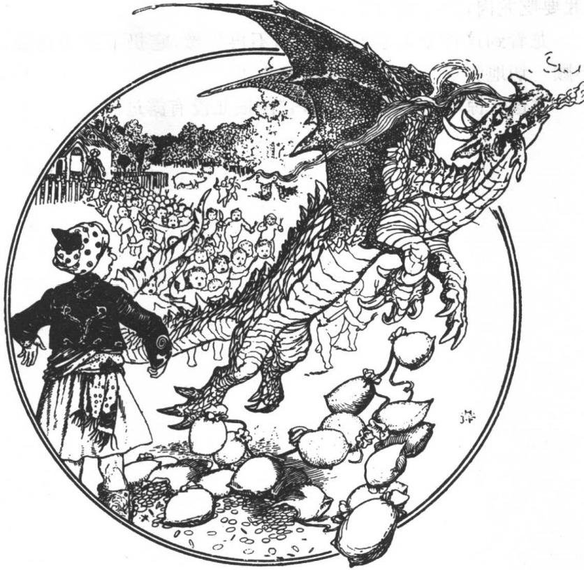

他终于听到了孩子们吵闹的声音，马上停住脚步。他不想让龙知道，他住在什么地方，免得日后会找上门来，要回这些金币。有没有办法把它赶回去呢？他想出来了，转过身来对龙说：“我不知道该怎么办才好！我有一百个孩子，恐怕他们会伤害你，这些孩子太爱打架了。不过，我会尽量地保护你的。”一百个孩子！这可不是闹着玩的，龙听了大吃一惊，那些金币口袋也从背上滑下来。它想快点把它们捡起来，免得斯坦责怪它。

可是这时候，那些孩子都右手拿着刀，左手拿着叉，争前恐后地叫嚷着奔跑出来。自从父亲走了以后，他们就没有吃过一顿饭，看到父亲带着一条龙回来，他们高兴得不得了，大声地叫着：“我要吃龙肉，快把龙肉给我吃！”

龙看到这种令人恐怖的景象，不再犹豫，它扔下那些口袋，不顾一切地腾空而起，闪电般地逃走了。

龙这一惊非同小可。从此，它压根儿没有露过面。

（罗马尼亚）

## 两只青蛙

从前，日本住着两只青蛙，一只家在离大阪市不远的海边小沟里；另一只住在从京都城里流过的一条清澈小河里。它们相隔那么远，彼此从不相识，也没有听说过。

有趣的是，有一天，它们同时产生一个念头，想出去看看外面的世界。住在京都的青蛙想去看看大阪；住在大阪的青蛙想去看看京都，那里有日本天皇居住的皇宫。

春天里一个晴朗的早晨，它们同时走上了一条大路，一个从大阪这一头出发，另一个从京都那一头出发。它们平日很少出门，不知道旅途的艰辛，所以觉得比想象中的累得多。

从京都到大阪的路上有一座山，它们都得爬过去。它们花了许多时间，费了不少力气，不知道跳了多少步，才登上山顶！它们惊奇地看到，对面来了一只青蛙。

开始，它们谁也不说话，相互看了一会，后来才交谈起来，彼此说出离家那么远的原由。它们很高兴地看到，双方都有一样聪明的想法——多了解一些自己的国家！

事情并不着急，它们用不着赶时间，所以就找个潮湿，阴凉的地方躺下来，伸伸腿。大家都同意，在出发之前，先好好地休息一下。

“唉！我们要是再长得高大一点多好啊！”大阪的青蛙说，“那样，我们站在这山顶上，就可以同时看到两个城市，想想是不是还值得走那么远的路去看了。”

“呵！这好办。”京都的青蛙说，“我们只要相互支持着，用后腿站起来，就可以都看得见要去的城市了。”

大阪的青蛙很高兴，觉得这个主意不错，就把手搭在朋友的肩膀上，伸直双腿站起来；它的朋友也学它的样子，站起来，大家都紧紧地抓住对方，免得摔倒。

大阪的青蛙面向京都，京都的青蛙面向大阪。可是，谁也没有想到，它们干了一件蠢事。青蛙站起来，把头抬得高高的，鼻子虽然对准前方，两只大眼睛却转到背后去了。它们看到的，正是自己出发的家乡城市。

“我的天哪！”大阪的青蛙说，“京都和大阪一模一样，根本用不着走那么远的路去看！我要回家了！”

“要是我早知道，大阪就是京都的翻版，我决不会走那么远的路。”京都的青蛙说。

它们都把手从对方的肩膀上拿下来，蹲到草地上。

彼此友好地说了一声再见，它们就动身回家了。直到临死的那一天，它们还相信，京都和大阪看起来是两个不同的城市，实际上却像两粒豆那么相似。

（日本）

## 瞪羚的故事

从前有一个人，把自己所有的钱都花光了，穷得一无所有，只能每天像鸡那样，到垃圾堆里去找几粒米来当饭吃。

有一天，像往常一样，他到街头去扒垃圾堆，想找点什么来当早饭吃。忽然，他眼睛一亮，看到一块小银币，他欣喜若狂地把它抓起来。“我可以吃上一顿像样的饭了。”他想。

他在井边喝些水，就随便找个地方躺下，直到太阳晒得他醒过来。他从地下爬起来，又向垃圾堆走去。“谁知道呢！”他自言自语地说，“我可能还会碰上好运气！”

他沿着街道走去，看到一个人向他走过来，手中拿着柳条编成的笼子。“喂！伙计！”他喊道，“你笼子里关着什么？”

“瞪羚。”那人回答。

“把它们带过来，我想看一看。”

听他这么一说，旁边的人都笑起来，对提着笼子的人说：“你和他做生意得小心，他什么都没有，每天都捡垃圾，自己都没法养活自己，用什么来喂瞪羚呢？”

那个提着笼子的人说：“自从我离开家乡，起码已经有五十个人问过我，要看我的瞪羚，他们之中谁想过要买我的瞪羚吗？做生意的人总是这样，让人呼来唤去，这是规矩。谁知道，哪一天会碰上主顾呢！”他提着笼子向捡垃圾的穷人走过来，那些人都跟着他。

“你的瞪羚开多少价钱？”穷人问，“我给你一块小银币，你肯给我一只瞪羚吗？”

那人捉出一只瞪羚来交给他，说：“这一只给你吧！先生。”

穷人抱着它，来到垃圾堆旁，小心地扒着，找到几粒粮食，和瞪羚分着吃。他每天早上和晚上都是这样，五天过去了。

这天，他睡着了，瞪羚把他叫醒，说：“主人！”

穷人回答：“我怎么会看到奇迹的？”

“什么奇迹？”瞪羚问。

“是你啊！一只瞪羚，怎么会说话？从我出生的那天起，我的父母，还有全世界所有的人，谁都没有跟我说起过，瞪羚会说话。”

“这你就不用操心了，”瞪羚说，“仔细地听我说，第一，我把你当做主人；第二，你把你在这个世界上所有的一切都给我了。我不能背叛你，从你这里逃走。不过，我请求你，每天早晨让我自已出去找食物。晚上，我会回到你这里来。你从垃圾堆里找到的那些东西，不够我们俩吃。”

“好的！去吧！”主人回答。瞪羚走了。

太阳下山了，瞪羚真的回来了，穷人非常高兴，他们肩并肩地躺下来睡觉。

早上，瞪羚对他说：“我出去找吃的了！”

主人回答：“去吧！我的孩子！”不过，瞪羚走了，他觉得很孤单，比往常更早地去捡垃圾。通常，他的粮食都是从垃圾堆里得到。到了晚上，他就会高兴起来，因为可以回家了。他躺在草地上嚼着烟草，瞪羚回来了。

“晚上好！我的主人，今天过得怎么样？我找到了一个阴凉的地方休息，那里绿草成茵，肚子饿了可以吃；渴了还有干净的水喝，清风习习，为我送来凉爽。这块地方在森林里，离这里很远。明天我还要去。”

一连五天，瞪羚每天都是一早就到那里去，晚上再回来。可是到了第六天，它换了个地方。那里的草长得不好，它在草堆中拨弄着，想找好的草吃，忽然看到什么东西躺在地上，仔细一看，竟然是一块钻石，又大又亮！

“啊！”瞪羚自言自语地说着，“也许现在，我能给主人做点什么了，他花了所有的钱把我买下来。不过，我得小心，免得别人说这是他偷来的。我最好先把钻石拿到一个富人那里去，看看它能给我带来什么。”

瞪羚打定了主意，就用嘴捡起钻石，穿过森林。可是它找来找去，找不到一家富人的住所。一连两天，它从早上到晚上，不停地跑着。到第三天早晨，才看到一座大城市。瞪羚又鼓起了勇气。

街道上人来人往，市场非常繁荣。他们看到一只瞪羚从街上跑过，嘴上的钻石闪闪发光，都惊叫着跟着它。可是它不管这些，一直向前跑，直到来到王宫，看到国王正坐在那里乘凉。瞪羚跑到他的面前，把钻石放在他的脚下。

国王先看看钻石，再看看瞪羚，他命令侍从拿来地毯和垫子，让瞪羚在长途跋涉以后好好休息；又叫人送来牛奶和米饭，好让它吃饱喝足，恢复体力。

瞪羚休息好了以后，国王对它说：“现在，告诉我你带来的消息吧！”

瞪羚回答：“我带着这颗钻石，从我的主人，苏丹·达雷那里来，这颗钻石就是见证。我的主人听说你有一个公主，派我送来这颗钻石做见面礼，请求你把公主嫁给他。”

国王说：“我很乐意，公主将是他的妻子，这里将是他的家，仆人们都愿意为他效劳，让他空着手来见我吧！我很乐意！”

国王说完以后，瞪羚站起来，说：“再见吧！陛下！我要回到自己的城市去。八天以后，或者可能是十一天[^2]以后，我们将到这里来做客。”

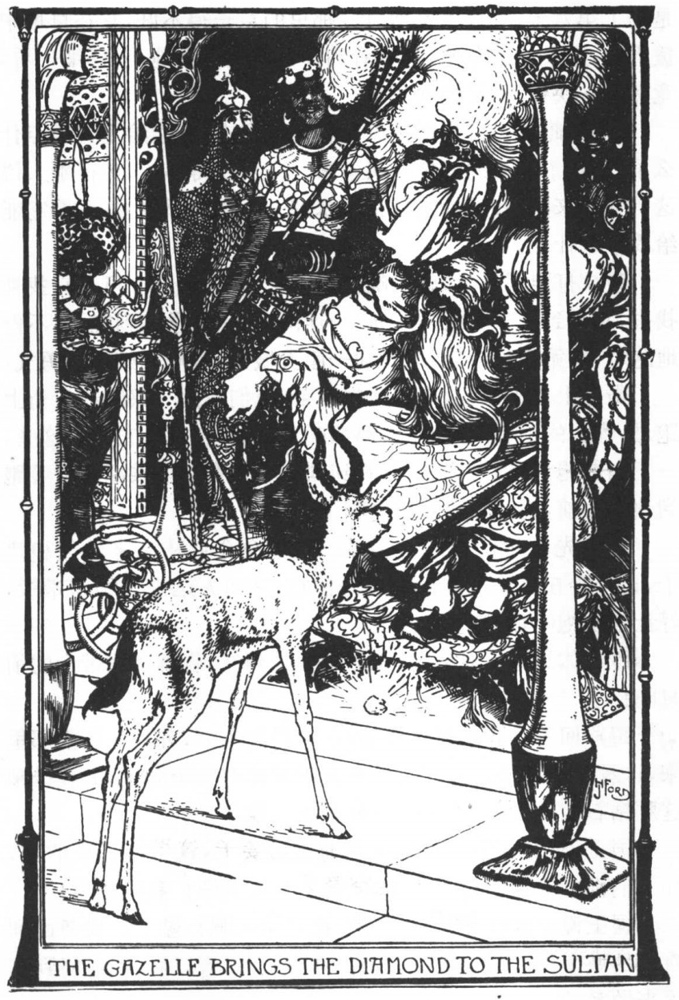

国王回答：“那么就这样吧！”

这段时间里，可怜的人在为失去瞪羚而悲伤和哭泣，他想，它肯定是跑掉了，永远也不会回来了。当他抬头看到瞪羚站在门口时，他快活地跑过去拥抱它，好久叫它说不出话来。

“安静些，主人！别哭！”瞪羚说，“让我们一起睡觉吧！明天一早，你跟着我走。”

第一道曙光在天边出现时，他们就起身，向森林里走去。到了第五天，他们来到一条河边休息。瞪羚把主人结结实实地打了一顿，叫他留在这里，等它回来。

瞪羚独自向城里跑去，大约十个钟头左右，就离王宫不远了。士兵们整齐地排列在路的两旁，准备迎接苏丹·达雷。他们看到瞪羚跑过来，就派一个士兵去向国王报告：“苏丹·达雷来了，我已经看见瞪羚。”

国王站起来，叫全体大臣跟随着他，出来迎接瞪羚。瞪羚向他跑过来致敬，国王礼貌地回答它，问它的主人在哪里？不是说好了要带他来的吗？

“哎！”瞪羚回答，“他躺在森林里。我们经过森林的时候，遇到了强盗。他们抢了东西，剥光他的衣服，还把他打了一顿。他现在藏在树丛中，怕被路过的陌生人看见。”

国王听说未来的女婿竟碰到了这种事情，就掉转马头回到王宫。他吩咐马夫把马厩里最好的一匹马牵出来，叫一个女仆拿来一箱子衣服，准备给他穿。国王还亲自挑选了一件外衣，一块头巾，一条腰带，一把金柄宝剑，一把短刀，一双鞋子，还有一根香木手杖。

“现在，你带着这些东西和士兵一起去见你的苏丹，他可以来了。”

瞪羚回答：“我怎么能带这么多士兵去见主人呢？他赤裸裸地躺在那里，这不叫他难为情，感到羞耻吗？我自己能安排这些事情，我的陛下。”

国王说：“要拉着这匹马，还有这些衣服和东西，你自己怎么行呢？”

“阿！这太容易了。”瞪羚说，“把衣服放在马背上，捆牢，把缰绳套在我的脖子上，我跑得比它还要快。”

“那么，再见吧！”国王说，“我们什么时候能再见到你？”

“明天，大约五点钟。”瞪羚回答。它拉了一下马的缰绳，马就和它一起飞奔而去。

国王看着它们远去，直到不见它们的身影。他转过身来对侍从们说：“瞪羚来自高贵的家庭，从小在苏丹家里长大，受过良好的教育，所以和别的瞪羚完全不一样。”在国王的眼里，瞪羚成了一个举足轻重的人物。

瞪羚牵着马不停地奔跑，来到主人藏身处。主人看到它来了，非常高兴。

瞪羚说：“起来吧！我的主人，到河里去洗个澡！”

主人洗好澡以后，它又对他说：“现在，用泥土来擦擦你的牙齿和皮肤，让它们明亮又光彩。”

等主人擦好以后，瞪羚说：“太阳下山了，我们该走了。”它从马背上把衣服拿下来。主人把衣服穿好，觉得非常合适。

“主人！”一切都准备妥当以后，瞪羚对他说，“我们到了以后，除了问候和提问题以外，请保持沉默。有什么事情由我出面来说。我给你找来了妻子，还让他们给你送来衣服、头巾和珍贵的物品。所以，你用不着多说话。”

“很好！我将保持沉默。”他跨上马背，说，“你把这些都给我了，现在，你是主人，我是奴隶，我什么都听你的。”

他们向城市出发，走啊！走啊！瞪羚看到国王的王宫已经隐约可见，回过头来说：“主人，前面的房子就是我们要去的地方。你现在再也不是穷人了，连你的名字也是新的。”

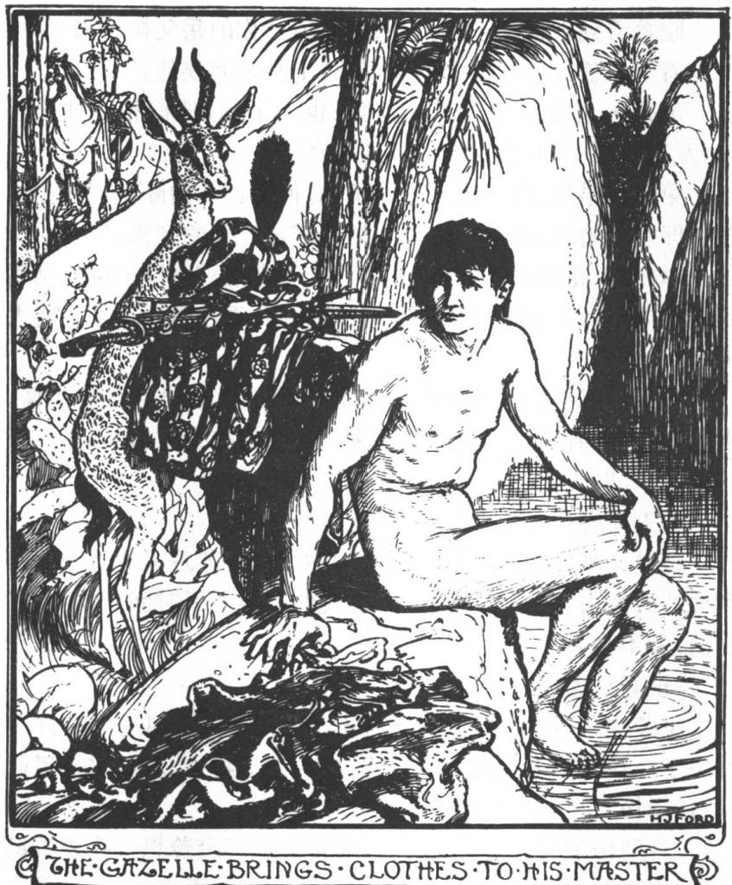

“我的名字叫什么呢？嗯！我的父亲？”他问。

“苏丹·达雷。”瞪羚回答。

很快，士兵们列队出来欢迎他们，有人赶快跑回去报告国王，说他们来了。

国王立刻出来欢迎他们，后面还跟着许多大臣、地方官员、法官，还有全城那些有钱有势的人。

瞪羚看到他们来了，对它的主人说：“你的岳父接你来了，中间穿着天蓝色披风的那个就是，你快下马来问候他。”

苏丹·达雷跳下马来，老国王也下了马，他们相互伸出手来，互相吻了一吻，然后一起回到王宫。

第二天早晨，瞪羚来见老国王，对他说：“我的陛下！我们希望立即举行婚礼，苏丹·达雷在期待着这一天的到来。”

“好的！新娘已经准备好了，请长老来吧！”老国王说。结婚仪式当即举行。只见音乐齐奏，礼炮齐鸣，王宫里还摆下了盛大的宴席。

“主人，”婚礼以后的第二天，瞪羚说，“我要出去办点事情。七天以后，或者更久一些才能回来。在我回来之前，你不要离开这幢房子。”

主人回答：“好的，我不离开这幢房子。”

瞪羚又来找老国王，对他说：“我的陛下，苏丹·达雷派我回到他的国家去，把房子整理好。这大约需要七天时间，在我回来之前，他不会离开王宫。”

“很好！”老国王回答。

瞪羚穿过森林，越过荒野，来到一座城市，看到这里有许多好房子。在一条大街的尽头，有一座大房子特别壮观，它是用蓝宝石、绿松石和大理石筑成的。

“这间房子对我的主人说来，非常合适。”瞪羚想，“我要鼓足勇气，进去看看里面有没有人。我到这个城市里来，还没有看见过一个人。也许有危险，不管它了，能活着就活着，死了也就死了，想不出别的办法，要是有人来杀我，就让他杀吧！”

它走上前去，踢了两下门，喊叫着：“开门！”没有回答。它又喊了一次，里面有人问：“谁在那里叫开门？”

瞪羚说：“是我啊！大主妇，你的孙子。”

“你要是我的孙子，”里面的声音说，“从哪里来，就回到哪里去，不要到这里来送死，还要叫我和你一起去死。”

“请开门，夫人，求求你了，我有话要对你说。”

“孙儿，”她回答，“我害怕会危及你的生命，还有我的。”

“啊！夫人，我的生命不会有危险，你的也不会，请你开开门吧！”于是，门打开了，走出来一个老妇人。

“你到这里来有什么事，我的孙儿。”她问。

“夫人，没有什么事，一切都很好，你也会很好。”

“啊！我的孩子！这里一点也不好。你要是想找死，或者想看死亡是什么，那么，今天你就会明白了。”

“我要是想知道，我会知道的。”瞪羚回答，“不过，请告诉我，谁是这间房子的主人？”

她说：“啊！父亲，这间房子里有许多财富，有许多人，有许多粮食，还有许多马匹。它的主人是一条又大又神奇的蛇！”

“啊！”瞪羚听她这么一说，叫出声来，“告诉我，怎样才能找到那条蛇，把它杀了！”

“我的孩子，”老妇人说，“不要这样讲话，你这是拿我们俩的生命来开玩笑。它把这里的一切都交给我了，我得给它做饭。当这条大蛇回来的时候，大地会卷起旋风，尘土会满天飞扬。它回到院子里以后，第一件事就是要吃饭，所以我总是在大锅里把饭准备好。它吃够了，就要喝满满的一桶水，然后又出去。它每隔一天，太阳升上房顶的时候就回来。它有七个头，你怎么对付得了它，我的孩子！”

“去做你自己的事情吧！妈妈！”瞪羚说，“不要替别人瞎操心，这条蛇有剑吗？”

“它有一把剑，非常锋利，挥舞起来像闪电一样。”

“把它给我，妈妈。”瞪羚说。

老妇人听它的话，把剑从墙上解下来，说，“你要快一点，它随时都会回来。啊！听到风响的声音了吗？它回来了。”

他们不做声，老妇人从窗帘后向院子里张望，看到蛇在吃锅里给它准备好的饭。吃了以后，又把那桶水喝了。接着，它向门口走来。

“你这个老东西！”蛇喊着，“房间里有什么气味？怎么和我平时闻到的不一样？”

“啊！主人！和平常一样，这里只有我一个人！”她回答，“不过今天，在隔了许多日子以后，我在身上撒了一点新的香水，这就是你闻到的味道，别的还会有什么呢？”

这时候，瞪羚早就做好了准备，手中拿着那把剑，站在蛇把它当做门的洞口。蛇进出房间，都是七个头轮流从这个洞口伸进伸出，觉得这样舒服。

蛇刚把第一个头从洞口伸进来，瞪羚干净利落地一剑把它砍下，蛇好像没有什么感觉。砍第二个头的时候，不像第一个那么利索，所以蛇问：“是谁在想挠我？”又伸进第三个头来想看看。很快，第三个头也和前面两个一样，滚到一起去了。

第六个头掉下来以后，蛇非常愤怒地挥动尾巴，拍打地面，灰尘顿时飞扬起来，像大雾一样充满房间。瞪羚和老妇人谁也看不见谁。

瞪羚对蛇说：“你已经爬过了各种各样的树，这一回，你再也不能爬了。”说着，手起剑落，第七个头应声落地。那把剑也当啷一声掉在地上，瞪羚因为过份紧张和用力，昏迷过去。

老妇人看到她的敌人被杀死，高兴得欢呼起来。她赶紧去把水提来，给瞪羚冲洗，给它煽风，把它抬到阴凉的地方去。瞪羚在老妇人的照顾下，慢慢地缓过气来。老妇人看到它有救了，非常高兴，又给它喝了一些水，过了一会，它能站起来了。

“带我去看一看房子。”它说，“从前面看到后面，从底层看到顶层，从里面看到外面。”

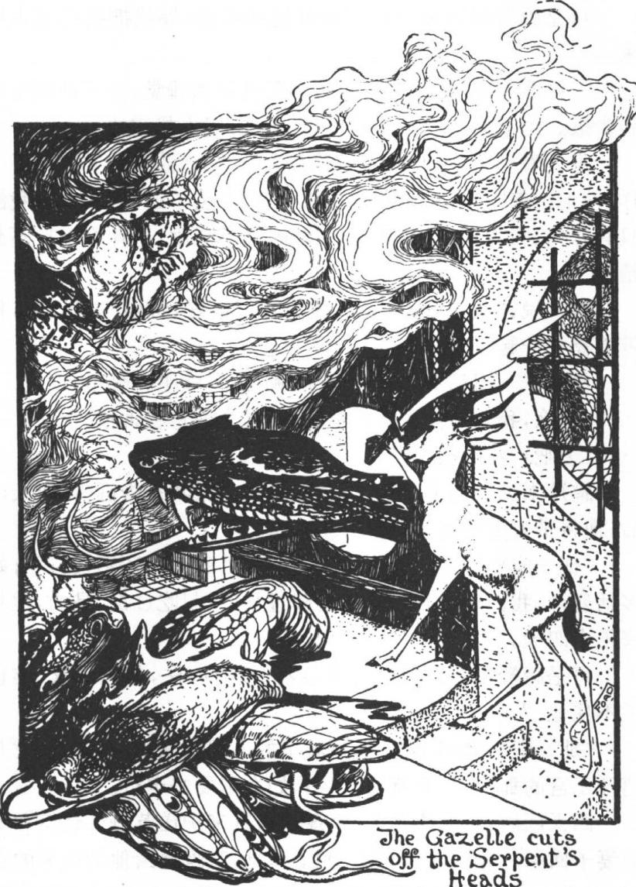

老妇人站起来，领着瞪羚去看那些堆满黄金和珍宝的房间，有些房间里住着许多奴隶和仆人。她对瞪羚说：“这些金钱和奴隶都是属于你的。”

可是瞪羚回答说：“你要看好这些东西，等我把我的主人叫来。”

一连两天，瞪羚留在这间房子里休息和睡觉，饿了就吃牛奶和米饭。到了第三天，它向老妇人告别，回去找它的主人。

主人看到瞪羚回来了，好像盼望已久的愿望终于实现了一样。他走出来吻它，对它说：“我的父亲，你去了这么久，留给我的只有悲伤。因为想念你，我食不甘味，睡不成眠，干什么都打不起精神。”

瞪羚说：“我很好，我去过的地方也很好，希望四天以后，你带着妻子一起回家。”

他说：“一切都由你安排，你到哪里，我就跟到哪里。”

“那么，我就到你岳父那里去，把这个消息告诉他。”

“去吧！我的孩子！”

瞪羚来见老国王，对他说：“我的主人派我来告诉你，四天以后，他将带着妻子回到自己的家去。”

“他一定要这么急着走吗？我们相处的时间还不长，还有好多话要说；我们还没有一起出去骑过马，一起吃过饭。是的，他只来了十四天。”

可是瞪羚回答：“我的陛下，我们没有办法，他想回家，谁也拦不住他。”

“那好吧！”老国王说。他把城里的人都叫来，宣布说，他女儿离开王宫的那一天，所有的卫兵和妇女都要来送行。

四天以后，一大队女士、奴隶和马队来护送苏丹·达雷和他的妻子回家。他们白天赶路，晚上睡觉，吃瞪羚给他们送来的食品。这样一连走了许多天，所有的人，包括那些高贵的人和奴隶，都非常爱瞪羚，胜过爱苏丹·达雷。

终于有一天，他们看到了远处有房子，叫瞪羚来看。

“啊！我的主人们！这就是苏丹·达雷的房子。”

听到这个消息，妇女们欢呼起来！奴隶们也欢呼起来！两个钟头以后，他们来到了家门口。瞪羚叫他们在外面等着，自己领着苏丹·达雷进去。

老妇人看到他们从院子里走进来，高兴得又跳又叫，像个小孩似的。她把瞪羚拉到自己的怀里，亲吻它。可是瞪羚不喜欢这样，对她说：“老妇人，别管我，你应该去见我的主人，去亲吻他。”

老妇人说：“孩子，请原谅我，我不知道他就是我们的主人。”她把所有房间的门都打开，好让主人看清楚里面的东西。

苏丹·达雷看过以后，说：“把拴着的马都解开，把关着的人都放出去。叫一些人去打扫房间，一些人去铺床，一些人去烧饭，一些人去挑水，一些人出去迎接女主人。”

女主人带着她的女士和奴隶走进房间，看到那么富丽堂皇的装饰，那么丰盛可口的晚餐，她们都感慨地说：“啊！你！瞪羚！我们见到过壮丽的房子，我们见到过高贵的人，我们听到过许多激动人心的事情；可是像这幢房子，还有像你，像你这样的为人，我们从来没有见到过，也没有听到过。”

过了不久，那些陪同公主来的女士们都说，想回家去了。瞪羚极力挽留她们，可是她们想家心切，怎么也留不住。

瞪羚拿出许多礼物来，送给这些女士们，还送给她们的奴隶。她们都很感动，认为瞪羚要比它的主人苏丹·达雷高尚千百倍。

瞪羚和它的主人在这幢房子里住了几个月。有一天，它对老妇人说：

“我把主人领到这个地方，为他做了许多好事情，可是直到今天，他从来没有问过我，这幢房子的主人是谁？我怎么样得到这幢房子？这个城镇里为什么没有人居住？为了他，我可以说是好事做尽了，可是他没有给我做过一件好事。人们都说，‘你要是想帮一个人，不但帮他做好事，还得帮他做点坏事，这样相互之间才能平安无事。’所以，妈妈，我想看一看，我对他那么好，他能不能也这样对待我。”

“好的。”老妇人回答。说完，两人都上床睡觉了。

第二天天刚亮，瞪羚就觉得胃痛，腿痛，还发烧。它把老妇人找来。

“我来了，孩子，有什么事？”

它说：“到楼上去告诉我的主人，说瞪羚病得很厉害。”

“好吧！我的孩子，要是他问我，怎么回事？我该怎么回答？”

“告诉他，我浑身都痛得很厉害，没有一个地方不痛。”

老妇人上楼来，看到主人和他的妻子坐在长沙发上，上面铺着柔软的垫子。看到她上来，他们问：“嗯！老妇人，你来干什么？”

“我来告诉主人，瞪羚生病了。”她说。

“怎么回事？”女主人问。

“它全身疼痛，没有一处不痛。”

“好吧！我能干什么呢？用红玉米熬些粥，给它吃。”主人说。

妻子吃惊地说：“啊！主人！你叫她用红玉米熬粥给瞪羚吃？这种东西连马都不要吃！这样不好！”

他回答说：“嗨！你疯了！大米是留给人吃的。”

“啊！主人！它不是一只普通的瞪羚。对你来说，它像你的眼珠子一样地宝贵，要是砂子进了你的眼睛，你会觉得难过的。”

“我的妻子，你的舌头太长了。”主人说着，走出房间。

老妇人看到，再说也是白搭，就流着眼泪回来看瞪羚。瞪羚看到她回来了，问：“妈妈，怎么啦？你干吗哭啊！要是好消息，请告诉我；要是坏消息，也请你说出来。”

老妇人还是什么也不说。瞪羚请求她，把主人说的话告诉它。

她后来终于说了：“我上了楼，看到女主人和男主人坐在一张沙发上。他问我来干什么？我告诉他，是你，他的奴隶，生病了。女主人问是怎么回事？我对她说，你全身没有一个地方不痛。主人叫我去拿些红玉米来，熬粥给你吃。女主人说，‘啊！主人！瞪羚是你的眼珠子，你没有孩子，瞪羚就是你的孩子，不能亏待了它。它外表是一只瞪羚，但内心和人一样，不论从哪个方面来看，它都比一个正人君子还要高尚！’可是主人回答说，‘蠢东西，你的话太多了。我知道它的价值，我用一个小银币把它买下，对我来说，它值得了多少钱？’”

瞪羚沉默了一会才说：“长者说，‘与人为善，就像亲娘。’我对他可以说是仁至义尽了，我也明白了这句话的意思。不过，还是请你到楼上去，对主人说，瞪羚病得很厉害，它没有喝那些红玉米粥。”

老妇人又来到楼上，看到主人和他的妻子正在喝咖啡。老妇人把瞪羚的话对他说了。他听了以后，喊道：“你不能安静一些吗？老妇人！闭上你的眼睛，管住你的腿，用蜡把耳朵塞起来。要是瞪羚还叫你来找我，就说你的腿弯了，不能走路；要是它请你听它说，你就说耳朵被蜡塞住了，听不见；要是它想和你说话，你就说舌头被钩住了，说不出话来。”

老妇人听到这些话，身在发抖，心在哭泣。因为她亲眼看到，瞪羚当初来的时候，冒着极大的危险，九死一生，用自己的生命，给主人换来了这些财富，自己也侥幸地活了下来。可是，它从主人那里得到了什么呢？

女主人的眼泪也像喷泉似的从眼眶中涌出。她说：“听到你说这些话，我真是感到非常遗憾，你怎么能这样残忍地对待瞪羚！”

主人说：“老妇人！别管女主人说些什么，告诉它快点滚开！为了替一只瞪羚操心，我睡不着，吃不下。花一块小银币买来的东西，值得我从早到晚为它烦恼吗？不！老妇人！”

老妇人下楼来，瞪羚鼻子里流着血。她把它抱在怀里说：“我的孩子！你做的好事都被遗忘了，现在只好忍耐。”

它说：“妈妈！我要死了，我的灵魂充满了愤怒和悲伤！我的脸因为羞愧而发烧，我给主人带来那么多好处，他对我却这样恶毒。”

它停了一下，喘了一口气，又说：“妈妈，这幢房子里那么多好吃的东西，我吃过什么？我每天最多吃掉半盆，我的主人有哪一点比得上我？长者不是说，‘与人为善，就像亲娘’吗？他对我怎么样了？”

过了一会，它说：“去吧！告诉我的主人，瞪羚活不长了，快要死了。”

老妇人听了它的话，上楼来对主人说了。可是他回答：“我跟你说过了，别来烦我。”

他的妻子满腹忧愁，对他说：“啊！主人，瞪羚为你干了些什么？它有什么对不起你的地方？你这样对它不好，会引起公愤的。不管是男人还是女人，小孩还是大人，大家都那么爱瞪羚。啊！我的丈夫！我原以为你很聪明，可你却是很愚蠢！”

可是他说：“我看你是疯了！我的妻子。”

老妇人不再停留，回到瞪羚的身边。女主人悄悄地跟着她下来，叫来一个女仆，叫她煮些牛奶和米饭给瞪羚。

“我这件衣服也拿去，给它盖上。”她说，“这个枕头也给它枕上。瞪羚还需要什么，尽管来问我，不要去问它的主人。要是它愿意，我就叫一副轿来，把它送到我父亲那里去，他会派人给它治疗，直到它恢复健康。”

女仆人照女主人的话去做了，还把女主人的话转告给瞪羚。可是瞪羚没有回答，它转过身去，安静地去世了。

消息传开以后，许多人都伤心地哭了。苏丹·达雷非常生气，说：“你们哭瞪羚，好像在哭我一样。说到底，它只不过是我用一枚小银币买来的瞪羚！”

他的妻子回答说：“主人，我们尊敬瞪羚，就好像尊敬你一样。是瞪羚，请求我父亲把我嫁给你；是瞪羚，把我从父亲那里带到这里来；是父亲把我交给了瞪羚。”

人们听到她的话，都齐声高喊：“我们的心中没有你，只有瞪羚，是瞪羚在这里排除万难，创造了一个新的世界，又在这里长眠。这样的人离开了世界，我们是为自己失去瞪羚而哭泣。”

他们还说：“瞪羚为你干了那么多好事！如果有人说，它干得还不够，那就是骗子。像我们这种没有得到你任何好处的人，你将如何对待？瞪羚的心因为极度的悲痛而死去，你还命令把它扔到井里去！啊！我们只能哭泣。”

可是，苏丹·达雷把他们的话当耳边风，叫人把死去的瞪羚扔到井里去。

女主人听到这个消息，写了一封信，叫三个仆人骑着驴子给她父亲送去。老国王读了这封信，沉痛地低下头，流下伤心的泪水，好像失去了母亲一样。他吩咐仆人装好马鞍，叫来总督、法官和所有有钱人，对他们说：“跟我一起去，隆重地为它举行葬礼。”

他们日夜不停地赶路，来到瞪羚被扔下的井旁。这是一个很大的井，挖在一块岩石的旁边，周围住着许多人家。

老国王走过来，那些大官和富人都跟着他。他看到瞪羚躺在那里，又禁不住失声大哭。他把瞪羚抱起来，带走了。

三个仆人回来告诉女主人，老国王接到信以后做了些什么，还说所有的人都哭出声来。女主人说：“自从瞪羚死了以后，我也没有吃过一粒饭，喝过一滴水。我无话可说，也失去了欢乐。”

老国王庄严地把瞪羚埋葬了，下令老百姓为它举行哀悼，整个城市都沉浸在悲伤之中。

哀悼的日子结束的那一天晚上，女主人睡在丈夫的身边，她梦见自己回到了父亲的家中。等她醒过来时，梦已成真。

丈夫梦见又回到垃圾堆旁捡垃圾。等他醒过来时，才知道这不是梦，他又重新过着乞讨的日子。

（斯瓦希里传说）

## 鱼在空中飞和兔在水中游

一个小村子里，住着一对老夫妻。要是妻子在必要的时候能管住自己的舌头，他们的日子就过得美满了。可惜家里不论发生什么事情，或者丈夫告诉她外面带回来的消息，用不了多久，整个村子就全知道了。而且话传来传去以后大变样了，到后来发生许多不愉快的事情，老头子总是吃苦头。

有一天，他赶着马车到森林里去。到森林边上的时候，他从马车上下来走，忽然踩到一个很松的坑里，脚陷了进去。

“这是什么？”他想，“让我挖起来看看。”

他挖着，挖着，看到一个罐子埋在坑里，里面装满了金子和银子。

“啊！真是福星高照！现在，我只要想办法把这些财宝运回家就行了。不过，别指望能瞒过我的妻子。她只要知道了，整个世界也就都知道了，那时候，我可就麻烦了。”

他坐在那里想了好久，终于想出一个办法。他把那个罐子又重新用泥土埋好，用树枝盖好，赶回城里，在市场上买了一条活的狗鱼和一只活的兔子。

然后，他回到森林里，把那条鱼挂在一棵树的树梢上；把那只兔子放在鱼网里，挂在河边，也不管那只兔子这样是不是舒服。

他上了马车，高高兴兴地赶回家。

“太太！”他一进门就大声地喊起来，“你肯定想不出，我们今天的运气是多么好！”

“什么？什么？亲爱的丈夫，快点告诉我！”

“不！不！告诉你了，你肯定要到处去跟别人说。”

“不会的！你怎么会这样想呢？太丢脸了！你要是愿意，我可以向你发誓，决不…… ”

“呵！好了！真的是这样的话，你听着……”他小声地在耳边对她说，“在森林里，我找到一个坑，里面埋着一个罐子，罐子里都是金子和银子！嘘…… ”

“你干吗不把它们搬回来？”

“因为我想叫你一起去，一起小心地搬回来。”

于是，丈夫和妻子一起赶着马车到森林里去。

马车在路上奔跑着，丈夫突然说：“太太，你听到过这种奇怪的事情吗？昨天刚有人告诉我，鱼现在生活在树梢上，而有些野生动物却在水里过日子。真怪！真怪！时代真的是变了。”

“哎！丈夫！我看你是疯了！亲爱的！有些人真是会瞎说。”

“瞎说！一切都是真的。我的天哪！你看！那真是一条鱼，一条活着的狗鱼，就在树梢上游着。”

“太妙了！”妻子叫起来，“狗鱼怎么会到上面去了？那肯定是一条狗鱼，用不着多说，那人的话竟是真的！”

丈夫耸耸肩膀，张着嘴巴，只是站在那里呆呆地看着，好像根本不相信自己的眼睛。

“傻瓜！你还站在那里发什么愣？”妻子说，“还不赶快爬上去，把鱼捉下来，好回去烧饭吃！”

丈夫爬到树上，把狗鱼摘下来，马车又继续往前走。到河边的时候，又停下来。

“你又在看什么呢？”妻子不耐烦地问，“快赶着走吧！”

“嗯！我在河边放了一张网、好像有什么东西在网里动。我要去看看，到底是什么？”

他跑过去看了一眼，回过头来对妻子说：“快来看！网里真的捉到了一只四只脚的动物，我敢肯定，这是一只兔子。”

“天哪！”妻子说，“兔子是怎么到你网里去的？用不着多说，这肯定是一只兔子。看来，那人说的是真话！”

丈夫站在那里摇摇头，摊摊手，好像还不相信这是真的！

“傻瓜！你还站着干什么？”妻子说，“把它抓起来，这么肥的一只兔子，过节的时候可以好好地吃一顿了。”

丈夫把兔子捉起来。他们赶着马车，来到藏金子和银子的地方。他们把树枝搬开，把罐子挖出来，搬上马车，赶着马车回家。

这一回，老两口有许多钱花了，日子过得很舒服，心中也觉得很快活。可妻子有点傻乎乎的，每天都请许多人来吃饭，大摆宴席招待他们。丈夫后来不耐烦了，劝她别这样做，可她不听。

“你没有资格来教训我！”她说，“这些财富是我们一起找到的，我们一起花也是应该的。”

丈夫开始还耐心地开导她，后来看到没有结果，就对她说：“你爱怎么做就怎么做吧！反正我一分钱也不给你了。”

妻子非常生气，说：“啊！好一个没用的家伙！想把所有的钱留给自己用！等着瞧吧！看我怎么对付你！”

她来到总督那里，抱怨她的丈夫：“啊！我的大人！救救我吧！自从我丈夫找到那些财宝，就无法无天了。他只知道整天吃喝，不肯做事情，那些钱都由他一人独吞。”

总督很同情这个女人，命令他的第一秘书去处理这件事情。

秘书把村子里上了年纪的人都找来，和他们一起到她的家里去，对她的丈夫说：“总督希望你把找到的财宝全部交出来，由我来保管。”

丈夫耸耸肩膀，说：“什么财宝？我不知道有什么财宝！”

“什么？你不知道？你妻子已经在告你了，别想骗人。要是你不立刻把所有的钱交出来，就要告你胆敢私自窝藏找到的财宝，报告给总督。”

“请原谅我吧！阁下！你说找到了什么样的财宝？这肯定是我妻子在做梦，你们千万不要听她胡说八道。”

“胡说八道？是啊！”妻子说，“金子和银子，装满了一大锅，你说那是胡说八道？”

“你大概是搞糊涂了吧！亲爱的妻子！阁下，请你原谅。问问她这是怎么一回事？要是她说服了你，我愿用我的生命来担保。”

“是这样的，秘书大人。”他妻子开始说，“我们赶着马车到森林里去的时候，在树梢上看到一条狗鱼……”

“什么？一条狗鱼？”秘书说，“请问，你是否以为可以随便和我开玩笑？”

“是真的，秘书大人，我说的都是真话。”

“现在你明白了吧！大人，”丈夫说，“这种胡说八道的人，你怎么能够相信她呢？”

“我胡说八道？你大概是忘了吧！我们还在河里抓到了一只活着的兔子。”

所有的人都哈哈大笑起来，连秘书也摸摸他的胡子，禁不住笑了。

丈夫说：“行了吧！太太！人人都在笑你，你们大家都看见了，这种人说的话，有几句可以相信？”

“真是难以相信，”村子里那些上了年纪的人都说，“我们还是第一次听说，兔子在水中生活，鱼会活在树上。”

秘书也没有办法，只好回城里去。

女人被大伙取笑了一番，从今以后不得不管住自己的舌头，老老实实地听丈夫的话。

丈夫用一部分钱在城市买了房子，还买了些货物，在城里开了一个店，生意做得非常好，太平地度过一生。

## 袋中的双人

有一家人很穷，夫妻俩过的是什么日子啊！尤其是那个男人，没有一天是不挨女人骂，挨女人打的，从来没有舒服地过一天太平日子。女人经常从门后拿起扫帚来打他，真不知道他怎么受得了。

有一天，女人脾气特别坏，把他打得遍体鳞伤，青一块，紫一块的。男人垂头丧气地游荡到田地里去，他也不愿意闲着，就把网张开来抓鸟。

你猜猜，他的网中抓到了什么鸟？一只鹤！鹤对他说：“你把我放了吧！我会感谢你的。”

男人回答说：“不！我的好伙伴，我要把你带回家去，这样，我的女人也许就不会那么凶地骂我了。”

鹤说：“你最好和我一起，到我家里去。”于是，他们一起到了鹤的家里。进了房子以后，你知道鹤把什么东西拿出来吗？它从墙上把一个袋子拿下来，说：“袋中的双人，出来！”

一瞬间，从口袋中走出两个可爱的小男孩来。他们抬出一张栎木桌子，铺上丝绸台布，摆上各式各样美味佳肴，还有许多可口的饮料。男人从生出来到现在，还没有吃过这么好吃的东西，非常高兴。

吃好以后，鹤对他说：“把这个袋子带回去，给你的妻子吧！”男人对它表示衷心的感谢，拿起袋子，动身回家。

回家的路程那么远，天很快就黑了，他觉得很累，就到半路上的表姐家里去休息。

表姐有三个女儿，她们端出满不错的晚饭来招待他。可是他对表姐说：“你们这些晚饭太差劲了。”

“喔！那么做顿好吃的吧！”她说。

男人叫她们把这些饭菜都收起来，把那个口袋拿出来，像鹤教他的那样，说：“袋中的双人，出来！”

两个可爱的小男孩出现在他们面前，很快就搬出那张栎木桌子，铺上丝绸台布，摆上各种各样美味佳肴和可口的饮料。

表姐和她的女儿从来没有吃过这么好的晚饭，她们又惊奇，又欢喜。可是表姐马上就想偷这个袋子，她对女儿说：“快去把洗澡的水烧热了，我们的客人在睡觉之前一定想洗个澡。”

男人进了洗澡间以后，表姐叫女儿快点做一个一模一样的口袋。然后，她把两个口袋调换了，把客人的口袋藏起来。

男人舒服地洗了个澡，美美地睡了一觉。第二天一早，他拿起那个自以为是鹤给他的口袋，就急忙回家去。

一路上，他精神非常愉快，唱着歌，吹着口哨，从林中穿过，没有注意到，那些鸟都在吱吱喳喳地笑他。

他老远看到自己的家，就迫不及待地喊起来：“喂！老婆子！快出来接我！”

女人厉声地回答：“你过来，我要用火钳好好地揍你一顿！”

男人走进屋子，迫不及待地把袋子挂在一根钉子上，像鹤教他的那样说：“袋中的双人，出来！”

可是口袋里毫无动静。他又急忙说了一遍，还是没有什么两样。

女人看到他唠唠叨叨地不知道说些什么，就拿起那把扫帚，扫地出门似的向他打过来。

男人赶紧逃出去，又来到田地里，看到鹤正在优闲地散步，就走过去，把发生的事情告诉它。

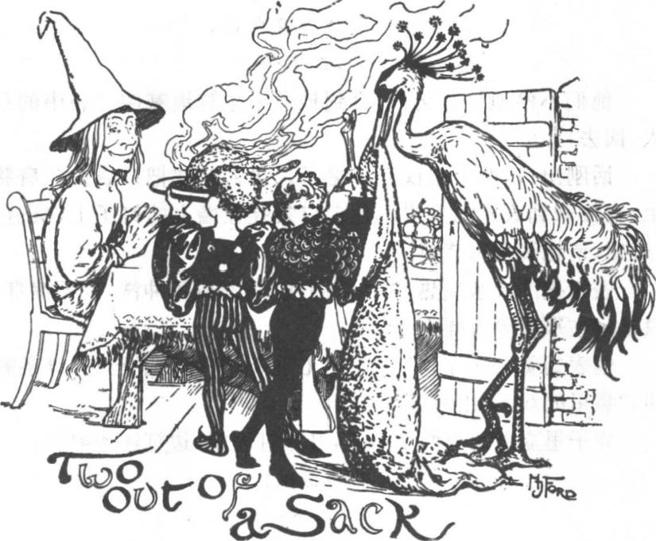

“到我家里来吧！”鹤说。他们来到了鹤的家。鹤又从墙上拿下来一个口袋，说：“袋中的双人，出来！”

立刻，从口袋里跳出来两个可爱的小男孩，搬来栎木桌子，铺上丝绸台布，摆出各色各样的美味佳肴和可口的饮料。

吃完以后，鹤说：“把这个口袋拿去吧！”

男人千恩万谢，拿着口袋走了。走了很长一段路以后，他觉得饿了，就对着口袋说：“袋中的双人，出来！”

立刻，从口袋中跳出两个彪形大汉，手中还拿着棍子，对着男人就一顿好打，边打还边唱着：

> 你得到了什么，
> 不该告诉表姐，
> 一下，二下……
> 要是再不听话，
> 就叫你浑身发痛，
> 一下，二下……

他们不停地打着男人，直到他急中生智地喊叫：“袋中的双人，回去！”

话刚出口，两个粗汉就不见了。男人这才把口袋放在肩膀上，直接来到表姐的家里。他把口袋挂在墙上的钉子上，喊道：“表姐，请把洗澡水烧热。”

表姐把洗澡水烧热，男人走进去，可是既不冲洗，也不擦身，只是坐在那里等着什么。

他表姐觉得饿了，把三个女儿叫来，围着桌子坐好，母亲喊叫：“袋里的双人，出来！”

袋子里立刻跳出两个粗汉，开始打表姐，边打还边唱着：

> 贪婪的窃贼！
> 一下，二下……
> 快把袋子还给他，
> 一下，二下……

他们不停地打着，直到她喊叫大女儿：“快去把表叔叫出来，告诉他，这两个坏蛋打得我青一块，紫一块。”

“我还没有擦过身呢！”男人说。

两个粗汉继续打着，唱着：

> 贪婪的窃贼，
> 一下，二下……
> 快把袋子还给他，
> 一下，二下……

表姐叫来第二个女儿，说：“快！快！快去叫他出来救我！”“我还在洗头呢！”男人说。

她又把第三个女儿派来叫他。他说：“我还没有擦干身子呢！”

到后来，表姐实在受不了了，把上次偷走的口袋拿出来，准备还给他。

这时候，他洗好澡从浴室里出来，喊道：“袋中的双人，回去！”

男人拿着两个口袋，动身回家。

走到家门口，他喊道：“喂！老太婆，快出来接我。”

女人严厉的喊声从屋里传出来：“你这个扫帚柄，进来，看我怎么收拾你！”

男人走进屋子，把口袋挂在钉子上，说：“袋中的双人，出来！”

两个可爱的男孩从口袋中跳出来，搬出一张栎木桌子，铺上丝绸台布，摆上各式各样美味佳肴和可口的饮料。

女人一边吃，一边喝，还不停地夸奖丈夫。

“嗯！很不错，老头子，我不会再打你了。”她说。

他们吃完以后，男人把那个装好人的口袋拿走，把装打手的口袋挂在墙上。然后就到院子里去散步。

过了一会，女人觉得口渴了。她以期待的目光看着墙上的口袋，后来终于按捺不住，像丈夫说过的那样，喊起来：“袋中的双人，出来！”

两个粗汉立刻从袋中跳出，手中拿着两根大棍子，劈头盖脑地向她打过来，边打还边唱着：

> 你打自己丈夫，
> 如今也该受罚！
> 叫你青一块，紫一块！
> 也会哭个不停。

女人吓得尖声大叫：“老头子！老头子！快来啊！快来啊！两个打手快把我的骨头打断了！”

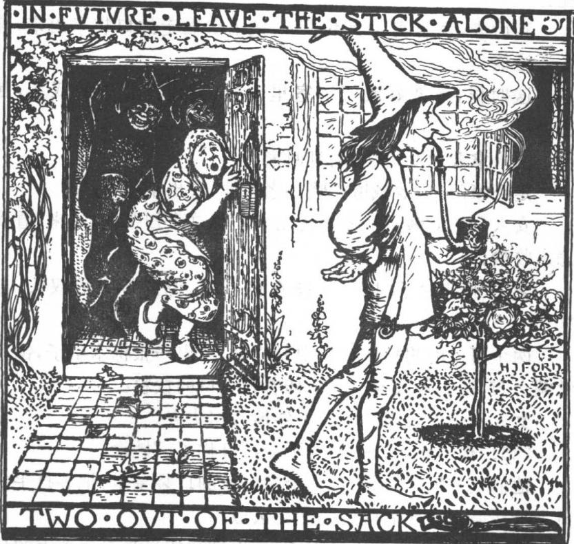

男人不慌不忙地走进来，笑着说：“是啊！老太婆！他们要好好地教训你一顿。”

两个打手不肯停手，口中还在唱着；

> 老太婆，要记住，
> 打人会伤人，
> 我们这是为你好，
> 棍子不是好东西，
> 以后别碰它！
> 一下，二下……

后来，男人起了恻隐之心，说：“袋中的双人，回去！”两个打手一眨眼就不见了。

打那以后，夫妻俩快乐地生活在一起，人人都喜欢到他们家里来做客。故事到此也就结束了。

## 妒忌的邻居

很久很久以前，一个村庄里住着一对老夫妻。他们没有儿女，所以把自己全部的爱都给了一条小狗。小狗确实也是非常可爱，它没有像有些小孩子那样，因为老人的宠爱而变坏。它非常感激主人的爱护和慈悲，不管他们是在家里，还是出去，总是不离左右。

有一天上午，老人在花园里干活，小狗也像往常一样，跟在旁边。这一天天气很热，老人干了一会，放下铲来，擦去头上的汗水。这时候，小狗在不远的地方嗅着，扒着。狗爱扒东西，老人习以为常了，所以也不在意，擦完汗又继续干他的活。

可是今天小狗有点反常，它不停地来到主人的身边叫几声，又回到扒过的地方去。这样几次以后，终于引起了老人的注意。他拿起铲子，跟着狗过来。狗看到主人过来了，高兴得摇摇尾巴，跳着，叫着，直到把老太婆也惊动了，从房子里走出来。

老人想，狗大概是找到了什么东西，就拿起铲子挖起来。不久，就碰到了什么东西。老人拉出来一看，是一个大箱子，里面装满了闪闪发光的金币。

箱子那么重，老太婆也过来帮忙，两人一起把金币抬回家。你可以想象，这一天，小狗吃了一顿多么丰盛的晚餐。现在，小狗让老夫妻一下子变成了富翁，他们每天都给它吃最好的东西，让它睡最好的床。小狗过着像王子一样的日子。

小狗找到金子的消息，不久就传开了。隔壁的一家人看到他们交了好运，心中非常妒忌，吃也吃不下，睡也睡不着。他愚蠢地想着，这条狗这一次既然能够找到财宝，那么，下一次它肯定还可以找到。他来到老夫妻的家里，请求他们把狗借给他一下，好让他也能够富裕起来。

“你怎么能提出这样的要求？”老人气愤地说，“你知道，我们是多么爱它，五分钟也不能看不到它。”

可是妒忌的邻居不听他这些话，每天都来缠他，提出同样的要求，直到老人实在受不了，同意把狗借给他，不过只能借一二个晚上。

邻居借到狗以后，就迫不及待地把狗带到花园里去。可是狗只是在花园里跑来跑去，什么事也不干。他只好耐着性子等待着。

第二天早晨，邻居把房门打开，狗就欢快地向花园里跑去，跑到一棵树下，用力地挖起来。

邻居赶紧叫妻子快点把铲子拿来，向狗奔过去，他急于要知道，狗找到了什么宝藏。可是，等他把洞挖开以后，找到了什么呢？只是一包臭气冲天的骨头，熏得他一分钟也呆不下去。

他胸中怒火万丈，狗竟然这样耍弄他，一气之下，他不管三七二十一，抓起铁镐，一下就把狗杀了。等事情发生以后，他才害怕起来，怎么去向狗的主人交代呢？可是狗不能死而复生，他只好拉长着脸到老夫妻的家里去。

他假装哭泣着对老夫妻说：“你们的狗突然倒在地下死了。我对它非常照顾，它要什么就给它什么，没想到事情会这样！我想，我最好还是来告诉你们吧！”

老人听到这个消息，哭得非常伤心。他来到邻居家里，把心爱的狗的尸体带回家，埋在它找到金子的无花果树下。

从早上到晚上，老夫妻日日夜夜为失去小狗而悲伤，没有什么能够让他们痛苦的心平静下来。

后来，有一天晚上，他睡着了，梦见小狗出现在他的面前，对他说，把它坟前的无花果树砍下来，用它的木头做成臼。

老人醒过来，想着梦中的事，他一点也不想把那棵树砍下，它年年都长得那么好。他去和妻子商量，妻子毫不犹豫地说，根据以前发生的事，我们一定要听狗的劝告。于是他们把树砍倒，做成一个漂亮的臼。

收割的季节到了，稻米收割以后，他们把谷子放在臼中杵。啊！一转眼工夫，那些谷子都变成了金灿灿的金子。看到这么多金子，老夫妻多高兴啊！他们又一次为小狗祝福。

没有多久，消息又传到那个妒忌的邻居耳朵里。他毫不迟疑地又来到老夫妻家里，问他们有没有臼，他想借用一下。老人很不愿意把他的宝贝借出去，可又不忍心说不，于是，邻居拿着他的臼走了。

邻居一回到自己家中，就把一大把谷子拿出来，放入臼中，招呼妻子一起来帮忙，开始杵米。可是，那些谷子并没有变成黄金，而是变成臭气冲天的烂果浆，夫妻俩气得赶紧逃出去。盛怒之下，他们把臼投入火中，烧成灰烬。

不论他们怎么解释和申辩，老夫妻听到臼被烧成灰了，都非常不高兴。这一晚上，狗又在老人的梦中出现，叫他去把那些灰收集起来，带回家。狗还说，统治这个地方的大领主过几天要从这里经过，到时候就爬到路旁的樱花树上去，大领主走过来，就把灰从树上撒下来。周围的樱花树将会开出无比美丽的鲜花。

这一回，老人也不和妻子商量，就照狗的吩咐，到邻居的家里去，把臼烧成的灰收集起来，带回家，小心地装在花瓶里。

这时候，樱树开花的季节还没有到。那些有钱的人，都买来一些樱花树枝养在家里，放在温暖的地方，让它提早开花，在室内观赏。

老人得知大领主要从这里经过的那一天，小心地拿着装臼灰的花瓶，来到大路旁等候。没有多久，他就看到远处尘土飞扬，知道是大领主的大批人马过来了。大路两旁都站满了来欢迎的老百姓。他们穿着最漂亮的服装，看到大领主过来，都弯下腰来对他致敬，只有老人站在那里不动。大领主看到有人竟敢不向他鞠躬，非常生气，叫一个官员过来问他，为什么敢违反几千年来的规矩。

那个官员还没有走到老人的面前，他已经爬上了一棵樱桃树，把花瓶里的灰向周围的一片树林撒去。刹那间，树林里的樱花一齐怒放，大领主看到了兴高采烈，乐不可支。他把老人叫到城里，送给他许多宝贵的礼物。

没有多久，那个妒忌的邻居也知道了这件事情，不禁妒火中烧。他来到把臼烧掉的地方，收集起老人没有全部拿走的臼灰。

等到大领主从这里经过的时候，他也带着臼灰到路旁来等候，希望他的运气也和老人一样，或者比老人更好。大领主的队伍过来了，他的心呼呼地狂跳起来。他也爬上一棵樱树，把灰从树上向周围撒去。可是，不见一朵樱花开放，只见灰随风飘荡，落在大领主和他的随从眼中，痛得他们哇哇地乱叫起来。

大领主命令把这个恶作剧的人抓起来，投入监狱，把他关了好几个月。等他放出来以后，村子里的人都知道了他的无耻，把他从村子里赶出去。他离开村子以后又不知悔改，反而越陷越深，最后落了个非常悲惨的下场。

（日本）

## 朝霞仙女

从前有一个伟大的国王，统治着一个强大的国家。他的国土那么辽阔，谁也说不清是从哪里开始，到哪里结束。

不过，虽然没有一个人能说出他的势力范围有多大；但是，人人都知道这个事实，当国王的右眼在笑的时候，左眼却在哭。有一两个大胆的人曾经问过国王，为什么会有这种奇怪的事情，他只是笑笑，什么也不说。至于这两只眼睛为什么这样势不两立，这个秘密只有国王自己知道。

国王有三个儿子。这个故事发生的时候，三个儿子都长大了。他们可真是一表人材，像是黎明时刻天上三颗明亮的星星。

大儿子叫弗洛里亚，长着宽宽的肩膀，身材又高又大，王国里没有一个人是他的对手。

二儿子叫科斯廷，虽然不像哥哥那样魁梧，但是非常敏捷，手臂和手腕很有力量。

小儿子叫皮特鲁，瘦长的个子，像个小姑娘似的。他平时话不多，整天乐呵呵的。从早到晚，不是笑就是唱，不是唱就是笑。他为人很随便，可一旦认真起来也显得很成熟，好像已经有资格和父亲以及大臣们一起讨论国家大事似的。

“弗洛里亚，”有一天，皮特鲁对他大哥说，“你长这么大了，去问问父亲，为什么他的一只眼睛在笑，而另一只眼睛却在哭？”

可是弗洛里亚不去。他从别人的经历中知道，国王不喜欢别人问这个问题。

皮特鲁又怂恿科斯廷去，也没有成功。

“好吧！既然人人都那么害怕，只好我自己去问了。”皮特鲁想。果然过不了多久，他就来到父亲的面前，直接了当地提出这个问题。

“你瞎了眼了！”国王生气地说，“这种事情用不着你来管！”说完响亮地打了他一记耳光。

皮特鲁回来，把这些事对两个哥哥说了。过后不久，他发现父亲的右眼笑得更厉害，左眼的泪水好像少了一些。

“这跟我提的问题是不是有关系？”他想，“我要再试试看，大不了吃两个耳光，有什么关系！”

于是，他又第二次问父亲，得到同样的回答。可是，国王的左眼不像以前那样总流泪了，也有不哭的时候；而右眼呢？好像年轻了十岁。

“看起来是真的。”皮特鲁想，“我知道该怎么办了！我要不停地问他，不断地吃耳光，直到他两只眼睛一起笑出来！”

皮特鲁向来说话算数，决不会欺骗自己，也不会自欺欺人，他果然说到做到。

“皮特鲁，我亲爱的孩子，”国王两只眼睛一起笑起来说，“看得出来，你已经认真地思考过这些问题了。好啊！让我告诉你这个秘密。我的右眼在笑，是因为看到三个儿子长得那么英俊，那么健康。我的左眼在哭，是因为担心我死了以后，你们无法防御敌人的侵略，保持国家的统一。可是，假如你们能够从朝霞仙女的井中取来泉水，洗净我的眼睛，它们就永远微笑，不会再哭了。因为到那个时候，我就相信，我的儿子非常勇敢，足以战胜任何敌人。”

国王说完以后，皮特鲁捡起他的帽子，出去找他的哥哥。

像所有的亲兄弟那样，三个年轻人坐在一起商量这件事情。

商量好以后，大儿子弗洛里亚到马厩里去，挑了一匹最健壮的马，准备离开王宫。

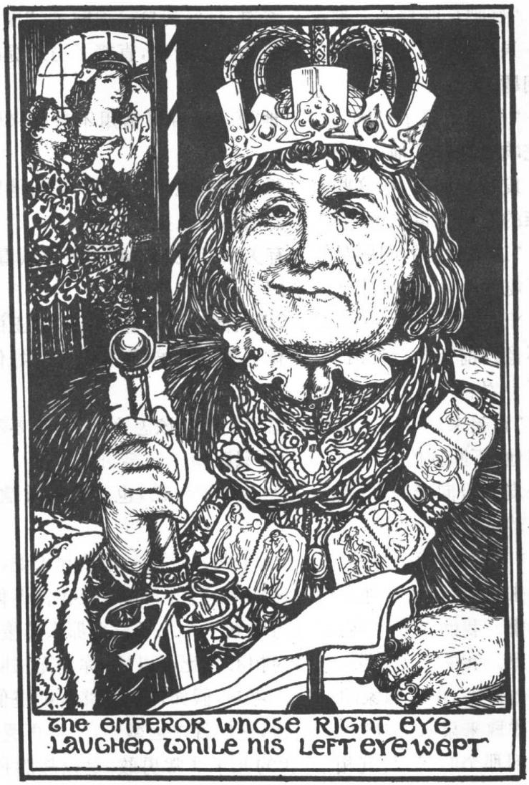

“我马上就出发了，”弗洛里亚对两个弟弟说，“要是过了一年、一个月、一个星期再加一天以后，我还没有带着朝霞仙女的泉水回来，你，科斯廷，最好就接替我的任务。”说完以后，他就骑着马走了。

一连三天三夜，弗洛里亚马不停蹄。那匹马像不知疲倦的精灵似的，带着他越过高山，跨过峡谷，来到了王国的边界。边界上有一条又宽又深的壕沟，上面只有一座桥可以通过。弗洛里亚策马向桥走去，准备过桥。在离开自己的国土之前，他停住马四处张望。等他回过头来，看到一条巨龙站在面前。那巨龙有三个头，三张令人恐怖的脸在瞪着他，三张嘴张得那么大，上颚顶上了天，下颚碰到了地。

看到这可怕的景象，弗洛里亚不敢和它较量，赶紧掉转马头逃命，至于逃到什么地方去，他也顾不上了。巨龙发出一声叹息，然后突然消失得毫无踪影。

一个星期过去了，弗洛里亚没有回家。两个星期过去了，还是没有任何消息。科斯廷开始到马厩里去挑选战马，等一年、一个月、一个星期再加一天过去以后，科斯廷骑上马和弟弟告别。

“要是我失败了，你接着来。”科斯廷说完，沿着弗洛里亚出发的路线走了。

到了边界，科斯廷也和桥上的那条龙遭遇上了。这一回，龙比上一次还要凶狠，还要可怕。我们的小英雄科斯廷逃起来，也比他的哥哥还要快。

科斯廷一去不复返，弗洛里亚也好像石沉大海，家中只剩下皮特鲁孤零零的一个人。

“我要继续走两个哥哥走过的路。”一天，皮特鲁对父亲说。

“去吧！”父亲说，“希望你的运气比他们好。”

皮特鲁和父亲告别以后，就骑着马向边界出发。桥上的那条龙比前两次更加凶恶。这一回，它有七个头，而不仅仅是三个。

皮特鲁在桥边站了片刻，看到了这头吓人的怪兽。

“快点滚开！”他喊起来。可是龙一动也不动。“快点滚开！”

他又喊了一遍。龙还是不理睬他。皮特鲁拔出剑来，向它冲过去。

顷刻之间，滚滚浓烟笼罩了大地，四周都是熊熊燃烧的大火。他的前面是火，后面也是火；右边是火，左边也是火。龙的七个头都在喷射着火焰。

马胆战心惊地嘶叫着，连连向后退却。皮特鲁拿着剑，可是无法冲上前去。“安静！安静！这样不行！”他对马说着，急忙从马上跳下来，左手拉着缰绳，右手握着剑。可是这样他也无法作战。周围除了烟和火以外，他什么也看不见。

“没有办法，我必须回去，挑一匹好马。”他说，骑着马回到家里。

在王宫的门口，他看到了正站在那里等他回来的保姆，老毕斯莎。

“啊！皮特鲁，我的儿子，我知道你会回来的。”她喊道，“你没有把事情办妥当。”

“我该怎么样来办这件事呢？”皮特鲁又气愤又悲伤地说。

“你看，我的儿子，”毕斯莎回答，“除非骑着你父亲年轻时用过的那匹马，否则你永远也到不了朝霞仙女那里。去吧！去问一问这匹马在哪里？然后骑着它出发。”

皮特鲁由衷地感谢她的指点，马上就到他父亲那里去，打听马的消息。国王听了他提出来的问题以后，说：“这些事情是谁告诉你的，凭我的直觉，肯定是那个老女人毕斯莎！你的脑子到哪里去了！我年轻的时代已经过去了五十年，谁知道那匹马的骨头在哪里腐烂了，那匹马的缰绳是否还有碎片留在马厩里？这匹马我早就忘记了。”

皮特鲁气愤地走开，回到老保姆那里去。

“别灰心，”她微笑着说，“事情到了这种地步，一切都会好的。去把那匹马的缰绳碎片找来，我很快就会知道该做些什么。”马厩里堆满了马鞍和缰绳，还有一些皮带。皮特鲁捡了一副最黑、最旧，几乎要腐烂了的缰绳，把它交给老保姆。她对着缰绳喃喃地说了些什么，还在上面撒上一些香，然后把它交给年轻人。

“拿着这副缰绳，”她说，“用力抽打房子的柱子。”

皮特鲁照她的话去做。缰绳刚碰到柱子，奇怪的事情就发生了。皮特鲁吃惊得直瞪眼，一匹从未见过如此英俊和健壮的马站在他的面前。马鞍是金黄色的，上面镶着宝石；马勒闪闪发光，叫人看上一眼就张不开眼睛。总而言之，一匹漂亮的马，配着漂亮的马鞍和缰绳，已经为一个漂亮的年轻王子准备好了。

“跳上这匹棕色的马吧！”老妇人说完，转身回到房子里去了。

皮特鲁骑上这匹马，顿时觉得自己勇气倍增。

“请在马鞍上坐稳了，我的主人，我们有很长的路要走。时间紧迫，一分钟也不能耽搁。”棕色马说。皮特鲁马上就看到，他们奔跑的速度是任何人和马都比不上的。

桥上还是站着一条龙，可已经不是他想征服过的那一条。这条龙有十二个头，一个比一个更凶恶，喷出的火焰一个比一个猛烈。可是，尽管它是那么吓人，皮特鲁毫不畏惧，他卷起袖子，免得它碍手。龙这回可是碰到真正的对手了。

“快让开！”皮特鲁喊叫着。可是龙不理睬它，喷出的火焰和烟雾更厉害。皮特鲁不再说话，他把剑抽出来，准备向桥上扑过去。

“停一下，小心！我的主人。”马说，“注意照我的话去做。拿着你的剑，准备好，我们要从龙和桥的上面飞过去。到龙的头上时，把它最大的头砍下来，把剑上的血擦干净，在我碰到地面之前，把它插回剑鞘中去。”

皮特鲁手中握着剑，像马说的那样，把龙头砍下，把血擦干净，在马着地之前把剑插回剑鞘。就这样，他们通过了这座桥。

“我们还得继续向前。”皮特鲁回过头来，告别了自己的国土。

“是的，我们还得继续走。”马回答，“不过，我的主人，你得告诉我，你希望以怎样的速度走呢？像风那样快？像思想那样敏捷？像希望那样理想？还是像咒语那样神出鬼没？”

马一会儿腾空而起，直插云霄；一会儿贴近地面，像一道闪电。前面是一望无际的沙漠，那景象叫人毛骨悚然。

“我们用不同的速度奔跑。”他说，“不要太快，免得太累；不要太慢，免得浪费时间。”

就这样，他们第一天跑得像风那样快；第二天跑得像思想那样敏捷；第三天跑得像希望那样理想；第四天跑得像咒语那样神出鬼没，一直到他们越过大沙漠。

“现在，我们在地面上行走吧！这样，我可以看看从前没有见过的景象。”皮特鲁说。他擦了擦眼睛，好像刚刚睡醒一样；又好像是手中拿着一件奇怪的东西，要仔细看看清楚。

前面是一片铜森林，铜的树木，铜的叶子，铜的花。皮特鲁吃惊地看着这些从来没有见过的，也从来没有听过的景象。

他们走进森林。两旁的花朵开始赞美皮特鲁，都试图诱惑他，把它们摘下来做一个花环。

“摘下我吧！我是多么可爱！我会给你力量！”这边的一朵花这样说。

“不！还是把我摘下好！谁把我戴在他的帽子上，就会得到全世界最美丽的女人的爱！”那边的一朵花这样说。它们争奇斗妍，都用最温柔最甜蜜的语言来劝他把自己摘下。

皮特鲁的心当然也会被它们的甜言蜜语打动，可是当他弯下腰正要摘下一朵花时，马会突然跳开，不让他摘。

“你干吗不站好！”皮特鲁有点生气，粗暴地问马。

“不要摘这些花！它会给你带来噩运。”马说。

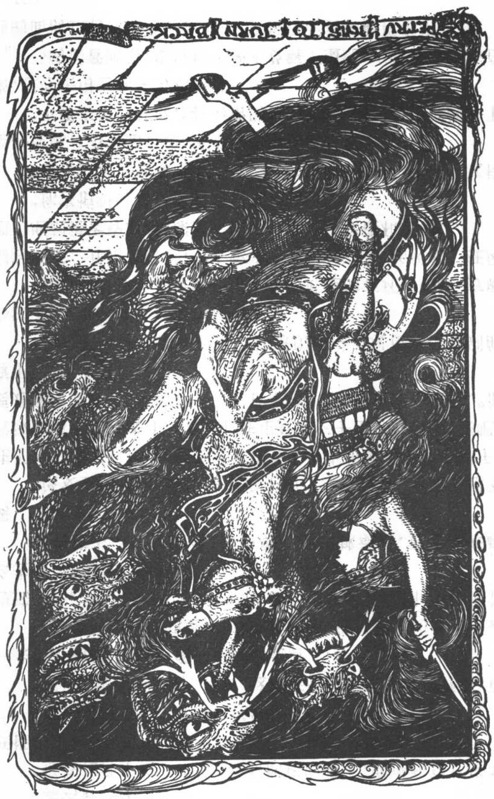

“怎么会这样呢？”

“这些花都中了一个咒语，谁把它们摘下，就得和森林里的妖怪韦尔瓦决斗。”

“韦尔瓦是个什么样的妖怪？”

“哎！让我安静一会！听着，这些花你爱怎么看就尽管看，可一朵也不能摘。”马说，慢慢地向前走着。

皮特鲁从经历中知道，听马的话没错。他尽最大的努力不去想这些花。可是没有用！一个人如果命中注定要倒霉，不论他怎么去做，总是要倒霉的。

那些花不停地挑逗他，他的决心越来越动摇，意志越来越弱。

“该发生的事情，终究是要发生的。”皮特鲁说，他终于忍不住了，“不管怎么样，我也要看看森林中的韦尔瓦是个什么样子，我该如何来和它决斗。要是我注定死在它手里，那就让它去吧！要是我能战胜它，那怕是一千二百个韦尔瓦，我也要征服它。”他弯下腰来，采集那些花。

“你做了一件非常坏的事。”马悲伤地说，“现在也没有别的办法了，准备战斗吧！韦尔瓦来了。”

马的话刚说完，皮特鲁还来不及做好他的花环。四面八方就刮起风来。开始是微风，后来越来越大，变成了一场风暴。狂风把大地刮得天昏地暗，漆黑一团。大地也在摇摆和震动。

“你害怕吗？”马抖抖它的鬃毛，说。

“还不。”皮特鲁虽然觉得浑身发冷，有点颤抖，他还是这样坚决地说，“不管怎么说，该出现的事情总是要出现的。”

“不要害怕，”马说，“我会帮助你的。从我的头上把缰绳拿下来，想办法用它套住韦尔瓦。”

马的话音刚落，皮特鲁还来不及解下缰绳，韦尔瓦已经站在他的面前。啊！它是那么可怕，皮特鲁简直不敢再看第二眼。

它有一个头不像头的脑袋。行动起来，既不像在天上飞，也不像在地下走。它长着像马一样的鬃毛，鹿一样的角，熊一样的脸，鸡貂一样的眼睛。身体也说不出是像什么，这就是韦尔瓦。

皮特鲁在马背上坐稳了，就开始挥动他的剑。

仗打了一天一夜，还是不分输赢。不过，这时候，韦尔瓦开始大口大口地喘气。

“我们停下来休息一会。”它上气不接下气地说。

皮特鲁放下他的剑。

“你一刻也不能停下。”马说。皮特鲁又鼓起勇气，更加有力地舞动他的剑。

韦尔瓦发出一声像马一样的嘶叫，像狼一样的哭嚎，又张牙舞爪地向皮特鲁扑过来。他们又打了一天一夜，战斗比以前更加激烈。皮特鲁累得几乎无法挥动手臂。

“我们停下来休息一会。”韦尔瓦第二次说，“我看你和我一样疲倦。”

“你一刻也不能停下。”马说。

皮特鲁不敢怠慢，尽管手臂像灌了铅一样的沉重，他还是不断地把剑举起来。

韦尔瓦已经不像开始那样疯狂地猛扑，只是小心地选择进攻的机会，它的体力已经消耗得差不多了。

到了第三天早晨，东方刚刚开始发出红光，皮特鲁终于把马的缰绳套在韦尔瓦的头上。至于是怎么套上去的，我也说不清楚。韦尔瓦立刻变成一匹马，一匹世界上最漂亮的马。

“你的生活将充满欢乐，因为你把我从魔法中解救出来了。”韦尔瓦说，用它的鼻子擦着它兄弟——棕色马的鼻子。它向皮特鲁讲述了自己整个故事，说它中了魔法已经有了许多年。

皮特鲁把它系在自己的马上，又继续向前走。他要到哪里去呢？我不能告诉你。反正他马不停蹄地奔驰着，直到离开这片铜森林。

“停下来，让我看看周围，这些景色我从来没有见过。”皮特鲁对马说。在他的前面，伸展着一片比铜森林神奇千百倍的森林。那些闪闪发光的树木上，开着耀眼的鲜花。这是一片银森林。

像上一次一样。这些花都在诱惑着皮特鲁把它们摘下来。

“别摘它们。”在旁边跟着跑的韦尔瓦说，“我的哥哥比我强七倍。”皮特鲁从上一次的经历中，明白这句话是什么意思。可是没有用，犹豫了一会以后，他开始摘下这些花来，给自己编花环。

顿时，平地刮起了风暴，大地激烈地颤抖，天空一片黑暗，一切比上一次还要厉害。银森林中的韦尔瓦以七倍于它弟弟的速度奔跑出来。他们一直打了三天三夜，皮特鲁才用缰绳套住了它的头。

“你的生活将充满欢乐，因为你把我从魔法中解救出来了。”第二个韦尔瓦说。皮特鲁带着三匹马继续向前走。

不久，他们来到了更加辉煌灿烂的金森林。三匹马都同时劝他快点冲过去，别去碰那些花。可是皮特鲁只把它们的话当耳边风。他摘下那些金光闪烁的鲜花，还来不及编成花环，就感到有什么可怕的东西从地下冒出来。他急忙抽出剑，说：“要么就是我死！要么就是用缰绳套住你的头。”

一股浓雾把他团团围住，他看不见自己的手，听不见自己的声音。对手是什么样子，他根本不知道。他只好挥舞着剑，一秒钟也不敢停下。这样，双方相持了一天一夜。后来浓雾好像散了一些，到第二天早晨，东方射出金色的阳光，雾完全散了。皮特鲁感到，自己好像是获得了第二次生命。

韦尔瓦到哪里去了？它消失了。

“你尽可能地抓紧时间喘口气吧！决斗马上就要重新开始！”马对他说。

“它是什么东西？”皮特鲁问。

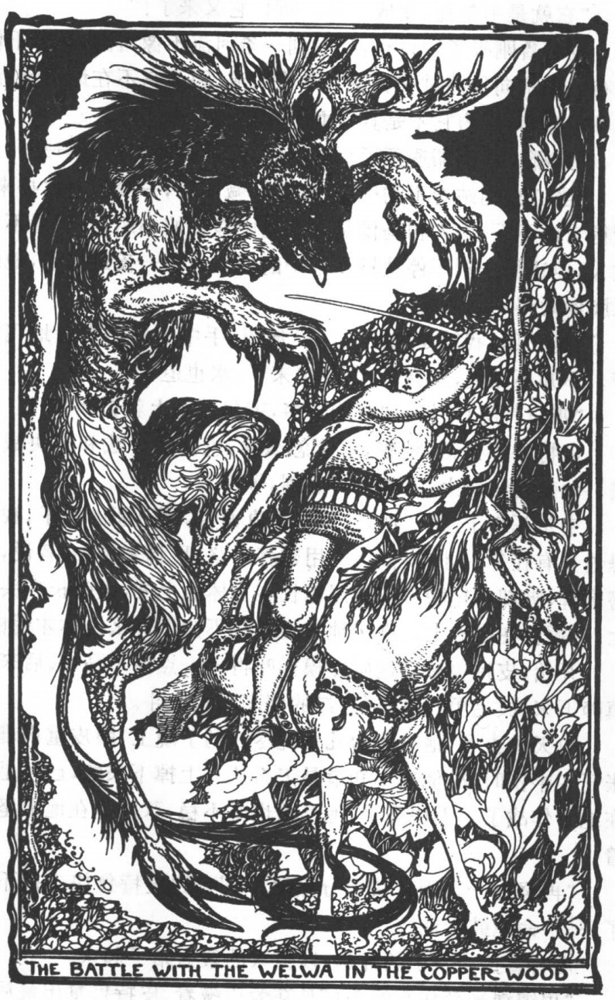

“它就是韦尔瓦，变成了雾。听！它又来了！”

皮特鲁刚吸了一口气，就看到一条河流不像河流，瀑布不像瀑布的洪水向他冲过来。说它不像河流，因为它不在地下流；说它不像瀑布，因为它不是直落而下，来无影，去无踪。

“天哪！我倒霉透顶了！”这一回，皮特鲁吓得叫出声来。

“当心！别站着不动……”棕色马喊叫着，一股水向它扑来，噎得它说不下去。人和马像是在急流中挣扎的小船，因为看不见敌人，他还得一刻不停地舞动手中的剑。一天一夜过去了，他的双脚僵硬得不听使唤。

“这一回，我算是豁出去了。”他想，手中的剑闪电般地飞舞着。不知不觉地，天亮了，太阳出来了，水也退了。

“吸口气吧！”马说，“时间不多，韦尔瓦马上就会回来。”

皮特鲁不说话，他想，不管怎么累，也要想办法和它决战到底。他坐在马鞍上，紧紧地抓着剑，等待着。

韦尔瓦来了。这一回，它露出了真面目，那丑恶的样子，我们恐怕只有在梦中才看得见。它用翅膀走路，用脚来飞；或者说，翅膀像脚，脚却像翅膀。它的尾巴长在身体的上方，眼睛长在头颈上，头颈长在前额上。许多地方怪得我不知道怎么说你才明白。

开始，皮特鲁被它这副怪模样吓得差一点掉下马来。后来他镇静下来，鼓足勇气，以更高昂的姿态投入战斗。

白天过去了，他的体力几乎耗尽。到了晚上，眼皮重得难以张开。半夜时分，他也不知道是怎么从马上掉下来的，已经是站在地下作战了。天快亮了，他连站也站不稳，双膝跪在地上坚持着。

“再努力一下吧！快要分输赢了！”看到皮特鲁快支持不住了，马拼命地鼓励他。

皮特鲁擦去头上的汗水，以惊人的毅力站了起来。

“用缰绳来套住它的头！”马在旁边喊着。皮特鲁拿出最后的一点力气，抓起缰绳。韦尔瓦发出惊天动地的一声嘶鸣，垂死挣扎地向他扑过去。皮特鲁虽然耳朵被震得发聋，但仍警惕地注视着对手。看到它扑过来，就把手中的缰绳对准它的头扔过去。这时候天也亮了，皮特鲁的身边又多了一匹马。

“愿你的妻子是全世界最美丽的女人！”金森林中的韦尔瓦说，“你把我从魔法中解救出来了。”四匹马一齐奔腾，到傍晚的时候，他们走出了金森林。

皮特鲁想着采来的三个花冠，想着为得到它们所付出的代价。“归根到底，我要这么多干什么？留下最好的一个就可以了。”他把铜花冠和银花冠从头上取下，把它们扔掉。

“停下来！”马喊道，“别把它们扔掉，或许它们还有用。快下去，把它们捡回来。”皮特鲁下了马，捡起花冠，重新戴上。

傍晚，太阳快下山了，蚊子开始出来咬人。皮特鲁看到，前面是一片辽阔的灌木丛生的荒原。这时，马自己停了下来。

“怎么了？”皮特鲁问。

“我担心，要遇上什么坏事情了。”马回答。

“怎么会呢？”

“我们正在进入墨丘利女神的王国。越往里面走，就会越觉得冷。可是路的两边都有火，我怕你会停下来去烤火。”

“为什么不能停下来暖暖身子？”

“那样就会发生可怕的事。”马悲伤地说。

“好！继续走吧！”皮特鲁快活地说，“要是我注定要受冻，我就得忍受。”

他们一步一步地走进墨丘利女神的王国，空气越来越冷，后来好像连他们的骨髓也要结冰了。可是皮特鲁并没有被吓倒。和韦尔瓦的战斗增强了他的忍耐力，使他能勇敢地经受任何考验。

路的两旁都生着篝火，许多人围着火在取暖，他们愉快地招呼皮特鲁过去，和他们一起烤火。尽管呼出的水汽在嘴唇上结冰，皮特鲁还是不去理睬他们，只是叫马快点走。

皮特鲁默默地和寒冷抗争了多久，谁也说不清，反正大家都知道，墨丘利女神的王国不是一天就能穿得过去的。周围是许多冻得裂开了的岩石。他的眉毛上也结了冰，牙齿不停地相碰，咯咯地响着。

他们终于来到了墨丘利女神的住所。皮特鲁从马上跳下，把缰绳挂在马背上，走进屋子。

“你好吗？小娘娘！”他说。

“非常好！谢谢你，我的冻僵了的朋友。”

皮特鲁笑起来，等着她说话。

“你生下来就非常勇敢。”女神拍拍他的肩膀说，“你现在应该得到奖赏。”她打开一个铁箱子，从里面拿出一个小盒子。

“看！”她说，“这个小盒子在这里躺了好多年，等待着能够胜利通过冰冻王国的人。拿走吧！把它珍藏好，有一天它会帮助你的。你把它打开，它就会告诉你想知道的一切，还会给你带来你父亲王国的消息。”

皮特鲁衷心地感谢她的礼物，骑上马走了。走了一段路以后，他把盒子打开。

“你有什么吩咐？”里面有个声音问。

“请告诉我父亲的消息。”他说，心里有点紧张。

“他正在和大臣们坐在一起开会。”盒子里说。

“他好吗？”

“不怎么好，他非常生气。”

“是什么原因让他生气？”

“在我看来，你的两个哥哥想接替你父亲，统治他，统治他的王国。老人说，他们不适合。”盒子说。

他把盒子盖起来，放进口袋，对马说：“走吧！好马！我们的时间不多了。”

他们像旋风，像幽灵似地奔驰着，又不知道走了多少路。

“停一下！我有些话要对你说。”马说。

“什么话？”

“你已经知道了，挨冻是什么滋味；你现在还必须去经受热的考验，这是你做梦也想不到的。要像上一次一样地勇敢。不管谁诱惑你去乘凉，你都不要去理睬，否则你就倒霉了。”

“走吧！”皮特鲁说，“不要担心！我从冰的王国里出来，没有被冻僵，现在也不会熔化。”

“为什么不会？这里热得会把你的骨髓都化掉。这种热只有在朱庇特女神的王国里才有。”

走进朱庇特女神的王国，皮特鲁才感到马的话没错。这种热他从来没有经历过，马蹄铁也化掉了，可是他毫不在意。汗从脸上流下来，他用长手套擦掉。在离大路不到一石之地的地方，就是长着密林的凉爽山谷。河水在峡谷里奔流，鲜花在两岸开放。鲜花丛中，站着许多可爱的姑娘。她们都在用温柔动人的声音招呼他过去。他不得不闭上眼睛，以抵御她们的诱惑。

“来吧！我的英雄！过来一块休息，再走下去会把你热死的！”她们还在继续呼唤着。

皮特鲁摇摇头，什么也不说，也没有力气说。

这种可怕的状况持续了多久，谁也说不清。后来他终于感到一点一点地凉快起来。接着，他在前面的小山顶上看到一间小房子，那是朱庇特女神的住所。他拉着马来到门口。女神亲自出来欢迎他，慈祥地邀请他进屋，请他讲自己的冒险经历。皮特鲁把他到达这里的过程从头到尾都说给她听，然后就准备和她告别，因为时间实在是太宝贵了。“谁知道，朝霞仙女离这里还有多远呢？”他说。

“请再等一会，我有句忠告要对你说，你就要进入维纳斯女神的王国了。请你转告她，就说是我说的，叫她不要诱惑你，耽搁你的时间。回来以后，再到我这里来一下，我要给你一样东西，也许对你有用。”

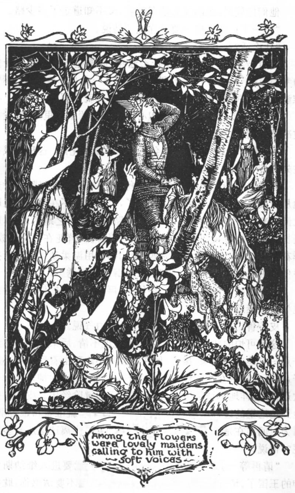

皮特鲁跨上马，走出去没有几步远，就发现自己来到了一个新的国家。这里不冷也不热，气候像春天般地温暖适宜。不过，他们要走过一片灌木丛生的荒野，上面布满了沙坑和荆棘。

放眼望去，在荒野的尽头，隐约可见像房子模样的建筑。“那是什么？”皮特鲁问。

“那是维纳斯女神的房子。”马说，“要是我们尽快地跑，天黑之前可以到达。”说完，它像离弦之箭似地飞驰起来。傍晚时分，他们来到了房子的附近，皮特鲁不禁高兴得心跳起来。一路上，成群结队的人影围着他飞舞，上下左右，前前后后。他虽然是一个勇敢的人，可也有点觉得心惊肉跳。

他们在房子门前停下，皮特鲁跳下马，向门口走去。

“别那么急，”马说，“有几件事我要先关照你，你不能就这样走进维纳斯女神的房子。她的周围总是有旋风看守着。”

“那么，我应该先做什么呢？”

“拿着铜花环，到小山丘上去，说‘哪里能找到这么可爱的少女！这么可爱的天使！这么可爱的精灵！’然后把铜花环高高地举起，说，‘啊！要是我知道谁会接受我这个花环……要是我知道！要是我知道！’接着，你就把花环抛出去！”

“这样做是为了什么呢？”皮特鲁问。

“不要提问题，照我的话去做，去吧！”马说。皮特鲁顺从地走了。

他刚把花环抛出去，旋风就把它撕得粉碎。

皮特鲁转过身来，准备向房子走过去。

“站住！”马喊起来，“我还有些事情要跟你说。拿起银花环，去敲维纳斯女神的窗口。她会问，‘是谁啊？’你回答，我是步行过来的，在荒野中迷了路。她会对你说，照走过来的路回去。这时候，你千万别动，记住，要对她说，‘不！恰恰相反，我不会做这种事情。我从小就听说美丽的维纳斯女神的故事。我踏破了铁鞋，走了九年零九个月，经过战斗获得了银花环，不是没有目的的。我经历了千辛万苦来到这里，希望你能接受这个银花环。’”

皮特鲁不再问什么，径直向房子走去。

这时候，天已经很黑了，只有从窗口透出的一束光线给他指路。听到他的脚步声，两只狗狂吠起来。

“谁在招惹狗叫啊？是不是活得不耐烦了？”维纳斯女神问。

“是我！女神！”皮特鲁小心翼翼地回答，“我在荒野中迷路了，今天晚上不知道到哪里过夜。”

“你把马放到哪里去了？”女神严厉地问。

皮特鲁不回答，他不敢肯定，是该撒谎呢？还是说真话好。

“走吧！我的孩子，这里没有你住的地方。”她说着，从窗口缩回去。

皮特鲁赶紧重复马教他说的话。很快，女神又把窗打开，用和蔼的声音问他：“花环在哪？我的孩子，让我看看。”皮特鲁把银花环交给她。

“进屋来吧！”女神继续说，“不要怕那些狗，它们总是明白我的意思。”果然是这样，狗看到他进来，都摇摇尾巴。

皮特鲁走进屋子，打了声招呼“晚上好！”，就在火的旁边坐下，舒服地听着女神说话。大部分时间，她都在说男人的邪恶，还有她最生谁的气。不过，皮特鲁对于她所说的一切都表示赞成，因为他从小受到的教育都是说，要讲礼貌。

可是，世界上还有比她更老的女人吗？我不知道皮特鲁为什么这样全神贯注地看着她，除非是想数清楚她脸上的皱纹。如果真是这样，他就得活上七辈子，而且每辈子的寿命要比平常人长七倍。也许这样，他才能数清楚这些皱纹。

维纳斯看到皮特鲁目不转睛地看着她，心里非常高兴。

“我出生的时候，天地还很不像样子。”她说，“我长大以后，天地才逐渐形成。人人都说我是天底下从未见过的最美丽的姑娘。当然，有许多人也因此而恨我。可是，每过一百年，我脸上就要多一条皱纹。现在，我老了。”接着，她又对皮特鲁说，她是一个帝王的女儿，他们最近的邻居是朝霞仙女。有一次，她跟朝霞仙女大吵了一场。说到这里，她开始大骂朝霞仙女。

皮特鲁不知道该怎么办才好。大部分时间，他安静地听她说。有时，他也会点点头说：“是的，是的，你是受到了很不公正的对待。”这完全是出于礼貌，除此以外，他还能说什么呢？

“我要交给你一个任务，因为你很勇敢，能够办得到。”维纳斯继续说着，她已经说得很久了，两个人都觉得困了，“朝霞仙女的家里有一口井。只要喝了井里的泉水，就会像玫瑰重新开放一样的年轻美貌。给我带一瓶来，为了表示我的感激，我愿意为你做一切事情。不过，这很不容易，没有人比我知道得更清楚。她的王国里处处有野兽和可怕的龙防守。我会告诉你更加详细的情形，我有一样东西给你。”

她站起来，打开一个铁皮包着的箱子，拿出一枝很小的笛子。

“看到这个吗？”她问，“这是我小时候一个老人给我的。不论是谁，只要听到这笛子的声音就会睡着，什么也弄不醒他。拿着吧！在朝霞仙女的王国里，不停地吹奏它，你就会很安全。”

说到这里，皮特鲁说，他到朝霞仙女那里去，还另有任务要完成。维纳斯听了他的故事，觉得更加高兴。

皮特鲁向她道了晚安，把笛子放进盒子，就在最底层的房间里躺下来睡觉。

天还没亮，他就醒了，第一件事是把那些马喂饱，带它们到井里去喝水。这以后，他就穿好衣服，准备出发。

“停下，”维纳斯从她的窗口把他叫住，“我还有话要对你说。留下一匹马，带走三匹。慢慢地走，到了仙女的王国以后，下来步行。回来的时候，看清楚你的三匹马是否还在路边。最重要的是要记住，千万不能看朝霞仙女的脸。她有一双迷人的眼睛，会使你着魔；看一眼，你就会变成傻瓜。她非常恶毒，比你想象中的任何东西都恶毒。她有着猫头鹰的眼睛，狐狸般的脸，猫一样的爪。你听见了吗？你听见了吗？一定要记住，别看她！”

皮特鲁谢过她以后，终于想办法离开了。

他们来到了非常遥远的地方，这里天地相接，天上的星星可以吻到地上的鲜花。天边呈现出一片柔和的红光，有点像我们在春天里看到的景色，只是更妩媚，更壮丽。

那片亮光是从朝霞仙女王宫后面发出来的。皮特鲁花了两天两夜的时间，穿过鲜花盛开的草地，来到这里。这里天气不热也不冷，不亮也不暗。

过了不久，皮特鲁在那片红光中看到了一点白色慢慢升起。等他走近一看，才认清是一座城堡。城堡那么金碧辉煌，叫他有点目眩。他不知道，世界上还有这样美丽的城堡。

他不敢浪费时间，从马上跳下来，让三匹马去吃那些沾满露水的青草，自己吹着笛子向前走去。

他还没有走多远，就被一个巨人绊了一下。巨人听到笛子的音乐，睡着了。这肯定是看守城堡的巨人，他躺在地下像一座小山一样。皮特鲁尽管很忙，也忍不住停下来量他一下，看看他到底有多大。

越往前走，看到的东西就越古怪，越吓人。狮子、老虎，还有七个头的龙，都在太阳底下伸手伸脚地睡着了。用不着我对你们说那些龙有多么可怕，现在我们人人都知道，龙可不是闹着玩的。皮特鲁像一阵风似的，急急忙忙从它们身边经过，是抓紧时间呢？还是感到害怕？我也说不上来。

一条河流挡住了去路，可这是一条什么河呵！河里流的不是水，而是牛奶；河底不是普通的沙子和石子，而是宝石和珍珠。普通的河水要么就流得很快，要么就流得很慢，可这条河既流得快，又流得慢，真叫人弄不明白。城堡就在河流的围绕之中。皮特鲁站在这边可以看得见，对岸睡着许多长着铁牙和铁爪的狮子，再过去就是花园了。当然，这样美丽的花园只有朝霞仙女才有。花丛之中睡着一个仙女。

可是，怎样才能过去呢？是的，河上是有一座桥，即使在桥上看守的狮子睡着了，人也不敢走过去。因为谁也说不出这座桥是用什么做的，它看上去像一朵在天上飘着的云。

他站在那里思考着，用什么办法才能过去。想了一会，他决定冒一次风险，走回到睡着了的巨人身边。

“快醒醒，勇敢的人！”他摇着巨人，大声地喊叫。

巨人醒了，伸出巨手把他抓起来，像抓一只苍蝇一样。皮特鲁吹响笛子，巨人又睡着了。

皮特鲁这样试了三次，觉得可以控制住巨人以后，才满意地拿出一条围巾，把巨人两个小手指反缚在背后，抽掉他的剑，第四次喊叫：“快醒醒！勇敢的人！”

巨人醒过来，明白了皮特鲁在耍什么诡计，对他说：“你这叫公平决斗吗？你要是一个英雄，应该照规矩和我决战！”

“我会和你公平决斗的，可是我要先问你一个问题，假如我和你公平决斗，你能发誓把我带到河对岸去吗？”巨人宣誓答应。

巨人获得自由以后，向皮特鲁猛扑过来，想用自己的体重把他压扁。可是，这一回他碰到对手了。皮特鲁身经百战，知道该怎么样来对付他。

激烈的决斗持续了三天三夜。有时候是巨人占上风，有时候是皮特鲁占上风。后来两个人在地下打滚，皮特鲁用剑对准巨人的咽喉。

“让我起来！让我起来！”巨人吓得尖叫起来，“我承认输了。”

“你把我带过河去吗？”皮特鲁问。

“我带你过去！”巨人喘息着说。

“你要是不信守诺言呢？”

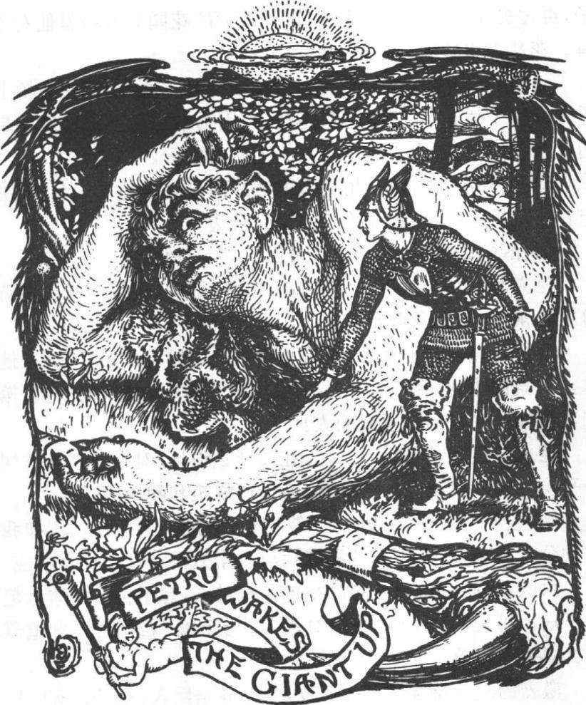

“杀了我，用什么办法都行，现在放了我吧！”

“好吧！”皮特鲁说。他把巨人的左手和右脚捆在一起；用一块围巾堵住他的嘴，不让他喊叫；再用一块围巾蒙住他的眼睛，领他来到河边。

到了河边，巨人伸出一只脚来跨过河，用手掌把皮特鲁托起来，把他送到河对岸。

“很好！”皮特鲁说。他拿出笛子吹了几下，巨人又睡着了。连在下面洗澡的仙女们听到音乐，也在岸边的花丛里睡着了。皮特鲁走过的时候看见她们，心里想着：“她们长得这么漂亮，朝霞仙女为什么长得那么丑？”他不敢迟疑，继续向前走。

他走进了那座奇妙的花园，它比从对岸观看要美丽千百倍。皮特鲁匆匆地穿过花园，向城堡里走去。花园里，他看不见凋谢的鲜花，可一切都是静悄悄的，连一只鸟儿也没有，树叶也停止了摆动，仿佛都睡着了，没有任何人出来阻挡他的路。

他穿过院子，走进宫殿。用不着我告诉你，朝霞仙女的宫殿是什么样子，因为它不是普通的宫殿。黄金和宝石就像我们家中的木头一样，到处都是。那些拉太阳马车的马匹，都关在马厩里。这马厩比地球上最伟大的国王的宫殿，还要辉煌十倍。

皮特鲁走上楼梯，快速地穿过四十八个房间，这些房间都空无一人，挂着丝绸。到了第四十九个房间，他看到了朝霞仙女。

这个房间像教堂那么大，在正中央，皮特鲁看到了他千里迢迢来寻找的那口值得赞美的井。它看上去和普通的井一样。奇怪的是朝霞仙女会把它放在自己的卧室里。谁都知道，它在这里已经有了千百年。井的旁边，正睡着朝霞仙女。

皮特鲁看着朝霞仙女，手中的魔笛掉下来，他屏住呼吸。

井的旁边有一张桌子，上面放着用鹿奶做成的面包和一瓶酒。这是力量的面包和青春酒，皮特鲁渴望得到它们。他看了看面包和酒，再看看朝霞仙女，她还睡在铺着丝绸的褥子上。

看着，看着，他觉得自己有点蒙胧起来。朝霞仙女慢慢地张开眼睛，看着他。皮特鲁感到有点飘飘然，不知所措。他好不容易想起那根笛子，拿起来吹了几下，又叫仙女睡着了。他弯下腰来吻她三次，把金花环放在她的头上。他一连吃了三片面包，喝了三口青春酒。然后，把井水灌满瓶子，就快点走出去。

他从花园里走过，觉得和进来的时候不一样。那些花更加可爱；河水流得更快；阳光更加明媚。这些，都是因为他吻了朝霞仙女三次。

他平安无事地走出来，找到了马，跨上马背。他们跑得比风还要快，比思想还要敏捷，比希望还要理想。

后来，他来到了维纳斯的住所。他把马留在路边，自己走进去见她。

维纳斯女神知道他回来了，拿着白面包和红酒出来见他。“欢迎你回来，我的王子。”她说。

“你好！非常感谢！”年轻人回答，拿出那装着仙水的瓶子。她高兴地接过去。休息一会以后，皮特鲁就走了，他的时间非常宝贵。

他来到朱庇特女神的家，像答应过的那样，停留了几分钟，就匆匆忙忙准备告辞。女神把他叫住。

“等一下，我有话要告诫你。”她说，“珍视你的生命，不要和人交朋友，不要骑得太快，不要让井水离开你的手，不要相信别人，远离那些奉承阿谀的人。去吧！千万要小心，路还很远，世界又那么邪恶，你手中的东西非常宝贵。为了帮助你，我要送一件衣服给你，虽然看起来不怎么样，可是它有魔法，穿着它的人不会遭雷击，不会中刀枪，连箭也会躲开他。”

皮特鲁谢过她以后就走了。路上，他拿出那个宝贵的盒子，询问家里怎么样了。盒子说，不好！国王的眼睛完全瞎了。弗洛里亚和科斯廷要他交出王位，他不肯。他说，在用朝霞仙女的井水洗过眼睛之前，他不会交出王位。两兄弟去请教了老伯斯卡。老伯斯卡说，皮特鲁带着井水，正在回家的路上。他们两兄弟已经出来，想在路上截住皮特鲁，从他手中抢走井水，以换取王位。

“你在骗人！”皮特鲁生气地说，把盒子扔在地上，盒子在地上撞成几千块碎片。

没有多久，他就看到了自己的国土。他来到那座桥边，想仔细看看和龙决斗过的桥。正当他注目凝视的时候，他听到远处有个声音在喊叫他。

“你，皮特鲁！”那声音喊道。

“走吧！走吧！”马也喊起来，“停在这里你会倒霉的。”

“不！等一下！看看谁在喊我。”皮特鲁说。他转过头来，和他两个哥哥打了个照面。他完全忘记了朱庇特女神的警告，听到他们那些亲切和奉承的话，他跳下马来，跑过去拥抱他们。他好像有千百个问题要问他们，有千百件事要对他们说。那匹棕色马闷闷不乐地垂着头，站在旁边看着。

“皮特鲁，我亲爱的弟弟，”弗洛里亚说，“让我们给你拿着井水不是更好吗？路上有人会抢你的井水，而我们不会被人怀疑。”

“这样最好，”科斯廷说，“弗洛里亚说得对。”

可是皮特鲁摇摇头，把朱庇特女神说的话告诉了他们，还说了女神送给他的那件衣服。这样一来，两兄弟明白了，只有一种办法可以杀死他。

离他们一石之地，有一条河在奔流，还有一个清澈的池塘，池水很深。

“你觉得口渴吗？科斯廷！”弗洛里亚问科斯廷，还向他眨眨眼睛。

“是的！”科斯廷明白他的意思，说，“来吧！让我们先去喝点水，然后一起回家。有我们在一起保护你，真是太好了。”

这时候，马嘶鸣起来。皮特鲁明白了它的意思，不跟他们一起去。

皮特鲁回到家，回到父亲的身边，治好了他的眼睛。至于他的两个哥哥，就再也没有回来。

（罗马尼亚）

## 魔刀

从前有一个年轻人，他发誓要娶一个有皇家血统的女子为妻，否则决不结婚。有一天，他鼓起勇气，来到皇宫，请皇帝把女儿嫁给他。皇帝认为他不配，不想把独生女嫁给他。不过，皇帝很讲礼貌，不忍心拒绝他，只是对他说：

“很好！我的孩子，要是你能赢得公主，就可以娶她。条件是这样的，八天之内，你必须驯服三匹野马，给我带来。第一匹马要全身雪白；第二匹浑身血红，头是黑色的；第三匹要像炭一样黑，头和脚是白色的。此外，你还要带一些黄金来给皇后做礼物，三匹马能够驮多少，你就带多少来。”

年轻人沮丧地听完皇帝的话，努力地表示感谢他的仁慈以后，离开了皇宫，思索着怎样去完成国王交给他的任务。

幸运的是，皇帝的女儿听到了他们说些什么。她站在一张帘子后面，看到了这个年轻人，认为比她所见过的青年男子都英俊。所以她赶紧跑回自己的房间，写了一封信，让一个忠诚的仆人带给他，叫他明天一早就到她房间里来。信中写道，他要是想娶她为妻，就要照她的话去做。

这天晚上，皇帝睡着以后，公主偷偷地溜进他的房间，从他珍藏宝物的箱子中拿出一把魔刀，小心地把它藏在安全的地方，然后上床睡觉。

第二天，太阳还没有出来，公主的仆人就把年轻人领进她的房间。两个年轻人站在一起，什么话也不说，紧紧地握着手，心中充满了幸福。两人发誓，除了死亡，什么也不能把他们分开。

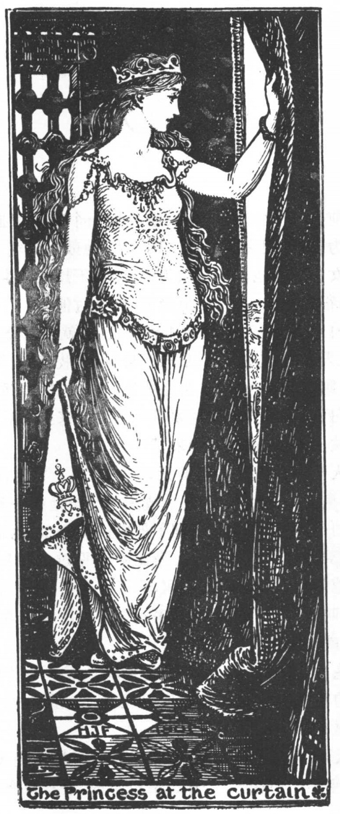

公主说：“骑着我的马，朝日落的方向奔去。穿过一片森林，你就会看到一座有三个山峰的山。到那里以后，先向右边走，再向左边走，你就到了太阳草原上，许多马都在那里吃草。你从这些马中选出三匹我父亲要的马。要是它们害羞，不让你接近，你就把这把刀拿出来，在阳光照耀下，整个草原就会闪耀着它反射出来的光芒。那些马就会自己跑过来，让你牵着它们走。”

“你得到三匹马以后，就在周围找到一棵柏树。它的根是铜的，树枝是银的，叶子全是金的。这样，你就有了无数袋黄金。那些马能装多少，你就装多少。把它们带回来交给我父亲。告诉他，你已经完成了他交给你的任务，要娶我做你的妻子。”

公主把要说的话都说完了，现在就看年轻人怎么去做他的事了。他把魔刀藏在腰里，骑上马，向草原方向奔驰而去。

找到草原并不困难，只是那些马非常怕生，他一靠近，它们就四处奔逃。他拿出魔刀，把它高高地举起，魔刀在阳光的照射下，像一盏明灯似的，整个草原都沐浴在它的光辉之下。那些野马从四面八方向他奔跑过来，一匹匹都争前恐后地跪在他的面前，向他致敬。他从中挑选了三匹皇帝指明要的马，用丝绳来把它们套住，然后就去寻找那棵柏树。

柏树并不难找，一会儿工夫，他就来到了柏树下。他用魔刀把树根周围的土挖掉，顺着柏树的铜根越挖越深，越挖越深，后来碰到了埋在地下的一袋又一袋黄金。他花了九牛二虎之力，把它们搬上来，尽可能地装在三匹马的马背上，能驮多少就驮多少，然后带着三匹马回到皇宫。

皇帝看到他和三匹驮着黄金的马一起回来，非常惊讶，他万万想不到，年轻人竟然比他还聪明。

等订婚仪式结束以后，皇帝问他的女婿，他需要什么样的嫁妆。新郎回答说：“尊敬的陛下，我的希望是娶你的女儿为妻，并且能够荣幸地永远使用你的魔刀。”

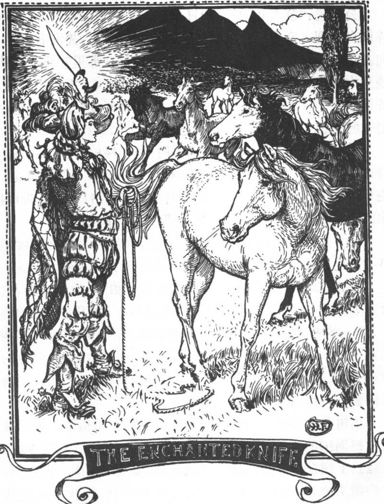

（塞尔维亚）

## 杰西普放兔子

有一个国王统治着一个国家。那时候的国家都比较小，国王只要站在王宫的顶端，就能看到王国四面八方的边界。国家虽然小，可都是属于他的，所以国王也很自豪，还经常想着，等他百年以后，这个国家会变成什么样子。

国王只有一个孩子，而且是个女儿。他想，要给女儿找个丈夫，这个女婿要能够继承他的王位。到哪里去找一个能和女儿相配的，又聪明又富有的女婿呢？这个问题使他非常烦恼，晚上也常常睡不好觉。

后来，他想出一个办法。他不但向百己的王国，而且向邻近的王国宣布，谁能够给他带来一打他从来没有见过的，最好的珍珠，而且能够完成交给他的一些任务，国王就把女儿嫁给他，到时候还让他继承王位。

国王想，能够把这些珍珠带来，说明他是一个非常富有的人；能够完成交给他的任务，说明他很有才干。

消息公布出去以后，有许多人跃跃欲试。那些富有的商人和外国的王子接踵而来，一时间王宫里热闹非凡。不过，他们尽管都能够带来非常好的珍珠，可最简单的任务他们都完不成。还有些人想来冒险，碰运气，给国王带来一些假珍珠。当然，国王不是那么轻而易举就上当的。几个星期过去以后，求婚的人越来越少，一个像样的女婿还是毫无踪影。

这个国家的海边，一个小小的角落里住着一个穷苦的渔夫。

他有三个儿子，名字叫彼得、保罗和杰西普。彼得、保罗已经是成年人了，杰西普刚够得上算个青年。两个哥哥都长得比弟弟高大健壮；而三兄弟之中，杰西普最聪明。尽管彼得和保罗不承认，但这是事实，你在我们这个故事中很快就会看到。

有一天，渔夫出去打鱼，带回来三打大牡蛎，打开来看，每个牡蛎里都有一个美丽的大珍珠。三兄弟看到这些美丽的大珍珠，立刻同时想到，拿它们去向公主求婚。三兄弟经过商量，一致同意把珍珠分成三份，让每个人都有机会。然后，按照年龄的大小，先后去向公主求婚。当然，如果老大成功了，老二和老三也就用不着找这个麻烦了。

第二天一早，彼得把珍珠放在一个小篮子里，向国王居住的王宫走去。还没有走多远，他就看到蚂蚁国王和甲虫国王各自率领着自己的军队对峙着，决战马上就要开始。

看到彼得走过来，蚂蚁国王对他说：“快来帮帮我，甲虫比我们大得多了，以后我会报答你的。”

“我不能浪费时间去做别人的事情，”彼得说，“你尽自己的力量去打吧！”说完，他就离开它们，头也不回地走了。

走了没有多远，他遇见一个老妇人。

“你好！年轻人，”她说，“这么早就出去了，篮子里带着些什么？”

“煤渣，”彼得不加思索地接着说，继续走他的路。“真是多管闲事！”他想。

“很好！那就是煤渣了！”老妇人在他背后说，他假装没有听见。

很快，他来到王宫，被带到国王面前。他把篮子的盖打开，国王和他的大臣们都异口同声地说，他们从来没有见过这么好的珍珠，都目不转睛地看着。可是，接着，奇怪的事情发生了，珍珠慢慢地失去了光泽，越来越暗淡，后来又越来越黑，最后看起来像煤渣。

彼得觉得非常奇怪，也不知道说什么好。国王说了一声够了，彼得也就高兴地拔腿就跑，能跑多快就跑多快。至于父亲和弟弟那里，他只是说没有成功，详细的情况也闭口不谈。

第二天，轮到保罗去碰运气。他很快就来到蚂蚁国王和甲虫国王打仗的战场。经过一个晚上，双方都已经重新把部队安排好了，今天准备再战。

看到保罗过来，蚂蚁国王对他说：“快来帮助我，昨天我们打输了。今后我会报答你的。”

“你们今天再打输了，也跟我无关。”保罗说，“我有更重要的事情要去做，不会卷入你们的争吵。”

他又继续往前走，碰到了那个老妇人。

“早上好！”她说，“你篮子里是什么东西？”

“煤渣。”保罗说。他像哥哥一样，为人傲慢，不爱和别人友好相处。

“很好！那就是煤渣了！”老妇人对着他说。他一句话也不说，头也不回地走了。等到珍珠在国王面前变成煤渣，他才想起她的话，可那有什么用？他如漏网之鱼，急急忙忙赶回家。当被问起是否成功时，他绷着脸不说话。

第三天，该是杰西普去碰运气了。他一早就起来吃早饭。彼得和保罗躺在床上，说着一些难听的话，说杰西普很快就会回来，比他们还要快。他们两个人既然没有成功，他也别指望能办成。杰西普不理睬他们，把珍珠放进篮子就出去了。

蚂蚁国王和甲虫国王的第三次决战即将开始。不过，蚂蚁的数量已经大大减少，看样子，今天再也坚持不下去了。

“快来帮助我们，”蚂蚁国王对杰西普说，“否则我们今天就要彻底失败了。以后我会报答你的。”

杰西普经常听人说，蚂蚁是一种既聪明又勤劳的小动物，可从来没有听人说过甲虫的一句好话。所以，他决定满足蚂蚁国王的要求，帮助它们。

杰西普的第一次进攻，就彻底瓦解了甲虫的队伍，它们纷纷逃窜，那些离洞最近的甲虫，才有幸躲开杰西普的皮靴。用不了几分钟，蚂蚁就占领了全部地盘，大获全胜。蚂蚁国王说了一大篇感激杰西普的话，谢谢他为它们所做的一切，答应不论他遇到什么困难，都会来帮助他。

“需要我的时候，你叫一声就可以了。”蚂蚁国王说，“不论你到什么地方，我都不会离你很远。只要我能办到，一定会尽力帮助你。”

杰西普差一点笑出声来，他努力保持着一副严肃的面孔，说他将永远记住它的慷慨。

在大路转弯处，那个老妇女突然出现在他的面前。

“早上好！”她说，“你篮子里装的是什么？”

“珍珠，”杰西普说，“我要到王宫去，用它们来赢得公主。”他怕她不相信，还把篮子的盖子打开，让她看。

“漂亮，”老妇人说，“确实是非常漂亮。不过，要想得到公主，它们也只能帮你小小的一点忙，除非你能完成他们交给你的任务。我看见你带着一些吃的东西，你干吗不把这些吃的东西给我呢？你到了王宫肯定可以吃上一顿好饭。”

“当然可以，这个问题我倒没有想到。”杰西普说。他把带来的午饭全部交给了老妇人。

他向前走了几步，老妇人把他叫住。

“你看，”她说，“这是为了报答你的午饭，送给你的哨子。它看起来不怎么样，可是只要你一吹，失去的东西，或者是被拿走的东西立刻就会回到你的身边。”

杰西普感谢她送来哨子。不过，他还想不出这哨子对他会有什么用。他继续向王宫走去。

杰西普把珍珠给国王献上，看到它的人都发出一片赞叹声。不过，国王知道他只是一个渔夫的儿子以后，很不高兴，这不是他想象中的女婿。他把自己的想法对王后说了。

“那没有关系，”王后说，“你可以轻而易举地给他一些无法完成的任务，我们马上就可以打发他走。”

“是的，那当然！”国王说，“不过今天那么忙乱，我也想不出来叫他干什么事情。”

这一天，杰西普和国王、王后，还有那些高贵的大臣一起用餐。晚上，他被领到一间他从未见过如此豪华的卧室里。一切都是那么新鲜，他一刻也睡不着。特别是他还想到，明天国王会叫他去干什么事情，他不知道能否完成。所以，尽管那张床非常柔软舒适，黎明终于来到的时候，他还是非常高兴。

吃过早饭，国王对杰西普说：“跟我来吧！我告诉你该做的第一件事。”

国王把他领到谷仓，地上堆着一大堆粮食。国王对他说：“这一堆粮食里有小麦、大麦、燕麦、黑麦。天黑之前一个钟头，你必须把它们分成四堆，要是哪一堆粮食里混进一粒别的，你就再也没有机会和我女儿结婚了。我要把门锁上，免得有人进来帮你的忙。到了规定的时间，我就来看你成功了没有。”

国王走了，杰西普绝望地看着那堆粮食，然后坐下来想试试看，可事情明摆着，一双手是无论如何干不完的，帮忙是必不可少的。可是，找谁来帮忙呢？他突然想起来蚂蚁国王，对了！只有蚂蚁国王可以帮助他。

他开始叫蚂蚁国王，没有多久，蚂蚁国王出现在他面前，杰西普把自己的麻烦对它说了。

“就这些！”蚂蚁说，“我们很快就可以办妥当。”它发出一个信号，不到两分钟，一大队蚂蚁就进入谷仓，在国王的命令下，它们开始把粮食分成四堆。

杰西普看这些小动物忙碌地搬运着，由于昨天晚上没有睡好，很快就睡着了。等他醒过来时，国王正好把谷仓的门打开。国王很吃惊地看到，他不但完成了任务，而且还有时间睡觉。

“太妙了！”国王说，“我简直不相信，这种事情竟然也能办到。不过，还有更难的事情在后头呢！你明天就会看到。”

第二天，杰西普明白了叫他干什么时，他也觉得太难了。国王的猎场看守人抓来了一百只兔子，叫杰西普带到大草原上去吃草，晚上要安全地带回来，要是少了一只，他就别想和公主结婚。

他还来不及考虑怎么办，国王和看守人已经把他带到草原上，把口袋解开，把一百只兔子全部放出来。这些短尾巴，长耳朵的兔子一下子就四处奔跑。

国王说：“现在，我们要看看你是不是够聪明了。”说完就走了。

杰西普手足无措地望着越跑越远的兔子，毫无办法地把手插进口袋。手碰到了一样东西，原来是老妇人给他的哨子，他想起了老妇人对他说过的话，想起了这个哨子的价值。不过，对付这一百只兔子，而且有的已经跑出几英里远，它是否有用呢？

不管怎么样，他也得试试看。他把哨子吹响，没有几分钟工夫，一百只兔子都从四面八方奔跑回来，围着他坐成一个圆圈。明白了哨子的魔力以后，他又放心地让兔子到处奔跑，只是不让它们离开草地。

国王叫一个人留下察看杰西普的动静。毫无疑问，他想，等周围没有人以后，杰西普肯定撒腿就跑，从此再也不会在王宫里出现。那人回来向他报告，杰西普能神秘地把那些兔子召回来以后，他既惊奇，又烦恼。这一回，杰西普看来又要成功了。

“不管是用陷阱，还是用计谋，也要叫他丢一只兔子。”国王说，“我要去找王后商量，她总是能想出好办法来。”

一个穿着破旧衣服的姑娘来到草原，向杰西普走过来。

“给我一只兔子吧！”她对杰西普说，“我们有客人，要留下来吃饭，可我们什么菜也没有。”

“我不能给你，”杰西普说，“第一，这些兔子不是我的；第二，我要保证到了晚上，它们一只也不会少，这事关重大。”

可是那衣服破旧，但长得又漂亮又可爱的姑娘不停地求他。后来他说：“好吧！你吻我一下，我就给你一只兔子。”

他看得出，姑娘并不在意，她同意了这笔交易，吻了他一下，抱着一只兔子走了。可是，她还没有走出草原，他就吹了一下哨子。兔子像泥鳅一样，从她的手中挣脱，闪电般地跑回主人的身边。

过了不久，又有一个人来找放兔子的杰西普。这是一个穿着农民服装的胖女人，她也是来要一只兔子，好去招待家里的不速之客吃饭。杰西普拒绝了。那女人说什么也不肯走，坚持要讨一只兔子。

后来，杰西普说：“好吧！给你一只兔子，什么也不要你的，你只要抬起头，踮起脚跟，绕着我走一圈，边走边学母鸡咯咯叫。”

“呸！去你的！”她说，“怎么能叫我去做这种可笑的事情，想想看，要是邻居看到了，她们准以为我疯了。”

“你看着办吧！”杰西普说，“你自己最清楚，这只兔子到底要还是不要！”

没有办法，胖女子只好照他的话去做。她踮起脚，抬起头来走路时，样子倒也十分优美，只是学母鸡叫学得不像。不过，杰西普说也可以了，给了她一只兔子。可是她刚带着兔于离开草地，那哨子就响了，那长耳朵长腿的兔子又跑了回来。

第三个来要兔子的是一个胖男子，他穿着一身王宫马夫的服装，自我感觉非常好。

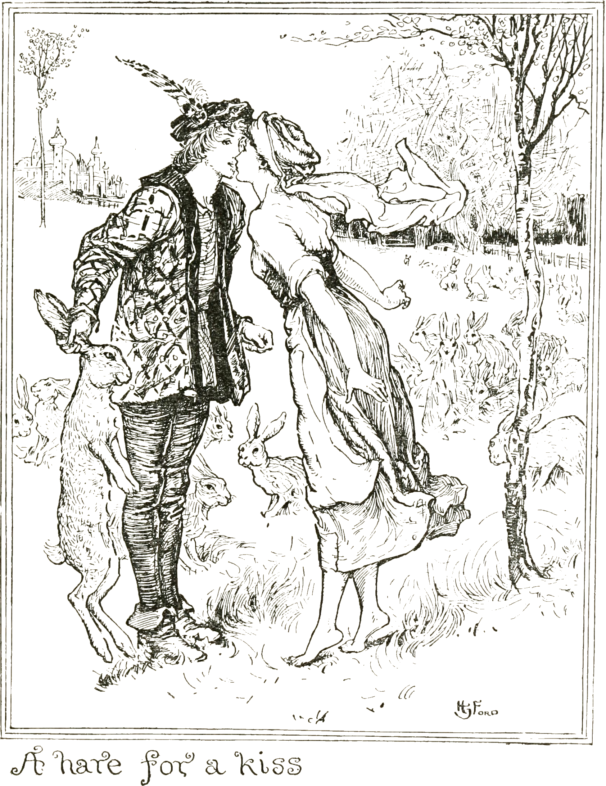

“年轻人！”他说，“我要一只兔子，开个价吧！我一定要得到一只。”

“好吧！”杰西普说，“你可以得到一只，价钱很便宜。你只要倒立在地上，两只脚举起来用力互相敲打，嘴里叫着，‘好哇！好哇！’我就把兔子给你。”

“喂！你说什么！”那胖子说，“叫我用头倒立！什么主意！”

“嗯！随便你，”杰西普说，“你如果不喜欢就不必勉强，不过，兔子也不会给你了。”

看得出，要胖子表演这种节目，实在是太难为他了。经过一番努力以后，他终于头顶地，把两只脚举得高高的，互相对敲着，只是口中叫喊的声音非常微弱。好在杰西普并不苛刻。他把一只兔子给了胖子，不过，像前面两只一样，没多久它就跑回来了。

晚上，杰西普回到王宫，后面跟着一百只兔子，人人看到了都觉得不可思议。国王和王后看上去很不高兴，只有公主在真心实意地对杰西普微笑着。

“很好！”国王说，“你干得很不错。明天还有一件小事情要你做，要是成功了，你就可以和公主结婚。”

第二天，国王宣布，最后一件事将在王宫的大厅里进行。人人都可以来观看。国王和王后坐在王位上，公主坐在他们身边。那些大臣和官员，还有妇女们，都挤满了大厅，来看热闹。

国王做了个手势，两个仆人抬出一个很大的空桶来，把它放在国王前面的空地上。他们把杰西普叫过来。

“现在，”国王说，“你要给我们讲许多不容怀疑的实话，直到装满这个桶，否则你就不能得到公主。”

“可是，我们怎么知道这个桶已经装满了呢？”杰西普问。

“这用不着你担心，”国王说，“那是我的事情。”

这看起来很不公平，可是没有人敢站出来说这句话。杰西普只好一本正经地开始讲他的真实故事。

“昨天，”他说，“我在草地上看着兔子吃草，来了一位姑娘。她穿着破旧的衣服，要我给她一只兔子。我给她了，不过，她给了我一个吻作为报答。那姑娘就是公主。这是不是事实？”他转过头来看着公主。

公主羞得满脸通红，在大庭广众面前很不自在。她承认，这是真的。

“桶里没有装进去多少，”国王说，“继续说吧！”

“后来，”杰西普说，“一个上了年纪的胖女人，穿着农民的服装，来讨兔子。在拿走兔子之前，她得踮着脚，抬起头，绕着我走一圈，还咯咯地学母鸡叫。这个女人就是王后，这是不是真的？”

王后的脸红到耳根，她也不敢否认这是真的。

“嗯！”国王说，“这事情不大不小，可是桶还没有装满。”他回过头来小声地对王后说：“我没想到，你会这么傻。”

“那么，你做了些什么呢？”她小声地反问。

“你想，我会给他做什么事吗？”国王说，叫杰西普继续说下去。

“不久，”杰西普说，“来了个上了年纪的胖男子。他看上去非常尊严，非常骄傲，可是为了得到一只兔子，他用头倒立在地上，两只脚互相敲打，嘴里还喊叫着：‘好哇！好哇！’这个老家伙就是……”

“停下！停下！”国王喊叫起来，“你用不着再多说一个字了，桶已经满了！”

这时，整个大厅里都欢呼起来。国王和王后宣布，杰西普将成为他们的女婿。公主特别高兴，她觉得杰西普那么聪明，那么英俊，已经深深地爱上他了。

国王后来想，把王位交给杰西普也十分放心，他照顾老百姓，会像照顾兔子那样可靠和尽职。

（斯堪的纳维亚）

## 地下工人

事情发生在圣诞节和元旦之间，一个非常寒冷的晚上，有一个人到邻近的村子里去。路虽然不远，可是雪下得非常大，地上积起了厚厚的一层，把路啊！墙啊！篱笆啊！全都遮住了，什么也看不见。那人很快就迷路了，只好到树丛后面去避风。他决定在这里过一个晚上，等明天太阳出来，就可以找到路了。

他像看门狗一样地蜷曲起身子，用一块羊皮把自己裹起来，就睡着了。

他睡了多久，我记不住了。反正后来有人轻轻地把他推醒，一个陌生的声音对他说：“我的好人！快起来！你再这样躺下去，大雪就会把你埋葬，以后谁也找不到你了。”

他慢慢地从羊皮中伸出头来，张开沉重的眼睛，看到身边站着一个又高又瘦的人，手中拿着一棵比他还高的冷杉树。

“跟我来吧！”那人说，“离这里不远，我们生了一堆火，到那里去休息，比在这野地里好得多了。”

用不着再请第二次，他就站起来跟着陌生人走。雪下得那么大，三步远就什么也看不清了。很快，他们来到一片树林中，看到一堆火在燃烧着。

“你叫什么名字？”陌生人突然转过身来问。

“我姓汉斯，是朗·汉斯的儿子。”他说。

在火堆的前面，坐着三个穿白单衣的人，像夏天穿的一样。

火堆周围三十英尺，丝毫没有冬天的迹象。树叶是绿的，草地上有蜜蜂在嗡嗡地叫着。可是在这片地区之外，朗·汉斯的儿子可以听到北风的呼啸声和树枝被厚厚的积雪压断的声音。

“喂！朗·汉斯的儿子，这里不是比在树丛中过夜舒服多了吗？”陌生人笑着对他说。汉斯回答说，他被带到这里来，真不知道该怎么做，才能表达他的感谢。他把羊皮放在地上，卷成一个枕头。喝了一些热的饮料以后，他的心里暖烘烘的，就在地上躺下来。陌生人用一种汉斯不懂的语言，和其他人说起话来。汉斯听了几句就睡着了。

他醒过来的时候，既看不到森林，也看不见火。他不知道，这是什么地方。他揉了揉眼睛，开始回忆昨天晚上发生的事情，认为自己肯定是在做梦，因为他怎么也想不出，是怎样到这里来的。

突然，巨大的响声传进他的耳朵。他感觉到，大地也在他的脚下抖动。他仔细地听了一会，决定到发出响声的地方去，希望能碰到什么人。

他发现，自己来到了一个山洞口。山洞里好像有火在燃烧。走进山洞，他看到里面是一个很大的铁匠铺，有一大群人正在拉风箱，挥铁锤。每个铁砧前都站着七个人。你就是走遍整个世界，也找不到一群这样滑稽的铁匠！他们的头比身体还要大，手中的铁锤是他们身体的两倍。可是，即使是世界上最有力气的人，也不能像他们这样有力地挥动这些铁锤。

这些小铁匠都系着围裙，从头颈一直遮到双脚，赤裸着背。靠墙的一张高凳子上，坐着老板，手中拿着一根松木棍子，严厉地监视着那些干活的小伙计。在他的旁边放着一个大罐，不时有工人走过来喝水。老板这时不穿昨天那套白衣服，而是套着黑马甲，腰中系着一根皮带，皮带上有一个很大的扣子。

老板不时用手中的棍子来对工人发号施令，因为噪声太大了，说话谁也听不见。

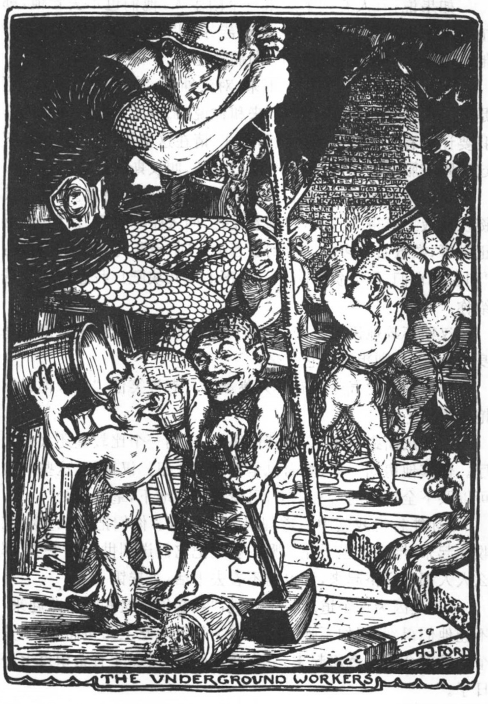

如果说，有人看到了进来一个陌生人，他们也不去管他，都忙着干手中的活。几个钟头的艰苦劳动以后，休息的时候到了，他们把手中的铁锤扔在地下，向洞外走去。

这时，老板才从座位上下来，对汉斯说：“我看到你进来，可是工作那么紧张，我不能停下来和你说话。今天，你是我的客人，我要让你看看我的生活环境和方式。请在这里等一会，让我换下这些脏衣服。”说完，他把一个洞门打开，叫汉斯先进去。

汉斯吃惊地看到，里面有着数不清的宝藏和财富。金锭和银锭在地板上堆得高高的，闪耀着光芒，叫人张不开眼。汉斯想，反正没事，数数看有多少。数到五百七十时，老板走进来，笑着说：“别去数它们，那太费时间了。从顶上挑几块吧！我想当礼物送给你。”

汉斯不等他说第二遍，就弯下腰来拿一块金锭，可是用尽全身的力气，也别想能动它分毫。

他叫汉斯跟着他，穿过其他房间，来到一个比教堂还大的大厅。像其他房间一样，里面也是堆满了金银。汉斯想，这些财富可以买下全世界的所有王国，可惜都埋在地下，毫无用处。

“你能告诉我其中的道理吗？”汉斯问，“你们把这么多财宝收集起来，堆在这里干什么呢？要是把它们送到世人的手中，那么人人都会富裕起来，谁也用不着去干活，去挨饿了！”

“正是因为这个道理，”主人说，“我必须把这些财富藏起来，不让他们得到。假如不强迫人类去为每天能吃上面包而工作，整个世界就会变得懒惰起来。只有通过劳动，人类才有希望过上好日子。”

汉斯听到这些话，很吃惊。接着，他请求主人告诉他，他们整天在这里铸造这些金和银，它们的数量越来越多，已经堆满了所有的房间，可这对谁有用呢？

“我不是一个普通的人，”主人说，“虽然我的外表和普通人一样，可我们的使命是管理整个世界。我和工人们的任务是在地下铸造这些金和银，有一小部分会流到上面的世界去，但只足以帮助人类从事各种商业活动；谁也别指望不劳而获，变成富翁。我们先得把金子挖出来，把它们和泥土、沙子混在一起。那些很有耐心，又有好运气的人，经过长期和艰苦的找寻，才有可能得到它们。不过，我的朋友，吃饭的时间就要到了，要是你还想留在这里饱饱眼福，你就留下来吧！到时候，我会来叫你的。”

主人走了以后，汉斯从这个宝库走到那个宝库，有时候想从金块上敲下一点金子来，可怎么也敲不动。

不一会，主人进来了。他完全变了一个模样，汉斯简直不相信，这就是他。他身穿火焰样鲜艳的丝绸衣服，光彩夺目，衣服上都镶着黄灿灿的金边；腰间系着一条黄金腰带；头上戴着一顶金冠。他全身都闪烁着宝石的光芒，像夜空中的星星那样灿烂。手中的木棍也换成了一根精雕细刻的金杖。

主人把收藏财宝的房间全部锁上，把钥匙放进口袋，把汉斯领到另一个房间，那里午饭已经准备好了。桌子和椅子都是银做的，碗和盘子都是金做的。他们坐下来，有十二个小仆人出来伺候他们，他们动作那么敏捷，走路那么快，汉斯简直不相信，他们会不长翅膀。他们没有桌子那么高，为了拿到桌子上的盘子，就得常常跳起来。

一切对汉斯来说，都非常新鲜。他虽然有点迷惘，但仍然觉得很快乐，特别是，头戴金冠的主人，告诉他许多从来没有听说过的事情。

“每年圣诞节和元旦之间，”他说，“作为一种娱乐，我经常到地面上去走一走，看一看人都在做些什么，从他们那里学点东西。可是根据我的所见所闻，我感到他们不怎么好。他们之中的大多数人经常争吵，互相指责对方的缺点，却从来不检查自己的过错。”

汉斯试图想纠正这些错误的看法，可是他终于没有这样做，只是勉强坐在那里，听他的朋友说，自己一声不吭。后来，他坐在椅子上睡着了，接着发生什么事，他就不知道了。

他睡着以后，梦见那些黄金不停地往上堆。他感到自己的力量比以前大得多了，可以轻而易举地把两块黄金背出去。后来，他越背越多，力气用完以后，就陷到地底下去了。他又听到了那些铁匠快活的喊声，欢乐的歌声，还有风箱的声音，好像还看到了火花在眼前飞舞。

他伸伸腰，慢慢地醒过来，发现自己躺在绿树林里，眼前不是地下铁铺的火花，而是太阳的光芒。他坐起来，觉得事情非常奇怪。

后来，他想起了亲眼看到的那些事情，觉得和平常发生的事情对不上号。他努力回忆着，自己是如何在森林里看到那个陌生人；如何在一堆大火旁和他一起睡了一个晚上；第二天又如何在一起吃饭。总而言之，是和另一个人过了整整一天的时间。可是，这些事情又那么令人难以置信，好像是在玩弄什么魔法一样。

离他不远的地方，在阳光的照射下，可以看到是一堆篝火燃烧后留下的灰烬。他走过去看，发现那不是一般的火灰，而是真正的银粉末，那还未烧尽的柴，竟然都变成了黄金。

啊！汉斯想，他是多么幸运。到哪里去找个口袋来，把这些财宝带回家，不让别人看见呢？需要就是发明的母亲，他急中生智，把那件大衣脱下，把那些银灰小心地收集起来，一粒也不让它留下，再把那些黄金放上去，小心翼翼地包好，用腰带扎紧，保证万无一失。

这包金子和银子份量不轻，不过，也不像他想象中的那么重，他扛着它慢慢地走回家。

汉斯一下子就富裕起来，富到足以买下一大笔财产。汉斯为人谨慎，他后来想，最好是离开这些老邻居，搬到别的地方去，那里谁也不认识他。

不久，他就找到了合适的地方，把房子买下以后，还有一大笔钱。一切都安顿好后，他娶了一个附近的漂亮姑娘做妻子。后来还有了几个孩子。到临死的时候，汉斯才躺在床上对孩子们讲地下主人的故事，讲他怎么让汉斯变成一个富人。

## 杰姆的遭遇

几百年以前，在德国的一个大城市里，住着一个鞋匠和他的妻子。他们很穷，但干活非常卖力。丈夫从早到晚都坐在街道旁的角落里，给人修理各种各样的鞋子。妻子把家里种的水果和蔬菜送到市场上去卖。她为人厚道，脾气好，水果和蔬菜又整齐，又干净，所以有许多顾客。

夫妇俩有一个男孩，叫杰姆，今年十二岁。他身高和普通孩子差不多，可是长着一副漂亮的脸蛋，很讨人喜欢。他常常和母亲一起上市场，坐在母亲的身边，帮那些顾客把水果和蔬菜送回家。他们会因此送给他一朵美丽的花，或者一块饼，有时还给一些钱。

这一天，杰姆和他的母亲像往常一样来到市场，把许多蔬菜和香草铺开，在一些小篮子里还有早梨、苹果和杏子。杰姆大声地吆喝着：

“快来吧！女士们！先生们！看多好的卷心菜，多新鲜的香草，还有苹果、早梨、杏子，都很便宜！快来买啊！”

就在他大声地喊叫的时候，一个老太婆走过来。她看上去非常寒酸，穿得破破烂烂，又瘦又小的脸上满是皱纹；眼睛红红的；又长又尖的鹰钩鼻子几乎碰到下巴。她撑着一根拐杖，步履踉跄地慢慢走着，好像一阵风就可以把她刮倒似的。

她就这样走到杰姆和他的母亲摊前，停了下来。

“这些香草是你们的吗？”她用一种颤抖着的声音问，头像在摇来摇去似的。

“是的，”他们回答，“想要点什么吗？”

“等一等！让我看看这些香草，不知道它们是不是我要的那种。”老太婆说着。伸出那双可怕的黄手，乱翻篮子里整整齐齐地放着的香草，用那些干瘪的手指把香草抓起来，用鼻子来闻。

鞋匠的妻子看到她这样乱翻，心中觉得很厌恶，可是她不敢说什么。老太婆把篮子兜底翻过以后，嘴里嘟嘟囔囔地说：“太差劲了，太差劲了，五十年前要好得多！都是坏的！”

杰姆听到这些话非常生气。

“你真是个不讲理的老太婆！”他喊道，“开始，你用那双可怕的手来翻这些好端端的香草，又用你的长鼻子来闻，叫谁还会来买？现在你又说这个不好，那个不好！连公爵的厨师也到我们这里来买香草。”

老太婆严厉地看了一眼这个莽撞的小孩，莫明其妙地笑着说：“看来你不喜欢我的长鼻子，是不是？孩子！好吧！你也会有一个长鼻子，一直碰到下巴！”

她边说边挪到卷心菜前，把它们一棵又一棵地拿起来，用力挤压，再扔回去，还嘀咕地说着：“蹩脚货！蹩脚货！”

“别这么可怕地扭动你的头！”杰姆忧虑地恳求她，“你的头颈像大白菜的秆子一样细，很容易折断。要是你的头掉进篮子里，谁还会来买东西。”

“你不喜欢细头颈？”老太婆笑了笑，“那你会没有头颈的，头就直接安在肩膀上，这样就肯定不会掉下来了！”

“不要跟孩子胡说八道，”母亲终于忍不住了，说，“你要是想买，就请快一点，别的顾客都让你挡住了。”

“好吧！我听你的话，”老太婆看上去非常气愤，“我买这六棵卷心菜。不过，你看，我只能撑着拐杖走路，拿不动任何东西。叫你的孩子帮我送回家，我会给他报酬的。”

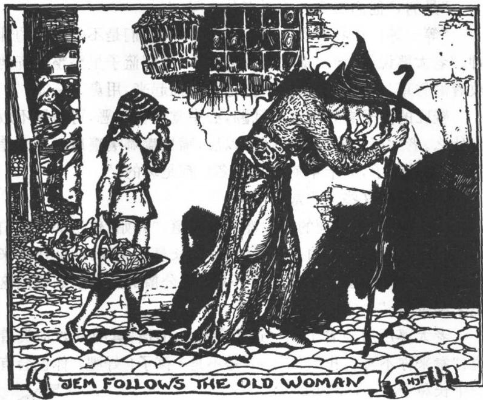

小孩不肯跟她走，他怕这个老太婆，哭起来。可是他的母亲一定要他去，她觉得不帮这么衰弱的老太婆的忙，是不应该的。所以杰姆边哭边把卷心菜放进篮子，跟着老太婆走出市场。

他们走了半个多钟头，才在一间摇摇欲坠的小房子前停下。老太婆从口袋中拿出一根生锈的旧铁钩，伸进门上的一个小洞里，门像弹簧似的，立即打开。

走进房间，杰姆非常吃惊，里面的摆设非常豪华。墙板和天花板都铺着大理石。乌木家具上镶着黄金和许多贵重的宝石。地板像是非常光滑的玻璃，小家伙不止摔过一次。

老太婆拿出一个银哨子吹起来。房子里响起了阵阵哨子声。一群豚鼠立刻从楼上奔下来。看到这些豚鼠，杰姆觉得很奇怪，因为它们都用后腿站立起来奔走，脚上还穿着用胡桃壳做成的鞋子，身上穿着人的衣服，头上戴着最时髦的帽子。

“我的拖鞋在哪里！你们这些懒家伙！”老太婆用拐杖敲打着地板，“我要站在这里等多久？”

那些豚鼠又急忙奔上楼，拿下来一双有皮边的椰子壳拖鞋。老太婆把双脚伸进去，那副走起路来跌跌撞撞的样子不见了。她把手中的拐杖扔掉，拖着杰姆很快地走过玻璃地板，来到一个房间。这个房间看起来像厨房，里面有许多锅子，碗碟。那些桌子都是红木做的。沙发和椅子上都铺着最昂贵的材料。

“坐下来，”老太婆高兴地说着，把杰姆推到沙发的一头，搬来一张小台子放在他面前，“坐下！你拎着那么重的东西，走了那么长的路，我要给你一些报酬。等一会，我给你喝一些非常好吃的汤，你一辈子也不会忘记。”

说完，她又吹了一下哨子。那些穿衣服的豚鼠走进来，身上围着大围裙，腰带上插着刀叉、勺子等餐具。跟着它们的后面，又走出来一些松鼠。它们也用后腿站立走路，穿着宽松的土耳其裤子，头上戴着绿色的小天鹅绒帽子。它们看来都是厨房帮手，不停地走来走去，在墙上爬上爬下，拿来锅子、盘子、鸡蛋、面粉、奶油、香草，送到炉前。老太婆在炉子前忙碌着。杰姆看得出，她在为他烧什么特别的东西。锅里的汤终于滚了，她端起来倒在一个银碗里，端到杰姆的面前。

“我的孩子，”她说，“把这碗汤喝了，你就会得到许多好东西，你还会成为一个出色的厨师。可惜那些真正的香草你们永远也找不到，你母亲的篮子里为什么没有这种香草呢？”

杰姆听不懂她在说什么，可是他也明白这些汤味道非常好。他妈妈常常给他好吃的东西，可远远比不上这碗汤。香草和作料的香味四处飘溢，喝起来又浓又鲜，非常可口。

杰姆把汤喝完以后，那些豚鼠点起了一把阿拉伯香。房间里慢慢地充满了蓝色的烟雾，这些烟雾越来越浓，几乎把他熏倒。他没有忘记要回到妈妈那里去，他想站起来，却睡眼蒙胧地倒下。后来，终于在沙发上睡着了。

他做了许多奇怪的梦。他梦到老太婆脱光了他的衣服，用松鼠的皮把他包起来。他和许多松鼠和豚鼠在一起，伺候老太婆。它们是那么快活，那么充满人情味。开始，他学会用油来擦干净她的椰子壳鞋子。后来，他又学会了捉那些小飞蛾，把它们弄成粉末，用这些粉末做成柔软的面包，给没有牙齿的老太婆吃。

就这样，他给老太婆当佣人，岗位换了一个又一个，每个岗位都做一年。四年以后，他提升进了厨房。在厨房里，他从最底层的厨房帮手做起，后来做首席糕饼师傅，最后成为一个十全十美的厨师。所有最难烧的菜都难不倒他，他会做二百多种不同的点心，用不同的香草做出不同味道鲜美的汤。他学得又快又好。

杰姆给老太婆干了七年以后，有一天，老太婆准备出去，她吩咐杰姆杀一只鸡，用香草拌好，在她回来之前烤好。他规规矩矩地照她的话去做，把鸡杀了，在开水里烫过，小心地拔掉每一根毛，用作料把鸡皮擦得又光又嫩。

完了以后，他来到贮藏室想取些香草，看到有一个橱半开着，这个橱他以前好像没有见过。他把头伸进去看，里面有许多篮子，篮子中散发出一种强烈的，令人陶醉的芬芳。他打开一个篮子，看到里面有一种非常罕见的香草。它的茎和叶子是蓝绿色的，上面有一朵小花，中间是明亮的深红色，四边是黄色。他看着这朵花、闻了一闻，觉得有一股强烈的香味，和七年前老太婆做给他吃的汤气味一样。这种气味那么强烈，他开始打起喷嚏来，几次以后，他醒过来了！

他发现自己躺在老太婆的沙发上。他吃惊地凝视着周围，“我做了一个多么奇怪的梦。”他想，“可是，我敢发誓，我曾经是一只松鼠，和那些豚鼠做伴，还成了一个了不起的厨师。要是把这些告诉妈妈，她会笑成什么样呵！可是她会骂我吗？我不在市场帮忙，却在这所奇怪的房子里睡觉。”

他跳起来，准备走了。他感到四肢是那样僵硬和麻木，可能是因为睡得太久的缘故。特别是头颈，转动起来很费劲。他走起路来，有点昏沉沉的样子，鼻子不是碰到墙壁就是橱柜。对于自己这种笨手笨脚的样子，他也觉得好笑。那些松鼠和豚鼠都围着他呜咽地叫嚷着，好像它们也想出去。到门口的时候，他请求它们一起走。可是它们转身，很快地跑回到屋子里去了。

这里离城里的大路很远，杰姆不认识这些狭窄的街道，这些小道弯弯曲曲。马路旁围着一群一群的人，他们情绪激动，好像是在看什么展出似的。从他们说的那些话中，杰姆想，他们要去看一个矮子。他们说：“快看这个丑矮子！”“他的鼻子多么长！头就种在肩膀上，那双棕色的手多么难看！”

他要不是急急忙忙想回到妈妈那里去，他也会去看的，他喜欢看巨人、矮子这一类展出。

他来到市场，觉得很迷惘。妈妈坐在那里，篮子里还有许多水果。所以他想，他没有睡多久。不过，他感觉得出，她很忧伤，没有招呼过路的人来买东西，只是用手托着头坐在那里。他走近了，看到她的脸比平常苍白。

他不知道该怎么办才好。后来，他走到妈妈的背后，把手放在她的肩上，说：“妈妈，怎么啦！是不是生我的气了？”

她很快地转过身来，惊叫着跳起来。

“你想干什么？你这可怕的矮子！”她喊叫着，“走开！我受不了你这种恶作剧！”

“可是，亲爱的妈妈，你到底怎么啦？”杰姆重复着，“我有什么不对啊？为什么把你的儿子赶走？”

“我已经说过了，快走开！”她十分生气，“你这畸形的怪物，别想要什么花招来骗我，从我这里你什么也得不到！”

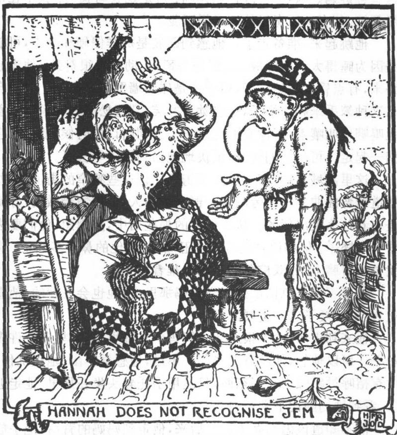

“啊！亲爱的妈妈！你肯定是神经错乱了。”杰姆喃喃地说着，“我该怎样把你带回家？亲爱的妈妈，请你仔细地看看我，你认不出我是你的儿子杰姆吗？”

“天哪！你们看到过这样厚颜无耻的人吗？”她转过身来对旁边的人说，“看看这个吓人的矮子吧！他竟然对我说，他是我的儿子杰姆，你们相信吗？”

市场里的妇女都围过来，她们议论纷纷，用最厉害的话来骂杰姆，说这样来和汉纳夫人开玩笑，实在是太无耻了。她永远也不能抹去失去可爱的儿子的悲痛，七年前，他被人从她身边骗走了。那些妇女还说，要是他不立刻走开，她们就扑过来把他撕成碎片。

可怜的杰姆弄不明白是怎么回事。他敢肯定，就在今天早上，他和妈妈一起来到市场，一起摆好摊位，再到老太婆的家里去。在那里，他喝了一些汤，睡了一会，做了一个奇怪的梦，现在回来了。可是他们都说，他已经失踪了七年，而且说他是个可怕的矮子！到底发生了什么事情？他看到妈妈完全无动于衷，就流着眼泪转身走了，痛苦地去找他的父亲。

“我要看看他是否认得出我！”他想，“我先站在门口和他说话。”

他来到鞋铺前，站在门口往里看。父亲正忙着干活，好一阵子没有注意杰姆。等他偶然抬起头，看到来客时，手中的鞋子和针线都掉到地下，害怕地喊叫起来：“我的天啊！这是什么？”

“你好！师傅！”杰姆说着，跨进来，“生意怎么样？”

“很不好！小先生。”父亲回答，杰姆非常吃惊，他一点也认不出自己。“生意不怎么样，我很孤独，越来越老，做个工人太吃力了。”父亲继续说。

“你不是有个儿子吗？他可以学你的手艺啊！”杰姆问。

“我是有个儿子，他叫杰姆。他要是还在，就是个二十岁的健壮小伙子了，可以帮忙了。他十二岁的时候，就很机灵，学会了干许多活，人也长得很好看，讨人喜欢。他也很会招徕顾客。唉！世事就是这样！”

“那么，你的儿子到哪里去了呢？”杰姆问，声音在发抖。

“天知道！”父亲回答，“七年前，他被人从市场上骗走了，到今天一直没有消息。”

“七年前！”杰姆害怕地喊起来。

“是的，七年以前，虽然回想起来，好像是昨天发生的事情。

我妻子哭喊着回来，说孩子一整天没有回来。我曾经想到和说起过，这种事情可能会发生。杰姆是个漂亮的小男孩，人人都喜欢他。我妻子为他而骄傲，常常叫他给有钱人家送菜，人家也很宠爱他。我对妻子说，‘要当心，城市那么大，有许多坏人，要看好杰姆。’可是，事情还是发生了。有一天，一个老太婆来买许多东西，多得她拿不动。我妻子是个善良的人，就叫儿子给她送去。从此以后就再也见不到他了！”

“你说这是七年以前发生的事情？”

“是的，七年以前，我们哭着挨家挨户去找他。许多人认识这个可爱的男孩，很喜欢他。可是没有用，而且谁也没见过这个来买菜的老太婆。只有一个上了年纪，约有九十岁的老太太说，那可能是赫贝丽娜仙女，她每隔五十年来城里一次，买些东西。”

听了他父亲的话，杰姆的心里明白了。看来那不是一个梦，他确实是变成了一只松鼠，为老太婆干了七年。想到这里，他心中非常愤怒。七年的青春被断送了，他得到了什么呢？学会了擦椰子壳鞋子！擦玻璃地板！让那些豚鼠教他烹调！他站在那里想着，直到听到父亲叫他。

“我能为你做些什么吗？年轻的先生！是不是可以给你做双鞋？也许，可以给你的鼻子做个套子？”他说着，笑起来。

“你能为我的鼻子做什么？”杰姆问，“我干吗要给它做个套子？”

“嗯！人人都有自己的嗜好。”父亲回答，“我要是有你这样一个鼻子，我就会做一个好的红皮套把它遮起来。我这里有一块好皮料，能很好地保护你的鼻子。我想，你的鼻子肯定会经常碰到东西。”

杰姆害怕得几乎昏过去。他感觉得到自己的鼻子，它又肥又大，足足有两个手指那么长。看来，那个老太婆把他的形状彻底改变了，怪不得妈妈不认识他了，称他是可怕的矮子。

“师傅！”他说，“你有没有镜子，借给我看一看。”

“年轻人！”父亲回答，“你的相貌不值得自我欣赏，没有必要浪费时间去照镜子。而且，我也没有镜子。你一定要照的话，最好去找理发师。理发店离这里不远，他会借给你的，再见吧！”

说完，他有礼貌地把杰姆推出去，把门关上，继续干自己的活。

杰姆知道那个理发店，他穿过马路来到店里。

“你好！理发师！”他说，“我能用你的镜子照一照吗？”

“非常乐意！”理发师笑着说，店里所有的人也都笑出声来，“你是个漂亮的小伙子，长着天鹅般的头颈，一双洁白的手，一个小巧玲珑的鼻子。不用说，你相当自负，你爱照多久就照多久吧！”

理发师说着，店里响起一阵嗤嗤的笑声。杰姆走到镜子前，看着自己的模样，泪水刷刷地流下来。

“怪不得你认不出自己的孩子了，亲爱的妈妈！”他想，“以前，你为他自豪的时候，他完全不是这个样子。”

眼睛那么小，像是豚鼠的一样；巨大的鼻子一直垂到下巴；头颈完全没有了，头直接地落在肩上。他还是七年前那么高，那时他刚过十二岁。可是身体却长宽了，胸部和背部像口袋般地隆起。腿又小又细，手臂却像健康的大人似的，又大又长的手掌上长着皮包骨头的手指。

他想起了那天早上第一次见到老太婆时的情景，想起她那些威胁的话。他一句话也不说，走出了理发店。

他决定回到妈妈那里去，看到她还在市场里。他请求妈妈耐心地听他讲完。他说起老太婆把他带走时候的情形；说起小时候的许多事；告诉她，坏仙女如何对他施魔法，让他为她整整干了七年活。

母亲不知道该怎么办才好！故事讲得那么真实。可眼前这个丑矮子就是她那漂亮的儿子，却怎么也不能让她相信。后来，她决定把他带回家，去问问她的丈夫，该怎么办。她收起那些篮子，叫杰姆跟着她，直接来到丈夫的鞋店。

“你看，”她说，“这个人说，他是我们丢失的儿子。他告诉我，七年前他如何被骗走，中了仙女的魔法。”

“是吗？”鞋匠生气地打断她的话，“他这样对你说！等一下，你这个恶棍。一个钟头之前，我刚刚对他说了这些，他就去骗你。你是我中了魔法的儿子，等着瞧吧！看我怎样给你施魔法！”

说着，他抓起一捆皮带，用力抽打杰姆。杰姆哭着逃走了。

可怜的小矮人整天流浪街头，没有吃的，也没有喝的。晚上，他只好到教堂的阶梯上去睡觉。黎明的第一道曙光把他唤醒，他开始考虑，往后该怎么样过日子。他突然想起，自己是一个多么出色的厨师，决定去找一份这样的工作。

天亮以后，他动身到君主的王宫去。他以前听说过，统治这个国家的君主很喜欢好的东西。

他来到王宫以后，所有的仆人都围着他，拿他开玩笑。他们的笑声和喊声那么响亮，惊动了大总管。他跑出来喊道：“天哪！你们能不能安静一些，君主还在睡，你们难道不明白？”

听到他的喊声，一些仆人立刻就离开，还有一些指着杰姆。大总管看到杰姆长得那么滑稽，也差一点忍不住要笑出来。不过，他还是把那些仆人赶走，把杰姆领进自己的房间。

他知道杰姆的来意以后，说：“你搞错了吧！我的孩子！我想你是想当大君主的小矮人吧！是吗？”

“不！先生！”杰姆说，“我是个出色的厨师。要是你能好心地把我领到大厨师那里去，你会看到我有些用处。”

“好吧！我同意！不过，请相信我，你要是肯当君主的小矮人，那肯定舒服得多。”

大总管把他领到大厨师的房间。

“先生，”杰姆说，他鞠了一躬，鼻子差一点碰到地板，“你们需不需要一个出色的厨师？”

大厨师从头到脚把他看了一遍，笑出声来，说：“你是一个厨师？你想我们的炉灶有那么低吗？你能看到锅里在烧什么东西吗？哎！我亲爱的小家伙，那些把你送到这里来的人，只是想和你开个玩笑。”

可是小矮人不是那么轻而易举就能拒绝的。“在这么大的厨房里，用掉一两个鸡蛋，或者一些奶油，一些面粉，一些调料有什么关系？”他说，“说出你想要烧的菜，把我要的作料给我拿来，你等着瞧就是了。”

他又说了好多话，终于说服了大厨师，让他试一试。

他们来到厨房。这里真大，起码有二十个炉子在不停地烧着。水槽里的水不停地流动着，里面游着许多活鱼。一切设备和用具都是最好最漂亮的。一大群厨师和帮手在忙碌地烧着。

大厨师领着杰姆走进来，所有的人都站立起来。

“午饭大君主点了什么菜？”大厨师问。

“先生，尊敬的君主点了丹麦汤和汉堡点心。”

“好的，”大厨师说，“你听到了吗？你会做这道菜吗？当然不是说汉堡点心，那是一个秘方。”

“就这些！”杰姆说，他经常做这两道菜，“再没有比这更容易的了。给我一些鸡蛋，一块野猪肉，这种和那种的菜，还有香菜来做汤。至于那个汉堡点心，”他低声地对大厨师说，“我要四种不同的肉，一些酒，鸭的骨髓，一些生姜，还有一种香草。”

“嗨！”大厨师惊奇地说，“你是从哪里学来的？这些正是做这两道菜的料。可是这种香草我们从来没有用过，肯定会更好吃！”

现在，杰姆可以露一手了。他够不上锅台，不过，用一块大木板搁在两张凳子上，他就得心应手了。所有的厨师都围着他看着，无不称赞他那准确而利索的操作。

一切都准备好以后，他吩咐把菜放入锅里烧，然后开始数“一、二、三……”数到五百，他喊道：“好了！”用两个盘子把菜盛起来，请大厨师尝一尝。

一级厨师拿来一个金调羹，洗过以后擦干净，请大厨师试一试。大厨师神情严肃地走过来，尝了一口，咂咂嘴巴说：“第一流的，好极了！你肯定是这门手艺的行家，小家伙，那种香草起了一种特别的作用，美味都出来了。”

他正说着，君主的仆人进来说，君主要吃午饭了。于是，他们赶紧用银盘把菜送上去。

大厨师把杰姆带进自己的房间，还来不及问他问题，就有人进来说，君主要大厨师马上去见他。大厨师赶紧穿上最好的衣服，跟着传讯的人出去。

大君主看上去非常高兴。他把送来的午饭吃得一干二净。大厨师进来时，他正在揩嘴巴。“今天的午饭是谁烧的？”君主问，“我知道，你做的点心总是非常好的，可是没有想到，今天会吃到味道更好的，是谁做的？”

“这真是个离奇的故事，我的至高无上的君主。”大厨师说，接着把事情的经过全部告诉他。君主听了，也十分惊讶，他立即派人把杰姆叫来，问了他许多问题。当然，杰姆没有告诉他，自己曾变成一只松鼠。他说，他没有父母，是一个老太婆教会他烧菜的。

“你要是愿意给我留下来，”大君主说，“你每年可以得到五十块金币，此外还有一件新大衣，几条裤子。你要亲自给我烧饭，帮我制订菜谱。我将任命你为助理大厨师。”

杰姆向君主磕头称谢，头一直磕到地板。他保证事事听从新主人的吩咐。

他一分钟也不耽搁，马上来厨房工作。厨房里人人都欢迎他的到来。因为君主是个脾气暴躁的人，要是送上去的东西不合他的胃口，他就会把盘子和碗碟朝厨师和仆人身上扔。自从杰姆来了以后，一切都变了。君主从来没有抱怨过半句。他下令一天吃五顿饭，而不是三顿，人也一天比一天胖。

就这样，杰姆在王宫里过了两年，深受大家的器重和尊敬。只是在想到父母的时候，他才感到伤心。一天又一天就这样过去了，直到发生以下的事情。

杰姆总是尽可能地自己上市场，买些家禽和水果。有一天上午，他来到鹅市场，想挑一些肥鹅。现在，谁也不会取笑他的相貌了。人人都知道，他是大君主的御用厨师。那些卖鹅的女人看到他走过来，都会觉得非常荣幸。

他注意到，有一个卖鹅的女人单独坐在一处，不像别人那样吆喝着自己的鹅如何好。他走过去，拎起她的鹅试试份量，觉得很满意，就买了三只装进笼子，把笼子放到宽肩膀上，动身回去。

一路上，他看到两只鹅像以前买来的鹅一样，在笼子里又跳又叫。有一只鹅一动也不动地站着，不时会深深地叹一口气，像人一样。“这只鹅病了，”杰姆说，“回去以后要快点把它杀掉。”

可是那只鹅像是听到了，用人的话回答他：

> “捏得太紧了，
> 我就咬你；
> 把我杀了，
> 我就送你进棺材。”

杰姆非常害怕，赶紧把笼子放下。那只鹅用非常聪明却很悲伤的眼睛看着他，又叹了一口气。

“天哪！”杰姆说，“原来你会说话，鹅小姐！我压根儿没有想到！好了，别担心，我知道该怎样去对待一只罕见的动物，不会伤害你。不过，我敢肯定，你并不是生下来就是这个样子。我自己不就曾经是一只松鼠吗？”

“你说对了！”鹅说，“我生下来不是这个可怕的样子。哎！谁会想到米米，伟大的韦瑟波特的女儿，会被杀掉，端上君主的饭桌呢？”

“请放心！米米小姐，”杰姆安慰她说，“我是一个诚实的人，又是君主的助理大厨师，不会有人来伤害你的。我要在自己的房间里给你做一个笼子，每天给你好吃的。只要有时间，我会尽可能地回来和你说话。我会对其他厨师说，我用专门的食品把这只鹅养肥了，好给君主做一道很特别的菜。只要一有机会，我就把你放了。”

鹅听了他的话，流着眼泪谢了他。杰姆信守自己的承诺，把另外两只鹅杀了，在自己的房间里做了一个鹅舍，让米米住下，说是要亲自把它养肥。

空闲的时间，杰姆就来和米米说话，安慰她，喂她吃最好的东西。他们互相给对方讲述自己的故事。杰姆知道，米米是巫师韦瑟波特的女儿，住在哥得兰岛。她父亲和一个老仙女闹翻了，仙女用阴谋和诡计打赢了他。为了报复，还把他的女儿变成一只鹅，把她带到这个遥远的地方来。

听了杰姆的故事以后，米米说：“这种事情我也知道一些。听你这么一说，好像是中了一种香草的魔法。也就是说，只要你能找到这种香草，把你从梦中唤醒的香草，这个魔法就会解除。”

这只能给杰姆带来一点点安慰，因为他不知道到哪里去，才能找到这种香草。

就在这个时候，大君主来了一个客人，一个邻国的王子，君主的朋友。君主派人把杰姆叫来，对他说：“现在是你大显身手的时候了。来看我的王子吃得比谁都好，当然我除外。他可以称得上是个大美食家。他在这里一天，你做出来的饭菜就要让他吃惊一天，不要让他吃到同样的一道菜，免得让我失望。你想什么就去买什么。就是要把黄金和宝石熔化进去，也不要犹豫。我宁愿倾家荡产，也不情愿让他取笑。”

杰姆鞠躬回答：“尊敬的君主，我听从你的吩咐，尽最大的力量去让你和王子高兴。”

从这一天起，杰姆整天在厨房里忙个不停，那些帮手也围着他打转。各色各样的美味佳肴不停地向君主和王子面前送去。

王子在君主这里一住就是十四天，吃得非常满意。他们一天吃五顿。君主有理由为杰姆的手艺感到骄傲，因为他看到，客人是多么高兴。

到了第十五天，君主把杰姆叫来，介绍给王子。

“你是一个很了不起的厨师。”王子说，“你肯定会做许多好菜，我在这里没有一个菜重复过，都那么令人赞叹不已。不过，请告诉我，你为什么不做点心的王后——苏珊雷娜点心？”

杰姆惊骇万分，因为他从来没有听说过这个点心的王后。不过，他故作镇静地说：“我在等待着，希望你的来访能持续一段时间。我想在你走之前，用这个真正的王宫点心来祝贺你来访成功。”

“真是的，”大君主笑着说，“那么，我想，你是要等到我临死前的一天，才用这个点心来伺候我了？你从来没有把这个点心送上来过。不过，你得去另外准备欢送的佳肴，这道点心明天就得给我送上来。”

“是！只要你至高无上的君主高兴，我一定照办。”杰姆说完就走出去了。

可是杰姆一点也不高兴，丢脸的时刻似乎就要到了，因为他完全不知道怎样做这道点心。他垂头丧气地回到家里，那副失魂落魄的样子被米米看见了，就走过来问他是怎么回事。杰姆告诉她以后，她说：

“高兴些！我的朋友！这道点心我知道得很清楚，我在家的时候经常吃，我知道该怎么做。”接着，她告诉杰姆该用什么料，怎么做。最后还说：“我想这就差不多了，要是漏了什么细节，他们也不会觉察。”

第二天，一道用花装饰着的大点心送上来了，杰姆穿上最好看的衣服来到餐厅。他进来的时候，仆人正在把点心切开，给君主和客人送上。大君主吃了一大口，立刻眉飞色舞，赞不绝口。

“啊！这真是可以称得上点心王后了；我的矮子也可以叫做厨师国王了。你不这样认为吗？亲爱的朋友！”

王子吃了几小口，仔细地品尝着，然后带着一种几分神秘和几分嘲弄的微笑说：“这道点心是做得非常出色，可是这个苏珊雷娜并不完整，正像我意料之中的那样。”

大君主立刻大发雷霆：“你这条烧饭的狗，竟敢这样来对待我，我要惩罚你，把你的大脑袋劈掉！”

“不要这样，请大发慈悲吧！至高无上的君主。我按照最正规的方法来做这道点心，没有一样作料遗漏。请问一下王子，还应该放些什么？”

王子笑了，说：“我早就知道，这道点心你不可能做得像我的厨师那样好，我的长鼻子朋友。告诉你吧！还需要一种叫做美味的香草。这种香草在你们国家无人知道，它能给这道点心增加一种特别的风味。没有这种风味，你的主人就不可能十全十美地享受这种点心。”

大君主听了这些话，更是火冒三丈，大叫起来：“可是，我一定要十全十美地享受它。明天，不是这道点心十全十美地送上来，就是你这个恶棍的人头落地。去吧！坏蛋，我给你二十四小时去准备！”

可怜的小矮人急急忙忙地逃回自己的房间，把心中的悲伤向米米诉说。

“嗨！就这么点小事！”她说，“我可以帮助你，我爸爸教过我如何去识别所有的植物和香草。幸运的是，现在正好是新月上来，这种香草只有在这个时候长出。不过，请告诉我，王宫附近有没有栗树？”

“有！”杰姆如释重负地说，“离湖边不远，从王宫出去大约有二百码的地方有许多栗树，可你问这个干什么？”

“因为美味香草只生长在栗树根旁。”米米说，“让我们抓紧时间去找！把我抱起来，出了门再把我放下，我会找到它的。”

他把米米抱起来，到了花园再把她放下。米米摇摇摆摆地拼命向湖边奔去。杰姆满腹忧愁地在后面紧跟着，他心中明白，他的生命完全取决于她能否成功。

鹅在栗树根旁寻找着，用嘴拨弄着每一棵草，可是过了好一会，还是什么也没有发现。天倒快亮了。

杰姆突然看到，湖的对岸有一棵古老的栗树，孤零零地站在那里。“看！”他说，“让我们到那边去碰碰运气！”

鹅拍动着翅膀，连奔带跳地跑在前面。杰姆迈开他的小腿，尽力地在后面跟着。大树在地下投入一片很大的阴影，阴影里几乎什么也看不见。可是鹅突然站着不动了，高兴地拍动着翅膀，好像在拔着什么。她对吃惊的朋友说，“这就是美味香草，这里长着许多，你用不着发愁了。”

杰姆站在那里凝视着这种植物，它散发出一种强烈的香味。使他回忆起中老太婆魔法的那一天。这种香草的茎和叶子都是蓝绿色的，上面长着一朵黑色和深红色的花，花边是黄色的。

“好奇怪啊！”杰姆说，“我敢肯定，这就是那种把我从松鼠变成现在这种悲惨形状的香草。我是不是应该再试一试？”

“别忙！”鹅说，“挑一把好的香草带回去，先回到你的房间去，把你所有的钱和衣服都收拢好，再来尝试香草的魔力。”

他们回到杰姆的房间，把那些金币，还有衣服、鞋子都整理好，捆成一个包裹。然后，他把头埋入这堆香草中，吸着它们的香味。

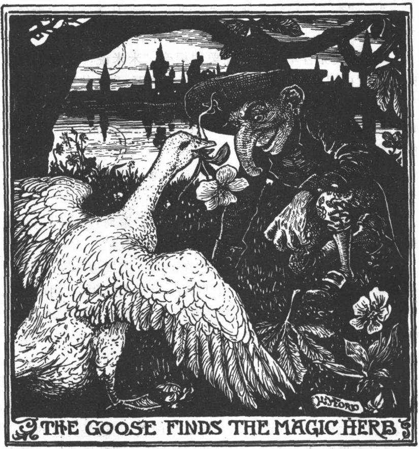

吸着，吸着，他的四肢像在嘎嘎地伸长，头在从肩膀上向上长。他低下头来看鼻子，看到它在不停地缩小，原来鼓起来的胸和背也越来越平坦，人也在不停地长高。

鹅吃惊地看着他，说：“啊！你长得那么魁梧，那么英俊！感谢上帝！你完全变了个样！”

杰姆心中充满了感激和快乐，他合拢着手表达深深的谢意，欢乐之中，他没有忘记这一切都归功于他的好朋友米米。

“是你把我从魔法中解救出来，给了我新的生命。”他说，“没有你，我不可能恢复这个原来的形状，也许头也被杀掉了。我现在要把你带回你父亲那里去，他肯定知道该如何帮你解除魔法。”

鹅高兴地接受了他的帮助。他们想办法瞒过卫兵，悄悄地逃出王宫，一帆风顺地来到米米的家乡。巫师帮他的女儿解除了魔法，由衷地感谢杰姆，还送给他许多贵重的礼物。

杰姆又急急忙忙地赶回自己的家中。这一回，父母都非常高兴地承认，这位英俊的青年就是他们失去的儿子。他把巫师送给他的许多钱开了一家店铺，生意做得非常好，从此幸福地过着太平的日子。

不过，我还得告诉你杰姆失踪以后王宫里发生的事情。那天天一亮，大君主下令，要是小矮人找不到美味香草，就把他的头砍掉。可是到处都找不到小矮人。王子冷嘲热讽地说，是君主食言，放他的厨师逃走的。两人因此吵得不可开交，最后爆发了一场战争，历史上叫做“香草战争”。双方经过许多次交锋，损失了数不清的人马和财富以后，终于讲和。这次和平被称为“点心和平”，因为王子在庆祝达成和平协议的宴会上，叫他的厨师送上来了点心王后——苏珊雷娜点心。大君主吃了以后称赞好极了！

## 吃人的努达

从前有一个国王，他非常喜欢自己的花园，在里面种着许多世界各地的树木和花草。他每天要到花园里去看三次：第一次是早上起床以后七点钟；第二次是下午三点钟；第三次是下午五点半。每次来花园，他一草一木都要看过。不过，他在一棵枣子树下站立的时间最长。

国王有七个儿子。他对其中六个感到骄傲，因为他们身强体壮，充满了男子气概。他不喜欢小儿子，他整天和那些女人待在一起。国王找他谈过话，他毫不在意；国王打他，他也毫不在意；国王把他捆起来，他还是毫不在意。后来父亲也失去了耐心和信心，决定不管他了，让他我行我素。

有一天，国王在花园里高兴地看到，枣子树开始结果了。他告诉宰相：“我的枣子树结果了！”他告诉朝廷的官员：“我的枣子树结果了！”他还告诉城里的富人：“我的枣子树结果了！”

他耐心地等待着，枣子快成熟的时候，他把六个儿子叫来，说：“你们之中要有一个人去守着枣子树，等这些枣子成熟。要是没有人去看守，那些奴隶就会来偷，明年就没有枣子吃了。”

最大的儿子说：“父亲，我去看！”说完就走出去。

大儿子做的第一件事，是把他的奴隶叫来，叫他们在枣子树下整夜不停地敲鼓，因为他怕自己睡着了。那些奴隶敲着鼓，大儿子踏着鼓声不停地跳舞，这样一直坚持到凌晨四点钟。这时候天冷下来，他再也跳不动了。一个奴隶对他说：“天快亮了，不会出什么问题，主人，躺下来睡觉吧！”

于是，他躺下来睡着了，那些奴隶也一个接一个地睡着了。

几分钟以后，一只鸟从附近的丛林中飞过来，把树上的枣子全部吃光，然后又悄悄地飞走了。过了一会，一个奴隶醒过来，看了看枣子树，只见一个枣子也没有了。他急忙过来把大王子喊醒，对他说：“你父亲叫你来看守枣子树，可是你没有看住，枣子都被鸟吃光了。”

大王子赶紧爬起来，跑过去看，果然是一个枣子也找不到了。他大哭起来，说：“我该怎样去向父亲交代呢？说是枣子被人偷走了呢？还是被一场大风大雨刮掉了？要是说是大风大雨刮掉了，他肯定要我捡一些回去，可是现在一个也找不到。或者我应该说是一些流浪汉把我们赶走了，抢走了枣子。这样父亲会问，‘你有那么多奴隶，打不过他们吗？’看来最好还是讲真话。”

他来到王宫找父亲，看到父亲正坐在游廊里，五个弟弟站在他身边。大王子走过来向父亲磕头。

“花园里出了什么事？”国王问。

大王子说：“枣子都被鸟吃掉了，一个也不剩。”

国王沉默了一会，问：“鸟来的时候，你在哪里？”

大王子说：“我守着枣子树，直到鸡叫，天将拂晓，才躺下来，睡着了。醒过来的时候，看到一个奴隶站在我面前，对我说，‘树上一个枣子也没有了。’我赶紧跑到枣子树下，事情果然像他说的那样。我要对你说的就是这些。”

国王说：“像你这样的儿子，只会吃饭和睡觉，真是没有用，走吧！等枣子再长出来以后，我再派另一个儿子去，也许他会干得更好些。”

国王又等待了好久，枣子树才开始再次结果。这一次，树上结满了密密麻麻的枣子，比任何枣子树结的果都多。它们快要熟透的时候，国王又派一个儿子到花园里去，对他说：“我的儿子，我很想吃到这些枣子，去看守着，明天太阳出来的时候，它们就可以摘下来了。”

王子说：“父亲，我现在就去。明天早上七点以后，叫一个奴隶来摘枣子。”

“好的。”国王说。

王子来到枣子树下，躺下来睡觉。半夜里，他醒过来，看到树上的枣子又肥又大，在微风下轻轻地摆动着。

“我父亲可以用这些枣子来开宴席了！”他想，“我哥哥真笨，他干吗不小心些！现在，他是失宠了，谁也不知道他到哪里去了。我要守在这里，看看是什么鸟会来！”

他坐在树下，点起灯来读书，直到鸡鸣。东方欲晓，他抬头看见，枣子还在树上。“现在，这些枣子不会再丢了，我父亲肯定吃得到了，让我坐得再舒服一些。”

他靠着树干躺下，不一会就睡着了。那只鸟飞来，把树上的枣子全吃光。

太阳出来了，一个花园领班过来，看到树上一个枣子也没有了。他把睡得正香的王子叫醒，对王子说：“你看看枣子树！”

王子抬起头来，吓得目瞪口呆，两腿发软，半晌说不出话来。花园领班看到他这个样子，也急坏了，说：“我的主人，你怎么啦？”

王子说：“我全身好好的，却像生过一场大病一样，浑身颤抖着。我该怎么对父亲说呢，昨天我还告诉他，明天七点钟，他就可以尝到枣子了。我现在害怕极了，他会把我赶走的，就像赶走我哥哥一样！我还是自己先走吧！免得等他来赶我。”

王子说完，就匆忙上路。可是没有走多远，就碰上国王派来摘枣子的人。他手中托着一个大银盘，盘里还有一块大白布，准备用来盖枣子。王子对他说：“枣子还没有熟，你明天再来吧！”

来摘枣子的人叫王子跟他一起回到王宫，国王正坐在那里等着，身边还有四个儿子。

“向你致敬，我的父亲！”王子说。

国王问：“你见到我派去摘枣子的人了吗？”

“是的，我见到了，可是枣子还没有熟。”王子说。

可是国王不相信他的话，说：“就是因为你们，我已经两年没有吃到枣子了。走吧！你再也不是我的儿子了！”

国王看着留在身边的四个儿子，答应谁能够让他吃上这棵树上的枣子，就给谁丰厚的报酬。

可是一年又一年过去了，他还是没有吃到一颗枣子。有个儿子想整夜玩牌，免得睡着了；有个儿子骑着马绕枣子树跑，想这样总能看得住；最后国王把两个儿子同时派去，他们燃起了一堆篝火。然而一切都是徒劳的，结果都一样，天快亮的时候，他们都睡着了，鸟飞来把枣子吃光。

到了第六年，枣树上的枣子长得比以往任何一年都多，都好。花园领班来到王宫，把这些对国王说了。可是国王摇摇头，伤心地说：“这与我又有什么相干？我有七个儿子，可是一连五年，鸟把枣子吃得精光。这一年也不会有什么好结果。”

这时候，最小的儿子和往日一样，正坐在厨房里。听到父亲的话，他来到父亲面前，跪下来对父亲说：“父亲，今年你会吃到枣子的。我要亲自去看守枣树。”

他父亲和母亲听了他的话，只是哈哈大笑。

这一天，有人来对国王说，树上的枣子熟了。国王正准备派人去看守，小王子恰巧从这里经过，进来对国王说：“你干吗叫别人，而不叫自己的儿子去看守？”

国王说：“你六个哥哥去看守，都没有看住，你会成功吗？”

小王子说：“请你耐心些，让我去吧！明天你就会看到，我是不是把枣子带回来。”

“让他去吧！陛下。”王后说，“也许明天我们会吃到枣子；也许吃不到。不管怎么样，让他去试试。”

国王说：“我不是不肯让他去，只是打心底里觉得他靠不住。他的哥哥都说得那么好听，可结果怎么样？”

小王子恳求说：“父亲，只要明天我们还活着，你一定会吃到枣子。”

“那好吧！去吧！”国王说。

小王子来到花园，叫那些跟随他的奴隶都回家去睡觉。他们都走了以后，他也躺下来呼呼大睡。到深夜一点钟，他醒过来，对着枣子树坐着，从衣服中拿出一个玉米和一些粗燕麦粉。他不停地啃着玉米，觉得困的时候，就往嘴里塞一些粗燕麦粉。这样，天快亮的时候，他果然看到一只大鸟飞过来。

鸟开始没有看见他，还得意地自言自语：“这里没有人。”它径直向枣树飞去，伸出嘴来就想吃。小王子悄悄地爬上来，抓住它的翅膀。

大鸟一看不好，赶快展翅飞翔。小王子紧紧抓住它不放，大鸟直向云天飞去，那些大山变得越来越小。

“亚当的儿子，”大鸟说，“你要是掉下去，还没有着地之前就会死掉。我们还是分手吧！你走你的路，我飞我的道。”

可是小王子回答：“你摆脱不了我，你到哪里去，我就跟着到哪里去！”

“我没有吃你的枣子啊！”鸟坚持说，“天快亮了，让我走自己的路吧！”

小王子回答：“因为你偷走了我们的枣子，我父亲至今还恨我六个哥哥。今天，我父亲要见你；我的哥哥要见你；城里所有的人，不论大小，都要见你。我父亲会因此而非常高兴。”

“好吧！你要是不肯让我自己飞走，我就把你扔下去。”鸟说着，它越飞越高。后来地球变得像其他星星一样小。

“你要是从这里摔下去，会变成怎么样？”鸟问。

“就是死了，我也不会把你松开。”

鸟看到没有结果，就重新返回地球。

“你到家了，让我自己走吧！”鸟再次请求说，“或者我们可以做笔交易。”

“什么交易？”小王子问。

“你把我从火中救出，”鸟说，“我会把你从水中救出。”

“你怎么能办到呢？我怎样才能相信你呢？”

“从我尾巴上拔下一根羽毛，需要我的时候放在火上烧，我不论在哪里，都会赶来见你。”

王子答应说：“好吧！我同意，你走吧！”

“再见，我的朋友，你叫我的时候，即使我在海洋深处，我也会赶来。”

小王子看着鸟飞走，直到再也看不见，才来到枣树下。看到那些枣子，他心花怒放，觉得自己的眼睛比以前更明亮，浑身比以前更有劲。他高兴得哈哈大笑起来，说：“这是我的运气，我的。再见了，枣树，我要去睡觉了，不会有人再来吃你的枣子了。”

花园领班来察看枣子的时候，太阳已经升高了。他想，今年也会和前几年一样，只剩枣树，不见枣子。当他看到树上密密麻麻的枣子几乎把树叶都遮住时，他赶快跑回家，敲响了一面大鼓，直到所有的人，不论是大人还是小孩，都跑过来，看看到底发生了什么事情。

“领班，出了什么事？出了什么事？”他们问。

“啊！我们陛下的小儿子真是了不起，简直像一头狮子一样！这一回，陛下可以看到他的真本事了。”

“可这是怎么一回事？领班！”

“今天，我们都可以吃到枣子了！”

“是真的吗？领班！”

“当然是真的！不过，现在先别吵醒他，让他继续睡。我们回去，一人带一件礼物来。有米的带米；有鸡的带鸡；有羊的带羊。”

大家都照他的话去做，带着礼物，敲着鼓，来到小王子睡着了的树下，把他叫醒，抬着他向王宫走去。一边走，一边敲着鼓，吹着号角，拍着手，欢呼跳跃着，好不热闹。

国王听到那么吵闹的声音，走出来，看到奴隶们抬着一大箩一大箩的枣子，正向这边走过来，小王子兴高采烈地骑在他们的头上。国王不禁喜出望外，说：“今天，我终于能吃到枣子了。”他把王后叫来，让她也看看小儿子干得多么漂亮。

国王把小儿子叫到面前，问他：“你给我带来了什么消息？”

“消息？我没有什么消息。不过，要是你把嘴张开，你就会尝到枣子是什么味道。”他拿出来一个枣子，放进父亲的口中。

“啊！你真是我的好儿子！”国王说，“你不像那些傻瓜那样，他们是一群没用的废物。请告诉我，你是怎样对付那只鸟的，因为只有你，才看住了那只鸟，不让它把枣子吃掉。”

“是的，只有我看见它，阻止它。它再也不会来了，它将过着自己的生活，不再来干扰你，干扰你的孩子。”

“啊！我曾经有六个儿子，现在，我只有一个了。是你，我从前把你当傻瓜，给我送来了枣子。他们六个人，我再也不需要他们了。”

王后走进来对他说：“陛下，我恳求你，不要抛弃他们！”王后不停地哀求着，直到国王同意让他们回来。她爱六个哥哥，胜过爱小儿子。

国王一家人平安地过着日子。后来，国王的猫出去抓到一头小牛。小牛的主人来告诉国王。可是国王回答：“那只猫是我的，那头小牛也是我的。”那人不敢再说什么，就走了。

过了两天，那只猫又抓到一头母牛。母牛的主人来告诉国王。可是国王说：“那只猫是我的；那头母牛也是我的。”

过了几天，猫抓到一头驴子，主人对国王说：“陛下，猫抓走了一头驴子。”国王说：“那是我的猫，我的驴子！”

后来，猫又抓了一匹马，一头骆驼。有人来告诉国王，国王说：“你们不喜欢这只猫，想叫我把它杀掉，可是我不！让它吃骆驼，吃人我也不管。”

第二天，猫真的抓了一个小孩。有人跑来告诉国王：“猫抓了一个小孩。”国王还是说：“猫是我的，小孩也是我的。”

后来，猫开始抓大人了。它离开城市，来到大路旁的丛林中住下，要是有牛从这里经过，它就把牛吃掉；有羊经过，它就把羊吃掉；更可怕的是，有人经过，它也要把人吃掉。

老百姓害怕极了，把猫叫做“吃人的努达”。他们一起来找国王，告诉他那只猫的罪恶行径。可是国王还是像从前那样说：“猫是我的，人也是我的。”这样一来，谁也不敢去把猫杀死，它的胆子越来越大，后来竟然大白天也到城里来捕食。

有一天，国王对他的六个儿子说：“我要到乡下去走一走，看看麦子长得怎么样，你们和我一起去。”

他们兴高采烈地在路上走着，来到了那片丛林旁。那只猫跳出来，一下子就咬死了国王三个儿子。

“就是这只猫！就是这只猫！”那些跟随国王出来的士兵喊叫起来。这一回，国王说：“去搜查它，把它杀了。它已经不是猫，而是恶魔！”

士兵们说：“陛下！我们不是把这只猫的所做所为对你说了吗？你不是说，‘那是我的猫，我的人。’吗？”

国王回答：“是的，我是这样说过。”

再说小王子这次没有跟父亲出去，留在家里陪母亲。听到哥哥被猫咬死以后，他对母亲说：“让我去看看，说不定它以后也会把我咬死。”母亲请求他留在自己的身边，他不听，拿起剑和长矛，带上一些粮食，就上山去追踪那只猫。这时候，它已经跑得很远了。

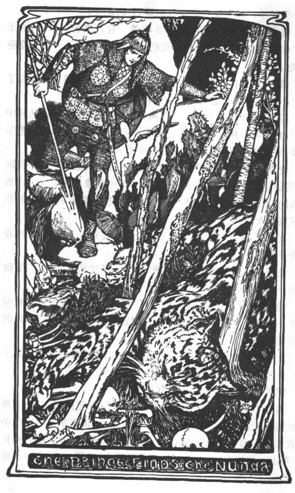

小王子一连许多天，在丛林中寻找“吃人的努达”。尽管经常可以看到被它咬死和吃过的动物尸体，可是这只猫却怎么也找不到。小王子从不害怕任何野兽，毫不气馁地继续搜寻。国王和王后都派人来叫他回去，他说：“我说过的事情就一定要做到，决不后退，就是死了也毫不吝惜，我要继续寻找吃人的努达，把它杀了，一天也不能停留。”

国王怕他出事，答应只要他回来，什么都可以给他，连王位也准备让他继承，可是小王子的决心丝毫没有动摇。

有许多次，那些随从跑来告诉他，发现了努达的脚印，可结果都是一场空。他们不停地向远方搜寻，穿过丛林，越过荒野，后来来到一座大山脚下。王子心中似乎感觉到，今天肯定会找到吃人的努达。

他们爬上山顶，向山下四处张望。突然，一个奴隶喊道：“王子，你看那边山脚下！”

王子向他指的方向看去，看到山脚下躺着一只像小老虎似的猫，小耳朵，宽肩膀，身上的斑斑点点像香猫一样。一切都像人们所说的那样，它肯定就是吃人的努达。

他们带着长矛悄悄地爬过去，靠近以后，王子做了个手势，大家一起把手中的长矛投过去，吃人的努达就这样在梦中送了命。

国王听到小儿子杀死了那只猫，凯旋而归的消息，高兴得手舞足蹈。城里的人纷纷出来，跪在大路两旁欢迎小王子，他们再也不会担惊受怕了。

（斯瓦希里传说）

## 哈萨布的故事

从前有一个穷苦的妇女，她只有一个儿子，名字叫哈萨布。到了该读书的年龄，母亲就把他送进学校。毕业以后，又把他送到一家裁缝店去学做衣服，可是他没有学会。后来又叫他到一家银匠铺去学手艺，又没有学成。这样一连学了好几门手艺，都是一事无成。母亲很溺爱自己的独子，从不强迫他去做自己不喜欢的事情，于是对他说：“好吧！孩子，你就留在家里吧！”哈萨布就整天呆在家里，除了吃饭就睡觉。

有一天，哈萨布问母亲：“我父亲是干什么的？”

“他是一个很有学问的医生。”母亲说。

“那么，他的书放在什么地方？”

“自从他死了以后，许多日子过去了，我从来没有想到过这些书。到里面去找找看，也许能找到。”

哈萨布到里屋去找，发现这些书都被虫吃掉了，只有一本还完整无损。他就把这本书拿出来读。

一天上午，他坐在家里读着这本医药书，一个邻居走进来对他母亲说：“让我们把你的孩子带走吧！我们一起去砍柴。”这些邻居以砍柴为生，他们有好几头驴子，砍下柴就驮到城里去卖。

母亲答应了，说：“很好！明天我就给他买一头驴子，叫他和你们一起去。”

第二天，驴子买好了，邻居也来了，哈萨布和他们一起出去砍柴。这一天他干得很卖力，砍了很多柴，带到城里去卖，换来很多钱。这样一连过了六天。

到了第七天，突然下起倾盆大雨。那些樵夫都赶紧到山洞里去躲起来。可是哈萨布不在乎衣服被淋湿，还是留在原来的地方，坐在那里扔石头。他忽然觉得，石头碰到地上会发出一种沉闷的声音。他大声地把伙伴们叫过来，说：“快来，你们听！这地下好像是空的！”

“再敲敲看！”他们说，哈萨布又捡起一块大石头，砸了一下地面。

“让我们挖挖看！”他说。

他们同心协力把地面挖开，发现下面有一个很大的洞，像一口井似的。洞里满是蜂蜜。

“这东西比木柴好多了。”他们说，“它会给我们带来许多钱。哈萨布，既然是你找到了这个洞，就应该是你下去把蜂蜜舀上来，递给我们。我们把蜂蜜送到城里去卖，挣得的钱和你一起分。”

第二天，他们把家里所有的瓶啊，桶啊，全部拿来。哈萨布一个一个地把它们装满蜂蜜，递上来，然后送到城里去卖。

他们连续干了三个月，洞里的蜂蜜越来越少，最后只有洞底剩一点点了。那个洞很深，很深，看上去，洞底好像已经到了地球的中心。

那些人对哈萨布说：“这样吧！我们用一根绳子缚住你的腰，把你放到井底去。你把井底全部蜂蜜都舀上来，我们再把绳子放下去，把你拉上来。”

哈萨布觉得这个主意不错，就下去了。等到洞底的蜂蜜越来越少，最后只有针眼那么点大后，他喊道：“蜂蜜舀完了，把绳子放下来，让我上去！”

可是那些人商量说：“我们让他留在洞里，把他的那份钱也分了，回去告诉他母亲，就说是一头狮子突然跑出来，把他咬住，逃到森林里去了。我们拼命追赶也追不上。”

他们回到城里，把编好的谎话对哈萨布的母亲说了一遍。她失声大哭，悲痛了好几个月。那些人把钱分了，说：“让我们分一点给这位朋友的母亲吧！”他们后来真的给了她一点钱，还每天轮流送给她一些米，一些肉，一些油。可怜的女人这样才得以活下去。

再说哈萨布，用不了多久，他就明白发生了什么，那些朋友是想让他饿死在洞里了。可是哈萨布既勇敢，又坚强，他想，无论如何要想个办法逃出去。

他开始仔细地搜查那个洞，发现它在地下延伸得很长，很深。白天，他到处寻找出路，饿了就吃洞里的蜂蜜，到了晚上就睡觉。这样过了许多天。

一天早上，他坐在一块石头上吃早饭，一只蝎子掉下来，落在他的脚边。他怕被蝎子叮，拿起一块石头把它砸死。

他忽然想起，这只蝎子肯定是从什么地方爬进来的，也许有一个洞。于是他在洞壁上到处寻找，终于在头顶上发现一个很小的洞，一丝光线从洞口透进来。他心中充满了希望，非常高兴。他拿出一把刀来，把小洞口越挖越大，最后终于能从洞口爬出去。

出了洞口，他看到，外面是一个广阔的空间。他沿着一条大路走去，看见前面是一幢大房子，金色的大门敞开着。他走进大门，里面是一个大厅。大厅当中有一张高贵的床。床上镶着许多贵重的宝石，铺着柔软的垫子。他走过去躺下来，很快就睡着了。因为他走了那么长的路，实在是累极了。

不久，院子里传来了有人走动的声音，像是一支队伍走进来了。原来是蛇国王回到它的王宫里来了。

它们走进大厅，看到国王的床上睡着一个人，都吃惊地停住脚步。那些士兵拔出剑来，要把他杀死。国王拦住它们，说：“让他去吧！给我搬一张椅子来。”

那些蛇士兵搬来一张椅子，然后跪在地上，让蛇国王从它们身上爬到椅子上坐下。国王坐舒服以后，叫士兵轻轻地把这个陌生人唤醒。

哈萨布醒过来，看到许多蛇围着他，其中有一条非常漂亮，围着紫色的长袍。

“你是谁？”哈萨布问。

“我是蛇国王，这里是我的王宫。你能不能告诉我，你是谁？从哪里来的？”

“我的名字叫哈萨布。可是我也不知道自己是从哪里来的，要到哪里去。”

“那么，就留下来和我们住一阵子吧！”国王说。他吩咐士兵从泉水那里取来水，从森林里采来果子，招待客人。

哈萨布在蛇国王这里休息了一些日子，天天和它一起享用宴席。后来，他开始想念母亲和家乡，所以有一天，他对蛇国王说：“我请求你，送我回家吧！”

可是蛇国王对他说：“你回家以后，就会来害我。”

“我不会害你的。”哈萨布说，“请求你了，让我回家吧！”

蛇国王说：“我清楚，把你送回家以后，你会再回来，把我杀死。我不敢送你回去。”

哈萨布还是苦苦地哀求它。最后蛇国王说：“你发誓，回家以后，决不到人多的地方去洗澡。”

哈萨布发过誓以后，蛇国王命令士兵把他带到看得见他家乡的地方。他自己回到家中，母亲看到他回来，说不出有多么高兴。

这时候，这个国家的国王正病得非常厉害。城里高明的医生都说，只有吃了蛇国王的肉，他才能得救。而能够找到蛇国王的，只有一个人，这个人的胸前有一个奇怪的记号。宰相派了许多人出去，他们经常到人们洗澡的地方去，寻找胸前有一个记号的人。

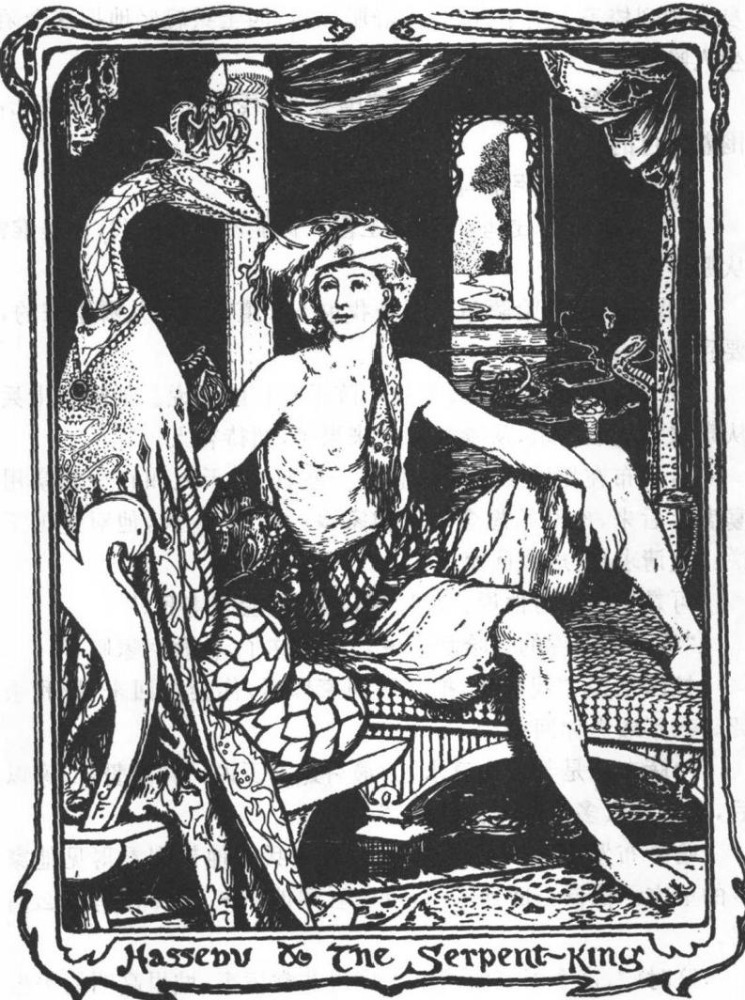

一连三天，哈萨布没有忘记他对蛇国王的承诺，没有到公共场所去洗澡。到了第四天早晨，天气热得他透不过气来，他把自己的诺言也完全忘记了。

他刚把自己的上衣脱掉，准备洗澡，就被人带到宰相的面前。宰相直接了当地对他说：“领我们到蛇国王住的地方去！”

“我不知道那个地方！”他回答。可是宰相不相信他，叫人把他捆起来，严刑拷打，把他打得皮开肉绽。哈萨布只好求饶说：“放了我，我领你们去。”

他们走了很久很久，才来到蛇国王的宫殿。哈萨布对蛇国王说：“不要责怪我，你看看我的背，就知道是他们迫着我来的。”

“是谁把你打成这样？”蛇国王问。

“那么，我就死定了。”蛇国王悲伤地说，“不过，你要亲自把我带到他那里去。”

哈萨布带着蛇国王出发。在路上，蛇国王对他说：“到了以后，他们就会把我杀掉，用水来煮我。你用瓶子装起一些汤水，放在一旁。宰相会叫你把这些汤喝掉，可你千万小心，别喝这一瓶，另外再舀一些来喝。这样，你就会变成一个伟大的医生。第三碗汤你要送给宰相喝。宰相来问你是否喝过时，你要回答说喝过了，还说这一碗是给他喝的。他喝了以后就会死去，这样你就太平无事了。”

他们来到城里，一切都像蛇国王说过的那样发生了。

哈萨布成了一个高明的医生，治好了许多人的病。国王很喜欢他。可他到死都一直觉得对不起可怜的蛇国王。

（斯瓦希里传说）

## 木盔姑娘

很久很久以前，在日本农村的一个小村庄里，住着一对夫妻。他们非常富有，幸福地生活了许多年。后来不幸的事情接二连三地发生，他们变得一贫如洗，除了像朝霞一样美丽的女儿，他们什么也没有了。虽然邻居都非常友好，愿意尽最大的努力来帮助他们，可是这对老夫妇觉得，既然家境已经变了，还不如尽快地离开这里。所以有一天，他们带着女儿远走他乡。

他们到了一个新的地方住下来。母亲和女儿又要照顾花园，又要打扫房间，整天有忙不完的事情要做。丈夫却整天整天地坐在那里，呆呆地看着远方，回想着过去的富裕，和那些难以忘怀的好日子。他一天比一天消沉，身体也一天比一天虚弱，最后终于卧床不起，离开人世。

妻子和女儿为他的去世大哭了一场。好几个月，家里没有丝毫欢乐。有一天，母亲忽然注意到，女儿长得比以前更加美丽了，要是以前，她该是多么高兴啊！可是现在，她们只是母女相依为命，孤儿寡母在这个世界上，谁知道什么时候会有灾难降临呢？

像世上一切好母亲一样，她对女儿更是加倍的关怀，恨不得把自己知道的和懂的一切教给她。她尽量把女儿一天要做的事情安排得满满的，不让她有多余的时间去想自己的事情。女儿也是一个好姑娘，总是句句听母亲的话，这样也太平地过了一些年。

一个寒冷潮湿的春天，母亲着了凉，生病了。开始，她还毫不在意。可是，病一天比一天严重，她才明白，自己已经不久于人世了。

母亲把女儿找来，对她说，她就要自己孤独地活在这个世界上了，再也没有人来关心她，所以，要自己照顾好自己。像她这样美丽的姑娘，要独立地在这个世界上生活下去，更是不容易。母亲说着，叫女儿从隔壁的房间里拿出一顶木盔，叫她戴在头上，一直拉到眉毛，这样，帽子的阴影就几乎把她整个漂亮的脸蛋遮住了。

姑娘照母亲的吩咐，天天戴着这顶木盔出去。她在人群中走来走去，果然没有人会看她第二眼。她回来对母亲说了，母亲也觉得很放心，那天晚上就安然地去世了。

姑娘伤心地哭了几天几夜，觉得自己无依无靠，必须出去寻找工作，才能养活自己，呆在家里终究不是办法。于是，她把衣服捆成一个包裹，向山下走去，来到一家人家。这家的主人有许多地。

她在这里住下，从早到晚给他们干活，到晚上就太平地上床睡觉。她从没有忘记答应过母亲的事情，从早上起来到晚上睡觉，不管天气多么热，那顶木盔总是戴在头上。村子里的人给她起了个外号，叫木盔姑娘。

可是，尽管她小心翼翼，她的美貌还是传扬开来。许多鲁莽的男青年常常偷偷地跟在她后面，想乘她不备的时候掀掉她的木盔，一睹她的美貌。姑娘也不和他们啰嗦，只是叫他们走开。那些男青年想方设法和她搭讪，她总是不理他们，继续干她手中的活。她的薪水很低，吃得也不好，可她也设法安排好，生活总算也过得去。

有一天，她的主人恰巧从地里经过，看到她干活那么勤劳，很有感触，就停下来看她。过了一会，又问了她几个问题，然后叫她跟着他回家，对她说，从今天起，她只需要留在家里照顾他生病的妻子就可以了，姑娘听了满心欢喜，以为以后所有的烦恼都结束了。

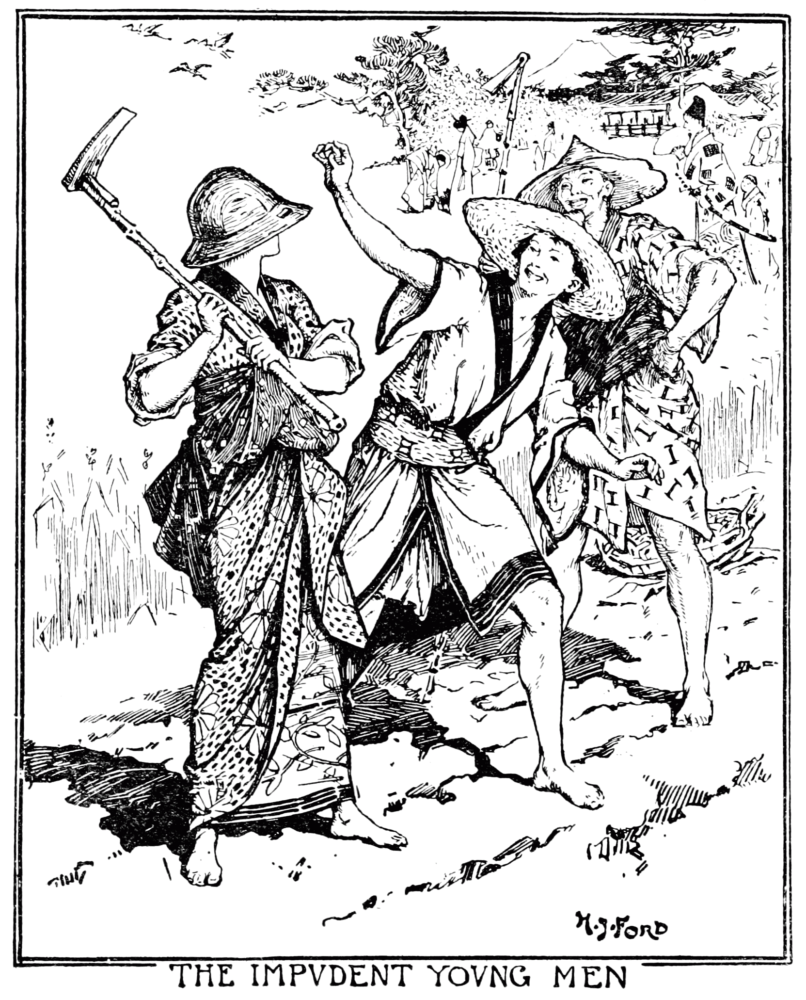

木盔姑娘给生病的女主人当上侍女以后不久，这家人的大儿子从京都回来。他到京都是为了学习各种知识，可是对京都的繁华和喧闹感到厌倦，很高兴回到绿色葱葱的故乡，回到桃花盛开的果园之中。

这天早晨，他出来散步，看到这个头上戴着木盔的姑娘，立刻跑回去问他的母亲：“这个姑娘是谁？从哪里来的，为什么用这种奇怪的帽子把脸遮住？”母亲说，这确是一桩怪事，谁也不能说服她把帽子摘下来。年轻人觉得很好笑，可是不再说什么。

这一天天气很热，大儿子在回家的路上，看到母亲的侍女正跪在小河边洗脸，那顶木盔已经摘下来放在旁边。他看到了她那难以形容的美貌，决心除她以外，绝不娶别人为妻。

回家以后，他把自己的决心对父母说了。他们非常生气，给她编造了许多邪恶的故事，想劝说大儿子不要娶她。可是，他们只是白费力气。大儿子认为，这些故事都是无稽之谈。“我只要毫不动摇，他们最终会同意的。”他想。

大家都以为，这门亲事对木盔姑娘来说，真是求之不得的高攀了，她肯定会很高兴地答应下来。可是姑娘认为，她不应该给这家人带来麻烦和争吵，所以不肯嫁给大儿子。暗地里，她不知道哭过了多少回。好长一段时间，她都不肯改变自己的主意。

后来有一天夜里，她梦见母亲对她说，应该和这家人的大儿子结婚。所以第二天，当大儿子像过去的每一天那样，来向她求婚时，既欢喜又吃惊地看到，她同意了。

一切都准备好了，这一天，婚礼准备举行。新郎穿上了日本最华丽的服装。侍女们也来给新娘打扮。她们想把木盔摘下来，给她梳理头发。可是那木盔像生了根似的，怎么也摘不下。她们越用力气，那木盔就越是套得紧，可怜的新娘也大声叫痛起来。

听到新娘的叫声。新郎赶快跑过来安慰她，说既然摘不下来，那么就戴着它结婚吧！

婚礼如期举行。一对新人坐在一起，人们给他们送来了两杯酒，按照日本的结婚仪式，新郎新娘要把它们喝掉。

新郎新娘干杯以后，奇怪的事情发生了，那顶木盔突然发出一声响亮的声音，裂成碎片，纷纷落到地上，变成了一块块宝石。客人看到满地的宝石，很吃惊。可是更令他们吃惊的是，新娘长得像天仙般地美丽，他们谁也从来没有见过这么漂亮的姑娘。

这天晚上，人们载歌载舞，一直闹到深夜，新郎新娘回到洞房，开始他们幸福的生活。他们快活地过了许多许多年，有了许多孩子，这些孩子都因为他们的美貌和善良而闻名于全日本。

（日本民间故事）

## 猴子和水母

孩子们常常问，水母为什么不像其他贝壳类动物一样，有一个厚厚的壳。他们经常在海边看到这些海中的动物。

其实，很久以前，水母也有一个很厚的壳，后来因为自己的过错，才把它丢了。下面，我就要给你讲这个故事。

有一天，统治大海的海上女皇忽然生病了，而且病得很厉害。所有海底王国最好的医生都请来诊治，可是没有用，女皇的病眼看越来越重。正当大家都非常失望的时候，来了一个医生，他比海底的所有医生都高明。他说，要治好女皇的病，只有一个方子，那就是猴子的肝。

可是，猴子生活在陆地上，海底下没有，如何才能得到猴子的肝呢？皇宫里召开了一个聪明的人会议，商量怎样才能解决这个问题。最后大家决定，派一只乌龟到陆地上去，想办法抓到活的猴子，把它带回海底。因为乌龟的耐心是大家有目共睹的。

说说容易，可做起来就难了。乌龟游到海岸边，这里长着许多高大的树木。乌龟活了许多年，见多识广，知道猴子喜欢住在这种地方。

接连好几天，不见猴子的踪影。有一天，乌龟等着等着，睡着了。躲在树上看着乌龟的一些猴子偷偷地溜下来。它们从来没有见过乌龟，都想靠过来看看，这个样子古怪的动物是用什么做成的。

有一只小猴子胆子特别大，它看到乌龟背上背着一个闪光的贝壳，就用手去摸一摸，想看看这究竟是什么东西。它的动作虽然很轻，可还是把乌龟惊醒了。乌龟一下子伸出头来，咬住它的手。咬得那么紧，不论猴子怎么挣扎，也挣不脱。其他猴子看到乌龟可不是好惹的，纷纷逃窜，让小猴子去听天由命。

乌龟对猴子说：“只要你乖乖地听话，照我说的去做，我不会伤害你。你坐到我背上去，跟我走一趟。”

猴子看到没有别的办法，只好听乌龟的话。是啊！它的手还在乌龟的嘴里，被咬得紧紧的，能够干什么呢？

乌龟把猴子牢牢地抓住，高兴地爬回海边，进入海水。它游得比以往任何时候都快，没多久就回到了皇宫。海底的人看到乌龟带着猴子回来，高兴得欢呼雀跃。有人赶紧去向女皇报告，说她的病很快就可以治好。他们那么开心，简直把猴子当做国宾，想方设法让它快活和舒服。

猴子受到那么热情的款待，一切忧虑和不安都烟消云散。虽然有时候，它也会缩在角落里想家，但一会儿就过去了。

后来，一只水母恰巧从猴子身边游过。那时候，水母也有贝壳保护着自己。它看到猴子闭着眼睛，低着头，在一块岩石旁边蜷缩着身子，心里充满了同情，不禁脱口说道：“啊！可怜的家伙！怪不得你在流泪，再过几天，他们就会来杀了你，把你的肝给女皇吃。”

猴子听到这些话，害怕得跳起来。它问水母，它到底犯了什么罪，要杀死它。

“不，你没有犯罪。”水母说：“可是，女皇病了，只有你的肝救得了她！不把你杀了，怎么能得到你的肝呢？你还是认命了吧！不要再说什么，我虽然打心底里同情你，可是也没有办法救你。”

水母游走了，留下吓得半死的猴子。开始，它觉得自己的肝好像已被人挖走。后来，它开始考虑如何才能逃脱这场灾难。不久，它就想出了一个办法。

接下来几天，它假装像刚来的时候一样，很快活。后来天气不好，下起雨来，它就坐在那里从早到晚不停地哭。负责看守它的乌龟听到它的哭声，就跑过来问它怎么啦？

猴子对它说，离开家的时候，它把肝挂在树上晾干，想不到天会这样不停地下起雨了，这样下去，它的肝就没用了。它说的那么烦恼，那么伤心，即使是铁石心肠的人听了，也会掉下同情的眼泪，都会带它回到森林中去，取回自己的肝。

乌龟把情况向女皇的大臣们报告。遗憾的是，这些大臣都不很聪明。他们商量以后，决定派乌龟把猴子送回去取自己的肝，但是每时每刻都要看好猴子，别让它溜了。

于是，猴子高兴地骑上乌龟的背。当然，这种高兴劲它不肯流露出来，免得让乌龟觉察。没有多久，它们就回到了猴子被抓的海岸。猴子看到它家里人正在树顶上看着它。

到了一棵大树下，猴子纵身一跃，跳上了一根树枝。这一回，乌龟连它的尾巴也抓不到了。它把自己的可怕经历向同胞们说了。它们都很气愤，把附近的猴子都召来，围住乌龟痛打一顿，把它的乌龟壳也打碎了，最后把它抬起来，扔入海里。

乌龟虽然遍体鳞伤，但也庆幸自己死里逃生。它忍着伤痛游回皇宫，那些又冷又咸的海水冲击着它没有贝壳保护的肉体，弄得它痛苦不堪。

乌龟向大臣们报告了事情的经过。大臣们经过调查，知道是水母走漏了消息，决定乌龟免于处罚，让它去养伤。至于水母，女皇命令把它的壳剥掉，作为给它的严厉惩罚。

（日本民间故事）

## 无头的侏儒

教堂里有一个牧师，他想找一个人，白天帮他干活，半夜里帮他敲钟。这件事使他大伤脑筋，花费了他不少精力。

首先，很少有人想在白天辛辛苦苦地干了一天以后，半夜里还要爬起来敲钟。尽管这样，牧师还是能找到一些愿意干的人。可奇怪的是那些愿意干的人都一个接一个地失踪了，像是大地张开了嘴，把他们吞了似的。教堂里的钟已经好久不响了，派去敲钟的人也一去不复返。对于这件事，牧师感到困惑不解，也尽量地保守秘密。可是事情还是慢慢地传出去了，再也没有人敢来应召。而且，还有些流言飞语在传说，说是牧师自己把这些召来的人杀害了。

一个星期又一个星期过去了，牧师答应给愿意来敲钟的人双倍工资，可是人们毫不在意他的慷慨。可怜的牧师深感失望。

有一天，牧师正站在家门口，一个青年人走过来，他就是村里人人都知道的“聪明的汉斯”。

“我再也不愿意给那些吝啬鬼干活了，不够吃也不够喝。”他对牧师说，“我愿意做你给我安排的一切工作。”

“很好！我的孩子。”牧师说，“今天晚上，你将有机会表现出你惊人的勇气。明天，我们就说好给你多少工资。”

汉斯对这个安排很满意，立即到厨房里去，开始干活。其实，他还不知道，这个新主人和以前的一样，也非常小气。每当那些工人吃饭的时候，他总是坐在饭桌上，以为这样他们就不敢多吃。他还不停地劝他们喝啤酒，他想，啤酒总比牛肉便宜些。不过，他找到汉斯，可算是棋逢对手了。他很快就发现，汉斯多喝一杯酒，并不意味着少吃一盘牛肉。

大约午夜前一个钟头，汉斯进入教堂，把门关好。叫他吃惊的是，他原以为寂静阴暗的教堂，此刻却是灯火辉煌，照亮得如同白昼一般，一群人正围着一张桌子玩牌。事情虽然有点蹊跷，可汉斯一点也不害怕，也不打算躲避，径直走到桌子前，在这些玩牌人之间坐下来。有一个人抬起头来问他：“我的朋友，你到这里来干什么？”汉斯瞪着他看了一会，然后笑起来，说：“好了！这个问题应该由我来问，我不提出来，你如果聪明的话，也就不要再说什么了！”

汉斯拿起几张牌，开始和这些陌生人玩起来，好像他们是老相识似的。这一天他很走运，别人的钱慢慢地都流进他的口袋。这时，传来一声午夜的鸡叫，那些人，桌子，还有灯光突然消失，只剩下汉斯一个人。

黑暗中他摸索了一会，才找到通向塔楼的楼梯，开始一步一步地爬上去。

跨上第一步，凭借墙上一道缝漏进来的微光，他看到一个没有头的小矮人坐在那里。“嗨！我的小家伙！你坐在这里干什么？”汉斯问，也不等他回答，就一脚把他踹下楼梯。他又继续往上爬，看到每一级楼梯上都坐着一个小矮人。像第一个一样，他一个一个地把他们踢下去。

他爬到塔楼顶，停下来仔细观察四周，看到钟里面有一个无头的小矮人蹲着，手中拿着钟舌，准备在他敲钟的时候敲他一下，结束汉斯的生命。

“别动！我的小朋友！”汉斯说，“这样不公平。你也许已经看到，你的那些伙伴都下楼梯了。你也应该和他们一样下去。不过你既然站得最高，应该表演得比他们更出色一些，从窗口跳下去！”

说着，他爬上楼梯，想上去抓住小矮子，把他从窗口往外扔。

小矮人大声地求饶起来：“啊！兄弟！饶了我吧！我保证，我和我的伙伴不会再来找你的麻烦。我虽然又小又弱，可谁知道呢？说不一定哪一天，我会有机会报答你的。”

“你这可恶的小东西，”汉斯说，“还会说出这么多感激的话。幸好我今天情绪很好，就饶了你这条命。不过你要记住，要是你让我再碰上了，可就不会像今天这样便宜了！”

那个无头的小矮人千恩万谢以后，急忙沿着敲钟的绳子溜下来，顺着楼梯飞快地跑了，好像屁股上点着一把火似的。

汉斯开始使劲地敲钟。牧师听到半夜里教堂的钟声响了，开始觉得非常惊讶，后来也非常高兴，他终于找到一个称职的人去完成这个任务了。

汉斯敲了一会儿钟以后，就回到草料棚的阁楼上躺下，很快就睡着了。

牧师有一个习惯，他喜欢很早就起来，四处看看那些工人是否都起来干活了。这天早晨，牧师看到所有的人都在忙着做自己的事情，就是找不到汉斯。谁也不知道他到哪里去了。到了九点钟，还是不见汉斯的影子。十一点钟敲响，还是找不到他。牧师开始担心，他是不是和以前那些派去敲钟的人一样，失踪了？

午饭的时候到了，工人们都围着饭桌坐下来。这时候，汉斯才走进来，一边伸着懒腰，一边打哈欠。

“这么长时间，你到哪里去了？”牧师问。

“在睡觉。”汉斯回答。

“睡觉？”牧师吃惊地说，“你是想告诉我，你是一直睡到中午才起来？”

“正是这样。”汉斯说，“一个人在晚上干活，白天就得睡觉；正像在白天干活的，晚上就得睡觉一样。你要是能找到一个半夜里去敲钟的人，我就准备天一亮就起来干活。要是你想叫我去敲钟，我就起码要睡到中午才起来。”

牧师还想跟他争辩几句。后来他们达成协议：以后汉斯不再去敲钟了，而是像其他人一样，从太阳出来一直干到太阳下山。吃过早饭和午饭可以休息一个钟头，休息的时候可以去睡觉。

“当然，”牧师若无其事地说，“有时候也会有例外，比如说冬天吧！白天很短，你可能会多干一些，把手中的活干完！”

“那绝对不行！”汉斯说，“除非是在夏天我可以早一点收工。我只答应你从天亮干到天黑，多一分钟也不行。你现在该明白了吧！”

几个星期以后，有人请牧师到附近的城里去施洗礼，他叫汉斯和他一起赶马车去。那个城市大约只有几个钟头的路程，所以牧师看到汉斯带着一袋食品去，觉得很奇怪。

“你带着这些东西干什么？”牧师问，“天黑之前，我们就可以赶到。”

“谁知道呢？”汉斯回答，“也许路上会发生什么事情，耽搁了我们的时间。用不着我提醒你吧！太阳一下山，我就不再是你的仆人。要是天黑之前不能到达，那你就得自己赶路了。”

牧师以为他是在开玩笑，也不答理他。

离开村庄，走了几英里以后，他们发现，昨天晚上下的一场大雪，被风刮成一堆一堆厚厚的积雪，把路都埋没了。他们的旅程变得十分艰难。等他们到达中途那片浓密的丛林时，太阳已经到了头顶上。马在很深的，又松又软的积雪中吃力地跋涉着，汉斯不断地回过头来，看看背后的太阳。

“背后有什么跟着吗？”牧师问，“你干吗老是回过头去看？”

“因为我后脑勺不长眼睛，所以我得转过头去看。”汉斯说。

“别再胡说八道了。”牧师说，“集中精力，想办法在天黑以前赶到城里。”

汉斯不说什么，赶着马继续不停地往前走，可还是不停地回过头去看看。

来到密林深处的时候，太阳已经消失在地平线以下。汉斯把马车停住，拿起他的背包，从马车上跳下来。

“你想干什么？你疯了吗？”牧师说。

汉斯回答得很干脆：“太阳下山了，我一天的工作也结束了。我要在这里宿营过夜。”

不论牧师怎么威胁他，求他，答应给他丰厚的报酬，只要他同意继续把马车赶到城里去，可汉斯无动于衷。

“你要我违背自己的诺言，不觉得可耻吗？”汉斯说，“你要是想今晚就赶到城里，就自己去吧！我自由支配的时间已经到了，我不能跟你走了。”

“我的好汉斯，”牧师请求他，“我真的不能让你单独留在这里，那样太危险了！你看到竖在那里的绞刑架吗？上面还吊着两个坏人。你与这些鬼神做伴，晚上睡得着吗？”

“为什么睡不着？”汉斯问，“他们吊在半空中，我睡在地下，毫不相干。”说着，他转过身去，独自走了。

没有别的办法，牧师为了赶上洗礼，只好自己赶着马车走了。城里的那些朋友看到他不叫车夫，自己赶着马车来，都觉得非常惊奇，还以为是出了什么事故。牧师把他和汉斯的事说了以后，他们也说不出，是主人笨呢？还是仆人笨？汉斯要是知道人们怎么议论他，还可能会当一回事呢！

这时候，汉斯把背包中的食品拿出来，吃饱以后，抽了一支烟，在一棵树下搭起帐篷，裹着大衣，很快就睡着了。

大约过了几个钟头，吵闹声把他惊醒。他坐起来，向四处张望。皎洁的月光照耀着荒原，两个无头的小矮子站在他身旁，正愤怒地叫喊着。

“就是他！就是他！”其中一个走过来，生气地喊叫，“朋友们，他自己送上门来，这个机会太好了。那天，我从塔楼的台阶上摔下来，到现在骨头还在痛。我敢说，你们肯定也没有忘记那个晚上！现在，是他的骨头发痒的时候了，朋友们！快来啊！快来啊！”

立刻，一大群小矮人突然从地下冒出来似的，像蚊子般地把汉斯团团围住。他们每人手中都拿着一根棍子。他们人虽然小，可数量那么多，手头的棍子打起来那么重，即使是非常健壮的人也难以招架。汉斯想，他的末日终于来到了。

正当双方打得难解难分的时候，忽然又跑来一个小矮人。“停下来，伙伴们！”他对着正在猛烈进攻汉斯的那群人大声喊，“这个人有恩于我，我还欠着他的债。我的命捏在他手中的时候，他饶了我一命。即使他把你们从楼梯上踢下来，洗个热水澡一切烦恼都没有了。你们还是原谅他，回家去吧！”

那群小矮人听了他的话，像突然出现一样，又突然消失了。汉斯缓过气来，看了一下救命恩人，原来他就是坐在教堂大钟里的那个小矮人。

小矮人在树下坐下来，说：“那天你放我走的时候，我说要报答你，你还取笑我。现在你看到了吧！我没有骗你。也许你会从中懂得一个道理，将来不要看不起任何小东西。”

“我从心底里感激你。”汉斯说，“挨了他们一顿打，我的骨头到现在还痛。要不是你来了，我今天可真的是倒霉了！”

“我欠你的债也就差不多还清了，一报还一报嘛！”小矮人说，“不过你已经挨了打，我要多报答你一些，告诉你一些消息。你不必再留在这个吝啬的牧师家里干活了。明天，你回家以后，立刻到教堂的北边去。北边那堵墙上有一块大石头。这块石头不像其他石头那样，泥得很牢，而是有些松动。后天是满月，半夜时分，你带一把铁镐到那里去，把那块大石头挖出来。石头下面，有一大笔宝藏，那是战争年代留下来的。墙角上还有好几袋钱，放在那里已经有好几百年了，谁也不知道是属于谁的。这些钱你要把三分之一分给穷人，其余的可以留下来。”

小矮人的话刚说完，村里的鸡开始报晓。小矮人也忽然不见了。汉斯觉得他的手和脚不再痛了，就躺下来想着这些宝藏，不久就睡着了，一直睡到大天明。

牧师赶着马车过来时，太阳已经很高。

“汉斯，”牧师说，“你真傻，昨天没有跟我一起去。他们摆下盛宴欢迎我，还给了我许多钱。”说着，他摇了摇口袋里的钱，好像要汉斯明白，他的损失多么惨重。

“啊！先生，”汉斯心平气和地回答，“为了得到这些钱，你一定整夜没有合眼吧！我昨天晚上睡得很好，可得到的钱是你的几百倍！”

“你是怎么得到的？”牧师迫不及待地问。

“只有傻瓜才吹嘘自己的财富，聪明的人都是藏而不露。”汉斯这样回答。

他们赶着马车回家。汉斯没有忘记自己的职责，他把马牵进马厩，给它们喂草料以后，才去察看教堂北边的那堵墙。正像小矮人说的那样，他很快就找到了那块松动的石头。他不声不响地又回去干活。

满月的那天晚上，整个村子都睡着了。他偷偷地起来，拿着一把铁镐，来到墙边。把那块大石头挖下来，也花了他不少力气。石头的下面果然有一个洞，里面藏着不少宝藏，小矮人说得一点也不错。

星期日，汉斯把三分之一的财富分给村子里的穷人，告诉牧师说，他准备中止合同，不再给牧师干活了。汉斯没有提出要结算工资，所以牧师也不提出异议，让他走了。

汉斯回到自己家，买了一幢大房子，娶了一个年轻的姑娘，过着富裕而幸福的生活，一直到生命结束。

## 不肯安分守己的青年

从前有一个青年，什么事情都喜欢寻根究底，要知道得比别人都多，他才开心，否则就会整天闷闷不乐。自从他学会了鸟和野兽的语言以后，他发现，黑夜里有许多人类未曾看到过的秘密。从这一天起，他决心要把这些秘密弄明白，否则就坐立不安。

为了达到这个目的，他找了一个又一个巫师，想请他们帮忙，让他在黑夜里也能张开眼睛，看得见周围发生的一切事情。可是谁也帮不了他的忙。后来，他找到了一个名叫马纳的大巫师，他的学问比谁都深，能够说出人们想知道的一切。

老人耐心地听完了青年人的请求，警告他说：“我的孩子！不要去追求那些无用的知识，它不会给你带来幸福，只会给你带来灾难。世界上有许多事情，我们视而不见反而好些，要是什么都看得一清二楚，心里就永远不会得到安宁。智者多虑，想想看吧！你想要得到的是什么？否则，将来有一天，你会后悔的！要是你不愿意听我的劝告，我可以让你知道黑夜里的秘密。不过，你要有比平常人更大的勇气去承受这一切！”

他停了一下，严肃地看着这个年轻人。年轻人点了点头。老人继续说：“明天晚上，蛇国王要在它的王宫里举行一次盛大的宴会。这种宴会每七年才有一次，所以，你明天一定要去。在蛇国王的面前，一个金碗里盛着羊奶。要是你能想办法把一块面包在羊奶里浸一浸，然后把面包吃掉，你就会看到别人都看不见的，隐藏在黑暗中的秘密。幸运的是，今年正好是蛇国王举行盛宴的一年，不然你就要等很长的时间。但是，你千万要小心，既要大胆，又要心细，行动还要灵活敏捷，否则就要倒霉。”

青年人谢了大巫师的指教，决心要照他的话去做，那怕是付出自己的生命也在所不惜。

夜幕降临了，他来到一片空旷荒芜的原野，蛇国王将在这里举行宴会。他放眼望去，周围是看不到边的小山丘，在月光下一动也不动地躺在那里。他蜷曲着身子，在一片丛林中躺下。

大约到了午夜，荒原中忽然放出光芒，像是天上的一颗星落到山丘上。原先那些一动也不动的小山丘在光的照耀下，好像一下子有了生命。每个小山丘都爬出几百条蛇来，向发出亮光的山丘移动着。看样子，蛇国王就在那里等待着它们。

青年人仔细看了看那发出亮光的山丘，它比其余的山丘更高，更大些。山顶上吊着一盏明亮的灯。那些蛇爬过来以后，都在那里等待着，发出嘶嘶的叫声。

青年人看到那么多蛇，开始一步也不敢跨出去，只是站在那里观察着。后来他鼓起勇气，一步一步地走过去。一种毛骨悚然的感觉包围着他，他做梦也没有想到，事情会这样可怕。周围是大大小小各种颜色的蛇，起码有几千条。它们中间是一条大蛇，身体像柱子那么粗，头上戴着一顶王冠，光芒就是从这顶王冠上发射出来的。

那些蛇不停地吐着舌头，发出令人不寒而栗的叫声。青年人觉得心不断地往下沉，再往前走肯定是死路一条。就在他再也没有胆量再向前跨出一步时，他看见了蛇国王面前的那个金碗。他明白，这个机会如果失去，就不可能再来了。他决定不顾一切地往前走，他觉得，头上的每一根头发都竖了起来，血管里的血已经停止了流动。那些蛇看到竟然有人敢闯进来，都愤怒地嘶叫着抬起头来，要去咬他。幸亏它们因为挤得太紧了，绞成一团，一时解不开来。

青年人闪电般地冲过去，抓起一块面包，在金碗的羊奶里浸了一下，把它吃下去，然后转身就跑。身后好像有千军万马在追赶着，那声音越来越近，越来越响亮。他拼命地奔跑着，后来气也透不过来，摔倒在地上，失去了知觉。

他躺在那里，做了许多可怕的梦。他梦见蛇国王和许多愤怒的蛇缠住了他的身体，要活活地把他勒死。他发出一声恐怖的尖叫，准备站起来和它们决斗。这时候，他醒过来了，发现天已经大亮，太阳光正晒在他身上。

他擦了擦眼睛，看看周围，那些蛇都不见了，他也已经逃出了那片荒野。他确信，他是跑了许多路，而且吃了那神奇的羊奶，这决不是做梦。他看了看自己的身体和四肢，很高兴地发现自己毫无损伤地经历了这场大风险。

一个晚上的惊吓和奔跑以后，他觉得非常疲倦，一直睡到中午。到了晚上，他决定到森林里去，看看这些羊奶会给他带来怎样的神奇魔力，是否能让他揭开夜里笼罩着大地的那神秘面纱。

来到森林，他对羊奶的怀疑顿时烟消云散，因为他看到了凡夫俗子从来没有看到过的景象。在树林的覆盖下，有许多亭子，亭子周围飘扬着银白色的旗子，像一盏盏明灯似的把黑夜照亮。

青年人正惊讶地看着这些亭子，不明白它们是从何而来的，突然从树林里传来一阵响声，好像是刮来一阵风，把树叶吹得沙沙响似的。接着，在明亮的月光下，从四面八方走过来许多年轻美貌的女子。她们是山林中的仙子，大地母亲的女儿。她们每天晚上都要到这森林里来跳舞。

青年人恨不得头上长着一百双眼睛。这些仙境里的奇妙景象实在令他目不暇接。仙子们一直跳到东方露出一丝曙光。这一丝曙光像银色的幔布一样，把这些良辰美景一下子就盖住了，转眼间不见一点痕迹。青年人留恋地迟迟不肯离去，一直到太阳升得很高，才怏怏地回去。

这一天，他觉得白天特别长。他一分钟一分钟地数着，等待着黑夜的降临，以便重返森林。可是，他回到森林里以后，再也看不见那些凉亭，还有那些仙子。他不甘心，去了一个晚上又一个晚上。然而，那些美丽的仙女已一去不复返。青年人念念不忘，朝思暮想，渴望着再见到她们一面，从此，对世界上的一切事情不再关心。后来他生病了，直到快要死去的时候，还在留恋着那天晚上在森林里看到的情景。就在这时，他才明白了老巫师说过的那句话的真实意义：“安分守己才是人的美德。”

## 金星少年

从前有一个国王，他统治着整整半个地球。在他的国家里，有一对放羊的夫妇。他们有三个女儿，名字叫做安娜、斯塔娜和拉普蒂莎。

大女儿安娜是那么美丽，她出去放羊的时候，只要走近羊的身边，那些羊都忘了吃草，抬起头来看她。

二女儿斯塔娜是那样美丽，她赶着羊群出去的时候，狼不但不来吃她的羊，还会自动地来保护她的羊。

最小的拉普蒂莎呢？她的皮肤像牛奶那样洁白，头发像最好的羊毛那样柔软，她的相貌集中了两个姐姐的优点，所以三姐妹之中，她长得最美丽。

夏季里有一天，金色的阳光普照大地，三姐妹来到山脚下的丛林里采草莓。正当她们在草莓地里寻找最好的草莓时，传来了一阵马蹄声。声音那么响亮，她们想，大约是一支军队奔驰而过。后来才看到，是国王和他的朋友们出来打猎。

他们从草莓地经过，看到了三姐妹，不禁被她们的美貌吸引，放慢了速度。

“你们听我说，妹妹，”他们从身边经过的时候，安娜说，“这些青年男子中，要是哪一个娶我做妻子，我就给他烤一个面包，叫他吃了以后永远年轻，充满了旺盛的精力和勇气。”

“要是谁看上了我，”斯塔娜说，“我就给他织一件衬衫，叫他和龙作战的时候也不会受伤；从水中经过的时候不会浸湿；从火中经过的时候不会烧伤。”

“要是谁娶了我，”拉普蒂莎说，“我就要给他生一对孪生兄弟，每个人头上都有一颗星，像天上的星那么明亮。”

她们说话的声音虽然很轻，可是国王和那些年轻人都听见了。他们掉转马头，向她们走过来。

国王对拉普蒂莎说：“你说的话我很中意，你将成为我最可爱的王后。”说着，他把拉普蒂莎，连同她采草莓的篮子一起抱上马。

“我要娶你！”“我要你！”安娜和斯塔娜也被两个青年人看中，他们也带着心上人回到王宫。

第二天，他们同时举行婚礼。盛大的婚宴一连进行了三天三夜。整个国家比过年过节还热闹，人人兴高采烈。

婚礼以后不久，安娜像她在草莓地里说过的那样，给她丈夫烤了一个大面包。又过了几天，传出消息说，斯塔娜砍来了亚麻，把它们晒干，纺成线，织成布，亲自给她的丈夫缝了一件衬衫，兑现了她在草莓地里说过的诺言。

再说国王有一个继母，她和前夫生下一个女儿，现在也住在王宫里。她原以为，女儿一定会嫁给国王，成为王后，万万没有想到，一个牧羊女会抢走了女儿的位置。她从心底里恨透了拉普蒂莎，准备伺机报复。

可是，国王和王后朝夕相处，形影不离，她根本无法下手。于是，她开始想办法，要把他们分开。

继母想出来的许多办法都失败以后，她仍不甘心。后来，她给她的弟弟，一个邻国的国王写了一封信，叫他向自己的国家宣战。她弟弟听从她的话，带领许多军队来进攻边界城市。

这一回，继母的阴谋得逞了。国王听到边界受到侵犯的消息，怒火万丈，决心率领军队出去迎战，即使是和新婚的妻子分离也在所不惜。短短的时间里，他就召集起一支强大的军队，开往边疆。邻国的国王没有想到他会来得那么快，败在他的手下，慌忙把残兵败将撤回自己的国家。两国达成和平协议以后，国王就急急忙忙赶回王宫，路上只用了三天的时间。

就在国王回到王宫前的当天凌晨，天空中的星星开始暗淡的时候，拉普蒂莎生了一对孪生子。他们长着金黄色的头发，额头上都有一颗星。守在一旁看着的继母把他们抱走，来到王宫的花园里，在国王寝宫的窗口下挖了一个洞，残忍地把他们埋下。她还抓来了一对刚生下来的小狗，说是拉普蒂莎生下来的。

国王回到王宫。人们告诉他，王后生了一对小狗。他来到拉普蒂莎的房间，用不着再说什么了，他亲眼看到，她没有实现自己在草莓地里许下的承诺。尽管于心不忍，他还是不得不下令惩罚她。

国王悲伤地走出去，命令士兵把王后埋起来，只让她露出头来，以示处死她，然后把她挖出来，赶出王宫。这就是对她欺骗国王的惩罚。

过不了多久，继母的愿望实现了，国王和她的女儿举行了婚礼，婚宴又连续进行了三天三夜。

现在，让我们再来看看两个初生婴儿的命运。可怜的孪生子躺在坟墓里也不肯安静。在埋下他们的地里，长出两棵山杨树来，那样子十分惹人喜爱。继母看到这两棵山杨树长出来，非常恨，因为她怕人家知道她的罪恶，想叫人把它们连根拔掉。可是国王知道她的主意以后，禁止任何人去碰它们。他说：“让它们在那里生长，我喜欢它们，这是我从来没有见过的，最好的山杨树。”

两棵山杨树的长势非常猛。它们白天长，晚上长，一天等于两年。到黎明时分，星星开始隐去的时候，它们一瞬间会长大三岁。很快，它们的枝叶就覆盖着王宫的窗户。微风吹过，它们会轻轻摇曳，沙沙作响，像在低声细语。国王没事时会整天坐在那里，像在倾听着它们想诉说什么。

继母心里一直在盘算着，怎样才能让国王同意，把这些树毁掉。这当然不容易，但是女人只要下了决心，就是石头里也能挤出牛奶来。她们的狡猾，能够蒙住英雄的眼睛。即使阴谋诡计失败了，她们还会使用花言巧语。等到一切都落空以后，她们还有叫你同情的眼泪。

这天早晨，新王后坐在丈夫的床边，开始用各种各样的甜言蜜语来哄骗他。当然，鱼儿是不会那么容易上钩的。不过，国王也是人，经不住她的纠缠。

“好吧！”国王说，“你愿意砍，就把它们砍掉吧！不过，我要用它们来做两张床，一张给我，一张给你。”

新王后虽然不情愿，但也不得不同意。第二天，两棵山杨树被砍倒。到了晚上，两张新床就搬进了国王和王后的寝宫。

国王在床上躺下，觉得自己比以前重了许多，可心里觉得非常舒服和坦然。可是新王后觉得自己好像是躺在荆棘上一样，辗转反侧，难以成眠。

国王睡熟以后，两张床开始嘎嘎响。新王后觉得，每一次响声都有着意思，它们似乎在用只有她听得懂的话在交谈。

“啊！没什么，一点也不重。”国王躺着的那张床回答，“亲爱的父亲躺在我的身上，我心中只有快乐的感觉。”

“我觉得很沉重！”另一张床说，“在我的身上，躺着一个邪恶的灵魂！”

它们一直说到天明。新王后整夜不曾合眼，听他们说着。到天亮的时候，她想着如何把这两张床弄掉。她叫人做了两张一模一样的床，等国王出去打猎，把它们换了。她还下令把那两张床烧掉。两张床在烧的时候，好像还在说话，这些话只有新王后一个人听得懂。烧完以后，她叫人把灰烬集中起来，随风四处飘撒，让它们吹向广阔的大地和海洋，一点也不让它们留下。

可是，她没有注意到，两张床在燃烧时，有两粒火星突然飞起，在空中飞扬一会以后，掉到一条从国土上流过的大河里，变成了两条小鱼。两条小鱼都长着金色的鱼鳞，而且非常相似。看到的人都说，这是两条孪生鱼。

一天凌晨，国王的渔夫到河边去打鱼，以便给国王做早餐。他把网撒入河中，到天上的星星消失时，把网拉上来，看到许多鱼中有两条金色的小鱼。渔夫捉了那么多鱼，可从来也没有见过这么好看的金鱼。

别的渔夫都围拢过来，看着这两条奇怪的鱼。后来他们决定，把这两条活鱼送给国王做礼物。

“别把我们送回到那里去，我们就是从那里来的，那里会把我们的一切都毁掉的。”一条小金鱼说。

“可我们该怎样来处置你们呢？”渔夫问。

“去把树叶上的露水都收集起来，让我们在露水中生活。把我们放在太阳底下，不要靠近我们，让太阳把露水都晒干。”另一条鱼说。

渔夫照他的话去做，用瓶子把露水收集起来，把两条小金鱼放进去，让它们在露水中游泳，然后把瓶子放在太阳底下晒，直到露水全部蒸发掉。

等渔夫再回来的时候，你猜猜看！他看见了什么？两个小男孩，两个漂亮的王子，长着金色的头发，额上都有着一颗金星。两个人那么相似，谁都看得出，他们是孪生子。

两个小孩长得真快。白天，他们长一岁；晚上，又长了一岁；到黎明时分，星星不见了的时候，他们转眼间就会长三岁。他们不但长身体，而且长力量，长智慧。三天三夜过去以后，他们的个子就有十二岁那么高，力气有二十四岁那么大，至于知识，就有三十六岁的成年人那么丰富。

“现在，带我们到国王那里去啊！”

渔夫给他们一人一顶羊皮帽，把半个头遮住，不让那些金色的头发，还有那颗闪光的金星露出来，接着，就把他们领到王宫里来。

他们来到王宫的时候，已经是中午。“我们想见国王。”他们对站在门口的军官说。

“你们现在不能进去，要等他吃完午饭。”值班的人说。

“不！他吃饭的时候我们就要进去。”男孩子说着，向里面走去。

士兵们都跑过来，要阻止这对鲁莽的年轻人。可是他们灵活得像泥鳅似的，从士兵们的围堵中滑过去，来到了国王用餐的大厅。大厅门口还有仆人看守着。

“我们要进去！”王子厉声地对门口的仆人说。

“那是不可能的！”仆人回答很干脆。

“是吗？那就试试看！”他们把仆人向两边推开。可是仆人很多，他们只有两兄弟，于是双方争吵起来，吵声传到了国王的耳朵里。

“出了什么事？”国王生气地问。

王子听到他们父亲的声音，停了下来。

“有两个男孩子想冲进来。”一个仆人进来向国王报告。

“想冲进来？谁敢在我的王宫里使用武力？是怎么样的小孩？”国王一口气问了几个问题。

“我们还不清楚，尊敬的国王。”仆人回答，“不过，他们在某些方面和你相像。他们的力气像狮子一样大，门口的士兵也挡不住他们。他们身体强壮，但也很骄傲，头上的帽子不肯摘下来。”

国王听了，脸气得通红。

“把他们赶出去，”国王说，“放狗去咬他们。”

“让我们自己走吧！我们不吵了！”王子听到国王这些粗鲁的话，伤心得落下眼泪，开始退出去。快到王宫门口时，一个仆人跑过来。

“国王命令你们回去，”他喘着气说，“他想见见你们。”

两个王子想了一会，才转过身来，向国王走过去，帽子仍然戴在头上。

国王坐在一张长桌子面前，桌上摆着鲜花。新王后坐在国王身边，旁边放着十二个垫子。两个王子走进来的时候，一个垫子掉到地上，只剩下十一个。

“把你们的帽子脱下。”一个国王的侍从说。

“不把头露出来也是对人的一种尊敬，我们不会失礼的。”王子说。

“没有关系！”国王点头说。听到两个孩子银铃般的声音，他的怒气顿时消失。“请随便吧！不过，请告诉我，你们是谁？从哪里来？想干什么？”

“我们是孪生子，是一棵树上长出的两个芽，可是已经被折断，一半埋在地下，一半在这张桌子上。我们走过了很长很长的路。我们在风声中说过，在木头中叹息过，在水中歌唱过。现在，我们要用人类的语言给你讲一个故事，这个故事你知其一而不知其二。”

新王后身边的第二个垫子掉了下来。“叫他们闭嘴，送他们回家。”新王后说。

“啊！不！让他们继续说下去。”国王说，“你只想见到他们，可是我还想听听他们说些什么。继续讲你们的故事吧！孩子们。”

新王后不做声了，王子继续说着他们的故事，“从前有一个国王……”新王后的第三个垫子掉到地下。

他们讲到国王因战争而出征时，三个垫子同时掉下来。

故事结束了，新王后身边一个垫子都没有了。这时候，两个王子把他们头上的帽子摘下，露出额头上的金星和金色的头发。两颗金星那么明亮，国王和他的客人都不敢抬头正视。

故事的结果当然是合乎逻辑的。拉普蒂莎又回到了国王的身边。继母的女儿成了王宫里最低贱的裁衣女。继母被捆在一匹野马上赶出去。她的结局使人人都不会忘记，一颗罪恶的心最终会给自己带来厄运。

（罗马尼亚传说）

## 青蛙姑娘

一个农村妇女有三个儿子。他们虽然是农民，但是日子过得很富裕。因为这里的土壤肥沃，庄稼长得很好，年年丰收。

有一天，三个儿子对母亲说，他们想结婚了。母亲回答说：“那你们就结婚吧！不过，要娶会帮你们做事情的好媳妇。为了证明这一点，你们三人各拿去一捆亚麻，给你们的未婚妻织成布，谁织得最好，谁就是我最好的媳妇。”

两个大儿子都已经有了心上人，他们把母亲给的亚麻交给她们，叫她们织成布。只有最小的儿子不知道怎么办才好。他从来没有和一个姑娘说过话，谁也不认识，把亚麻交给谁呢？他盲目地走来走去，看到姑娘就问，能不能帮他把这捆亚麻织成布。姑娘们被他弄得莫明其妙，要不就是和他开个玩笑。

小儿子很失望，他走出村庄，来到田野里，坐在一个池塘边伤心地嚎啕大哭起来。“噗！”的一声响传来，吓了他一跳，回头一看，原来是一只青蛙从水中跳上岸来。青蛙问他为什么哭？小儿子把自己的烦恼对它说了，说两个哥哥都有心上人来帮他们织亚麻布，只有他自己找不到一个愿意帮忙的人。

青蛙回答说：“这用不着哭，把那捆亚麻给我，我帮你织成布。”说完，它把他手中的亚麻拿过去，跳入水中。小儿子转身回家，也不知道会有什么结果。

小儿子回家后，他的两个哥哥也回来了。不久，母亲要他们拿出织好的亚麻布了。于是，两个哥哥又出去了。不一会，就带回未婚妻织好的布。小儿子非常担心，不知道该怎么办才好。他伤心地来到池塘边，坐在那里又哭起来。

“噗！”青蛙又从池塘里跳出来。“拿去吧！”它说，“这是我给你织好的布。”

小儿子说不出有多么高兴，他把布拿在手中，赶紧跑回家来找母亲。母亲看了看他带回家的布，赞不绝口，说从来没有见过这么好的亚麻布，比两个哥哥带回来的不知好多少倍！

接着，母亲又转过头来对三个儿子说：“这还不够，我的孩子，我还要考验一下，你们将带回来什么样的媳妇。房间有三只小狗，你们一人抱一只去，交给你们的未婚妻抚养和训练。哪只狗最好，它的主人就是我最喜欢的媳妇。”

两个哥哥抱着小狗出去了。小弟弟抱着小狗不知到哪里去好，转来转去，又来到池塘边哭起来。

“噗！”的一声，他看到那只青蛙又坐在他身边。“你干吗哭啊？”它问。小儿子把难题告诉它，说不知道找谁来帮他养小狗好。

“把它交给我吧！”它说，“我帮你把小狗养大。”看到他还在犹豫，它就把小狗从他怀中拉过来，带入池塘中。奇怪的是，小狗好像也很听它的话。

几个月过去了。母亲把三个儿子找来，对他们说，她要看看未来的三个媳妇把小狗养得怎么样了。

两个大儿子出去，一会儿就领回来两只大狼狗，样子很凶猛，母亲一看到它们就觉得害怕。

小儿子来到池塘旁，叫唤着青蛙。青蛙带着一只可爱的小狗出来，小儿子把它抱起来。它好像很通人性，和他不停地玩耍着。小儿子兴高采烈地抱着小狗回家，母亲看到了也很喜欢，说：“这是我从来没有见到过的，最漂亮的小狗。你真是幸运，我的孩子，你找到了一个最好的妻子。”

母亲又说：“这里有三件衬衫布料，拿去给你们选中的妻子，谁缝得最好，谁就是我最喜欢的媳妇。”

三个儿子拿着布料出去。后来，还是青蛙缝制的衬衫最好。母亲说：“我对测验的结果非常满意，你们都去把自己的新娘子带回来，我准备给你们举行婚礼。”

你可以想象，小儿子听了这些话是多么尴尬，他到哪里去找新娘呢？青蛙这一次能不能帮忙？他低着头，心情沉重地来到池塘旁。

“噗！”那只忠诚的青蛙又出现在他的面前。

“是什么事情叫你这样烦恼？”它问。他把事情对它说了。

“你愿意娶我做妻子吗？”青蛙问。

“你做我的妻子，我该怎么办呢？”他觉得这个提议很奇怪，问它。

“你到底愿意？还是不愿意？”它又说了一遍。

“我既不表示同意，也不表示反对。”他说。

听了他的话，青蛙走了。过了几分钟，他看到路旁停着一辆漂亮的小马车，前面有两匹小马拉着。青蛙把车门拉开，请他上车。“跟我一起上车吧！”它说。小儿子跟着它上了车。

他们赶着小马车在路上走的时候，看到三个女巫。第一个是瞎子，第二个是驼背，第三个喉中有一根刺。看到一只小青蛙驾驶着一辆那么小的马车跑过来，她们觉得非常滑稽，不禁哈哈大笑起来。笑得那么厉害，瞎子的眼皮突然张开，看得见了；驼背笑得在地下打滚，背也直了；还有一个笑得把喉咙口的刺吐出来。

她们想到的第一件事，是如何报答青蛙，是青蛙使她们摆脱了过去的不幸。第一个女巫对着青蛙挥动手中的魔棍，把它变成一个举世无双的美丽姑娘；第二个女巫把小马车变成非常华丽的大马车，小马也变成了高头大马，马车上还坐着一个马车夫；

第三个女巫给姑娘一个钱包，里面装着许多钱。这些事情办完以后，三个女巫就不见了。小儿子带着漂亮的新娘回到家里，母亲看到小儿子有这么好的运气，笑得合不拢嘴。他们造了一幢漂亮的房子，小媳妇成了最讨人喜爱的媳妇，以后的日子也过得非常美满。

（意大利）

## 地下公主

从前有一个国王，他拥有巨大的财富，临死前，他把财富平均地分给三个儿子。两个大的儿子任意挥霍父亲的遗产。俗话说，坐吃山空，不久，他们就身无分文，后来的日子过得非常凄惨。

小儿子却不是这样，他精打细算，继承了王位，娶了妻子，还生了一个美丽非凡的公主。公主长大以后，他命令在地下建造一座宫殿。宫殿造好以后，又把造宫殿的人杀掉，免得他们走漏消息。

国王把公主关进地下宫殿，然后通告全世界，谁能够找到公主，就把公主嫁给他；要是找不到，他就得杀头。许多年轻人想来碰运气，结果都把命送了。

后来有一个年轻人，长得既漂亮又聪明，决心要来冒这个险。首先，他找到一个牧羊人，这个牧羊人有一张金黄色的羊皮，只要把这张羊皮披在人的身上，人就会变成羊。他请求牧羊人把他变成羊，并且把他领到国王那里去。牧羊人被他说服了，答应了他的请求，把他变成一只羊，然后领他到国王那里去。

国王看到这只罕见的金羊，很喜欢，就问牧羊人：“你愿不愿意把这只羊卖给我？”

牧羊人回答说：“啊！不行！国王，我不能把它卖给你。要是你喜欢它，我可以免费借给你玩三天，三天以后，你必须还给我。”

国王同意了，站起来，牵着羊来找他的女儿。来到地下宫殿以后，走过许多房间，来到一扇关着的门前，国王喊道：“开门！地下的萨塔拉·马塔拉！”门就自动打开了。又过了许多房间，又有一扇关着的门挡住去路，国王又喊道：“开门！地下的萨塔拉·马塔拉！”门又自动打开。他来到了公主居住的房间。地板、墙壁和屋顶，都是用银做成的。

国王拥抱了公主后，就把金羊送给她。公主非常高兴，抚摸它，拥抱它，和它一起玩。

过了一会，结着羊的绳子松开了。公主看到了就对国王说：“看！父亲，羊自由了！”父亲说：“它只是一只羊羔，干吗不让它得到自由？”

后来，国王把羊给公主留下，自己走了。

年轻人看到国王走了，就把身上的羊皮扔掉。公主看到他长得那么英俊，不由自主地爱上了他，问他：“你干吗伪装成一只羊来到这里？”

年轻人回答：“我看到那么多人寻找你，因为找不到你而被杀害，我就想出这个办法来，才安全地来到这里见到你。”

公主说：“你干得很不错，可是，你还不是赢家。下次我父亲会把我和女仆变成鸭子，然后问你，哪一只鸭子是公主变的？不过，到时候我会帮助你，我回过头来用嘴弄翅膀，你就可以认出我来了。”

他们痛快地在一起玩三天以后，牧羊人来见国王，要领回那只金羊。国王来到公主那里，要把羊带走。公主非常伤心，对国王说，她和羊一起玩得很快活。

可是国王说：“我的女儿！我不能把羊留给你，它是别人借给我的。”说完就把羊带走，还给牧羊人。

年轻人把羊皮脱下就来见国王，说：“陛下！我相信，我能找到你的女儿！”

国王看到他长得那么英俊，劝他说：“我的小伙子，我很可怜你年轻的生命，许多人已经为了冒这个险而死去，你肯定也不会例外。”

可是他说：“啊！国王，我接受你的条件，要么找到公主，要么就把头丢掉。”

就这样，他领着国王来到地下宫殿。走到那扇关着的大门时，他对国王说：“说那句让门打开的话。”

国王说：“说什么话，是不是关上！关上！关上！这类话？”

“不！”年轻人回答，“说，开门！地下的萨塔拉·马塔拉！”

国王只好这样说了，他们又继续往前走。国王有点不高兴地咬着胡子。他们来到了第二扇关着的门前，像第一扇一样，国王很不情愿地叫它打开。进了门，他们就看到公主了。

国王说：“不错，你是找到了公主。现在，我要把她和所有的女仆变成鸭子，要是你能猜得出，哪一只鸭子是我女儿变的，我就把她嫁给你。”

说干就干，国王立刻就把这些姑娘们变成鸭子，赶到年轻人的面前，说：“现在，你告诉我，那一只是我女儿变的？”

这时候，公主像他们约好的那样，回过头来用嘴弄翅膀。年轻人指着它说：“这就是公主变的。”

现在，国王没有什么话好说了，只好同意他们结婚。婚后，他们的生活一直过得非常美满幸福。

（德国）

## 女扮男装的公主

从前有一个势力强大的君主，他统治着全世界许多国家，从没有一个国王比得上他，他是这个世界的最高君主。他每征服一个国家，媾和的唯一条件是，国王把他的一个王子送来，给他服务十年。

君主的邻近有一个王国，她的国王也非常勇敢，丝毫不比君主逊色。年轻的时候，任何一个强国也征服不了他。可是随着岁月的流逝，他慢慢地上了年纪，感到事事力不从心。打仗也是这样，加上他的人民天长日久，也产生了厌战情绪，都希望在家里耕作，过太平日子。国王终于想到，他将不得不依附于强大的邻国了。

可是有一件事却令他日夜不安，寝食不宁。依照君主的要求，媾和的唯一条件是派一个王子去为他服务，而他没有儿子，只有三个公主。每当想到这一点，他就觉得讲和的前途非常渺茫，似乎只有死路一条。国王朝思暮想，无计可施，整天沉默寡言，闷闷不乐。三个公主看到父亲这个样子，非常害怕，都想尽办法让他高兴起来，可是没有用。

后来有一天，她们和父亲一起吃饭的时候，大公主鼓足勇气问父亲：“是什么原因使你这样悲伤？是有人表示不满吗？还是我们做了什么事情叫你不高兴？为了消除你的忧愁，我们愿意为你付出自己的生命，这你是知道的。”

“我的女儿，”国王说，“我相信你们说的都是真话。你们没有给我带来丝毫烦恼。可是你们也帮不了我的忙。啊！要是你们之中有一个是男孩子多好啊！”

“我不明白，”公主们吃惊地问，“这又有什么不好？虽然我们都是女孩子，可我们也不是无用的饭桶啊！”

“可你们会干什么呢？我亲爱的孩子。纺纱，裁缝，编织，这就是你们所学的一切。现在，我需要的是一个勇士，一个能够挥舞战斧和利剑的巨人，只有他，才能帮助我。”

“可是，在这个时候，你为什么那样需要一个儿子？请告诉我们。至少我们知道以后，总不会把事情弄糟吧！”

“好吧！听着，我的女儿，让我告诉你们，我为什么悲伤。你们都知道，当我年轻的时候，谁敢侵犯我们的国家，就要付出沉重的代价。可是现在，我已经上了年纪，精力远不如以前。野鹿会从我的眼前逃走，我的弓箭无力射穿它的心窝；敌人会肆无忌惮地到我的国土上来寻欢作乐，杀人放火，没有人去教训他们。我的辉煌时代已经过去，现在不得不向对手低头。可谁去给他服务十年呢？这是我们求和必须付出的代价。”

“我去！”大公主站起来说。可是国王只是难过地摇摇头。

“我不会让你蒙受耻辱。”大公主说，“让我去吧！难道我不是公主，国王的女儿吗？”

“那么，去吧！”国王说。

勇敢的公主高兴得心几乎停止了跳动。她开始着手准备，一边翻箱倒柜，一边不停地在房间里跳着舞。她准备了起码住一年的东西：绣着金边和宝石的衣服，一大堆吃的，用的，还从马厩中挑了一匹最好的马。它的眼睛像火焰一样，皮毛闪着银光。

国王看到她骑着马在宫廷里腾跃着，给了她许多宝贵的指导。教她如何把自己打扮成一个男青年，又如何以一个姑娘身份自处。在父亲对她表示祝福以后，大公主就策马走了。那匹骏马和银色的马鞍令路两旁的人赞叹不已。

把那些护送的人打发走了以后，公主很快就从人们的视线中消失，剩下的路程她要独自走完。

有一件事国王始终瞒着他的女儿，他是一个了不起的巫师，已经想好了一个计划。

在大公主要经过的一条河上，他架起了一座铜桥，自己变成一只狼，在桥墩下等着。

大约过了半个钟头，远处传来了马蹄声。不久，公主骑着马走上桥。那只大灰狼张牙舞爪冲到她的面前，发出令人胆战心惊的嗥叫，准备向她扑过去。

公主完全没有想到，狼的突然出现令她完全吓呆了，毫无反应，马也惊得跳到一旁。公主掉转马头，全速往回奔跑，直到回到家门口，才定下神来。

老国王已经比她先回家。他站在门口迎接她，抚摸着那副闪闪发光的马鞍，说：“我不是对你说过吗？我的孩子！不是所有的昆虫都能酿出蜜来！”

又过了一些日子，一天早晨，二公主请求父亲让她去完成大公主没有完成的使命。国王不耐烦地听着，觉得她也无济于事。可是她不停地请求，国王终于同意了。二公主把自己武装起来以后，就出发了。

二公主到铜桥时，虽然已经有了思想准备，这里有一只凶猛的狼。可是，当狼出现的时候，她也像大公主那样，惊慌失措，没有表现出比姐姐更大的勇气，也是拼命地骑着马逃回家。看到父亲站在城堡的门口接她，她下马跪在父亲的面前，浑身还因为害怕而打颤。父亲和蔼地对她说：“我的孩子，我不是跟你们说过吗，在小河里是捉不到大鱼的。”

三位公主又相安无事地在王宫里过了一段日子，她们编织，刺绣，养鸟，种花。后来有一天早晨，小公主来找国王，对他说“我的父亲，该轮到我去了，也许我能对付那只狼。”

“你以为自己比两个姐姐勇敢些吗？我的骄傲的小公主。你从小穿着长裙子长大，还没见过世面呢？”尽管父亲这样笑话她，她还是坚决地说：“父亲，为了你，我要把那头野兽碎尸万段；要么就是我自己变成野兽。我想，我会成功的；即使失败了，也不会蒙受比两个姐姐更大的耻辱。”

国王开始踌躇起来。小公主又不停地恳求他，最后他说：“好了！好了！要是你想去，就去吧！我还是等着瞧会有什么结果吧！也许是看到你低着头回来，我哈哈大笑。”

“谁笑到最后，谁笑得最好！”小公主说。

父亲终于同意了，小公主快活极了。她觉得，首先要做的事情，是请教王宫里那些白发苍苍的长辈。他们见多识广，智慧过人，会给她许多有益的教诲。接着，她要去精心挑选一匹好马。

她来到马厩，这里饲养着王宫里最好的战马，可是她一匹也看不中。她几乎绝望地来到最后一间，这里拴着她父亲以前南征北战的战马，它已经又瘦又老了。看到小公主走过来，它悲伤地从稻草堆里抬起头来。

公主的眼里充满了泪水，站在那里伤感地看着它。马轻轻地叹了一口气，平静地说：“你看起来既温柔，又可爱！我知道，你是因为爱自己的父亲才来看我的。你父亲是个多么了不起的勇士，我们相处的日子是那么快活！可是现在，我老了，主人也把我忘了。不管我的皮毛是闪闪发光还是黯然失色，似乎已经没有意义。可是，我还没有到不可救药的程度，只要好好地调养，一个星期以内，我保证胜过马厩里的任何一匹马。”

“应该怎样来调养你呢？”公主问。

“每天早上和晚上，用雨水来冲洗我的皮毛，用油来洗我的脚。我的牙齿不好，要把大麦放在牛奶里煮透，再给我吃。”

“我很乐意这样来伺候你，也许你能帮助我实现我的计划。”

“女主人，那就试试吧！我保证你不会后悔！”

一个星期以后的一个早晨，老马醒过来，发现自己的皮毛像镜子一样地闪亮，身体像西瓜一样地丰满，行动起来像羚羊一样敏捷。

看到公主走过来，它兴奋地对她说：“愿我主人的女儿一切顺利，马到成功。是你给了我第二次生命。现在请吩咐吧！我能够为你做些什么？”

“我要到统治我们国家的君主那里去。我想找个人帮我出主意，王宫里有那么多长者，我应该挑选哪一个？”

“只要有了我，就用不着再找别人了。我为你效劳，就像为你父亲效劳一样，不过，你要听我的话。”

“我一切都听你的。三天以后，我们能够出发吗？”

“要是你愿意，我们现在就可以走。”马说。

小公主的准备工作远比两个姐姐简单，她只带了一些男孩子的衣服，一些替换的内衣，一些食物和必要的现钱。和父亲告别以后，她就出发了。

赶了一天的路程以后，她来到了铜桥。在此之前，那匹马已经警告过她，她父亲将要考验她的勇气。尽管这样，看到那只像饿了一个月似的狼穷凶极恶地向她扑过来时，她还是吓得发抖，过了片刻，才定下神来。她拔出剑，准备把狼的头砍下。

狼看到她手中的剑，缩了回去。这时候，小公主的勇气倍增，冲过桥去。

国王为女儿的第一次胜利感到高兴。他又赶在女儿的前头，来到一条河边，架起了一座银桥。这一回，他变成一头狮子。

马猜到了新的危险，事先警告小公主。可是，想象归想象，现实归现实。当狮子出现在她面前时，她觉得自己仿佛是无能为力的羔羊。

狮子一声怒吼，大地像地震般地颤抖；它那锋利的脚爪，恰似一把把锋利的弯刀。

公主定下神来，深深地吸了一口气，想起自己曾经战胜过恶狼，顿时勇气倍增。她策马挥剑向狮子冲过去，狮子急忙向旁边一闪。公主闪电般地从银桥上冲过去。

公主从小在王宫中娇生惯养，只知道在花园中玩耍。现在来到野外，看到高山和峡谷，看到奔腾的河流，听到鸟儿在鸣啼，不禁心旷神怡，乐不可支。她想下马，用清澈的河水洗洗脸，摘下那些鲜艳的花朵。可是马警告她，不许她停下。

“我的勇士！”马说，“只有在取得最后胜利的时刻，我们才能休息。前面还有一场决战在等着你，它比前两次还要艰苦。”

到了第三天，在一座金桥上等待着她的，不是狼，也不是狮子，而是一条长着十二个头的巨龙。

正当公主毫不畏惧地继续前进时，一股黑烟和烈焰从地上升起。公主低头一看，看到了这条吓人的巨龙正躺在地下，向她同时伸出十二个头来，要把她一口吞下。

公主这一惊非同小可，缰绳从她左手中脱掉，右手握着的宝剑也滑入剑鞘。幸好马及时地提醒她，鼓励她，她才重新振作起来，勇敢地迎接龙的挑战。

激烈的搏斗持续了一个钟头，凶狠的龙把公主迫得很紧，丝毫也不给她喘息的机会。可是，公主终于抓住了一次有利的战机，把一个龙头砍下。龙大吼一声，大地几乎要裂成两半，滚到一边站起来，变成了国王。

公主几乎不敢相信自己的眼睛，吃惊地看着父亲。父亲张开双臂，把女儿抱在怀里，说：“现在，我看到了，你是最勇敢，又最聪明的人。你这匹马选对了，要不是它帮忙，你早就低着头回家了。你使我相信，你能够完成自己的使命。不过，请记住我的劝告，一切都要听马的话。”

国王说完以后，公主跪下来接受他的祝福。然后他们就依依不舍地告别了。

公主骑着马继续往前走。她来到一座大山脚下。这座山顶天立地，好像支撑着整个天。她看到两个魔仆正在打仗，打得很激烈，已经打了两年，还分不出输赢。看到公主骑着马过来，他们以为是出来冒险的骑士。“勇士！快来救救我，我要送给你一个号角，它的声音三天的路程以外都听得见！”一个魔仆这样说。“勇士！快来帮我打败这个贼，我把我的马‘阳光’送给你。”另一个说。

公主在回答之前，和她的马商量，该帮哪一个？马告诉她，应该帮“阳光”的主人。这匹叫“阳光”的马是它的弟弟，比它还要强壮。

公主听从它的话，帮助“阳光”的主人战胜了另一个魔仆。胜利者把她领到自己的家里，要像答应过的那样，把“阳光”送给她。

魔仆的母亲看到儿子平安无事地回来，非常高兴。她为公主准备好了房间。公主现在也很累了，非常需要休息。不过，公主说，她要亲眼看到她的马安排妥当了，才能够安心休息。当然，她还想借这个机会请教马几个问题。

魔仆的母亲一开始就怀疑，这个救她儿子的勇士是女扮男装。她对儿子说：“这个人做你的妻子，再合适不过了。”魔仆不以为然，说哪个女人能够像他那样英勇善战。尽管儿子不相信，母亲还是坚持她的说法。她说，为了证明她的话是对的，她要在他们的枕头旁放上一束神奇的花。男人的手碰到这些花，花就会凋谢；而女人的手碰到这些花，花就常开不败。

魔仆的母亲非常聪明，想出了这个好办法。可是她的计谋早被马猜到了，并且警告过公主。晚上夜深人静以后，公主偷偷地来到魔仆的房间，把手中盛开的鲜花换了魔仆那朵凋谢的花，然后悄悄地回到自己的房间睡觉。

第二天天刚亮，老妇人就迫不及待地起来。她先来到儿子的房间，正如她所预料的那样，他手中握着一束凋谢的花。她又来到公主的房间，令她吃惊的是，熟睡的公主手中也握着一束凋谢的花。不过，她坚信这位客人肯定是女子，她还是这样对儿子说了。他们商量一会以后，又想出一个办法来考验她。

吃过早饭以后，魔仆邀请公主到花园里去。他们一边走一边观赏那些美丽的花。魔仆不时怂恿她摘些自己喜欢的花。公主猜到这里面肯定有花招，就严厉地责备他，作为一个男人，为什么不到马厩里去照顾自己的战马，却在花园里浪费宝贵的时间。

魔仆回去对母亲说，她的猜想完全错了，救他的人肯定是男的。可是老妇人还是一点也不相信。她说，她还要再试一试。

她叫儿子把公主领到武库里来，这里收藏着全世界各种各样的兵器。有的简单实用，有的制作精良，有的还装饰着宝石。他叫公主自己挑选一样兵器。公主仔细地看着，观察它们的刀刃是否锋利，最后把一把古老的弯刀挂在自己的腰间，说这样才显示出她是身经百战的勇士。接着，她对魔仆说，明天一早，她就要带着“阳光”离开这里。

老妇人无计可施了，可她仍然坚持说自己没错，这个客人肯定是女的。

公主骑上“阳光”奔驰而去，老马跟在她的身边。过了一会，它说：“我的女主人，到现在为止，你听从我的劝告，一切都很顺利。请再听我一次，我想对你说，我老了，恐怕不能胜任以后的任务。现在有人接替了我的位置，让我回家吧！在我弟弟的帮助下继续你的征途。相信我的弟弟，就像相信我一样，你决不会后悔。智慧已经早早地赋给了我的弟弟。”

“是的，我的老伙伴，你很好地为我尽了力，只有你的帮助，才使我克服了许多困难，渡过了许多难关，成为一个胜利者。虽然离开你我感到非常悲哀，可是我要再一次听从你的话，像顺从你一样地顺从你的弟弟。可是，怎样才能证实，它像你一样地爱我呢？”

“我怎么会不爱你呢？”阳光说，“为像你这样的勇士效劳，我怎么会不感到骄傲呢？相信我吧！女主人！你决不会因为失去我的哥哥而后悔。我知道，我们的面前充满了艰难，让我们共同去战胜它！”

公主流着眼泪告别了老马。老马转身奔回她父亲那里去了。

公主继续向前走，还没走出几英里远，就看到路上有一个金色头发编成的环，十分美丽。公主停下马来问，应该把它捡起来带走呢？还是让它留在这里？马说：“捡它带走，你会后悔；不捡它带走，你也会后悔！还是捡起来带走吧！”公主听它的话，下马把环拾起，套在自己的头颈上。

马带着公主越过高山和峡谷，穿过森林和草原，终于来到了最高君主的王宫。

君主坐在他的王位上，周围是许多邻国的王子，他们都来充当他的童仆。这些王子欢迎新伙伴的到来，同时心中都觉得有些奇怪，这个新来的伙伴看上一眼就讨人喜欢。

公主没有见过这么大的场面，心中未免有点紧张和害怕。可是她也顾不得这些了。她被领到君主面前，用低沉的声音报告她为什么而来。君主友好地接待了她，说自己非常荣幸，有这么一个既勇敢又漂亮的童仆，还请公主留在他身边做贴身随从。

公主在其他童仆面前言行十分谨慎，她不喜欢他们的举止和生活方式。有一天，她兴致勃勃地给自己做了一顿甜食，正准备自我享用的时候，来了两位不速之客。两个王子不召自来拜访她。她拿起桌子上摆好的甜食招待他们。两个王子吃了以后赞不绝口，连手指上沾着的也舔得一干二净。

当然，两个王子不会保守秘密，逢人就说在新伙伴那里吃到了一顿好饭。那些王子纷纷找上门来，吵得公主不得安宁，直到她答应，也做一顿甜食来招待他们。

有一天，王宫里所有的厨子都喝醉了酒，没有人做晚饭。童仆们都来到公主这里，请她出来帮忙。

公主为人善良，又喜欢烧菜，就一口答应了。她围起围裙，来到厨房。晚饭送到君主面前时，君主觉得色香俱全，味道极美，不禁饱餐了一顿。

第二天，君主醒后就把大厨师叫来，说还要吃昨天晚上吃过的菜。大厨师知道自己做不出来，只好老老实实地跪下，把昨天发生的事向国王坦白。

君主惊奇得忘了责骂大厨师。他正想着这件事的时候，一些童仆进来对他说，新来的童仆吹嘘知道伊丽安娜住在哪里，就是那首著名的歌中唱的美丽的伊丽安娜。歌的开头是这样的：

> 金色的头发
> 碧绿的草原，

童仆们还说，新童仆的头颈上还戴着伊丽安娜的金发编成的花环。

君主听到这里，叫人把公主带来，对她说：

“我的勇士！你对我隐瞒了一件事，你认识金发的伊丽安娜。我对你比其他任何一个童仆都好，你为什么要这样？”

他叫公主把戴在头颈上的金色的环给他看，接着又说：“听着，除非你想办法把这个金色花环的主人带来，否则我就叫你的人头在这里落地。去吧！”

可怜的公主想解释，这个金环是怎样捡到的，可是没有用，君主根本不理睬她。她只好低着头退出去。

离开君主以后，她做的第一件事就是来找她的马，问它该怎么办？马说的第一句话，就把她的满脸愁云一扫而光：“别担心，女主人，昨天夜里，我梦见了我的哥哥。它对我说，你在路上捡到她头发的伊丽安娜，已经被一个魔王抓走。可是她对魔王说，在她嫁给他之前，魔王必须把属于她的一群母马找回来，作为礼物献给她。魔王爱她爱得发疯，朝思暮想，如何才能办到。我哥哥还说，伊丽安娜在海岛上，十分安全。你现在回到君主那里去，向他要装满贵重商品的二十只船，其余的事情你会一点一点地明白的。”

听完马的劝导，公主又回到君主那里去。

“祝你健康长寿，啊！至高无上的君主！”公主说，“我来是想对你说，我能够执行你的命令。不过，请你给我二十只船，船上要装满你的王国里最贵重的东西。”

“只要你把金发女郎伊丽安娜带回来，我什么都可以给你。”

船很快就准备好了，公主带着她的马，登上了最大和最漂亮的那只船。船队开始远航。

一连七个星期，强劲的东风一直送着船队西行。这天早晨，他们看到了海洋中的这个岛屿。

船在海湾里抛下锚。公主带着马准备下船，下船前，她在腰带上系上一双金色的漂亮拖鞋，鞋上装饰着贵重的宝石。上岸以后，公主骑着马向岛上的宫殿奔驰而去。这些宫殿的下面都安装着铰链，总是向着太阳转动。

宫殿中最辉煌的一座有三个仆人看守着。看到公主腰间的金拖鞋，他们眼中射出贪婪的目光。他们走过来问，来者是谁。公主说是商人，在海岛上迷路了。

仆人不知道该不该接待这位不速之客，就进来请示女主人伊丽安娜。恰好这时候，魔王已经出去了，他要想办法捉住伊丽安娜的母马。伊丽安娜自由地留在家里。

仆人把事情说得那么好，伊丽安娜坚持要亲自去看那些金拖鞋，果然比她想象中的还要好看。当商人对她说，船上带来的东西还要漂亮千百倍，请她上船去看时，极大的好奇心促使她同意了，跟随商人上了船。

到了船上，那么多奇珍异宝更是令她目不暇接，所以船离岸以后她根本就没有注意到。当她发现船已在茫茫的大海中航行时，她心中为能摆脱魔王而暗暗高兴。当然，表面上她假装伤心地流下泪来。这样，她们到达了君主的国家。

可是，事情并不像她们想象中的那么一帆风顺。伊丽安娜跟着公主走了以后，魔王的母亲回到家中。她知道伊丽安娜乘她儿子不在的时候，跟着一个商人逃走了，就追赶出来。她变成一个顶天立地的巨人，跨过大海就像过一条小河一样。公主的船刚靠岸，她的一只脚也踏上了岸。伊丽安娜一眼就看出她是谁，赶紧告诉公主。公主立刻抱着她，跨上“太阳”，闪电般地逃跑。魔王的母亲气得从嘴巴里，鼻孔中喷出火焰，在后面紧紧追赶。

眼看女魔就要追上来，公主弯下腰来问马，该怎么办？马说：“把你的手伸到我的左耳朵里去，拿出一块小石头来，向后面扔出去。”

公主刚把石头扔出去，就看到身后出现一座直插云天的高山，女魔不得不从山上爬过来。可是，尽管马已经奔出去很远了，她还是追了上来。

公主又问马，该怎么办？马说：“把你的手伸到我的右耳朵里去，把一枝树枝拿出来，往后扔出去！”公主把树枝刚扔出去，就看到一片很大的森林把女魔挡住。树叶和树枝那么繁茂，即使是一只鸟也很难飞过去。可是女魔却像猴子那样灵活，在森林中钻来钻去，很快又追了上来。她喷出来的火焰离她们越来越近，头发也散发出了被烤焦的味道。

公主几乎要绝望了。马对她说：“赶紧把伊丽安娜手指上的那枚订婚戒指取下来，扔过去！”

这一回，一堵高大的墙把女魔挡住了。墙那么高，把天和地连接起来了，它像钢那么硬，像象牙那么光滑，女魔看到这堵墙，气得哇哇乱叫！她知道，她将无法通过，也无法摧毁这堵墙。然而，她还是不死心，纵身一跃，想跳过去，结果被墙顶上伊丽安娜的戒指套住了，动弹不得。她疯狂地喷着火焰，周围几百里地像火山爆发似的，烈火熊熊燃烧。可是公主带着伊丽安娜已经逃得很远了，丝毫没有损伤。女魔疯狂地挣扎着，终于从半空中掉下来，摔得粉身碎骨。

公主看到女魔被摔死，又回过头来。她看到那堵墙正迅速地向地下缩去。公主在马的劝告下，把手放在墙顶上。刹那间，墙不见了，一切恢复了平常的样子，只是公主的手上多了一只戒指。

君主看到美丽的伊丽安娜，立刻就爱上她。他以非常隆重的仪式，欢迎她的到来。可是伊丽安娜看到他并不开心，她阴沉着脸在王宫和花园里走来走去，悲叹为什么别的姑娘总是能找到心上人，而自己总是落在不喜欢的人手中。

所以，当君主向她求婚，表示要和她共享王位时，她回答：“尊敬的君主，在我的那群马，连同它们的装饰品完整无缺地找到之前，我不能考虑结婚！”

听了她的话，君主立刻把公主叫来，对她说：“立刻去把那些马，连同它们的装饰品完整无损地带回来；否则你就人头落地。”

“强大无比的君主！我亲吻你的手，向你致敬！我刚完成你的使命归来，你又派我去执行新的使命，而且用我的生命做抵押。可是你的王宫里有不少英勇善战的年轻人，他们都说你是一个公正的人，随时都愿意听从你的吩咐，你为什么不派他们之中的一个人去呢！叫我到哪里去找来这群马？”

“这我怎么知道，它们也许在天地之间的某一个角落里。不管在哪里，你都得去把它们找回来。”

公主只好鞠了一躬走出去。她回来和马商量。马对她说：“快点去拿九张水牛皮来，涂上柏油，放到我背上去。别担心，这件事你也会成功的。不过事成以后，结果会与君主的愿望相反。”

牛皮准备好以后，公主骑着马出发了。路程既遥远，又艰苦。她终于来到了马吃草的牧场。恰巧魔王也正在这里，他以为伊丽安娜还太平地关在家里，所以正在想办法带走这些马。

公主看到魔王，跑过来告诉他，伊丽安娜已经逃走，他的母亲为了追赶伊丽安娜，因为气得发疯，已经死了。魔王听到这些消息，无名之火在胸中熊熊燃烧，疯狂地向公主扑过来。公主早就料到这一着，沉着地应战。魔王挥舞长剑，向公主头上猛劈过来。那匹马看得一清二楚，纵身一跃，跳得比魔王的头还高，躲过了这一剑。马落下来的时候，公主的剑不偏不倚地刺中了他的大腿，痛得他大声喊叫。

战斗那么激烈，大地好像要陷下去。周围几十里的野兽纷纷逃窜，找地方躲起来，好逃避这场灾难。双方都打得精疲力尽，公主在马的帮助下，略占上风。魔王第一个支持不住，手中的剑垂下来，公主瞅准机会，用尽最后的一点力气，对准他的头一剑砍去，魔王的头应声落地，结束了这场恶战。公主顾不得浑身因极度疲倦还在颤抖，立刻动身去找那些马群。

公主听从马的劝告，爬到一棵树叶繁茂的大树上去，这样，她可以看到那些母马，而马却看不到她。公主躲好以后，她的马长嘶一声，那些母马听到它的叫声，都跑过来看这匹新来的马。只有一匹母马有点不高兴，它不喜欢新来一匹陌生的马，觉得它们过得很好，新来的马破坏了它们的安宁。正当公主的马高兴地看着围上来的母马时，这匹马向它冲过来要咬它，幸亏它的身上披着九张牛皮，否则它早就被咬死了。那九张厚厚的牛皮也被这匹母马咬得粉碎。不过，后来这匹母马还是被它制服了，躺在地下喘着粗气。

母马被驯服了，公主高兴地从树上爬下来，骑上她的马，赶着它们回到王宫。这些母马也非常听话，温顺地跟在后面，那匹受伤的母马跟在最后。到了王宫以后，她把母马关进院子里，到君主那里去报告回来的消息。

伊丽安娜听到这个消息，跑到院子里来，亲切地喊叫着一匹又一匹母马的名字。那匹受伤的母马看到女主人，抖了一抖身子，浑身的伤痛就好了，一点痕迹都没有留下。

君主听说伊丽安娜在院子里，就到院子里来找她。伊丽安娜叫君主派人去把这些母马的马奶挤出来，以便她和君主都能在马奶中洗澡，永保青春。可是那些马不让任何人接近，更不要说是挤奶了。于是，君主又把公主叫来，叫她去干这种别人干不了的事。

听了君主的话，公主心中觉得非常愤怒。这些最艰苦，最危险的事总是叫她去干，等不到两年，她就会累垮，累倒。

正当她这样想的时候，突然下起一场可怕的暴雨，谁都想不起来，是否曾见过这么大的暴雨。地下很快就有积水，足足有马的膝盖那么高，那些母马都站在水中。可这时，雨又突然停下，地下的水结成厚厚的冰，把那些马的脚都冻住，不能动弹，公主又高兴起来，开始快活地给这些马挤奶，好像她生下来就是天天挤奶似的。

君主对伊丽安娜的爱一天比一天深，可是伊丽安娜毫不在意，总是找这样或那样的借口来拖延。后来，实在找不到什么借口了，她就对君主说：“请原谅，君主，我还有一个最后的要求，只要能做到，我就嫁给你，你已经耐心地等了那么久。”

“我美丽的鸽子，”君主说，“我，还有属于我的一切，都是你的，请说吧！你的要求会得到满足的。”

“那么，”伊丽安娜说，“到乔丹河边的小教堂那里去，把藏在教堂里的一瓶圣水给我拿来，我就嫁给你了。”

君主把公主叫来，叫她不论付出什么代价，都要立刻到小教堂那里去，把那瓶圣水取回来，送给伊丽安娜。

公主把马牵出来，马对她说：“我的女主人，这是你最后，也是最危险的任务，别害怕，君主的末日就要到了！”

公主骑着马出发了。马告诉她，应该到哪里去拿这瓶圣水。它说：“那瓶圣水就放在小教堂的圣坛上，有一支由修女组成的队伍看守着它。她们日夜轮流值班，二十四小时不中断。不过，有时会有一个隐士来拜访她们，她们需要从隐士那里学到一些必须学会的知识。每逢这个时候，只留下一个修女看守圣水。要是我们运气好，碰上这个机会，你立刻就可以拿到圣水。否则，我们就得等待隐士的到来，不论多久都得等。除此以外，没有别的办法。”

公主来到了乔丹河边的小教堂。她高兴地看到，隐士正好也来到教堂的门口。他把修女们都集中起来，带她们到一棵大树下去讲课，只留下一个修女看守圣水。

隐士开始滔滔不绝地讲课，看守圣水的修女知道，他一说起来就没有完。这一天天气很热，她不愿意一个人呆坐在那里，就到教堂门口的门槛边躺下来，不久就睡着了。

马告诉公主，该怎么去做。公主悄悄地从修女的身上跨进去，沿着黑暗的走廊，像一只猫似的小心地摸索，生怕会发出什么声音把修女惊醒。她顺利地接近圣坛，拿起那瓶圣水，藏到衣服里去。又偷偷地溜出来，飞身上马，闪电般地奔驰而去。

一阵马蹄声把熟睡的修女从梦中惊醒，她立刻明白，有人把珍宝偷走了。一声尖叫把隐士和那些修女吓了一跳，他们赶快跑过来，看看究竟发生了什么可怕的事情。

隐士知道了缘由以后，明白再追赶也是没用的了。他双脚跪在地上，念起最恶毒的咒语，诅咒那个偷圣水的贼，要是男的，就把他变成女的；要是女的，就把她变成男的。隐士想，这种惩罚对窃贼来说，是够严厉的了。

尽管没有人愿意受到惩罚，可是当公主发现自己真的变成了男人以后，心里非常高兴，要是能看到隐士，心想不知道该怎么样来感谢他。

公主变成了王子以后，回到了王宫。这以后，任何人都不会怀疑他是一个英俊的王子。即使是那个魔仆的母亲看到了，也再不会固执己见。

王子把圣水拿出来，交给君主说：“万岁！强大无比的君主！你交给我的这个任务也完成了，希望这是我最后的一个任务，下一次应该轮到别人了。”

“我非常满意，勇士！”君主说，“等我死了以后，你将继承我的王位，因为我没有儿子。要是我最大的愿望实现了，有了儿子，你将是他的右手，用你的智慧和力量来辅佐他。”

君主是满意了，可是伊丽安娜并不满意。她决定要亲自惩罚君主。她想，向她求婚的人应该亲自去取回这瓶圣水，不应该不冒任何风险，轻而易举地就得到它，让别人去为他出生入死。

伊丽安娜命令把那些马奶倒入大浴池，请求君主穿上白色的长袍，和她一起进入浴池洗澡。君主高兴地接受了她的邀请。大浴池里的马奶一直浸到他们的头颈。

接着，伊丽安娜把那匹和公主的马决斗过的母马召来，向它做了一个手势。母马懂得了主人的意思，先向她吹了一阵新鲜的风；又转过头来，向着君主吹了一口气，这一口气就像一团烈火，一下子就把君主化为灰烬。

谁也无法解释君主的突然死亡，他的去世，在这个国家引起了巨大的悲伤，人们用最隆重的仪式埋葬了他。一切都结束以后，伊丽安娜把公主变成的王子叫来，对他说：

“勇士！是你救了我的性命，把我带到这里来；是你，杀死了魔王，还有他的母亲女魔；是你，找回了我的马，还给我带来了圣水。应该是你，而不是任何人，值得做我的丈夫。”

“是的！我将娶你做妻子！”王子用当公主时那种温柔的声音说，“不过你要明白，在我们家里，是公鸡，而不是母鸡唱主角！”

（罗马尼亚）

## 半个人的故事

在一座城市里，住着一个法官，他结婚很久了，可是还没有小孩。有一天，他站在自己的家门口，正想得入神的时候，一个老人走过来。

“你怎么啦！先生！”老人说，“你好像遇到了什么麻烦？”

“嗯！别来烦我，好心的人。”

“可是，到底发生了什么事？”老人坚持着问。

“唉！我的事业非常成功，是一个举足轻重的人，可这对我来说，有什么意思呢？因为我没有孩子。”

老人对他说：“这里有十二个苹果，你的妻子把它们吃掉，就会生十二个儿子。”

法官接过苹果，非常高兴地谢了他，就回家来找他的妻子。“立刻把这些苹果吃了！”他喊道，“你就会有十二个儿子。”

妻子听了他的话，坐下来吃苹果，一下子就吃掉了十一个。可是，当第十二个苹果吃到一半时，她的姐姐进来了，就把剩下的一半给姐姐吃。

十一个儿子生下来了，他们长得又健壮，又漂亮。第十二个儿子也生下来了，可他只是半个人。

慢慢地，十二个儿子都长大成人了。有一天，他们一起来找父亲，对他说，他们到了该结婚的时候了。

“我有一个表弟，”父亲对他们说，“他住在很远的东方，他有十二个女儿，去找她们吧！向她们求婚。”

十二个兄弟备好马就出发了。他们走了十二天，碰见一个老妇人。

“你们好啊！年轻人！”她说，“我和叔叔等你们很久了。女孩子都长成大姑娘了，许多人都上门来求婚。可我们知道，有一天你们会来的，把她们都给你们留着，跟我进屋吧！”

十二个兄弟兴高采烈地跟着她进屋，叔叔站在门口欢迎他们，给他们送来肉和水。

晚上，等大家都上床准备睡觉以后，半个人悄悄地爬过来对哥哥说：“你们听着，这个人不是我们的叔叔，他是一个妖怪。”

“胡说，他当然是我们的叔叔！”他们异口同声地回答。

“好吧！今天晚上你们等着瞧！”半个人说。他决定不上床睡觉，躲在一旁看着。

没有多久，他看到妖怪的女人踮着脚，偷偷地溜进来，把手中拿着的红布盖在他们的身上，再走过去用白布盖在她的女儿身上。完了以后，她就躺下来，很快就睡着，大声地打起鼾来。

半个人看到她睡熟以后，走过来，把盖在他哥哥们身上的红布拿掉，盖在那些女孩子的身上；又把女孩子身上的白布拿下来，盖在他哥哥们的身上。接着，他又把他们头上戴着的红帽子和女孩子的面纱调换。这些事情刚干完，他就听到外面传来轻微的脚步声，赶紧躲到窗帘后面去。他只是半个人，很容易找个地方藏起来。

进来的是女妖怪，她伸出手来慢慢地走着，生怕会碰到什么东西，弄出响声来。她腰上虽然挂着一盏灯，可是那盏灯像萤火虫似的，没有多少亮光。

她先摸到那些女孩子睡觉的地方，拿起盖在她们身上的布仔细瞧。不错，是红颜色的！为了肯定不会搞错，她又伸出手来轻轻地摸她们的头，摸到了那些帽子。这一回，她不再犹豫，就一个一个地把她们杀了。半个人悄悄过来对哥哥们说：“快起来逃命吧！女妖怪在杀她的女儿。”用不着再说第二遍，他们纷纷从屋里逃出去。

这时候，女妖已经把她十一个女儿杀了，剩下的一个突然醒过来，看到了发生的事情。“母亲！你在干什么？”她喊叫起来，“你不明白，你把我的姐妹都杀了？”

“哎哟！我真不幸！”女妖大哭起来，“半个人把我骗了！”她转过身来想找他报复，可是他们已经逃之夭夭了。

十二个兄弟又继续骑着马赶路，终于来到了他们叔叔住的城市，找到了他的家。

“你们怎么走了这么久？”叔叔看到他们来了，问。

“啊！亲爱的叔叔，我们差一点就来不了！”他们说，“我们落在一个女妖的手中，她把我们骗到家中，要不是半个人，她早就把我们杀了。幸好半个人看穿了她的阴谋，救了我们，我们才来到这里。把你的女儿嫁给我们吧！让我们带她们回家。”

“把她们带走吧！”叔叔说，“老大娶老大，老二娶老二，这样排下去，最小的娶最小的。”

叔叔的小女儿长得最漂亮，她应该嫁给了半个人。哥哥们都非常妒忌，他们说：“什么？他只是半个人，干吗娶最美丽的姑娘？我们把他杀了，让小女儿嫁给大哥哥！”他们这样说定以后，就等待机会。

十二个兄弟带着他们各自的未婚妻，走了一些路程以后，来到一条河边。一个兄弟说：“现在，谁该到河中去取些水上来？”

“半个人最年轻，”老大说，“他应该去！”

他们用绳子把半个人放入河水中，他把皮袋装满水以后，岸上的人用绳子把皮袋吊上去。等他们喝够以后，半个人站在河水中喊道：“快把绳子扔下来，把我拉上去，我自己上不去！”

哥哥们把绳子抛下来，开始拉他上岸。可是刚拉到一半，他们把绳子割断。半个人从陡峭的河岸上滚下来，眼看就要在河底的石头上撞死，幸好这时有一条大鱼游过来，把他托住。

“别害怕！半个人，我来救你。”鱼对他说。它把半个人救到水浅的地方，叫他爬上岸去，还对他说：“你知道吗？那些被你救活的哥哥想干什么？”

“是的，我知道，可是我该怎么办呢？”半个人问。

“拿着我的一片鱼鳞，”鱼说，“遇到危险的时候，把它扔入火中，我就会来救你。”

“谢谢你。”半个人说完就去赶路，鱼也游回家去。

半个人从小在城里长大，对乡村感到很陌生，没有多久就迷了路。不一会，女妖怪突然出现在他的面前。

“好啊！半个人！你到底逃不出我的手掌！你害死了我的女儿，帮助你的哥哥逃走，你想，我应该怎样来对待你？”

“随你的便！”半个人说。

“那么，先到我家去吧！”女妖说。半个人跟在她后面。

“看啊！”回到家以后，她对丈夫说，“我抓到半个人了，我要把他烤来吃掉，快把火生起来！”

妖怪出去把柴火搬进来，点上火。不一会，烟囱里就冒出滚滚浓烟。他转过身来对女妖说：“好了，把他吊到火上去！”

“急什么啊！我的好妖怪！”半个人问，“我已经落入你手中了，逃也逃不掉。我现在那么瘦，还不够你们咬一口。还不如先把我养肥了，到时候吃起来不是更舒服了吗？”

“这个主意不错，”妖怪说，“那么，用什么来喂你肥得最快呢？”

“奶油，肉和红酒。”半个人说。

“很好，我们把你锁到房间里去，把你养肥再吃掉！”

于是，他们把半个人关到房间里去，两个人轮流给他送来吃的。三个月以后，他对妖怪说：“现在我很肥了，可以放出来杀了。”

“好吧！出来！”妖怪说。

“可是，”半个人继续说，“你们最好去邀请一些朋友来一起聚会。你们可以把女儿留下来看住我。”

“嗯！这倒是个好主意！”妖怪说。

“还有，把那些柴搬进来，”半个人继续说，“我先把它们劈小，免得耽误了你们的时间。”

女妖把一堆柴搬进来，还留给半个人一把斧头，然后就和丈夫一起出去了，留下女儿和半个人在家里干活。

半个人劈了一会柴以后，对那姑娘说：“你过来帮帮忙，否则在你母亲回来之前，我无法劈完这些柴火。”

“好吧！”她同意了，扶起一块大木块让半个人劈。半个人举起斧头，一下子就把她的头砍下来，像一阵风似地逃走了。

不久，妖怪和他的妻子回到家里，看到女儿被杀死，伤心地哭起来，说：“这都是半个人干的，我们干吗要听他的话？”

这时候，半个人还在拼命地奔逃，想找个安全的地方躲起来。他知道，妖怪的腿比他的长得多，很快就会追上来。后来，他看到一个很高的铁塔，就爬上去。

没多久，妖怪就追过来了。他边追边四处张望，生怕半个人藏在一块大石头或一棵树背后。他没有想到半个人就在塔上，直到半个人喊起来：“上来啊！上来！我在这里！”

妖怪抬起头来，看到半个人在塔顶上，说：“可是我怎么上去呢？找不到门，我又爬不上去。”

“嗯！是的，这个塔没有门。”半个人说。

“那么，你是怎么爬上去的？”

“是一只鸟把我背上来的。”

“那我该怎么办呢？”这个妖怪并不聪明，所以什么事情都得问别人。

“你去把所有的亲戚都找来，告诉他们尽量多带一些木柴来，堆在铁塔的周围，等把铁塔烧红以后，一推就倒！”

妖怪想了一想，觉得这个主意不错，就去把所有能找到的亲戚朋友都叫来，还搬来了许多柴火，点燃起来。不一会，铁塔就烧得像炭火一样红。妖怪和他的亲戚都一起上前去，想推倒它。可是他们一不小心，被火烧着了，个个都被烧焦，死了。

半个人在高高的塔顶上，安然无恙。看到那些妖怪被烧死，他开心得哈哈大笑。可是，女妖怪还活着，她没有去推那个塔，所以没有被烧死。

“你杀了我的女儿，还有许多亲戚，我一定要抓到你，才能报仇雪恨！”女妖咬牙切齿地说。

“啊！那太容易了，请上来较量吧！”半个人说，“我把一根绳子放下来，你用绳子把自己捆牢，我把你拉上来。”

“好吧！”女妖说，她把半个人丢下的绳子在腰间打个结，“现在，拉我上去吧！”

“你肯定绑结实了吗？”半个人问。

“是的，绑结实了。”女妖回答。

“你可别害怕！”

“我一点也不害怕！”女妖报仇心切，恨不得立刻把半个人撕成碎片。

半个人慢慢地把她拉上来，快到塔顶的时候，他把手中的绳子松开，女妖从半空中掉下来，脖子也摔断了，一会儿就没有气了。

半个人深深地叹了一口气，说：“这活可真辛苦，我的手都快被绳子拉破了，不过，我终于永远地摆脱她了！”

半个人从塔顶上下来，继续向前走，来到一块荒凉的地方。他觉得很累，就躺下来睡觉。

天还没亮的时候，一个女魔走过来，把他叫醒，说：“半个人，今天你哥哥就要娶你的未婚妻了。”

“啊！我该怎样才能阻止他？”半个人问，“你能帮我的忙吗？”

“是的，我可以帮你。”女魔说。

“谢谢你！谢谢你！”半个人说，吻了一下女魔的前额，“未婚妻是我最亲爱的人。在这个世界上，对我来说，没有什么比她更宝贵了。我没有死掉，这也不是我哥哥的过错。”

“好吧！我会帮你除掉他。”女魔说，“不过有一个条件，要是你们生下一个男孩子，你必须把他送给我！”

“啊！什么都行！”半个人说，“只要你帮我摆脱我的哥哥，让我能和未婚妻结婚。”

“骑到我背上来吧！”女魔说，“一刻钟以后，我们就回到你的家了。”

女魔说得好，做得也好，没多久，他们就来到了半个人和他的哥哥居住的城外。她把半个人留在城外，自己进城去找他的大哥。她变成一只蝎子，藏在窗帘后面，等他的大哥准备上床睡觉的时候，在他耳朵后面咬了一口，他立刻就死掉了。

第二天一早，女魔回到城外，叫醒半个人，叫他快回去找自己的未婚妻。他赶紧起来，向城里赶去。快到家的时候，他听到家里传来哭泣的声音，于是问过路的人：“出了什么事？”

“法官的大儿子昨天刚结婚，晚上睡觉之前就死掉了！”

“好了！”半个人想，“我脑子很清楚，事情明摆着，他是想霸占我的未婚妻，才想办法淹死我。”

半个人来到父亲的房间，看到他正在流泪，对他说：“亲爱的父亲，你看到我不高兴是不是？你为我哥哥而哭，可我也是你的儿子。他想让我淹死在河里，抢走我的未婚妻。他死了，可是我还活着。”

“不！不！他比你好得多了！”父亲呜咽地说着。

“好吧！把我的哥哥都叫来，我有话要对你们讲。”半个人说。父亲把他十个哥哥都叫来。

半个人开始说：“我们离开家以后的第十二天，看到一个女妖。她向我们问候，还说‘你们怎么来得这么迟？叔叔的女儿等你们很久了！’她叫我们跟随她走进屋子，说，‘现在不必拖延了，你们什么时候喜欢和妹妹结婚就什么时候结婚，然后带她们回家去！’我警告他们，这个人不是我们的叔叔，而是一个妖怪。”

“我们躺下睡觉以后，女妖把红布盖在我们身上，把白布盖在她女儿身上。我把这些布调换了。半夜里，女妖走进来，错把她的女儿当成我们兄弟，把她们一个接一个地杀了，只留下最小的一个。我把哥哥们叫醒，偷偷地逃出去，才找到了真正的叔叔。”

“叔叔热情地欢迎我们，答应把十二个女儿嫁给我们。老大嫁给老大，老二嫁给老二……最小的嫁给我，而我的新娘，叔叔最小的女儿恰巧是最漂亮的。哥哥们都很妒忌，想让我在河里淹死，后来一条大鱼救了我。父亲，你是法官，你说谁对？谁错？”

“他说的这些都是真的吗？”父亲转过脸来问其他儿子。

“是真的，父亲，”他们说，“像半个人说的那样，那漂亮的姑娘应该属于他。”

法官拥抱着半个人，对他说：“你干得很好！我的儿子！带走你的新娘吧！祝你们健康长寿，白头偕老！”

过了一年，半个人的妻子生了个儿子。有一天，她回到房间，看到丈夫在哭，就问：“出了什么事？”

“你问什么事？”他说。

“是啊！你为什么哭？”

“因为这孩子不是我们的，他属于一个女魔。”半个人回答。

“你疯了吗？”妻子喊道，“你说出这种话来，是什么意思？”

“我答应过女魔，只要她除掉我的大哥，把你还给我，就把第一个儿子送给她。”

“她现在就要把他带走吗？”可怜的女人问。

“不！还不急！”半个人说，“等他再长大些。”

“她要把我们所有的孩子都带走吗？”女人问。

“不！只是这一个。”

一天又一天过去了，孩子长大了。有一天，他正在和其他小孩一起在街上玩，女魔走过来对他说：“回去对你的父亲说这句话，‘我要讨回我的报酬，我什么时候能得到他？’”

“好的，”小孩回答。可是，他回到家以后就全忘了。第二天，女魔走过来问他：“你父亲怎么说？”小孩说，“我把这件事全忘了。”

“好吧！把这个戒指戴在手指上，你就不会忘记了。”

“好的！”小孩答应后就回家了。

第二天早晨，吃早饭的时候，母亲看到了儿子手上的戒指，问：“孩子！你这戒指是从哪里来的？”

“是昨天一个女人给我的。爸爸，她还要我问你，她想要回她的报酬，她什么时候能得到他？”

半个人听了以后，哭了起来，对孩子说：“她要是再来问你，你就对她说。爸爸妈妈叫她立刻就把她的报酬带走。”

说完，夫妻俩又哭起来。母亲吻着儿子，给他穿上新衣服，对他说：“要是那女人叫你跟她走，你就得跟她走。”

可是儿子一点也不在乎母亲的悲伤，身上穿的新衣服却叫他很高兴。他来到街上，对那些小伙伴说：“看我多么漂亮，我婶婶就要领我到外国去了！”

这时候，女魔走过来问他：“你把我的话对你爸爸妈妈说了吗？”

“说了，亲爱的婶婶。”

“他们怎么说？”

“立刻就带他走。”

于是，她领着小孩走了。

到吃午饭的时候，儿子没有回来。父母亲知道，他再也不会回来了，两人坐在那里整整哭了一天。后来，半个人站起来对妻子说：“请安静下来，我们先等一年，到时候我再去找女魔，看看儿子，看他过得怎么样。”

“是啊！最好是这样。”妻子同意。

一年过去了。半个人骑着马来到女魔第一次找到他的地方。可是她不在，他不知道如何是好，就下马坐在那里等。到了半夜，女魔突然出现在他的面前。

“半个人，你到这里来干什么？”

“我有个问题要问你。”半个人说。

“好的，问吧！不过我已经知道了你要问什么。你妻子叫你来问我、我会不会带走她第二个儿子，像第一个儿子那样？”

“是的，就是这个问题。”半个人说。他拉着女魔的手，又说：“啊！让我看看我的儿子，他长得怎么样了，在干些什么？”

女魔不说话，拿起手杖重重地敲了一下地面。地面裂开了，他儿子走出来问：“亲爱的爸爸，你也来了？”父亲抓住他的肩膀，开始哭起来。

儿子挣脱父亲的手，说：“亲爱的爸爸，放开我。我有了一个新妈妈，她比老妈妈好；也有了一个新爸爸，比你好。”

这时候，半个人坐下来说：“我的孩子，平安地去吧！不过先听我说，去告诉你的爸爸男魔，你的妈妈女魔，不要再来带走我的任何一个孩子了。”

“好吧！”男孩子回答，又转过身来叫，“妈妈！”

“什么事？”女魔问。

“你再也不会带走我爸爸和妈妈的别的孩子了，是吗？”

“现在，我已经有了你了，不会再要了。”女魔说。

男孩子转过身来对父亲说：“放心地去吧！亲爱的爸爸！向我的妈妈问候，告诉她不必再烦恼了。她可以把所有的孩子都留在身边。”

半个人骑上马回家了。他把看到的一切都对妻子说了，还给她带来了穆罕默德——半个人的儿子，法官的孙子的口讯。

（利比亚）

## 想周游世界的王子

从前有个国王，他只有一个儿子。儿子整天从早到晚都缠着父亲，要到他乡异国去旅行。好长一段时间，国王不肯让他出去。后来觉得烦了，就答应了王子的请求。国王命令从宝库中拿出一大笔钱来，给王子做路费和使用。王子想到可以去周游世界了，心中觉得非常快活。他温柔地拥抱了一下父亲，就出发了。

他平安无事地走了几个星期，没有碰到什么奇迹和危险。有一天晚上，他来到一个小店住宿，遇到一个旅行者，他们就说起话来。那人问王子，会不会玩牌。王子说他很喜欢玩。那人把牌拿出来，两个人就玩起来。

没有多久，王子就输得一分钱也不剩。那人看到他输得身无分文以后，又建议再玩一次。要是王子赢了，他就把赢王子的钱全部还给王子；要是他赢了，王子就得在这个小店里住三年，然后再去给他当三年佣人。

王子同意了，可结果还是输了。那人为他租了一个房间，关照店主三年内每天给他送来面包和水。

王子唉声叹气，好不沮丧，可是没有用。他像坐牢似的，被关了三年，然后又要赶到那个陌生人的家里去当佣人。其实，那人是他们邻国的国王。

王子还没有走多远，就看到一个女人抱着孩子，孩子正饿得哇哇地哭。王子把他抱过来，用自己带着的最后一片面包和一滴水喂他，小孩吃饱了就不哭了。王子把他还给母亲。女人非常感激地对他说：“听我说，少爷，你一直往前走，就会闻到一种非常强烈的香味，那是从路边的花园里传出来的。走到花园里去，就会看到一个大桶，有三只鸽子会来洗澡。最后一只鸽子从你身边飞过时，你抓住她的羽毛浴衣，不要还给她，直到她答应你三件事。”

王子记住她的话，照她说的去做。事情果然像她说的那样。他拿到了最后一只鸽子的浴衣，鸽子答应拿三件东西来换回：一个戒指，一条围巾和身上的一根羽毛。鸽子还对他说：“你要是碰到什么麻烦，只要说，‘快来帮我，啊！鸽子！’我马上就来。我是你要去服侍的国王的女儿，他恨你的父亲，所以找你赌博，要毁掉你。”

和鸽子分手以后，王子继续向前走，按时来到了王宫。国王知道他来了，就派人把他叫来，交给他三口袋东西，对他说：“这里是三袋小麦、玉米和大麦的种子，马上拿去种，我明天就要吃到它们做成的面包。”

王子听了以后哑口无言，国王也不打算做任何解释，就打发他回到自己的房间里去。

王子回到自己的住处，把鸽子羽毛拿出来说：“鸽子！鸽子！快点来！”

鸽子从窗口飞进来问：“出了什么事？”王子把国王叫他做的事告诉她，还说自己不知道如何是好。鸽子说，“别害怕，一切都会好的。”说完就飞走了。

第二天早晨，王子醒过来，看到三个大面包放在床边。他起来刚穿好衣服，国王的童仆就进来对他说，马上去见国王。王子带着三个面包，跟着童仆来到国王面前，把三块面包送上。国王看着面包，好久不说话，后来才说：

“好吧！能够做这种事情的人，一定能够找回我大女儿丢在海里的戒指。”

王子赶紧回到自己的房间，把鸽子叫来。她听完了国王新的命令以后，说：“听着，明天带着一把刀，一个脸盆，到海边去。你会看到那里有一条船，到船上去等我。”

王子不知道带这些东西到船上去干什么，要到哪里去。他想，鸽子曾经救过他，照她的话去做就是了。

他来到船上，看到鸽子已经站在船舵上。鸽子向他点了点头，示意他把船开出去。这时候正好是顺风，一会儿就看不到岸了。

鸽子开口对他说：“拿起刀，把我的头砍下，可是要小心，不要让一滴血滴在船板上，然后扔到海里去。”

王子觉得这个命令好奇怪。不过，他还是拿起刀来，把鸽子的头一下子就砍下来。不一会，一只鸽子从海面上出来，嘴里衔着一枚戒指，交到王子的手中。接着，鸽子又去摆弄脸盆里的血，头变成了一个漂亮的姑娘。过了一会鸽子就不见了。王子拿着戒指，回到王宫。

国王惊奇地看着这枚戒指。不过，他一会儿就想出更加难的办法来整这个青年人。

“今天晚上，你要骑着我的小马到草地上，好好地训练它。”国王对王子说。

像前两次一样，王子什么也不说就回到自己的房间，把鸽子找来。鸽子说：“你听着！我父亲想让你去死，这是他想出来的杀害你的办法。那匹小马是他变的，马鞍是我母亲变的，两个马镫是两个姐姐变的，我变成那匹马的缰绳。别忘了带上一根好的棍子，它可以帮助你对付他们。”

王子骑着小马来到草原，一顿棍棒打得它非常温顺。回到王宫，王子说这匹小马训练得很好，现在连几岁的小孩都能骑它。

国王自作聪明，反而挨了一顿打，回家以后不得不用药来敷伤口。王后和两个大女儿也累得寸步难行，只有小女儿一点也没受伤。

晚上，小公主来对王子说：“现在，他们都累得走不动了，我们要抓紧这个机会逃跑。你到马厩里去，把最瘦的那匹马拉出来。”

可是王子真傻，他把最肥的一匹马拉了出来。小公主看到了，不禁忧心忡忡。这匹马虽然跑得像风一样快，可是那匹最瘦的马跑起来，就像闪电一样。现在要回去换也来不及了，那样太危险了。他们只好抓紧时间，骑上这匹马尽快地逃出去。

这天晚上，国王派人去把小女儿叫来，可怎么也找不到她。王后是个巫女，她发现女儿已经和王子一起逃走，就对丈夫说了，叫他快点起来去追赶。

国王浑身是伤，只好忍痛爬起来，一步一步地挪到马厩里。他高兴地看到，那匹最瘦的马，也是跑得最快的马还在。他骑上瘦马就紧追出去。

小公主早就知道会发生什么事情。她远远看见父亲骑着马追过来，就把自己骑的马变成修道院，把王子变成隐士，把自己变成修女。

国王看到修道院，走过来问，是否看到两个年轻的男子和女子从这里经过。隐士抬起头来，看了他一眼，说没有看到任何活着的东西。国王很不高兴听到这样的回答，不知道该怎么办才好，就骑着马回家对王后说，他追出去好多路，什么也没有看见，只见一个隐士和一个修女坐在修道院里。

“天啊！那当然就是这对私奔的人。”她生气地喊叫起来，“你哪怕是把那修女衣服上的一块布，或者是墙上的一块石头带回来，他们就会落入我的手中。”

听她这么一说，国王又赶紧追回去。那匹瘦马跑得可真快，转眼间就追上来了。小公主看到他追上来，就把那匹马变成花园，自己变成玫瑰，上面开着许多红玫瑰花，把王子变成园丁。

国王追过来，园丁正在修剪树枝。国王问，“你看到一个年轻的小伙子和一个姑娘从这里经过吗？”园丁摇摇头说，他在这里干活很久了，没有看到任何人经过。国王只好回家向王后说了。

“白痴！”王后非常生气地骂他，“你只要摘一朵玫瑰花，或者是带一撮土回来，我就有办法抓到他们。现在没有多少时间了，我要和你一起去，看他们往哪里逃？”

小公主老远就看到他们追过来，心里非常害怕，她知道，母亲精通各式各样的魔法。不过，她并没有丧失信心，决定要抗争到底。

她把马变成一个很深的池塘，把自己变成一条鳗鱼，把王子变成一只乌龟。可是没有用，王后一眼就看穿了。她走过来，叫女儿快点认错，跟她回家。可是鳗鱼摇摇尾巴，表示决不服从。王后叫国王拿一个瓶子来，装上一瓶池水，这样她就可以抓住她的女儿。

国王拿来瓶子，弯下腰来装满一瓶水，正想拿上来，乌龟游过来撞掉他手中的瓶子。国王又找来一个瓶子，装满水后还是被乌龟撞掉。乌龟在水中的动作确实比他快，国王也没有办法。

王后看到女儿不肯跟她回去，又无计可施，非常恼火。后来，她想：“你不愿意跟我回去，我要你自己回去。”于是，她对女儿念了一个咒语，好让王子把她女儿从记忆中抹去，然后就放心回家了。

王子和公主恢复了原形，又继续赶路。一路上，公主闷闷不乐，一句话也不说。王子看她神色不对，问她怎么啦？

“因为我知道，你很快就会把我忘记掉。”公主说。王子听了哈哈大笑，说这是绝对不可能的，公主还是满腹忧愁。

他们回到了王子自己的国家。王子把公主在旅店里安排好，自己先回到王宫里去通报父母，请求他们同意他娶公主为妻。可是一看到家里人，他高兴得把公主忘得一干二净。国王说已经准备好给他安排一门婚事，他也欣然答应了。

可怜的公主听到王子订婚的消息，伤心地大哭起来，她喊道：“快来啊！我的姐姐，我现在非常需要你们。”

一会儿工夫，两个姐姐就出现在她的面前。大姐姐对她说：“别伤心，一切都会好的。”

她们对店主说，要是王宫里有人来买鸟，她们有三只鸽子，愿意卖给他。

三只鸽子非常漂亮，王宫里的侍从买到以后，就把它们献给国王。国王很喜欢，叫王子一起来看，王子也很爱这三只鸽子，请父亲送给他，国王答应了。王子把鸽子带回家。

一只鸽子飞到窗台上，说：“你要是听到我们说话，就会更加喜欢。”

一只鸽子飞到桌子说：“说下去！这样会帮助他恢复记忆。”

第三只鸽子飞到王子的肩膀上，说：“王子，把这个戒指戴上，看看是不是合适。”

王子把戒指戴上，它们又把一块围巾给他围上，给他一根写着小公主名字的羽毛。

王子的记忆终于恢复了。他宣布，除了公主，不会再和任何人结婚。第二天，王宫里举行隆重的婚礼，他们开始了幸福的生活，一直到离开人世。

（葡萄牙）

## 魔术师弗吉利斯

很久以前，古罗马一个骑士的妻子生了个男孩子，起名叫弗吉利斯。弗吉利斯很小的时候，父亲就去世了，只留下孤儿寡母。那些亲戚不但不帮助，反而乘虚而入，掠夺他们的钱财和土地。母亲害怕他们会加害于弗吉利斯，就送他到西班牙去，希望他长大以后能进入西班牙著名的托莱多大学读书。

弗吉利斯很喜欢读书，手中整天都捧着一本书。有一天，学校放假，他独自一个走得很远，来到一个陌生的地方，看到一个山洞。男孩子看到山洞没有一个是不走进去的，他也不例外。

洞那么深，弗吉利斯想，它一定是一直穿过山底，另一头肯定会有出口。他不停地向前走，想从另一头走出去。这时候，洞里已经是漆黑一团，伸手不见五指。后来，他仿佛看到地下有一丝光亮，有个声音在喊叫：“弗吉利斯！弗吉利斯！”

“谁在叫我？”他停下来，看了看四周。

“弗吉利斯！”那声音又说，“看到你站着的地方那根拉杆或者是插销了吗？”

“是的，我看到了。”弗吉利斯说。

“那么，把插销拉开，让我出来！”

“可你是谁啊？”弗吉利斯问，他办事情从来不慌不忙。

“我是一个坏精灵，”那声音说，“被关在这里，除非有人来救我，否则就要一直关到世界末日。要是你能放我出来，我就送给你一些魔术书，读了以后，你会比任何人都聪明。”

弗吉利斯喜欢智慧，这些承诺对他来说，很有诱惑力。不过，他还是相当谨慎。他要精灵先把书交给他，还要告诉他这些书应该怎样去读。坏精灵没有办法，只好一一照办。

弗吉利斯把插销拉开，下面露出一个小洞来。坏精灵慢慢地扭动着身子，吃力地钻出来，这花了不少时间。等出来以后，弗吉利斯吃惊地看到，他几乎有弗吉利斯三倍那么大，而且浑身像炭一样黑。

“哎呀！你在洞里的时候不是这么大的！”弗吉利斯说。

“我是这么大的！”坏精灵说。

“我不相信。”弗吉利斯说。

“好吧！我让你再看看仔细。”坏精灵说。他又开始扭动身子，一点一点地往洞里钻。等他全部进去以后，弗吉利斯把插销插上，拿起那些魔术书就走了。

连续好几个星期，弗吉利斯几乎不吃也不睡，不停地读着那些魔术书。

不久，他母亲派人来到托莱多，叫他立刻回罗马，因为她病了，再也不能照料家里的事务。

离开托莱多，弗吉利斯有点恋恋不舍。他觉得这里是他学习知识，施展才华的好地方。不过，要不是手中还有许多事情要办，他还是愿意立刻返回罗马。

弗吉利斯把所有重要的东西装上四匹马，为母亲派来的人准备一匹白马，在一大群学者的欢送下，离开了托莱多，回到罗马。他离开罗马已经整整十二年了。

母亲流着眼泪欢迎儿子回来。那些穷亲戚也来了，围着他；那些有钱的亲戚都躲得远远的，怕再也不能像过去一样掠夺他家的金钱和财产了。弗吉利斯并不在乎这些。不过，他还是注意到了，他送给穷人，还有过去对他母亲好的人的贵重礼物，引起了一些人的妒忌。

收税的季节到了，每年这个时候，拥有土地的人都必须来面见国王。弗吉利斯也来到王宫，要求国王惩罚那些掠夺过他的人。可是这些人都是国王的亲戚，弗吉利斯不可能指望得到什么。国王对他说，关于这个问题，要考虑四年，才能做出裁决。弗吉利斯对这个答复当然不满意。他回到家里，收割成熟了的庄稼，贮藏在自己的家中。

弗吉利斯的仇人得到这些消息，就召集起一支队伍，进攻弗吉利斯的城堡。弗吉利斯并不怕他们，他走出城堡来迎接他们，对着他们念了几句咒语，他们就站在原地动弹不得。这些人打了败仗以后，就退回罗马城内，向国王说弗吉利斯的坏话。

国王习惯于发号施令，他说的事情，不论大小，都要别人绝对服从。他听了那些人说的坏话，气得发疯，亲自率领一支军队来讨伐弗吉利斯。可是他们刚驻扎下来，弗吉利斯就施展魔法，用一条大河把他们包围起来，叫他们困在孤岛上。

弗吉利斯隔着大河向国王喊话，愿意讲和，和国王交朋友。可是国王十分生气，什么也不听，拒绝了他。弗吉利斯也失去了耐心，就在河边大摆宴席款待自己的士兵，让国王的军队忍饥挨饿地看他们大吃大喝。

正当国王感到绝望的时候，营地里来了一个魔士，说愿意为国王效劳。国王当然非常乐意接受他的帮助。

接着，弗吉利斯的人马突然纷纷倒下，好像都死了似的。弗吉利斯费了好大的劲，才保持清醒的头脑，没有昏迷过去。他不知道该怎样对付这个魔士，就十分吃力地把那本黑色的魔书打开，寻找应该使用的咒语。

不一会，国王的人像石头似的，站在那里不动了，连国王和魔士也不例外。他们有的正在爬悬梯，准备攻城；有的一只脚已经跨进城墙。

晚上，弗吉利斯来到国王的身边，答应只要国王主持公道，就让他恢复自由。国王这时候已经吓坏了，弗吉利斯提出什么要求，他都愿意满足。

弗吉利斯解除了咒语，设宴招待国王的军队，还送给他们每人一件礼物，送他们回到罗马城。弗吉利斯还为国王修建了一个正正方方的宝塔。据说站在这个宝塔的角落里，就可以听见罗马城这个方位里的人说话；要是站在宝塔的正中央，整个罗马城的轻声细语都会传进你的耳朵。

把国王和他的军队的问题解决以后，弗吉利斯就有时间去想别的事情了。他首先想要做的事，就是找个姑娘恋爱！那姑娘的名字叫菲比拉。她出身高贵，是整个罗马最漂亮的姑娘。可是她不爱弗吉利斯，而且总是想办法来嘲弄他。有一天，她叫弗吉利斯到她居住的塔楼上来找她，答应从塔楼上放一个吊篮下来，把他拉上去。弗吉利斯有点受宠若惊，喜出望外，高高兴兴地跨进吊篮。

可是那吊篮上升得很慢，而且不时停下来。从上面传来菲比拉的喊声：“无赖的魔术师，你应该吊在那里！”他的吊篮下面正好是一个市场，很多人都围过来看热闹，取笑他，把他气得发疯。后来国王知道了他的处境，命令菲比拉把他放下。弗吉利斯回到家里，发誓一定要报复。

第二天早晨，人们发现，全罗马城里的火都熄灭了。那时候还没有火柴，这个问题非同小可。国王很聪明，猜到这可能是弗吉利斯干的，请求他解除这个咒语。

弗吉利斯答应了。他命令在市场上搭起一个台架，把菲比拉带来，而且只许她穿一件白色的长裙。他吩咐，城里所有的人都得到她这里来取火，不许到邻居家去借火。

菲比拉穿着一件单衣站在台上，她的身体好像在燃烧着熊熊的大火。全城的人都拿着木柴、稻草、火炬、刨花来点火。晚上，漆黑的罗马城又重见光明。

菲比拉一连三天站在台上，来点火的人络绎不绝，直到家家户户的炉子都生起火来。

可是，国王对弗吉利斯这种报复行为非常生气，把他抓进监狱，发誓要把他处死。等一切都准备好了，他被带到维米纳山，准备处决。

弗吉利斯不动声色地跟着那些士兵。这一天天气很热，来到刑场以后，弗吉利斯请求给他一点水喝。士兵提来了一桶水。弗吉利斯喊了一声：“呵哈！国王，到西西里去找我吧！”说完，一头栽入桶中就不见了。

从那个时候起，我们就很久没有听到他的消息，后来也不知道他怎样和国王讲和了。反正他历史上的第二件大事件是，国王派人把他找到王宫来，帮助国王出谋划策，对付内部敌人的颠覆和外部敌人的入侵。弗吉利斯花了许多天冥思苦想，终于想出了一个叫“保卫罗马”的工程。

在罗马城最著名的建筑国家大厦顶部。弗吉利斯在中央竖起罗马神雕像，旁边再竖起那些罗马附属国所崇拜的神像。这些神像手中都拿着一个铃。要是哪一个国王想背叛罗马，他所崇拜的神像就会背向罗马神像，手中的铃就会摇响。官员们就会来察看是哪个国王想造反，然后准备派军队去讨伐他。

有一个国王，很久以来就妒忌罗马国王，处心积虑地想毁灭他。这个国王想出了一个计谋，他挑选了三个可信赖的人，给他们许多黄金，叫他们打扮成圆梦者，到罗马去。

他们来到罗马以后，做的第一件事是半夜里偷偷地起来，把一些黄金埋在山脚下，再把一些黄金放在桥的底下。

第二天，他们来到罗马制订法律的大臣家里，对他说：“啊！尊敬的大人，昨天晚上我们做了一个梦，梦见山脚下埋着一堆黄金，你能允许我们去挖吗？”法律大臣答应了，派人和他们一起去，果然挖到了黄金。

过了几天，这些圆梦人又来找法律大臣，对他说：“啊！尊敬的大人，请允许我们再去挖掘另一个宝藏。昨天晚上，我们梦见桥底下有许多黄金。”

法律大臣也同意了，派了一些人和船，带着绳子和钩子，和他们一起来到桥下。他们果然找到许多黄金，还把一些黄金当做礼物送给法律大臣。

一两个星期过去了，他们又来到法律大臣的家中。

“啊！尊敬的大人，我们梦见放着‘保卫罗马’雕像的大厦墙脚下，放着十二袋黄金。我们想，过去的两个梦，在你仁慈的关怀下，我们发了大财。这一次应该报答你，挖出来的黄金应该全部归你。请派一些人给我们，我们立刻就去动手。”

得到允许以后，他们带着许多人来到国家大厦墙脚下挖起来。看看挖得差不多了，三个圆梦人见大功告成，就悄悄地溜回自己的国家去了。

第二天早晨，整个大厦倒塌，那些神像都摔得粉身碎骨。法律大臣这才明白，由于自己的贪婪，带来了毁灭性的恶果。

从那一天开始，形势越来越坏。每天早晨，都有许多人到国王这里来告状，说晚上到处都是抢劫、凶杀和犯罪的行为，马路上非常不安全。

国王当然不希望他的国家这样混乱，他找来弗吉利斯，请教他如何才能制服这些罪犯。

弗吉利斯想了又想，说：“伟大的国王，请叫人造一匹铜马和一个铜人，放在国家大厦的门前。同时向全国宣布，晚上十点钟的钟声敲响以后，所有的人都要回到自己的家里去，不许再出来。”

国王照弗吉利斯的话去做。开始，那些贼和凶犯不把这匹铜马和人放在眼里，继续为非作歹。晚上十点钟敲响以后，那匹铜马在罗马城里奔跑起来。第二天早晨，人们发现共有二百多个坏人横尸街头。

可是，罗马的坏人远远不止这个数目，他们也不像弗吉利斯所希望的那样，因为害怕铜马铜人而改邪归正。相反，他们想出了对策，准备了绳子和梯子，听到铜马奔跑过来的声音，就纷纷爬到墙上去躲避。

弗吉利斯又叫国王做了两只铜狗，跟随在铜人铜马的后面。那些贼得意洋洋地躲在高处嘲笑弗吉利斯和国王的时候，两只狗就爬上去把他们拖下来，咬死。

就这样，弗吉利斯帮助国王恢复了罗马的秩序和尊严。

这时候，罗马到处都传说，统治巴比伦的国王有一个漂亮的女儿，人人都说她是全世界最好看的公主。

像其他人一样，弗吉利斯也常常听到关于她如何美丽，如何善良的故事，不禁疯狂地爱上了她。他从空中架起一座桥，从罗马一直伸展到巴比伦首府。他从桥上走过来，拜访公主。公主看到他，虽然有点吃惊，但还是欢迎他的到来。他们俩说了一会儿话以后，公主就很想去看一看这个陌生人居住的国家。弗吉利斯答应带她去，而且用不着走一步路。

公主在弗吉利斯的宫殿里住了几天，欣赏那些她做梦也看不到的各种奇异东西。不过，她还是谢绝了弗吉利斯送给她的贵重礼物。

时间过得很快，一个钟头就像一分钟似的。后来公主说，她不能离开父亲太久。弗吉利斯领着她从空中飞桥上过去，轻轻地把她放在她的床上。第二天早上，国王在她的房间里找到了她。

公主把过去几天发生的事情对父亲说了。国王装作非常感兴趣的样子，请求公主，下次在弗吉利斯来的时候，给他介绍一下。

不久，公主传讯给父亲说，那个陌生人来了。国王下令准备设宴招待他，还叫人拿一顶帽子给公主，叫她亲自送给弗吉利斯，说是对他的尊敬。

在宴会上，公主站起来，把帽子给弗吉利斯戴上。弗吉利斯像喝醉酒似的，立刻就睡着了。

国王命令士兵把他捆起来，关在房间里等明天天亮。

第二天，国王把那些大臣召到大厅里来，叫人把弗吉利斯带来，把他身上的绳子解开。看到弗吉利斯，国王火冒三丈，指责他没有得到允许，就把公主带到他乡异国去这种犯罪行为。

弗吉利斯回答说，他是把公主带走了，可是没有把她留下来，而是又把她送回来了。他还说，国王假如放了他，他就再也不会来了。

“不！”国王说，“你应该卑贱地死去！”这时候，公主跪下来说，要死的话，她请求和弗吉利斯一起去死。

“我看你完全打错算盘了，陛下！”弗吉利斯再也忍耐不住了，对着国王和他的大臣念了一个咒语。他们立刻觉得，巴比伦大河的河水在向王宫冲过来，他们都在水中挣扎着求生。弗吉利斯让他们像青蛙和鱼一样在水里游着，自己带着公主从空中飞桥回到罗马。

现在，弗吉利斯觉得，不论是罗马城，还是他的宫殿，都配不上比珍珠还高贵的公主。所以，他在海洋深处建造了一座城市，这座城市坐落在石蛋上。城市里有一座方塔，方塔顶上有一根铁棒，铁棒上放着一个瓶子，瓶子上放着一个蛋，蛋上面挂着一个苹果。这个苹果一直挂到今天。蛋摆动的时候，城市就会摇动。蛋如果破了，整个城市就会毁灭。在城市里，弗吉利斯放了许多希奇古怪的东西，这些东西以前谁也没有见到过，他把这个城市叫做那不勒斯。

（摘自《魔术师弗吉利斯》）

## 莫盖萨和他的儿子

有个小孩小时候父母就去世了。父母临终前，曾把他托付给监护人。可不幸的是，这个监护人很坏，把这家人的钱全部花光。小孩子没有办法，等他长到十几岁以后，就自己出去找生路。

这一天，他穿过森林，穿过草原，到了晚上，感到非常累了，还不知到哪里去睡觉。他爬上一座小山顶，想看看能不能找到一点窗口里传出来的灯光。周围一片漆黑，后来在黑暗之中，似乎看到远处有一点点亮光。他鼓起勇气，向着亮光的地方走过去。

等他找到发光的地方时，已经是深夜了。那是一堆篝火，篝火旁边睡着一个身材高大的巨人。小孩犹豫了一会，不知道该怎么办才好。想了一会，他决心走过去，在他的脚下躺下来睡觉。

第二天早晨，巨人醒过来，看到睡在身边的小孩，非常惊奇。

“我的天！你是从哪里来的？”他问。

“我是你的儿子！昨天晚上刚生下来。”小孩回答。

“要是真的，”巨人说，“你就得帮我照顾这些羊，我会给你吃的。但是你要注意，别越过我的土地边界，否则你会后悔的。”说完，他把土地的界限指给小孩看，就叫他开始干活。

小牧羊人赶着羊来到最茂盛的草地上，看着它们吃草，直到天黑再把它们赶回去，帮巨人一起挤奶。等这些活都干完以后，两人就坐下来吃晚饭。

吃饭的时候，小孩问：“你叫什么名字！爸爸！”

“莫盖萨！”巨人回答。

“你一个人住在这荒芜的地方，不觉得厌倦吗？”

“这有什么奇怪的！人不能想怎么过就怎么过，狗熊也有被迫跳舞的时候。”

“这倒也是。”男孩子说，“可你看上去总是那么悲伤，能把你过去的事情告诉我吗？爸爸！”

“这些事情只会让你也觉得伤心，告诉你干什么？”

“嗯！用不着担心！我想听。你不是我的爸爸吗？”

“好吧！要是你真想知道，我就对你说吧！我对你讲过，我的名字叫莫盖萨，我的父亲是国王。有一天，我要到甜奶湖去，和一个仙女结婚。甜奶湖离这里不远，里面住着三个仙女。可是半路上碰到三个坏精灵，她们抢走了我的灵魂。从那天起，我只能留在这里放羊，没有任何其他选择。我从此失去了欢乐，笑容也从此从我脸上消失。那些可怕的精灵那么坏，谁要是踏上她们的土地一步，就立刻受到惩罚。这就是为什么我要警告你，不要重蹈我的覆辙。”

“好的，我会非常小心的，爸爸！”男孩说。

太阳出来了。男孩就赶着羊出去吃草。尽管那些精灵的草地长得非常好，他一点也不想把羊赶过去。只是小心地让它们在巨人的田地里吃草。

到了第三天，那些羊在草地上吃着草，男孩拿出一枝笛子吹起来。他的笛子吹得那么好，恐怕世界上没有一个人能比得过他。这时候，一只羊跨过了边界，到那些精灵的草地上去了。接着是第二只，第三只……男孩那么专心致志吹笛子，一点也不注意。等他看到的时候，有一半羊已经越过边界。

他站起来，一边吹着笛子，一边想把那些羊赶回来。忽然，他抬头看到三个美丽的少女站在他的面前，开始跳舞。男孩明白了，他不能停下，继续吹奏着手中的笛子，直到傍晚时分。

“现在让我走吧！”他终于忍不住停下来，“可怜的莫盖萨要饿死了。我明天再来为你们演奏。”

“好吧！你可以走了。”她们说，“不过你要记住，要是不守信用，别想逃过我们。”

于是他们说好了。明天一早男孩就把羊赶过来，为她们吹笛子，直到太阳下山。

这天晚上，莫盖萨吃惊地看到，羊出的奶比以往任何时候都多得多。他觉得很奇怪，男孩说他一步也没有越过边界。巨人也不愿意再为这件事伤脑筋了，就专心地吃起晚饭来。

第二天早晨，东方刚刚露出亮光，男孩就把羊赶到那些精灵的草地上。他的笛子刚吹响，三个精灵就出现在他的面前，开始跳舞。

天快黑的时候，男孩故意把笛子掉下来，然后装作不留神踩了一脚，把笛子“啪！”的一声踩坏了。接着，他号啕大哭起来，哭得那么伤心，那些精灵的心都软了，她们千方百计地安慰他。

“我再也找不到这么好的笛子了！”他悲伤地说，“我从来没有听到过这么好听的笛子声音，它是用七年老的樱桃树刻出来的！”

“我们花园里有一棵樱桃树正好长了七年。”她们说，“跟我们来吧！这样你就可以做另一枝笛子了。”

他们来到樱桃树前。男孩子说，不能用斧头把它砍下来，这样树木会有裂痕，就不能做笛子了。他要用刀把树干割开一道缝，让她们三个人正好把手插进去，然后用力把树折断，这样就没有问题了。

三个精灵连想也不想就答应了。她们刚把手插到缝里去，就被那颗树夹住了，怎么也拔不出来。她们痛得喊啊！叫啊！男孩子无动于衷，站在一旁幸灾乐祸。

后来，他向她们要莫盖萨的灵魂。

“好吧！你如果想得到它就去拿吧，它就装在窗台上的那个瓶子里。”她们说，想尽快地用它来换回自由。可是她们想错了。

“你们让许多人吃了苦头！”男孩子严厉地说，“现在该轮到你们了。不过，明天我会让你们走。”说完，他拿着莫盖萨的灵魂，赶着羊走了。

莫盖萨正坐在门口等着。看到他回来，开始骂他不该这么晚才回家。可是男孩刚解释了第一句，他就高兴得跳起来。跳得那么高，那些精灵给他的那个悲伤的灵魂也跳了出去，瓶子里那真正的灵魂又回到他的身上。

等他兴奋和激动的心情平静一些以后，他对男孩说：“你是不是我的真儿子，这对我来说并不重要。告诉我，我该怎样来报答你为我所做的一切？”

“告诉我甜奶湖在哪里？我如何才能得到住在那里的一个仙女做妻子？同时，请让我永远当你的儿子。”

这天晚上，他们都高兴得睡不着觉，又是吃喝，又是唱歌跳舞，闹了一夜。

第二天天刚亮，他们就来到樱桃树前。巨人把夹住三个精灵的樱桃树连根拔起，扛在肩上回到了父亲的王国。王国里的人看到他回来，都非常高兴。巨人逢人就说是男孩救了他。

男孩子在王宫中住了三天，接受整个王宫对他的感谢和赞扬。后来，他对莫盖萨说：“我该走了，请告诉我，怎样才能找到甜奶湖。到时候，我会带着妻子回到你这里来。”

莫盖萨想方设法劝他留下来，别去，可是没有用，只好把自己知道的一切告诉他，因为巨人自己也从未去过。

男孩子带着笛子一连走了三天，才找到了甜奶湖，它属于一个强大的仙女王国。第二天大清早，他就来到湖边吹起笛子来。

笛子的声音刚传出去，男孩就看到一个美丽的仙女站在面前，头发和衣服都像黄金一样耀眼。他惊讶地看着她。她开始跳起舞来，那神奇优雅的舞姿令他目瞪口呆，忘了吹笛子。笛子的声音刚停，仙女就不见了。

第二天，又发生了同样的事情。

第三天，他吹着笛子，鼓起勇气向她走过去，乘她不备的时候吻了她一下，还摘走她头上的一朵玫瑰花。

仙女喊叫起来，请求把玫瑰花还给她。可是他好像没有听见似的，把花插在自己的帽子上，不再去理睬她说些什么。

后来，她看到自己的一切请求都无济于事，就同意像他所希望的那样，嫁给他。

他们一起回到王宫，莫盖萨在等着他们。国王亲自主持了他们的婚礼。每到五月，他们，后来还有他们的孩子，就回到甜奶湖去，在那里洗澡。

---

[^1]: 原文 four and twenty 被误译为“四五个”。
[^2]: 十一天被误译为十二天。
