<h1>安德鲁·朗格彩色童话全集</h1>

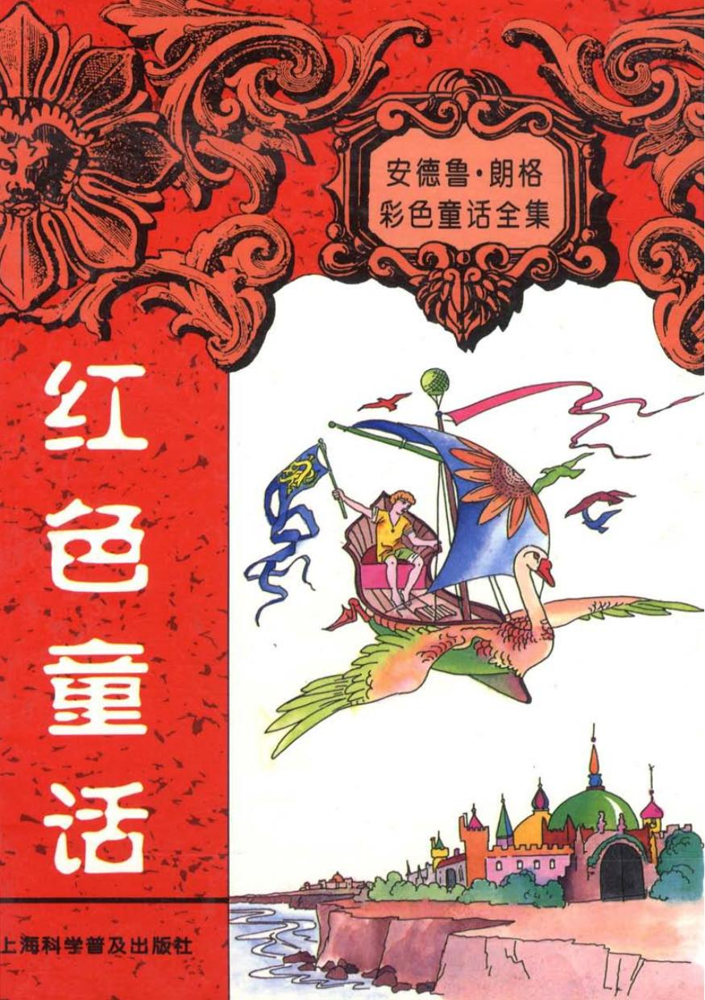

**安德鲁·朗格彩色童话全集**
红色童话

陆振慧 何越译

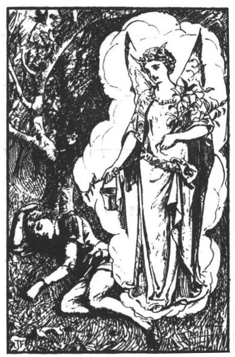

上海科学普及出版社

（沪）新登字第 305 号

Edited by Andrew Lang
The Red Fairy Book

Published by Longmans, Green, and Co. in 1890

---

安德鲁·朗格彩色童话全集
**红色童话**

陆振慧 何越译

---

责任编辑：钟海谷
技术编辑：万福棠
出版：上海科学普及出版社（上海曹杨路 500 号邮政编码 200063）
发行：新华书店上海发行所
印刷：上海市委党校印刷厂
开本：850×1168 1/32
印张：12
插页：4
字数：289000
版次：1997 年 7 月第 1 版 1997 年 7 月第 1 次印刷
印数：1-8000
书号：ISBN 7-5427-1295-0/G·404
定价：14.00 元

---

（本版图书凡印刷、装订错误可及时向承印厂调换）

| 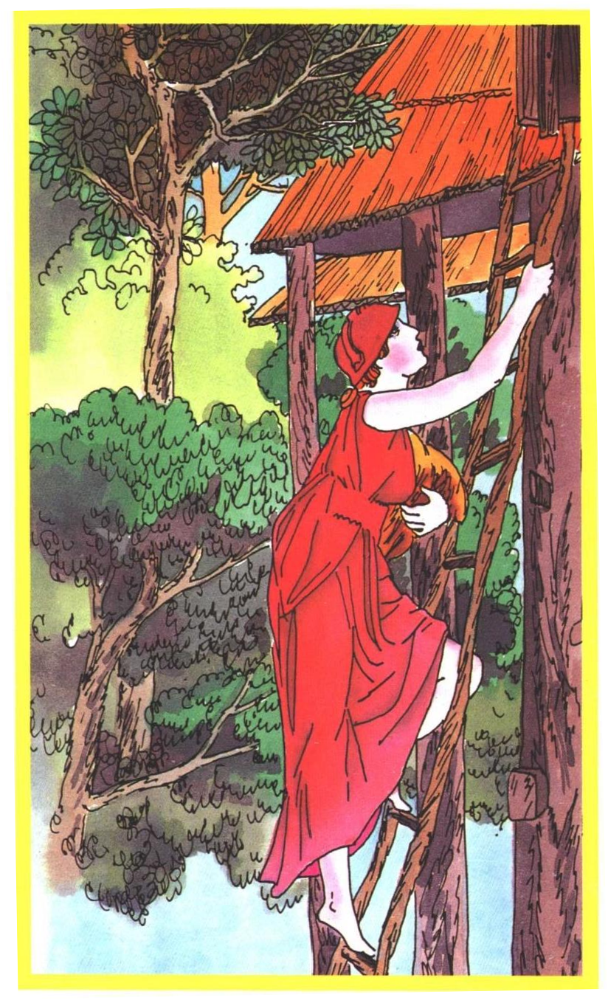 |
| :----------------------------: |
|           《猪驸马》           |

 

| 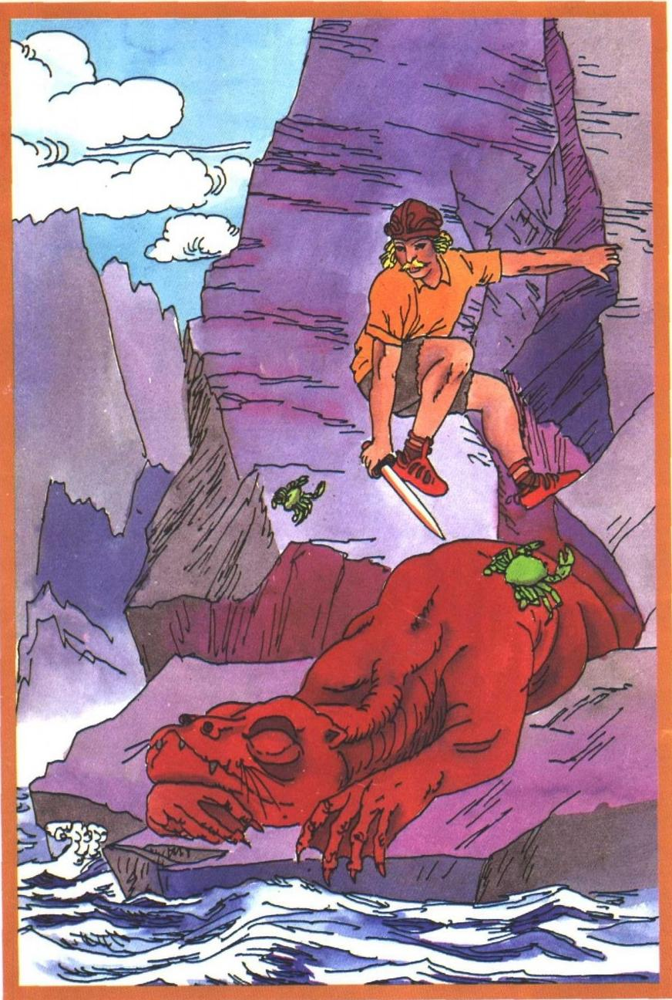 |
| :----------------------------: |
|         《怪兽诺尔伽》         |

 

| 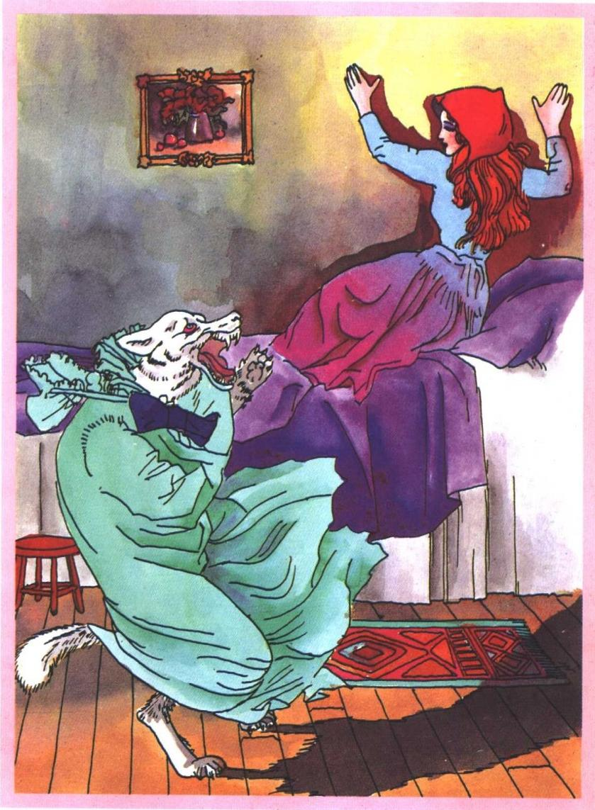 |
| :----------------------------: |
|      《小金帽的真实故事》      |

 

| 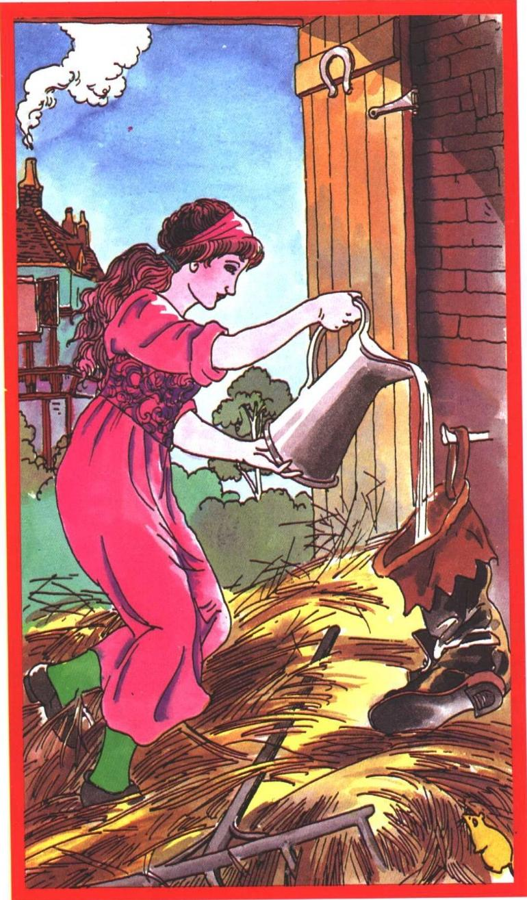 |
| :----------------------------: |
|         《三个小矮人》         |

 

| 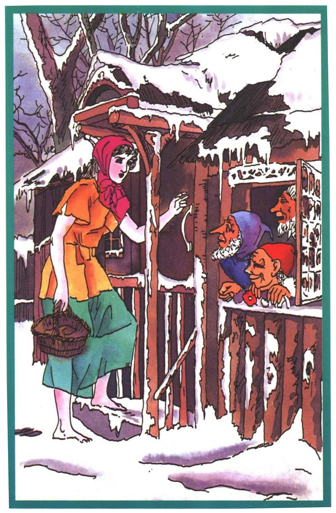 |
| :----------------------------: |
|         《三个小矮人》         |

 

| 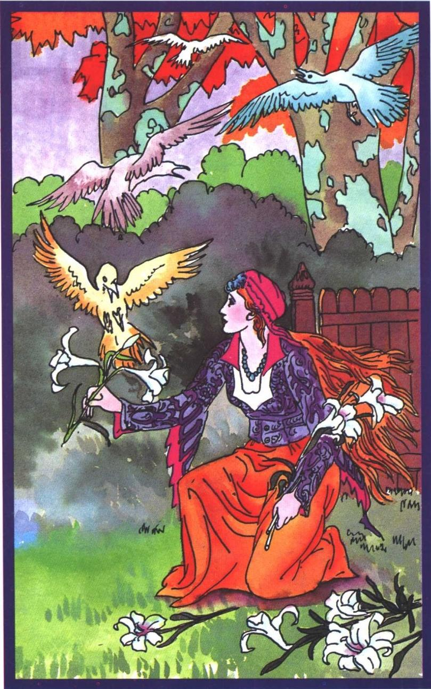 |
| :----------------------------: |
|         《十二个兄长》         |

 

| 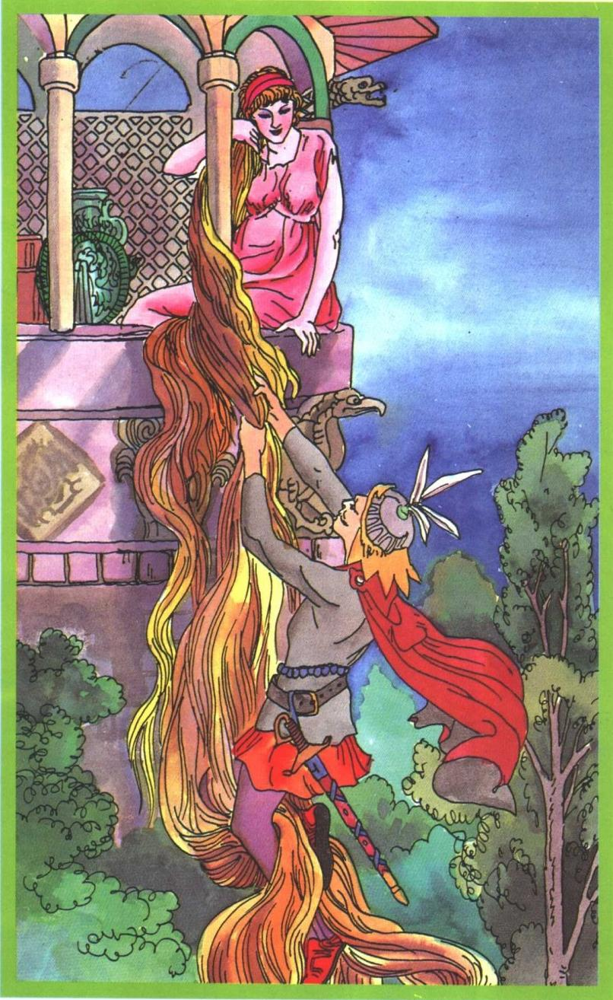 |
| :----------------------------: |
|           《雷蒙娜》           |

 

| 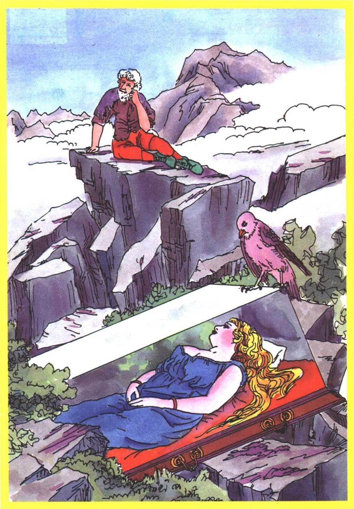 |
| :----------------------------: |
|          《白雪公主》          |

 

---

## 前言

《安德鲁·朗格彩色童话全集》是英国著名文学家安德鲁·朗格（1844～1912）编辑的十二集童话。为了编辑这些童话，他广泛地收集英国、欧洲以至全世界的童话和民间故事。那些非英语的文字，如法文、德文、葡萄牙文、意大利文、西班牙文、加泰隆语等主要由他的妻子莱奥诺拉·布朗歇翻译和整理成英文。最先编成一集，当时编者的意图也只是编这一集。后来搜集的材料越来越多，才决定继续再编三集。其中的艰难和辛苦是外人所难以想象的，编者因此曾发誓，编成这四集以后，再也不编下去了。

四集童话的出版，效果非同凡响。不仅受到英国读者的欢迎，而且被译成多种文字，受到许多国家读者的欢迎。其受欢迎的程度赢得了一代又一代的读者，历数十年而不衰，这不仅源自编者长期的努力，也得益于世界各地广大热衷于这一题材的读者的帮助，他们纷纷把手头的作品和资料寄给安德鲁·朗格。这给了他极大的鼓舞，他一鼓作气，又编了八集。后面几集主要搜集了苏格兰、爱尔兰、加拿大、印度、葡萄牙、斯堪的纳维亚的民间故事和传说。有些则选自以神话、民间传说和英雄传奇为基础的中世纪威尔士故事集《马比诺吉昂》。

安德鲁·朗格认为，这些童话故事很难说是某个人写成的，它们从很久很久以前就流传下来，经过民间艺人和文学家的不断收集和整理，才达到了今天这样思想性和艺术性都比较好的程度。这些童话也被认为是英语、甚至也是全世界各种语言中时间跨度最大、包含地域最广、流传国家和地区最多、内容最丰富的童话集。

她是世界古典童话中的瑰宝，童话世界中永不凋谢的鲜花，被译成多种文字，得以广泛流传，一代又一代的儿童被她的魅力吸引，长大成为家长后，又为能给自己的孩子朗读和讲述安德鲁童话而自豪。

《红色童话》收集了世界各地共三十七个童话和民间故事。小读者们读了这些生动有趣的故事以后，可以看到一个出身贫苦又不肯干活的年轻人，在离家出走以后，如何在广阔的天地里经风雨，见世面，经受了严峻的考验，终于成为一个勇敢正直的人；可以看到一对兄妹在后娘的迫害下如何苦苦抗争，最后历尽千辛万苦才得到解脱。这些美丽的童话故事为我们展现了很久以前，这些地区的人民是怎样生活的，展现了他们的欢乐和悲伤，理想和追求；颂扬了勤俭朴素、助人为乐、正直忠诚；谴责了贪得无厌、懦弱无能、奸诈狡猾。

与《安德鲁·朗格彩色童话全集》中的其他各集一样，《红色童话》中的故事充满了当地的风土人情和乡村气息，展现了从冰雪覆盖的北极圈到赤日炎炎的非洲大陆的美丽风光。读者们可以从中领略到许多乐趣，懂得什么是正义，什么是邪恶；什么值得爱，什么该去恨；而且还会对这些地区的人文历史和地理概貌有所了解，从而更加热爱生活，热爱我们这个世界。

 
 

**目录**

[TOC]

 
 

## 十二个跳舞的公主

从前，在蒙蒂涅·絮·罗村住着一个小放牛娃，没爹又没妈，他的真名叫米歇尔，但人们总是叫他斯达·盖泽尔（意思是“盯着星星看的人”），因为每当他赶着牛群去放牧时，总是仰着头看天，似乎除了星星他什么也不看。

他长着白皙的皮肤，蓝色的眼睛和一头卷发。村里的姑娘们见他走过时都喜欢在后面喊：“喂，斯达·盖泽尔，你在干嘛？”米歇尔总是头也不回地说：“没干嘛。”

事实上他是觉得这些姑娘不好看：颈脖子晒得那么黑，一双手又粗又红，衣裙制作粗糙，脚上就穿着木鞋。他曾听说过在别的什么地方有这样一些姑娘：雪白的头颈，纤细的双手，穿着纺制精细的丝织衣裙，还有花边饰带。这些姑娘被称为公主。每当他和伙伴们围坐在篝火旁，别人对着跳动的火苗闲聊一些日常琐事时，他却梦想着自己有幸娶到了一位公主。

八月中旬的一天中午，阳光灼热，米歇尔吃完了一片当作午饭的干面包后，走到一棵橡树下躺着休息。睡梦中一位穿着金色长袍的美丽姑娘来到他的面前对他说：

“到贝乐城堡去，在那儿你可以娶到一位公主。”

晚上，小放牛娃把那位金袍姑娘的话仔细掂量了一番，然后把梦说给村里人听。然而，像往常一样，人们总是笑话他这个只会对星星盯着看的人。

第二天的同一时间，他又走到那棵树下躺下休息了。梦中，那位金袍姑娘再次来到他的面前对他说：“到贝乐城堡去，你将娶到一位公主。”

晚上，米歇尔告诉朋友们，他做了同样的梦，可是结果引来更多的耻笑。“没关系，”他对自己说，“假如那个姑娘出现三次，我就照她的话去做。”

第三天，全村的人都惊呆了，就在下午两点，大家听到一个声音在唱：

> “啊来噢，啊来噢，
> 看我的牛群怎么走！”

歌声来自放牛娃，他正赶着牛群进牛棚哩。

牧场主大发雷霆，狠狠地骂了他一顿。可是他平静地说：“我要走了。”然后把衣服包好，跟所有的朋友道声别，就态度坚定地找寻他的幸福去了。

整个村子沸腾了。人们站在小山顶上，望着斯达·盖泽尔拄着拐杖，背着包袱，一步一步坚定而又艰难地向山谷深处走去的身影，都忍不住笑得前仰后合。

当然，这种情形无法不让人发笑。

离贝乐城堡方圆二十英里的地方，人们都知道，城堡里住着十二位绝代美人，她们不仅长得美，而且十分高傲。她们是纯正的皇家血统，个个都敏感得很，即使厚床垫下藏着一颗豌豆，她们也能立刻察觉出来。

到处都在传说，她们过的是真正的公主生活，每天很晚才睡，到第二天中午才起床。十二张床放在同一房间里。有件事很出奇：尽管她们的房门外锁着三道门，每天清晨却总发现她们的锦缎绣花鞋磨出许多小洞。

问她们一整夜都在干什么，她们总回答说在睡觉。确实，她们的房间里并没传出一点声音，可是，鞋子是不可能自己磨破的呀！

最后，贝乐城堡公爵命令吹号集合，宣布不管什么人，只要能找出他女儿鞋子磨穿的原因，就可以任他挑一个公主做他的妻子。

公告一发布，许多王公贵族们都赶来碰运气。他们整夜藏在公主房间的门后观察公主的动静，可一到早晨，这些王子便都消失了，谁也不知道他们去了哪儿。

米歇尔来到城堡直接走向园丁，自告奋勇要找活儿干，碰巧一个在花园干活的小伙计刚被派到别处去，尽管斯达·盖泽尔看上去不很强壮，园丁还是收下了他，园丁觉得他漂亮的脸蛋和一头卷曲的金发一定会使公主们开心的。

米歇尔接到的第一件工作，就是每天在公主们起床后给她们每人送一束鲜花。米歇尔觉得，要是没有比这更糟的事情做，他还是能对付好的。

他站在公主房门外，提一只大花篮，里面放着十二束鲜花。他给每位公主献上一束鲜花。公主们接过花，看也不看他一眼；只有年纪最小的公主丽娜，闪着一双天鹅绒一般的黑黑的大眼睛，盯着斯达·盖泽尔看了一眼后，突然惊叫起来：“哎呀，他真漂亮——我们新来的送花郎！”其他公主立刻大笑起来，最年长的公主马上指出，公主是不可以屈尊去看一个花匠的。

现在米歇尔已经十分清楚，那些试图来碰运气的王子们最终是个什么结局了。可是，丽娜公主那双美丽的大眼睛似乎在鼓励他也去试试自己的运气。只是他暂时还没这个胆量，他怕被人嘲笑，更怕因为冒失被逐出城堡。

然而，斯达·盖泽尔的梦中又出现了那位金袍姑娘：她一只手里拿着两棵月桂树苗，一棵樱桃色的，一棵玫瑰色的；另一只手里拿着一把金耙、一只金桶和一条丝巾。她对他说：“把这两棵树苗种在两只大花盆里；用这把金耙平土，用这只金桶浇水，用这条丝巾揩干。等到它们长到一个十五岁少女那么高时，你就对它们说：‘我美丽的月桂，我用金耙为你平土，用金桶为你浇水，用丝巾为你揩干。’然后你向它们要求你想要的东西，这两棵树就会满足你。”

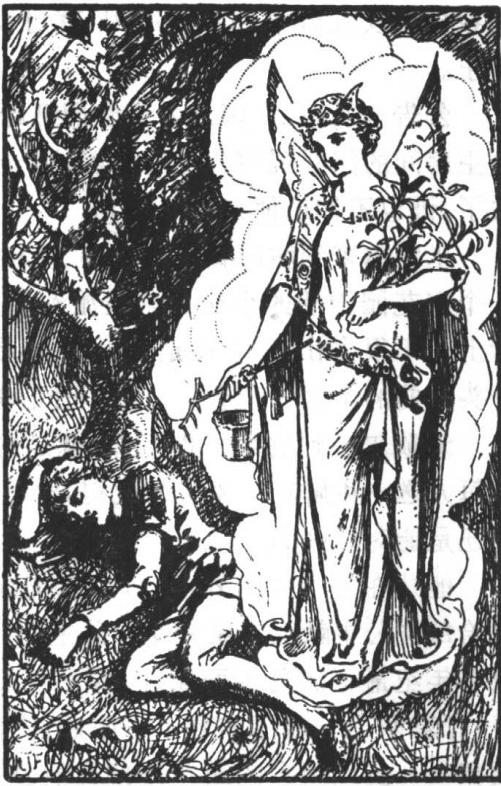

米歇尔向金袍姑娘道了谢。醒来发现身旁果然长出两棵灌木一般高的月桂树。他认真地照金袍姑娘的话去做了。

两棵树长得很快，等它们有一个十五岁少女一般高时，米歇尔对樱桃色的月桂树说：“我可爱的月桂树，我用金耙为你平土，用金桶为你浇水，用丝巾为你揩干，告诉我怎样成为一个隐形人。”这棵月桂树顿时开出一朵美丽的白花，米歇尔把它摘下，别在衣服的纽扣上。

那天晚上，公主们上楼睡觉了，他悄悄跟在后面，赤着脚，未发出一点声音，然后藏在一张床底下，把身子紧紧缩起来。

公主们翻箱倒柜，拿出漂亮的服装，一边对着镜子打扮起来，一边相互赞美彼此的装束。

米歇尔藏在床下什么也看不见，但她们说的话他可句句听得清。她们跳啊、笑啊，很高兴。后来大公主说：“小声点，妹妹们，父母们会不耐烦的。”过了一小时，斯达·盖泽尔听不见声音，就向外偷看一眼，只见十二姐妹身着华丽服装，脚穿轻盈的锦缎鞋，手捧他献的鲜花。

“都准备好了吗？”大公主问。

“好了，”其余十一个公主齐声回答，一个个在大公主后面站好了队。

大公主拍了三下手，一扇活的地板门打开了。公主们沿着一个秘密楼梯消失了。米歇尔赶紧追上去。

他走在丽娜公主身后，不小心踩着了公主的长袍。

“有人跟在我后面，”公主大叫起来，“他们抓住了我的长袍。”

“别傻里傻气，”大姐说，“就你疑神疑鬼，是颗钉子钩住你啦。”

楼梯很长，她们走啊走啊，最后来到一个通道，尽头有一扇门，门上仅仅上了一道闩。大公主打开门，她们立刻置身于一片可爱的小树林，树叶上的露珠在皎洁的月光下闪着银色的光芒。

又穿过一片树林，那儿的树叶闪着金色光芒。再穿过一片树林，那儿的树叶闪着钻石般的光芒。

再后来，斯达·盖泽尔看到一个很大的湖，湖滨停泊着十二只遮篷小船，上面坐着十二位王子，每人拿一支桨，看上去正在等候公主们。

公主们各自上了一条船，米歇尔偷偷上了小公主的船。别的船都划得很快，唯独小公主那条船总是落后，因为它超载了。

“我们平时也很快，”公主说，“今天怎么啦？”

“我也不知道，”王子说，“我向你保证我是在拼命划。”

湖的另一边，小花匠看见了一个灯火辉煌的美丽城堡，里面传出提琴、钢鼓和小号奏出的美妙的音乐。

不一会儿船到了岸边，所有人都下了船。王子们把小船拴牢，挽着公主们走进城堡。

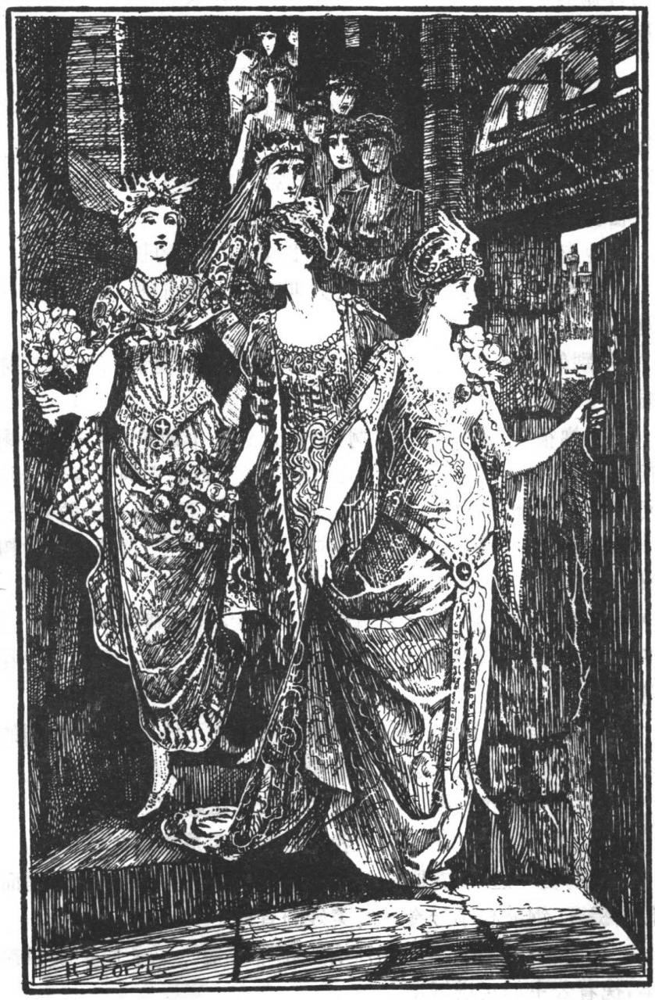

米歇尔随他们进了舞厅。里面到处是镜子、灯光、鲜花和锦缎帷幕。斯达·盖泽尔被眼前景象弄得眼花缭乱。

他躲在一个角落里，对公主们优雅的舞姿和美丽的容貌仰慕不已。她们的美多姿多彩：肌肤洁白的，美；肤色黝黑的，美；粟色头发的，美；卷曲处颜色更深的，美；金发披肩的，也美。他从未一下子见过这么多美丽的公主聚在一起。不过，在小放牛娃的眼里最好看最动人，最最令他心驰神往的，还是那位有着天鹅绒般黑眼睛的小公主。

她跳得多么热烈呵！斜倚在舞伴的肩头，像旋风一般地旋转着；红朴朴的脸颊、亮晶晶的眼睛。显然她爱跳舞胜过世上任何东西。

可怜的小放牛娃开始妒嫉那些与小公主共舞的英俊男子了（她的舞姿真美啊！）。但他说不清为什么要妒嫉他们。

那些英俊的男子其实就是试图窃取公主秘密的王子们，到现在至少已有五十位这样的王子了。公主们让他们喝下一种魔药，他们的心便从此像冰一样凝固，除了跳舞，他们再没有别的激情。

她们不停地跳舞，直到鞋子磨穿为止。鸡啼三遍时，提琴声停止了。黑奴们端上美味的夜餐，其中有糖渍柑橘花、裹糖屑的玫瑰树叶、紫罗兰花粉、脆煎猪肉片、薄脆饼及其他一些菜肴。人人都知道，这些是公主们最爱吃的食物。

吃完夜宵，他们又全返回船上。这一次斯达·盖泽尔跟着大公主。她们依次穿过树叶闪着钻石光芒的树林、树叶闪着金光的树林和树叶闪着银光的树林。为了证实他的所见，斯达·盖泽尔经过最后一片林子时折下了一根树枝。丽娜公主转身时听见树枝折断的声音。

“什么声音？”她问。

“没什么，”大姐回答，“不过是栖息在城堡塔楼里的猫头鹰在叫而已。”

她说话的时候，米歇尔已钻到了最前面，爬上楼梯，第一个进了公主的房间，推开窗，顺着攀附在墙壁上的蔓藤滑下去，正好落在花园里。此时太阳刚刚升起，他又该开始他的工作了。

那天，米歇尔送花时，把闪银光的树枝悄悄藏在给小公主的花束里。丽娜公主发现树枝很是惊讶，不过她什么也没跟姐姐说。在榆树荫下散步时，她碰见了小放牛娃。她本想停下跟他说话，可临时又改变主意，装作若无其事地继续朝前走去。

当天晚上十二个姐妹去跳舞，斯达·盖泽尔又跟在了后面；

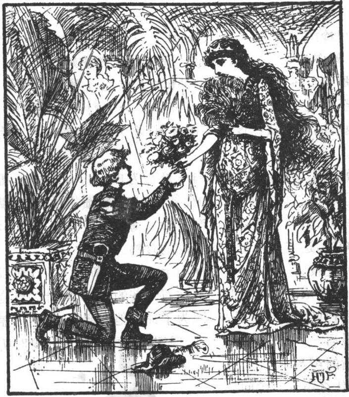

过湖时仍然上了丽娜的船。这一次是王子开始抱怨船怎么这样沉了。

“是天太热的缘故吧”，公主说，“我也觉得非常热。”

舞会期间她四下打量，可哪儿也不见小花匠的身影。

返回的路上，米歇尔从叶子闪着金光的树林里折下一根树枝。这回大公主听到了劈啪声。

“没什么，”丽娜说，“只不过是栖息在城堡塔楼的猫头鹰在叫而已。”

丽娜一起床就发现了花束里的树枝。姐姐们下楼时，她故意拉在后面，然后对放牛娃说：“树枝是哪儿来的？”

“殿下您知道。”米歇尔回答。

“这么说，你一直在跟踪我们？”

“是的，公主。”

“你怎么会？我们根本没有见到你。”

“我把自己藏起来了。”斯达·盖泽尔平静地回答。

公主停了一会儿说：

“你知道了我们的秘密！——别泄露出去。这是对你谨慎的奖赏。”说着扔给他盛着金币的钱包。

“我的沉默不卖钱。”米歇尔一边回答一边走了出去，一动没动地上的钱包。

以后的三个晚上，丽娜既未看见也未听说任何不寻常的事情发生，到了第四个晚上，她听见树叶闪着钻石光芒的林子里有沙沙声，次日她的花束里便有了一根那样的树枝。

她把斯达·盖泽尔叫到一旁，用尖刻的声音对他说：

“你知道我父亲为获得我们的秘密，愿意出什么代价吗？”

“知道，公主。”米歇尔回答说。

“你不打算告诉他吗？”

“那不是我的本意。”

“你害怕吗？”

“不，公主。”

“那你为什么这么谨慎？”

米歇尔没有说话。

姐姐们看见丽娜同小花匠说话，都奚落她：

“你干嘛不嫁给他呀？”大姐说，“你也会成为一个花匠，那职业多可爱呀！你可以住在花园一角的小屋里，你丈夫从井里把水抽上来。我们起床后，你给我们献上花束。”

丽娜公主生气极了。那天，当斯达·盖泽尔向她献花时，她脸上充满了以前未有过的蔑视的神情。米歇尔依然举止恭敬，他从未抬眼偷视过她。那一天，她却时时觉得他就在身边。

终于她下了决心，要把一切都告诉给大姐。

“什么！”大姐听后惊讶地说，“这个无赖，他知道了我们的秘密！而且你从来没说过！我必须立刻除掉他。”

“怎么除？”

“怎么，当然是送他去塔楼的地牢。”这是古时候美丽的公主们惯常用来处罚那些知道情况太多的人的办法。然而，要用这种办法来堵小花匠的嘴，小公主似乎一点也不赞成。这个小花匠毕竟什么也没对父亲说呀。

大公主和小公主终于达成协议，把这个问题交给其他十个姐妹来决定。不料所有十个姐姐全都站到了大公主一边，这下，小公主只好宣称，假如她们碰那个小花匠一个手指头，她就自己到父亲那儿去公布秘密。最后，她们决定对米歇尔来一次考验：带着他去参加舞会，晚餐结束时给他灌下魔药，让他也像别的人一样从此沉醉不醒。

她们派人叫来了斯达·盖泽尔，问他是怎么了解到秘密的，但是他什么也不说。

大公主用十分威严的口气；给他下了一道众公主一致同意了的命令。

他只是回答：“我服从。”

其实，众公主商议的时候，他是在场的，只是隐了形别人看不见。他什么都听见了。他还是下决心去喝那迷魂的魔药，为了他心爱的人，他宁愿牺牲自己。

为了不在舞会上丢丑，他立刻来到桂树面前说：

“我可爱的玫瑰色月桂树，我用金耙为你平土，用金桶为你浇水，用丝巾为你揩干，把我打扮成王子吧。”

一朵美丽的粉红色的花出现了，米歇尔采下它，发现自己已经身着天鹅绒服装，其颜色纯黑，正如小公主的眼睛；头上有一顶与衣服相配的帽子；衣服纽孔上还有一枝菱形羽毛和一朵玫瑰红的月桂花做装饰。

如此装扮好后，他晚上来到贝尔城堡公爵面前，获准去探听公主们的秘密。他看上去气质高贵，谁也没认出他到底是谁。

十二个公主上楼就寝去了，米歇尔跟着她们，站在打开着的门后，直到她们发出出发的信号。

这一次他没有乘坐小公主的船。他先伸出手臂让大公主挽着，然后轮流与每一位公主跳舞。他举止如此优雅，所有的公主都以与他共舞为荣。最后轮到与小公主跳，小公主立刻发现他的舞姿无与伦比。但是他没敢跟她说一句话。

他领着她回到座位上时，她以一种嘲弄的口吻对他说：

“你现在满意了，人人都尊敬你这位王子。”

“别怕，”斯达·盖泽尔轻柔地说，“你永远不会成为花匠之妻。”

小公主惊恐地望着他，还没来得及说一句话，他就走开了。

锦缎鞋磨穿时，提琴声终止了。黑奴们摆好餐桌。米歇尔被安排坐在大公主身旁，对面正好是小公主。

她们把最好的佳肴和美酒推到他面前。为了让他彻底沉醉，她们又你一言我一语地对他大加恭维谄媚。

但是他小心地把握住自己，绝不让自己被灌醉，无论是甘醇美酒，还是好听的赞美辞。

最后大公主做了一个手势，一位黑人侍从端上一只大金杯子。

“这个被施了魔法的城堡对你来说已无秘密可言了，”大公主对斯达·盖泽尔说，“让我们为你的胜利干杯吧！”

他的目光在小公主脸上停留了一会儿；然后毫不犹豫地举起金杯。

“不要喝！”突然，小公主大叫一声，“我宁愿做个花匠之妻。”说着，她哭了起来。

米歇尔把杯中的酒往身后一泼，一跃从桌上跳过去，跪倒在丽娜脚下，其他王子也效仿着跪拜在各位公主面前。每位公主选定一位丈夫，并扶起来站在自己身旁。魔法终于破除了。

十二对夫妇登上曾经迷惑了许多王子的小船，然后穿过三片树林，走进地下通道的门时，只听一声巨响，仿佛那座被施了魔法的城堡一下子土崩瓦解了，地球上出现了一座新的城堡。

他们径直来到贝乐公爵的房间，公爵刚刚醒来。米歇尔手举金杯，公开了鞋洞的秘密。

“那么你挑吧，”公爵说，“随你挑选一位公主。”

“我已经挑好了，”小花匠把手伸给小公主，公主满脸绯红，羞涩地垂下双眼。

丽娜公主并未成为花匠之妻，相反，斯达·盖泽尔变成了一位王子。婚礼举行之前，公主一再要求她的爱人说出他是怎样发现鞋洞的秘密的。

于是他领她来到那两棵桂树面前，说出是它们帮了忙。她像个精明的小姑娘，认为有了桂树，他就会占太多的优势，就连根砍下两棵桂树，扔进火里化为灰烬。

这就是为什么村姑们夏夜在月光下跳舞时唱下面这首歌的原因：

> “我们再也不去森林，
> 因为月桂树已被砍掉。”

 

## 五月花公主

从前，有一位国王和王后，他们的孩子一个接一个的都死了，最后只剩下一个小女儿。王后一筹莫展，不知到哪儿才能找到一个出色的保姆，把她抚养长大。她派一个传令官到各个街头吹号召集所有最好的保姆，去觐见王后，以便王后挑选一个最能胜任照料小公主的人。到了指定的那天，王宫里挤满了来自世界各地、自愿接受挑选的保姆。王后坐在王宫附近的树荫下，她宣布先见见其中的半数应聘者，于是这半数人被带到林子里。

一切按部就班地进行着。保姆们向国王与王后行过屈膝礼后，排成一行让王后挑选。她们多数都是金发碧眼、白白胖胖，妩媚可爱，只有一个人皮肤黝黑、相貌丑陋，说一种谁也听不懂的奇怪语言。王后想不通她怎么也敢来应聘。人家叫她走，她就不走。听到王后叫她走，她咕哝了一声，从队伍面前走过去，藏在一个树洞里，往外偷看接见的情形。王后没有多加考虑，选中一个粉红脸蛋的漂亮保姆，谁知刚要宣布，一条蛇从草地里钻出来咬住了保姆的脚后跟，保姆当即倒地身亡。出了这种事，王后很恼火，不过很快又选中一位。这一位刚迈出一只脚，一只老鹰从头顶飞过，丢下一只大乌龟正好砸在她的脑袋上，顿时脑袋像蛋壳一样被砸得粉碎。王后被这情景吓坏了，不过，她还是选出了第三个保姆。然而，这一次运气也不佳，因为这个中选者走路太急，一头撞在一根树枝上，被荆棘刺瞎了眼睛。王后沮丧地惊叫起来，说肯定有谁在恶意作怪，今天不选了。她站起身刚准备回宫，只听身后传来一阵恶笑，笑声很响，像敲钟一样，她转身一看，原来是被她撵走的丑八怪，正幸灾乐祸地嘲笑在场的所有人，特别是王后。王后殿下非常恼火，正要下令逮捕她，这个女巫——她确实是个女巫——挥动两下魔杖，召来一辆由几条飞龙驾驭的火焰车，女巫登上车子在空中盘旋，发出种种威胁的喊叫。国王见此情形惊叫起来：

“啊呀！这下我们真的完了。她不是别人，正是女妖卡拉波丝，她一直对我怀恨在心，因为我小时候闹着玩，有一次把硫磺倒在她粥里。”

这下王后哭起来了：

“我要早知道她是谁，会千方百计跟她交朋友的，这下我们全完了。”

见王后惊吓成这样，国王很过意不去。他建议马上召集大臣开一次会，商讨阻止卡拉波丝将给小公主带来灾难的良策。

于是所有的朝臣被召集进宫，每一道门窗都关严，每一个锁孔都堵死，以免他们说的话被人偷听。他们议了又议，最后商定，把方圆万里的仙女都请来参加公主的洗礼，不过洗礼的日期要绝密，以防卡拉波丝乘虚而入来捣乱。

王后和贵妇人们动手准备给被邀的仙女分发礼物：每人一件蓝色天鹅绒的斗篷、一件杏黄色缎裙、一双高跟鞋、几枚锋利的缝衣针和一把金剪刀。王后知道，所有的仙女中只有五位能在预定的那一天按时到来。她们一来就开始赋予公主各种天赋。第一个仙女说，公主将有十全十美的容貌；第二个仙女说，公主将有无穷无尽的才智，无论什么事情，只需向她解释一遍就够了；第三个仙女说，公主将有夜莺般的歌喉；第四个仙女说，无论公主想干什么，她都能成功；第五个仙女刚张嘴想说，忽听烟囱里一阵隆隆巨响，卡拉波丝满身烟灰，从烟囱里滚下。她大声嚷道：

“我说，她在二十岁以前是不幸者中最不幸的人。”

王后和其他仙女们苦苦哀求她再好好想想，不要对可怜的小公主这样狠心，毕竟小公主从来没有得罪过她。可是那个丑陋的老妖婆只是咕哝了一声并不答腔。而刚才最后一位没来得及许愿的仙女，想竭力弥补一下，便说公主不幸过后长命百岁、生活愉快。听了这话，卡拉波丝恶毒地哈哈大笑，唱着挖苦的歌爬上烟囱走了。所有的人都大惊失色，特别是王后。但尽管如此，她还是感激地款待了仙女们，除了别的礼物，又送给她们每人一条她们十分喜欢的美丽缎带。

即将告别离去时，最年长的仙女说，她们认为最好把公主关在什么地方，只有侍女陪伴，别人谁也不要见，等长到二十岁再说。因此，国王建造了一座塔楼，没有窗户，只用蜡烛照明；唯一的出入口是一条地下通道，每隔二十英尺便装有一扇铁门，而且道道门都设有警卫。

公主取名为五月花，因为她像春天一样清新纯洁、充满活力。她渐渐长大了，长得很美很美，一言一行都富有才智和风度。国王与王后每看她一次，心中的喜爱便增加几分。可她对塔内的生活十分厌倦，一次次请求父母带她出去，但都被拒绝了。公主的保姆，始终伴随她左右，有时给她讲述塔外的事情。公主虽然从未见过外面的世界，但什么她都一听就懂，而且分毫不差，这多亏了第二个仙女的祝愿。

国王经常对王后说：

“我们终究比卡拉波丝聪明。不管她怎么预言，我们的五月花定会非常幸福。”

王后想到能够智胜老妖婆，也开心地笑了。他们千万遍地谈这件事以至后来王后都感到厌倦了。他们让人画了公主的肖像，分送所有邻国的宫廷，因为再有四天公主就满二十岁了，那时将要决定谁会同她结婚。全城人都因为公主即将获得自由而感到高兴。消息传来，美尔林国王将派使臣为他儿子前去向公主求婚，人们更是欢天喜地。保姆什么事都会告诉公主，这件与公主切身利益最最相关的事当然不会忘记传达。她尽情描绘使臣凡法恩纳德即将进城的盛况，公主完全听得入了迷，非要亲自看看那个场面。

“我多不幸啊！”她哭着说，“整天关在这座阴暗的塔里，好像犯了什么罪似的！我从来没见过太阳、星星，也没见过马、猴子、狮子，我只在图画上见过它们。国王、王后说我到二十岁的时候就自由了，他们这么说只不过是让我高兴高兴罢了，其实他们根本不打算让我出去。”

她这一哭，保姆、保姆的女儿、摇摇篮的侍女、保育室的侍女以及塔里所有其他的人，都跟着哭了起来，因为他们大家都深爱着她。一时间塔楼里一片呜咽叹息声，好不悲惨。见大家都可怜她，公主下定决心要照自己的主意行事。她宣称，要是她们不想办法让她亲眼看一看使臣凡法恩纳德隆重的进城仪式，她就一直到死都不吃饭。

她说：“你们要是真的爱我，就一定得想法子让我办到，这件事没有必要让国王、王后知道。”

这样一讲，保姆和其他人哭得更厉害了。为了让公主改变主意，她们好话说尽，然而她们说得越多，公主主意越坚定。最后她们只好同意在塔楼墙壁上挖个小孔，从那孔里可以望到城门口。

她们没日没夜地挖呀、掏呀，费了好大的劲，才挖出一个针孔，不过这个针孔让公主头一回见到了阳光。她看得眼花缭乱，欣喜若狂，站在那儿，一刻也不肯把眼睛移开针孔，一直看到使臣的仪仗队在眼前出现。

队伍的最前面，凡法恩纳德骑在一匹白马上，随着喇叭吹奏的音响节拍跃马前进。使者的服饰华丽夺目：外衣上缀满珍珠宝石，靴子是纯金的，头盔上飘着猩红色的羽毛。一见到他，公主便失魂落魄，当即决定除了凡法恩纳德谁也不嫁。

“他的主人绝不可能有他一半英俊迷人，”她说，“我没有什么奢望，我一辈子就呆在这座沉闷的高塔里，任何东西，哪怕是乡村田间的一匹马，也比这塔更讨人喜欢。我肯定，跟凡法恩纳德一起吃面包喝清水，也比跟别人一起分享烤鸡和甜点心强得多。”

就这样，她说呀，说呀，说个没完，弄得侍女们丈二和尚摸不着头脑，不知她哪儿来的这些怪念头。她们想让她安静下来，说她地位这么高贵，刚才提到的这些事是完全不可能的。可她根本不要听，反而命令她们闭嘴。

使臣一到王宫，王后就来接她女儿。

每一条街道都铺上地毯，每扇窗口都挤满了等着观看公主的妇女们，她们手捧花篮果盒，公主一来，就把鲜花和糖果抛送给她。

她们还没来得及替公主打扮好，矮神已经骑着大象来了。他代表五个仙女，给公主带来一顶王冠、一枝节杖，一件金丝缎的长袍和一条用蝴蝶翅膀巧妙绣成的裙子。另外还送来一匣首饰，都是人们从来没见过的稀世珍宝。王后把它打开，看得眼花缭乱。然而公主却看也不看那些珍宝，她的整个心思都在凡法恩纳德身上。矮神得到一枚金币作为酬谢，许多彩带披在他身上，把他整个人都遮住了。公主送给每位仙女一台崭新的纺车，以及上等雪松木纺杆。王后说她要好好查看一下她的珍宝，然后挑出最精美的送给她们。

公主把矮神带来的豪华礼物穿戴起来，显得更漂亮了。她一路走去，人们不断欢呼：“她多美呀！她多美呀！”

队伍由王后、公主、六十个公主的堂表姐妹以及一百多名邻国公主组成。正当队伍浩浩荡荡、缓缓行进时，天空渐渐暗了下来，突然间雷声大作，雨水、冰雹倾盆而下。王后把斗篷兜在头上，所有公主和随行人员也都仿效，五月花正要学她们的样，忽然上空响起一阵令人害怕的呱呱声，成千上万只乌鸦、白嘴鸦、渡鸦和金鸦以及所有不吉祥的鸟蜂涌而来，同时一只巨枭向公主飞掠而来，把一块蜘蛛网织成绣有蝙蝠翅膀的披巾掷在她身上，接着空中又响起一阵雷鸣般的嘲笑声，她们猜测这是女巫卡拉波丝的又一次讨厌的恶作剧。

王后对这突如其来的凶兆十分恐慌，她想揭去公主身上那块不吉利的披巾，不料它紧紧粘在公主肩上，仿佛钉子钉牢一般。

“天哪！”王后叫道：“怎么才能平息我们这个敌人？我送了她五十多磅的蜜饯，五十多磅的上好白糖，还有两只最上等的火腿。难道这些全白送了，她怎么还那样生气？！”

王后在那儿哀诉时，人人都让雨淋湿了，好像刚从水里打捞上来一样。公主却依然只想着那位使臣。正在这时，使臣由国王陪同出现在公主面前。只听鼓声隆隆、号角齐鸣，欢呼声一阵比一阵高。凡法恩纳德一般从不张口结舌，可他见公主比原来所想的更为美丽端庄，竟然变得结巴了，把洋洋洒洒的致辞忘得一干二净，虽然好几个月来他一直在诵读这篇致辞，即使在梦中也能背得出来。为了争取时间以便记起其中一小部分，他向公主连连鞠躬。公主也至少行了半打屈膝礼，同时在动脑筋，如何使他摆脱窘境。最后她说：

“使臣先生，想必你要说的一切都非常美好，因为这些话是发自你内心的；不过还是让我们尽快到宫里去吧！因为天正下着倾盆大雨，邪恶的卡拉波丝看到我们湿淋淋地站在这里，一定非常开心。等我们回到雨淋不到的地方，就该轮到我们笑她了。”

听了这番话，使臣恢复了伶牙利齿，殷勤地对公主说，显然是女妖预见到公主明亮的眼睛会点燃起火焰来，所以下场暴雨来熄灭它们。说完，他伸出手来搀扶公主，公主温柔地说：

“你不可能猜到我对你的心意，凡法恩纳德先生，我有必要直截了当地告诉你，我第一眼见你骑着欢跃的骏马进城时，就感到遗憾，你来替别人说话而不是替你自己。因此，要是你的想法和我的一样，我愿意嫁给你而不是你的主人。当然，我知道你不是一位王子，但那并不影响我爱你，你就是我心中的王子。我们可以离开宫殿，找一个温暖舒适的小角落住下，整天欢欢喜喜地过日子。”

使臣以为自己在做梦，简直不敢相信这么一位可爱的公主会对他说这种话。他不敢作答，只是紧紧捏住公主的手，捏痛了她的小指头，可她并没有叫痛。

到了宫里，国王吻了吻女儿的双颊，说道：

“我的小心肝，你是否愿意同伟大的国王美尔林的儿子结婚？使臣先生是代表他来求婚的。”

“随您的便，陛下！”公主边说边行礼。

“我也同意，”王后说，“那就准备摆宴吧！”

一切进展顺利，人人都尽情享受那些美味佳肴，只有五月花和凡法恩纳德两人，他们相互看着对方，忘记了周围的一切。

宴会之后是舞会，之后又是芭蕾表演，等这一切结束，人人都累坏了，以至坐在座位上就睡着了。只有这对相爱的人儿没有一丝睡意。公主见没有什么值得担心了，便对凡法恩纳德说：

“让我们赶快逃走吧！再没有比这更好的机会了。”

她拿了国王剑鞘上镶有宝石的短剑和王后的围巾，把手伸给手提灯笼的凡法恩纳德。他们走出宫殿，沿着泥泞的街道走到海边去。他们登上一只小船，老船夫正在酣睡。他惊醒过来，看见美丽的公主，一身珠光宝气，还披着蜘蛛网披肩，不知如何是好。公主命令他开船，他只有服从命令。天空漆黑一片，既不见月亮，也不见星星，好在王后的围巾上有颗红宝石散发出相当于五十枝火炬的光亮。凡法恩纳德问公主想到哪儿去，公主说去哪儿都行，只要身边有他相伴。

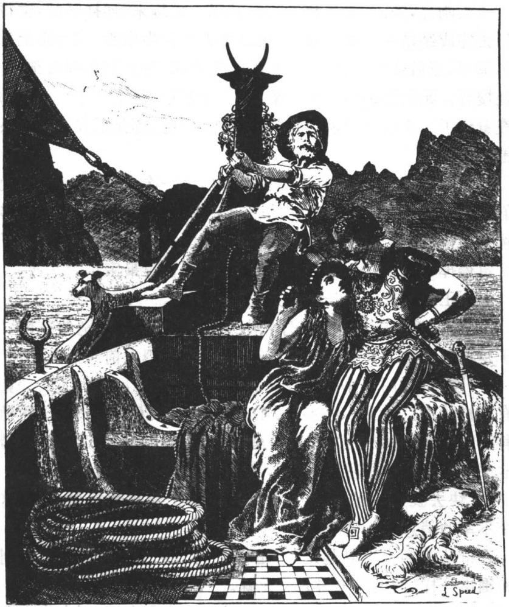

“可是公主，”他说道，“我不敢带你回美尔林的宫廷去；到了那里他绞死我都会嫌轻。”

“那样的话，”她回答说，“我们最好去松鼠岛，那儿偏僻荒凉，没有人会追到那儿去。”

于是她命令老船夫把船驶向松鼠岛。

天刚亮，国王、王后和所有的朝臣一觉醒来，揉揉眼睛，觉得该去完成结婚的准备工作了。王后要人把围巾拿来，因为系上那条围巾，王后会更漂亮。于是到处忙乱开来，侍女们东奔西跑，到处搜寻。她们找遍每一个角落、每一个衣柜，甚至一个个火炉都查看到了。王后亲自从顶楼找到地窖，但是，哪儿也找不到那条围巾。

这时，国王发现不见了短剑，于是，又一次大搜寻开始了。他们打开了钥匙都丢了一百年的一只只箱子、柜子，找出许许多多稀奇古怪的玩艺儿，可就是没有短剑。国王气得拔掉了胡子，王后急得掉了头发，因为那围巾和短剑是王宫里最宝贵的东西。

国王看到搜寻只是白化力气，便说道：

“没关系，让我们赶紧把婚礼办了，以免再丢了别的东西。”

于是他问公主在什么地方。这时，公主的保姆上前回话说：

“陛下，这两个小时里我一直在找公主，哪儿也找不到。”竟有这样的事！王后再也受不了啦，尖叫一声便昏厥了过去。两桶科隆香水倒在她身上才使她苏醒过来。她醒后，人们又惊慌失措地去寻找公主，可还是找不到，于是国王对侍从们说：

“快去找凡法恩纳德，他肯定还在哪个角落睡觉呢，去把这个不幸的消息告诉他吧。”

侍从又到处搜寻起来，可是使臣也不见了，就像公主、短剑和围巾一样，他也消失得无影无踪。

国王召集朝臣和卫队，在王后陪同下来到大厅。因事先未准备详细讲稿，所以命令保持三小时肃静。三小时后他作了如下讲话：

“不论大人物、小人物，个个都仔细听着！我亲爱的女儿五月花失踪了。她是被人拐走，还是自己出走，我现在还说不准。王后的围巾和我的短剑，那是比黄金还贵重的东西，也不见了；更糟糕的是使臣凡法恩纳德也到处找不到。我非常担心他的主人——美尔林国王，得不到回音，会找到我们这里来，控告我们把他剁成了肉酱。如果我还有钱，也许这事我还能应付过去，不过我跟你们说句实话，为了置办这场婚礼，我已耗尽了全部财力。我亲爱的臣民，请为我出出主意，我怎样才能找回女儿、凡法恩纳德以及别的东西。”

这是国王最为精彩的一次演说，人们对它赞叹不已。这时宰相站了出来：

“陛下，见您如此伤心我们很难过。我们愿意献出我们最有价值的一切东西，以驱赶您的悲哀。不过这好像是女巫卡拉波丝的又一个诡计。公主的二十年厄运似乎还没有完全过去；而且，假如一定得说出这个事实的话，那就是，我注意到使臣凡法恩纳德和公主相互爱慕。也许，这能提供一点有关他们失踪的线索。”

王后赶紧打断他，“请注意你说的话，阁下，告诉你，五月花受过良好的教育，根本不可能爱上一个使臣的。”

这时，保姆走上前来，跪倒在地，坦白她们在塔楼墙壁上挖过一个小孔，公主看见使臣后曾经宣称过非他不嫁。王后气急败坏，当即把保姆、摇摇篮的侍女和保育室的侍女痛斥一顿，吓得她们腿直打哆嗦。海军上将“三角帽”先生却打断她说：

“让我们马上去追那个成事不足、败事有余的凡法恩纳德吧！无疑他把公主拐走了。”

大厅里响起一阵热烈的掌声，所有人齐声喊道：“要想尽办法捉住他！”

就这样，一部分人驾船出海去了，另一部分人则打着鼓，吹着号，从一个王国走到另一个王国，一见有人群的地方就大声喊道：

“不论什么人，只要说出凡法恩纳德把公主藏在什么地方，漂亮娃娃、各种糖果、小剪刀、绣金长袍和锦缎帽子等等可任意挑选。”

但是，回答到处都是一样的：“我们没有见过他们，你们再往前走走吧！”

然而，去海上的人却幸运得多，因为船划出去不远，就发现前面有一处光亮，像是熊熊燃烧的大火。起先，他们不敢靠近，不知那是什么东西，但是渐渐地他们看清那光亮在松鼠岛上是静止不动的，你可以猜到，那光亮正是红宝石发出的。公主和凡法恩纳德在岛上登陆后给了船夫一百枚金币，让他发誓绝不把带他们来松鼠岛的事告诉任何人。可是没想到他船划出去不久，就闯入了舰队中间，还没来得及逃跑，已被海军上将发现，上将立刻派一只小船去追赶他。

经过搜查，他们发现船夫口袋里有金币，而且都是新铸造的，上面有纪念公主结婚的印记。海军上将断定这是公主给他的赏钱。可是船夫什么也不肯说，假装是个聋哑人。

上将说：“哼！他又聋又哑是吧？把他绑在桅杆上，让他尝尝九股粗的皮鞭，那可是治疗聋哑最好的药方！”

老船夫一看他可不是说着玩儿的，就把一位骑士和一位小姐让他送上松鼠岛的事情一五一十地坦白了出来。上将知道那必定是公主和凡法恩纳德，就下令舰队包围松鼠岛。

这个时候，五月花公主正昏昏欲睡，在岸边找了块隐蔽的草地，躺下就沉睡了过去。而凡法恩纳德一点不困却饿得要死，他过去推醒公主，生气地说：

“请问，殿下，你究竟打算在这儿呆多久呢？这儿什么吃的也没有，尽管你很迷人，可光看你不能填饱肚子。”

“你说什么，凡法恩纳德！”公主坐起身揉揉眼睛说，“有我和你在一起，难道你还要别的东西？你应该时刻感到幸福才是。”

“幸福！”他叫了起来：“应该是不幸。我真希望你重新回到黑暗的塔里去。”

“哎呀！亲爱的，别发火，”公主抚慰道：“我这就去找找看，看有没有一些野果子给你吃。”

“我希望你找到一匹狼吃掉你，”凡法恩纳德咆哮道。

公主十分沮丧地在林子里东跑西跑，荆棘划破了衣服，刺痛了纤细的手指，也没能找到可吃的东西，只好伤心地回到凡法恩纳德身边。看见她两手空空地回来，他站起来离她而去，嘴里一个劲地发牢骚。

第二天，他们又去寻找食物，仍然一无所获。

“唉！”公主说，“要是我能给你找到吃的东西，我自己挨饿倒无所谓。”

“我也无所谓，”凡法恩纳德接着说。

“这不可能！”公主说，“难道我饿死，你也不在乎？哦，凡法恩纳德，你说过你爱我的！”

“那是在另一个地方，当时我并不饥饿，”他说，“一个人在荒岛上快要饿死渴死，他的想法就会不同。”

听到这话，公主悲伤极了。她走到一棵玫瑰树下，伤心地哭了起来。

她心里想：“这些玫瑰多么幸福啊！它们在阳光下盛开被人欣赏爱慕，没有人会伤害它们。”眼泪顺着脸颊淌下来，滴在玫瑰树根上。她立刻惊奇地看到整棵树沙沙作响，摇晃起来，一朵最漂亮的玫瑰花朵里，发出一种柔和的声音：

“可怜的公主！看看树干，你会找到一窝蜂蜜。不过别傻，不要拿去与凡法恩纳德分享。”

五月花爬上树干，果然那里有蜂蜜。她一刻也没耽搁，拿着蜂蜜就奔向凡法恩纳德，欢天喜地地喊道：

“你看，我找到一窝蜂蜜。我完全可以把它吃光，可我愿意与你分享。”

他连看都没看公主，也没说个谢字，一把夺过她手中的蜂蜜，吃了个干干净净，一滴也没给公主剩下。不仅如此，当她低声下气向他讨一点时，他竟用嘲弄的口吻说，蜂蜜太甜，会损坏她牙齿的。

五月花无比沮丧，伤心地走了开去，坐到一棵橡树下。她泪流满面、连连叹息，样子实在让人可怜，连橡树都被感动了，树叶发出沙沙声，仿佛要为她扇走悲哀。橡树说：

“振作一些，美丽的公主，并不是一切都完了。把这罐牛奶喝掉，不过千万不要给凡法恩纳德，一滴也不要留给他。”

公主非常惊讶，四周一看，果然看见一满罐牛奶。她刚把奶罐捧到嘴边，忽然想到凡法恩纳德刚吃了至少十五磅蜂蜜，现在一定非常口喝，于是又奔向他，说：

“这儿有一罐牛奶，喝一点吧，你一定口渴得很。不过，请留一点给我，我也快饿死渴死了。”

然而他接过奶罐一口气喝光，还把罐子往脚边的石头上摔个粉碎；然后带着狞笑说：“你什么也没吃，想必不会口渴的。”

“啊！”公主哭喊起来：“这真是报应啊，我辜负了父王与母后，跟一个一点也不了解的使臣出走，真是自作自受。”

说着，她悲伤地走入密林深处，坐在一棵多刺的树下，树上一只夜莺正在歌唱。她听见夜莺说：“公主，请在灌木丛中找一找，就能找到一些糖杏仁和果馅饼。不过别犯傻，别拿去和凡法恩纳德分享。”这一回，公主自己已经饿得四肢无力、头昏眼花，就接受了夜莺的劝告，把找到的东西全吃了。凡法恩纳德见她找到好东西不分给他，勃然大怒，立刻来追她。公主急忙抖开王后的围巾，因为围巾的红宝石具有在危急之中使人隐身的魔力。公主安全地避过了他，还稍稍指责了他的不仁不义。

这时，海军上将“三角帽”已快速派遣常任急件信使“啰嗦大王”杰克去禀报国王和王后，说公主和使臣在松鼠岛上，由于他对地形不熟，没有追捕，以免遭到伏兵暗算。国王、王后得到这个消息后高兴极了，马上命人取来一本大书，每页都有三百六十寸长，这是一位聪明非凡的仙女写的著作，书中对整个地球作了详细描绘。他很快找到了松鼠岛，那是一座无人岛。

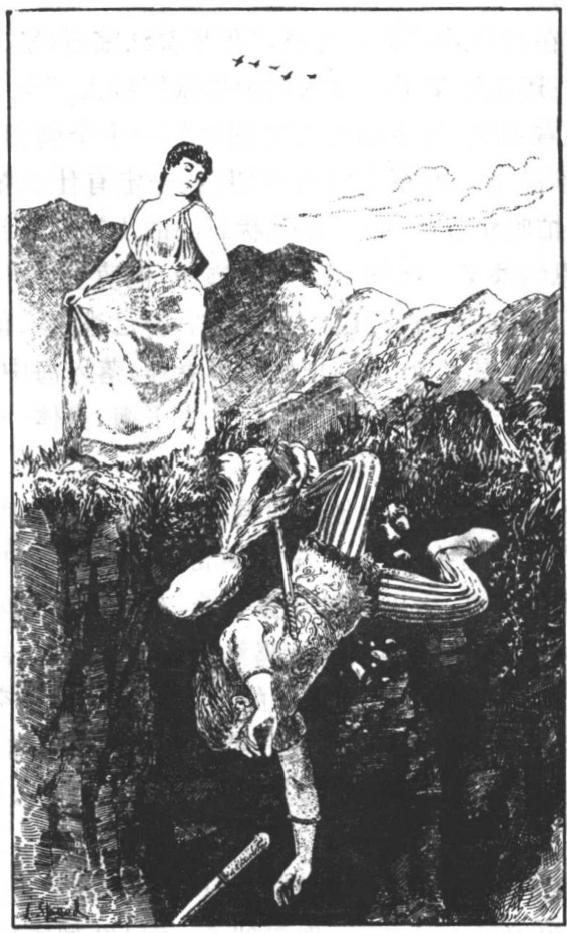

他对“啰嗦大王”杰克说：“快去！告诉海军上将我命令他马上登陆，我真不懂他怎么不早些采取行动。”命令一传到舰队，舰队马上作好开战准备，喧闹声一直传到公主的耳朵里，她挺身而出，飞奔过去保护自己的恋人。他并不很勇敢，所以十分乐意接受她的帮助。

“你站在我身后，”她对他说，“我举着红宝石，别人就看不见我们了。我还能用父王的短剑保护你抵挡敌人。”士兵们登陆以后，什么也看不见，公主却用短剑把他们一个个刺倒，他们失去知觉倒在沙滩上。海军上将终于明白，一定有什么魔力在起作用，于是急忙鸣锣收兵，处于混乱状态的战士被召回到船上。

凡法恩纳德又一次同公主一起逃命，他萌生了一个念头，想除掉公主，并且自己占有红宝石和短剑，自己逃走。他们走到一个悬崖上时，他想猛力一推，把她推下悬崖，落入海中，谁知公主动作敏捷，往旁边一闪，结果他自己失去平衡，身体一冲，像铅块似的沉入大海，就此一命呜呼。

公主还在惊恐地探寻他的时候，头顶传来的喧闹声吸引了她的注意力。她抬头一看，只见两辆战车从相反方向疾驰而来。其中一辆华丽明亮，由天鹅和孔雀驾着，车上的仙女如同阳光一样灿烂；另一辆却是由蝙蝠和渡鸦驾着，车上一个面目丑陋的小矮人，身穿蛇皮，头戴大蛤蟆皮做的帽兜。两车在半空中猛烈相撞，发出骇人的声音。公主屏住呼吸不安地注视着这场恶战，手执金色长矛的仙女和手执锈迹斑斑铁镐的丑陋矮人打了起来。不久，局势明朗了：美丽战胜了丑恶，可爱的仙女占了上风，丑矮人掉转蝙蝠头，慌里慌张一溜烟逃跑了。仙女飘然而下，来到公主面前，笑盈盈地说：“公主，你看到了，我已经彻底打败了邪恶的卡拉波丝。你信了吧！她想永远控制你，因为你提前四天走出了高塔。不过，我已经结束了她对你的控制权。我希望你能生活幸福，享受我为你赢得的自由。”

公主衷心感谢这位仙女。仙女派一只孔雀去她的宫里替五月花取一件华丽的袍子来，她身上那件已经被荆棘撕碎了，一定需要更换。仙女又派另一只孔雀到海军上将那里，告诉他现在可以安全登陆了。上将立刻率全体士兵登陆，“啰嗦大王”杰克也上了岛，他走过烤肉叉旁时，碰巧见到叉上正烤着海军上将的晚餐，就顺手牵羊地捞走。

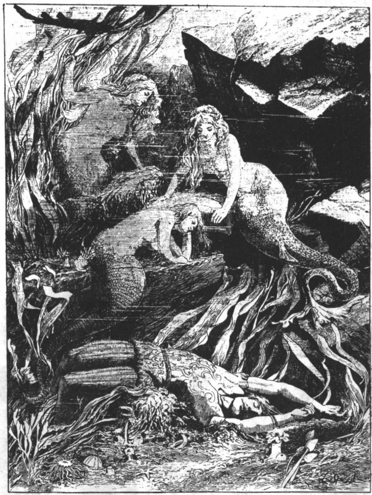

“三角帽”上将看见金车十分惊奇，而发现不远处两个漂亮的女子在树下散步时，则更是惊叹不已。等他走近，立刻认出了公主，于是双膝跪下，向公主行吻手礼。公主向他介绍了仙女，并告诉他卡拉波丝已被彻底击败。海军上将向仙女道贺，仙女对他也很客气。他们正在讲话，公主突然大叫起来：

“我敢说我闻到了香味！”

“呃，对，小姐，在这儿呢。”“啰嗦大王”杰克说着，举起了烤肉叉，上边的母鸡和鹧鸪还咝咝冒着热气哩。“殿下您愿意尝一点儿吗？”

“非常愿意，”仙女说，“特别是公主，她一定非常想饱餐一顿。”

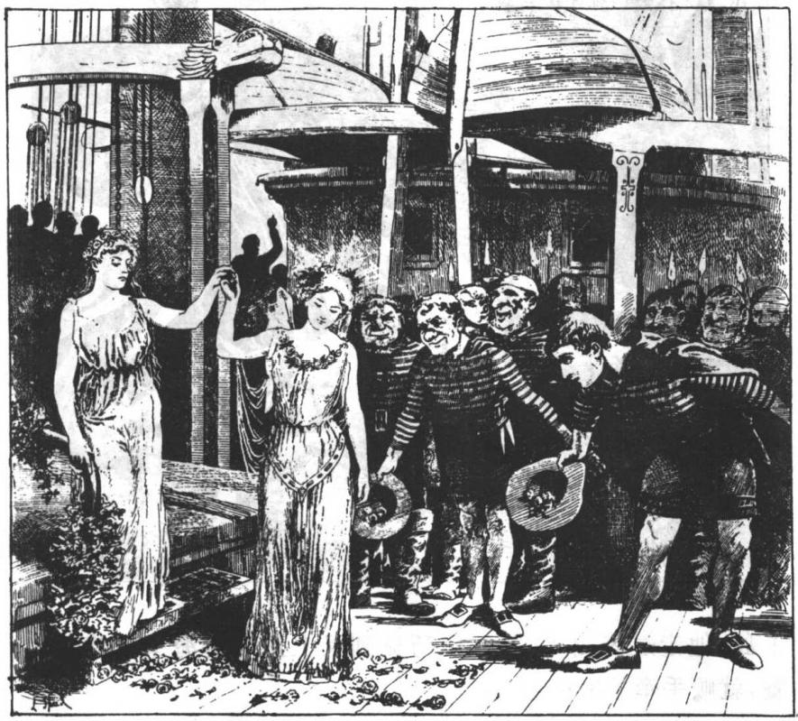

海军上将派人回到船上取来一切要用的东西，他们就在大树底下兴高采烈地庆祝起来。快用完餐时，孔雀取来了公主的袍子，仙女替她穿戴起来。袍子是用绿色和金色交织的锦缎，镶有珍珠和红宝石。她那长长的金发用一串串钻石和绿宝石扎起盘好，然后戴上花冠。仙女让她登上金车坐在身边，然后把她带上海军上将的战舰，在那儿仙女向她告别，要她向王后热情致意，并告诉王后她就是洗礼时在场的第五个仙女。接着礼炮鸣放，舰队起锚，很快就抵达港口。国王和王后还在等候，见到公主他们欣喜万分，公主想表示一下同一个品质恶劣的卑鄙使臣一起出走的歉意，可是竟没有她插嘴的机会。不过，这一切终究是卡拉波丝造成的。

在这幸福的时刻，还有谁会来呢？当然是美尔林国王的儿子了。由于得不到使臣的任何消息，他焦虑不安，于是亲自率领一支浩浩荡荡的卫队出发，来看看究竟是怎么回事。卫队由一千名骑士和三十名贴身卫士组成，全都穿着金色和红色相间的制服。他比使者漂亮和勇敢百倍，公主发觉自己很爱他。于是，婚礼立即举行，场面豪华自不必说；人们喜气洋洋、其乐融融，先前发生的不幸早抛到了九霄云外。

 

## 索里亚—莫里亚城堡

从前，有一对夫妇，他们有个儿子，名叫哈尔沃。他从小就什么也不愿干，只喜欢坐在炉子旁边耙灰。他的父母多次送他出去学手艺，可每次干不了几天，他就从师傅身边逃走，溜回家，又坐在炉前耙起炉灰来。

有一天，来了一位船主，问哈尔沃想不想跟着他出海，去看看异国风光。哈尔沃说很想，于是立刻作好了出门的准备。

他们不知航行了多少天，结果遇到了一场大风暴，风暴过后，大海平静下来，他们却不知到了什么地方，那是一个对他俩来说，完全陌生的海岸。

由于没有一丝风，他们不能航行，只能停靠在岸边。哈尔沃请船主准许他上岸去看看，说走走总比躺着睡觉强。

“你觉得你这样能见人吗？”船主说，“瞧你身上都成破烂了。”

哈尔沃坚持要去走走，最后船主答应了他，不过嘱咐他一起风就马上回来。

哈尔沃上了岸，发现那是个美丽的地方，所到之处，都是大片平坦的麦田和肥沃的草场，就是看不见一个人影。这时开始起风了，哈尔沃觉得还没有看够，想再走一会儿，看能否碰上什么人。过了一会儿，他来到一条宽阔的大道上，路面平整光滑，就是鸡蛋在上面滚过也不会破。哈尔沃沿着大道走去。夜幕降临时，他看见远处有座城堡，里面还闪着灯光。走了一整天，又没吃任何东西，他的肚子饿得咕咕直叫。然而，他离城堡越近，心里却越觉得害怕。

城堡的厨房里，生着炉火，哈尔沃走了进去。自打他生下来，还是头一回见到这样气派的厨房，里面的餐具炊具尽是金的、银的。不过还是没见着一个人。哈尔沃在那儿站了一会儿，又朝里走去，推开一扇门，只见一个公主正在纺车前纺纱。

“不，别来！”她叫了起来，“难道基督徒也敢到这里来？我说你最好马上出去，要不巨人会一口吞了你。这里住着一个三头巨人。”

“他再有四个头我也不怕，”年轻人说，“我倒乐意见识见识这位老兄。我不走，因为我从来没干过任何坏事。不过，你得给我点吃的东西，我快要饿死了。”

哈尔沃吃了个饱。公主叫他试试挂在墙上的剑，看能不能挥舞。可他哪里挥得动，连举都举不起来。

“那你喝一口剑旁酒瓶里的酒，巨人每回舞剑都是喝那酒的。”

哈尔沃喝了一口，顿时就能把剑举起来挥舞自如了。正在他想与巨人较量较量时，巨人呼哧呼哧地回来了。哈尔沃连忙藏到门后。

“嚯嚯嚯，”巨人说着把头探进房来，“好像有基督徒的血腥味！”

“没错，给你点颜色看看！”哈尔沃说着挥剑砍掉了他三只脑袋。

公主别提有多高兴了，又唱又跳，欢呼自己获得了自由。但马上她想到了她的姐妹，说：“要是我的姐妹也获得自由该有多好！”

“她们在哪儿？”哈尔沃问道。

公主把地点告诉给他：一个姐妹被一个巨人劫去，在离这里六英里远的一个城堡中；还有一个被另一个巨人劫去，还要再走九英里才能到那个城堡。

“不过现在，”她又说道，“你得先帮我把这具可恶的死尸搬出去。”

哈尔沃身强力壮，三下两下就把脏东西清扫了出去，一转眼屋子已收拾干净。他们吃吃喝喝，非常开心。第二天一大早，他就动身出发，路上一刻也没有停，奔走了一整天。当他看见那第二座城堡时，心里又不免有些害怕，它比先前那座大得多，也更富丽堂皇，只是仍然见不到一个人影。哈尔沃走进厨房，没有耽搁，就向里走去。

“不，别来！”第二个公主也这么惊叫道，“基督徒也敢到这儿来吗？我来这里不知多久了，可从来没见过一个基督徒。你最好马上就走，这里住着一个六头巨人呢。”

“我绝不走，”哈尔沃说，“他再有六个头我也不走。”

“他会活吞了你的。”公主说道。

公主好说歹说，哈尔沃就是不听。他不怕巨人，不过他得吃一些东西，因为他长途跋涉已经饿得半死。公主给他拿来食物饮料，不过要他吃好了就走。

“不！”哈尔沃说，“我不走，我从来不做坏事，没有什么可以害怕的。”

“他才不会问你这个，”公主说，“他吃你不需要任何理由。但是既然你不肯走，就试试墙上这把剑吧，这是巨人用来战斗的武器。”

他舞不动，公主又让他喝剑旁长颈瓶里的酒。他喝了一口，果然能挥舞宝剑了。

不久，巨人回来了，他长得高大结实，只能侧着身子走进门来。他伸进一只脑袋叫嚷着：

“嘴嘴喱！好像有基督徒的血腥味儿嘛！”

话音刚落，哈尔沃就砍去了他那只脑袋，接着又砍去其余的。公主欢喜若狂，但很快也记起了自己的姐妹，说真希望她们也能自由。哈尔沃认为她们都应该获得自由，想立即动身去营救。不过，他首先得帮公主把巨人的尸体清除出去，所以只能等到第二天早上才上路。

到最后这个城堡的路很远，他连奔带跑，看见城堡时，天已经很晚了。这个城堡比前两个更加宏伟壮观。这一回，他一点也不怕，径直穿过厨房，走到城堡里面。那儿坐着一位公主，美貌盖世无双。跟前两个公主一样，她也说自打她来到这里还从未见过一个基督徒。她恳请他赶紧离开，不然巨人会活活吞掉他；她还说这个巨人有九个头呢。

“好啊，就是他有三九二十七个头，我也不会走。”哈尔沃说着，就走到壁炉旁坐了下来。

公主苦苦哀求他赶快走，以免巨人把他吃了，但哈尔沃说：

“他想来就来吧。”

她只好把巨人的剑交给他，又让他喝一口长颈瓶里的酒。

正在这时，巨人呼哧呼哧地来了，他比前两个更高更壮，也只有侧着身子才能进门。

“嚯嚯嚯！好像有基督徒的血腥味儿嘛！”

说时迟那里快，哈尔沃砍去他第一个脑袋，接着砍下其它的，但最后一个脑袋特别难对付，哈尔沃从来没干过这么费劲的活儿，好在他深信自己有足够的力气来完成它，他成功了。

这时，其他两位公主也来到这座城堡，三人团聚了，她们从来没有这么快活过。她们都非常喜爱哈尔沃，哈尔沃也喜爱她们，他尽可选一个作为他的妻子，不过，三位公主中，小公主最最爱他。

过了会儿，哈尔沃走来走去，沉默不语，显得很怪很悲伤。公主问他需要什么，是不是不喜欢和她们呆在一起。他说他很喜欢和她们在一起，因为在这里可以生活富足而且舒适。可是尽管那么舒适，他还是想回家，他的父母还健在，他很想见见他们。

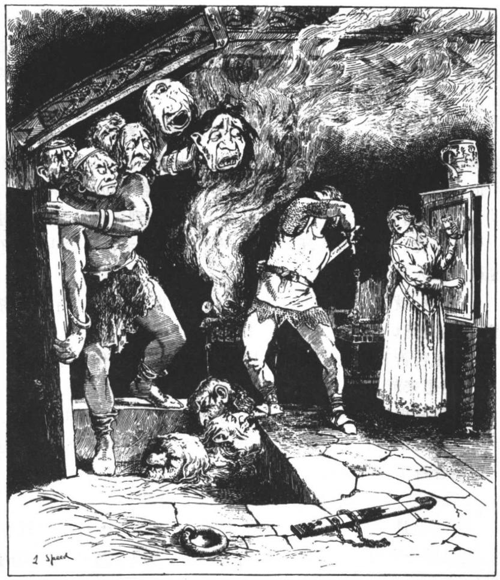

她们想这很容易办到。

“你只要听从我们的劝告，就可以安全地回去，顺利地返回。”三位公主说。

她们把他打扮得像王子一样阔气，然后又在他的手指上戴上一枚戒指；有了这枚戒指，就可以想到哪儿就到哪儿。不过她们告诫他，不可脱下戒指，也不可说出她们的名字；违背了这两条，他将失去一切，永远也见不到她们。

“要是我现在就在家里，或者家就在这里，该有多好啊！”哈尔沃话刚出口，愿望就变成了现实。没等他明白是怎么回事，已经站在父母亲的村舍门前了。那时正是黄昏时分，老夫妇见到一位如此高贵气派的陌生人走进来，着实吃了一惊，又打躬又作揖。

哈尔沃问能不能在这儿住上一夜。不，这当然不行。“我们缺这少那，没法招待您这样的老爷，”他们说，“阁下最好到农庄去，离这儿不远，您可以看见那儿的烟囱，那儿东西齐全。”

哈尔沃不听，他坚决要住下来。可两位老人也坚持说，最好到农庄去，那儿有吃有喝，而他们连张让他坐的椅子也拿不出。

“不，”哈尔沃说，“我明天一早到那边去，今晚就让我住在这儿，我就坐在炉子旁边吧。”

这下他们也不好再说什么了。哈尔沃走到炉边坐下，拨弄炉灰，动作就跟他小时候一样；那时他就是这么打发时间的。

他们一起闲聊起来，谈了很多事情，最后哈尔沃问他们是不是从来没有过孩子。

“有的，”他们说；他们有个男孩叫哈尔沃，但是不知道他跑到哪儿去了，甚至说不准他现在到底死了还是活着。

“会不会我就是他？”哈尔沃说。

“我太了解他了，”老妇人站起身来说，“我们的哈尔沃很懒散，从来不爱干活，而且衣衫不整，补丁加补丁。他那样的孩子决不会成为您这样出色的大人物的，老爷。”

过了一会儿，老妇人到炉边去拨旺炉火，火光照在哈尔沃脸上，跟他当初在家耙灰时一模一样，这下，老妇人立即认出来了。

“天哪！真是你呀，哈尔沃？”她叫了起来。年迈的父母说不出的高兴，要他说说生活情况；老太太太兴奋了，为他感到骄傲，非得立刻带他去农庄一下，让那些从前瞧不起他的姑娘们好好瞧瞧。她先走了出去，哈尔沃跟在后面。老太太到了农庄，告诉所有的姑娘，说哈尔沃是怎么回到家的，他现在有多么气派，还说“他的样子就像个王子。”

“知道知道，”姑娘们说着一昂头，“我们可以担保他还像过去一样，破破烂烂、脏兮兮的，一副乞丐相。”

就在这时，哈尔沃走来了，姑娘们大吃一惊，顾不得脱在炉边的外衣，穿着衬裙就跑开了。她们重新回到炉边时，满脸羞愧，都不敢抬头。过去，她们对哈尔沃可是一向傲慢无礼的。

“嘿！嘿！”哈尔沃说，“你们一向以为自己长得也漂亮，穿得也漂亮，没人能赶得上你们；可是只要你们看一眼刚被我救出的大公主，跟她一比，你们简直就是个牧羊女；二公主就更漂亮了；至于小公主，我的心上人，她比太阳、月亮加在一起还要美丽。她们要是在这里就好了，好让你们开开眼界。”

他话音刚落，公主们已站在面前。这时他十分后悔，因为他记起了她们嘱咐过的话。

农庄上为三位公主举行盛大宴会，人人都尊重她们，可她们不愿留下。

“我们想去看看你的父母，”她们对哈尔沃说，“顺便到周围看看。”

他跟她们走了出去，来到一个大湖旁，就在农庄外面，湖边绿草如茵，十分美丽。公主们说坐在水边看风景很开心，想在这儿呆一个小时。

她们就在那儿坐了下来，过了一会儿，小公主说，“哈尔沃，要不我给你梳梳头吧。”

哈尔沃把头枕在她的腿上任她梳理，没过多久就睡着了。小公主从他手指上取下戒指，换上另外一枚。然后，她对两个姐姐说，“让我们抱在一起；让我们都回到索里亚—莫里亚城堡去吧。”

哈尔沃一觉醒来，明白自己失去了公主们，他痛哭流涕，连连悲叹，别人怎么也无法安慰他。不管父母如何恳求，也不能说服他留下。他告别父母，说以后可能永远也见不到他了，因为假如找不到公主，他也不想再活了。

他拿了三百块钱放进口袋上了路。走了一会儿，遇到一个人，牵着一匹样子还过得去的马。哈尔沃想买下，就跟那人讲起价钱来。

“我并不真的想卖掉它，”那人说，“不过，假如我们同意，也许——”

哈尔沃问他要价多少。

“我买来的时候没花多少钱，它也不值多少钱；这匹马用来骑，那时没话说，但要它拉车负重就不行了。不过驮你的包袱和你还是行的，就是你得骑一阵，下来走一阵。”最后他们谈妥了价钱，哈尔沃把包袱放在马背上，自己走一段路，骑一会儿。晚上，他来到一片绿色的原野，那儿有棵大树，他走过去坐在树底下，松开马的缰绳，让马吃些草，再从马背上取下包袱，就躺下睡觉了。天快亮时，他又出发了。他觉得不能再多耽搁了，于是他整天赶路，骑一阵走一阵，甚至不知道现在在什么地方，该朝哪个方向走，他只是不停地走啊走啊，遇到长满青草的空地就让马吃点青草，自己从包里拿点干粮吃，接着继续走走骑骑往前赶，似乎这片树林总也走不到尽头。

直到第二天黄昏，他才看见树丛中闪烁着一线光亮。

“要是那儿有人，我就可以暖暖身子，弄些吃的了。”哈尔沃心想。

他来到那个发光的地方，见是一间破旧的房屋，透过窗玻璃，看到里面有一对老年的夫妇。他们一头灰发，看上去就像一对野鸽。那老妇人长着个长鼻子，坐在炉边竟可以当拨火棒用。

“晚上好！”哈尔沃对他们说。

“晚上好！晚上好！”老妇人说。“你怎么会来到这里？这儿已经一百年没有来过基督徒了。”

哈尔沃告诉她想去索里亚—莫里亚城堡，问她是否知道去那儿的路。

“不，”老妇人说，“我不知道。不过月亮肯定知道，她马上就要来了，我来问问她；她的亮光哪儿都能照到。”

当一轮明月照到树顶时，老妇人走了出去。“月亮！月亮！”她高声叫道：“你能告诉我去索里亚—莫里亚城堡的路吗？”

“不，我不能！”月亮说，“因为有一次我照到那儿时，刚好一朵云挡住了我。”

“那就再等会儿，”老妇人对哈尔沃说，“西风马上就来，他肯定知道，他轻轻一吹，就能扫到每个角落。”

“什么！你有一匹马？”她再走进屋时对哈尔沃说，“哦！让那个可怜的牲口到我们的牧场上溜溜吧，别让它拴在门口饿死。要不，你肯不肯跟我们做笔交易？我们有双旧靴子，穿上它一步能走三英里；你要用马来交换，就能早点儿到达你的目的地。”

哈尔沃当然乐意了。老妇人得到马后高兴得手舞足蹈。“瞧，我可以骑马去教堂了。”她说。哈尔沃也坐不下来，他想马上出发，但老妇人说不必着急。“你在长凳上躺一会儿，因为我们没有床让你睡，我替你留心着西风，它来我就叫醒你。”

西风很快就来了，它一路呼啸，把房子的墙壁吹得吱吱嘎嘎地响。

老妇人奔出去大声喊道：

“西风！西风！你能告诉我到索里亚—莫里亚城堡的路吗？这儿有人要去那儿。”

“这个我当然知道，”西风说道，“这会儿我正赶去吹干那些结婚礼服，那儿马上要举行婚礼。他要是飞毛腿，就随我一同去。”

哈尔沃跑了出来。

“要跟上我，就得加快步伐，”西风一面说着一面开始走。就这样，它越过高山峡谷，跨过湖泊沼泽，哈尔沃拼了命才勉强跟上。

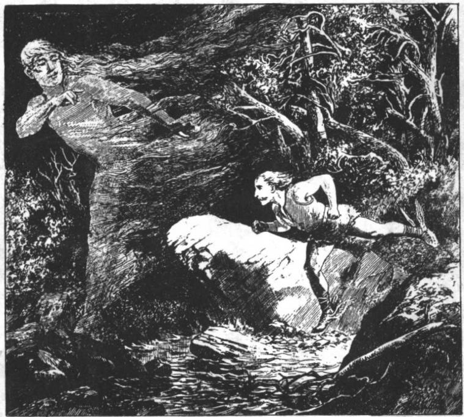

“听着，我没有工夫跟你一起走了，”西风说，“我去洗衣场之前，得先去别处吹倒一片云杉。你只要沿着山的这一侧走，就会看见许多姑娘在洗衣服，那儿离索里亚—莫里亚城堡就不远了。”

不一会儿，哈尔沃就看见了洗衣姑娘，她们问他有没有见到要来吹干结婚礼服的西风。

“哦，看见了，”哈尔沃说，“它先去吹倒一片云杉，马上就到这儿来。”他请姑娘指点去索里亚—莫里亚城堡的路线。

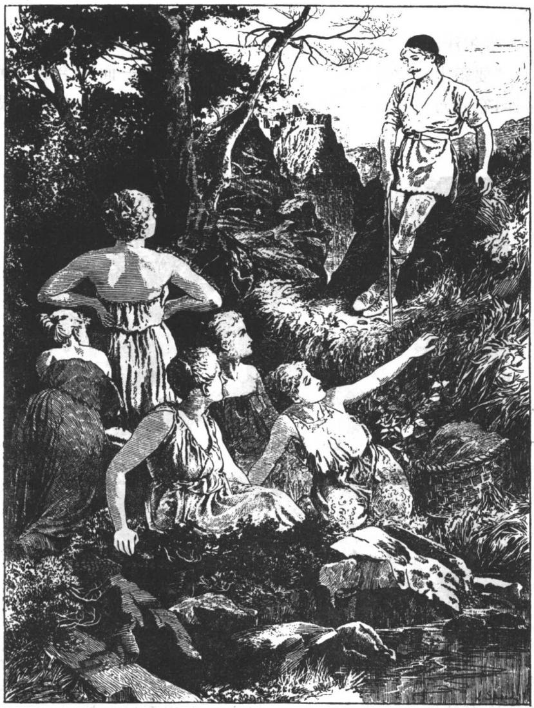

她们给他指明方向，他来到了城堡。城堡里早已是车水马龙，人头攒动。哈尔沃跟着西风穿过无数灌木丛和沼泽地，身上衣服破旧肮脏不堪，这会儿羞于见人，只能躲在一边，直到举行婚礼的最后一天，才默默走进城堡。

这时已经一切准备就绪。按风俗，每个人都要向新娘、新郎祝酒。斟酒人轮流为新娘、新郎及来宾斟满酒杯，先是骑士、乡绅，然后是仆人。过了很长时间，才轮到哈尔沃，他也说要为新娘、新郎的健康干杯，并把公主在湖边戴在他手指上的戒指放入酒杯，然后请斟酒人把杯子交给公主。

公主接到杯子，马上从餐桌上站了起来，对众人说：“谁最有资格娶我们中的一个？是把我们从巨人手里解救出来的人呢，还是以新郎身份坐在这里的人？”

大家都说这个问题只有一个答案，那就是：救命恩人应该成为新郎。众人的回答，哈尔沃听得很分明，他马上脱去乞丐似的破衣，把自己打扮成新郎。

“嗨！他才是最有资格的人。”小公主一看见哈尔沃马上大声宣布。她下令将身边的那位扔到窗外，而与哈尔沃举行了婚礼。

 

## 九条命考斯加之死

某个王国里住着一位王子，名叫伊凡。他有三个妹妹，大妹玛丽公主、二妹奥尔加公主和小妹安娜公主。父母临死前嘱咐他说：“一旦有求婚者来求婚，就把几个妹妹嫁掉，不要把她们留在你身边！”

父母死了，王子掩埋了他们。为了减轻悲伤，他和三个妹妹来到绿色花园散步。突然天空乌云密布，眼看暴风雨就要来临。

“咱们快回去，妹妹！”他大声喊道。

他们刚回到宫里，就听到雷声隆隆，接着屋顶被劈开，一只亮晃晃的猎鹰飞了进来，落地变成一个盛装青年，说道：

“你好！伊凡王子！过去我来作客，今天却是来求婚的！我向你妹妹玛丽公主求婚。”

“你能得到我妹妹的青睐，我是不会干预你们的。以上帝的名义，让她跟你结婚吧！”

玛丽公主表示同意，猎鹰与她成了婚，把她带到自己的王国去。

光阴似箭，日月如梭，转眼一年已过去。一天，伊凡王子领着两个妹妹在绿色花园散步，天空又出现乌云，并夹带着旋风闪电。

“咱们快回去，妹妹！”王子喊道。他们刚踏入宫殿，哗啦一声，房顶闪过一道亮光，天花板破裂成两半，一只老鹰飞进来，落地变成一个盛装青年。

“你好！伊凡王子！从前我是客人，今天我是求婚者！”

他请求将奥尔加公主嫁给他。伊凡王子说道：

“要是奥尔加公主看上你，你就同她结婚，我不会干涉她的自由。”

奥尔加公主表示同意，老鹰跟她结婚后，把她带到了自己的王国。

又一年过去了。一天，伊凡王子对小妹说：

“咱们去绿色花园散散步吧！”

他们刚走了一会儿，天空又出现一片乌云，夹着旋风和闪电。

“快回去，妹妹！”

他们回到宫里，未等坐下，雷声大作，天花板裂开，飞进一只渡鸦，落地变成一个盛装青年，比前两位还要漂亮。

“你好，伊凡王子！以前我来作客，今天我来求婚！请把安娜公主嫁给我！”

“我不干涉妹妹的自由。只要你能得到她的芳心，就让她跟你结婚。”

安娜公主与渡鸦结了婚，渡鸦带她回到自己的王国去了。只剩下伊凡王子一人。整整一年，他没有妹妹相伴，觉得很孤独。他说：

“我要出去找我的妹妹。”

他作好准备，出发了。他骑着马走了一程又一程。有一天，他见到一支战败的军队，人马尸横遍野，大声惊叫道：“这里要是还有活人，就出来回答我的问题，是谁杀死了这支强大的军队？”

果然有一个活着的人回答他说：

“这支强大的军队死于美丽的玛丽亚·莫尔乌娜公主之手。”

伊凡王子继续骑马前进，来到一个白色的帐篷前，美丽的玛丽亚·莫尔乌娜公主迎上前来。

“你好，王子！”她说道，“什么风把你吹来了？你是自己要来，还是被人强迫来的？”

伊凡王子说：“勇敢的青年骑士不做违背意志的事！”

“很好！要是你的事不紧迫，就到我帐篷里歇会儿吧。”

这正中伊凡王子的意。他在帐篷里住了两夜，玛丽亚·莫尔乌娜对他情意绵绵，他俩便结为夫妇。美丽的玛丽亚·莫尔乌娜把他带回自己的王国。

他们一起生活了一段时期，公主忽然心血来潮想去打仗，就把一切日常事务交给伊凡王子，嘱咐他说：

“你到处走走，事事留心着点儿；切切不要去那边的密室。”

他可控制不住自己。玛丽亚·莫尔乌娜一走，他就向密室奔去，推开门，朝里一看，里面正吊着九条命考斯加，他身上系着十二条铁链。考斯加恳求伊凡王子说：

“可怜可怜我，给我点水喝吧！我在这里受了整整十年的折磨，没有吃也没有喝；我的喉咙都快冒烟了。”

王子给了他满满一桶水，他一饮而尽。

“光一桶水不能解渴，再给我一些！”

王子给了他第二桶水，考斯加又喝光了，还要第三桶。喝下三桶水后，他恢复了元气，将身子一抖，十二根铁链同时被挣断。

“谢谢了，伊凡王子！”九条命考斯加叫道，“现在，除非你能看到自己的耳朵才能看到玛丽亚·莫尔乌娜了！”说完，他变成一阵可怕的旋风飞出窗外，很快迫上玛丽亚·莫尔乌娜，抓住她，把她带回自己的家。

伊凡王子悔恨交加。他穿戴齐整出发寻找，心里暗下决心，“不管发生什么事，我一定要找到玛丽亚·莫尔乌娜！”

一天过去了，又一天过去了，第三天黎明的时候，他见到一座奇妙的宫殿，旁边长着一棵橡树，树上蹲着一只明亮的猎鹰。

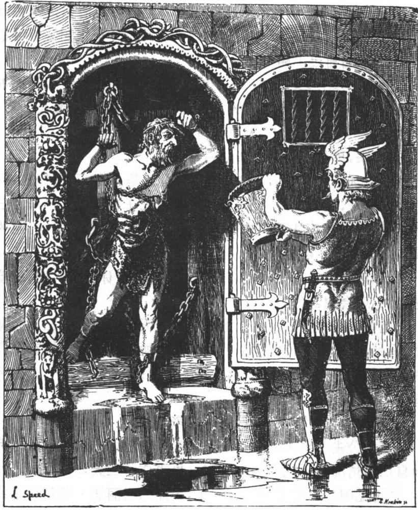

猎鹰从橡树上飞下，落地变成一个盛装青年，大声叫道：

“哈哈，亲爱的大舅子！什么风把你吹来了？”

玛丽公主闻声奔出来，快活地迎接哥哥伊凡，询问他身体可好，并谈了自己的情况。王子在他们家住了三天，然后说：

“我不能再住在这里，我得去找我的妻子，美丽的玛丽亚·莫尔乌娜公主。”

“你要找到她可不容易，”猎鹰说，“无论如何请你把银钥匙留下吧，看到它，我们就会想起你的。”伊凡王子把银钥匙留给猎鹰夫妇，然后自己上路。

他走了一天，又走了一天，第三天拂晓时，他看到一座更加华丽的宫殿，近旁也有棵橡树，树上蹲着一只老鹰。老鹰飞下树，落地变成一个盛装青年，大声嚷道：

“快来，奥尔加公主！亲爱的哥哥来了！”

奥尔加公主立刻奔出来迎接哥哥，又是亲吻，又是拥抱，问他身体可好，并告诉他自己的情况。伊凡王子在他们家也呆了三天，然后说：“我不能再住在这里了，我得去找我的妻子，美丽的玛丽亚·莫尔乌娜公主。”

“你要找到她可不容易，”老鹰说，“请留下你的银叉吧；看着它，我们就会想起你的。”

他留下银叉又上路了。他旅行了一天，又一天，第三天天亮时，看到一座宫殿，比前两座更加宏伟壮丽。宫殿附近也有棵橡树，树上蹲着一只渡鸦。渡鸦从树上飞下来，落地变成一个盛装青年，大声叫道：

“安娜公主，快来！我们的哥哥来了！”

安娜公主奔出来迎接哥哥，拥抱、亲吻他，向他问好，并告诉他自己的情况。伊凡王子在他们这里也住了三天，然后说：

“再见吧！我要去找我的妻子，美丽的玛丽亚·莫尔乌娜公主。”

“你要找到她可不容易，”渡鸦说。“无论如何把你的银鼻烟盒留下吧；看到它，我们就会想起你的。”

王子留下银鼻烟盒就告辞了。他走了一天，又一天，第三天，他来到囚禁美丽的玛丽亚·莫尔乌娜公主的地方。一见到自己的爱人，她就向他扑过去，搂着他的脖子，泪如泉涌。她边哭边说：

“喔，伊凡王子！你为什么不听我的话，去看密室，放走了九条命考斯加？”

“原谅我，美丽的玛丽亚·莫尔乌娜！过去的事别再去想。趁考斯加不在，赶快跟我逃走吧。他说不定追不上我们。”

于是他们逃跑了。这时，考斯加正在外打猎。黄昏时他准备回家，可胯下的马却蹒跚不前。

“怎么啦，老伙计？难道你闻到了什么不对头的气味？”骏马回答道：

“伊凡王子来把美丽的玛丽亚·莫尔乌娜带走了。”

“有可能追上他们吗？”

“先播种，再插秧；收割，打谷，磨成粉；再做五只大馅饼。吃了饼，再去追，也不迟。”

考斯加策马疾驰，追上了伊凡王子。

“这一回，”他说道，“我宽恕你，是报答你给我水喝的恩惠。第二回我会再宽恕你一次。可到第三回，你得当心，我会把你撕成碎片。”

说完，他夺走美丽的玛丽亚·莫尔乌娜，离他而去。伊凡王子坐在一块石头上哭了起来。哭着哭着，又来了勇气，于是重新回到美丽的玛丽亚·莫尔乌娜身边，碰巧考斯加不在家。

“我们快逃走吧，美丽的玛丽亚·莫尔乌娜！”

“啊，伊凡王子！他会抓住我们的。”

“就算他会抓住我们，至少我们可以在一起呆上一两个小时。”

于是他们又逃走了。考斯加正要回家，他的坐骑又跌跌撞撞不肯向前。

“你怎么啦，倒霉的劣马？你是不是闻到什么不对头的气味？”

“伊凡王子来把玛丽亚·莫尔乌娜带走了。”

“有可能追上他们的吗？”

“先播种，再插秧；收割，打谷，磨成粉；再做五只大馅饼。吃了饼，再去追，也不迟。”

考斯加策马疾驰，追上了伊凡王子。

“难道我没对你说过，你不能再见玛丽亚·莫尔乌娜了吗？”

他夺走公主返回自己家去。

伊凡王子又剩下一个人了。他哭了很久，然后又回到玛丽亚·莫尔乌娜身边。考斯加碰巧又不在家。

“我们快逃吧，玛丽亚·莫尔乌娜！”

“啊，伊凡王子！他一定会抓住我们，把你劈成碎片的。”

“让他劈吧！我不能没有你！”

就这样，他们又逃走了。

考斯加正要回家，他的宝驹又跌跌撞撞不肯向前了。

“你踉踉跄跄干嘛？难道又有什么不对头的味道了？”

“伊凡王子来把玛丽亚·莫尔乌娜带走了。”

考斯加疾驰而去，捉住了伊凡王子，把他剁成碎块，扔进一只桶里，桶外涂上柏油，又用铁箍箍牢，然后投入大海。玛丽亚·莫尔乌娜被他带回了家。

就在这时，伊凡王子留给妹夫们的银器全都变成了黑色。

“啊！”他们惊叫起来，“伊凡王子一定遭到了什么不测。”

老鹰赶紧冲向大海，抓住那只桶，取出伊凡王子的遗体，用水洗干净，再一块一块拼好。渡鸦把想死水洒在尸体上，碎块立刻粘牢，成了完整的躯体。猎鹰再洒上回生水——伊凡王子身子抖了抖，竟站立了起来，说道：

“啊！我睡了多久啊！”

“要不是我们，你会睡更久，”三个妹夫说，“你去我们那儿作客吧。”

“不行，妹夫们，我得去找玛丽亚·莫尔乌娜。”

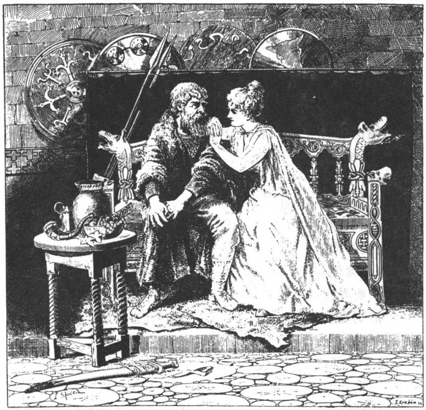

伊凡王子又找到了玛丽亚·莫尔乌娜公主。她飞跑过来，搂住他的脖子，叫道：

“天哪！上帝是怎样让你起死回生的？”

“如此这般，”他说道：“你去探听一下，考斯加究竟从哪儿弄来的那匹骏马。”

玛丽亚·莫尔乌娜找到一个好机会，便向考斯加打听。考斯加说：

“离这儿很远。要走到第三十个王国，有个名叫巴巴·耶盖的人，住在火焰河对岸。她有一匹神奇的母马，每天载着她绕地球飞驰一圈。她还有许多出色的马。我替她看过三天马群，一匹马也没弄丢；作为报酬，巴巴·耶盖给了我一匹小马驹。”

“可你是怎么渡过火焰河的？”

“噢，我有这样一块手帕，用右手挥舞三下，就会升起一座高高的桥，火焰烧不到它。”

玛丽亚·莫尔乌娜仔细听着，牢记心上，然后告诉给了王子，手帕也给他拿来了。就这样，王子渡过了火焰河，去找巴巴·耶盖。他长途跋涉，没吃没喝。后来，遇到一只稀奇古怪的鸟和它的一窝小鸟。伊凡王子说：

“我想吃掉这些小鸟。”

“请不要吃，伊凡王子！”那只稀奇古怪的鸟哀求道，“总有一天我会报答你的。”

他继续朝前走，在树林里看见一群蜜蜂。

“我要弄些蜂蜜吃吃，”他说。

“请别碰我的蜂蜜，伊凡王子！”蜂王后惊叫道，“我总有一天会报答你的。”

他于是继续赶路，不久，遇到一头母狮和它的幼狮。

“无论如何，我要吃掉这头幼狮，”他说道，“我快饿死了。”

“请别碰它，伊凡王子！”母狮哀求道，“总有一天我会报答你的。”

“好吧，随你便吧。”他说。

他忍饥挨饿、晕晕乎乎地朝前走，越走越远，最后来到了巴巴·耶盖住的地方，那屋子四周有十二根柱子围成一圈，其中十一根柱子上各戳着一颗人头，只有第十二根上空着。

“您好，老奶奶！”

“你好，伊凡王子！你干嘛来这儿？是自己要来还是别人要你来的？”

“我来是想求您给一匹神奇的骏马。”

“那就这样吧，王子！你不必替我工作一年，只替我干三天的活，三天内给我看好马群，我就送你一匹神奇骏马。但是，假如你看不好马群——那么，就麻烦了，我要把你的头放在最后一根柱子上。”

伊凡王子接受了这些条件。巴巴·耶盖给了他吃的喝的，然后让他去干活。谁知，他刚把马群放到野外，那些马便翘起尾巴，向四面八方走散开去，没等王子看清，它们已不见踪影。他不安地哭了起来，后来在一块石头上坐下睡着了。太阳快落山时，那只稀奇古怪的鸟飞来叫醒他说：

“起来吧，伊凡王子！马群已经回槽了。”

王子起身返回。巴巴·耶盖正对着马群大发雷霆，她尖声吼道：

“你们回家来做什么？”

“我们怎么能不回家？”它们说，“四面八方的鸟儿向我们飞来，要啄掉我们的眼珠子。”

“好吧，好吧！明天不要跑到草地里，都给我藏到密林中去。”

伊凡王子睡了一夜好觉。早上，巴巴·耶盖来对他说：

“当心，王子！假如你弄丢了一匹马，你的脑袋就得挂在那根柱子上！”

他把马群赶到野外，它们立即翘起尾巴，一转眼就消失在密林里。王子又一次坐在石头上哭了起来，哭着哭着，睡着了。太阳落到树林后面时，母狮奔过来叫他：

“起来吧，伊凡王子！马群都已回槽了。”

伊凡王子起身回去，巴巴·耶盖正对着马群发火呢。她尖声骂道：

“你们究竟回来干什么？”

“我们能不回来吗？四面八方的野兽向我们奔过来，要把我们撕成碎片。”

“好吧，好吧！那明天都给我下到海里去。”

伊凡王子又睡了一夜好觉。第二天早晨，巴巴·耶盖来叫他看护好马群。

“要是你看管不好它们，你的脑袋就会戳在那根柱子上！”

他把马群赶到野外。它们马上翘起尾巴，一会儿就跑得没影儿了，原来它们躲到海里去了，海水直淹到脖子。伊凡王子坐在石头上苦苦哭泣，直到睡着为止。然而太阳下山时，飞来一只蜜蜂对他说：

“起来，王子！马群都已经归槽了。但是你回去的时候，别让巴巴·耶盖看到你。你跑到马厩里，躲在马槽后面；你会看到一只在粪堆里打滚的小马驹。等到深夜，你就骑着它逃走。”

伊凡王子站起身来，悄悄溜进马厩，躲在马槽后面，只听巴巴·耶盖气急败坏地骂着马群：

“谁叫你们回来的？”

“我们能不回来吗？全世界数不清的蜜蜂向我们飞来，蜇得我们浑身鲜血淋淋！”

巴巴·耶盖睡觉去了。夜深人静时，伊凡王子偷走了那匹可怜的小马。他装上鞍，骑上马背，向火焰河奔去。到了河边，他掏出手帕，用右手挥动三下，河上顿时出现一座宏伟的大桥，高耸入云。王子骑马穿过大桥，再用左手挥了三下手帕，河上的大桥竟变得像一条细线。

巴巴·耶盖早晨醒来，发觉小马不见了，立刻动身去追。她乘着铁臼，用铁杵驱赶，又用扫帚扫去踪迹。她冲到火焰河边，看了一眼，说：“好大一座桥！”就驱赶铁杵上桥，不料刚走一半，桥就折成两段，巴巴·耶盖噗的一声栽进河里。她死得才叫惨呢！

伊凡王子在绿色草场上把小马驹养肥，使它成为一匹强壮无比的骏马。伊凡王子骑着它，来到玛丽亚·莫尔乌娜身边。她飞跑过来，搂住他的脖子，叫道：

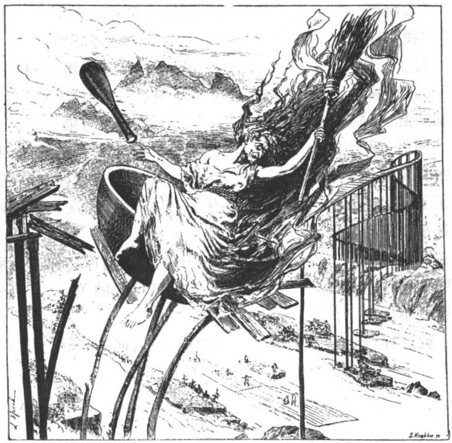

“天哪！上帝是怎样让你得到宝马的？”

“如此这般，”他说道，“现在跟我走吧！”

“我怕，伊凡王子！要是考斯加再抓住你，还会把你劈成碎片的。”

“不，他追不上我们了！现在我有一匹神奇的骏马，飞奔起来就像鸟儿一样。”他们骑上马，疾驰而去。

九条命考斯加正要回家，他的马又失足绊倒。

“你怎么又跌跌撞撞，我的老伙计？难道又闻到什么味儿不对劲了？”

“伊凡王子来把玛丽亚·莫尔乌娜带走了。”

“我们还能抓住他们吗？”

“天晓得！伊凡王子现在有一匹比我更好的马。”

“我不能就这么算了，”九条命考斯加说，“我要追。”

过了一会儿，他追上了伊凡王子，下马准备用他的利剑来砍王子。正在这里，王子的马一阵风似地扬起后蹄对准考斯加的脑袋猛踢起来，踢得他脑袋开了花，王子上去一棒结果了他。

随后，王子堆起一堆木头，点上火，焚烧考斯加的尸体，并让他的骨灰随风撒去。然后玛丽亚·莫尔乌娜骑上考斯加的马，伊凡王子骑上自己的马，一起去拜访渡鸦、老鹰和猎鹰。他们所到之处都受到热烈欢迎。

“啊，伊凡王子！我们真没想到还能再见到你！你遭受那么多磨难还是值得的。像玛丽亚·莫尔乌娜这样的美人，走遍全世界也找不出第二位呀！”

就这样，他们一路作客，一路欢庆，最后回到了自己的王国。

 

## 黑帽小偷与峡谷骑士

从前，在爱尔兰南部有位国王，他和王后生了三个漂亮的王子。三个孩子刚一点点大，王后就得了很严重的病，眼看就不行了。这件事给整个宫廷带来极大的忧伤，特别是王后的丈夫——国王本人，更是无法安慰。眼看死期不远，王后把国王叫到身边，对他说：

“我就要走了，你正年轻力壮，我死后，你当然会再结婚。现在我对你只有一个要求，就是请你在海岛上建一座塔楼，让三个儿子在那儿生活，直到他们长大成人，能够自立为止。这样做是为了不让他们受到任何别的女人的支配。别忘了给他们与身份相符的教育，让他们学会王子必须掌握的各种本领，包括体育和娱乐方式。我要对你说的就是这些。永别了！”

国王满含热泪，还没有来得及对她作出照办的保证，王后已经转过身，面带微笑离开了人世。宫廷上下乃至全国都沉浸在莫大的悲哀之中，像王后这样对富人和穷人都这么好的女人，全国再也找不到第二个。

葬礼隆重而悲壮。国王因痛失爱妻而伤心不已。他遵照王后的遗嘱，命人尽快造好塔楼，让王子在里面生活。

随着时间的流逝，王公贵族们都建议国王不要再这样悲伤下去，因为他还年轻，应该再娶一个妻子。国王终于被说服，他们为他挑选了又美丽又有钱的公主作新王后，那是邻国一位国王的女儿。国王很喜欢她。不久，新王后生下一个漂亮的儿子，宫里举行盛宴庆祝，到处喜气洋洋，已故王后被忘得一干二净。一切顺顺当当，国王和新王后一起愉快地生活了好几年。

后来，王后同女总管发生了矛盾，王后亲自去看她，谈了好久，正要离开时，只听女总管说，要是王后再来找她，就扭断她的脖子。王后真没想到一个出身卑微的下属竟敢如此侮辱自己，真是肺都气炸了，立刻叫她说出理由，否则就要将她处死。

“夫人，”女总管说，“我说出的理由对您关系重大，您得好好报答我才行。”

“我该报答你什么？”王后问。

“您得给我满满一大包羊毛；我有一只旧瓦罐，您得用它灌满黄油；另外，还有一个木桶您得装满小麦。”

王后说：“一包羊毛有多少？”

她说：“七群绵羊七年里长出来的羊毛。”

王后又问：“一罐黄油有多少？”

“七个奶牛场七年里产的黄油。”

王后再问：“那么一桶小麦又是多少？”

“七桶小麦的种子，播种，收割，再播种，再收割，总共七个年头打出的小麦。”

“数量真多，”王后说，“你一定有特别的理由吧。你说清楚我会答应你的。”

“好吧！”女总管说，“都怪您太蠢，竟然没有发现有些事将危害您和您孩子的利益。”

“什么事？”王后问：

“您听着，”她说道：“您的丈夫——国王，他和已故王后生了三个儿子，一直藏在一座塔楼里。等他们长到法定年龄，就会出来分治王国，那时您的儿子就得自奔前程。所以您不想办法除掉他们，到头来受害的将是您儿子，或许还有您自己。”

“那你说说我现在该怎么办？”王后说，“我现在心里一团糟，一点主意都没有。”

“您得让国王明白，”女总管说，“您已听说了他有三个儿子，很奇怪他干嘛一直瞒着您。您告诉他，希望见到他们，该给他们自由了，您表示非常希望他们到宫里来。国王会同意的，那时会有盛大的宴会和各种各样的娱乐活动让百姓庆祝。趁这个机会，您请国王的三个儿子同您一起玩牌，他们肯定会同意。这时，您必须讲明一个条件，假如您赢了，您让他们干什么，他们就得干什么；假如他们赢了，您也得照他们的话去做。这个条件一定要当众宣布。这儿有一副纸牌，我想您不会输的。”

王后立刻把牌收起来，对女总管的开导表示谢意。回到宫中，她坐卧不宁，直到找机会与国王谈起他儿子的事。她语气温柔，神态可人，该说的话点到为止。国王不知她的意图，欣然同意她的要求，并马上派人到塔楼里通知儿子。三个王子能从幽禁中解脱出来，高兴得不得了。三个小伙子长得很英俊，而且精通各种宫廷技艺与学问，因而见到他们的人都很喜欢和尊敬他们。

王后却因此更加嫉妒了，巴不得庆典盛宴马上结束，好实施她的计划，到时候全指望女总管那副牌的魔力了。终于，王室里的娱乐活动开始了，王后巧妙地邀请三位王子和她玩牌，并按女总管的暗示，与他们定下了胜负的条件。

他们欣然接受。大王子与她玩了第一局，她赢了；二王子与她玩第二局，她又赢了；三王子与她玩第三局，却是三王子赢了。这下她很痛心，因为她不能像支配其他两位王子那样来支配三王子了，而三王子恰恰是三兄弟中最漂亮最讨人喜爱的一个。

这时，人人都急于听到王后对两个王子下什么命令，不过谁也没想到她会对王子们不怀好意。不知道是女总管教给她的，还是她自己的主意，她下令让他俩去盗峡谷骑士的响铃野马，否则就要拿脑袋来见她。

年轻的王子们一点也没有在意，根本不知道王后的命令意味着什么，但是整个宫廷的人听到她的要求都感到惊愕，因为明白那是一件办不到的事情；过去所有尝试过的人都丧了命。然而，他们无法撤销已讲好的条件，而小王子也想说说他对王后的要求，因为他赢了第三局。

“我的两位兄长，”他说，“要作一次旅行，我明白，这是一次危险的旅行。他们往哪儿走不知道，会遇上什么也不知道。因此我决定与他们同去，不论发生什么，我也要和他们在一起。不过，作为赢牌的条件，我要求王后，同时也是命令，必须站在宫里最高的塔楼顶上，等待我们回来，除非证实我们已经死去。在这七年，或许更长的时间内，她不能吃别的东西，只能吃谷物、喝凉水。”

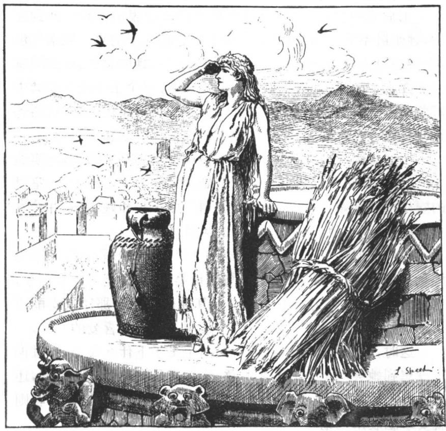

准备好了，三个王子离开王宫去找寻峡谷骑士的宫殿。路上他们遇到一个腿有点儿跛的人，看上去上了点年纪。很快，他们和瘸子交谈起来，小王子问陌生人的名字，以及为什么他戴一顶显眼的黑帽子。

“人家有时叫我小偷斯隆，”他说，“有时叫我黑帽小偷，因为我总戴一顶黑帽子。”接着，他讲述了他大部分的冒险经历，然后又反过来问王子们要去做什么。

小王子乐意满足他的好奇心，把事情从头至尾告诉了他。“你瞧，”王子说，“我们正在寻马途中，可不知路线对不对？”

“啊！勇敢的朋友！”黑帽小偷说，“你们根本不了解自己在冒什么样的险。七年来，我自己一直想弄到这匹骏马，却从来没法得手，因为它身上罩了一件丝罩子，上面系着六十只铃铛，一有人接近，它马上察觉并摇晃身体，铃铛的响声向骑士和卫队报警，弄得整个王国都会警觉起来，所以要弄到这匹骏马几乎是不可能的。那些不幸的盗马贼，一旦被捉住，就被峡谷骑士投入火红的锅炉中烧熟煮烂。”

“我的天哪！”小王子说，“我们怎么办呢？我们若是空着手回去就会被杀头，我看我们偷不偷马都死定了。”

“可是，”小偷斯隆说，“要是我，宁愿死在骑士之手，也不愿死在邪恶的王后手中。此外，我愿与你们同行，给你们引路，是祸是福，我愿意奉陪。”。

他们对他的好意表示真诚地感谢。由于他路很熟，很快就到了骑士城堡。

“好了，”他说，“我们得呆在这儿，等黑夜来临。这里的每一条道我都了如指掌，要是有机会，那只有在晚上他们休息下来时，因为骑士看守最严的就是那匹骏马。”

就这样，他们等到夜深人静时，着手去盗那匹骏马。然而，未等接近马厩，骏马已有所察觉，发出一声惊恐的嘶鸣，同时摇动身体，铃声大作，瞬间工夫，骑士和他手下的人就赶到了。

黑帽小偷和王子们还想逃走，不料已被骑士和卫兵团团围住，成了俘虏。他们被带到宫殿一个阴森可怖的角落，那里设置了一口锅炉，日夜炉火熊熊，一旦盗马贼被逮住，就被投入炉中，立刻就会烧成灰烬。

“大胆恶徒！”峡谷骑士说道，“竟敢图谋盗我的骏马？这下明白了吧，干蠢事会有怎样的下场。为了从严处罚，我要把你们一个一个地投进去，后死者可以亲眼目睹他的同伴如何经受火的折磨。”

说着，他命令手下人把火拨旺，“我们先把三个年轻人中看上去最大的一个投进去，”他说道，“然后依次类推，最后再投那个戴黑帽的家伙。看上去他是领头的，而且好像已经饱经风霜了。”

“有一次，我差点儿死去，就像这位王子现在一样，”黑帽小偷说道，“可是我逃脱了，所以他也会逃脱的。”

“不，他没法逃脱，”骑士说，“他的末日只有两三分钟时间啦。”

“我当时，”黑帽小偷说，“离死只有一瞬间；可我现在不还活得好好的？”

“那是怎么回事？”骑士问，“我倒乐意听听，因为这种死里逃生似乎不大可能。”

“骑士先生，”黑帽小偷说，“如果您听了，认为我当时面临的危险程度超过这个年轻人所面临的危险，您愿意宽恕他的罪行吗？”

“愿意，”骑士说，“你就讲你的故事吧。”

“先生，我小时候是个很野的孩子，经历过许多危难，特别是有一次，我在外闲逛，不知不觉天黑了，找不到地方过夜。最后，我来到一座旧窑，因为太累了，就爬上窑壁躺下了。不一会儿，我看到三个女巫扛着三袋金子进来了。其中一个说，要是她们睡觉时黑帽小偷进来，会拿走全部金子，一个子儿也不会留下的。我发现她们交谈中，人人都提到我的名字，尽管在整个谈话中，我一声没吭。终于，她们全都睡着了，我悄悄下来，见手头有些灰炭，就在她们每人头底下放了一块，然后拿走她们的金子，一溜烟跑了。”

“没走多远，”小偷斯隆继续说，“我就看见一只灵狸，一只野兔和一只鹰在身后追我，我想那一定是三个女巫的化身，为了不让我从陆路或水路逃掉。她们并没有显现可怕的形体，我不止一次打算袭击她们，凭我手中的阔刀，要送她们的命真是轻而易举。不过又担心她们能死而复生，就放弃了这个念头。我费了好大的劲爬上一棵大树，手里仍提着阔刀和金子。然而，她们来到树下，已知道我干的一切，于是进一步使出她们的妖术，一个变成铁砧，一个变成铁块，一个则利用铁砧、铁块打成一柄小斧。斧子打成，她就开始砍树，一小时光景，树开始摇晃并弯了下来，我发觉再砍一两下，树就会倒下了。我想这下我是死定了，这些女巫无所不能，她们要置我于死地，我就非死不可。可就在她举起斧子欲砍下要我命的最后一斧时，雄鸡叫了，三个女巫担心被人发觉，赶紧恢复原形逃走了。我带着金子安然无恙地滑下了树。”

“您瞧，先生，”他对峡谷骑士说，“这算不算千钧一发？算不算，您自己说吧？我的命就悬在一斧头之间，而且那斧子已经高高举起来了，可结果我还是逃脱了。”

“嗯，我说不准，不过这事的确非同一般，”峡谷骑士说道，“好，因为这个我宽恕这个年轻人的罪行。现在把火烧旺，让我把第二个年轻人投进去。”

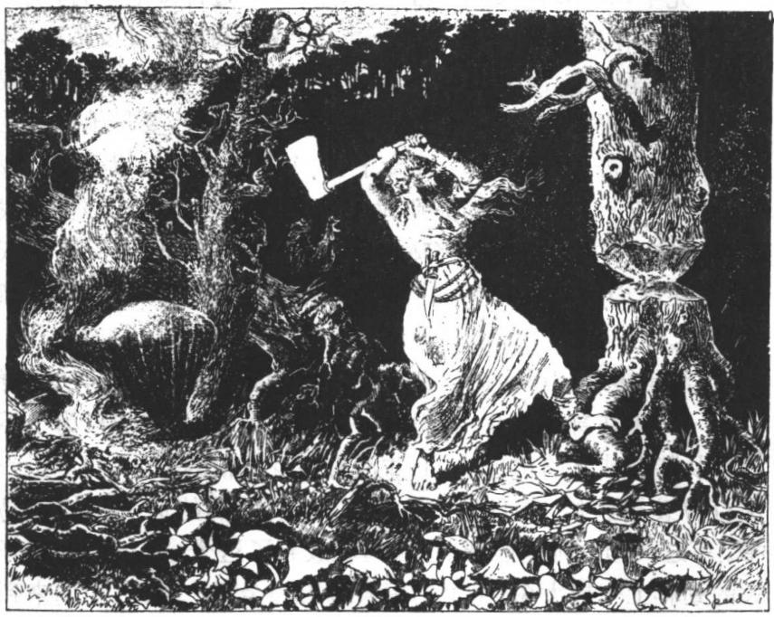

“说真的，”黑帽小偷说，“我认为他也肯定不会死的。”

“怎么会？”骑士说，“这回他是决逃不掉的。”

“我曾有一次更奇妙的死里逃生，”黑帽小偷说，“比你准备把他投入锅炉更危险，我希望他有类似的情况。”

“真的？你还经历过更大的危险？”骑士问，“我也想听听这个故事。如果这个故事如刚才的一样精彩，那我也同样宽恕这个年轻人。”

“先生，”黑帽小偷说，“我的生活方式一点不好，我刚才已跟你说过。某一时期，我手头的钱用光了，又找不到合适的事做，到了山穷水尽的地步。终于我所在的教区死了一个有钱的主教，我听说有许多珠宝和华贵衣服作为陪葬，便打算将那些东西占为己有。当天夜里我就动手，到了那里，我知道他的棺材放在教堂下拱顶墓室的尽头，就慢慢走进去，墓室又长又黑。没进去多久，就听到有脚步声迎面而来，步子很快。尽管我天生大胆，但想到死去的主教及我自己正在犯的罪行，我丧失了勇气，急忙向墓室的入口处奔去。刚退出几步，就觉察到，在我和亮光之间，有个高大的黑影，正好站在门口。我惊恐万分，不知如何能逃得出去，就向他开了一枪，他立即倒下横在门口。见他仍然是个凡人的形体，我这才想到那不是主教的幽灵，因而从惊恐中恢复了常态。我又冒险走到墓室的尽头，在那儿发现一个大包袱；再仔细一看，原来尸体已遭洗劫，原先那个幽灵不是别人，正是主教手下的一个牧师。我非常抱歉，误杀了他，但那是没有办法的事。我拿起包袱，里面装着主教所有值钱的东西，正打算离开这个阴森恐怖的地方，可是刚走到入口处，就见护墓的警卫向我走来，清清楚楚听到他们说要进墓检查一下，要是黑帽小偷就在附近的话，一定会来盗墓的。我当时不知如何是好，因为一旦被发现，肯定就没命了。可那时他们人人提心吊胆，没有人有足够的勇气进来抓我。我很清楚，只要我一露面，他们就会像对一只狗一样开枪。我不能再耽搁了。我把刚才被我杀死的人竖起来，使他看起来像自己站着一样，而我自己蹲在他背后，尽可能托住他。这样，警卫向墓室走来，一眼就能看见他。果然他们在黑暗中见到了他，其中一人大喊一声：那就是黑帽小偷！端起枪就对他开火。我让他倒下，自己爬到门口一个黑暗的角落里。他们看到那人倒了下去，全都奔进墓室，冲到尽头，怕里面还有黑帽小偷的同伙。趁他们忙于查看尸体和墓室的时候，我溜了出去。一旦到了外边，我就逃之夭夭，他们再甭想抓住我黑帽小偷了。”

“好，勇敢的家伙，”峡谷骑士说，“看得出你经历过许多危险，你用你的故事解救了两个王子。不过我很遗憾，这个小王子不得不受刑。好吧！只要你再说一个同样精彩的故事，我也同样宽恕他；我可怜这个年轻人，只要有办法，我就免他一死。”

“太巧了，”小偷斯隆说，“我本人也最喜欢他，为了他，我特意把最最稀奇古怪的故事留到最后讲。”

“那好，”骑士说，“快讲给我们听听。”

“有一天我正在旅行，”黑帽小偷说，“我走进一座大森林，转悠了半天，也没有能钻出来。后来，我到了一座大城堡，累得要死，我就进去了，只见一个年轻妇女坐着在哭，膝上抱着个孩子。我问她为什么哭，城堡的主人哪儿去了，因为我惊奇地发现附近没有见到任何仆人或其他人走动。”

“‘算你好运气，’年轻妇女说，‘城堡的主人恰好没在家。他是个可怕的巨人，只有一只眼睛长在前额上，专以吃人为生。这孩子是他交给我的。’她说，‘我不知道他是从哪儿弄来的，叫我把孩子做成馅饼。听到这样的命令，我除了哭没有别的办法。’”

“我说她要是知道有什么合适的地方可以把孩子安全地藏起来，我会替她去藏的，总比让巨人吃掉好。”

“她告诉我离那儿不远的地方有所房子，房子里有个妇女会照看孩子的。不过馅饼怎么办？”

“‘割下孩子一个手指，’我说，‘我再从树林里打一头小野猪来给你，你把它弄成小孩的模样，把手指头放在某个地方，巨人要是起疑，你可以把手指翻出来给他看，他看到手指头，就满意了，以为馅饼真是孩子做的。’”

“她接受了我的建议，割下了孩子一个手指头。按她指的方向，我很快找到那间房子，把孩子放在那里，并带给她一头小野猪以取代孩子。她做好了馅饼。我美美地吃了一顿，正准备离开那个妇女，忽见巨人正在进入城堡大门。”

“‘天哪！’她说道，‘你现在怎么办？快跑去躺在他房里那些死尸当中吧，把衣服脱光，要是他刚好路过那个房间，也不会从一大堆死人中认出你来。’”

“我听从了她的意见，躺在死尸中间，装成死人，看他如何行动。一开始，他说要吃馅饼。妇人把饼端到他面前，他大骂说像猪肉味道，妇人清楚手指在哪儿，立刻翻了出来，这才使他确信那是人肉饼而不是猪肉饼。可是馅饼只起了开胃的作用，我听到他在霍霍磨刀，说必须再吃一两片肉才能填饱肚子。我心惊肉跳地听到巨人在死人堆里翻来挑去，偏偏挑上我，割去我半个屁股，拿去烧烤。不用说，我疼得要命；但是怕死的心情使我不敢哼哼。他吃完了便大喝起烈性酒来，很快就喝得头都抬不起来，往一张巨大的吊床上一倒便睡着了，那张吊床是专为喝醉酒准备的。听到他发出鼾声，我便爬出来，让妇人用手帕给我包扎好伤口，然后拿起巨人的烤叉，放在火上烧红，戳进他的眼睛，可是没能杀死他。”

“我把铁叉插在他头上以后，拔腿就跑。可不久我就发现他在追我，尽管他眼睛瞎了。他用一个魔圈向我掷来，正好落在我的大脚趾上，并扣牢在上面。”

“巨人呼唤魔圈，问它在哪里，令我惊奇的是，魔圈在我脚上竟能回答他。有了魔圈的指引，他向我猛扑过来，幸好我看得准，巧妙地躲过了危险。我发现，只要那个圈扣在我脚上，逃跑也没用，所以我拔出砍刀，砍去被圈扣住的脚趾，把它们扔进附近一个大鱼塘。巨人又呼唤魔圈，魔圈总是给予回答，但是他并不知道我干了什么，以为魔圈还在我身上，于是向魔圈猛扑过去，因此跌进鱼塘，水淹没过他的脑袋和耳朵，把他淹死了。您瞧，骑士先生，”小偷斯隆说，“我经历了种种危险，却总能死里逃生。当然，我从此丢掉了一只脚趾而成了瘸子。”

“我的主人，”一个一直在旁听他们说话的老妇人说，“这个故事是真的，我就是那个巨人城堡中的妇女，而您，主人，就是那个要做成馅饼的孩子。这位正是您的救命恩人。您看看您缺掉一个手指，那是为了欺骗巨人而割掉的。”

峡谷骑士听到老妇人的话，非常震惊。他知道自己从小丢掉一个手指，于是相信这个故事不是胡编的。

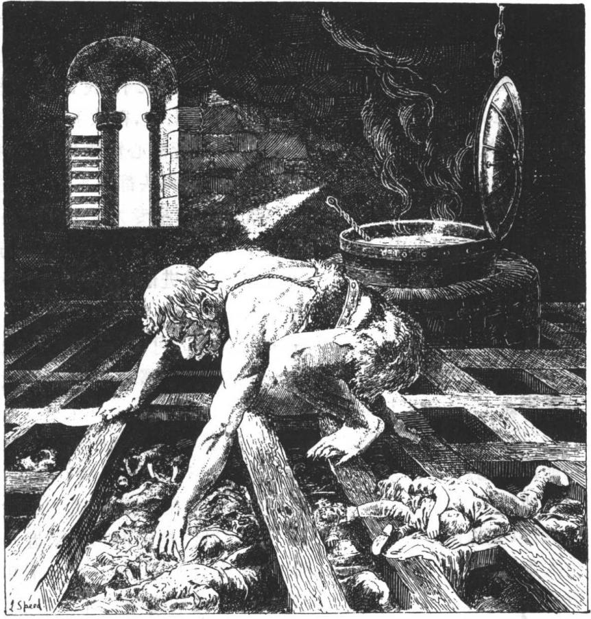

“这么说你就是我的救命恩人？”他说道，“哦！勇敢的朋友，我不仅要宽恕你们，还要让你们留在我身边，受到王子一样的款待，享有王子所享有的一切。”

他们全都跪下来表示感谢，黑帽小偷告诉了他为什么他们打算来盗响铃骏马的缘由，还说他们跟别人预先约好的，一定要回去。

“好吧！”峡谷骑士说，“既然如此，我愿意把骏马赠送给你，我不愿看见这些勇敢的朋友死去。你们随时都可以走，只是记住要及早来看我，以便我们进一步相互了解。”

他们答应说一定，然后高高兴兴地返回父王的宫殿，黑帽小偷与他们相伴相随。

邪恶的王后一直站在高塔顶上，听到远处传来铃声，知道是王子带着骏马回来了。她又怨恨又恼火，猛然从塔顶跳下，跌得粉身碎骨。

三个王子在父王统治期间，生活非常幸福，黑帽小偷也一直伴随在他们左右。不过，老国王归天后，他们情况如何，我就不得而知了。

 

## 神偷

从前有个农民，他有三个儿子。他既没有财产留给他们，也不知把他们培养成什么样的人，所以不知如何是好。

他只好对他们说，允许他们去想去的地方，做想做的事。他答应陪他们走一段路。走到三岔路口时，三弟兄各自选了一条道。父亲与儿子道别后回家去了。那两个大的后来成了什么样的人，我不清楚；但那个小儿子，却是走了很多很多地方。

一天晚上，他正穿过一片大森林，突然起了一阵可怕的风暴，风大雨猛，他几乎眼睛都睁不开。稍微清醒些时，发现已迷失了方向，既找不到大路，也看不见小道。不过他仍然往前走，后来见到林子远处有一丝光亮，就决定到那儿去。走了好久，总算到了，他发现亮光是从一幢大房子里射出来的，屋里炉火熊熊，凭那炉火，就知道里面的人还没睡。于是他走进去，一个老妇人正在收拾屋子。

“晚上好，老妈妈！”小伙子说。

“晚上好！”老妇人说。

“今晚天气糟透了，”小伙子又说。

“是的，”妇人说。

“我能在这儿过一夜吗？”小伙子问。

“你睡在这儿没好处，”老妇说，“那伙人回来发现了你，就会把你和我都杀掉的。”

“他们是什么人？都住在这儿吗？”小伙子问。

“喔，强盗，坏透了的强盗，”老妇人说，“我年轻时就被他们拐来了，从此成了他们的看家婆。”

“不管怎么样，我还是想住这儿，”小伙子说，“今晚这样的天气，我无法出去。”

“那好吧，”老妇人说，“不过你留下会倒霉的。”

小伙子在身边的一张床上躺了下来，但不敢睡着。没多久，强盗回来了。老妇人告诉他们，有个陌生人进来了，她没法撵他走。

“你发现他有钱没有？”强盗们问。

“他那副样子哪有钱！”老妇人说，“一个流浪汉，身上穿的衣服就是全部家当了。”

强盗们叽叽咕咕议论该如何处置他，是杀掉呢，还是采取别的措施。这时，年轻人起身和他们说话，问他们是否需要一个外人，如果需要，他愿意效劳。

“哦，如果你愿意干我们这一行，就可以留在这儿。”

“干什么都行，”小伙子说，“因为我离家的时候，我父亲已给了我充分的自由。”

“那好，”强盗说，“你愿意偷东西吗？”

“行啊。”小伙子说，心想学偷盗不需花很长时间。

当时离那儿不远有个男人，家有三头牛，他打算把其中一头牵到城里去卖，这伙强盗早打听到这个情况，就对小伙子说，要是有本事把那人的牛偷走，不让他知道，又不伤害他，他们就可以留他做仆人。于是小伙子出发了，随身带了只漂亮的鞋子，上面有颗银扣子。他把鞋放在牵牛人必经的路口，然后躲进灌木丛里。那人一经过便会见到那只鞋。

“好漂亮的鞋！”牵牛人果然看见了鞋，说，“要是能找到另一只，我就把它拿回家，说不定老太婆会高兴那么一回的。”

要知道他老婆脾气很坏，性格暴躁，他在家动不动就挨老婆的打骂。可他想，要是找不到与它相配的另一只，拿一只鞋回去没什么用，于是就继续赶路，让那只鞋仍丢在路边。

小伙子捡起鞋子，抄林中近道，赶在牵牛人的前面，把鞋丢在他要经过的路上。那人牵着牛过来时，很懊恼自己怎么那么蠢，竟让那只鞋丢在那儿而不随身带走。“我只好再返回去取那只鞋了，”他把牛拴好，自言自语地说道，“这样我就有一双鞋给老太婆了，说不准她会夸上一两句呢。”

于是他返身去找，可是东找西找，就是找不到那只鞋，最后只得拿着一只鞋回来了。

此刻，小伙子已牵着他的牛走了。卖牛人回来见牛没有了，便嚎啕大哭起来，因为他怕老太婆知道了会当场要了他的命。但是他急中生智，决定回去牵第二头牛，赶到城里去卖，只要小心一点，老太婆不会知道真相的。他回去牵了第二头牛，老太婆一点没察觉。强盗们通过施展魔力听到了这一切，他们又对小伙子说，如果能偷到这头牛，又不伤害那个人，就可以让他与他们平起平坐。

“哎哟，这可不是一件容易的事。”小伙子心里说。

这回他带了根绳子，套在腋下把自己吊在一棵树上，这棵树就在卖牛人必经的路口。那人牵着牛走过来，见有个人上吊，心里有些怕。

“唉，你有什么想不通，要自己上吊！”他说，“吊吧，不关我的事！我可救不了你。”说完他牵着牛继续赶路。小伙子从树上跳下来，抄小路赶到那人前面，重新把自己吊在树上，正好挡住那人的去路。

“哎呀，天哪！”那人说，“真有人伤心得要上吊，还是我幻觉中的鬼影？你吊吧，管你是不是鬼，不关我的事。”说着又牵着牛走了。

小伙子又按老办法干了一遍。他从树上跳下来，抄林中小路赶到那人前面，把自己直挺挺地吊起来，挡在牵牛人必经的路口。

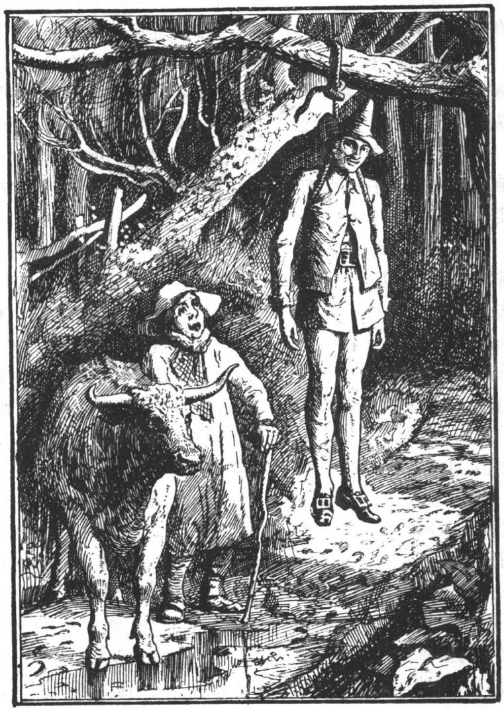

牵牛人再一次见到这种情景，自言自语道：“真是讨厌的怪事！难道三个人都这么伤心，非要自杀不可？不，我不信！肯定是巫术造成的！不过，我想了解一下真相：假如另外两个人仍然吊在树上，那就是真的；假如不在，那就肯定是巫术作怪了。”

于是他拴好牛，回去看先前那两个人是否还吊在树上。这个时候，小伙子从树上跳下来，牵着牛就跑了。你可以想象，等那人回头来发现牛又丢了，会怎样的难过。他大哭大叫，心里又恼又恨。可最后还是自我宽慰说，现在还有个最好的办法，就是不声不响地把第三头牛牵到城里去，卖个好价钱。于是回家瞒着老婆牵走了第三头牛。

可是强盗们无所不知，他们又对小伙子说，要是他能像前两次那样去偷牛，就让他来做他们的头目。于是小伙子再次跑到林中去。当那个人牵着牛走过来时，他发出一阵哞哞声，好像林中有头大公牛似的。牵牛人一听可高兴了，觉得那正是他的公牛发出的声音，想这下可找到它们了。他赶紧拴好第三头牛，离开大路，直奔林中去找牛。这时小伙子乘机牵走了第三头牛。等那人空手而归，发现又丢了一头牛，简直都要急疯了。他大哭大叫，好不悲伤，许多天都不敢回家，生怕老婆杀了他。

强盗们对此并不满意，因为这样一来，就得承认小伙子为他们的头目，所以想给小伙子出难题。有一天，他们全都离他而去，只留下小伙子一人在家。他们走后，小伙子做的头一件事，就是把三头牛牵到大路上，让它们回到自己家里去。农民见到自己的公牛回来，别提心里有多高兴。接着，小伙子用强盗的马匹驮上他到手的贵重东西——金银、布匹及其他好物品。最后，小伙子请老妇人替他向强盗们致谢，说他走了，要找到他可不容易，说完就动身离开了。经过好多天，他才来到那条使他陷入强盗之手的大道。他带着从强盗那儿取来的许多东西回家了。走近家门，看到父亲的房舍时，他挑了件制服穿在身上，看上去像个大将军。小伙子骑着马回到家，俨然是个大人物似的。踏进屋门，他问能否在此住宿。

“不行，”他父亲说，“我怎能给一个高贵绅士安排住宿？我自己都没有好衣服穿，没有好床睡，而且这床这被全是破烂货。”

“你真是铁石心肠，”小伙子说，“居然不让儿子进屋去住。”

“什么，您是我儿子？”老人喊道。

“难道你认不出我了？”小伙子说。

父亲认出了他，说：“可是你究竟干了些什么，这么快就成了一位大人物？”

“嗅，我这就告诉你，”小伙子回答说，“你说过我可以做任何我喜欢的事，我学了偷盗，现在满师了，成了神偷。”

那时有个乡绅住在他父亲的农舍附近，乡绅有所大房子和数不清的银子，他有个可爱的女儿，美丽、善良、又聪明，神偷想娶她为妻，就求父亲去乡绅家提亲。

“他要是问我干什么职业，你就说我是神偷。”

“我想你是昏了头了，”他父亲说，“正常人绝不会这么蠢的。”

“你一定要去乡绅家求亲，”小伙子说。

“我可不敢去乡绅家求亲，”父亲说，“他家那么有钱，那么富有。”

“我既然想娶她就非得娶到她，”神偷说，“你敢也得去，不敢也得去。要是你不肯主动去，那我就只好强迫你去了。”

他父亲还是不肯去，神偷就用一根桦树枝在后面抽他，嘴里还说着狠话，父亲只好哭哭啼啼地踏进乡绅的家门。

“怎么啦，我的朋友？”乡绅问他。

他就把家里的事情一五一十地告诉了乡绅：他有三个儿子，他允许他们自谋出路，他们就都动身走了。“现在小儿子回来了，逼我来您府上求亲，还吩咐我说他是一个神偷。”说着老人又啜泣起来。

“别难过，老乡，”乡绅笑着说，“你回去告诉他，他首先得露一手。星期天我们都呆在厨房看着，他要是能把烤肉叉上的铰链偷下来，我就把女儿嫁给他。你去把这话说给他听吧！”老人回家把话捎给儿子，小伙子心想这很容易。他提来三只活兔，装进一只口袋，故意穿得破破烂烂，显出一副穷酸可怜相，星期天扛着口袋溜进乡绅家后门，那模样活像一个乞丐。乡绅全家人都在厨房里盯着烤叉上的铰链。小伙子悄悄放出一只兔子，它立刻在院子里奔跑起来。

“看，兔子！”厨房里的人说着想出去捉住它。

乡绅也看见了，但他说，“噢，随它去吧！一只活蹦乱跳的兔子是捉不住的。”

过了一会儿，小伙子放出第二只兔子，厨房里的人又看见了，以为仍是先前的那只，又想出去捉它，乡绅说别费力气。

没多久，小伙子放出第三只兔子，它在院子里一圈又一圈地跑开了。厨房里的人看见，还以为是同一只兔子，都急着出去抓。

“真是只不多见的兔子！”乡绅说，“来，我们试试，看能不能捉住它。”说完，他奔了出去，其他人也跟了出去。兔子前面跑，他们后面追，那场面真是热闹。

就在这时，神偷取下烤叉上的铰链跑了。那天乡绅吃没吃烤肉我不清楚，不过有一点是肯定的：没吃到烤兔肉，虽说他追兔子追得一身臭汗，精疲力尽。

那天中午劳伦斯神父来吃午饭，乡绅告诉他，被一个神偷捉弄了。神父没完没了地取笑他。

“哦，”神父说，“简直无法想象怎会被那样一个家伙捉弄！”

“我劝你还是警惕着点，”乡绅说，“说不定他在动你脑筋，你还不知道哩。”神父不信，坚持自己的观点，而且对乡绅这样容易上当又取笑了一番。

那天傍晚，神偷来了，要娶乡绅的女儿，可乡绅说：“你得再露一手，你今天干的毕竟没什么了不起。你能否将神父捉弄一番？他正在那儿取笑我，说我怎么会上你这种小人的当。”

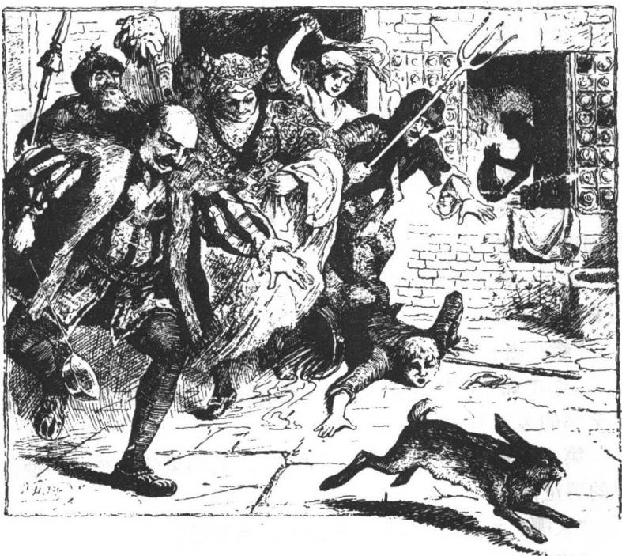

“这个一点也不难，”神偷说，他化妆成一只鸟，身上披条白床单，又用一对鹅翅膀装在背上，然后爬到神父院子里一棵枫树上。黄昏时神父回家，小伙子喊道：“劳伦斯神父！劳伦斯神父！”因为那是神父的姓氏。

“是谁在叫我？”神父问。

“我是天使，”神偷说，“是上帝派我来通知你，由于你的虔诚，可以活着进入天堂。下周一晚上你能否准备好？你把全部金银财宝堆放在客厅里，到时候我来用一只布袋接你走。”

劳伦斯神父叩头拜谢天使。星期天，他作了告别性的布道。他向众人宣布，说有位天使降落在他庭院的大枫树上通知他，由于他的正直虔诚，将活着被带入天堂。教堂里每一个听众，无论男女老少，都感动得流下热泪。

到了星期一晚上，神偷再次以天使形象出现在神父庭院，神父跪下双膝表示感谢，随后被装进布袋。他一钻进布袋，神偷便拖起他就走，地上到处是树枝和石子。

“嗷！嗷！”神父大叫起来，“您这是带我去哪儿？”

“进入天堂的路可不好走。”神偷说，一面继续拖着口袋走，里面的神父疼得要死。

最后，神偷把布袋扔进乡绅家的鹅棚，鹅群拼命啄他，他觉得真是生不如死。

“嗷！嗷！我在哪儿呀？”神父问。

“你在炼狱。”神偷说完，扔下他就走了，从他的客厅里拿走了全部的金银财宝。

第二天早晨，放鹅姑娘来放鹅，听到鹅棚里传出神父抽抽搭搭的哭泣声。

“天哪！谁在那儿，哪儿不舒服？”她喊道。

“噢！”神父说，“如果你是天使，就让我回到地上，因为这儿比地狱还要糟——小魔鬼们用火钳夹我。”

“对不起，我不是天使，”姑娘边说边让神父钻出布袋，“我只是替乡绅看管鹅群，它们就是夹痛您的小魔鬼。”

“这一定是神偷干的好事！啊，我的金银财宝！”神父吼一声，怒不可遏地向自己家奔去，其速度之快让放鹅姑娘觉得他突然发了疯。

当乡绅获悉了神父的遭遇后，笑得前仰后合。但当神偷来要他履行诺言把女儿嫁给他时，他却推托说：“你必须再干一件了不起的事，好让我对你的才能确信无疑。我马厩里有十二匹马，我安排十二个马夫坐在马上，一人一匹。要是你有足够的智慧，能从他们胯下把马偷走，我将实践诺言，把女儿许配给你。”

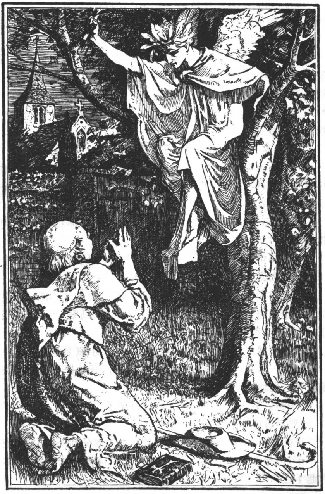

“行，我能办到，”神偷说，“不过我办到之后，你是不是一定肯把女儿嫁给我？”

“要是你真能办到，我就满足你的要求，”乡绅说。

神偷到商店买来满满两瓶白兰地，在其中一瓶里倒入一些安眠药水。然后，他雇了十一个人夜里等候在乡绅家马厩旁。又用许多恭维话，并许以丰厚的酬金，向一位老妇人借来一件破长袍和女背心。然后手拄拐杖，背一个小包袱，趁夜幕降临，一瘸一拐地向马厩走来，马夫们正集中精力给马饮水。

“你到这儿来干嘛？”一个马夫问“她”。

“哎呀，天哪！天哪！怎么这样冷啊？”“她”一边说着一边颤抖着身子，“唉，这么冷的天，简直要冻死人！”说完，“她”又颤抖了起来。“看在上帝份上，”“她”又说，“就让我睡在马厩里好吗？”

“不行不行！快滚开！”一个马夫说，“要是乡绅看到了，我们就麻烦了。”

“哦，多可怜的老太太！”另一个马夫说，很同情“她”。“一个可怜的老太太不会碍事的，让她进来好了。”

其余的人也说话了，有的说她可以留下，有的说不能。就在他们边争论边照料马的时候，“她”悄悄溜进了马厩，在门背后坐下，别人没注意到“她”。

夜越来越深，马夫们坐在马背上一动不动，真是活受罪。

“呃——，冷得真可怕！”一个马夫说着，开始把双臂抱在胸前一伸一屈地活动起来。

“是啊，”另一个说，“我的牙齿都打架了。”

“要是有口烟抽就好了，”第三个说。

正好有个人有那么一点点，于是每个人都分到一点，虽然烟草不多，但毕竟每个人都分到了，每个人都津津有味地嚼着，多少起了点作用。可是很快他们又冷得不行了。

“唉——！”一个人说着，又颤抖起来。

“呃——！”老妇人也发出了声音，听得见“她”上下牙齿格格直响。随后，“她”打开那只不含安眠药的白兰地酒瓶，手抖得将酒洒落了许多，接着她喝了一口，咕嘟一声咽下喉咙。

“你瓶里装的什么，老婆婆？”一个马夫问。

“噢，一点点白兰地，先生。”“她”回答。

“白兰地！真没想到！让我喝一口吧！让我喝一口！”一下子十二个人全都叫了起来。

“噢，就那么一点点，”老妇人嘟嘟嚷嚷地说，“给你们润一下唇都不够呢。”但他们一定要喝，“她”没办法，只好给他们喝。“她”打开加入安眠药的那只酒瓶，递到第一个马夫的唇边。现在，“她”那只酒瓶里摇不出了，“她”在监视着另一瓶，保证让每个人都喝上一点。第十二个还没喝好，第一个已经坐在马上打呼噜了。神偷脱去身上的破衣服，把一个个马夫拖下来，将他们搬到马厩里隔栏板的槽杆上，然后唤来等候在外的十一个雇工，和他一起骑上乡绅的马走了。

早上，乡绅来看那些马夫。他们才刚刚醒来，正用马刺踢横杆，踢得木片飞溅，有几个站在地上，有几个还傻乎乎地坐在那儿。“很好！”乡绅说，“我知道谁来过了；可你们这群饭桶，骑在马背上还让人把马偷走。”他们因为失职而挨了一顿狠揍。

晚上，神偷来讲述了盗马经过，请求乡绅把女儿嫁给他，这是他答应过的。可乡绅只给他一百个银币，说必须干一件更出色的事情。

“你能不能，”他说，“从我的胯下盗走马呢？”

“我当然能，”神偷说，“只是我一定要得到你的女儿。”

乡绅说要看看他的真能耐，告诉他哪一天将骑马到练兵的广场去。神偷很快弄到一头又老又瘦的母马，用青青的柳枝和金雀枝做了个马轭，又买了辆旧马车和一只大木桶。准备好这些，他找来一个老乞婆，说给她十个金币，只要她钻到桶里去，把嘴对着桶上一个小塞孔；他将手指伸进小塞孔，但不影响她呼吸。她只要呆在桶里让马车拉上一段路就行。假如他将手指抽出塞孔，她可以多得十个金币。然后，他穿上破衣服，用炉灰把脸涂黑，再戴上假发和山羊胡子，那模样没人能认出。他骑马来到练兵场，乡绅已在那儿骑马驰骋了好一阵子了。神偷到了那儿，便放慢速度，那马几乎是一寸寸地移动。“驾！驾！”母马把车往前拉一点，可一松劲就后退，要不就站住不动。看上去那车赶起来很吃力。乡绅一点没想到这就是神偷。乡绅跑到赶车人面前，问他是否看见有人潜伏在林子附近。

“没有”，那人说，“我没看到。”

“你听着，”乡绅说，“假如你愿意骑马到林子看看是否有人潜伏在那儿，你可以骑我的马去，我会给你一马车的东西和很多钱，作为酬劳。”

“我看现在恐怕不行，”那人说，“因为我要将这桶蜂蜜酒送到婚宴上去。酒灌好了，可塞子刚才在路上弄丢了，所以我得一边走一边用手指堵住塞孔。”

“我来给你照顾酒桶和马车”，乡绅说，“你骑我的马去看看吧。”

这么一说，那人就答应了。不过他恳求乡绅一定要小心照看好马车和酒，要用手指堵住塞孔，一直等到他回来。乡绅答应一定照办，神偷于是骑上乡绅的马走了。

时间慢慢过去，天渐渐黑了下来，可不见那人回头。乡绅等得实在不耐烦，便把手指从塞孔里抽出来。

“我可以多拿十个金币了！”桶里的老乞婆大叫起来。这下乡绅明白了桶里装的是什么样的蜂蜜酒了，便朝自己家走去。没走多远，就见仆人牵了他的马匹来接他，因为神偷已经把马骑回去了。

第二天，神偷到乡绅家要娶他女儿，他已答应过好几回了。

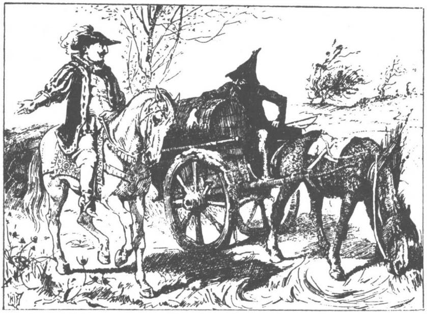

可是乡绅又用漂亮话来搪塞，最后只给他三百个银币，要他露一手更高明的。如果这回能做到，就一定把女儿给他。神偷心想，只要你说得出来，我就办得到。

“你能不能，”乡绅说，“将我床上的床单和我太太身上的睡衣偷走？”

“完全可以！”神偷说。“我只想顺利得到你的女儿。”

深夜，神偷从绞架上取下一具小偷尸体，然后搬来一架长梯子，靠在乡绅卧室的窗下。他顺着梯子爬上屋顶，用一根绳子将尸体吊起来一上一下地移动，活像有人从窗外向里偷看。

“我的妈，是神偷！”乡绅说着，轻轻用胳膊捅捅妻子。“我来杀了他！”

他拿起床边的枪。

“哦，别，你别那么做，”他妻子说，“是你自己让他来这儿的。”

“别啰嗦，亲爱的，我要开枪打死他，”他说完便开始瞄准，可那尸体忽上忽下地移动着，总也瞄不准。最后他总算瞄准了，便砰的一声开了枪，尸体“咚”的一声落到地上，神偷也立即飞也似地逃跑了。

“没错，”乡绅说，“我打死了那个贼。不过人们喜欢嚼舌头，要是让人看见尸体在我们家里，肯定会议论纷纷，让人讨厌。我看最好还是把他埋掉。”

“你认为怎样妥当就怎样做吧，亲爱的！”妻子说。乡绅起床下楼，尽快走出门去，神偷却悄悄溜了进来，上楼到了乡绅太太身边。

“哦，亲爱的，”她说道，“你已经弄好啦？”她以为是她丈夫。

“噢，是的。我把他丢进一个坑，弄了点泥土盖在上面，看不出来了。外面太黑，我以后再好好处理。先把床单拿来给我擦一擦，那尸体血淋淋的，弄得我一身是血。”

这样，他拿到了床单。

过了会儿，他又说：“你还得把你的睡衣给我，光是一条床单还不顶用。”

她于是把睡衣也脱给了他。这时他说忘了锁大门，去一下就上来睡觉。这样，他拿走了床单和睡衣。

一小时后，真乡绅回来了。

“亲爱的，你锁门花的时间真长啊！”他妻子说，“床单和睡衣呢？”

“你说什么？”乡绅问。

“我问你床单和睡衣，你不是拿去擦血迹的吗？”她说。

“见鬼！”乡绅说，“我又一次上了他的当。”

第二天，神偷来了，要乡绅遵守诺言，将女儿许配给他，乡绅再也想不出别的办法推托了。除了把女儿嫁给他，还得再陪上许多钱财。因为说实在的，他怕再不答应，自己的一双眼睛都会被神偷偷去；而且，再食言的话，别人也会看不起他。从此，神偷过上了富裕而幸福的生活。后来他还偷不偷，我不知道；但即使还偷，也只是为了开开玩笑而已。

 

## 兄妹俩

哥哥拉着妹妹的手说：“看，自从妈妈去世后，我们没有过上一天快活日子。后妈天天打我们，如果我们敢告诉爸爸，她就用脚把我们踢开。我们什么也吃不着，只能啃一点干面包屑，桌底下的狗也比我们活得好，吃到好的她还会给狗一两块。天哪！要是我们的妈妈知道这一切会怎么样啊！走吧，我们一起到广阔的天地里去闯吧！”

他们走过田野和沼泽，越过篱笆和阴沟，整天在外面走啊走啊，天下雨了，妹妹说：

“老天也和我们的心一起哭了。”

晚上，他们来到一片很大的森林，由于长途跋涉，忍饥挨饿，他们困极了，钻进一棵空心树干，很快便睡着了。

第二天早晨醒来之后，太阳已高高升起，温暖明亮的阳光照射到树洞里，哥哥说：

“我真渴，妹妹，要是能找到一条小溪，我要去喝一口。我觉得真的听到溪流声了。”他跳了起来，拉起妹妹的手就去找小溪。

他们残忍的后娘其实是个女巫，她完全知道两个孩子已经逃走，就悄悄地跟在他们身后，对林中所有的小溪都施了巫术。

很快，孩子们找到一条小溪，溪水亮闪闪地欢快地从卵石上跃过。哥哥急切地想喝一口，但妹妹听到流过身边的溪水在轻轻说：

“谁喝了我的水会变成一只老虎，谁喝了我的水会变成一只老虎！”

她大声地喊：“哦，亲爱的哥哥！请不要喝，否则你会变成一只野兽把我撕成碎片。”

哥哥渴得要命，但他还是没喝。

“好吧，”他说：“我等找到新的泉水。”

等他们碰到第二条小溪，妹妹又听溪水在说：

“谁喝了我的水会变成一匹狼，谁喝了我的水会变成一匹狼！”

她又喊道：“哦，哥哥！请你别喝，否则你会变成一匹狼把我吃掉。”

哥哥又没喝，只是说：

“好吧，我再忍耐一会儿，但是再遇到小溪我就得喝了，无论你说什么我也要喝，因为我实在快渴死了。”

当他们来到第三条小溪旁，妹妹又听到川流不息的溪水在低语：

“谁喝了我的水会变成一只雄黄鹿，谁喝了我的水会变成一只雄黄鹿！”

她恳求哥哥：“啊！哥哥别喝，否则你会变成一只鹿离我而去。”

但是，哥哥已经跪在溪水边弯腰去喝了，当然，他的唇一碰到水，立刻倒在草地上变成一只雄鹿。

妹妹趴在中了魔法的哥哥身上，伤心地哭起来，小鹿也在哭泣，然后悲哀地坐在妹妹的身边。最后小女孩说：

“别担心，亲爱的小鹿，我永远不会抛弃你。”然后，她把金色的吊袜带，套在小鹿的脖子上，又采来灯芯草编成一根软软的绳子用来固定项圈，弄好之后她领着小鹿越走越远，走到了密林深处。

他们来到了一座小房子面前，小姑娘向里看了看，发现是座空房子，她想：“也许我们可以住在这里生活。”

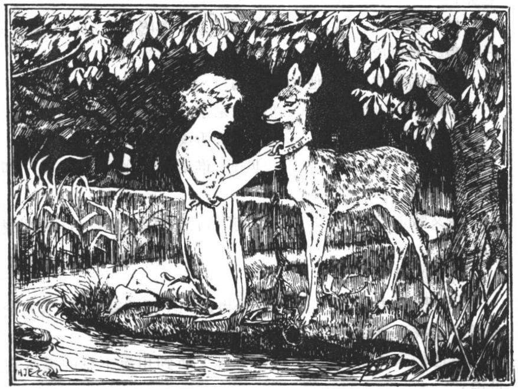

她找来树叶和地衣，为小鹿铺了张柔软的床。每天早晚，她出去为自己找来草根、坚果和浆果等，为小鹿找来嫩草。它吃她手里的食物，和她一起玩耍，似乎倒挺快活的。到了晚上，妹妹累了，做完晚祈祷便倚着鹿背当枕头，很快就能熟睡。要是哥哥还保持着原形，他们的生活一定是挺开心的。

他们就这样在林中生活了一段日子。突然有消息说，国王要来森林狩猎，接着，林中到处回荡起嘹亮的号角声、猎犬的吠叫声、猎手们欢快的叫喊声，小鹿听见后也想出去加入他们的行列。

“啊！”他对妹妹说：“让我也出去打猎吧！我再也呆不住了。”

在它恳切哀求下，妹妹只好同意了。

“但是，”她说，“晚上你一定要回来，我要把门锁上以防那些疯狂的猎人。为了能确认是你回来了，在敲门时你要说：亲爱的妹妹，把门开开，我要进来。如果听不到你说话，我就不开门。”

小鹿跳着走了，回到自由的旷野中它感到真快活。

国王和他的猎手们很快发现了这个美丽的小动物，便开始追它，但总是追不上。每次他们快要逮住它时，它一跳就钻进树丛中不见了。夜晚来临了，它跑回家，边敲门边喊：

“亲爱的妹妹，把门开开，我要进来。”门开了，它跑进去，睡在柔软的菁苔床上一夜到天亮。

第二天早晨，狩猎又开始了，小鹿一听到号角声和猎手们“嗬、嗬”的喊声，它就呆不住了，说：

“妹妹，开开门，我要出去。”

于是妹妹开了门，对它说：“别忘了晚上回家，还要说那首小儿歌。”

国王和猎手们一看见戴着项圈的小鹿，马上骑马追过来，但小鹿的快捷灵活使他们总也追不上。一整天就这样前跑后追，夜晚来临时，猎手们已逐渐包围住了小鹿，小鹿的一只脚被一个猎人打中受了轻伤，所以腿有点瘸，跑的速度也慢了。

猎手们偷偷地跟着它，一直来到小屋附近，听它叫：“亲爱的妹妹，把门开开，我要进来。”他们看见门开了，小鹿一进去，门又立刻关上了。

猎手们记住了这一切，便离开这里迅速向国王汇报他们的所见所闻。

“明天我们再打猎。”国王说。

可怜的妹妹一见小鹿受了伤真是吓坏了。她给它洗净血迹，用药草包扎好伤口，对它说：“现在，亲爱的，去躺下好好休息，明天伤口就会好了。”

真的伤得很轻，到第二天基本上就好了，小鹿一点也不感到疼痛了。一听到林中打猎的声音，它又叫了：

“我不能留在这儿，我必须去。我会小心，他们抓不到我的。”

妹妹开始哭起来：“他们肯定会杀了你，那我就一个人在林子里，被所有的人抛弃了，我不能也不会让你出去的。”

“那我也会悲伤而死，”小鹿说：“因为我一听到号角声就惊喜若狂。”

妹妹见无法阻止，只好心事重重地打开门，小鹿又活泼而快乐地飞奔进林中。

国王一见小鹿就吩咐他的猎手：“现在去追它，不要放松直到晚上，但要小心千万别伤害它。”

太阳落山了，国王对猎手们说：“来，指给我看那座林中小屋。”

国王走近屋子，边敲门边说：“亲爱的妹妹，把门开开，让我进来。”门开了，国王走进去看见一位美丽的少女。

女孩见进来的不是小鹿而是头戴金冠的陌生男子，大吃一惊。国王看上去很善良，他伸出手对她说：“你愿意到我的城堡，做我的新娘吗？”

“哦，当然，”少女答道：“不过你得让我的小鹿一起去，我不能抛弃它。”

“让它永远在你的身边享尽荣华富贵。”国王对她许诺。

这个时候，小鹿一跳一跳地进来了。妹妹把灯芯草绳又扣上项圈，用手牵着绳子的另一端，然后一同离开了森林。

国王把可爱的少女抱上自己的马，把她带到自己的城堡，举行了隆重的婚礼。小鹿被当成宠物受到爱抚，它可以在宫殿的花园里随意奔跑玩耍。

再说那位恶毒的后母，她造成这两个可怜孩子的不幸和种种危险处境，满以为妹妹会被野兽撕成碎片，哥哥会被猎枪射中。当听说兄妹俩生活幸福又富裕时，她心里充满了嫉恨，一心想给他们造成新的不幸。她那相貌丑恶之极，只有一只眼睛的女儿指责她说：“有这种好运的应该是我，只有我才配当王后。”

“安静点，好吗？”老巫婆说：“时机到了我会下手的。”

过了些时候，一天，国王正好外出打猎，王后刚生下一个漂亮的小男孩。老巫婆认为机会来了。她扮成一个宫廷侍女，急急忙忙走进王后的房间，看到王后正躺在床上。她对王后大声说：“洗澡水已准备好了，洗了澡会使你强健，快点，要不水凉了。”她女儿也在旁边，她们两个人拉起仍很虚弱的王后走进浴室，把她送到浴缸里，然后锁上门溜走了。

她们预先在浴缸下燃起了旺火，想让可爱的王后窒息。

等她们肯定王后已窒息而死，老巫婆在女儿头上扣上一顶帽子，然后领着她上了王后的床。她女儿千方百计要使自己的身材和相貌看起来像王后，但是，纵然她能施展魔力，却不能恢复已瞎了的眼睛，所以就把身子侧向瞎眼的一边，以免被国王察觉。

晚上，国王回来了，听说自己有了儿子，高兴极了，坚持要去看看亲爱的妻子身体状况如何。老巫婆连忙叫起来：“小心别拉开窗帘，不要让光线接触王后的眼睛，她必须绝对安静。”于是国王走了，他根本不知道躺在床上的是一个假冒的王后。

午夜的时候，宫里所有人都酣睡了，独自守护在婴儿摇篮边的保姆看见门轻轻地开了，除了真王后还会是谁进来？她从摇篮里抱起婴儿，让他躺在臂弯里，喂他吃了会奶，然后小心地拍松小床上的枕头，把婴儿放在上面，用床罩把孩子裹起来。她也没忘记小鹿，来到房间角落，轻轻拍了拍小鹿的背，然后悄悄地离开了房间。第二天早晨，保姆问卫兵晚上有没有见到任何人走进城堡，他们都说：“没有，我们根本没有见到。”

许多个夜晚，王后都以这种方式进来，但她从未说过一句话。保姆也吓得不敢露出半点风声。

过了些时候，一天夜里王后终于说话了：

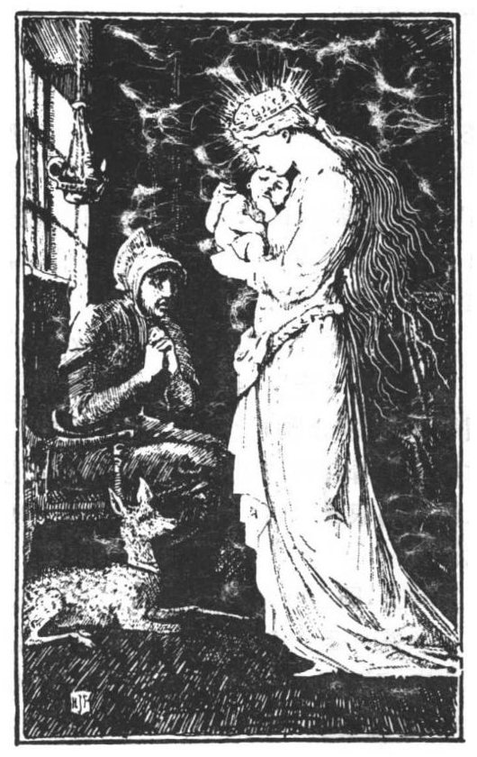

“我的孩子好吗？我的小鹿好吗？我再回来两次，就永不再来了。”

保姆没有回答，但当王后刚消失，她就去向国王禀报了一切。国王惊呼道：

“天哪！你说什么？今晚我将亲自到孩子床边看护。”

晚上，他来到婴儿室。午夜时分，王后出现了，说道：

“我的孩子好吗？我的小鹿好吗？我再来一次就永不再来了。”

她像往常一样给孩子喂奶，抚摸，然后就消失了。国王不相信见到的一切，也不敢跟她说话，但是第二天他继续来观察。

晚上，王后又来了，说：

“我的孩子好吗？我的小鹿好吗？我这是最后一次来了，现在永别了。”

国王再也克制不住自己了，一下跳到王后身边哭道：“你就是我亲爱的妻子！”

“是的，”她说：“我是你亲爱的妻子！”就在这时，她又复活了，跟从前一样清新纯洁如玫瑰。接着她把恶毒的巫婆和她女儿所做的一切残忍的事讲给了国王听。国王立刻下令逮捕她们，并送到了法庭。她们被判死刑：女儿被遣送到森林中让野兽撕成了碎片，老巫婆则被处以火刑。

一旦老巫婆化为灰烬，她下的符咒也就失灵了，小鹿恢复原形成了一位英俊男子，兄妹俩从此过上了快乐的日子。

 

## 小玫瑰公主

从前，有个王国的国王和王后，生了两个漂亮的儿子和一个人见人爱的女儿。公主受洗礼时，王后像往常一样发出请帖，邀请所有的仙女参加洗礼仪式及盛大的宴会。

宴会结束，仙女们正准备离开，王后对她们说：

“请你们别忘了惯常的祝福，告诉我小玫瑰将来的命运怎样。”

小玫瑰正是她们给小公主起的名字。

可仙女们说她们把魔书忘在家里了，过一天再来告诉她。

“啊！”王后说道，“我懂了，这就是说你们没有好消息要告诉我；但我求你们至少什么也不要对我隐瞒。”

经过再三恳求，她们才说：

“殿下，我们担心小玫瑰可能会造成她两个哥哥的不幸，他们甚至会因她而死。关于您亲爱的女儿，我们预见到的就是这些。很抱歉，我们没有更好的消息带给您。”

说完，她们走了，王后很悲伤。国王看到她这个样子，就问发生了什么事。

王后说她坐得离火炉太近，纺杆上的亚麻全烧坏了。

“哦，就这事啊？”国王说罢，跑到顶楼去拿来她一百年也纺不完的亚麻线。可王后看上去仍然闷闷不乐，国王又问她是怎么回事，她说在河边散步时，将一只绿色缎鞋掉到河里去了。

“噢，原来就为这事！”国王说着，就向境内所有的鞋匠下令，他们很快为王后制作了一万双绿色的缎鞋。可是王后仍然高兴不起来，国王再一次询问究竟出了什么事。这回王后回答说，麦片粥吃得太快了，把结婚戒指一起吞下去了。可这一次没能骗过国王，因为那戒指恰好在国王手中，他说道：

“啊，亲爱的，你没跟我讲实话，因为那只戒指在我的钱包里。”

王后非常难为情，知道国王这下要生她的气了，于是她把仙女们对小玫瑰的预言告诉了国王，求他想想办法防止这可能到来的种种不幸。

这回轮到国王伤心了，最后他说：

“我看没有办法拯救我们的儿子，除非趁小玫瑰还小把她的头砍掉。”

王后惊叫起来，说宁可砍掉自己的头，她决不会同意这么干，国王必须再想别的办法。他们想来想去，就是想不出个好办法。最后，王后听说在城堡附近的一个大森林里，有位老隐士，住在一个树洞里，远远近近的人有事都去向他请教，于是她说：

“我最好去征求一下他的建议，或许他有办法阻止仙女们预言的灾难。”

第二天一早，王后就出发了，她骑一头漂亮的白色小骡子，蹄子是纯金的，两个侍女骑马跟随在后面。到达森林后，因为树木茂密，马匹无法通过，她们就下马步行。她们向隐士的树洞走去，起先隐士很恼火，因为他不喜欢女人，但一看是王后，就说：

“欢迎您，王后。您要问什么？”

王后跟他说了仙女们关于小玫瑰的预言，问他该怎么办，隐士说，她必须把公主关在一座塔里，不能让她出来。王后很感激，酬谢了他，然后赶忙回城堡把这个消息告诉国王。国王得知这个消息后，命人尽快建好一座高塔，把公主安置在里面。国王、王后和两位哥哥天天去塔里看她，使她不感到寂寞。大王子和小王子很爱他们的小妹妹，因为她是世上最漂亮最讨人喜欢的公主，她微微一笑就值千金。小玫瑰长到十五岁时，大王子问国王她是不是快到出嫁的年龄了。小王子也向王后提出了同样的问题。

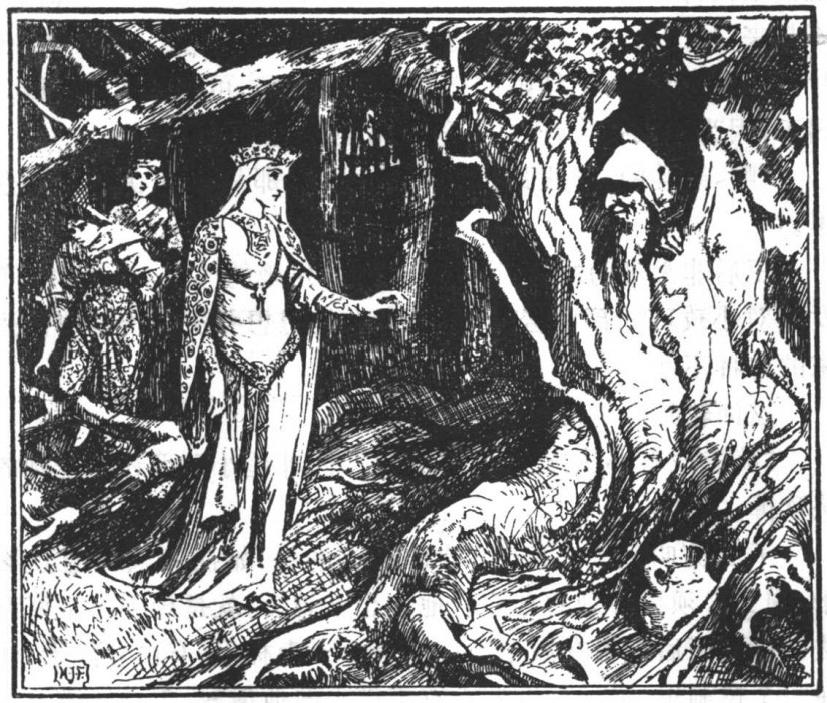

国王和王后被他们俩的问题逗乐了，但没有作出回答。不久以后，国王和王后相继得病，而且在同一天死去。所有人都很悲伤，尤其是小玫瑰公主。举国上下丧钟齐鸣。

丧礼过后，所有的公爵和朝臣拥戴大王子登上王位，用钻石王冠给他加了冕。他们齐声欢呼：“国王万岁！”接下来是一连串的盛宴和欢庆。

新国王和弟弟交换意见说：

“如今我们可以作主了，让妹妹走出那座阴森讨厌的塔楼吧。”

他们穿过花园，来到角落的那座塔楼里。小玫瑰公主正在绣花，一见哥哥便站起身来，抓住国王的手大声说：

“早安，亲爱的哥哥！现在你是国王了，请带我离开这座阴森的塔楼吧，我快闷死了。”

说完，她哭了起来。哥哥吻了吻她，让她擦干眼泪，告诉她，他们正要带她离开塔楼，住到美丽的城堡中去。亲王还带给她满满一口袋的蜜饯，对她说：

“快，我们离开这座丑陋的塔楼吧，国王马上将为你举行一个盛大的婚礼。”

小玫瑰来到美丽的花园，看见到处是果树、花卉、青青的草坪和亮闪闪的喷泉，惊奇得一句话也说不出来，因为她从来没有见过这些东西。她环顾四周，跑来跑去，采集果子与花朵。她的那条一身鲜亮绿毛，只有一只耳朵的小狗弗里斯克，在她身边欢蹦乱跳，汪汪叫个不停，还头朝下做倒立动作，样子十分可爱。

弗里斯克的滑稽动作逗得大家直乐，可是它突然跑了，跑到一片小树林里，公主跟了过去，看见一只孔雀正在阳光下开屏，高兴得不得了。小玫瑰从来没见过这么漂亮的东西。她目不转睛，看得出了神。国王和亲王走过来，问是什么东西使她这么高兴，她指指孔雀，问那是什么，他们回答说是一种鸟，人们有时吃它的肉。

“什么！”公主说，“他们竟敢杀死这么美丽的鸟，还吃它？我宣布除了孔雀王我谁也不嫁。一旦我成了王后，就绝不让任何人吃食我的臣民。”

国王一听这话非常惊奇，说：

“可是，小妹妹！我们到哪儿去找孔雀王呢？”

“噢！随便到哪儿，陛下，”她回答说，“总之，我非他不嫁。”

随后，他们把小玫瑰带进城堡，那只孔雀也被带了进去，让它在窗外平台上来去走动，好让公主随时观赏。一会儿，宫廷里的贵妇纷纷前来看望公主，各自带来漂亮的礼物——什么衣服、缎带、糖果、钻石、珍珠、布娃娃，还有绣花鞋。公主很有教养，大方得体地一一道谢，人人都欢欢喜喜地来，高高兴兴地走。

这时，国王和亲王正在考虑如何才能找到孔雀王，也不知世上是不是有这样一个人物。首先，他们让人画了一幅公主的画像，画得惟妙惟肖，就是画像同你说话，你也不会奇怪。然后，他们对公主说：

“既然你除了孔雀王不愿意同任何人结婚，我们准备一起到世界各地去寻觅他。要能找到，我们就满意了。在这期间，你一定要照管好我们的王国。”

小玫瑰对哥哥为她这样百般操心表示感激，答应一定精心照料王国。他们不在的时候，她只有看看孔雀，让弗里斯克蹦蹦跳跳来消愁解闷。

国王和亲王出去之后，见人就问：

“你知道孔雀王吗？”

可回答总是：“不，不知道。”

于是他们继续朝前走，走呀走呀，从来没有人走过这么远的路。最后，他们来到了甲虫王国。

他们从未见过这么多的甲虫，嗡嗡之声震耳欲聋。国王向一个看上去最高贵的甲虫询问，是否知道什么地方可以找到孔雀王。

“陛下，”甲虫说道：“孔雀王国离这儿还有三千里，你们还有很长的路要走呢。”

“你是怎么知道的呢？”国王问。

“喔！”甲虫说，“我们都很了解他，因为我们年年在他的花园里度过两三个月。”

国王与亲王同这只甲虫成了好朋友。他们一起行走，一同进餐，甲虫领他们参观了甲虫国所有的珍奇物品，在那儿，树上一片最小的绿叶也比一枚金币值钱。然后，他们重新出发去完成他们的旅行。这回路线清楚了，路上就没多大耽搁。不难猜出，他们已到了目的地，因为每棵树上都有孔雀，它们的叫声老远老远就能听见。

抵达孔雀城时，他们发现满城的男男女女都穿着孔雀羽毛，显然这里的人们认为孔雀羽毛比一切东西都美丽。

很快，他们见到了孔雀国王，他正驾着一辆金车，上面缀有钻石，由十二只孔雀拉着。孔雀王非常英俊，国王和亲王打心眼里高兴。他有金色的卷发、白皙的皮肤，戴一顶孔雀毛王冠。

看见小玫瑰的两位兄长，孔雀王马上知道他们是外地来的。

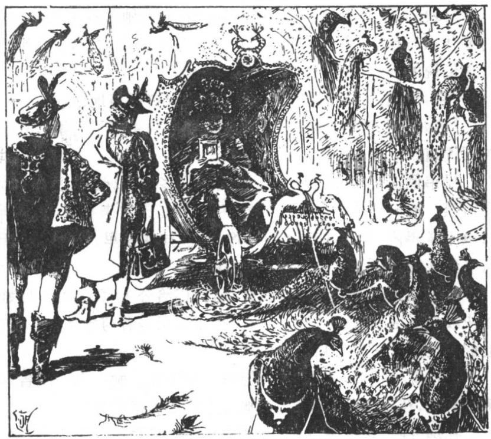

他停下来，派人叫他们前来答话。兄弟俩上前致意后说：

“陛下，我们来自遥远的地方，给您看一幅美丽的画像。”

说着，他们从旅行袋中取出小玫瑰的画像。

孔雀王默默注视了很久，然后说：

“我真不相信世上会有如此美丽的公主！”

“事实上，她本人比画像漂亮一百倍。”兄弟俩一齐说道。

“我看你们是想拿我开心，”孔雀王说。

“陛下，”亲王说，“我的兄长跟您一样是个国王。我是亲王，画像上是我们的妹妹小玫瑰公主。我们来是想问问，您是否愿意娶她为妻。她的心灵和她的容貌一样美，我们将给她大量金币作为陪嫁。”

“哦！非常乐意，”孔雀王回答说，“我会使她幸福快乐的。她将要什么有什么，我将非常珍爱她。只是我警告你们，要是她没有你们说的那么漂亮，我就要你们的脑袋。”

“哦，当然！我们完全同意。”兄弟俩异口同声地回答。

“很好。我暂时先把你们监禁起来，等公主来了再说。”孔雀国王说道。

兄弟俩深信小玫瑰比画像上美丽得多，所以毫无怨言地接受监禁。他们在那儿受到很好的待遇，孔雀王常来看望他们，所以也不觉得闷，至于小玫瑰的肖像，则被挂在宫里，孔雀王整天从早到晚盯着画像出神，别的什么事也不想干。

由于国王和亲王必须接受监禁，他们给公主写了封信，叫她尽快收拾财宝到他们这里来，因为孔雀王正等着与她结婚。不过他们没提监禁的事，怕她担心。

小玫瑰接到信，高兴极了，想马上就出发。她东奔西跑告诉每一个人，孔雀国王已经找到，她马上就要去跟他结婚。

礼炮齐鸣，焰火缤纷，人人都放开肚皮尽情地吃蛋糕、糖果。三天之内，凡来探望公主的人，都得到一片果酱面包，一只夜莺蛋和一杯香葡萄酒。如此招待过后，公主又把布娃娃分送给大家，然后把王国托付给城中最有智慧的长者，叫他们负责照料一切事务，不要浪费金钱，把钱节约下来留等国王回来处理，还特别关照别忘了喂养她的孔雀。然后，她就出发了，只带了奶妈和奶妈的女儿，还有那只绿毛小狗弗里斯克。

她们乘一条小船驶向大海，随身带了大量金币和衣服，如果公主每天换两件的话，这些衣服也足够她换十年的。她们一路上欢天喜地、歌声不断，别的什么也不干。奶妈问船夫：

“孔雀王国是不是快到啦？”

船夫回答说：“不，还没有呢！”

过了会儿，她又问：

“这回一定快到了吧？”

船夫说：“快了，快了。”

又过了一会儿，奶妈又问：

“快到了吗？快到了吗？”

船夫说：“是的，是的。”

于是她靠近他身边悄悄问道：

“你想不想发财？”

“那当然。”船夫说。

“我告诉你如何得到一袋金子。”奶妈说。

“那再好没有了。”船夫说。

“听着！”奶妈继续说道：“今晚，等公主睡着，你帮我把她扔到大海里去，她会淹死。我让我女儿穿上她的漂亮衣服，然后带她到孔雀国王那儿去，只要孔雀王高兴娶她，你就将得到满船的宝石。”

船夫对这个建议感到很吃惊，说：

“可要淹死这样漂亮的公主，实在太可惜了！”

奶妈最后还是说服了他。夜晚到来，公主像往常一样很快睡着了；弗里斯克蜷缩着身子睡在她床脚边的垫子上。邪恶的奶妈叫来船夫和女儿，把公主，连同羽绒床铺、枕头和毛毯一古脑儿抬起，投入大海，公主甚至都没有惊醒。幸运的是，公主的床铺完全用凤凰羽毛制成，是稀世珍宝，能够始终浮在水面上不下沉，所以小玫瑰就像躺在船里一样四方漂流。过了一会儿，她开始觉得寒冷，翻来翻去，吵醒了弗里斯克。小狗惊跳起来，灵敏的鼻子嗅到附近的鳎鱼和鲱鱼的气味，就汪汪叫了起来。它叫的声音很响，又叫了好长时间，几乎所有的鱼都被吵醒了，它们游过来团团围住公主的床铺，并抬起头向铺上张望。可是公主却自言自语地说：

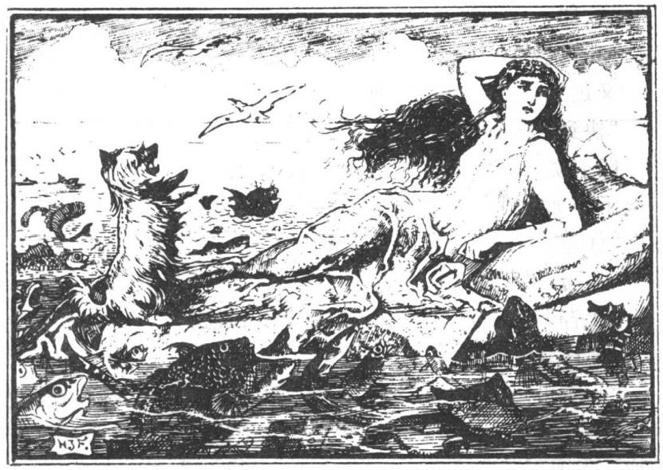

“我们的船怎么摇得这么厉害，幸好像今晚这样睡不舒服的日子不多。”

恶毒的奶妈和船夫此刻已经离得很远了，不过还能听到弗里斯克的吠叫声，于是相互庆贺说：

“那只讨厌的小狗和它的女主人正在畅饮海水，为我们的健康干杯呢。让我们赶快登陆吧，我们一定离孔雀王国很近了。”

国王已派了一百辆大车前来迎接，车辆全由各种稀奇的动物拉着，有狮子、熊、狼、牡鹿、马、水牛、鹰以及孔雀等。为小玫瑰公主准备的是由六只蓝色猴子拉的四轮马车。这些猴子会翻筋斗，在绷紧的绳索上跳舞，还会玩许多别的有趣的把戏。它们全都穿着深红色丝绒铠甲，缀有金扣子。车后是孔雀国王精心挑选的六十个美女随从，以便更好地服侍小玫瑰公主，并取得她的欢心。

奶妈为了装扮女儿，着实花费了一番工夫。她让女儿穿上小玫瑰公主最最漂亮的衣服，从头到脚缀满宝石。可尽管如此，假公主的丑陋还是暴露无遗。更糟的是，她一天到晚绷着个脸，动不动就发火，这会儿一直在叽叽咕咕地抱怨。

她从船上下来时，孔雀国王派来的卫队看着她，全都惊奇得目瞪口呆。

假公主喊道：“喂，都拿出点精神来！有没有带吃的给我？没有就砍你们的脑袋！”

卫队窃窃私语：

“事情不大对头！她不但丑陋而且恶毒。我们可怜的国王竟会娶这样一位新娘！这种丑八怪也值得把她从另一个世界带来！”

然而，她还在一个劲地发号施令，无缘无故地逮着这个扇一记耳光，逮着那个拧上一把。

由于队伍很长，行进速度缓慢。奶妈的女儿坐在车上，一心装出一副王后的样子。那些坐在树上等着迎候公主的孔雀，原先打算欢呼“万岁，我们美丽的王后！”可一看假新娘那么丑，都情不自禁地叫出另一句话来：

“天哪！她真丑！”

这可气坏了假公主，她对卫兵吼道：

“赶快把这些孔雀给我杀了，它们胆敢无礼地侮辱我！”

孔雀一飞而散，边飞边嘲笑她。

那个无赖船夫注意到了这一切，悄悄对奶妈说：

“这些闲言碎语对我们很不利，你女儿应该长得漂亮一点。”不料奶妈说：

“闭上你的嘴，蠢货；你会把事情搞砸的。”

有人报告国王，小玫瑰公主马上就到。

“很好，”国王说，“她的两个哥哥说的是真的吗？她真比画像还漂亮吗？”

“陛下，”仆臣回答道，“要是她跟画像一样漂亮就好了。”

“那倒是，”国王说，“她果真和画像一样漂亮，我就很满足了。让我们去迎接她吧！”听外面的喧闹声，知道她已经来了，就是不知道外面干嘛这么喧闹。孔雀王好像听到了这句话：

“她真丑！她真丑！”

孔雀王以为这一定是指公主带来的小矮人，他根本没想到这是在说他的新娘本人。

玫瑰公主的画像由队伍最前面的人举起，随后是国王及朝臣。他已经等不及了，恨不能立刻见到可爱的公主；但当他看见奶妈的女儿那副模样时，不禁勃然大怒，不肯再朝前迈一步。她实在太丑了，任何人见了都会吓一跳。

“什么！”他大叫起来，“那两个被我监禁起来的混蛋竟敢这般捉弄我？他们就提议我娶这样一个丑八怪？把她和她的奶妈关进大塔楼去，带来的人也全关进去；至于那两个无赖，我要砍掉他们的头。”

这个时候，被监禁的国王和亲王估计妹妹就要到了，便把自己打扮得漂漂亮亮，坐在那儿随时准备传唤他们前去迎接。所以当看守和士兵把他们带到到处是蛤蟆和蝙蝠、水一直没到颈脖子的黑暗地牢时，真是惊愕到了极点，也沮丧到了极点。

“这是一个悲惨的婚礼，”他们说道，“究竟出了什么事，这样对待我们？看来他们一定要杀掉我们。”

这可怕的想法困扰着他们。一天又一天过去了，什么消息也得不到。三天后，孔雀王来了，透过墙壁上的一个小孔训斥他们：

“你们自称是国王和亲王，企图让我跟你们的妹妹结婚，事实上你们不过是两个乞丐，连水都不配给你们喝。我要尽早结果了你们，刀很快就要磨好，只等着砍下你们的脑袋。”

国王愤怒地回答说：“孔雀国王，你最好仔细考虑考虑你说的话。我的确是国王，和你一样，也有强大的王国、辉煌的王服和王冠，还有足够的赤金可以随心所欲办到一切事情。砍了我们的头，你就不怕被人耻笑吗？是不是你以为我们偷了你什么东西？”

孔雀王被这样大胆的言辞镇住，起先，想不杀他们放走算了；可总理大臣声称这种恶作剧万万不能轻饶，否则会被人们笑话，把国王看得一钱不值。于是，控告兄弟俩的起诉书草拟出来了，他们的罪名是骗子，说原先答应把一个漂亮的公主嫁给国王，结果却来了个丑陋不堪的村姑。

向犯人宣读了起诉书之后，兄弟俩大叫冤枉，说他们讲的全是实话，他们的妹妹确实是位公主，美丽无瑕。一定发生了什么他们无法预料的怪事。因此，他们请求缓刑七天，以证实他们的无辜。孔雀王怒不可遏，不愿赐予这种恩惠，不过最后还是被说服了。

我们再来看看真公主的遭遇。天亮了，她和弗里斯克惊奇地发现自己孤零零地漂在海上，周围没有一只船，也不见一个人前来救他们。公主哭喊了起来，连鱼类都替她难过。

“天哪！一定是孔雀王下令把我扔进大海，他改变主意不想娶我了。可是，他怎么这么古怪，要知道，我是多么爱他，我们俩在一起会多么幸福呀！”

后来，她哭得更伤心了，因为她依然爱着他。就这样，他们在海上飘了整整两天，浑身被海水打湿，冻得直抖，肚子又饿，公主拾了一些牡蛎，和弗里斯克分着吃，尽管她和小狗都不爱吃那东西。到了晚上，公主心里害怕，就对弗里斯克说：

“噢，请你不断吠叫，以防鳎鱼把我们吞了。”

巧得很，她们漂近了海岸，岸上有个穷苦的老汉，独自住在一个小屋里。他听到弗里斯克的叫声，暗自想道：

“一定有船失事了！”（因为那里从来没有狗来过）。于是，他就走出来，看看能不能帮上一些忙。他一眼就看到了公主和弗里斯克正被海水一上一下地推送过来。小玫瑰向他张开手臂，叫道：

“噢！好心的老大爷，救救我吧！不然我会冻死饿死的！”

听到她喊叫得这么可怜，老汉心里很难过，跑回屋里，拿了根长长的船钩，趟水过去，水一直没到下巴，有一两次差点把他整个人淹没，才终于钩住了公主的床，把它拖上岸来。

小玫瑰和弗里斯克发现自己又回到陆地上，高兴极了。公主真诚地向老人道了谢，然后用毛毯裹住身子，赤着脚，轻轻巧巧地走进那间小屋。老人点起一堆柴火，从旧衣箱里取出老婆的衣服和鞋子，让公主穿上。尽管这是身粗糙的装束，但她依然显得美丽动人，弗里斯克又跳起最拿手的舞蹈逗她开心。

老人看出小玫瑰是个有身份的小姐，因为她的床铺及床上铺的垫的全是绣金的缎子。他要姑娘把身世都告诉他，并尽可以信赖他。于是公主把一切都告诉了老人，想到可能就是孔雀国王下令把她投进大海，又伤心地哭了起来。

“那现在该怎么办呢，我的孩子？”老人问，“你是一位高贵的公主，过惯了舒适的生活，吃惯了讲究的饭菜，而我没什么好东西招待你，只有黑面包和萝卜，这可不适合你。要不，我去告诉孔雀王说你在这里。他一看见你，准会愿意跟你结婚的。”

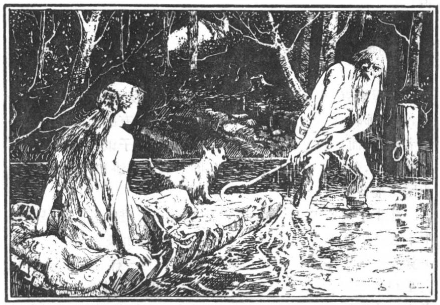

“哦，不！”小玫瑰大叫起来，“他一定很残忍，因为他想把我淹死。别去告诉他。不过，你要是有小篮子，就给我吧。”

老人给了她一只篮子，她把篮子套在弗里斯克的脖子上，对它说：“去吧，到城里找最好的烧菜锅，把锅里的东西全拿来给我。”

弗里斯克去了，因为城里谁家的饭菜也不如国王的好，它就巧妙地来到王宫的厨房，掀开锅盖，把里面的全部菜肴都带回来给了公主。公主又说：

“好，再到食品间去拿来最好的食品。”

于是弗里斯克又去王宫食品间，拿来白面包、红葡萄酒和各种甜点心，篮子塞得满满的，它几乎都拿不动。

当孔雀国王想要进餐时，锅里没有饭菜，食品间没有食品，朝臣们面面相觑，神情茫然，国王更是火冒三丈。

“好吧，没有午餐，我只好不吃。不过晚餐可得备好足够的烤肉！”

傍晚到了，公主对弗里斯克说：

“到城里去，找最好的厨房，把烤叉上正在烧烤的美味佳肴全拿来给我。”

弗里斯克照吩咐去做，它知道国王的厨房最好，轻巧地溜进去，趁厨师转身干别的事情，拿走了烤叉上所有的烤肉。肉烤得不老不嫩，而且色泽诱人，看一眼就会觉得肚子饿。它赶快带回去给公主，公主又吩咐它取来食品间所有的馅饼和蜜饯，那也是为国王准备的。

孔雀王因为没吃午餐，肚子很饿，想早点进晚餐。可是刚吩咐下去，嘿，你瞧，又全都不见了！他只得饿着肚皮发着脾气上床睡觉。第二天，发生了同样的事情；第三天也一样。足足三天，孔雀王粒米未进，因为每到午餐晚餐备好，正要端上时，就神不知鬼不觉地不见了。最后，总理大臣开始担心如此下去，国王会饿死，就决定亲自躲在厨房角落，盯着烧饭锅。当他看见一只独耳绿毛小狗，悄悄溜进厨房，掀开锅盖，把里面的饭菜倒进它的小篮子离去时，真是惊得目瞪口呆。他赶快追赶上去，跟踪小狗穿过全城，来到那个善良老人的屋前；然后，他奔回去禀报国王，说发现了他午餐晚餐的去处。国王十分震惊，说必须亲自去看看。于是由总理大臣和一队弓箭手陪同赶去，找到老人和公主时，公主正好吃完国王的午餐。

他下令把他们抓起来，用绳子捆住，连小狗弗里斯克也不放过。

公主被带到宫殿时，有人上来跟国王说话，国王说：“今天是两个骗子缓刑的最后一天，就把他们和这些偷我午餐的人一起行刑杀头吧！”这时老人上前双膝跪下，请求国王容他讲出事实。在他讲话的时候，国王第一次认真打量公主，因为公主哭得很伤心，他有些于心不忍。又听到老人说到她的名字叫小玫瑰时，连续三次低下头去看她，尽管由于饥饿，他已经虚弱无力，可还是奔过去紧紧拥抱住她，并亲手给她解开绳子，同时当众宣布，他用整个的心爱她。

国王传令，带小玫瑰的哥哥出狱，他们神情悲哀地走来，以为马上就要行刑了；奶妈及女儿、船夫也带来了。小玫瑰一见哥哥，就奔过去拥抱他们，而那几个背叛者慌忙跪倒在公主脚下求她饶命。国王和公主慷慨地赦免了他们。至于那个善良的老人家，得到了丰厚的报答，获允在宫里安度晚年。孔雀王对亏待国王和亲王表示深深的歉意，并尽其所能作了补偿。

奶妈把公主的衣服、首饰和金币全都归还公主。婚礼立刻举行，从此他们生活幸福美满，连弗里斯克也过上了豪华奢侈的日子，天天山珍海味，吃斑鸡鸡翅就算是最差的了。

 

## 猪驸马

从前，有个国王，他有三个女儿。碰巧他要出去作战，于是把三个女儿叫到跟前：

“我亲爱的孩子，大批敌军正向我们逼近，我得去参战。扔下你们我很伤心。我不在时你们一定要照顾好自己，做个乖孩子，行为举止多注意，家中的一切也要留心。你们可以到花园里散步，也可以在所有的房间里玩耍，只是最后一排右面角落的那间房间千万不能去，一定不要去，否则会有灾难降临到你们身上。”

“您就放心吧，父亲，”她们回答道：“我们从未违抗过您的旨意，您放宽心去战斗，愿上帝保佑您凯旋而归！”

一切准备就绪。出发之前，国王拿来所有房间的钥匙，再次提醒她们已经说过的话。女儿们眼含热泪吻了父亲的手，祝他胜利。国王把钥匙交给了长女。

姑娘们少了父王感到既悲伤又无聊，不知如何打发日子。为了消磨时光，她们决定每天用一部分时间来工作，用一部分时间来休息，用一部分时间在花园里玩耍，一切都顺顺当当。但是这种快活并未维持很久。随着日子一天天过去，她们的好奇心也越来越强烈，所以你就知道最终会有什么事发生。

“妹妹们，”大公主说：“我们每天缝衣、纺纱、读书。许多天来我们赶不走孤独的情绪。花园里所有的角落都走过了，宫里所有的房间也都熟悉了，奢华美丽的家具令我们赞美，可是，还有一个房间父亲禁止我们进去，莫非里面藏有什么秘密，我们何不进去探寻探寻？”

“姐姐，”小公主说：“我真不敢相信，你怎么能引诱我们违抗父亲的旨意，既然他叫我们别去，就一定有他的道理。”

“要是我们真的进去了，天肯定不会塌下来砸破我们的头，”二公主说，“难道房间里会有龙有鬼？还怕吃了我们不成？再说，父王怎么知道我们进去过？”

她们这么说着，鼓动着来到了那个房门前，大公主把钥匙伸进锁眼，喀嚓一声，门开了。

三个姑娘进去了，你猜她们看见了什么？

房间空荡荡的，没有任何装饰，但中央有一张大桌子，铺着华丽的台布，台布上有一本很大的打开着的书。

公主们受好奇心驱使，都想知道书里到底写了些什么，尤其是大公主，她第一个走过去，看到这样一句话：

“国王的大千金，将要嫁给一位东方的王子。”

接着二公主走上前翻到下一页，读到这样的话：

“国王的二千金，将会嫁给一位西方的王子。”

姑娘们高兴极了，笑着相互戏弄。

但是，小公主并不想走近桌子，也不想翻书。可两个姐姐不让她安宁，不管她愿意不愿意，硬把她拽到桌边，她用颤抖的手翻开下一页，读出：

“国王的小千金将会嫁给一头北方的猪。”

顿时，像晴天霹雳降临到她头上，她吓懵了。她心里痛苦极了，要不是两个姐姐扶着，很可能会瘫倒在地，摔破脑袋。

“你怎么能相信这派胡言？几时有过国王的女儿嫁给一头猪的事情？”

“你真是个小孩子！”另一个姐姐说，“即使真有那么一头令人作呕的动物来向你求婚，父王有那么多士兵，他们还不能保护你免受伤害？”

小公主但愿自己被姐姐的话说服，也相信她们说的是真的。但仍心情沉重，思绪情不自禁地又回到那本书上，巨大的幸福在等着两个姐姐，可自己的命运却如此糟糕，这样的事真是闻所未闻。

另外，她也因违背了父王的嘱咐而深感内疚。忧愁使人生病，她几天时间就变得叫人难以辨认：从前她脸蛋红红的、性格开朗，现在却面色苍白，难得一笑。她不愿和姐姐去花园玩耍，也不采花戴到头上，坐着纺纱缝衣时再也听不到她歌唱了。

这个时候，国王彻底击溃了敌军，并把他们驱逐出境。他赶紧回到朝思暮想的女儿身边。人民倾城而出，鼓乐齐鸣，欢呼国王凯旋而归。国王回来后，首先感谢上帝助他击溃了反叛的敌军，然后走进宫殿，三个公主前来相迎。看见女儿们都好，他更是高兴。小公主竭力掩饰住自己的悲伤，不让父王担心。

尽管如此，国王还是很快看出小女儿日渐消瘦，黯然神伤，他觉得好像有一块火红的烙铁刺进了心房，顿时闪过一个念头：她肯定是不听话，做了不该做的事。为了证实自己的想法，他把女儿叫来询问，并命令她们讲真话。女儿们坦白了一切，只是没讲谁先违抗了父命。

听了她们的坦白，国王伤心极了，整个人几乎要垮下来。但他还是振作精神，尽量安慰已吓得魂不附体的女儿们；他知道，事情已经发生。再说什么也不能挽回局面。

渐渐的这件事逐渐被人淡忘。一天，有一位从东方来的王子出现在宫廷，向国王的长女求婚，国王高兴地答应了他的请求。于是举办了盛大的婚宴。三天后，这对幸福的新人在热闹的典礼和一片欢庆声中走出了国境。

过了些时候，二女儿遇到了同样的事情，来向她求婚的是位来自西方的王子。

小公主看到一切恰如书中所写，她变得更加忧郁。她不肯吃饭，不肯穿漂亮衣裳，也不肯去花园散步，她说宁愿死去也不愿成为世人的笑柄。国王绝不会让她干这样的蠢事，所以千方百计地安慰她。

日子就这样一天天过去。嘿！你瞧，有一天，果然有一头来自北方的、体格庞大的猪走进宫殿，直接来到国王面前说：“你好，国王，愿您的生活像晴朗天空的阳光一样灿烂明媚！”

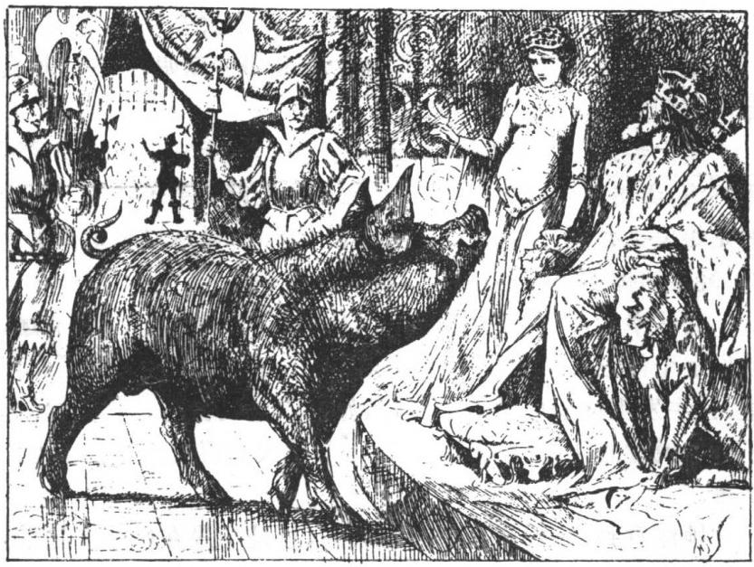

“见到你身体强壮，我很高兴，朋友，”国王回答道：“是什么风把你吹到这里来的？”

“我来求婚。”猪说。

这么动听的声音出自一头猪的嘴，国王感到既惊讶又蹊跷。他很希望猪能转移注意力，因为他不想把女儿嫁给它。但当听说数不清的猪已挤满了宫廷内外的大街小巷时，他知道这个事情已无法回避，只得表示同意。空头支票并不能使猪接受，它坚持要在一周内举行婚礼，如果国王不对天发誓遵守诺言，它就不离去。

国王只好派人去叫女儿，劝她服从命运，因为也只能如此。他对小公主说：

“我的女儿，这头猪的言行举止有别于其他猪，我自己不相信他会一直是头猪，肯定是巫术或魔法在作怪。顺从他吧，一切按他的意愿行事，我坚信上帝不久会解救你的。”

“如果您愿意我这么做，亲爱的父亲，我会的，”女儿回答。

举行婚礼的日子到了。婚礼过后，猪带着新娘，乘着一辆宫廷马车回家去了。

路上经过一片大沼泽地，猪下令停车，然后它下车来到泥潭里打滚，弄得从头到脚全是污泥，回到车上就叫妻子吻他。可怜的姑娘怎么办呢？想到自己对父亲说过的话，她从口袋里掏出手帕，轻柔地擦去猪嘴上的泥巴，然后就去吻它。

到达猪在密林中的住处时，天已经黑了。经过一天的旅途，他们个个都很累，大家静静地坐着歇了一会，用完餐就睡了。夜里，公主发现猪变成了人的模样，她并不感到惊奇，因为她想起了父亲说过的话。她鼓起勇气，决心等到天亮再看究竟会发生什么事。

她注意到，每天夜里猪都变成人，可是早晨在她醒来之前，那人又变成了猪。这种情况连续发生了好几夜，公主一点也搞不明白，显然丈夫是中了魔法。他是那么善良体贴，公主渐渐喜欢上他了。

一天，公主独自一人坐在门口，看见一个老太婆打这儿经过。即刻兴奋起来，因为她很久没见过人了，于是大声招呼老妇人过来跟她说说话。老太婆说了很多话，还说她精通法术，能占卜未来，对药草植物的疗效知道得也很多。

“夫人，我会一辈子感谢您的，”公主说：“如果您能告诉我我丈夫究竟是怎么回事，为什么白天变成猪，夜里变成人？”

“我只要跟你讲一件事，亲爱的，你就可以看出我算命多么准。只要你愿意，我可以给你一种药草破了那符咒。”

“您要肯给我这个，”公主说：“我愿意给您想要的任何东西，因为我实在不忍心看他这个样子。”

“喏，我亲爱的，”老妇人说：“拿好这根丝线，不要让他知道，因为如果他知道了就失灵了。夜里他熟睡时，你悄悄地起来，把这根丝线绑在他左脚上，绑得越紧越好，到早晨你就可以看到，他再也不会变成猪而永远是人了。我不要任何报酬，知道你快乐便是对我足够的回报。听到你的遭遇，我的心都快要碎了，要是我早点知道就好了，我可以尽早帮助你。”

老妇人走后，小公主小心地藏起那根丝线，到了夜里，她悄悄地起床，心在砰砰直跳。她把丝线缠在丈夫的脚上，正要把结扣紧，“啪”地一声线断了，因为线已经腐烂。

她丈夫惊醒了，对她说：“烦恼的女人，你这是干什么呀？再过三天那个邪恶的符咒就会从我的身上解除。可是现在，不知道我还要等多久。我必须马上离开你，我们不能再见面，直到你穿破三双铁鞋，磨钝一根钢棍。”说完他不见了。

只剩下公主孤零零的一个人，她伤心地哭起来，声音真是凄惨。但是她知道，伤心和眼泪是于事无补的。她站起身，决心服从命运的安排，无论走到哪里，也要找回丈夫。

她来到城里，首先订做了三双铁鞋和一根钢杖，然后便开始了寻夫的旅程。她走呀，走呀，渡过了九海，横过了九洲，穿过了无数茂密的森林。从酒桶一样粗的树干上落下的树枝使她磕磕碰碰，可是她跌倒了爬起来继续走，树枝打着她的脸，灌木划破她的手，她仍是头也不回地朝前走。漫长的旅程和极度的悲哀折磨得她精疲力尽，但她心中仍怀有一线希望。终于，她来到了一个小屋前。

你知道是谁住在这间屋子里吗？是月亮。

公主敲了敲门，恳求让她进去歇一会儿。月亮母亲见她处境如此困窘，很是同情，便让她进来，悉心看护她。在这儿，公主生下了一个孩子。

一天，月亮母亲问：

“你，一个凡人，是怎么走到这里——月亮家来的？”

接着，可怜的公主把她的所有遭遇告诉了月亮母亲，末了她说：“我会永远感谢上帝指引我来到这里，我也永远感激您对我和孩子的同情，多亏了您我们才免于一死。现在，我还想请您帮我最后一个忙，就是您的女儿能否告诉我，我的丈夫现在哪里？”

“她不能告诉你，我的孩子，”月亮女神说：“但是如果你能向东方走去，找到太阳的住处，他也许会告诉你。”

然后，她给了公主一只烤鸡，告诫她小心别丢失任何鸡骨头，因为那些骨头到时候可能会很有用处。

公主再次感谢月亮母亲的热情款待和谆谆教诲，扔掉已经穿烂的铁鞋，换上第二双新的，把吃剩的鸡骨头包扎好，一手抱着婴儿，一手拄着钢杖，重新开始了她的旅程。

又走了很远很远，来到一片茫茫沙漠，寸草皆无，道路更为艰难，几乎得走两步退一步。但她还是挣扎着走过了这片令人消沉的旷野。接着是岩石重叠的高山，她要爬过一块连一块的岩石，翻过一座接一座的山峰。有时，她不得不停下来歇一会儿，稍有力气便重新赶路。她先后走过了沼泽，攀登了满是燧石的山峰，她的脚、膝盖和臂肘全被划破，鲜血淋淋。有时走到一个无法跳越的峭壁时，只能借助手杖甚至用手膝着地爬行。当她累得快要断气的时候，终于到达了太阳宫。她敲门恳求让她进去。太阳母亲打开门，看到一个来自遥远地球上的凡人站在眼前，大为吃惊。听完公主的经历，太阳母亲流下了同情的泪水。她答应向她儿子询问公主丈夫的下落，然后把公主藏在地窖里，这样太阳回家时就不会察觉了，因为他每晚归来时心情总是很糟。

第二天，公主担心事情会不顺利，因为太阳已经察觉，有个来自另一个世界的陌生人在他的宫里。但他母亲用温和的话语安慰他，向他保证没有这回事。看到太阳母亲待自己这么好，公主便鼓起勇气问：

“太阳怎么会生气呢？他如此潇洒，对天下众生如此和善。”

“是这样，”太阳母亲说：“早晨，当他站在天堂门口时很快乐，对全世界的人微笑；可是到了白天，他开始生气，因为他见到了人世间的恶行，所以中午就发出灼人的热量；到了夜晚，他既悲哀又恼火，因为他站在死亡门口，那是他通常走的路，他就是从那儿回到这里。”

然后她告诉公主，已向儿子打听过她丈夫，但他说他一无所知，唯一的希望是去向风询问。

公主离去前，太阳母亲也给她一只烤鸡，并告诫她妥善保管好鸡骨头。她吃完鸡，把骨头包扎好，扔掉已经磨烂了的第二双铁鞋，抱着孩子，拄着钢杖，上路去找风的住处。

这次路途更加艰辛，公主遇到了难以想象的千辛万苦。她要爬越的山全由燧石组成，动辄喷出火焰；她要经过的树林，从未有人的足迹；还要经过成片的冰湖和崩落的雪地。这些艰难险阻几乎要吞噬了这个可怜的女人。但是凭着一颗坚定的心，她终于来到了位于山峰一侧的一个巨大山洞口，那就是风的家。洞前栏杆旁有一扇小门，公主敲门请求允许进去。风妈妈很可怜她，便让她进去休息。为了不让风察觉，风妈妈也将她藏起来。

第二天早晨，风妈妈告诉公主说，她丈夫住在一个茂密森林里，那树林之密，斧子也砍不出一条道来。他在那儿造了一幢房子，把树干排在一起，用坚韧的柳条固定，独自住在里面，任何人也不见。

风妈妈也给公主一只烤鸡，并告诫她小心保管好鸡骨。她还建议公主走夜晚横越天空的银河，说一直走下去就能到达目的地。

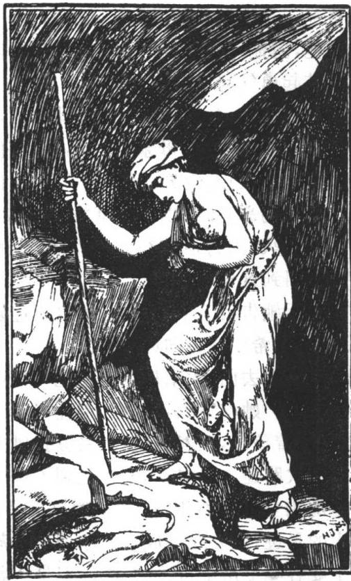

公主含着热泪向风妈妈道谢，感谢她带给自己这么好的消息。然后她日夜兼程，迫切渴望与丈夫重逢。她走呀走呀，最后一双铁鞋磨穿了。她扔掉铁鞋，赤足前进，陷泥塘、碰荆刺、踩石子、伤腿脚她都不管。最后，她终于来到树林边上一片美丽的绿草地，看到了花儿和柔软凉爽的青青草坪，她的心为之一振。但听到树上的鸟儿在叽叽喳喳地呼唤伴侣时，她又思念起自己的丈夫，伤心地哭了。她抱起孩子，拎起装着鸡骨头的包袱，走进了森林。

走了整整三天三夜，她什么也没有发现，只觉得又乏又饿，精疲力尽，甚至拐杖也不能帮助她再前进了，经过千山万水的长途跋涉，钢杖早已被挫钝，她几乎要绝望了，但还是想作最后一次努力。忽然，在一片灌木丛中她发现了风妈妈描述的那幢房子：没有窗户，门在屋顶。她围着房子绕了一圈想找到台阶，可没有找到。怎么办呢？如何进去呢？她想了又想，试图爬上屋顶，却又是白费力气。这时，她想起了一路辛苦带来的鸡骨头，于是她对自己说：“她们都关照我要好好保管这些骨头，一定很有道理，也许现在，在我急需帮助的时候，它们就派上用场了。”

她打开包袱，取出鸡骨头，想了一会儿，把两根骨头接起来，令她吃惊的是，这两根骨头立刻牢牢粘在了一起。她又把其他骨头一一接上去，直到接成两根长度够到房顶的杆子。她把两根长骨杆抵在墙上，两杆之间留着一码距离，然后把其余的骨头接在两根长杆之间，一根接好再接另一根，就成了一架梯子。每接好一格梯级她就站上去接下一格，最后终于离门很近了。就在快到屋顶的时候，她发现鸡骨用完了，最后一格梯级搭不起来了。怎么办呢？缺少这最后一步梯级，整个梯子就等于白搭，起不了作用，一定是弄丢了一根鸡骨。这时，她突然想出个主意，掏出一把刀砍下自己的小指，把它当作最后一步梯级，手指竟能像鸡骨一样粘牢。梯子做成了，她怀抱婴儿进了房门，她发现里面的一切井然有序。她吃了些东西，把孩子放在地上的一个木盆里，然后坐下来休息。

再说她丈夫巨猪，回到家时被眼前的一切惊呆了。起先他不敢相信自己的眼睛，紧紧盯着那架骨梯以及顶端的那根小指。他以为又有什么新的魔法在施行，他感到恐惧，几乎想逃离这间屋子。但后来还是想了个好主意，把自己变成一只鸽子，使任何巫术也不能把他控制。他飞进屋子，没有碰那架梯子。当看见一个女人在摇着一个孩子。一看到她，因为他的缘故，使她经历了千百次的磨难而变得面目全非，他的心被强烈的爱恋和渴慕所打动，怀着无限的怜悯，他突然间变成了一位男子。

公主看见他站了起来，感到害怕极了，心砰砰直跳，因为她并不认识他。但当他告诉她自己是谁时，她太高兴了，瞬间忘记了所受的一切苦难，好像那一切根本算不了什么。他是一位英俊的男子，身板笔直像一棵枞树。他们一起坐下，她向他讲述了自己的历险记，他一边听着一边流泪，心中充满了爱怜。接着，他也向她讲了自己的身世：

“我是一个国王的儿子。一次我父王与一群龙作战，是它们造成了我们国家的灾难。我杀死了最后一条小龙，他母亲是个女巫，于是对我用符咒，迷惑着把我变成一头猪。就是她伪装成一个老巫婆，给你丝线让你缠住我的脚。所以，本来再过三天我就要破除的符咒，一下子变成了再过三年，三年内我将继续是猪。既然我们相互为对方受了那么多苦，现在又得以重逢，过去的一切就让它过去吧！”

他们高兴地相互拥吻。

第二天一早，他们回到了王子父亲的王国，人们见到王子携妻而归，无不欢欣鼓舞，他的父王母后热烈拥抱这位儿媳，宫里也为他们举行了三天三夜的盛宴，以示庆祝。

然后他们再一起去见公主的父亲，老国王重新见到女儿高兴得几乎发狂。听了女儿的经历，他说：

“我不是跟你说过吗，我肯定那个向你求婚的动物不是天生的一头猪。你看，我的女儿，你照我的话去做，真是做对了。”

国王老了，又没有继承人，于是他就把他们俩推上了王位宝座。由于他们经历了那么多磨难，知道如何珍惜幸福生活，他们治国有方，成了最好的国王和王后。假如他们还健在，至今也一定是最贤明的君主和最幸福的一对。

 

## 怪兽诺尔伽

从前，有个国王，他和王后有三个儿子，两个大的很机警，老三却傻乎乎的。国王的狩猎园里有许多各种各样的野生动物，有个巨兽叫做诺尔伽，经常到园子里干坏事，每天晚上都要吞吃掉一些动物。国王想尽各种办法就是除不掉它，最后他把三个儿子叫到跟前，说：“谁除掉诺尔伽，我就把江山的一半给他。”

大儿子想要接受这项任务，天刚黑他就拿着武器出去了。但是去狩猎园之前他先去了小酒馆，在那里狂欢了一整夜。等他清醒过来已为时过晚，因为天已经亮了。他感到在父亲面前丢了脸，但也没办法补救了。第二天二儿子去了，干了和哥哥一样的事。父亲把他俩严厉地训斥了一通。

第三天，小儿子也想来接受这个任务，遭到了他们的嘲笑。他们认为他太笨，肯定一事无成。但他还是拿起武器，走进狩猎园，以一种特别的方式坐在草地上，一旦他打瞌睡，武器就会刺痛他，那他就会醒过来。

午夜时分，钟声响过，地面开始震动，是诺尔伽跑来了，它冲倒篱笆进了园子。它的身躯真大呀，王子努力使自己镇定，然后在胸前划个十字，一跃而起直冲巨兽。巨兽掉头就逃，王子在后面紧追，但他很快发现凭双脚是追不上的，于是赶紧跑到马厩，骑了匹最好的马，继续去追。很快他追上了巨兽，与它展开了搏斗。他们打得很激烈，巨兽已三处受伤，此时双方都已精疲力尽，都想躺下来稍作休息。可王子刚闭上眼睛，巨兽马上就跳起来逃跑。王子的马立刻叫醒王子，又追了上去，追上后又是一阵厮杀，如此反复三次，王子打得巨兽九处受伤。但在王子准备第四次追击时，巨兽突然逃到一块白色巨石旁，它掀起石头钻了进去，逃进了另一半世界，嘴里还喊着：“你只有进入这里才能战胜我。”

王子回家把发生的一切告诉了父亲，并要父亲叫人编一根皮绳，长度可以达到另一半世界。国王下令照办，绳子编好后，小王子叫来两位哥哥，每人都带着仆人以及可供一年用的东西，来到了巨兽消失的地方。在那块石头附近，他们造了一个宫殿，在里面生活了一段时间。一切准备好之后，小王子对哥哥们说：“哥哥，现在你们谁去撬开石头？”

他俩谁也动不了那块石头，可小王子一碰，石头就飞出去好远，尽管这石头大得像一座小山。掀开石头后，他又对哥哥们说：

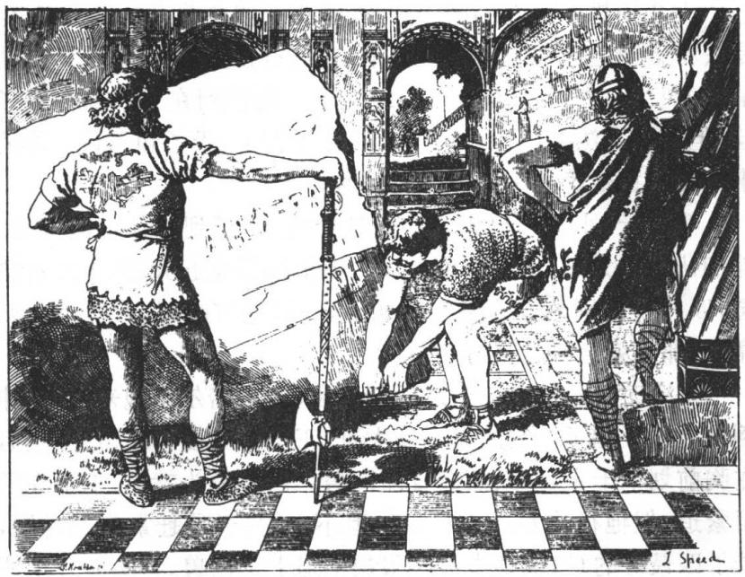

“现在你们谁去另一半世界战胜诺尔伽？”

他俩谁也不吭声。他笑他们都是胆小鬼，说道：

“那再见了，哥哥们，把我放下去，让我去那一半世界，但你们别走开，一旦绳子动了，你们就往上拉。”

两个哥哥把他放了下去，他来到地底下的另一半世界，并上了路。他走了很远很远，偶然发现了一匹装饰华丽的马，那马对他说：

“你好，伊万王子，我在此恭候多时了！”

他骑上马继续走，走啊走啊，他看见前面矗立着一座铜色宫殿。他拴好马走进了宫门，看到有个房间刚摆好饭菜，便坐下来吃。然后又走进一间卧室，见里面有一张床，他躺下就休息。不一会儿，一个姑娘走了进来，她太漂亮了，恐怕只有童话故事里才能见到。姑娘说：

“谁在我的房间里？报上姓名！假如你已年老就做我父亲；假如是中年，就做我兄弟；假如是青年，就做我亲爱的夫君。假如你是女人，老的做我祖母；中年的做我母亲；倘若是个姑娘，就和我做姐妹。”

王子走上前去，姑娘看清了他，满心欢喜地说：

“哦，伊万王子，我亲爱的夫君非你莫是！你怎么会到这里来呢？”

伊万把一切告诉了她，姑娘说：

“你想征服的那头巨兽是我哥哥，他此刻正在我二妹那里，她住在离这儿不远的银色宫殿里。我给哥哥包扎了你留给他的三处伤口。”

说完这些，他们一同饮酒聊天，玩得很开心。不久王子便向她告别，继续向前，来到银色宫殿，住在这里的二妹告诉王子说，诺尔伽此刻正在小妹处。于是他又继续前进来到小妹住的金色宫殿。小妹告诉王子，她哥哥正在蓝海里睡觉，她给了王子一把钢剑，又让他喝了一口力量之水，嘱咐伊万要一剑砍掉她哥哥的头。听清了小妹交待的一切后，他又上了路。

来到蓝海，王子看见诺尔伽正躺在海中一块石头上睡觉，睡得很死，每打一个呼噜，周围七英里远的海水就会被搅动。王子在胸前划了个十字，便走向巨兽，举起剑朝他的头猛地一砍，头颅掉了下来，同时还在说：“呕，现在我完了！”然后滚了很远掉进了大海。

杀死了巨兽，王子回来接三姐妹，想把她们带到地面上的世界。三姐妹很爱伊万，不愿与他分离，就各自把宫殿变成了一只蛋，并且还教伊万掌握如何把蛋变回宫殿以及把宫殿重新变成蛋的奥秘。三姐妹把蛋交给了伊万掌握后一起来到绳子旁边，王子用皮绳固定在三姐妹身上，猛力一拉，在上面的两个哥哥便开始使劲往上拖拽。拉上来后，他俩定睛一看，是三位美貌惊人的少女，赶忙凑到一边说，“我们把绳子放下去，等弟弟上到一半时，砍断绳子，他就会摔死。他要不死，这几个美人就绝不会成为我们的妻子。”

他们这样商量后就放下皮绳，但他们的弟弟绝不是傻子，他已猜想到他俩的不良居心，所以在绳子的这端绑上了一块大石头，让他俩去拖。他们拖到一定高度时砍断了皮绳，石头掉下来摔得粉碎，王子挥泪走了。他走得很远很远，一场风暴袭来，电闪雷鸣，大雨倾盆。他来到一棵树下避雨，看见几只小鸟已被雨水淋透，就脱下外衣罩在它们身上。不一会儿，一只大鸟飞过来，那鸟真大啊，几乎把天空都遮住了，天本来已暗了，可现在更黑了。它就是王子用衣服罩住的那些小鸟的妈妈。当它看见小宝贝们被舒适的东西罩着时，便问：“是谁把我的孩子裹起来的？”说着它看见了王子，说：“是你吗？谢谢了！为了报答你，你可以向我要最想要的东西，我会尽力满足你。”

“那你就带我到另一半世界去吧。”他回答说。

“给我做一个中间有隔板的大容器，”鸟妈妈说，“抓来各种猎物盛满容器的一半，另一半倒入水，这样我就有吃有喝了。”

王子照它的话做了。这只大鸟扛起容器，并让王子坐在里面，便开始起飞了。它飞了很远很远，终于把王子送到目的地，与王子告别后又飞了回去。王子来到了一家裁缝店，在那儿当了雇工。经过这些磨难，伊万已面目全非，王子的影子荡然无存。

在裁缝店里干活后，王子开始向师傅打听王国里发生的事情。师傅说：“我们的两个王子——小王子不见了——从另一个世界带来两位新娘，想娶她们，但她们不肯，坚持要先做好嫁衣，式样尺寸要与她们在另一个世界的服装丝毫不差，但又不让人给她们量尺寸。国王召来全国的裁缝，没一个敢承担这项任务。”

王子听了这一席话后说：“去告诉国王，师傅，公主要的嫁衣由您来提供。”

“我哪能做出那种礼服？我只会做普通人的衣裳。”师傅说。

“去吧，师傅，我来负责一切。”王子说。

于是裁缝去了王宫，国王很高兴见到了一个好工匠，给了他很多很多的钱。裁缝备好了一切材料后回到家里。王子对他说：

“现在祈祷上帝，然后躺下睡觉，到明天就什么都有了。”裁缝听了小伙子的劝告，上床便睡。

午夜时钟响过，王子起身走到城外的旷野，从衣袋里掏出三姐妹交给他的蛋，按照她们教他的方法，把三只蛋变成了三座宫殿。他走进宫殿，拿走少女们的衣裙，出来后把宫殿重新变成鸡蛋，然后回到裁缝家，把衣裙挂在墙上，就躺下睡觉。

一大早，师傅醒来，天哪！墙上挂着他从未见过的衣裙，全都闪着金光、银光和各种宝石的光芒。他高兴极了，取下衣裙就朝王宫走去。当公主们见到了自己在另一半世界穿过的衣服时，猜到伊万王子也在这个世界，于是相互交换了一下眼色，但并未声张。那位师傅交了衣服便回到自己的家，却再也不见自己的雇工。此时，伊万已经到了鞋匠那里，他把鞋匠也说服了，叫他去为国王做事。以同样的方式，伊万访遍了全国所有的工匠，而他们全都因为他的缘故而受到国王的奖赏，变得富裕起来。

王子遍访了全国的工匠后，公主们收到了她们所要求的一切。她们所有的服饰与在另一半世界穿的一模一样。但王子却到现在还没有出现，她们伤心地哭了，想再坚持推迟婚期是不可能了，她们必须得结婚。就在婚礼即将举行时，小公主对国王说：

“父王，请允许我们给乞丐一些施舍吧。”

国王同意了，她于是走了出去。在施舍钱物时，她仔细查看着每一个乞丐，当她走到一个乞丐面前，准备给他钱时，突然看到他手上的戒指，那是她和她的姐姐在另一半世界里送给他的——真的是他。小公主抓起他的手，把他带回到宫殿，对国王说：

“是他把我们带出了另一半世界，他的哥哥们不准我们说他还活着，威胁我们如果讲出来就杀了我们。”

国王为他那两个儿子感到愤怒之极，并用最严厉的方式惩罚了他们。但后来还是同时举行了三个婚礼。

 

## 奇妙的白桦树

前有对夫妇，他们有一个独生女。一天，他们有一只羊从走迷了路，于是就出去寻找，分头到树林里去搜，搜了很久很久，主妇遇到一个女巫，女巫对她说：

“要是你吐口唾沫，可怜的人，吐到我的刀鞘里，或者，你从我的胯下走一走，我就把你变成一只黑羊。”

主妇既未吐唾沫，也未从她胯下走，可那女巫还是把她变成了一只羊。然后女巫扮成主妇的模样，对那户主喊道：

“喂，老头子！我找到羊啦！”

那男人对女巫一点没有怀疑，一点不知道那只羊就是他的妻子。他跟女巫回家，因为找到了羊，心里很高兴。到家后，女巫对他说：

“老头子，我们宰了这只羊吧，免得它再跑到林子里去。”

那男人非常老实，从来不会提出反对意见，便说：

“好，那就宰了吧。”

他们的女儿事先偷听了女巫和她母亲的谈话，赶紧跑到羊圈中伤心地喊道：

“哦，亲爱的妈妈，他们要杀了你！”

“假如他们当真杀了我，”黑羊回答说，“你既不要吃我的肉，也不要喝我的汤，把我所有的骨头集中起来，埋在田埂上。”

他们从羊群中找出黑羊就把它宰了。女巫做了豌豆羊肉汤放在女儿面前。但是小姑娘记住了妈妈的话，她一点汤也没喝，而是把骨头集中起来拿到田埂边埋了起来，那儿立刻长出了一棵白桦树—— 一棵很可爱的白桦树。

过了一些时候——也不知道他们在这儿生活了多久。女巫生下一个自己的小孩后，便开始怀恨丈夫前妻的女儿，并想尽办法给她罪受。

碰巧王宫里要庆祝一个盛大节日，国王下令邀请所有的人，于是到处出现这样一个布告：

“全体人民一起来，无论贵族与平民，盲人跛足皆包括，骑马乘船都欢迎。”

因此，所有遭遗弃的无家可归者，包括受伤的、瘸腿的、失明的……全都应邀去赴宴。那户人家也忙碌着准备去宫殿，女巫对男人说：

“老头子，你在前面先走，带上我们的孩子，我给那丫头交待点事情，免得她在家里无聊。”

男人就带着小的孩子先走了。女巫点燃壁炉里的炉火，把一罐大麦粒洒在炉渣中，然后对女孩说：

“把大麦粒从煤渣里捡出来，放回瓦罐中，黄昏之前不做好这件事，小心我吃了你。”

说完，女巫也出去了。可怜的女孩被丢在家里苦苦哭泣，她尽力想捡起麦粒，可发现一切都是徒劳。她满腹烦恼地来到妈妈坟上的白桦树前，放声大哭，可是妈妈死了，躺在地下的墓中，再也不能帮助她了。正哭到伤心处，忽听从墓中传出妈妈的声音：

“女儿，你为何哭泣？”

“女巫把麦粒洒在炉膛里，要我把它们从煤渣中捡出来，就是因为这个，妈妈。”女孩说。

“不要哭了，”妈妈安慰她说：“从我的树上折一根树枝，拿到炉膛里划个十字，就什么都好了。”

女孩子照着做了，她用白桦树枝划了一下，嘿！麦粒全都自己飞回到瓦罐里去了，炉膛里干干净净。她跑回白桦树前把树枝放在坟上，妈妈叫她站在树干的这一侧沐浴，站在另一侧吹干，再站到这一侧穿衣。女孩做完了这些以后，一下子变成个可爱的少女，谁也不能与她媲美。她穿上了华丽的衣裳，还有了一匹马，部分毛呈金色，部分毛呈银色，部分毛显然更加珍贵。女孩跃上马鞍，像箭一样直奔王宫。当她进入城堡庭院时，国王的儿子看见了她并出来迎接她，把她的马拴在一根柱子上，领她进了大厅。他们穿过城堡所有的房间，两人形影不离；人们把眼光都集中在姑娘身上，并想知道这位可爱的少女是谁，来自哪个国家。

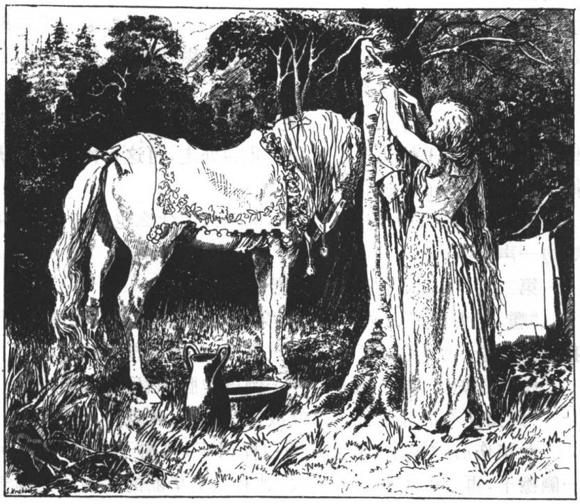

但是一个人也不认识她，对她一点也不了解。宴会开始了，王子邀请她坐在自己身边，一个最荣耀的位置，而女巫的女儿却在桌底下啃骨头。王子没有看清，以为是一条狗，用脚踢了一下，竟弄断了她一支胳膊。你不为她感到难过吗？她的妈妈是女巫，并非她的过错。

快到黄昏，姑娘觉得该回去了。在她走出去时，她的戒指粘在门闩上，因为王子不久前刚让人在门上涂了柏油。她来不及把戒指拽下，匆匆忙忙地解开马的缰绳，骑上马越过城墙飞也似地走了。到家后，在白桦树下换了衣服，让马歇在那里，就赶快回到壁炉边。不一会儿，男人和女巫也回来了，女巫对姑娘吹嘘道：

“啊！你这可怜虫，你肯定在家吧？你不会知道我们在王宫里多么开心！国王的儿子抱着我女儿到处走，可这可怜的小家伙摔了一跤，跌断了胳膊。”

姑娘对事情的真相了如指掌，但她假装什么也不知道，坐在炉边一声不响。

第二天，他们又应邀去王宫赴宴。

“嘿，老头子，”女巫说，“快点穿好衣服，我们要去赴宴，带上我们的孩子，我要给那丫头安排点事情，免得她打瞌睡。”

她燃旺炉火，把一罐大麻种子倒进炉膛，然后对姑娘说：

“假如你不把这些种子捡好放回瓦罐里，我就要你的命。”

女孩伤心地哭了，她又来到白桦树下，在树干一侧沐浴，另一侧擦干，再一侧更衣。这一次，她有了更华丽的衣裳和更帅气的马。她折断了一根白桦树枝，交叉地敲敲炉膛，大麻种子全都自己飞回瓦罐，然后她赶忙来到城堡。

又是国王的儿子出来迎她，把马拴在一根柱子上，领她走进宴会大厅。开席时，女孩坐在王子身边最荣耀的位置，就和前一天一样。可女巫的女儿又在桌子底下啃骨头，王子以为是狗，又踢了一脚，结果小家伙断了一条腿。他一点没察觉她从人们的脚上爬过，小家伙真的非常不走运！

很快，姑娘又要回去了，但王子让人刚把门柱漆过，姑娘的金项圈粘在了上面。她无暇顾及，跳上马，箭也似的来到白桦树下，留下衣服和马，对妈妈说：

“我把项圈丢在了城堡，门柱上刚刷过漆，粘得很牢。”

“你丢了两样东西了，”妈妈说，“我会给你更好的。”

姑娘赶紧回家，她父亲和女巫从宴会上返回时，她正像往常一样坐在炉边，女巫又对她说：

“你这可怜的东西！这里的一切怎好跟我们在王宫里所见的相比？国王的儿子抱着我女儿从一个房间走到另一个房间，是的，他把她抱跌下来了，我女儿的腿也摔断了。”

女孩一言不发，专心致志地捅着炉子。

夜晚过去天将破晓时，女巫叫醒丈夫，大声叫道：

“嘿，起来！老头子，我们要去参加王宫宴会。”

于是男人起来了，女巫把小孩交给他说：

“带上小宝贝，我要吩咐那丫头干点活，免得她一人在家寂寞。”

她又干了像以往一样的勾当，但这一次更糟，她把一盘牛奶泼在炉渣上，说：

“假如我回来之前你不能把所有的牛奶再盛回盘中，我要你好受！”

女孩这次可真吓坏了！她赶紧跑到白桦树下，通过白桦树的魔力，这次任务也完成了，然后跟以往一样骑马去了宫殿。她一到庭院就看见王子在等她。王子领她走进大厅，她备受人们尊敬，而女巫的女儿正在桌底下吮骨头，趴在人们的脚边，结果一只眼珠子被人踢掉了，真可怜！大家仍然还是没认出那姑娘是从哪里来。由于王子刚让人把门槛用焦油涂过，当姑娘跑出去时一双金鞋粘在了门槛上。她赶到白桦树下，脱下华丽服饰说：

“啊呀！亲爱的妈妈，我丢失了金鞋。”

“随它去吧，”妈妈说：“如果你需要，我会给你更好的。”

她刚刚坐回到炉边，父亲和女巫就回来了。女巫立刻又嘲弄起她来：

“啊，你这个可怜虫，你坐在这里什么也不能看到，而我们——啊，我们在王宫里看到的一切多么了不起！王子带着我女儿到处走，可就是她运气不好摔了一跤，掉了一颗眼珠子。你呢，蠢货，你知道什么东西？”

“是啊，我能知道什么呢？”女孩回答：“为了把炉膛弄干净，我忙还忙不过来呢。”

姑娘在王宫里丢失的所有东西，现在都由王子保管着，他已做好准备去找这些东西的主人。为了这，王宫在第四天又举行了一次宴会，所有的人又都得到了邀请。女巫也作好了去的准备，她在女儿的断腿上了一根木槌，用一根圆木代替断了的手臂，再用一小块泥巴放进眼窝冒充眼睛，然后带上女儿去了城堡。当所有的人都聚集在大厅时，王子走进人群大声说道：

“哪位姑娘，这只戒指能戴上她的手指，这只项圈能带上她的脖子，这双金鞋正合她的脚，她就将成为我的爱妻。”

所有的人都想来试试，可谁也不合适！

“捡炉渣的少女不在这里，”王子最后说，“去把她找来，让她试试。”

于是姑娘被带来，王子正要将这些饰品递给她，女巫一把拉住他说：

“不能给她，她会把什么东西都沾上煤灰的，还是给我女儿试试。”

王子把戒指给了女巫的女儿，女巫把女儿的手指揉来捏去好不容易才戴上戒指。戴项圈、穿金鞋也同样很费了些力气。女巫不愿把这些交给捡煤渣女，而是从头到脚忙着硬把这些东西套在自己女儿的身上。现在怎么办呢？王子只好让女巫的女儿作为自己的新娘，不管他愿意不愿意。然而，王子感到在王宫与这样一位奇怪的新娘举行婚礼真是有失面子。过了一些日子，王子要带着新娘回宫去了，就在他俩要离去时，厨房女佣突然从壁炉旁走过来，假托要去牛棚取东西，她从站在院子里的王子身边走过时，在他耳边说了一句：

“啊呀！亲爱的王子，别夺走我的银子和金子。”

王子立刻认出了捡煤渣女，于是他带着两个姑娘一起出去。走了一段路后他们来到一条河边，王子将女巫的女儿抛出去成了一座桥，然后与捡煤渣女一起走过河去。女巫的女儿后来真像一座桥横跨在河的两岸，一动也不能动，尽管她的心因忧伤而憔悴。附近没有人帮助她，最后她极度痛苦地喊道：

“但愿我的身体里长出一棵金色的铁杉！也许我妈妈看见那个标志就会知道我在哪里。”

她刚说完，一棵金铁杉就从她身体里冒了出来，立在桥上。

王子摆脱了女巫的女儿，就把捡煤渣女作为自己的新娘。他们一起来到她妈妈坟上的白桦树下，在那儿他们得到了各种珠宝和财富，有满满三大口袋金子、满满三大口袋银子和一匹骏马，他们骑着马回到了宫殿。他们在宫里生活了很长时间后，年轻的妻子给王子生了一个儿子。女巫听到消息后，说是她女儿生了个儿子——因为大家都以为新国王的妻子就是女巫的女儿。

“好，好！”女巫自言自语道，“我应该立即去，给小宝宝送礼物。”

说着她就出发了。她来到那条河边，看见桥的中央长着一棵美丽的金铁杉，就想动手砍掉它作为给外孙的礼物。她刚想动手，就听到一个悲哀的声音：

“啊呀，妈妈，别砍我！”

“你在这里？”女巫问。

“我真的在这里，亲爱的妈妈，”女儿回答，“他们把我摔过河，使我的身体变成了一座桥。”

女巫立刻使桥震动成碎片，然后赶紧去了宫殿，爬上王后的床，她开始施展妖术，口里念道：

“吐吧，可怜的人，把唾沫吐到我的刀刃上，施魔力于我的刀刃，我将把你变成森林中的一头驯鹿。”

“你是否又要给我带来新的苦难？”少妇说。

她既没有吐唾沫也没有做其他的事，可女巫还是把她变成了驯鹿，并悄悄将自己的女儿取代了王后。可是这时孩子变得不安起来，因为没有了母亲的关怀。她们把孩子带到宫廷，想方设法安抚他，可孩子仍哭闹不止。

“什么使得孩子不安？”王子急得只好去问一个聪明的寡妇。

“唉！你的妻子不在家，”寡妇说，“她正生活得像一只林中驯鹿，你现在的妻子是女巫的女儿，女巫本人是你的岳母。”

“有办法从林中找回我妻子吗？”王子问。

“把孩子给我，”寡妇说，“明天我抱着他赶牛去树林中，我让白桦树叶哗哗发响，让白杨树瑟瑟颤抖，或许听到声音孩子就会安静。”

“好，把孩子带走吧，把他带到林中去让他平静。”王子说着，领着寡妇进了城堡。

“怎么回事？你要把孩子带到树林里？”女巫怀疑地问，企图干涉。

但王子主意已定，他说：

“把孩子带到林中走走，或许能使他平静。”

寡妇带着孩子去了树林，她来到一片沼泽，看见一群驯鹿，就开始唱起来：

> “亮眼睛呀红皮肤，
> 快来看看你乖乖！
> 那嗜血的妖怪，
> 食人的恶魔，
> 岂能让它玷污你的血肉？
> 她们会威胁，
> 她们善恐吓；
> 却无法让他听话，
> 叫他顺从。”

一只驯鹿立刻走了过来，整整一天护理和爱抚这个孩子，但到了黄昏，它不得不随着鹿群而去了，它对寡妇说：

“明天再把孩子带来，后天也带来，之后我就要随鹿群漫游到遥远的异国他乡。”

第二天早晨，寡妇到城堡去抱孩子，女巫当然要干预，但王子说：

“抱去吧，让他到旷野四处走走，孩子白天呆在林中，晚上自然安静多了。”

于是，寡妇抱起孩子，把他带到林中的沼泽地带。她又唱起昨天那首歌谣：

> “亮眼睛呀红皮肤，
> 快来看看你乖乖！
> 那嗜血的妖怪，
> 食人的恶魔，
> 岂能让它玷污你的血肉？
> 他们会威胁，
> 他们善恐吓；
> 却无法让他听话，
> 叫他顺从。”

那只驯鹿立刻离开鹿群来到孩子面前，爱抚孩子就像昨天一样。孩子在茁壮成长，长成了一个举世无双的漂亮男孩。可是王子仍然在想着一些事情，他问寡妇：

“有没有办法把那只驯鹿重新变成人？”

“我不太清楚，”她回答说，“不过，你跟我一起到林中去，当那个女人去掉鹿皮时，我会给她梳理头发，这时你必须烧掉那张皮。”

随即他们带着孩子一起来到林子里。他们刚到那儿驯鹿就出现了，像前两天一样，她轻柔地抚摸孩子。这时寡妇对驯鹿说：

“你明天就要去很远的地方，我将再也见不着你了，让我最后一次给你梳梳头，作为纪念。”

驯鹿脱下了皮，任寡妇给她梳理，与此同时，王子将驯鹿皮悄悄地扔进了火里。

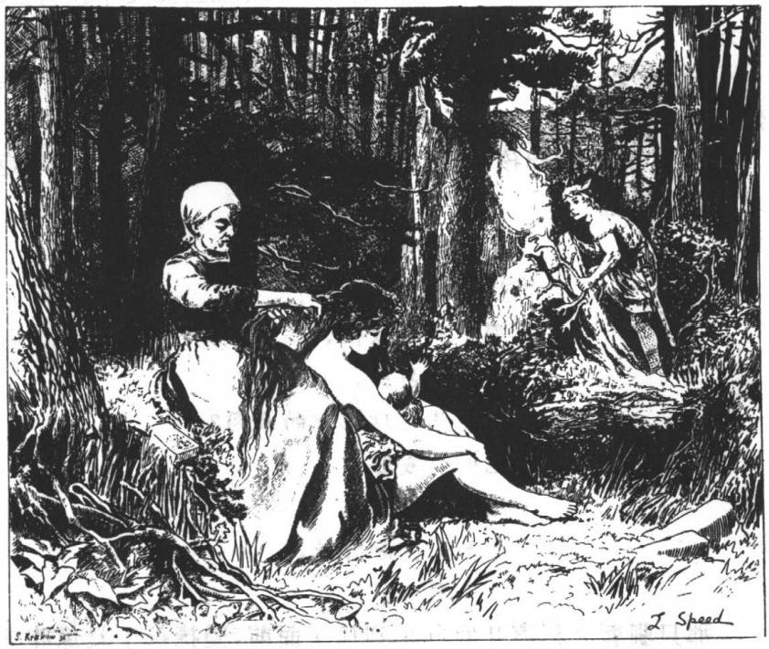

“怎么会有烧焦的味道？”少妇回过头来问，一下看见了自己的丈夫。“我真不幸啊！你烧了我的皮。你为什么这么做？”

“让你恢复人形！”

“啊！我现在无以遮体了，我真是个可怜的人！”少妇哭道，然后变成了一根绕线杆，接着又变成了一根木棰，然后又变成了一根纺棰，反正是各种想得出的形状。但所有的形状都被王子毁掉了，最后她重新变成了人形。

“啊！”少妇大声喊道：“既然女巫必定要吃了我，为何还要带我回去？”

“她不会吃掉你的。”她丈夫说。于是他们带着孩子一起回家去了。

女巫看见他们时赶紧与女儿一起逃跑。假如没有停下来的话，尽管已经很老了，到现在还在逃跑呢！从此，王子和他的妻子、孩子过上了幸福的生活。

 

## 杰克和豆茎

### 杰克卖牛

从前，有个可怜的寡妇和她的独生子杰克住在一间小屋里。

杰克是个轻率、粗心的孩子，不过他心地善良且充满柔情。有一年冬天，日子特别难熬，后来妈妈患了疟疾。杰克还没有能力开始干活，他们渐渐变得极度贫穷。妈妈见杰克和自己快饿死了，只好把母牛卖掉。一天早晨，她对儿子说：“本来我要自己去卖的，可是我身体太弱了，杰克，你把母牛牵到市场上卖了吧。”

杰克很想到市场上去卖牛。但在路上他看见一个屠夫手里拿着一些漂亮的豆子。杰克就停下来看，屠夫告诉他说，这些豆子可有用啦，并劝这个傻小子用母牛来换。

当他把这些豆子拿回家时，妈妈很恼火，她是指望那母牛换来好价钱的呀！妈妈流了好多泪，责怪杰克太愚笨。杰克也很难过，母子俩当晚很伤心地上了床，最后一线希望成了泡影。

天亮后杰克起床，走进庭园。

“至少，”他想：“我可以种下这些奇妙的豆子，妈妈说这些只是普通的红花菜豆，但我还是可以播种呀！”

于是，他找来一根木棍，在地上捣了几个坑，把豆子放了进去。

那一天他们俩吃了很少的一点晚饭就上了床，知道第二天什么吃的也没有了，很是悲伤。杰克由于既悲伤又着急，一点也睡不着，天刚亮就起来进了庭院。

令他惊异的是，那些豆子已经在一夜之间长出来了，而且那些藤爬上很高很高的墙壁，盖住了小屋，看不出它的头在哪里，那些茎弯弯绕绕、纵横交错，形状倒像一架梯子。

“看来爬上去很容易。”杰克心想。

杰克这么想着，立刻就决定付诸行动，因为爬梯子杰克可是拿手好戏。但由于卖牛做错了事，他想最好还是先征求妈妈的意见。

### 神奇的豆茎

于是，杰克叫来妈妈，母子俩惊讶得默不作声地注视着豆茎，它不仅高度惊人，而且牢度异常，竟能承受杰克的重量。

“我想知道它一直伸到什么地方，”杰克对妈妈说：“我想我可以爬上去看看。”

妈妈希望他不要冒险爬这奇怪的梯子，但是杰克软缠硬磨非要妈妈答应让他试试，他肯定豆茎里有什么神奇的东西，最后妈妈同意了他的请求。

杰克即刻开始行动，他顺着梯子般的豆茎爬呀爬呀，小屋离他越来越远了，村庄离他越来越远了，连教堂高高的钟楼也变得越来越小，然而他还没有找到茎的顶端。

杰克感到有些累了，想了想是否该回去。但他是个有韧性的孩子，他懂得任何事想取得成功都不能半途而废，所以稍稍休息了一会儿，他又继续向上爬去。

他爬得越来越高，越来越高，甚至不敢朝下看以免头晕。他终于找到了茎的头，而且发现自己已身处一个美丽的国家：树木成林，青草遍地，牛羊云集，牧草地上流淌着一条清澈见底的小溪。他从豆茎上下来，不远处有一座坚固而美丽的城堡。

杰克过去从未听说或见过这样一座城堡，城堡与村庄并非浑然一体，事实上，由于它位于一块垂直矗立的岩石上，看上去更像是一个独立的天地。

杰克正站在那儿看着城堡，一个模样挺怪的女人从林中向他走来。她头戴一顶红缎绒缝制的尖顶貂皮帽，头发披散在肩上，手里拄着一支拐杖。杰克脱帽向她鞠了一躬：

“对不起，夫人，”他说：“这是您的家吗？”

“不，”这位夫人说：“我给你讲讲这城堡的故事。”

“从前有位高贵的骑士，住在这仙境边上的城堡里，他有位美丽的妻子，他很爱她，他们还有几个可爱的孩子。他的那些身材矮小的邻居们，都对他很友好，赠给他许多非常珍贵的礼物。”

“关于那些财宝，有许多谣传，一个离这儿不太远的非常邪恶的巨怪也听说了，于是就想来抢夺这些财宝。他用钱收买了骑士的一个不忠的奴仆，放他进了城堡，趁骑士躺在床上睡觉时把他杀了，然后又来到婴儿室，杀掉了那儿所有的孩子。”

“幸运的是，他没能找到夫人。夫人带着她才出生两三个月的儿子去看她的老奶妈去了，奶妈住在山谷里，由于暴风雨，奶妈留她过了一夜。”

“第二天早晨，天刚蒙蒙亮，一个设法逃出城堡的仆人，赶来告诉夫人她丈夫和孩子遭到了不测。她起先不敢相信，急切地想立刻回去与她的亲人患难与共，但奶妈老泪纵横地再三恳求她，她还有这个孩子，必须保住性命把孩子抚养长大，孩子是无辜的。”

“夫人听从了劝告，留在奶妈家，这是最好的藏身之地。仆人告诉她，巨怪已发过誓，一旦找到她，就要杀死她和她的孩子。一年接着一年过去了，老奶妈去世了，把她的小屋连同几件简陋的家具留给了夫人。夫人带着孩子在里面居住，为了维持生活，她得像普通农民那样劳作。她用仅有的一点钱买来一辆纺车和一头奶牛，靠着这两样，她和儿子勉强维持生计。那间小屋旁还有一个挺不错的小菜园，可以在里面种植豌豆、蚕豆、白菜等，收获季节，夫人也去田野拾落穗，为了孩子，她什么苦都能吃。”

“知道吗，杰克，那可怜的夫人就是你母亲。那座城堡曾经属于你父亲，所以也必然属于你。”

杰克惊奇地叫了一声：

“我的母亲！哦，夫人，我该怎么办？我可怜的父亲！我亲爱的母亲！”

“你有责任为你母亲赢回来。不过，这个任务很艰巨，而且充满危险，杰克，你有没有勇气去夺回来？”

“只要做得对，我什么都不怕。”杰克说。

“那么，”红帽夫人说：“你就是除妖人，你必须走进城堡，假如可能，最好得到一只下金蛋的母鸡和一把会说话的竖琴。记住，巨怪拥有的一切其实都是你的。”她刚一说完，就悄然消失了。杰克当然知道，红帽夫人本来是一位仙女。

杰克决定立刻就去冒险。他向城堡走去，吹响挂在城堡门口的号角。一两分钟后门开了，出来一个可怕的女巨人，只有一只眼，长在额头中央。

杰克一看见她就想转身逃跑，但被她抓住了，硬拖进城堡。

“嗬，嗬！”她发出可怕的笑声，“很显然，你没想到会见到我吧！我不会让你走，我受够了，总是劳累过度。我想不通，为什么我不能像其他夫人一样有个小侍童，你就做我的小侍童。你得洗刀叉、擦皮靴、生炉子，反正巨人不在你就帮我干活，他回来我就把你藏起来，因为迄今为止，我的侍童全被他吃掉了，而你吃起来一定美味可口，我的小家伙。”

她一边说一边把杰克拖到里面。我肯定小杰克一定吓坏了，假如换了我和你，我们不知会是什么样子。但是他想，男子汉害怕是丢脸的，因此他竭力使自己勇敢，而且要充分利用一切机会。

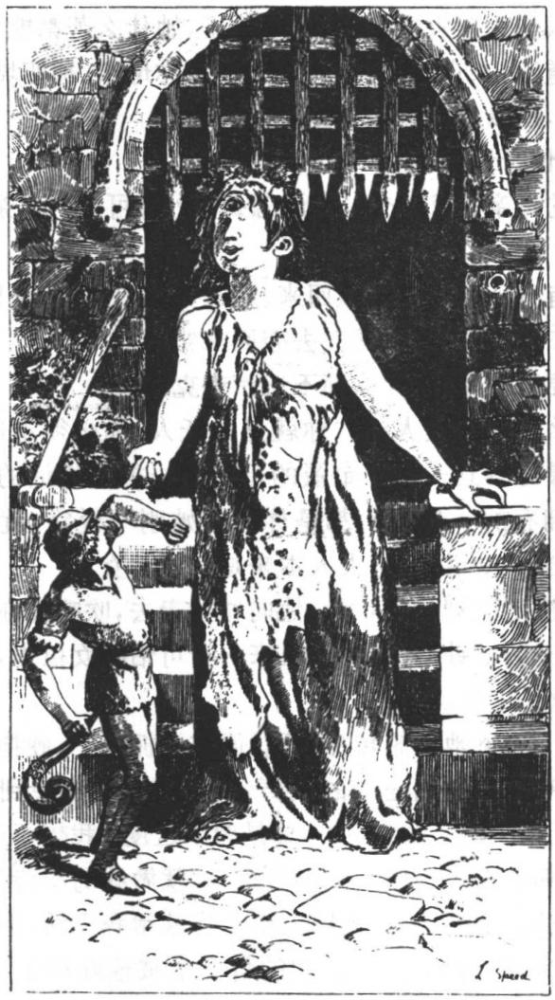

“我很乐意伺候您，我会尽我所能为您服务，夫人，”他说：“只是我求您一定要把我藏好，千万不能让您丈夫知道，因为我一点不想让人吃掉。”

“乖孩子，”女巨人点点头说，“见到我你没叫出来真算你走运，不像其他孩子，要是你像他们一样叫出来就会弄醒我丈夫，他就会吃掉你，别的孩子就是这样被当作早饭吃掉的。到这儿来，孩子，到我的衣柜里去，他从来不敢开那个，你在里面会很安全的。”

她打开放在大厅里的一只巨型衣柜，把他关在里面。钥匙孔很大，可以流进足够的空气，而且从那孔里杰克可以看清外面发生的一切。不久，他听见楼梯上传来很重的脚步声，就像开大炮一样，接着一个打雷一般的声音在吼：

> “费·法，费·法，佛，
> 人的气息我闻到了，
> 死的也行，活的也好，
> 碾碎骨头是我的面包。”

“老婆，”巨人吼道：“这里有人，快拿来给我当早饭。”

“你真是老糊涂了，”老太婆大声说，“那只是一块新鲜大象排条的味道，我刚给你做好。喏，坐下来，吃一顿丰盛的早餐。”

她把一只巨大的碟子放在他面前，里面的肉热气腾腾，香味扑鼻，巨人太满意了，城堡里有个人的想法早抛到脑后。吃过早饭他出去散步了，女巨人打开柜门让杰克走出来帮她干活。干了一整天的活，她也让他吃得饱饱的，到了晚上，她又把他藏在衣柜里。

### 下金蛋的母鸡

巨人回来吃晚饭了。杰克从钥匙孔里惊讶地看到他张开硕大的嘴巴，一次能吞进一根狼骨和半只鸡。吃完晚饭他叫妻子把下金蛋的母鸡拿来。

“它还和从前一样会下金蛋，”他说，“真的，我觉得现在这蛋倒比过去那个小不点骑士养着它时下的更大了。”

女巨人走开了，很快带来一只棕色母鸡，把它放在桌上他丈夫面前。“亲爱的，”她说，“如果你暂时不需要我，我出去散会儿步。”

“去吧，”巨人说：“我也想小憩一下。”

他抓起棕色母鸡，对它说：

“下蛋！”它立刻下出一只金蛋。

“下蛋！”巨人又说。鸡下出第二只金蛋。

“下蛋！”巨人第三次说。母鸡又下出第三只金蛋。

现在，杰克肯定这就是那位仙女所说的那只母鸡了。

不久，巨人把母鸡放在地上，自己就睡着了，很快便鼾声如雷。一看巨人已经熟睡，杰克就推开门出来了，他蹑手蹑脚地走到房间对面，抱起母鸡，迅速离开了。他知道那边是厨房，正好门半开着，他推门进去，锁好，飞快地走到豆茎的末端，顺着它以最快的速度滑下去。

妈妈看见他回到家，激动得流出了泪花，她一直担心仙女会把他带走，或者被巨人发现。可是杰克把棕色母鸡放在她面前，并讲述了自己在巨人城堡的冒险经历。妈妈看见母鸡很高兴，因为有了它，他们又可以过富裕日子了。

### 钱袋

趁妈妈去市场，杰克又爬上豆茎到巨人城堡去了一次，不过这次他先染了头发伪装一下。那个女巨人没认出他，又像前一次那样把他拖进去，让他帮她干活。听到她丈夫回来的声音，把他藏进衣柜，一点不知道他就是上次那个偷了母鸡的孩子。她叫他在里面别出声，否则会被巨人吃掉。

巨人回来了，嘴里在说：

> “费·法，费·法，佛
> 人的气息我闻到了，
> 死的也行，活的也好，
> 碾碎骨头是我的面包。”

“胡说八道！”他妻子说：“那只是一头小公牛，我把它烤了，我想晚餐给你一点犒劳。坐下，我给你端来。”巨人坐下，他妻子端来一只大碟子，上面放着烤牛肉，他们开始用餐。杰克惊异地看着他们挟起牛骨头，那样子像吃掉一只云雀。一吃完饭，女巨人就起身说：

“亲爱的，允许的话我就到我房间去看完那本小说，需要我就叫一声。”

“等等，”巨人说：“先把我的钱袋拿来，我睡觉前要数数里面的金币。”女巨人答应了一声走了，很快扛着两只大袋子回来了，她把袋子放在他身边。

“喏，”她说：“这是那骑士留下的全部金子，等你花光了，就必须去占领另一个贵族的城堡了。”

“只要我在，绝不让他得逞。”杰克心想。

等他妻子走后，巨人捧出一把一把的金币，数过了又把它们堆成堆，摸着金币心里那个乐呀，最后感到没趣了，于是把金币重又捋回袋子里，然后往椅背上一仰，便死死地睡去，鼾声如雷，盖过一切声音。

杰克偷偷地从衣柜里出来，扛起两只钱袋子（事实上就是他自己的，因为巨人才是贼，偷走了他父亲的一切），赶紧逃走。费了很大力气，顺着豆茎滑下，把金袋子放在妈妈桌上。她刚从城里回来，正为找不到杰克而哭泣呢。

“喏，妈妈，我把父亲丢了的金子找回来了。”

“哦，杰克，你真是个好孩子，但我还希望你不要拿你宝贵的生命去巨人城堡冒险，告诉我你怎么又去了。”

杰克便如实禀告了母亲。

妈妈很高兴得到了这笔钱，但她不愿意杰克为了她再去冒险。

可是过了些时候，杰克又下决心再到巨人城堡去一次。

### 说话的竖琴

他又一次爬上豆茎，到巨人城堡又吹响号角。女巨人打开门。她太笨了，竟还没认出他来，不过她停了一会才拖他进来，她怕再一次遭到盗窃，可是杰克那张纯洁的脸看上去天真无邪，她简直无法拒绝。她叫他进来，还是把他藏在衣柜里。

很快巨人回来，一跨进门槛就咆哮起来：

> “费·法，费·法，佛
> 人的气息我闻到了，
> 死的也行，活的也好，
> 碾碎骨头是我的面包。”

“你这个蠢老头，”他妻子说，“你闻到的是一只羊，我刚刚给你烤好。”

巨人坐下来，他妻子端上一只整羊给他当午饭，他吃光后说：

“把我的竖琴拿来，你去散步时我想听点音乐。”

女巨人顺从地给他拿来了美丽的竖琴。琴框上钻石和红宝石闪闪发光，琴弦则全是金子做成。

“这是我从骑士那儿得来的最好的东西之一。”巨人说，“我酷爱音乐，这竖琴是我忠实的仆人。”

他抱过竖琴说：

“演奏！”

竖琴奏出了一个轻柔而悲伤的乐曲。

“要快乐点儿的。”巨人说。

竖琴奏出一支欢快乐曲。

“现在要催眠曲。”巨人吼道。竖琴于是奏出一支甜美的催眠曲，那声音催着巨人进入了梦乡。

杰克偷偷走出衣柜，到厨房去看了看女巨人是否已出去。他见那里没人，就走过去轻轻把门打开，因为他想手里抱着琴开门是不行的。

然后他走过巨人呆的房间，抓起竖琴悄悄离开。可是他刚跨过门槛就听竖琴叫起来：

“主人！主人！”

巨人醒了！

他一声吼叫，从座位上弹跳起来，两步就跨到了门边。

但是杰克很灵巧，他抱着竖琴像闪电一样地逃走了，边走边对竖琴说话（因为他看出竖琴是一位仙女），告诉它，他就是它过去的主人——骑士的儿子。

巨人很快追过来，眼看就要逼近可怜的杰克了，他伸出巨手来抓。但是幸运得很，他刚巧踩上一块松动的石头上，绊了一下，直挺挺地倒在地上，四脚朝天。

这下给了杰克足够的时间踏上豆茎快速滑下，可是他刚到达自家菜园，就见巨人也从豆茎上紧跟他后面下来了。

“妈！妈！”杰克喊道：“快，给我斧子。”

妈妈拿了把短柄小斧跑出来，杰克使尽全身力气猛的一砍，所有的豆茎被砍得只留下根。

“妈妈，闪开！”他说。

### 巨人摔断脖子

杰克母亲后退一步，真是巧极了，因为就在巨人抓住最后那根豆茎时，杰克砍断了主干并抛到旁边。

轰隆一声，巨人头着地坠下，脖子摔断了，由于伤得太重，巨人死在杰克妈妈的脚下。

杰克和妈妈还未从惊恐和焦虑中恢复过来，面前已站着一位美丽的女郎。

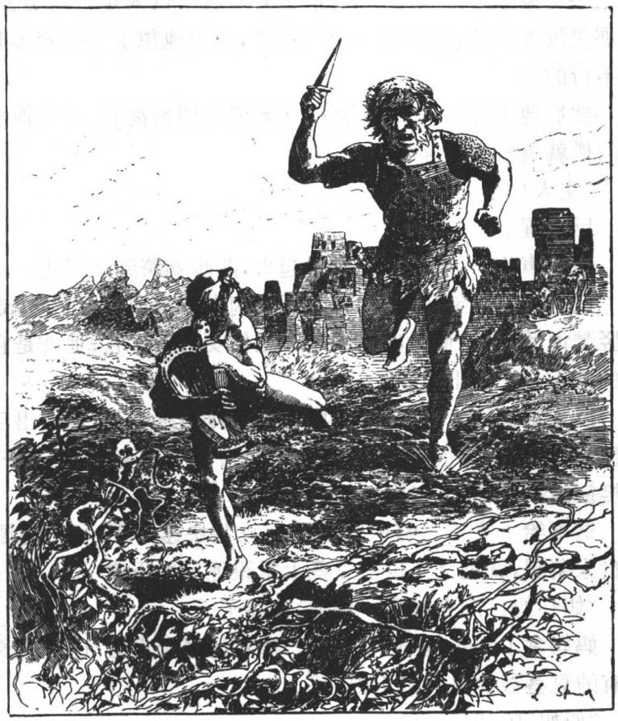

“杰克，”她说：“你的行为正像一位勇敢的骑士之子，归还你继承权当之无愧。挖个坑埋了巨人，再去杀掉女巨人。”

“可是，”杰克说：“我不能杀任何人，除非他与我搏斗，我也不能对一个女人开战，况且，那女巨人对我倒是挺好。”

仙女笑了。

“我很满意你的宽宏大量，”她说：“尽管如此，你还得再回到城堡，做你认为需要做的事。”

杰克问仙女能否告诉他去城堡怎么走，因为豆茎已被砍掉。

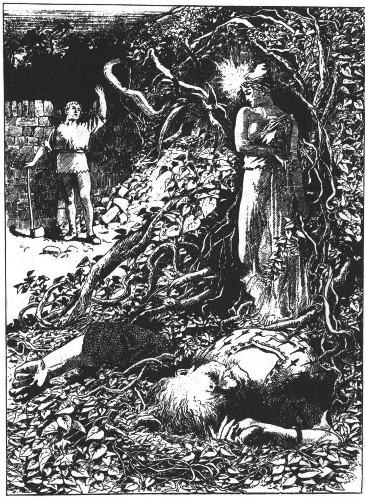

她说她用四轮孔雀车载着他去。杰克道了谢，然后与仙女一起上了车。

仙女带着他走了很远的路，然后到达一座位于山谷的村庄，他看见那儿聚居着许多看上去很悲惨的人，仙女停下来对他们说：

“我的朋友们，压迫你们，吃掉你们许多牲畜的残忍巨人已经死了，是这位年轻的先生解除了你们的苦难，他就是你们仁慈的旧主人、骑士的儿子。”

听到这里，人们高声欢呼，大家纷纷拥上前，说要像忠诚于杰克父亲那样忠诚于他。仙女们叫他们跟她到城堡去，他们排着队向前行进。杰克吹响号角，要求进入城堡。

女巨人从塔楼一个圆孔里看见大群人正向城堡走来，她害怕极了，猜想丈夫可能出事了。当她下楼时因为走得太急，一脚踩上了自己的裙子，结果从塔顶摔了下去，一直滚到底层，摔断了脖子。

门外的人们见城门不开，就拿起铁棍撬开门，里面空无一人，但离开大厅时发现了楼梯脚下女巨人的尸体。

杰克重获城堡。仙女去把她妈妈接来，还有母鸡和竖琴。他派人掩埋了女巨人的尸体，尽自己所能平等对待那些受巨人掠劫过的人们。

仙女离开城堡回仙境之前，向杰克解释了豆角之迷：原来那位手持豆角的屠夫正是她派来与杰克相遇，这样做是为了检验一下他是个什么样的小伙子。

“假如你看着那些巨大的豆茎，只是呆呆地感到稀奇，”她说，“我就会离你远去，任你继续过悲惨的生活，最多只是把母牛还给你母亲。但是你肯动脑筋，富有勇气，敢于冒险，所以值得让你一试。当你爬上豆茎的时候，你登上的是幸运之梯。”

说完她向杰克和杰克母亲道别离去了。

 

## 善良的小老鼠

从前有对国王和王后，他们相亲相爱，形影不离。白天，他们一同外出狩猎钓鱼，夜晚，一起参加舞会，欣赏歌剧。

他们在一起总是唱啊、跳啊，吃着蜜饯，真是其乐无穷，他们的臣民都纷纷效仿，所以这个国家被人们称为“欢乐国”。可是和它相邻的一个国家则处处截然相反：国王整天绷着面孔，且生性凶残，他相貌丑陋，动不动就发脾气，臣民们都惧怕他。他自己从不感到快活，也不让别人快活，不管什么时候见到谁笑就杀掉谁，所以人们叫这个国家为“悲伤国”，真是名副其实。当这个邪恶的国王听说了欢乐国国王的幸福生活后，非常嫉妒，立即招兵买马要去攻打。消息传到欢乐国，王后一听吓得不知所措，痛苦地哭了起来。“陛下，”她说：“我们带上所有的财富逃跑吧，跑得越远越好，到世界的另一头去。”

但是国王说：

“哼！这件事就能吓倒我吗？宁可战死也不要当逃兵！”

他把士兵们集中起来，并温柔地与王后道别后，骑上骏马就奔赴前线去了。国王走后，王后什么也不想做，只是绞着双手，整天哭泣。

“啊！万一国王战死，我和女儿可怎么办啊？”她忧伤得吃不下饭，睡不着觉。

国王每天给她写一封信。但后来有一天早晨，她正向宫殿窗外眺望，只见一个信差火速向这边跑来。

“什么消息，信差，什么消息？”王后大声问道。信差回答：

“仗打败了，国王战死了，敌军马上就要到了。”

可怜的王后听了，身子向后一仰昏了过去，侍女们赶紧把她抬到床上，围着她嚎啕恸哭起来。接着传来了可怕的喧闹声，顿时一片混乱，大家知道是敌军来了，很快便听到邪恶国王的脚步声，他正在宫殿里到处寻找王后。侍女们把小公主送到王后怀里，用床单把母女俩从头到脚裹起来，然后就各自逃命去了。可怜的王后裹在床单里直哆嗦，但愿自己不要被发现。但很快那邪恶国王就得得得地进来了。他勃然大怒，因为他大声叫喊王后竟没有回答，他掀开床单，揪掉了她的花边帽。当她那一头秀发飘落下来盖过肩头时，邪恶国王拽住她的头发在手上绕了三圈，然后猛地把她整个人甩到自己肩上，仿佛扛着的是一袋面粉。

可怜的王后把女儿紧紧抱在怀里，尖叫着哀求他发发慈悲，可邪恶国王只是戏弄她，让她继续不停地尖叫，说那样叫很有趣。邪恶国王骑着马回到了自己的国家。回来后便宣布，要把王后和小公主吊死在一棵树上，但是大臣们说那样太可惜了，因为等这个女孩子长大后可以给他的独生子做媳妇。

邪恶国王对这个主意表示满意，于是他把王后关进了一座高塔的最顶层房间里。房间异常狭小，仅一张桌子和一张硬板床。然后他招来附近的一位仙女，礼貌地接待她，还用豪华的宴会款待她，之后带她去看抓来的王后。仙女见到王后如此悲惨的景象，内心很同情，在吻她手时悄悄对王后说：

“振作起来，夫人！我会想办法帮助你的。”

听了这句话王后得到了一丝欣慰，很有礼貌地接待了她，求她可怜可怜小公主，因为王后没想到小公主的命忽然间变得这么苦。看到她俩悄悄说话，国王发了火，厉声说道：

“停止你们动听的演讲，夫人，我带你来是要你告诉我，那个孩子长大后是否漂亮有福相。”

仙女回答说，公主长大了一定会非常漂亮，非常聪明，非常有教养。邪恶国王咆哮着对王后说她真走运，否则母女俩肯定要被吊死。说完带着仙女走了，王后却是泪眼蒙蒙。

“我怎么能祝愿我的爱女长成一个美人呢，假如她非得要嫁给那个面目可憎的侏儒，”她自言自语道，“但是，如果她长得丑，我们俩都活不成。要是我能把她藏起来，藏到那邪恶国王找不到的地方该多好。”

时间一天天过去，王后和小公主日渐消瘦，因为那个硬心肠的看守每天只给三颗煮豌豆和一小片黑面包，她们总是饥饿难忍。一天晚上，王后正坐在纺车房纺纱（因为邪恶国王贪得无厌，总是让她日夜干活），突然看见一只可爱的极小的小老鼠，从一个洞里爬出来，就对它说：

“唉呀，小家伙，你到这里来找什么呢？我们一天的口粮仅三颗豌豆，要么你正准备节食，否则你还是去别处吧。”

可是小老鼠这儿跑跑，那儿跑跑，不停地蹦蹦跳跳，样子真是可爱。王后把最后一颗留着当晚饭的豌豆给了小老鼠，说：“喏，小家伙，吃吧，我没有更好的东西给你了。你逗我开心，我想回报你，所以我很乐意。”

她刚说完，桌上便有了一只美味的烤斑鸡和两盘果脯。“真是善有善报。”她说。她们满心欢喜地吃了顿晚餐。王后把吃剩的又给了小老鼠，它跳得更欢了。第二天早晨，看守送来三颗豌豆，他装在一个大盘子里，豌豆显得就更小了。然而他放下盘子刚走开，小老鼠就过来把豌豆全吃了，王后想吃饭时什么也没有了，她有点生气，说：

“那老鼠一定是个坏东西！假如它再这样，我们就要饿死了。”可是当她再看看盘子时，里面已盛满了可口的饭菜，王后吃了顿丰盛的午餐。当她坐下来纺纱时又在想，万一小公主长大了，相貌不能使邪恶国王满意怎么办，她对自己说：

“唉！我要是能想出办法让她逃走就好了。”

她说话时看见小老鼠在角落里玩稻杆，王后拿起来一边编一边说：

“要是有足够的稻杆就好了，我可以编成一只篮子，让我的小宝贝躺在里面，有好心人从这儿路过时，我就把篮子放下去，请他照顾我的孩子。”

等地上的稻杆编完了，小老鼠又拖来了更多的稻杆，足以让王后编成一只篮子。于是王后就日夜不停地编，小老鼠则在一旁跳舞给她作伴。每到吃饭时间，王后就把三颗豆子和一片黑面包全给小老鼠吃，而她也总能看到盘子里有好吃的食物。她真不知道这些好吃的东西是从哪儿来的。终于，篮子编好了，王后朝窗子往下看了看，把篮子送到地面需要多长的绳子，这时正好看到一个矮小的老妇人拄着拐杖抬头看她，她立刻说：

“我知道你的困境，夫人，如果你愿意，我会帮你的。”

“哦，亲爱的朋友，”王后说，“如果你真想帮助我，就在我约定的时间到这里来，我把我的孩子放在一只篮子里，送到下面，你若能带她走开，替我把她扶养大，有朝一日我富有了，会好好报答你的。”

“我不在乎你报答什么，”老妇人说，“但是有一样东西我想要。你知道，我这个人吃东西很特别。我最最喜欢吃的食物就是一只又肥又嫩的小老鼠。你那顶楼上要是有这样的一只小动物，就扔下来给我。作为回报，我答应会精心照料你女儿的。”

王后听了这番话便开始哭了起来，但没回答。老妇人等了一会儿，问她究竟怎么回事。

“噢，”王后说：“顶楼只有一只小老鼠，那是多么珍贵、可爱的一个小东西，我不忍心它被人杀掉。”

“什么！”老妇人愤怒了，大声说道：“你在乎一只可怜的老鼠超过你自己的骨肉？再见，夫人！我让你享受与它作伴，至于我，谢天谢地，我会找到许多老鼠解馋，不必麻烦你给我找来。”

她叽哩咕噜一瘸一拐地走了。王后感到很失望，尽管有一顿比平时更丰盛的午餐，又有小老鼠更为欢快的舞蹈，她还是忍不住哭泣。就在那天晚上，王后把熟睡的小公主放进篮里，并在一张纸上写道：“这个不幸的小女孩名叫迪丽希亚！”她把纸用别针别在孩子衣服上，然后悲哀地把篮子遮盖好，这时小老鼠突然坐在了小孩的枕头上。“啊！小东西，”王后说：“为救你命我可付出了昂贵的代价，我现在也不知道我的迪丽希亚有没有人来照应；换了别人可能就会把你送给贪婪的老妇人吃掉了，可我不忍心。”听到这里，小老鼠回答道：

“相信我，夫人，你永远不会为你的善良后悔。”

听见老鼠开口说话，王后立刻惊呆了。看到小老鼠尖尖的鼻子变成了美丽的一张脸，爪子变成了手脚，王后更是惊讶不已。这时小老鼠突然变高，王后终于认出她就是随那个邪恶国王来看她的仙女。

仙女看到王后惊讶的神情笑了，她说：

“我想试试你是否真的感觉到并忠实于我的友谊，你知道，我们仙女什么都不缺，就是找不到善良的朋友，所谓知音难觅。”

“你怎么会缺少朋友，你是那么的可爱？”王后一边吻她一边说。

“真是这样，”仙女说：“因为许多人跟我相处只是为了得到我的好处，那样的人我一点不感兴趣。但是当你喜欢那只可怜的小老鼠时，你并没有想要得到什么回报。为了进一步考验你，我变成一个老太婆，在窗口跟你谈话，那时我已确信你是真的爱我。”接着她转身在小公主红润的小嘴唇上吻了三下，说：

“亲爱的小宝贝，我保证你会比你父亲更有钱，你会长命百岁，永远美丽幸福，不用担心岁月的皱纹会爬上你的额头。”

王后非常高兴，从心眼里感谢仙女，并求她把小迪丽希亚当作自己的女儿照看好。仙女满口答应，然后盖好篮子，小心地从窗口放下去，小姑娘和所有的东西都平平安安地放到了塔底下。仙女又把自己变成一只小老鼠，这耽搁了几秒钟，然后灵巧地顺着草绳滑下去，但是当她滑到地上时，突然发现孩子不见了。

她又爬回来，极度恐惧地对着王后哭喊道：

“糟了！我的敌人堪克琳把公主偷走了。她是个残酷的妖精，十分恨我，她年龄比我大，势力比我强，我拿她毫无办法，不知道如何才能使迪丽希亚逃出她的魔掌。”

王后听到这个可怕的消息心都碎了。她恳求仙女尽一切可能救回小公主。这时看守进来了，发现小公主不在，立刻去报告国王。邪恶国王气急败坏地问王后把小公主弄到哪儿去了。王后回答说有一个妖精，不知道她的姓名，到这里来硬把小公主带走了。听到这儿邪恶国王用力跺着脚，并咆哮道，声音是那样可怕。

“必须绞死你！我早说过要绞死你。”邪恶国王没再多说一句话，拖起不幸的王后来到附近的树林里，爬上了一棵树，寻找一根合适的树枝，以便吊死王后。仙女隐了身也悄悄跟在他们后面，趁国王爬到一个较高位置时突然一推，他一失足砰的一声摔在地上，磕断了四颗牙齿。趁他正想把牙齿捡起来时，仙女已带着王后乘着飞车去了一个美丽的城堡。在那里，仙女待王后非常好，要不是失去了爱女，王后会感到生活完美无缺。尽管可爱的小老鼠尽了一切努力，可还是找不到堪克琳隐藏小公主的地方。

十五年过去了，王后多多少少从悲伤中稍稍解脱了一些。这时有消息传来说，邪恶国王的儿子想娶饲养山鸡的小姑娘，遭到了拒绝。然而，婚纱已经做好，庆典将会很隆重，方圆数十里的人们正成群结队地前往出席。王后感到有些奇怪，为什么一个饲养山鸡的小姑娘不愿成为王后，于是小老鼠就去家禽饲养场看看那姑娘究竟是什么样子。

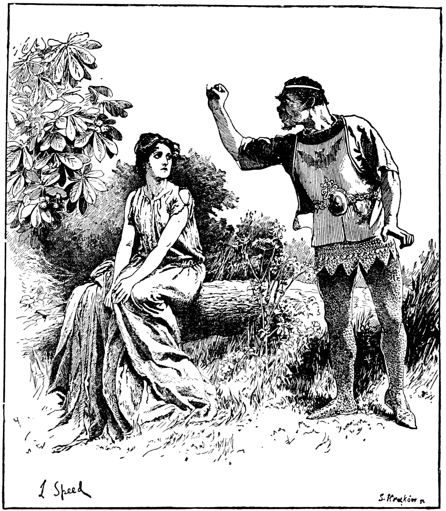

她发现养鸡姑娘正坐在一块大石头上，赤着双脚，穿着破旧粗劣的亚麻长袍，戴着一顶破帽子，样子很寒碜；她的脚边，地上铺满了金袍银袍、丝带花边、钻石珍珠，那些火鸡正在上面跑来跑去。邪恶国王那丑陋无比、令人讨厌的儿子正站在她对面，愤愤地说假如她不肯嫁给他就叫她死。

养鸡姑娘高傲地回答说：

“我永远不会嫁给你！你长得太丑，跟你残酷的父亲一模一样。让我安静地与火鸡呆在一起，与你的华丽服饰相比，我更喜欢它们。”

小老鼠十分欣赏地注视着她，姑娘像春天一样美丽。等邪恶王子一走，小老鼠变成一个老农妇对她说：

“你好！小美人儿，你有一群多可爱的火鸡呀！”

养鸡姑娘温柔地看了老妇人一眼，说：

“可是他们想让我离开它们，去做一个可怜的王后，您认为怎么样呢？”

“我的孩子，”仙女说：“王冠很漂亮，但你既不了解它的代价，也不知道它的份量。”

“我太了解了，所以才拒绝，”姑娘说，“尽管我不知道我的父母是谁或在哪儿，世上我也没有一个朋友。”

“你有善良和美丽，它们比十个国家都宝贵，”聪明的仙女说，“但是告诉我，孩子，你是怎么来这里的，怎么会没有父母，没有朋友？”

“是一个叫堪克琳的妖精带我到这里来的，”她回答，“跟她在一起，我不是挨打就是挨骂，最后我忍无可忍，便逃了出来，可我不知道该往哪里去。经过一片树林时，那个邪恶的王子遇见了我，他让我看管这个养鸡场，我高高兴兴地接受了，并没有想到要天天跟他见面。现在他想与我结婚，我永远都不会同意。”

听到这里，仙女已经看出，这个养鸡姑娘就是迪丽希亚公主了。

“你叫什么名字，姑娘？”她问。

“我叫迪丽希亚，”她回答。

仙女一下搂住了姑娘的脖子，吻得她几乎喘不过气来。她说：

“哎呀！迪丽希亚！我是你的老朋友，找到你我真是太高兴了，如果你不穿那旧袍子肯定会更漂亮，那衣裳只配给厨娘穿。穿上这件衣服，看看会有什么不同。”

迪丽希亚摘掉丑陋的旧帽子，抖落出光亮的金发，在旁边清澈的泉水里洗净了手和脸，双颊顿时呈现出玫瑰般的红润。她穿上仙女给的华丽长袍，加上钻石的点缀，她成了世界上最漂亮的公主。仙女高兴地叫道：

“这才是你的真实面貌，迪丽希亚，你自己感觉怎么样？”迪丽希亚说：

“我觉得自己好像是一位伟大国王的女儿。”

“如果真是这样，你高兴吗？”仙女问。

“当然高兴。”她答。

“那好，”仙女说，“明天我会给你带来好消息。”

说完她匆匆忙忙赶回城堡。王后正坐在那里忙于刺绣，仙女大声说：

“哎，夫人！你愿不愿意用你的针箍和金针跟我打赌，我给你带来的是你听过的最好的消息？”

“唉！”王后叹息道，“自从欢乐国王战死，迪丽希亚失踪，世上任何消息对我来讲，都不值一根大头针。”

“好啦，好啦，别那么忧郁，”仙女说，“我保证公主她很好，我从来没有见过那么漂亮的美人。假如她愿意，明天就可以成为一个王后。”接着她把一切都告诉了王后。王后先为小公主出落得如此美丽而欣喜，后来又想到她成了一个养鸡姑娘，不禁哭了起来。

“我不愿听到她被迫嫁给那个邪恶国王的儿子，”她说，“我们立刻就去把她带到这儿来。”

再说那个坏王子很生迪丽希亚的气，坐在一棵树下，既愤怒又怨恨，又哭又嚎。邪恶国王听到了从窗户向外喊道：

“你是怎么啦，搞得一切都不得安宁？”

“都是因为那个养鸡姑娘不肯爱我！”

“不肯爱你？哼！”国王说，“我马上就来处理。”他叫来卫兵，要他们去把迪丽希亚带来。“看我不叫她马上改变主意！”邪恶国王暗自得意地说。

卫兵来到养鸡场搜寻了好半天，只见到了一位穿着华丽，戴着钻石王冠的姑娘，看上去完全像一位可爱的公主。其实那就是迪丽希亚，可他们不敢认，倒是她很有礼貌地跟他们打招呼：

“请问你们来这儿找什么？”

“夫人，”他们说，“派我们来是找一个名叫迪丽希亚的姑娘。”

“啊！”她说，“我就是迪丽希亚，你们找我干什么？”

卫兵立刻用绳子绑住她的手脚，以防她逃走，并把她带到国王面前，旁边正坐着他的宝贝儿子。

国王看见姑娘如此漂亮，大吃一惊，任何一个心肠稍微软一点的人都不忍心把她这样，但邪恶国王只是冷笑地嘲弄她：“好啊，小妖怪，小讨厌，你为什么不爱我儿子？是不是他太英俊，太善良，你配不上？快点，立刻爱上他，否则就要剥你的皮，抽你的筋！”

可怜的公主吓得浑身发抖，连忙跪下求饶：

“哦，请不要剥我的皮抽我的筋，那太可怕了，给我两三天时间考虑一下，然后随便你们怎么处置。”

坏王子倒很想看看把她剥皮抽筋是什么样子，可国王却下令把她关进一个暗无天日的地牢里。正在这时，王后和仙女乘着飞车赶到养鸡场，对事情的突变感到忧伤不已，悲惨地说这是上天注定的不幸。但仙女要她振作起来。

“我会惩罚他们的！”她说着点了点头，显得十分坚定的样子。

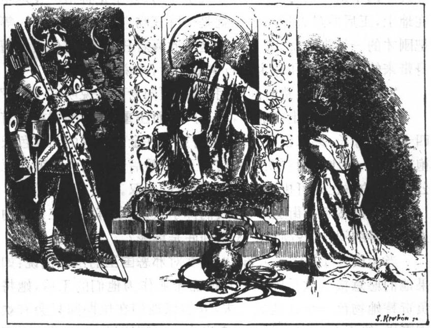

就在那天晚上，邪恶国王刚上了床，仙女就变成一只小老鼠，爬上他的枕头，一点点地咬他的耳朵。他长长的尖叫了一声，转过身去，但是没用，小老鼠又开始咬他的另一只耳朵，而且咬得更厉害。

国王哇哇叫起来：“刺客！有贼！”所有的卫兵都跑过来看看究竟发生了什么事，可什么也没有发现，连个人影都没有。而此时小老鼠已跑到王子的房间里，用同样的方式惩罚了这个坏蛋。整个晚上，她一会儿这个房间，一会儿那个房间，最后国王既恐惧又困倦，不得不冲出王宫，嘴里喊着：“救命，救命！耗子们来追我啦！”

愚笨的王子也赶紧起床，跟在国王后面跑，没跑出多远，两个人一起掉进河里，从此再无声息。

善良的仙女赶紧去把这个好消息告诉了王后，她们一起来到迪丽希亚被囚禁的暗牢，仙女用手指一碰，门就一道道打开，经过了四十道门后，终于来到了公主身边。公主正神情沮丧地坐在地上，王后冲过去抱起女儿就是一阵狂吻，高兴得直掉泪。等把刚才的一切告诉女儿时，公主这才欣喜若狂。接着，仙女把随身带来的华丽服装和珠宝钻石拿给她看，并说：

“不要在这里浪费时间啦，我们必须向老百姓说明这一切。”

于是她第一个走在前面，神态严肃而庄重，身后的裙裾足有四十五英寸长。第二位是王后，她身穿一件金丝刺绣的天蓝色长袍，头戴一项比太阳更明亮的钻石王冠。最后走来的是迪丽希亚公主，她的举止无可挑剔，她的美貌盖世无双。

她们慢慢走在街道上，向人们挥手致意。所有跟随在后面的人都觉得纳闷：这些高贵的夫人到底是谁呢？

当会议大厅挤满了人群时，仙女对邪恶国王的臣民们说：如果他们愿意接受欢乐国王之女迪丽希亚作为他们的王后，她将负责替她物色一个合适的丈夫，并担保他们在位期间只会有欢庆喜悦，绝不会有恼人愁人的事发生。听到这里，人们异口同声地高呼：“我们愿意！愿意！我们已经受到了太多太多的悲伤和忧郁。”然后他们手拉手围着王后、迪丽希亚和仙女跳起舞来，嘴里唱着：“我们愿意，是的，是的，我们愿意！”

整个城里的大街小巷，都在燃放烟火，举行盛宴。仙女彻夜未眠，乘着飞车走遍了全世界，终于在清晨带来了一位英俊潇洒、性情温和的王子。王子非常有魅力，公主和他一见钟情，王子也因娶迪丽希亚为妻而感到自己是世界上最幸运的王子。王后也终于认为她已摆脱了厄运，从此他们一起生活得幸福美满，万事如意。

 

## 格雷西奥萨和佩西内

从前，有一对国王与王后，他们生了个女儿，妩媚动人又聪明伶俐，给她取名格雷西奥萨。王后十分宠爱她，处处想着自己的女儿，每天给她添置新衣裳，一会儿是锦缎的，一会儿是丝绸的，一会儿是丝绒的。一听说她饿，马上送来一碗一碗的蜜饯和至少二十罐果酱。人人都说她是世界上最最幸福的公主。

宫廷里有个有钱的女公爵，已经上了年纪，名叫咕咕哝，长得奇丑无比：一头火红的头发，只有一只眼睛，还不好看；脸盘很宽，像一轮满月；一张大嘴简直能把人吞下去，幸亏里面一颗牙也没有！她除了长得难看，脾气也特别暴躁，一听别人说到格雷西奥萨如何漂亮她就受不了啦，赶紧回到自己的城堡。要是有人去看她，偶尔提到可爱的公主时，她就会恶狠狠地叫起来：

“说她可爱，那不是真的。我一个小指头的魅力也超过她全身。”

不久，王后得病去世了，公主非常伤心。国王也非常忧郁，整整一年把自己关在宫里。后来御医怕国王也要病倒，就建议他无论如何出去散散心，因此安排了一次围猎。可是由于天气太热，国王很快就疲倦了，说要下马到附近城堡休息一会儿。

真是无巧不成书，他来到的正是咕咕哝公爵的城堡。她听说国王来了，就出来迎接，还说她的酒窖是整个城堡最最阴凉的地方，问国王是否愿意下去呆一会儿。于是她陪国王来到地窖，只见那里有两百只大酒桶，一个挨一个地排着，国王就问她储藏这么多酒是不是她自己享用。

“是的，陛下，”她回答说，“这些酒是专给我一个人享用的，不过您若是肯品尝一些，我将感到十分荣幸。你喜欢哪种酒？加那利葡萄酒、圣·朱利安葡萄酒、香槟、法国红葡萄酒、无核葡萄酒，还是苹果酒？”

“好吧，”国王说，“既然你这样盛情，我愿意尝一尝香槟酒。”

咕咕哝拿起一把小锤子，在一只木桶上笃笃敲了两下，桶里一下子流出好多五先令的硬币，少说也有一千枚。

“您看，这是怎么回事？”女公爵笑着说。

她又敲敲旁边一只桶，结果又流出无数的金币来。

“我真搞不明白，这究竟是怎么回事，”女公爵笑得更欢了。

接着她又走到第三只桶跟前，笃，笃，结果桶里流出无数的钻石和珠宝，像小溪一样，很快就撒满一地。

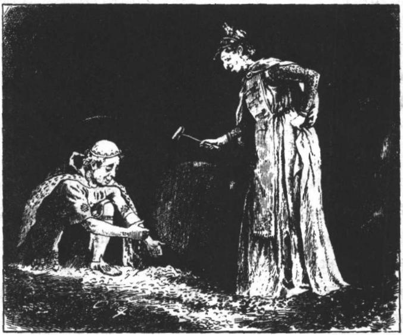

“天哪！”她大声叫道，“我真是一点搞不懂，陛下，一定是有人偷走了我的好酒，然后把这些垃圾塞在里边。”

“垃圾，你把它们叫做垃圾，咕咕哝夫人？”国王嚷起来，“垃圾！它们足可以买下十个王国。”

“这下，”她说，“您一定猜到了，所有那些桶里全是金币和钻石。您要是愿意娶我，这些东西全都是您的。”

此刻，国王爱金钱胜过爱世上任何东西，所以他喜出望外地说：“娶你？那真是求之不得呢！只要你愿意，我明天就娶你。”

“不过我有一个条件，”女公爵说，“您的女儿必须完全由我来支配，我让她干什么她就得干什么。”

“那当然，一切应该听从你的；让我们握手成交吧，”国王说。

他们真的握手为定，然后一起走出了藏宝的地窖，女公爵锁上门，钥匙交给了国王。

国王回到宫殿，格雷西奥萨奔出来迎接，问他是不是满载而归了。

“我捉到一只鸽子。”他回答说。

“喔，那就把鸽子给我吧，”公主说，“我来饲养它，一定精心照料。”

“这恐怕不行，”他说，“跟你直说了吧，我的意思是我遇见了女公爵咕咕哝，而且已经答应与她结婚。”

“您就叫她鸽子？”公主叫了起来，“我倒想叫她仓鸮。”

“住嘴，”国王严厉地说，“我要你尊重她。你去好好装扮一下，我马上要带你去拜访她。”

公主非常难过，回到自己房间。奶妈见她泪流满面，就问是什么事使她这样苦恼。

“天哪！碰到这样的事，谁能不苦恼？”她回答说，“因为国王想要重新结婚，而且挑中的新娘偏偏是我的敌人，那个丑八怪咕咕哝女公爵。”

“哦，原来是这样！”奶妈说，“不过你必须记住，你是一位公主，不管遇到什么事情，都要沉得住气，要为别人作出榜样。你一定要答应我，千万别让女公爵看出你讨厌她。”

起初，公主说什么也不肯答应，但是奶妈给她讲了许多道理，她终于答应对继母表现得和气一点。

奶妈给她穿上一件浅绿色织金缎袍，把她长长的金发梳理得纹丝不乱，披在肩上就像一件金色的披肩，又在她头上戴一顶用玫瑰花、茉莉花和绿叶编成的花冠。这样装扮好后，她更是美丽无比，然而脸上还是带着愁苦的神情。

这时女公爵咕咕哝也在精心打扮着自己。她把鞋跟弄得一只高一只低，两只高度相差有一英寸，以便走起路来跛得不太厉害；她用一只制作逼真的玻璃眼珠装在那只瞎掉的眼窝里；她把火红的头发染成黑色；她还在脸上涂脂抹粉。然后，她穿上一件蓝衬里的淡紫色华丽缎袍和一件镶紫色丝带的鹅黄色衬裙。她听说王后们总是骑马到新领地去的，所以下令备好马让她骑。

格雷西奥萨要等父亲作好准备一同去，趁这个时候，她一个人下楼穿过花园，走进一片小树林，坐在长满青苔的河岸上想起心事来。她越想越伤心，很快就哭了起来，哭着哭着，竟忘了回宫这码事。突然，她面前站着个英俊的青年侍从。他身穿绿色制服，手里拿着顶饰有白色羽毛的帽子。见格雷西奥萨打量着他，他便单膝跪下，对公主说：

“公主，国王在等你。”

公主看到这个侍从如此漂亮，真是又惊又喜。她想不起来在哪儿见到过他，以为他可能是女公爵家的人，便说：

“你成为国王的侍从有多久啦？”

“我不是国王的侍从，小姐，”他回答说，“我是你的仆人。”

“我的仆人？”公主感到万分惊讶。“那我以前怎么没有见过你？”

“啊，公主！”他说，“以前我不敢在你面前露面，但现在国王的婚姻会给你带来许多危险，所以我下决心马上告诉你，我是多么爱你。我相信，总有一天我会赢得这份爱情。我是佩西内王子，关于我的财富，你大概早有所闻；我还懂一些仙术，在你遇到困难时能帮你度过难关，只要你允许我乔装改扮陪伴你。”

“啊，佩西内！”公主大声说，“你真是佩西内？我经常听人说起你，也早想见见你。要是你真的成为我的朋友，我就再也不怕那个邪恶的女公爵了。”

他们一起回到宫里，格雷西奥萨发现那儿有一匹漂亮的马，是佩西内牵来让她骑的。她骑了上去，由于这匹马非常兴奋，他便过来牵着马缰引路，这一安排使他有机会不时回头打量公主，他当然不会放过每一个机会。女公爵的马出现在格雷西奥萨的马旁边时，看上去只不过是一匹拉破车的老马，至于马饰，二者更是无法相比，因为公主的马鞍和缰绳上尽是熠熠发光的宝石。国王要操心的事太多，没太注意到马的细节，然而满朝大臣却都被公主和她的侍从倾倒了，他那一身绿色制服与众不同；他那英俊的外貌和高贵的气质，宫廷里任何一个人都比不上。

他们见到咕咕哝时，她坐在一辆敞篷马车上，一心想装出一副高贵威严的样子，却又装不像。国王和公主向她行礼致意。她的马被牵过来让她骑上时，她突然看见了格雷西奥萨的坐骑，马上发起脾气怒吼道：

“要是那个孩子骑的马比我的还好，我马上就回自己的城堡去。被人这样藐视，当王后还有什么意思？”

国王一听这话，连忙命令格雷西奥萨从马上下来，同时恳求女公爵给公主赏个脸，骑上公主的马。公主默默服从命令。女公爵既不看她一眼，也不谢她一声，笨拙地爬上那匹漂亮的马背。她坐上去像一团破衣服，八个官员扶住她，生怕她从马上摔下来。

即便是这样，她还不满意，仍然在嘟嘟嚷嚷骂骂咧咧，官员们忙问还有什么需要效劳的。

“我要那个穿绿制服的侍从过来给我牵马，就像刚才他给格雷西奥萨牵马一样，”她恶声恶气地说。

国王命令侍从前去给女公爵牵马，佩西内和公主相互看了一眼，什么也没有说，便按照国王的命令去做。仪仗队浩浩荡荡地出发了，女公爵坐在马上得意洋洋，丝毫不想与格雷西奥萨换回坐骑。可就在这时，谁也没有料到那匹马不乐意了，它一会猛烈前冲，一会用后腿站起，一会儿又前脚站住猛踢后蹄，最后竟飞也似地狂奔起来，谁也无法阻止它。

起初女公爵紧紧贴在马鞍上，但很快颠来颠去地身体离开了马，最后竟像一个肉团子似的被甩出去，正好落在一堆乱石和荆棘丛中，成了大肉饼。人们像捡玻璃碎片一样，把她身上的东西从地上捡起来：帽子在这儿，鞋子在那儿，脸刮破了，华丽的衣裳裹上了一层泥浆，从没有见过哪位新娘如此狼狈过。人们把她抬回宫殿，让她躺在床上，然而她稍一定神能够开口说话，就开始发脾气骂人。她咬定一切都是格雷西奥萨造成的，这个小丫头蓄谋要除掉自己，于是对国王说，假如他不严惩公主，她就回自己的城堡独自享有那些财宝。

听到这话国王吓得要死，因为他根本不愿失去那些成桶的金银财宝。他急忙请女公爵息怒，还说格雷西奥萨由她来处置，她爱怎样惩罚就怎样惩罚。

随即咕咕哝派人把格雷西奥萨叫来。格雷西奥萨听到传唤，吓得脸色煞白，浑身直抖。她四下寻找佩西内，却不见他人影，她只好去了女公爵咕咕哝的房间，谁知刚踏进房门，就被四个侍女抓住，她们个个高大强壮，心狠手辣，见到她们的模样已经叫人不寒而栗了。她们手里拿着一大捆荆条，床上的女公爵大声传令，要那四个刽子手把公主往死里打，公主吓得简直要晕过去。

可怜的格雷西奥萨一心希望佩西内知道眼前发生的事情，赶快前来救她，直到她们举起鞭子就要动手时，她才松了一口气，因为她发现那些荆条变成了孔雀毛，尽管她们竭尽全力，累得半死不活，最后胳膊都抬不起来，可公主一点没有伤着。女公爵以为经过这么一阵痛打，公主一定是遍体鳞伤了，也就放了她。格雷西奥萨装作疼痛难忍的样子回到自己的房间，把刚才的一切告诉了奶妈。奶妈走后，公主一回头，发现佩西内就站在身边。公主对他巧妙的帮助表示由衷的感谢，用这种方式居然骗过了女公爵和那四个侍女，真是痛快，他们俩开心地笑了起来。不过佩西内叫公主再装几天病，同时答应一旦公主需要他立刻就来帮忙，说罢就消失了，就跟他刚才突然出现一样。

女公爵想到格雷西奥萨真的病倒了，心里特别高兴，因而她自己复原的速度也加快了一倍，婚礼隆重地举行了。国王现在才明白，王后最最喜欢的事情就是别人夸她美丽，于是令人给王后画了幅肖像，并举行一场比武大赛，宫廷里所有最勇敢的骑士都要坚决主张咕咕哝女公爵是世上最最美丽的王后，如有其他参赛的人提出不同看法，便要和他们比个高下。

许多来自远方的骑士都来接受挑战，丑陋的王后堂而皇之地坐在悬挂着金丝帷幕的阳台上观看比赛，格雷西奥萨被命令站在她身后，可她的美貌显得更为突出，所有参赛的人都不由自主地把目光向她投去。王后既愚蠢又虚荣，还以为所有这些爱慕的目光都是冲她来的呢；正好所有来参赛的人都败在国王的骑士手下，因而更加坚定了她自以为天下第一美人的信念。

就在这时出现了一位年轻的骑士，他带来一幅肖像，封在一只镶有宝石的匣子里；他宣称他的看法跟他们完全相反，他认为王后是世上最最丑陋的人，他手中那幅肖像上的人才是天下第一美貌。

于是一个个骑士站出来与他比武，又一个个败下阵来。这时年轻的骑士打开匣子，说为了给他们一些安慰，将给他们看看这“天下第一美女”的肖像以饱眼福。肖像一亮出，人人都认出那是格雷西奥萨公主。那位陌生的骑士风度翩翩地向公主行了个礼就退了下去，对谁也没有透露姓名。格雷西奥萨心中有数，那人不是别人，正是佩西内。

至于王后，当然是气急败坏，说不出一句话来；但很快她就恢复了大嗓门，把格雷西奥萨痛斥了一通。

“什么！”她说道，“你竟敢来跟我争夺美女的桂冠？要我像这些骑士一样受到如此的侮辱？告诉你，高傲的公主，我不会咽下这口气的，我一定要报复！”

“我向你保证，夫人，”公主说，“我跟这事无关，我非常愿意您被宣布为‘天下第一美女’。”

“啊，你这小东西，还想寻我开心！”王后说，“不过马上就要轮到我开心了！”

有人飞快地去报告国王刚才发生的一切，说王后如何发怒，公主如何惊慌，可是国王只是说：

“王后可以随意行事，格雷西奥萨归她管！”

坏王后急不可耐地等到夜幕降临，命人备好马车。格雷西奥萨被迫坐上马车，被载到离宫一百里外的一座大森林里。那林子阴森森的，里面尽是些老虎、狮子、熊和豺狼，白天都没人敢进去。公主苦苦哀求别把她丢弃在那里，可不管她如何流泪如何哭泣，还是被抛在了这片黑暗中。起初公主静静地站着，不知如何是好，直到渐渐远去的马蹄声完全消失，她这才漫无目的地奔跑起来，一会儿闯到这儿，一会儿闯到那儿，有时撞在树上，有时又绊倒在石头上，时刻提心吊胆会让狮子吃掉。不久，她筋疲力尽再也走不动了，扑在地上伤心地哭了起来。

“哦，佩西内！你在哪儿？难道你把我全忘了吗？”

她话音刚落，森林突然亮了起来，每棵树似乎都发出一道柔和的光，看起来比月光更清澈，比阳光更软和。公主的面前有一条长长的林荫道，小道的尽头是一座明净的水晶宫殿，像太阳一样耀眼。正在此刻，一个轻微的声音从身后传来，她回过头一看，原来是佩西内站在那里。

“我吓着你了吗，公主？”他说，“我以我母后的名义欢迎你来仙宫，我母亲将像我一样地爱护你。”公主快活地爬上他那辆由两头小牡鹿拉的小雪橇，很快就到了那座奇妙的王宫。王后亲切地接见了他，并立刻设宴招待她。格雷西奥萨得以与佩西内重逢，又逃离了那座阴森可怖的森林，非常高兴，宴会上胃口很好，宴会气氛更加热闹。晚餐过后他们走进另一个可爱的大厅，四周全是水晶墙壁，墙壁上贴满了画像，公主极为惊讶地发现，她自己的过去，包括佩西内刚才在森林中找到她的那一刻，都已画成画记载下来了。

“你的画师一定非常勤奋，”她手指着最后一幅画像说。

“他们不得不勤奋，因为有关你的任何情况我都不想遗漏。”

公主渐渐困倦起来，二十四位妩媚的少女扶她来到一个她从未见过的漂亮房间，伺候她上床，然后为她唱起了一支甜美动听的催眠曲，格雷西奥萨梦见的尽是美人鱼和清凉的海波以及跟佩西内一起游玩的大山洞。可是当她醒来，第一个念头就是赶快回家，虽然这座仙宫里的生活非常愉快，但她不能留在这里，她必须马上回到父亲身边。二十四个侍女给她穿上王后赠送的漂亮的长袍，她显得越发美丽动人了。佩西内王子前来看她，听说她要走，感到又痛苦又失望。他恳求她重新考虑一下，那个邪恶的后娘会怎样折磨她，假如她肯嫁给他，整个仙宫将归她所有，而且他将一心一意地使她快乐。然而不管他如何劝说，公主还是执意要回去。最后王子只说服她再多呆八天。这八天里充满欢声笑语，仿佛眨眼工夫就过去了。最后这一天，格雷西奥萨又跟以前一样急于知道父亲宫里近来发生的一切，她要求佩西内为她打听那坏王后是怎样向她父亲解释她的突然失踪的。佩西内原先想派个信使去打听一下，可公主说：

“喂！就没有更快一点的办法了吗？”

“好吧，”佩西内说，“你自己去看吧。”

于是他们登上一座很高的塔楼，这座塔楼和城堡里所有其他建筑一样，也全由水晶砌成。

王子拉着格雷西奥萨的手，让她把另一只手的小指伸进嘴后，然后朝她父亲的城堡那边看，她立刻看到坏王后走到国王面前，还听到她对国王说：“那个可恶的小东西已经死了，没什么大不了的，我已经下令马上把她埋了。”

接着公主看到坏王后用一段木头代替她，给它套上衣服装扮一下便下了葬。国王老泪纵横，人们私下里议论纷纷，说是王后残忍地杀害了公主，理应将王后斩首。公主见国王因为听说她死了悲伤之极，整天茶饭不思，便哭了起来：

“啊，佩西内！要是你真爱我，就赶快送我回去吧。”

尽管王子一百个不情愿，最后还是不得不答应让她回去。

“你也许不会后悔离开我，”他悲伤地说，“因为你还不是很爱我；但我可以预见，你将不止一次地后悔离开了这座仙宫，你在这里一直很愉快。”

然而，不管他怎么劝说，公主还是告别了佩西内的母后，准备动身了。佩西内勉强牵来牡鹿拉的小雪橇，公主爬上去坐在他身旁。他们刚驶出去二十码远，身后突然传来一声巨响，格雷西奥萨回头一看，只见水晶宫像喷泉一样飞上了天，成了无数碎片，转眼就消失了。

“噢，佩西内！”她大声叫了起来，“怎么回事啊？仙宫不见了！”

“是的，”王子回答道，“我的仙宫已经不复存在了；要等人家把你埋葬掉，你才会重新见到它。”

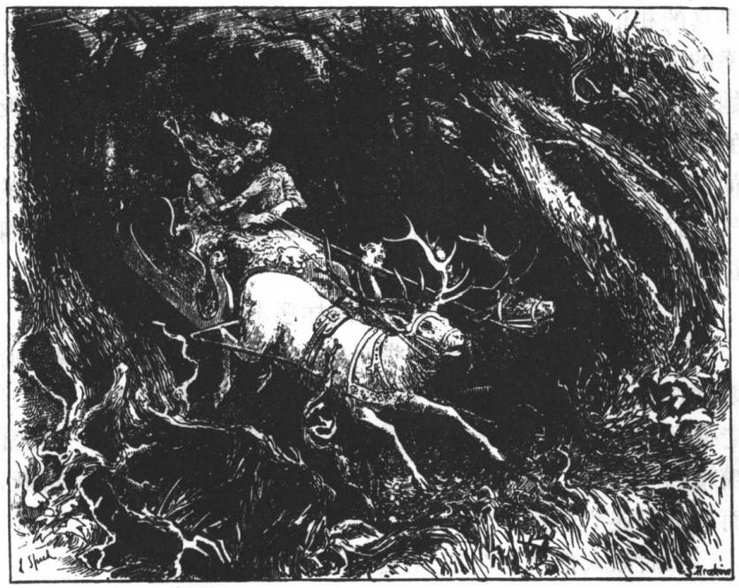

“瞧，你一定生我气了，”格雷西奥萨对他好言相劝，“不过说什么我比你可怜得多。”

快到王宫时，王子让雪橇和他们自己隐了形，公主走进王宫时谁也没有觉察到。她跑到大厅，国王独自闷坐在那里。她的突然出现，令国王大吃一惊。格雷西奥萨告诉他，王后把她丢弃在森林里，葬在坟墓里的只是一段木头，国王觉得难以置信，立刻派人去把木头挖出来，无疑证实了公主说的话。国王紧紧拥抱格雷西奥萨，让她坐下和自己一起用餐，父女俩真是有说不出的快活。可这时有人去报告王后，说格雷西奥萨回来了，正在和国王共进晚餐呢。王后听罢，勃然大怒，马上就赶过来了，可怜的国王见到她常浑身发抖。坏王后宣称格雷西奥萨根本不是公主，而是一个居心不良的冒名顶替者，假如国王不立刻把公主交出来，她马上回自己的宫殿去，永远也不见他了。国王一句话也没说，似乎真的相信来与他相认的是个骗子。王后暗自得意，派侍女把不幸的公主拖走，关到塔楼上，夺走了她的珠宝和美丽的衣裳，让她换上粗布衣服、木鞋和一顶小布帽。她睡的是墙角的草堆，吃的是一小块黑面包。面对这样悲惨的处境，格雷西奥萨十分怀念仙宫的生活。她想要佩西内前来帮助，但她确信他还在生自己的气，因为是自己非要离开他的，所以不敢指望他还会回到自己身边来。

这时王后叫来一个和她本人同样恶毒的老仙女，对她说：

“你得给我想想，找出一些叫公主完不成的活儿来，我一心要惩罚她，要是我给她的任务她完不成，那就休怪我不客气了。”老仙女说她得好好想想，明天来给答复。第二天，她带来一团乱糟糟的丝线，体积足有她本人的三倍，线细得吹口气都会折断，而且乱得连头也找不着。

王后派人把公主叫来，对她说：

“你看清楚这团线了吗？用你的笨手去理吧。我要你在天黑前把线理好，要是弄断一根丝，就叫你好看。”说完，王后走了，给门加了三把锁。

公主垂头丧气地看着那团乱丝，翻来翻去找不到线头，倒弄出不少的断头来，最后她把线团丢在地上哭了起来：

“哦，佩西内！要是你能原谅我，就再来帮我一次吧；这团乱丝可真的要了我的命了。”

果然佩西内站在了眼前，仿佛那三把锁的钥匙就捏在他的手心，想什么时候进来就什么时候进来。

“我来啦，公主，”他说道，“尽管你不重视我的感情，我还是随时愿意为你效劳。”

他拿起魔杖，在那团乱丝上敲了三下，所有的断头便立刻自动粘上，整团线服服帖帖地自己绕好了，简直叫人不敢相信。王子转过身问格雷西奥萨，有没有别的事需要效劳，是不是为了他本人的事召唤他前来的时刻永远不会到来。

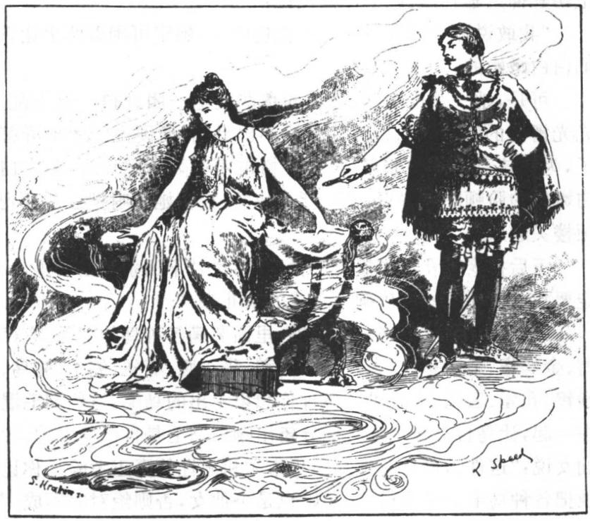

“不要责备我，佩西内，”她说，“没有你的爱，我才是真的不幸。”

“可是你为什么要自讨苦吃，我的公主？”他大声说道，“你要是跟我走，我们在一起可以很快活。”

“万一你对我厌倦了呢？”格雷西奥萨说。

王子听到这种对他缺乏信任的话，感到很伤心。他一言不发地离开了格雷西奥萨。

坏王后迫不及待地要惩罚格雷西奥萨，只恨太阳怎么不快点落山。没等到指定时间，她就领着四个恶婆娘来了。她刚把三把钥匙插进匙孔，就急不可待地说：

“我敢说那个懒骨头压根什么也没干，她宁可闲着两手让它们白白嫩嫩的。”

可是，她一踏进房间，格雷西奥萨就把一团理得一丝不乱、光光滑滑的线团拿给她看。她挑不出毛病，便硬说线团给弄脏了，为了这莫须有的罪名，她打了格雷西奥萨两记耳光，公主白白嫩嫩的脸顿时变得青一块、紫一块的。接着她吩咐把公主押到顶楼关起来。

王后把老仙女找来痛骂一顿。然后说：“下回别再出错了，一定要找一件让她的的确确完不成的活儿来。”

第二天老仙女带来一只大桶，里面装满各种鸟的羽毛，有夜莺、金丝雀、金翅雀、红雀、山雀、鹦鹉、猫头鹰、麻雀、鸽子、驼鸟、鹧鸪、孔雀、云雀、火鸡以及各种你想象不出的鸟毛。这些羽毛混在一起，让鸟自己来也未必能分辨出哪根羽毛是自己身上的。老仙女说：“这件活可是对你那囚犯本领和耐性的真正考验。你让她把各种鸟毛分开堆放，除非她也是个仙女，否则绝对完不成。”

王后想到这个活儿使公主陷入绝境，心里别提有多高兴。她叫人把公主找来，对她进行了同样的威胁，命令她在天黑前把羽毛挑拣堆放好，然后锁上三把锁，把公主关起来。格雷西奥萨立刻就动手干了起来，可挑了十来根羽毛后，发现要把这些羽毛分类放好是根本办不到的。

“天哪！”她叹息道：“王后一心想杀死我，假如我一定得死，那这次就死定了。我不能要求佩西内王子帮助我，要是他真的爱我，就不会等到我叫他来他才来。”

“我来了，我的格雷西奥萨，”佩西内大叫一声，从桶里钻了出来，原来他早就躲在桶里边，“你怎么还在怀疑我对你全心全意的爱？”

他举起魔杖敲桶三下，所有的羽毛一下子飞出，纷纷落在房间四周，清清楚楚地形成一堆堆不同的羽毛。

“没有你我可怎么办啊，佩西内？”格雷西奥萨满怀感激地说，然而她还是下不了决心跟他走，永远离开父亲的王国。她请求王子再给她一些时间考虑考虑，王子只得再次失望地离去。

日落时分邪恶的王后来一看，她吩咐的活儿无可挑剔地完成了，既惊讶又气恼。但她还是硬找岔，说一堆堆羽毛放得太乱，公主因此又挨了打，然后又被关到顶楼上。王后再次把老仙女叫来，骂得她胆战心惊，老仙女答应回去再好好想想，找一个最最难的差事，叫格雷西奥萨无论如何也干不了。

三天后，她带来一只盒子。

“你可以命令你的奴隶，”老仙女说，“到你要她去的地方，拿着这个盒子，任何时候都不许打开，她肯定会忍不住打开看看，到时候会造成一个你非常满意的后果。”于是王后再次到格雷西奥萨那里对她说：

“你把这只盒子送到我城堡去，放在我房间的桌上；不许偷看盒子里的东西，否则就别想活命。”

格雷西奥萨戴上小布帽，穿着木鞋和粗布衣服就出发了。即使是这身打扮她仍显得那么美丽，过路的行人都觉得纳闷，不知她究竟是谁。没走多远，灼人的太阳和沉重的盒子使她感到非常疲乏，于是走到一片林荫下时，她就坐下来歇歇脚，小心翼翼地把盒子放在膝上。突然她产生了一个强烈的欲望，想打开盒子瞧一瞧里面究竟装了些什么。

“要是我打开了又会怎么样呢？”她自言自语地说，“我什么也不拿，只是看一看里面是什么东西。”

她没有再犹豫，打开了盖子。

立刻从盒子里走出来一群男男女女的小人，只有手指头那么高。他们在草地上四散开去，唱着跳着，玩起了游戏。起初格雷西奥萨兴致勃勃地看着他们，觉得很有趣，可过了一会儿，她歇好了，准备上路了，却发现无论如何也不能把他们赶回盒子里去。她到草地上去追，他们就跑到树林里；她到树林里去追赶，他们就围着树跟她捉迷藏；或者呢，就藏在满是苔藓的小树枝后面，然后这些小精灵们带着银铃般的笑声蹦蹦跳跳地跑回草地上去。

最后，公主越追越紧，越追越怕，索性坐在地上哭了起来。

“这都是我自己的错，”她伤心地说，“是我的好奇心害了自己。佩西内，要是你心里还有我这个轻率的公主，就再来帮我一次吧。”

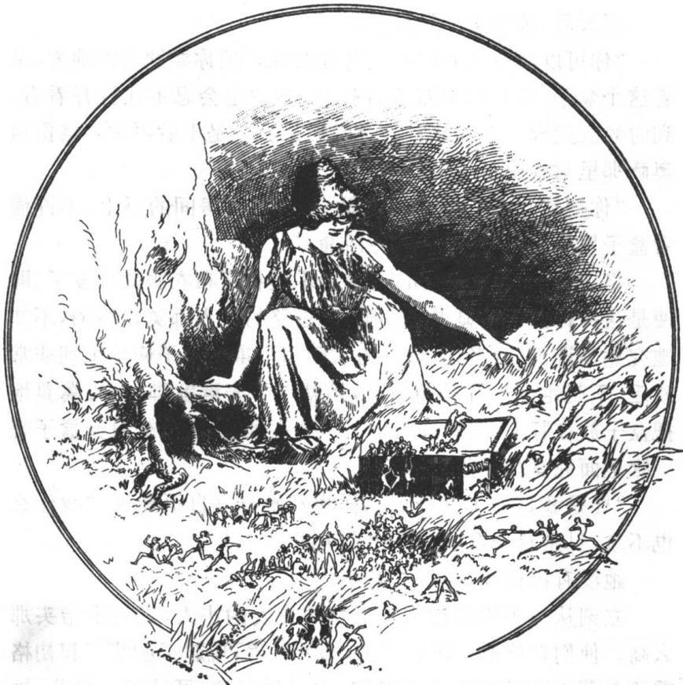

佩西内立刻出现在她面前。

“啊，公主！”他说，“要不是那个邪恶的王后，你恐怕永远不会想到我吧！”

“哪儿会呢，”格雷西奥萨说，“我并不像你想象的那样忘恩负义；只是我还需要一些时间，我相信我会一心一意爱你的。”

佩西内听了这话很开心，他用魔杖敲了一下盒子，迫使那些任性的小人回到盒子里去，然后又使公主隐起了身，坐上马车跟他一起到城堡去。

公主来到城堡门口，说王后命令她把盒子放到王后房间里去，不料管家听后大笑起来。

“不行，不行，我的小牧羊女，”他说，“那不是你去的地方，从来没有穿木鞋的人进过她的房间。”

于是格雷西奥萨求他写封信给王后，告诉王后是他拒绝让她把盒子送进王后房间的。他说这个他可以办到。管家写好信，公主便回到佩西内身边，他正在等她，他俩一起动身回公主父王的宫殿去。你可以想象，这段路并不很短，可公主还是嫌它短，因为身边坐着她心爱的人。他们分手前，公主答应，假如王后仍对她残酷无情，再恶毒地陷害她，她就永远地离开那座王宫，回到佩西内身边来。

看见公主又回来了，王后向陪伴在身边的老仙女猛扑过去，揪她的头发，抓她的脸，要是仙女也会死的话，这个老仙女非要死在王后手里不可。公主把信和盒子交给王后，王后一把夺过来，看也不看就扔到火里，那架势恨不得把公主也扔进火里。她派人在花园里挖了一个大坑，深得像一口井，顶上盖了一块大石板。她这时领着格雷西奥萨和所有的侍女到那儿去，她走到石板边，对大家说：

“我听说这块石板下面藏着大量宝藏，让我们来看看，是否能把这块石板抬起来。”

于是她们推的推，拉的拉，格雷西奥萨也在其中，这正是王后所希望的。等石板抬到一定高度时，王后在背后猛地一推公主，公主掉到了井里，石板随即轰地一下重新盖上了。公主这下真的成了一个死囚了；她现在在地底下，就是佩西内也不可能找到她了。

“这简直就是活埋，”她说着打了个寒噤。“哦，佩西内！都是因为我对你缺乏信任，现在我终于尝到了自己酿的苦酒！可是我又怎么能确信，一旦我真的爱上你，你会不会厌倦我、抛弃我呢？”

她正这么说着，突然看见井壁上开出一扇小门，一道阳光射进这口阴森森的深井。格雷西奥萨毫不犹豫地走过那道门，原来外面是一座美丽的花园，两旁长满了鲜花和果树，泉水在脚边流淌，小鸟在枝头歌唱。她走到一条宽阔的林荫道上，抬头看它通向哪里，竟意外地发现，水晶宫就在附近。是的，没错！母后和佩西内正迎着她走来呢。

“啊，公主！”母后说，“别再让可怜的佩西内提心吊胆了。你怎么也想不出，你掌握在那个可怕的王后手里，他多么焦虑不安啊。”

公主十分感激地亲吻母后，答应一切按母后的意愿去做，然后向佩西内伸出手，微笑着说：

“你还记得吗，你对我说过，只有等人家把我埋葬了，我才能再见到你的宫殿。我真想知道，既然你当时就猜到了以后发生的事，我该不该告诉你，我整个心都在爱你，随时都准备跟你结婚？”

佩西内王子快活地握住公主伸过来的手，生怕她改变主意，所以决定立刻举行婚礼。这是世界上最最隆重豪华的婚礼。从此格雷西奥萨与佩西内过上了幸福美满的生活。

 

## 白地国的三位公主

从前有个渔夫，住在一个王宫附近，天天为国王捕鱼。一天他出海捕鱼一无所获，无论他怎么摆弄鱼竿鱼线，拉上来的钩子都是空的。眼看一天就要白白过去，忽然从水里伸出一个人头对他说：“要是你肯把回家后你老婆给你看的第一样东西送给我，你就可以捕到足够的鱼。”

渔夫说：“好的。”果然就捕到很多鱼。可是晚上回到家时，他老婆把刚刚生下来的孩子送到了他面前。他把许过的愿告诉给老婆听，她哭得死去活来；渔夫心里也非常难过。

这件事很快传到国王那里，国王听说了渔夫老婆伤心的原因，当即决定救这个孩子，说愿意接受他，并当自己的儿子一样把他扶养大。后来孩子长大了。有一天，这孩子请求让他跟父亲一起出海捕鱼。起初，国王不同意，但见他愿望强烈，也就答应了他。小伙子和父亲出海了，一整天，晚上回到岸上，一切都很顺利。可是小伙子想起手帕丢在船上，便回去寻找，谁知一登上船，那船就飞快地滑走了，船的周围全是泡沫；小伙子拼命想把船往回划，可船一点不听使唤，只是一个劲地向前向前。就这样船载着他漂了整整一夜，最后到了很远的一片白色海滩。他上岸没走多远，遇到一个年迈的老头，留着长长的白胡子。

“这是什么地方？”小伙子问。

“叫白地国”，老头说。他也问小伙子打哪儿来，打算干什么，小伙子如实相告。

“嗯，”老头说，“你沿着海滩朝前走，就会看见三个公主，她们站在土里，只有头露在外面。第一个公主是大公主，她会恳求你前去帮忙，第二个公主也会这样求你，不过你别过去，而要赶快走，装作什么也没听见，什么也没看见。但是你要走到第三个公主跟前，听她的吩咐，那你就会交好运。”

小伙子走近第一个公主时，她大声叫唤，恳求他帮忙，他只当没看见，走了过去。同样，他也没搭理二公主。见到三公主，他走了过去。

“如果你照我的吩咐去做，就可以在我们中间挑一个跟你结婚”

小伙子说很乐意。三公主告诉他，有三个巨人把她们埋在了土里。从前她们住在树林中的一座城堡里，那城堡他能看见的。

“记住，”她说，“你到城堡里去，让巨人揍你三个晚上，你是替我们挨打。你要能挺住，就能使我们获得自由。”

“好吧，”小伙子回答道，“我会尽力的。”

“你走进城堡，”公主继续说，“会看到两头狮子站在门口，不过你只管往里走，它们不会伤害你的。你径直走进一个黑暗的小房间，躺到床上，一会儿巨人就会鞭打你。你只要取下挂在墙上的长颈瓶，把瓶里的油涂在伤口上，伤口会立刻痊愈。然后，你抓起瓶子旁的宝剑砍下巨人的头。”

小伙子照公主的吩咐去做，他从两头狮子中间走过去，径直走进小房间躺到床上。第一天晚来了一个三头巨人，手执三根皮鞭，结结实实打了小伙子一顿。小伙子硬挺到他打完，然后取下瓶子，用里面的油涂在身上，涂好后一把抓住宝剑杀死巨人。

第二天早晨他来到海边，发现公主们还站在土里，不过她们的上半身已露出了地面。

第二天晚上发生了与头天晚上同样的事情，不过进来的是个六头巨人，手里拿着六条皮鞭，打得比头一个巨人更狠。第三天早上出去，小伙子发现土只齐公主的膝盖了。

第三天晚上进来的是个九头巨人，拿着九条皮鞭，自然打得也最狠了。他打了很长时间，最后小伙子昏了过去。巨人把他拖起来往墙上撞，碰巧撞翻了墙上的长颈瓶，结果油溅了小伙子一身，小伙子顿时力壮如初。他当机立断，抓起宝剑猛刺巨人，巨人一命呜呼。第四天早晨他走出城堡去看公主时，发现公主们已经完全从土里出来，站到他的面前。他选小公主做了他的王后，与她幸福地生活了好一阵子。

后来他思念家乡，想回去看一看父母。王后先是不肯，但他思乡心切，王后拗不过他，便对他说：

“有件事你必须答应我：只做你父亲吩咐的事，不要服从母命。”他答应了。

王后给了他一枚戒指，戴上它就能马上实现两个愿望。他说快让他在家里，便立刻来到家里。双亲见他服饰如此华贵，知道他成了大人物，感到非常惊讶。

他在家里呆了几天后，母亲要他去王宫，让国王看看他长成了一个怎样的大人物。

父亲说：“不，别那么干，不然，我们就会失去拥有他的快乐了。”可父亲话不管用。小伙子经不起母亲的再三恳求，最后还是去了。到了王宫，他更加光彩夺目，不仅他的服饰，他整个人都使那位国王相形见绌，老国王当然心里不高兴了，就说：

“你看，你可以看见我的王后，我却不能看见你的王后，我不相信她会有我的王后那样漂亮。”

“真希望她就站在这儿，那你就能看见她有多漂亮了。”说话间年轻的王后已站在了他面前，不过她很懊恼，对他说：“你为什么不记住我的话，只听从父亲的吩咐？好了，我必须回去了，你已经提过两个愿望，那枚戒指再不能帮你忙了。”

说完，她往头上套了一只刻有她自己名字的环，提出了回家的愿望，便走了。

年轻的国王心如刀绞，日夜思念他的王后。“无论如何我也得找到白地国在哪里。”他心里想，然后便开始了旅程。走了好多路，来到一座山前遇见一个兽王，他掌握森林中所有的野兽，只要他一吹手中号角，所有野兽便都集中到他面前。年轻的国王向它打听白地国的位置。

“不，我不知道，”他说，“不过我可以问问我的野兽。”他一吹号，野兽聚拢来。他问它们有谁知道白地国在哪儿，可是没有一个回答知道。

兽王给了他一双雪鞋，对他说：“你穿上这双雪鞋，就能到达我兄弟家，离这儿有几百英里远；他是鸟王，掌管空中一切飞鸟。你去问问它吧。到了他家，你只要掉转鞋头，它们会自动回家。”

国王到了鸟王家，照兽王的吩咐，掉转雪鞋方向，它们便自动回家了。

国王向鸟王打听白地国，鸟王召集飞鸟，问它们知不知道，结果谁也不知道。一只老鹰飞过来，它落在其他鸟后面飞回来的，离家已整整十个年头了，可是问了它，也说不知道。

“得，得，”鸟王说，“我给你一双雪鞋，穿上它们就能到我兄弟那儿去，离这儿有几百英里路程；他是鱼王，掌管海中所有的鱼。你可以问问它。不过别忘了掉转雪鞋的方向，把雪鞋还给我。”

国王向他道了谢，穿上雪鞋来到鱼王那儿，然后掉转雪鞋方向，让它们自己回家。他向鱼王打听白地国，鱼王吹号召集海鱼，可没有一条鱼能回答。最后游过来一条很老的狗鱼，它费了好大劲才赶回家的。

他问狗鱼知不知道白地国在什么地方，狗鱼说：“哎呀，白地国我还不熟嘛！我在那儿捕食已有十年了，明天还要去呢。听说白地国王后因为国王呆在很远的地方，正要另嫁国君呢。”

“果真那样，”鱼王说，“我要给你提个建议。这儿附近有片荒野，有三个兄弟在那儿住了一百年了，一直为一顶帽子、一件披风和一双靴子争个不休。谁要是同时拥有这三样东西，谁就能隐身，而且想到哪儿就到哪儿。你可以跟他们说，你想试试这三样东西，然后在他们中间作出裁决，谁该得到它们。”

国王谢了鱼王，来到那片荒野。

“你们这是干嘛？”他对三兄弟说，“为什么要在这儿没完没了地争吵？让我来试试这些东西，究竟归谁我来作出裁决。”

他们很乐意采纳这个建议。可是国王一拿到帽子、披风和靴子，就说：

“下回我们见面时，我会把裁决结果告诉你们的。”说着，许了个愿就走了。

他在空中飞行时遇到了北风。

“你到哪儿去？”北风问。

“到白地国去，”国王说道，并把自己的遭遇跟北风说了一通。

“噢，”北风说，“你走得比我快，因为你是直奔目的地，而我得拐弯抹角吹遍每一个角落。你到了那儿，站在门口的楼梯上，我随后一到，就猛冲过去，仿佛要刮倒整个城堡似的。那个想娶你王后的王子肯定会走出来看看怎么回事，你就一把抓住他的衣领，将他扔出门外，我则将他带走。”

国王照北风的吩咐去做。他站在楼梯上，北风咆哮着进来，直吹得屋顶和墙壁摇摇晃晃，王子出来察看，谁知刚跨出一步，就被国王抓住衣领甩出门外，北风一下把他卷走了。国王走进城堡，起先王后认不出他，因为长途跋涉加上忧心忡忡，他变得面黄肌瘦，苍白憔悴。但当他取出她的戒指后，她欣喜若狂，认出了他，有情人终成眷属。从此，一个美丽的传说传遍天南海北。

 

## 死亡的召唤声

从前有个人，一心想成为富翁，他日夜祈祷都是尽快富起来。终于仁慈的上帝使他的祈祷得以实现。可是富起来之后，他又产生了怕死的念头，因为他人一死，所有的财富便会离他而去，于是决心出去找一块没有死亡的地方。

他准备好行装，告别了妻子，便出发了。每到一个新的国家，头一件事便是打听那儿有没有死过人，一听说有，马上就走，到别处去打听。终于，他来到一个国家，那儿的人说，根本不知道死亡这个词是什么意思。我们的旅行家一听，真是喜出望外，马上说：

“要是没有人死，你们国家一定人口很多吧？”

“不，”他们说，“人口并不很多，因为这里不时有声音在召唤，谁听到那个声音，就站起来跟出去，从此就不回来了。”

“他们看得见那个召唤的人吗？”他问，“还是仅仅听到声音？”

“既能听见，也能看见。”他们回答。

听了这话，他心里很纳闷，既然他们知道跟着这个召唤的声音就再也回不来，干嘛还要跟去呢，这样做岂不是太蠢了？他回到家里，收拾所有的家当，带上妻子和家人，动身到那个国家去安家。那里的人不会死，只不过有人听到召唤，跟着去了，就再也回不来。他下定决心，他本人或家里任何人听到这个声音都不理睬，不管那个声音有多响，召唤的人是谁。

他的新家安顿下来，一切整理得井井有条。他告诫妻子和家人，除非他们自己想死，否则听到任何召唤声也不要理睬。

好几年，家里一切顺顺当当，他们生活得非常幸福。然而有一天，一家子正舒舒服服围着桌子坐在一起时，他妻子突然站起，大声叫嚷起来：

“我来了！我来了！”

她在房间里到处寻找她的裘皮大衣，她丈夫连忙跳起来，抓住她的手不放，责备她说：

“你不记得我跟你说过的话了吗？呆在这儿别动，除非你自己想死。”

“你没有听见有人在叫我吗？”她说，“我只是出去看看，为什么叫我去。我马上就回来。”

她竭力挣扎，想甩开丈夫的手，到召唤声传来的地方去。但他说什么也不放手，并叫人把所有的门都关上，插上门闩。她见丈夫这么做，就说：

“好吧，亲爱的，我听你的，呆在这儿不走了。”

她丈夫以为这下没事啦，她已经想通了，清除了服从那个声音的鲁莽冲动。谁知几分钟后，她突然冲到一扇门跟前拉开门闩就冲出去。她丈夫紧随其后，抓住了她的裘皮大衣，苦苦哀求她别走，因为她这一走肯定就回不来了。然而她什么也不说，把双臂向后一伸，身体向前一弯，大衣脱了下来，留在她丈夫手中。这个可怜的丈夫好像变成个木头人，眼睁睁看着妻子急匆匆离去，一边跑一边声嘶力竭地喊着：“我来了！我来了！”

直到她跑得无影无踪，他才回过头走进屋，自言自语道：

“既然她蠢得想找死，我也没有办法。我警告过她，哀求过她，叫她不要理睬那个召唤声，不管那个声音有多大。”

日子一天天过去，家中太平了好几年。有一天，这个男人像往常一样在理发店刮胡子。店里挤满了人，他的下巴上刚擦满肥皂沫，突然，他从椅子上站起来，大声叫道：

“我不去，你听见没有？我就不去！”

理发师和其他人惊讶地看着他，他又一次朝门口看看，大声叫道：

“我告诉你了，说得很清楚，我不想去，你马上给我滚开。”

过了一会儿他又喊起来：

“滚开，要不你要倒霉的，告诉你，你叫好了，叫多少遍都是白搭，我决不会跟你走。”

他火冒三丈，你可能以为真有人站在门口招惹他。最后他跳起来，一把夺过理发师手中的剃刀，怒吼道：

“把剃刀给我，我要教训教训他，叫他永远不要打扰别人。”

他冲出店门去追那个人，虽然那个人别人谁也没看见。理发师不想丢掉剃刀，紧追出去，两人不停地奔跑着，一直跑到城外。突然，那男子一头栽下悬崖峭壁，从此再也不见踪影。所以，跟别人一样，他也违背意愿，被迫追随了那个召唤他的声音。

理发师回到家松了口气，庆幸自己保全了性命。他把看到的情形讲述给别人听，后来传扬开去，直到那时人们才弄明白，那些跟随召唤声走出去，再也回不来的人，原来都掉进了那个深坑。

按理说那个深坑吞没了那么多人，应该堆满了尸骨，可是当成群结队的人出城去看那个招致不幸的深坑时，却什么也没有发现，所见只是一片广阔的平原，似乎那儿才该是生命的发源地。不过从此以后，这个国家的人也跟世界上其他地方的人一样，也有了生老病死。

 

## 六个傻瓜

从前，有个姑娘长到三十岁了，还没有对象，因为她实在太蠢，没人愿意娶她。

然而有一天，来了个小伙子前来求婚，她母亲太高兴了，笑嘻嘻地叫女儿到地窖提一罐啤酒来。

姑娘去了总不见上来，母亲就亲自下去看看是怎么回事。只见女儿坐在石阶上，胳脯支在膝盖上，双手托着下巴，身旁啤酒流了一地，因为她忘了关上啤酒桶的龙头。“你在那儿干嘛？”母亲问。

“我在想，我和那个年轻人结了婚，生的头一个孩子取什么名字。历书上的名字都有人用了。”

妈妈走到女儿身边坐下，说：“亲爱的，我跟你一起好好想想。”

与求婚的年轻人一起站在上面的父亲，心里很纳闷，为什么老婆和女儿都不上来，于是决定自己下去寻找她们俩。他发现她们俩坐在石阶上发呆，身旁的啤酒流了一地，酒桶上龙头大开。

“你们在干嘛？啤酒淌得到处都是。”

“我们在想，我们的女儿和那位年轻人结婚后，生下的孩子该取什么名字。历书上所有的名字都有人用了。”

“好，”父亲说，“我跟你们一起想想。”

女儿、母亲和父亲一个个都不见回来，求婚的小伙子等得不耐烦了，只好自己下去看看到底出了什么事，结果发现他们三人都坐在台阶上，任凭啤酒桶上的龙头开着，地窖里流了一地啤酒。

“你们究竟坐在那儿干嘛？地窖里满地都是啤酒。”

“这我知道，我的孩子，”父亲说，“不过你要是跟我女儿结了婚，生下孩子你将给他取什么名字呢？历书上的名字都有人用过了。”

年轻人一听这话，马上说：

“好吧！再见！等我找到三个比你们更蠢的人就回来跟你女儿结婚。”

他上了路，走了一阵，来到个果园。几个人正在打树上的胡桃，还想千方百计用钉耙把地上的胡桃装进货车。

“你们在干嘛？”他问。

“我们想把胡桃装进货车，却总是装不好。”

年轻人建议他们找个篮子来，把胡桃装到篮子里，然后再把它们倒进货车上。

“嘿，”他自言自语道，“看来还真有人比刚才的三位更蠢。”

他又继续赶路，不久来到一片树林，见一个人想让他的猪吃到橡树果，正使尽全身力气让猪爬上橡树。

“你在干嘛，老乡？”

“我想让猪吃橡树果，可是却没法让它爬上去。”

“你自己爬上去，把橡果摇下来，猪就能吃到了。”

“嘿，我怎么没想到。”

“又一个白痴。”小伙子自言自语道。

沿着这条路又走了一阵，看到一个没穿过裤子的人，正在穿裤子，他把裤子系在树上，使尽全身力气向空中一跳，以待落下时两条腿正好伸进裤管。

“你用双手抓住裤子，”年轻人说，“穿起来会容易得多。你先将一条腿伸进一只裤管，再将另一条腿伸进另一只。”

“哎呀，真是的！你比我聪明，我怎么没想到呢。”

年轻人已经找到三个比他未婚妻及其父母更蠢的人，便只好回去跟那个姑娘结了婚。

后来，他们生了一大群孩子。

 

## 凯丽·木衣

从前，有个国王成了鳏夫，死去的王后留下一个女儿，聪明又美丽，世界上简直找不出第二个这么可爱的公主。

很长一段时间内，国王为失去爱妻陷于深深的悲痛之中，但后来他厌倦了孤独的单身生活，重新娶了一位王后。新王后是个寡妇，也有一个女儿；可这个女儿又丑又恶，与国王那个聪明美丽的女儿截然相反。新王后和她的女儿对国王女儿的美貌非常嫉妒，不过国王在家时，她们不敢放肆，因为国王把自己的女儿视为心肝宝贝。

然而机会终于来了。国王因为要跟另一个国王打仗，只好离开家园。新王后觉得这下可以为所欲为了，她不仅打骂公主，不给她饭吃，还使公主在王宫没有一处安身的地方。就这样，新王后还觉得便宜了公主，便打发她到宫外去放牛，公主整天赶着牛群在树林或旷野中到处走动。她有一顿没一顿，变得又黄又瘦，而且终日以泪洗面。牛群当中有一头蓝色大公牛，身体健壮，动作敏捷，它经常走到公主身边让她抚摸。一天，当小公主又一次坐着哭泣发愁时，公牛走过来，问她为什么总是那么伤心。她也不回答，只是哭个不停。

“你不告诉我，”大公牛说，“我也知道，你哭是因为王后对你太狠心，她打算饿死你。不过你别为食物犯愁，我的左耳里边有一块布，你把它取出来铺开，想吃什么就有什么。”

公主真的走过去取出布来铺在草地上，顿时布上摆满各种精美食物：有葡萄酒、蜂蜜酒，还有蛋糕，渐渐地，她又变得健康活泼起来，脸上恢复了以往的红润，身体也变得丰满了，皮肤雪白粉嫩。王后和她那骨瘦如柴的女儿看了这情形，气得脸色发青，嘴唇发白。王后一点也弄不懂她的继女吃得那么差，为什么还长得那么俊，以为是哪个仆人私底下给她送吃的，所以就差一个贴身女仆到林中盯梢公主，看看究竟是谁吃了豹子胆敢这么做。女仆尾随公主来到树林，看到公主从大公牛耳朵里取出一块布，往地上一铺，上面便摆满了各种美味佳肴，公主吃得津津有味。女仆赶紧回宫，将所见的一切报告给王后。

这时国王打败了他的对手另一个国王，凯旋归来。王宫里一片欢腾，但是最开心的还是国王的女儿。王后却装起病来，她用钱买通御医，让他说王后的病非常严重，只有吃蓝公牛的肉才能治好。公主及宫里的人都问医生，有没有其他办法治好王后，求他饶公牛一命，因为人人都喜欢这头公牛，都说这么好的牛全国都找不出第二头。可是不行，说什么都没有用，御医坚持说这头公牛非宰不可，别无他法。国王的女儿听到这个消息，心都要碎了，赶紧跑到牛棚来看大公牛。大公牛垂头丧气站在那儿，看到它这个样子，公主忍不住哭了起来。

“你为什么哭？”大公牛问。

她告诉大公牛，国王已经凯旋而归，可是王后装病，让医生说她必须吃蓝色大公牛的肉才能治好病；他们马上就要来杀它了。

“他们一旦杀了我，”大公牛说，“接下来也就要害死你了。要是你听我的话，我们今晚就动身离开这里。”

公主觉得离开父亲一走了之很不好，但是留下来跟王后在一起会更糟，于是答应跟公牛一起走。

晚上，所有的人都上床睡觉了，公主偷偷溜到牛棚里找到公牛，公牛让她骑在背上，然后尽快离开城堡。第二天黎明，人们来杀公牛，发觉公牛跑了。国王起床后，派人叫女儿，女儿也失踪了。他派出信差去各地搜寻，各教区的教堂也张贴了寻人启事，结果却一无所获。

再说大公牛驮着公主已走了许多地方。一天，他们来到一片很大的铜树林，那里所有的树、枝、花、叶，全是铜的。进入树林前，公牛对公主说：

“听着，我们进去后，你千万小心，任何东西，哪怕是一片树叶，你也别去碰它，不然的话，你我就都完蛋了，因为掌管这片树林的是一个三头巨人。”

她说她会注意，什么也不去碰。她真的是小心翼翼，遇到树枝就弯下腰，用手轻轻地推开。可那是一片茂密的树林，要想不碰到树叶谈何容易；所以尽管她作了最大努力，不知怎么，她手里还是扯下了一片叶子。

“哎呀，哎呀，瞧你干了什么呀？”公牛说，“这下我们逃不掉了，只能跟巨人拼个死活了；不过你千万别丢掉这片叶子！”

公主和公牛刚走出树林，就有一个三头巨人朝他们冲了过来。

“是谁碰了我的树林？”巨人问。

“这树林怎么是你的，我还说是我的呢。”公牛答道。

“好吧，让我们用格斗来决定吧！”巨人尖声吼道。

“随你的便。”公牛说。

于是他们冲向对方相互格斗起来，公牛用犄角顶，用脚踢，使出全身力气；巨人也不示弱，战斗持续了整整一天，公牛才取得胜利，但它已是遍体鳞伤、精疲力尽，连腿也抬不起来。他们不得不休息一天。公牛叫公主取下巨人腰带上的号角，把里面的油膏涂在它伤口上，伤口马上便痊愈了。第二天他们又启程出发，不知过了多少天，也不知走了多少路，最后来到一片银树林，那里所有的树，所有的枝、叶、花及林中一切全是银子的。

进林子前公牛对公主说：“看在上帝份上，这回进到林子里，你一定要小心，千万别碰任何东西，哪怕是一片叶子也不能碰落，否则你我就要完蛋了。这里的林主是个六头巨人，我看我是打不过他的。”

“好的，”公主说，“我一定加倍小心，你不让我碰的东西我绝不去碰。”

然而，他们走进树林才发现，树木如此茂密，树与树紧挨在一起，简直无法通过。她尽一切努力处处小心，遇到树枝就弯下腰、侧过身，用手轻轻推开它们，可是树枝时时挡在眼前，似乎要戳破她的眼睛，尽管她一再留心，却还是无意间扯下一片树叶。

“哎呀，哎呀！你瞧你干了什么呀？”公牛说，“这下没别的办法了，只能和巨人进行生死搏斗了，这个巨人有六个脑袋，比先前那个巨人力气还要大一倍。你一定小心保管好这片叶子。”

公牛正说着，巨人来了。

“谁碰了我的树林？”

“这树林是你的，也是我的。”公牛说。

“让我们格斗决定吧！”巨人咆哮起来。

“随你的便，”公牛说着向巨人冲过去，犄角抵出了他的眼睛，又向他的身体撞去，结果巨人的肠子迸了出来。但是巨人也很厉害。战斗持续了三天，巨人才被公牛结果了性命。公牛自己也伤痕累累、鲜血淋淋，没有一点力气了，每动弹一下都疼痛难忍。他叫公主取下巨人腰带上的号角，把里面的油膏涂在它身上。涂好之好，它总算苏醒过来，但并没有恢复元气，要再休息三天，公牛才能上路。

他们终于又出发了，不过公牛身体仍然虚弱，走路也比以前慢得多。公主为了让他省点力气，说自己年轻、腿脚利索，完全可以下来走路，可是公牛说什么也不让，她只好继续骑在牛背上。他们走了很多天，经过了许多地方。公主也不知它将带她去哪里。最后，他们来到一片金树林，那里所有的树、枝、花、叶全都是纯金的，看上去金子都会从树枝上滴下来似的。这里的一切跟在铜树林和银树林里的情形相同。公牛告诉公主，绝对不能碰树林里的任何东西，这片林子的主人是个九头巨人，比前两个巨人加在一起还要厉害，它真不知如何才能战胜这个巨人。公主答应这回一定格外小心，绝不碰落任何东西。然而他们走进树林后，才发现，这儿的树林比银树林还要茂密，而且越往里走越难通行。树木密密匝匝，一棵紧挨一棵。公主提心吊胆，生怕碰掉任何东西。为了避开树枝，她弯着腰，一会儿侧向这边，一会儿歪向那边，甚至手脚并用，在地上爬行。然而，还是有树枝时时刺向眼睛，这样一来，她就看不清前面的东西。用手一抓，竟然把一只金苹果抓到了手里。她害怕极了，眼泪直掉，想扔掉手中的金苹果，可公牛说不能扔，相反，要好好保存起来。接着它又尽量安慰她。不过，它相信这一次面临的是一场恶斗，很难预料是个什么结局。

正在这时，九头巨人出现了，模样非常可怕，公主都不敢看他。

“谁碰了我的树林？”他尖声吼道。

“这树林是你的也是我的！”公牛说。

“那我们就来见个高低吧！”巨人又咆哮道。

“随你的便。”公牛说。他们各自冲向对方，打在一起，那情景太可怕了，公主看得心惊肉跳，差点要晕过去。公牛用犄角抵出了巨人的眼睛，又朝他身体撞去。但巨人凶猛无比，公牛打死巨人的一个头，其他的头仍然耀武扬威。战斗持续了整整一个星期，公牛才完全取得胜利。可是这时的公牛已经身负重伤、气力耗尽，不能动弹了。它全身上下没有一处不是伤，连叫公主去取巨人腰带上的号角的力气都没有了。好在公主不用吩咐也知道怎么办了，她用油膏涂擦在公牛的身上，它终于慢慢好起来，不过要继续上路，起码还得让它再休息三个星期。

他们终于又上路了，公牛说他们还有很远的路要走。他们又翻过许多高山，穿过许多森林，然后来到一片沼泽地。

“你看到什么没有？”公牛问。

“我只看见蓝天和广阔的沼泽地，”公主说。

他们走到一个较高的地方，那儿地势更加平坦，因而可以望得更远一些。

“你现在看到什么没有？”公牛又问。

“是的，我看到远方有座小小的城堡。”公主说。

“那座城堡可不小。”公牛说。

又走了很长的路，他们来到一座高山脚下，那里有一堵陡峭的石壁。

“现在还什么都看不见吗？”公牛问。

“不，我看到城堡离这儿很近，”公主说，“而且比先前也大多了。”

“你到那儿去，”公牛说，“城堡脚下有个猪圈，你就住在里面。你在里面会找到一件木头做的袍子，你把它穿在身上，到城堡里去，说你的名字叫凯丽·木衣，求他们给你个活儿干。不过你走之前必须用小刀割下我的头，剥下我的皮，把皮卷起来，放在那边的石壁下边，皮下面铺上铜树叶、银树叶和金苹果。石壁上靠着一根木棒，你想要什么东西，只要用它在石壁上敲几下就行了。”

起先，公主说什么也不肯，因为这太残忍了。可公牛说，它为公主做那么多事情，现在她能照它的话去做，就是对它唯一的报答，公主只好答应了。她难过地割下公牛的头，剥下它的皮，卷起来藏到石壁下，里面铺上铜树叶、银树叶和金苹果。

干完这件事，她一路哭哭啼啼来到猪圈，穿上木袍，走进城堡，来到厨房求厨师给她些活干，还告诉他们她名叫凯丽·木衣。厨师说她可以留下洗洗碗碟，因为原先在这儿干这活儿的一个姑娘刚刚走掉。“一旦你干腻了，也可以走的。”他说。

“不，”凯丽·木衣说，“我不会走的。”

她在那儿干了起来，碗碟收拾得干净利索。

星期天，王宫里要来一些外地的客人，凯丽请求厨师让她把王子的洗澡水送去。别人听到她的请求，都嘲笑她说：“你到那儿去干什么？你以为王子会看得上你？”

然而她并不就此罢休，依然苦苦哀求，直到获得允许才完。她提着洗澡水上楼，木袍子发出咔嗒咔嗒的响声。王子走出来问：

“天哪，你是谁？”

“我来给王子殿下送洗澡水。”凯丽说。

“你以为我会用你拎来的水吗？”王子说罢，将水泼了她一身。

她忍气吞声地退出来，但后来又请求让她去教堂。因为教堂就在附近，她得到了允许。去教堂前，她首先跑到石壁那儿，照公牛吩咐的那样，用木棒敲敲石壁，石壁里马上走出一个人来，问她有什么愿望。公主说她获准去教堂听牧师讲道，可是没有合适的衣服穿。那人拿给她一件长袍，亮闪闪的就像铜树林里发出的光芒；又给她一匹配了鞍的马。这下她走进教堂的时候漂亮的容貌和华丽的衣裳吸引了众人的目光，人们都想知道她是谁，频频看她，牧师说的话几乎一句没听进去；至于王子，更是目不转睛地看着她。讲道结束，凯丽走出教堂，王子紧跟上来为她开门，凯丽的一只手套钩在门上，他赶紧为她取下；凯丽骑上马，他又跟上来问她是从哪里来的。

“哦，我来自沐浴国，”凯丽说。王子把手套递上去时，她又说：

> “身后虽黑暗，前途却光明；
> 王子看不见，我今何处行！”

那位骄傲的小姐没拿手套就走了。王子从未见过那种手套，于是四处周游，到处询问，有谁知道沐浴国在何处，可是远远近近没有一个人答得上来。

第二个星期天，王子要人给他送条毛巾去，“哦！让我送去行吗？”凯丽问。

“你送去有什么好处？”厨房里其他的人说，“上次的事你忘了？”

凯丽不肯作罢，苦苦哀求，最后别人只能答应她了。她上楼去的时候，木袍又发出咔嗒咔嗒的响声。王子走出来，见是凯丽，一把抢过毛巾，摔在凯丽脸上。

“快滚开，丑八怪，”他大声说道，“你以为我会用你这脏手碰过的毛巾吗？”

接下来王子要去做礼拜了，凯丽也请假上教堂。别人说，你怎么能去教堂，连件像样的衣服都没有，瞧你的木袍子又脏又丑。凯丽说牧师的布道非常好，她很受益，最后终于得到获准。

她来到石壁处，用木棒敲了敲，里面马上走出一个人，给她一件银丝绣制的长袍，像银树林一样闪着银光，比上次那件还要漂亮；又给她一匹骏马，配有银鞍银缰。

公主来到教堂，所有人都站在教堂外的山坡上伺候，私底下暗暗猜测，这位漂亮的姑娘到底是谁。王子更是全部心思都倾注在公主身上，她下马了，他赶紧来搀扶，不料公主纵身一跃而下，说不必劳王子大驾，因为她的马受过良好训练，叫停就停，叫跑就跑。走进教堂后，所有的人频频顾盼公主，把牧师的布道置之一旁；而王子则更深地陷入了情网。

布道结束，她走出教堂，正要上马，王子又赶来问她家住何方。

“哦！我从毛巾国来，”公主说，说话的当儿，马鞭掉在了地上。王子赶忙弯腰去捡，她说：

> “身后虽黑暗，前途却光明；
> 王子看不见，我今何处行！”

她又走了，王子不知她去了何方。他到处打听毛巾国在何处，却没有一个人说得上来。没有办法，王子只能耐着性子期待下一次能与她再见。

又到了星期天，王子让人给他送去一把梳子。凯丽请求让她送去，别人提醒她上一次的遭遇，责备她不该不自量力，总想讨王子欢心，不瞧瞧自己穿着件木袍，样子多么丑多么脏。可凯丽偏偏是不达目的决不罢休，最后人家只好同意由她给王子去送梳子。她又咔嗒咔嗒登上楼梯，王子一见是她，夺过梳子摔在她身上，还命令她有多远滚多远。后来王子去做礼拜，凯丽又去请假上教堂。别人问她去那里做什么，又脏又丑，连件像样的衣服都没有；王子看见她说不定还会怪罪下来。凯丽说，他们有许多别的事要操心，不会注意到她的。她苦苦哀求，直到他们答应才罢休。

又像前两次一样，她来到石壁前，用木棒敲那石壁，里面出来一个人，给她一件长袍，比前两件还要华丽。袍子用纯金制成，镶着宝石；还有一匹马也更加名贵，所配的是金马鞍和金缰绳。

公主向教堂走去，所有的人都站在教堂外的山坡上迎候。王子奔过去想为公主牵马，公主一跃而下，说：

“不，谢谢，不必劳驾；我的马训练有素，我一喊停，它便纹丝不动。”

大家急急忙忙走进教堂，牧师登上布道坛，不过他的话人们一句也没有听进去，因为他们都忙着观看公主，想知道她究竟来自什么地方。至于王子，他的爱慕比前两次又进一层，只见他目不转睛、全神贯注、一心一意地盯着公主。

布道结束，公主走出教堂，王子故意弄翻一桶柏油，好有机会在公主跨过地上的一滩柏油时扶上她一把。谁知公主一点不在意，一脚踏在柏油当中，跳了过去；不过一只金鞋粘在了柏油上。她跳上马背，王子奔出来问她来自何方。

“我来自梳子国，”凯丽说。王子想把金鞋递给她，她说：

> “身后虽黑暗，前途却光明；
> 王子看不见，我今何处行！”

王子对她的情况一无所知，费了好大劲四处去打听“梳子国”在哪里，可是一个人也答不上来。他只好到处张贴布告，说哪个姑娘正好穿上金鞋，他就同她结婚。于是四面八方来了许多姑娘，有俊的、也有丑的，可谁也穿不上那样小的金鞋。过了很久很久，凯丽狠心的后娘带着她的女儿来了，那只金鞋她女儿倒是穿上了。不过她长相那么丑，看了直叫人恶心。王子心里窝火，但也只得遵守诺言。婚宴备好了，丑姑娘妆扮成了新娘。但就在他们骑马去教堂时，一只小鸟落在枝头唱道：

> “后跟掉下一块，
> 脚趾掉下一块，
> 凯丽·木衣的金鞋，
> 她穿了鲜血流下来！”

他们朝她的脚上看去，小鸟说得一点不错，鲜血正从鞋子里往外滴呢。

于是，宫里宫外的姑娘们又有了一次试鞋的机会，她们争先恐后地把金鞋往脚上套，却没有一个人套得上去。

“凯丽·木衣在哪儿？”王子问道。所有的人都来试过金鞋，小鸟的歌词他早已记住，可这时才有点明白过来。

“噢！她呀！”别人都说，“她来也是白搭。瞧她那双脚，就跟马蹄一样。”

“就算是吧，”王子说，“不过既然别人都试过了，凯丽也不妨来试试。”

“凯丽！”他朝门外大喊一声，凯丽登上楼来，木袍子咔嗒咔嗒响成一片，就像一个军团的重骑兵在打冲锋。

“喏，你也来试试金鞋，当一回公主吧。”其他的侍女们嘻嘻哈哈地取笑她。

凯丽拿起鞋子，套在脚上，轻轻一伸，鞋子就穿上了。她脱掉木袍，露出金袍，犹如太阳，金光闪闪，耀眼夺目。再瞧她的脚，另一只鞋不恰恰与这只金鞋配对吗？

王子一下子认出了她，真是欣喜万分，冲上去一把将她抱住，给她一个热烈的吻。当他得知凯丽也是一位公主时，那个高兴劲儿就更别提了。接下来当然就是他们的婚礼啰。

 

## 鸭屁股讨债

鸭屁股是只很小很小的鸭子，就因为它身体特别矮小而得了这个名字，别看它个头不大，却很有头脑，知道什么事该干，什么事不该干。起先，它一无所有，可是最终积聚起一百个金币。那个国家的国王碰巧是个挥霍无度的败家子，从来不知道节约钱，听说鸭屁股手头比较宽裕，便去向它借钱。我向你保证，鸭屁股当时借钱给国王可一点儿没摆过架子。可是一年过去了，两年过去了，别说是本金，连收回一文利息看来也不可能了，于是它感到不安起来，想来想去觉得还是亲自去看一趟国王陛下，向他讨回债务。一个晴朗的早晨，鸭屁股穿戴整齐，精神抖擞地上了路，一边走一边唱：

“嘎嘎嘎，几时才能还我钱？”

没走多远，它遇见了好朋友狐狸，狐狸正在这条路上巡视。

“早上好，邻居！”狐狸说，“一大早你上哪儿去？”

“我上国王那儿讨债去。”

“喔，那带上我吧！”

鸭屁股心想：“朋友不怕多。”就对它说：“行，不过你用四条腿走路，很快会累的。你把自己变得小小的，打我喉咙里进去，钻到我的砂囊里，我带着你走。”

“这办法妙！”朋友狐狸说。

它越缩越小，然后嗖地一声从鸭嘴里进去了，就像一封信投进了邮筒。

鸭屁股又精神抖擞地出发了，嘴里仍在唱：“嘎嘎嘎，什么时候还我钱？”

没走多远，遇到了朋友梯子太太，正靠在墙上。

“早上好。我的小鸭，”梯子太太说，“你这样雄赳赳地是上哪儿去呀？”

“我上国王那儿讨债去。”

“喔！那带上我吧！”

鸭屁股心想：“朋友不怕多……”于是说：“好吧，不过你用两条木头腿走路，很快会累的。你把自己变小，打我喉咙进到砂囊里去，我带着你走。”

“好主意！”梯子太太说变就变，进了砂囊，与朋友狐狸作了伴。

“嘎嘎嘎，”鸭屁股又精神十足，唱着歌上路了。不多远，遇到了它的小情人河流，正在阳光下静静地流淌着。

“啊，是你呀，我的小天使，”它说，“你撅着尾巴，孤零零地一个人走在泥泞的路上，是上哪儿去呀？”

“国王欠了我一笔债，我向他讨债去。”

“唷，那就带上我吧！”

鸭屁股心想：“朋友不会嫌多。”就说：“行，你一起去吧。不过你一向躺着走路，会很快感到疲倦的。你把自己变小，通过我的喉咙，进到我的砂囊里，我带着你走。”

“哎呀，这办法太妙了！”朋友小河说。

它越变越小，然后咕噜咕噜咕噜，在朋友狐狸和梯子太太之间占了个位子。

“嘎嘎嘎，”鸭屁股又唱着歌出发了。

走不多远遇见了好伙伴马蜂，正带着一群小马蜂在操练呢。

“嗨，早上好，朋友鸭屁股，”好伙伴马蜂说道，“你这样精神十足，上哪儿去呀？”

“去向国王讨债去。”

“哦，带我一起去吧！”

鸭屁股心想：“朋友总是越多越好，”于是对它说，“行，不过你带着马蜂大军，很快就会累的。你们把自己变小，打我喉咙进到砂囊里，我带着你们走。”

“啊，好主意！”好伙伴马蜂说。话音刚落，马蜂们便排成纵队，齐步走，沿着同样的路线，马蜂大军来到砂囊与其他几个朋友作伴去了。里面已经没有空地方了，但是大家挤一挤还是安顿下了。鸭屁股又唱着歌出发了。

到了京城，沿着大街走过去，它一边走一边唱：“嘎嘎嘎，什么时候还我钱？”那些循规蹈矩的百姓见它朝王宫走去，都好不惊讶。

它敲敲门环：“笃！笃！”

“是谁？”看门人从小门探出头来问。

“是我，鸭屁股。我要与国王说话。”

“与国王说话！……你说得倒轻巧。国王在进餐，不让人打扰。”

“告诉他是我来了，他知道我的来意。”

看门人关上小门，进去禀报。国王正围着餐巾在吃饭，大臣们全都在旁陪着。

“很好！”国王大笑着说，“我知道它来干什么！让它进来，把它跟山鸡和家鸡关在一起。”

看门人下去了。

“请进。”

“好！”鸭屁股自言自语地说，“我现在要看看他们宫里是怎么吃喝的。”

“这边走，这边走，”看门人说。“再往前走一步……好了，你就呆在这儿。”

“什么，什么？叫我呆在鸡场？”

鸭屁股差点没气昏过去。

“哼，原来如此，”它说，“等着瞧吧！我会记住你是怎么款待我的。嘎嘎嘎，什么时候还我钱？”山鸡和家鸡都容不得不属于它们同类的家伙，一看清新来者不是它们的同胞，还听它大声嚷嚷，都恶狠狠地瞪着它。

“这是什么家伙？它想干嘛？”

终于，它们一齐扑过去，雨点般地啄得它喘不过气来。

“这下我完了！”鸭屁股自言自语地说，还好它马上想起了自己的伙伴朋友狐狸，于是大声叫道：

“狐狸，狐狸，快快出来，不然鸭屁股就性命难保了！”

朋友狐狸早就等着这声命令了，这时急忙出来，扑向那些恶狠狠的家禽，霹雳啪啦，一下子把它们撕成碎片，只用五分钟，就结果了所有的山鸡和家鸡。鸭屁股十分满意，又唱起来：“嘎嘎嘎，什么时候还我钱？”

国王还在吃饭，听到了鸭屁股的歌声，养鸡场的女工也来报告鸡场发生的事情，他气得火冒三丈。

他下令把该死的鸭屁股扔到井里淹死。

手下人照他的吩咐去做。鸭屁股感到绝望了，他怎么可能从那么深的井里爬出来呢，但突然它想到了朋友梯子太太。

“梯子啊梯子，快快伸长手臂，不然鸭屁股将再也见不到你。”

亲爱的梯子太太早就等着一声令下了，这会儿急忙伸长两支胳膊紧靠井壁，鸭屁股灵巧地爬上它的背，然后“扑”一下跳到了院子里。这回它唱得更起劲了。

国王还在吃饭，正为自己对讨债鬼耍了高招而洋洋得意，忽听外面又传来鸭屁股的歌声，气得脸都发青了。

他下令烧旺炉子，把该死的鸭屁股扔进去，因为那鸭屁股就像是个妖魔。

炉子很快就烧旺了，但这回鸭屁股一点也不惊慌，因为他有依靠——它指望自己的情人小河前来搭救。

> “小河啊小河，快快向外流；
> 你的鸭屁股，不忍离你而去。”

朋友小河哗地一声冲出来，扑向火炉，连同生炉子的人一同淹没；然后又哗哗地冲到王宫的大厅，水一直涨到四英尺的高度。

鸭屁股非常得意，一边游起泳来，一边继续唱“嘎嘎嘎，什么时候还我钱？”歌声震耳欲聋。

国王还在吃，十分自信自己的阴谋取得成功；不料又听到了鸭屁股的歌声，再等手下人把刚才的一切向他汇报，他气得简直要发疯，嗖地从桌边站起，挥舞着拳头乱吼：

“把它带到这儿来，我要割断它的喉咙！快带它来！”

两个男仆飞快地奔去抓鸭屁股。

可怜的鸭屁股登上台阶时说：“哈，他们终于决定接见我了。”

可当它走进门，看见国王的脸涨得像火鸡一样红，两旁的大臣个个手执宝剑，心里顿时害怕起来，心想这回是真要完蛋了。幸亏它及时想起了自己还有一个朋友在砂囊里，于是急忙死命地大喊：

“马蜂，马蜂，快快出来；

鸭屁股能否活命全靠你。”

.局势一下子发生了变化。

“嗡，嗡，冲啊，刺死他们！”勇敢的马蜂率领它的马蜂大军冲了出来，扑向狂怒的国王和大臣们，狠狠地蜇他们的脸，他们无处躲藏乱作一团，竟昏头昏脑纷纷从窗口跳了出去，结果摔断了脖子。

鸭屁股不胜惊讶，发现空荡荡的大厅里，它独自站在中央，成了这场战斗的胜利者，半天也没有回过神来。

不过它很快想起来到王宫的目的，为了不失时机，它开始搜索起它那宝贵的金币来。然而他翻遍所有的抽屉也没能找出一个铜子儿，国王已经把钱全花光了。

翻完抽屉，又搜房间，最后来到觐见室。它觉得太累了，一屁股在御座上坐下来，仔细回味刚才的冒险经过。这时，百姓们发现国王和他的大臣们四脚朝天地死在人行道上，便到宫里来看看究竟是怎么一回事。一踏进觐见室，见宝座上已经有人。又惊又喜，爆发出一阵欢呼：

“老国王死啦，新国王万岁！

我们的一切，由上帝决定。”

鸭屁股这时对什么也不大惊小怪了，它接受百姓的拥戴和欢呼，仿佛生来就习惯这样。

人群中有人嘀咕说一个鸭子怎么也当上了国王，可那些知道鸭屁股的人却回答说，精明的鸭屁股很配当国王，比那个躺在人行道上的败家子强多啦。长话短说，人们奔去摘下死去的国王的王冠，戴在鸭屁股头上，那王冠不大不小正合适。

就这样，鸭屁股当上了国王。

“现在，”加冕典礼一结束，它说，“女士们，先生们，让我们去吃晚饭吧，我的肚子饿得咕咕咕直叫！”

 

## 捕鼠人

很久以前，德国的哈梅尔镇受到鼠帮的侵害。那种鼠，人们过去从未见过，将来恐怕也不会再见到了。

它们身躯庞大，颜色很深，贼胆包天，光天化日之下穿街走巷，旁若无人，而且数目之多，无法估计，人们不管手脚放在哪儿都会碰到它们。早晨穿衣时，马裤、衬裙、衣袋、皮靴，件件衣服双双鞋子里都有老鼠的踪影；想吃顿早饭吧，那些贪得无厌的“游民”早已把一切都扫光了，无论你把食物藏在顶楼，还是地窖，还是其他什么地方，它们都能找到。它们啃呀咬呀，从来不嫌累，一旦你睡觉，它们就开始工作。于是，从天花板到地板，从碗橱到门后，在每一个角落，到处是一片追捕老鼠的喧闹声，加上使用手钻、铁钳和锯子等捕鼠工具，即使是聋子也感觉不到安静。

养猫养狗？放毒药设陷阱？祈祷或诅咒？——不论你用什么办法都无济于事。你杀掉一个，它又来了一打。最后，哈梅尔镇的居民开始泄气了（并非是他们无所作为，实在是被鼠害逼的）。可是在一个星期五，忽然从城里来了一个相貌古怪的人，吹着风笛唱着歌谣：

> “活着的人都看得见，
> 他来了，捕鼠的人。”

他看上去样子粗笨，皮肤干巴巴的呈古铜色，长着畸形的鼻子，胡子就像一条长长的鼠尾巴，头上戴着一顶大毡帽，上面插一支红公鸡毛，帽子底下是两只能洞察一切而又总是在嘲弄人的黄色大眼睛。他上身穿一件绿色夹克，束一根人造草皮带，下身穿一条红色马裤，脚上是吉普赛风格的便鞋，用皮条连接着绑腿和鞋面。

他的这种装束至今还可以从哈梅尔大教堂橱窗的油画上看到。

他走到市政大厅前的广场上停下来，背对教堂，继续吹着风笛唱起来：

> “活着的人都看得见，
> 他来了，捕鼠的人。”

镇理事会刚刚召开过会议，再次商讨对付这场鼠疫的计策，可是没有一个能拯救这座小镇。

陌生人捎信给理事会的顾问们，假如他们愿意给他酬谢，他可以在半夜之前把老鼠全部除掉，一个不剩。

“那他一定是个男巫！”市民们异口同声地说：“我们必须对他倍加小心。”

一位镇理事站出来，此人被公认为最聪明，他叫大家不要担心。

他说：“不管这个吹风笛的人是不是男巫，假如他说的话当真，那么那些可怕的害人虫就是他送来的；现在他说要除掉它们，其实只是为了钱。既然如此，我们应该学会叫他搬起石头砸自己的脚，挖个陷阱让他自己跳。这事就交给我吧。”

“就交给这位理事吧。”居民们相互说。

陌生人被带来了。

“半夜之前，”他说：“我将除掉哈梅尔镇所有的老鼠，假如你们肯按一只鼠头一格罗钱付给我报酬。”

“一格罗一头！”公民们叫了起来：“加起来就要几百万弗罗林哪！”

镇理事只是耸耸肩对陌生人说：

“价格公道，成交！除掉这些鼠的价格就按你说的一格罗一头。”

风笛手宣布说，他当晚月亮升起时就动手。他还补充说，居民们在那个时候不要到大街上去，想要看的话可以站在自家窗口，那一定是个令人高兴的场面。当哈梅尔镇的居民们听说了成交的条件，都惊呼道：“一格罗一头，那不是要我们花上一大笔钱吗？”

“就交给镇理事吧。”理事会成员不太高兴地说，但是小镇上善良的百姓说：“交给镇理事，没错。”

晚上快九点时，风笛手又出现在广场上。起先，他背对着教堂，月亮刚一升出地平线，“嗒嗒的嗒，嗒嗒的……”风笛声开始回荡。

乐曲声由舒缓轻慢，渐渐加快变急，再后来，声音洪亮而刺耳，一直传到最远的山谷，回音又返回到小镇上。

不久，地窖最底下的、阁楼最顶上的、家具下面的、角落里的，凡有鼠藏身的地方，都钻出了老鼠，它们找到门，蓦地从窗口窜到大街上，然后“一二、一二”排成纵队，向市政大厅门前跑去，无数的老鼠形成一股鼠的洪流。

广场上排满了老鼠，风笛手转过身来，继续轻快地吹着，向哈梅尔城墙脚下流淌的小河走去。

到那儿以后他又转过身，老鼠们正跟着他朝这边走来。

“跳！跳！”他喊道，手指向溪流中央，水打着旋涡形成漏斗状。跳，跳，老鼠们毫不犹豫地往下跳，头向前直接游向漏斗，然后便消失了。

老鼠一个接一个往河中跳，没有间断，直到午夜。

最后走来一只大硕鼠，步履蹒跚，走到河边停了下来，这只老鼠看上去很老，毛色全白。

它是鼠帮帮主。

“全在这儿了吗，布朗切？”风笛手问。 “全在这儿了。”布朗切回答道。

“总数是多少？”

“九十九万九百九十九。”

“统计准确吗？”

“准确无误。”

“到它们中间去吧，老陛下，再见。”

轮到这只年迈的白鼠了，它也义无反顾地跳了下去，游向漩涡，然后消失了。

风笛手完成任务后回到小旅馆睡觉去了，三个月来，哈梅尔镇的人们第一次睡了一个安稳觉。

第二天上午九点，风笛手来到市政厅，镇理事们在那里等着他。

“镇上所有的老鼠昨天都跳到河里去了，”他对顾问们说：“我担保没有一只会再回来，它们总共是九十九万九百九十九只，一格罗一头，结账吧！”

“我们先来算算头数，一格罗一头，也就是一头一格罗。鼠头在哪儿？”

风笛手根本没料到，理事们会来这么一招。他气得脸色发白，眼里冒火。

“鼠头？”他大声喊道：“如果你们真想要，到河里去找！”

“所以，”镇理事说：“你没有遵守合同条件，那我们也就拒付所有酬款。不过，你对我们还是起了点作用的，我们也不会一点报酬不给就让你走。”说着，他给了风笛手五十克朗。

“把你的酬劳拿去自己享用吧！”捕鼠人高傲地说。

他拉下帽子遮住了眼睛，匆匆离开大厅，再没跟任何人说一句话。

哈梅尔镇的人听到事情的结局后，和他们的镇理事一样毫无顾忌地搓着手，讥笑着谈论捕鼠人。他们说他是掉进自己的陷阱里去了。但是最令他们感到好笑的是，他威胁他们说，他们的债由他们的后代还。哈！他们的下半辈子有这么个债权人倒是挺有意思的。

第二天是个星期天，他们全都兴高采烈地去做礼拜，心里盘算着做完弥撒终于能够吃到不被老鼠糟踏的美味饭菜了。

他们做梦也想不到，他们回家后会有这样可怕的事在等着他们。原来，孩子们没有了，他们全都不见了！

“我们的孩子！我们的孩子哪儿去了？”满街都是这样的哭喊声。

后来，从镇的东门走进三个正在哭泣的小男孩，他们对大人们说了下面的事：

在父母们去了教堂以后，一阵美妙的音乐响了起来。所有呆在家里的小男孩和小女孩，被这具有魔力的声音所吸引，纷纷从家里跑出来，来到大广场。在那儿，他们发现捕鼠人站在前一天晚上站的地方，吹着风笛。最后，陌生人开始很快地离开，孩子们在后面跟着，随着乐曲跑着、唱着、跳着，一直走到哈梅尔镇外的一座山脚下。他们一走近那座山，山门就开了。风笛手和孩子们一起走进去，门又关起来了。只有讲述这番奇遇的三个小家伙被关在外面，真像个奇迹。其中一个是罗圈腿，走不快；另一个离家时太匆忙，只穿了一只鞋，另一只光着脚丫子，撞上了一块大石头，走路疼得不得了；第三个倒是及时赶到了，但是太想跟别人一起进去，结果用力过猛撞在山墙上被反弹过来，恰在这时门关上了。

听完讲述，父母们心情更沉重了，他们握着长矛，扛着锄头，向那座山跑去，寻找那扇把他们的孩子关进去的山门，可是直到晚上也没有找着。夜幕降临，他们只好凄凉地返回哈梅尔。

最倒霉的要算镇理事了，因为他丢了三个可爱的儿子和两个漂亮的女儿，而最令他伤心的是全镇人对他横加指责，仿佛他是罪魁祸首，全然忘记了前一天晚上他们曾对他交口称赞。

这些不幸的孩子后来怎样了呢？

父母们希望他们还活着。那个捕鼠人肯定要走出山门，那么最好也把他们的孩子带回各自的家园。那就是为什么有好几年他们派人到不同的国家打听孩子们的下落，然而没有一个人找到那些可怜的孩子们的踪迹。

直到很久以后才有了关于他们的消息。

过了约一百五十年，那些孩子的父母兄弟姊妹已经没有一个活在人世了。一天晚上，一些来自东方的布里门商人来到哈梅尔镇，要求与市民们讲话。他们告诉市民们说，在途经匈牙利时，他们在一个名叫特兰西法尼亚的山地国家逗留，那里的居民只说德语，而周围的人都说匈牙利语。那些人还宣称他们来自德国，但不明白是怎么来到这个奇怪的国家的。“其实”，布里商人说：“这些德国人就是那些哈梅尔镇失踪了的孩子们的后裔。”

哈梅尔人对此一点不怀疑，而且从那以后，把匈牙利的特兰西法尼亚居民看成是自己的同胞，他们的祖先在小时候由捕鼠人带到那里。这个当然不难相信。

 

## 小金帽的真实故事

你们都知道小红帽的故事，大灰狼用欺骗的手法吞吃了小红帽以及她的蛋糕、黄油罐头和她的奶奶。可是真实情况并不是这样，我们马上就会知道。首先，小女孩过去叫作，今天仍然叫作小金帽；其次，不是她，也不是慈祥的奶奶，而是恶毒的大灰狼自己，最终被抓住并被吃掉了。

听好。

故事开头与别的故事差不多。

从前，有一个小农家女，漂亮又纯洁。她的真名叫布兰切特，但更多的时候人们叫她小金帽，因为她披一件奇妙的小斗篷，戴一顶火焰般金色的帽子。这顶小金帽是奶奶送给她的。奶奶有多大年纪，小金帽也不知道，反正很大。奶奶说，那顶帽子会带给她好运，因为那是一道阳光做成的。人们都说老太太有些像女巫，所以那顶帽子也肯定具有魔力。

的确也是如此，我们马上会看到。

一天，妈妈对布兰切特说：“妈妈想看看，我的小金帽，你是否自己认得路，你把这块蛋糕给奶奶送去，作为明天的星期日礼物，问问她身体可好，然后赶快回来，路上不要停下来跟陌生人交谈，听明白了吗？”

“明白了。”布兰切特高兴地说。她提起蛋糕就走了，对承担这个光荣任务感到非常自豪。

奶奶住在另一个村子里，中间隔着一片大树林。在路口转弯处的树底下，突然传出一些窸窸窣窣的声音，布兰切特问：“谁在那儿？”

“是朋友大灰狼。”

大灰狼看见只有小孩一个人，这个恶棍就等着准备吃掉她。可这时它看见几个伐木工在伐木，怕被他们发现，于是改变了主意。他没有扑向布兰切特，而是像只可爱的小狗一样，蹦蹦跳跳地来到小金帽面前。

“是你呀，我可爱的小金帽，”它说，小姑娘不知不觉地停下来，与大灰狼说话。

“这么说，你认识我？”她说道；“你叫什么名字？”

“我的名字叫朋友大灰狼。你上哪儿去，可爱的姑娘，胳膊上挎个篮子做什么呀？”

“我去奶奶家，给她送一块精美的蛋糕，作为明天的星期日礼物。”

“你奶奶家住在哪里呀？”

“住在树林的另一边，村头第一家，靠近风车，你知道吗？”

“啊，是的，我知道了。”大灰狼说：“我也正要到那儿去呢。我肯定会在你前面赶到，因为你的腿短，我会告诉你奶奶，你要去看她，她会等候你的。”

于是大灰狼抄近路，五分钟就到了奶奶家。

它敲敲门：“笃，笃。”

没有回音。

又用劲敲敲：“笃笃。”

还是没人。

然后它竖起身子，用两只前爪拉开门闩，门打开了。

屋子里一个人也没有。

老奶奶很早就起床，进城卖草药去了。她走得匆忙，床也没理，睡帽还丢在枕头上。

“太好了！”大灰狼心里想：“我知道该怎么做了。”

它关上门，戴上奶奶的睡帽，一直遮到眼睛上面，然后全身平伸地躺在床上，放下窗帘。

这个时候小金帽正不慌不忙地走在路上，像所有小姑娘一样，她这儿走走，那儿逛逛，一会儿采几朵雏菊，一会儿看小鸟儿筑巢，一会儿追赶在阳光下扑闪着翅膀的蝴蝶。

终于，她来到了奶奶的门前。

“笃，笃”。

“是谁呀？”大灰狼问，尽量把粗嗓子变柔。

“是我，奶奶，你的小金帽。我给您带来一块大蛋糕，作为明天星期日的礼物。”

“把手按在门闩上，推一下，门就开了。”

“啊唷，奶奶，您感冒啦？”她说着并走了进去。

“哼！有点儿，有点儿……”大灰狼回答，一边假装咳嗽，“把门关好，宝贝儿。把篮子放在桌上，脱掉斗篷，来躺到我身边，歇会儿。”

这个乖孩子脱掉斗篷，可是她的小金帽还在头上。当她看见奶奶在床上露出异样的面目，可怜的小家伙吓了一大跳。

“啊！”她叫起来：“奶奶，你怎么跟朋友大灰狼一样？！”

“那都是因为我戴着睡帽，孩子。”大灰狼说。

“哦！您的手臂怎么那么多毛，奶奶？！”

“为了更好地抱住你，乖乖。”

“哦！您的舌头怎么那么大，奶奶？！”

“为了更好地回答问题，乖乖。”

“哦！您的大白牙怎么那么多，奶奶？！”

“为了更好地碾碎小孩子的骨头！”大灰狼一边说，一边张开它的大嘴来吃布兰切特。

她哭喊着垂下头：“妈妈！妈妈！”

大灰狼只抓住了她的小金帽。

于是，哎，哎唷！它叫喊着往后一缩，嘴巴上下直哆嗦，仿佛吞下去一只火红的煤球。

正是那顶火一样颜色的小金帽，烧掉了大灰狼的舌头，一直烫到它的喉咙。

你们瞧，这只小金帽就是从前故事里的那种魔帽，戴上它呀，别人就是抓住你，也杀不死你。

所以大灰狼呢，烧伤了喉咙，慌忙从床上跳下来，嚎着哭着去找门，好像全国的狗都在追赶它。

就在这时，奶奶肩上扛着长长的空口袋从城里回来了。

“啊，强盗！”她大喊一声，“站住！”她迅速对着门张开袋口，那只疯了的大灰狼正好一头跳了进去。

现在，大灰狼被抓住了，就像信件投进邮筒一样被口袋吞下去了。

这时，勇敢的老奶奶扎紧口袋，跑到井边，把袋口往下这么一倒，这个好吃懒做的坏家伙嚎叫着，可只能在水里闹腾，不一会儿就淹死了。

“啊，坏蛋！你想你会吱吱嘎嘎地吃掉我的小孙女呀！做梦吧，明天就用你的皮给她做个皮手套，把你的肉和骨头送给狗吃，让狗把你咬碎嚼烂。”

说完，老奶奶赶紧去给可怜的布兰切特穿衣服，她还在床上发抖呢。

“你看看，”奶奶说：“要是没有我的小帽子，你现在会在什么地方呢？”为了使她镇静下来，奶奶让她吃了一大口自己送来的蛋糕，又给她喝了一大口酒，然后搀着她的手把她送回了家。

后来，是谁在听说了刚才的事情以后，骂了她呢？

是妈妈。

但布兰切特一遍又一遍地答应说，以后再也不停下来听大灰狼的话了，最后妈妈原谅了她。

布兰切特，也就是小金帽，说话算数，遵守诺言。天晴的时候，我们仍然可以看到她戴着太阳色美丽的小金帽，在田野里玩耍。

但是，想要见到她，早晨就必须早点起床。

 

## 金树枝

从前有个国王，脾气非常坏，所有的臣民都怕他，他稍不如意就要杀人，人们都叫他坏脾气。他有个儿子，既聪明又善良，没人能比得上，倒是一点不像他父亲。不幸的是，他长得特别丑：两条腿站不直，眼睛斜，嘴巴歪，而且还驼背，总之一句话，从相貌上看，他身上没有一处漂亮。不过，尽管他长得不好看，大家还是都喜欢他。他的母亲，也就是王后，叫他歪歪扭，她喜欢这个名字，这个名字也像他。

坏脾气国王关心自己的权威胜过关心他儿子的幸福。他想让王子与邻国国王的女儿订亲，因为邻国国王有大笔财产，如果他们两家联姻，势必会增加自己的财富，扩大自己的势力。至于那位公主也不会反对与他儿子一起生活，因为她几乎跟他一样难看。事实上，尽管她性格特别温柔，却无法弥补相貌上的不足，她的确长得很丑：她的腿跛得厉害，离开拐杖就不能走路，人们都叫她白菜梗公主。

国王派人要来一幅公主的画像，把它挂在客厅的天篷下，然后派人叫来王子，告诉他画像上的人就是他未来的新娘，希望他能喜欢她。

王子匆匆看了一眼，连忙蔑视地转过身，这可使他父亲大为不满。

“我是否可以理解为你不满意？”他尖刻地说。

“是的，陛下，”王子回答，“我怎么能娶一个难看的瘸子公主？”

“别人反对还差不多，你也反对？”坏脾气国王说，“你自己这么难看，谁见了都会吓一跳。”

“正因为如此，”王子说，“我才不想再娶一个难看的人。我已经够讨厌我自己的了。”

眼看抗议没什么用，王子鞠了个躬就退下了。

国王从来没有被人顶撞过，今天他儿子敢跟他顶嘴，他觉得很恼火，于是叫人把王子关到塔里去。那座塔是专门用来惩罚不听话的王子的，已经大约两百年没用过了，因为从来没有过王子不听话。塔里所有的老式房间看起来很奇怪，家具也很古老，不过有个很不错的藏书室。王子倒还满意，因为他特别爱读书，并且国王也答应让他随便看。可是，当他打开书时，发现里面的文字是人们早已不用的，尽管他想从书中找到乐趣，但却一个字也看不懂。

坏脾气国王深信歪歪扭王子很快便会厌倦狱中生活，因而会同意娶白菜梗为妻。于是便派大使去公主父亲那里捎信，让公主过来与他儿子成婚，并许诺，他儿子一定会使她无比幸福。

邻国国王接到这个消息，为他不幸的女儿感到非常高兴。虽然，坦白地说，送来的王子画像叫人实在不敢恭维，但他还是把画像尽量挂在最光亮显眼的地方，然后派人叫来公主。公主一看见画像就扭过头去哭了起来，国王见她如此不高兴很是生气，拿来一面镜子，举到公主面前说：

“我知道你觉得王子不够英俊，可是看看你自己吧，你有资格抱怨他吗？”

“父王陛下，”她回答说，“我不是抱怨，我只是求您不要让我出嫁，我宁愿一辈子做个不幸的白菜梗公主，也不要让我丑陋的相貌增加别人的痛苦。”

但是国王不要听这些，他让大使把公主带走了。

这时王子还关在塔里，坏脾气国王以为他一定感到很无聊，因为他下令任何人不得跟王子讲话，也不准给他东西吃。但是，看护王子的人个个都喜欢他，偷偷地为他做好多事情，他们不顾国王的命令，尽量让王子过得愉快些。

一天，王子正在长廊里踱着步，哀叹着一个人长得丑已够不幸的了，却还要被迫娶一个同样难看的公主，一抬头，突然看到长廊里的彩色橱窗特别的亮而美丽，便饶有兴趣地欣赏起来，正好也分散一下悲哀的思绪。他发现每个窗口出现的画面连起来似乎展示了一个人的生活，而在那个人的身上又好像有他的影子，于是他欣赏的兴趣更浓了。第一个窗口的画面，是他在塔的阁楼里，第二幅画是他在墙壁上的一条缝隙中找东西，第三幅画是他用一把金钥匙打开一个旧壁橱，后面的画面也都与此相关。后来，他又注意到画面被另一个人占据了重要的位置，那是一位高大英俊的年轻男子，身材挺拔，体格健壮，歪歪扭王子觉得看看这样英俊潇洒的男儿真是件令人愉快的事。天已经黑了，王子只得回到自己的房间，他想让自己高兴高兴，就拿起一本大部头的旧书，看起里面的插图来。令人惊讶的是，书上也呈现出长廊橱窗里同样的图景，而且似乎是活生生的。看乐师的画面，就能见到他们的手在移动，优美的乐章也能听到；看舞会的画面，就能见到一个个翩翩起舞的男男女女。翻过一页，他闻到了一股饭菜香，宴席上有一个人看着他说：

“我们为你的健康干杯，歪歪扭王子，你去找找我们的王后，找到了，你会得到回报；找不到，你的情况会更糟。”

听了这些话，王子惊恐万分，手中的书啪地掉到了地上，就不省人事了。看守们听到声音赶忙过来看，等王子醒了他们问他出了什么事情。他说他饿晕了，竟幻想出各种稀奇古怪的事情。看守们置国王的命令于不顾，给王子弄来了一顿丰盛的晚餐。吃完后，王子再次打开那本书，那些奇妙的图画竟一幅也看不见了，于是他更加确信刚才是在做梦。

第二天，王子又走进长廊，在看橱窗时却发现里面的人在动，他们走来走去就像是活人。他又看了一遍那个长得像他的人在顶楼墙壁裂缝中用钥匙打开壁橱的画面，他决定亲自去查看那个地方，以解开这个谜。他爬上顶楼，在墙壁上敲了敲，立刻发现墙壁是空心的。他拿来一把锤子敲开一小块石头，发现里面有一把小小的金钥匙。接下来，王子很快又找到了壁橱，原来它藏在一个黑暗的角落里，看上去古老而又破旧不堪，一般很难引起别人的注意。开始他看不见钥匙孔，但经过仔细寻找他找到了，是雕刻出来的，金钥匙正好伸进去。王子用劲一旋，门突然打开了。

尽管壁橱外面破旧不堪，里面却是非常奢华漂亮，王子眼都看花了。抽屉全是水晶、琥珀或其他宝石做成的，而且里面装满了各种珍宝。歪歪扭王子高兴极了，他一只接一只地打开抽屉，最后是一只很小很小的抽屉，打开一看，里面只有一把绿宝石钥匙。

“我想这一定可以打开中间那扇小金门。”王子心里想。他拿起小钥匙伸进去一旋，小门向里转动，一束柔和的深红色的灯光照亮了整个壁橱。王子发现这光发自他面前一块巨大的像箱子一样的红宝石，他立刻把这个箱子打开，可是没想到里面竟是一只举着一幅画像的手，他害怕极了，想迅速把这只可怕的箱子放回原处，然后赶紧逃离顶楼。这时，他耳边突然响起一个声音：“这只手属于一个你可以帮他复活的人。看看这幅美丽的画像，画中人导致了我的不幸，假如你愿意帮助我，立刻去长廊，注意一下光线最亮的地方，那里能找到我的宝藏。”

说完，声音就消失了，尽管他迷惑不解，还有许多问题想问，可是没有人回答。王子放回箱子，锁上壁橱，再把钥匙放在墙壁裂缝处，然后赶紧去了长廊。

他走进长廊时，所有的橱窗都奇怪地摇晃着，发出卡塔卡塔的响声，王子并不在意，他要仔细查看哪一处光线最强。找到了，好像就在那个长得英俊的男子的画像上。他走过去仔细看了看，发现这幅画像和长廊里的其他画像一样，也是装在漆黑与金色的像框里。他感到困惑，不知道下一步该怎么做。这时他试图从橱窗玻璃上寻找突破，于是对着靠近的一扇玻璃看，结果玻璃上呈现出自己正举起墙上的画像。照这个暗示，王子轻易地把画像举起来移到一边，顿时发现自己来到了一个饰有雕像的大理石厅，穿过许多富丽堂皇的房间，最后来到了一个挂满蓝色纱帷的房间，墙壁是绿松石的。在一个矮矮的长椅上躺着一位可爱的姑娘，好像正在睡觉。她乌黑的头发披落在枕头上，映衬着她那乳白色的脸。她看上去有点不安，王子轻轻地走了过去，生怕吵醒她。他听见她在轻轻地叹息，又像听见她在对自己说：

“啊！你竟妄想赢得我的爱情？你以为把我和我心爱的弗罗里蒙分开就可以了吗？你当着我的面砍下那只你本应害怕和尊敬的宝贵的手，你怎么敢？”

接着，眼泪慢慢从她的面颊上滚了下来，歪歪扭王子开始明白她是中了魔法，他找到的那只手正是她情人的手。

正在这时，一只巨鹰飞进屋里，爪子握着一根金树枝，上面的果子像是一串樱桃，可那不是真的樱桃，而是一颗颗发光的红宝石。老鹰把金树枝交给了王子，王子立刻意识到这是要他破解困扰姑娘的魔法，他接过树枝，轻轻碰了碰姑娘，口中念道：

“可爱的人儿，我不知道你中了什么魔，但我以你心爱的弗罗里蒙的名义祈求你复活，你的生命失去了，但没有被忘记。”

姑娘立刻睁开她明亮的眼睛，看见巨鹰正在上空盘旋。

“啊！别走，我的爱人，你过来，”她喊着，但是巨鹰发出一声令人伤心的鸣叫，扑闪着宽大的翅膀飞走了。姑娘转过身对着歪歪扭王子说：

“我知道是你帮我破了魔咒，我中魔受惑已有二百年了，如果需要我回报你什么，只管说一声，我会用我所有仙人的力量使你快乐。”

“姑娘，”歪歪扭王子说，“我希望你心爱的弗罗里蒙恢复原形，因为我忘不了你为他流的眼泪。”

“你真好，亲爱的王子，”仙女说，“但是那还必须由另一个人去做，我现在也无法向你说明白。难道就没有为你自己的愿望？”

“姑娘，”王子一下子扑倒在她脚下大哭了起来，“你看我这么丑，人们都叫我歪歪扭，并把我当作嘲笑的对象，我恳求你让我的丑陋减少一分。”

“王子请起，”仙女说着用金树枝轻轻地拍拍他，“从现在起，你将才貌双全，盖世无双，你应叫无比王子，那才是唯一适合你的名字。”

王子高兴得说不出话来，他亲吻了仙女的手以示感谢。然后站起身看了看四周镜子里的自己，歪歪扭已经一去不复返了。

“我多么希望，”仙女说，“让你知道你的未来前景，告诫你前方路途中的陷阱，但是我不能。王子，你现在就从塔中飞出去，安详仙女永远是你的朋友。”

她的话刚说完，王子惊讶地发现自己已不在塔中，而是到了离塔有几百里路的一片密林里。现在，让王子在林中呆一会儿，我们先来看看别处的情况。

看守们发现王子不像往常那样来要晚饭，便来到他的房间里，结果发现王子不见了。他们非常恐慌，从塔的最顶层一直找到地牢，也看不见王子的影子。他们想国王肯定以为是他们放跑了王子，非杀头不可。于是大家商量后就说王子病了，并让其中一个年龄最小、跟王子长得最像的看守躺到王子床上，然后去向国王禀报。

坏脾气国王一听说儿子病了，心里倒挺高兴，觉得这更容易让他按自己的意愿去跟公主结婚。于是他叫人带信继续对儿子严加看守，看守们也正巴不得他这样说。很快，白菜梗公主的花轿已经到达了宫殿。

坏脾气国王出来迎接，但他一瞧公主的模样吓了一跳，只见她皱巴巴的皮肤像乌龟，又浓又密的眼睫毛像杂草，一只鼻子粗又长，一张大嘴连两耳，他忍不住大叫起来：

“哎呀，我以为歪歪扭已经够丑了，没想到还有更糟的，我真奇怪你这副模样还要考虑再三才同意出嫁！”

“陛下，”她回答道，“我完全明白您这话的意思，但是我要告诉您，我并不想嫁给您儿子，我宁愿做一辈子白菜梗公主也不想成为歪歪扭王后！”

这话惹得坏脾气国王大为恼火。

“你父亲送你来就是让你和我儿子结婚的，”他说，“你要明白，我是决不会让他失望的。”含冤受辱的公主被送到她的房间，伺候的女佣尽力使她恢复平静。

看守们非常害怕露了破绽，便叫人去对国王说王子死了，这下就激怒了国王。他立刻就认定这都是公主的错，并下令把公主关到塔里歪歪扭王子原来呆的地方。白菜梗公主对这一决定简直难以置信。她给国王写了很多的抗议信，可谁也不敢把信交给坏脾气国王，也不敢把公主写给自己父亲的信送出去。然而这些情况公主并不知道，她还在希望不久就能回到自己的国家，所以她尽量使自己保持愉快，耐心等待着解救日子的到来。她每天沿着长廊走来走去，终于她也被橱窗里不断变幻的画像迷住了，而且从其中一个人物的身上认出了自己的影子。“自从我来到这个国家，他们似乎对画我的像很感兴趣，”她心里暗想，“人们会觉得把我和我的拐杖画进去会与旁边那幅画形成鲜明的对照，从而使那个苗条可爱的小牧羊女显得更美丽。哎！能长得那么漂亮该有多好啊！”她朝镜子里看了看，立即转过身，眼里噙着泪水，再不想看那令人悲哀的影像。突然，她发现画中并不是她一个人，身后还站着一位戴帽子的小老太婆，她长得跟自己一样难看，而且也是个跛子。

“公主，”她说，“你如此真诚的后悔，我来向你提供两种选择：善良还是美丽。假如你要美丽，你可以得到，但同时你也将自负、任性、轻浮。假如你保持现在的容貌，你将聪明、温和、有教养。”

“那么，夫人，”公主大声说，“我就不能同时拥有聪明和美丽吗？”

“不能，孩子，”老妇人回答，“你必须作出抉择，二者只能取其一。你看，我带来了我的皮手笼，一面白一面黄。在黄的一面吹口气，你将变得像你非常羡慕的小牧羊女一样漂亮，而且会赢得那个英俊牧羊人的爱情，我看得出你对那幅画像也很感兴趣。你若对着白的一面吹口气，你的容貌将不改变，但是你会一天天地变得更加富有和幸福。现在你可以作出选择。”

“好吧，”公主说，“我想一个人不可能事事顺心，而且肯定善良比美丽更重要。”

于是她对着白的一面吹了口气，并谢过了老仙女，顷刻老仙女就不见了。公主感到非常孤独凄凉，她想父亲该派军队来救她了吧。

“我可以爬到顶层阁楼去，”她想，“看看是不是有人来了。”但现在爬上去已不可能了，于是她想了一个办法，她看到尽管钟锤一直挂到长廊，可大钟是在阁楼里，如果把其中一个钟锤的绳子解下来，把自己绑上去，钟走动时钟锤向上绕行，她就可以跟着上去了。最终她来到了阁楼里，她首先俯视了整个国家，可什么也没看见。她坐了下来想休息一会儿，碰巧向后倚着的墙是歪歪扭，更确切地说是无比王子匆忙补上的，敲破的石头掉了一下，露出了那把金钥匙，金钥匙掉在地上的响声吸引了白菜梗公主的注意。

她捡起来，考虑了一会儿，估计一定是打开角落里那个奇怪的旧壁橱的钥匙，虽然没有看见明显的匙孔。不久她便打开了门，里面的珍宝令她惊讶的程度不亚于先前见到这些珍宝的无比王子。接着她也走到了红宝石箱子前，打开后她吓得直哆嗦，想立刻扔掉，可是有一种神秘的力量迫使她违心地捧着。这时耳边响起一个轻柔的声音：

“鼓起勇气，公主，你未来的幸福全倚仗这次冒险了。”

“我该做什么？”公主颤抖着问。

“拿着箱子，”那声音回答，“藏在你枕头下面，看见一只老鹰时立刻交给它。”

公主尽管心里很害怕，但还是毫不犹豫地答应了，并赶忙把其他珍宝放回原来的位置。这时候看守们正四处找她，发现她在顶楼，他们无不感到惊异，认为除非她有魔力，否则不可能上去。三天过去了，什么也没发生，但在第三天晚上，公主听到有东西在窗户上扑扑作响，她撩起窗帘，看见了月光下有只老鹰。

她一瘸一拐地以最快的速度走过去用力打开窗户，老鹰飞进来了，高兴地用翅膀拍打着地面。公主立刻把红宝石箱子交给它，它用爪子抓起后忽然不见了。它刚才站的地方立即出现了一个她从未见过的英俊王子，他身着华丽服装，头戴一顶钻石王冠。

“公主，”王子说，“一个邪恶的巫士把我困在这里已有两百年了。他和我同时爱着一位仙女，但仙女更爱我。然而巫士比我强大，我稍不注意被他变成了一只鹰，而我的女神也中了魔法处于昏睡状态。我坚信两百年后会有一位王子唤醒她，会有一位公主把我被情敌砍下的手归还给我，那时我将恢复原形。关注你命运的那位仙女把这一切告诉了我，是她引导你到顶楼壁橱里去的，也是她把我的手放在那里。她让我向你表示我的感激之情，无论你需要什么我都会帮助你。告诉我，公主，你最大的愿望是什么？要不要我使你拥有你该拥有的美貌？”

“啊，太想要了！”公主惊叫起来，与此同时，她听到了自己身体里所有的骨头都在咯咯作响，她变高、变直，变得美丽了，两只眼睛像星星，皮肤白得像牛奶。

“哦，太妙了！这真是我自己吗？”她欢呼着，眼睛往下一瞧，那根已经磨损了的拐杖正平直地躺在地上。

“是的，公主，”弗罗里蒙回答道，“这是你自己，但你应该有个新名字，旧名字已经不再适合你了。你就叫阳光公主，你现在漂亮又可爱，这个名字名副其实。”

说完王子就不见了，公主还不知道是怎么回事，却发现自己正走在小河旁的树荫下。她先看了看自己在水中的倒影，令她极为惊讶的是，她和橱窗画中那个叫她无比羡慕的牧羊女长得一模一样，穿着白色衣服，戴着美丽花环，而且有一群羊在她周围吃草，快乐的小溪岸边点缀着花朵。一下子经历这么多新奇美妙的事，公主觉得累了，她坐在了一棵树底下，不久便进入了梦乡。

碰巧的是，无比王子也安顿在这个国家，阳光公主在宁静地睡觉时，他正一路散步过来，想为他的羊群找一块遮荫的牧草地。

他看见了公主，一下子就认出她就是在塔里多次见到的画像上的那位牧羊女，而眼前的她比记忆中的牧羊女还要美丽。他很高兴，觉得自己真走运。

他正钦羡地注视着她，公主突然睁开了眼睛，她也一眼认出了他，于是他们成了好朋友。由于王子比较熟悉这个地方，公主便问他有没有哪位牧民可以提供住所。他说他知道一个老妇人，她的屋子既整洁又漂亮，公主对老妇人和家中的一切都很满意。不久，老妇人为公主在树荫下备好了晚饭，公主邀请王子一起共享老妇人为她提供的奶油和黑面包。王子当然很乐意，并从自己的花园里采来草莓、樱桃、黑果和花，他们一起吃得很开心。后来，他们就天天在一起放羊。过了一段时间，无比王子便向公主求婚，说这样就永远不会分开了。尽管现在阳光公主只是一个贫穷的牧羊女，但她从没忘记自己是真实的公主，因此她把握不准自己是否该嫁给一个地位卑微的牧羊人，虽然她心里还是愿意的。

她决定去请教一个巫师，于是便出发去寻找他住的城堡。据说巫师和他姐姐住在一起，他姐姐是个很有权威的仙女，巫师已听说过公主成为牧羊女的事情。去城堡的路很长，要经过一片很密的树林。走在林中，公主听到四处都有一个奇怪的声音在叫她，但为了赶路她没有理会也没有停下。终于，她来到了巫师城堡的庭院里。

院子里杂草丛生，青草和木茎植物长得很高，好像这地方一百年没人走过似的。但是公主还是走过去了，尽管身上多处被划破。她走进一间黑暗阴森的大厅，那里只有一个小孔透着日光。厅内到处悬挂着蝙蝠翅膀；天花板上吊着十二只猫，刺耳的叫喊声回荡在整个大厅；一张长桌上十二只老鼠尾巴被捆着，每只老鼠的鼻子前面放着一块诱人的肥咸肉，可它们谁也够不着。所有的猫能看见老鼠就是吃不到，所有的老鼠饥肠辘辘，看到闻到美味的肉，就是舔不着。

公主正沮丧地看着这些可怜的动物们，巫师突然进来了。他穿着一件黑色长袍，头戴一顶鳄鱼帽，手里拿着一根由二十条长蛇编成的鞭子，那些蛇都是活的，一个个扭动着身体。公主看到这番情景害怕极了，真后悔到这里来。她一句话也没说就回头向门口跑去，可房子里已经布满了蜘蛛网，她这边才弄断，那边又接起来，蜘蛛网没完没了。公主为了扯断蜘蛛网，胳膊都举疼了，可还是看不到希望，站在一旁的坏巫师恶毒地大笑起来，说：

“你用整个下半辈子来扯断它也扯不完，但是你很年轻，我很久没见过像你这样的美人儿了，我想与你结婚。如果你同意，我将把所有的猫和鼠送给你。他们是曾经冒犯过我的王子、公主们，他们曾经彼此相爱，就如现在他们彼此憎恨。啊哈！这对他们是个小小的报复。”

“哼！你尽可以也把我变成一只老鼠。”公主大声说。

“噢，这么说你不肯嫁给我？”他说，“小傻瓜，你会得到心里想要的一切的。”

“不，决不，什么也不会让我嫁给你，事实上，我认为我不会爱任何人。”公主大声喊起来。

“既然那样，”巫师一边说一边用手摸了摸她，“你最好变成一种非驴非马、不伦不类的动物，轻松愉快、逍遥自在，就像生长在地上的青草。走吧，蚱蜢小姐。”公主庆幸自己重又获得自由，赶紧出去来到花园中，她成了世上最美丽的绿色小蚱蜢。她平安地走了出去，但又开始为自己难过了。

“唉！弗罗里蒙，”她叹息道，“这就是你送给我的礼物吗？美是短暂的，我最后得到的就是这张滑稽的脸蛋和一件绿纱衣吗？这结局真可笑。我后悔当初没有嫁给我亲爱的牧羊人。一定是因为我的虚荣心才使我注定要变成一只日日夜夜在溪边鸣叫的蚱蜢，现在我好想哭啊！”

这个时候，无比王子发现公主不见了，正在河边感到悲哀，突然想起了那个小老太。王子找到她时，只见她衣着古怪，颈脖子处是又宽又硬的轮状皱领，一顶天鹅绒帽子遮住她雪白的头发。

“你似乎很悲伤，孩子，”她说，“出什么事啦？”

“唉，老大妈，”王子回答，“我失去了我心爱的牧羊女，我决心去找她，就算走到天涯海角，也要找到她。”

“朝那边走，孩子，”老妈妈边说边指着通向城堡的小路，“我有个预感你会很快赶上她。”

王子由衷地向她表示感谢，然后就出发了。一路上很顺利，很快便到了环绕城堡的那片有魔力的树林，在那儿他仿佛看见了牧羊女在前面的树丛中滑行。无比王子以最快的速度去追赶，可怎么追，他们之间的距离也没有缩短，于是便喊道：

“牧羊女，亲爱的，你等我一会儿。”

但是那个幻影飞得更快，王子追了一整天也没追上。夜幕降临了，他看见前面一座城堡里灯火通明，心想牧羊女一定在里面。他没费多大劲便进了城堡，在大厅里他遇见了一个可怕的老妖精。她那么瘦，灯光都可以把她穿透，两只眼睛像两盏发光的灯，皮肤粗糙得像鲨鱼，两只胳膊像芦柴棒，手指像纺锤、中间鼓两头尖。她长得真丑，可嘴上还是涂着口红，脸上也贴起了不同颜色的化妆片。她穿着一件银色的锦缎篷，戴着一顶钻石王冠，衣服上缀满了珠宝和翠绿、粉红的丝带。

“你终于来见我了，王子，”她说，“别再为小牧羊女费神了，她不值得你注意。我是彗星女王，只要你和我结婚，我可以带给你无上的荣耀。”

“和你结婚？小姐，”王子惊恐地说，“不，这永远不可能。”

妖精勃然大怒，用魔杖挥舞了两下，顿时厅堂里到处是小妖精，王子只得跟它们进行殊死搏斗。尽管他的武器只是一把匕首，但还是可以有效地进行自卫，一点也没伤着。一会儿之后老妖精让搏斗停止，问王子有没有改变主意。王子坚决说不，于是老妖精将阳光公主召唤到大厅的另一头，说：

“你看见你的心上人了吧？考虑一下，假如你再拒绝我，她将被两只老虎撕成碎片。”

王子心烦意乱，他仿佛听到了牧羊女的哭泣和求救声，绝望中他大声叫喊道：

“喂，安详仙女，你给了我那么多美好的许诺，现在却不管我了吗？救救我，救救我们吧！”

这时，他耳边立刻传来一个温柔的声音：

“挺住，不管发生什么，去找金树枝。”

听到这话，王子备受鼓舞，他仍然态度坚定，最后老妖精怒不可遏地吼道：

“滚开！顽固不化的王子，变成一只蟋蟀！”

刹那间王子变成了一只可怜的黑色小蟋蟀，若不是他牢牢记住安详仙女要他寻找金树枝的话，很可能他在以后的日子里别无他求，只想找一个燃得旺旺的火炉后面温暖舒适的小角落做他的窝就心满意足了。

于是他迅速离开了这致命的城堡，在一个空心树干里找了个庇护所。可是，里面已经住了一只可怜兮兮的小蚱蜢，蜷着身子躲在角落里，悲伤得声音都发不出来。

王子问了一声，并不指望它回答：

“你会去哪儿，蚱蜢大妈？”

“你自己去哪儿，蟋蟀大爷？”蚱蜢回道。

“怎么，你会说话？”他又说。

“你会说话，我为什么不会？蚱蜢和蟋蟀不是差不多吗？”她说。

“我会说话，因为我是王子，”蟋蟀说。

“按照同样的理由我应该比你更会说话，因为我是公主。”蚱蜢说。

“你和我一样不幸，”他说，“可是你现在要去哪儿？我们可不可以同行？”

“我似乎听到一个声音在耳边说：挺住，不管发生什么事，去找金树枝。”蚱蜢回答说，“我想这个命令是对我说的，所以我想立刻启程，尽管我不认识路。”

这时，他俩的谈话被两只跑得气喘吁吁的老鼠打断了，老鼠们一头闯进树洞，差点把蚱蜢和蟋蟀压死。但它们马上就闪开，站到了一个黑暗的角落里。

“唉，小姐，”其中一个胖点的老鼠说，“我肚子都跑疼了，殿下，您觉得怎么样？”

“我挣掉了尾巴，”年轻的老鼠说，“但是，不这样我还得趴在巫师的桌子上，所以我掉了尾巴不后悔，你觉得后面有人追我们吗？我们逃出来真幸运！”

“但愿我们都逃避猫和陷阱，尽快找到金树枝，”胖鼠说。

“那你知不知道怎么走吗？”另一只鼠说。

“哦，当然！简直就跟回到自己家一样熟悉，小姐，金树枝真是神奇，谁要是得到一片叶子就可以当一辈子富翁，它还能破除妖术，谁靠近它就能获得青春和美貌。我们天一亮就走。”

“能不能答应让这位可敬的蟋蟀和我与你们同行？”蚱蜢上前一步说，“我们也正想去找金树枝。”

两只老鼠礼貌地表示同意，说一番客气话之后，他们就睡下了。

第二天天刚蒙蒙亮，他们就上路了。尽管一路上两只老鼠一直忧心忡忡，担心会被追上或遇到陷阱，他们还是顺利抵达了目的地。

金树枝长在一个奇妙花园的中央，通往金树枝的所有小道上铺满了豌豆大小的珍珠。玫瑰花是深红色的钻石，树叶是绿宝石，石榴是石榴石，金盏花是黄玉，水仙花是黄钻石，紫罗兰是蓝宝石，矢车菊是绿松石，郁金香是水晶石、蛋白石和金刚石，因而花园的四周闪耀着太阳一样的光芒。金树枝已变成参天大树，遍布全身的红宝石樱桃在发出一闪一闪的光芒，直到最顶端的嫩枝。

蚱蜢和蟋蟀一碰金树枝立刻恢复了原形，两人一下子认出了对方，又惊又喜。这时，弗罗里蒙和安详仙女神采奕奕地出现了，仙女从她的飞车上下来，微笑地说：

“你们俩又重逢了，但我还有一件令你们惊讶的事要对你们说，别犹豫，公主，告诉你心爱的牧羊人，你是多么爱他，他正是你父亲为你选的驸马。你们跟我来，让我为你们加冕，婚礼马上举行。”

王子和公主心里有说不出的感激，他们的所有幸福都归功于她。接着，那个刚从老鼠恢复原形的公主，请求仙女用她的神力把她不幸的朋友解救出来，他们仍处于巫师的魔咒之中。

“好吧，”安详仙女说，“在这大喜的日子里，我无法拒绝你们的任何要求。”她用魔杖在金树枝上轻击了三下，所有困在巫师城堡中的囚徒们立刻一下子全都获得解放，然后迅速跑到这神奇的花园中，每人碰了碰金树枝就立刻恢复原形。他们相互致意、共同欢庆。后来，仙女把那个古老壁橱里所有的宝物赠送给了他们，这些宝物至少值十座王国。她把金树枝宫殿和花园留给了无比王子和阳光公主享用。在这里他们相亲相爱，幸福美满，富甲天下，受到了全体臣民的衷心拥戴。

 

## 三个小矮人

从前，有一个男人，老婆死了，留下一个女儿；有一个女人，丈夫死了，也留下一个女儿。两个女孩是好朋友，经常在一起玩。一天，那女人对那男人的女儿说：

“去告诉你父亲，我想与他结婚。从此后，你每天洗的是牛奶，喝的是葡萄酒，而我的女儿洗的是水，喝的也是水。”

姑娘马上回家告诉父亲那女人说的话。

“我怎么办呢？”他说：“婚姻，如果成功了就快乐，如果失败了就会苦恼。”

他始终优柔寡断，拿不定主意，就脱下一只靴子，递给女儿说：

“这只靴子底下有个洞，把它拿去挂在草料棚里的钉子上，往里倒水。要是水盛得住我就再结婚，要是盛不住，我就不结婚。”姑娘就照他的吩咐去做。可是水刚进去，恰好靴子倒下了，裂缝处合起来了，水直灌到靴子口。于是她去把结果告诉父亲。父亲站起身亲自去看，确实没错。他只好认命，去向寡妇求婚，他们随即结了婚。

婚礼后的第一个早晨，两个姑娘起身后，男人的女儿洗的是牛奶，喝的是葡萄酒，而女人的女儿洗的是水，喝的也是水。第二个早晨，男人的女儿洗的也是水，喝的也是水了。第三个早晨，男人的女儿洗的是水，喝的也是水，而女人的女儿洗的是牛奶，喝的是葡萄酒，而且从此以后天天如此。那女人从心底恨丈夫前妻所生的女儿，并想尽办法来折磨她，同时又非常嫉妒她，因为这姑娘长得漂亮，讨人喜欢，而她自己的女儿又丑又不讨人喜欢。

在严冬的一个早晨，屋外全是厚厚的霜冻，满山遍野盖满了白雪。那女人做了一件纸衣裳，把继女叫到跟前说：

“喏，穿上这件衣服，到树林里给我采一篮草莓。”

“得老天帮忙才行，”继女回答说，“冬天不长草莓，天寒地冻，雪把什么都盖住了。为什么打发我出去，而且只给我穿纸衣？外面这么冷，吹口气都会结冰，狂风会吹透我的衣服，荆棘会把它撕碎。”

“你竟敢顶撞我！”后娘嚷道，“马上给我去，不采满一篮草莓，别回来见我。”

她给姑娘一张硬邦邦的面包皮，说：

“这个够你吃一天的了，”她心里暗暗地想，“这姑娘又饿又冷，准完蛋，以后我就省心啦。”

姑娘不敢不听话，穿上纸衣，提着小篮子就出发了。可是远远近近全是雪，连棵草都看不到。她来到树林，看见一幢小房子，三个小矮人正从里面向外张望。她很有礼貌地敲了敲门，向他们问好。他们让她进去，姑娘坐在炉边想暖暖身子吃点早饭。小矮人们马上说：“给我们吃一点。”

“很乐意。”她说着把面包皮掰成两半，一半给了他们。

他们问她，这么冷的天穿这么单薄的衣服出来干什么。

“喔，”她回答说：“我被打发出来采一篮草莓，要是采不到我就不敢回去。”

吃完早饭，他们给她一把扫帚，叫她扫掉后门的雪。她刚走出去扫雪，三个小矮人就商量开了：姑娘那么可爱善良，最后一块面包皮还与他们分享，该为她做些什么作为报答呢？

第一个矮人说：“我的礼物是她一天比一天漂亮。”

第二个矮人说：“我的礼物是她一张嘴就有一枚金币掉下来。”

第三个矮人说：“我的礼物是有位国王要来娶她为妻。”

与此同时，姑娘按小矮人的吩咐扫去了后门的雪，你猜她发现了什么？——原来是一堆堆在白雪下映得更深更红的熟了的大草莓。她高兴地采满了一篮子，感谢了三位小矮人，并与他们握手道别，然后提着继母要的草莓回家去了。她走进门刚说“晚上好”，就有一枚金币从嘴里掉下来。接着她把在树林里遇到的事告诉了家里人，每说一句话，便有一枚金币掉出来。不一会儿，屋子里就铺满了金子。

“她一定得到很多的钱，不然不会把金子到处乱丢。”后母的女儿说，但心里暗暗嫉妒，决定也到树林里去采草莓。但她母亲不让她去，说：“宝贝，外面太冷，你会冻死的。”

可是女儿不依，最后她母亲只好让步。不过一定要她穿上一件漂亮的裘皮斗篷，又给她面包、黄油和蛋糕，让她路上吃。

这姑娘直接来到林中小屋。跟上次一样，三个小矮人正从窗口向外张望。她不理会他们，也未征得允许就闯进屋子，一屁股坐在炉边，吃起她的面包、黄油和蛋糕来。

“给我们吃一点，”三个小矮人大声说。

可她回答说：“不行，我才不给呢。我自己还不够吃，要我给你们，才没有那么傻呢！”

等她吃完，三个小矮人说：

“这儿有把扫帚，你拿去把后面的雪扫掉。”

“我才不会自讨苦吃呢，”她粗暴地回答说，“自己去干，我又不是你们的仆人。”

见他们不打算给她任何东西，她心情很坏，并离开了那座房子。三个小矮人商量该把她怎么样，因为她那么讨厌，心地很坏，又那么贪婪，别人的好运都要妒嫉。

第一个矮人说：“我的礼物是她一天比一天难看。”

第二个矮人说：“我的礼物是她一开口说话就掉出来一只蛤蟆。”

第三个矮人说：“我的礼物是她不得好死。”

那姑娘出去找草莓，可是一颗也找不到。回到家大发脾气。她想告诉她母亲在树林中的遭遇，可是一张口就跳出一只蛤蟆，大家都觉得她恶心。

这下继母更怨恨了，一心想迫害丈夫前妻的女儿，可是那姑娘却一天比一天更漂亮。有一天，这个狠心的女人拿出一口大锅，放在火上，煮了一锅纱线。煮开之后，把它挂在姑娘的肩上，同时给了她一把斧子，命她到冰冻的河上凿个洞，在冰水里漂洗纱线。当她捞起纱线拧干的时候，一辆华丽的马车打这儿经过，车上坐着国王。马车停下来，国王问她：

“孩子，你是谁，你在干什么！”

“我是一个可怜的姑娘，”她答道：“我正在河里漂洗纱线。”

国王很同情她，再一看，她长得非常漂亮，就说：

“你愿意跟我走吗？”

“非常愿意。”她回答说。因为她实在不愿意再见到继母和她的女儿，她们也一定巴不得她离开。

于是，她登上马车与国王一起走了。到王宫后，他们举行了隆重的婚礼。所以三个小矮人的预言全都实现了。一年后，王后生下了一个男孩。后娘得知她交了好运，带着女儿来到王宫，借口拜访王后，住了下来。

一天，国王出门去了，身边又没有别人，那个坏女人抬住王后的头，她女儿搬起王后的脚，把她从床上拖下来，扔进窗外一条流淌着的小溪里。然后坏女人让自己的女儿躺在王后的床上，用衣服把她盖得严严实实，什么也看不出来。晚上，国王回来想跟妻子说话，那坏女人嚷道：

“安静，安静！您不能和她说话。您妻子病了，今天得让她休息。”国王不知有诈，到了第二天早晨再来看王后。他跟“妻子”说话，“妻子”回答，可是嘴里掉出的不是金子，而是一只蛤蟆。他问怎么回事，那老妇人说，没什么，是疾病引起的，很快就会好的。

那天晚上，厨房小厮看见一只鸭子从沟里游上来，说：

“请你告诉我，国王在干什么？他是醒着，还是睡着？”

小厮没有回答。它又继续问：

“我所有的客人，他们都睡着了吗？”

厨房小厮说：

“全都睡得很香。”

鸭子又问：

“我亲爱的孩子怎样？”

他回答：

“喔，睡得可好了，放心吧。”

鸭子恢复了王后的原形，走到婴儿室，替摇篮里的孩子盖好被子，然后又变成鸭子，下到沟里游走了。这样的事连续发生了两个晚上，到了第三天晚上，鸭子对厨房小厮说：

“去告诉国王，要他拿着宝剑，在门槛上朝我挥三下。”

小厮照着鸭子的吩咐去做了。果然，国王拿着宝剑来了，朝着鸭子挥了三下，嗨，你瞧，他的妻子又活生生地站在他面前，依然那么光彩照人。

国王欣喜万分，但是他暂时没有暴露王后身份，直等到给孩子命名的星期天。命名之后他说：

“一个人把另一个从床上拖起来，被拖的人可能是男，也可能是女，然后把他或她投进水里，那这个人该当何罪，如何处置？”

那个狠心的后娘回答说：

“最好的惩罚就是把这个人放进桶里，桶边钉上尖钉，然后连桶带人让它从山顶一直滚到河底。”

“你自己宣布了对自己的判决，”国王说，并命令做好一只木桶，桶边钉上尖钉，把那个坏女人和她女儿投进桶里，然后兜底捆牢，让木桶从山顶滚下去，一直滚到河底。

 

## 斑纹马

从前有一对有钱的夫妇，生了十二个儿子，最小的儿子长大后不愿呆在家里，要出去见见世面，碰碰运气。父母跟他说，他在家里一直很好，他们也愿意和他呆在一起。可是，好说歹说，他就是要外出。最后，父母只好答应。他走了好远好远的路，来到一个王宫，他请人家给个活干，人家也答应了。

话说有个国王的女儿，被一个巨人劫到山里去了。国王就这一个孩子，所以举国上下都很悲伤烦恼。国王发令下来，谁要能解救公主，谁就可以得到公主和半壁江山。可是尽管尝试的人很多，就是没有一个能成功。再说这个年轻人在王宫呆了一年左右，思乡心切，想回家看看父母。谁知他到了家，父母已经去世了，而他的十一个哥哥已把父母的财产分得精光，什么也没给他留下。

“这么说遗产我是一份也得不到啰？”小伙子问。

“你出去游荡了那么久，谁知道你是不是还活着？”哥哥们回答道，“不过，山上有十二匹母马我们还没有分掉，你要是乐意，那份就算是你的吧。”

小伙子对此很满意，谢过兄长，立刻就到山上去找那十二匹母马。果然十二匹母马都在那儿吃草，而且每匹还都带着小马驹，其中有一匹小马驹，身上长着深灰色的斑纹，个头很大，皮毛光滑亮泽。

“哦，我的小马驹，你真不赖！”小伙子说。

“没错，”小马驹说，“可是你要杀了其他的小马驹，让我喝十二匹母马的奶，一年后你会看到我长得又高又俊，皮毛更光滑！”

小伙子真的杀了其他十一匹小马驹，然后回到王宫。

第二年，他回家来看他的母马和那只深灰斑纹的小马驹，小马驹如今是膘肥体壮，毛色油亮，熠熠发光。它个头长得那么高，小伙子得费很大力气才能骑上去。那些母马又各自下了小马驹。

“啊，显然我真的没让你白喝十二匹母马的奶。”小伙子对一岁的马驹说，“不过，你现在已经长大，可以跟我一起走了。”

“不，”小马驹说，“我必须在这儿再呆一年，你现在去杀了那十二匹小马驹，我就能再喝十二匹母马的奶，到夏天你就会看到我个有多大，皮毛有多光滑。”

于是小伙子又杀了十二匹小马驹。一年后，他又来到山上看小马驹和母马。这时每匹母马又各自下了小马驹，而那匹斑纹马长得如此高大，小伙子想摸摸它的脖子看看有多肥，可怎么伸手都够不着，它的皮毛更光滑了，阳光照上去显得很耀眼。

“我的小马，去年你就又高大又漂亮，今年你更魁伟了，”小伙子说，“国王的马厩里都找不出像你这样的一匹马，这回可以跟我走了吧？”

“不，”斑纹马又说，“我还得再呆一年，你再去把那十二匹小马驹杀了，我再喝一年十二个妈妈的奶，明年夏天你再来看我。”于是小伙子又杀掉了十二匹小马驹，然后回到王宫去。

又是一年过去了，他来看他的斑纹马和母马。一看，不由大吃一惊。他从未想过一匹马会长得这么高大，这么结实。小伙子要骑上去必须让斑纹马先平伏在地上，即使那样，爬上去还不那么容易。它的身体是那么饱满，皮毛是那么光滑，阳光照上去，就像照在一面镜子上。这次斑纹马很乐意跟小伙子一起走了。他骑上马，回家去见十一个哥哥，他们全都拍手叫好，同时连连在胸前划十字，因为他们平生别说没见过这样一匹马，就连听也没听说过。

“你们要是设法让我的马钉上最好的马掌，套上最好的鞍辔，”小伙子说，“我的十二匹正在山上吃草的母马，连同它们的十二匹小马驹就归你们。”这一年每匹母马又各自下了一匹小马驹。十一个哥哥很乐意这么做，于是小伙子的马钉上了最结实的马掌，配上最华丽的马鞍、辔头。当他骑着马翻山越岭时，高高扬起的不是尘土，而是树枝和石子，而金色鞍辔闪耀的光芒远远就能看到。

“现在我们去王宫吧，”斑纹马说，“可是记住，替我向国王要最好的马厩和最好的饲料。”

小伙子说绝对忘不了。不一会儿他便来到王宫。胯下有这样一匹宝驹，再远的路也不觉得远。

他来到王宫，国王正站在台阶上，瞧他看骑马人的那种眼神！

“哎呀呀！”他说，“我平生还从来没见过这么神气的人骑这么神气的马。”

小伙子请求让他在王宫里干活，国王太高兴了，正求之不得，连忙回答说他早该在这儿干活了。

“是的，不过我的马必须得有好马厩和好饲料。”他说。

那还用说！让它吃最好的饲料，让所有的骑士把他们的马牵出去，马厩由斑纹马独自享用，以保证足够的空间。

可是好景不长，王宫的其他人嫉妒起小伙子来，他们想加害他，却没有胆量。最后，他们想出一个主意，告诉国王说，小伙子曾夸过海口，只要他乐意，定能救出被巨人劫到山中很久的公主。

国王立刻把小伙子叫到面前，说他曾经讲过只要乐意，解救公主不在话下。既然夸了口，现在就非去不可。只要他能救出公主，国王一定遵守诺言，把女儿和半壁江山给他；但是假如救不出来，就休想活命。小伙子一再声明，他没有说过这话，可没有用，国王根本不听。最后，他只好答应去试试。

他无精打采地走进马厩。斑纹马问他为什么这样垂头丧气，小伙子就把国王的那番话告诉它，说不知该如何是好，“救出公主谈何容易，简直是白日做梦。”

“哦，也许能行，”斑纹马说，“我来帮你，不过你先给我钉一副好铁掌。你得要十磅铁，十二磅钢，让一个铁匠打掌，一个铁匠把住我的蹄。”

小伙子照它的话去做，谁会拒绝这样一匹马呢？他找到了钢铁和两个铁匠，马掌打得非常结实。小伙子骑马离开王宫时，身后扬起一团团尘土。然而当他来到囚禁公主的那座山时，却遇到了难题。原来巨人把公主关在山顶的洞里，洞外是陡峭的石壁，笔直得像一座房子的墙壁，而且光滑得跟玻璃一样。第一次他上去了一点，但斑纹马的两只前蹄直打滑，马和人都滑了下来，发出了打雷一样的声音，震荡在整个山谷。第二次他上得高了一点，可斑纹马的前蹄还是打滑，他们又滑下来，发出山崩地裂般的声音，响彻云霄。第三次，斑纹马说：“这回可是我们显示本领的时候了。”它再一次冲了上去，踢起阵阵飞沙走石，这回总算到了山顶。小伙子疾马奔驰直闯山洞，抱起公主跃上马，趁巨人还没来得及站起身就冲出山洞，就这样，公主得救了。

国王知道女儿得救，欣喜万分自不必说，可是，在小伙子回来之前，宫里有人向国王进了谗言，使得国王对小伙子大为不满。小伙子随公主进宫时，国王对他只说了一声“感谢你救了我的公主。”便要转身离去。

“她是您的公主，也是我的公主，希望您是个守信用的人。”小伙子说。

“当然，当然！”国王说，“我既然说过，你就可以得到她，不过首先你得让阳光射进我的大厅里来。”

原来，窗外有一座又高又大的山，遮住了照进大厅的阳光。

“我们预先讲好的条件里没有这一条，”小伙子说，“不过我知道跟您争也无济于事，我只好去碰碰运气。我一定要得到公主。”

小伙子又去找斑纹马，告诉它国王的要求。斑纹马觉得这不难办到，只是首先得有新的马掌。那就又需要十磅铁、十二磅钢和两个铁匠，一个打掌，一个按住马蹄，然后就能让阳光射进大厅。

小伙子去要这些东西，国王怕丢面子，不敢说个不字，所以很快就得到了。这样斑纹马就有了结结实实的新马掌。小伙子骑上马背，冲出王宫，来到山上。斑纹马每蹦跳一次，这座山就沉陷下去六七十英尺，它不断地蹦跳，山也不断地沉陷，直到踏平那座山。

小伙子回到宫殿问，公主现在是不是可以归他了，因为太阳已经照进大厅。但这时又有其他人煽动国王。国王说他总会得到公主的，自己从不想反悔。不过呢，小伙子得为公主弄一匹同样的马来，好让她骑着去教堂结婚。小伙子说国王从未提过这件事，他应现在就得到公主。但是，国王坚持自己刚才说的话，而且还威胁说，办不到就休想活命。小伙子只好再次来到马厩，可以想象这次他有多懊丧。他告诉斑纹马，国王现在又要求他为公主找一匹一模一样的斑纹马来，否则就性命难保。“可是这事谈何容易啊，”他说，“找遍全世界也找不到与你相同的马。”

“啊，不，有一匹马与我一样。”斑纹马说，“就是不太容易找到，因为它在地狱里。不过，我们总该试一试。现在你必须再到国王那儿去，求他为我钉上新马掌，仍然是十磅铁、十二磅钢，两个铁匠，一个钉掌，一个把蹄，但是一定要保证马掌前后打得很锋利。另外，你还得准备十二袋黑麦，宰十二头公牛，我们要带在身边。那十二张牛皮也要带上，而且每张皮要敲上一千两百颗尖钉。还有，要一桶柏油，里面装满十二吨，这下齐了。”小伙子去向国王索要，国王还是怕丢面子，没有拒绝，因此小伙子得到了所要的一切东西。

小伙子骑上斑纹马，离开王宫。走了很远很远的路，经过了无数的山岭和沼泽，斑纹马问他：“听到什么声音没有？”

“听到了，空气中有一种可怕的丝丝声，听了真叫人有点害怕。”小伙子说。

“那是树林里成群的野鸟，它们是被派来阻挡我们的，”斑纹马说，“你把谷物袋子划个洞，它们忙着去啄食，就会把我们丢在脑后。”

小伙子在谷物袋上戳了许多洞，麦粒从洞里漏到地上。所有的野鸟都朝这边飞来，它们遮天蔽日，黑压压一片。但是一看见有麦谷，便忘记了自己的任务，纷纷飞下来啄食谷粒。为了抢食，还互相争斗起来，至于小伙子和斑纹马，早被它们忘得一干二净，他俩未伤一根毫毛。

小伙子骑着马继续前进，他们翻山越岭，踏过无数岩石，经过无数沼泽，又走了很远很远的路。斑纹马竖起耳朵，问小伙子又听到什么声音没有。

“听到了，树林四周有恐惧的劈劈啪啪的爆裂声，我真有点害怕了。”小伙子说。

“那是森林里各种野兽在跑，”斑纹马说，“它们也是派来阻挡我们的。把十二具公牛的尸体抛给它们，它们忙着吃肉就没工夫管我们啦。”小伙子把十二具公牛的尸体抛了出去，林中的熊、狼、狮子等各种凶禽猛兽本来都冲他们而来，现在一看到牛肉，便不顾一切地奔过去，它们你争我夺，互不相让，直打得鲜血淋漓还不罢休，至于斑纹马和小伙子早被抛到脑后去了。

小伙子继续前进。骑在斑纹马的背上可不是观光旅行，因为它跑得太快了，眼前的景色瞬息万变。不久，斑纹马发出了一声长嘶。

“你听见什么没有？”它说。

“我听到远处有一匹小马在嘶鸣。”

斑纹马说：“假如你这么远就能听到它的长嘶，那就是一匹成熟的马。”

“是的，我现在听得比较清楚了，它的嘶声是像一匹成熟的马。”小伙子回答说。

“你过会儿还会听到的，”斑纹马说，“那时你就听得真切了。”他们又继续前进。经过越来越多的国家，然后斑纹马第三次发出了长嘶。它还没来得及问小伙子有没有听见什么，便有一阵长嘶越过石楠丛生的荒野传过来，小伙子只觉得地动山摇，岩石都要被震碎。

“瞧，它在那儿！”斑纹马说，“快点，把戳着尖钉的牛皮披在我身上，把那桶柏油倒在地上，然后爬到那棵大云杉树上去。它鼻孔喷火冲过来，就会点着柏油。记住——有火升起来，我就赢，没有火升起来，我就输。看见我赢，就取下我的马勒套在它头上，那时它就驯服了。”

小伙子把戳有尖钉的牛皮披在斑纹马身上，把柏油倒在了地上，爬上了杉树刚刚蹲好，就奔过来一匹马，鼻孔喷着火，地上的柏油立即着了火。斑纹马和那匹马战在一起，踢起的石块直飞空中，它们又咬又踢，时而用前蹄，时而用后蹄，小伙子看看它们，再看看地上的柏油，终于火焰腾起来。那匹马不管是咬还是踢，都会碰到牛皮上的尖钉，最后不得不屈服。小伙子看到这情形，迅速从树上跳下来，把马勒套在它头上，那匹马立即变得服服帖帖，仅用一根细绳子也能牵着它走。

这匹马的身上也有斑纹，跟斑纹马非常相像，几乎难以区分。小伙子骑着刚制服的这匹斑纹马，原来那匹自由自在地跟在他身旁，他们一起向王宫走去。走到王宫时，国王正站在外面的院子里。

“您能分辨出哪匹是刚驯服的，哪匹是我原来骑的吗？”小伙子说，“要是不能，我想公主就归我了。”

国王走过去仔细打量两匹斑纹马，他上上下下，前前后后，看来看去，连根根马毛都相同无异。

“不，”国王说，“我分不出来。既然你为我女儿婚礼找到一匹这么出色的马，我女儿当然归你，不过我们还要再考验你一次，看看你是不是注定会得到她。她把自己藏起来两次，你也把自己藏两次，如果你两次都能找到她，而她却找不到你，那就是命中注定你要得到她，公主就真的归你了。”

“那也不是讲定的条件，”小伙子说，“既然非得这样，我们也只好试试看。”

公主先去躲起来。

她把自己变成一只鸭子，在王宫外的一个小湖里游泳。小伙子跑到马厩里问斑纹马她是如何藏身的。

“噢，你只要带上枪，走到那边，对准水中的鸭子，公主很快会自己露面的，”斑纹马说。

小伙子拿起枪跑到湖边。“我要对准这鸭子开一枪，”他一边说，一边瞄准。

“哦，别，别开枪，亲爱的朋友！是我。”公主说，这样，他找到了一次。

第二次，公主把自己变成一只面包，藏在餐桌上另外四只面包中间。五只面包看不出有什么不同。

小伙子又来到马厩，告诉斑纹马公主又藏起来了，他一点也想不出她在什么地方。

“噢，你拿一把锋利的面包刀，走到厨房，把刀磨磨，假装要切开餐桌上第三只面包——要从右往左数——你会马上找到她。”斑纹马说。

小伙子立即跑到厨房，找到一把最大的面包刀开始磨起来，然后抓起右手第三只面包，把刀搁在上面，做出要把它切成两半的架势。“我要吃一点这只面包。”他说。

“不，亲爱的，别切，是我！”公主说。这样他第二次也找到她了。

现在轮到他去藏了，不过斑纹马早跟他讲好，要找到他可不那么容易。第一次他把自己变成一条蛇，躲在斑纹马的右鼻孔里。公主里里外外、上上下下，找遍所有的地方也没有找到。最后，她想进斑纹马的马厩里去找，谁知斑纹马又咬又踢，她不敢走近，当然也就找不到小伙子了。“好吧，”她说，“我找不到你了，你自己出来吧。”顿时小伙子站在了马厩里。

第二次怎么藏斑纹马也有所提示，这回他把自己变成一块土，粘在斑纹马左前腿的马掌与马蹄之间。公主又里里外外、上上下下地搜开了，还是没有找到。最后，还是来到马厩，走到斑纹马身边的马槽里。这次斑纹马没有阻止她，进去后她把斑纹马周身上下仔细打量了一番，可她不可能去看它的马蹄下面，因为它站在那里一点不动，她当然也就找不到小伙子了。

“好吧，你自己出来吧，我实在没法找到你，”公主话音刚落，小伙子已站在她身边。

“现在你是我的了！”他对公主说。

“你现在可以看到了，命中注定她就是我的。”他对国王说。

“对，命中注定，”国王说，“命中注定的事是改变不了的。”

于是他们认真准备起婚礼来，而且行动非常之快。小伙子骑上斑纹马，公主骑上与斑纹马配对的另一匹马，不难想象，他们上教堂是要不了多少时间的。

 

## 中魔法的金丝雀

从前，在康勃到纽斯国王时代，有个大公住在埃佛司纳，他是整个佛兰德地区体格最健壮的人（我的意思他是最胖的人）。他一天吃四顿，每天睡十二个小时，除了用弓箭射小鸟，别的什么也不干。

尽管他天天射鸟，箭法却不怎么样。他太胖太重，而且一天比一天胖，后来连路都不能走，只好坐在轮椅上，让人推来推去。人们开玩笑地叫他“木桶大公”。

胖大公唯一担心的是他儿子。他很爱儿子，尽管他俩长得一点儿不像，他胖得像木桶，儿子却瘦得像布谷鸟。最令他发愁的是，尽管他的领地上所有的年轻姑娘们都主动设法让王子爱上她们，他却无动于衷，并跟他父亲说，他不想结婚。

黄昏的时候，他不跟姑娘们闲聊，却在树林中游荡，跟月亮说悄悄话。难怪姑娘们说他古怪，可是反而更加喜欢他。他生下来时起了个名字叫“如意”，她们如今都叫他“爱如意”。

“你这是怎么啦？”父亲经常对他说，“你什么都不缺，有好床睡，有美味佳肴吃，有成桶成桶的啤酒喝。唯一缺少的就是能带给你大片肥沃土地，能使你长胖的老婆。所以快结婚吧，结了婚你就一切如意啦。”

“我也很想结婚，”如意回答说，“可是我没找到如我意的姑娘。这里的姑娘个个又红又白，有人把她们比喻成永不凋谢的百合和玫瑰，我真是讨厌死了。”

“我的天！”胖大公叫起来，“难道你想找个黑鬼，给我生下一大堆又丑又笨的孙子？”

“不是，父亲，不是那么回事。可能在有的地方的姑娘不红也不白，而是别的颜色的皮肤。而且我要跟您说，找不到完全合我意的姑娘，我绝不会结婚。”

过了些时候，圣·阿芒修道院的长老送给埃佛司纳大公一篮橘子，还写了封笔迹秀丽的信，这种佛兰德地区罕见的金色果子，来自一个太阳不落的地方。

那天晚饭时，胖大公和儿子一起吃这些金色果子，觉得十分美味可口。

第二天一大早，如意就去了马厩，给他白色的骏马装上马鞍，然后穿戴整齐，一副欲出门的样子。他来到胖大公床前，胖大公刚开始抽烟。

“父亲，”他严肃地说；“我来向您道别。昨天晚上我做梦在树林里散步，那树上挂满了金苹果。我摘了一只，把它剥开，里面出来了个金色皮肤的漂亮公主。那就是我要的妻子，我要去找她。”

埃佛司纳大公大吃一惊，烟斗也掉在了地上。然后想到他儿子想跟一个包在橘子里的黄皮肤的姑娘结婚，不禁哈哈大笑起来。

如意想等父亲安静下来再跟他道别，可是父亲一直笑个不停。小伙子抓起他的手，轻轻地吻了吻，然后打开门，转眼来到了楼下，轻轻跳上马背。等胖大公不再笑时，他已离家有一英里路了。

“一个黄皮肤的老婆！他一定疯啦！这样的老婆穿上疯子或犯人的拘束衣倒正合适！”胖大公刚停止笑就大声嚷道：“来人啦，快！把他给我追回来！”

仆人们骑上马前去追赶，可他们不知道该往哪条路上追。他们分头找也没找准那条路，当然就追不回王子了。天黑了，他们只好自己回去，所有的马也都满身是灰尘，累垮了。

如意王子估计他们再也追不上他时，就让马放慢了速度，显得很谨慎，他知道前面的路还很远。就这样他走了好几个星期，穿过了乡村城市、平原丘陵，一直往南行。他越走天越热，太阳也越耀眼。

终于有一天，温暖的太阳就要西落时，如意估计梦中见到的地方一定就在附近了。他来到树林的一角，那儿有一间小屋，走到门前，马便停了下来。一个白胡子老人正坐在门前的石阶上纳凉，王子下马请求老翁允许他在此歇歇脚。

“进来吧，年轻的朋友，”老翁说：“我的屋子不大，但容纳一个客人绰绰有余。”

王子进了屋，主人给他端来了便饭。饥肠辘辘的王子吃饭后，老翁问他：“要是我没弄错，你一定是远道而来，请问你到哪儿去？”

“尽管你听了肯定会笑话，”如意王子回答说：“我还是愿意告诉您。我梦见一个太阳不落的地方有一片橘林，我在一只橘子中找到了一位美丽的公主，她将成为我的妻子。我现在寻找的正是她。”

“我为什么要笑你呢？”老翁说，“青年人的狂妄是智慧的表现。去吧，年轻人，去追寻你的梦想，即使你找不到幸福，至少也有追求的快乐。”

第二天，王子一大早就起来与小屋的主人告别。

“你梦见的树林离这儿不远，”老翁说，“就在密林深处，这条路就通向那里。你会看到一个四周有高围墙的大园子，园子中央是个城堡，里面坐着一个可怕的女巫，不许任何有生命的东西进门。城堡的后面就是橘林，你沿围墙走到一扇沉重的铁门前，别用手去推，用油涂在铰链上。”说着老翁交给他一只小瓶子。

“门会自动打开，”他接着说，“一只看守城堡的大狗会张着大嘴向你扑来，你就把这块燕麦饼扔给它。然后你会看见一个烤面包的女人俯身在热灶上，你给她这把刷子。最后，你会看到左边有一口井，别忘了把桶上的绳子晒在阳光下。做好这些后，你就绕着城堡走，不要进去，一直走到橘林。摘下三个橘子后迅速走回铁门口，出了铁门，离开树林。”

“听着，不管发生什么事情，不到河边或泉边，千万不要剥开橘子。每个橘子里都会出来一个公主，你可挑选一个做你的妻子。一旦选中，必须十分小心，一刻也不要离开你的新娘。记住，我们最担心的危险不是最可怕的危险，真正的危险在于我们以为没有危险。”

如意王子虔诚地谢过小屋的主人，朝他指引的路走去。不到一个小时就来到了围墙外面。那墙的确非常高。他跳下马，把马拴在一棵树上，很快找到铁门，拿出小瓶子，把油涂在铰链上，门自动开了。他看见了里面的旧城堡，于是大胆地走进院子。

突然，他听到一阵狂吠，一只像驴子一般高的狗向他扑来，只见那狗两眼像台球，牙齿像一排尖叉。如意王子把燕麦饼向它抛去，它一口咬住。王子悄悄地进去了。

没走几步，他看见一口大炉灶，宽大的炉膛里，红红的火舌在跳跃。一个女巨人正俯身在炉灶上。如意王子把刷子给她，她默默地接过去。

然后他走到井边，拉起快要烂的绳子，晾在阳光下。

最后，他绕着城堡走，一头扎进橘林，摘了三只最漂亮的橘子，转身向铁门走去。

但就在这时，太阳暗了下来，大地开始摇动，如意王子听到一个声音在喊：

“面包师，面包师，快抓住他的脚，把他扔进炉膛！”

“不，”烤面包的女人说：“长期以来我一直用手擦洗炉灶，你连把刷子都不给，他却给了我一把刷子。让他平平安安地过去。”

“绳子，哦，绳子！”那个声音又叫起来，“绕在他脖子上，勒死他。”

“不，”绳子回答，“好多年了，你让我泡在水里一段一段地烂掉，是他把我晾在阳光下。让他平平安安地过去。”

“狗，我的好狗，”那声音越来越发怒，“跳上去咬住喉咙吃掉他。”

“不，”狗回答，“我伺候你那么久，你从来不给我饭吃，他喂饱了我。让他平平安安地过去。”

“铁门，铁门，”那个声音吼得像打雷，“压在他身上，叫他粉身碎骨。”

“不，”铁门回答，“一百年来你就让我生锈，是他给我上了油。让他平平安安地过去。”

一出铁门，年轻的冒险家就把橘子放进挂在马鞍上的口袋里，跨上马，飞快地离开森林。

他非常想见到公主，恨不得马上遇到小河或泉水。不料骑马走了几个小时，也没有见到一条小河或一处泉水。尽管如此，他仍显得很轻松，觉得已经克服了最大的困难，剩下来的事都很容易。

中午时分，他来到了一片烈日炎炎的沙漠。他渴得要命，便取下水壶凑到嘴边。

可水壶是空的，原来兴奋之余他忘了给水壶灌水。他继续骑马前进，一路上与干渴作斗争，但最终他无法再忍受了。

他滑下马，躺在马的旁边，喉咙在冒烟，胸口很闷，头昏眼花，他觉得快要死了。突然他的眼光落在了那只鼓鼓囊囊的装着三个橘子的口袋上。

可怜的如意王子，为了赢得梦中的姑娘，勇敢地闯了那么多难关，但是此刻，为了能喝上一滴水，世上所有的公主，管她皮肤是红色还是黄色，他都不想要了。

“唉，”他自言自语道，“但愿这些橘子是真的水果——和我在佛兰德吃的一样解渴！”谁知道呢，说不定就是一样的。

这个念头使他恢复了一点活力。他爬起身，把手伸进口袋，拿出一只橘子，用刀削开。

从里面飞出一只雌的金丝雀，一只他从没见过的漂亮的金丝雀。

“给我点喝的，我快渴死了。”金丝雀说。

“等一会儿，”如意王子回答，他惊奇地忘了干渴，从口袋里拿出另一只橘子，想都没想就把它剥开。从里面又飞出一只雌的金丝雀，它也在喊：

“我快要渴死了，给我点水喝。”

这时，胖大公的儿子发现自己干了蠢事。那两只金丝雀飞走后，他倒在地上，挣扎了几下，耗尽最后的力气，便失去了知觉。

当他醒过来时，感到四周很凉爽。原来已是半夜时分，天空中繁星点点，地上已被露水打湿。

王子恢复了体力，又骑马上路了。晨曦微露时，他看到了前面有一泓欢腾的泉水，便下马痛饮了一番。

他几乎没有勇气再剥开最后的一只橘子。他后悔昨天晚上违背了老翁的话，也许他当时那么渴正是女巫狡诈的诡计吧。他担心现在即使在小溪边剥开橘子，会不会里面没有他要寻找的公主呢？

他拿出小刀，剥开橘子，唉！从里面又跳出一只和昨天晚上那两只一样的金丝雀来，也对他喊：

“我好渴呀，快给我水喝。”

如意王子感到十分失望。不过，他决心不让这只鸟飞走，于是他用手捧起一点水送到鸟的嘴边。

金丝雀刚一喝水就变成一位美丽的姑娘，修长的身材，亭亭玉立，像一棵白杨树。她长着一双黑黑的眼睛，皮肤黄黄的。王子从未见过这么漂亮的人，他喜盈盈地望着她。

她似乎迷惑不解，但还是愉快地四处张望，一点也不怕她的救命恩人。

他问她叫什么名字，她回答说叫齐齐公主，快十六岁了，女巫把她变成一只金丝雀，关在一只橘子里已经十年了。

“那么，可爱的齐齐，”渴望与她结婚的王子说，“让我们赶快骑马逃走，别再让女巫抓到。”

齐齐问他打算带她上哪儿去。

“到我父亲的城堡去，”他说。

他骑上马，让公主坐在他前面，小心翼翼地抱着她上路了。

公主看见什么都觉得新鲜，经过山谷或城镇，问了许许多多的问题。如意王子非常乐意回答她。回答心爱的人的问题真是一件快乐的事！

“你喜欢蓝色的眼睛吗？”公主问。但如意王子想，这是猜测她心理的好时机，所以没有回答。

“不用说，”公主继续说：“其中肯定有你的未婚妻吧？”

他仍然保持沉默，齐齐公主高傲地昂起了头。

“没有。”他终于说话了，“我们国家的姑娘在我看来一个都不美丽，所以我才来到阳光明媚的地方寻找我的妻子。难道我错了吗，我可爱的齐齐？”

这回轮到齐齐沉默不语了。

他们这样边走边谈，快到埃佛斯纳城堡，离大门只有大约四投石远的一泓清泉旁的树林中，他们下了马。

“我亲爱的齐齐，”胖大公的儿子说，“我们不能像普通老百姓那样走着去见我父亲，我们必须有个盛大的仪式。你在这儿等我，用不了一小时，我会带着公主乘坐的马车来接你。”

“别耽搁太久，”齐齐回答说，然而依依不舍地望着王子离去的身影。

当她孤零零一个人留下时，可怜的姑娘开始有点害怕了。毕竟这是她一生中头一回独处，而且是在茂密的树林里。

突然，她听到树林里传来一种响声，她害怕是狼，赶紧躲到低垂在清泉上的一棵空心树洞里。树洞很大，她可以整个人呆在里面，而把脑袋伸出来张望，美丽的脸庞倒映在清澈的水中。

这时出现的不是一只狼，而是一个又丑又恶的家伙。让我们看看这家伙是谁。

离泉水不远的地方住着一户瓦匠。十五年前，瓦匠在路过树林时发现一个被吉普赛人丢弃的小姑娘。他把小姑娘抱回家。好心的妻子可怜这孩子，就把她留下和自己的儿子一起带大。那姑娘渐渐长大，见识没长进，容貌更谈不上，却因力气大和狡猾而闻名。她塌鼻厚唇，额头低、头发乱，肤色像泥土。

由于她长得丑，经常受别人的嘲弄，于是变得像山雀一样爱吵闹，爱发脾气，所以人们干脆就叫她山雀。

瓦匠经常让山雀去泉边提水，不料这个小吉普赛人又傲又懒，讨厌干活。

刚才就是她肩扛水罐走来的模样吓坏了齐齐。她弯腰灌水时看见了水中齐齐公主美丽的倒影。

“多漂亮的一张脸！”她惊叫起来：“嗨，那一定是我！他们怎么能说我丑呢？我这么漂亮怎么可以给他们提水呢？”

说着，她砸破水罐回家去了。

“你的水罐哪儿去了？”瓦匠问。

“你说哪儿去了？到井边提那么多趟水还能不破？”

“终于打破了。好吧，这儿有个永远摔不坏的木桶。”

吉普赛姑娘回到泉边，又看见了齐齐的倒影。她说：

“不行，我再也不能当驮东西的牲口啦。”她把木桶往空中一抛，结果掉在了橡树枝上。

“我遇到一匹狼，”她告诉瓦匠说：“我拿木桶砸它鼻子，把桶砸坏了。”

瓦匠不再问她什么，而是拿起一把扫帚给她一顿狠打，她的傲气才收敛了一点。

瓦匠又递给她一只旧的牛奶铜壶，说：

“这回再不提满一壶水回来，我就打断你的骨头。”

山雀揉着屁股出去了，这回她不敢再违拗，发着脾气在泉边弯下腰。牛奶壶圆鼓鼓的大得很，要灌满水可不容易。它不肯沉下去，吉普赛人只好试了一次又一次。

终于她把奶壶揿到水下，可胳膊却累得不行了，再也提不上来。结果奶壶滚到水底去了。

见奶壶沉到水底不见了，她脸上显出一副苦相。一直在望着她的齐齐忍不住哈哈大笑起来。

山雀抬头一看，才知道刚才自己搞错了。她生起一股怒火，决心要进行报复。

“你在那儿干什么，可爱的人儿？”她对齐齐说。

“我在等我的爱人。”齐齐回答说。接着她把自己的事情一五一十地告诉给了吉普赛人。作为一个小姑娘，不久前还只是一只金丝雀，这么单纯是很自然的。

“嗬！”她心里说：“王子喜欢黄皮肤的女人！我只要想个办法，也会是黄皮肤啊…… ”

没过多久她果真想出了办法。

“什么！”狡诈的山雀大叫起来，“他要带那么多人的仪仗队来迎接你，你就这样披头散发，在那么多贵族和贵妇人面前露面，不怕丢脸吗？快下来，可怜的孩子，让我来给你梳梳头！”

天真的齐齐马上从树洞里下来，站在山雀身边。那个吉普赛姑娘开始梳起齐齐棕色的长发来。梳着梳着，突然从紧身胸衣上拔出一根别针，像山雀的尖嘴啄到红雀和云雀头上那样，把针戳在齐齐的头上。

齐齐刚感到一阵刺痛，已经又变成了一只小鸟，扑闪扑闪翅膀就飞走了。

“干得真漂亮！”吉普赛人说，“王子再聪明也找不到他的新娘子了。”然后，她自己打扮一番，坐在草地上等候如意王子。

这时王子正急急忙忙往这边赶。他急得要命，走在迎接队伍的最前面，领先于胖大公派来的大队人马足有五十码之远。

看见丑陋的吉普赛姑娘，他又惊又怕，一下子呆住了。

“哎呀！”山雀说：“难道你连你可怜的齐齐都认不出了吗？你走以后，邪恶的巫婆来把我变成这副模样。可是只要你有勇气娶我，我会重新得到美貌的。”说着她伤心地哭了起来。

“可怜的姑娘，”他心里暗暗地想，“毕竟她变得这么丑不是她的错，而是我的错。唉！我为什么不听老翁的劝告呢？我为什么把她一个人丢在这儿呢？再说，我有责任解除这个魔法，我这样爱她，怎能让她总是这副模样？”

于是他把吉普赛人介绍给王宫贵族们，向他们解释他美丽的新娘遭到了可怕的厄运。

他们全都假装相信了他的话，贵妇人们立刻拿出带给齐齐的华丽衣裳，给这个假公主打扮。

他们让她骑上一匹装饰华丽的马，然后大队人马向城堡缓缓行进。

可惜那些华丽的服装和珠宝只能使山雀显得更丑，如意王子带她进入埃佛司纳城堡时，感到浑身燥热，很不舒服。

钟鼓齐鸣，大街上人头济济，都站在门口观看仪仗队经过。他们都不敢相信自己的眼睛，王子竟会挑选这样一位奇怪的新娘。

为了显示莫大的尊敬，胖大公亲自站在门口大理石台阶上迎候。一看见这样一位丑八怪，他差点没昏过去。

“什么！”他叫道，“这就是美妙的女人？”

“是的，父亲，就是她，”如意王子局促不安地回答，“不过，她是被一个邪恶的巫婆施了魔法，要等她成为我妻子，才能恢复她的美貌。”

“她这么说的？那好，要是你相信，尽可以把冰块当火腿。”国王很不高兴，说话也很难听。

可尽管如此，由于他太爱儿子了，还是伸出手来搀扶吉普赛人，领着她进入大厅，婚宴已经摆好。

婚宴很丰盛，可如意王子几乎碰都没碰。好在其他宾朋吃得津津有味。至于胖大公，任何事也不会影响他的胃口。

该上烤鹅了，大家都停了下来，胖大公也借机搁下刀叉。可是烤鹅却迟迟不端上来。胖大公就派侍役长下厨房看看是怎么回事。

原来是这样。

当鹅在烤叉上翻烤时，一只美丽的小金丝雀跳在打开的窗台上。

“早上好，我的好厨师，”它用银铃般的嗓音对烤鹅人说。

“早上好，可爱的小金色鸟。”受过良好教育的厨房领班回答说。

“但愿老天爷让你睡着，”金色小鸟说：“鹅肉烤焦，山雀就休想吃到。”

领班小厮立刻倒下睡着了，烤叉上的鹅几乎成了焦炭。

等他醒来一看，害怕极了，赶紧下令重杀一只鹅来，去了毛和内脏，里面填满粟子，再放在烤叉上。

当鹅在火上烤黄时，胖大公又来催问。大厨师亲自去大厅道歉，请求领主大人再耐心等一会儿。胖大公早等急了，这会儿只得把怨气出在儿子身上。

“好像这一切还够，”他低声嘟嘟囔囔地说：“这孩子捡一个母夜叉是没花一个子儿，可现在鹅烤焦啦，吃不成啦。他带给我的不是媳妇，而是饥饿！”

大厨师上楼去大厅时，那只金色小鸟又来到窗台上，用清亮的嗓音招呼正守在烤叉旁的领班小厮。

“早上好，我的好小厮。”

“早上好，可爱的小金鸟，”小厮回答。刚才大厨师在慌乱中忘了关照他一声。

“我祈求上帝，”金丝雀接着说，“让你睡着，这样鹅肉就会烤焦，山雀就休想吃到。”

小厮倒下又睡着了。大厨师回来发现鹅肉黑得像烟囱，勃然大怒，叫醒了小厮。小厮为了不受责骂，说出了真相。

“那只该死的鸟，”大厨师说，“它这是要砸我的饭碗啦。来，你们几个去给我躲起来，要是那只小鸟再来，就抓住它拧断它的脖子。”

他升起火。烤上第三只鹅，然后坐下来亲自看守。

小鸟第三次出现了，它说：“早上好，我的好厨师。”

“早上好，可爱的小鸟，”厨师回答，仿佛没发生什么事似的。就在金丝雀开始说“我祈求上帝让你……”，藏在外面的小厮冲上去关起百叶窗，小鸟飞进了厨房。所有的厨师和小厮都来追它，用围裙扑打，最后有一个人抓到了它。正在这时，胖大公挥着节杖下厨房来了，他要亲眼看看为什么烤鹅老不上来。

小厮刚要拧掉金丝雀的脖子，见大公进来就立刻住手。

“谁跟我说说，这一切究竟是怎么回事？”埃佛司纳领主大声说。

“阁下，全怪这只鸟。”小厮回答道，把小鸟送到领主手里。

“胡说八道！多可爱的一只小鸟啊！”胖大公说着，用手抚摸小鸟的头，却摸到戳在羽毛中的一根别针。他拔掉了那根针。嘿，你瞧！金丝雀立刻变成了一位金黄色皮肤的美丽姑娘，她正轻盈地跳到地上。

“天哪！多漂亮的姑娘！”胖大公说。

恰在此时，如意王子踏进了厨房，他惊呼道：“是她，父亲，是齐齐！”

他抱住她大声说道：“我亲爱的齐齐，重新见到你我真高兴！”

“呃，那个冒牌货呢？”胖大公问。

那个冒牌货正偷偷向大门走去。

“拦住她！”胖大公大声命令，“我们这就开庭审判她。”

于是他一本正经地坐在灶头上，宣判山雀应被活活烧死。宣判完毕，贵族和厨师们分立两旁，胖大公为如意王子和齐齐举行了订婚仪式。

几天后就举行了婚礼。所有乡下的男孩也来参加，他们腰佩木剑，肩载金丝肩章。

齐齐请求赦免山雀死罪，于是她被送回瓦匠家，一路上，男孩子们跟在后面起哄。这就是为什么乡下的男子总是向山雀这种鸟扔石子的缘故。

婚礼的当天晚上，无论是富人家还是穷人家，所有的食品储藏室、地窖、碗橱、餐桌上都放满了面包、葡萄酒、啤酒、蛋糕、馅饼、烤云雀，甚至烤鹅，好像有人变魔术似的。所以胖大公再也无法抱怨他儿子娶了一个饥饿回来了。

从此以后，那个国家食物丰富。后来，你在以金发碧眼出名的佛兰德妇女中间也能发现少数黑眼睛、黄皮肤的美丽姑娘，她们就是齐齐的后代。

 

## 十二个兄长

从前有个国王，与王后一起生活得很幸福，他们生了十二个孩子，都是男孩。一天，国王对王后说：

“如果我们的第十三个孩子是女孩，那她的十二个哥哥就都得死去，这样她就会非常富有，而且整个王国将归她一人所有。”

他命人做了十二口棺材，里面放上刨花，再放进十二只小枕头。他把十二只棺材放进一个空房间，钥匙交给王后，吩咐她不许对任何人提起这事。

王后为儿子们的悲惨命运感到伤心，总是闷闷不乐。以至一直生活在她身边的最小的儿子都看出来了，她给他取名叫本杰明。一天，本杰明问：

“亲爱的母亲，你为什么这么悲伤？”

“孩子，”她回答说：“我不能告诉你。”

可是他却追问不止。最后王后只好带他去打开空房间的门，让他看了十二只小棺材及里面的刨花和枕头。

她说：“我最亲爱的本杰明，你父亲做的这十二口棺材就是为你和你十一个哥哥准备的，因为如果我再生一个女孩，你们就都要被杀掉，埋在这些棺材里。”

她一边说一边伤心地流泪，可是小儿子却安慰她说：

“别哭，亲爱的母亲，我们将设法逃走，逃得远远的，那样就可以活下来。”

“对呀，”他母亲说，“你们必须逃走，你和你的十一个哥哥一起逃到树林里去，派一个人呆在最高的树上，时刻注意观察城堡的塔楼。假如我生下的是个男孩，我就挂一面白旗，你们就可以平安回来；假如我生下的是个女孩，我就挂一面红旗，你们就尽快地逃走。但愿仁慈的上帝保佑你们，每天晚上我都将起来为你们祈祷，让你们严冬有旺火取暖，盛夏也不会中暑。”

王后为他们祝福过之后，兄弟们就出发到树林里去了。他们找到一棵很高的橡树，轮流坐在上面眺望城堡的塔楼。第十二天，轮到本杰明值班，他看到了一面旗子在随风飘扬，可是，天哪！那不是白旗，而是一面血红的红旗，这就意味着他们都得死。十一个兄长听到这个消息后感到非常气愤，说：

“为了一个讨厌的小丫头，我们就都得死吗？我们发誓要报复，今后无论何时何地，只要见到女的，就让她死在我们手中。”

他们向树林更深处走去，在树木最最茂密、几乎不见阳光的树林中央，看到一座空魔房。

“我们就住这里吧，”他们说，“本杰明，你年纪最小，身体最弱，就呆在家里看家，我们其他人出去找吃的。”于是，他们出去打野兔、狍、野鸽等野味。他们把猎物拿回家交给本杰明，没过多久，本杰明已能烧出各种美味菜肴。他们在小屋中生活了十年，日子过得倒也不错。

他们的小妹妹在家中渐渐长大了，她既漂亮，心肠又好，前额正中有一颗金星。一天，宫里大扫除洗了很多衣物，小姑娘见窗下晒着十二件男人衬衫，就问妈妈：

“那些衬衫是谁的？爸爸穿肯定嫌小吧？”

王后悲伤地回答：“亲爱的孩子，是你十二个哥哥的衬衫。”

“那我十二个哥哥在哪儿呢？”姑娘问，“我怎么从来没听说过？”

“只有老天爷知道他们在哪个地方流浪。”妈妈回答说。

她把女儿带到一直锁着的那个房间，给她看了里面放有刨花和枕头的十二口棺材。

“这些棺材是为你的哥哥们做的，”妈妈说，“但是你生出来之前，他们就偷偷跑了。”

接着她把事情的前前后后讲给女儿听，讲完后女儿说：

“别哭，亲爱的妈妈，我要去找哥哥们，一定要找到。”

她带上那十二件衬衫，一直走到大树林的最里面，到傍晚，才找到了那座小魔房。她走了进去，见到了一个小伙子。小伙子看见姑娘这么美丽，还穿着王室衣服，前额长着一颗闪闪发亮的金星，感到很惊奇，便问她从哪儿来，要到哪儿去。

“我是公主，”她回答，“来找我的十二个哥哥，就是走到天涯海角，我也要找到他们。”

接着，她把随身携带的十二件衬衫拿给他看，本杰明立即明白，她就是自己的妹妹，就说：

“我叫本杰明，是你最小的哥哥。”

他们高兴得直掉眼泪，相互拥抱亲吻。过了一会儿，本杰明说：

“亲爱的妹妹，还有个难题，我们曾发誓过，碰到任何姑娘都要杀死她，因为正是一个姑娘我们才离开王宫的。”

“我愿意去死，只要那样做能使哥哥们再回去。”

“不，”他回答说，“没必要那样，你只要藏在那只木盆下面，等哥哥们回来，我会处理好这件事的。”

她照他的话去做。不久哥哥们从外面打猎回来了，他们一起坐下来吃晚饭。

“本杰明，有什么新鲜事儿吗？”他们问。

他说：“我喜欢你们这么问，不过你们没有事情要告诉我吗？”

“没有”，他们回答。

接着本杰明说：“好嘛，你们看，你们整天在外面的林子里，而我一直要静静地呆在家里，可我知道的新鲜事比你们多。”

“那快说说，”他们大叫起来。

可是他说：“只是有个条件，你们必须向我保证，我们见到的第一个姑娘不要杀。”

“那就饶了她吧，”他们答应，“快讲新鲜事吧。”

于是，本杰明说：“我们的妹妹在此！”他移开木盆，公主从里面出来了，穿着王室服装，额头上闪着金星，容貌如此甜美可爱，十二个兄长立刻同时爱上了她。

他们让她和本杰明一起呆在家里，帮本杰明料理家务，其他十一个兄长仍出去打野味，本杰明和妹妹给他们做饭。她采来草菇放在蔬菜里调味，捡回柴禾，看管烤在火上的锅，十一个哥哥回来时，她早已准备好了晚饭。此外，她还打扫所有房间，把屋子收拾得井井有条，像个好管家。哥哥们都很高兴，他们在一起过得很幸福。

有一天，他俩在家做好了丰盛的晚餐，哥哥们回来后又吃又喝，好不开心。在这座魔房的周围是一个小花园，里面长着十二棵百合花。姑娘希望让哥哥们高兴，采下十二朵小百合花，想在吃晚饭时送给他们一人一朵。不料，她刚把花采好，十二个哥哥就变成了十二只渡鸦，在林中呱呱乱叫，转眼间房子和花园都消失了。

茫茫森林中就剩下姑娘一个人孤零零站在那儿。她想看一下四周，却发现一个老妇人正紧挨着她，老妇人说：

“我的孩子，你做了什么呀？你为什么不让花长在地里？他们是你的十二位哥哥呀！你看现在你把他们永远变成渡鸦了。”

姑娘已经泣不成声：“就没有办法救他们吗？”

“不，”老妇人说：“世上只有一个办法，可是太难了，办不到，因为你得七年装聋作哑，而且不能笑；只要你开口说一个字，哪怕离期限只差一小时，你的沉默也将作废，而且一个字也会要了你哥哥们的命。”

姑娘心想：“如果只需那样，我深信我能救他们的。”她选了一棵高大的树，然后爬上去，整天在上面纺纱，既不笑也不说一句话。

碰巧有一天，一位国王带着一只灵犬来林中打猎，那只狗嗅到树上有人的味道，就围着树乱嘣乱跳，狂吠不止。国王被吸引过来，抬起头看到一位额头上闪着金星的美丽公主，对她的美貌着了迷，当即向她求婚。她不说话，只是轻轻地点点头，他亲自爬上树，把她抱下来，扶她骑上自己的马，带她回到了王宫。

婚礼极其豪华隆重，只是新娘不说也不笑。

好几年，他们在一起很幸福。可是国王的母亲是个心肠狠毒的女人，竟造谣中伤起年轻的王后来，她对国王说：

“你娶的只是个出身下贱的讨饭姑娘，谁知道她心里打的什么鬼主意？假如她聋了不能说话，那起码还能笑吧？毫无疑问，从来不笑的人也从来没有好心肠。”起先，国王只是把她说的话当耳边风，可是那老婆子没完没了地唠叨年轻王后的各种坏话，久而久之，国王也信以为真了，最后他把妻子判了死刑。

在王宫大院里升起了一堆火，国王要把王后活活烧死。他在高楼的窗子里看着一切，哭得好伤心，因为在心里他仍然深爱着妻子。然而，正当她被绑上柱子，烈火伸出火红的舌头要舔她的袍子的时候，七年的期限满了。空中突然传来一声巨响，只见十二只渡鸦飞过头顶，它们猛扑下来，一触地面立刻变成了她的十二位哥哥，她终于解救了他们。

他们扑打着，熄灭了大火，把妹妹从柱子上解下来，一遍又一遍地吻她、拥抱她，这时她已能开口说话了，便告诉国王为什么几年来她装聋作哑也不笑。

国王听说她是无辜的，真是喜出望外，从此他们都过上了幸福的生活。

 

## 雷蒙娜

从前有个男人，他跟他妻子因为没有孩子，都很不快乐。这对好人住在一个小房子里，房子的后窗正对一个十分可爱的小花园，里面长满各种花草蔬菜。可惜花园四周有高墙围住，没有人敢进去，因为里面住着一个法术高明的巫婆，人人都怕她怕得要命。一天，妇人站在窗口俯瞰花园，看见一个花坛里长满了极美丽的匍匐风铃草，那叶子鲜嫩翠绿，看得她直想吃。这种欲望一天比一天强烈，而她又知道这种欲望不可能得到满足，因此一天天憔悴下去，脸色苍白得叫人可怜，她丈夫也惊恐起来，问她：

“亲爱的，你哪儿不舒服？”

“唉，”她回答，“如果我吃不到屋后花园里的匍匐风铃草，我知道我会死的。”

男人很爱他的妻子，心里就想，嘿！你妻子都要死了，还在乎什么代价，就去弄点匍匐风铃草来吧。黄昏时，他翻墙进了巫婆的花园，匆忙地采了一大捧匍匐风铃草回来，送到妻子面前。她把这些风铃草做成了美味的色拉。可是还想再吃的欲望越发强烈了。她知道要想心中得到安宁，除非她丈夫再一次翻墙进去采一些回来。于是到了晚上，他再一次翻过围墙，可是脚刚一点地就吓得直往后退，原来老巫婆正站在面前。

“你好大的胆，竟敢作贼爬到我的花园里偷我的风铃草！我会让你尝尝干蠢事的滋味。”

“噢，”他央求道，“可怜可怜我，不要发怒，我这样做是迫不得已，我妻子在窗口看到你的风铃草，不知怎么一心想吃，吃不到她就会死去。”听了这话，巫婆的怒气稍微平息了一点，她说：

“如果真是像你说的，你想来拿多少就拿多少，不过有个条件：你妻子很快要生孩子，那孩子归我。我会当自己的孩子带好她，一切都会顺顺当当的。”

男人惊恐之中只好答应她说的每一句话。孩子一生出来，巫婆就来带走了，给她取了个跟匍匐风铃草意思一样的名字：雷蒙娜。

雷蒙娜是天下最最美丽的孩子。她十二岁那年，老巫婆就把她送进一片大森林深处的一座高塔里，那座塔没有台阶也没有门，在靠顶的地方开了个小窗，老巫婆每次想进塔就在塔下大叫一声：

“雷蒙娜，雷蒙娜！

把你的金发放下来。”

原来雷蒙娜有一头神奇的金发，细得像是金丝纺成的。她只要一听到老巫婆的喊叫声，马上拆开辫子把头发从窗口放下去，那头发足有二十码长，老巫婆就靠它爬上去。

就这样过了好几年。有一天，一个王子骑马穿过森林时打塔下经过，靠近塔时，他听有人在唱歌，歌声甜美动听，王子听得入了迷。那是雷蒙娜寂寞中想消磨时光，才让她美妙的歌声响彻大森林。王子渴望见见唱歌的人，可是围着塔转了好几圈也没找到门。他只好骑马回去了。可是那歌声老是萦绕在他脑际，他于是每天到林子里来听唱歌。一天，他正站在一棵树后听歌，忽见一个老巫婆走近塔大声叫嚷：

> “雷蒙娜，雷蒙娜！
> 把你的金发放下来。”

雷蒙娜就放下辫子，巫婆抓着头发爬了上去。

“原来那就是楼梯，”王子说，“那么我也可以爬上去碰碰运气了。”

第二天黄昏的时候，王子来到塔下大声喊：

“雷蒙娜，雷蒙娜！

快把金发放下来。”

她一把长发放下，他就往上爬。

起先，见到爬上来的是一个男人，雷蒙娜十分害怕，因为她从来没见过男人。不过王子对她说话很和气，一上来就告诉她，是她的歌声深深地打动了他的心，不见到她，他一刻也得不到安宁。很快雷蒙娜忘记了害怕，当他提出要娶她时，她一口就答应了。因为她想：他年轻又英俊，我跟他在一起，当然比跟老巫婆在一起快乐。她把自己的手伸向他说：

“愿意，我很愿意跟你走，只是我怎样才能走出塔呢？”姑娘想了想，接着又说：

“你每次来看我都带一束丝来，我把它们编成梯子，等梯子编好，我就下去，然后你骑马把我带走。”

他们商量之后，在梯子编好之前，王子每天晚上来看她，因为白天老巫婆守着她。老巫婆当然不知道他们正在进行的事，直到有一天雷蒙娜无意间跟她说了一句：

“怎么回事？妈妈，拉你上来比拉王子吃力得多？拉他只要一会儿工夫。”

“好啊！你这可恶的孩子，”巫婆大声地嚷道，“你说什么？我以为我把你藏在这里，与世隔绝会很保险，没想到你竟然欺骗了我。”

她气急败坏地揪住雷蒙娜美丽的长发，一圈一圈绕在自己左手上，右手抓起一把剪刀，咔嚓一声，美丽的辫子就掉到了地上。更毒的是她铁石心肠，把雷蒙娜丢到一个荒凉的地方，让她永远生活在孤独和痛苦之中。

就在那天晚上，老巫婆把雷蒙娜的辫子拴在窗户里的一个钩子上，等王子来叫：

“雷蒙娜，雷蒙娜！

快把金发放下来。”

她就把头发放下去，王子像从前一样爬上去。然而见到的不是心爱的雷蒙娜，而是老巫婆，她那邪恶的眼睛，正恶狠狠地瞪着王子，她大声嘲笑他：

“哈哈！你还以为见到的是你的小情人，可那只美丽的小鸟飞走了，你再也听不到她的歌声啦！野猫抓走了她，还会来挖你的眼珠子。你永远失去了雷蒙娜，再也见不到她了。”

王子伤心得发了疯，绝望中跳下高塔。虽然保住了性命，可地上荆棘刺瞎了他的双眼，他成了可怜的瞎子，在森林里到处流浪，只能以草根野果聊以充饥。为了失去的新娘，他整天痛哭流涕，流浪了一年又一年，历经了人世间的种种痛苦和不幸，最后他终于来到雷蒙娜生活的那个荒地。

突然，他听到一个既陌生又熟悉的声音，他迫不及待地沿着声音传来的方向走去，快到面前时，雷蒙娜认出了他，奔去紧紧搂住他的脖子哭了起来。两滴眼泪落在了王子的眼睛里，片刻之间，他的眼睛又重见了光明。王子带着她回到自己的王国，在那儿他们受到了热烈的欢迎。从此，他们一直生活得幸福美满。

 

## 纺麻姑娘

从前在弗兰德斯的奎斯诺有一个统治者名叫柏查德公爵。但当地的老百姓都叫他豺狼。因为他阴险狡猾，凶狠残酷，经常逼迫农民为他开垦土地，并用鞭子强迫他们赤脚耕作。

而他的妻子却和他完全不同。她总是那么温柔并且非常同情穷苦人。每当她听说她的丈夫又干了坏事，就悄悄地去设法弥补。她的美名渐渐在全国到处传颂。她受到人民的爱戴而公爵却被人憎恨。

有一天，公爵外出打猎路过一片树林，看见在一间孤零零的农舍门前有一个美丽的姑娘正在纺麻。

“你叫什么名字？”公爵问她。

“丽娜尔达，大人。”

“住在这种偏僻的地方你一定感到厌烦吧？”

“我早就习惯了，大人，我从不觉得厌烦。”

“没准儿是这样，不过还是到我的城堡来吧，我想让你做公爵夫人的女仆。”

“我不能去，大人，我得照顾我的祖母，她需要我。”

“我说了，你一定得到城堡来，今天晚上我会等你。”说完公爵就走了。

但是丽娜尔达不打算服从公爵的命令。因为她已经和一个叫吉尔伯特的年轻伐木工订了婚，而且她还得照顾她的祖母。

三天以后，公爵又路过农舍。

“你为什么没来？”他问漂亮的纺麻姑娘。

“我已经跟您说过了，我得照顾我的祖母。”

“明天来，我让你做公爵夫人的贴身女仆。”说完他又走了。这个命令和上次一样依然没用，丽娜尔达还是没有去城堡。

“如果你肯来，”当公爵再一次骑马路过时，对她说：“我就把公爵夫人赶走，然后和你结婚。”

但是两年前，当丽娜尔达的母亲去世，在她们最需要帮助时，公爵夫人没有忘记她们，帮了她们大忙。所以即使公爵真的想娶丽娜尔达，她也不会答应的。

几个星期后，公爵又来了。

丽娜尔达希望能快点摆脱他的纠缠。可是他却停在门口，胳膊下夹着鸟枪，肩膀上挂着猎物袋。这一次丽娜尔达没有在纺黄麻，而是纺亚麻。

“你在织什么？”公爵粗声粗气地问。

“我的嫁衣，大人。”

“这么说你要结婚了？”

“是的，大人。希望您能恩准。”

在那个时候，农民没有得到主人的许可是不能结婚的。

“我可以同意你结婚，但有一个条件。你看见那些在教堂后院墓地中长得高高的荨麻了吗？去把它们收割下来织两件衣服。一件是你的嫁衣，另一件是我的寿衣。我死的那天才是你结婚的日子。”说完公爵冷笑着转身而去。

丽娜尔达浑身发抖，在这个地方从来没人听说过纺荨麻这回事。而且，公爵的身体结实得就像铁打的一样。他还常夸口说他可以活到一百岁。

每天晚上，吉尔伯特干完活都会来看望一下他未来的新娘。这天晚上，他又像往常一样来了。丽娜尔达就把公爵的话告诉了他。

“要不要我去找这头恶狼，用我的斧子敲碎他的脑袋？”

“不，”丽娜尔达说，“我不能让我的婚礼鲜花上沾上鲜血，而且我们也不能伤害公爵。你该记得公爵夫人对我的母亲有多好。”

这时，很老很老的老奶奶说话了。她就是丽娜尔达的祖母，已经有九十多岁了。她整天坐在椅子上不住地点头，却从不说一句话。

“我的孩子，”她说，“我活了那么久还从没听说过能用荨麻织衣服。不过既然上帝下了命令，丽娜尔达你为什么不试试呢？”

丽娜尔达果真试了起来。让她大吃一惊的是，当她把荨麻捻碎，居然纺成了又轻又软又结实的线，很快她就织好了做嫁衣的布，并动手裁剪好，希望公爵不要强迫她做另一件衣服。正当她缝完嫁衣的时候，凶恶的公爵就来了。

“衣服做得怎么样了？”他问道。

“大人，这就是我的结婚礼服，”丽娜尔达边回答边把衣服给他看。那是一件最洁白最精致的礼服。

公爵的脸一下子变白了。但他仍然粗声恶气地说：“很好，现在该做另一件了。”

姑娘开始动手干了起来。当公爵回到城堡，他感到一阵战栗。他觉得有人正走过他的坟墓。他想吃晚餐，但吃不下去。他浑身发烫，颤抖着躺在床上，却又睡不着。第二天早上他竟起不了床。

这突如其来的病越来越严重。公爵感到非常害怕。毫无疑问，所有这一切都和丽娜尔达的纺车有关系。难道他真的要和他的寿衣一起被埋葬掉吗？

公爵立即派人命令丽娜尔达停下纺车。

丽娜尔达听从了命令。那天晚上吉尔伯特问她：

“公爵答应我们的婚事了吗？”

“还没有。”丽娜尔达说。

“那就继续纺吧，亲爱的。我们唯有这样才能得到我们的幸福。这是他自己这么说的。”

第二天早上，丽娜尔达收拾完屋子，又开始纺麻了。两小时后，来了几个士兵。当他们看到她还在纺织时，就把她抓了起来，捆住她的手脚，把她带到最近被一场大雨淹没的河岸边，然后把她推进河里，眼看着她沉了下去，他们才离开。然而丽娜尔达居然又浮上了水面。虽然她不会游泳却拼命挣扎回到了岸上。

她直接回了家，又坐下来开始纺织。

不久又来了两个士兵，把她抓起来带到河边。这回他们再在她的脖子上绑了两块大石头，然后又把她扔进河里。可是当她们一转身离开，石头自己脱开了，丽娜尔达淌过浅滩，又回到小屋继续纺织。

这一次，公爵决定亲自去丽娜尔达那儿。可是他已经十分虚弱，走不动路了，不得不坐在轿子上让人抬来。姑娘仍然在纺织着。

公爵看到姑娘就像朝一头野兽开枪一样向她射击。可是子弹反弹回来，一点儿都没伤着她。丽娜尔达继续纺她的麻。

公爵勃然大怒，差点被气死过去。他把纺车砸得粉碎，然后就倒在地上，在昏迷中被人抬回了城堡。

第二天修好了纺车，丽娜尔达又开始纺织了。公爵感到纺车一天天转动，他就会一天天临近死亡。他命令士兵把姑娘的手捆起来，时时刻刻要他们看管着她。

可是当看守一睡着，绳子就自动松开了。丽娜尔达又可以继续纺织。

公爵又命令把方圆三里内的荨麻全部连根拔掉。可是奇怪的是它们一被拔掉，就自己播种，自己快速生长起来。就连村子里被踩得结结实实的地上也长出了荨麻。边拔边长，并且自动收割，自动捻碎，准备好被纺成线。

公爵的身体一天比一天差，眼看着就快死了。

为丈夫担心的公爵夫人终于发现了公爵生病的原因。她恳求丈夫为治好自己的病成全姑娘的婚事。可是骄傲的公爵拒绝了这个要求，宁死也不答应。

公爵夫人决定自己悄悄地去恳求丽娜尔达，希望能得到同情。看在丽娜尔达死去的母亲的份上，不要再纺织了。丽娜尔达答应了公爵夫人的要求。当天晚上，吉尔伯特来到她家，看到丽娜尔达不在纺织，就问她原因。她告诉他公爵夫人来过并请求她不要让她的丈夫死去。

“他答应我们的婚事了吗？”

“没有。”

“那就让他去死吧。”

“可是公爵夫人怎么办？”

“她会明白那不是你的错。公爵的死该由他自己负责。”

“还是让我们等等看吧，也许他的心肠会变软的。”

于是他们开始等待。一个月，两个月，半年，一年过去了。丽娜尔达没有再纺麻。公爵不再来害她。可是他仍然没有答应他们的婚事，吉尔伯特开始失去耐心了。

丽娜尔达非常非常爱他。她比以前公爵要害她的时候更不快活了。

“让我们重新开始纺织吧。”吉尔伯特说。

“还是再等等吧。”丽娜尔达恳求她。

可是吉尔伯特厌倦了这种等待。他越来越少来看望她。后来根本就不再来了。丽娜尔达觉得心都要碎了。可是她仍然坚守诺言不再纺织。

一天，她遇到了公爵，她恳求道：

“大人，请你可怜可怜我吧！”

可是狠心的公爵转过头理也不理她就走了。

丽娜尔达完全可以重新转动纺车来打消公爵的傲慢无礼。可是她没有这样做。

不久，她听说吉尔伯特要离开这里了。他甚至没来向她说再见。但她却知道他的一切。他走的那天，走的那个时刻，姑娘就偷偷地躲在路边，目送他的离去。

当她回到家里，她把好久没用的纺车放到屋子的一角，然后哭了三天三夜。

一年过去了，公爵又病了。公爵夫人以为丽娜尔达厌倦了等待又开始纺织了，可是当她到丽娜尔达家去看时，发现纺车仍静静地放在屋角，没有动过。

可是，公爵的病一天比一天严重，连医生也放弃了治好他的希望。公爵躺在床上等待着死神的召唤。可是死神却又不像医生料想的来得那么快。他只能在那儿挨着病痛的折磨。

公爵完全绝望了。他的病不死不活，倍受折磨，以致于他只希望死神能快来结束他的痛苦。

这时他想起了以前他曾对丽娜尔达说过的话。他之所以不能那么快死去是因为还没做好准备，没有做好他的寿衣。

他让人去把丽娜尔达接来，叫她到身边，命令她继续织他的寿衣。当她开始纺织时，公爵立刻感到痛苦减轻了。

终于，公爵的心软了。他为过去的错事而感到羞愧，因而也不再高傲。他请求丽娜尔达能原谅他。姑娘原谅了他，并且日以继夜地纺织。

当线纺好后，她就用梭子织布，然后开始缝制寿衣。

她缝的时候，公爵感到痛苦在一点点减轻，生命也在渐渐离他远去。当姑娘缝完最后一针时，他也咽下了最后一口气。

与此同时，吉尔伯特也回来了。他从未停止过对丽娜尔达的爱。八天后，他们终于结婚了。

虽然他失去了两年的快乐时光，但每当他想到他的妻子是个多么聪明、勇敢、善良的姑娘时，心里就充满了快慰。

 

## 农夫韦瑟伯德

从前有一对夫妻，他们只有一个儿子，名叫杰克。妻子认为儿子应该到外面去学点本事。于是她叫丈夫带他出去拜师学手艺。

“你一定得带他去一个最好的地方，让他成为能人中的能人。”她叮嘱着，然后在他们的袋子里放了些食物和一卷烟草。

父子俩去找了很多师傅，可是他们都说可以让杰克成为和他们一样能干的人，但却做不到更好了。当丈夫回家告诉妻子这样的回答时，她说：“你为他做任何事我都会感到高兴。我只是希望你能让他成为能人中的能人。”然后她又放了些食物和一卷烟草在他们的袋子中，打发他们父子上了路。

他们走啊走，走了很远的路。在冰天雪地中，他们遇到了一个驾着一匹黑马拉着雪橇的人。

“你们去哪儿？”驾车人问道。

“我们去找一个能收我儿子为徒的人。我妻子家里很有钱，所以她坚持要让儿子成为能人中的能人。”

“那可真凑巧了，”驾车人说，“我就是你们要找的能收你儿子为徒的人。过来上车吧。”他对男孩说道，然后驾着雪橇就直向天上飞去。

“嗨，不，请等等！”父亲大叫起来，“我总该知道你的名字，你住在哪儿呢？”

“哦，我是个四海为家的人，人们都叫我农夫韦瑟伯德。”驾车人说，“一年后你再到这儿来，那时我再告诉你，你儿子是不是块好材料。”然后他就带着杰克飞走了。

父亲回到家，妻子就问他儿子怎么样了。“噢，天知道他会怎样，”父亲说，“他们就这么一下子飞走了。”然后他原原本本把发生的事告诉了妻子。可是妻子听了半天，发现他既不知道儿子什么时候能学成回来，也不知道他去哪儿了，就急忙替丈夫收拾好东西打发他去找儿子。临行前她又给了他一包食物和一卷烟叶。

父亲走着走着，来到了一个大森林里。道路蜿蜒曲折，没有尽头。当夜色降临时，他终于看到了一点亮光。于是就向那儿走去。又走了很久，他来到了山脚下的一座小木屋前，一个老妇人正站着用她那特别长的鼻子从井中吸水。

“晚上好，大妈。”

“晚上好，”老妇人说，“这一百年来都没人叫过我‘大妈’了。”

“今晚我能住在这儿吗？”

“不行，”老妇人回答。可是当他拿出烟叶点燃了给她吸了几口，她便开心地手舞足蹈起来，并且同意他在这儿过夜。接着，他就问起了关于农夫韦瑟伯德的事。

老妇人说不认识这个人。不过她说所有四条腿的动物都归她管，没准儿会有知道他的。说着她吹起了笛子，把许多动物召集起来问它们，但是谁都不认识韦瑟伯德。

“好吧，”老妇人说，“我们姐妹有三人，也许另两个有人会知道在哪儿能找到韦瑟伯德。你可以借用我的马和车，夜晚之前你就能到那儿。不过她住的地方离这儿最少也有三百里路呢。”

父亲上了路并在夜色降临时到了那儿。他看见一个老妇人也在用她的长鼻子从井中吸水。

“晚上好，大妈。”父亲说。

“晚上好，”老妇人说，“这一百年来还没人叫过我‘大妈’呢。”

“今晚我能住在这儿吗？”

“不行。”老妇人回答，可是当他拿出烟叶点燃了给她吸了几口，并放了撮烟叶在她手上时，她便开心地手舞足蹈起来，同意他在这儿过夜。接着他就问起了关于农夫韦瑟伯德的事。

老妇人说不认识这个人。不过她说所有的鱼儿都归她管，没准儿会有知道他的。说着她吹起笛子，召集了鱼儿问它们。可它们也都不认识韦瑟伯德。

“好吧，”老妇人说，“我还有另一个姐姐，也许她认识他。她住在离这儿六百里远的地方，你可以用我的马和车，这样傍晚前你就能赶到那儿。”

父亲又上路了，并在傍晚时到了那儿，看见一个老妇人正在用她的长鼻子耙着火堆。

“晚上好，大妈。”

“晚上好，”老妇人说，“这一百年来还没人叫过我‘大妈’呢。”

“今晚我能住在这儿吗？”

“不行。”老妇人说。可是当他拿出所有的烟叶装满了她的烟斗，又给了她足够多的鼻烟时，她高兴得跳起舞来，同意他在这儿过夜。接着他就向她打听有关农夫韦瑟伯德的事，可她也不认识他。但是她说所有的飞鸟都归她管。她吹起笛子把所有的鸟儿召集起来询问它们。开始老鹰不在，不过后来它来了。当问到它时，它说它才从农夫韦瑟伯德那儿来。于是老妇人就叫它带父亲去那儿。可是老鹰说它得先吃点儿东西，而且最好等到明天再去。因为飞了那么长的路它太累了，飞不动了。

等老鹰吃饱喝足休息够了，老妇人从它的尾巴上拔下一根羽毛，让父亲代替羽毛的位置，然后老鹰就带着他飞了。可是直到半夜他们还没飞到农夫韦瑟伯德住的地方。

等快到的时候，老鹰说：“在那儿门口堆着许多死尸，不过你不用去理会。屋子里的人都睡得很熟，很难醒过来。你必须直接走向桌子的抽屉，从里面拿出三小块面包。如果你听到有人在打鼾，就从他头上拔三根头发，这不会弄醒他的。”

父亲这么做了。他拿了面包，又拔下打鼾人的第一根头发。

“呼噜呼噜”，农夫韦瑟伯德鼾声阵阵。

父亲拔下了第二根，韦瑟伯德还在“呼噜呼噜”地打鼾。父亲又拔下了他第三根头发。可是这鼾声实在太响了。父亲觉得砖墙都快震塌了，但无论怎样都吵不醒韦瑟伯德。然后老鹰又告诉父亲下一步该怎么做，他就照办了。他走到马厩门口，差点被一块硬石头绊一跤，他拾起石头，石头下面有三根小木棍，他把它们拾起来。他敲敲马厩的门，门立刻开了。他扔出三块小面包，一只野兔便跑来吃了下去。他就抓住这只野兔。老鹰叫他从自己尾巴上拔下三根羽毛，分别用野兔、石头、木棍和他自己代替羽毛的位置，这样它就能带他们一起回家了。

当老鹰飞了很长一段路后，它落在一块石头上问：

“你看见什么了？”

“是的，我看见一群乌鸦跟在后面。”父亲回答。

“那我们还得再飞远点。”老鹰说完又起飞了。

过了一会儿它又问：“你看见什么了？”

“是的，乌鸦离我们越来越近了。”父亲说。

“现在把你拔下的三根头发扔下去。”老鹰说。

父亲照它说的做了。他刚把头发扔下去，它们就变成了一群渡鸦，把那群乌鸦赶走了。老鹰带着他们飞得更远了。但一会儿它又飞落在一块石头上停了一会儿。

“你看到什么了吗？”它问。

“我还不能确定，”父亲说，“但好像有什么东西从远处过来了。”

“那我们得再飞远点。”老鹰说着又起飞了。

“现在看见什么了？”过了一会它又问。

“是的，它离我们更近了。”父亲说。

“现在把你从马厩门口捡的三根木棍子扔下去。”老鹰说。父亲照做了，小木棍立刻变成了粗大的树木，农夫韦瑟伯德不得不回家拿来斧子砍树开路。这样老鹰又飞了很长很长的路。它有点累了，因此停下来，歇在一棵冷杉树上。

“现在看见什么了？”它问。

“是的，但我还不能很肯定，”父亲说，“我隐隐约约看到有东西在远处。”

“那我们得再飞远点。”老鹰休息了一会儿后说。

“哦，它离我们越来越近了。”父亲说。

“现在把你从马厩门口捡的石头扔下去。”老鹰说。

父亲照它说的做了。石头立刻变成了一座大山。农夫韦瑟伯德不得不为自己开一条路。谁知走到半山腰他摔断了一条腿，只好回家去养伤了。

这样老鹰带着父亲和那只野兔回到了家中。他们来到教堂后院，在基督教徒的墓地上，野兔变回了人形，那正是他的儿子杰克。

到了赶集那天，杰克把自己变成一匹白马，叫父亲带他去市集上。“如果有人想来买我，你就向他要一百元，但千万别忘记把马笼头拿下来，不然的话我就永远也逃不脱农夫韦瑟伯德了。因为他就是那个前来买我的人。”

果然，一个奇怪的马贩子来买马。父亲开价一百元。当生意成交时，父亲拿了钱。马贩子想一起要那个马笼头。

“我们的交易可不包括这个笼头，”父亲说，“你不能拿走它，因为我还有其他马要卖呢。”

然后他们各自上路。没走多久，杰克就悄悄变回了人形。当父亲回到家时，看到杰克已经坐在火炉旁的凳子上了。

第二天，杰克把自己变成一匹棕色马，叫父亲带他上集市。“如果有人来买我，你就向他要二百元，他会答应的。而且还会给你酒喝。不过无论你喝什么，做什么，千万别忘记把马笼头拿下来，不然你就永远也见不到我了。”

果然，一个人花了二百元买了这匹马，还给父亲酒喝。正当他要走时，父亲想起来把马笼头拿了下来。买马人没走多久，杰克就变回了原形。当父亲回到家时，杰克已经坐在火炉旁的凳子上了。

第三天，也是一样，杰克变成一匹深黑色的马。他告诉父亲如果有人肯出三百元钱买马，还给他好酒喝，就把马卖掉。但无论如何，不管喝了多少酒，千万别忘记把马笼头拿下来，不然的话他这辈子都逃不脱农夫韦瑟伯德了。

“好的，”父亲说，“我不会忘记的。”

当他带着马到集市上时，真的卖到三百元钱。不过农夫韦瑟伯德对他太好了，给他好吃好喝，以至于他竟忘了拿下马笼头。农夫韦瑟伯德就这样把马牵走了。

走了好长一段路，他牵着马来到路边一家小酒店想喝些白兰地。于是他把一桶烧得通红的钉子放在马鼻子下面，又把一篮子燕麦放在马尾巴下，把马笼头牢牢地拴在钩子上，这才走进酒店。黑马在那儿不停地喷鼻，踢脚，刨地，提起前蹄暴跳着。这时从屋里走出一个少女。她觉得马儿太可怜了，这样对待它太不应该了。

“哦，可怜的马儿，你的主人怎么可以如此地对待你呢？”说着她把马笼头从钩子上取下来，好让马儿能转过头去吃麦子。

“我看你往哪儿跑！”农夫韦瑟伯德大叫着从屋里冲出来，可是黑马已经挣脱了笼头跳进一个养鹅塘。杰克把自己变成一条小鱼，韦瑟伯德也跟着跳了进去，变成一条大狗鱼。于是杰克又变成一只鸽子飞上天，韦瑟伯德又变成一只老鹰紧追不放。正巧这时公主在皇宫里的窗前看到了老鹰袭击鸽子的情景。

“如果你能知道我的心思的话，就赶快飞进窗子来吧。”公主对鸽子说。

鸽子真的飞进窗户，并变回了人形，告诉公主所发生的事。

“赶快把你自己变成一只金戒指，戴在我手上。”公主出了个主意。

“不行啊，”杰克说，“农夫韦瑟伯德会让国王得一种病，全国上下没人能治好他。然后他就前来给国王看病，并且要求要那只金戒指作为报答。”

“我就说那是我母亲留给我的，”公主说，“那样他就得不到它了。”

于是杰克就变成了一只金戒指，戴在公主手上。农夫韦瑟伯德暂时抓不到杰克了。但是杰克的预言却被证实了。国王真的病了，没有一个医生能治好他的病。农夫韦瑟伯德果然来治病，并且指定要这个戒指作为报酬。

国王立刻派人去公主那儿拿戒指。但公主以母亲给她的戒指不能送人为由拒绝了国王。国王大怒，说不管是谁给的，他都要得到这个戒指。

“爸爸，请您别发火，”公主说，“我的戒指套得太紧，拿不下来了。除非您把我的手指也砍下来。”

“让我试试吧，戒指很快就可以拿下来的。”农夫韦瑟伯德说。

“不，谢谢你，我自己会试的。”公主说着走到火炉边，在戒指上洒了把炉灰，戒指真的滑下来落到灰堆中去了。

农夫韦瑟伯德赶紧变成一只野兔，在灰堆里又扒又抓找那只戒指。等野兔把头全部埋到灰堆里去后，杰克马上变成一只狐狸，一口咬掉了野兔的头。如果说农夫韦瑟伯德还有什么坏主意的话，这会儿他可彻底完蛋啦。

 

## 霍莉大妈

从前有一个寡妇。她有两个女儿。一个聪明美丽，另一个却又懒又丑。然而那个又丑又懒的却是她的亲生女儿。

她对亲生女儿比对继女好得多。漂亮的继女每天得做许多家务活。她在家的地位就像一个佣人那么低。每天她都必须坐在大路旁的一口井边纺线，直到手指磨得发疼出血。有一天，几滴鲜血正巧滴在纺锤上，她只好把纺锤拿到井中去洗，不小心纺锤脱手掉了下去。她哭着跑去告诉后妈，后妈恶狠狠地训斥她道：“好啊，既然你把纺锤掉了，你就得把它找回来。不拿回东西你就别再来见我。”

可怜的女孩回到井边，不知该怎么办才好。绝望之下她纵身跳进井里，失去了知觉。当她醒来时，发现自己正躺在一片绿油油的草地上，阳光暖和地照耀着她，身边开满了五颜六色的花朵。她站起来穿过这片迷人的草地，看到一只满是面包的大烤炉。当她经过炉子时，听到里面的面包在叫她：“哦，快把我拿出来，快把我拿出来，我早就烤熟了，再烤我就成焦炭啦！”

女孩马上跑过去把所有的面包一个个拿出来。她又走了一阵，经过一棵结满红通通大苹果的树时，大树对她说：

“哦，快摇摇我，快摇摇我，我的果实早就熟了。”

于是女孩照它说的摇摇树干，熟了的苹果像下雨一样纷纷掉了下来。枝头上一个也不剩了。她把它们细心地收集起来，堆成一堆，这才继续往前走。走着走着，来到一所小房子前面。门口坐着一位老奶奶。老奶奶长着一口好大的牙齿，小女孩吓得转身就跑，但老奶奶叫住了她：

“你怕什么呀？我亲爱的孩子，和我住在一起，做我的小仆人吧。如果你做得好的话，我会奖赏你的。不过你替我铺床时得特别小心——你得好好摇晃它直到羽毛全都飞起来，这样人间就会下雪了。因为我是霍莉大妈。”

老奶奶说得非常和蔼可亲，女孩放下心来，同意留下来做她的仆人。她尽力使老奶奶满意，铺床时总是把床摇得很好，羽毛就像雪片一样在空中飞舞。她从来没有被责骂过，日子过得非常轻松快活。可是当她和霍莉大妈住了一段时间后，她开始感到忧伤了。开始她不知道这是为什么，但后来她发觉那是因为她想家了。于是她去找霍莉大妈，对她说：

“我知道在这儿的生活比我从前的好千百倍，但尽管你对我那么好，我还是想回家。我一刻也不想在这儿呆下去了，只想快快回到原来的人们那儿去。”

“你想回家我很高兴，”霍莉大妈说，“因为你为我服务得很好，我会亲自指引你回家的路。”

她牵着她的手，带她到一扇打开的门前。当女孩穿过这扇门时，天上洒下一阵金雨，她从头到脚都落满了金子。

“那是给一个出色的小女仆的奖赏。”霍莉大妈说着，把女孩掉下井的纺锤还给她，然后关上了门。女孩发现她已经回到了人间，就在离家不远的地方。当她走进院子时，墙上有只老母鸡叫了起来：

> “咯咯答，咯咯答，
> 金子女孩回家啦。”

女孩见了她的继母。见到她带着满身金子回家，继母也就很乐意让她回来了。

女孩把所发生的一切都告诉了继母。继母听到女孩是怎样得到那些金子的时候，一心希望自己宠爱的又丑又懒的女儿也能得到那份幸运。于是她让丑女儿也坐在井边纺线。为了让纺锤上沾上血迹，丑女孩把手伸到荆棘丛中扎破手，然后把纺锤扔进井里，纵身跳了进去。像她姐姐一样，她也来到那片美丽的草地上，走上那条相同的小路。当她走到面包房的烤炉边时，面包又叫了起来：

“哦，快把我拿出来，快把我拿出来，我早就烤熟了，再烤就成焦炭啦。”

但这个好吃懒做的女孩说：“开玩笑，我才不干呢，这样做会把我的手弄脏的。”

她继续往前走，经过苹果树，又听到果树说：

“哦，快摇摇我，快摇摇我，我的苹果都熟透了。”

“我得离远点，”她说，“不然苹果会砸在我头上的。”

说着她继续往前走。当她走到霍莉大妈的房子前一点都不害怕。因为她已经听说过霍莉大妈的大牙齿，就等着做她的女仆了。第一天她做得很卖力，主人让她做什么她就做什么。可第二天起她就开始偷懒了。到了第三天她甚至都不高兴起床了。她没有替霍莉大妈收拾床铺，也没有摇床让羽毛飞起来。因此，主人很快就不喜欢她而把她解雇了。懒姑娘反而高兴起来。

“这下好了，很快就会下金雨了。”她想。

霍莉大妈把她带到她姐姐也来过的那扇门前，但当她穿过门时，掉下来的不是金雨，而是一壶柏油。

“那是对你服务的奖赏。”霍莉大妈说着在她身后关上了门。

懒姑娘只好带着满身柏油回到家。墙头上的老母鸡看见她又唱了起来：

> “咯咯答，咯咯答，
> 脏丫头回来啦。”

可是她身上的柏油却永远粘在她身上，一辈子都洗不掉了。

 

## 小国王

从前有一对贫穷的夫妇。他们住在一间破旧的小屋子里，四壁空空，没有东西吃，也没有柴烧，什么都没有。但是除此之外，上帝却在孩子方面对他们特别恩赐。每年他们都会有一个孩子出生。丈夫对此可烦透了。他老爱发脾气。抱怨上帝给他的“礼物”太多了。所以当不久他的另一个孩子又将出生时，他一个人走进森林去捡柴禾了。他说他不想见到这个孩子。

这个孩子一生下就四面看看他的家，然后说：“哦，亲爱的妈妈，请给我一些我的哥哥们穿下来的旧衣服，还有足够几天吃的食物吧。我要自己出去闯世界。因为我知道你们的孩子已经够多了。”

“快别这么说，我的儿子！”妈妈说，“那可不行，你还太小啦。”

可是这孩子坚持要这么做，他不停地请求妈妈，最后妈妈不得不同意他的要求，给了他几件旧衣服和一些食物。小男孩就这样高高兴兴上路闯世界去了。

就在男孩刚刚出门的时候，又一个男孩出生了。他也对母亲说：“哦，妈妈，请给我一些我哥哥们穿过的旧衣服和足够几天吃的食物吧，我要自己出去闯世界。因为我知道你们的孩子已经够多了。”

“快别这么说，小东西。你还太小，不能那么做，”妈妈说，“我不会同意的。”

可是她的话没有作用，男孩不停地乞求母亲，直到她不得不同意并给了他一些旧衣服和食物，又叮嘱了他好些话。男孩这才雄赳赳气昂昂地出去找他的双胞胎哥哥一起闯世界去了。

弟弟走了一阵子，看见哥哥就在不远处的前面。于是他叫着追上去让他停下。

“等一等，”他说，“你看上去就像赶着去赌场一样，不过不管怎样，你总该在闯世界之前见一见你的双胞胎弟弟吧。”

于是哥哥停下来往后看了看。等弟弟赶上他告诉他，自己是他的兄弟时，哥哥说：“好吧，不过现在让我们先坐下来看看妈妈给了我们些什么吃的东西。”

兄弟俩走了一阵，来到一条穿越一片绿草地的小溪边。弟弟对哥哥说他们应该互相受洗礼。“我们俩都走得这么匆忙。所以没机会在家里做这件事，不如就在这儿受洗礼好了。”

“好吧，你想叫什么名字？”哥哥问。

“我想叫‘小国王’，”弟弟说，“那你呢？你想叫什么？”

“我想叫‘可爱王’。”哥哥回答。

他们互相受完洗礼后又继续往前走。走着走着，他们来到一个叉路口，他们决定在那儿分手。各自走一条路。可是没走多远，他们又碰到了。于是他们再分开，各走各的路。但不久又相遇了。于是他们又分开，但相同的事又一次发生，他们又碰到一起了。这已经第三次了。于是他们商量了一下，决定各自选一个不同的方向走。一个往东，另一个往西。

“如果你遇到困难或需要帮助时，”哥哥说，“叫我两声，我就会赶来帮你。但这必须是在你最需要我帮助时才能这么做。”

“那样的话，我们就会有一段时间不能见面了。”小国王说道。于是他们互道再见又上路了。小国王往东走，可爱王往西走。

小国王一个人走了好长一段路。途中他遇到了一个很老很老的独眼驼背女巫。小国王乘她不备把她的独眼给偷走了。

“哦，哦！”老女巫大叫：“我的眼睛怎么啦？”

“你拿什么跟我交换你的眼睛呢？”小国王说。

“我会给你一把力量无比的宝剑。用它可以打败整支军队。”女巫说。

“那就给我吧。”

老女巫把宝剑给了小国王，小国王就把眼睛还给了她。然后他继续往前走。走着走着，又碰到一个独眼驼背的老女巫。小国王趁她不注意又偷走了她的眼睛。

“哦，哦！我的眼睛怎么啦？”老女巫大叫起来。

“你拿什么跟我交换你的眼睛？”小国王问。

“我会给你一艘能翻山越岭，上山下海的船。”老女巫说。

“那就给我吧。”小国王说。

老女巫给了他一艘很小的船，小到能放进他的口袋里。于是小国王就把眼睛还给他，继续往前走。走了很长一段路后，他第三次又碰到一个独眼驼背老女巫。小国王又偷走了她的独眼。女巫大叫起来，又问怎样可以要回她的眼睛。小国王还是问她拿什么交换那只眼睛。

“我会传授给你一次能酿造成千上万桶啤酒的技术。”女巫说。

于是她就把魔术传授给他，要回了那只眼睛。然后两人就分手了。

刚走了一会儿，小国王想试试看那只船到底怎么样。于是他从口袋里拿出小船，放在脚下。先伸进一只脚，再伸另一只脚。他刚把两只脚放进去，小船就一下子变得很大很大。就像一只能在海里航行的船一样了。

小国王说：“现在带着我翻山越岭，上山下海吧，直到我到达国王的宫殿。”

船立刻行驶起来，就像一只小鸟在天上自由飞翔。然后停在国王的宫殿前面。

许多人从王宫的窗口看到小国王的到来。他们非常吃惊，搞不懂这个人怎么会乘着船从天而降。当他们跑出来想看个究竟时，小国王已经下了船，把船变得又像当初女巫给他时那么小，并把它放回口袋里。所以当人们出来时，就只看到一个穿得破破烂烂的小男孩站在大海边。国王问他从哪儿来，怎么来的，小男孩都说不知道。他只请求能让他住在这里。如果没有事给他干，他可以为厨房的女佣拾柴打水。就这样，他被准许留了下来。

小国王住下来后，发现王宫里里外外，上上下下都挂着黑纱，于是他问厨娘是怎么回事。

“噢，我告诉你吧，”厨娘说，“国王的女儿很早就被人预言要嫁给三个巨魔。下星期四晚上其中的一个就会来带她走。虽然侍卫瑞特·瑞德说他会让她得到自由，可谁知道他是否办得到呢。所以你该不难想象我们的悲伤了吧。”

星期四晚上到来的时候，瑞特·瑞德陪着公主来到海边。巨魔会在那儿出现。瑞特·瑞德应该陪在公主身边，随时保护她，可是他似乎不太愿意惹巨魔生气，所以公主在海边刚坐了一会儿，他就爬上一棵大树，把自己严严实实地藏在树枝叶当中。

公主哭着请求他留下，别丢下她一人不管。可瑞特·瑞德才不管这些呢。“一个人死总比两个人死强。”他竟然这么说。

就在此时，小国王正恳求厨娘能让他到海边去一会儿。

“噢，你去那儿干什么？”厨娘说，“那儿没什么事要你做的。”

“是的，好厨娘，就让我去吧，”小国王说，“我只想去那儿和孩子们一起玩一会儿。”

“好吧，那你就去吧。”厨娘答应了，“不过别让我发现你待到准备晚饭的时候还不回来。另外，记住带一大捆烧火的柴回来。”

小国王答应着，奔向海滩边。

正当他到达公主坐着的海边时，巨魔呼啸着狂奔而来了。他长得又高又壮，而且有五个头。

“点火烧呀！”巨魔狂叫着。

“点火烧你自己吧！”小国王说。

“你会打架吗？”巨魔咆哮着。

“如果我不会，我可以学。”小国王说道。

巨人用一根又粗又大的铁棍砸向他，溅起的沙石飞起五米高。

“呸，”小国王说，“那还不如吹口气那么简单。现在看看我的厉害。”

说着他扬起从老女巫那儿得来的宝剑砍向巨魔。巨魔的五个头一起被砍下来掉在地上。

公主看到自己得救了，高兴得不知所措，竟开始在海滩上翩翩起舞了。

“过来把你的头枕在我的膝上睡一会儿吧。”公主对小国王说。当他睡着的时候，公主为他披上了一件金丝的外衣。

可是当瑞特·瑞德看到下面没有危险了，他就一溜烟从树上滑下来，然后威胁公主，直到她最后被迫答应告诉别人是他救了她。如果公主不这么做他就会杀了她。然后他割下了巨魔的肠和舌头，包在手帕中，带着公主回到王宫。从此后他享受到了以前从未享受过的荣誉和待遇。因为国王对他感激万分，总把他视为上宾。

小国王呢，他则跳上巨魔的船。拿走许多金箍银箍，然后回到王宫中。

厨娘看到这些东西非常吃惊，问道：“亲爱的，你从哪儿弄来这些东西的？”她有些担心怕这些东西来路不正。

“噢，”小国王说，“我回家了一趟，这些箍都是从我家的木桶上掉下来的。所以我把它们带来给你了。”

厨娘听说这些东西都是给她的，也就不再问什么了。她谢了小国王，一切又都恢复了原样。

第二个星期四晚上，同样的事又要发生。人们都心事重重。可瑞特·瑞德夸口说，既然他可以把公主从第一个巨魔手中救出来，这一次也就很简单了。他又把公主带到海边，这次他仍不敢冒犯巨魔，眼看巨魔差不多要来时，他又像上次一样说：“一个人死总比两个人死强。”说完又爬上大树躲了起来。

小国王又一次请厨娘准许他到海边走一会儿。

“你去那儿干什么？”厨娘问。

“哦，好厨娘，就让我去吧。”小国王说，“我很喜欢去那儿和其他孩子一起玩。”

这次厨娘又答应了。不过同样要他保证开饭前赶回来，而且要带一大捆柴回来。

小国王刚到海边，巨魔就呼啸而来了。这个巨魔比上次的个头还大一倍，而且有十个头。

“点火烧呀！”巨魔狂叫着。

“点火烧你自己吧。”小国王说。

“你会打架吗？”巨魔咆哮着。

“如果我不会，我可以学呀。”小国王说。

巨魔用比第一个巨魔用的粗得多的铁棍砸向他，泥土溅起了十米高。

“呸！”小国王说，“那还不如吹口气简单。现在看看我的厉害。”

说着他举剑砍向巨魔，一下子把它的十个头都砍下来了。

公主又对他说：“请在我的膝头上睡一会儿吧。”当他睡着时，公主又把一件银丝的衣服披在他身上。

当瑞特·瑞德看到下面没有危险了，他马上从树上爬下来，威胁公主，直到她被迫同意说是他救了她。然后他割下巨人的舌头和肺，包在手帕里，带着公主回到王宫。宫中一片喜悦。你可以想象，国王简直不知道该怎么感谢瑞特·瑞德才好了。

小国王又同样从巨魔的船上带了许多金箍银箍回到宫中。

厨娘叉着手问他哪弄来这些金银箍，小国王说自己又回了趟家，这只是些从木桶上掉下来的箍而已，他就拿回来送给厨娘了。

第三个星期四晚上，一切都和前两次一样。王宫中又挂上了黑纱，每个人都很悲伤。但瑞特·瑞德说没有什么好害怕的。他前两次都从巨魔手中救回了公主，这次也同样容易。

他带着公主来到海边。当巨魔快来时，他就又爬上树躲了起来。

公主哭泣着，恳求他别走，可是他无动于衷，还是那句老话：“一个人死总比两个人死强。”

这晚，小国王又请求厨娘让他去海边。

“噢，你去那儿干什么呢？”厨娘说。

可是他不断请求直到厨娘准许他去为止，还得答应在准备开饭前回来。

他刚到海边，一个巨魔就呼啸而来了。这个比上两次的巨魔还要大，他有十五个头。

“点火烧呀！”巨魔狂叫着。

“点火烧你自己吧。”小国王说。

“你会打架吗？”巨魔咆哮着。

“如果我不会，我可以学呀。”小国王说。

“我会教你的。”巨魔大叫着，举起大铁棍砸向他，沙土飞起足有十五米高。

“呸！”小国王说，“那还不如吹口气简单。现在让你看看我的厉害！”

说着他抓起宝剑砍向巨魔，巨魔的十五个头一下子都掉在沙滩上。

公主又获救了，她感谢小国王救了她。

“在我的膝头睡一会儿吧。”她说。当小国王睡着时，公主把一件铜丝衣服披在他身上。

“我们是不是该让别人知道是你救了我？”公主说。

“我告诉你该怎么做，”小国王说，“瑞特·瑞德带你回宫说是他救了你。你知道，他肯定会想要娶你为妻，而且还要半个王国。但当别人问你结婚那天想要谁为你斟酒时，你得说：‘我就要那个为厨娘拾柴打水的小男孩。’当我为你斟酒时，我会把酒溅到他的盘子里，但不会溅到你的。他会很生气地打我。这样的事会发生两次，等到第三次时，你就要说：‘你这样对待我爱的人不感到羞愧吗？是他把我从巨魔手中解救出来，他才是我想嫁的人。’”

然后小国王就和以前一样回王宫了。但在此之前，他先去巨魔的船上，拿回了许多金银财宝，除了这些，他又给了厨娘一大堆金银箍。

等瑞特·瑞德看到没有危险了，就从树上下来，威胁公主直到她保证说是他救了她。然后他带着公主回到王宫。如果说以前的荣华富贵还不足以表达国王的谢意的话，这一次可足够了。国王认为除了把女儿嫁给他，并分给他半个王国外，没有什么可以表达自己对这个救了公主三次的人的感激之情了。

在结婚那天，公主请求由那个在厨房里为厨娘捡柴打水的小男孩在婚宴上为自己斟酒。

“噢，你怎么会想要那个脏兮兮的，破衣烂衫的小男孩为你斟酒？”瑞特·瑞德问。但公主坚持一定只要他斟酒。一切都按公主和小国王说好的那样发生了。他把酒溅在瑞特·瑞德的盘子里，但一滴也没溅到公主的盘子里。每次瑞特·瑞德都很生气地揍了他。第一次，他的破衣服掉在地上，第二次，铜丝衣服也掉落了，第三次，银丝衣服掉了下来。这时，小国王穿着金丝外衣站在那儿，浑身闪闪发光，灿烂夺目。

这时公主说道：“你这样对待我爱的人不感到羞愧吗？是他把我从巨魔手中解救出来，他才是我想嫁的人。”

瑞特·瑞德发誓说是他救了公主。国王说：“谁救了公主都得拿出证据来。”

于是瑞特·瑞德立刻跑去拿来手帕包着的巨魔的肺和舌头。小国王也去拿来了从巨魔船上带回的金银财宝，然后把东西都放在国王面前。

“能拿到这么多珍贵的金银财宝，一定是那个杀了巨魔的人。因为这些东西不是哪里都能有的。”国王说。于是瑞特·瑞德被扔进了毒蛇池。而小国王则得到了公主和半个王国。

一天，当国王和小国王一起散步时，小国王问国王是否还有其他子女。

“有，”国王说，“我还有另一个女儿，但她已经被巨魔抢走了，因为没有人救她。你已经得到了我的一个女儿，如果你可以把我另一个女儿救出来，你还可以同样得到她和我的另一半王国。”

“我愿意去试试，”小国王说，“但我想要一根五百米长的铁索，要五百个随从，然后给我五个星期的粮食。因为这段路途很遥远呢。”

国王答应了他的要求。但他担心他没有那么大的船可以装下那么多人。

“没关系，我自己有船。”小国王说着，从口袋里拿出那只小船。国王大笑起来，以为他在开玩笑。小国王恳求国王相信他，给他所要的东西，然后他就会看到奇迹发生了。于是小国王要的东西和人都到齐了。开始，小国王命令他们把铁索放进船中，可谁也放不进去。于是小国王自己拿起铁索一寸、两寸地放进小船，小船也开始一点点变大。最后，船已经大得足够装下五百米长的铁索，五百个士兵和足够的粮食及小国王自己了。

“现在带着我们翻山越岭，上山下海，直到我们到达国王女儿的地方。”小国王对船命令道，小船很快腾云驾雾起来，只听得耳旁风声呼呼而过。

当他们航行了很长很长一段路后，小船停在了海的中央。

“啊，我们到了，”小国王说，“不过我们怎么回去倒是桩难事了。”

然后他把铁索的一头绑在身上，“现在我得沉到海底去看看。当我使劲晃动铁索想上来时，你们一定得齐心协力拉我上来。不然咱们大家就都完了。”说着，他就钻进水中，周围冒出许多黄色的水泡。他越沉越深，最终沉到了水底。在那儿，他看见有一个大山洞，洞口有一扇门，他走了进去，看见里面另一个公主正坐在那儿缝衣。她看到小国王时，吃惊地差点被针扎了手。

“噢，天哪，”她叫了起来，“自从我来这儿后还没有见过一个人呢。”

“我是来救你的。”小国王说。

“可是你救不了我的，”公主说，“想都别想了，如果给巨魔看到你，他会要你的命的。”

“你最好告诉我他在哪儿，”小国王说，“他去哪儿了？见到他一定很有趣吧。”

于是公主告诉小国王，巨魔出去找一个能一次酿出千万桶啤酒的人。因为他要开一个宴会，可没有那么多酒可以喝。

“我可以做到。”小国王说。

“哈，如果巨魔不是那么性急的话，我也许可以告诉他。”公主说，“但他的脾气非常坏，我担心他一回来就会把你撕成碎片。但我可以找机会试一试。你先躲在碗橱里，然后我们再看看该怎么做。”

小国王照做了。他刚钻进碗橱里，巨魔就进来了。

“哼，我闻到人血的味道了。”巨魔说。

“是的，一只鸟从屋顶飞过的时候，掉下了衔着的一根人骨头。骨头正好掉在我们的烟囱里，”公主回答，“我已经尽量把味道去掉，但还是能闻出来。”

“嗯，一定是这样。”巨魔说。

然后公主问他是否找到能一次酿千万桶啤酒的人。

“没有，没人可以做到这事。”巨魔说。

“刚才有个人经过，说他可以做到呢。”公主说。

“什么？你那么聪明的人怎么会让他走了呢？你应该知道，我正需要他那样的人。”

“是的，可我并没有让他走，”公主说，“但你的性子太急，我把他藏在碗橱里了。如果你没找到合适的人，他不正好在这儿吗？”

“让他进来。”巨魔说道。

当小国王进屋后，巨魔问他是否真的能一次酿千万桶啤酒。

“是的，”小国王说，“当然是真的。”

“找到你真太好了，”巨魔说，“立刻去做这件事。但是如果你没能做到一次酿这么多酒的话，就只有求主保佑你了。”

“放心，这酒味道会很好的。”小国王说着，立刻去酿酒了。

“但我还需要更多的人做帮手，”小国王说，“刚才酿的还不够好。”

于是有一群魔鬼来做帮手开始酿酒。当甜甜的麦芽汁做好后，那些魔鬼都急着想尝一尝。先是巨魔自己，再是其他魔鬼。小国王把麦芽汁酿得酒劲很大很足，不一会儿，他们就一个个像苍蝇一样东倒西歪倒在地上，醉死了。最后，只剩一个躺在壁炉后面又老又丑的老巫婆了。

“噢，可怜的老东西！”小国王说，“你也该和他们一样尝尝这麦芽汁了。”说着他走过去，用勺子从罐底舀了一勺给她。这样他把这群魔鬼全都消灭了。

当小国王站在那儿环顾四周时，他看见一个大箱子。他在箱子里装满金子和银子，然后用铁索把自己、公主和大箱子绑在一起，用力扯了扯绳子，上面的人就把他们都安全地拉上了水面。

小国王安全回到船上后，他命令道：“现在带着我们翻山越岭，上山下海，直到把我们送回王宫。”船儿立刻出发，周围溅起了无数黄色的泡沫。

王宫里的人看到船时，立刻敲锣打鼓地出来迎接他。最高兴的当然要数国王了，他又找回了另一个女儿。

但是现在小国王却并不那么开心。因为两个公主都要嫁给他，而他却只想要娶他先遇到的那个小公主。为了这事他在屋里踱来踱去，思前想后，怎样才能既得到小公主，又不伤害大公主呢？终于有一天，当他又在边走边想这事的时候，忽然想到了他还有个哥哥可爱王。他和自己长得那么相像，没人会分辨出谁是谁。他可以让他娶大公主和得到半个王国。至于他自己，他觉得半个王国已经足够了。当他想到这个念头时，就立即跑出去叫他哥哥的名字。但是没人来。于是他又更大声地叫了第二遍，还是没人前来。于是他用尽力气叫了第三遍，他的哥哥立即出现在他身边了。

“我说过除非你到万不得已的时候才能叫我来，”他对小国王说，“现在这里却没有任何事可以伤害到你，你还叫我来干什么？”说着他给了小国王一个大耳光，打得他跌倒在草地上。

“你这么打我也不害臊，”小国王说，“我先得到了一个公主和半个王国，然后又是另一个公主和另一半王国，因此我只是想给你一个公主和一半王国。你怎么可以这么无缘无故地打我的耳光呢？”

当可爱王知道了情况后就请求他弟弟的原谅。于是兄弟俩又和好如初了。

“好吧，你知道，”小国王说，“我们俩长得一模一样，没人能分辨出谁是谁。所以我们可以换一下衣服，然后进宫，公主会以为是我，先吻你的那个就是你的妻子，而我就娶另一个。”因为他知道大公主身体强壮些，他完全可以猜想到事情会怎样进展。

可爱王当然同意了。他和弟弟换了衣服，进了王宫。当他经过公主的房间时，她们都以为他就是小国王。于是两人一齐向他奔来。但大公主仗着自己高大健壮，把妹妹挤到了一边，双手搂着可爱王的脖子吻了他。于是他便娶她做了妻子。小国王则娶了她的妹妹。显然，两个婚礼要同时进行了。婚礼隆重盛大，以至于轰动了其他七个王国呢。

 

## 坏新娘

从前有个人。他和第一个妻子生有一儿一女。他们都是好孩子，互相关心照顾对方。前妻死后不久，他又结婚了，娶了个带着一个女儿的寡妇。母女俩都又丑又坏。自从坏女人过门之后，那对好儿女就没有过上一天太平的日子。他们甚至连休息的地方都没了。因此，男孩觉得最好的办法就是离开家，自己出去干活养活自己。

四处流浪了一段时间后，男孩来到了王宫，在马夫手下找活干。他生气勃勃，勤快能干，那些马匹被他饲养得高大健壮，神气极了。

可他的妹妹仍然留在家中，日子一天比一天难过。后妈和她的女儿总爱挑她的刺，找她的不是。无论她做什么，无论她去哪里，她们都要责骂她，使她一刻也不得安宁。所有繁重的家务活都要她干，还要整天挨骂，可吃的东西却少得可怜。

一天，她们叫她到小河边去打水。突然，有一个很丑陋的头从水里伸出来说：“帮我洗洗脸，小姑娘！”

“好的，我很乐意。”女孩说着就去洗那张很丑的脸，心里却觉得这是件多么令人恶心的事，当她把那张丑脸洗干净后，又一个丑陋的头从水里钻出来说：

“帮我梳梳头，小姑娘。”

“好的，我很乐意。”女孩说着；开始梳理那些打着结的头发。当然你可以想象，这都不是什么令人愉快的工作。

等她梳完头，又一个更丑陋的头从水里钻出来说：

“吻我一下，小姑娘。”

“好的，我会的。”女孩说着吻了那头一下。可是心里觉得这是她这一生中最不愿意做的事了。

然后三个头开始互相讨论起来，该为这个如此善良的女孩做些什么。

“她应该成为世上最美丽优雅，如同阳光般灿烂的女孩。”第一个头说。

“她一梳头就会有金子从发间落下来。”第二个头说道。

“她一开口说话就会有金子从她嘴里掉出来。”第三个头也说。

因此，当女孩回到家中，看到她如此美丽动人，光彩夺目，恶母女俩又气又妒嫉。待到女孩开口说话时就更不得了，只见一个个金币从她嘴里往外蹦。后妈气得发疯，把女孩赶进猪圈，看在那些金币的份上，她可以在那儿呆着，但不许踏进家门半步。

不久，后母叫自己的女儿去河边打水。当她拿着水桶走到小河边时，一个头从靠岸边的水里钻了出来：“帮我洗洗脸，小姑娘。”他说。

“鬼才替你洗呢！”坏女孩说。

第二个头又钻出来说：“帮我梳梳头，小姑娘。”

“鬼才替你梳呢！”坏女孩回答。

接着第三个头又冒出水面：“吻我一下，小姑娘！”他说。

“鬼才会要亲你那么丑的嘴呢！”坏女孩说。

于是几个头又凑在一起商量该怎么惩罚这个坏女孩。他们一致同意让这个女孩的鼻子变得四尺长，下巴有三尺长，额头上嵌一个松果，每次她一开口说话，灰尘就会掉进她嘴巴里。

坏女孩提着水桶回家，一个劲地在门外叫门：“快开门！”

“你自己开吧，亲爱的女儿。”她妈妈说。

“我够不着门了，我的鼻子太长。”女孩说。

当她妈妈打开门看到女儿那副样子时，你可以想象她有多吃惊。她哭天喊地，一个劲地尖叫。可是无论怎样都不能使鼻子缩短，松果变小。

与此同时，让我们再来看看在王宫中做事的哥哥。他一直随身带着妹妹的一幅画像。每天早上，他都跪在画像前为她祈祷。没有谁比他更爱他妹妹了。

另一个马僮听说了这事，就从门锁洞眼里偷偷看进去，见他正跪在一幅画像前。于是就告诉每个人，那个男孩每天早晚都会跪在一幅他偶像的画像前祈祷。后来，他们到国王那里去，请求他也从锁眼里看个究竟。开始国王还不相信，不过后来他们终于说服了他，他踮着脚尖，悄悄地从锁眼里看去，见到男孩真的合着双手跪在一幅墙上挂着的画像前。

“开门！”国王叫道。然而男孩没有听到。

于是国王又喊了一遍，但是男孩祈祷得太虔诚了，以致于这次他还是没听到。

“快开门，听到吗？”国王又喊，“是我，快让我进来！”

男孩赶紧打开门。但匆忙间忘了藏起那幅画像。

国王进屋来看见了画像，一下子呆在那里。目光怎么也离不开了。因为他从来没有见过那么美的画像。

“我从没见过世上有这么美丽的女子。”国王说。

男孩告诉国王那是他的妹妹，这幅画是他为她画的。她的真人比画像更漂亮。

“噢，如果她真是那么美的话，我想要娶她做我的王后。”国王说完命令男孩一刻也不得耽误，回家把他妹妹接来。男孩保证会尽力以最快的速度办到，然后就离开了王宫。

男孩回到家接他妹妹。那对坏母女俩也想跟着一起去。于是他们就一同上路了。女孩走时带上一个篮子，用来装自己的金币，还有一只叫小雪的小狗。这是她母亲留给她唯一的东西。他们走了一段路，就要漂洋过海了。男孩坐在船尾，继母和两个女孩坐在船头。他们在海上航行了好久好久，终于看见了陆地。

“看那白色的海滩，那就是我们上岸的地方了。”男孩指着那方向说。

“我哥哥在说什么？”女孩问。

“他叫你把篮子扔进海里。”继母回答。

“好吧，既然哥哥这么说，我就这么做了。”女孩说着把篮子扔进了海里。

他们又航行了一段时间，男孩又指着前面说：“你们现在可以看到我们要去的王宫了。”

“我哥哥在说什么？”女孩问。

“他说叫你把你的小狗也扔进海里。”继母回答。

女孩哭了起来，感到非常伤心。因为小雪是她最心爱的小狗。可最后她还是把它扔进海里了。

“如果是我哥哥让我那么做的，我就得听他的话。可是上帝知道我是多么不愿意把你扔掉呀，小雪。”女孩说。

他们又航行了很长时间。

“你们看，国王已经出来迎接我们了。”男孩指着岸边说。

“我哥哥又在说什么？”女孩问。

“他说现在你必须马上跳进海里去。”恶毒的继母说。

女孩哭得很伤心。可是既然她的哥哥那么说了，她认为自己应该听他的话。于是她纵身跳进了海里。

他们到了王宫，国王看到这个有四尺长的鼻子，三尺长的下巴，前额还嵌着一个大松果的丑新娘时真是吓坏了。可是婚宴已经准备好了，所有的美味佳肴正在烹饪，所有的宾客都已来齐。即使再丑的新娘，国王也只好娶她为妻了。

可是他非常非常愤怒。当然这也难怪他。于是他下令把男孩扔进满是毒蛇的地洞。

这以后的第一个星期四晚上，一个美丽的少女走进王宫的厨房，恳求厨娘借给她一把梳子。她是那么楚楚可怜，厨娘就把梳子给了她。当她梳理头发时，金子就从发间掉落下来。

女孩对跟她一起来的小狗说：“出去看看，小雪，看看天是不是快亮了？”

她说了两遍，到说第三遍时，小狗再出去看，天就快亮了。于是她不得不离开了。但她离开时说道：

“该走的是你，丑恶的坏新娘，你舒服地躺在年轻的国王身旁，我却只能以沙石为床，我的哥哥只能与冰冷的毒蛇为伴，无助彷徨。”

“我还会再来两次，以后就永不出现了。”女孩说。

第二天早晨，厨娘报告了她夜里听到和看到的事。国王说下个星期四他会亲自到厨房看个究竟。

那天晚上，女孩又来到了厨房。可是无论国王怎样努力想睁开眼睛不睡着都无济于事，因为那个坏新娘不停地唱催眠曲，国王一会儿就睡着了。因此，当美丽的女孩出现时，国王打着鼾，睡得正熟，什么都没看到。

这一次，女孩仍然借了一把梳子。当她梳理头发时，金子从发间掉落下来。她又让小狗出去了三次。天快亮时，她又离开了。在离开前，她也说了同样的话：“我还会再来一次，以后就永不出现了。”

到了第三个星期四晚上，国王又坚持要到厨房等候。这次他让两个士兵站在他左右，每人扶住他的一只胳膊。只要他想睡觉时就使劲摇晃他，把他摇醒。他还派了两个人看着坏新娘。可是到了晚上，坏新娘又开始唱催眠曲了。国王的眼睛开始睁不开了，脑袋也开始耷拉到一边。这时美丽的少女又来了，她拿着梳子梳理头发，金子又从发间滚落下来。她又三次让小狗出去看天是否快亮了。第三次天已经开始露出曙光时，她说道：

“该走的是你，丑恶的坏新娘，你舒服地躺在年轻的国王身旁，我却只能以沙石为床，我的哥哥只能与冰冷的毒蛇为伴，无助彷徨。”

“我将永远也不会再来了。”女孩悲伤地说着，转身就要离去，这时两个士兵使劲抓住国王的手，把一把小刀放在他手里。小刀划破了女孩的小手指，流出了几滴鲜血。

这时，真正的新娘终于被发现了。国王醒了过来，得知事情的真相。知道了她们母女俩是怎么陷害她的。她的哥哥立刻从毒蛇洞中释放出来。那些蛇居然没有碰他一根毫毛。而那对恶毒的母女代替了男孩被扔进了毒蛇洞。

没人能形容得出国王有多高兴。除掉了恶毒的坏新娘，又得到一个如阳光般灿烂美丽的新王后。

现在，真正的婚礼举行了。婚礼是如此隆重，以致于其他七个王国的人们都在议论这桩婚事。国王带着他的新娘一起去教堂，小雪也一同坐在马车里呢。婚礼结束后，他们回到王宫，从此过上了幸福的生活。

 

## 白雪公主

从前，有一年冬天，当纷纷扬扬的雪花从空中如羽毛般飘落下来时，有一个王后正坐在镶着乌木框的窗前做针线活。她一边做一边欣赏窗外皑皑白雪的美丽景色，一不留神针扎破了手指，三滴鲜血溅落在白雪上。红白相映，分外漂亮。于是王后想：“哦，真希望我将来的孩子皮肤像雪一样洁白细腻，嘴唇和双颊像血一样红润，头发像乌木一样乌黑亮丽！”

不久，她的愿望真的实现了。她生了一个女儿，皮肤雪白，嘴唇和双颊红润，头发乌黑，非常漂亮。人们都叫她白雪公主。可是生下女儿不久，王后就死了。

一年以后，国王又娶了一个新王后。新王后也很漂亮，但同时她又非常傲慢专横，尤其容不得别人比她长得美。王后有一面魔镜，每当她站在镜子前端详自己的容貌时就会问：

“镜子，镜子，高高挂，世上是谁最漂亮？”

而镜子总是回答：

“王后，王后最美丽，世上无人与你比。”

王后听了非常高兴。因为她知道镜子从不说谎。

但是白雪公主一天天长大，也一天比一天娇美。当她长到七岁时，已经比王后更漂亮了。有一天，王后又问魔镜同样的问题。镜子答道：

“王后你的确很漂亮，但白雪公主比你更娇美。”

王后听了非常气恼，嫉妒使她脸都发青了。从此以后她就把白雪公主看作眼中钉，一天比一天恨她，恶毒之心也在一天天滋长，嫉妒和恶意已在她心里生了根。终于，她再也不能容忍白雪公主的美貌了。于是她找来一个猎人，对他说：

“把她给我带到森林里，永远别再让我看到她，你要杀了她，然后把她的心肝拿回来，我要亲眼证实她是否真的死了。”

于是猎人把白雪公主带到森林里。当他拔出刀准备杀她时，白雪公主哭着哀求道：

“噢，好心的猎人，求求你放了我吧。我保证会远远地跑进森林里，再也不回来了。”

看到她是那么年轻，那么漂亮，猎人不由地动了恻隐之心，说：

“好吧，你走吧。”他又想到：“即使我不杀她，森林中的野兽也会把她吃掉的。”

于是他也感到轻松许多。因为他没有亲手做这件事。在返回途中，他看到一只小野猪跑过，于是一枪射中了它，挖出了它的心肝回去交给王后作为白雪公主已死的证据。恶毒的王后用盐把心肝煮了吃掉，认为这下白雪公主已不在世上了。

再说可怜的白雪公主一个人孤零零地被抛弃在森林里，四周树影密密地包围着她，她害怕极了，不知道该怎么办才好。她在尖利的石头上奔跑，穿过密密的丛林。野兽从她身边经过，但它们并没有伤害她。她跑啊跑啊，到夜幕降临时，终于看到一所小房子。于是她走进去想歇一会儿。屋子里所有的东西都是小小的，但却非常干净整洁。屋子中间有一张小桌子，铺着雪白的台布。上面放着七个盘子和七套餐具。靠墙并排放着七张小床，铺着雪白的床单。白雪公主感到又累又饿又渴。于是她从每个盘子里喝了一口粥，吃了一点面包，又从每个小杯子中喝了一口酒。她困极了，于是就倒在一张床上想睡一会儿，可是觉得不舒服。于是她又逐个试了试，可床不是太长就是太短。直到她试第七张床时才觉得刚刚好，正适合她睡。于是她躺在床上，像个好孩子一样做了祈祷，然后很快就睡着了。

当天全黑下来的时候，小屋的主人们回来了。他们是七个在深山里挖金矿的小矮人。他们点起七盏灯，等眼睛适应了强烈的灯光后，他们发现有人进了他们的屋子。因为所有的东西都放得和早上走时不一样了。

第一个小矮人说：“谁坐过我的小椅子了？”

第二个小矮人说：“谁吃过我的面包了？”

第三个小矮人说：“谁尝过我的粥了？”

第四个小矮人说：“谁用过我的小盘子了？”

第五个小矮人说：“谁用过我的小叉子了？”

第六个小矮人说：“谁用过我的小刀了？”

第七个小矮人说：“谁喝过我杯子里的酒了？”

然后第一个小矮人往四处看了看，发现自己的床上陷进去一个小坑，于是他又说：“有人睡过我们的床了。”

第七个小矮人走到自己床前，他惊讶地往后退了几步。因为他看见白雪公主正甜甜地睡在他床上呢。他叫来了其他小矮人，当他们看到白雪公主躺在那儿时都惊慌极了。

“天哪，”他们叫道，“多么美丽的孩子啊！”

他们被她的美貌深深地吸引住了，实在不忍心叫醒她，就继续让她睡在那张床上。第七个小矮人每小时换一张床，和其他人挤挤过了一夜。

第二天早晨，白雪公主醒来了。看到七个小矮人，她感到十分害怕。但当他们非常友善地问她的名字时，她放下心来回答道：“我叫白雪公主。”

“你怎么会到我们这儿来的？”小矮人们又问。

于是白雪公主就告诉他们，自己的继母是怎样想害死她，猎人又是怎样放了她，她又是怎样跑了一整天而来到这里的。等她说完后，小矮人们问她：

“你可以留下帮我们打扫屋子，做饭，收拾床铺，洗衣服，缝缝补补吗？如果你做得好，把一切都整理得干干净净的话，你就什么都不用担心了。”

“好的，”白雪公主说，“我很乐意按你们的要求去做。”

于是她就和小矮人们住在一起了。每天早晨，小矮人们进山去挖金矿；晚上回来，白雪公主总是为他们准备好香喷喷的饭菜。可是白天她就得一个人独自呆在家中。于是小矮人们提醒她说：

“千万要小心你的继母，她很快就会发现你在这儿的。所以不管怎样不要让陌生人进屋来。”

再说那个王后，自从她以为吃了白雪公主的心肝以后，认为自己又成了世界上最美丽的女人。于是有一天，她又站在魔镜面前问道：

“镜子，镜子，高高挂，世上是谁最漂亮？”

魔镜回答道：

“王后你的确很漂亮，但白雪公主比你更娇美。

和七个小矮人住在一起的她呀，依然是世上的绝代佳人。”

王后听到这些话，又惊又气。因为她知道魔镜是不会说谎的。现在她知道猎人骗了她，白雪公主仍然活在世上。于是她一心盘算着如何除掉白雪公主。嫉妒心让她片刻也不得安宁。终于她想到了一个主意。她把自己打扮成一个卖小玩意的老太婆，穿着旧衣服，脸上弄得脏兮兮的，没人能认得出她。就这样她翻过七座山，来到七个小矮人的屋子前，边敲门边吆喝：

“卖好东西啦，卖好东西啦。”

白雪公主把头伸出窗外，问道：“你好，大妈，你卖什么东西呀？”

“都是些可爱的小东西呢。”老太婆说，“这儿有漂亮精致的丝带。”她说着手里拿着一条五彩的丝带。

“这么好的大妈我可以让她进来。”白雪公主想着打开门，买下那条漂亮的丝带。

“哦，多漂亮的孩子呀，”老太婆说，“这丝带和你太相配了。来，让我帮你系上吧。”

于是白雪公主毫无戒心地站在她面前，让她帮自己系丝带。但那老太婆立刻紧紧地把丝带勒在她脖子上，紧得白雪公主无法呼吸，倒在地上昏死过去。

“现在你再也不是世上最美丽的人了。”恶毒的王后说着急匆匆地逃走了。

等到晚上，小矮人回家时，看到可爱的白雪公主躺在地上一动不动，就像死了一样。他们又惊又吓，立刻轻轻地把她抬上床，当他们看到那根紧紧勒着她脖子的丝带时，立刻把它剪断，于是白雪公主又开始渐渐苏醒过来。小矮人听到发生的事后，说：

“要记住这个教训，那个老太婆一定就是王后。以后你一定要保证，我们不在家时千万不能让外人进来。”

恶毒的王后一回到王宫就径直走到魔镜跟前问：

“镜子，镜子，高高挂，世上是谁最漂亮？”

魔镜的回答还是和从前一样：

“王后你的确很漂亮，但白雪公主比你更娇美。

和七个小矮人住在一起的她呀，依然是世上的绝代佳人。”

王后听到这话差点被气死，因为她知道白雪公主一定又活过来了。

“这一次，”她对自己说，“我得好好想想怎么置她于死地。”

王后施展巫术做了一把有毒的梳子。然后她打扮成另一个老太婆的模样，翻过七座山来到小矮人的屋子前，一边敲门，一边叫：

“卖好东西喽，卖好东西喽。”

白雪公主从窗口伸出头说道：

“请你走开吧，我不会让任何人进来的。”

“可是看看总没什么关系吧？”老太婆说着拿出那把毒木梳给她看。

白雪公主很喜欢这把梳子，于是就打开门让老太婆进屋来了。谈妥价钱后，老太婆说：

“现在让我帮你好好梳理一下头发吧。”

可怜的白雪公主根本没往坏处想。但是当梳子一碰到她的头发，毒性就发作了。她立刻倒在地上，不省人事。

“漂亮的姑娘，这下你可真的完啦。”恶毒的王后说着以最快的速度离开了小屋。

还好天还没黑，小矮人就收工回家了。他们一看到白雪公主昏倒在地上，就猜到准又是那个恶毒的王后干的坏事。于是他们找到那把毒木梳，把它从白雪公主的头上拔下来，她立刻就醒过来并告诉他们发生的事。于是他们又一次忠告她要守好门，千万不要给任何陌生人开门。

王后一回到王宫就急忙来到魔镜前问：

“镜子，镜子，高高挂，世上是谁最漂亮？”

魔镜的回答还是和从前一样：

“王后你的确很漂亮，但白雪公主比你更娇美。

和七个小矮人住在一起的她呀，依然是世上的绝代佳人。”

王后听了这话气得浑身发抖。“白雪公主一定得死！”她咬牙切齿地叫道，“即使用我一生的时间也要做到！”

然后她走进一个秘密的房间，这地方只有她一个人知道。在里面她做成了一个有毒的苹果。外表看上去红白相间，非常诱人，任何人见到它都会想尝尝，但一旦尝一口就会立刻送命。做好苹果，王后就涂黑了脸，穿上农妇的衣服。翻过七座山来到小矮人的屋子前，她敲敲门，白雪公主又像往常一样从窗口探出头说：“七个小矮人不准我让任何人进屋。”

“你怕会中毒吗？”老太婆问，“这样吧，我把苹果切成两半。我吃白的那半，你吃红的那半，好吗？”

可是这只苹果做得很巧妙。只有红的那半才有毒。白雪公主正好特别想吃新鲜的水果。当她看到农妇吃了那半只白苹果后，就再也抵御不住苹果的诱惑，于是伸手接过另半只红苹果。可是她刚把苹果送到嘴边咬了一口，就倒在地上死去了。凶狠恶毒的王后眼露凶光，大声狂笑起来：“就算你的皮肤像雪一样洁白，嘴唇和脸颊像血一样红润，头发像乌木一样乌黑也无济于事了。这回七个小矮人也救不了你的命啦！”

王后回到王宫中又问魔镜：

“镜子，镜子，高高挂，世上是谁最漂亮？”

这回魔镜回答她：

“王后，王后最美丽，世上无人与你比。”

嫉妒的王后终于放了心，不再担心有人会比她更漂亮了。

等七个小矮人晚上回到家，发现白雪公主躺在地上，一动不动，早已停止了呼吸。他们把她抬到床上，四处查看，想发现究竟是什么东西毒死了她。他们松开她的衣领，梳理她的头发，用酒和水冲洗她。可是一切都毫无作用，白雪公主这次是真的死了。他们把她小心翼翼地放进一口棺材里。七个小矮人围着它，伤心地哭了三天三夜。然后他们决定把她埋葬起来。可是她看上去就像活着一样，她的脸颊仍是那么红润可爱。于是他们说：

“我们不能就这么把她埋在漆黑的地底下。”

于是他们用透明的玻璃做了一口棺材，把白雪公主放进去。在棺盖上用金字写着：她是一个尊贵的公主。他们把棺材安放在山顶上，小矮人轮流在她的身旁守护。所有的鸟儿都飞来悼念白雪公主的死。先是一只猫头鹰，再是一只乌鸦，最后所有的鸽子也都飞来了。

白雪公主静静地躺在棺材里，看上去仍像活着时一样动人，似乎只是在熟睡着。她的皮肤依然像雪一样洁白，嘴唇和脸颊像血一样红润，头发像乌木一样乌黑亮丽。

有一天，一位王子来到森林中，经过小矮人的房子。他看见了美丽的白雪公主正静静地躺在山顶的棺材中。当他读了写在盖子上的金字后，对小矮人说：“请把这口棺材给我吧，你们想要什么做交换都行。”

但小矮人说：“不行，即使你把整个世界的金子都拿来我们也不换。”

“求求你们了，”王子说，“请让我把她带走吧，因为没有她我就不能活下去了。我会像对我最珍贵的东西那样珍爱她的。”

他说得是那么悲伤和恳切，小矮人们被他打动了，就同意让他带走棺材。王子让他的仆人们把棺材抬在肩上。当他们下山时不小心绊了一下，棺材被剧烈地颠了几下，卡在白雪公主喉咙里的那块毒苹果掉了出来！白雪公主慢慢睁开眼睛，坐起身子，打开棺材盖，仍和以前那样楚楚动人。

“噢，天哪！我这是在哪儿呀？”她叫了起来。

王子满心欢喜地说：“你和我在一起啊！”接着他把发生的事都原原本本告诉了她。最后又说道：“我比世界上任何人都爱你，你愿意和我一起回到我父亲的王宫里去，做我的妻子吗？”

白雪公主答应了他的请求，和王子一起回到王宫，举行了盛大隆重的婚礼。

白雪公主那恶毒的继母也作为客人被邀请参加婚礼。她穿上最漂亮的礼服打扮停当，又走到魔镜前问道：

“镜子，镜子，高高挂，世上是谁最漂亮？”

魔镜回答道：

“王后你的确很漂亮，可白雪公主比你更娇美。”

王后听到这话满怀愤怒，不停地诅咒。起先她不想去参加婚礼了，可后来又想，如果她不去看看年轻美丽的王后就永远也不会死心的。当白雪公主认出她时，害怕得差点昏倒。不过有人为坏王后准备了一双烧得通红的铁舞鞋，她穿上那双鞋就一直跳啊跳啊，怎么也停不下来了，直到最后跳死为止。

 

## 金鹅

从前有个男人，他有三个儿子。最小的儿子被人叫做“傻蛋”。无论他做什么事都会遭到别人的讥笑嘲讽和斥责。

有一天，大儿子想进树林里去砍柴。去之前妈妈给他准备了一大块可口的面包和一瓶好酒，那样他就不会挨饿口渴了。

他走进森林，碰到一个灰头发的小老头。老头向他问早安并说：“请给我一点面包和酒吧，我现在又饿又渴。”

但这个自认聪明的儿子回答：“如果我把面包和酒给了你，自己就没东西吃了。你还是走开吧。”说完扔下老头不管就进林子去了。

他刚开始砍一棵树的时候，斧子却不知怎么砍伤了他自己的手臂。他只得回家去包扎伤口了。

接着二儿子也去森林里砍树。他妈妈也给他和他哥哥一样的面包和好酒。他也遇到了那个灰头发的小老头，老头又问他讨东西吃，讨酒喝。

可是二儿子也说：“我把它们给了你，我吃什么？你还是走开吧。”于是他也遭到了惩罚。当他用斧子砍树的时候，却砍伤了自己的腿，只好被人抬着回了家。

于是傻蛋对父亲说：“爸爸，让我出去砍柴吧。”

可父亲说：“你的两个哥哥都受伤了，像你这样什么都不会的人还是乖乖呆在家里吧。”

但经不住他苦苦哀求，父亲最后只好同意说：“那你就去吧，等你弄伤了自己才会知道好歹的。”他妈妈只给他一块烤焦的面包和一瓶已经发酸的酒。

傻蛋进了森林，同样遇到了那个灰发小老头。老头向他问了好并对他说：“请给我一点儿面包和酒吧，我现在又饿又渴。”

傻蛋说：“我只有一片焦面包和一瓶发酸的酒。如果你不介意的话，我们就一起坐下来吃吧。”

于是他们坐下来，傻蛋从袋子里拿出面包和酒，发现面包已变得又厚又香，酒也变成了一瓶香醇的好酒。于是他们边吃边喝。等吃完后老头说：“我要把好运带给你。因为你有一颗善良的心，愿意与别人分享你的所有。那儿有一棵大树，你去把它砍倒，在树根中央你会发现好东西的。”说完老头就走了。

于是傻蛋立刻去砍树。当他把树砍倒后，在树根中央发现了一只鹅，浑身披着纯金做的羽毛。他把金鹅抱出来，随身带着来到一家小旅店准备在那儿过夜。

店主有三个女儿。她们看到这只金光灿灿的漂亮金鹅时，都感到又惊奇又喜欢。都想得到一根金色的羽毛。

大女儿心想：“我一定可以找到机会拔一根羽毛。”于是当傻蛋一走开，她立刻进屋去抓住金鹅的翅膀。可是，且慢！她的手指像被紧紧粘住一样，怎么也拿不下来了。

不一会儿，二女儿也进来了。她也想拔一根金色的羽毛。可当她一碰到她姐姐时，也被紧紧地粘住了。因此，当小女儿进来时，她的两个姐姐都叫道：“看在上帝的份上，赶快离开这儿。”

可小女儿想不通为什么要离开这儿。她心想：“如果她们都能在这里，我为什么不可以呢？”

于是她也过去了。也是一碰到她的姐姐就被紧紧粘住了。于是她们三人只好和鹅一起过了一个晚上。

第二天一早，傻蛋把金鹅往胳膊底下一夹就走了。一点儿都没注意到后面还拖着三个姑娘。她们只好以最快的速度忽左忽右地紧跟在后面。在路上，他们遇到一个牧师。牧师见到这种情景，生气地叫道：“你们这些姑娘难道不害羞吗？大白天这样跟在一个小伙子后面跑像什么样子？这难道是一种端庄举止吗？”于是他就去抓最后面的小女儿，想把她拉开。可当他的手一碰到她，自己也被紧紧粘住了。于是他也只好跟着她们一起跑了。

不一会儿，一个教士打路上经过，当他看到牧师紧紧跟在三个姑娘后面跑时吃惊得不得了。“哦，尊敬的牧师，您为什么跑得那么快？别忘了今天有个受洗仪式呢。”他边说边去抓牧师的袖子，于是也被粘上了。他们五个人就这样一个连一个地排成一串在路上跑。这时有两个农夫扛着锄头从田里下工回来。牧师看到他们就恳求他们来救自己和教士。可是农夫一碰到他们，自己也倒了霉，被粘上了。就这样七个人紧跟在傻蛋和他的鹅后面跑了。

跑了一阵子，他们来到了一个小镇上。那里的国王有一个女儿。她生来就沉默寡言，从来没有人能让她笑过。于是国王许诺：如果有人能让公主笑的话就可以娶她为妻。

傻蛋听说后就带着他的金鹅和一串“随行”从公主的窗前经过，公主看到七个人一个接一个地跟着他跑时，忍不住放声大笑起来，而且停也停不下来了。于是傻蛋向国王提出要娶公主。可是国王对这样的“女婿”很不满意，竭力反对，并要他先得找到一个能喝光整个酒窖里酒的人。

傻蛋立刻想到那个灰发小老头。他相信他一定会有办法帮他的。于是他跑回森林，就在他砍倒的那棵树边，他看到小老头正愁眉苦脸地坐着。

傻蛋问他为什么苦恼，老头说：“我不知道为什么会这么口渴，喝水已经没有用了。我已经喝下一整桶酒了，可现在到哪儿再去找酒喝呢？”

“我想我可以帮你，”傻蛋说，“跟我来吧，在那儿你可以痛痛快快喝个够。”他带着小老头来到国王的酒窖里。小老头坐在大酒桶前喝呀喝，天还没黑就把整个酒窖的酒都喝个精光了。

傻蛋又向国王提出娶公主的事，可国王一想到这么个被人称为“傻蛋”的傻瓜居然要娶走他的女儿就很恼火。于是他又想出个新点子。他要傻蛋去找一个能吃下整座山那么多面包的人。傻蛋想也没想就直接返回森林里，在老地方又找到那小老头。见他正用皮带紧紧捆住自己的身体，一脸愁苦地说：“我已经吃下了整整一炉面包，可这对肚子饿的人毫无作用。我的胃里仍是空空的。所以在被饿死之前我只好用皮带把自己紧紧捆住。”

傻蛋高兴极了，对他说：“快起来跟我走吧，你会有足够的东西吃的。”说着就把他带到国王那儿。

国王下令把全国的面粉都拿出来，烤制成堆成山一样多的面包。可小老头就那么站在面包山前，一个个吃，在一天里就吃光所有的面包了。

傻蛋又第三次向国王提出娶公主为妻的要求。国王还是想找理由拒绝。他下令傻蛋要找到一艘能在陆地和海里都能行驶的船。“当你乘着这艘船来的时候，”国王说：“你就可以立即得到我的女儿。”

傻蛋又找到了灰发小老头。老头说：“我已经帮你喝了酒，吃了面包，现在我会再给你所需要的船。我这样做都是因为你对我很仁慈，是个善良的人。”

然后他给了傻蛋一艘在陆地和海里都能行驶的船。当国王看到这艘船时，再也没有理由拒绝他娶公主为妻了。

于是他们欢天喜地地举办了婚礼。当国王去世以后，傻蛋继承了王位，和他的妻子幸福地生活着。

 

## 七匹小马

从前有一对贫穷的夫妻。他们住在树林中一所破旧的房子里，周围也没有邻居。他们靠双手艰难地养家糊口，日子越过越困苦。他们有三个儿子，最小的儿子名叫辛德莱。他成天无所事事，只知道懒洋洋地躺在那儿拨弄炉灰。

有一天，大儿子说他要出去找活干，自己养活自己。于是他离开家出去闯荡。他走啊走，走了一整天。当夜幕降临的时候，他来到王宫。国王正巧站在外面，就问他到哪儿去。

“哦，尊贵的国王，我想找一个活养活自己。”年轻人说。

“你愿意留下来做我的仆人，替我照看七匹小马吗？”国王问，“如果你能好好照看它们一天，晚上告诉我它们吃些什么，喝些什么，你就能娶公主为妻并得到我一半王国。但是如果你说错了，我就会在你背上留下三道红鞭印。”

年轻人想这活儿太容易不过了，他一定会做得很好的。

第二天清早，天蒙蒙亮，国王的马夫就拉出七匹小马。它们在前面欢蹦乱跳地奔跑着，年轻人就跟在后面，翻山越岭，穿越丛林和沼泽。就这样跑了好久，他开始感到累了。又坚持了一会儿，他已经精疲力尽，无心照看这七匹小马了。这时他来到一座山崖下，看见一个老太婆正坐在那儿纺纱。

老太婆看到这个年轻人正满头大汗地跟着七匹小马跑，就说：“快到这儿来，英俊的少年，让我替你梳梳头吧。”

少年很愿意，就坐在老太婆身边，把头靠在她的膝上。老太婆替他梳了一整天头发，他也睡了一整天。

到了傍晚时分，少年要走了。

“我最好还是直接回家去算了，”他说，“现在再回王宫去干吗呢？”

“等到天黑好了，”老太婆说，“国王的七匹小马会再次经过这里的。你可以再跟它们一起回去，没人会知道你没有照看小马，而在这儿躺了一整天的。”

小马跑回来时，她又给了少年一瓶水和一小块苔藓，让他告诉国王这就是小马吃的和喝的东西。

晚上，少年来到国王面前，国王问他：“你是不是一整天都在好好地照看我的小马？”

“是的。”少年回答。

“那你一定可以告诉我它们吃什么，喝什么了？”

于是少年拿出老太婆给他的水和苔藓说：

“这就是它们吃的和喝的东西。”

国王立刻就明白少年究竟干得怎么样了。他非常生气，命令士兵立即把少年赶回家。并且在他背上抽了三道红鞭印，然后再洒上了盐。

少年回到家，你可以想象他有多羞愧。他说他还要再出去找活干，但再也不会干这种事了。

第二天，二儿子说该轮到他出去闯世界了。他的父母极力反对，并让他看他哥哥背上的鞭印。但少年坚持自己的想法，父母说服不了他，只好让他去了。他走了一整天，也来到王宫里。国王正巧站在外面，就问他到哪儿去。少年说他要去找活干养活自己。于是国王也让他留下来做仆人照看七匹小马。又告诉他曾对他哥哥讲过的相同的奖励与惩罚。

少年马上同意了。他认为照看小马和告诉国王它们吃的喝的这事儿容易极了。

第二天天刚亮，国王的马夫就牵出七匹小马，少年跟着它们翻山越岭，穿越丛林和沼泽。但发生的一切都和他哥哥一样。当他跟在马儿后面，跑得又热又累的时候，在山崖下面遇到一个正在纺线的老太婆。她叫道：“快到这儿来，英俊的少年，让我替你梳梳头吧。”

少年很愿意，就任凭小马自己跑了。他坐在老太婆身边，把头枕在她的膝上，悠闲自在地过了一天。

傍晚小马回来了，他也从老太婆那儿拿了一瓶水和一小块苔藓，和马儿一起回到王宫。国王问他：“你能告诉我小马吃什么，喝什么吗？”少年把两样东西给国王看，说：“瞧，这就是它们吃的和喝的东西。”国王又一次感到很生气，命令士兵在少年背上抽三道红鞭印，并把他立即逐回家。少年回到家，说自己还会出去找活干，但再也不会干那样的事了。

第三天，辛德莱也要出去。他说他特别想试试亲自照看那七匹小马。

他的两个哥哥嘲笑他：“什么？我们俩都被弄得那么惨，你认为你会成功吗？你看上去像吗？——你只知道整天无所事事，躺在那儿拨弄炉灰罢了！”

“是的，我要去。”辛德莱说：“我已经打定主意要去了。”

尽管他的哥哥嘲笑他，父母乞求他，可一切都无济于事。他还是去了。他走了一整天，天黑的时候也来到了国王的王宫。

国王站在那儿问他来干什么。

“我是到这儿来找活干的。”辛德莱回答。

“那么你从哪儿来呢？”国王问他。因为他对这个小伙子似乎发生了兴趣，想知道他比其他仆人更多一点的东西。

于是辛德莱告诉他自己从哪儿来，还说他的两个哥哥也替国王照看过七匹小马。然后他问是否可以让他接着来照管它们。

“噢，那两个不知羞耻的家伙，”国王想到他们就会发怒，“如果你是那两个人的兄弟，你也好不到哪里去。我已经受够了那两个人。”

“是的，陛下，但既然我已经来了，你就让我试试看吧。”辛德莱说。

“很好，如果你也想让人在你背上抽几下的活，你就干吧。”国王回答。

“我更想得到的是公主。”辛德莱说。

第二天清晨天刚亮。国王的马夫就牵出七匹小马。它们翻山越岭，穿越丛林和沼泽。辛德莱一路紧紧地跟在它们后面。这样跑了好久，他们也来到山崖下，那个正在纺纱的老太婆又叫住了他：

“快到这儿来，英俊的少年。让我替你梳梳头吧。”

“我才不上你那儿去呢？”辛德莱说着并不停下脚步，而是紧紧抓住一匹小马的尾巴，又跳又跑。

当他们安全地过了山崖后，最小的那匹小马说：

“快骑到我背上来吧，我们还得走好长一段路呢。”于是辛德莱照办了。他们又往前走了很久。

“你看到什么东西了吗？”小马问。

“没有。”辛德莱回答。

于是他们又朝前走了更长一段路。

“现在看见什么了吗？”小马又问。

“哦，还是没有。”辛德莱回答。

当他们走了相当长、相当远的一段路后，小马又问：

“现在你看见什么了吗？”

“是的，我看到前面有一个白色的东西，”辛德莱说，“看上去好像是一棵粗大的白桦树。”

“没错，那就是我们要去的地方。”小马说道。

他们在白桦树前停下。最大的那匹马从一边把树干推倒。在大树原来站立的地方有一扇门。里面是一间很小的屋子。屋子里几乎什么也没有，只有一个火炉和几只凳子。但在门后面挂着一把巨大锋利的宝剑和一个小水壶。

“你能挥舞那把剑吗？”小马问。

辛德莱试了试，可是根本连提都提不起来。于是他喝了口水壶里的水。又试了一次，两次，终于可以把剑使得得心应手。

“好极了。”小马说：“现在你必须带上这把剑。在你结婚那天，你要一剑砍下我们七匹小马的头，这样我们就能恢复到原来王子的模样了。只要你告诉国王我们吃什么，喝什么，你就可以娶公主为妻。我们都是公主的兄弟，可是一个恶魔施了咒语，把我们变成这样，你砍下我们的头后，必须小心地把我们的头放在身体后面，就像以前一样，这样恶魔的咒语就会失去魔力了。”

辛德莱答应了他们的请求，于是他们又往前走。

又走了很长一段路，小马问：

“你看到什么了吗？”

“没有。”辛德莱说。

于是他们又走了更远一段路。

“现在呢？”小马问，“看到什么没有？”

“哦，还是没有。”辛德莱回答。

于是他们翻山越岭，走了一程又一程。

小马又问：“现在你看到什么吗？”

“是的，”辛德莱说：“我好像看到在很远处有一条小溪。”

“那是一条河，”小马说，“我们得趟过河去。”

河上有一座造得很漂亮、很雄伟的长桥。他们过了河，到了对岸后又走了好久，小马问辛德莱看见了什么，这次他看见远处有一个黑色的东西，看上去很像是教堂的尖塔。

“是的，”小马说，“我们得进去。”

七匹小马进了教堂后院，他们全都变回了人形。一个个都如王子般气宇非凡，穿着金光灿灿的衣服。他们进了教堂，站在祭坛后面从神父手中接过祭礼供奉的面包和酒。辛德莱也进去了。神父把手放在王子头上为他们祈祷。然后王子们和辛德莱就走出教堂。不过他在走之前偷偷带了些面包和酒出来。王子们一走出教堂后院就又变回了小马。辛德莱骑在最小的小马背上，往他们来的那条路往回赶。

他们走过长桥，经过白桦树。当经过那个老太婆纺纱的山崖时，他们跑得飞快。辛德莱听不清楚那个老太婆在喊叫什么，只知道她气得快发疯了。

他们晚上回到国王的王宫时，天已经全黑了下来。国王站在王宫的院子里等待着他们。

“你一整天都在好好地照看我的小马吗？”国王问。

“是的，我尽了我的全力做好这件事。”辛德莱回答。

“那你一定可以告诉我他们吃些什么，喝些什么了？”国王问。

于是他拿出祭祀供奉的面包和酒说：“这就是他们吃的和喝的东西。”

“噢，你确实是忠心耿耿，尽心尽职地在照看小马。”国王说，“你现在可以得到公主和我的半个王国了。”

于是人们开始准备盛大的婚礼。国王认为这个婚礼应该搞得隆重非凡，举国欢庆，要全国每个人都知道这件事。

当人们坐定下来，婚宴即将开始的时候，新郎突然站起来走到马棚前，说他差点忘了一件必须要做的事。依照小马们的要求，他砍下了所有七匹小马的头，并按次序小心翼翼地把马头放在尾巴后面。当一切都完成时，小马全都变回了王子的模样。辛德莱带着七位王子回到婚宴上，国王高兴得一个劲儿亲吻他，拍打他的背，而他的新娘更是从没有这么开心过。

“我的一半王国已经是你的了。”国王说，“另一半在我死后也将是你的了。因为我的儿子在变回王子后也会得到他们自己的王国。”

就这样，你可以相信，这将是一场多么令人愉快的婚礼。

 

## 了不起的音乐家

从前有个了不起的音乐家。一天，他独自一人走在森林里，脑子里东想西想，直到实在没什么事儿可想的了。

于是他自言自语地说：

“哎，一个人赶路实在太难打发时间了。我得找个好伙伴才行。”

于是他拿出小提琴拉了起来。树林中到处都回响起悠扬的琴声。这时，一只狼从密林中钻了出来，来到音乐家跟前。

“哦，原来是只狼呀，”音乐家说，“我可压根儿没想和它作伴。”

但是狼却凑近他说：

“啊，亲爱的音乐家，你演奏得太妙了，我真希望你能教教我。”

“那很容易学的，”音乐家说，“但你得完全按照我说的去做。”

“一定，一定，”狼回答说，“你会发现我是一个最好的学生。”

于是他们两个就一起上路了。走了一会儿，他们来到一棵老橡树前，树的当中已经蛀空了，树干上还有一条裂缝。

“现在，”音乐家说，“如果你想学琴的话正是时候。把你的爪子放到裂缝中去。”

狼照他说的做了。音乐家立刻抓起一块大石头，把狼的爪子紧紧卡在树缝中，让它动弹不得。

“你就在这儿乖乖地等我回来吧。”音乐家说着自顾自地走了。

过了一会儿，他又自言自语道：

“一个人赶路实在太难打发时间了。我得找个伴才行。”

于是他又拿出小提琴，琴声悠扬美妙，引得一只狐狸立刻从树丛里窜了出来。

“啊，这是什么？”音乐家说，“一只狐狸！哦，我可不想与狐狸为伴。”

狐狸一下子窜到他面前说：

“我亲爱的朋友，你演奏得太妙了。我也想跟你学学呢。”

“这再容易不过了，”音乐家说，“如果你保证一切照我说的去做，我就教你。”

“当然，”狐狸说，“你说什么我就做什么。”

“那好吧，跟我走。”音乐家说。

走了一段路，他们来到一条两边长着高大树木的小路。音乐家停下脚步，从路边的一棵榛子树上弯下一棵粗大的树枝，又从另一边弯下另外一根树枝，把两根树枝都踩在脚下，然后说：

“如果你想学琴的话，把你的左前爪给我，小狐狸。”

狐狸照他的话做了。音乐家把它的爪子系在一根树枝端上。

“现在，把右前爪也给我。”他说。

他把这只爪子又系在另一根树枝端上，还仔细看了看结是否打紧了。然后松开踩住两根树枝的脚。树枝一下子弹了起来，可怜的狐狸就被吊在半空中了。

“你就在这儿乖乖等我回来吧。”音乐家说着又赶自己的路去了。

一会儿他又说道：

“一个人赶路实在太难打发时间了，我一定得另找个伴才行。”

于是他拿出小提琴，拉得还是那么动听。这回，一只野兔听到琴声也蹦了过来。

“嗨，是只野兔，我从没想过要找只兔子作伴。”

“你拉得太棒了，亲爱的音乐家。我希望我也能拉得像你那么好。”

“这很容易，”音乐家说，“只要照我说的去做就行了。”

“我会的，”野兔说，“你会发现我是个最用心的学生了。”

于是他们一起上了路。走到一片稀稀拉拉的小树林时，音乐家看到那儿有棵白杨树，就拿出一根长绳子，一头系在野兔脖子上，另一头结在树干上。

“现在，我亲爱的小朋友，”音乐家说，“你绕着树干跑二十圈吧。”

野兔照他说的做了。等它跑完二十圈，绳子也在树干上绕了二十圈。可怜的小东西这下可动弹不得了。无论它又咬又撕都无法挣脱，绳子只会在它的脖子上越缠越紧。

“你就在这儿乖乖地等我回来吧。”音乐家说着自己又上路了。

这时，那只狼不停地又拉又咬又抓卡着它的那块石头，终于把爪子抽出来了。它气急败坏地追赶着音乐家，决心追到他后一定要把他撕成碎片。当狐狸看到狼经过时，忙扯着嗓子叫道：

“狼兄弟啊，快来救救我。音乐家把我可骗惨了！”

狼把树枝弯下来，咬断绳子，救下了狐狸。它们一起上路，发誓要报复音乐家。然后，它们又看到了被捆得紧紧的野兔，也把它救了。它们三个于是一起去寻找共同的敌人去了。

这时，音乐家又提起了小提琴。这次他很幸运。美妙的琴声传到了一个樵夫的耳朵里。他立刻丢下手里的活，把斧子夹在胳膊底下走过来听音乐家拉琴。

“这下好了，我终于找到合适的伙伴了。”音乐家说，“我一直希望找个人而不是野兽与我为伴。”

于是他拉得更迷人动听了。樵夫站在那儿一动不动，听得如痴如醉，心中充满了喜悦的心情。

他正站在那儿听的时候，狼、狐狸和野兔赶来了。樵夫立刻看出它们来者不善。于是挡在音乐家前面，举起亮闪闪的斧子，大声说：“你们要是敢碰音乐家一根汗毛，小心我对你们不客气。”

这三个家伙都害怕了，慌忙逃进了林中。为了感谢樵夫，音乐家又为他拉了一首最拿手的曲子，然后继续上路了。

 

## 西格德的故事

（这是一个非常古老的故事。在阿尔弗莱德王时期与英国作过战的古代斯堪的那维亚人就已经知道这个故事。他们把故事中的一些画面刻在岩石上。这些壁画到现在还可以见到。因为它是一个如此古老而动人的传说，所以我们在这儿再把它叙述给大家。但这个故事却有一个悲伤的结尾。其实正如斯堪的那维亚人所预知的那样：一切关于战争和杀戮的事都会令人感到悲伤。）

很久很久以前，在北方有一个常打胜仗的国王。但他已经很老了，他重新娶了一个妻子，另一个国家一个一心想嫁给他的公主为此就带领大队人马来攻打他的王国。老国王依然英勇地出征抗敌。但到最后，他的宝剑被击断了，他受了重伤，部下也都逃走了。晚上，战役结束后，他年轻的妻子却赶来在成堆的尸体中寻找他，看是否还能救活他。国王说不行了，他的幸运时代已经过去。剑已断，人也将亡。他告诉妻子，他们会有一个儿子出生。他将会成为一个最好的战将，为他向另一个国王报仇。国王要他的妻子一定保存好这把断剑，用它为他的儿子再重新铸一把新的宝剑，宝剑的名字就叫格莱姆。

说完国王就死了。他的妻子叫来女仆说：“我们俩换一下衣服，你做王后，我做女仆。这样敌人就认不出我们了。”

于是她们换了衣服，躲进树林。在那儿遇到了一些陌生人。

他们就把她们带上船，带到了丹麦。当她们被带到国王面前时，国王觉得被称为王后的像个女仆，而那个女仆倒像个真正的王后。于是他问假王后：“在漆黑的夜里，你怎么才知道何时天亮呢？”

假王后说：“我小时候总是在这时候起来生火。所以到现在我也总会在早上同一时间醒来。因此我知道何时天会亮。”

国王想：“奇怪的王后，她居然要自己起来生火。”

他又问假扮成女仆的真正的王后：“那你呢？你在漆黑的夜里是怎么会知道何时天亮的呢？”

“我父亲给我一枚金戒指，”她说，“当黎明来临时，戴在手上的戒指就会变冷。”

“你家太有钱了，连女仆都戴金戒指吗？”国王说，“你一定不是女仆，而是一个国王的女儿。”

于是她被当作一个王后一样善待起来。过了不久，她生了一个儿子，取名叫西格德。这是个既强壮又英俊的男孩子。他有一个家庭教师。有一天，他叫西格德去问国王要一匹马。

国王说：“你自己去挑吧。”于是西格德来到树林里。在那儿碰到一个白胡子老头，就说：“来吧，帮我挑一匹好马。”

老头说：“你把所有的马都赶到河里去，你就挑那匹能游过河的马。”

于是西格德照办了。结果，只有一匹马游过了河。西格德就挑了那匹马，这匹马的名字叫格兰尼，是斯里希尼尔马种。这是世界上最好的马了，因为斯里希尼尔马是马中之神。它跑起来就如疾风般飞快。

过了两天，他的家庭教师又对西格德说：“我知道离这儿不远有一大笔黄金宝藏，你可以去得到它。”

但西格德回答：“我听说过这个宝藏。巨龙法弗尼亚在看管。它巨大无比，又凶残狡猾，没人敢去碰它的。”

“其实它和其他龙差不多大小，”家庭教师说，“如果你真的像你父亲那样勇敢的话就不该怕它。”

“我可不是胆小鬼，”西格德说，“可你为什么要我去打那条龙呢？”

于是雷金——他的家庭教师，告诉他，那笔巨大的财富本是属于他父亲的。他父亲有三个儿子——老大就是巨龙法弗尼亚；老二叫奥特，它有时会把自己变成一只水獭；老三就是他自己，雷金，他是个了不起的铁匠和铸剑高手。

那时有个矮神叫安德瓦里。他住在瀑布底下的水潭中。在那儿他藏有一大堆金子。有一天奥特正好游到那儿，吃了一条大马哈鱼，然后就像水獭一样在一块石头上睡着了。这时有人从这儿经过，向奥特扔了块石头，把他砸死了，还把奥特的皮剥下来，送到他父亲家里。于是他父亲知道儿子死了。为了惩罚那个杀死奥特的人，他告诉那人必须用奥特的皮包满所有的金子，上面也要盖满金子，不然他就要遭殃了。于是那人回到水潭中，抓住安德瓦里，把他的金子全拿走了。

矮神仅有的一只戒指也被拿走了。他为此非常愤怒。于是诅咒道：无论谁拥有这只戒指都会遭到不幸。

于是奥特的皮毛上盖满了金子，里面也包满了金子。只是它的一根毛上被套上了矮神的那只金戒指。

它真的没给任何人带来好运：先是巨龙法弗尼亚杀死了自己的父亲，然后他又独吞了那些金子，没人敢靠近他。

西格德听完这个故事后对雷金说：

“你给我铸把好剑，我去杀了那巨龙。”

于是雷金为他铸了把剑。西格德试着在一盏铁灯上砍了一下，剑就断了。雷金又铸了一把，剑又断了。

于是西格德去找他母亲，要来了他父亲的那把断剑，给了雷金。雷金用它重新铸了一把剑，剑身寒光闪闪，锋利无比。

西格德又试着去砍那盏铁灯。这下剑没有断，灯却被一劈为二了。他又把一大段木头扔进河里，当木头浮上来碰到宝剑时，立刻被砍为两半。这下西格德满意了。但他在去找巨龙之前，先带领军队去攻打了杀害他父亲的王国。他杀了那国王，带着他所有的财富，凯旋而归。

在家休息了几天后，他和雷金一起骑马来到巨龙出没的荒地。在那儿他看到一条巨龙去悬崖那儿喝水时留下的痕印。那条痕印就像一条大河蜿蜒向前，周围是深深的山谷。

于是西格德跳进深谷，挖了许多坑，把他的宝剑埋在其中一个坑里，就在那儿等着。这时大地开始摇晃震动起来，巨龙从水里钻出来。他呼气时从后面喷出一股股毒气，谁站在后面准会没命。

西格德等它的一半身体爬过坑洞时，拔出格莱姆宝剑刺中巨龙的心脏。

巨龙扭动着身子挣扎着，它的尾巴把周围的石头和树木甩得粉碎。

临死前它说：

“无论你是谁，你杀了我，这些金子也会毁了你。谁得到它，谁就会遭殃。”

西格德说：“我才不会要你的金子。没有它我照样活得好好的。不过人总要死的，勇敢的人不会让死吓住而不去实现自己的愿望。你就闭眼吧，法弗尼亚。”巨龙终于死了。

此后，西格德就被称为“法弗尼亚的克星”或者“杀龙人”。

在回去的路上，西格德碰到雷金。雷金要他把巨龙的心脏拿出来煮了给他吃。

于是西格德把巨龙的心放在炉子上煮。可一不小心他的手指碰到那颗心，被烫了一下。于是他把手指放到嘴里吮了一下，就尝到了巨龙的心脏。

突然间他就可以听懂鸟儿的说话了。他听到啄木鸟在说：

“西格德为别人煮了法弗尼亚的心，他自己尝了味道就变得聪明无比了。”

第二只鸟说：“那个西格德十分信任的雷金正准备背叛他呢。”

第三只鸟说：“让他砍下雷金的头，拿走所有的金子。”

第四只鸟说：“在这之后，他要翻过汉德弗山，到布琳希尔德熟睡的地方去。”

西格德听了这些话，知道雷金正策划背叛他。于是他用格莱姆宝剑砍下了雷金的头。

这时所有的鸟儿都欢唱起来：

> “有一位美丽的少女，
> 一位熟睡的美女，
> 西格德，别迟疑，
> 西格德，去得到她，
> 幸运会伴随着你。
>
> 翻过高高的汉德弗山，
> 火红的烈焰已经点燃，
> 那是少女居住的地方，
> 她会被你驯服，
> 深深把你爱。
>
> 她会等你去将她唤醒，
> 现在就骑上马出发吧。
> 她定会为你立下誓言，
> 让你英勇无畏。”

西格德记起在哪儿曾听说过这个故事。在遥远的地方，有一个非常迷人漂亮的姑娘。由于被施了魔法，她只能终日在一所被熊熊烈焰包围着的城堡中沉睡，直到有一位骑士能穿过烈火才能将她唤醒。于是他决定前往。他先回到巨龙法弗尼亚曾经住过的可怕山洞里，那山洞在很深的地下，有一扇厚重的大铁门。里面堆满了金手镯、金皇冠和金戒指。西格德在那儿找到一个金头盔，戴上后别人就看不见他的脸。他把所需的东西都放在好马格兰尼的马背上，然后就向南直奔汉德弗山而去。

现在正是晚上，在山顶上，西格德看到一团熊熊烈火燃烧着，直冲云霄。火焰中有一座城堡，塔顶上竖着一面旗子。他驱马来到火焰前，轻轻地纵身一跃，就像穿过一丛石南草一样穿过了火焰。西格德走进城堡的大门，看到一个衣着华丽的美人正安睡在那儿。他揭下了姑娘的面纱，轻轻扶起她。那真是一个天仙般的绝代美人。少女醒来后说：“啊，你是西格蒙德的儿子西格德吗？是你解除了我的魔法，把我唤醒的吗？”

很久以前，她因为惹恼了天神奥丁而受到惩罚。昏睡之树的刺落在她手上，使她中了魔法而沉睡。她在很久以前就发誓永远也不会嫁给一个胆小怕事，不敢穿越重重火焰的人。因为她自己也是一个勇敢的女战士，她能和男人一样上战场打仗。现在他们俩人彼此相爱，发誓对对方忠贞不二。西格德送给她一个戒指，那正是矮神安德瓦里的那只戒指。然后西格德就继续赶路，来到国王的王宫中。国王有个漂亮的女儿叫古德伦。她的母亲是个巫婆。古德伦对西格德一见钟情，可他却念念不忘布琳希尔德。时常谈起她的美貌与可爱。于是有一天古德伦的巫婆妈妈把一些罂粟和失去记忆的药丸放进一只魔杯里，劝说西格德为了健康喝下这杯酒。他喝了它以后，转眼就忘记了可怜的布琳希尔德而立刻爱上了古德伦，并且欢天喜地地举行了婚礼。

现在古德伦那邪恶的母亲又想让自己的儿子古那娶布琳希尔德为妻。她让古那和西格德一起去找布琳希尔德。他们到了她父亲那儿。因为魔酒的关系，西格德已完全记不得布琳希尔德了，但她仍然记得并深深爱着他。布琳希尔德的父亲说他女儿只愿意嫁给能穿越塔上火焰的人。于是两人都驱马来到火前。古那骑着马想过去，但他的马却不敢往前走了。于是他想试试西格德的格兰尼，可古那坐在马背上，马却一动也不动。这时他记起他的巫婆母亲教他的魔法。于是施展魔法让西格德看上去像他，而他却像西格德。看上去是古那的西格德骑着格兰尼，轻轻一跃就穿过了火焰。西格德进去后见到布琳希尔德，可还是没有认出她。因为那只魔杯中的酒让他完全失去了记忆。

布琳希尔德没办法只得答应这门婚事。她以为自己是嫁给了古那。因为现在西格德变成了古那的样子。由于她曾发过誓只嫁给能骑马穿过火焰的人，现在只好遵守誓言。他们交换了戒指，布琳希尔德把西格德以前送给她的那只矮神安德瓦里的戒指又还给了他。当他从城堡里出来，他和古那两人又换回了自己本来的模样。他们回到王宫里，西格德就把这只戒指给了他的妻子古德伦。布琳希尔德到她父亲那儿对他说有个叫古那的人骑马穿过火焰，因此她必须得嫁给他。“虽然我以为世上除了我真心爱过的‘法弗尼亚的克星’西格德之外，无人能做这件事，”她说，“但他早已忘了我，而我也只得遵守我的誓言。”

于是古那娶了布琳希尔德为妻。虽然那个穿越火焰的人不是古那，而只是被变成古那样子的西格德。

婚礼结束，婚宴开始时，巫婆魔酒的魔力在西格德脑中消失了。他记起了所有的一切，他记起了他怎样将布琳希尔德从魔法中解救出来；而他又是怎样地深爱着布琳希尔德；以及他怎么会失去记忆娶了另一个女人为妻，又怎么帮另一个男人娶了布琳希尔德。

但是西格德很坚强，他为了让别人感到开心而没有对任何人提起这件事。只是他仍然不能逃脱安德瓦里对拥有那只不祥戒指的人的诅咒。

诅咒很快就在他们身上应验了。一天，布琳希尔德和古德伦在一起洗澡。布琳希尔德游到最远的地方，然后站出河面说，她之所以那么做是要证明她比古德伦更强。因为她的丈夫是唯一能骑马穿越火焰的人。而其他人甚至不敢面对火焰。

古德伦气恼极了。她说能骑马穿越火焰的是她丈夫西格德，而不是古那。西格德还从布琳希尔德手中得到了矮神安德瓦里的那只戒指呢。

当布琳希尔德看到西格德给古德伦的那只戒指时，她明白了一切。一下子变得如死人般苍白无力了。回到家中，整个晚上她一句话也没说。第二天她告诉自己的丈夫古那，说他是个胆小鬼，是个骗子。因为他从来没有穿越过火焰，他只是叫西格德去做这事，然后再假装是自己干的。她说在他的房子里他再也不会看到她的笑容了。她不再喝酒，不再下棋，不用金线绣花，也不再说一句动听的话了。她把所有的针线活都扯得粉碎，然后放声痛哭。王宫中的每个人都听到了她的哭声。因为她的心已经碎了，她的骄傲与自尊也同时被击得粉碎。她失去了她真爱的人西格德，而嫁给了一个骗子。

于是西格德前来试图安慰她，但她不愿意听。她说她真想用剑刺穿他的心。

“不会等太久了，”西格德说，“当利剑穿透我的心时，你也将不会活下去了。但亲爱的布琳希尔德，只要你活着就开心一点吧。去爱你的丈夫古那。我会把巨龙法弗尼亚所有的金银财宝都送给你。”

但布琳希尔德说道：“一切都太迟了。”

西格德非常伤心，他的心在胸中剧烈地跳动，以致于他胸甲上的铁圈都爆裂开来了。

西格德走了，布琳希尔德决心要杀死他。她把毒蛇的毒汁和狼肉拌在一起放在盘子里，给她丈夫的妹夫吃。他吃了这些东西立刻发疯了，布琳希尔德叫人乘西格德熟睡的时候跑进他的房间，用剑刺中了西格德。西格德醒了过来，他抓起格莱姆宝剑，扔向逃走的人，将他砍成两半。但是西格德——“巨龙法弗尼亚的克星”也死了。而在战场上，即使十个人也杀不死他。古德伦也被惊醒了，看到西格德已死，她悲痛地放声大哭。而布琳希尔德却大笑起来。但是忠心的马儿格兰尼悲伤地倒地而亡。可是后来，布琳希尔德终于哭泣起来，直到心完全哭碎为止。

人们给西格德穿上黄金的衣服，造了一艘非常大的木船。那晚，他们把西格德、布琳希尔德和马儿格兰尼的尸体都放在上面，点火焚烧并把船放下水。风吹着船儿缓缓驶向大海，熊熊火焰照亮了整个夜空。终于，西格德和布琳希尔德被葬在了一起，而矮神安德瓦里的诅咒也到此结束了。
