<h1>安德鲁·朗格彩色童话全集</h1>

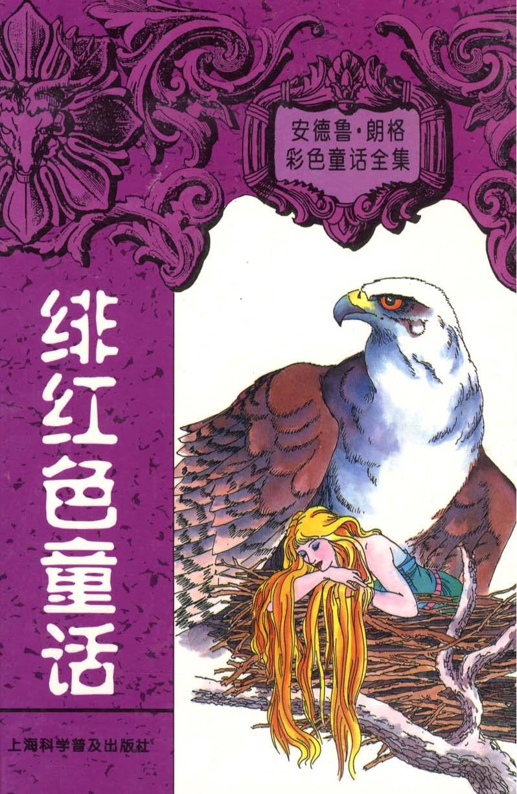

 

**安德鲁·朗格彩色童话全集**

绯红色童话

卓超译

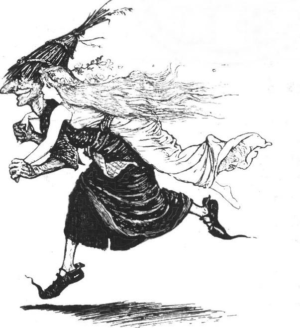

上海科学普及出版社

 

（沪）新登字第 305 号

Edited by Andrew Lang
The Crimson Fairy Book

Published by Longmans, Green, and Co. in 1903

---

安德鲁·朗格彩色童话全集
**绯红色童话**
卓超译

---

责任编辑：钟海谷
技术编辑：万福棠
出版：上海科学普及出版社（上海曹杨路 500 号邮政编码 200063）
发行：新华书店上海发行所
印刷：上海新四印刷厂
开本：850×1168 1/32
印张：9.375
插页：4
字数：226000
版次：1997 年 7 月第 1 版 1997 年 7 月第 1 次印刷
印数：1-8000
书号：ISBN 7-5427-1196-2/G·342
定价：14.00 元

---

（本版图书凡印刷、装订错误可及时向承印厂调换）

 

| 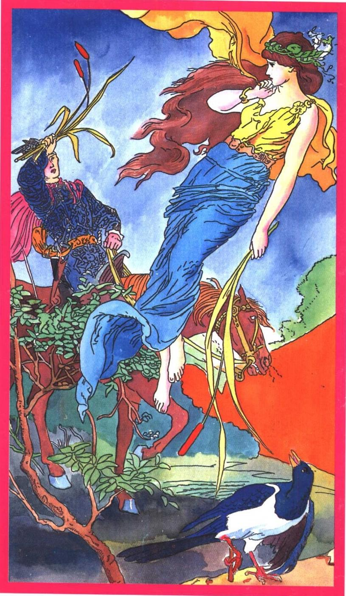 |
| :------------------------------: |
|         《可爱的伊洛凯》         |

 

| 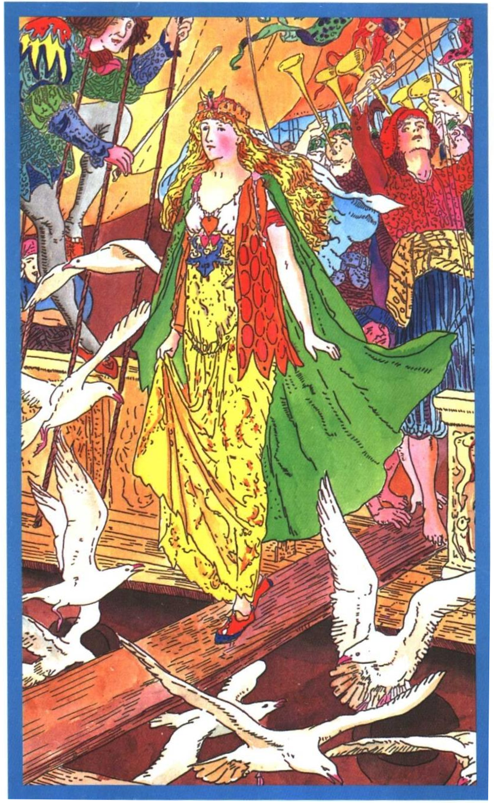 |
| :------------------------------: |
|        《七个西门的故事》        |

 

| 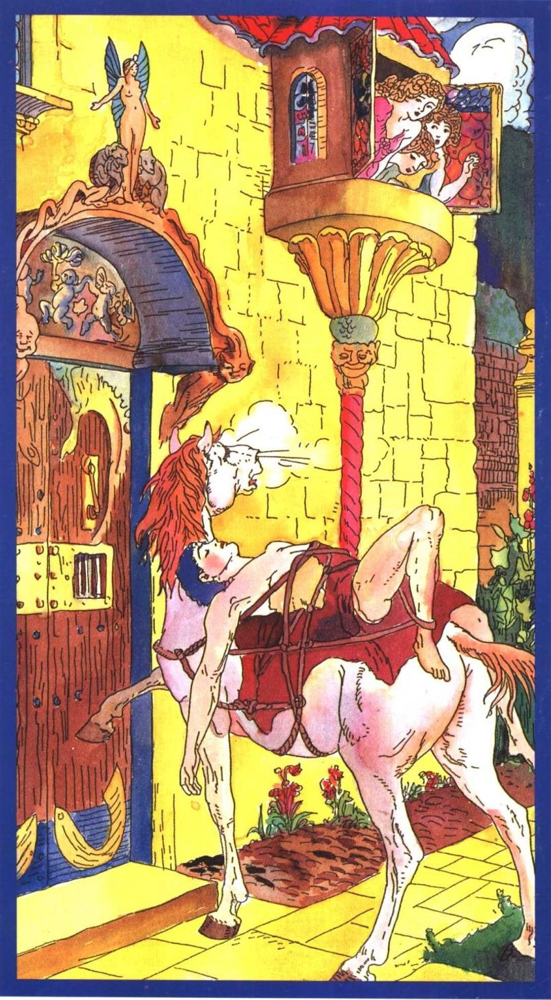 |
| :------------------------------: |
|           《佩珀勒罗》           |

 

| 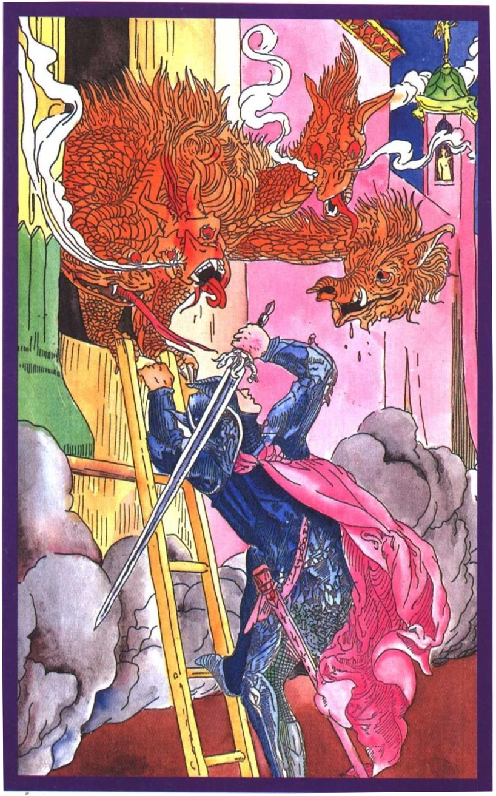 |
| :------------------------------: |
|        《寻找永生的王子》        |

 

| 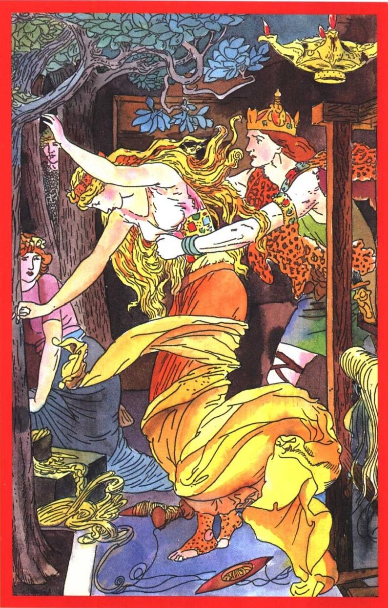 |
| :------------------------------: |
|           《三件长袍》           |

 

| 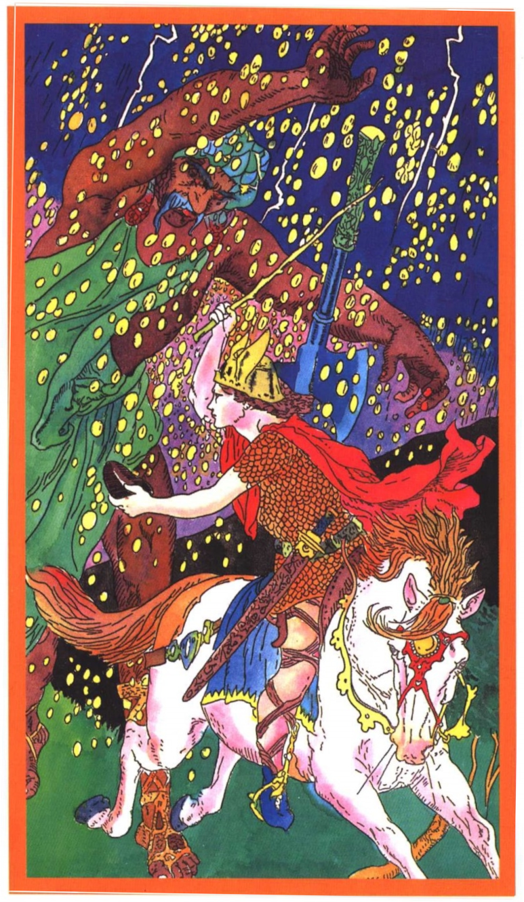 |
| :------------------------------: |
|            《马和剑》            |

 

| 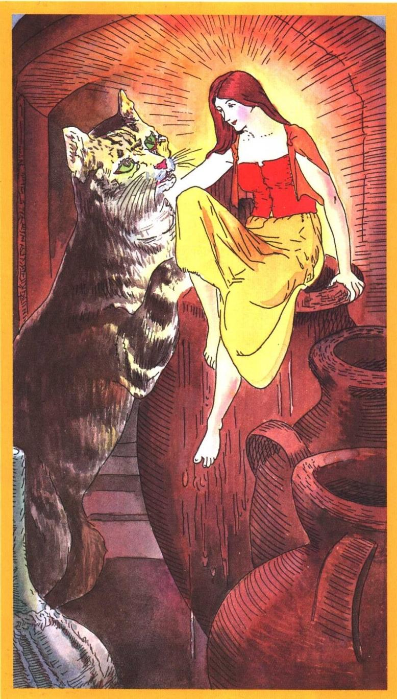 |
| :------------------------------: |
|          《猫的大家庭》          |

 

| 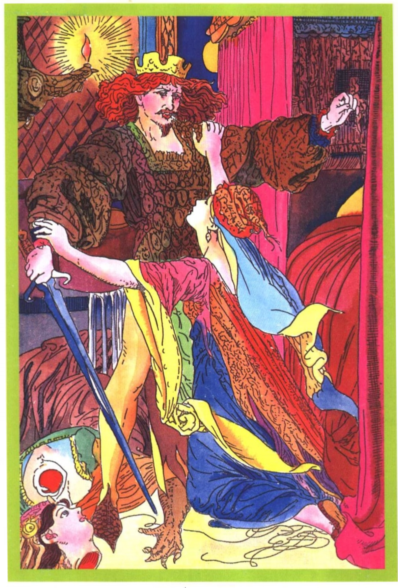 |
| :------------------------------: |
|         《聪明的玛丽亚》         |

 

## 前言

《安德鲁·朗格彩色童话全集》是英国著名文学家安德鲁·朗格（1844～1912）编辑的十二集童话。为了编辑这些童话，他广泛地收集英国、欧洲以至全世界的童话和民间故事。那些非英语的文字，如法文、德文、葡萄牙文、意大利文、西班牙文、加泰隆语等主要由他的妻子莱奥诺拉·布朗歇翻译和整理成英文。最先编成一集，当时编者的意图也只是编这一集。后来搜集的材料越来越多，才决定继续再编三集。其中的艰难和辛苦是外人所难以想象的，编者因此曾发誓，编成这四集以后，再也不编下去了。

四集童话的出版，效果非同凡响。不仅受到英国读者的欢迎，而且被译成多种文字，受到许多国家读者的欢迎。其受欢迎的程度赢得了一代又一代的读者，历数十年而不衰，这不仅源自编者长期的努力，也得益于世界各地广大热衷于这一题材的读者的帮助，他们纷纷把手头的作品和资料寄给安德鲁·朗格。这给了他极大的鼓舞，他一鼓作气，又编了八集。后面几集主要搜集了苏格兰、爱尔兰、加拿大、印度、葡萄牙、斯堪的纳维亚的民间故事和传说。有些则选自以神话、民间传说和英雄传奇为基础的中世纪威尔士故事集《马比诺吉昂》。

安德鲁·朗格认为，这些童话故事很难说是某个人写成的，它们从很久很久以前就流传下来，经过民间艺人和文学家的不断收集和整理，才达到了今天这样思想性和艺术性都比较好的程度。这些童话也被认为是英语、甚至也是全世界各种语言中时间跨度最大、包含地域最广、流传国家和地区最多、内容最丰富的童话集。

她是世界古典童话中的瑰宝，童话世界中永不凋谢的鲜花，被译成多种文字，得以广泛流传，一代又一代的儿童被她的魅力吸引，长大成为家长后，又为能给自己的孩子朗读和讲述安德鲁童话而自豪。

《绯红色童话》收集了匈牙利、俄罗斯、罗马尼亚、芬兰、冰岛、日本、意大利、突尼斯、葡萄牙、马扎尔、塞尔维亚、西西里岛等国家和地区的三十六个童话和民间故事。小读者们读了这些生动有趣的故事以后，可以看到如何才能找到一个真正的朋友；可以看到一个男孩不管受到怎样的诱惑与威胁，都坚守自己的秘密；还可以看到聪明的狐狸是如何帮助一个穷小子变成伯爵的；也可以看到贪婪的银狐最后受到惩罚。这些美丽的童话故事为我们展现了很久以前，这些地区的人民是怎样生活的，展现了他们的欢乐和悲伤，理想和追求；颂扬了勤俭朴素、助人为乐、正直忠诚；谴责了贪得无厌、懦弱无能、奸诈狡猾。

与《安德鲁·朗格彩色童话全集》中的其他各集一样，《绯红色童话》中的故事充满了当地的风土人情和乡村气息，展现了从冰雪覆盖的北极圈到赤日炎炎的非洲大陆的美丽风光。读者们可以从中领略到许多乐趣，懂得什么是正义，什么是邪恶；什么值得爱，什么该去恨；而且还会对这些地区的人文历史和地理概貌有所了解，从而更加热爱生活，热爱我们这个世界。

 

**目录**

[TOC]

 

## 可爱的伊洛凯

从前，有一个王子对他的父王说，他想结婚。

“不！不！”国王说，“你不能这么焦急，要等你建功立业以后再说。从前我父亲也不让我结婚，一直等到我赢得这把你看到的、我佩带着的金宝剑以后才同意。”

王子非常失望，但他决不会妄想违背他的父亲。他开始思考，尽他所能，他能够做些什么？看来，留在家里是不会有什么指望的了，所以有一天，他走出家门，投向外面的世界，去试试自己的运气。路途中，他看到一间小屋，里面有一个老妇人正在烤火。

“晚上好！大妈。看得出，你在这个世界上已经饱经风霜。关于三枝水烛草的事，你能告诉我些什么吗？”

“是的，是这样，我在世上已经活了很久，见多识广，可是既没有看到过，也没有听到过你所说的事情。不过，如果你肯等到明天，也许我能告诉你些什么。”

于是，他等到天亮。老妇人一大早就来了，拿出一支小管子吹起来。不一会，全世界所有的乌鸦都飞来了，一只也不缺。老妇人问它们，有谁知道三枝水烛草的事？可是它们之中谁也说不出。

王子继续他的旅程。走了没有多远，他看到另一间小屋，里面住着一个老人。对于王子提出来的问题，他说什么也不知道。但他请求王子留下来过夜。第二天早晨，他把所有的渡鸦都叫来，但是它们也说不出什么名堂来。

王子和老人告别以后继续向前走。他走得那么远，整整跨越了七个王国。后来在一天傍晚，他来到一间小房子前，里面住着一个老妇人。

“晚上好，亲爱的大妈。”他有礼貌地打招呼。

“晚上好，亲爱的孩子，”老妇人回答，“你开口和我说话真是太幸运了，否则你就会悲惨地死去。你能告诉我要到哪里去吗？”

“我在寻找三枝水烛草，你知道些什么吗？”

“我自己什么也不知道。不过，等到明天，也许我能告诉你。”

第二天早晨，她吹响一支管子，哟！看哪！天底下几乎所有的喜鹊都飞来了，也就是说，除了一只翅膀和一只脚都折断了的那只喜鹊以外，全部喜鹊都来了。老妇人立刻派人去找它来。她问过喜鹊以后，才知道跛脚喜鹊是唯一知道三枝水烛草的。

王子跟着跛脚喜鹊一起走。他们走啊！走啊！走到一堵很高很高的石头墙跟前。

“到了，王子，”喜鹊说，“三枝水烛草就在这堵墙的后面。”

王子抓紧时间，策马越过高墙，四处寻找三枝水烛草，把它们拔起来，接着马上转身回家。在奔跑的途中，一枝水烛草不知碰到了什么，立刻裂开来。奇妙的是，从里面走出一个可爱的姑娘来。她说：“我心中的恋人，你是属于我的，我是属于你的，快给我一杯水。”

可是王子的身边没有水，到哪里去找水来给她呢？于是可爱的姑娘消失了。他好奇地撕开第二枝水烛草试试看，同样的事情又发生了。

这一来，他便小心翼翼地捧着第三枝水烛草。他直到来到一口井旁才把它撕开，从里面跃出一个比前面两个可爱七倍的姑娘。她说：“我心中的恋人，我是属于你的，你是属于我的，快给我一杯水。”

这一回，水已经准备好了，姑娘也不再飞走了。美丽的姑娘伊洛凯和王子发誓永远相亲相爱以后，就一起动身回家。

不久，他们回到了王子的国家。王子希望用一辆漂亮的马车来带未婚妻回家，所以他想自己先进城去赶一辆出来。他们来到城外的井旁时，看到国王的猪倌、牛倌正在井旁喂猪和牛，王子就把伊洛凯留下来，请他们照看，独自进城去了。

不幸的是，猪倌头有个女儿，是个长得很丑的老姑娘。猪倌头乘王子回城的时候，把自己的丑女儿用漂亮的衣服打扮起来，把伊洛凯扔到井里去。

没有多久，王子就带着父亲、母亲，还有一大群朝臣官员来接伊洛凯进城。当他们看到猪倌头那个丑女儿时，都目瞪口呆，说不出话来。可是，除了把她接回家，还有什么办法呢？两天以后，王子和她结了婚，国王也把王位传给了王子。

可是，当了国王的王子心里很不平静！他心中非常清楚，他是被骗了，虽然他还不明白是怎么被骗的。有一次，他想喝一点伊洛凯被扔下去的那口井的水。马车夫去提水，在提上来的水桶中看到有一只可爱的小鸭子在游。他惊奇地看着它。突然，小鸭子不见了，一个看上去很脏的女孩子站在他身边。女孩子跟着他回到王宫，想办法在王宫里找到一份女仆的活干。

当然，她整天都得忙忙碌碌，但是只要有一点空，她就会坐下来纺纱。她的手工纺纱杆、纺锤会自动转动，纺好的纱会自动卷起来。不管她干多久，纺纱机上总是不停地有纱纺出来。

王后，也就是那个猪倌头的女儿听说了这种事，非常想看一看这神奇的纺纱杆，可是女孩子一口就拒绝了，不肯给她看。后来，女孩子同意了，但有个条件，那就是让她在国王的房间里睡一个晚上。王后非常生气，狠狠地把她骂了一顿；但是，王后那么想看纺纱杆，终于答应了。在国王吃晚饭的时候，王后给他吃了安眠药。

女孩来到国王的房间，看上去比平时还要可爱七倍。她弯下腰来对睡着的人说：“我心中的恋人，我是属于你的，你是属于我的，和我说句话，我是你的伊洛凯。”可是国王睡得那么熟，他既没听见，也不说话。伊洛凯悲伤地离开了房间，伤心地以为，他是因为羞愧才不要她了。

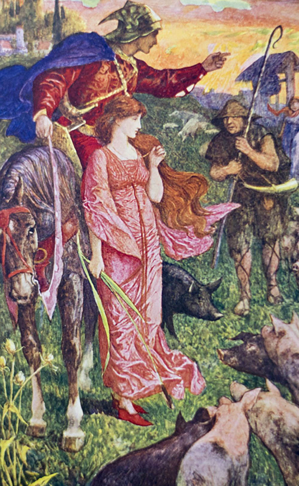

不久，王后派人来说，她想买下纺纱杆。女孩子表示同意，但提出了同样的条件。可是这一次，王后还是没有忘记给国王吃安眠药。伊洛凯再次来到国王的房间，尽量温柔甜蜜地和他说话，可还是得不到回答。

这时候，由于王后一连两个晚上都给国王服用安眠药，国王的一些仆人开始有些怀疑，并提醒国王不要吃喝王后送来的任何东西。王后也吃不准她的所作所为是否已经被发现。

几天以后，王后又想要女孩子的纺锤，并答应满足她提出的同样条件，王后感到一点也用不着担心什么了。

这天晚上用晚餐的时候，王后叫人送来许多好吃的，好喝的。可是国王说他不饿，早早地就上床睡觉了。

王后非常后悔同意了女孩子的条件，可这时要收回许诺也太晚了，因为伊洛凯已经进入国王的房间。国王这时正躺在床上，忧心忡忡地好像在等待着什么，但又说不上。突然间，一个可爱的姑娘走进来，弯下腰来对他说：“我最亲爱的恋人，我是属于你的，你是属于我的，和我说话吧！因为我是你的伊洛凯。”

这些话使国王的心激烈地跳动起来，他从床上一跃而起，拥抱她，吻她。她告诉国王在井边和他分手以后的全部险遇。国王知道了他如何受骗和伊洛凯所蒙受的苦难以后，发誓要报仇。他命令把猪倌、他的妻子，还有他们的女儿全部吊死，这也就是他们的下场。

第二天，国王兴高采烈地和可爱的伊洛凯结了婚，如果他们还没有去世，那么他们今天还活着。

（匈牙利）

 

## 吉祥的洛克

从前有一个国王，他只有一个儿子。儿子长到十八岁的时候，国王不得不亲自率领军队去和邻国打仗。他吩咐儿子在他不在的时候负责管理国家，但命令儿子在他回来之前，无论如何不得结婚。

时间一天一天地过去了，王子治理着王国，从没想到结婚。但是，在他过二十五岁生日的时候，他开始想，娶个妻子可能会更好。后来，他的这个想法越来越强烈，恨不得马上就这样做。可是，他想起了父亲说过的话，于是又等了一段时间，直到他父亲出去打仗已经整整十年。这时，王子把他所有的官员都找来，按照隆重的传统习惯开始寻找新娘。他也不知道该往哪里走，到处游逛了大约二十天以后，突然发现来到了父亲的兵营。

见到儿子，国王非常高兴，他们之间有许多问题要问，又有许多问题要回答。可是，当国王知道，王子不是安份守己地在家里等他归来，而是开始出来寻找妻子的时候，非常生气，说：“你愿意到哪里去就到哪里去，可是我的人一个也不许带走。”

只有一个忠实的仆人留下来跟随王子，拒绝和他分开。他们翻越高山，穿过峡谷，来到一个名叫金城的地方。金城的国王有一个漂亮的女儿。王子很快就听说了她的美丽，不禁心驰神往，恨不能马上就见到她。

国王友好地接待他，因为王子风度翩翩，十分英俊。他不失时机地向公主求婚，公主的父母也高兴地同意了。婚礼立刻举行，丰盛的婚宴和欢乐的场面足足持续了一个月。满一个月以后，他们开始动身回家。路程那么遥远，不是一两天可以到达。第一个晚上，他们在一家客栈里住下。

半夜里，所有的人都睡着了，只有那忠诚的仆人还醒着。屋顶上飞来三只乌鸦，他听到它们在说话。

“这是一对漂亮的夫妻，他们今天晚上刚到这里。看来十分可惜，因为他们很快就要活不成了。”

“是这样”，第二只乌鸦说，“因为一到明天中午，金河上的桥就要断裂，那时他们正好从桥上经过。但是注意，谁要是听到我们说的这些话并把它说出去，他膝盖以下的腿就会变成石头。”

乌鸦刚说完话就马上飞走了，紧接着又飞来三只鸽子。

“即使他们安全地通过那座桥，也活不了。”它们说，“因为国王会派一辆像画一样漂亮的新马车来接他们。等他们在马车上坐稳以后，会刮起一阵狂风，把马车卷起，吹向天空，然后突然从天上掉下来撞在地上。这样他们就会被撞死。谁要是听到我们说的这些话并把它说出去，那么他腰部以下的身体就会变成石头。”

说完这些话，鸽子就飞走了。三只鹰取代了它们的位置，下面是它们的谈话：

“假如这对年轻的夫妻真能设法逃脱桥和马车的危险，那么国王就会送给他们一人一件华丽的绣金大衣。等他们穿上的时候，立刻就会把他们烧成灰烬。谁听到并重复我们这些话就会从头到脚变成石头。”

第二天一早，这些赶路人起来吃早饭，开始诉说着各自晚上做的梦。最后仆人说：

“仁慈的王子，我的梦是这样的：如果殿下您能答应我所有的请求，我们就能平安无事地回家；如果您不肯，我们就要倒霉。我的梦从来没有欺骗过我，所以，我恳求您在剩下的旅程中听从我的劝告。”

“不要因为一个梦这样大惊小怪。”王子说，“梦就像天上的浮云。不过，为了免除你的烦恼，我答应照你所希望的去做。”

就这样，他们又开始新的旅程。

中午的时候，他们来到金河旁。他们正准备上桥，仆人说：“我的王子，让我们把马车留下来，走一段。这里离城不远，在那里很容易找到另一辆马车。这辆马车的轮子坏了，支持不了多久。”

王子仔细地查看了马车，觉得马车并不像仆人说的那样不安全。但是他已经答应过他，于是信守自己的诺言。

他们从马车上下来，把行李装在马背上。王子和他的新娘步行过桥。仆人说，他要骑着马涉水过河，以便让马洗一洗，喝点水。

他们平安地到达彼岸，从离岸不远的城里买来一辆新马车，又继续向前走。还没有走多远，就遇上国王派来送信的人。他对王子说：“尊敬的陛下给殿下送来这辆漂亮的马车，坐上它你们就能体面地进入自己的国家，看到自己的百姓了。”

王子高兴得说不出话来。可是仆人说：“我的王子，先让我检查一下这辆马车。如果没有问题再上去，否则的话，我们还是坐自己的马车吧。”

王子不表示反对。仆人在彻底察看了马车以后说：“这辆马车是很时髦，但是也很糟糕。”说着把它打得粉碎。他们还是坐着新买来的马车赶路。

他们终于来到了自己国家的边界。国王派来的传令兵已经在那里等候。他说，国王给王子和他的新娘送来了两件华丽的大衣，请他们穿上以后体面地进入王国。可是仆人请求王子不要去穿它们，而且缠住王子不放，一定要他答应把这两件大衣撕了才肯罢休。

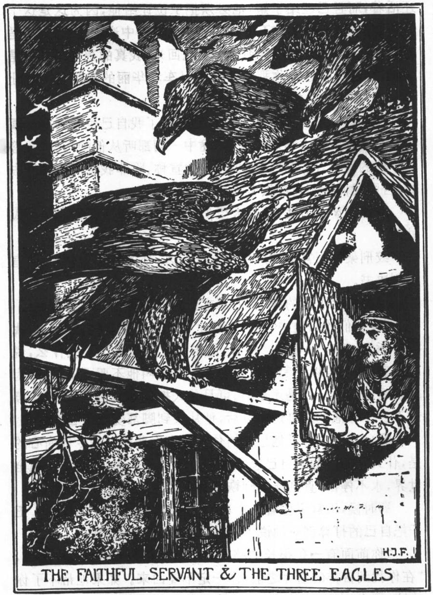

老国王看到他所有的计谋都失败以后，非常愤怒。他的儿子还活着，而且已经结了婚，他必须把王位让给他，因为这是这个国家的法律。他想知道王子是如何从死神手中逃脱出来的，于是就问：“我亲爱的儿子，看到你平安地回来，我真的很高兴。可是我难以想象，我送给你那么漂亮的马车和华丽的衣服也不能让你满意，你为什么把它们都毁了？”

“说真的，父王，”王子说，“把它们毁了我自己也感到非常烦恼。可是我的仆人请求说，在路途中一切都听从他的指导，我答应了他的请求，同意他这样去做。他宣称，除非我按照他说的去做，否则我们就不可能安全地回家。”

老国王怒火万丈，他把大臣们召集起来，宣布要把这个仆人处死。

绞刑架在王宫前的广场上竖立起来，仆人被带出来，向他宣读判决书。

绞绳套上了他的脖子，他请求让他最后再说几句话。

“在我们的归途中，第一个晚上我们在一家客栈里度过。我没有睡觉，整夜看守着。”接着，他告诉大家乌鸦说了些什么，说着说着，他膝盖以下都变成了石头。王子叫他不要再说了，因为他已经证明了自己是无辜的。可是仆人把他的话当耳边风，继续说下去。等他把故事讲完以后，他从头到脚都变成了石头。

啊！王子失去了他忠诚的仆人是多么悲伤。最令他痛心的是，仆人正是因为对自己忠心耿耿才失去了生命。他决心走遍全世界，永不停留，直到能找到恢复仆人生命的方法。

那时候，王宫里住着一个老妇人，她以前是王子的保姆。王子把自己的打算都对她说了，并且把妻子托给她照顾。

“你前面有一条很长的路要走，我的孩子。”老妇人对他说，“在你找到吉祥的洛克之前，你一定不要回来。如果他帮不了你的忙，那么，在这个世界上就没有人能帮你的忙了。”

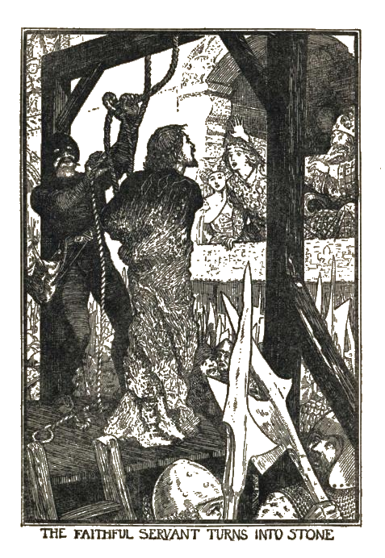

于是王子出发了，他要想尽办法找到吉祥的洛克。他不停地走啊，走啊，直到远离自己的国家。他在一片森林里转了三天，没有看到过任何活着的动物。第三天晚上，他来到一条河边，附近有一家大磨坊，他就在磨坊里过夜。第四天早晨他准备离开的时候，磨坊主问他：“仁慈的王子，您独自一人要到哪里去？”

王子把事情的经过对他说了。

“那么，我请求您，尊敬的殿下，向吉祥的洛克问一个问题：为什么我有很好的磨坊，很好的设备，又有许多粮食要磨，可我还是那么穷，过了今天难保明天？”

王子答应替他去问就走了。

王子又走了三天。到了第三天傍晚，他看到一座小镇。等走到小镇时天已经很黑了，看不到一丝亮光。他几乎是摸黑穿过小镇，找不到一间房子可以过夜。王子一直走到了小镇的尽头时，才看到一扇窗口透出灯光，就向它走过去。他径直进入屋子，看到三个姑娘正在玩牌。王子请求在这里住一个晚上。她们领他进去，让他吃了晚饭，为他准备好一间卧室，他晚上就睡在这里面。

第二天早晨准备离开时，她们问他要到哪里去。王子就把自己的故事对她们说了。

“仁慈的王子，”姑娘们说，“请问一下吉祥的洛克，我们都已经过了三十岁了，尽管我们那么漂亮，那么善良，那么勤劳，可是为什么还没有人来向我们求婚？”

王子答应替她们去问就走了。

王子走进一片大森林。他在森林里从早上走到晚上，又从晚上走到早上，才走到森林的尽头。他看到一条可爱的河流从森林边缘流过。这条河和其他的河流不同，它可以站着不动地和人说话。它问王子：“尊敬的王子，请告诉我，是什么原因把您带到这荒山野林里来的？我肯定已经在这里流淌了一百多年，可还没有看到有人来过。”

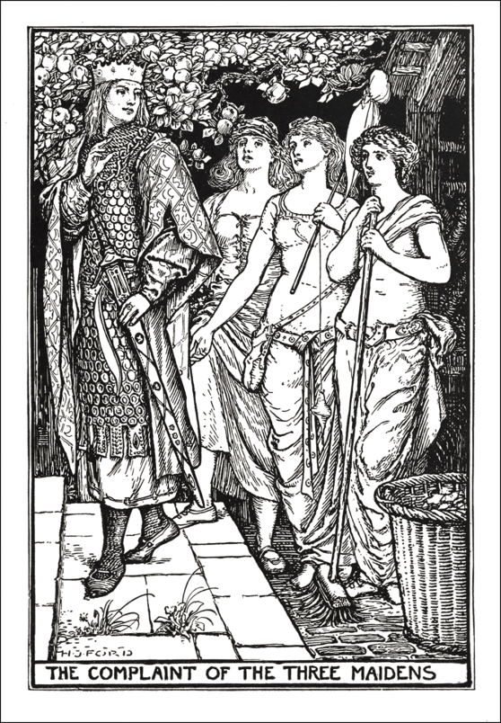

王子回答：“只要你让出一条路来，让我走过去，我就告诉你。”

河水立刻分开，王子从河床上走过去，连脚也没有弄湿。到了河对岸，他即遵守自己的承诺，把事情的经过对河说了。

“啊！请别忘了问一问吉祥的洛克，”河喊道，“我的河水那么清澈，那么流畅，可水里为什么没有任何生命，甚至连一条鱼也没有？”

王子说他会去问的，说完继续赶路。

王子走出森林以后，又穿过一条美丽的峡谷，看到一间用灯芯草做屋顶的小房子。他走得非常累了，就进去休息。

屋子里的东西都非常整洁，布置得有条不紊。火炉旁坐着一个心情愉快，看上去很诚实正直的老妇人。

“早上好！大妈。”王子说。

“祝你走运，我的孩子。是什么风把你吹到这里来了？”

“我在寻找吉祥的洛克。”王子回答。

“看来你是找对地方了，我的孩子，我就是他的母亲。这会儿他不在家，正在葡萄园里干活。你也去吧！这里有两把铲子。你找到他的时候就开始挖土，但不要和他说一个字。现在是十一点钟。等他坐下来吃午饭的时候，你就坐在他旁边，和他一起吃。吃完午饭，他会问你，那时你就可以放心地把自己的一切烦恼告诉他，他会回答你提出来的任何问题。”

说完，老妇人给他指了指路。王子完全按照她所说的去做。午饭以后，他们躺下来休息。

这时，吉祥的洛克突然开口说话了：“告诉我，你是个什么样的人？到这里来以后，你一句话也没有说过。”

“我不是哑巴。”王子回答，“我是个不幸的王子，我忠实的仆人变成了石头，我想知道怎样才能救活他。”

“你做得很对，因为他值得得到这一切。回去吧！等你回到家的时候，你妻子刚生下一个小男孩。从小男孩的小手指上取出三滴血，把这三滴血擦在仆人的手腕上，他就会活过来。”

“我还有个问题要问你，”王子谢过他以后说，“森林附近有一条美丽的河，可是河水里没有任何生命，甚至连一条鱼也没有，这是为什么？”

“因为这条河里还没有淹死过人。可是要小心，过了河后，尽可能离它远些再告诉它，否则你就有可能成为第一个牺牲者。”

“在我离开之前，请再回答我一个问题。在到这里来的路上，我在一座屋子里住宿，里面有三个姑娘，都很漂亮能干，仪表端庄，可是却没有人来求婚，这是为什么？”

“因为她们总是当着太阳的面把垃圾扔出去。”

“还有磨坊主，他有一个大磨坊，所有的设备都很好，生意一直不断，可为什么他还是那么穷，过了今天不知道明天？”

“因为他把所有的东西都留给自己，从不给那些需要的人。”

王子把所有这些问题的答案都记在心里，友好地和吉祥的洛克告别以后，动身回家。

他来到河边，河问是否给它带来好消息。王子说：“等我到了对岸以后就告诉你。”于是河水分成两半，他走过去，登上岸边最高的一块岩石，然后停下来大声地说：

“听着！河！吉祥的洛克说，你的水里永远也不会有生命，除非有人在你的河里淹死。”

话还没有从嘴里说完，只见河水突然猛涨起来，一直冲到岩石旁，浪头冲着他直扑过来，幸好他抓得很紧，才没有被卷走。三个浪头冲过以后，河水看到毫无办法，只好退回原处。王子从岩石上爬下来，在阳光下晒干衣服后，又向家乡的方向走去。

王子回到小镇，对三个姐妹说，不要当着太阳的面扔垃圾。他又在磨坊里过了一夜，把问题的答案对磨坊主说了。

王子刚到家，就有几个贼偷了一匹好马，想涉过那条河。刚走到河中央，河水便猛涨起来，一下子就把他们全部吞没。从此，这条河就成了乡间游鱼最多的河。

那三姐妹从此以后也不再当面侮辱太阳，不到一个星期，就都有了心上人。

磨坊主开始救济穷人，成了一个大好人。不久，他变得非常富有，自己也说不清拥有多少财富。

王子回到家里，看到妻子刚生下一个漂亮的小男孩。他不失时机地刺破婴儿的手指，直到血流出来。他把血擦在石头人的手腕上，石头人浑身战栗起来，发出好像东西爆裂开来的响声，接着，那个活龙活现的忠诚仆人出现在他们面前。

老国王看到这一切，气得暴跳如雷，发疯似地瞪着周围的人，猛扑在地上死了。

仆人留在主人——新国王的身边，忠心耿耿地为他效忠，假如他们都还活着，他还在伺候国王。

（匈牙利）

 

## 毛人

我已经不记得是在什么地方，住着一个国王。他有两块非常出名的油菜地。可是每天晚上，总有一块地上的两堆油菜被烧掉。国王非常生气，他派出士兵，要去抓住这个放火烧油菜的人。可是没有用，他们连个鬼影子也看不见。于是，国王吩咐，谁要是能抓住这个恶作剧的人，就赏给他九百块克朗。同时还命令，谁要是不好好看守油菜地，就处死他。可是，尽管国王有的是卫兵，却还是没有能保护好油菜地。

国王已经处死了九十九个人，这时来了一个小猪倌，他带着两只狗，一只叫“佩斯”，一只叫“虎斯”。小孩对国王说，他愿意去看守油菜地。

天黑了，他爬上第四堆油菜顶，从这里可以看到整个油菜地。大约在晚上十一点钟时，他好像看见有人向一堆油菜走过去，还企图把它点着火。

“你等着吧！”小孩一边想着一边大声地喊他的狗：“嗨！佩斯！虎斯！抓住他！”其实，两只狗还没有等到他下命令就扑出去了。五分钟以后，那个人被抓住了。

第二天，他被带到国王的面前。国王非常高兴，一下子就赏给小孩一千块克朗。犯人浑身长满了毛，像是个动物。他长得那么奇怪，谁都会好奇地想看一看。国王把他锁在一间牢固的房间里，派人送信去邀请邻国的国王和王子来看这个怪人。

国王有个十岁的小男孩，他也来看毛人。毛人苦苦地哀求小王子可怜可怜他，把他放出去，小王子动了恻隐之心。他从母亲那里偷来房间的钥匙，把门打开，然后把钥匙放回去。毛人逃了出去，重返自由世界。

这时，邻国的国王和王子都接二连三地来了，他们迫不及待地想看看毛人，可是毛人逃走了。国王又气，又恼，几乎要发疯了。他严厉地责问妻子，并说，如果不把毛人找回来，就把她关到草屋里去活活地烧死。王后说这件事和她毫不相干。是儿子把钥匙拿走了，她可是一点也不知道。

他们把小王子找来，问他各种问题。后来他承认，是他把毛人放走了。国王命令仆人把他带到森林里去，在那里把他杀了，把他的肝和肺带回来。

国王的命令传开以后，王宫里一片悲哀，因为王子很讨人喜欢。可是，已经没有办法改变国王的命令。他们把小孩带进森林。不过，执行命令的人很同情王子，就把一条狗杀了，把它的肝和肺带回去给国王。国王满意了，也不再提起这件事。

王子在森林里到处流浪，尽可能地想办法过日子，就这样过了五年。有一天，他看到一间破旧的小屋子，里面有一个上了年纪的人。他们聊起天来，王子把自己的事和不幸的命运告诉他，于是他们互相认出来了。那老人不是别人，正是王子让他获得自由的毛人，从那以后，他一直住在森林里。

王子留下来住了两年[^1]，过后他想继续向前走。老人竭力地请求他留下来，可是他不肯。于是，他的毛人朋友送给他一个金苹果，里面藏着一匹长着金鬃毛的马，还有一根金棒，用来指挥这匹马；还送给他一个银苹果，里面藏着一支最神气的轻骑兵队伍和一根银色指挥棒；还送给他一个铜苹果，里面藏着数不清的步兵，他想要多少就有多少，还有一根铜指挥棒。老人要王子庄严地宣誓，尽最大的努力来照管好这些礼物，然后就让他走了。

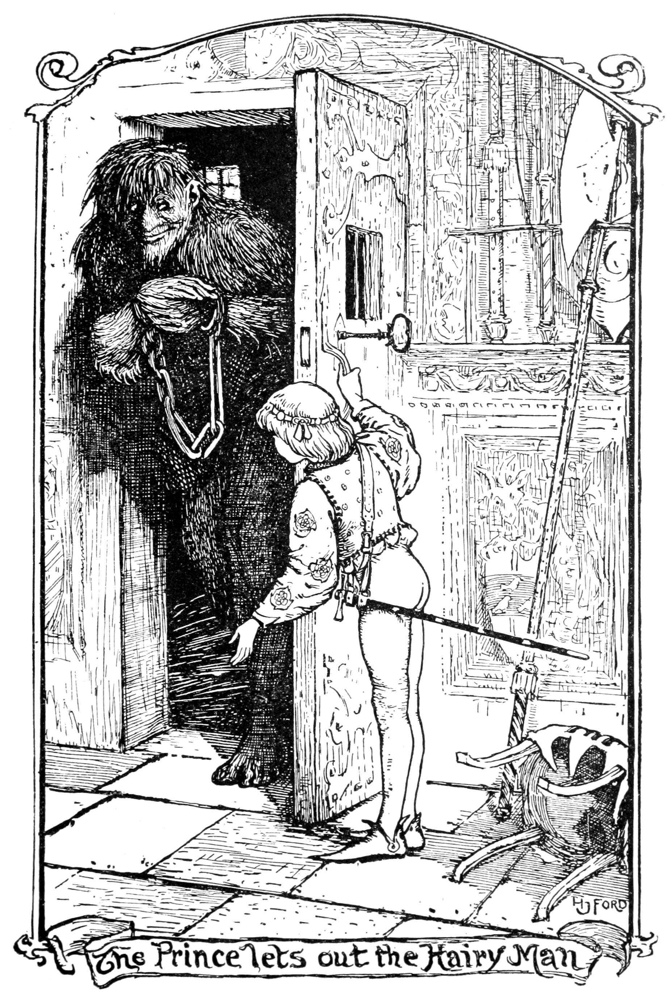

王子不停地向前走，来到一座大城市。他留下来给国王当差。因为没有人来找他的麻烦，所以他平静地过着日子。

有一天，传来了国王必须出去打仗的消息。国王怕得要死，他的军队人数少得可怜，尽管如此，他还是得出去应战。

等他们都出发以后，王子对内务主管说：“请允许我到附近的村庄去一下，我在那里欠了一笔小债，我得去还清。”既然王宫里没有什么事好干，主管就让他去了。

走出城以后，他拿出金苹果，里面跳出一匹马来，他飞身上马，又拿出银苹果和铜苹果来，呵！好威风的一支军队，带着这支军队，他加入了国王的队伍。

国王看到这支军队开过来，心里非常害怕，他不知道这支军队是不是敌人的。王子骑着马来到国王面前，对他鞠了一躬说：“我给陛下增援来了。”

国王兴高采烈，怯敌之心顿时烟消云散。国王的公主们也随军出战，她们对王子也非常友好，还邀请他到她们坐的马车里来说话。不过，王子谢绝了，还是骑在马背上。谁知道呢？也许战斗马上就要开始。他们边走边说话的时候，小公主，也是最可爱的公主，脱下手上的戒指送给他。她的姐姐把自己的手帕撕成两半，把半块送给他。

忽然间，敌人出现了。国王问王子，是他的军队还是王子的军队先冲上去。说时迟，那时快，王子的军队已经打了头阵。他和他的轻骑兵打得那么英勇，敌人只留下两个活命的，正好回去送信。

打了这么漂亮的胜仗，国王和他的女儿都高兴极了。他们请求王子跟他们一起回去，可是他不愿意，带着轻骑兵飞驰而去。

快到城里的时候，他把士兵和骏马都小心地收进苹果，然后溜回城去。进了王宫，他挨了主管的一顿好骂，因为他去得太久了。

说到这里，事情理应结束了。可是后来小公主爱上了王子，王子也爱上了她。因为他没有宝石，只好把铜苹果和指挥棒送给她。

有一天，公主和她们的父亲聊天的时候，小公主问国王，会不会是这个仆人在打仗的时候帮了他的大忙。国王听了很生气。为了满足她的好奇心，他命令去搜查这个仆人的房间。就在房间里，他们吃惊地找到了公主的金戒指和半块手帕。他们把这些东西送给国王以后，国王马上派人去把王子找来，问他是不是援救过他们的人。

“是的，尊敬的陛下，是我。”王子回答。

“但你的军队是从哪里来的？”

“如果您想看，那么请到城外去，我给你们看。”

他们来到城外，王子先从小公主那里要回铜苹果。等所有士兵都从苹果里走出来以后，他们几乎连立足之地都没有。

为了报答他的支援，国王答应把小公主和王位给他。当国王知道他也是一个王子的时候，他高兴得无法形容。王子把军队小心地收进苹果，然后回到城里。

不久，他们举行了盛大的婚礼。也许他们直到今天还活着，谁知道呢？

 

## 祝您健康

很久很久以前有一个国王，他的权势那么大，每打一个喷嚏，全国人民都得说：“祝您健康！”可是有一个长着大眼睛的牧羊人却从来不说这句话。

国王听到这个消息，非常生气，派人把牧羊人叫到面前来。“立刻就说：‘祝我健康！’”国王喊道。

“祝我健康！”牧羊人回答。

“是我，是祝我，你这个恶棍，流氓！”国王大发雷霆。

“是我，是祝我，尊敬的陛下。”牧羊人这样回答。

“可是，是我，是我本人。”国王吼叫着，气得直捶胸。

“好的，当然是我，是我本人。”牧羊人说，轻轻地拍打着自己的胸膛。

国王气得难以控制自己，一时不知道该怎么办才好。这时，宫廷大臣插进来小声地对牧羊人说：

“马上就说，立刻就这样说：‘祝您健康，尊敬的陛下！’你要是不说，就得死！”

“不！我不说！除非把公主嫁给我。”牧羊人回答。

这时候，公主正坐在国王的旁边，像一只金鸽子那么甜美、可爱。听到牧羊人说的话，忍不住笑出声来。不可否认，这个长着大眼睛的年轻牧羊人很讨她喜欢。说实在的，与许多王子比起来，她更喜欢他。

国王可不像他女儿那样高兴。他命令把牧羊人扔到关着白熊的笼子里去。

士兵把牧羊人带到白熊的笼子前，把他推进去。门还没有关上，白熊就向他冲过来。它已经两天没有吃过东西了，正饿得慌。可是，当它看到牧羊人的大眼睛时，非常害怕，看样子情愿把自己吃掉也不敢上来。它看着牧羊人，退缩到角落里去，尽管饿得吮着自己的爪子，也不敢去碰牧羊人。牧羊人知道，只要他把眼光从这头野兽的身上移开，他就必死无疑。为了不让自己睡着，他一边编歌，一边唱，一个晚上就这样过去了。

第二天早晨，大臣准备来看牧羊人的骨头。他惊讶地看到，牧羊人还好好地活着。大臣把他领到国王面前，国王顿时怒火万丈，说：“好了！你已经知道死亡是什么滋味，现在你还说不说，‘祝您健康’？”

可是牧羊人回答：“死十次我也不怕，除非你把公主嫁给我，我才说。”

“那么，去死吧！”国王喊道，命令把他扔到野猪的窝里去。那些野猪已经一个星期没有吃东西了，看到牧羊人进来，它们立刻冲过来，恨不得把他撕成碎片。牧羊人从衣服袖子里抽出一支小笛子来，开始吹奏好听的曲子。起初，野猪像害羞似地缩了回去；后来，都用两条后腿站立起来，开始快活地跳舞。看上去那么可笑，牧羊人几乎要笑出声来。可是他不敢停下来，他心里非常明白，只要他停止吹奏，野猪就会扑上来把他撕得粉碎。在这里，他的眼睛帮不了他的忙，他不可能同时瞪着十只野猪的脸。所以，他不停地吹着，那些野猪跳得很慢，像是在跳小步舞曲。然后，他慢慢地把乐曲的节奏加快，直到野猪难以跟着节奏快速扭动和转身，最后都跌倒在地，堆成一团，疲倦得停止了呼吸。

这时，牧羊人终于大胆地放声大笑起来。他笑得那么响亮，那么长久，等到第二天早晨朝廷大臣准备来看他的骨头的时候，还看到他笑得泪水从脸颊上滚下来。

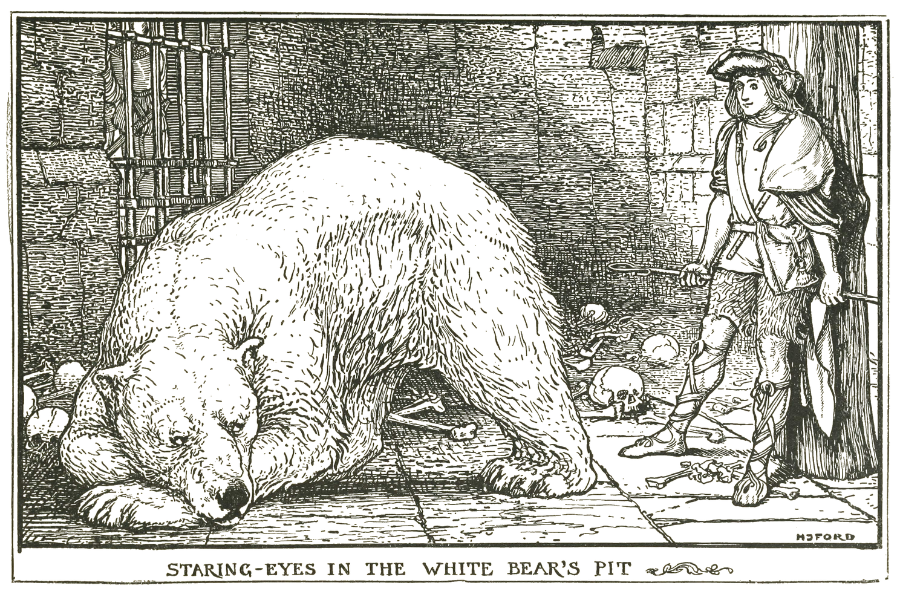

国王一起床穿好衣服，牧羊人就被带到他面前。看到牧羊人没有被野猪撕成碎片，他比以往更加生气，说：“好了！你现在已经尝到差一点死去十次的滋味，快说，‘祝您健康！’”

可是牧羊人打断他的话说：“我死一百次也不怕，假如我能娶公主做妻子，我就说。”

“那么，去死一百次吧！”国王咆哮着。他命令把牧羊人扔到插满长柄大镰刀的井里去。

士兵把他带进黑暗的地牢里。地牢里有一口很深很深的井，周围都插满了锋利的大镰刀。井底有一点亮光，通过这点亮光，可以看出扔到井里的人是否掉到井底了。

牧羊人一被带进地牢，就请求士兵让他一个人呆一会，让他看一看那口井，也许他会改变主意，对国王说“祝您健康”。士兵同意了他的请求。他在井旁插上一根棍子，用他的大衣把棍子裹起来，把帽子戴在顶上，还把背包塞进大衣，看上去像是一个人站着。等这些事做好以后，他大声地叫来士兵，说考虑再三，他还是决心不说国王想叫他说的话。士兵走过去，抱起大衣，连同棍子、帽子、背包一起扔到井里，看着它们把井底的一点亮光盖住，心里想，这一回可真是他的结局了。可这时牧羊人正站在黑暗的角落里暗自好笑。

第二天一大早，大臣手里提着一盏灯走进来，看到牧羊人活得好好的，差一点朝后跌一跤。他把牧羊人带来见国王。国王怒不可遏，喊道：“好了！你差一点就死一百次，你说不说‘祝您健康’？”

可牧羊人的回答还是一样：

“我不说，除非公主做我的妻子。”

“也许要价用不着这么高你也肯说。”国王看到没有办法治他，这样说。他命令王宫的马车准备好，然后和牧羊人一起走进去，叫他坐在旁边，让车夫把马车赶到银森林里去。来到银森林以后，国王说：“你看到这些银森林了吗？好了，只要你说，‘祝您健康！’我就把这片银森林送给你。”

牧羊人心里一会儿热，一会儿冷，但最后还是坚持说：

“公主不嫁给我，我就不说。”

国王非常烦恼，他叫马车继续往前赶，直到看见一座金碧辉煌的城堡，全是用黄金筑成的。

国王说：“你看见这座金城堡吗？好了，我要把那片银森林，连同这座金城堡一起送给你，只要你肯对我说一句话，‘祝您健康！’”

牧羊人目瞪口呆，眼花缭乱，有点疑惑不定，但最后还是说：“不！公主不嫁给我，我就不说。”

这一回国王充满了悲伤，他命令把马车赶到钻石湖边去，他想再试一试。

“看到这个钻石湖吗？这个也给你。银森林、金城堡，还有钻石湖全部给你。只要你说一句，‘祝您健康！’，所有这一切，都属于你。”

牧羊人紧紧地闭上大眼睛，免得被这些灿烂辉煌的钻石迷住，坚持说：“不！不！等我娶了公主以后再说。”

国王看到他的一切努力都失败了，看来只好他自己做出让步了，所以他说：“好吧！好吧！对我来说都一样，我答应把女儿嫁给你，但是到了那个时候，你要真心实意地对我说，‘祝你健康！’”

“当然，我会说的，为什么不说？那时候我完全有理由说这句话。”

国王那高兴劲儿谁也想象不出，他宣布，全国将举国欢庆，因为公主要结婚了。想到公主拒绝了那么多王室的求婚者，最后爱上了大眼睛的牧羊人，人人都兴高采烈。

这是谁也没有看见过的盛大婚礼，大家又吃，又喝，又跳舞。连那些体弱多病的人也受到宴请，刚出生的小孩也收到礼物。

当然，最欢乐的地方是在王宫里。那里有最好的乐队在演奏，烧得最好的菜肴送上来，许多人围着宴席团团而坐，个个眉飞色舞，乐不可支，又说又笑。

按照风俗习惯，新郎用一个大盘子端进来一个烧熟的大猪头，送到国王的面前，好让国王切开，给每人一块。那香味如此浓郁，国王禁不住用力打了个喷嚏。

“祝您非常健康！”牧羊人抢在大家之前说。国王听了十分高兴，也不后悔把女儿嫁给他。

后来，老国王去世了，牧羊人继承了他的王位。他是一个好国王，从不要求他的人民违背自己的意愿祝福他。不过也一样，人人都祝愿他幸福，因为人人都爱他。

（俄罗斯）

 

## 七个西门的故事

在离所有的国家、海洋和河流很远很远的地方，有一座美丽的城市，国王阿奇特就住在城里，他英俊、富有，而且心地善良。他那伟大军队中的每一个人，都随时准备去实现他哪怕是最小的愿望。他拥有四十乘四十座城市。每座城市里，他都有十座宫殿。每座宫殿都有银做的门，金做的屋顶，水晶做的窗。他的议政会由全国十二个最聪明的人组成。他们的胡子一直长到胸前，每个人的学问都像一所大学那么多。议政会对国王说的每句话都是真理。

国王拥有的一切足以使他幸福。可是，他并不满足于这一切，因为他找不到心满意足的新娘。

有一天，他坐在王宫里远眺大海。一只大船驶进港口，几个商人走上岸来。国王自言自语地说：“这些人周游列国，到过许多遥远的地方，我要问问他们，是否看到过哪位公主，像我一样地聪明，一样地漂亮。”

他命令把商人带过来。他们来了以后，他说：“你们到过许多地方，亲眼目睹过许多奇妙的事情。我想问你们一个问题，希望你们如实地回答。”

“你们是否在什么地方，看到或者听到过，哪个国王、皇帝、或者亲王的女儿，像我一样地聪明，一样地漂亮？值得做我的妻子，我们王国的王后？”

商人们考虑了一会。后来，年纪最大的商人说：“我听说过，在一个跨越许多大海的地方，有个名叫布桑的岛屿，岛上有个势力强大的国王。他的女儿，公主海拉娜长得那么动人，决不会比你，尊敬的陛下逊色。而且她是那么聪明，她出的谜语连最聪明的老人也无法解开。”

“这个岛屿很远吗？哪条路可以通向那里？”

“不近，”他们回答，“路上需要十年，我们也不知道怎么去。就是知道了也没有用，公主不是您的新娘。”

“你们怎么敢这样说！”国王生气地喊道。

“尊敬的陛下，请务必原谅我们。但请您仔细想一想，如果您派一个使者到岛上去，他要花十年的时间才能到达，还要花十年的时间才能回来，这样总共是二十年。那时候公主不是已经变老，不再是个漂亮的姑娘了吗？”

国王显得很沮丧。他谢过商人，允许他们在自己的国家里自由买卖，不必付任何税，就打发他们走了。

商人们走了以后，国王继续深沉地思索着。他深感迷茫和忧虑，决定骑马到外面去走一走，散散心。他召来自己的猎人和鹰猎人。猎人们吹响了他们的号角，鹰猎人带上他们的猎鹰。他们跨越平原，直到一堵绿色的围篱墙挡住去路。围篱的那边，是一块一眼望不到边的玉米地。黄色的玉米穗在微风的吹拂下轻轻摇摆，像是微波涟漪的金色海洋。

国王拉住缰绳，欣赏着这块土地。“在我看来，”他说，“耕种这块土地的人一定是个好的劳动者。如果在我的国家里，所有的土地都像这块土地一样地好好耕耘，我的人民就会吃到更多的面包。”他想知道，这块地是属于谁的。

他的部下立刻遵从他的吩咐，四出寻找。他们看到一间整洁漂亮的农舍，有七个农民正坐在门前用午餐，他们吃的是黑麦面包，喝的是水。他们身穿镶着金边的红衬衫，长得那么像，几乎分辨不出谁是谁来。

国王的差使问：“这块金黄色的玉米地是谁的？”七兄弟回答：“是我们的。”

“你们是什么人？”

“我们是国王阿奇特的农民。”

他们把这些话对国王说了。国王命令马上把七兄弟带过来。当问他们是谁的时候，年纪大的哥哥鞠了一躬说：

“阿奇特国王，我们是您的农民，一对父母所生的孩子。我们都叫同一个名字西门。父亲教育我们忠于国王，耕种土地，和邻居友好相处。他还教给我们各人不同的本领，他说以后我们可能用得着。他嘱咐我们不要忘了我们母亲的土地，她会对我们所付出的劳动给予丰厚的报酬。”

国王对这些忠厚的农民很满意，说：“真是好样的，你们耕种自己的土地，干得很好。现在，你们得到了黄金般的好收成。但是，我还想请你们告诉我，你们的父亲都教给你们些什么本领。”

“啊！国王！”第一个西门说，“我的本领可不是轻而易举的事。如果您给我一些工人和材料，我会给您建造一根顶天立地的大柱子，它可以一直插入云霄。”

“很好！”国王说，“那么你呢？第二个西门，你的本领是什么？”

“尊敬的陛下，我的本领不需要很聪明的才智。等我哥哥造成这根柱子以后，我可以爬到顶上去，站在高高的云端，我可以看见太阳底下所有的国家正在发生什么事情。”

“好的！”国王说，“第三个西门呢？”

“我的本领非常简单，陛下，有学问的人帮您设计建造非常高明的各种船只。但如果您愿意，我会给您造一条十分简单的船。只要数一、二、三，船就造好了。我手工制作的简陋小船对一个国王来说，是不够豪华的。可是，其他船航行一年才能到达的地方，我的船只要一天；其他船需要航行十年，我的船只要一个星期就可以到达。”

“好！”国王又说道，“第四个西门学了些什么？”

“啊！国王，我的本领其实并不重要。如果我的哥哥给您造了一条船，让我来驾驶它。如果有敌人来追赶，我可以抓住我们的船头，让它沉到海底。等敌人离开以后，再让它浮出水面。”

“你真是很聪明，”国王回答，“第五个西门会干什么？”

“尊敬的陛下，我的本领就是干些铁匠活。如果您命令我开个铁匠铺，我会给您打一把弩弓。那时候，天上的鹰和森林里的野兽都逃脱不掉。只要眼睛看得见，它都可以射中。”

“这听起来很有用。”国王说，“第六个西门，现在轮到你说说你的本事了。”

“陛下，我的本事简单得难以开口。如果我哥哥射中任何野兽，我可以很快地找到它们，比狗还快。如果它落入很深的水中，我可以从深水中把它捞起；如果它落在黑暗的森林里，即使是在半夜里，我也能找到。”

国王对他们的本领感到非常满意，对六个兄弟说：“谢谢你们，你们是好百姓，你们的父亲教给你们这些本领，做得非常对。现在，跟我一起到城里去，我想看看你们能干些什么。我需要像你们这样的人留在我身边。但等收获的季节到了以后，我会让你们回家，并送给你们王室的礼物。”

兄弟们鞠了一躬，说：“听从国王的旨意。”

国王突然想起来，他还没有问过第七个西门，于是转过身来对他说：“你怎么不说话？你的本领是什么？”

第七个西门回答说：“啊！国王！我没有什么本领，我什么也没有学，我学不会。如果说我真的学会了干些什么，那可能也称不上是什么真正的本领，只能说是一种表演之类的东西。但是，如果尊敬的陛下想看看我的表演，我怀疑是否会让您满意。”

“来吧！来吧！”国王说：“我不会责怪你的，你的本领是什么？”

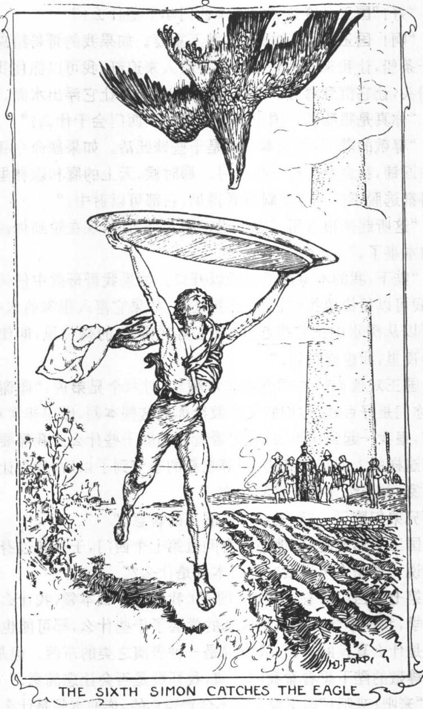

“陛下，首先，您必须以国王的名义说明，在我告诉您以后，不要把我杀掉，然后我就对您说。”

“那么，就这样吧！我以国王的名义同意。”

第七个西门退后几步，清清他的嗓子，说：“国王阿奇特，我的本领属于这一种类型，谁学会了它，在您的王国里，一般来说会失去生命，不会指望能得到宽恕。只有一件事我能做得非常好，那就是偷，同时还能把偷来的东西，不论它是什么，藏得非常好。只要是我想偷的东西，哪怕是在戒备森严，用魔法看守的宝库里，我也能弄到手。”

国王听了以后大发脾气，说：“我不会原谅你，你这个流氓。我要把你关在最深的地牢里，只给你面包和水，直到你忘了这种本事。说真的，最好是马上把你处死，这样做也是出于好意。”

“别杀了我，国王！我真的不像您想象的那么坏。看！假如我愿意，我会抢劫王国的宝库，贿赂您的法官放我走，用剩下的钱建造一座白色的大理石宫殿。我知道偷，可是我并不去偷。是您自己问我有什么本事。假如您杀了我，就违背了您国王的诺言。”

“那好！”国王说，“我不杀你，原谅你，但是从现在起，你将被关在一间黑暗的地牢里。卫兵过来！把他带到监狱里去。你们六个西门跟我来，保证你们在我的王宫里受欢迎！”

就这样，六个西门跟着国王走。第七个西门被卫兵抓起来，锁上镣铐，投进监狱，每天只给他面包和水。

第二天，国王给第一个西门派来木匠、泥瓦匠、铁匠和劳力，还有许多铁、灰泥等材料。第一个西门开始动工。他建造的大柱子高高地插入云霄，像最近的星星那么高。可是，其余的星星比它还要高。

然后，第二个西门爬上柱子，看一看，听一听整个世界都在发生着什么。等他下来的时候，他有许多奇妙的事情可说。一个国王如何向另一个国王开战，而且看来好像是要打胜仗了；某个地方如何在举国欢庆；而某个地方的人民正在因饥饿而死亡。实际上，地球上发生的任何细小事情，都逃不过他的眼睛。

接着，第三个西门开始干活。他伸出双臂，一、二、三，奇妙的船已经造好了。国王做了个手势，船开始下水，在海浪中像只小鸟一样平稳而骄傲地漂浮着。这只船不是用绳子而是用铁索来当索具，音乐师用提琴弓在它们上面奏出美妙的音乐。

船在水上漂荡的时候，第四个西门用他强壮的手抓住船头，一瞬间船不见了，沉到海底去了。一个钟头以后，船又浮上来，是西门用左手把它拉上来的。他的右手抓着一条从深深的海底捉上来的大鱼，准备送上国王的餐桌。

与此同时，第五个西门已经把铁匠铺建好，打出第一块铁来。当国王从码头上回来的时候，神奇的弩弓已经做好。

国王立刻带着他来到空旷的原野上。他抬头向天空望去，只见有一只鹰在很远很远的地方向着太阳飞去，看上去只是一个小点点。

“现在，”国王说，“假如你能射中那只鸟，我就奖励你。”

西门只是微微一笑。他举起弩弓，瞄准，发射，只见那只鹰应声落地。第六个西门看见了，立刻冲出去，还没有等鸟落地就把它抓住，带回来给国王。

“非常感谢，我勇敢的小伙子！”国王说，“我看到了，你们的本领都非常高强，我要重重地赏你们。现在，请你们去休息，吃午饭。”

六个西门向国王鞠躬以后就去吃饭。可是他们刚坐下来准备吃，就来了个传令兵，说国王要见他们。他们立即服从，来到国王面前，看到他的身边有许多大臣和官员。

“听着，我的好朋友。”国王一看到他们就说，“听听我聪明的大臣们想出的办法。第二个西门，既然你能够在大柱子顶上看到整个世界，我要你爬上去看一看，听一听。我听说跨过许多大海，离这里很远的布桑岛上有一个伟大的王国，国王的女儿是美丽的公主海拉娜。”

第二个西门跑出去，很快就爬上了大柱子。他眼观六路，耳听八方，然后下来向国王报告：

“陛下，我遵从您的命令，看到远方的布桑岛。国王是一个强大的君主，但是他骄傲自负、苛刻严厉、残酷无情。他坐在王座上宣称，世界上没有一个王子或国王能配得上他可爱的女儿，他不会把她嫁给任何人，如果哪个国王向她求婚，他就向他宣战，摧毁他的王国。”

“布桑的国王有一支强大的军队吗？”阿奇特国王问，“他的国家是不是离这里很远？”

“根据我精心的估计，”西门说，“天气好的话，您乘船过去大约需要十年的时间；但如果天气恶劣，可能要十二年。我看到军队正在接受检阅。那是一支人数特别众多的军队，大约有十万武装的步兵和十万骑士。此外，他还有一支强大的护卫军和许多弩弓手，这些人加起来，可以说也足有十万。还有一支由精心挑选的英雄组成的部队，他们在需要有极大勇气的特别时刻才出阵。”

国王坐在那里深思了一会，才对站在周围的高官显贵们说：“我决心要娶公主海拉娜，该怎么做才能办到？”

那些贵族、高官和显贵们沉默不语，都尽量地往后缩。这时，第三个西门说：

“请原谅，尊敬的陛下，我想说说我的意见。您想到布桑岛上去吗？再也没有比这更容易的了。乘我的船去，用不着十年，您一个星期就可以到那里。不过，您应该叫您的议政会出出主意，到达目的地以后该做什么？一句话，是用和平的方式呢？还是用战争来赢得公主？”

但是，那些聪明人还是一声不吭。

国王皱起眉头，正要说些什么严厉的话。这时候，宫廷傻瓜挤到前面来说：“我的天，你们这些聪明人怎么都胡涂起来了？事情不是明摆着的吗？既然到那个岛上去花不了多少时间，为什么不派第七个西门去？他会很快地把漂亮的公主偷回来。等到她的父亲、国王知道以后，他会考虑怎样才能把军队带到这里，这需要有十年的时间，少一点也不行！您看我的计划怎么样？”

“我看你的计划怎么样？嗯！你的主意是绝顶聪明的。你应该为此得到奖赏。卫兵，过来！快去把第七个西门带过来，越快越好。”

没有几分钟，第七个西门就被带到国王的面前。国王向他解释了想干些什么，还对他说，为了国王和国家的利益去偷决不是一件坏事；当然，为了个人的利益去偷是非常错误的。

“来吧！”国王说，“老实对我说，你想，你能偷到海拉娜公主吗？”

“我为什么偷不到她？陛下！这件事情太容易了。在我哥哥的船上装上珍贵的毛料、锦缎、波斯毯、珍珠和宝石。让我到船上去，叫四个哥哥陪我去，留下两个哥哥当人质。”

国王听了这些话，心中燃起了希望。他命令一切都照西门的意愿去做。大家都忙碌起来，照他的吩咐去办。没有多久，这条奇妙的船都装满了，准备起航。

五个西门离开国王，登上船去。刚开航不久，就几乎看不见他们的影子了。船像猎鹰从天空划过一样，乘风破浪，急驶而去。一个星期以后就到了布桑岛。海岸上好像有重兵把守。在很远的地方，高塔上的哨兵就高声喊叫：“停下来，抛锚！你们是什么人？从哪里来？到这里来干什么？”

第七个西门站在船上回答：“我们是友好的使者，我们从伟大而善良的阿奇特国王的国家来。我们带来了我国的货物，有珍贵的锦缎、毯子，价值连城的宝石。我们想让你们的国王和公主看一看。我们希望能做些生意，买卖和交换货物。”

兄弟们放下一只小船，带上一些值钱的货物，向岸上划去，来到王宫。公主这时正坐在一间玫瑰红的房间里，看到他们兄弟走近，就叫来她的保姆和其他侍女，告诉她们去打听一下，他们都是些什么人，来这里干什么？

第七个西门回答她们说：“我们来自智慧和善良的阿奇特国王的王国，我们带来各种各样的货物来做买卖。我们相信这个国家的国王会屈尊来欢迎我们，派他的人来照管我们的货物。假如他认为这些东西值得用来装饰他的随从，我们就满足了。”

侍女们把这些话传给了公主，公主命令立刻把他们兄弟带到红房子里来。他们尊敬地向她鞠躬，拿出一些华丽的天鹅绒和锦缎给她看，还打开了装着珍珠和宝石的盒子。这么瑰丽的宝物在这个岛上从未见过。保姆和侍女们都被这些美丽珍贵的物品迷住了，站在那里交头接耳，说从来没有看到过这么漂亮的东西。公主也是惊讶得目不转睛地看着，双手不停地抚摸着这些柔软精美的料子，捧起那些闪闪发光的宝石在阳光下仔细观看。

“最美丽的公主，”西门说，“请愉快地命令您的侍女收下这些丝绸和天鹅绒，请让您的女佣人用这些宝石来打扮她们的头饰，它们说不上是特别贵重。请允许我冒昧地说，和船上那些五彩缤纷的花毯、艳丽无比的宝石和成串的珍珠比起来，这些实在是算不了什么。我们不知道你们王室的爱好如何，不想随身带那么多上岸来。但是您如果认为合适，肯光临我们船上，那就请您屈尊去亲眼看一看，亲自去挑选您喜爱的珍宝。”

听到这些礼貌热情的话，公主不禁心花怒放。她来到国王面前，说：“亲爱的父亲，一些商人带着世界上最珍贵的货物来到我们国家，请允许我到他们的船上去，挑选我喜爱的珍宝”。

国王想了又想，擦擦耳朵，紧皱眉头，后来终于同意了。他命令王室快艇部队，带上一百个弩弓手、一百个骑士、还有一千[^2]个士兵，执行护送公主海拉娜的任务。

快艇带着公主和护送她的人出航了。西门兄弟也在船上，带领他们靠上自己的船，领着公主、她的保姆和侍女们踏上一块水晶玻璃板，从快艇上登上他们的船。

第七个西门把船上的珍宝都展示出来，还给她们讲许多神奇而有趣的故事。公主看着，听着，几乎忘记了一切。她根本不知道，第四个西门已经抓住船头，把船沉下海底，一瞬间，船从海面上消失，在深海中快速地航行。

王室快艇上的人大声地喊叫起来。骑士们惶恐万分，不知道该怎么办才好。士兵们呆若木鸡，个个垂头丧气。还有什么办法呢？他们只好返回去向国王报告。

国王暴跳如雷，泪水横流，哭泣着说：“啊！我心中的光明，这实在是对我骄傲自大的惩罚。我自以为天底下没有一个人配得上做你的丈夫，现在，你消失在茫茫大海的深处，把我一个人孤独地抛下！至于他们这些人，和你一起出去，目睹着这一切在眼皮底下发生，让他们带上镣铐，投进监狱，让我想想该怎样来处死他们才好。”

当布桑岛上的国王如此悲伤和愤怒的时候，西门的船像条鱼一样正在海底疾游。等岛屿从视线中完全消失以后，西门把船升上海面。这时公主才如梦初醒。

“保姆！”她说，“我们看这些珍宝可能太久了，希望父亲不会责备我们。”

她匆忙起身，走上甲板，可是，快艇和岛都不见了！她悔恨地扭手捶胸。接着，变成一只白天鹅飞走了。第五个西门拔出弩弓来，向她射了一箭。第六个西门不等到她掉下海中，就把她抓住，带回船上。转眼间，白天鹅变成银汉鱼，西门眼疾手快，一把把鱼抓住。刹那间，鱼又变成了一只黑色的小老鼠，在船上跑来跑去，刚要钻进一个洞里，西门像一只敏捷的猫，跳上去把老鼠逮住。小老鼠又变成了美丽的公主海拉娜。

一天早晨，国王阿奇特坐在窗口凝视着大海，沉思着，心情非常沉重，不想吃也不想喝，脑子里满是海拉娜的形象，她像梦幻般地神秘而可爱。这时，他好像看到，大海中有一个亮点在向海岸迅速地飞来！是一只白色的海鸥？还是一只航船？不！那不是海鸥，正是那只神奇的船正乘风破浪而来。船上的旗帜在迎风招展，琴师们在它的铁索上演奏着动听的乐曲。

船靠岸了，锚抛了下来。一块水晶板从船上铺上码头，可爱的海拉娜从水晶板上走下来。她像太阳那样光彩熠熠，眼睛像天空中闪烁的星星。

阿奇特国王赶紧跳起来。“快！快！”他喊叫着，“让我们赶快去接她！让号角吹起来！让欢乐的钟声敲起来！”

整个王宫里到处是忙碌的大臣和仆人。大门被打开，通道铺上金色的地毯，准备欢迎公主。

阿奇特国王亲自走上去，拉住她的手，把她领进王宫。

“公主，”国王说，“我早就听说你的美丽，但不敢想象你那么美丽，那么光彩照人。不过，我不会违背你的意愿硬把你留下来。只要你想去，神奇的船会把你带回到你父亲的身边，带回到自己的国家去；但如果你愿意留下来，那么就做我们的王后，管理我本人，还有我的国家。”

还有什么可说的呢？不难想象，公主答应了国王的求婚。他们在举国欢腾的气氛中，举行了隆重的订婚仪式。

西门兄弟又被派到布桑岛上去，他们带去公主邀请她的父亲来参加婚礼的信。神奇的船到达布桑岛的时候，正赶上那些护送公主的骑士和士兵被押上刑场。

第七个西门从船上喊叫起来：“停下来！停下来！我带来了海拉娜公主的一封信！”

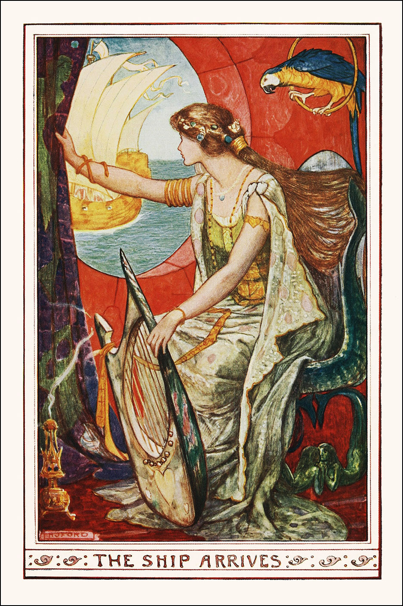

布桑岛国王一遍又一遍地读着女儿的信，接着，命令把那些骑士和士兵全部放了。他热情地接待了阿奇特国王的使者，并让他们带去对他女儿的祝福，但是，他不能去参加婚礼。

神奇的船回到家里，他们带回来的消息使阿奇特国王和海拉娜公主十分高兴。

国王派人叫来了七个西门，对他们说：“一千次地感谢你们，我勇敢的朋友。不论是黄金、白银，还是宝石，只要你们愿意，都可以从我的宝库中拿走。你们还需要什么，请告诉我，我都会给你们，我的好朋友。你们想不想当高贵的人？管理一座城市？只要你们说一声就行！”

最大的西门鞠了一躬说：“我们是平民百姓，最懂得料理平常的事情，做一个高贵的人和当官，会成什么样子？我们也不想要黄金。我们有自己的土地，它供给我们粮食和所需的钱。如果您想奖励我们，那么就免征我们的土地税，仁慈地宽恕第七个西门，他不是第一个，当然也不是最后一个做贼的人。”

“那么就这样吧！”国王说，“你们的土地将免除全部税收，第七个西门也得到宽恕。”

接着，国王给他们七兄弟每人一杯酒，邀请他们参加婚宴。那是多么丰盛的婚宴啊！

（匈牙利）

 

## 动物的语言

从前，有一个牧羊人忠心耿耿地为他的主人干了许多年活。有一天，在放牧羊群的时候，他听到一种“嘶！嘶！”的声音从附近的森林里传过来。他搞不清楚那是什么声音，于是就朝着发出声音的森林里走去，想看个究竟。等他走近的时候，看到一片干草和枯叶正在燃烧。火焰包围着一棵树，树上蜷缩着一条蛇，恐怖地发出嘶嘶的叫声。

牧羊人好奇地站在那里看着，想看看这条蛇如何逃生。这时风正刮着火焰向那棵树的方向吹去，树很快也会烧着。突然，蛇喊叫起来：“啊！牧羊人！看在上帝的份上，把我从火中救出来吧！”

于是，牧羊人把手中的棍子伸过去。蛇爬到棍子上，又爬到他手上，又从他的手上爬到他的脖子上，在他的脖子上绕了一圈。牧羊人害怕得直发抖，想自己随时都会被勒死。他说：“我是一个多么不幸的人啊！难道我把你救活只是为了毁灭自己吗？”可是蛇回答：“别害怕！你只要把我带到我的父亲，蛇国王那里去就没事了。”然而，牧羊人已经吓得不敢听它的话，说他不能丢下羊群独自走开。蛇说：“你用不着害怕把羊群留下，它们不会出事的，还是尽可能地快点走吧！”

于是，他立即带着蛇穿过森林。过了一会儿，他来到一扇奇怪的大门前，门框和门周围的墙全都是由缠在一起的蛇构成的。牧羊人站在门口吃惊地看着，脖子上的蛇嘶叫了一下，蛇门立刻打开了。

“等走进我父亲的房间以后，”蛇说，“他会奖给你所希望的任何东西——金子、银子、钻石，或者这个世界上任何贵重的东西。可是这些东西你一样也别要，请他教给你动物的语言。他会迟迟不肯答应你，但最后他会同意的。”

不久，他们来到了蛇国王的房间。蛇国王看到自己的女儿高兴得直流泪，因为他以为自己的女儿已经死了。等到能开口说话以后，他马上就问：“这么长时间你都到哪里去了？”小蛇说，她被火困在森林里，是牧羊人把她从火中救出。蛇国王转过身来对牧羊人说：“你救了我的女儿，想得到什么奖赏？”

“让我听懂动物的语言，”牧羊人回答，“这是我唯一的愿望。”

蛇国王回答：“这种本领对你来说没有什么好处。因为假如我答应了你，你听懂以后又告诉别人，那么，你马上就会死去。还不如跟我要些别的你喜欢的东西，它将永远属于你。”

可是牧羊人回答：“阁下，假如因为我救了你的女儿，你想报答我，我请求你答应，让我懂得动物的语言，别的我什么都不想要了。”说完，他转过身来，好像想走了。

蛇国王叫他回来，说：“要是别的什么都不能满足你，张开你的口吧！”

牧羊人听他的话，把口张开。蛇国王朝他嘴里吐了一口，然后说：“现在，你向我的嘴里也吐一口。”牧羊人照他的话做了。蛇国王又向牧羊人的嘴里再吐一口。这样来回三次以后，蛇国王说：

“你现在已经能听懂动物的话了，平安地回去吧！可是记住，如果你珍视自己的生命，千万不要告诉别人，否则你就会立刻死去。”

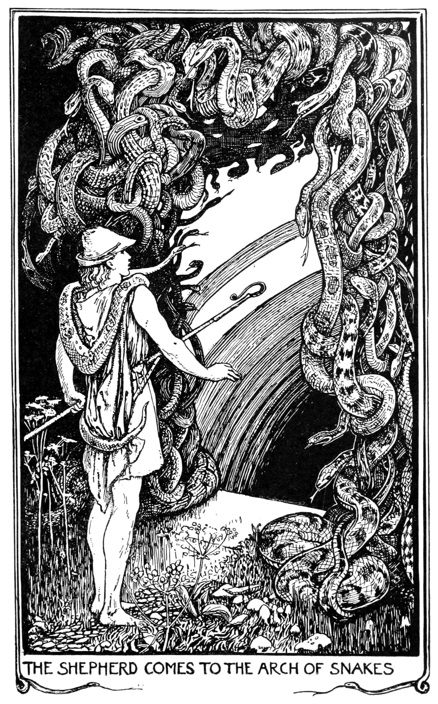

牧羊人起身回家，一路上经过森林的时候，听懂了鸟和所有动物说的话。他回到羊群身边，看到它们正安静地吃草。他感到非常累，就躺下来休息一会。

他刚躺下，就看到两只渡鸦飞过来，停在附近的一棵树上，开始用自己的语言说话：“要是牧羊人知道，那只小羊躺着的地方，地下有一间堆满了金子和银子的地下室，他会怎么样？”

牧羊人听了这些话，就去找他的主人，告诉他发现了一个藏金银的地下室。主人立刻赶来一辆马车，把地下室的门打开，把里面的财宝搬出来。主人很忠厚，他没有把这些财宝留给自己，而是全部交给牧羊人，对他说：“拿走吧！这是属于你的，上帝把它们赐给了你。”

牧羊人用这些财宝给自己盖了一间房子，还娶了老婆，过着非常平静而幸福的日子。他在自己家乡，在全国最富裕的人当中，都很有名气。他拥有数也数不清的羊群、牛群和马匹，还有非常漂亮的衣服和宝石。

圣诞节前的那一天，他对妻子说：“把举行盛宴的一切都准备好，明天我要带到农场里去，让那些牧羊人快活快活。”妻子照他的吩咐，把一切都准备好了。

第二天，他们一起来到农场。到了晚上，主人对他的牧羊人说：“现在，你们都来吧！吃吧！喝吧！大家高兴高兴。今天晚上，我替你们看守牲畜。”他就去和牲畜一起过夜。

到半夜的时候，传来狼嚎和狗吠的声音。接着，狼开始用它们的语言说话：“我们是不是可以进来大干一场，这样你们也可以吃点新鲜肉？”狗用它们的语言回答：“来吧！我们马上就可以吃个够了。”

狗群中有一只狗很老了，嘴里只剩下两颗牙齿。它对狼群说：“只要我嘴里还有两颗牙，我就决不允许主人受损失。”

所有这些话，主人都听到，而且听懂了。第二天一大早，他吩咐除了那条老狗以外，把所有的狗都杀掉。农民们都觉得非常惊奇：“可是主人，这不是太可惜了吗？”

主人回答说：“照我的话去做。”说完就和妻子一起回家。

他们骑着马走，妻子骑的是一匹母马。走了一会以后，丈夫的马走在前面，妻子的马落后一截。丈夫的马看到以后，叹了一口气对母马说：“来吧！快点！你怎么走得那么慢？”母马回答：“你太轻松了，你只驮着主人，他那么瘦，而我驮着女主人，她那么胖，有他三个人那么重。”

丈夫听到这些话，回过头来笑了。妻子看见以后，催着马赶上来，问他为什么笑。

“没有什么，”他回答，“只是突然想笑。”

妻子对这个回答不满意，再三问他为什么笑。但他还是控制住自己说：“别管我，太太，这和你有什么相干？我也不知道自己为什么会笑。”可是他越不肯说，她越是缠住他不放，一定要他说出笑的原因。

最后，他说：“那么，告诉你吧！要是对你说了，我马上就会死去。”但即使是这个理由也无法让她安静下来，她更加坚决地请求告诉她其中的原因。这时候，他们已经到家了。男人在下马之前，叫人去买了一口棺材。他把棺材放在门口，对妻子说：

“看到了吗？我要躺在棺材里，然后告诉你我为什么笑，因为跟你说完以后我就要死去。”

于是，他躺进棺材，朝周围看最后一眼。这时候，他农场里的那条老狗跑过来，坐在他的旁边哭泣。主人看到了，对妻子说：“拿一块面包来，给这条狗吃。”妻子取来一些面包扔给狗吃，可是它连看也不看一眼。

这时农场里的公鸡来了，吃起面包来。狗对它说：“可怜的馋鬼！看到主人快要死了，你还能这样吃？”公鸡说：“他要是那么愚蠢，就让他去死好了！我有一百个妻子，当我找到一粒米的时候，我把它们都叫过来，当着它们的面把米吃掉。它们谁敢说一句，我就用嘴来教训它。他只有一个妻子，可还是不能把她管好。”

丈夫听清楚以后，从棺材里爬出来，拿起一根棍子，把妻子叫进屋里说：“来吧：我会告诉你那么想知道的事。”他开始用棍子教训妻子，一边打一边喊叫：“这就是我要说的！老婆！这就是我要说的！”他就是用这个办法教训妻子，叫她再也不敢问他为什么要笑。

 

## 保守秘密的男孩

从前有一个穷苦的寡妇，她只有一个小男孩。初看起来，你会认为他很平常，和千百个别的小男孩没有什么两样。但接着你就会注意到，他的身边佩带着一把剑鞘。孩子在长大，剑鞘也在长大。和剑鞘相配的剑是小男孩从花园的地洞里拉出来的。每天，他都把剑拿出来，看看是否能插进剑鞘。虽然剑鞘天天在长，这是明摆着的，但是要和剑相配起来，还得等段时间。

终于有一天，这一天来得那么平常，剑轻而易举地插进剑鞘。男孩那么高兴，几乎不敢相信自己的眼睛。他插进去，又拔出来；拔出来，又插进去。一次比一次容易。男孩虽然特别兴奋，可是他决定不告诉任何人，尤其是他母亲，她有什么事情总是要对邻居说。

不过，尽管他的决心很大，有些事情他还是瞒不住。有一天吃早饭的时候，母亲问他怎么那么高兴。

“啊！妈妈！昨天晚上我做了一个那么好的梦！”他说，“可是我不能告诉任何人。”

“你可以告诉我，”她说，“那肯定是一个好梦，否则你不会看上去那么开心。”

“不！妈妈！我不能告诉任何人，”他回答，“要等梦变成真的以后才能说。”

“我想知道那是个什么梦，我一定要知道。”她喊道，“我要打你，直到你告诉我为止。”

可是没有用，不论是打，还是骂，还是得不到这孩子的秘密。母亲打到手臂发酸以后就走了。男孩又痛又恼，就跑到花园里，跪在那把剑旁边哭起来。剑在地洞里不停地转动着，除了男孩以外，谁要是想去拿它，一定会被严重割伤。但是只要男孩伸出手，它就会停止转动，轻轻地滑入剑鞘。

男孩坐在那里哭了很久，哭声被从旁边经过的国王听到。“去看看谁在那里哭得那么厉害。”他对一个仆人说。几分钟以后，仆人回来报告：“尊敬的陛下，是一个男孩子跪在那里哭，因为他挨了母亲的打。”

“立刻把他带到我这里来，”国王说，“告诉他是国王派人来叫他，说国王一生中从来没有哭过，也不允许别人哭。”听了这些话，男孩擦干眼泪，和仆人一起来到国王的马车前。

“你愿意做我的儿子吗？”国王问。

“愿意，如果我妈妈同意。”男孩回答。

国王叫仆人到男孩母亲那里去，对她说，如果她愿意把孩子给国王，孩子就可以住在王宫里，等他长大成人，就把最漂亮的公主嫁给他。

寡妇的愤怒变成了欢乐。她跑到华丽的马车前，吻了国王的手。“我希望你服从尊敬的陛下胜过服从我。”她对儿子说。男孩心有余悸，缩到一边去。等母亲回到自己的小屋去以后，男孩请求国王让他回去拿遗留在花园里的东西。国王同意了，男孩回到花园里把剑拔出来，剑顺从地滑入剑鞘。他上了马车，跟着国王走了。

马车走了一段距离以后，国王说：“刚才你为什么在花园里哭得那么伤心？”

“因为我妈妈打我了。”男孩回答。

“她为什么打你？”国王又问。

“因为我不肯告诉她，我做了什么梦。”

“你为什么不告诉她？”

“这个梦不变成真的，我谁也不告诉。”男孩回答。

“连我也不肯告诉吗？”国王吃惊地问。

“不！即使是您也不说，尊敬的陛下。”

“嗯！我敢肯定，我们到家以后你会告诉我的。”国王笑着说。接着，他和男孩子说起其他事情了，直到回到王宫。

“我给你们带来了多么好的礼物。”国王对他的女儿说。男孩子长得那么漂亮，公主们都很喜欢他，把她们最好的玩具都送给他。

“你们别把他宠坏了。”有一天，国王看到他们在一起玩，说，“他有一个秘密，不肯告诉任何人。”

“他会告诉我的。”最大的公主说。可是男孩只是摇摇头。“他会告诉我。”第二个公主说。

“我不！”男孩回答。

“他会告诉我。”最小的公主说，她长得最漂亮。

“我不会告诉任何人，直到它变成真的。”男孩像以前说过的一样，又说了一遍，“谁问我我就打谁。”

国王听到这些话，觉得非常遗憾。因为他很爱这个男孩，但是他想，把一个不听他话的人留在身边决不是好事情。所以，他命令仆人把男孩带走，除非他明白事理，否则不允许他再进入王宫。

男孩被带走的时候，身上佩带的剑当啷直响。他什么也没有说，心里非常不快乐，因为他什么也没有做，却受到这样的对待。不过，仆人们对他非常好，他们的孩子经常给他带来一些水果和各种各样好吃的东西。不久，他就快活起来。他和他们一起过了许多年，直到满十七岁。

这时候，两个大公主已经结婚。她们嫁给两个强大的国王，他们统治着大海对岸两个伟大的国家。最小的公主也到了结婚的年龄，可是她很奇怪，看不上所有那些来向她求婚的年轻王子。

有一天，她坐在王宫里，觉得又孤独又沉闷，忽然想起去看看仆人们在干些什么？在他们那里是不是更加有趣？国王这时正在召集大臣们开会，王后则生病躺在床上，没有人能够阻拦公主。她很快就跑过花园，来到仆人们住的地方。在房子外面，她看到有个小伙子比她见过的王子都英俊。她立刻想起，这就是那个和她一起玩过的小男孩。

“告诉我你的秘密，我就和你结婚。”公主说。可是她得到的是一记耳光，这是很久以前男孩说过的：谁再问这个问题就打谁。公主受了伤害以后，感到非常气愤。她跑回家向父亲发牢骚。

“他就是有一千个头，我也要把他们全杀掉。”国王发誓说。

就在这一天，城外竖起了一个绞刑架。所有的人都跑过来，看这个胆敢打国王女儿的青年人被处死。犯人被反捆着双手，押到绞刑架前。在死一般的寂静中，法官宣读判决书。突然间，他身边佩带的剑当啷直响，还传来了很响亮的声音，一辆金黄色的马车正沿着石子路奔驰而来，窗外挥动着一面白旗。它在绞刑架前面停下，从车上走下马扎尔（匈牙利的主要民族——————译注）国王，他请求宽恕这个青年。

“阁下，我女儿只是请他说出心中的秘密，就挨他的打，我决不能原谅他。”公主的父亲说。

“把他给我吧！我敢肯定，他会把秘密告诉我。要是不的话，我有一个女儿像金星一样，他一定会告诉她的。”

那把宝剑第三次响了起来。国王生气地说：“好吧！你既然那么迫切地要他，就带他走吧！只是不要让我再看到这张脸。”他对执行绞刑的人打了个手势。刽子手把蒙在青年脸上的布拉开，把绳子也解下来。青年走上金黄色的马车，坐在马扎尔国王的身边。马车夫挥了一下手中的鞭子，马拉着马车，向布达急驰而去。

国王非常愉快地和他谈了几英里路程的话，他想，这个新朋友已经和他那么随便了，就问他是什么秘密叫他受到这么多的麻烦。青年人说：“这个我不能告诉您，要等它变成真的以后才能对您说。”

“你会告诉我女儿的。”国王笑着对他说。

“我谁也不告诉。”青年人回答的时候，剑发出铿锵的声音。国王不再说话，他相信凭着女儿的美貌，可以让青年人说出心中的秘密。

到布达的路程很远，他们一连走了好几天才到达。国王的马车奔过来的时候，美丽的公主正在花园里摘玫瑰。

“啊！多么英俊的小伙子！你是从仙人那里把他带回来的吧！”当他们踏上城堡大理石台阶时，她喊起来。

“我是从绞刑架上把他带回来的。”国王听到女儿的话，颇为不快，因为她从来不愿意和任何男人说话。

“我不管你是从哪里把他带回来的。”这个被宠娇了的女孩子说，“我要和他结婚，不嫁给其他任何人，我们要一起白头偕老。”

“当你问过他的秘密以后，你的故事就得重编了。归根到底，他比仆人好不了多少。”

“这对我来说没有什么。”公主说，“因为我爱他。他会把秘密告诉我的，会在我心中占据他的位置。”

可是国王摇摇头，命令把青年送到夏宫里去住。

大约一个星期以后的一天，公主穿上最好的衣服，去看青年人。她看上去那么美丽。书从他手上掉下来，他一言不发地站起来。

“告诉我，”她小心地哄他说，“你那神奇的秘密是什么？轻声地在我耳边说出来，我就给你一个吻。”

“我的天使，”他回答，“放聪明些，如果你想平安地回到你父亲的王宫里去，不要提任何问题。我保守自己的秘密那么多年了，现在也不打算说出来。”

可是，女孩子不听他的，继续不停地问他，直到他狠狠地打了她一记耳光，血从鼻子里流出来。她又气又痛，尖叫着跑回王宫。她父亲正在那里等待着她是否成功的消息。

“我要把你活活地饿死，你这魔鬼的儿子。”国王看到女儿的衣服上沾满了血，气愤地喊道。他命令把城里所有的泥瓦匠都找来。

“尽你们最快的速度，给我造一座塔。”他说：“里面只能放得下一张凳子和一张小桌子。”

泥瓦匠立刻动手。两个钟头里塔就造成了。他们到王宫去向国王报告，任务完成了。路上碰到公主，她拦住一个泥瓦匠，等其他人都走远，听不见她说话以后，她问泥瓦匠，是否可以想办法，在塔墙上开一个洞，要谁也看不出来，但可以把食品和一瓶酒送进去。

“当然可以。”泥瓦匠说。他转身回去。不到两分钟，洞就开好了。

太阳下山的时候，很多人都围过来，看着青年人被带到塔前。在宣布了他的过失以后，他被正式地关闭起来。可是每天早晨，公主都从洞里送给他食物。每隔三天，国王就派他的秘书从梯子上爬上去，在一个小窗口中看看他是否还活着。秘书每次回来，总是报告说他脸色红润，胖乎乎的。

“这事情有点奇怪。”国王说。

事情持续了一段时间。土耳其的君主苏丹派使者给国王送来一封信，还有三段竹竿。使者说：“我的主人吩咐我来对你们说，如果你们不能说出这三段竹竿中哪一段离根最近，哪一段长在中间，哪一段长在上面，就要向你们宣战。”

国王听了这些话，非常害怕。他把三根竹竿拿过来，仔细地查看，可是看不出有什么两样。国王非常沮丧。女儿看出父亲有烦恼，问他是怎么回事。

“唉！我的女儿！”他说：“我怎么能不沮丧呢？苏丹派人送来三段竹竿，说如果我分不出哪段长在下面，哪段长在中间，哪段长在上面，他就要向我发动战争。你知道，他的军队比我的强大得多。”

“啊！父亲！别失望！”她说：“我们会找到问题的答案的。”她跑到塔前，把事情对青年人说了。

“像往常一样，回去睡觉吧！”他说，“等你醒过来的时候，去对你父亲说，你做了一个梦。那三段竹竿应该放在温水里。过一会儿以后，有一根会沉入水底，那是离根最近的一段；有一根浮在水中间，那就是当中的一段；有一根会浮在水面上，那就是顶上的一段。”

于是，第二天早晨，公主把她的梦对父亲说了。听从她的劝告，他把竹竿从水中捞出来的时候做了个记号，免得在把竹竿还给苏丹的使者时出差错。苏丹真是难以想象，他是怎么找到答案的。苏丹这一次没有发动战争。

第二年，苏丹又想对马扎尔国王挑起事端，所以，他又派一个使者带着三只小驹来见国王，要他说出哪只是早上生的，哪只是中午生的，哪只是晚上生的。如果三天里找不出答案，就向他宣战。国王读完苏丹的信，心里沉甸甸的。他不能指望女儿能幸运地再做第二次梦。由于瘟疫流行，夺去了许多士兵的性命，他的军队比以前更加弱。想到这些，他的脸色阴郁。女儿注意到了，问他到底是怎么回事。

“我又从苏丹那里收到一封信，”国王说，“他说，如果我不能从三只小驹中分出哪只是早上生的，哪只是中午生的，哪只是晚上生的，他就要发动战争。”

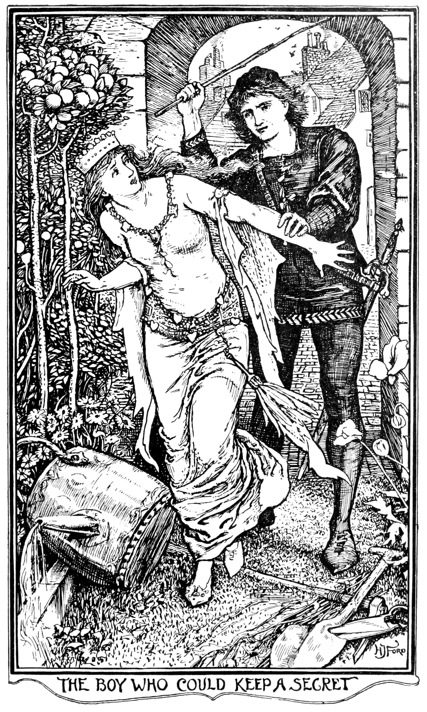

“啊！用不着那么悲观，”她说，“总会有办法的。”她跑到塔那里去请教那位青年。

“回家去，我心中的偶像。当夜幕降临的时候，假装从梦中叫醒。你父亲听到你的叫声会走过来，告诉他，你梦见他不能回答关于小驹的问题，正要被土耳其人带走，这时，关在塔里的青年跑过来，告诉土耳其人哪只小驹是早上生的，哪只是中午生的，哪只是晚上生的。”

公主按照青年的话去做。她刚把话说完，国王就命令将塔推倒，把囚犯带到他这里来。

“没想到你没有吃的也能活得这么久，”国王说，“你已经有充分的时间反省自己恶劣的行为。我会宽恕你的，条件是在我面临痛苦的困境时帮助我。读这封苏丹来的信，你就会看到，如果我不能回答这个关于小驹的问题，可怕的战争就会爆发。”

青年把信拿过来读了一遍，说：“是的，我可以帮助你。可是你先得给我拿来三个完全一模一样的饲料槽。一个放燕麦，一个放小麦，另一个放大麦。那只吃燕麦的小驹是早上生的，吃小麦的是中午生的，吃大麦的是晚上生的。”

国王吩咐照青年的话去办，把三只小驹做好记号，送回土耳其，这一年也没有发生战争。

苏丹这时非常生气，因为两次想占领匈牙利的计谋都失败了。他派人找来他的婶婶，向她请求下一步应该怎么办，这个女人是个巫婆。

“不是国王回答了你的问题，”她听完苏丹的故事以后这样说，“他那么笨，要回答这些问题还远着呢！解开这个谜的人是一个穷妇人的儿子。如果他活着，将会成为匈牙利的国王。如果你想戴上这顶王冠，你就必须把他弄来杀掉。”

这次谈话以后，苏丹又给匈牙利写了第三封信，说如果三天之内不把现在在王宫里的青年送到土耳其来，庞大的军队将会越过边界。

国王读了这封信，心里非常悲伤，因为他感谢这个帮助过他的青年。可是青年人只是笑笑，叫国王用不着担心，立刻到城里去找两个长得一模一样的青年，他自己会画一个和他们一样的面具戴上。这时他身边的剑又当啷直响。

经过一段时间的查访以后，找到了一对孪生兄弟。他们长得那么像，连他们的母亲也说不出有什么地方不一样。青年照样画了一副面具戴上，这三个人真是谁也分辨不出来。

他们三人立刻出发到苏丹的王宫里去。一到那里，他们就被送到苏丹面前。他打个手势叫他们靠近，他们都一起鞠躬向苏丹致敬。苏丹问他们路上怎么样，三个人一起回答，说的话也一模一样。如果有一个人坐下来吃饭，另外两个人也会同时坐下。哪个人要是站起来，另外两个也不会延迟片刻，好像他们完全是一个人似的。苏丹看不出他们之间有任何不同，他对他婶婶说，他不能那么残酷地同时杀死他们三个。

“好吧！明天你就会看出他们的不同点。”巫婆说，“有一个人的衣服袖子会被割破，这个人就是你要杀掉的青年。”

午夜前一个钟头，这时候别人是看不见巫婆的，她溜进三个青年睡同一张床的房间，拿出剪刀，在戴面具的青年挂在墙上的大衣上剪掉一小块，然后静悄悄地走出去。

可是第二天一早，青年看到了衣服袖口被剪开，他在两个同伴的衣服上也做上了这个记号，然后一起出去和苏丹用早餐。老巫婆站在窗口旁边，假装不看他们。可是巫婆的脑后都有眼睛，她立刻就注意到，不是一个，而是三个人的袖子都剪开了。三个人又像昨天一样完全相像。早餐以后，苏丹对整个事情都感到厌烦了，他想单独一个人再考虑别的计划，所以告诉他们可以回家了。于是三个人一起鞠了一躬，就起身走了。

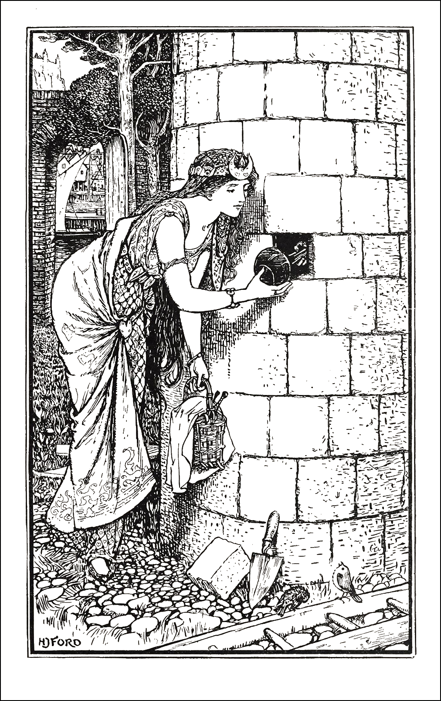

公主兴奋地欢迎青年回来。可是，可怜的青年人并没有安静地过多久。有一天，苏丹又送来一封信，信中说，他发现这个青年人非常危险，必须立刻单独地把他送到土耳其来。当青年人告诉公主，她父亲让她带来的这封信的内容时，公主哭了起来。

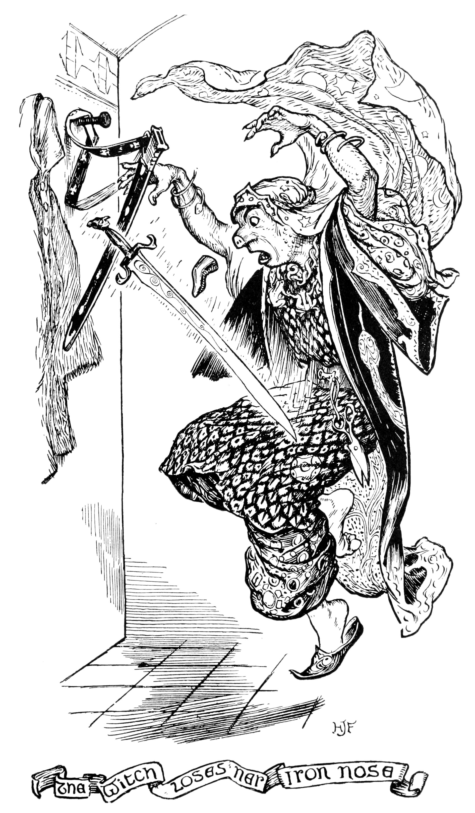

“不要哭，我心中的爱人，”他说，“一切都会好的。明天早上太阳一出来我就走。”

第二天太阳升起的时候，青年人出发了。几天以后，他来到苏丹的王宫前。这时老巫婆正在门口等他，当他走到面前时，巫婆小声地对他说：“这是你最后一次进王宫了。”这时剑当啷地响了一下。青年人连看也不看她一眼就走进去了。

他一跨过门槛，苏丹就带领着十五个全副武装的土耳其人围上来。刹那间，那把剑飞舞起来，砍下除了苏丹以外其余人的头，又很快地回到剑鞘里去。巫婆看到了，知道只要这把剑还在青年身边，她的一切计谋都会落空。于是，她想办法晚上去偷这把剑。可是剑跳出来，把她用铁做成的鼻子砍下半截。第二天早晨，当苏丹带领一支强大的军队，想来抓青年并抢走那把剑时，他们都被剁成了肉酱，只有青年一根毫毛也没有受损伤。

这时候，公主正陷于绝望之中，因为许多天过去了，青年人还没有回来。她心神不定，坐立不安，后来父亲同意让她领一支军队到土耳其去。她身穿军装，骑着马骄傲地走在前面。可是离开城里还不到一英里路，她就看到年青人佩着那把剑回来了。他告诉他们发生了什么事情以后，大家都高兴地欢呼起来，抬着他胜利地返回王宫。

国王宣布，青年人已经表现出有资格做他的女婿，可以立刻和公主结婚并继承王位。他已经上了年纪，管理国家已经力不从心。可是青年人说，他必须先回去看看他的母亲。国王亲自送他出去，还派一支军队护送他。

老妇人看到那么多军队开到她的小屋子前，非常害怕。当一个英俊的青年从马上下来，亲吻她的手的时候，她更是吃惊，因为她已经认不出儿子来了。他说：“现在，亲爱的妈妈！我终于可以告诉你我的秘密了。我做了一个梦，梦见我将成为国王，现在这个梦已变成事实。当我还是一个小孩的时候，你请求我告诉你，我不得不保守秘密，否则马扎尔国王就会杀了我。要不是你打我，一切都不会发生，我现在也不会成为国王。”

（马扎尔民间故事）

 

## 王子和龙

从前有个皇帝，他有三个儿子。他们都是好青年，喜欢打猎，几乎每天都有一个人出去狩猎。

有一天早晨，大王子骑着马到附近的森林里去，那里可以找到各种各样的野兽和动物。他刚离开城堡，就看到一只兔子从密林中跳出来，从前面的路上奔跑过去。年轻人立刻追上去，翻过山岭，越过峡谷，兔子跑到一条河边的磨坊时突然不见了。王子正想跟着进去，可是他吓得惊呆了，因为一条龙而不是一只兔子忽然出现在他面前，龙正喷射着烟雾和火焰。王子看到这可怕的景象，转过身来就想逃走。可是龙伸出可怕的舌头，卷住他的腰，把他拖进嘴里。很快，王子就不见了。

一个星期过去了，大王子还没有回来，城里的人开始不安起来。后来，二王子对皇帝说，他也想出去打猎，或许还能找到哥哥失踪的线索。

二王子刚出城门，城门还没有关上，那只兔子又从树丛中奔跑出来。和上一次一样，它引着猎人爬山越岭，来到磨坊前一转身就进去了。二王子紧跟其后。他正想进去，啊！站在他面前的不是兔子，而是一条喷射着烈焰可怕的龙，它伸出长长的舌头，卷住二王子的腰，把他送进自己的嘴里。二王子也不见了。

时间一天一天地过去了，皇帝焦急地等待着两个儿子，可是不见他们的踪影。他寝食不宁，老是提心吊胆地想着，到底出了什么事，他们到哪里去了？小王子请求出去寻找两个哥哥，国王一直不肯答应，生怕他也会失踪。小王子苦苦请求，让他出去找，而且不断地保证一定非常小心地行事。后来皇帝终于答应了，吩咐把马厩里最好的马拉出来让他骑。

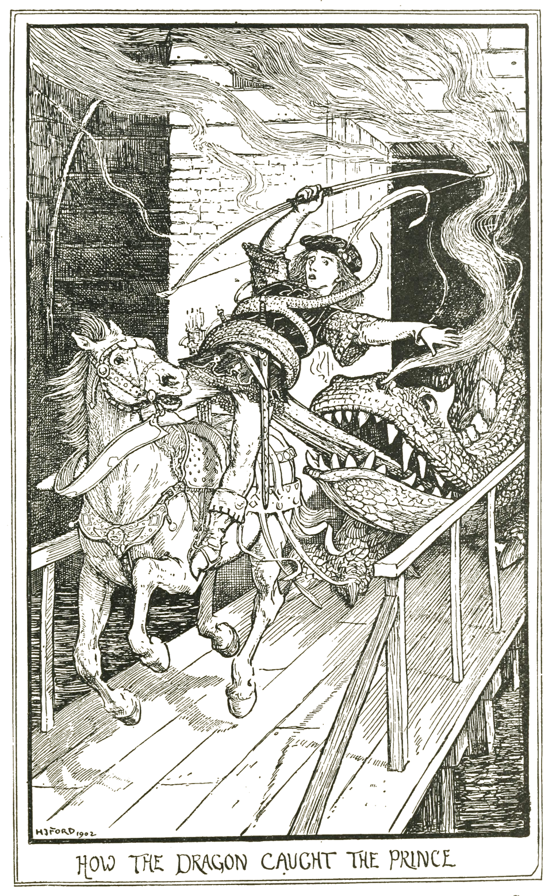

小王子满怀信心地出发了。他刚走出城墙，那只兔子又从树丛里奔出来，把他一直引到磨坊前，从开着的门里奔进去。不过，这一回小王子并没有跟进去，他比两个哥哥聪明，转过身来走了，心里想着：“森林里有的是好兔子，等我抓到它们以后再回来找你。”

一连好几个钟头，他翻山越岭，可什么动物都看不到。后来，他找得不耐烦了，就回到磨坊来。他看到一个老妇人正坐在那里，就快乐地和她打招呼。

“早上好！好妈妈！”他说。

“早上好！我的孩子”。老妇人回答。

“好妈妈，请告诉我，我那只兔子到哪里去了？”小王子问。

“我的孩子，”老妇人回答，“那不是什么兔子，是一条龙！它把许多人引到这里来，把他们都吃掉了”。

听了这些话，小王子的心沉重起来，喊道：“那么，我两个哥哥肯定是到这里来，被龙吃掉了。”

“你猜对了，”老妇人回答，“我给你出个好主意，快点回家去，免得也被吃掉。”

“你不想和我一起离开这个可怕的地方吗？”小王子问。

“它把我也囚禁了起来，”她回答，“我挣脱不开它的锁链。”

“那么，你听我说，”王子说，“等龙回来后，问它离开这里以后总是到哪里去？是什么原因使它那么强大？等你哄它说出这些秘密以后，明天我来的时候就告诉我。”

说完，小王子动身回家。老妇人留在磨坊里。等龙一回来，老妇人就问它：“这么长时间你到哪里去了？一定是走得很远很远吧！”

“是的，好妈妈，我是走得很远。”它回答。

接着，老妇人开始奉承它，说它很聪明。等她认为把龙的脾气弄得温顺了以后就说：“我一直在想，你从哪里得来这么强大的力量，我真希望你能告诉我，我要真心实意地、恭恭敬敬地吻这个地方。”

龙听了以后笑起来，说：“在那块炉石里，蕴藏着我神奇的力量。”

老妇人跳起来，吻那块炉石。龙笑得更厉害，说：“你这笨蛋，我只是开玩笑。不是在这块炉石里，而是在那棵高高的树上，蕴藏着我神奇的力量。”

老妇人跳起来，抱住那棵树，亲切地吻它。

龙大声地笑起来，等它能开口说话的时候，它说：“老傻瓜，你真的相信我的力量是从这棵树上来的吗？”

“那么是从哪里来的呢？”老妇人问，心里非常恼火，她不喜欢被人取笑。

“我的力量，”龙回答说，“蕴藏在离这里非常遥远的地方，那地方那么远，你根本到不了。在那里有一个王国，在她的首都附近有一个湖泊，湖泊里有一条龙，龙里有一头野猪，野猪里有一只鸽子，鸽子里有一只麻雀，我的力量就藏在这只麻雀里。”

老妇人听完了这些话，想没有什么必要再奉承它了，因为她永远，永远也不能拿走龙的力量。

第二天早晨，龙走了以后，小王子来了。老妇人把龙的话都对他说了。他仔细地听着，什么话也不说就回到城堡。他穿上牧羊人的衣服，拿起一根棍子，就像一个牧羊人那样，去寻找那个地方。

好长一段时间，他从一个村庄走到另一个村庄；从一座城市走到另一座城市，最后来到一个遥远的国家。这里有一座大城市，三面被一个很大的湖泊包围，那条龙就住在湖里。像所有的牧羊人一样，他拦住路上遇见的每一个人，请求雇佣他。可是他们都说，已经有了牧羊人，或者说是不需要。正当他开始失去信心的时候，有个人转过身来对他说，最好去问一下皇帝，他正在寻找一个人来看牲口。

“你能照看我的羊吗？”皇帝对跪在他面前的年轻人说。

“非常愿意，尊敬的陛下。”年轻人回答。他恭敬地听着皇帝的吩咐。

“在城墙的外面，”皇帝说，“你会看到一个很大的湖。湖边有我的国家里最茂盛的草原。当你领着羊群出去吃草的时候，它们就会径直向草原奔跑过去。可是到现在为止，还没有看到有一只羊从那里回来过。所以你要小心，我的孩子，不要让你的羊随便乱跑，把它们赶到你认为最好的地方去。”

王子深深地鞠了一躬，感谢皇帝对他的告诫，保证尽最大的力量来保护羊群。他离开皇宫，来到市场，买了两条灰狗、一只鹰和一支笛子，然后赶着羊出去放牧。

羊一看到前面的湖，就立刻全速奔跑起来，向湖周围的绿草地狂奔过去。王子不想阻挡它们。他把鹰放到树枝上，把笛子放在草地上，让狗安静地蹲下来。完了以后，他卷起衣服袖子和裤脚管，涉水走进湖里，大声地喊叫起来：“龙！龙！你要不是个胆小鬼，就出来和我决斗！”

一个声音从湖底深处传来，回答说：“啊！王子！我在等着你呢！”一分钟以后，龙露出水面，庞大的身躯，看上去非常可怕。王子扑上来，和龙扭打在一起，一直打到太阳升到正当中的中午时分。

龙喘息着说：“啊！王子！让我把烧着了的头在湖水里浸一浸，我就会把你扔到天顶上去。”可是王子说：“啊哈！我的乖龙！别得意得那么早。要是皇帝的女儿在这里，只要她在我的额头上吻一下，我就会把你扔得更高！”这时，龙突然松开它的身体，回到湖底下去了。

到天快黑的时候，王子洗干净所有搏斗时留下来的痕迹，把鹰放在肩膀上，带上笛子，狗跑在前面，羊群跟在后面，就动身回到城里去。他们从街上走过时，人们都惊奇地看着，因为从来还没有人看到，有一只牲口能活着从湖边回来。

第二天，他起得很早，赶着羊群来到湖边。这一次，皇帝派两个人骑着马跟在他后面，他们奉命整天监视王子。他们和王子保持着一段距离，以便观察王子而不被他发觉。羊向草地奔过去以后，他们登上湖边一座陡峭的山头看着。王子像上次一样，把笛子放在草地上，叫狗坐在他身旁，让鹰停留在树枝上，然后卷起袖子和裤脚管，下到湖里去。

“龙！龙！你要不是个胆小鬼，就出来和我决斗！”龙回答说：“啊！王子！我在等你呢！”一分钟以后，它从湖面上升起，看上去又庞大又可怕。他们又紧紧地抱在一起，扭打起来，一直打到中午。这时，火辣辣的太阳当空照着。龙受不了，喘着气说：“啊！王子！让我把火烫的头在湖水里浸一下，我就把你扔到天顶上去！”

“啊哈！我的乖龙，不要得意得太早。只要皇帝的女儿在这里，在我额头上吻一下，我就把你扔得更高。”这时龙的身子突然松开，掉到湖里去了。

到了傍晚，王子赶着羊群，吹着笛子动身回城里去。当他从城门走过时，人们都从家里出来，吃惊地看着他，因为在他之前，还从来没有牲口从湖边活着回来过。

这时候，那两个人也骑着马很快地回来了。他们把看到和听到的事都对皇帝说了。皇帝专心地听着，然后把女儿叫过来，把故事重复给她听。

“明天，”故事说完以后，皇帝又说，“你和牧羊人一起到湖边去。然后，像他所希望的那样，吻一下他的前额。”

可是公主听了这些话，哭了起来，抽噎着说：“你真的要我，你的独生女儿到那个可怕的地方去吗？很有可能我再也回不来了。”

“别害怕，我的小女儿！一切都会好的。许多牧羊人到湖边去过，没有一个人回来。可是这两天，这个牧羊人和龙决斗了两次，都毫无损伤地回来。所以，我希望明天他能彻底地把龙除掉，把它杀死，把这块土地从已经杀死我们许多最勇敢的人的魔鬼手中解放出来。”

第三天，太阳刚刚从山坡上露出脸，公主就站在牧羊人的身边，准备和他一起到湖边去。王子喜气洋洋，非常高兴，可是公主却哭得很厉害。

“我恳求你擦干眼泪，”他说，“只要你愿意照我的话去做，到时候跑过来吻一下我的额头，那你就什么也用不着害怕。”

王子快活地吹着笛子走在前面，不时停下来对旁边哭着的公主说：“不要这样哭，高贵的人儿，相信我，什么也用不着害怕。”

他们来到了湖边。羊群在草地上四处奔跑。王子把鹰放到树上，把笛子放在草地上，让狗留在身边，然后卷起袖子和裤脚管走下湖去喊道：

“龙！龙！你要不是胆小鬼，快点出来，让我们再决斗一次。”龙回答：“啊！王子！我在等着你。”一分钟以后，它从湖面上露出来，看上去又大又可怕。它一下子就冲到岸边。王子迎上去，他们又打起来，一直打到太阳晒得最厉害的中午。

龙喊道：“啊！王子！让我在湖水里浸一浸烧得发烫的头，然后我就把你扔到天顶上去！”

可是王子回答：“啊哈！我的乖龙，别得意得那么早，要是皇帝的女儿在这里，她只要在我额头上吻一下，我就会把你扔得更高！”

他话刚落地，站在旁边听着的公主就在他的额头上吻了一下。王子一下子就把龙扔到云端上去。等它掉下来的时候，在地上撞得粉身碎骨。从一块碎片中跳出一头野猪来，向远处奔跑。王子叫他的狗追上去。狗把野猪抓住，把它撕碎。从一块碎片中，又跳出一只兔子。两条灰狗立刻追上去，把它咬死。这时，从兔子身上飞出一只鸽子。王子很快就把鹰放出去，鹰展翅飞翔，很快就把鸽子捉回来交给主人。王子把鸽子剖开。像老妇人说过的那样，里面有一只麻雀。

王子抓住麻雀喊道：“现在，你该告诉我了，我的哥哥在哪里？”

“不要伤害我，”麻雀说，“我会真心实意地告诉你。在你父亲的城堡旁边有一家磨坊，磨坊里长着三枝嫩树枝。砍下这三枝树枝，用它来抽打它们的根，地牢的铁门就会打开。在地牢里，你会看到许多人，老的，少的，还有妇女和儿童，有一个王国的人那么多。其中就有你两个哥哥。”

这时已是黄昏。王子在湖中洗干净，把鹰放在肩膀上，用胳膊夹着笛子，让狗走在前面，羊群跟在后面，高高兴兴地向城里出发。跟在后面的公主这时还害怕得浑身发抖。他们穿过街道，惊讶的人群挤满了两旁，一直看着他们走进城堡。

这一天，国王瞒过所有的人，偷偷地骑着马到湖边的山顶上，从这里可以看见白天所发生的一切事情。等一切都已过去，龙再也不能为非作歹以后，他很快地骑着马回到城堡，张开双臂欢迎王子，并答应把女儿嫁给他。

婚礼非常隆重。整整一个星期，城里到处都挂满了彩灯。城堡的大厅里排满了宴席，谁愿意都可以来赴宴。

宴席结束以后，王子对皇帝和大家说出了他的真正身份，所有的人都更加热烈地欢呼起来。由于王子急着要回去救他的哥哥，他们又忙着准备送王子和公主回到自己的国家。

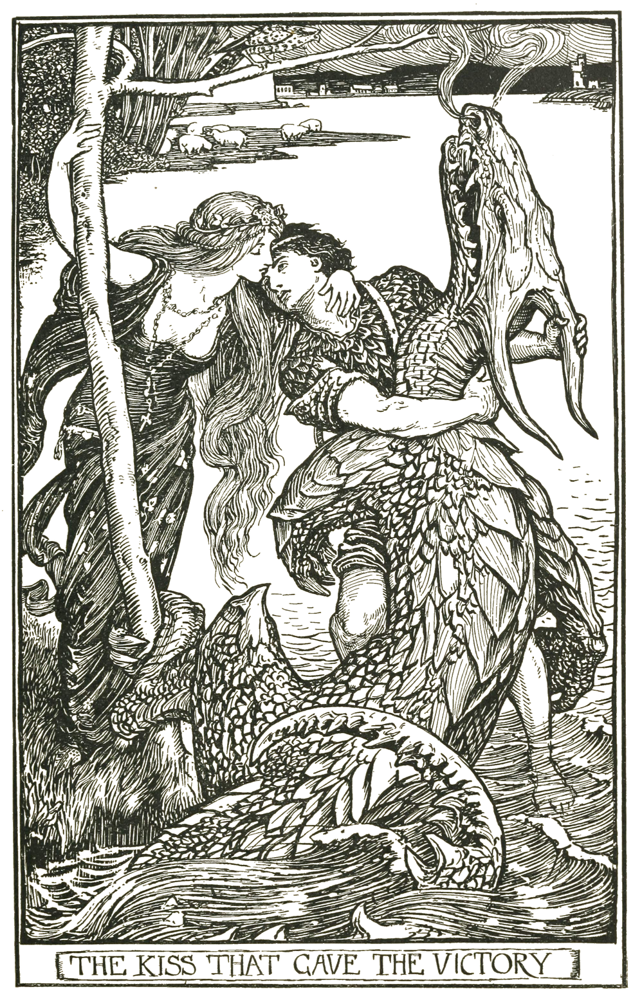

王子回到故乡的第一件事，是赶到磨坊那里去，像麻雀说的那样，他找到了那三枝树枝。在他抽打树根的时刻，铁门打开了，从地牢里涌出数也数不清的男人和女人。他嘱咐他们一个接一个地走，愿意到哪里去就到哪里去。他等在门口直到两个哥哥走出来。又见面了，他们兄弟是多么高兴啊！哥哥听着弟弟对他们说，为了把他们从魔法中救出来，他干了些什么。他们跟着他回家，一辈子为他效劳。他们说，只有他证明了自己的勇敢和忠诚，他最适合当国王。

（塞尔维亚民间故事）

 

## 小野玫瑰

很久以前，发生了这样一件事；要是没有发生这件事，这个故事也就没有了。但是故事发生的那个年代和现在不同。那时候，狼和羊都安静地一起躺在一个棚里；牧羊人在绿草成茵的河岸边和国王、王后一起用餐。

我亲爱的孩子们，现在，我们开始讲这个故事。

从前有一个老人，如果说没有一百二十岁，那么肯定也有一百岁了。他的妻子也很老了。有多老？我可说不上。有些人说，她的年龄和维纳斯女神差不多。老夫妻在一起一直非常幸福。可是，如果他们有小孩，哪怕只有一个，就会更幸福。尽管他们年纪都很大了，可他们心中从来就没有打算过不要小孩。他们常常坐在火炉旁谈论着，如果家里有孩子，他们会怎样把他们抚养大。

有一天，老头子看上去比平时更忧虑，更悲伤。后来他终于忍不住，对妻子说：“老太婆，你听我说！”

“你想要干什么？”她问。

“从箱子里给我拿些钱来，我要出去赶远路，要走遍整个世界，看看能不能找到个孩子。每当我想到我们死了以后，房子就会落入陌生人的手中，我就心疼。我还想对你说，如果找不到孩子，我就不回家。”

说完，老人拿起背包，装满食品和钱，往肩上一扛就和妻子告别了。

好长一段时间，他到处流浪、流浪、流浪，可是一个小孩也找不到。有一天早上，他信步走进一片森林。树木长得那么茂盛，连一丝阳光也照不进来。老人看到这阴森恐怖的景象，停住了脚步，不敢再走进去。但是，他想起了一句谚语：“不入虎穴，焉得虎崽！”也许在这黑洞洞的密林深处，他会得到他想要的孩子。于是，他鼓足所有的勇气，勇敢地走进去。

他自己也说不出，到底在森林里走了多久。总而言之，后来他来到一个山洞口，这里看上去比森林里还要黑一百倍。他不由自主地又停下来。可又总觉得有股什么力量在促使他走进去。带着一颗激烈跳动着的心，他走了进去。

有好几分钟，黑暗和寂静吓得他不敢动弹，站在那里一步也跨不出去。接着，他又壮着胆子向前走了几步。忽然间，他看到前面的远方有灯光在闪烁。灯光给他注入了新的力量。他朝着微弱的灯光迈出坚定的脚步，直到看见灯光旁边坐着一个长着长长的白胡子的老隐士。

隐士或者没有听见有人到来，或者假装看不见，继续读他的书。老人耐心地等了一会儿以后，双膝跪下来说：“早上好，圣父！”可是，他好像是在对石头说话一样，没有回答。“早上好！圣父！”他又说了一遍，声音比上次响亮一些。

这一次，隐士对他打了个手势，叫他靠近些。“我的孩子！”他声音不高，然而却在山洞里回荡，“是什么风把你吹到这黑暗而凄凉的地方来了？我已经好几百年没有看到人的面孔了，我也不想再看一次。”

“是我的不幸把我带到这里来。”老人回答，“我没有孩子，在我和我妻子整整的一生中，都希望有个孩子。所以我离开了自己的家，在这个世界上到处寻找，希望有一天能在什么地方找到一个孩子。”

隐士从地下捡起一个苹果，把它递给老人，说：“这个苹果你吃掉半个，剩下半个留给你妻子，用不着在这个世界上到处徘徊了。”

老人高兴得弯下腰来吻隐士的脚，然后离开山洞。在黑暗中他尽可能快地穿过森林，终于来到一片野花盛开的土地上。鲜艳的花朵令他眼花缭乱。忽然间，他感到渴得要命，喉咙里像有一把火在燃烧。他想找条河，可是毫无踪影，而舌头却像火在烘烤似的、越来越焦。他的眼睛终于落在一直握在手中的苹果上。难以忍耐的干渴使他忘记了隐士对他说过的话。他不但把自己的半只吃掉了，连妻子的半只也吃得一干二净。吃完以后，就睡着了。

等他醒来的时候，他似乎看到离他不远的坡上，在一片粉红色的玫瑰花中间，躺着什么奇怪的东西。他走过去一看，真是又惊又喜，那是个两岁左右的小姑娘，皮肤像遮盖着她的玫瑰花一样，白里透出微红。他伸出双臂，轻轻地把她抱起来。她好像一点也不害怕，反而高兴地喊叫，欢蹦乱跳。老人用衣服把她抱好，放开脚步，飞快地朝家的方向奔去。

他跑到自己小屋子门前，把孩子放在门口一个水桶里，边喊边跑进屋里：“老婆子！快来啊！快！我给你带来了一个女儿。她的头发是金黄色的，眼睛像是明亮的星星！”

听到这惊奇的消息，老太婆跌跌撞撞地从台阶上奔下来，只想快点看一看宝贝。可是，当丈夫领着她来到水桶旁时，只见水桶里空空的，什么都没有。老人害怕得几乎不能自制，他的妻子悲伤失望地坐在地上哭泣起来。后来他们想，小孩可能是为了好玩，跑到什么地方躲起来了。可是他们四处找遍，也不见她的影子。

“她会到哪里去了呢？”老人失望地悲叹着，“啊！我为什么让她独自留下，哪怕是只有片刻？会不会是哪位仙女把她带走？还是野兽把她叼走了？”于是他们又开始寻找，可是既看不到仙女，也找不到野兽，他们只好痛苦地回到屋子里去。

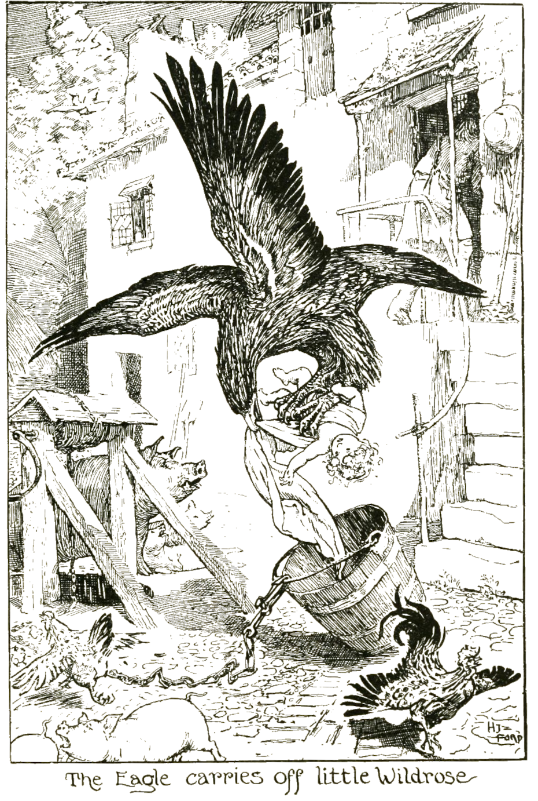

那么，孩子到哪里去了呢？哦！原来是她看到自己一个人留在陌生的地方，害怕得哭了起来。这时正好有一只老鹰从天上盘旋而过，听到了她的哭声，就飞过来看个究竟。当它看到这个白里透红的胖家伙时，想起了正在家里挨饿的孩子，就俯冲下来，用爪子把她抓起，带着她掠过树梢，向空中飞去。

几分钟以后，它来到了自己筑巢的那棵大树上，把小野玫瑰（这是老人给她起的名字）放在它那些毛茸茸的小鹰中间就飞走了。那些小鹰看到来了个奇怪的小动物，自然非常惊讶，都挤到中间来。不过，它们不是像老鹰指望的那样，把她吃掉，而是把她围在中间，用小小的翅膀来帮她挡住阳光。

在老鹰筑巢的密林中，流淌着一条小河，河水是有毒的。河边住着一条可怕的七头蛇蜥。蛇蜥经常观看着老鹰从树顶上飞过，带着食物回来给小鹰吃。当然，它在小心地等待着那些小鹰开始学飞，要离开巢的时刻。要是老鹰在家的时候，尽管蛇蜥长得身强力壮，也无可奈何。这一天老鹰不在时，有两只小鹰飞得离地面太近，一下子就落入蛇蜥的口中。这些小鹰还很弱小，不知道世界上还有这种事情，整个世界会是这样。不过，它们总是要长大的，过几天它们就会张开眼睛，迫不及待地展开翅膀，掠过微风摇曳着的树顶，向山峰，向光明的太阳飞去，去看看这个神奇的世界。

可就在这天中午，蛇蜥饥饿难忍，它等不到吃晚饭，从河里沙沙作响地向大树爬过来。两只眼睛像喷射着火焰似的，离小鹰居住的巢越来越近；两个凶猛的舌叉向小鹰伸过来，眼看就要碰到它们了。小鹰们都害怕得直哆嗦，向巢的那边缩过去。

蛇蜥的舌叉眼看就要碰到它们时，突然发出一声可怕的惊叫，缩回身去，落在地上。接着从地面上传来激烈的搏斗声音，伴随着巨大的怒吼和嚎叫声，虽然没有风，大树也在拼命地摇晃。小鹰们越来越害怕，以为它们的末日已经来临。只有小野玫瑰好像没事似的，一直睡得很香甜。

早晨，老鹰回到家里，看到大树下有过搏斗的痕迹，地下到处可见一些黄色的鬃毛，还有一些硬的鳞片一样的东西。看到这些，老鹰非常高兴，赶紧飞回巢里。

“谁杀死了蛇蜥？”老鹰问它的孩子。它的小孩很多，所以还没有注意到有两只已经被蛇蜥吃掉了。小鹰说，它们说不上，只是它们差一点就丢了命。在关键时刻，它们得救了。

这时，小野玫瑰正蜷缩在角落里睡觉。阳光穿过浓密的树叶，照耀在她那金黄色的头发上。老鹰看到了感到非常惊讶，是不是这个小姑娘给它带来了好运？是不是她的魔法杀死了自己的宿敌？

“孩子们”，它说“我把她带来是给你们当饭吃的，可是你们没有去碰她，这是为什么？”小鹰都没有回答。小野玫瑰张开她的眼睛，这时比以往还要漂亮七倍。

从那天起，小野玫瑰就过得像个小公主似的。老鹰飞遍整个森林，找来最碧绿、最柔软的苔藓给她做床。还到山坡上、田野里采来最美丽、最鲜艳的花朵把床装饰起来。它做得那么聪明，那么巧妙，森林里每一位仙女都愿意到这张床上来睡觉，让树顶上的这张床在微风轻轻地吹拂下摇来摇去。等那些小鹰会飞以后，它就教它们到哪里去采来她爱吃的水果和草莓。

时间就这样一年一年地过去了。小野玫瑰一年比一年长高，一年比一年漂亮。她幸福地在鹰巢里生活，从不想走出去，只是有时会站在巢边缘上，在阳光的照耀下看看周围美丽的世界。森林里的小鸟都是她的伙伴，它们会常常来和她聊天；如果想玩，小鹰会从很远的地方采来各种奇花异草；蝴蝶也会在她的周围翩翩起舞。

一转眼，小野玫瑰有十四岁了。

有一天，皇帝的儿子出来打猎。他走得很远很远以后，看到一头鹿从林中奔出，在他面前跑过。王子立刻追上去，一直追到密林之中，这里从未有人来过。

树木长得非常茂密，遮住了所有的阳光，森林里像黑夜似的。他停下来，竖起耳朵想听一听，有什么声音会打破这可怕的死一般的寂静。可是什么声音也没有，连猎犬的吠叫声和号角的余音也听不到。他站着不动，想着是否还要向前走。他抬头一望，只见一束阳光从树顶直泻下来。阳光下可以看见一个鹰巢，小鹰正在伸出头来看着他。

王子拿起弓，搭上箭，向小鹰瞄准。可是箭还没有射出去，又有一束强烈的阳光照射过来，令他目眩。他手中的弓掉了下来，王子不得不用手去遮住眼睛。后来，他又大胆地张开眼睛，看到一个美丽的姑娘正在看着他，长长的金黄色头发从她头上泻下。这是小野玫瑰第一次看到人。

“告诉我，怎样才能上来找你？”王子喊道。可是小野玫瑰只是笑一笑，摇摇头，又缩回到巢里去了。

王子看到没有用，就转身走出森林。其实，他最好还是留在那里。王子心中充满了对小野玫瑰的思恋，后来又两次回到森林里，希望能找到她，可是都不走运，两次都很伤心地回去。

皇帝看到儿子这种模样，想不出是什么道理，就把他叫来，问他到底是怎么回事？王子承认，小野玫瑰的形象已经占据了他的心灵，没有她就不会有幸福。

开始，皇帝非常恼火，他怀疑从树顶上下来的姑娘会不会成为一个好皇后；可是他那么爱自己的儿子，就答应尽可能地找到她。

第二天，皇帝向全国发出通告，查问谁知道到什么地方可以找到这个住在森林树顶上的姑娘，答应给能找到她的任何人巨大的财富，并在皇宫里给他安排位置。可是，没有人知道。王国里所有的姑娘都住在地上，她们还取笑那姑娘怎么会在树上长大。

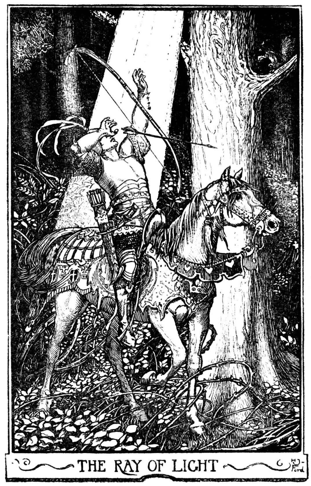

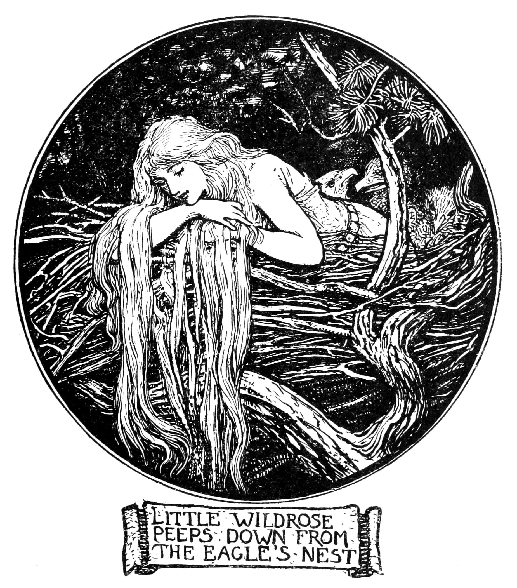

像皇帝曾经想过的那样，她们轻蔑地抬起头来说：“她会成为一个好皇后的！”她们读过那么多书，可以说是见多识广，似乎能猜想出那姑娘想干什么。

正当人们对那张通告不再抱什么希望的时候，一个老妇人从人群中走出来对传令官说话了。她看上去虽然不算很老，可是长得很丑，驼背，秃脑袋。传令官们看到她这副样子，忍不住放肆地大笑起来。她说：“我可以告谶你们，树预上的姑娘在哪里。”可是他们反而笑得更加响亮。

“走开吧！老巫婆！”他们喊道，“别给我们带来坏运气！”可是她还是站在那里不动，说她是唯一知道到哪里去找那姑娘的人。

“带她去吧！”年长的传令官终于说，“皇帝的命令说得很清楚，不论是谁，只要知道一点关于那姑娘的消息，立刻带他到王宫里去。让她上马车，跟我们一起走。”

于是就这样，老妇人被带到王宫里来。

“你说，你可以把那姑娘从森林里带到这儿来？”皇帝坐在御椅上问道。

“是的，尊敬的陛下，我说到做到。”她说。

“那么，立刻就带她走。”皇帝说。

“先给我一只水壶和三脚架。”老妇人请求说。皇帝命令立刻给她带来。老妇人把它们拿起来，系在腰上就走了。王子走在最前面，然后是王室里的人马，老妇人跟在后面。

啊！老妇人走路时弄出来的声音有多么响亮！她唠唠叨叨地和自己说个不停，还不断地敲打那个水壶，声音那么大，好像一群吉普赛人正在走过来一样。可是，等他们来到森林前的时候，她叫他们停下来，在外面等着，自己一个人走进那黑森林。

她在小野玫瑰住的树下停下来，找来一些干树枝，点起一堆火。然后，她把三脚架支在火上，把水壶搁在三脚架上。可是，水壶不知道是怎么回事，老妇人每次把它搁上去，它都要滚下来，发出叮叮当当的响声，好像是着了魔似的。如果不是在树上一直看着的小野玫瑰感到不耐烦了，开口说话，事情还不知道会怎样。

小野玫瑰看到老太婆那么笨，就开口说：“三脚架在山坡上站不稳，你得动一动它！”

“可是动到哪里去呢？我的孩子！”老妇人看着树顶上的鹰巢说，同时，一只手扶着水壶，一只手扶着三脚架。

“我不是告诉你了吗？这样做不行。”小野玫瑰显得更加不耐烦，“把火生在一棵树的旁边，把水壶挂在树枝上。”

老妇人把水壶挂在一枝小树枝上，树枝马上折断，水壶掉了下来。

“要是你亲手教我怎么做，也许我就明白了，”她说。

姑娘闪电般地从光滑的树干上滑下来，站在愚蠢的老妇人旁边，想教她该怎么做。可是老妇人一把就把她抓住，背到背上，尽快地飞奔起来，一直向森林外面奔去，王子正在那里等她。

王子看到她们过来，热情地迎上去欢迎。他拥抱着那姑娘，当着大家的面温柔地吻她。人们拿来金色的衣服，给她穿上；用珍珠把她的头发装饰起来；让她坐在皇家马车上，前面有六匹世界上最好的马拉着这辆马车。六匹马连停下来喘息的机会也没有，一下子就把她拉到皇宫门前。

婚礼连续举行了三天，婚宴非常丰盛。看到新娘子的人没有一个不说：谁要想娶一个好新娘，就应该到树顶上去找。

（罗马尼亚）

 

## 风笛手蒂图

从前有个穷人，他有许多孩子，多得他无法用面包来喂饱他们。不过，这些孩子不但长得很结实，而且有志气。他们很快就学会帮父母做事。他们稍微长大以后，就出去当佣人。人人都很乐意雇佣他们，因为他们不但干活勤快，而且总是乐呵呵的。

在这十来个孩子当中，只有一个叫他们的父母伤脑筋，这个懒孩子名叫蒂图。不论是骂他，打他，还是好言劝他都没有用。随着年龄的增长，他显得越来越懒散。冬天，他总是蜷缩在温暖的火炉旁边；到了夏天，总爱在树荫底下睡觉。除了睡觉，他别的什么事也不干，只是吹他的长笛。

有一天，他坐在树丛边吹长笛，曲调那么动听，不留神你会以为是鸟在歌唱呢！这时，有一个老人从这里经过。老人在他面前站住，用和气的声音问他：“我的孩子，你想学什么手艺呢？”

“只要我是一个富翁，就用不着去工作。”这孩子回答，“我不想跟谁学什么手艺。叫我像其他兄弟姐妹一样，去给别人当佣人，我受不了。”

老人听到这样的回答，笑了起来：“可是，如果你不去做工挣钱，我看不出你的财富会从哪里来。爱睡觉的猫捉不到耗子。谁要想发财，谁就得动手或者动脑，还得准备日夜操劳，而且……”

男孩子粗暴地打断了他的话：“住嘴，老头子，这些话我听了不止一百次了，它只会从我耳边吹过，谁也别想叫我去打工。”

“你有一种天赋，”老人不理睬他的话，说道，“你只要走出去，吹奏风笛，就很容易赚钱，不但能得到每天吃的面包，还能积蓄一些钱。听我的话，去弄一套风笛来，学会吹奏它，像吹你的长笛一样。只要有人听你的，我保证你永远也不会缺钱花。”

“可是我从哪里弄来风笛呢？”男孩子问。

“头几天，先吹你的长笛，”老人回答，“很快你就能买风笛了。再见！我会回来的，来看看你是否会听我的劝告，是不是会富起来。”说完，他就走了。

蒂图独自留在那里又想了一会老人对他说的话，越想越觉得老人的话有道理。他决定去试试看，老人的计划是否会真的给他带来运气。他不想被人取笑，所以决定谁也不告诉。第二天早晨，他离开了家乡——而且决心再也不回来了。找不到他，他的父母也不怎么放在心上，反而为这无用的儿子有了这么一点志气而感到高兴。他们希望，时间和艰苦会帮助蒂图改掉懒惰和愚蠢的习气。

一连好几个星期，蒂图从一个村庄走到另一个村庄，事实向他证明了老人的话千真万确。他遇到的人都很友好和善良，喜欢听他演奏长笛，还给他食品甚至几分钱作为报答。这些钱他小心地存起来，直到足够去买一套漂亮的风笛。这时，他真正感到自己是走上了奔向富裕的大道。不论到什么地方，都找不到一个吹奏得比他更好、更出色的人。蒂图的风笛叫每一个人都不由自主地跳起舞来。不论什么地方举行婚礼，或者洗礼、宴会等等，蒂图是必不可少的，否则这个晚上就注定要失败。没有几年工夫，他就成了一个遐迩闻名的风笛手，人们会从很远的地方赶来听他演奏。

有一天，他被邀请去参加洗礼。附近一个城市里的许多富人也来出席，他们异口同声地说，一生中还从来没有听见过谁演奏得像他这么好听。他们围住他，称赞他，劝他到他们的城市去演奏，说如果不让他们的朋友有机会欣赏这么好的音乐，那是一种耻辱。

当然，这一切使蒂图感到非常高兴，他愉快地接受了邀请。等演奏结束以后，他收到了许多钱和各式各样的礼物。一个大贵族给他穿上一件华丽的衣服；另一个在他脖子上套上一串珍珠；第三个送给他一套镀银的新的风笛。至于那些妇女、姑娘们把丝绸围巾绕在他那顶插着羽毛的帽子上；她们的母亲给他编织各种颜色的手套，他的手再也不会挨冻了。

要是别人处于蒂图这种地位，对自己的生活也就会感到幸福和满足了。可是，他渴望得到更多财富的念头使他日夜不得安宁，他天天都在想着该如何去更加努力。所以，即使是他的母亲，也会对这个过去只知道到处睡觉的懒孩子感到不可理解。

现在，蒂图已经看得很清楚了，他发财的唯一手段就是他的风笛。他不停地思考着，如何才能叫钱更快地流进自己的腰包。后来他想起曾经听说过的关于昆格拉王国的故事。在那里，所有的音乐家都受到欢迎，而且得到很高的报酬。可是，这个国家在哪里？怎么样去？随便他怎样苦思冥想，都回忆不起来。绝望之中，他来到海边，沿着海岸徘徊，希望能找到一条船，能带他到想去的地方去。后来，他来到纳尔瓦城，看到有几只商船正停泊在码头上。

叫他高兴的是，有一只船过几天正好要开到昆格拉去。他赶紧上船去问船长，可是船票贵得使精明的蒂图难以忍受。虽然他给他们演奏风笛，而且尽可能地吹得非常出色，可是船长还是不肯减价。正当蒂图准备上岸时，运气再次降临到他头上。一个听过他演奏的年轻海员偷偷地来找他，答应把他藏在船上，不让船长看见。

第二天晚上，天黑以后，蒂图悄悄地来到甲板上。年轻的水手把他藏在一个角落里，两个大木桶之间。在其他人看不见的时候，水手还给他送来吃的和喝的。

等船远离海岸，再也看不见陆地以后，水手想出一个办法来，想帮蒂图摆脱尴尬的困境。等半夜里大家都睡觉，轮到他值班时，他把蒂图叫到甲板上来，在他的腰间系上一根绳子，然后把绳子的一头小心地结在船上的另一根绳子上。“现在，”他说，“我要把你扔到海里去。你掉到海里以后立刻喊救命。等你看到海员们过来的时候，把腰里的绳子解开，告诉他们说，你从岸边一直跟着船游过来。”

开始，蒂图不怎么喜欢这个计划，因为海上风浪很大。不过，他是个游泳好手，而且水手向他保证，不会有什么危险。

蒂图一掉下大海，他的朋友立刻就去喊醒同伴，说他敢肯定海里有人跟在船后面。他们都上了甲板，让他们吃惊的是，这个人就是前两天和船长讨价还价要搭船的人。

“你是个鬼魂，还是个快要淹死的人？”他们靠着船舷战栗着问他。

“你们要是不救我，我真的就要死了。”蒂图回答，“我已经筋疲力尽了。”

船长抓起一根绳子扔给他。他用牙齿把绳子咬住，然后偷偷地解开腰间的那根绳子，不让他们看见。

“你是从哪里来的？”蒂图被救上船以后，船长问。

“我从码头开始一直跟着你们，”他说，“一路上我害怕得要命，怕力气用完了命就没有了。我想跟着船游到昆格拉去，因为没有钱，买不起船票。”

船长听了这些话，心软了，和蔼地对他说：“你应该庆贺自己没有被淹死。既然你那么想到昆格拉去，我就免费送你去吧！”于是船长给他干的衣服穿上，给他一个铺位睡觉。蒂图和他的那位水手朋友为他们的诡计得逞而暗自高兴。

在以后的航行中，船员们更加器重蒂图，把他看得比自己更高。他们活到现在，还没有看到一个人能够像他一样，在海里游那么长的时间。这些当然让蒂图感到很开心，虽然他心里明白，他并没有做什么值得这样尊敬。为了报答他们，他演奏风笛给他们听，让他们高兴。

几天以后，他们来到了昆格拉。他那神奇的游泳故事使他结交了许多朋友，大家都想亲耳听听他怎么说。要不是蒂图整天提心吊胆，害怕有人会叫他证明一下他那惊人的游泳本领，拆穿他的西洋镜的话，一切都太美妙了。与此同时，他对这个城市的繁华有些感到眩惑，他比以往更加强烈地希望成为富人中的一员。那些富人对自己所拥有的一切似乎并不在乎。

他在街道上徘徊了好多天，想找个需要用人的人。虽然不止一个人想雇佣他，可是在他看来，他们都不是那些能让他很快就富起来的人。等他几乎下了决心，下一次机会再也不能放弃时，他恰巧敲开了一个巨商的门，这家正需要一个厨房帮手。

在这个商人家里，他第一次看到，昆格拉这块土地上的富人是多么了不起。在其他国家里，水桶和盛具都是用铁、铜或者是锡制作的；而在这里，是用银，甚至是金来制作的。食品在银做的锅子里烹调，面包在银做的炉子里烘烤，而那些盘碟和盖都是金的，连猪的食槽也是银的。

看到这一切，使蒂图变得更加贪婪。“这些不停地在我眼前闪烁的财富，对我来说有什么用？”他想，“它们又不是属于我的。靠做厨房帮手挣钱，我永远也不会发财，哪怕是他们给我一个月的工资相当于别的地方一年工资。”

这时，他在这里干活已经整整两年，也存了一笔数目不小的钱。他那迫不及待地想存钱的念头已经到了这种程度，要不是主人开口，他决不会去买一件新衣服。“我的房子里不允许有肮脏的人。”主人有时会这样说。这时候，蒂图会心情沉重地用下个月的工资去买件便宜的衣服。

有一天，商人举行盛大的宴会，庆祝他最小的孩子洗礼纪念日。为此他送给每个佣人一件漂亮的外衣。蒂图喜欢穿不花钱的漂亮衣服，所以那个星期天，他穿上这件大衣到美丽的花园里去散步，那里阳光明媚的时候总是有不少的人。他在一棵树的树荫下坐下，看着来来往往的人群。过了一会，他开始感到很寂寞，因为没有人认识他。

突然，他的眼睛落在一个老人身上。这老人看上去很熟悉，可是想不起来什么时候，在什么地方见过。他看着老人好一会，直到老人离开拥挤的人行道，在一棵酸橙树下的草地上坐下。那里离蒂图坐的地方有一段距离。接着，年轻人站起来慢慢地走过去，以便从近处看得清楚一些。这时候，老人笑了，向他伸出手来。

“你的风笛吹得怎么样了？”老人问。蒂图立刻想起他来。他拉着老人的手，把他带到一个安静的地方，告诉他自从上次分手以后所发生的一切。老人边听边摇头。等蒂图都说完以后，他说：“你是个傻瓜，永远是个傻瓜，世界上还有像你这样傻的人，用自己的风笛去换一把厨房帮手的勺子吗？你演奏风笛一天挣到的钱，足以抵得上厨房帮手半年的工资。回家去吧！拿起你的风笛，到这里来演奏。你很快就会看到我说的是不是真话。”

蒂图不怎么喜欢他的劝告，他怕人们会取笑他，而且，他已经很久没有碰风笛了。可是老人坚持着，蒂图终于同意听他的话。

蒂图拿着风笛回来后，老人对他说：“坐在河堤上，在我身边坐下，开始演奏吧！用不了多久，人们就会围拢来。”

蒂图照他的话去做，开始并不怎么用心，可是吹出的调子比他所记得的还要动听。他吹着，吹着，人们停住了脚步，也不再说话。他们安静地站立在他周围。演奏一会以后，他拿着帽子绕了一圈，整元整元的钱，还有小银币，甚至金币，都不断地扔入他的帽子里。蒂图又奏了一些曲子表示感谢，然后就动身回家。一路上听到两边的人都在不停地称赞他：“多么了不起的风笛手，下个星期天再来吧！我们请求你。”

“我对你怎么说来的？”他们从公园门口走出来的时候，老人说，“吹两个钟头风笛是不是比整天洗碗碟快活？我已经第二次向你指明该走哪条路了。放聪明一点，要想办法抓住牛角，这才是关键，否则运气就会从你身边错过。我再也不能指点你了，所以仔细地听我说，照我的话去做。每个星期天下午都到公园里来，坐在酸橙树下面，为大家演奏。带一顶深一点的毛毡帽来，放在你的脚下。这样人人都可以投钱进去。如果有人邀请你到宴会上去演奏，要愉快地接受下来，但别忘了要一定的报酬，说你愿意接受他们认为应该给的一切。这样你会得到多得多的钱。也许有一天，我们又会走到一起，那时候我要看看你听我的话听到什么程度。那时我们再见吧！”说完老人走了。

像上一次一样，老人的预言变成了事实。虽然蒂图一开始还不能完全照他的话去做，他还得去完成他的帮厨职责。与此同时，他定做了些好衣服，每个星期天穿着它们到公园里去演奏。到了晚上数钱的时候，总是发现比上个星期多。后来，他终于自由了，能够按照自己的意愿去安排。他接到的邀请越来越多，根本安排不过来。晚上，人们习惯于到店里去喝点什么，店主总是请求蒂图到店里来为他们演奏。就这样，他变得那么富有，很快就有了一套镀金的银风笛，在阳光或火光的照耀下会闪闪发光。在昆格拉，找不到另一个比蒂图更骄傲的人了。

没有几年工夫，他就有了许多钱。即使在人人都是富翁的昆格拉，他也称得上是个有钱人。也就是在这个时候，他才有空闲想起，他也曾经有过家，有父母和兄弟姐妹。现在，他想去看看家，看看他们。让他们看一看，他的风笛吹得多么好。这一回，他用不着藏在船舱里。如果他愿意，可以租下最好的客舱，甚至买下一条船。所以，他把所有的珍宝都收集起来，放在一个大箱子里，把它送到第一艘开往他家乡的船上去，然后怀着愉快的心情随船而去。

航行开始的时候，风轻轻地吹着。可是没有多久，风越来越大，到了晚上就变成八级大风。一连两天，船顶着大风航行，他们希望能平安地渡过这场风暴。可是，船突然撞在岩石上，而且开始下沉。船长命令放下救生小船。蒂图和三个水手登上了一只小船，还没有等他们离开大船，一个巨浪扑过来，把他们连人带船吞没。幸运的是，蒂图抓住了一根从眼前漂过的木桨，才没有沉下海底。当太阳升起，大雾散开以后，他看到自己离岸不远了。大海还很汹涌，他用尽平生的力气拼命地游着，挣扎着爬上岸去。这时，他已经是筋疲力尽，和快死去的人差不多了。他很快地就睡着了。

等他醒来的时候，他爬起来察看这个海岛，看看岛上有没有人。虽然他发现岛上到处都有河流和果树，可就是找不到人和野兽的踪迹。等找得累了，他坐下来开始思索起来。

也许在他的一生中，他第一次没有一开始就想到钱。这时候，他心里想的不是沉入海底的财宝，而是他对父母的所做所为：他小时候的懒惰和不听话，他对父母没有尽到做子女的责任。

“这时候如果有野兽来把我撕成碎片，”他痛心疾首地对自己说，“那也是我活该！我的所得都到海底去了。啊！来得快，去得也快。奇怪的是，我感到只要我的风笛还在，我对这些都不在乎。”他站起来，又向前走了一些路，直到看见在一棵很大的树上，绿叶之中有许多红红的大苹果在闪亮。他摘下一些苹果，贪婪地吃起来。吃完以后，他伸开双手和双脚，躺在柔软的草地上，睡着了。

早晨，他跑到最近的河边去洗脸。可是，他恐惧万分地在河水里看到了自己的脸。他看到自己的鼻子像苹果那样红，而且一直长到他的腰间。他跳起来，以为自己是在做梦。他又伸出手来，啊！这可怕的事竟然是真的！

“啊！为什么野兽不来把我吃掉？”他哭泣着，喊叫着，“我永远永远也不能回到人的中间去了！要是大海把我吞没了，我现在该有多么幸福！”他双手抱着头痛苦不堪。他的悲伤那么巨大，把他弄得疲惫不堪，饥饿万分。他四处张望，想找点东西吃。他看见就在头顶上，有一树熟了的棕色栗子，就摘下一把来吃。

奇怪的是，吃着，吃着，他觉得自己的长鼻子越来越短。过了一会儿，他壮着胆子用手去摸它，又到河边去照一照。是的，没错，鼻子又像原来一样短了，也许可能还短了一些。

在发现这个秘密的欢乐之后，蒂图又做了一件非常勇敢的事情。他从口袋里拿出一个苹果来，小心地咬了一小口！立刻，他的鼻子长到下巴了。想到它还会再长，他怕得要死，赶紧吞下一个栗子，恐惧地等待着结果。假如那长鼻子缩回去只是偶然的！假如栗子或别的什么都不能让它缩回去！如果是这样，那么他的愚蠢就把自己的一生给毁了！

啊！不！他猜对了！用不了鼻子伸长那么多时间，鼻子已经缩回到原来的大小了。“这也许会让我走运！”他高兴地对自己说。他又摘了一些苹果，把它们装进一个口袋；再采下足够的栗子，装进另一个口袋。第二天，他用一些树枝编了个篮子，以便在能离开岛的时候多带上点儿这些宝贝。

这天晚上，他梦见他的朋友——老人对他说：“由于你对失去财宝并不伤心，只是怀念你的风笛，我将送给你一套新的风笛。”

第二天早晨他醒来的时候，看到篮子里有一套新的风笛。他高兴地拿起风笛，吹起一支他所喜爱的曲调。他吹着，吹着，心中又燃起了希望。他抬头向大海张望，希望能看到船的影子。啊！是的！有一只船在径直地向岛驶来。蒂图手中拿着风笛，向海岸奔跑过去。

船上的船员知道这个岛上没人居住，看到有人站在岸上向他们招手，感到非常惊讶。一条小船从大船上放下，两名水手把船划过来，想看看这个人是怎样到岛上来的，是否想离开。蒂图把沉船的事对他们说了。船长同意让他上船，并把他送回昆格拉。蒂图非常感谢他们的帮助，用风笛来表达他的感激之情。船上的人什么时候请他吹，他都同意。

船开得很快。没有多久，蒂图又重新出现在首都昆格拉的街道上，一边走一边吹着风笛。自从他走了以后，这里的人就再也听不到这么好的音乐了。他们高兴地围拢过来，口袋里有多少钱就给他多少钱。

他关心的第一件事，是给自己买些非常急需的衣服，而且式样必须是外国流行的。等这些都准备好以后，有一天，他提着一小篮子那独特的苹果来到皇宫。没有多久，皇宫里的一个仆人从这里经过，买下了所有的苹果，还请求他再多带些苹果来。蒂图答应以后赶紧走开，好像有一头野牛在追赶他似的。他非常害怕那仆人会马上拿起一个苹果来吃。

不用说，一连好几天，他没有再拿苹果到皇宫里来卖，而是远远地躲在城市的另一头，带上长长的黑胡子把自己伪装起来，这样恐怕连他的亲生母亲也认不出来。

自从他那天早晨走进城堡以后，整个城市都沸腾起来，到处传说皇帝一家发生了非常可怕的不幸。说是不但皇帝，连皇后，还有他们的孩子吃了一个陌生人卖的苹果，都病得很厉害。最有声望的医生和药剂师都急急忙忙地被招进皇宫，可是他们都摇着头走出来。他们一生从医的经历中，从来没有看到过这样奇怪的病。后来也不知道是怎么回事，慢慢人们传说，那病和鼻子有关。

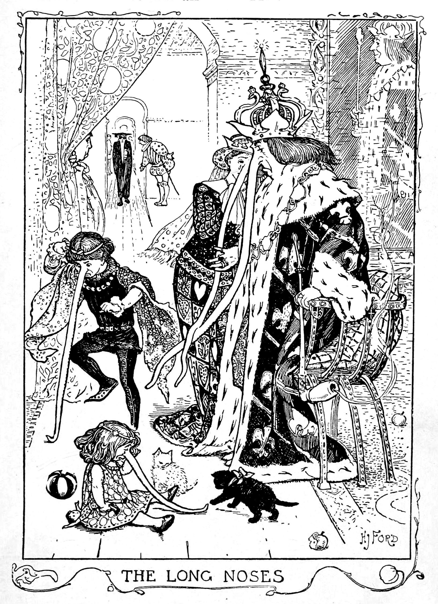

这样大约过了一个星期，皇帝听到了一个消息，说是城市另一头的客栈里住着一个人，他能医治各种各样的疾病。皇室的马车立刻被派出去，要以最快的速度把这个魔术师带回来，说只要他能让皇帝一家的鼻子缩回原来的样子，就送给他数也数不清的财富。

蒂图在期待着这一次召见，昨天晚上，他花了整整一夜改变自己的容貌。他化装得那么成功，丝毫也没有风笛手和苹果贩子的痕迹。他上了马车，向皇宫急驰而去。皇帝这时正焦急地数着每一分钟。他和皇后的鼻子这时候已长到一米多长，还不知道它长到什么程度才会停下。

蒂图当然考虑过，不能直接用野生的栗子来给皇帝一家治疗，那样会引起怀疑。所以他已经小心地把栗子磨成粉末，一包一包地包好，以便能放入口中吞下。他给皇帝一包，给皇后一包，并且嘱咐他们，要等到晚上上床熄灯以后才能吞下，而且还要躺着几个钟头不要动，这样才有可能有救。

国王听到这些，高兴极了，即使是给蒂图半个国家，他也会乐意。可是，风笛手已经不像因沉船而困在海岛之前，那么贪婪地想要钱了。他说，他只要有足够的钱，能够买下一小块庄园，在庄园里舒服地度过余生也就满足了。然而，国王还是命令给他三倍的钱。蒂图来到码头，用一些钱订了一只小船，准备乘它回到自己的家乡。

一路上风相当柔和，十天以后，他看到了几乎已经忘记了的家乡海岸。再过几个钟头，他就站在自己的老家门口了。他的父亲，还有三个姐妹，两个兄弟出来热情地欢迎他。他母亲和其他兄弟在几年前去世了。

大家见过面以后，他开始询问城市附近有没有合适的小庄园出卖。小庄园买下来了，第二件事就是娶个妻子和他在庄园里一起过日子。这也花不了多少时间。那些参加婚礼的人都说，他们今天最快乐的时候，就是互相道别准备回家之前，蒂图为他们演奏风笛的时刻。

（匈牙利）

 

## 佩珀勒罗

从前有一个国王和王后，他们有一个儿子，国王很爱他的儿子。可王后就不一样了，她是个坏女人，看到王子就恨。更加不幸的是，在王子十二岁的时候，国王去世了，把他一个人孤独地留在世界上。

因为人们知道王后有多坏，所以他们让她的儿子而不是她本人登上了王位。王后因此非常气愤，她寝不安席，食不甘味，直到想出一个计划来要把儿子除掉。幸好年轻的国王既聪明又谨慎，对她太了解，所以不信任她。

服丧期过去以后，有一天，国王命令做好一切准备，要举行一次大规模的狩猎。老王后假装为他的自娱活动感到高兴，并且宣布要和他一起出去。

“不！母亲！我不能让你去！”他回答，“地面崎岖不平，你的身体并不强壮，恐怕不适应。”可是他的话等于耳边风。等黎明时分，号角吹响的时候，人们看到老王后也出来了。

整整一天他们马不停蹄，因为这次打猎实在是太精彩了。可是到了晚上，母亲和儿子发现他们来到了一个完全陌生的地方。他们迷失了方向，不知道该往哪里走。这时他们遇见一个人，就请求让他们住下来。

“跟我来吧！”那人高兴地说，因为他是个吃人的妖魔。国王和母亲跟着他走进了他的屋子。走进去以后，他们才发现来到了一个多么可怕的地方。他们双膝跪下，答应只要放过他们，就给他许多许多钱。妖魔看到王后的美貌，心就软了，答应不会伤害她。可是，他刺杀了国王，吩咐把他的尸体绑在马背上，把马放到森林里去。

妖魔恰巧挑了一匹昨天刚买来的马，他不知道这是一匹魔马，否则也不会笨到去挑选它了。马刚驮上国王的尸体，就放开四蹄向仙女们居住的家里狂奔起来。到了仙女的家门口，它用蹄子来敲门。仙女们听到敲门声，起初不敢来开门。她们从楼上的窗口向外观望，看看是不是会来伤害她们的巨人或妖魔。

“啊！看哪！姐妹们！”第一个从窗口伸出头去看的仙女喊起来，“是一匹马在敲门。它背上捆着一个死去的男孩子，他可是世界上最漂亮的男孩！”

仙女们跑下楼，让马进来，把捆着年轻国王的绳子解开。她们围着他，欣赏他的美貌，相互耳语说：“我们要把他救活，让他留下来做我们的兄弟。”于是她们就这么办了。他们像兄弟姐妹一样，一起住了许多年。

慢慢地，小孩长成了大人。年纪最大的仙女对她的妹妹们说：“现在，我要和他结婚，这样，他就真的成了你们的兄弟了。”就这样，年轻的国王和仙女成亲了，他们幸福地一起在城堡里生活。可是，尽管他爱妻子，但还是思念着外面的世界。

后来，这种思念越来越强烈，他再也按捺不住了。他把仙女们都叫来，对她们说：“亲爱的妻子和姐妹们，我要和你们分别一段时间，到外面的世界去看看。我会经常想念你们，有一天会回到你们这里来。”

仙女们都哭了，请求他继续留下。可是他不听。后来，大姐姐，也就是他的妻子对他说：“假如你真的要抛弃我们，那么就带上我的一绺头发，你会发现，在需要的时候会对你有用。”她剪下一长绺头发递给他。

年轻人翻身上马，整整一天马不停蹄。到了晚上，他发现自己落在沙漠之中，周围毫无人烟，连一间小屋也看不见。“我该怎么办呢？”他想，“要是我在这里睡着了，野兽就会来把我和马吃掉，什么地方也不能去了。”

这时，他突然想起仙女的礼物，就拿出仙女的卷发来说：“我要在这里造起一座城堡，城堡里有食物，有佣人，有一切能使我今晚舒服的东西。此外，还要给我的马准备好马厩和马槽。”一座他所希望的城堡立刻出现在他的面前。

他用这种方法，走遍了许多国家。后来，他来到由一个伟大的国王统治着的土地。他把马留在城墙外面，自己穿上穷人的衣服来到王宫。这时，正从窗口向外观望的王后看到他走来，心中充满了怜悯，就叫一个仆人去问他是谁？想要什么？

“我是一个外地人，”年轻人回答，“而且很穷，我来是想找份工作。”

仆人把他的话对王后说了。王后说：“我们需要的人都有了。我们有看门人，有清洁工，王宫里还有各种各样的仆人，我们只缺一个放鹅娃。告诉他，如果他愿意，可以来当我们的放鹅娃。”

年轻人回答，他很愿意做个放鹅娃，这就是为什么他得了个佩珀勒罗的浑名。为了不让别人看出他的地位比放鹅娃高，他用泥土来抹自己的脸和破衣服，把自己弄成一个令人讨厌的人，在街上碰到他的人都远远地躲开。

“快去把你自己洗一洗吧！佩珀勒罗！”王后有时会这样说。他的活干得那么好，王后对他很感兴趣。

“啊！不用，尊敬的王后，洗干净了我反而觉得不舒服。”他说，然后吹着口哨赶着鹅走了。

有一天，供应城里面粉的磨坊厂出了问题，城里没有面包了，国王的军队断了粮。国王听到这个消息，就把厨师找来，对他说，明天早上，他必须烘烤出七炉面包来。

“可是，尊敬的陛下，这是不可能的！”可怜的人绝望地喊叫起来，“磨坊厂刚刚开始转动，面粉要到今天晚上才能出来，一个晚上用一个炉子怎么能烘烤出七炉面包呢？”

“那是你的事情，”国王决定了的事情，就不再理睬别人说什么了，“如果你把面包烘出来，我就把女儿嫁给你；要是烘不出来，就用你的头来赔偿”。

这时候，佩珀勒罗恰巧从这里经过，听到了他们说的话，就说：“尊敬的陛下，用不着担心，我来给您烘面包。”

“很好！”国王回答，“但要是你失败了，也要拿头来赔上！”说完就做个手势叫他们都走。

厨师想起他刚刚逃脱的一场灾难，还在嗦嗦发抖。叫他奇怪的是，佩珀勒罗一点也不在乎。到了晚上，他像平常一样上床睡觉。

“佩珀勒罗！”其他仆人看到他若无其事地脱衣服，喊起来，“你不能睡觉！今天晚上，你要一刻也不能停地工作。记住！国王可不是随便开玩笑的！”

“我真的要先睡一会。”佩珀勒罗一边伸懒腰，一边打哈欠。他一头倒在床上，很快就睡着了。

约莫过了一个小时，仆人进来摇摇他的肩膀。“佩珀勒罗，你疯了吗？”他们说，“快起来，否则你就要人头落地！”

“啊！让我再睡一会吧！”他说。尽管仆人们一个晚上喊醒他好几次，他总是这句话。

后来，东方破晓了，仆人们冲进他的房间，喊道：“佩珀勒罗！佩珀勒罗！快起来！国王来了！你一个面包也没有烤出来，他肯定要杀你的头了！”

“啊！别那么大声嚷嚷！”佩珀勒罗一边说着，一边穿上衣服。他手中拿着那绺头发，走进厨房。看！厨房里堆满了面包！……四炉，五炉，六炉，还有一炉等待着出笼。仆人们吃惊地站在那里看着。国王说：“好啊！佩珀勒罗！你赢得我的女儿了。”心里想：

“这个家伙肯定是个魔术师。”

可是，当公主听到等待着她的是什么命运时，嚎啕大哭，说她永远、永远也不会嫁给肮脏的佩珀勒罗。可是，国王并不理睬她的眼泪和请求。过不了多久，婚礼就隆重地举行了，尽管新郎不肯花点力气去洗一洗，还是像以前那么脏。

到了晚上，他像往常一样到鹅棚里去睡觉。公主跑去对国王说：“父亲！我请求你把这可怕的佩珀勒罗处死。”

“不！不！”国王回答，“他是个伟大的魔术师，在处死他之前，我必须先找出他的魔力的秘密，然后，我们等着瞧吧！”

不久，战争爆发了。王宫里人人都在忙着擦亮他们的盔甲，磨快他们的宝剑。国王和他的儿子将率领军队出战。这时，佩珀勒罗离开他的鹅，来对国王说，他也想出去参战。国王答应他，叫他自己到马厩里去挑一匹喜欢的马。佩珀勒罗来到马厩，仔细地看着每一匹马。可是他不去挑那些皮毛像缎子一样光亮，饲养得最健壮的马，而是选了一匹跛脚的瘦马。他安好马鞍，骑着它跟在国王军队的后面。

没有多久，他停下来对他们说：“我的马走不动了，你们只好自己去打仗了。我要留在这里，做泥人来玩打仗游戏。”那些人都笑他那么孩子气，骑着马跟着国王走了。

他们刚走远，佩珀勒罗就拿出仙女的头发来，希望能得到世界上最好的盔甲，最锋利的宝剑和跑得最快的马。一分钟以后，他就以最快的速度奔赴战场。

这时，战斗已经开始。佩珀勒罗赶到的时候，敌人已经占了上风。很快，形势就发生了变化。这个陌生的骑士左冲右突，他的宝剑刺穿了最坚硬的盔甲和最结实的盾牌。他确实是所向披靡。敌人在他面前落花流水，以为有一支像他一样攻无不克的军队正在冲过来，他只是为首的第一个。

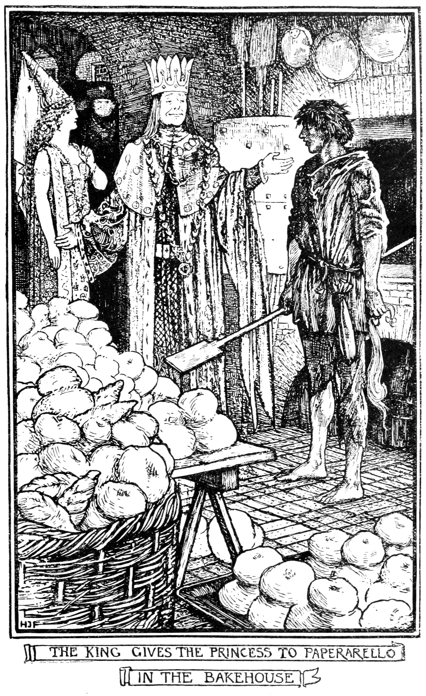

战斗结束以后，国王派人把他叫过来，感谢他的及时支援，问他希望得到什么奖赏。

“尊敬的陛下，我什么也不需要，只需要您的小手指头。”他回答。国王砍下小手指头，把它递给佩珀勒罗。他鞠了一躬，把小手指头藏进大衣，然后离开战场。

等部队回来时，他们看到佩珀勒罗还在玩着他整排的小泥人。

第二天，国王又出去打仗。佩珀勒罗还是骑着他的跛脚马出来。像昨天一样，他在半路停下来，玩他的泥人军队。然后又希望得到盔甲、宝剑和一匹马，它们比昨天的还要好，接着就骑上马追赶部队。他来得正是时候，敌人几乎就要击退国王的军队。士兵们都在议论纷纷，说那个陌生的骑士如果不快点来支援他们，他们就必死无疑。

忽然有人喊起来：“再坚持一会儿，我看见他过来了。他的盔甲比昨天的更明亮，他的马跑得比昨天更快。”于是，他们又勇气倍增，拼死作战，直到骑士赶来投入这场激烈的战斗。像昨天一样，敌人在他的面前退却了，没有几分钟，国王就获得了决定性的胜利。

胜利者想到的第一件事，是把骑士叫过来，感谢他的及时支援，问他需要什么奖赏以表示感激之情。

“尊敬的陛下，您的耳朵。”国王说话得算数，于是他把自己的耳朵割下来奖给骑士。

佩珀勒罗向国王鞠躬，把耳朵藏进大衣，骑着马走了。到晚上军队凯旋而归的时候，他还是坐在路旁玩着泥人。

第三天，同样的事情又发生了。这一回，他开口要国王的鼻子作为奖赏。一个人丢失鼻子，要比丢掉小手指头和耳朵严重得多了。国王踌躇了一会，不知道该怎么回答才好。这时，他想起自己总是以讲信誉而骄傲，就把自己的鼻子割下来交给佩珀勒罗。佩珀勒罗向国王鞠过躬以后就骑着马走了。

晚上，国王带着军队得胜归来，看到佩珀勒罗还是在路边玩泥人。他站起来对国王说：“您知道我是谁吗？我就是您那肮脏的放鹅娃。是您给了我您的手指、耳朵和鼻子。”

那天晚上，国王坐下来吃晚饭的时候，佩珀勒罗进来，把国王的小手指、耳朵和鼻子放在桌子上，对尊敬的国王，还有站立在一旁的随从官员们说：“我就是那个战无不胜的骑士，是我三次骑着马来支援你们。我不是像你们想象的那样，是个放鹅娃，而是一个国王的儿子。”说完以后他走出去，把自己洗干净，换上新的好衣服，走进大厅。他看上去那么英俊潇洒，公主一下子就爱上了他。可是他并没有注意公主，对国王说：“您非常仁慈地把您的女儿嫁给我，为此我感谢您。可是我有个妻子在家里，我更加爱她，现在就要回到她身边去。为了友好地告别，我希望您的小手指、耳朵和鼻子仍然回到它们原来的地方去。”说完，他和所有的人告别，回到自己的家和可爱的妻子身边，他们幸福地生活了一辈子。

（匈牙利）

 

## 魔术师的礼物

从前，在森林中的一间小屋里，住着一个老人。他的妻子已经去世，只留下一个儿子，老人非常爱他。离他们的屋子不远处，有一片白桦树，黑琴鸟就在白桦树上筑巢。小伙子常常请求父亲让他去射几只鸟，可老人总是不许他去做这种事情。

有一天，父亲出去收集柴火，比往常走得远些。小伙子把弓箭拿出来，向一只正飞回巢的鸟射去。可是他瞄得不太准，鸟只是受了伤，落到地上。小伙子跑过去想把它抓住，但是不管他跑得多么快，总是离鸟只差那么一点距离，尽管鸟连跳带跑速度并不快。小伙子全神贯注，只顾追赶，没注意已闯入森林深处，这里他从来没有来过。这时，再追下去就太愚蠢了，于是他转身回去。

他想，沿着追过来的路回去，应该是很容易的事，但一路总是有许多不知去向的路口。他想找一间房子，好歇歇脚，问问路，可哪里有房子的影子？他不敢停留，因为天气变冷了。而且他还听说过，这片森林里有许多狼。

夜幕降临了。他开始听到有点声音就胆战心惊。突然，一个魔术师向他跑过来，后面紧紧地跟着一群狼。这时候，小伙子的勇气又上来了。他拿起弓箭，向最大的一只狼射了一箭，不偏不倚地穿过它的心窝。接着，他连发几箭，那些没死的狼都吓得四处逃命。魔术师对他的救命恩人真是感激涕零，说年轻人如果和他一起回家，一定会得到报答。

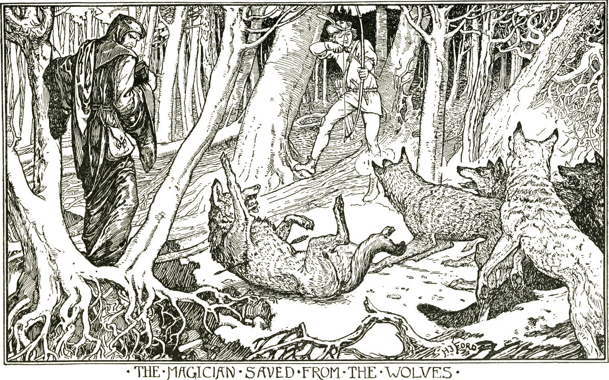

“对我来说，让我留宿一夜比什么都好，真的。”小伙子回答，“我在森林里到处乱走已经整整一天，不知道走哪条路才能回家。”

“跟我来吧！你肯定又饿又累。”魔术师说完就在前面领路，朝他家里走去。一进屋，小伙子就倒在一张床上，很快就睡着了。主人又回到森林里去弄点吃的，家里的食品柜已经空了。

魔术师出去以后，一个姑娘走进来，她就是这里的女管家。姑娘想叫醒他，先是用脚跺地板，接着又喊又叫，后来就是拼命地摇他，想告诉他这个地方很危险，应该快点逃命。可怎么也弄不醒他，就是偶尔张开眼睛，也很快就闭上。

不久，魔术师从森林里回来，叫姑娘给他们弄点吃的。饭很快就准备好了。魔术师想叫小伙子一起来吃饭，可还是弄不醒他。他们只好两个人坐下来吃饭。吃完饭不久，魔术师又到森林里去打一会儿猎，回来以后想叫醒小伙子，可还是没有办法，他又第三次独自进入森林。

这一回，他走了以后，小伙子醒过来，穿好衣服，到楼下和姑娘说话。姑娘听说他救了主人的命，也就不再说什么叫他逃跑的话了。她说，如果魔术师让他自己挑选报答他的礼物，他就要求得到第三间马厩里的那匹马。

过了一会，魔术师回来了，他们坐在一起吃饭。完了以后魔术师说：“我的孩子，现在请你告诉我，为了报答你的勇敢，你想要什么？”

“把你第三间马厩里的那匹马给我，”小伙子说，“我要赶很长的路才能到家，两只脚恐怕吃不消。”

“哎！我的孩子！”魔术师说，“你要的可是我马厩里最好的一匹马，还有什么别的能满足你吗？”

小伙子宣称，这匹马，而且只有这匹马，才是他想要的。魔术师终于答应了、除了这匹马以外，魔术师还给他一把齐特琴，一把小提琴，还有一支长笛。魔术师说：“你要是碰到危险，先弹齐特琴；如果没有人来帮助你，就拉小提琴；要是还不能解决问题，就吹长笛。”

小伙子谢过魔术师，藏好自己的宝物，就骑上马走了。走了几里路以后，马突然开口说话，这使他大吃一惊。马说：“你现在回家没有什么用，你父亲只会打你。让我们先去拜访一些城市，我们肯定会碰到一些好运气。”

这个提议使小伙子感到很高兴。他觉得自己已经快成大人了。他想，是到了去看看外面这个世界的时候了。

他们来到一个国家的首都。人人看到他那匹漂亮的马，都停下来观看。后来连国王也听说了这匹马的漂亮，亲自出来看一看。看过以后，他就想把马买下来。他对小伙子说，不论他开出什么价钱，都可以给他。

小伙子犹豫了一会，在他开口之前，马悄悄地对他说：“不要把我卖了，叫国王把我带到他的马厩里去，在那里喂我，那么，他所有的马都会像我一样美丽。”

国王听到马说的这些话，非常高兴，立刻叫人把这匹马拉进马棚，把它关在国王的专用马厩里。真的，这匹马刚张口吃马槽里的谷物，其余的马就好像全都脱胎换骨了似的。这些马中有些是国王的宠儿，国王骑着它们身经百战，岁月和战争也在它们身上留下了烙印。可现在，它们昂首挺胸，健美的双腿有力地踢打着大地，岁月的痕迹好像已从它们的身上消失。

国王又高兴又激动，心都快跳出来了。这时候，喂养这些马的老马夫正站在一旁，眼睛里对这匹神奇的马的主人充满了妒忌和仇恨。他每天都要向国王编造关于这个小伙子的坏故事，可是国王心中有数，不理睬他。后来，老马夫说，小伙子说过，他能找到国王几年前走失到森林里去的战马。直到今天，国王一直在为失去这匹马而伤心。这一回，他相信了马夫编造的故事，派人去把小伙子找来，说：“三天里把我那匹马找回来，否则你就要倒霉。”

小伙子听了他的话，好似五雷轰顶。可是除了向国王鞠躬以外，他还有什么办法呢？他走出王宫以后立刻来到马厩。

“别担心！”那匹马对他说，“叫国王给你一百头牛，把它们杀了，切成小肉片，然后我们就踏上征途，一直走到一条河边。那时，有一匹马会迎着你走出来，不要去管它。不久又会有一匹马出来，也不要去睬它；等第三匹马出来的时候，用我的缰绳套住它。”

事情就像马说过的那样，第三匹马被安全地套上了。这时，小伙子的马又说：“我们走的时候，魔术师的渡鸦会飞过来想把我们吃掉，把一些牛肉扔给它，然后我会像狂风一样地奔跑起来，带着你平安地躲过龙的巨爪。”

小伙子照它的话去做，把国王的战马平安地带回家。老马夫听到这个消息，不禁妒火中烧，盘算着如何才能在国王面前中伤他。后来，马夫想出一个计策，对国王说，小伙子曾夸耀过，他能够把国王几个月前失踪的妻子找回来。国王马上把小伙子叫来，要他像他自己说过的那样，立刻把王后带回家。如果办不到，就砍下他的头以示惩罚。

可怜的小伙子站在那里呆住了，心几乎停止了跳动。把王后找回来？王宫没有一个人能办得到，他怎么行呢？他边走边想，来到了马厩，把头靠在他那匹马的肩上，说：“国王命令我去把他的妻子带回来，可她已经失踪了那么久，没有人能够告诉我关于她的任何消息，叫我到什么地方去找？”

“快活些！”马回答，“我们想办法找到她。你要做的，只是骑在我背上，到昨天我们去过的那条河边，我会浸入水中，恢复我原来的形状。我就是国王的妻子。是魔术师把我变成了这个样子，你把我从魔术师的手中救了出来。”

小伙子高兴地跳到马鞍上，骑着马来到河边。他从马上下来，让马走入河水中。马头浸入水中以后，它那黑色的皮消失了，从河里走出一个世界上最漂亮的女人。她微笑着向小伙子伸出手，走过来。小伙子握着她的手，把她带回王宫。

国王看到失去的妻子又回到自己的身边，又惊奇又快活。为了感谢小伙子把王后救出来，国王送给他许多礼物。

你大概会以为，经历了这些事情以后，可怜的小伙子会从此过太平日子。可是，不是这么回事，马夫还是像以前一样，非常恨他，想出一条更加恶毒的计策。这一回，他来到国王面前，对国王说，小伙子做了这些事，非常趾高气扬，说要坐上王位当国王。

国王听他这么一说，暴跳如雷，命令马上竖起一个绞刑架，不用审判，马上就把小伙子绞死。小伙子甚至连为自己辩护一句的机会也没有。

在踏上绞刑架的台阶时，小伙子请传令兵带话给国王，作为最后的请求，请让他在临死前弹一下齐特琴。国王同意了。他从大衣下取出琴来。他的手指刚一碰到琴，发出第一个音符，那些刽子手们立刻就跳起舞来。琴声越响，他们就跳得越高。后来，他们都跳得累坏了，请求饶了他们。小伙子不去管他们，琴声变得越来越欢乐。这样一直跳到太阳下山，他们都筋疲力尽地倒在地下，绞刑只好推迟到明天进行。

齐特琴的故事很快就传遍了整个城堡。第二天一早，国王和王宫里所有的人，还有许多百姓都到刑场来看处死小伙子。他又请求国王允许他拉一会儿小提琴，国王高兴地答应了。

小提琴的声音刚响起，在场的人就高高地举起脚来，开始跳舞，一直跳到天黑，绞刑又不得不推迟。

到了第三天，小伙子请求让他吹一会儿长笛。

“不！不！”国王说，“昨天你让我跳了整整一天舞，今天如果再跳一天我就完了。你不能再奏乐曲了。快！把绞绳套在他脖子上。”

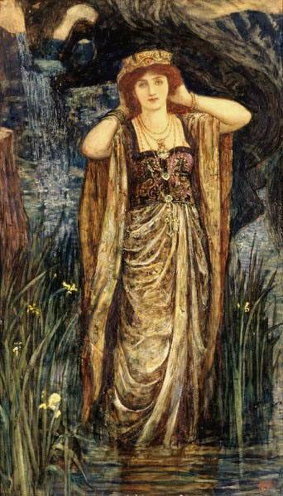

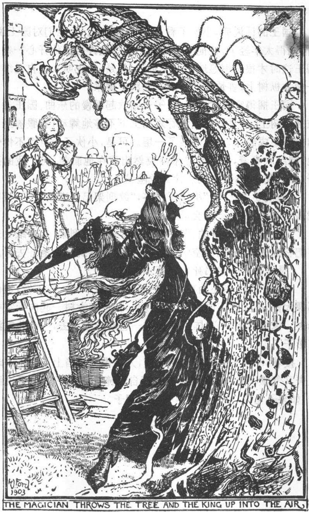

国王的话说完，小伙子看上去非常悲伤。大臣们对国王说：“他死得太年轻了，让他吹一曲吧！这样也许会让他开心一些。”国王这时才很不情愿地勉强同意了，但是，他先叫人把自己绑在一棵大枞树上，害怕乐曲一响又要跳起舞来。

国王捆得牢靠之后，小伙子开始吹起缓慢的乐曲。国王虽然被捆在树上，但身体还是随着乐曲上下不停地舞动，衣服被绳子和树干磨成碎片，皮也磨破了一层。可是，小伙子一点也不怜悯他，继续吹奏着，直到老魔术师突然出现在他面前，问：“我的孩子，你把我叫来，是碰到了什么危险？”

“他们要吊死我，”小伙子回答，“绞刑架已经准备好了，只要我停止吹奏，刽子手就会动手。”

“嗯！我会处理好的。”魔术师说，他拉起绞刑架，像撕纸头一样把它撕成碎片，扔向空中，谁也不知道它落到什么地方去了。

“是谁命令把你吊死的？”魔术师问。

小伙子指了指还捆在大树上的国王。魔术师一言不发，抱住那棵大树，把大树连同国王一起拔起，把他和大树一起向天空中扔去。像绞刑架一样，国王和大树一起向云端飞去，一会儿就没有影子了。

接着，小伙子被宣布无罪释放，人们推选他当上了国王。老马夫又气愤又妒忌，跑到河里去把自己淹死了。不过话得说回来，如果不是他，小伙子就得穷苦一辈子。

（芬兰）

 

## 坚强的王子

从前有个非常爱喝酒的国王。他那么喜欢酒，每天睡觉之前，都要看一看床头是不是挂着一大瓶酒，否则就睡不着。他整天不停地喝，直到迷迷糊糊的，不能处理国事。国家也因此而弄得一团糟。有一天，他出事了，一根大树枝掉下来，正好打在他头上。他从马上掉下来，倒在地上死了。

妻子和儿子为失去他万分悲痛。国王虽然有缺点，但始终对他们很好。悲痛之余，他们抛弃了王位和王国，离家出走，到处流浪，也不在乎要到哪里去。

他们走进一片森林，感到非常累，就坐在一棵树下吃随身带来的面包。吃完以后，王后说：“孩子，我口渴，给我取些水来。”

王子站起来，向一条小溪走去。他听到很近的地方有潺潺的水流声音。

他弯下腰来，用帽子盛起一些溪水，给母亲送去。然后，他回过身来，顺流向上，来到溪流的源头，一块岩石旁。清澈凉爽的泉水从岩石下面涌出，他跪下来想饮几口。这时，他看见一把挂在树上的剑在水中的倒影。王子吃惊地抬起头来。很快，他就爬到树上去，割断挂着剑的绳子，把剑带给他母亲看。

王后看到在这荒芜的地方会有这么贵重的东西，非常惊讶。她把剑拿过来仔细地观看。这把剑精雕细刻，制作奇妙，还装饰着黄金。剑柄上刻着一行字：“谁佩带这把剑，谁就比其他人更强。”王后读到这些字，心中充满了欢乐，她吩咐儿子不失时机地试一试它的威力。于是，他把剑挂在腰上，立刻感到血液里涌出一股强大的力量。他抱住一棵大栎树，把它拔起来，那样子就好像拨一棵草一样。

这一新的发现使王后和她的儿子充满了新的希望。他们继续在森林里行走。不久，天越来越黑，黑得像一堵厚厚的墙，似乎用刀也可以把它切开。他们不想在森林里睡觉，害怕会碰上野兽。他们手拉手，摸索着向前走，直到王子被横在路上的什么东西绊了一下。他看不出那是什么，就弯下腰来把它捡起。那东西很重，他竭尽全身力气，差一点把腰也折断了。后来他终于把它从路上举起并挪开，这时候他才知道那是一块很大的岩石。岩石的后面是一个山洞。洞里很干净，看来是一些强盗安家的地方，不过里面一个强盗也没有。

洞里有一堆篝火在燃烧，王子赶紧把它扑灭，然后叫他母亲进来，保持安静。王子在里面走来走去，仔细地听着是否有强盗们回来的声音。他已经很困了，不管怎么努力，他想自己很快就要睡着了。这时，他听到了强盗们回来的声音。他们一边走，一边喊着，唱着。不过，响声停止了，他竖起耳朵，听到他们在担心地讨论着洞里出了什么事，为什么没有看见篝火像往常一样地燃烧。

“这肯定是我们住的山洞。”听那声音，王子想，这是强盗头子在说话，“是的，我感觉到了门口的那条沟渠。我们走的时候，谁忘了往篝火里加柴火，柴火烧光了。但是没错，这是我们住的地方。现在我们轮流跳过去，跳过去的人喊一声，‘跳！我过来了！’我最后一个跳过去，现在开始。”

站在最近的人第一个跳。可是，他还来不及照头头的命令喊一声，王子的剑已经无声地砍下，强盗的头滚到角落里去了。王子帮他喊了一声：“跳！我过来了！”

第二个人听到信号，也满怀信心地跳过去，命运和第一个一样。没有几分钟，十一个强盗都死了，只留下强盗头子一个人。

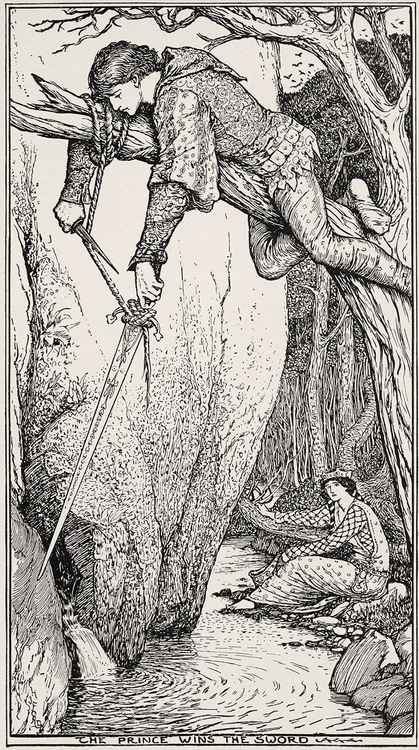

强盗头子的脖子上，恰巧围着他前妻的一条长围巾，所以王子的剑砍下来，他一点也没有受伤。可是，他非常狡猾，他不进行反抗，而是像其他人一样，滚到一边去，像是也被砍死了似的。王子也不笨，有点怀疑他是不是真的死了。不过强盗直挺挺地躺着，装得那么像，王子还是被他骗过去了。

王子把强盗的尸体都拖进山洞的一个小间里，把门锁上，然后和母亲一起在洞里找食物。吃过以后，他们就躺下来安静地睡觉。

黎明的时候，他们都醒过来，发现昨天走进来的山洞，现在已经变成辉煌的城堡，里面到处都有漂亮的房间。王子巡看了一遍，把门小心地锁起来，吩咐母亲在他出去打猎的时候，小心地看管钥匙。

不幸的是，王后像所有的女人那样，没有不想知道的事情。她儿子刚出去，她就把房间的门一个一个地打开，朝里观看，一直查到堆放强盗尸体的房间。如果说地上的血让她昏眩的话，那么，强盗头子在里面走来走去更是让她心惊肉跳。她赶紧转动钥匙把门锁上，跑回自己的房间。

没有多久，王子也回来了，带回一只他猎取的大熊，准备烧了当中饭吃。这只熊够他们吃好多天，所以第二天王子没有出去打猎，而是在城堡里到处查看。他发现，有一条秘密通道一直通向森林里。沿着这条通道走，他来到了一个比强盗们居住的城堡更大、更辉煌的城堡。他用拳头敲门，说想进去。一个巨人，这个城堡的主人说：“我知道你是谁，我和强盗们没有任何关系。”

“我不是强盗，”王子回答，“我是国王的儿子。我把那伙强盗都杀了。你如果不马上开门让我进去，我就破门而入，你的头将要和他们的堆在一起。”

他等了一会，门还是紧闭着。他刚把肩膀靠上去，门就嘎嘎直响。巨人看到把门关着没有用，就把门打开，说：“我看你是个勇敢的青年，让我们友好相处吧！”

王子也非常乐意友好往来，因为他看到了巨人美丽的女儿。从那天起，他经常到巨人的住宅来。

王后在城堡里过着孤独而沉闷的生活。为了解闷，她来找强盗头子。强盗头子极力奉承她，直到她同意嫁给他。由于她很怕自己的儿子，所以她对强盗说，王子下一次到河里去洗澡的时候，就到他床上去把他的剑偷来。没有剑，王子就没有力量来惩罚他的大胆。

强盗头子想，这是个好主意。第二天早晨，王子出去洗澡的时候，他到王子的房间里去，把剑从墙上的钉子上解下来，把它带在自己的腰上。

王子回到城堡，看到强盗头子正在门口等着他，将那把剑在他头上挥舞。他知道，可怕的命运正等待着他，就双膝跪下，请求怜悯。可是，这就像想从石头里挤出血来一样难。强盗头子是饶了他一条命，但是把他的两只眼睛都挖出来，还放在他的手中残忍地说：“在这儿！你好好地留着吧！说不定对你有用。”

瞎了眼的王子哭泣着，摸索着来到巨人的家，把事情的全部经过对他说了。

巨人对可怜的年轻人充满了同情，焦急地问他眼睛到哪里去了。王子把眼睛从口袋里拿出来，一言不发地交给巨人。巨人小心地把它们洗干净，然后装回到王子的眼眶里去。一连三天，王子在黑暗中躺着。三天以后，他又重见光明，不久就和以前完全一样了。

可是，恢复光明也没有使他感到十分的欢乐。他仍然为失去那把剑而痛哭；而且，那把剑还落到了他势不两立的仇敌手中。

“不用着急，我的朋友，”巨人说，“我会给你弄回来。”他把家中领头的奴仆猴子叫过来，对它说：“告诉狐狸和松鼠，叫它们和你一起去把王子的剑给我拿回来。”

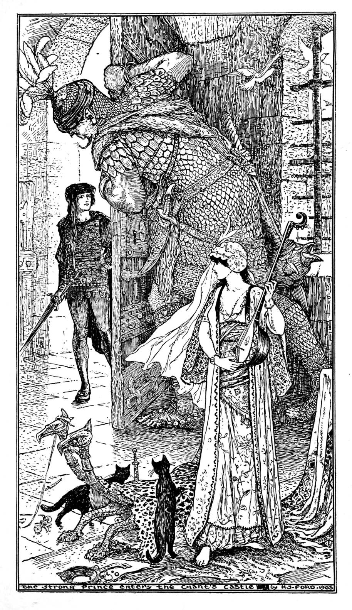

三个仆人立刻出发，你骑在我背上，我骑在它背上，叠罗汉似的走了。不爱走路的猴子通常总是在最上面。它们直接来到强盗头子的房间。猴子从狐狸和松鼠的背上跳下来，爬到房间里去。房间里没人，剑就挂在钉子上。猴子把剑拿下，学王子的样子挂在自己的腰上，它看见王子佩带过，然后跳出房间，爬到两个伙伴的背上，急忙赶回来见主人。巨人吩咐它们把剑交给王子。王子把剑佩好，就全速赶回城堡。

“出来！你这个流氓！出来！你这个恶棍！”他大声地喊叫，“快向我坦白，你都干了些什么坏事；我要让你明白，谁是这个城堡的主人。”

强盗头子听见喊声，赶快跑进房间。他朝挂着剑的墙上一看，剑已经没有了。他立刻回过头来，看到那把剑正在王子的手中闪闪发光。这回轮到他跪下来求饶了。可是太迟了。一报还一报，他怎么对付王子，王子也怎么对付他。瞎了眼的强盗头子摸索着走出去，跌在一个大坑里，一直躺到今天也没有起来。至于王后，王子把她送回到外公那里去，再也不愿意见到她。

王子回到巨人那里，对他说：“我的朋友，你为我做了许多好事，请再为我做一件吧！把你的女儿嫁给我。”

于是，他们结婚了，婚礼那么豪华，世界上所有的国家都听说了。后来，王子一直没有回去继承他父亲的王位，而是和妻子一起安静地在森林里生活。如果他们还活着，那就一定还住在那里。

（匈牙利）

 

## 寻宝人

很久以前，在高山和野林之中有一个小镇。有一天晚上，一群牧羊人聚集在一家客栈的厨房里，谈论过去的事情，讲述他们年轻时的各种奇遇。

头发灰白的老大爷马丁说：

“伙计们，你们都有过精彩的经历。可是我要告诉你们我亲眼看到的更加神奇的事情。当我还是个孩子的时候，我没有家，也没有人照管我。我背着个背袋，在乡村里从一个村庄流浪到另一个村庄。到我稍为大了一些，就在一座山里帮一个牧羊人干活，一帮就是三年。”

“一个秋天的傍晚，我们赶着羊群回家，路上有十只羊走散了。主人叫我回到森林里去，把它们找回来。我带着狗，可是找不到这些羊的踪迹。我们在丛林中拼命地找，一直到天黑了也毫无结果。我对那片森林不熟悉，加上天又黑了，找不到回家的路，只好决定在一棵树下睡觉。”

“到半夜的时候，狗变得烦躁不安起来，发出呜呜的哀鸣声，夹着尾巴缩到我的身边来。看到这些，我知道事情不好了，便朝四处观望，在明亮的月光下，有一个人站在我的身旁。他长着粗浓蓬松的头发，胡子很长，一直悬到膝盖，头上戴着一个花环，身上围着用栎树叶做成的腰带，右手拿着一棵连根拔起的小枞树。看到他，我像一片小杨树叶似的抖起来，心里直打颤。”

“陌生人用手打着手势，意思是叫我跟他走。看到我坐着不动，就用焦急粗哑的声音对我喊起来，‘鼓起勇气来，胆小的牧羊人。我是大山的寻宝人，你要是跟我走，就会挖到许多黄金。’”

“我虽然害怕得浑身发抖，但还是鼓足勇气说，‘离我远一些，邪恶的精灵，我不希罕你的财宝！’听了我说的话，那幽灵龇牙咧嘴地嘲弄我说，‘傻瓜！你这不是在蔑视自己的好运气吗？那么好吧！永远地去过你那衣服褴褛肮脏的日子吧！’”

“他转过身，好像要离我而去。后来又回过头来对我说，‘好好想一想吧！好好想一想，小无赖，我会填满你的背包，我会填满你的钱袋。’‘快走开吧！妖怪！’我说，‘我和你毫无相干。’”

“这个幽灵看到我无动于衷，就不再怂恿我，只是伤心地看着我说，‘总有一天，你会后悔的。’接着，他又喊道，‘仔细听我说，好好地记在心里，等觉悟过来以后也许会有用。有许多黄金和宝石深深地埋在地下，在拂晓、白天和傍晚，它隐藏得很好。而在半夜里，却可以把它们挖出来。七百年以来，我一直看着它。可现在，我的日子已经差不多了。它是公共财富，谁都可以去找它。所以我想把它交到你手里，帮你做点好事，因为你在我的山上放羊。’”

“就这样，这个精灵准确地告诉我，这些财宝藏在哪里，如何找到它。这事情就好像是昨天发生的一样，我清楚地记住他说的每一句话。”

“‘向那些小山走过去，’他说，‘打听黑国王山谷在哪里。等你看到一条小河的时候，沿着河流一直走下去，直到看见一家锯木厂旁边的石桥。不过不要过桥，还是沿着右边的河岸走，你会看见一块很高的岩石横在你面前。大约离岩石有一箭之遥，你会找到一个像墓穴一样的小洞。找到以后你就挖下去，这活很艰苦，因为这些土是被用力地压紧过的。不过，你要坚持下去，直到洞的四边都是坚硬的岩石。这时，你很快会找到一块方的石板，用力把它从墙上拉下来，你就站在宝库的入口处了。你要爬着才能进洞口。灯要用嘴咬住，空出手来小心地爬进去。那些岩石又陡又尖，一不小心就要划破鼻子。要是膝盖擦破了，不必介意，因为你是走在通向富裕的路上。在看到一条很宽的楼梯前，不要停下来休息。沿着楼梯走下去，你就来到了一个宽敞的大厅。大厅里有三扇门，两扇门开着，第三扇用铁栓和锁锁着。不要走进右边的门，否则你就打扰了管珍宝的人；也不要走进左边的门，那里通向蛇的卧室，小蛙蛇和大毒蛇都住在里面。你要用那种著名的弹簧树根来把紧锁着的门打开。你千万不能忘记带着这种树根，否则你所有的苦头都白吃了，因为就是撬棍和最好的工具也帮不了你的忙。要是没有这种树根，你就去向一个卖柴的人要，打猎的人常常都用得着它，并不难找。那扇门带着巨大的响声忽然打开的时候，你别害怕。这种声音是那神奇的树根引起的，不会伤害你。这时，擦擦你的眼睛，免得你以为它骗你。因为墙壁上和地窖里堆放着的黄金和宝石会闪烁出明亮的光芒，叫你睁不开眼睛。注意，这时你伸出手去就能拿到宝石。在洞穴的中间有一个铜箱子，里面有足够你拿的黄金和白银，你可以拿到你心满意足为止。拿一次就够你花一辈子的了。你可以进来拿三次。’”

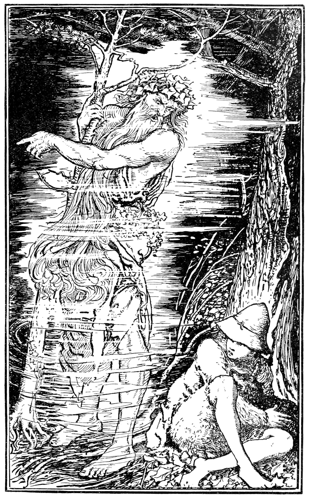

“‘可是要注意，要是你第四次进来，你就会遇到麻烦，那些石头台阶会倒下来砸断你的腿，这是对你贪婪的惩罚。每次出来的时候，别忘了把国王宝库的入口处用松土堆上。’”

“幽灵说完以后，我的狗竖起耳朵，吠叫起来。我听到不远处有轮子滚动的声音和马车夫挥动鞭子的声音。等我再回过头来看时，幽灵不见了。”

牧羊人的故事到这里就结束了。店主和其他人一样，都在聚精会神地听着，等他停下来，就急切地问：“马丁大爷，快告诉我们，后来你到山里去了吗？找到精灵答应给你的东西了吗？这个故事是不是你自己编出来的？”

“不！不！”老头子说，“我不知道那精灵是不是在撒谎，也从来没有去找过那个洞。原因有两个：一是我的性命对我来说太宝贵了，不值得去冒那么大的危险；二是没有人能告诉我，到哪里去找弹簧树根。”

另一个上了年纪的牧羊人布莱兹提高嗓门说：“真是太可惜了，马丁老爹，你的秘密和你一样老了。要是四十年之前你把这件事讲出来，你就不会找不到弹簧树根了。不过，即使你再也不会去爬山了，我现在还要告诉你怎么去找。最简单的方法是靠啄木鸟帮忙。你看，每年春天，它会在树洞里筑巢，等到小鸟会飞的时候，你就用硬草皮把巢的出口堵起来，然后躲在树后的树丛中观看。雌鸟回来喂小鸟的时候，看到入口处被堵住，不能进去，就会绕着那棵树飞来飞去，发出悲痛的叫声，然后就会向太阳下山的方向飞去。看到它飞走以后，去拿一件鲜红颜色的大衣来，如果没有，就去买一块鲜红色的布，在啄木鸟衔着弹簧树根回来之前赶回来。当啄木鸟用弹簧树根去碰草皮的时候，草皮就会从巢口弹出去。这时，你立刻把红大衣在树下铺开。啄木鸟看到后以为是着了火，恐慌之中会把树根扔掉。有的人真的会点起一把火，还在火上撒上甘松花。不过这是个笨办法。因为点火的时机如果不恰当，啄木鸟就会带着树根飞走。”

大伙都很感兴趣地听他说。故事结束时，已经很晚了，大伙都动身回家，只留下一个人，他整个晚上都不声不响地坐在角落里，谁都没有注意他。他就是彼得·布洛克师傅。

彼得·布洛克师傅曾经是个兴旺发达的店主，还是个烹调好手，但已经有很长一段时间每况愈下，现在变得很穷了。

以前，他可是个快活的小伙子，喜欢说笑话，烹调水平整个城里谁也比不上。他会做鱼冻、榅桲果馅油煎饼，甚至薄脆饼。彼得很早就为自己挑选了一个妻子。不幸的是，他看中了全城出名的嚼舌女人伊尔斯。人人都恨伊尔斯，年轻的小伙子情愿多走一英里远，也不愿意看到她，因为人人都被她说过坏话。因此，当彼得师傅被她的牛皮所迷惑，愿意娶她做妻子的时候，她高兴地跳起来。第二天他们就结了婚。可是还没有到家里，他们就吵起来了。彼得这天因为心里高兴，多喝了一点好酒，走路时不小心绊了一跤，把挽着他胳膊的新娘也一起拖倒。她狠狠地打了他一顿。邻居都说，看来往后的日子不会让彼得好过。即使是这样一对难以相处的夫妻，也有生儿育女的欢乐。可惜他的快活并不长久，妻子爱吵闹的坏脾气把小孩一个一个地扼杀在摇篮里，像小羊羔抵挡不住严寒的冬天一样，一个一个地死去。

虽然彼得师傅没有很多财富留给后代，可没有孩子还是叫他非常伤心。在把一个个孩子送入坟墓以后，他禁不住要向朋友诉说自己的悲哀：“樱桃刚刚开花又遭雷击，不可能会成熟结果了。”

可是后来，他又有了个小女孩，她那么健壮，生命力那么强盛，不论是母亲的坏脾气，还是父亲的溺爱，都没有影响她长成一个美丽的姑娘。与此同时，这个家庭的命运也发生了变化。彼得师傅从年轻的时候开始，就不喜欢苦闷。他手中有钱时，爱怎么花就怎么花。那些挨饿的老乡来向他要面包，他总是给他们吃的。如果他口袋里没有钱，他会向邻居借。他处处小心不让好骂街的妻子知道这些事情。他的座右铭是：“船到桥头自会直。”可是事与愿违，等待着他的总是恶运。他绞尽脑汁，千方百计想过安宁的日子。可不管他怎么努力，坏运气老是跟随着他。他丢了一份又一份工作，最后只能帮妻子把一袋袋粮食送到磨坊里去。要是稍有怠慢，就要挨她一顿好骂，弄得不好连饭也吃不上。

他那漂亮的女儿有一颗善良的心，她常常为父亲的遭遇感到悲痛。女儿是他生活中的唯一安慰。

彼得坐在客栈厨房里听牧羊人讲那笔深埋地下的财宝时，心里在想着女儿。为了女儿，他决心去找到它。当他从店主的凳子上站起来时，他已经计划好了。彼得师傅满怀希望，高高兴兴地回家，他已经好久没有这样开心过了。可是在路上，他突然想起还没有得到那开门用的弹簧树根，心中不禁又阴沉起来。他心事重重地走进家门，沉重地倒在硬麦杆床上。

他心里安静不下来，也睡不着。等东方露出亮光，他就坐起来，写下找到财宝所必须要做的每一件事，免得忘掉。等一切都明白无误以后，他安慰自己说，虽然起码还得给妻子干一个冬天的重活，但总算用不着一辈子都要走去磨坊的那条路了。不久，他就听到一边干家务、一边唱晨曲的那副粗哑的声音，不时还夹杂着对女儿的责骂声。

他还在穿衣服时，妻子就把房门冲开。“好啊！酒鬼！”这就是她的问候语，“昨天晚上是不是喝了整整一夜，乱花从我这里偷去的钱？真不要脸，醉鬼！”

彼得师傅对这种话已习以为常，并不恼火。等到这阵风暴过去以后，他才安静地说：“亲爱的妻子，不要烦恼。我手头有一笔好生意，日子会好起来的。”

“你有一笔好生意？”她喊道，“除了吹牛，你还有什么好事！”

“我在立遗嘱，”他说，“等我的时候到了以后，我的家会太平无事。”

这些意想不到的话使他女儿心如刀绞。她想起昨天整整一夜，她梦见一个新挖的坟墓。想到这里，她伤心地大哭起来。可她母亲只是大声喊叫：“无耻的东西，你还没有把家里值钱的东西花光吗？现在还说什么立遗嘱！”

她发疯地抓住他，要挖掉他的眼睛。过了一会，争吵平息了，一切又恢复正常。从那天起，彼得把女儿露西娅给他的每一分钱都偷偷地存起来，用来收买那些他认识的男孩子，叫他们帮他到森林里去找啄木鸟的巢。可是他们非但不去找，反而和他开玩笑，带他翻山越岭，到好几英里远去看渡鸦的窝，或是树洞里的松鼠。等他生气的时候，他们就冲着他笑，然后逃跑。这样过了一些时候。后来有一个小孩在野鸽子群中看到了一只啄木鸟，而且在一棵半死半活的桤木树上找到了它的窝。他跑回来找彼得，把这个消息告诉他。彼得简直不相信自己的好运气，赶紧亲自去看一看是不是真的。他来到桤木树前，果然看到有一只啄木鸟在上面飞来飞去，像是上面有巢穴。

这幸运的发现使彼得非常高兴。他立刻回去找红大衣。整个城镇里，只有一个人有红大衣，那就是刽子手哈默林。彼得思想斗争了很久，不知道该不该去找他。可是没有别的办法可想，尽管他一点也不喜欢，还是决定请刽子手帮忙。哈默林看到像彼得这样受尊敬的人也来向他借执法时穿的衣服，有点受宠若惊，立即同意借给他。

现在，彼得有了得到那神奇树根所必需的一切。他把啄木鸟巢的出入口封起来。一切都像布莱兹说过的那样。等啄木鸟衔着树根飞回来的时候，彼得赶紧从树后奔出来，敏捷地抖开那件火红的大衣。吓坏了的啄木鸟把树根正好丢在他很容易找到的地方。

彼得的计划成功了。现在，这魔树根确确实实地握在他手中，这是打开所有大门的钥匙，它将给主人带来闻所未闻的好运气。这时候，他的思想已经飞到山上。他秘密地准备这次旅行。他只带一根棍子，一个结实的口袋，还有他女儿露西娅给他的小盒子。

恰巧在彼得准备出发的那一天，露西娅和她的母亲一大早就到城里去了，留他一个人看家。尽管他马上就该出发了，他还是想最好能试试那魔树根的威力。伊尔斯的房子里有个很结实的柜子，上面有七把锁，她把所有的钱都存在里面，钥匙总是挂在她的脖子上。家里的经济问题，彼得师傅可是一点权利都没有，所以柜子里有些什么秘密他完全不知道。看来，现在是发现这个秘密的好机会。他把魔树根拿出来，靠近那些锁眼，吃惊地看到七把锁在转动，发出咔嗒咔嗒的声音，柜门突然大开。贪心的妻子存的那些黄金完全暴露在他眼前。他目瞪口呆地站在那里，也不知道是因为意外地发现妻子的财宝呢？还是因为魔树根那神奇的威力。

后来他想起应该起程了。他把柜里的黄金塞进口袋，小心地锁上空柜子，迅速地离开了家。

伊尔斯和她的女儿回到家，惊奇地看到房门锁着，不见彼得的影子。她们又是敲门，又是喊叫，里面除了传来猫叫的声音以外，什么动静都没有。后来，她们不得不把锁匠请来，把门打开。接着，她们从阁楼一直找到地下室，可哪里有彼得的踪影！

“谁知道呢？”伊尔斯终于说，“这坏家伙也许一早就到酒店里去闲坐了。”

一个念头忽然在她心中闪过，她摸了一下自己的钥匙，说不定钥匙会落入这个没用的丈夫手中，让他偷走自己的钱呢！幸好！钥匙还挂在老地方，柜子好像也没有人动过。

中午过去了，傍晚过去了，已经是午夜了，彼得还是没有回来。事情真的变得严重起来。伊尔斯自己心里明白，她是怎么折磨彼得的。悔恨唤起了她最不幸的猜想。

“啊！露西娅！”她说，“我很担心你父亲是不是对自己干了些什么不幸的事。”这些想法使她们一直坐在那里哭到天明。

天一亮，她们又把房间的每一个角落搜查了一遍，看了墙上的每一根梁和钉子。幸好彼得师傅没有吊在上面。接着，邻居又用长杆子去捞每一个池塘和河流，也找不到什么东西。逐渐地，伊尔斯打消了想再见到丈夫的念头，安慰起自己来。她只担心那一袋袋粮食以后怎么样送到磨坊去。她决定去买一头强壮的驴来干这活。她看中了一头，在和卖主讨价还价以后，她回到家里打开柜子准备取钱。可是，当柜子里的每一格都空空地出现在她面前时，她楞住了！呆呆地在那里站了一会儿。接着，她大发雷霆，样子非常可怕，连露西娅也惊恐地跑过来。可是，当她知道是钱不见了以后，心里很高兴，再也不担心父亲会出什么事了。她心里明白，他肯定是出去找新的出路和运气了。

大约一个月以后，有人敲伊尔斯的门，她出来看看是不是有顾客来吃饭。可进来的是一个漂亮的年轻人，穿得像公爵的儿子一样，在彬彬有礼地问候过以后，就问起她漂亮的女儿，好像他们是老朋友似的。可她怎么也想不起来什么时候见过他。

不过，她还是请他进屋，请他坐下来说他的事情。他很神秘地请求允许他和可爱的露西娅说话，说他早就听说她的针线活做得非常好，现在有件事要托她办。伊尔斯心里明白，一个年轻的陌生人会有什么事托一个漂亮的姑娘办。不过，既然他们谈话的时候她在场，她也就不反对了，于是就把她那勤劳的女儿叫出来。女儿放下手中的活，听话地走出来。可是，她一看到这个陌生人，就站住了，红着脸低下头来。他满心欢喜地看着她，拉起她的手，她想把手抽回去，说：“啊！弗里德林，你干吗到这里来，我还以为你在几十英里以外呢！你是不是又要来让我伤心？”

“不！我最亲爱的姑娘，”他回答，“我来是为了让你和我从此得到幸福。自从我们上次见面以后，我的命运已经完全改变。我再也不像以前那样，是个穷苦的流浪汉。我那有钱的叔叔去世了，留给我许多金钱和财产。所以，我才敢来到你母亲的面前，向你求婚。我知道我是多么爱你；如果你也爱我，我就是一个真正幸福的人。”

他说话时，露西娅美丽的蓝眼睛害羞地抬起来看了看。现在，她张开玫瑰般红的双唇露出笑容。她偷偷地看了母亲一眼，想知道她怎么想。可是她母亲惊讶得几乎发呆。她难以相信从来也没有躲过她眼睛的女儿，竟然和这个英俊的陌生人已经那么熟悉，而且十分愿意嫁给他。在她吃惊地瞪着他看的时候，这个性急的求婚者拿出黄金来，放在光亮的桌子上，作为送给新娘母亲的订婚礼物，连露西娅的围裙也包上了黄金。这样，他就为自己的婚事铺平了道路。伊尔斯不再说什么，问题就这样很快地解决了。

在伊尔斯把黄金藏到安全的地方去的时候，两个情人悄悄地说起话来。弗里德林说的每一句话，都使露西娅感到越来越幸福，越来越满足。

现在，家里开始热闹起来，婚礼正在加紧准备着。几天以后，一辆装满东西的大马车驶过来，许多箱子和包裹从车上搬下来。伊尔斯对未来女婿的富有吃惊得说不出话来。

婚期已经定下来了，所有的朋友和邻居都收到出席婚礼的邀请。露西娅在试戴新娘花环的时候对她母亲说：“要是父亲领着我上教堂，戴上这样的结婚花环真是叫人太高兴了。要是他能回来多好啊！现在，我们在钱堆里打滚，他却可能在穷人的饭桌上吃不饱。”想到这些，她不禁哭了起来，连伊尔斯也说：

“要是能看到他回来，我也不会感到有什么不好。他这么一个好人走了，房子里总像是缺少什么。”

可事实是没有人给她骂，她觉得很厌烦。后来，你猜猜看，出了什么事情。

就在婚礼的前一天晚上，有一个人推着手推车来到城门，在付了车上一桶钉子的税以后，就径直向新娘子的家里走去，敲她家的大门。

新娘子从窗口向外张望，不是别人，正是她的父亲彼得。顿时，家里的快乐真是无法形容。露西娅跑过来拥抱他，连伊尔斯也伸出她的手来欢迎。不过，当她想到放钱的那个空柜子时，她只是说：“流氓，改过自新吧！”

彼得向新郎问好，用敏锐的眼睛看着他。母亲和女儿赶紧说他的好话，看得出，她们对这样一个女婿和丈夫很满意。伊尔斯给丈夫拿来一些吃的东西以后，就好奇地打听他的消息，急不可待地问他为什么要出去。

“上帝保佑我的家。”他说，“我走遍了整个国家，什么样的活我都干过了。可现在，我找到了做铁的买卖这门生意。可惜直到今天，我投入的比得到的还要多。这一桶钉子就是我的全部财产，我想把它送给新娘布置房间。”

这些话激怒了伊尔斯，她破口大骂，严厉地责备彼得，旁边的人几乎被她骂得耳朵都聋了。弗里德林赶紧声明，让彼得师傅和他们住在一起，保证他住得舒服，而且总是受欢迎。

于是，露西娅心中的愿望实现了。第二天，彼得领着她上教堂。婚礼在欢乐的气氛中举行。不久，年轻的夫妇在弗里德林买的一栋好房子里住下来。房子前面有花园，有草坪，还有鱼塘，一座长满葡萄树的小山。他们过得非常幸福。彼得老爹也平安地和他们住在一起，像人人都相信的那样，靠他那仁慈的、有钱的女婿过日子。没有人会想到，他那桶钉子才是真正的富裕的象征，所有的财富都是从这里流出来的。

彼得顺利地踏上了寻找宝山的征途，一路上没有人发现他。他按部就班，自得其乐，直到来到山谷里的小河旁，他才碰到一些麻烦。接着，他急切地赶路，很快就找到了森林里的小坑。他走下去，像鼹鼠似地挖起洞来。那神奇的树根把门打开，宝藏终于出现在他的面前。你可以想象，彼得尽可能地往口袋里装黄金时有多高兴，能带走多少他就装多少。当他摇摇晃晃地登上七十七级台阶时，他的心中是如何开心，如何充满了希望。他不太相信那守护神关于安全的承诺，只想赶快回到地面的阳光之中。他不想东张西望，只是急急忙忙地走，所以后来也不记得那些墙上和柱子上是否挂满了闪闪发光的宝石。

总而言之，一切都很顺利，他没有听见，也没有看见任何危险的信号。唯一发生的意外事情是，他刚跨出大铁门，就听到它“呼”的一声关上了。这时他才想起那神奇的树根忘了带出来。所以他不可能再回去装财宝了。不过，彼得也并不怎么在意。手中的这些已经让他十分满足了。

在严格地按照马丁大爷所说的，把那个坑埋好以后，他坐下来考虑如何把这些金子带回家享受，而用不着去和他那好骂街的妻子分享。她一旦知道这件事，就不会让他太平。

想了很久以后，他终于有了主意。他背着口袋来到最近的一个村庄，在那里买了一辆手推车，一个结实的大桶，还有许多钉子。然后他把金子装进桶里，上面盖上一层钉子，吃力地把它装上手推车，就向家乡的方向走去。

半路上，他碰上一个漂亮的小伙子。从他那沮丧的样子来看，肯定是碰到了大麻烦。彼得希望每个人都像他一样的幸福，就愉快地和他打招呼，问他要到哪里去。他悲伤地回答：“到茫茫的世界中去，好大爷，或者离开这个世界，让我的双脚来决定吧！”

“干吗要离开这个世界？”彼得问，“这个世界对你怎么啦？”

“没对我怎么啦，我也没什么对不起它。”小伙子回答，“可这个世界也没有给我带来什么。”

彼得尽可能地让年轻人高兴起来，邀请他一起住到第一家客栈里去，猜想可能是因为饥饿和穷困引起这个陌生人的烦恼。可是，当美味佳肴送上来以后，他好像并不在意。彼得这才发现，是什么事情使他伤心了，就和蔼地请他说说自己的事情。

“这有什么用呢？老爹？”他说，“你既不能帮助我，也不能安慰我。”

“谁知道呢？”彼得说，“我也许能帮你一些忙。生活中常常有这种事。路见不平，拔刀相助，帮你忙的往往是素不相识的陌生人。”

年轻人受到鼓励，开始讲他的故事。

“我是个石弓手，为一个高贵的伯爵效力。我就是在他的城堡里长大的。不久以前，我的主人外出旅行，带回来许多珍贵的东西，其中有一张漂亮少女的画像，那么甜美，那么可爱，看上一眼我就爱上了她，一心就想如何找到她，和她结婚。伯爵告诉我她的名字，住在什么地方，可是取笑我的痴情，坚决不同意让我离开，去寻找她。所以，我只好偷偷地在夜里从城堡逃出去。”

“我很快就来到那少女居住的小城镇，可是又面临新的障碍。她在母亲的照管下生活。她的母亲非常严厉，不许她朝窗口外面观看，不许她单独出门，怎么去和她交朋友呢？我心中一点也没有数。”

“后来，我打扮成一个老太婆，大胆地敲开她的门。这位可爱的少女亲自来开门。她是那么迷人，我几乎忘乎所以，忘记了自己是个老太婆。幸好我很快就回过神来，请她帮我做一块漂亮的台布，因为人人都说，她是整个乡村最好的刺绣女。这样，我可以借口来看活干得怎么样了，自由自在地经常来看她。”

“有一天，她母亲到城里去了，我大胆地剥去伪装，向她倾诉我的爱情。开始她很吃惊。我请她耐心地听我说。很快，我发现她并不讨厌我，只是温柔地责备我不该背叛主人，不该伪装自己去骗人。可是当我向她求婚时，她伤心地对我说，一个一分钱都没有的求婚者，只会受到她母亲的责骂。她请求我快点走，免得给她惹麻烦。”

“这对我来说，真是太残酷了。我不得不听她的话，离开她的家。从那以后，我到处流浪，心里忍受着痛苦的煎熬。一个无家可归的人，一个既没有钱、又没有财产的人，怎么能指望得到可爱的露西娅呢？”

正在聚精会神地听着的彼得，听到他女儿的名字，不禁竖起耳朵来。他很快就证实，这个青年人深深地爱上的姑娘，正是他的女儿。

“你的故事确实是很离奇。”他说，“可是，这姑娘的父亲在哪里呢？你干吗不去找他帮忙？他可能会站在你这边，很高兴地接受你这个女婿。”

“哎！”年轻人说，“她的父亲是个无所事事的流浪汉。他遗弃妻儿出走了，谁也不知道他到哪里去了。他妻子抱怨他够厉害的了，我亲爱的姑娘帮她父亲说几句好话也要挨她骂。”

彼得觉得这些话很有趣，很喜欢这个年轻人，看得出，他就是自己要找的再合适不过的人了。因为他可以帮自己太平地享受这些财富，而且不必和心爱的女儿分开。

“如果你听我的话，”彼得说，“我保证让你娶上你所热恋的姑娘，而且用不了多久。”

“朋友，”弗里德林气愤地说，他想彼得是在嘲弄他，“和一个不幸的人开玩笑是不好的；你最好是去另找一个能兑现你的承诺的人。”说完他站起来，急急忙忙准备离开。彼得师傅拉住了他的胳膊。

“坐下，不要那么冲动！”彼得说，“我不是开玩笑，我在准备实现我的诺言。”

彼得把藏在钉子下面的黄金给他看，还详细地说了自己的计划：弗里德林装扮成一个有钱的女婿，而且保持沉默，他们就可以太平无事地分享这些财富。

年轻人为自己命运的巨变感到万分高兴，不知道该怎样感谢彼得老爹的仁慈才好。第二天早晨，他们一起上路，不久就来到一个城市。弗里德林把自己打扮成一个富有的求婚者。彼得把他的口袋塞满黄金，让他作为彩礼送给新娘。他们说好了，等一切都准备妥当以后，弗里德林就带讯给彼得，让他用马车把装饰新房的东西送来，让整个小城镇都为新娘的豪华住所而吃惊。

他们分手的时候，彼得最后一次嘱咐弗里德林，千万要保守秘密，在露西娅成为他的新娘之前，连她也不要说。

彼得师傅一直享受着他那次上山获得的财富，这个消息一点也没有流传出来。到他上了年纪的时候，他的财富那么多，连他自己也说不清楚。但人们总是说，这些钱都是弗里德林的，他和妻子过着非常幸福和安静的生活，在城市享有很大的声誉。直到今天，当人们想说某个人是多么有钱的时候，他们会说：“像彼得·布洛克的女婿一样富。”

 

## 村民和他的猫

从前，有一个老人和他的妻子住在一间又破烂又肮脏的小屋里，这里离国王和王后豪华的宫殿不远。尽管这间小屋简陋不堪，在许多人看来，连做猪棚也太糟了，老人却是非常有钱，因为他是一个守财奴，他宁可整天挨饿不吃饭，也不愿意兑换一个他喜欢的金币。

可是他挨饿的日子太多了，终于病倒了，再也没有力气恢复，没几天就留下妻子和一个儿子永远地走了。

他死后的那天晚上，他儿子做了一个梦，一个陌生人出现在他的面前，对他说：“听我说，你父亲死了，你母亲也会不久于人世，他们的所有财富都将归属于你。这些财富有一半来路不正，你必须把它们还给那些穷人，因为是从他们那里榨取来的，还有一半要扔到海里去。可是，当钱沉到海里去的时候，你要仔细地看着，如果有什么东西浮上来，抓住它，留下来，哪怕是一张碎纸片。”

说完，陌生人不见了，年轻人醒过来。

这个梦使他感到非常烦恼。他不想抛弃父亲留给他的财产，因为他体验过什么是饥饿和寒冷。现在，他希望能得到一些舒适和快乐。不过，他也是个好心肠的忠厚人，既然父亲的钱来路不正，他觉得就不应该去用它。后来，他决定照梦中人的吩咐去做。他找出村里那些最穷的人，把一半钱分给他们，还有一半放进自己的口袋。他走上一块伸入大海的石头，把钱扔入海中。不一会钱就不见了，谁也说不上沉到哪里去了，只有一张纸漂在水面上。他小心地走下去，抓住那张纸，打开一看，里面包的是六先令。这就是他在这个世界上所拥有的钱了。

年轻人站在那里看着这六先令，沉思着。“嗯！这六先令有什么用。”他自言自语。但不管怎么说，总比没有好。他又把钱包起来，放进口袋。

以后几个星期，他都在农田里干活，和母亲一起靠种出来的水果和蔬菜过日子。不久，他母亲也突然去世了。可怜的小伙子把母亲埋葬以后，心里非常悲伤。带着一颗沉重的心，他在森林里到处流浪，也不知道该到哪里去。

不久，他感到饿了，看到前面有一间小屋，他敲开门，问人家能不能给他一点牛奶。开门的老妇人请他进来，和蔼地对他说，如果他想留下来过夜也可以，一分钱也不会收他的。

他进屋时，看到两个女人和三个男人正在吃晚饭。他们什么话也没有说，只是给他让出一个座位来。吃完以后，他抬头看房子的四周。他看到火炉旁边蹲着一只从未见过的动物，非常吃惊。它的皮毛是灰色的，不是很大，但眼睛又大又明亮，唱起来的调子很奇怪，那模样和森林里的动物完全不同。

“这奇怪的小动物叫什么？”他问。

“我们叫它猫。”他们回答。

“如果它价钱不贵，我想把它买下来。”年轻人说，“它会成为我的伙伴。”他们告诉他，如果他愿意，可以用六先令把它买下。年轻人拿出他那张宝贵的纸，把六先令交给他们。第二天，他向他们告别，带着猫走了。那只猫舒服地躺在他的大衣里。

整整一天，他们穿过草地和森林。晚上，他们来到一间房子前，年轻人敲了敲门，问开门的老人是否可以在这里留宿一夜，还说明他没有钱付给他。

“那么，我一定要让你住下来。”老人说，把他领进屋里。里面有两个男人和两个女人正坐着吃饭。其中一个妇女是老人的妻子，另一个是他的女儿。

年轻人把猫放在壁炉架上。他们都围过来看这个奇怪的动物。猫对着他们擦擦自己的脸，伸出它的爪子，还唱歌给他们听。妇女们很开心，把猫能够吃的东西都给它吃，还有许多它不会吃的东西。

老人听年轻人说了他的故事，知道他在这个世界上除了这只猫，什么都没有以后，劝他到离这里几英里远的王宫里去，请教一下国王。国王对每一个人都很仁慈，肯定会成为他的朋友。年轻人表示感谢，说很乐意照他的劝导去做。第二天一早，他就动身到王宫里去。

他叫人送信给国王，请求国王接见他。得到的回答是，叫他到大厅里去，到了那里，他就可以见到尊敬的陛下。

年轻人走进来时，国王和大臣们正在吃饭。国王示意叫他走近些。年轻人深深地鞠了一躬。然而，他吃惊地注视着在地板上跑来跑去的又黑又小的动物，它们甚至跑到桌子上。它们胆子那么大，还跑到国王的盘子里吃东西，要是国王赶它们，它们就咬国王的手，国王实在没法吃东西，其他大臣的情况也好不了多少。

“这是些什么动物？”年轻人问坐得靠他较近的一位女士。

“它们叫老鼠，”国王听到他的问题，回答说，“多年来我们一直想办法消灭它们，可是不可能。它们还跑到我们的床上。”

这时候，空中好像有什么东西飞过。原来是猫跳到桌子上。只见它抖动了那么几下，就有许多老鼠死在它的身边。接着，又听见一阵嚓嚓的脚步声，一分钟以后，大厅里就不见老鼠的影子了。

好几分钟，国王和大臣们只是吃惊地你看看我，我看看你。“这是什么动物？怎么会有这样神奇的本事？”国王问。年轻人告诉他，这种动物叫猫，是他用六个先令买来的。

国王说：“由于你给我带来了好运气，使我的王宫摆脱了折磨我好多年的鼠祸，我要让你挑选两样东西。或者你将成为我的宰相，或者你将和我的女儿结婚，继承我的王位。你要哪一样，请说吧！”

“公主和王位。”年轻人说。

于是事情就这样解决了。

（冰岛）

 

## 寻找永生的王子

从前，在一个很大的王国的中部有一座城市，城市里有座宫殿，宫殿里住着一个国王。国王有一个儿子，他认为这个儿子比其他任何人更聪明，更有智慧。是的，父亲没有花费多少精力就把他培养成这样。他小的时候，父亲仔细地挑选培养和教育他的人。长成一个青年以后，就让他出去旅行，这样他可以看看其他人的生活，发现他们多数也和他一样善良。

王子旅行回家约一年以后，父亲感到是应该让儿子学会如何管理王国的时候了，王国总有一天是属于他的。可是，王子长时间不在家的时候，他的性格完全变了。从一个无忧无虑的快活的孩子，变成一个沉默寡言，老是在沉思的成年人。国王不明白是什么原因引起他的这种变化。从早晨到晚上，他独自为这个问题而烦恼。后来，他得出一个结论——年轻人在恋爱了。

王子从不谈论他的感情，这种事情他压根儿就没有说过。父亲知道，他要想揭开王子心中的这个谜，就必须自己采取行动。所以有一天吃过午饭以后，他挽着儿子的手来到另一个房间，里面挂满了美丽姑娘的画像，真是一个比一个更可爱。

“我亲爱的孩子，”国王说，“你很忧伤。也许走了那么多地方以后，你一个人和我呆在一起会感到很沉闷。也许成家以后你会好得多。我已经收集了全世界地位和你相当的最美丽的姑娘画像，从中挑一个你喜欢的做妻子，我会派出使者去向她的父亲求婚。”

“哎！尊敬的陛下！”王子回答，“不是恋爱和婚姻使我如此忧愁，是一种想法使我日夜不得安宁，那就是所有的人，包括国王，到后来都要死去。除非我能找到一个没有死亡的王国，否则我永远也不会快活。我已经下定决心要找到永生之地，一天找不到，就一天不休息。”

国王听了非常惊愕，事情比他想象的要严重得多。他试图和儿子讲明道理，说这些年来一直盼望着他回来，好让他继承王位，管理国家，他自己对这些事情已经感到压力太大，力不从心。可是，国王说了半天，还是白费口舌，王子一点也没有听进去。第二天，他佩上宝剑又出去了。

他在路上走了许多天，远离了自己的国家。有一天，他看到大路旁边有一棵大树，树顶上有一只老鹰正在用尽全身的力量摇动这棵大树。这看上去很奇怪，不像是老鹰干的事情，王子不禁惊讶地停下来观看。老鹰看到王子，就从树上飞下来，脚刚着陆，就变成一个国王。

“你好像很吃惊，为什么？”国王问。

“我有点疑惑不解，你干吗用力地摇动这棵树？”王子说。

“我不得不这样做，因为除非我能把这棵大树连根拔起，否则我和我的所有亲属都不会死去。”国王回答，“不过现在天已经黑了，我用不着再继续工作了，今天晚上到我家去做客吧！”

王子高兴地接受了老鹰国王的邀请，因为他这时又累又饿。他们在王宫里受到美丽的公主的欢迎，公主命令立刻给他们准备好晚饭。吃饭的时候，老鹰国王问王子干吗出门旅行，是为了娱乐呢，还是另外有目的？王子把事情的缘由告诉他，说找不到永生之地，他决不回去。

“亲爱的兄弟，”鹰国王说，“你已经找到它了。想到你会留下来和我们住在一起，我心里感到非常高兴。我刚才对你说了，死亡对我还有我的所有亲属都无能为力，除非把那棵大树连根拔起，那起码得花我六百年的艰苦劳动。所以，和我的女儿结婚吧！让我们愉快地住在一起。不论怎么说，六百年也称得上是永生了！”[^3]

“啊！亲爱的国王！”王子回答，“你的慷慨吸引力太大了！可是六百年以后，我们还得死去，那也好不了多少！不！我得继续走，直到找到那个没有死亡的国家。”

接着，公主说话了。她尽可能地劝客人改变主意，可他还是悲伤地摇摇头。后来，看到他的决心那么坚定，她从柜子里拿出一个小盒子来，里面有一张她的画像。她把小盒子交给王子，对他说：

“既然你不肯留下来，王子，请收下这个盒子，这样你会常常想起我们。在你到达永生之地之前，如果你对旅行感到厌倦，就打开这个盒子，看看我的画像，你就可以自由地在地上或空中飞翔，像思想那么敏捷，像旋风那么迅速。”

王子对她赠送的礼物表示感谢，把它放进上衣，伤心地和国王、公主告别。

在这个世界上，再也没有比这个盒子更贵重的礼物了。一路上，他不断地赞美公主的仁慈美意。

有一天，小盒子把他带到一座高山的顶上。他看到一个秃顶的人正忙着一铲一铲地挖山顶上的土，把它装进箩筐。等箩筐装满以后，就把土送走，把空箩筐带回来再继续挖。王子站在旁边看了好一会，那秃顶的人抬起头来问他：“亲爱的兄弟，是什么让你这么吃惊？”

“你干吗要往箩筐里装土？”王子问。

“哎！”那人说，“我不得不这么做，除非我把这座山全部铲平，像平地一样，否则我和我家里人都不会死。不过，跟我来吧！天快黑了，我也用不着再干了。”他从旁边一棵树上摘下一片树叶，马上就从一个粗鲁的挖土人变成威严的谢顶国王。

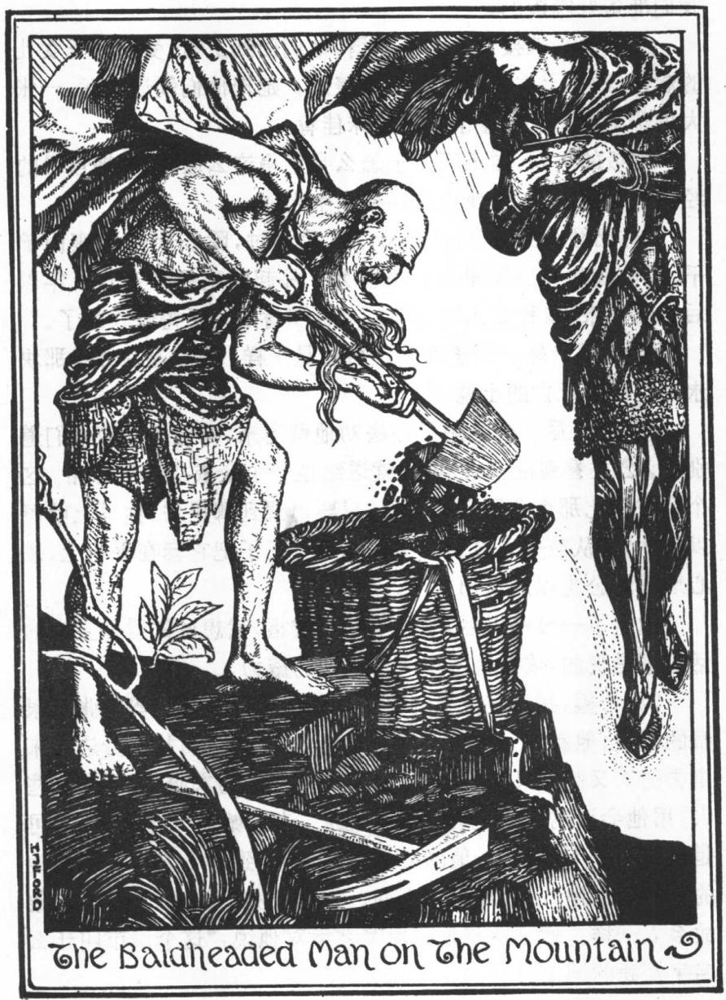

“跟我一起回家吧！”国王说，“你肯定又累又饿，我女儿会为我们准备好晚饭的。”

王子高兴地接受了他的邀请。他们回到王宫，受到国王女儿的欢迎，她比上次见到的公主更美丽。她把他们领进大厅，一张大桌子上摆满了银盘子盛的美味佳肴。

吃饭的时候，国王问王子怎么会走得这么远。王子把自己的经历都对他说了，说他正在寻找永生之地。

“你已经找到它了。”国王说，“我说过，除非我把那座山铲平，否则我和我的家里人都不会死。那起码也得等到八百年以后。留下来，和我女儿结婚吧！八百年肯定是活得够长的了。”

“啊！那当然。”王子回答，“可还是一样。我宁愿去寻找那块永远也没有死亡的土地。”

第二天，尽管公主想尽办法劝他留下来，可他还是和他们道别了。公主看到说服不了他，就送给他一个金戒指作纪念品。这个金戒指比那个盒子还要有用。只要你想到哪里去，你马上就可以到达，连从空中飞过的麻烦都没有。王子把它套在手指上，衷心地感谢公主以后又出发了。

他走了一段路以后，想起了那只戒指，就想试试看公主说的话是不是真的，戒指是不是有那么大的威力。

“我希望，我站在世界的尽头。”他闭上眼睛说。等他张开眼睛的时候，他看到一条街的两旁都是大理石宫殿。从他身边走来走去的人又高大又结实，身上穿着非常华丽的衣服。他拦住一些人，用他会讲的二十七种语言问他们，这个城市叫什么名字，可是没有一个人回答他。他的心不禁冷下来，到一个谁也听不懂他的话的陌生地方来，他该怎么办？突然，他看到一个人打扮和他故乡人一样。就赶快跑过去用家乡话对他说：“这个城市叫什么名字？我的朋友。”

“这是蓝色王国的首都，”那人说，“可是国王已经死了，他的女儿继承王位，统治着这个国家。”

王子满意地听到这个消息，请求同乡指给他到年轻的女王王宫里去的路。那人领他穿过几条街道，来到一个大广场。广场的一边有一座宏伟的建筑，是用淡绿色的大理石柱子建造起来的。宫殿的前面是一级一级的台阶。女王正坐在上面，裹着闪光的银色轻纱，仔细地听着百姓的诉说，做出公正的判决。

女王看到王子走过来，一眼就看出他不是个普通人，就叫她的大臣先把那些请求接见的人打发回去，叫他们明天再来。她向王子做了个手势，叫他跟着她走进王宫。幸运的是，她从小就学过王子的语言，所以交谈起来没有什么困难。

王子把事情的全部经过都对她说了，说他正在到处寻找永生之地。女王仔细地听他说完以后，站起来握住他的手，把他领到另一个房间。在这个房间里，地板全部是用缝衣服的针铺起来的，它们排列得那么紧密，连再插一枚针也插不进去了。

“王子，”她转过脸来对他说，“看到这些针了吗？除非我在做针线活的时候全部用坏这些针，否则我和我的家里人都不会死去。这起码需要有一千年。留下来吧，和我共享王位，活一千年够长的了！”

“那当然，”王子回答，“可一千年以后我还是要死！不！我得去找永生之地！”

女王拿出自己的全部本事，想劝他留下来，后来看到无能为力，只好作罢。她说：“既然你不愿意留下，那么就带着这根小金棒作个纪念吧！看到它你会想起我。它有一种魔力，在你需要的时候，你要它变成什么，它就变成什么。”

于是，王子谢过她，把金棒放进口袋就走了。

他刚离开城市不久，一条宽广的河流挡住他的去路。这条河谁也过不去，因为这里是世界的尽头，河就是绕着世界的尽头在流。

王子不知道该怎么办才好。他沿着河岸往前走。走了一小段路以后，他看到头上有一座城市在空中漂浮。他很想到这座城市里去，可是怎么上去呢？既没有路，又没有桥。城市好像在向他招手，他似乎感到，这就是他最终要寻找的永生之地。这时，他忽然想起披着薄面纱的女王送给他的金棒。他拿出金棒扔在地上，希望它变成一座通天桥。他心里怦怦直跳，生怕这个要求超过了它的能力。可是没有，金棒变成了一条金色的云梯，从地上一直伸向云中的城市。

正当他要跨进空中城市那座金色的大门时，一个他从来没有见过，什么也不像的怪兽忽然向他扑过来。“剑快从鞘中出来！”王子向后一仰，喊了声。宝剑在空中划了一下，砍下了怪兽几个头，可是又有几个头长出来。王子吓得脸色苍白，把剑插入剑鞘，大喊救命。

空中城市的女王听到吵闹声，从窗口伸出头来看是怎么回事。然后，她叫来一个仆人，命令他去救这个陌生人并把他带过来。王子感激不尽地听从她的话，来到她的面前。

女王一看到他，就感觉到他不是个普通人。女王友好地欢迎他的到来，问是什么原因把他送到这里来了。王子把所有的经过都对她说了，说他千里迢迢，长途跋涉，就是为了寻找永生之地。

“你终于找到了。”她说，“因为我就是主管生和死的女王，到了这里，你就生活在永生的人之中。”

王子踏进这座永生的城市，已经足足有一千年了。可是时间过得那么快，就好像只过了六个月。在这一千年中，王子没有一刻是不快活的。直到有一天晚上，他梦见了父亲和母亲。这时，他想念家乡有点迫不及待。第二天一早，他对永生的女王说，他要回去，再看看父母。女王吃惊地盯着他，喊道：“什么？王子，你怎么糊涂了？你父母去世已经有八百多年了！就是他们化成的尘埃也无影无踪了。”

“尽管是这样，我还是要去！”他说。

“好吧！用不着焦急。”女王知道拦不住他，说，“让我为你的行程做些准备。”她打开大宝箱的锁，拿出两只漂亮的瓶子来，一个是金的，一个是银的，把两个瓶子挂在他脖子上。然后把他领到房间的一角，指着一块活动的地板门说：“把那个银瓶子装上地板门下的水。这是一种魔水。不论是谁，只要你把水泼到他身上，他立刻就会死去，哪怕是他已经活上一千年。那个金瓶子你要装上那里的水。”她指了指另一个角落里的一口井，“它是从永生的岩石下面涌出来的，你只要在一个尸体上滴上几滴，他就会活过来，哪怕是已经死了上千年。”

王子感谢女王送给他的礼物，和她告别以后就走了。

不久，他来到了披着薄面纱的女王的国家。可是整个城市已经大变样，他几乎连路都认不出来，只有王宫的建筑还是老样子。他在王宫的房间里走来走去，没有一个人出来阻拦他。后来，他进入女王的房间。女王躺在那里，手中还拿着针线活，好像是睡着了。他拉了拉她的衣服，可她还是没有醒过来。一个可怕的念头从他脑中闪过，他跑到那间存放针的房间，看到地板上的针一枚也没有了。女王用坏了手中最后的一根针，咒语打破了，她也死去了。

王子很快就把金瓶子拿出来，在女王身上滴了几滴水。女王慢慢地动起来，抬起头，张开眼睛说：“啊！我亲爱的朋友，我真高兴你把我叫醒了，我肯定睡了很久！”

“要不是我到这里来把你叫醒，你一定会永远地睡下去。”王子说。

女王这才想起了那些针。她明白她已经死过去了，是王子恢复了她的生命。她从心底里感谢他，发誓只要有机会就报答他。

王子离开她以后，就向秃顶国王的国家走去。他看到整座山已经铲平，国王躺在地下死了，那把铲和箩筐还在他的身边。可是当金瓶子里的水滴到他身上的时候，他打了个哈欠，伸伸腰，慢慢地站起来。

“啊！我亲爱的朋友，看到你真高兴，”他说，“我肯定是睡了很久了。”

“要不是我来把你叫醒，你会永远地睡下去。”王子说。国王这时才想起那座山，那些咒语。他发誓，有机会一定会报答王子。

再往前走，王子看到那棵大树连根拔起。鹰国王躺在地下死了，老鹰的翅膀还张开着，好像要飞起来一样。王子把金瓶子里的水滴几滴上去以后，鹰的翅膀动了一下。接着，它的嘴从地上抬起来说：“啊！我肯定是睡了很久了，亲爱的好朋友，你把我喊醒，我该怎样来感谢你啊！”

“要不是我来把你叫醒，你会永远地睡下去。”王子回答。这时，国王才想起那棵树，想起他已经死去了。他答应，只要有机会，一定会报答王子为他所做的一切。

最后，他回到了父亲的王国首都。可是，当他来到以前是王宫那块地方时，他游玩过的大理石宫殿不见了，只剩下一个很大的湖泊，湖水在阳光的照耀下泛着蓝色的光芒。如果他的父母都躺在这可怕的湖水底下，他又怎么能找到他们，让他们活过来呢？他悲伤地回过身去，盲目地在街上游荡，不知道该往哪里走。

忽然有一个声音在他身后喊道：“站住！王子！我终于把你抓住了！我找你已经整整有一千年了。”一个白胡子的老头——死神出现在他身边。他赶紧从手上拉下戒指，鹰国王、秃顶国王和披薄纱的女王也及时赶来救他。他们紧紧地抓住死神，好让王子有时间返回永生之地。可是，他们不知道死神飞得多么快。王子的一只脚刚踏进永生之地，另一只脚就被死神抓住了：“站住，你现在是属于我的了！”

永生之国的女王站在窗口看见了，对死神喊道：“在我的王国里，你没有权利这样做，你必须到别处去寻找你的猎物。”

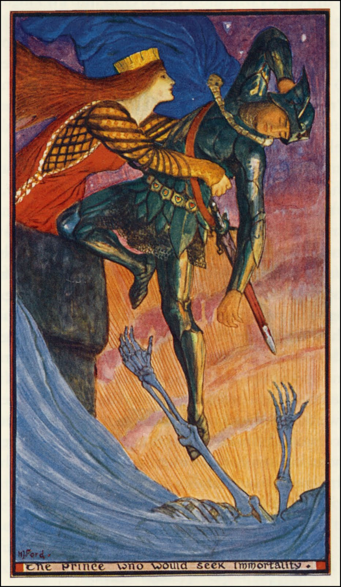

“很正确，”死神回答，“可是他的一只脚还在我的王国里呢，这只脚是属于我的！”

“不管怎么说，他的一半是属于我的。”女王回答，“还有一半对你有什么用？不论是对你，还是对我，半个人是没有用的。这一回，我允许你进入我的王国，我们通过赌注来决定他属于谁。”

于是，问题就这样解决了。死神跨过划定永生之地的一条狭窄的线以后，女王提出决定王子命运的赌注方法。“我把他扔到天上去，”她说，“一直扔到金星的背面。如果他掉进这个城市，那么，他就是我的；如果他掉到墙的外面去，那么就是属于你的。”

在城市的中央有一个很大的广场，女王提出在这里举行赌注。等一切都准备好了以后，女王把王子举起来，向空中抛去。他向上飞啊！飞啊！飞得像星星一样高，飞得人的眼睛再也看不见。

她是不是向正上方把他扔出去？女王心里一直在担心地琢磨着。如果不是，他就会掉到墙外面去，她就会永远得不到他。她和死神全神贯注地注视着天空，等待着决定王子是谁的胜利品的时刻。时间好像很长。

突然，他们俩都看见了天空中出现一个比黄蜂还小的黑点。那是不是他掉下来了？不是？是的！可就在他快接近城市时，一阵微风吹起，把他吹向墙那边。再过一秒钟，他就要掉到墙上去了。女王跳起来，用双手抓住他，把他扔进城堡。接着，她命令仆人把死神扔出城去，仆人照办了。受到这么厉害的打击以后，死神再也不敢在永生之地露面。

（匈牙利）

 

## 石匠

从前有一个石匠，他每天都要到一座很大的山上去，山上有一块很大的岩石，他从岩石上凿下一块块石板，给人家造房子或做墓碑。他很内行，知道什么样的石头派什么用场。由于他工作认真仔细，所以他有许多顾客。在相当长的一段时间里，他觉得十分幸福和满足，也不再奢望什么更好的东西了。

那时，山上住着一个精灵，他常常出现在人的面前，用许多种方法帮助他们发财或兴旺起来。石匠可从来没有见过这个精灵。要是有人说起，他只是摇摇头，摆出一副不相信的样子。可是他改变看法的时候来到了。

有一天，石匠给一户有钱人家送来墓碑，看到这户人家各种漂亮豪华的摆设和家具，真是做梦也没有想到过。他突然感到自己干的活又累又苦，就自言自语地说：“啊！我要是一个富人，能够在一张铺着丝绸和金缨的床上睡觉该有多么幸福啊！”

这时，有一个声音回答他说：“你的愿望听见了，你将是一个富人！”

听到这个声音，石匠抬起头来看看四周，可什么人也没有看见。他以为这只是自己的幻觉，就拿起工具回家，他觉得今天干活的心思一点也没有。

可是，当他回到原来居住的那间小房子门前时，他吃惊地站住了。原来那间小木屋不见了，取而代之的是一座雄伟的宫殿，里面装饰着华丽的家具，特别是那张床漂亮极了，一切都像他奢望的那样。他高兴得有点忘乎所以，就这样开始了新的生活，以前是什么样子他很快就忘了。

不久，夏天来临了。每天太阳都射出强烈的光芒，一天比一天厉害。这天早晨，天热得石匠几乎喘不过气来。他决定整天呆在家里，不出去了。他感到很沉闷，因为他从来不知道该怎样去玩才快乐。所以，他透过放下来的百叶窗，看看马路上有什么事。这时，一辆小马车从街上经过，赶马车的仆人穿着蓝色和银色的衣服。马车上坐着一个王子，头上撑着一把金色的伞，挡住那强烈的阳光。

“啊！我要是个王子该多好啊！”看到马车在马路的一角消失，石匠自言自语地说，“我要是一个王子，坐在这样的马车上，头上有一把金色的伞遮住太阳，我会有多幸福啊！”

山上的精灵回答说：“你的愿望听到了，你将是一个王子。”

就这样，他变成了一个王子。在他马车的前后，都有一队人马，穿着鲜红色和金黄色衣服的仆人前呼后拥，一把伞撑在他的头顶上。他心里想得到的都有了。可是，他总觉得还不够。他看看周围，想着还缺些什么。他看到，尽管他把水洒在草地上，可太阳光还是在烘烤着它们；他看到，尽管有一把伞遮住他的头，可他的脸还是越来越黑。他愤怒地喊道：“太阳比我更有力量，啊！我要是太阳多好！”

山上的精灵回答说：“你的愿望听见了，你将是太阳。”

这样，他就变成了太阳。他对自己的力量感到骄傲。他把光线向上下射去，射向天空，射向大地。他烧焦原野里的绿草，把王子的脸和穷人的脸一样晒黑。

可是，不久他就对自己的力量感到厌倦了，因为除此以外，他再也没有别的事情可干了。当一片云遮住他的脸，把他和地球隔开来的时候，他的心里更是不满，他气愤地喊叫着：“这片云不是挡住我的光了吗？它不是比我更强大吗？啊！我要是一片云该多好啊！我会比任何东西都强大。”

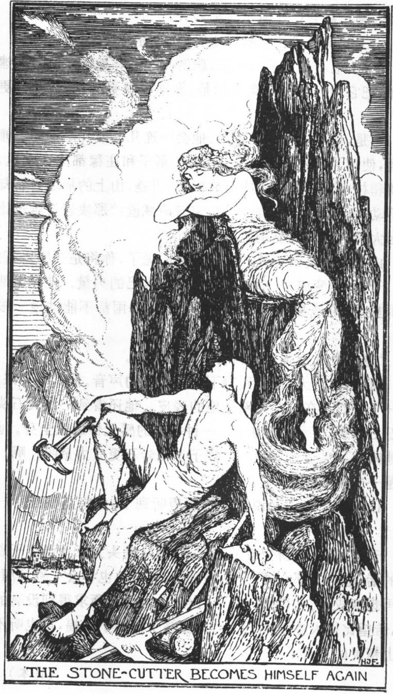

山上的精灵说：“你的愿望听到了，你将是一片云。”

于是，他就变成了一片云，飘游在太阳和地球之间。他逮住阳光，把它留下。令他高兴的是，大地变得更绿，花儿开得更鲜艳。

可是，他对这些并不满足。他会一连几天或几星期降下倾盆大雨，使河水越过河堤泛滥成灾，让稻子和庄稼都淹在水里，让城镇和村庄在暴雨的淫威面前毁灭。可是，山上的那块岩石却巍然不动。云看到这里非常吃惊，惊讶地喊道：“那块岩石难道比我更强大吗？啊！我要是块岩石多好！”

山上的精灵回答说：“你的愿望听见了，你将是一块岩石！”

于是，他变成了一块岩石，夸耀着自己的力量。他骄傲地站在那里，不论是炙热的阳光还是猛烈的暴雨都不能动他一根毫毛。

“这比什么都强！”他自言自语地说着。

可是，有一天，他听到脚下有种奇怪的声音。他低下头来，看到一个石匠正在把工具敲进他的表皮。他还看到一块大石头从岩石上断裂，滚到地下去了。一种可怕的感觉传遍他全身。他愤怒地喊道：“难道地球的一个孩子也比岩石更有力量吗？啊！我要是一个人多好！”

山上的精灵回答说：“你的愿望听到了，你将重新成为一个人！”

于是，他又重新变成了一个人，他又满头大汗地继续干着石匠的活。他的床那么硬，食物那么少，可是他也学会了感到满足，不再想变成什么，得到什么了。由于他不再去奢求得到没有的东西，希望比别人更强大、更有力，他终于得到了幸福，再也听不到山上精灵的声音了。

（日本）

 

## 长着金胡子的人

从前有一个伟大的国王，他有一个妻子和一个儿子，国王非常喜欢他们。当儿子还很年轻的时候，有一天国王对他妻子说：“我感觉到，我活的时间不长了，我希望你答应我，永远也不要再嫁人，一辈子都专心地照顾我们的儿子。”

王后听了这些话，泪水从眼眶里流出，她呜呜咽咽地说，她永远、永远也不会再结婚，只要她还活着，她考虑的第一件事情就是儿子的幸福。她的承诺安慰了国王忧虑的心。几天以后，国王就在安宁之中平静地去世了。

可是他刚绝气，王后就对自己说：“答应下来是一回事，能不能做到又是另一回事。”丈夫的棺材刚刚入土，她就嫁给了邻国的一位贵族，还让他取代王子，当上了国王。她的新丈夫是个残忍刻毒的人，对待继子的态度非常恶劣，只给他破衣服穿，吃的东西也少得可怜。要不是害怕人民反对，他肯定会把小王子杀了。

那时，王宫的花园里有一条小河流过。不过，河里流的不是水，而是牛奶。每天，富人和穷人都成群结队地到这里来汲牛奶，想汲多少就汲多少。

新国王坐上王位以后，第一件事就是禁止任何人走近这条河，他还派士兵去看守，谁走近就把谁抓起来。这仅仅是出于恶意，因为河里的牛奶足够每一个人喝。

有好些日子，没有一个人敢到河边去。后来，有些看守的士兵注意到，每天天刚蒙蒙亮的时候，有一个长着金胡子的人提着一只桶来到河边，把桶灌满牛奶以后，就在士兵们还没来得及看清是谁的时候，像烟幕一样地消失。士兵们把看到的情形向国王报告了。

开始国王不相信，后来士兵们坚持说，这是真的。国王说，今天晚上他要亲自去看守牛奶河。天刚破晓时，金胡子的人又来了，他像以前一样把桶灌满，然后又突然消失，好像大地突然把他吞没了似的。

国王站在那人消失的地方张开嘴巴呆呆地看着。他从来没有见过这个人，这是肯定的；但更重要的是如何抓住他？抓住以后该如何处置他？他要做一个笼子把这个人关起来，那时候，人人都要谈论这件事。在别的国家里，小偷都是关到监狱里去的，已经很久没有国王用笼子来关人了。国王把一切都计划得非常周密，他甚至在每一棵树丛后面都派一个士兵去监视。可是没有用，那个人还是抓不住。当他弯下腰来汲牛奶的时候，士兵们在草地上悄悄地爬过去，可是一到他面前，伸手就可以抓住他的时候，他总是突然不见了。金胡子一次又一次地逃掉，国王气得快发疯了。他许诺，不管是谁，要是能告诉他抓住这个人的方法，就重重地赏他。

第一个来献策的人，是一个老兵。他对国王说，在河边放上一些面包、香肠和一瓶酒，金胡子肯定会来吃喝。只要在酒里放些安眠药，就可以叫他马上睡着。到时候不费吹灰之力就可以把他关进笼子里去。

国王对这个计划很满意。他命令把面包、香肠和一瓶放了安眠药的酒放到河边去，把看守的士兵人数增加一倍，然后，他就满怀希望地等待好消息。

事情正如那个老兵说的那样。第二天一早，金胡子来到河边，果然吃起面包、香肠，喝起酒来。于是，士兵们轻而易举地把他捆起来，送到王宫里去。国王马上把他关进金色的笼子里，高兴得像发疯一样地指给那些到王宫里来的客人看。可怜的俘虏酒醒以后，想和外面的人说话，可是谁也不理睬他。于是，他干脆静坐，那些来看的人都以为他是用木头雕刻出来的。他整天暗自流泪和悲叹，几乎什么也不吃。国王担心他会死去，逃脱痛苦和折磨，命令他的大厨师从王宫的饭桌上给他送来饭菜。

大约在抓住金胡子约一个月以后，国王不得不带领他的军队离开王宫去和邻国打仗。在出发之前，他把继子找来，对他说：“孩子！听好我要说的话。我离开以后，把囚犯交给你看管。要注意让他有足够吃的和喝的，但要小心，别让他跑了，连在房间里走来走去也不行。如果我回来发现他逃走了，你就要被残酷地处死，以弥补自己的过失。”

小王子庆幸他的继父要出去打仗，暗自希望他永远也不要再回来。国王一走，他就来到放着笼子的房间，日日夜夜都不离开，还在里面玩起游戏来。

有一天，他用银弓银箭射一个目标，有一支银箭落到金色的笼子里去了。

“请把我的箭给我！”王子跑过去对他说。可是金胡子回答：“不！除非你让我出笼子，否则我不会给你。”

“我不能让你出来！”王子回答，“如果我让你出来，我继父说，等他打完仗回来，就要将我残酷地处死。你拿了我的箭又没用，还是还给我吧！”

金胡子从栏杆中把箭递出来。可是把箭还给王子以后，他更是苦苦哀求王子把笼门打开，让他自由。他恳求得那么迫切，王子的心被打动了，因为他是个软心肠的孩子，很同情那些遭受不幸的人。所以，他把锁着笼子的铁栓打开，金胡子走出笼子。

“我要一千倍地偿还你的好处。”他说，然后很快就不见了。王子开始考虑，当国王回来以后他该怎么说。后来他想，冒着被处死的危险等继父回来，这样是不是太笨了？

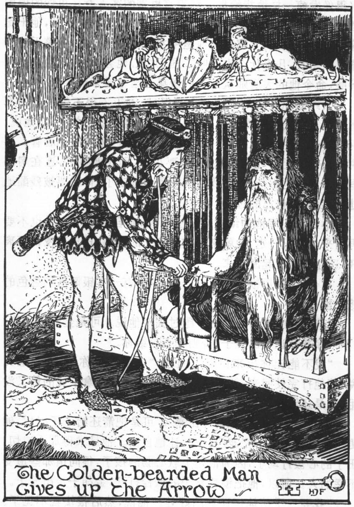

“不！”他自言自语地说，“留下来太危险了，也许和他比起来，这个世界对我会更好一些。”

傍晚的时候，他偷偷地走了出去。一连好多天，他到处流浪，越过高山和峡谷，穿过森林和草原，不知道该到哪里去，该干些什么。野果是他唯一的食物。

有一天，他看到一只野鸽子站在一棵树上。他立刻就搭上一支箭，瞄准野鸽子，想这回可以吃上一顿好饭了。

可是鸽子说话了：“别射我，我求求你了，高贵的王子！我有两个孩子在家里，如果我不把吃的东西带回去，它们就会饿死。”

王子动了恻隐之心，手中的弓箭放了下来。

“啊！王子！我会报答你善良的行为。”十分感激的鸽子说。“可怜的东西，你怎么报答我呢？”王子问。

“你忘了吗？”野鸽子回答说，“俗话说，‘山和山不能相见，人和人总会相逢。’”王子听到这句话笑了起来，走自己的路去了。

走着走着，他来到一个湖边。湖边的树丛中，他看到有只野鸭子飞过。王子想起，当他的父亲还活着的时候，想吃什么就有什么。每逢过生日的时候，他总有野鸭子吃。想到这里，他很快地搭上一支箭，小心地瞄准。

“别射，我恳求你了，高贵的王子！”野鸭子喊道，“我家里还有两个孩子，要是我不带吃的东西回去，它们会饿死的。”

王子很同情它，放下了手中的弓箭。

“啊！王子！我会报答你善良的行为。”十分感激的野鸭子说。“可怜的东西，你怎么报答我呢？”王子问。

“你忘记了！”野鸭子回答，“俗话说，‘山和山不能相见，人和人总会相逢。’”王子听了笑起来，走自己的路去了。

他离开湖边还没有多远，就看到一只鹳独脚站着。他又拿起弓箭准备瞄准。

“别射，我恳求你，高贵的王子！”鹳喊道，“我家里还有两个孩子，我要是不带点吃的东西回去，它们就会饿死。”

王子又生怜悯之心，放下手中的弓箭。

“啊！王子！我会报答你善良的行为。”鹳说。

“你这可怜的鹳，你怎么报答我呢？”王子问。

“你忘了！”鹳回答，“俗话说，‘山和山不能相见，人和人总会相逢。’”

王子又听到这句话，忍不住笑了，慢慢地走开。还没有走多远，就碰到两个退伍的士兵。

“你到哪儿去？小兄弟！”一个士兵问。

“我在找工作。”王子回答。

“我们也是，”士兵说，“我们一起走吧！”

王子很高兴有人做伴。他们继续走啊！走啊！走过了七个王国，还是找不到什么活干。后来，他们来到一个国王的王宫，看到国王正站在台阶上。

“你们好像在找什么。”国王说。

“我们在找工作。”三个人一起回答。

国王对两个士兵说，他们可以当他的马车夫，那个小孩可以和国王做伴。国王还让王子住在离他不远的房间里。士兵听到这些话气得要死。当然，他们不知道这孩子是个王子。很快，他们就凑在一起想法子害他。

于是，他们一起来找国王。

“尊敬的陛下，”他们说，“我们想向您报告一件事，这是我们的责任。您的新伙伴对我们吹嘘说，要是他当上您的管家，保证仓库里的一粒粮食也不会丢。陛下如果下命令把一袋小麦和一袋大麦混合起来，给他送去，命令他在两个钟头里把它们分清，您就会知道他的话是不是真的。”

国王是个没有主见的人，相信了这两个坏蛋的话，吩咐王子在他开完会回来的时候，把混在一起的大麦和小麦分成两堆。

“要是你成功了，”国王说，“你就是我的管家；要是失败了，就当场把你处死”。

不幸的王子声辩说，他从来没有像他们报告的那样吹嘘过。可是这有什么用，国王不相信他，把他关进一个空房间里，叫仆人送进来装着大麦和小麦的一个大口袋，把它们倒在地板上混和在一起。

王子真不知道该怎么办才好。说真的，就是有一千个人来帮忙，干一个星期也不一定干得完。他绝望地躺在地板上，用双手遮着脸哭了起来。

这时候，一只野鸽子从窗外飞过。

“你为什么哭啊？高贵的王子。”野鸽子问。

“国王派给我这样的事情，我怎么会不哭呢？”他说，“要是我干不了，就不得好死。”

“啊！这没有什么值得哭的。”野鸽子温和地回答，“我是野鸽子的国王。在你挨饿的时候，你放了我一条命，现在，我要像承诺过的那样报答你。”说着，它飞出窗口，留下抱着一丝希望的王子。

没有几分钟，它就回来了，后面还跟着一大群野鸽子，它们那么密集，几乎把房间挤满。野鸽子国王告诉它们该怎么做，它们干得那么卖力，远在国王的会议结束之前，它们就把粮食分成了两堆。

国王走进来的时候，简直不相信自己的眼睛。他拼命地检查两堆粮食，可是在大麦中他找不到一粒小麦，在小麦中他找不到一粒大麦。于是，他夸奖王子的勤劳和聪明，并让他当上了管家。

这一下可使两个士兵更加妒忌，他们开始想出另一个阴谋。“尊敬的陛下，”有一天，他们看到国王站在王宫前的台阶上，这样对国王说，“那家伙又吹嘘了，说如果您让他管宝库，那么一根黄金别针也不会丢。为了考验一下这个自负的家伙，我们请求您把公主的戒指扔到河里去，叫他去找回来。这样就可以证明他说的话是真的还是假的。”

愚蠢的国王相信了他们的话，命令把王子带过来。

“我的孩子，”他说，“我听说你声称，要是让你来看管我的宝库，那么你连一枚金别针也不会丢失。现在，为了证明你的话是不是真的，我要把公主手上的戒指扔到河里去，要是在我开会回来之前你还没有找回来，你就不得好死。”

否定自己说过是没有用的，国王根本不相信他，一句话也听不进去，匆匆忙忙地走了，留下可怜的王子绝望地缩在角落里。不过，他很快就想到，虽然想从河里捞起戒指有点异想天开，但留在王宫里更不是个办法。

王子在河边走来走去，眼睛盯着河底。河水虽然清澈透明，可是哪里看得见戒指的影子。过了一会，王子终于泄气了，一屁股坐在树根下，悲伤地哭泣起来。

“怎么啦！亲爱的王子！”有一个声音正在他头顶上说话，王子抬头一看，是那只野鸭子。

“这里的国王对我说，如果不把他扔到河里去的公主的戒指找回来，我就不得好死。”王子回答。

“啊！你用不着为这件事烦恼，我可以帮助你。”野鸭子说，“我是野鸭子国王，你饶了我一条命，现在是轮到我救你的时候了。”说完，它就飞走了。不到几分钟，就有一大群野鸭子在河里游来游去，寻找那枚戒指。国王开会还没有结束，戒指就放在王子身边的草地上了。

看到戒指，国王对管家的聪明更是惊讶不已，马上就提升他去管理自己的珍宝。

你可能会认为，现在国王对王子应该感到满意和放心了，不会再来找他的麻烦了吧！可是人性总是难以改变的。当两个妒忌的士兵又编了一个谎言来骗他的时候，他还是像以前一样地相信。

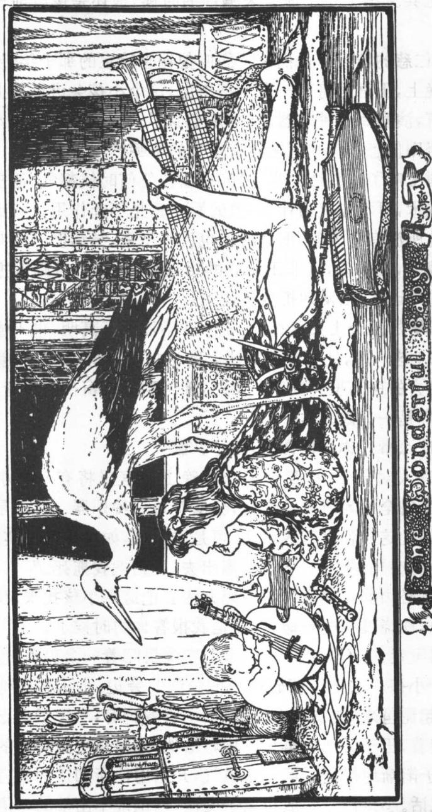

“仁慈的陛下，”他们说，“您叫他保管珍宝的那个年轻人说，今天晚上，王宫里将有一个小孩出世，这个小孩会讲世界上的所有语言，演奏每一种乐器。他不是变成了一个预言家或魔术师了吗？否则他怎么会知道还没有发生的事呢？”

国王听了这些话非常生气，比以往任何时候都气。他自己也学过魔术，可不知道为什么，他的咒语总是不起作用。听到王子具有他所没有的力量，他气得话也说不出来，结结巴巴地叫人把王子找来，发誓说，除非王子说的奇迹真的出现，否则就把他捆在马的尾巴上，活活地把他拖死。

不管那两个士兵怎么说，王子并不比国王高明，也不懂得什么魔法。这一回，他的事情就比以前更加没有指望了。他躺在不许他出去的房间里哭泣着。突然，他听到敲打窗口的声音，抬头一看，那是一只鹳。

“什么事让你这样伤心，王子？”鹳问。

“有人对国王说，我预言今天晚上王宫里将有一个小孩出世，他会讲全世界所有的语言，会演奏每一种乐器。我不是魔术师，不能让这种预言变成现实。可是国王说，如果预言不实现，他就把我绑在马尾巴上，从城里拖出去，直到把我拖死。”

“不必烦恼，”鹳说，“我会想办法去把这个小孩找来。我是鹳的国王，你饶过我一条命，现在是我报答你的时候了。”

鹳飞走了，不久就飞了回来。它嘴里叼着一个包裹，包裹里有一个小孩。它把小孩放在一把琵琶的旁边，小孩伸出他的小手，弹起琵琶来。曲调那么优美，王子听着听着，忘记了自己的忧愁。接着，王子又把长笛和齐特琴给他，他照样奏出美妙的音乐来。王子渐渐地恢复了信心和勇气，开始用他所知道的语言来和小孩说话。小孩都一一地和王子交谈，谁也说不出他的母语是什么！

第二天一早，国王直接来到王子的房间，亲眼看到了这个婴儿的所有奇迹。“如果你的魔法能变出这样一个小孩来，”国王说，“那么，你就比世界上从古到今所有的巫师都伟大，我要把女儿嫁给你。”

国王都习惯于想干什么就马上去干，所以他命令马上准备婚礼，为新郎和新娘举办盛大的婚宴。等一切都准备好了以后，他对王子说：“现在，你是我真正的儿子了，告诉我，你用什么高明的手法实现我交给你的任务？”

“我高贵的岳父，”王子回答，“我不懂咒语，也没有什么高明的手法。但我总是有办法逃避威胁我的死亡。”接着，他告诉国王，他是如何被迫从继父那里逃走，如何救了三只鸟的生命，如何碰到两个士兵，他们如何出于妒忌而想害他。

他的女儿能嫁给一个王子而不是普通人，国王从心底里感到高兴。他命令用鞭子把两个士兵驱逐出境，告诉他们，如果胆敢在他的王国里露面，就要用以前准备处死王子的方法来处死他们。

（匈牙利）

 

## 特里多，里多和鸟

从前有个公主，那么美丽，那么善良，人人都爱她。她的父亲更是一刻也离不开她，一会儿看不⻅她也受不了。有一天，公主突然失踪了，整个王国找了一遍又一遍，连最偏僻的角落也搜查过了，不见她的踪影。国王悲痛得几乎要死去。绝望之下，国王命令发出布告，不论是谁，只要能把公主带回来，就把公主嫁给他。这使许多年轻人踊跃地加入寻找的队伍，可是他们没有获得成功，个个都垂头丧气地回到家里。

那时候，离王宫不远的地方住着一个老人，他有三个儿子。父母允许两个大儿子想干什么就干什么，可是最小的却不行，他不论干什么，都得让两个哥哥。他们长大以后，大儿子对父亲说，他对这种平静的生活感到厌倦了，想出去看看外面的世界。

大儿子要和他们分手，老人感到很不高兴，但也不说什么，只是开始为他准备路上所需要的一切东西，还细心地为他准备了一双新靴子。都准备好以后，大儿子高兴地和大家告别，愉快地踏上路途。

他在一片森林里走了好几英里，走出森林，是一片光秃秃的山坡。他在山坡上坐下来休息，拿出旅行袋来准备吃午饭。还没有吃上几口，就有一个衣衫褴褛的老人走过来，看到有吃的，就问年轻人能不能让他吃一点。

“不行，真的不行！”年轻人回答，“我自己还不够吃呢，要想有吃的就得自己去挣。”乞讨的人只好走开。

年轻人吃完午饭以后，又走了几个钟头，来到第二个山头。他在草地上坐下，从旅行袋里拿出一些面包和牛奶来。这时，走过来一个老人，比第一个老人还要可怜，请求年轻人给他一点吃的。可是，老人得到的不是吃的，而是一些难听的话，他只好悲伤地跛着脚走了。

傍晚时分，年轻人来到森林里的一块空地上。这时候，他想吃晚饭。森林里的鸟看到食物，都围着他的头飞翔，希望能吃一点粒屑。可是他向那些鸟扔石头，把它们吓跑了。

吃完以后，他想找个地方睡觉。可是在空地上是不能睡的，这里又空旷又冷。这一天他虽然走了许多路，很累，可还是不得不拖着疲惫的步伐，去找个能藏身的地方。

后来，他看到一块大岩石下有个洞，里面好像很空。他走了进去，在一个角落里躺下。到半夜的时候，他被什么声音吵醒，睁开眼睛一看，一个可怕的吃人女妖魔正在走过来。他恳求女妖魔不要伤害他，让他留下来过完这一夜。女妖魔答应了，条件是明天要帮她干活，她要他干什么，他就得干什么。年轻人心甘情愿地同意了，转过身去又睡着了。

第二天一早，女妖魔吩咐他把洞里的灰尘打扫干净，这活要在她晚上回来之前干完，否则他就要倒霉。说完她就出去了。

年轻人拿起铁铲，开始清理地上的垃圾。可是不管他怎么用力，地上的垃圾就像生了根似的，一动也不动。他不得不放弃自己的努力，绷着脸坐在角落里，心里想着女妖魔为什么叫他干这种不可能的事情，她会怎样来处罚他。

他没有等多久，还没有想出会受到什么处罚，女妖魔就回来了。她只是看了一眼洞里的地面，然后在他的头上敲了一下，把他的脑壳打碎了，他就这样完了。

这时候，老二待在家里也觉得厌烦了，整天和父母吵，直到他们同意给他准备些吃的和一双靴子，让他出去看看外面的世界。在路上，他也碰到了两个讨饭的老人，想讨些面包和牛奶。可惜这个年轻人也没有受过帮助别人的教育，他的做人准则是，我的就是我的。所以他对别人的乞讨装聋作哑，独自吃他的饭。

慢慢地，他也来到了山洞，也碰到女妖魔叫他打扫山洞。可是他也毫无办法，最后遭受和他哥哥一样的厄运。

谁都可能这样想，现在，老人只有一个儿子留在身边了，即使不爱他，起码也会对他好一些。可是，尽管他比两个哥哥干得更卖力，尽量让老人舒服一些，由于某种原因，老人还是看他不顺眼。所以，当他想离开家到外面去走走时，他们很快就同意了，好像很乐意摆脱他。他们觉得，为他准备一些面包和牛奶，还有一双新靴子是够仁慈的了。

小儿子除了想享受一下外面世界的欢乐以外，还急于想知道两个哥哥的命运，他决定尽可能地去追踪他们走过的路。他从父亲的小屋里一直走到山坡上，然后坐下来休息。他对自己说：“我的哥哥肯定会在这里停留过。我要和他们一样，在这里休息一下。”

他感到又饿又累，就把父母给他准备的一些食品拿出来。他刚准备吃的时候，一个老人出现了，问他能不能给点吃的。年轻人马上掰开一块面包，请老人坐在他旁边，像老朋友一样地对待他。

后来，陌生人站起来对他说：“你要是碰到什么麻烦就叫我，我会帮助你的。我的名字叫特里多。”说完他就不见了。年轻人也说不上他到哪里去了。

他觉得休息得差不多了，该继续赶路了。到了第二个山头，他看到第二个老人，也同样给老人一点吃的和喝的。老人吃完以后也和第一个一样地说：“你如果需要帮助，哪怕是一点点事情，叫我，我的名字叫里多。”

年轻人又向前走了一段，来到森林里的空地上，准备吃饭。

一转眼，似乎森林里所有的鸟都飞到他的头上来。他给它们弄碎一些面包，看着它们落下来吃掉。吃完以后，那只个子最大，羽毛最漂亮的鸟对他说：“你如果遇到麻烦，需要帮助，就说‘我的鸟，快到我这里来！’我们就来了。”说完它们飞走了。

傍晚，年轻人来到两个哥哥遇难的山洞。像他们一样，他想这里是睡觉的好地方。他朝四周张望，看到一些死人的衣服和骨头，叫他不寒而栗。可是他并没有离去，他决心留在这里，等待着吃人的妖魔回来。他知道这些人肯定是被妖魔吃掉的。

很快，女妖魔走进来。年轻人有礼貌地问她，是否可以让他留宿一夜。她像以前一样地回答说，他可以留下，条件是明天要给她干活。条件就这样谈妥了。年轻人蜷缩在角落里睡着了。

第二天，当年轻人拿起铁铲的时候，地上的垃圾比任何时候都厚。他并不比两个哥哥能干，到后来铁铲也粘在地上，拔也拔不起来。年轻人绝望地看着。后来，两个乞讨老人的话从他心中闪过，他喊道：“特里多！里多！快来帮我！”

一转眼，老人就站在他身边，问他要什么。年轻人把事情对他们说了。老人听完以后说：“铁铲，干你们的活！”铁铲在洞里开始跳起舞来。很快，洞里就一粒灰尘也没有了。等一切都弄干净了以后，老人就走了。

年轻人心情愉快地等待着女妖魔回来。她一走进来就仔细地察看周围，然后对他说：“你不是真正一个人干的。不过，既然地板已经干净了，我就让你的头留着。”

第三天早晨，女妖魔对年轻人说，把她枕头里的羽毛全部倒出来，在太阳底下晒晒干。不过，如果她回来的时候发现少了一根羽毛，就要拿他的头来赔。

年轻人把枕头拿出来，把羽毛全部抖出来，啊！数量还真不少。他一边想着，一边小心地把羽毛铺开，真幸运，太阳那么好，而且一点风也没有。可是，突然吹起一阵微风，刹那间羽毛满天飞舞。开始，年轻人还想把它们收集起来，可很快就发现这是不可能的。他绝望地喊起来：“特里多！里多！我所有的鸟，快来帮我！”

话刚出口，他们就都来了。等鸟把所有的羽毛都找回来以后，特里多、里多、还有年轻人一起把羽毛装进枕头，像女妖魔吩咐他做的那样。不过，他们把一根小羽毛藏起来，告诉年轻人说，如果女妖魔找它，就把它塞到她鼻子底下去。接着，特里多、里多、还有那些鸟就看不见了。

女妖魔一回到家，就一头栽在床上，浑身的重量压上去，弄得山洞也抖动起来。枕头不像她想象的那样，是空空的，而是又软又松。她感到很吃惊，但是并不满足。她爬起来，把枕头里的羽毛全部抖出，一根一根地数起来。“要是少了一根，我就要你的脑袋。”她说。等她数完以后，年轻人从口袋里拿出一根来，塞到她的鼻子底下，说：“你要是以为少了，这里还有一根。”

“你不是一个人晒这些羽毛的。”女妖魔平静地说，“不过，这一次就算了。”

这天晚上，年轻人在角落里睡得又香又甜。天亮以后，女妖魔要年轻人杀掉一头大公牛，并且在她回来之前把牛心煮熟，用牛角做成酒杯。“一共有五十头公牛，”她补充说，“你必须猜出来，我想杀那一头。如果猜对了，你明天就可以获得自由，想到哪里去就到哪里去，你还可以挑选三样东西作为你劳动的报酬。但是如果你杀错了一头牛，你就要用自己的头来赔。”

女妖魔走了以后，年轻人站在那里想了一会儿，然后就喊道：“特里多！里多！快来帮我！”

一会儿年轻人就看到他们来了，赶着一头他从未见过的大公牛。他们过来以后，特里多把它杀了，里多把它的心取出来，叫年青人去煮。接着，他们很快地用牛角做酒杯。他们干得很快活，还一边高兴地说着话。年轻人告诉他的朋友，假如他干完了这些活，女妖魔答应给他报酬。老人告诫他说，必须向她要床边的那个箱子，还有床顶上的东西，洞旁边的东西。年轻人对他们的教导表示感谢。特里多和里多也向他告辞，说有了这些礼物，他就不再需要他们了。

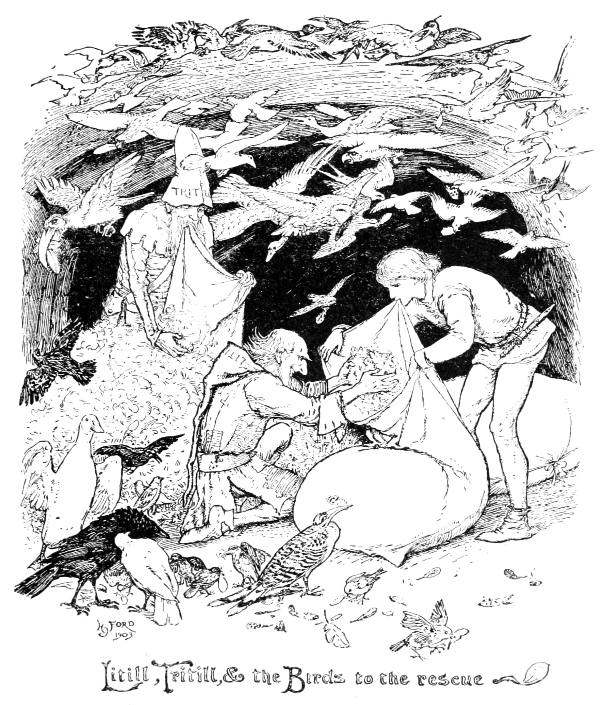

他们刚走，女妖魔就回来了。她看到，一切都像她吩咐的那样，有条不紊地做好了。在坐下来吃牛心之前，她对年轻人说：“我的朋友，你不是一个人干的。不过，我还是要遵守我的诺言。明天你就可以自由地离开这里。”这天晚上，他们各自睡到天明。

太阳出来了，女妖魔把年轻人喊醒，叫他在她家里任意选择三件东西。

年轻人回答说：“我选择你床边的箱子，床顶上的东西，还有山洞旁边的东西。”

“这些东西都不是你自己选择的，我的朋友。”女妖魔说，“但是我既然已经答应过了，我就得说到做到。”

接着，女妖魔把他要的东西都给了他。

床顶上的东西变成了失踪的公主，床脚旁边的箱子里面装满了黄金和宝石，山洞旁边的东西是一条大船，船上有桨和帆，可以自己在水里和陆地上航行。

“你是世界上最幸运的人。”女妖魔说。接着她又像往日一样地出去了。

年轻人花了九牛二虎之力才把那沉重的箱子扛上肩头，搬到船上，公主跟在他身旁。

他开着船回到公主的王国，国王看到失踪的女儿回来了，高兴得几乎昏了过去。等他恢复理智以后，他让年轻人把一切经过都告诉他。

“你找到她了，你将和她结婚。”国王说。事情就这样办了。故事到这里也就结束了。

（匈牙利）

 

## 三件长袍

很久很久以前，有个国王和他的王后统治着一个国土辽阔而且强大的国家。他们叫什么名字，现在谁也说不出。不过，他们的儿子叫西格德，女儿叫林内克，这两个年轻人因聪明和美貌而闻名全国。他们两个只相差一岁，兄妹之间那么相爱，什么事情都要一起干。等他们开始长大以后，国王专门给一幢房子让他们住，还给他们配备仆人和马车，总而言之，为他们准备好可能需要的一切。

他们幸福地住在一起好多年。后来王后病了，她将不久于人世。

有一天，王后对国王说：“答应我两件事。第一件是，如果你再结婚，实际上你肯定要结婚，你不能挑选小国家或荒岛上的女人来做妻子。她们对这个世界一无所知，只会夜郎自大。你宁可去找个大国的公主，她们习惯于宫廷的生活，懂得自身的真正价值。我想要你做的第二件事是，要永远关心我们的孩子，他们很快就会成为你最大的欢乐。”

这些都是王后的临终遗言。几个钟头以后，她去世了。国王那么悲伤和沮丧，连国事也不去料理。后来，宰相不得不告诉他，老百姓都在埋怨，没有人为他们主持公道。“您必须站起来，陛下，”宰相说，“为了您的国家，把个人的忧愁放在一边。”

“你对我太苛刻了，”国王回答，“但是你说的话是对的，你的劝告也是好意的。我也听说过同样的话：为了我的王国的利益，我应该再结婚。虽然我的心永远怀念失去的妻子，但这也是她的心愿。因此，我把寻找一个适合于和我一起共同管理国家的妻子的责任交给你。只是要注意，她不是来自一个小城镇，也不是来自荒岛。”

于是，一个以宰相为首的使团组成了。他们要访问世界上最伟大的王国，挑选一个合适的公主。

可是，他们的船开出去没有多少天，海上就起了大雾。船长左、右都看不清，没有办法辨别方向。船只在大雾之中摸黑漂流了整整一个月。后来雾散了，他们看到正前方有一块峭壁伸入海中，峭壁的一边有一个可以避风的海湾。船很快就驶进海湾抛锚。虽然他们不知道这是什么地方，但无论如何，他们觉得起码应该有新鲜的水果和淡水吃。

宰相让随行的人留在船上，自己划一只小船上岸。他想看一看周围，观察这个岛屿是不是真的像它看上去的那样荒芜。

还没有走多远，他就听到有音乐的声音传来。顺着声音的方向走去，他看到一个无比美丽的妇女正坐在一张矮凳上弹竖琴，旁边站着一个姑娘在唱歌。宰相停下脚步，有礼貌地问候那位妇女。她友好地回答他，问他怎么会来到这个远离航道的地方。宰相对她说了这次旅行的目的。

“我的处境和你的主人一样，”妇女说，“我嫁给一个伟大的国王，他统治着这块土地。后来强盗把他杀了，把所有的老百姓都处死。可是我想办法逃脱了，和我女儿一起到这里藏身。”

女儿在旁边听着，轻轻地对她的母亲说：“你是在讲真话吗？”

“记住你的承诺！”母亲生气地说，偷偷地拧了她一下，不让宰相看见。

“夫人，你叫什么名字？”宰相问，这个悲惨的故事深深地打动了他。

“布劳娃，”她说，“我的女儿叫劳弗。”接着，她问宰相叫什么名字，他的主人国王叫什么名字。他们谈论了许多事情。这个女士表现出，女人应该懂的事情她都懂，甚至有许多只有男人才学会的事她也知道。

“她将是国王多么了不起的妻子！”宰相心里想着，没有多久，他就替国王向她求婚了。

开始，她声称自己没有资格接受这么高的地位，宰相这样做很快就会后悔的。但这只是使宰相的心情更加迫切。后来，他终于得到了她的许诺，并说服她和他一起回到他的国家去。

宰相领着妇女和她的女儿回到船上。锚拉起来了，帆张开来了，一股股强劲的顺风从他们后面吹过来。

现在，雾已经散了。他们回过头去，不但可以看到海岸，而且可以清楚地看到荒无人烟的海岛，岛上根本无法住人，可是谁也不管这些了。他们航行的速度很快，六天之后就看到了陆地。上岸以后，他们立刻向首都奔去。宰相还嫌不够快，先派一个人去给国王送信。

国王的眼睛一看到这两个穿金戴银的美女，立刻忘记了他的悲伤，命令立刻准备婚礼，不得迟误。高兴之下，他决不会想起去问一下，这个未来的王后是从什么地方找来的。实际上，他的头脑已经被这两个美貌的妇女弄得晕头转向，当他下令向全国所有的大人物发出邀请的时候，他连自己的两个孩子都忘了，他们还关在自己的房子里呢！

结婚以后，国王自己什么主意都没有了，事无巨细，都要请教他的妻子。她出席所有的国事会议。不论是讲和还是宣战，都要事先征求她的意见。

可是，几个月过去以后，国王开始怀疑宰相的选择是否真的英明。他也注意到了，他的孩子越来越喜欢呆在自己的王宫里，从来不接近继母。

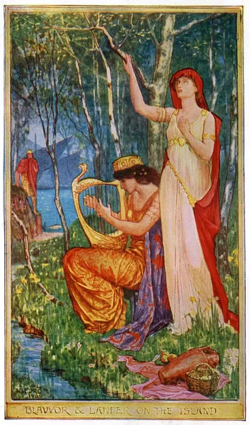

事情往往是这样，人的眼睛一旦张开以后，他们就会看到许多意想不到的事情。国王不久就觉察到，他的宫廷官员突然莫名其妙地一个接着一个地失踪了。开始，他并没有把这件事情放在心上，只是指派一些新人来接替空缺的位置。可是，人员一个接一个毫无踪影地减少，他开始感到不安起来，怀疑这些事情是不是与王后有关。

事情发展到了这种地步，有一天，妻子对他说，他应该到全国各地去巡察一下，看看各省份是否骗取属于他的钱。她还补充说：“你出去以后用不着担心，你不在的时候，我会像你一样仔细地管理好国家。”

国王并不太想出去巡察，可是王后的意志比他更坚强，他也懒得为此和她争辩。于是，他什么也不说就开始准备，命令准备最好的船只，他要沿着海岸航行。不过，他的心还是很沉重，感到很不安，虽然他也说不出为什么。出发前的那天晚上，他来到两个孩子居住的王宫，和他们告别。

他已经好久没有见到他们了。孩子们热烈地欢迎他，因为他们很爱父亲，父亲也总是仁慈地对待他们。他们有许多话要对他说。但是过了一会儿以后，他打断了他们快活的谈话，对他们说：

“如果我这次出去不回来，你们再留在这里恐怕就不安全了。所以，一知道我没有希望再回来的消息，马上朝向东的路上走去，你们会遇到一座高山，翻过高山之后，沿着一个小海湾的岸边走。在灌木丛中，你们会看到两棵大树，一棵绿的，一棵红的。不过要注意，这两棵树离大路较远，不仔细寻找是看不到的。你们分别藏到两棵树的树干中去，那样你们就安全了，不会受到敌人的伤害。”

说完这些，国王和他们道别，伤心地走上船去。开始几天，风平浪静，一切看来好像很顺利。可是后来突然狂风大作，雷电和暴雨同时袭来。在他们的记忆中，从来没有见过这么凶猛的风暴。尽管这些吓坏了的士兵和水手拼命挣扎，但船还是撞在岩石上粉身碎骨，船上没有一个人能够生还。

就在这天晚上，西格德王子做了一个梦。他似乎看见父亲站在他面前，浑身都湿透了。父亲把王冠从头上拿下来，把它放在儿子的脚下，像悄悄地走进来一样，又悄悄地走出去了。

王子急忙把妹妹叫醒。他们一致认为，父亲肯定是死了。他们得赶快照他的吩咐，到安全的地方去。他们带上自己的宝石和一些衣服，偷偷地离开房子逃出去。

他们连头也不回，一口气奔到高山顶。这时，西格德才回头张望，看到继母正紧追过来，紧张的表情使她的脸变得比最丑的老女巫还要丑。在他们和继母之间，还隔着一片茂盛的森林，西格德停下来放了一把火，把森林烧起来，挡住她的追赶。然后，他和妹妹以更快的速度奔跑，一直跑到森林中那棵红树和绿树跟前，跳到树洞里去，他们终于感到得救了。

那时候，统治着希腊的是一个非常富有和强大的国王，不过，叫什么名字已经想不起来了。他也有两个孩子，一个儿子，一个女儿。女儿比从古到今所有的希腊人更漂亮，更完美。他们是父母心中的骄傲。

王子刚刚成年的那年夏天，就说服他的父亲向邻国开战，从而给他一个建功立业的机会。不过，到了冬天，由于野外的粮食和马匹供应有问题，就把军队解散了，王子也回到家中。

在打仗的时候，他听说了林内克公主的美貌，于是决心去寻找她，向她求婚。所有这些情况，布劳娃王后用她的歪道魔法知道了。等王子快到城里的时候，她用漂亮的衣服把自己的女儿打扮起来，准备出来接见客人。

她欢迎王子来到她的王宫。吃过晚饭以后，她对王子说，她失去了自己的丈夫，现在没有人来管理国家，只好她自己来。

“可是林内克公主呢？”王后的故事讲完以后，王子问。

“在这里。”王后说完，把姑娘叫出来，她一直躲在幕后。

王子看了她一眼，感到很失望。这少女虽然也够漂亮的了，可是比一般人好不了多少。

“啊！你千万不要对她苍白的脸色和肿眼皮感到吃惊，”王后看出了他心里在想什么，赶紧说，“她还没有从失去父母的悲痛中恢复过来。”

“这说明她有一颗善良的心。”王子想，“等她感到幸福以后，就会恢复美丽的容颜。”他不再延迟地向王后提起求婚的事情，因为婚礼要在他自己的国家里举行。

王后这一回可高兴了，她根本没有指望事情这么快就获得成功，她立刻动手做准备。实际上，她很希望和两个年轻人一起走，以便保证不会出错。可是在这一点上，王子的态度是坚决的，除了劳弗，他谁也不带。当然，他错把劳弗当成林内克公主了。

不久他们离开王后，乘上一艘华丽的船出航。但是，还没有走多远，浓雾从天而降，船迷失了方向。船员们发现，他们来到了一个谁也不认识的海湾。王子命令放下小船，让他亲自上岸去看一看。他很快就注意到两棵美丽的大树，它们和希腊所有的树都大不相同。他喊来水手，吩咐他们把两棵树挖起，带到船上去。这些事干完以后，天空开始晴朗，船又开始航行。一路上不再遇到什么麻烦，他们顺利地抵达希腊。

王子带回新娘的消息传得比他们的船还要快。他们回到希腊的时候，受到了张灯结彩的热烈欢迎。国王和王后站在王宫的台阶前接见他们。姑娘被领到女士起居室，在那里等待着举行婚礼。王子回到自己的住处，还命令把那两棵树栽在自己的院子里。

第二天早晨，王子叫他的随从把未婚妻带到他的寓所来，交给她一些丝线，叫她编织三件长袍，一件红的，一件绿的，还有一件是蓝的，这些都必须在婚礼之前准备好。蓝的先织，绿的最后织。三件长袍中，绿色的应该最华丽。“我要在我们举行婚礼的时候穿绿色的。”王子这样说。

等人们都走了以后，劳弗独自坐在那里，盯着这些闪闪发亮的丝线看着，接着，不禁哭了起来。因为她不会编织，她想，事情很快就会败露，因为林内克的编织技巧就像她的美貌一样，非常出名。

劳弗坐着掩面哭泣，抽嗒不停的时候，藏在树里的西格德王子听到了，不禁动了恻隐之心。他轻轻地喊叫：“林内克，我的妹妹，劳弗在哭，帮帮她吧！我求你了。”

“你难道忘了她母亲对我们干的那些坏事了吗？”林内克回答，“也正是因为她，我们才被逐出家园。”

不过，她也不是不肯宽恕别人的人。很快，她就从藏身的树中悄悄地走出来，从劳弗的手中把丝线拿过来，开始编织。她织得又快又好，蓝色的长袍不仅很快就织好，而且绣了花。等王子来的时候，她已经安全地返回树中。

“这是我从未见过的、最漂亮的活。”王子拿起蓝长袍，说，“那件红的肯定还要好，因为它的色彩更鲜艳。”王子低头致谢告别后，就走了。

劳弗刚才还暗自希望，王子看到这件蓝的织好以后，会免去另外两件的活。当她听到三件都要织时，心里一沉，不禁大声地哭起来。西格德又听到了，还是请林内克去帮忙。林内克对她的烦恼也深表同情。像第一件一样，她帮劳弗织好，绣好，还织上金黄色的丝线和宝石。一切都完美无缺，她又悄悄地回到树中去。她刚走，王子就来了。

“你真是头脑聪明，手脚勤快。”王子欣赏着说，“这简直像是仙女绣的一样！第三件我要给你三天的时间，因为这件绿色的要比前两件更光彩照人。等它织好以后，我们就结婚。”

王子说话时，劳弗的心中想起了她和她母亲对林内克所干的那些坏事。她能指望他们会忘记这一切，林内克能第三次出来救她吗？也许林内克并没有忘记过去的这些事情，要不是西格德请求她最后一次再去帮忙，她也就不去管劳弗的事，让她听天由命去了。

林内克又一次从树中走出来。劳弗终于松了一口气，让林内克开始编织。当闪亮的绿色丝线准备好了以后，林内克又采来了日月之光辉，在长袍上织出人间最漂亮的，谁也没有见过的图案。不过，这活很花时间。到了第三天上午，当她在最后一朵花上绣最后一针时，王子走进来了。

林内克赶紧站起来，想躲过他回到树里去。可是那些丝线绊住了她，要不是王子一把抓住她，她很有可能就摔倒了。

“我早就想到，这里的事情有点蹊跷。”王子说，“告诉我，你是谁？是从哪里来的？”

于是，林内克告诉他自己的名字，自己的故事。等她讲完以后，王子迁怒于劳弗，宣布说，作为对她无耻地撒谎的处罚，她应该羞愧地去死。

劳弗跪下来求饶，说这都是她母亲的过错：“是她而不是我，把我冒充林内克公主送过来。我唯一对你撒谎的，只是那些长袍，这还够不上处死。”

西格德王子走进来的时候，她还跪在地下。西格德王子请求希腊王子宽恕劳弗。希腊王子同意了，但条件是要林内克嫁给他。林内克说：“那得等我的继母死了以后，因为她给周围的人都带来了不幸。”

接着，劳弗告诉他们，布劳娃根本不是国王的妻子，而是一个女妖魔。是她把劳弗从邻国的王宫里偷来，把她当女儿抚养。布劳娃还是个巫婆，是她用魔法把西格德和林内克父亲的船沉入海底。是她把王宫里的大臣一个一个地在黑夜里吃掉，那就是他们一个个神秘地失踪的原因。她想除掉王国里所有的人，好让像她一样的妖魔来居住。

西格德王子和希腊王子立刻召集起一支军队，向布劳娃居住的王宫进发。他们来得那么突然，谁也没有想到。就是想到了，又有什么用呢？那些身强力壮的人大部分都被布劳娃吃掉了，其他人也因为莫名其妙的恐惧逃离了王宫。因此，他们轻而易举地把布劳娃抓住了，第二天就在广场上把她杀了。事情结束以后，两个王子一起回到希腊。

林内克再也没有什么理由推迟婚事了，她和希腊王子结了婚。与此同时，西格德也娶了希腊公主。劳弗也留下来，作林内克的姐妹和朋友。后来，他们给她找到了一个大贵族做丈夫。这三对夫妻幸福地生活着，直到去世。

（冰岛）

 

## 六只饥饿的野兽

从前，有一个人和妻子住在远离他人的一间孤零零的小屋里，他们对这满不在乎。要不是有一只貂每天晚上都光顾他们的家禽棚，叼走一只家禽，他们的日子就过得非常幸福了。这个人设下了许多陷阱，想抓住这个贼。可不幸的是，有一天他不小心，自己落到陷阱里去，头撞在石头上死了。

不久，貂找东西吃从这里经过，看到有个死人躺在那里，就自言自语地说：“这是个奖品，这回我干得不错。”它吃力地把尸体拖到停在旁边的雪橇上，带着战利品准备回家。还没走多远，就碰上一只松鼠。松鼠向它点头，问：“早上好！头儿！你后面带着什么？”

貂哈哈地笑着回答：“你听说过这种怪事吗？你在这里看见过的老头子在鸡棚周围挖了陷阱，想抓住我，结果自己掉进去，折断了脖子。他很重，我希望你能帮我拖一拖雪橇。”松鼠照它的话做了。雪橇慢慢地向前走着。

接着，一只兔子从田野里跑过，它也停下来，想看看这奇怪的事情。“你们在拖什么？”兔子问。貂把事情的经过对它说了，请它也来一起帮忙。兔子也很卖力地干起来。不一会，先是一只狐狸，后来是一只狼来帮忙，最后是一只熊也加入它们的队伍。熊的力气比它们五个加起来还大，再说六个动物一起用力，那人就不那么重了。

不过，糟糕的是它们很快又觉得饿了。饿得最厉害的狼说：

“我的朋友们，这个人吃完了我们该吃什么呢？”

“我提议把我们之中最小的一个吃掉。”熊说。

貂转过身来想把松鼠抓住，它比其他动物都小得多。可是松鼠闪电般地爬上了一棵树。幸运的是，貂很快就想到，挨下来就是它最小，它赶紧钻进一个山洞里。

“现在我们该吃什么呢？”狼从惊讶中定下神来，问道。

“我们要把我们之中最小的一个吃掉。”熊又说了一遍，向兔子伸出手来。可兔子也不是傻瓜，熊的手还没有碰到，它就像箭一样跑到森林里去了。

现在，松鼠、貂和兔子都跑了，留下来的三个动物中，狐狸最小了。狼和熊对狐狸解释说，它们感到很遗憾，不得不把它吃掉。狐狸听它们说完以后，不像其他动物一样赶紧逃跑，只是和蔼地笑着说：“老是这样吃没有味道，不如一起到山上去饱饱口福。”狼和熊都同意了。它们挑选了一条路，向山上走去。

一路上，狐狸快活地和两个大伙伴一起走着，跳着。不过，半路上它想办法悄悄地对狼说：“告诉我，把我吃掉以后，下一个该是轮到谁呢？”问题看来很简单，可狼听了感到很不安。是啊！下一顿饭该吃什么呢？而且更重要的是，这顿饭该谁享用？它们的规矩已经出来了，先把最小的吃掉。狐狸之后，当然是它比熊小了！这些想法闪电般地在狼的脑子中闪过。它赶紧对狐狸说：“亲爱的兄弟，我们像亲密的伙伴一般一起活着，一起像往常一样去猎取食物不是更好吗？我的想法是不是很好？”

“这是我闻所未闻的好事情。”狐狸说。于是，它们两个对熊一个，熊也只好同意，尽管它心里只想立刻吃顿美餐，不管什么朋友和友谊。

一连好几天，日子很好过。森林里有的是猎物，连胃口很大的狼也是想吃多少就有多少。

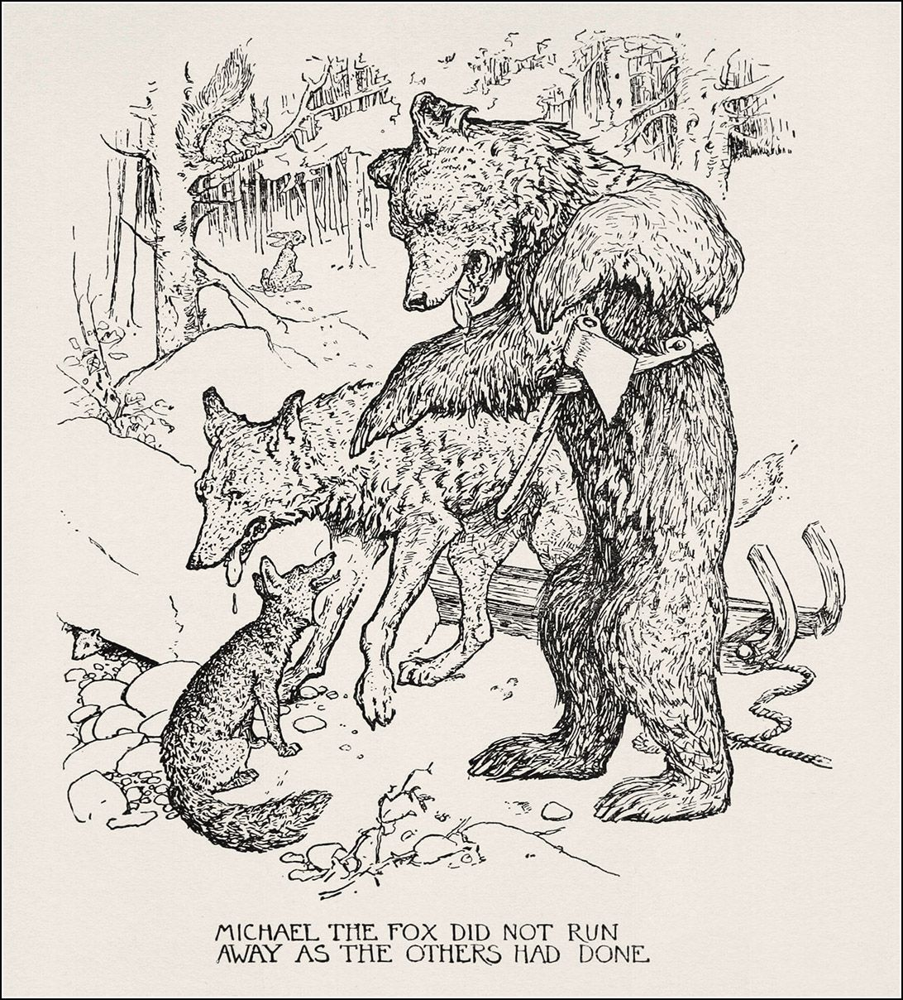

一天早晨，狐狸像往常一样出去转一转，看到一棵又高又细的树顶上，有一个喜鹊巢。恰巧狐狸特别喜欢吃小喜鹊，它开始考虑如何才能吃到。后来，它终于想出一个十拿九稳的好办法。于是，它在树下面坐下，眼睛瞪着树看着。

“你在看什么呢？狐狸先生！”喜鹊从树枝上看到它，问道。

“我在打量这棵树，我想用它来做我的新雪地鞋正合适。”喜鹊听到这里吓得尖叫起来：“啊！不要用这棵树，亲爱的兄弟，我求求你了。我在这棵树上筑了巢，我的小鸟还不会飞。”

“要想另找一棵能做出好雪地鞋的树可不容易。”狐狸歪着脑袋看着树，装作一副沉思的样子回答说，“不过，我也不想让别人说我不好。这样吧！要是你把一只小喜鹊送给我，我就到别处去找。”

可怜的喜鹊想不出别的办法，只能伤心地把一只小喜鹊扔下来。狐狸一把抓住，塞到嘴里，得意洋洋地跑了。喜鹊失去了一个孩子，虽然心里非常悲痛，可是想到丢了一只，保住一窝，只有很聪明的鸟才会想出这个办法时，多少也感到一些安慰。

可是你猜后来怎么啦？几天以后，狐狸又来到那棵树下坐着。喜鹊从树上看到它，心中猛然一紧。

“你在看什么？”喜鹊用发抖的声音问。

“在看这棵树。我在想，用它来做雪地鞋该有多好！”狐狸漫不经心地回答，满不在乎的样子。

“啊！兄弟！我的好兄弟！不要这样！”喜鹊痛苦地喊叫着，跳着，“你没有忘记吧！仅仅是几天前，你答应过到别处去找做雪地鞋的树。”

“我是答应过。可是找遍了整个森林，也找不到这么好的一棵树。我很遗憾给你添了麻烦，但这的确不是我的过错。唯一的办法是，你要是扔一只小喜鹊下来，作为交换，我的雪地鞋就不做了。”

可怜的喜鹊尽管自以为聪明，也不得不再扔下一只小喜鹊。这一回，它也不能用自己比别人聪明来安慰自己了。它垂头丧气地坐在巢边，羽毛也显得很凌乱，一副丧魂落魄的样子，和往常森林里的动物看到的那无忧无虑的快活劲完全不一样。一只乌鸦恰巧从这里飞过，就停下来问它是怎么回事，怎么少了两只小喜鹊？

“我不得不把它们送给狐狸了。”喜鹊用发抖的声音回答，“上个星期它到这里来过两次，说要把这棵树砍下来做雪地鞋。唯一能让它打消这个念头的条件是，送给它两个小喜鹊。”

“啊？你这个傻瓜。”乌鸦说，“狐狸只是吓唬你。它没有斧头，也没有刀具，根本没有办法把这棵树砍下来。我的天！想想看，你白白地断送了两个孩子的命。哎！你怎么会这样笨！”

乌鸦飞走了，留下喜鹊沉浸在悲痛和羞愧之中。

第二天早晨，狐狸又到树前的老地方坐下。它很饿，一只小喜鹊是一顿很美的午餐。可是，这一回它看到的不是一只胆怯的听话的喜鹊，而是一只昂首挺胸、说话口气坚定的喜鹊。

“我的好狐狸，”喜鹊歪着头，看上去很聪明的样子，“你要是听我的劝告，就快点回家去，越快越好。在这里说什么用这棵树来做雪地鞋是没有用的。你没有斧头，又没有刀具，怎么能砍倒这棵树呢？”

“谁教会你这么聪明的？”狐狸看到形势急转直下，非常吃惊，也顾不得装腔作势了。

“乌鸦，它昨天到我这里来过了。”喜鹊回答。

“乌鸦，是吗？”狐狸说，“那好！以后它最好不要碰到我，否则它就倒霉。”

狡猾的狐狸不想再继续说下去了。它离开森林，来到公路上直挺挺地躺下来，像死了一样。没多久，它用眼角看到乌鸦正向它飞过来，就丝毫不动，还把舌头从嘴里伸出来。乌鸦这时正在找晚饭吃，饿得慌，就很快地向它扑过来，伸出嘴来啄它的舌头。狐狸一张口就咬住了乌鸦的翅膀。乌鸦知道挣扎是没有用的，就说：

“啊！兄弟，你要是真的想吃我，就吃吧！不过我请求你好好的吃。先把我从悬崖上扔下去，我的羽毛就会掉得满地都是，所有看到的动物都会说你比我更聪明。”

这个主意很合狐狸的心，因为它没有忘记是乌鸦把小喜鹊从它的口中夺走。所以，它把乌鸦带到悬崖边上，使劲地扔下去，然后想沿着一条它认得的路到下面去把乌鸦捡起来吃掉。可是，狐狸刚一扔下，乌鸦就高高地飞起来，它飞到狐狸刚好抓不到的空中，笑着喊道：“啊！狐狸，你很聪明，知道怎么抓住猎物，可惜不知道该怎么留住猎物。”

狐狸夹着尾巴溜进了森林，它不知道该到哪里去找饭吃。他想，乌鸦肯定比它先飞回来告诉其他动物，它们都会提防着。想到要饿着肚子上床睡觉，它感到很不舒服。正当它不知道该干些什么才好的时候，它碰到了老朋友熊。

熊的妻子刚去世，正在找人来帮它哀悼妻子，因为它感到失去妻子的损失太大了。它刚走出舒适的洞穴时，就碰到了狼。狼问它要到哪里去。

“我正寻找一个为妻子哀悼的人。”熊说，接着把自己的不幸对狼说了。

“嗯！我来帮你哀悼吧！”狼说。

“你知道该怎么哭吗？”熊说。

“嗯！当然！头儿！我当然知道。”狼回答。可是熊说，它要找一个特别的，懂得它的事情的哀哭者。于是狼就放声唱出它的悲歌来：“呜！呜！呜！呜！”它哭喊的声音那么大，熊用手遮住自己的耳朵，请它快停住。

“你一点也不知道该怎么做，滚吧！”熊生气地说。

熊沿着路走没多久，就碰到兔子在一条沟里休息。兔子看到熊，就跑出来和它说话，问它为什么看上去那么悲伤。熊对它说，自己的妻子刚去世，想找个为它哀悼的人，能用恰当的方式对它表示哀悼。兔子立刻表示它能效劳。熊关心的是兔子有没有这种才能，在接受它的帮忙之前要证实一下。于是兔子：“呼！呼！呼！呼！”地哭起来。可是它的声音那么轻，熊几乎听不见。“这个样子我不要，”熊说，“再见吧！”

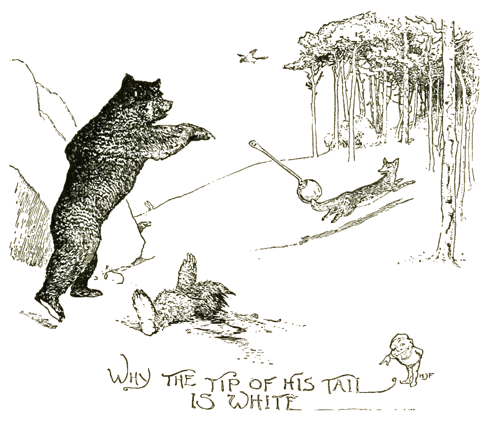

就在这个时候，狐狸走过来了。它也对熊异乎寻常的表情感到奇怪，就停下来问：“头儿！你这是怎么啦！你要到哪里去？”

“我正在找个人来为我的妻子哀悼。”熊回答。

“啊！那么就让我来吧！”狐狸说。熊若有所思地看着它。

“你会哭吗？”熊问。

“当然，我哭得太好了，不信你听着。”狐狸提高嗓子唱起哀歌来：“哟！哟！哟！多好的纺织女！烘饼的能手！勤俭的当家人！你从丈夫的身边被夺走了！哟！哟！哟！夺走了！夺走了！”

“我终于找到一个懂得哀悼艺术的人了！”熊十分高兴地说。它把狐狸领到自己的洞里，吩咐它开始为躺在铺着灰色苔藓的床上、已经死去的妻子哀悼。可是这一点也不合狐狸的趣味。

“在这个洞里谁也哭不好！”狐狸说，“这里太潮湿了，你最好把它背到仓库里去。在那里就要好得多了。”

熊把妻子背到仓库里去以后，就回到洞里来帮哀悼的人烧些吃的东西。它不时停下来，想听听哭的声音，可是什么也听不到。后来它等不住了，就走到仓库门口去问狐狸：“你怎么不哭了！你在干些什么？”

狐狸非但没有为死去的母熊哭泣，而且已经把它吃得差不多了。它回答说：“现在只剩下两只脚了。要是再给我五分钟，就可以把它通通吃光。”

熊听到这些话，气得跑回厨房去拿来一把勺子，准备把这个该打的逆贼痛打一顿。可是当它把仓库的门打开时，狐狸早就做好了准备，它从熊的两条腿中间溜了出去，很快就逃到森林里去了。熊看到逆贼逃走了，就把勺子扔过去，正好打在狐狸的尾巴上，那就是为什么所有的狐狸尾巴上都有一个白点。

（芬兰）

 

## 穷小子如何变成伯爵

从前有个父亲，他只有一个男孩。这个男孩又懒又笨，而且不听话，叫他干什么他都不肯。父亲感到自己快要死了的时候，就把儿子叫来，对他说，他很快就会孤零零地一个人留在这个世界上了，除了他们居住的这间小屋，还有屋后的一棵梨树以外，他什么都没有了。不管他愿意不愿意，他都得去找个活干，否则就要饿死。说完，老人就去世了。

可是，男孩子还是什么活也不肯干，仍然像以前那样游手好闲，只满足于吃树上的梨子过日子。可也奇怪，这棵梨树不像以前或以后生长的梨树，它一年四季都结果。而且梨子终年长得那么好，就是秋天结出来的硕果也比不上它。有一天，正是隆冬季节，一只狐狸从这里经过，被树上的梨子吸引住了。

“我的天！多么可爱的梨子！”狐狸对男孩子说，“送给我一篮子吧！它会给你带来好运！”

“啊！小狐狸，要是给了你一篮子，我吃什么呢？”男孩子问。

“嗯！相信我，照我的话去做，”狐狸说，“我知道，它会给你带来好运气。”

于是男孩子爬到梨树上，摘下一些熟透了的梨子，装进一个篮子里。狐狸谢过他以后，用嘴叼着篮子，来到王宫求见国王。

“尊敬的陛下，我的主人派我给您送来一些最好的梨子，请您仁慈地收下。”狐狸把梨子放在国王的脚下说。

“梨子！这个季节还有梨子？”国王张大眼睛看着喊叫起来，“请告诉我，你的主人是谁？”

“皮罗伯爵。”狐狸回答。

“可他是怎样在冬天里种出这些梨子的？”国王问。

“啊！他要什么就有什么！”狐狸说，“尊敬的陛下，他甚至比您还要富。”

“那么，我该送他什么，以答谢他的梨呢？”国王问。“什么也别送，尊敬的陛下，否则您就会伤害他的感情。”狐狸回答。

“那好吧！请告诉他，我是多么喜欢他的梨，衷心地感谢他。”

狐狸带着空篮子回到小屋，把事情的经过对年轻人说了。可是狐狸的话好像并没有使他感到高兴。“可是，我亲爱的小狐狸，作为回报，你并没有带什么回来，我饿极了。”

“那你别管，”狐狸说，“我知道我在干什么。你看着吧！它会给你带来好运。”

几天以后，狐狸又来了。

“我还得再要一篮子梨。”它说。

“啊！小狐狸，你把我所有的梨都拿走了，我吃什么？”年轻人说。

“安静一些，一切都会好的。”狐狸说。它拿来一个比上次还要大的篮子，装了满满一篮子梨，然后用嘴叼着，跑到王宫里去。

“尊敬的陛下，既然您那么喜欢上次那篮子梨，我又给您带来了一些，还带来了我的主人——皮罗伯爵真诚的敬意。”

“现在这个时候，在覆盖着深雪的地里怎么会长出这么好的梨子来呢？”国王喊道。

“啊！这丝毫也没有影响。”狐狸快活地回答，“他那么富有，想干什么都行。不过，今天他派我来问您，是否可以把您的女儿嫁给他？”

“要是他比我富得多，”国王说，“我就不得不拒绝他，我的尊严不允许我接受他的慷慨。”

“啊！尊敬的陛下，您千万别那么想。”狐狸说，“同时也别为嫁妆而烦恼。皮罗伯爵除了向公主求婚以外，他从未想过要些什么。”

“他真的那么富有，连嫁妆也可以不要吗？”国王问。

“我不是对尊敬的陛下说过，他比您还富吗？”狐狸有点责备地说。

“那好，请他到这里来吧！这样我们可以一起说说话。”国王说。

于是狐狸回到年轻人那里，对他说：“我对国王说了，你是皮罗伯爵，而且还向公主求婚。”

“啊！小狐狸，你都干了些什么？”年轻人懊恼地说，“国王看到我这个模样，会立刻叫人把我的头砍掉。”

“啊！不！他不会的！”狐狸回答，“你只要照我的话去做就行了。”

狐狸来到城里，到最好的裁缝店门口停下。

“我的主人皮罗伯爵请你把店里最好的衣服立刻给他送去，”狐狸装出一副高雅的样子说，“假如合适，明天我就会来付钱！他要得那么急，也许最好还是我亲自给他带去。”

裁缝很少有机会为伯爵效劳，他立刻把所有合适的成衣都拿出来。狐狸挑了一件银白色的漂亮大衣，吩咐裁缝把它包好，用牙齿咬住就离开了裁缝店，来到马贩子的家里。它叫马贩子给它一匹最好的马，说是国王请它的主人到王宫里去。

年轻人很不情愿地穿上大衣，骑上马去见国王。狐狸跑在他的前面。

“我和国王陛下该说些什么呢？小狐狸，”他忧心忡忡地问，“你知道，我从来没有和国王说过话。”

“你要说的只有一句话，‘早上好！尊敬的陛下！’其他的话什么也别说，都留给我来说。”狐狸回答。

这时候，他们已经来到王宫。国王到门口来迎接皮罗伯爵，把他领进大厅。宴席准备好了，公主已经在桌前坐下，可也像皮罗伯爵一样，一句话也不说。

“伯爵很少说话。”国王终于这样对狐狸说。

“他要花很大的精力去考虑财产的安排问题，不像普通人那样常常有空闲的时间说话。”狐狸这样回答。国王对这个答复十分满意。宴会结束以后，皮罗伯爵和狐狸就告辞了。

第二天早晨，狐狸又来对年轻人说：“再给我一篮梨子。”

“很好！不过你要记住，小狐狸，这也许会断送我一条命。”年轻人说。

“啊！包在我身上，照我的话去做，最终你会交上好运。”狐狸回答，叼起一篮子梨就到国王那里去。

“我的主人，皮罗伯爵叫我送来这些梨给你，还想听听你的答复。”狐狸说。

“告诉伯爵，婚礼可以在他乐意的任何时候举行。”国王得意地回答。狐狸跑回来把这个消息告诉年轻人。

“可是，小狐狸，我怎么能把公主带到这个地方来呢？”年轻人沮丧地说。

“这些事用不着你操心，看我的。”狐狸说，“我不是把一切都安排得很好吗？”

王宫里，举行盛大婚礼的一切准备都完成了。年轻人和公主结婚了。一个星期的婚宴以后，狐狸对国王说：“我的主人想把他的新娘带回自己的城堡中去。”

“很好！我陪他们一起去。”国王回答。他命令官员们和随从都做好准备，把马厩里最好的马都拉出来，为他、伯爵和公主备好。这样，他们浩浩荡荡地出发了，小狐狸跑在最前面。

狐狸看到一大群羊正在茂盛的草地上悠闲地吃着草，就停下来问牧羊人：“这些羊都是谁的？”

“是属于妖魔的。”牧羊人回答。

“嘘！”狐狸摆出一副神秘的样子说，“你看到那边有一支部队正开过来吗？你要是对他们说，这些羊是属于妖魔的，他们就会把羊都杀了，妖魔就会把你杀掉。要是他们问你，你就说这些羊是属于皮罗伯爵的，这样对大家都有好处。”说完，狐狸又急忙往前赶，它不想被人看见在和牧羊人说话。

不久，国王过来了。

“多么漂亮的羊群！”国王赶着马过来说，“我的牧场里没有这么好的羊，这些羊是谁的？”

“是皮罗伯爵的。”牧羊人回答。他不认识国王。

“好啊！他肯定很有钱。”国王心里想着，为有这么富有的女婿而感到高兴。

这时候，狐狸在前面看到一大群猪在大树下抽鼻子。

“这些猪都是谁的？”狐狸问。

“是妖魔的。”猪倌回答。

“嘘！”狐狸看到周围没有人，小声地对猪倌说，“你看到那边有一支军队正向我们开过来吗？要是你对他们说，这些猪是妖魔的，他们就会把猪都杀了，接着，妖魔就会把你杀掉！要是他们问你，你就说这些羊都是皮罗伯爵的，这样对大家都好得多。”说完，狐狸就赶紧跑开。

很快，国王就跟着过来了。

“多好的猪群！”国王勒住缰绳说，“它们比我农场里的任何一头猪都肥。这些猪是谁的？”

“皮罗伯爵的。”猪倌回答，他不认识国王。

国王又一次想到，他是多么幸运，有一个那么有钱的女婿。这时候，狐狸比以前跑得更快。在一片开满鲜花的草原上，它看到一群马在吃草。“这些马是谁的？”狐狸问在旁边看马的人。“是妖魔的。”牧马人回答。

“嘘！”狐狸小声地说：“你看到那边正有一支军队开过来吗？你要是对他们说，这些马都是妖魔的，他们就会把马全部赶走，妖魔知道了就要把你杀了。如果他们问起，你就对他们说，这些马是皮罗伯爵的，这样对大家会更好。”说完它又继续向前跑。

几分钟以后，国王骑着马过来了。

“啊！多么漂亮的马！我真希望这些马都是我的！”国王情不自禁地说，他又回过头来问牧马人，“这些马是谁的？”

“是皮罗伯爵的。”牧马人回答，他不认识国王。国王不由得心跳起来，他想，这些马既然是他那有钱的女婿的，那就像是自己的一样。

最后，狐狸来到了妖魔的城堡。它跑上台阶，眼泪不停地从眼眶中流出。它边哭边说：“啊！可怜！你们这些可怜的人！你们的命运是多么悲惨啊！”

妖魔被吓得浑身发抖，赶紧问道：“发生了什么事情？”

“你看到一支骑兵部队正沿着大路向这边奔过来吗？他们是国王派来杀你们的。”

“啊！亲爱的小狐狸，救救我们，请求你了！”妖魔和他的妻子喊道。

“好吧！我尽力而为。”狐狸回答，“你们最好是到大火炉里去藏起来。等那些骑兵走了以后，我就叫你们出来。”

妖魔和妻子急急忙忙地爬进大火炉，狐狸也赶紧把炉门关好，恰好这个时候，国王来了。

“谢谢光临，请下马，尊敬的陛下！”狐狸低头鞠躬，对国王说，“这里就是皮罗伯爵的宫殿。”

“啊！它比我的王宫豪华得多了！”国王说，他看了看大厅周围那么贵重的摆设，“可是，怎么一个仆人都没有？”

“好心的皮罗伯爵想让公主自己来挑选仆人。”狐狸说。国王点头赞许。

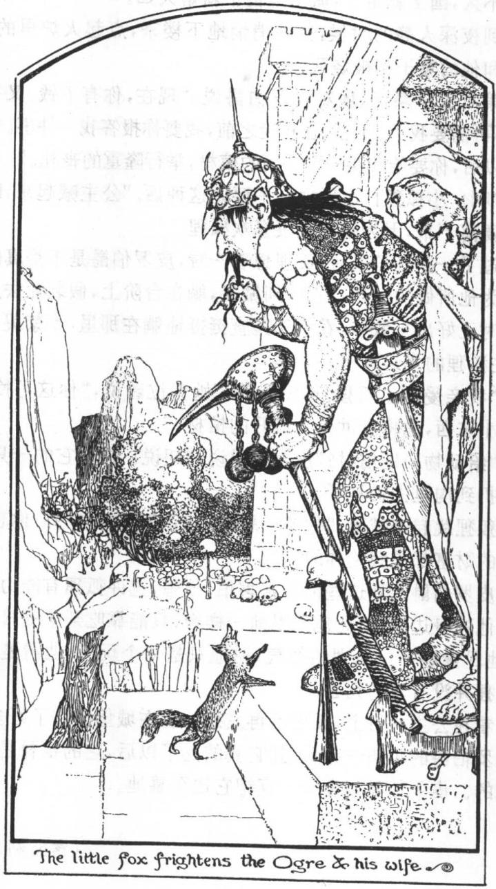

不久，国王就走了，城堡里留下新婚夫妇。

到夜深人静的时候，狐狸悄悄地下楼来，点起火炉里的火，妖魔和他的妻子都被烧死了。

第二天早晨，狐狸对皮罗伯爵说：“现在，你有了钱，又很幸福，不再需要我了。不过，在我走之前，我要你报答我一件事。等我死了以后，你要给我买一副华丽的棺材，举行隆重的丧礼。”

“啊！小狐狸！小狐狸！不要说这种话。”公主喊起来，眼泪几乎要落下来，因为她已经很喜欢狐狸。

过了一些日子以后，狐狸想看一看，皮罗伯爵是不是真的感激它为他所做的一切。它回到城堡，躺在台阶上，假装死去。公主这时正好出来散步，看到狐狸直挺挺地躺在那里，不禁哭了起来，在狐狸的身边跪下。

“我亲爱的小狐狸，你没有死。”她哭泣着说，“你这可怜，可怜的小东西，你将有世界上最好的棺材。”

“给动物一副棺材？”皮罗伯爵说，“胡说！抓住它的一只脚，把它扔到沟里去就是了。”

狐狸跳起来喊道：“你这个恶棍，忘恩负义的乞丐！你忘了，所有的财富都是我给你的。”

皮罗伯爵听到这些话非常害怕。他想，也许狐狸有能力把城堡从他的身边拿走，让他像以前一样穷，只能靠吃梨子度日。所以，他尽量地平息狐狸的怒气，说他只是开个玩笑，他清楚地知道狐狸并没有真的死去。

看在公主的份上，狐狸不再发怒。它在城堡里住了好多年，和皮罗伯爵的小孩一起玩。到它真的死了以后，它的棺材是用银制成的。皮罗伯爵和妻子一直把它送至墓地。

（意大利）

 

## 淘气鬼和牧主

在离国王王宫不远的地方有一间小屋，里面住着一个老人，他的妻子和儿子。儿子很懒，一点活也不想干，叫他去看一头牛，他都很不乐意。他总是躺在河岸上，晒着太阳睡觉，让牛去自己管自己。好长一段时间，老人也不说他什么，希望他长大以后会明白事理。后来，老人终于失去耐心，他对儿子说，不能留在家里偷懒，必须到外面的世界去碰碰运气。

年轻人看到没有什么别的指望了，就背着一只装满食品的旅行袋出去。后来，他来到一座大房子前，敲了敲大门。

“你想干什么？”开门的老人问。年轻人说，他因为又懒又笨，被父亲从家中赶出来，想找个地方过夜。

“那么就进来吧！”老人说，“不过，明天我要安排一些活给你干。你要知道，我是国王的牧主。”

年轻人没有回答。他心里想着，要是不得不干活的话，那我什么地方不能留？不过，这时候他想不出到什么地方去能找张床睡觉，所以就很不情愿地慢慢走进屋。

牧主的两个女儿和她们的母亲正在吃晚饭，她们请他一起吃。这天晚上，他们不再说什么干活的事，吃过饭后都上床睡觉。

第二天早晨，年轻人穿好衣服以后，牧主把他叫去，对他说：“听着，我要告诉你该干些什么。”

“什么事？”年轻人脸色阴沉地问。

“没什么别的事，只是看管二百头猪。”这就是牧主的回答。

“嗯！这活我常干。”年轻人说。

“是的，但这回你得把它干好。”牧主说着，把他领到养猪的地方，叫他把猪赶到山脚下的森林里去。年轻人照他的吩咐去做了。可是一到山脚下，那些猪都撒起野来，要不是正好从一条峡谷里经过，猪早就跑了。顺着峡谷，年轻人轻而易举地把它们赶到父亲的家里。

“这些猪是从哪里来的，你怎么弄到手？”老人吃惊地问。他想，儿子昨天刚刚离开家。

“它们是国王的牧主的。”儿子回答，“他叫我来看管它们。可是我知道，这活我干不好，就把它们赶到你这里来了。现在，碰碰你的好运气吧！立刻把这些猪都杀了，吊起来。”

“你在胡说些什么？”老人吓得脸色苍白，喊叫起来，“我要是干了这种事，我们俩肯定会被处死。”

“不会！不会！照我的话去做，我会想办法安排好的。”年轻人回答。后来，他们就照他的意思把猪全都杀了，把它们一头接着一头地排好，然后把猪的尾巴割下来，用一根绳子结好。他把这些猪尾巴背到放猪的地方，那里有一块沼泽地，这正是他所需要的。他用绳子把石块结好，把绳子沉入沼泽地里，然后小心地把猪尾巴一个一个地弄出水面。等一切都弄好以后，他才急匆匆地赶回家，哭丧着脸去找主人。牧主一看到他，就知道出了什么可怕的事情。

“猪都到哪里去了？”他问。

“啊！别提它们了。”年轻人回答，“我真不知道该怎么对你说。它们一到地里就全都疯了，东奔西跑。我一会儿追这头，一会儿追那头；抓住了这一头，那一头又跑了，弄得我毫无办法。不过，后来我终于把它们全部赶拢来，正准备把它们赶回来，它们突然奔下山，冲到沼泽地里去，一头一头都不见了，只留下一点尾巴露在外面。不信你可以自己去看一看。”

“你这故事编得真好。”牧主说。

“不！这全是真的，跟我来，我会指给你看。”他们一起来到出事地点。千真万确，猪的尾巴都露出水面。牧主抓住最近的一根猪尾巴，用力地想把它拉起来。可是没有用，绳子和石头把它拉得紧紧的。他叫年轻人过来帮忙，可是两个人也不见得比一个人好多少。

“看来你说的话是真的，这真是一件怪事。”牧主说，“不过我看这也不是你的过错。我得尽量去弥补这些损失。我们回去吧！现在是吃晚饭的时候了。”

第二天早晨，牧主对年轻人说：“我给你安排了别的工作。今天，你赶一百只羊去吃草，要小心，别让它们受到任何伤害。”

“我尽最大的努力。”年轻人说。他把关羊过夜的羊圈门打开，把羊赶到草地上去。可是很快，羊也像昨天的猪一样地疯起来，四处奔跑。年轻人不管怎么努力，也无法把它们管起来。他想，这是对他偷懒，连父亲的一头母牛也不肯看管的惩罚。

不过，后来那些羊好像也跑累了。他把它们赶拢来，像昨天一样，赶到父亲那里去。

“这些羊是谁的？把它们赶到这里来干什么？”老人惊奇地问。儿子把事情的经过告诉他，不过听到最后他直摇头。

“别去干这种坏事，把它们赶回到主人那里去。”他说。

“不！不！”年轻人回答，“我可没那么笨，把它们杀了当午饭吃。”

“你要是这么干，会把命也丢了。”父亲说。

“啊！我看不一定！”儿子说，“不管怎么样，这回我要照自己的想法去干。”他把羊都杀了，把它们都扔在草地上，但是把角上挂着铃的带头羊的头割下来，带到牧羊的草地上。他已经注意过，草地上有一块很高的岩石。岩石顶上的中央是一块草地，三边是一些茂密的树丛。他费了九牛二虎之力才爬上岩石，把羊头用绳子捆在树丛上，只让羊角和那只铃露出来。阵阵微风吹起，树丛摇晃起来，羊头也在动来动去，铃还发出悦耳的声音。等一切都照他的想法安排妥当以后，他赶紧回到主人那里去。

“那些羊呢？”牧主听到年轻人跑过来的脚步声，出来问道。

“啊！别提它们了。”年轻人回答，“我能回来也算是奇迹了。”“立刻告诉我，发生了什么事情。”牧主严厉地说。

年轻人开始哭泣起来，抽抽噎噎地说：“我……我真不知道该怎么对你说！它……它们那么捣蛋，我一点也……也管不住它们。它们到处……乱跑，我遍地……追，累得要死……接着，我听……听到很响的声音，开始……我以为是风，可后来一看……是那些羊，被吹……吹到空中去了。我站在那里看呆了，可耳朵里一直响着那只带头羊的铃声。”

“这算什么，从头到尾都是谎言。”牧主说。

“不！这都是真的，就像天上有个太阳那样地明摆着。”年轻人回答。

“那么，拿出证据来。”牧主喊叫着。

“那好，跟我来吧！”年轻人说。

这时已是黄昏，天开始暗下来。年轻人把牧主带到那块岩石脚下。天黑了，上面什么也看不见，只是有阵阵轻微的铃声传下来，牧主听得出，那是他亲手挂在带头羊头上的铃声。

“你听见了吗？”年轻人问。

“是的，我听到了。你说的是真话，出了这种事我不能怪你，我要尽量承担起这些损失。”

他转身朝家里走去，年轻人跟在他后面，为自己的聪明感到十分高兴。

又过了一夜，早晨牧主对年轻人说：“毫无疑问，我派给你的工作太难了，你也感到厌倦了。今天，我让你去做十分容易的事。你去看管四十头牛。但是千万要小心，有一头牛的角上和蹄上镶着金子，国王把它当作最贵重的珍宝之一。”

年轻人把牛群赶到草地上。到了那里不久，它们也像猪和羊一样地到处乱奔。那头最珍贵的牛最野蛮。年轻人站在那里看着，不知道该怎么办才好。这时，他想起父亲的母牛正放牧在离这里不远的草地上，就发出巨大的响声，牛群吓得乖乖地跟着他走。等它们听到母牛的叫声，跑起来就更快了，很快就来到了他父亲的屋前。这时，老人正站在家门口，看到一大群牛从门前大路的转弯处冲过来，他的儿子和自己的母牛冲在最前面。

“这些牛都是谁的？怎么会到这里来了？”他问。儿子把事情的经过对他说了。

“把它们赶回到你的主人那里去，越快越好。”老人说。可是儿子只是笑了笑，说：“不！不！它们都是送给你的礼物，它们会让你吃得胖胖的。”

好一会，老人拒绝做这种缺德的事，不过后来还是被儿子说服了。他们像杀那些猪和羊一样，把这些牛也杀了，只剩下国王最珍贵的那一头。

年轻人拿起一根绳子，套在牛的角上，准备把它拖倒在地上。可是这头牛的力气很大，绳子也被它拉断了。牛挣脱了绳子以后，向森林里奔去，年轻人紧追不舍。他们越过山脊和沟渠，一直奔到山口。过了这个山口，就不是牧主的牧地了。

牛跑到这里，以为没事了，就躺下来休息，年轻人这才有机会赶上来。他不知道该如何抓住它，干脆把附近能找到的柴火都搬过来把牛围住，点起火来。这时候牛已经睡着了，等火烧着它的头才醒过来，这时候想逃跑已经为时太晚了。年轻人站在旁边看清楚以后，跑回到主人那里去。

“你去了好久了。”牧主说，“那些牛呢？”

年轻人喘息着，好像急得说不出话来，好一会才回答说：“事情总是这样！牛都跑……跑了！”

“跑了？”牧主喊道，“你这个坏蛋，你撒谎！”

“我说的话千真万确。”年轻人说，“我们一到草地上，牛就全都疯了一样，管也管不住它们。那头大公牛狂奔起来，其余的牛也都跟着它，进了一个山口不见了。后来，我听到牛吼叫的声音，我听得出是那头金角牛叫的。等我顺着声音找过去，来到山口的时候，什么也没听见，什么也没看见，只是周围有被大火烧过的痕迹。”

“混蛋！”牧主听完他的故事以后叫起来，“就算你以前说的都是真话，现在一定是撒谎！”

“不！主人！我说的都是真的，你自己去看看吧！”

“要是我发现你骗了我，你就死定了！”牧主说。他们一起走出去。

“你看这是什么？”年轻人问。牧主仔细一看，这里是被大火烧过了，这火好像是从地下冒出来的。

“怪事连着怪事，”他说，“看来你的话是真的了。好吧！我不责怪你。虽然为了那头价值连城的牛，我要赔国王许多钱。不过，来吧！让我们回家！我再也不会叫你去放牧牲口了。从今天起，我让你干些容易的活。”

走在路上的时候，牧主又说：“我已经想好了叫你干什么。这活很简单，你不会出错。你给我打十把镰刀，每人一把，明天我要叫人到草地上去割草。”

听了这些话，年轻人心头沉重起来。不论是铁匠活还是木工活，他都一点也没学过。但是，他不敢说个不字，只是笑着点头。

他心事重重慢慢地走回去睡觉，可怎么也睡不着，老是想着镰刀是如何打出来的。他以前表现出来的聪明和才干现在可是一点也用不上了。想了几个钟头镰刀以后，他想出路只有一条了。他仔细地听着，断定外面一点动静也没有，就偷偷地溜出去，回到父母的身边，把整个事情都对他们说了。他们决定把他藏起来，藏在谁也找不到的地方。

时间一天一天地过去了。年轻人留在家中，父母叫他干什么，他就干什么，和他出去闯荡世界之前判若两人。可是有一天，他对父亲说，他想结婚，想有一间自己的房子。

他说：“我在国王的牧主那里干活的时候，看到了他的女儿。我决心试试看，能不能娶她作妻子。”

“你会因此而丢性命的。”父亲摇摇头说。

“嗯！我要尽最大的努力。”儿子回答，“不过，先把你挂在床头的那把剑给我。”

老人弄不明白这把剑对求婚有什么用处，不过还是拿下来给他。年轻人带上剑就走了。

他来到牧主的家时，天已经很黑了。他敲了敲门，一个小孩出来开门。

“我想和你的主人说话。”他说。

牧主听到以后走出来，“原来是你！好！要是愿意，你今天晚上可以在这里过夜。”

“我来除了睡觉以外，还有别的事。”年轻人回答着，抽出那把剑来，“要是你不答应把最小的女儿嫁给我，这把剑就刺穿你的心。”

可怜的牧主除了答应以外还有什么办法呢？他把最小的女儿叫出来，把她交给年轻人。小女儿对这门亲事好像也很满意。

年轻人回到家里，叫父母准备迎接他的新娘。

婚礼结束以后，他告诉岳父那些羊、猪和牛是怎么回事。慢慢地，这个故事传到了国王的耳朵里。国王想，他正需要这样聪明的人来管理国家，所以就任命他当宰相。这样一来，除了国王以外，他就是最伟大的人了。

（冰岛）

 

## 艾森科夫

从前有一个老人，他只有一个儿子叫彼得。他很爱自己的儿子，可是他们很穷，常常挨饿。后来，老人生病了，日子比以前更加难过。他把儿子叫来，对他说：

“我亲爱的孩子，我再也没有什么给你吃的了，你必须到外面去，自己挣吃的。不论干什么事情都可以，但是要记住，只要你好好地干，对主人忠诚，你总会得到报酬的。”

于是，彼得把一块黑面包放进背包，往背上一背，拿起一根结实的棍子，就出去碰运气去了。

好长一段时间，他走了又走，可是没有一个人要他。有一天，他碰到一个老人。彼得是个有礼貌的青年，他摘下帽子快活地对老人说：“早上好！”

“早上好！”老人回答，“你要到哪里去？”

“我在周游整个国家，想找点活干。”彼得说。

“那么留下来吧！我有不少活要你干。”老人说。于是彼得在老人家里留了下来。

他的活并不重，老人只有两匹马和一头母牛需要他照看。虽然他被老人雇佣了一年，可这一年仅仅只有三天了，所以很快他就可以领工资了。

在发工资的时候，老人给他一个胡桃，还想留他再干一年。可是彼得很想家，而且他情愿拿哪怕是一点钱，也不愿拿一个胡桃。他想，胡桃长在树上，到处都有，我要多少就有多少。不过，尽管他心里这么想，可什么也没有对老人说，只是和他说一声再见，因为他觉得老人对他很好。

彼得离家越近，越是为带回这么可怜的工资感到羞愧。一个胡桃能干什么，连一片香肠都买不起。带它回家有什么用，不如把它吃掉。于是他在一块石头上坐下，用牙齿把它嗑开，准备把壳剥掉。

可是，谁能想得到会从里面走出什么来呢？好家伙！马啊！牛啊！羊啊！不停地从里面走出来，数量那么多，好像要一直排到世界的尽头！看到这些，彼得惊呆了！这么多牲口怎么办呢？把它们赶到哪里去？他狼狈地搓着手，站在那里害怕地看着。这时候，艾森科夫走过来。

“这是怎么回事，年轻人？”他问。

“啊！我的朋友，事情可大了，”彼得回答，“我得到一个胡桃当报酬，我把它敲开以后，这一大群牲口从里面走出来，我不知道该拿它们怎么办。”

“听我说，孩子，”艾森科夫说，“要是你答应我永远不结婚，我就重新把它们赶回胡桃里去。”

碰到这种麻烦，不要说结婚，就是再大的事情他也会答应，于是他同意了艾森科夫提出的条件。只听见这个陌生人吹了一下口哨，那些牲口就都急急忙忙地挤回到胡桃里去，差一点相互绊倒。等最后一只牲口进去以后，分成两半的胡桃壳又合了起来。彼得把它放进口袋，放心地回家去了。

他刚一到家，就第二次敲开胡桃。马啊！羊啊！牛啊！又从里面走出来。那么多，彼得想，一定是比上一次还多。老人看到那么多马、羊、牛站在家门口，简直不相信自己的眼睛。

“这么多牲口，是从哪里弄来的？”等他定下神来，就结结巴巴地问。儿子把事情的全部经过，还有对艾森科夫的承诺，都对父亲说了。

第二天，他们把一些牲口赶到市场上去卖。有了钱，老人就在房子的周围买了一些地和花园。几个月以后，他就成了全村最富有最兴旺的人家。所有的东西到了他手里，几乎都能变成黄金。

有一天，他和儿子坐在果园里看着牲口在草地上吃草。他突然对儿子说：“彼得，我的儿子，是该考虑结婚的时候了。”

“可是，我亲爱的爸爸，我跟你说过，我永远也不能结婚，因为我对艾森科夫承诺过。”

“哎！东也是承诺，西也是承诺，可是谁也没有想过要遵守承诺。要是艾森科夫不喜欢你结婚，那么他也得这么做。再说，马厩里有一匹日日夜夜都备好马鞍的灰马，只要艾森科夫一露脸，你就跳到马背上去，逃走就是了，谁也找不到你。等事情过去以后你再回来，那时候我们就像如鱼得水，自由自在地过日子。”

事情就这样办了。年轻人找了一个愿意嫁给他的、长着棕色皮肤的漂亮姑娘。全村的人都来参加他们的婚礼宴会。当乐队奏出最美妙的音乐，人们跳舞跳得最开心的时候，艾森科夫在窗口出现了。

“哎呀！我的兄弟！这里在干些什么？好像是婚礼宴会。我想，我是不是搞错了，你答应过我，永远也不结婚的。”

彼得一看到艾森科夫，没有等他把话讲完，就像一阵风一样冲到马厩里去，跨上那匹灰马的马背。刹那间，他的马已经奔跑在山坡上。艾森科夫见了，紧紧地追上来。

他们穿过茂密的森林，那里阳光永远也晒不进来；越过宽广的河水，这需要他们整整一天的时间；奔上荒无人烟的高山，四周长满了野草。他们跑过了七七四十九个国家，一直奔到一个老妇人的家门口，彼得才把马勒住。

“你好！大妈！”彼得从马上跳下来，把门推开，和老妇人打招呼。

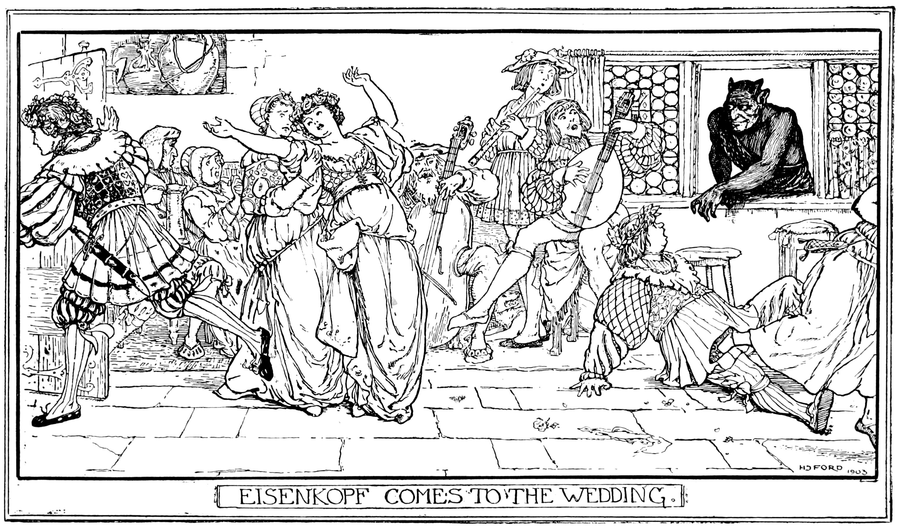

“你好！我的孩子！”老妇人回答，“你到这个世界的尽头来干什么？”

“我在逃命，大妈！逃到不属于这个世界的天地里去，因为艾森科夫在追赶我。”

“进来休息一会儿吧！吃点东西。我有一只小狗，艾森科夫在七英里之外它就会叫起来。”

彼得走进屋里，暖和暖和身体，吃些东西，喝点水，直到小狗开始吠叫。

“快点，我的孩子，快点，你该走了。”老妇人说。这时候，闪电的速度可能也比不上彼得。就在他跨上马的时候，老妇人又说话了：“等一会，带上这块饼和手帕，把它们放在你的包里，拿起来方便些。”

彼得把饼和手帕放进自己的背包，挥手感谢老妇人的仁慈，又像一阵风一样地走了。

他马不停蹄地奔跑，越过了七七四十九个国家，穿过了更加茂密的森林，更加宽广的河边，更加陡峭的山坡，来到了另一个老妇人居住的屋前。

“你好！大妈！”他说。

“你好！我的孩子！”老妇人回答，“你到这个世界的尽头来干什么？”

“我正在逃命，大妈！逃到不属于这个世界的天地中去，因为艾森科夫正在追赶我。”

“进来吧！我的孩子，吃些东西。我有一只小狗，艾森科夫还在七英里之外它就会吠起来。所以，躺在这张床上，安静地休息一会儿吧！”

然后，老妇人走进厨房烘了许多饼，彼得整整一个月也吃不完。他连一个饼的四分之一还没有吃掉，小狗就吠叫起来。

“我的孩子，你现在该走了。”老妇人说，“不过，先把这些饼和手帕放在你的背包里，这样拿起来就方便些。”彼得谢过她以后，像一阵风似的急忙走了。

他不停地奔跑，越过了七七四十九个国家，来到第三个老妇人家里，她像前面两个老妇人一样欢迎他。也是等到狗叫的时候，彼得才起身告辞。老妇人送给他同样的礼物，还对他说：“你现在有三种饼，三块手帕。我知道两个姐妹也各给你一种。你听好，照我的话去做。你要七天七夜马不停蹄地向前跑，到了第八天早晨，你会看到一片大火。你用三块手帕朝大火扑打三次，大火就会分开，让出一条路来。跑到路的中间以后，拿出三个饼来，用左手朝后面扔去。”

彼得感谢她的指教，小心地照她的吩咐去做。到了第八天早晨，他看到前面是一片火海，火那么大，两边根本看不到头。他用三块手帕朝大火扑打了三下，火就分开了。两边的火像两堵墙一样，中间是一条路。他走上这条路以后，就把三个饼朝后面扔过去。一瞬间，三个饼变成了三条狗。一条看上去很重，彼得叫它世界级；一条看上去很结实，叫它铁棍子；一条耳朵很灵，叫它顺风耳。它们看到彼得，快活地围着他叫着，彼得转过身来拍拍它们的头。这时，他看到艾森科夫正赶过来，但是两边的火墙已经并拢，把他挡在外面。

“站住！你这个食言的家伙。”他厉声地喊叫着，“这一次你从我的手心里逃走了。可是，等着吧！看我怎么再抓住你。”说完，他在大火旁边躺下，准备等待时机。

彼得知道再也用不着害怕艾森科夫以后，骑着马慢慢地向前走，来到一间白色的小房子前。他走进一间房间，看到一个满头白发的老妇人在纺线，还有一个美丽的姑娘正在窗口梳着她那金色的头发。

“是什么风把你送到这里来了？我的孩子！”老妇人问。

“我在找个安身的地方，大妈。”他回答。

“那么，就留下来吧！我正需要一个佣人。”老妇人说。

“我很乐意，大妈。”他说。

从此以后，彼得的日子过得很幸福，他整天忙着耕地和播种，还不时带着狗出去打猎。不论他带什么猎物回来，那金发姑娘总知道该怎么去弄它。

有一天，老妇人到城里去买面粉，彼得和姑娘两个人留在家里。他们说起话来，姑娘问他家在哪里，怎么穿过那片火海的。彼得把整个经历都对她说了，还告诉她怎么听从老妇人的吩咐，用三块手帕去扑打大火。

姑娘聚精会神地听着，心里在想不知道他说的是真的还是假的。彼得下地去干活以后，她偷偷地来到他的房间，偷走三块手帕，顺着一条她认识的山路，以最快的速度奔到大火旁。

她扑打了三下，火立刻让出一条路来。正在旁边观看，希望能等到这样一个机会的艾森科夫立刻奔过来，站在姑娘的面前。姑娘看到他，吓得几乎要昏过去，可是她努力地控制住自己，拼命地朝家里奔回去。艾森科夫紧追不舍。姑娘气喘吁吁地一跑进屋，就摔倒在地下，昏了过去。艾森科夫紧接着进来，藏在厨房的炉石下面。

没有多久，彼得回来了，他捡起姑娘掉在门槛上的三块手帕。他感到很奇怪，这三块手帕明明放在房间里的，怎么会到这里来了呢？当他看到姑娘脸色苍白，丝毫不动地躺在那里，好像死过去一样的时候，更是惶恐不安，他把她抱到她的床上。不久，她就醒过来了，可是她没有告诉他艾森科夫追过来的事。这时候，艾森科夫在炉石下面，被像一座山那么重，叫世界级的那条狗压得几乎死过去，动弹不得。

第二天早晨，彼得把狗留在家里，独自到森林里去。艾森科夫看见了，追着出来。彼得刚刚来得及爬上一棵大树才没有被抓住，艾森科夫不会爬树。

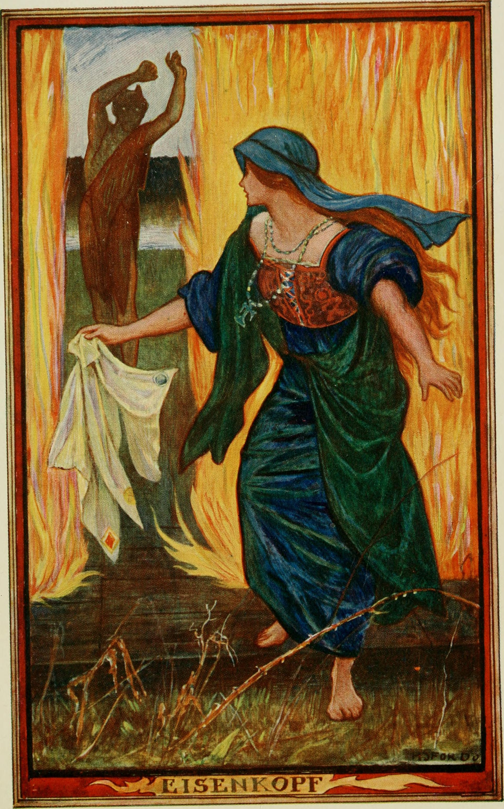

“马上给我下来，你这个吊死鬼！”他喊叫着，“你忘了永远不结婚的承诺！”

“啊！我知道这是我的过错。”彼得说，“不过请让我喊三次。”

“你要是乐意，喊一百次也没有关系。”艾森科夫说，“这一回你逃不掉了，你要为自己的过错付出代价。”

“铁棍子！世界级！顺风耳！快来救我！”彼得喊。顺风耳听见了，对它的兄弟说：“听！主人在叫我们。”

“傻瓜！你在做梦！”世界级说，“这时候他还在吃早饭呢。”接着，它打了顺风耳一记耳光，因为它还小，需要受教育才懂道理。

“铁棍子！世界级！顺风耳！快来救我！”彼得又喊起来。

这一次，世界级也听到了，它说：“啊！主人现在真的叫我们了！”

“你真笨！”铁棍子说，“你知道，这个时候他总是在吃饭。”接着，它给了世界级一记耳光，它自以为年龄大些，懂得多些。

彼得坐在树上浑身发抖，他害怕狗没有听到他喊叫的声音，或者听到了，但不肯来。只剩下最后一次机会了，他用足力气，又大声地喊起来：“铁棍子！世界级！顺风耳！快来救我！来晚了我就要死了！”

这一回铁棍子听到了，说：“是的，他肯定是在叫我们，我们得马上就去。”说完，它立刻从门口冲出去，三条狗朝声音传过来的方向狂奔过去。彼得看到它们奔到大树下，喊道：“咬他！”没有几分钟，艾森科夫就被撕成碎片。

彼得看到他的对头死了，从树上下来，回到老妇人的家里。他和老妇人还有她的女儿告别。姑娘送给他一个金戒指，上面镶着钻石。其实，这是个魔戒指，彼得和姑娘都不知道。

彼得忧心忡忡地动身回家。他心中已经没有在举行婚礼的时候就分手的妻子，他爱上了金发姑娘。可是，想这些又有什么用呢？他继续朝家乡的方向走去。

他没有走多远，就被大火挡住去路。彼得挥动了三次手帕，大火在他前面让出一条路来。可是，接着奇怪的事情发生了，一路上紧紧地跟着他的三条狗又变成了三个饼。彼得把它们拿起来，和手帕一起放进背包。一路上，他在三个老妇人门口停下，把手帕和饼还给她们。

“我的妻子呢？”彼得回家了，问道。

“啊！我亲爱的儿子，你为什么把我们抛下！你走了以后毫无音讯，你的妻子变得越来越伤心，不吃也不喝，一天一天地消瘦下去。一个月之前，我们把她埋葬了，让土地来掩埋她的悲伤。”

听到这个消息，彼得伤心地哭起来，因为他在出走以及遇见金发姑娘之前，他爱过自己的妻子。

整整半年，他伤心地埋头干活。后来有一天夜里，他梦见自己把金发姑娘送给他的钻戒从右手脱下，戴到左手象征着结婚的手指上。这个梦那么逼真，他立刻醒过来，把钻戒从右手移到左手。

猜猜看，接着发生了什么事情？啊！金发姑娘站在他的面前。他跳起来，亲吻她，说：“现在，你永远永远是属于我的，百年以后，我们要埋在一个坟墓里。”

后来，事情就像他所说的那样。

（匈牙利）

 

## 阿布·诺瓦斯和他的妻子之死

从前有一个人名叫阿布·诺瓦斯，他的家就住在苏丹王宫的附近，苏丹非常喜欢他，他是朝廷的弄臣。

有一天，阿布·诺瓦斯哭着来到王宫，对苏丹说：“啊！伟大的苏丹，我的妻子死了。”

“这是个坏消息，”苏丹说，“我得给你另找个妻子。”他叫首相派人去把王后叫来。

“这个可怜的阿布·诺瓦斯的妻子去世了。”王后一走进大厅，苏丹就对她说。

“啊！那我们得给他再找一个。”王后说，“我有个姑娘正配他！”她响亮地拍了一下手，一个姑娘走进来，站在她的面前。

“我给你找了个丈夫。”王后说。

“他是谁？”姑娘问。

“弄臣阿布·诺瓦斯。”王后回答。

“我愿意嫁给他。”姑娘答应了。阿布·诺瓦斯也不表示反对，事情就这样决定了。王后给新娘做了最漂亮的衣服，苏丹也送给新郎一套结婚礼服，还给他们一千块金币办婚事，给他们的新房铺上柔软的地毯。

阿布·诺瓦斯带着他的新婚妻子回家。开始一些日子，他们过得很幸福，自由自在地花苏丹送给他们的钱，从没想到这些钱花光以后会怎么样。

可是，不管他们想没想到，钱总是要花光的。他们开始一样一样地把值钱的东西卖掉，后来只剩下一件大衣和一条毯子遮盖身体。

“我们的好运到头了，”阿布·诺瓦斯说，“现在该怎么办？我不想回到苏丹那里去，他会叫仆人把我赶出大门。你应该回到女主人那里去，跪在她面前哭着求她，也许她会帮助我们。”

“啊？最好是你去，”妻子说，“我不知道该说什么。”

“好吧！要是你愿意，那你就留在家里吧！”阿布·诺瓦斯说，“我去请求见苏丹，哭着对他说，我的妻子死了，没有钱来办丧事。他听到这些，可能会给我们一些什么。”

“是的，这是个好主意。”妻子说。阿布·诺瓦斯于是就去了。

苏丹这时正坐在主持公道的大厅里。阿布·诺瓦斯走进来，泪水不停地从脸上流下，因为他在眼睛中擦了一些辣椒，它们辣得厉害，他几乎看不清路，走起路来有点歪歪扭扭。大家都很惊讶，不知道他出了什么事。

“阿布·诺瓦斯！发生了什么事？”苏丹问。

“啊！高贵的苏丹，我的妻子去世了！”他哭着说。

“人都得有一死。”苏丹说。可这并不是阿布·诺瓦斯想听到的回答。

“啊！苏丹，那是真的。可是我既没有寿衣给她穿，也没有钱给她送丧。”阿布·诺瓦斯继续说着，苏丹的表态一点也没有使他感到为难。

“好吧！给他一百块金币。”苏丹转过身来对首相说。钱数给他以后，阿布·诺瓦斯深深地鞠了一躬，走出大厅。眼泪还在不断地流，但他心里觉得高兴。

“你得到什么吗？”妻子问，她正在焦虑地等待着。

“是的，一百块金币。”他把背包放下，说：“可这花不了多久。现在，你必须穿上丧服，带上孝，到王后那里去对她说，你的丈夫阿布·诺瓦斯死了，你没有钱来埋葬他。她听到这个消息，肯定会问你，结婚时给我们的钱和好衣服到哪里去了？你就说，‘他死掉以前把所有的东西都卖光了。’”

妻子照他的话去做。她穿上丧服，来到王后居住的王宫。她曾是王后喜爱的随从，所以没有碰到什么麻烦就走进了王后的房间。

“怎么了？”王后看到她那副悲伤的样子问。

“我的丈夫死在家里了。他把所有的钱都花光，所有的东西都卖掉，我给他办丧礼的钱一分也没有。”她哭哭啼啼地说着。

王后拿起一个装有二百块金币的钱包，说：“你丈夫忠诚地为我们效力很久了，你要把他的丧礼办得好一些。”

妻子拿着钱，吻了一下王后的脚，高高兴兴地赶忙回家。一连好几个钟头，他们快活地打算着怎样用这些钱，想着自己是多么聪明。

“今天晚上，苏丹到王后那里去的时候，”阿布·诺瓦斯说，“她肯定会告诉他，阿布·诺瓦斯死了。他就会说，‘不是阿布·诺瓦斯，是他的妻子死了！’他们就会争辩起来。这时候，我们正坐在家里享乐。啊！要是他们知道了，他们会多么生气！”

正像阿布·诺瓦斯猜想的那样。晚上，苏丹处理好事情以后，像往日一样来看王后。他刚走进房间，王后就说：“可怜的阿布·诺瓦斯死了！”

“不是阿布·诺瓦斯，是他的妻子死了。”苏丹回答。

“不！你完全弄错了，两个钟头之前，他妻子亲自来告诉我。”王后回答，“由于阿布·诺瓦斯生前把钱都花光了，我还给他妻子一些钱去办丧礼！”

“你肯定是在做梦！”苏丹说，“中午刚过，阿布·诺瓦斯就走进大厅，眼中还流着泪水。我问他这是干什么？他说是妻子死了。他们把什么都卖光了，什么都没有留下，连给她买件寿衣的钱都没有，更不要说办丧礼了。”

好长时间，他们不停地争辩着，谁也不听谁的。后来，苏丹派人去把看门的人找来，叫他立刻到阿布·诺瓦斯的家里去，看是丈夫还是妻子死了。

看门人到来的时候，阿布·诺瓦斯正坐在窗口朝街上看。他看到看门人来了，立刻跳起来对妻子说：“苏丹的看门人来了，他们派他来看看真相。快！快躺在床上装死。”不一会，妻子就直挺挺地躺在床上，盖着一块麻布，像是一具尸体。

她刚好来得及，布刚盖好，门就打开了。看门人走进来问：“发生了什么事？”

“我可怜的妻子死了。”阿布·诺瓦斯回答，“你看！她就躺在那里。”看门人走到房间一角的床边，看到她僵硬地躺着。

“人人都得死。”他说，然后就回到苏丹那里去了。

“好了！你看到是谁死了吗？”苏丹问。

“是的，高贵的苏丹，是他的妻子死了。”看门人回答。

“他这样说是为了讨好你！”王后气愤地说。她把自己的管家叫来，命令他立刻到阿布·诺瓦斯的家里去看一看，到底是谁死了。

“你一定要说真话，”她补充说，“否则你就要倒霉。”

管家走过来的时候，阿布·诺瓦斯看到了。“这是王后的管家，”他惶恐地对妻子说，“这回该我死了，快！快把布单盖上来。”他躺在床上，等管家进来的时候，他屏住呼吸。

“你在哭什么？”管家走进来，看到阿布·诺瓦斯的妻子在哭，问她。

“我的丈夫死了。”她指着床说。管家走过去，拉开布单，看到阿布·诺瓦斯丝毫不动，直挺挺地躺着。他轻轻地把布单盖上，回到王宫。

“好了，这一回你看出来了吧！”苏丹问。

“我的苏丹，是丈夫死了。”

“可是我告诉你，几个钟头之前他还和我在一起。”苏丹生气地说，“在睡觉之前，我一定要把这件事情搞清楚！把我的马车立刻赶过来。”

马车不到五分钟就停在门口，苏丹和王后一起上了马车。

这时候，阿布·诺瓦斯已经不再装死了，马车过来时他正朝街上看。“快！快！”他对妻子说，“苏丹马上就会进来，这回我们都装死来迎接他。”他们双双躺在床上，拉上布单，屏住呼吸。

苏丹走进来，来到床边，看到两具毫无生气的尸体。“这是怎么回事，谁要是把真相说出来，我就给他一千块金币。”他喊道。

听到这些话，阿布·诺瓦斯爬起来说：“那么，把金币给我吧！”他把双手伸出来：“再也没有人比我们更需要你的金币了。”

“啊！阿布·诺瓦斯，你这厚颜无耻的狗！”苏丹喊道，忍不住笑起来，王后也笑了，“我早应该明白，这是你的诡计。”不过，他还是像答应过的那样，给了阿布·诺瓦斯一千块金币。让我们期望，这些金币不要像以前那样很快就没有了。

（突尼斯）

 

## 莫蒂卡蒂卡

从前，在一个气候炎热的国家里，住着一对夫妻，他们的小屋周围长满了青草和鲜花。他们过得很幸福。可是有一天，妻子病了，什么也不肯吃。丈夫劝她吃从森林里采来的各种各样好吃的水果，可是她什么也不要，人越来越瘦。丈夫很担心她会死去，最后绝望地问她：“难道就没有你喜欢吃的东西了吗？”

“有的，我想吃些野蜂蜜。”她说。丈夫很高兴，他想这很容易得到，很快就出去找。

他带回来满满的一锅，送到妻子面前。“我不吃！”妻子恶心地转过头去，“你看！里面有死蜜蜂！我要吃很纯的！”丈夫把蜂蜜倒到草地上，又出去找。等他带回来以后，妻子还是不要吃。“里面有蚂蚁，扔掉它！”她说。第三次带回来的，妻子说有泥土味，也不吃。第四次，他想办法找到了一些她要吃的，然后她又要喝水，请他去弄水。这也花了不少时间，后来才在一个湖泊里找到。这里的水甜得像放了糖一样。他满满地盛了一锅，带回去给妻子。她迫不及待地喝着，然后说感觉好多了。

等她起床穿好衣服以后，丈夫在她睡过的床上躺下，说：“你给我找了不少麻烦，现在轮到我了。”

“你这是怎么啦？”妻子问。

“我口渴，要喝点水。”他说。妻子拿起一个大锅，到最近的泉水旁去汲水，可这也有好长一段路。

“水来了！”她把水从头顶上拿下来说。可是丈夫恶心地转过头去。“这是从满是青蛙和柳树的池塘里汲来的，你得给我另汲一些干净的水来。”他说。于是妻子又出去，到更远的湖里去取水。

“这些水充满了灯心草的气味，”他说，“去汲些新鲜的。”等她第三次把水汲回来以后，他又说里面百合的味道很重，不喜欢。他要喝很纯的，没有柳树、青蛙、灯心草气味的水。

妻子头顶一个水罐，第四次走出家门。她走过了前几次试过的湖泊，来到另一个湖泊旁，这里的水像蜂蜜一样甜美。她正弯下腰来汲水，一个可怕的妖魔突然从水面冒出来头。

“你怎么敢来偷我的水？”那妖魔说。

“是我丈夫叫我来的。”她回答，浑身哆嗦着，“可是别杀了我，要是你放我走，我就把我的孩子送给你。”

“我怎么知道谁是你的孩子呢？”妖魔问。

“啊！那好办！我把他两边的头发剃掉，在他的脖子上挂一些白色的珠子。等你来到我家小屋前时，只要喊一声‘莫蒂卡蒂卡’！他就会朝你跑过来，你可以把他吃掉。”

“很好！”妖魔说，“你可以回家了。”

妻子把水罐灌满，回到家里，把发生的可怕事情对丈夫说了。

其实，他们的孩子是个天生的魔术师，他的父母却一点儿也不知道。他听到母亲答应了妖魔什么，只是暗自发笑，盘算着如何骗过他的母亲。

第二天早晨，女人把孩子两边的头发剃掉，把一些白珠子挂在他脖子上，对他说：“我要到地里去干活，你待在家里，不要出去，否则野兽会把你吃掉。”

“好的。”孩子回答。

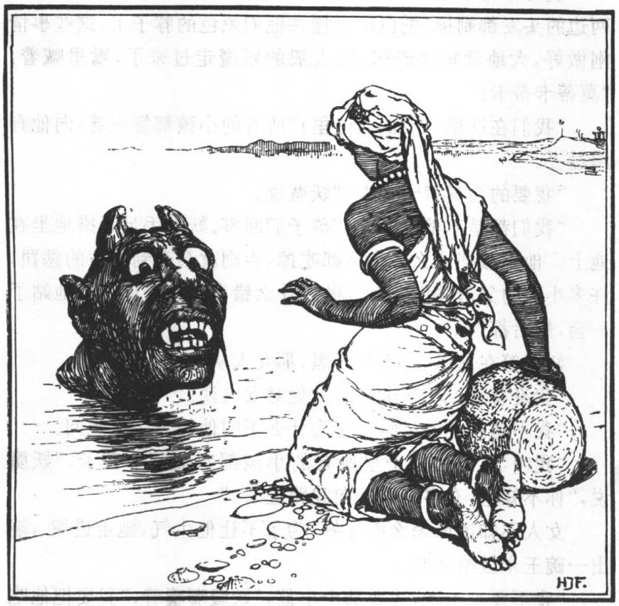

等他母亲走远以后，他拿出一些有魔法的骨头来，把它们排成一行。“你是我爸爸，”他对一根骨头说。“你是我妈妈，”他对另一根骨头说。“你最大，”他对第三根骨头说，“所以你就是想吃掉我的妖魔。”“你最小，当然应该是我。”

“现在，告诉我，我该怎么办？”他问这些骨头。

“把村里所有和你一样大的小孩都找来，”骨头回答，“把他们两边的头发都剃掉，给他们也挂上白色的珠子。对他们说，有人叫‘莫蒂卡蒂卡！’的时候，大家都要回答。快点去办，你没有多少时间了。”

莫蒂卡蒂卡走出去，带回许多和他一样大的小孩。他把他们两边的头发都剃掉，把白珠子挂在他们黑色的脖子上。这些事情刚做好，大地就抖动起来，巨人般的妖魔走过来了，嘴里喊着：“莫蒂卡蒂卡！”

“我们在这里！我们在这里！”所有的小孩都答应着，向他奔跑过去。

“我要的是莫蒂卡蒂卡！”妖魔说。

“我们都是莫蒂卡蒂卡。”孩子们回答。妖魔手足无措地坐在地上。他不敢把这么多小孩都吃掉，否则就会受到严厉的惩罚，许多小孩的父母并没有对他做过什么错事。孩子们惊奇地站了一会，然后都走了。

妖魔等在那里，一直到天黑，那女人从地里回来。

“我没有看见莫蒂卡蒂卡。”他对女人说。

“我不是和你说过吗？你为什么不叫他的名字？”她问。

“我叫了，可是村子里所有的小孩都叫莫蒂卡蒂卡。”妖魔说，“你不知道，有多少孩子向我跑过来。”

女人不知道该怎么办才好，为了不让他生气，她走进屋，端出一碗玉米饭给他吃。

“我不要吃玉米，我要那个小孩，”妖魔嘟囔着，“我要把他吃掉。”

“耐心些，不用急，”她说，“我去叫他，你马上就可以把他吃掉。”她走进屋子喊：“莫蒂卡蒂卡！”

“我来了，妈妈！”他回答。可是他并没有急着出来，他把骨头扔在屋后的地上，问它们怎样才能逃脱妖魔。

“把你自己变成耗子。”骨头说。他就这么办了。妖魔等得不耐烦了，对女人说，她必须想出别的办法来。

“明天我叫他到地里去捡豆子。你在那里就会找到他，把他吃掉。”

“很好！”妖魔说，“这回我要小心地抓住他。”说完他回到湖里去了。

第二天早晨，妈妈给莫蒂卡蒂卡一只篮子，叫他去捡些豆来烧午饭。在到地里去的路上，他拿出骨头来问，如何才能逃脱妖魔。

“把你变成一只鸟，去吃那些豆。”骨头说。妖魔看到鸟在吃豆，就去赶它，不知道它就是莫蒂卡蒂卡。

妖魔来到小屋对女人说，她又骗了他一次，他不能再等下去了。

“你今天晚上来，”她说，“你会看到他盖着这张白被单睡在床上，那时你就可以把他带走吃掉。”

小孩听见了，问他的骨头该怎么办？骨头说：“把你父亲床上的红色被单拿过来，把你的白被单放到他床上去。”他这样做了。妖魔来了，抓走莫蒂卡蒂卡的父亲，把他带出屋子吃掉。他的妻子看到弄错了，伤心地哭着。可是莫蒂卡蒂卡说：“这只不过是因为他该被吃掉。是他，而不是我叫你去汲水。”

 

## 尼尔斯和三个巨人

丹麦日德兰半岛的一片大荒原上，到处都是沙地，大风终年刮个不停，连树也不能生长。那里曾经住着一个老人和他的妻子。他们有间小屋，还有一些羊，两个儿子帮他们放牧。大儿子叫拉斯马斯，小的叫尼尔斯。拉斯马斯十分满足于放牧羊群，就像他的父亲已经干了大半辈子那样。尼尔斯可不一样，他很喜欢打猎。在得到一杆枪和学会射击之前，他并不快活。虽然那只是一杆老式的前装燧发枪，可他也觉得这是很了不起的奖品了。他拿着枪，几乎是看到什么就打什么。由于经常练习，日子长了就成了一个了不起的射手，连许多他从未去过的地方的人都知道他。

拉斯马斯和尼尔斯的父母都是善良的天主教徒。随着年龄越来越大，母亲的脑子里越来越想到罗马去看一看教皇。其他人都觉得没有多大意思，可后来还是听她的。他们把所有的羊都卖掉，把房子锁好，准备步行到罗马去。尼尔斯还带着他的枪。

“你带着它想干什么？”拉斯马斯说，“要带的东西已经够多的了。”可是尼尔斯没有枪就不快活，所以他还是带着它走。

这时候正是夏季里最热的日子。天那么热，中午前后他们根本无法走路。到了夜晚，他们又怕迷路，或者落入强盗手中。有一天，太阳快下山的时候，他们来到森林边缘的一家客栈。

“今天晚上，我们最好留在这里过夜。”拉斯马斯说。

“这算什么主意！”尼尔斯说，他对旅行的速度那么慢越来越不耐烦，“白天太热，我们不能走，晚上又要留宿。这样走下去，恐怕到罗马的时间太长了。”

拉斯马斯不想继续往前走。可是两个老人站在尼尔斯一边，他们说：“天不是很黑，月亮很快就会升起来。我们可以问问客栈里的人，看看该走哪条路。”

所以，他们又往前赶了一些时间。后来，他们来到森林中的一块空地上，发现前面的路分成两条，没有指路的路标，客栈里的人也没有对他们说过该走哪一条。

“现在该怎么办呢？”拉斯马斯说，“要是留在客栈里过夜不是更好吗？”

“没有什么关系。”尼尔斯说，“晚上很暖和，我们可以待在这里等到天亮。留一个人看守到午夜，然后再换一个人。”

拉斯马斯情愿第一个值班，其余的人都躺下睡觉。森林里非常静，拉斯马斯可以听到鹿、狐狸，还有其他动物在树叶上走动的沙沙声。月亮升起来了，他偶尔还能看到这些动物。有一只牡鹿离他那么近，他拿起尼尔斯的枪，开了一枪。

枪声把尼尔斯惊醒。“怎么回事？”他问。

“我打中了一只牡鹿。”拉斯马斯说，十分得意。

“那有什么，”尼尔斯说，“我常常打中麻雀，那要难得多了。”这时候已快午夜了，尼尔斯开始值班，拉斯马斯躺下睡觉。

天变冷起来，尼尔斯走来走去，以便暖和些。他很快发现，他们离森林的边缘不远，爬上一棵树，可以看到外面山村的空地。在不远的地方，他看到有一堆火，三个巨人正坐在火堆旁，忙着吃牛肉和肉汤。三个巨人非常高大，他们用的调羹就像铁铲那么大，用的叉也像农民干活的叉一样。他们用这些餐具从身边一口很大的锅里舀起整桶整桶的汤和大块大块的肉吃着。

看到这些，尼尔斯开始很吃惊，也很害怕。后来他安慰自己说，他们离这里还很远，就是走近了，他也很容易在树丛里藏起来。看了一会以后，慢慢地他不感到害怕了。后来他从树上溜下来，决心拿起枪来和他们开开玩笑。

他拿着枪又爬到树上去，端起枪瞄准着，等一个巨人正要把一大块肉送到自己嘴里去时，他“砰！”地开了一枪，子弹不偏不倚地打在刀叉上，力量那么大，刀叉没有送进巨人的嘴，而是在他的下巴上扎了一下。

“开什么玩笑！”巨人朝坐在旁边的伙伴大吼一声，“你这样敲我的刀叉是什么意思，把我刺得好痛。”

“我没有碰你的叉子，”另一个说，“不要找岔子和我吵架。”

“那么你看看清楚，”第一个巨人说，“你以为我会戳自己的下巴来取乐吗？”

两个巨人为了这件事都感到非常气愤，他们提出要准备决斗。可是第三个巨人尽力调解，他们才安静下来吃东西。

他们争吵时，尼尔斯又装好了子弹。等第二个巨人正把一块好肉送到口中去的时候，他又开了一枪，叉子被打得粉碎。这个巨人比第一个还要气愤，正准备大吵的时候，第三个巨人又把他们劝住了。

“别那么傻！”他对两个巨人说，“我们自己打起来有什么好处。现在正是需要我们团结起来压倒国王的时候，这件事已经是够难的了。要是我们不团结，那就一点希望也没有了。坐下来吧！让我们把饭吃完。我坐在你们中间，你们谁也不用指责对方了。”

尼尔斯离得太远，听不清楚他们在说些什么，可是从他们的样子可以猜出发生了什么事情，他觉得这很好玩。

“三次才能走运，”他对自己说，“我还得再放一枪。”

这一回，子弹打中第三个巨人的叉子，把它折成两段。

“嗯！”他说，“我要是像你们一样蠢，也会大发脾气。但我要看看这是什么人干的，我现在就去看看是谁在和我们开这种玩笑。”

这个巨人观察得那么准确。尼尔斯虽然飞快地爬下树来，准备藏到树丛中去。可是他的脚刚着地，巨人已经站在他的面前。

“站着别动，”巨人说，“否则我就踩你一脚，那么你就片甲不留了。”

尼尔斯只好投降，巨人把他带回到伙伴那里去。

“在我们的手中，你一点也不值得怜悯。”逮住他的巨人说，“不过，你枪打得那么准，对我们可能很有用。要是你肯为我们效力，就饶你一命。离这里不远有一座城堡，国王的女儿住在里面。我们正在和国王打仗，想征服他，抢走公主。但是城堡守卫得很好，没有机会进去。运用我们的魔法，可以叫城里一切活着的东西睡着，只有一条小黑狗拿它没办法。只要它醒着，我们就一点也沾不着便宜。等我们开始爬城墙的时候，小黑狗就会听见，它一吠起来就把所有的人叫醒。有了你以后，我们可以把你安置在合适的地方，在小黑狗开始叫之前你就开枪把它干掉。这样，谁也不会妨碍我们把公主抢到手。你要是这样做了，到时候我们不但放你走，而且还要重重地赏你。”

尼尔斯只好同意。巨人们立刻向城堡出发。城堡周围有很高的围墙。那么高，连巨人也碰不到顶。

“我怎么进去呢？”尼尔斯问。

“非常简单，”第三个巨人说，“我们把你抛上去。”

“不！谢谢！”尼尔斯说，“我会掉到那边去，可不是摔断脖子就是摔断腿，那时候谁向小狗开枪？”

“别害怕，”巨人说，“围墙非常厚，顶上盖满了长长的草，你掉在上面就像掉到铺着羽毛的床上一样。”

尼尔斯不得不相信他，让他把自己抛上去。他平安无事地双脚着地，可是小黑狗听到了声音，立刻从狗窝里跑出来，正要开口叫的时候，尼尔斯开枪了，它倒在地下死了。

“下来到里面去，”巨人说，“看看能不能帮我们把门打开。”

尼尔斯从围墙上下来，走进院子。在向外面的大门走去的时候，他发现了通向城堡大厅的门。门开着，大厅里灯火辉煌，可是一个人也看不见。尼尔斯走进去，朝四周看着。他看到墙上挂着一把很大的剑，没有剑鞘。剑下面有一个大角杯，上面镶着银。尼尔斯走近去看，看到角杯的银边上刻着字母。他把角杯拿下来，转了一圈，发现上面刻着一些字：

谁喝了杯中的酒，宝剑就归他所有，愿他为正义而战，并且赢得公主。

尼尔斯把角杯的银塞拔掉，喝了几口杯中的酒。可是，当他想把那把剑取下时，发觉自己动不了它，只好让它挂在那里，继续向城堡里走去。“让那些巨人再等一会。”他说。

没多久，他走进一间房间，里面有一个美丽的公主睡在床上。床的旁边有一张桌子，桌子上有一块金边的手帕。尼尔斯把手帕撕成二半，一半放进自己的口袋，一半留在桌子上。地板上，他看到一双锈金的拖鞋，他也把一只放进自己的口袋。

他回到大厅，又把角杯拿下来。“也许我应该把里面的酒全喝完，才拿得动这把剑。”他想。于是，他把里面的酒一饮而尽。喝完以后，他就可以毫不费力地舞动那把剑。他觉得自己强壮得多了，干什么都行，甚至可以和被他关在外面的巨人决斗。他们一定怀疑，他为什么到现在还不把门打开。他想，杀死巨人就是用这把剑为正义而战。但是，要想赢得公主的爱，那可不是穷牧羊人的儿子所能指望的。

尼尔斯来到城堡的门口，发现这里有一扇大门，一扇小门。他把小门打开。

“你能把大门打开吗？”巨人说，“我们很难从小门进去。”

“门闩太重了，我拉不动。”尼尔斯说，“你们只要稍为弯下腰，就很容易从这里进来。”

第一个巨人照他的话弯着腰钻进来。可是，还没有等他抬起头，尼尔斯把剑一挥，他的头应声落地。把倒下来的巨人身体顺势推向一边，对尼尔斯说来太容易了。那些酒使他的力气变得非常大。第二个巨人进来的时候，也得到了同样的待遇。第三个巨人有点慢吞吞的，所以尼尔斯喊起来：“快点！三个人中你肯定年纪最大，动作那么慢！我不能在这里等太久，要尽快回到我的人当中去。”这样，第三个巨人也进来了，结果也是一样。这样说起来，巨人好像死得不太公平。

这时候，东方已经破晓。尼尔斯想，他家里人肯定在找他。所以，他也不留下来看看城堡里接着会发生什么事情，就带着剑，尽快地跑回到森林里去。他看到，他们还在睡觉，于是把他们叫醒，继续向前赶路。关于这一晚上的历险，他一个字也没有说。当他们问他，从那里得到这把剑的时候，他只是朝城堡的方向指一指，说：“在那边。”他们想可能是捡到的，也就不多问了。

尼尔斯离开城堡的时候，用力把身后的门关上。门发出那么响亮的声音，把守门人惊醒。他看到三个无头的巨人躺在院子里，几乎不相信自己的眼睛，也想象不出到底发生了什么事情。整个城堡很快都醒过来了，人人都感到惊讶。虽然很快就弄明白，这些尸体就是国王最大的敌人的，可他们是怎么进来的，怎么会变成这个样子，这完全是一个谜。

然后，有人注意到，角杯已经空了，剑也没有了。公主说，她的半块手帕和一只拖鞋没有了。这样一来，巨人是怎么被杀的似乎有了一些眉目。可这是谁干的仍然令人迷惑不解。负责守卫城堡的老骑士说，照他的看法，这肯定是某个年轻的骑士干的。紧接着他会去找国王，向公主求婚。这听起来很有道理。可是派到王宫里去的传令兵回来说，那里没有任何关于这件事的消息。

“无论如何我们必须找到他。”公主说，“他要是想和我结婚，我就没有理由拒绝他，因为我父亲已经在角杯上写明白了。”她和父亲手下最聪明的人商量，看看应该怎么办？除了别的建议以外，他们还劝她在公路旁边造起一幢房子，并且在门上写上：“谁只要说出他的经历，就可以免费在这里住三天。”这很快就办到了。公主听到了许多陌生人的故事，可是关于那三个巨人，没有一个过路人说过一个字。

这时，尼尔斯和他家里人还在向罗马走去。秋天过去了，冬天刚刚开始，他们来到了很高很高的山脉脚下，这些山高得直插云霄。

“我们非得翻过这些山不可吗？”他们说，“这样我们不是被冻死，就是被雪埋掉。”

“那边有个人过来了。”尼尔斯说，“让我们问问他，到罗马去该怎么走。”那人告诉他们，除了翻过这些山，没有别的路可走。

“是不是还很远？”老人问，他们开始因长途跋涉而感到劳累。那人把脚举起来，好让他们看到鞋底。鞋底已经像纸那么薄，而且中间还有一个洞。

“我离开罗马的时候，这双鞋还很新。”他说，“你们现在看一看就知道了，这里离罗马还有多远。”

这使两个老人失去了勇气，他们放弃了到罗马去的念头，一心一意只想快点回到丹麦去。冬天里道路的状况要比他们来的时候坏多了，但后来他们终于看到了曾在里面度过一夜的森林。

“这是什么？”拉斯马斯说，“我们上次从这里走过以后，这里造起了一幢房子。”

“是的，”尼尔斯说，“让我们在里面过一夜。”

“不！我们住不起，”老人说，“它比我们想象中的要贵得多。”

不过，当他们看到门上写的那些字以后，都很高兴不花钱住一宿。他们受到了很好的接待，受到那么多关照，老人十分不安。等他们都安顿好以后，公主的管家来听他们讲自己的经历。

“你们看到门上写的那些字了。”他对老人说，“告诉我你是什么人？过去有些什么经历。”

“我的天！我没有什么值得一说的事情要对你说。”老人说，“要不是因为我这两个儿子，我绝对不会有这么大的胆量来麻烦你。”

“不用担心，”管家说，“只要你对我说说你们生活中的事，我们就很欢迎你。”

“好吧！好吧！我说，”老人说，“可也没有什么可说的。我和我妻子在北日德兰半岛的荒原上住了一辈子。去年，她突然想起要去罗马，我们就和两个儿子一起走去。可离那里还很远，我们就回来了，现在正在回家的路上。这就是我的全部经历。我两个儿子生下来就和我们住在一起，所以，他们也没有什么更多的事可说。”

“是的，是这样。”拉斯马斯说，“我们在向南走的时候，在离这里不远的森林里睡了一夜，我还打了一只牡鹿。”

管家已经很习惯于听这些平常的事，他想再也没有必要问下去了，就去向公主报告说，新来的这些人没有什么可说的。

“你问过他们每一个人了吗？”她说。

“嗯！没有，没有直接问。”他说，“可是那个父亲告诉我，他们没有什么更多的事可说了。”

“你越来越粗心了。”公主说，“我自己去和他们说。”

公主一走进房间，尼尔斯就认出她来。他大吃一惊。因为他立刻想到，这一切都是为了找到那个拿了剑、半块手帕和一只拖鞋的人而设计的，要是他被发现了，一定很糟糕。所以，轮到他讲的时候，他说的和父亲的差不离，显得他并没有什么特别。他想这样一来可以避免麻烦。可这时拉斯马斯插进来说：“你忘了一件事，尼尔斯！你还记得在我射杀牡鹿的那天晚上，你找到一把剑吗？”

“剑在哪里？”公主问。

“我知道，”管家说，“他们进来时，我看到他把剑放在哪里。”说着他出去取剑。这时尼尔斯在想是不是可以逃跑，可在他还没有下决心之前，管家已经拿着剑进来了。公主立刻就认出这把剑来。

“你是从哪里得到的？”公主问尼尔斯。

尼尔斯不回答。他在想，一个不巧救了公主，又从她寝室里拿了东西的穷牧羊人的儿子，该受到什么样的处罚？

“看看他身上还有什么东西？”公主对管家说。尼尔斯只好让他搜查，在一个口袋里有一只绣金的拖鞋，在另一个口袋里，有半块金边手帕。

“够了，”公主说，“现在，我们用不着再问他什么了。马上派人去请国王，我的父亲来。”

“请放了我吧！”尼尔斯说，“不管怎么说，我对你是有功也有过。”

“啊！谁说过你有过了？”公主说，“你要留在这里等我父亲来。”

公主说这些话时那含笑的神情给了尼尔斯一些希望，看来事情对他来说好像还不坏。当他想到角杯上刻的那些字时，更是感到鼓舞，虽然最后一行未免过于奢望。可是，国王来到以后事情很快就解决了。公主愿意，尼尔斯也愿意，几天以后，宣布举行婚礼的钟声响了。开始，尼尔斯被封为伯爵。穿上伯爵礼服以后，他显得那么英俊潇洒，好像生下来就是伯爵似的。国王死后不久，尼尔斯就接替了他的王位。不过，他的父母是否留下来和他住在一起，还是回到日德兰半岛的荒野上去，或是用一辆马车把他们一起送到罗马，他手下的历史学家都忘了写上一笔。

 

## 牧羊人保罗

从前有个牧羊人赶着羊群到牧场去，看到草地上躺着个婴儿。这是那些坏心肠的人怕抚养孩子太麻烦而扔掉的。牧羊人非常喜欢孩子，他把婴儿带回家，用羊奶把他养大，给他起个名字叫保罗。保罗长到十四岁的时候，就能够把一棵栎树连根拔起，像是拔一棵草一样。后来，他对留在家里过日子感到厌倦了，准备到外面的世界去碰碰运气。

他走了许多路程，没有看到什么令人兴奋的事情。可是有一天，他在森林里惊奇地看到，有个人正在梳理大树，像在梳理亚麻一样。

“早上好！朋友！”保罗说，“依我看，你的力气一定很大！”

那人停下手中的活笑着骄傲地说：“我是梳树人，我一生中最大的愿望就是和牧羊人保罗摔跤。”

“愿你所有的愿望都这么容易地实现。我就是牧羊人保罗，现在就可以和你摔跤。”年轻人回答说。他抓起大树梳理人，把他摔倒在地，力量那么大，梳树人陷进地里，一直到膝盖，可是他一会儿就爬起来，抓住保罗摔倒，保罗腰以下全部陷到地里。保罗也很快就爬起来，把他摔倒，这一回他一直埋到脖子，差一点连头也埋进去了。

“够了！够了！”梳树人说，“我看你是个精灵的伙伴，让我们做朋友吧！”

“很好！”保罗回答。他们一起继续往前走。

不久，他们看到有个人在用手来碾碎石头，像是碾胡桃似的。

“早上好！”保罗有礼貌地说，“依我看，你的力气一定很大。”

“我是碾石人，”那人回答，“我一生中最大的愿望就是和牧羊人保罗摔跤！”

“愿你所有的愿望都这么容易实现，我就是牧羊人保罗，现在就和你摔跤。”比赛开始了。不一会，那人就说他输了，请求他们带他走，于是，三个人一起旅行。

没走多久，他们看到一个人在捏铁块，那样子像是捏面粉一样。“早上好！”保罗说，“你的力气一定很大。”

“我是捏铁人，我想和牧羊人保罗决斗。”他回答。

“那让我们立刻就开始吧！”保罗说。这一次也是保罗获胜，他们四个人一起走。

中午时分，他们走进一片森林。保罗突然停下来，“我们三个人出去打猎。你，梳树人留下来，为我们准备一顿好的晚餐。”

梳树人开始烧啊！煮啊！忙碌起来。饭快好了的时候，一个长着尖胡子的小矮人走过来。“你在烧什么？”他说，“给我一点。”

“要是你喜欢，我就给你一顿打。”梳树人粗暴地对他说。小矮人也不在意，耐心地等待饭做好，然后突然把梳树人摔倒在地，把锅里的菜全部吃掉就不见了。梳树人感到很羞愧，又开始烧些菜。可是打猎的人很快就回来了，菜还是生的。尽管他们埋怨他烧得不好，可关于小矮人的事他一点也不说。

第二天，碾石人留下来烧饭，接着是捏铁人。这两天小矮人也来了，他们的运气也不比梳树人好多少。到了第四天，保罗对他们说：“我的朋友，你们的饭菜总是烧得那么坏，肯定有什么理由。今天你们去打猎，我留下来。”他们三个人走了，想到等待着保罗的是什么就很开心。

保罗动手做饭，他刚把锅里的菜做好，小矮人就像前几天一样地出现，要吃烧好的菜。“走开！”保罗端起锅子说。小矮人想抓住他的衣领，可是保罗抓住了他的胡子，把他捆在一棵树上，叫他动不了，然后又回来做饭。那些打猎的人早早地就回来，想看看保罗怎么样了。叫他们吃惊的是，饭已经准备好了。

“你们都是没用的东西，”保罗说，“连一个小矮人都对付不了。等我们吃好饭以后，让你们看看我怎样来处置他！”可是等他们来到保罗捆小矮人的地方，小矮人不见了，树也不见了，因为小矮人把树连根拔起，带着树一起逃走了。四个人跟着树在地上留下的痕迹追过去，看到它被拖进了一个很深的洞里。

“他肯定是到洞里去了，”保罗说，“我要跟进去。看！那边有个篮子我可以坐，你们用绳子把我放进去。可是我一拉绳子，你们就快点把篮子拉上来。”

他走进篮子，朋友们慢慢地把他放进洞。

他终于到了洞底。他从篮子里跳出来，看看四周，发现自己正站在一个美丽的峡谷中。河流从茂盛的草地上流过，旁边有一座华丽的城堡。城堡的门开着，他走了进去。

一个可爱的少女看见他，叫他快点回去，因为这个城堡的主人是一条六头龙。是它把少女从家里偷来，并把她带到这地下来。保罗不听她的话，说他不怕那条龙，也不管它有多少头。他坐下来等它回来。

没有多久，龙进来了。看到有陌生人，它的六个头上的长牙齿咬得格格直响，非常生气。

“我是牧羊人保罗，”年轻人自我介绍说，“我是来和你较量的。我很忙，所以最好现在就开始。”

“很好！”龙回答，“我的晚饭有着落了。不过，让我们先吃点东西，好开开胃口。”它从地下拿起一些大砾石，开始吃起来，好像在吃饼似的。吃好以后，他递给保罗一个。保罗对石头不感兴趣，他拿起一把刀，把石头切成两块，然后拿起来用尽全身的力气向龙过去，龙的两个头被砸得粉碎。龙大吼一声，向保罗扑过来。保罗闪到一边，猛力挥手一击，又敲掉了它两个头。接着，他抓住还有两个头的龙的脖子，向岩石上撞过去，这两个头也被撞扁了。

姑娘看到龙死了，流着眼泪感谢保罗救了她。可是，她说，她还有两个妹妹落到比这条龙更凶狠、更可怕的两条龙手中。保罗发誓说，不把她们救出来，他的宝剑就决不会在剑鞘里闲着。他叫姑娘跟他走，给他指路。

姑娘高兴地答应了。她给保罗一根金棍子，叫他用来敲一下城堡。保罗敲了一下，城堡立刻变成一只金苹果。他把金苹果放进口袋。然后，他们一起出去寻找姑娘的妹妹。

没有走多久，他们就来到了关着第二个姑娘的城堡。城堡的主人是一条有十二个头的龙，它把姑娘从姑娘家里偷来。妹妹看到姐姐和保罗来了，非常高兴。她还给保罗一件龙保存的衬衫，不管谁穿上这件衬衫，他的力气就要比以前大一倍。

保罗刚穿好衬衫，龙就走进来了。战斗马上就开始。这一仗打得又长又艰苦，保罗的剑和那件衬衫帮了他的忙，十二个龙头终于都落到地上。

保罗把这座城堡也变成金苹果，放进口袋，然后和两个姑娘一起去找第三座城堡。

没有多久，他们就找到了。城堡的围墙里关着第三个姑娘，她最小，比两个姐姐更美丽。她的丈夫有十八个头，可是它在离开地下城堡到地面去时，会把十七个头留在地下，只带着一个头。而且，它把自己变成小矮人，把龙头变成长着尖胡子的人头。

保罗知道这条可怕的龙就是被他捆在树上的小矮人以后，恨不得马上就卡住它的喉咙。可是他提醒自己要小心，这条龙有十八个头。第三个姑娘给他一件丝衬衫，能使他的力气长十倍。

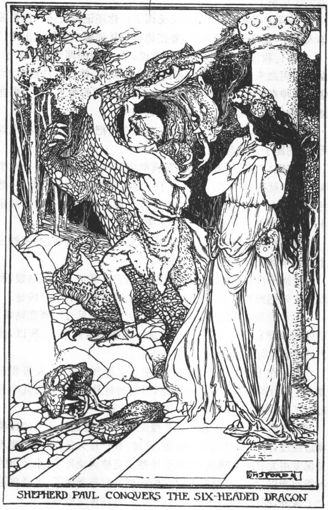

保罗刚把衬衫穿好，整个城堡就开始激烈地摇晃起来，龙飞进大厅里来了。

“好啊！我的朋友，我们又见面了！你还记得我吗？我是牧羊人保罗，是来和你角斗的，要把你妻子从你魔爪中解救出来。”

“啊！我很高兴再见到你。”龙说，“你把我的两个兄弟杀了，血债要用血来偿。”说完，它走进自己的房间，要找那件丝衬衫，喝一些神奇的酒。可是，丝衬衫已经穿在保罗的身上。至于那些酒，姑娘给保罗喝了一杯，其余的都倒掉了。

看到这些，龙也感到很害怕。可是当它把十八个头都接上以后，它的胆子又大起来。

“来吧！”它喊叫着后退几步再向保罗冲过来，准备用十八个头一下子就把他吃掉。保罗往下一蹲，躲过这些凶猛的龙头，然后挥剑向上一砍，一下子就砍掉了六个最凶狠的头。很快，其余十二个龙头也一个接一个地滚下来。

保罗把这座城堡也变成金苹果，放进口袋。接着，他领着三个姑娘来到通向地面的那口井旁。

用绳子吊着的篮子还在那里，可是它只够坐下三个姑娘，所以保罗先把她们送上去，嘱咐她们别忘了把篮子放下来接他。

不幸的是，他的朋友看到了这些从来没有见过的漂亮姑娘，早就把保罗忘得一干二净，带着这些姑娘远走高飞了，所以，她们的命运也好不了多少。

保罗在下面为这三姐妹的忘恩负义而气得发疯，发誓要报复。他开始寻找返回地面的出路，可谈何容易。几个月又几个月过去了，他在地下拼命寻找，可是毫无进展。

后来有一天，他正好从一个鹰头狮身、长着翅膀会飞的怪兽窝边经过，里面只有几只小怪兽。这时，有一片火云飘过来，要不是保罗用大衣把窝遮住，这些小怪兽肯定被火烧死了。小怪兽的爸爸回来以后，它们把保罗救它们的经过对爸爸说了。大怪兽追上了保罗，问他，为了感谢他的仁慈，它可以帮他做些什么。

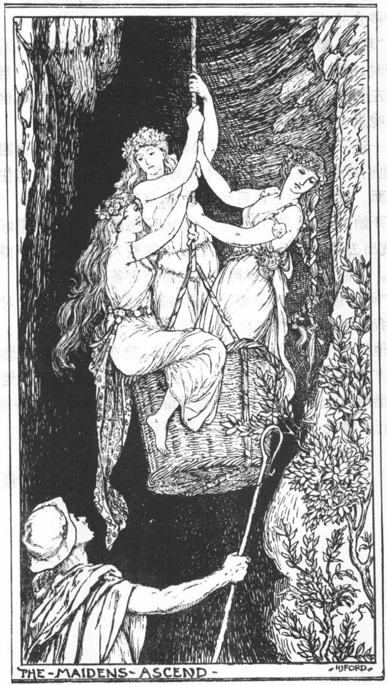

“把我带到地面上去。”保罗说。怪兽同意了。不过，它先回去带些食品，因为路程很长。

“现在，爬到我背上来吧！”它对保罗说，“当我把头从右边转过来时，把挂在那里的牛肉切一块下来，放到我嘴里去。当我把头从左边转过来时，从挂在那边的瓶子里倒出一杯酒来，倒到我的喉咙里去。”

一连三天三夜，怪兽带着保罗不停地向上飞。到了第四天早晨，他们终于站在地面上，这里正好是保罗和他的朋友居住的城市外面。保罗谢过它以后和它道别，又回到自己的家中。

开始，保罗很累，什么也不能干，只想睡觉。等他休息好了以后，就出去找三个无情无义的朋友。这些人看到他，都吓得丧魂落魄。他们原以为，保罗再也不会回来责备他们的罪恶。

“你们很清楚，等待着你们的将是什么！”保罗平静地对他们说，“我再也不愿意见到你们了，滚吧！”

他把三个金苹果从口袋中拿出来，放在他能找到的最合适的地方，然后用金棍子点了一下，金苹果又变成了城堡。他把两座城堡给两个姐姐，把剩下的城堡留给他自己和最小的妹妹。他们举行了婚礼，一直在那里生活到现在。

（匈牙利）

 

## 坏银狐如何受惩罚

猎人们经常到一片森林里去打猎，许多年以后，森林里几乎找不到一只野生动物。从森林的这一头走到另一头，你看不见一只兔子，一头鹿，一只野猪，听不见野鸽子在它们窝里的叫声。这些动物不是死了，就是远走高飞了。只有三只野兽还活着留下来，它们藏在森林的密处，高高的山峰上。它们是一只灰皮毛、长尾巴的银狐，它的妻子狐狸，还有它们的儿子。

这些狐狸和银狐非常聪明，而且做事深谋远虑，还精于魔法，因此，它们能够逃脱那些不幸的朋友们的厄运。它们即使在很远的地方听到弓箭的声音，或者看见矛在闪光，就躺下来一动也不动；就算是饿得要命，或者有非常好吃的野味，它们也不会从藏身的地方被人骗出来。“我们没有那么笨，拿自己的生命去冒险。”它们骄傲地说。

可是终于有一天，不论它们是多么精明，也似乎要饿死了，因为一点吃的东西都找不到。看来总得想个办法，干点什么。可是，它们不知道干什么好。

突然，一个好主意在银狐的头脑中闪过。

“我有办法了，”它高兴地对妻子说，“我假装死了，你再把自己变成一个人，把我拿到村子里去卖。找个买主很容易，银狐的皮毛很受欢迎。然后，你用得来的钱买些吃的带回家。我会想办法逃跑的，你用不着担心。”

狐狸开心地笑起来，它满意地搓着两只前爪。“好吧！下一次我来装死，”它说，“你来把我卖掉。”它把自己变成一个人，捡起银狐僵硬的身体，向村子里走去。它觉得银狐很重，可是它绝不会叫银狐自己走，免得在穿过森林的时候被人看见。

正像银狐说过的那样，要买的人很多。狐狸把它交给一个开价最高的人，然后急忙用钱去买些吃的。买主拿着银狐回到家里，把它扔在一个角落里就出去了。银狐看到没有人，就蹑手蹑脚地从窗口爬出去，心里还想着，幸好自己不是狐狸，会爬高。一到外面，它就躲在一条沟里直到天黑，再很快地跑回森林里去。

有了吃的东西，它们像国王一样地幸福。可是很快，有一天，食柜里又像以前一样空了。

“这一回轮到我装死了。”狐狸说。于是，银狐变成一个农民，把妻子狐狸背在肩膀上，向村子里走去。不久就有人来买了。正当他们进行交易的时候，银狐忽然起了一个坏念头。它想，如果除掉狐狸，它和儿子就能多吃一些。于是，它把钱放进口袋的时候，小声地对买主说，狐狸还没有真的死掉，如果不好好看住，它可能会跑掉。那人用不着它再多说一遍，对准可怜的狐狸头部敲了一下，结束了它的性命。坏银狐笑着走进了最近的一家商店。

原先，银狐很喜欢它的儿子。可是自从它抛弃了妻子以后，一下子全变了，连一口饭也不肯给它吃。可怜的小东西只好找些果子吃，否则就会饿死。它还等待着，总希望母亲很快就会回来。

后来，事情开始一点一点地明白了。它小心地不让老银狐看出来，可心里却从早到晚，一直在思考着怎样才能为母亲报仇。

一天早晨，小银狐和它的父亲坐在一起。它想起母亲曾教过它的所有魔法，它的魔术和父亲一样好，也许比父亲更好。“我的魔法和你一样好！”它突然这样对父亲说。老银狐听它这么一说，不禁打了一个寒噤，尽管它只是笑笑，好像小银狐只是在开玩笑。可是小银狐很顶真，父亲只好提议比一比。

老银狐说：“不论你变成什么，我保证都能认出你来。我到村子里那条河的桥上去等你，你想变什么都可以，你走过来我立刻就认出来。”小银狐表示同意，向它父亲说的那条道走去。可是它什么也不变，只是藏在桥下的一个角落里。从那里它可以看到桥上而不会被发现。

它藏好不久，老银狐就走过来了，在离桥中央不远的地方站好。没多久，国王过来了，后面跟着官员和一队卫兵。

“呵哈！它想变成一个国王我就认不出来了！”老银狐自言自语地说。当国王坐在华丽的马车上，在仆人们的簇拥下走过来时，老银狐跳起来向马车扑过去喊道：“我赢了！你骗不了我！”可结果是它自己骗了自己。那些士兵看到这情景，以为它要行刺国王，就一把抓住它的腿，把它扔到河里去。河水很快就把它淹没。

小银狐看得一清二楚，很高兴终于给母亲报了仇。它回到森林里去，如果不感到孤独，它可能还住在那里。

（日本）

 

## 螃蟹和猴子

从前有一只螃蟹，住在山下背阳一面的洞里。它是一个出色的家庭主妇，那么细心，那么勤劳，整个国家里没有谁的家像它的那样干净和整洁。为此，它感到非常骄傲。

有一天，它在洞口附近看到一团米饭，看样子是哪个过路人吃饭的时候掉下来的。这个发现使它很高兴，它赶紧跑过去，准备把饭团带回洞里去。这时，住在附近一棵树上的猴子下来，想看看螃蟹在干什么。一看到饭团，它的眼睛就发亮了，这是它喜欢吃的食物。狡诈的猴子马上就建议和螃蟹做一笔交易，它用刚吃完的红柿子核来换螃蟹半个饭团。话刚说完，它就想螃蟹可能会嘲弄它这个不要脸的提议。可是螃蟹没有那样，只是歪着头看了它一会，然后说同意交换。就这样，猴子拿着半个饭团走了，螃蟹拿着柿子核回家。

好长一段时间，螃蟹再也没有看见猴子，它到向阳一边的山坡去了。后来有一天早晨，它恰巧从螃蟹的洞口经过，看到它正坐在一棵美丽的柿子树下。

“你好啊！”猴子有礼貌地说，“你这里有非常好的水果！我很饿，你能不能给我一两个？”

“当然可以！”螃蟹回答，“不过请你原谅，我不能亲自给你摘下来，我不会爬树。”

“请不必客气，”猴子回答，“得到你的允许，我自己动手十分方便。”螃蟹同意它上去，只是说，必须把一半柿子扔下来给它。

一转眼，猴子就在树上跳来跳去，挑最熟的柿子吃，还装满自己的口袋。可怜的螃蟹十分反感地看到，猴子扔下来的几个柿子不是生的就是烂的。

“你是个丑恶的无赖！”它气愤地骂起来。可是猴子不理睬它，在树上拼命地吃着。螃蟹明白了，骂是没有用的。它想试试用计谋，看看行不行。

“猴子先生，”它说，“你爬树肯定是个行家。可现在你吃了那么多，可以肯定你一个跟斗也翻不起来了。”猴子很骄傲，自以为在猴子之中它的跟斗翻得最好。听了螃蟹这句话，它立刻就在树上翻了三个跟斗，口袋里所有的熟柿子全部掉下来。螃蟹迅速地把它们捡起来，搬到家里去。等它出来想再捡一些时，猴子向它扑过来，粗暴地打它，直到自己的胳膊也痛了才走开，留下螃蟹不管它的死活。

可怜的螃蟹幸好有些朋友，它们都赶过来帮忙，否则它必死无疑。一只黄蜂飞过来，把它送回到床上去，还照看它。接着，它又和米臼，还有从附近一个巢里掉下来的蛋商量。它们决定，等猴子回来，它肯定要来偷其余的柿子，要严厉地惩罚它，因为它对螃蟹的行为实在太坏。于是，米臼爬到前门的梁上去，蛋就安静地躺在地上，黄蜂把水桶放在角落里，螃蟹给自己挖了一个很深的洞躲进去，连蟹爪子也不让人看见。

一切都准备好不久，猴子从树上跳下来，小心地爬到螃蟹的门前，开始假情假意地说起话来，请求原谅它所做的一切。它等待着里面的回答，可是没有声音传出来。它仔细地听，里面静悄悄的。它偷偷地朝里面看，里面一个人也没有。它走了进去，到处寻找螃蟹，可怎么也找不到。不过，它的眼睛落在地下的蛋上。它把蛋捡起来，放到火上去烤。不一会，蛋炸裂开来，上千块蛋片刺在它的脸上，把它的脸都划破了，伤得很厉害。它忍着剧痛跑到水桶前，弯下腰来想泼些水在脸上以减少痛苦。它刚伸出手，黄蜂就在它的鼻子上狠狠地叮了一下。猴子尖叫着向门口跑去，刚到门口，米臼掉下来砸在它头上，把它砸死了。

后来，螃蟹幸福地生活了许多年，最后安静地在它那棵柿子树下去世。

（日本）

 

## 马和剑

很多很多年以前，有一个国王和王后，他们只有一个儿子，叫西格德。西格德刚十岁时，他的母亲王后病了，不久就离开人世。国王很爱他的妻子，为了纪念她，给她造了一个很华丽的纪念碑。他一天又一天地坐在纪念碑旁，为自己不幸失去妻子而悲伤。

一天上午，他坐在妻子的墓旁，看到一个衣着华丽的女士向他走来。国王问她的名字，她回答说叫英吉布格，还说看到国王单独在这里感到很吃惊。国王告诉她，如何失去了妻子，如何天天到她的墓地上来哭泣。那女士也说，她刚刚失去丈夫，还提议说，要是他们做朋友，或者会相互得到一些安慰。

这个建议使国王感到很高兴，并邀请她到自己的王宫里去。后来，他们经常在王宫里见面。过了一段时间以后，他们就结婚了。

结婚以后不久，国王的情绪又好了起来，又像从前一样经常出去打猎。可是西格德却喜欢留在家里和继母在一起，因为他很喜欢继母。

一天晚上，英吉布格对西格德说：“你父亲明天要出去打猎，你最好和他一起去。”可是西格德说，他宁愿留在家里。

第二天，国王骑马出发的时候，西格德拒绝和他一起去。继母非常生气，可他还是不听。后来她说，他会为自己的不听话而感到后悔，希望他以后听大人的话，叫他干什么最好就去做。

打猎的队伍出发了。继母把西格德藏在她的床底下，嘱咐他躺在那里别动，直到她把他叫出来。

西格德在床底下安静地躺了好久。正当他想再躺下去就没有什么意思了的时候，地板突然激烈地抖动起来，像是地震似的。他偷偷往外一看，看到一个女巨人像涉水一样从地面上走过来，她的踝部以下都在地下，走过的地方土地像犁过一样地翻起来。

“早上好！英吉布格妹妹。”她走进房间就喊起来，“西格德王子在家吗？”

“不在！”英吉布格说，“今天早上他和父亲一起骑马到森林里去了。”她把桌子放好，拿出食品来招待她的姐姐。她们都吃好以后，女巨人说：“谢谢你，妹妹，谢谢你的好饭菜：最好的羊肉，最好的啤酒，最好的饮料，我从来都没有喝过。不过，西格德王子是不在家吗？”

英吉布格又说了一遍：“不在。”女巨人和她告别以后走了。等她走远以后，英吉布格叫西格德从藏着的地方出来。

晚上，国王打猎回来，白天发生的事妻子什么也不对他说。次日早晨，她又请王子和他的父亲一起去打猎。西格德还是像上次一样不肯去，说他宁愿留在家里。

国王又独自带着人马走了。这一回，英吉布格把西格德藏在桌子底下，还因为不听话把他骂了一顿。他安静地躺了好一会，后来地板又震动起来，一个女巨人膝盖以下埋在地下，犁开地面走过来。女巨人一走进房间，就像第一个女巨人一样问道：“喂！英吉布格妹妹，西格德王子在家吗？”

“不在！”英吉布格回答，“今天早晨他和父亲一起骑马出去打猎了。”她摆好桌子，端上饭菜请她姐姐吃饭。吃完以后，女巨人站起来说：“谢谢你准备这么好的菜，谢谢你这最好的羊肉，最好的啤酒和我从来没有喝过的、最好的饮料。可是，西格德王子真的不在家？”

“不在！当然不在！”英吉布格回答。这样，她们就分手了。

等她走远以后，西格德从桌子底下爬出来。继母郑重其事地对他说，最要紧的是他明天不能留在家里。可是他说，他看不出会有什么危险，明天他也不打算出去打猎。

次日，国王准备动身的时候，英吉布格请求西格德陪他的父亲一起去，可是没有用，他十分固执，她的话一句也不听。“你还得把我藏起来。”他说。

国王走后不久，英吉布格把西格德藏在墙壁和镶板之间。不久，就传来了像天翻地覆一样的声音，一个非常高大的女巨人犁开地面走过来，连膝盖也深深地埋在地下。

“你好啊！英吉布格妹妹！”她一来到门口就用雷鸣般的声音说，“西格德王子在家吗？”

“啊！不！”英吉布格回答，“他正在森林里快活，我希望他回来的时候，天已经很黑了。”

“这是撒谎！”女巨人喊道。她们为这事争吵起来，直到大家都觉得累了。接着，英吉布格摆开桌子。女巨人吃好以后说：“嗯！我要感谢你所有这些好吃的东西，这些最好的羔羊肉，最好的啤酒，还有我已经很久没有喝了的最好的饮料。可是，你真的十分肯定，西格德王子不在家吗？”

“十分肯定。”英吉布格说，“我对你说过，今天早上，他和父亲一起骑马到森林里打猎去了。”

女巨人用可怕的声音吼叫起来：“要是他离这里很近，近得可以听见我的声音，我要给他留下这个咒语：让他一半烧焦，一半枯萎；让他在找到我之前永远不得安宁。”说完，她就走了。

好一会，英吉布格像个木头人似的站在那里。过后，她把西格德从藏身的地方拉出来，十分恐惧地看到，他一半烧焦，一半枯萎地站在那里。

“现在你看到了，由于你不听话发生了什么事。”她说，“快点跟我来，你父亲很快就要回来了。”

他们急急忙忙走进第二个房间。她打开一个箱子，从里面拿出一个线球和三个金戒指，把它们交给西格德，对他说：“你把这个球扔在地下，它会自己滚起来，滚到一座悬崖前。在那里，你会看到一个女巨人从山顶上往下看。她会对着你喊：‘啊哈！这正是我要的，西格德王子来了，今天晚上他就要到锅里去了！’不过，你不要怕她。她会用一个很长的有钩的篙子把你拉上去。上去以后，千万记住替我问候她，把最小的戒指送给她作礼物。这样她就会高兴，而且要你和她摔跤。当你精疲力尽的时候，她会给你一个角杯喝酒。不过她不知道，这些酒会让你变得强壮起来，因而轻而易举地就可以把她摔倒。这以后，她会让你住一个晚上。到了我另外两个姐姐那里，也会发生同样的事情。不过，最重要的是你要记住：要是我的小狗跑到你跟前来，把它的爪子放在你身上，泪水从它的脸上流下，你就得赶紧赶回来，因为我的性命将危在旦夕。现在你可以走了，再见！别忘了你的继母。”说完，英吉布格把球扔在地下，西格德也和她道别。

这天晚上，球滚到一座高大的岩石旁停下来。西格德抬头一看，女巨人正在山顶上张望着。

“啊哈！这正是我要的！”她看到西格德时喊起来，“西格德王子来了，今天晚上他就要到锅里去了。上来，我的朋友，我们来摔跤。”她伸出一根很长的篙子，把他拖上去。开始，西格德感到很害怕。后来他想起了继母说过的话，就转达了继母对她的问候，并把戒指送给她。

女巨人很高兴，叫他过来和她摔跤。所有的比赛，西格德都很喜欢，他快乐地和女巨人较量起来。可他不是女巨人的对手。她注意到，他越来越不行了，就给一角杯酒喝。女巨人这一着真傻。这杯酒使西格德变得非常强壮，很快就把她摔倒了。

“你今天晚上可以留在这里过夜。”她说。能够休息一个晚上，西格德也感到很高兴。

第二天早晨，西格德又把球扔在地下。球滚了一些时候，在另一座峭壁前停下来。他抬头一看，看到一个更高大、也更丑的女巨人站在山顶上喊道：“啊哈！这正是我所希望的，西格德王子来了。今天晚上，他就要到锅里去了。快上来和我摔跤。”她迫不及待地把他拉上来。

王子给她带来了继母的问候，还送给她第二个金戒指。女巨人看到金戒指非常高兴，立刻要西格德和她摔跤。

他们角逐了很长时间，后来西格德渐渐地体力不支。女巨人递给他一角杯酒，这酒使他变得更加有力，一只手就把女巨人摔倒在地。

第三天早晨，西格德又把球扔在地下。球滚得很远很远，最后才在一座很高的峻岭前停下。在山顶上，一个从未见过的，最可怕的女巨人在向下俯视着。

她看到下面站着的人就喊起来：“啊哈！这正是我想要的，西格德王子来了。今天晚上，他就要到锅里去了。上来，我的朋友，我们一起摔跤。”她也像两个妹妹一起，把他拉上来。

西格德给她带来了继母的问候，还把最后也是最大的一枚戒指送给她。看到金灿灿的戒指，女巨人非常高兴，她要西格德和她摔跤。这一回较量，非常凶猛，非常艰苦，时间也很长。后来，西格德的力气慢慢地耗尽。女巨人给他喝了点东西。接着，他一下子就把她制服了。

“你赢了！”她喘着气说，“现在，你听我说，离这里不远有一个湖泊。到那里去，你会看到一个小姑娘在一条船上玩。想办法和她交朋友，把这个小的金戒指送给她。你现在比以往任何时候都强。我祝你好运！”

说完这些，他们就互相告别。西格德继续向前走，一直来到湖边。正像女巨人说过的那样，他看到一个小姑娘在玩一条船。他走过去，问她叫什么名字。

她回答说，她叫赫尔格，住在附近。

西格德送给她一个小的金戒指，提议说两个人一起玩。小姑娘很高兴，因为她没有兄弟，也没有姐妹。他们整整玩了一天。

到了晚上，西格德说要和她一起回到她家里去。小姑娘开始不同意，说陌生人一到她家里就会被她的父亲发现，他是个非常凶猛的巨人。

可是西格德坚持要去，后来她终于答应了。当他们来到家门口时，她把手套放在他头上，他立即变成一捆毛线。她把毛线夹在腋下，进屋以后就把它扔在床上。

几乎就在这个时候，她父亲冲过来，搜遍房间里的每一个角落，喊道：“这里充满了生人的气味，你把什么扔到床上去了？赫尔格。”

“一捆毛线。”她说。

“嗯！好了！我闻到的可能就是它的气味。”他说。于是不再把这件事放在心上。

第二天，赫尔格出去玩，还夹着这捆毛线一起出去。她来到湖边，又把手套放在毛线上，西格德又变回来了。

他们从早上一直玩到天黑，西格德教给赫尔格各种各样她听也没有听说过的游戏。回家的路上，她说：“明天我们会玩得更开心。我爸爸明天要到城里去，我们可以待在家里。”

快到家时，她又把手套放在他头上，他又变成一捆毛线。她把毛线带进屋，免得被人发现。

次日一大早，赫尔格的父亲就到城里去了。等他一走远，小姑娘又用手套把西格德恢复原形，然后领他到房子里的各处看看，让他开心。父亲在出去之前把钥匙都留给她，她把每个房间的门都打开。可是当他们来到最后一个房间时，西格德注意到那串钥匙中有一把没有用过，就问她，这把钥匙是管哪个房间的。

赫尔格红着脸不回答。

“我看看房间里的东西，我想你不会介意吧！”西格德说。他看到这是一扇沉重的铁门，请求赫尔格把它打开。可是她说，她不敢，就是打开了，里面肯定只是一些小玩意儿。西格德说，这就够了。

门那么沉重，赫尔格花了不少时间还没有把它打开。西格德等得不耐烦了，用力把它推开，走了进去。他看到里面有一匹漂亮的马，马鞍都备好了。马的正上方挂着一把装饰华丽的剑，剑柄上刻着这些字：“谁骑上这匹马，佩带这把剑，就会找到幸福。”

看到这匹马，西格德惊讶得说不出话来。后来他终于喃喃地说：“啊！让我骑上它，绕着房子走一圈！只这一次，我保证不会再请求第二次了。”

“骑着它绕房子一圈！”赫尔格说。这个念头叫她脸色变得苍白。“骑古尔法斯！要是我让你这么做，我父亲永远永远也不会原谅我。”

“可这一点也不会伤害它，”西格德争辩说，“你知道我会多么小心。我在家的时候，什么马都骑过，从来不会掉下来，一次也没有。啊！赫尔格，行了吧！”

“好吧！也许行，要是你马上就回来，”赫尔格有点拿不定主意，“可是你要快一些，否则我爸爸就会发现。”

可是西格德不像她想象的那样，立刻骑上古尔法斯，他还是站在那里不动。

“还有那把剑。”他满怀兴趣地看着剑说，“我父亲是国王，可是他的剑都没有这一把这么漂亮。嗯！剑鞘上的宝石比他王冠上的大红宝石还要光彩夺目。它有名字吗？你知道，有些宝剑都有名字。”

“它叫冈恩乔德，也就是‘胜利羽毛’的意思。”赫尔格说，“古尔法斯是‘金鬃毛’的意思。我不怀疑，你一旦骑上这匹马，就会要这把剑；拿了这把剑，还会要那根棍子，那块石头和那支树枝。”

“拿这些东西太方便了。”西格德以蔑视的目光看着它们说，“这些肮脏干枯的东西，你留着它们干什么？”

“爸爸说，他宁愿把马丢了，也不愿意丢掉这些东西。”赫尔格回答，“谁骑着马被人追赶，只要把树枝往后一扔，就会变成一片森林，那么茂密，鸟也飞不过去。如果他的对手恰巧懂得魔法，叫森林倒下，那么，他只要用树枝来打石头，鸽子蛋那么大的冰雹就会从天而降，方圆二十英里的人都会被砸死。”

说完这些，她同意西格德带着剑和这些东西，骑着马绕房子“只走一圈”。可是，西格德走完一圈以后，不是从马上下来，而是掉转马头，飞奔而去。

不久，赫尔格的父亲回来了，看到女儿在哭。他问是怎么回事？等他听完所发生的全部事情以后，他全速奔跑出去追赶西格德。

西格德偶然回头张望，看到巨人大步流星追赶上来。他急忙把树枝往后扔，一片茂密的森林立刻在他和巨人之间出现。巨人只好跑回家去，拿来一把斧头开路。

西格德第二次回头看时，巨人已经追上来了，差一点就可以抓住马的尾巴。在恐惧突然袭来的情况下，西格德在马鞍上急忙转过身来，用树枝敲打石头。一场可怕的冰雹骤然落下来，巨人当场就被砸死。

幸好西格德是转过身来敲打石头，否则冰雹就会正好打在他脸上，那样死掉的不是巨人，而是他自己了。

巨人死了以后，西格德骑着马回自己的家。半路上，他突然看见继母的小狗向他跑来，眼泪从它脸上流下。西格德骑着马以最快的速度奔跑起来。回到家里，他看到九个男仆正在把英吉布格王后缚在王宫院子里的一根柱子上，准备烧死她。

西格德王子气得发疯。他从马上跳下来，手中的剑落在这些倒霉的仆人头上，把他们都杀了。他把继母的绳子解开，和她一起来见父亲。

国王这时已经因为悲痛而病倒，躺在床上，不吃也不喝，他以为自己的儿子已经被王后杀害了。当他看到王子时，高兴得几乎不敢相信自己的眼睛。西格德把自己的冒险经历对他说了。

过后，西格德骑马回去找赫尔格，把她带回来。盛大的婚宴持续了三天三夜，人人都说再也没有比赫尔格更漂亮的新娘了。他们幸福地一起生活了许多许多年，人人都爱他们。

（冰岛）

 

## 王子和裁缝的故事

从前有个年轻体面的裁缝，名叫拉巴坎，他为亚历山大市里一位聪明的主人工作。当他愿意的时候，他的活可以干得又快又好，所以没有一个人认为他笨或者懒。可是，他总是有点不对劲。有时，他飞针走线，眼快手快，好像针在红得发烫，线在着火燃烧一样；可有时候又会失神地坐在那里，不知道在想什么。伙伴们看到他这种古怪的神情都说：“今天拉巴坎又摆出一副贵族面孔来了。”

每到星期五，他会穿上那件用省吃俭用赚下来的钱买的好长袍，到寺院里去。等他做完祈祷回来，路上碰到熟人向他问好时，他会高雅地挥挥手，或者郑重其事地点点头。他的主人有时会对他说：“拉巴坎，你看上去真像个王子，真的。”这时，他就会很高兴，而且还会回答：“你也注意到了？”或者“嗯！我早就这么想了。”

这种情形持续了一段时间，主人也不去计较拉巴坎的荒唐，因为总的说来，他是个好伙计，一个聪明的工人。

有一天，苏丹的兄弟正好从亚历山大经过，想把他的一件长袍改一改，就把裁缝店的主人找来。主人把这活交给了拉巴坎，因为他是店里最好的裁缝。

晚上，等所有的人都离开裁缝店回家以后，一个强烈的念头驱使拉巴坎来到挂着这件王室长袍的地方。他站在那里凝视着长袍，欣赏着它那贵重的材料和华丽的刺绣。后来，他终于按捺不住，决心要穿在身上试一试。啊！看哪！多么合身，好像是专门为他制作的。

“我不是像所有的王子那样高贵吗？”他自言自语地问自己，骄傲地在房间里走来走去，“主人不是常说，我生来就像是个王子吗？”

在他看来，他肯定是某个君王的儿子，他决心出去寻找自己的适当地位。他仿佛感觉到，这件华丽的长袍是那些善良的仙女送给他的。他要认真地想一想该怎么办，不能辜负了这么一件珍贵的礼物。他取出所有的积蓄，趁着夜色的掩护，走出了亚历山大的城门。

新王子每到一处，都引起许多人的惊讶和好奇，因为他那华丽的长袍以及庄严的神态和徒步旅行者的身份很不相称。如果有人提出问题，他只是以神秘而严肃的样子回答，他自有不骑马的理由。

可是，不久他也发觉了，步行使他滑稽可笑。他终于买一匹性情温和、走路平稳的老马，而且尽量把价钱压低。

有一天，正当他骑着穆瓦（这是他给马起的名字）缓缓而行的时候，有一个人骑着马赶上来，想和他同行，这样路上可以有说有笑，打发路途上的寂寞。这是个英俊体面、开朗快活的年轻人。他很快就和拉巴坎说得很投机，还提了许多问题。他告诉拉巴坎，他的名字叫奥马尔，是埃尔费·贝的侄子，他出远门是为了遵从叔父临终前的嘱咐。拉巴坎不太想说出自己的心里话，只是暗示，他的出身也很高贵，出门只是为了开开心。

两个年轻人都喜欢对方，一起骑着马走着。到了第二天，拉巴坎问奥马尔，他叔父的临终嘱咐是什么？接着，他十分惊奇地听完这个故事。

奥马尔从襁褓中开始，就由埃尔费·贝抚养，他从小就不知道父母是谁。埃尔费·贝临终时，把奥马尔叫来，对他说，他不是他的侄子，而是一个伟大国王的儿子。他一生下来，占星术家就预言，他将面临着极大的危险。国王于是将王子送走，并且立下誓言，等他满二十二周岁的时候再见他。

埃尔费·贝没有告诉奥马尔，他的父亲叫什么名字，只是说，希望他在下个月的第四天，也就是他二十二岁生日的那一天，到亚历山大城东边有四天路程的地方去。在那里他会看到一根高大的柱子，柱子下面站着一些人。他要把埃尔费·贝给他的一把匕首交给他们，并且对他们说：

“我就是你们要找的人。”

要是他们回答：“赞美救了你性命的预言家。”他就应该跟着他们走。他们会带他去见父亲。

拉巴坎大为惊讶，也很感兴趣。可是听完这个故事，他不由得用妒忌的眼光去看奥马尔王子，为他的朋友有自己长久以来梦寐以求的地位而愤愤不平。他开始把自己和王子进行比较，最后不得不承认，王子神采奕奕，风度翩翩，是个漂亮的小伙子。与此同时，他也很有把握地认为，如果他处于王子的地位，任何一个当国王的父亲也会高兴地接受他。

白天，这个念头整天在他头脑中盘旋；到了晚上，它不停地在梦中出现。他很早就醒过来，看到奥马尔睡得正香，脸上露出幸福的微笑。一个渴望在他心中涌出，那就是用武力或计谋获得命运拒绝赐予他的东西。

那把用来当做敲门砖的匕首正挂在奥马尔的腰带上，拉巴坎轻轻地把它抽出来。该不该把它刺进熟睡着的王子心脏，他犹豫了好一会。不过，凶手这个罪名还是让他退缩了。他把王子的匕首别到自己的腰带上，骑上奥马尔的快马，这样，在王子醒来知道自己丢了什么之前，他已经走出了许多英里。就这样，他也满足了。

一连两天，拉巴坎马不停蹄，不敢怠慢，生怕到头来奥马尔会在他之前赶到见面的地点。到了第二天下午，他远远地看见一根高大的柱子。它竖立在平原中央的一座小山上，从很远的地方就可以看得见。看到柱子，他的心不禁急速地跳起来。虽然他已经有足够的时间去想他要扮演的角色，他的良心还是叫他感到十分不安。可是，自己生下来就是要当国王的这种信念支持着他，使他勇敢而自信地向前走。

周围一片荒芜，渺无人迹，幸好新王子带着不少吃的，离约好碰头的时间还早。

到了约会前的那天中午，他看到有一大队马匹和骆驼向他走来。他们在山脚下停下，搭起了华丽的帐篷。所有的迹象都像是在护送伟大的人物。拉巴坎机灵地猜想，这些人都是为他而来。他努力地克制住自己急躁的心情，知道只有到了第四天，他的愿望才能够实现。

早晨的第一道阳光唤醒了幸福的裁缝。当他给马备鞍，准备骑上马向柱子走过去的时候，他不由得为自己耍的花招和真王子成为泡影的希望感到惭愧。但是，木已成舟，而且虚荣心在不断地怂恿他：像他这样英俊的青年，正是最骄傲的国王希望自己儿子所具有的形象。而且该发生的事情已经发生了。

怀着这些念头，他鼓足勇气跳上马。不到一刻钟，他就来到了山脚下。他从马上下来，把马拴在一棵矮树上，拿出奥马尔王子的匕首，向山上走去。

柱子下站着六个人，他们围着一个身材高大，相貌堂堂的人。他那金黄色的富丽长袍用一条白色的开士米腰带束在他身上，那块白色的镶着珍贵钻石的头巾表明了，他是一个高贵而富有的人。

拉巴坎一直向他走过去，递上匕首，深深地鞠了一躬说：“我就是你们要找的人。”

“赞美救了你性命的预言家！”长者流着快活的眼泪回答：

“拥抱我吧！我亲爱的儿子奥马尔！”

骄傲的裁缝被这庄严的言词深深地打动，怀着羞愧和欢乐相交织的心情，投入老国王的怀抱之中。

可是他的幸福很快就蒙上阴影。他抬起头来，看到有个人在拼命地赶着一匹累得不想再走的马赶路。

他很快就看出，那是他自己的那匹老马，还有真王子奥马尔。可是，一旦撒了谎，他就决心骗到底。

骑马人终于赶到山脚下。他飞身下马，急匆匆地向柱子奔跑过来。

“停下！”他喊道，“不论你是谁，不要让一个不要脸的骗子把你骗了。我的名字叫奥马尔，谁也别想冒名顶替。”

这突然的事变使旁边的人大为震惊。老国王看看这个，再看看那个，更是显得特别激动。后来，拉巴坎用强作镇静的声音说：“最仁慈的陛下和父亲，请不要上这个人的当，据我所知，这是个从亚历山大来的，快要疯了的裁缝学徒，他的名字叫拉巴坎。他更需要的是怜悯，而不是愤怒。”

这些话使王子感到非常愤怒，他暴跳如雷，气愤地向拉巴坎扑过去。可是国王的随从比他还快，一下子就把他抓住了。国王说：“千真万确，我亲爱的儿子，这可怜的家伙真的疯了。把他捆起来，放到骆驼上去，可能我们会给他一些帮助。”

王子的气愤平静了一些，他流着眼泪对国王说：“我的理智在对我说，你是我的父亲。我以母亲的名义，请求你听我说。”

“啊！天地不容！”国王回答，“他又开始胡说了。这可怜的人怎么会这样胡思乱想？”说着，国王挽起拉巴坎的手臂，靠他的扶持走下山去。他们一起骑上穿饰华丽的两匹马，穿越荒原回家。大队人马跟在他们身后。

倒霉的王子手脚被绑着，骑在一头骆驼上，卫兵在两旁严密地监视着。

这个国王名叫萨切德，他正是奥马尔的父亲。他结婚以后，许多年一直没有孩子。后来，他盼望已久的孩子终于出生。可是，他请来预测孩子将来命运的预言者和术士都说，这孩子在满二十二周岁之前，都面临着受到敌人伤害的危险。所以，为了安全起见，国王把他交给一个可信赖的朋友埃尔费·贝抚养。整整二十二年，他克制着自己渴望见到儿子的思念。

国王把这一切都对拉巴坎说了，还说他的出现和高贵的容貌使自己感到非常高兴。

他们回到自己的国家，到处都充满了欢乐，人们兴高采烈地欢迎他们。因为王子安全返回的消息已经像野火般地传遍整个国家。所有的城市和乡村都把自己打扮起来，大家都涌上街头，充满了感激的心情欢呼着。所有这些都叫拉巴坎骄傲的心一阵又一阵地狂喜不已，而不幸的奥马尔只能满腔愤怒和绝望，一声不响地跟随着。

他们终于回到首都。首都的装饰当然比其他地方更加辉煌，欢迎的人也更加充满激情。王后在王宫的大厅里迎接他们，周围簇拥着她宫中的官员和随从。这时天已经开始黑了，千百盏五光十色的灯点燃起来，把夜晚照耀得如同白昼。

最明亮的一盏灯悬挂在王后坐的宝座上，宝座前面是四级镶着水晶的纯金台阶。四个王国里俊俏的人为王后撑着一顶绯红色丝绸制作的华盖，旁边的人手执一把孔雀羽毛扇在为她扇风。

就这样，她静静地等候着丈夫和儿子的到来。她也是自从儿子出生以后，就没有看见过他。可是，她在梦中已经无数次地见过儿子，她似乎已经知道他长得什么模样，即使是在成千人之中，她也会认出他来。

这时候，外面传来了喇叭声、锣鼓声，还有人们的喊叫和欢呼声，宣布了这等待已久的时刻即将到来。门打开了，在两排恭敬地低头弯腰站立着的官员和随从中，国王领着假冒的王子向御座走过来。

“这就是你等待了那么多年的儿子。”国王说。

可是王后打断了他的话。“这不是我的儿子！”她喊，“这不是预言家在梦中暗示我的那张脸！”

正当国王想说服她的时候，门忽然被推开，奥马尔王子冲进来，后面紧跟着被他挣脱的、看管他的人。他跪在御座前，气喘吁吁地说：“我就要死在这里了！立刻把我杀了吧！残酷的父亲，我再也忍受不了这种耻辱。”

所有的人都冲上来围住这个不幸的人，士兵们正想把他抓起来，开始因吃惊而愣住的王后突然站起来。

“住手！”她喊道，“他才是真王子而不是别人。虽然我从来没有亲眼见过他，可是我的心灵早就熟悉他。”

士兵们只好朝后退却。可是国王愤怒地叫他们把这个疯子抓起来。

“这个结论必须由我来下。”他以不可违抗的命令口气说，“这种事不能由女人的梦来决定，而必须由准确无误的事实来决定。这个（指着拉巴坎）才是我的儿子，因为是他把我朋友埃尔费·贝的匕首带给我的。”

“他是从我这里偷去的，”奥马尔厉声喊叫，“他背叛了我毫无疑心的信任。”

可是国王不去理睬他的儿子说些什么，因为他总是习惯于相信自己的判断。他让不幸的奥马尔被人从大厅里拖出去，带着拉巴坎回到自己的房间，心中还充满了对王后的愤怒，一点也不顾及他们多年以来在一起的幸福生活。

王后正沉浸在悲痛之中，她毫无怀疑地感到，冒名顶替的人已经骗取了丈夫的心，取代了她真儿子的地位。

等最初的冲动和震惊过去以后，她开始想如何才能让国王认识自己的错误。当然，这是非常困难的事，因为冒充奥马尔的人手中有作证的匕首，而且还说出许多他小时候发生过的事情。王后把自己身边最聪明和最年长的女士都找来，问她们有没有什么好办法，可是谁也提不出什么好的建议。后来一个上了年纪又很聪明的老妇人说：“那个带来匕首的年轻人，是不是把尊敬的王后相信的儿子称为拉巴坎，而且说他是个疯裁缝？”

“是的，”王后回答，“可这又有什么用呢？”

“但愿这是撒谎。”老妇人说，“这个冒充者会不会用自己的名字来喊你的儿子？要是这样，我有个好办法可以辨别真假。”

她小声地在王后的耳边说了几句。王后显得很高兴，立刻动身去见国王。

王后是个很聪明的女人。她来到国王那里，假装说自己可能出错，只是请求国王允许对两个年轻人试一下，以证明哪个是真正的王子。

国王这时正为自己刚才对亲爱的妻子的粗暴而感到羞愧，他立刻就同意进行测试。王后说：“毫无疑问，要是别人就会叫他骑马、射箭等等，可是这种本领人人都会。我想叫他们做一件心灵手巧的事情，叫他们做件衣服和一条裤子，我要看看谁做得最好。”

国王笑起来：“不！不！这没有什么用。你想我的儿子能和这个会做好衣服的疯裁缝比吗？啊！亲爱的，不！你这完全是白费工夫。”

可是王后说他答应过让她试的。国王是个说话算数的人，所以后来也同意了。他来到自以为是自己的儿子面前，请他尽量让母亲感到满意，她一心一意想要他做件衣服。

神气的拉巴坎暗自好笑。他想，“如果这就是她的全部希望，那么，尊敬的王后很快就会接受我。”

两间房间准备好了，里面放着布料、剪刀、针和线。两个青年分别被关在里面。

国王感到相当有趣，他想儿子会做出什么样的衣服来呢！王后也焦急地等待着测试的结果。

到了第三天，他们派人去叫两个青年带着做好的衣服出来。拉巴坎第一个进来，他把做好的衣服展现在吃惊的国王面前。

“看吧！父亲！”他说，“看吧！尊敬的母亲！这不是一件了不起的杰作吗？我敢说，王宫里的裁缝也做不出这么好的衣服。”

王后微笑着转过身来问奥马尔：“你做的衣服呢？我的儿子。”

奥马尔不耐烦地把布料和剪刀扔在地板上，“我受过如何骑马，如何用剑，如何把长矛投到六十步以外的训练。可是从来没有人教过我缝衣服。埃尔费·贝，这位开罗统治者的学生不会去想到这种本领。”

“啊！你父亲的真正儿子。”王后喊起来，“我要拥抱你，叫你一声儿子。”她又转过身来对国王说：“我的君主和丈夫，请原谅我想出这个办法来辨别真假。你现在还看不出，谁是王子？谁是裁缝吗？这件衣服是做得非常漂亮，可是我想知道，是哪位师傅教会这个年轻人学做衣服的。”

国王坐在那里陷入沉思之中，一会儿看看妻子，一会儿看看拉巴坎，他这时正在责备自己的愚蠢，尽量隐瞒自己的烦恼。

后来，国王终于说：“这个测试也没有使我满意。幸好我有一个可靠的方法，可以说明我是不是被骗了。”

他命令立刻备好最快的马。他骑着马，独自一人来到离王宫不远的森林里，那里住着一个善良的名叫艾多泽登的仙女。她常常帮助这个国家的国王，给他们出好主意，国王这时就是来找她。

森林中央有一块宽阔的空地，四周是高大的雪松，这里是仙女最喜欢的地方。国王从马上下来，把马拴在一棵树上，站在空地的中央说：“在我的祖先需要的时候，你帮助过他们，如果这是真的，请不要拒绝他们的后代，给我出个主意，因为人们让我失望。”

他的话刚说完，一棵雪松突然裂开，一个全身穿着雪白衣服的朦胧影子从里面走出来。

“我知道你来干什么，萨切德国王。”她说，“这是一件光明正大的事情，我会帮助你的。把这两个小盒子带回去，叫那两个自称是你儿子的人各选一个。我知道，真正的王子不会出错。”

她把两个镶着黄金和珍珠的象牙小盒子交给国王。盒子的盖上（国王想打开但是没有用）都有着钻石拼成的文字，一个写着“尊严和荣誉”，另一个写着“财富和幸福”。

“这将是一个艰难的选择。”国王骑着马回家，一路上想着。

回到王宫，他立刻派人把王后和所有的官员们找来。所有的人都到齐以后，他打了个手势，拉巴坎被人领进来。他骄傲地走到国王面前，跪下来问：“请尊敬的陛下和父亲吩咐。”

国王回答：“我的儿子，有人对你宣称是我儿子有怀疑。这两个盒子中有一个能证明你的身份，你挑选一个吧。毫无疑问，你会选对的。”说完，他指了指御座前两张小桌子上的两个象牙小盒子。

拉巴坎站起来，看着盒子，想了一会，然后说：“我尊敬的父亲，还有什么比当你的儿子更幸福？还有什么比你深厚的爱更崇高？我选择‘财富和幸福’这个盒子。”

“我们很快就知道你是否选对了，现在，先在宰相的旁边坐下。”国王说。

奥马尔第二个被领进来，看上去沮丧而悲伤。他在国王面前跪下，问他能为国王干些什么？国王指了指两个盒子。他站起来走到桌子前，仔细地读着上面的题词，说：“这几天发生的事情使我明白，幸福是多么缥缈的东西，财富一瞬间就可以消失。我选择‘尊严和荣誉’会因此而失去一顶王冠吗？”说着，他把手伸向这个盒子。可是国王叫他等一等，然后叫拉巴坎到另一张桌子前，把手放在他挑选的盒子上。

接着，国王从他的座位上站起来，大厅里所有的人也都肃穆地站起来。国王说：“把你们的盒子打开，愿真主为我们指明真相。”

盒子轻而易举地打开了。奥马尔选中的盒子中，在天鹅绒垫子上，有一顶小小的黄金做的王冠和国王的权杖。在拉巴坎的盒子中，是一枚大针和一些线！

国王叫两个年轻人把盒子拿上来。他们走过来了，国王把小王冠拿在手中。王冠在他手中越来越大，越来越大，直到和真的一样。他把王冠戴在儿子奥马尔的头上，吻了一下他的前额，叫他站在自己的右边。然后，他转过身来对拉巴坎说：“有一句老话说，‘鞋匠到死都是鞋匠’，看来你到死都得穿针。你一点也不值得怜悯，可是今天我不会严厉地惩罚你，我饶你一命，但我劝你赶快离开这个国家，越快越好。”

不幸的裁缝满脸羞愧，无言可对。他跪在奥马尔面前，流着眼泪问他：“王子，你能原谅我吗？”

“安静地走吧！”奥马尔把他扶起来，说。

“啊！我真正的儿子！”国王把王子搂在怀里说。所有在场的官员和随从都喊起来：“奥马尔王子万岁！”

在一片吵闹和欢呼声中，拉巴坎夹着他的小盒子溜了出去。他来到马厩，给他的老马安好马鞍，骑着马走出城门，向亚历山大走去。只有那只镶着钻石题词的象牙盒子告诉他，过去的几个星期并不是梦。

他回到亚历山大，骑着马来到他老主人的家。他走进店门，主人迎上来问他想做什么衣服？但他一看清进来的人是谁，立刻把工人们叫过来。他们都扑向拉巴坎，又打又骂，直到他摔倒在地，迷迷糊糊地躺在一堆旧衣服上。

然后，主人大骂他不该偷走长袍。拉巴坎说他是来付钱的，他愿意用三倍的价钱来赔它。可是没有用，结果又招来一顿痛打。后来他们把几乎已是奄奄一息的拉巴坎推出门去。

他没有办法，只好骑上马来到一家客栈。在这里他找到一个安静的地方坐下来，让被打得青一块紫一块的双脚休息休息，同时思考着自己的许多不幸。他决心抛弃想当大人物的念头，一辈子做一个老实的工人。带着这个决心，他睡着了。

第二天早晨，他开始工作以实现自己美好的信念。他把小盒子卖给一个珠宝商，得了一大笔钱，买了一幢房子，开起一个店。他在门口挂上一块牌子，上面写着“拉巴坎，裁缝”，然后用盒子里的那枚针来修补自己被撕破的衣服。

不一会，他被人喊了出去。等他回来想继续干的时候，他发现，奇怪的事情发生了。那枚针自己缝起衣服来，针脚又细又密，连拉巴坎缝得最好的时候也比不上。

当然，善良的仙女送给你哪怕是最小的礼物，也是无价之宝。这件礼物还有它的美妙之处，那根线不论针怎么缝，它永远也用不完。

拉巴坎不久就招来许多顾客。他只需裁好布料，缝上第一针，剩下的就全是那神奇的针的事了。不久，全城的人都来找他，因为他做的衣服又好又便宜。人们唯一感到疑惑不解的是，他一个人怎么会做出这么多衣服？为什么总是关起门来干。

就这样，写在象牙盒子上的“财富和幸福”在他身上兑现了。当他听到奥马尔王子所有的英勇行为，成为人民的骄傲，受到人民的爱戴，以及敌人的恐惧时，这个过去的所谓王子心里想：“归根到底，我还是当个裁缝好。选择‘尊严和荣誉’是一件非常危险的事情。”

 

## 猫的大家庭

很久很久以前，远在动物会说话的年代，在离大城市不远的一间屋子里住着一群猫。它们吃得好，住得好。要是哪只倒霉的老鼠笨得窜进它们的家，它们就抓住它，但不是把它吃掉，而是玩猫抓老鼠的游戏来开开心。

城里那些上了年纪的人说，小时候父母告诉他们，从前整个国家到处都是老鼠在跑，地里一粒谷子，一根玉米穗都收不到。后来猫把这些瘟疫从这个国家里除去。可能是出于对它们的感激，它们的后代才得以过太平的日子。谁也不知道它们从哪里弄钱来维持生活，因为这些事发生在很久很久以前。不过有一点是肯定的，它们很有钱，而且还用得起佣人。它们非常幸福地生活在一起，不像人那样吵架、打闹。它们并不聪明，不会自己做家务。它们看不起吃生的东西，有什么事的时候就请人来做饭。它们对家务事很挑剔，而且妇女们对和猫相处很快就会感到厌倦，所以一般来说，佣人在它们那里留不了多久。城里有一个流行的说法，谁发现自己的钱花光以后，就会说：“我去和猫一起生活。”许多穷苦的妇女确实也是这样做的。

那时，有个名叫莉齐娜的姑娘在家里很不快活，因为她的母亲是个寡妇，十分喜欢她的姐姐，对年小的莉齐娜很不好，挨饿是家常便饭。她姐姐想要什么就有什么，莉齐娜要是有半点牢骚，肯定会招来一顿好打。

后来终于有一天，她再也忍受不下去了，对母亲和姐姐抱怨说：“既然你们那么恨我，没有我你们肯定很高兴，所以我决定去和猫一起生活了。”

“你滚吧！”母亲喊道，随手从门后抓起一把旧的扫帚柄。可怜的莉齐娜不等她说第二句，立刻就跑出去，连头也不回，一口气跑到猫的家门口。

这天早上，猫家里的厨师正好离开。她和屋子的主人大吵了一顿，脸被抓破了，眼睛也差一点被挖出来。所以，莉齐娜一来就受到热烈欢迎。她马上就动手准备午饭，也不怕做出的饭菜是不是合猫的胃口，能不能让它们满意。

她在忙着干活的时候，发现自己经常受到干扰，不断地有猫到厨房里来看新佣人。她的脚跟前蹲着一只猫，坐下来拣菜时椅子背上也蹲着一只猫，第三只猫坐在旁边的桌子上，还有五六只在靠墙的架子上走来走去。房间里充满了猫呜呜叫的声音，那表示它们对新来的姑娘很满意。可是莉齐娜还没有学会它们的语言，所以常常不知道它们想叫她干什么。不过，她是个善良的、好心肠的姑娘，她自觉地抱起那些跌倒在地的小猫；给那些吵闹的猫劝架，让它们平息下来，还把那只最老的瘸脚母猫抱到裙兜里喂它。那些猫对她这些善良的行为都流露出喜爱的神情。等她慢慢习惯了猫那些奇怪的习性以后，他们相处得就更好了。这间房子从来没有这么干净，饭菜从来没有这么可口，生病的猫从来没有受到这么好的照顾。

过了一些日子，有一只老猫来看它们，它们叫它格多老爹。它独自住在山顶的一间大房子里，不时会下来看看它的家族。它第一次看到莉齐娜也印象很深刻，还问那些猫：“这个漂亮的黑眼睛小姑娘照顾好你们吗？”那些猫异口同声地回答：“啊！是的，格多老爹，我们从来没有用过这么好的佣人。”

老猫每次下山来看望它们，得到的总是一样的回答。可是后来，观察力非常敏锐的老猫注意到，小姑娘看上去越来越不快活。

“怎么了？我的孩子！是谁对你不好吗？”有一天，它看到她在厨房里哭，就这样问她。她索性哭出声来，呜咽地说：“啊！不！它们对我都很好。只是我想知道家里怎么样了。我想见见妈妈和姐姐。”

老格多是一只感情丰富的老猫，它很理解小姑娘的心情。“你应该回家了，”它说，“除非你愿意，你也不必再回来。可是，你那么好地为我的孩子们服务，这一切应该得到报偿。跟我到下面的地窖里去，那里你从来没有去过。我总是把门锁上，把钥匙随身带走。”

他们走进厨房下面一个拱形的大地窖。莉齐娜吃惊地看着周围，她站在两个陶制大水罐前，一个水罐里装油，另一个是闪光的液体，看上去像黄金。

“我该让你在哪一个罐子里浸一浸呢？”格多老爹笑着说，露出两排锋利的白牙齿，两边的胡子竖起来。小姑娘眨着她那长着又黑又长眼睫毛的眼睛，看着两个水罐。“在装油的罐里！”她胆怯地回答。心里想着：“我总不能请求浸在黄金里吧！”

可是格多老爹回答说：“不！不！你应该得到比这更好的报答。”它用有力的双手把她抱起来，浸到液体黄金里去。真是绝妙的奇迹，莉齐娜从罐里走出来的时候，就像晴朗的夏天从东方升起的太阳，从头到脚都放射着金色的光芒。那美丽的粉红色脸颊和长长的黑头发使她显得更加楚楚动人，要不然，她真像纯金雕像。格多老爹满意得呜呜叫起来。

“回家吧！”它说，“去见你的妈妈和姐姐。但是要记住，当公鸡叫的时候，就向它转过脸去；可是当驴叫的时候，你就要朝别的地方看。”

小姑娘感激地吻了一下老猫白色的手，回家去了。她走近母亲的房子时，公鸡叫了起来，她赶快转过脸来看它。刹那间，一颗美丽的金星在她前额出现，就像她那乌亮光滑的黑头发上的花冠一样。这时候，驴也开始叫了，她小心地不去看那些正在地里喂养的驴子。

母亲和姐姐站在家门口看到她，发出惊讶和赞美的叫声。当莉齐娜从口袋中取出一块金手帕时，她们叫得更加响亮。

母亲和两个女儿很幸福地过了一段日子，因为莉齐娜把带回来的东西都给她们了，只有她身上穿的那些金衣服，不管她的姐姐如何努力，都没有办法把它剥下来。那颗额头上的金星也是无法取下的。除此以外，她带回来的所有黄金的东西，都到了她母亲和姐姐的手里。姐姐对她的好运更是万分妒忌。

“我现在要去看看，能从那些猫咪那里得到什么。”大女儿佩苹娜说。这天早晨，她拿起莉齐娜的篮子，把她的钱袋也结在自己的裙子上。“我自己也想要一些那些猫的黄金。”她这样想着，太阳还没有出来就离开家。

这时候，猫的大家庭还没有请到新的佣人，因为它们明白，再也请不到像莉齐娜那样好的人了。她走了以后，它们一直都很悲伤。当它们听说佩苹娜是她的姐姐时，都跑出来看她。“她一点也不像莉齐娜！”那些猫都交头接耳地说。

“嘘！安静些！”那些上了年纪的猫说，“不可能所有的佣人都长得那么漂亮。”

是的，她和莉齐娜迥然不同，就连那些最通情达理和宽宏大量的猫也很快就知道了这一点。

刚刚到来的第一天，她就当着那些喜欢来看莉齐娜干活的雄猫的面，把厨房的门关上。有一只淘气的小猫从开着的厨房窗口跳进来，站在桌子上，被她用擀面杖狠狠地打了一下，痛得它整整哭了一个小时。

日子一天一天地过去，大家庭里的猫也越来越明白了它们的不幸。

佣人性情粗暴，脾气很坏，活干得非常糟糕。房间的角落里堆满了垃圾，窗前的蜘蛛网从天花板上一直挂下来，床难得整理一次。那些年老体弱的猫喜欢的羽毛床，自从莉齐娜走了以后就压根儿没人弹拍过。当格多老爹第二次来的时候，他看到整个大家庭像开了锅似的。

“凯沙的一只爪肿得很厉害，像是骨头断了。”一只猫说，“佩苹娜穿着一双大木鞋踢它。赫托的背上有脓肿，它被扔过来的一张木椅子打着了。艾格皮娜的三只小猫饿死了，因为佩苹娜把它们忘在顶楼的篮子里了。对这个家伙已经是没有办法了，送她回去吧！格多老爹！莉齐娜不会生我们的气的，她肯定非常了解自己的姐姐是什么样子。”

“跟我来。”格多老爹用非常严肃的语调对佩苹娜说。它把她带到地窖里，把莉齐娜见过的两个大罐指给她看。“你喜欢在哪个罐里浸一浸？”它问她。她赶紧回答：“在液体金那一罐。”她人品不好，当然也不会谦虚了。

格多老爹的黄眼睛中喷射出愤怒的火焰来。“你不值得。”它用雷鸣般的声音说，把她抓起来，扔到装油的罐里去。佩苹娜差一点给闷死。等她喊叫着挣扎着露出油面时，决心要报复的猫又把她抓起来，叫她在地上的灰堆里打滚。等她站起来的时候，已经是又脏又瞎，样子令人作呕。猫把她推出大门，说：“滚吧！碰到驴子叫的时候，别忘了转过脸来对着它。”

佩苹娜又痛又恨，跌跌撞撞地走回家，庆幸自己在路旁找到了一根棍子当拐杖。等走到离家不远的时候，她听到右边的草地上传来驴子响亮的叫声，她赶紧转过头去对着它，同时用手去摸自己的额头。额头上长出一根毛茸茸的东西，正在摆动着，原来是一根驴的尾巴。

她绝望地、愤怒地喊叫着，拼命向家里跑去。莉齐娜花了整整两个小时，用掉一大盆热水和两块肥皂，才把格多老爹给佩苹娜抹上的一层灰洗掉。至于那根驴尾巴，要想去掉是不可能的了。它就像莉齐娜头上的那颗金星一样，永远地生长在那里。母亲非常生气，她先是用扫帚毫不留情地痛打莉齐娜，然后把她拖到井边去，把她放到井里，让她在井底哭泣，喊救命。

在这些事发生以前，国王的儿子有一次从这里经过，看到莉齐娜正坐在那里做针线，被她的美貌迷住了。王子很留恋，又回来看了两三次，最后终于忍不住，跑到她的窗口前轻轻地问她：“可爱的姑娘，你愿意嫁给我吗？”她回答说：“我愿意。”

第二早晨，王子来娶新娘，看到她裹着一块大白面纱。“姑娘离开父母出嫁的时候都是这样。”母亲说。她想让王子把佩苹娜娶走，而不是她的妹妹。为此，她把那根驴尾巴绕在佩苹娜的头上，隔着面纱看上去，像是头发一样。王子年轻，还有点害羞，所以也没看出问题来，就让她坐上马车一起走了。

马车从猫居住的老房子前经过，这时它们都坐在窗口前看着。王子要娶一个头上有一颗金星的美丽姑娘的消息，已经传到它们这里。它们想，这肯定是它们喜欢的莉齐娜姑娘。马车慢慢地从老房子前经过。啊！那么多猫在看着，好像全世界所有的猫都来了。这时，它们忽然齐声唱起歌来：
>喵！喵！喵！
>王子快看看身后，
>美丽的莉齐娜在井中，
>佩苹娜却被带走。

马车夫比王子更加懂得猫的话，听到这些，他把马车停下来问王子：“殿下可听到那些猫在唱些什么？”这时，歌声更加响亮起来。

王子转过身来，把那面纱揭开，看到了佩苹娜那张肥胖而趾高气扬的脸，一根驴尾巴绕在她头上。

“啊！女盗贼！”他喊叫起来，命令马车立刻调回头去，把这个气得发抖的大女儿赶回到欺骗他的老妇人那里去。王子把手放在剑柄上，厉声地向她要莉齐娜。老妇人赶紧到井边去，把她的囚犯从井里放出来。

王子把莉齐娜带回家，她头上的金星和衣服放射出那么灿烂的光，把国王和整个王宫都照亮了。第二天，他们举行了婚礼。所有那些猫在格多老爹的带领下都来参加。从此以后，王子和莉齐娜幸福地生活在一起。

 

## 如何找真朋友

从前有个国王和王后，他们很想有个儿子，可是过了很久还没有。有一天，他们在圣詹姆斯神殿前发誓，如果能够得到儿子，一过十八岁生日就叫他来朝圣。

令他们高兴的是，有一天晚上，国王打猎回来，看到一个新生的婴儿躺在摇篮里。

所有的人都来看望这个孩子，他们都异口同声地称赞，这是他们从未见过的最漂亮的婴儿。当然，人们常常都是这么说的，可这一次倒恰巧是真的。孩子一天一天地长大，一天比一天健壮。等他长到十二岁的时候，国王去世了，留下他一个人去照顾母亲。

就这样，六年过去了，他十八岁的生日越来越近。想到这些，王后的心里越来越难过，因为儿子是她眼中的光，她怎么舍得让他冒着各种难以预测的危险去朝圣呢？所以，她一天比一天悲伤，没人的时候哭得很厉害。

王后以为，除了她自己，谁也不知道她有多伤心。可是有一天早晨，她儿子问她：“妈妈，你为什么整天在哭？”

“没什么，没什么，我的儿子，世界上只有一件事情叫我不放心。”

“是一件什么事情呢？”他问，“你是不是担心财产没有很好地管理呢？让我去检查一下。”

这使王后很高兴。王子来到宽广的乡村，这里有他母亲巨大的财产。他看到一切都管理得有条不紊，再好不过了。他满怀喜悦地回到家里对母亲说：“妈妈，现在你该高兴了，我看到你的土地管理得比任何人都好。牲畜兴旺，地里长满了茂密的庄稼，很快就要成熟收割了。”

“这真是好消息。”她回答。可是，这并没有给她带来什么变化。第二天早晨，她还是像以往一样地大声痛哭。

“亲爱的妈妈，”儿子失望地说，“要是你还不肯告诉我，是什么使你这么悲伤，我就要离开家，出去周游世界了。”

“啊！我的儿子！我的儿子！”王后哭着说，“想到要和你分离，我才这么悲伤。在你出生之前，我们对圣詹姆斯发誓，到你十八岁生日的时候，让你到他的神殿去朝圣。很快你就要满十八岁了，你要离开我了。神殿那么远，整整一年，我的眼睛再也看不到你的光辉。”

“到那里去总不会比一年的时间更长吧！”他说，“啊！不要那么伤心，死人才会一去不复返。只要我还活着，你可以相信，我一定会回到你的身边。”王子就这样安慰他的母亲。

王子十八岁生日那天，王宫门口给他准备了最好的马。“亲爱的妈妈，再见吧！在命运的安排下，我会尽快地回到你这里来。”王子用这些话来和王后告别。

王后泪流满面，泣不成声。她呜咽着从口袋中拿出三个苹果来，对王子说：“我的儿子，拿着这些苹果，仔细听我说。在你前往神殿的漫长旅途中，你需要有人做伴。要是路上碰到喜欢的年轻人，请他和你一起走。到客栈的时候，请他和你一起吃饭。吃过饭以后，拿出一个苹果来切成大小不一样的两半，请他吃半个。要是他拿大的一半，就和他分手，因为他不是你真正的朋友；如果他拿小的一半，就要把他当成亲兄弟一样，有什么都和他分享。”说完，她再次亲吻儿子，让他走了。

年轻人走了好长的路程也没有碰上一个人，后来终于看到前面有个年纪和他相仿的年轻人。他拍马追上去，那年轻人见有人追上来，停下来问：“我的好朋友，你要到哪里去？”

“我要到圣詹姆斯神殿去朝圣。我母亲生我之前发过誓，我满十八岁那天要去感谢他。”

“我也是这样。”陌生人说，“既然我们的目的地是一个，让我们结伴而行吧！”

年轻人表示同意。但是在用苹果试他之前，王子小心地不和他套近乎。

走着，走着，他们来到了一家客栈。王子说：“我饿极了，让我们去买些东西吃。”另一个人也同意。他们很快就在一桌好饭菜前坐下。

吃过饭以后，王子从口袋中拿出一个苹果来，切成两半，一起递到陌生人面前，他拿了大的一半。

“你不是我的朋友。”王子想。为了和他分手，王子假装病了，说不能马上上路。

“那好吧！我不能等你了。”那人说，“我急着要赶路，再见吧！”

“再见！”王子说，很高兴这么快就能摆脱他。王子又在客栈里停留一些时间，让他走得远一些。然后，他吩咐备好马，跟在后面走。可是，他喜欢交际，不喜欢孤独，一个人走，道路显得那么漫长，那么沉闷。

“啊！要是我能碰上个真正的朋友多好啊！”他想，“这样就有个人说说话了，我不喜欢一个人走路。”

不久，他又跟上一个年轻人。那人停下来问他：“你要到哪里去？我的好朋友？”王子把旅行的目的对他说了。那人的回答也和前面那个一样，说也是为了兑现母亲在他出生之前的誓言。

“好呀！我们可以一起走了。”王子说。有人说话，路也显得短多了。

后来，他们看到一家客栈。王子说：“我很饿了，让我们进去买些东西吃。”

饭吃完了。王子从口袋里拿出一个苹果来切成两块，一起向伙伴递过去。那人立刻挑了大的一块，很快就把它吃掉。

“你不是我的朋友。”王子想。他宣称自己病了，不能再继续赶路。等那人走远以后，他才开始动身。可是，这时路显得更加遥远，更加沉闷。正当他这样想的时候，一个年轻人沿着他走的路赶上来，问他：“我的好朋友，你要到哪里去？”王子第三次向人解释母亲的誓言。“唷！我的情况也是这样。”那年轻人喊道。

“那么，让我们一起走吧！”王子说。

漫长的路程迅速地从他们的脚下滑过，因为这个新来的年轻人非常热情可爱。王子不得不承认，他真希望这个人是个真正的朋友。

王子几乎不相信，他们那么快就来到了路旁的一家客栈前。他回过头来对伙伴说：“我饿了，让我们进去买些东西吃。”

他们走进去，点了饭菜。吃完以后，王子从口袋里拿出最后一个苹果，把它切成一大一小的两块，递给陌生人。陌生人拿了小的一块。王子的心充满了欢乐，他终于找到了自己真正的朋友。

“好小伙子，”他说，“我们是亲兄弟，我的就是你的，你的就是我的，我们一起到神殿去。要是谁在路上死了，另一个就把他的遗体带到那里去。”他的提议陌生人全都同意，他们一起骑着马向前走。

要到达神殿，得花整整一年的时间，穿过许多地理和自然条件迥然不同的地方。有一天，他们又饿又累，来到了一个大城市。其中一个对另一个说：“让我们留在这里休息一下再走。”于是，他们在离国王城堡不远的地方租了一间房子住下来。

第二天早晨，这个国家的国王恰巧到他的阳台上散步。从阳台上，他看到了这一对年轻人正在花园里。“我的天！他们俩都是非常英俊的年轻人，可是有一个比另一个更漂亮，我要把女儿嫁给他。”国王说。的确，王子要比他的朋友更美貌。

为了实现他的计划，国王请两个年轻人来吃饭。等他们到达城堡的时候，国王非常友好地接待他们，还派人把他的女儿叫来。公主长得比太阳和月亮加在一起还要可爱。

可是到了晚上睡觉的时候，国王命令给另一个青年服毒药，叫他几分钟里就死去。因为国王想：“等他的朋友死了以后，他就会忘记朝圣，留下来和我的女儿结婚。”

第二天早晨，王子醒过来的时候，没有看见自己的朋友，就问仆人他到哪里去了？

“他昨天晚上突然死了。”他们说，“马上就要把他埋葬掉。”

王子跳起来说：“要是我的朋友死了，这个地方我就不能再停留，这间房子里我一个钟头也不能耽搁。”

“啊！放弃你的旅行留在这里吧！”国王说，“你将娶我的女儿做妻子。”

“不！”王子回答，“我不能留下！可是我请求你答应我的要求，给我一匹好马，让我平安地离开，等我完成我的誓言以后，就会回来和你的女儿结婚。”

国王看到没有什么语言可以劝住他，就吩咐给他备好马。王子上了马，把朋友的遗体放在马鞍前，骑着马走了。

其实，他的朋友并没有死，只是昏睡过去。

王子来到圣詹姆斯神殿，他从马上下来，抱起他的朋友，好像抱一个孩子似的，把他放在圣坛前。

“圣詹姆斯，”他说，“我已经完成了父母为我而许诺的誓言。我来到了你的圣殿前，还带来了我的朋友。我把他交给你，请求你恢复他的生命。虽然他已经死去，但是他也履行了他的誓言。”正当他还在祈祷的时候，他的朋友好像没有发生过什么事似的，站在他的面前。两个年轻人都表达了他们的感激之情，然后动身回家。

他们回到上次见到的王国首都，在城堡对面的一间小屋里住下。他们回来的消息很快就传开来。年轻漂亮的王子又回来了，国王非常高兴。他命令马上着手准备盛大的筵席，几天以后给他的女儿办喜事。王子也感到再没有比这更令人高兴的了。婚礼以后，他们在王宫里度过了好几个月快乐的日子。

后来王子说：“我母亲在家里满怀忧虑和关切地等待着我，我不能再留在这里了。明天，我将带着妻子和朋友回家。”他能够这样想，国王也十分满意，吩咐下面的人给他们准备好旅程需要的一切。

这时候，国王心里非常恨那可怜的年轻人，他想把他杀死，可是他却活着回来了。国王为了再次害他，就派他去外地送信。国王对他说：“你要快去快回，你的朋友要等你回来才出发。”年轻人和王子告别以后，骑着马赶快就走了，以便能尽快地把国王的信送到。

他一走，国王就来到王子的住处，对王子说：“你要是不马上出发，晚上就赶不到住宿的地方。”

“我的朋友还没有回来，我不能走！”王子说。

“他一个钟头里就能赶回来。”国王说，“我会把最好的马给他，他肯定能赶上你们。”王子被他说服了，和岳父告别以后，带着妻子踏上回归的路程。

再说，他那可怜的朋友根本不可能在国王指定的短时间里完成任务。等他终于赶回来的时候，国王对他说：“这时候，你的伙伴已经走得很远了。你最好看看能不能追上他。”

年轻人向国王致礼告别以后，步行去追赶王子，因为他已经没有马了。他几乎是日夜不停地追赶，终于看到了王子居住的帐篷。这时，他已经是风尘仆仆，精疲力尽，十分可怜。不过，王子还是很高兴看到他，欢迎他，把他当作自己的亲兄弟一样。

他们终于回到了家。自从王子走了以后，王后日日夜夜都在王宫里等待着儿子的归来。再次看到儿子，她高兴得几乎要昏过去。过了一会，她看到王子的朋友在生病，就吩咐仆人把他安顿好，让他睡下，还给他请来最好的医生。听到王后的召唤，全国最好的医生都赶来了，可是谁也救不了他。正当大家无计可施的时候，一个仆人进来说，王宫门口来了一个奇怪的老人，说能治好这个垂死的年轻人的病。这个人是个圣人，听说王子遇到了麻烦，就赶来帮忙。

恰巧这时候，王子的妻子生下一个小女孩。王子由于担忧他的朋友，也没有工夫想到他的宝贝，一刻也不愿意离开朋友的病床。圣人进来时，他正坐在朋友的床边。

“你想把你的朋友治好吗？”老人问王子，“你肯付出多大代价？”

“多少代价？”王子回答，“你只要告诉我，我怎样才能治好他。”

“那么，听着！”老人说，“今天晚上，你要把自己的孩子抱来，切开她的血管，用她的血来抹你朋友的伤口。这样你会看到，他马上就会好起来。”

听到这些话，王子害怕地喊起来，因为他爱自己的孩子。可是他接着回答：“我发过誓，我要像亲兄弟一样地对待我的朋友。如果没有别的办法，只好牺牲我的孩子。”

这时候，天已经黑了。他把自己的孩子抱来，割开她的血管，把血抹在病人的伤口上。立刻，死神离他而去，他的脸色红润起来，人也越来越精神。可是，小孩却变得脸色苍白，好像快不行了。他们把她放在摇篮里，痛哭起来，大家都想，她活不过今天晚上了。

第二天，太阳升起来了。老人来问病人的情况怎么样？

“他已经恢复了健康。”王子说。

“那么你的孩子呢？”

“还躺在摇篮里，我想她已经不行了。”王子悲痛地回答。

“再去看看她。”老人说。他们一起来到摇篮边，婴儿在向他们微笑着。

“我是利齐亚的圣詹姆斯。”老人说，“我是来帮助你的，因为我看到，你是一个真正的朋友。从现在开始，你们一起过幸福的生活吧！如果遇到什么麻烦就来找我，我会帮助你们渡过难关。”

说着，老人举起他的手向大家祝福，接着就消失了。

他们听从圣人的话，幸福地，心满意足地生活着；同时，他们也想方设法让所有的人都幸福地，心满意足地生活。

（西西里岛）

 

## 聪明的玛丽亚

从前有个商人，家住在王宫附近。他有三个女儿，个个都长得很漂亮。但说起来，还是最小的玛丽亚最漂亮。有一天，国王派人来找商人，想派他到外地去办事情。商人很不乐意，因为他的妻子已经去世，他不喜欢让三个女儿单独留在家里。可是国王的命令不能违抗。他只好心情沉重地回到家里，准备和女儿告别。

临走之前，他拿出三盒罗勒（一种植物），给三个女儿一人一盒，说：“我要出去一些日子，这三盒罗勒留给你们。你们不能让任何人进这间屋子。等我回来的时候，这些植物会告诉我发生了什么事情。”

“不会出什么事的。”姑娘们回答。

父亲走了。第二天，国王在两个人的陪同下，来看这三个姑娘，这时她们正在吃晚饭。看到有人来了，玛丽亚说：“让我们到地窖里去拿一瓶酒来。我拿钥匙，大姐拿灯，二姐拿瓶子。”

可是国王说：“阿！不用麻烦了，我们不渴。”

“那好，我们就不去了。”两个姐姐说。

玛丽亚说：“无论如何我得去！”她走出房间来到厅里，把灯吹灭，把钥匙和瓶子放下，然后跑到邻居家敲起门来。

“这么晚了，是谁啊？”一个老太婆从窗口伸出头来问。

“啊！让我进去。”玛丽亚说，“我和大姐吵架了，我不想和她闹下去，所以来请求你，让我和你一起睡。”

老太婆把门打开，让玛丽亚到她家里来睡。

国王知道玛丽亚玩这种偷偷溜掉的把戏非常生气。第二天玛丽亚回到家里，看到两个姐姐的罗勒都枯萎了，因为她们违背了父亲的话。

大女儿窗口的下面，就是国王的花园。她看到花园里的欧楂果都熟了，那么诱人，很想吃一些。她请求玛丽亚用根绳子爬到花园里去，给她摘几个，再用绳子把她拉上来。

玛丽亚是个好心肠的人，她顺着绳子溜到花园里，摘了一些欧楂果，然后正想把绳子绕在自己的手上，准备回去，她姐姐又喊道：“啊！再过去一点点有那么好吃的柠檬，你可以给我摘一两个回来。”

玛丽亚走过去摘下几个以后，看到园丁正站在自己的面前。他抓住她说：“你在这里干什么？你这个小偷！”“不要给我扣帽子，”玛丽亚说，“否则你就倒霉。”说着，她用力推了园丁一把。园丁猝不及防，摔倒在树丛里。玛丽亚抓起绳子，爬上自己的窗口。

第二天，第二个姐姐想吃香蕉，苦苦哀求玛丽亚给她去摘几个。玛丽亚虽然声明再也不干这种事了，但后来还是同意了。她又顺着绳子爬进国王的花园，可这一回她碰上国王了。国王说：“啊！又是你！狡猾的东西！现在，你要为自己做错的事付出代价。”

国王开始盘问她干了些什么？她什么也不抵赖。说完以后，国王说：“跟我到房子里去，到了那里你就要受处罚。”他一边说着，一边向房子里走去，还不时回过头来看看玛丽亚是否想逃跑。突然间，在他再一次回头的时候，玛丽亚连个人影都没有了。接着，全城进行搜查，连每一个角落，每一个可以藏身的洞都找过了，还是不见她的踪影。国王勃然大怒，气出一场病来，一连好几个月，眼看国王性命难保了。

这时候，玛丽亚的两个姐姐嫁给了国王的两个朋友，而且都当上了女孩子的妈妈。有一天，玛丽亚偷偷地来到两个姐姐住的房间，抱走她们的孩子，把她们放在随身带来的一个美丽的篮子里，再用鲜花把她们遮盖起来。谁也不会想到，里面有两个孩子。然后，她穿上男孩子的衣服，把自己打扮成男孩，头顶着花篮来到街上。她慢慢地从王宫的门口经过，一边走一边喊：

“谁愿意把这些花送给因失恋而生病的国王？”

国王躺在床上听到了她的喊叫，命令仆人出去把花篮买下来。花篮被送到国王的床边。他把花篮的盖掀开，里面传出哭声来。国王朝里一看，看到里面有两个婴儿。国王对这个新诡计非常生气，他猜想这肯定是玛丽亚耍弄的。他盯着两个孩子看着，考虑着如何对她进行报复。这时候，有人进来对他说，玛丽亚的父亲已经办好了交给他的差事，回到家里去了。国王想起了玛丽亚如何避开他，如何偷他的水果，决心要找她算账。

他派一个童仆去给商人送信，叫他明天带一件用石头做成的大衣来见国王，否则就要受惩罚。

可怜的商人自从那天晚上回家以后，心里就一直非常悲伤。因为他的女儿答应过，他不在家的时候，什么事也不会发生。可是，两个大女儿没有得到他的同意就出嫁了。现在，旧愁未消，新怨又来了，用石头怎么能够做大衣呢？他不停地绞着手，心想国王是打算毁了他。这时，玛丽亚走进来了。

“不要为石头大衣的事悲伤，亲爱的爸爸，带这支粉笔到王宫里去，说是来给国王量体裁衣。”老人想不出这会有什么用。不过，在他遇到难题的时候，玛丽亚不止一次地帮过他，所以，他很相信她，于是把粉笔放进口袋就走了。

“这不好！”国王听商人说明来意之后，这样说。

“唉！我做不出你要的大衣。”商人说。

“那好吧！你要想活下去的话，把你的女儿玛丽亚交出来。”商人不再说什么，只是悲伤地回到家里。玛丽亚正坐在家里等他。

“啊！我亲爱的孩子，我活着有什么用？国王说了，拿不出大衣来，就把你交给他。”

“用不着伤心，亲爱的爸爸。去做一个木偶，要和我一模一样。在它头上结一根绳子，我只要一拉绳子，它就会点头或者摇头。”

老人立刻就动手做起来。

国王在王宫里耐心地等着，心里想，这一回玛丽亚逃不掉了。他对侍从说：“如果有位先生带着女儿想来见我，就把他的女儿留在我的房间里，看好她，不要让她走了。”

事情就这样发生了。不过，玛丽亚进来的时候，把木偶藏在她的大衣里。这时候，她把木偶拿出来，自己躲到床底下去，手中拉着控制木偶的那根绳子。

“女士，我希望你过得好！”国王走进来说道。木偶点点头。“现在，我们来算一算账。”他从头开始说起，一直说到那只花篮。每说到她的不是处，玛丽亚就拉一下绳子，点头表示同意。

“谁敢这样嘲弄我就应该处死！”国王说完以后又补充了一句。接着就拔出剑来，砍下木偶的头。头朝他应声落下。他感觉自己被吻了一下，不禁喊叫起来：“啊！玛丽亚！玛丽亚！你死得那么甜蜜！我活着多么艰难！杀死你的人应该去死！”正当他挥剑向自己砍去的时候，玛丽亚从床下冲出来抱住他。第二天，他们举行了婚礼，幸福地生活了许多年。

（葡萄牙）

 

## 魔水壶

在日本中部高山上，一间小房子里住着一个老人。老人对自己的房子感到非常自豪，总是不停地欣赏它那白色的稻草屋顶，和那用纸裱糊的墙壁。天气暖和的时候，他总是把墙壁移开，让鲜花和树木的芬香飘进屋来。

有一天，他正站在那里看着对面的山，突然听到后面的房子里传来一种轰隆作响的声音。他回过身来，在角落里看到一个生了锈的旧水壶。这水壶恐怕已经有好多年没有见过阳光了，至于它是怎么会到角落里来的，老人也说不出来。老人把它拿起来，仔细地观看着。他发现，这水壶一点也没有损坏，就把它擦干净，拿到厨房里去。

“这也是一种运气。”他笑眯眯地对自己说，“好的水壶得花许多钱，有一个水壶备用总是好的。我的那个已经坏了，壶底已经开始漏水。”

他把原来那个水壶从炉子上拿下来，把新的装上水摆上去。

壶里的水刚有点热，奇怪的事情就发生了。老人站在那里看着，好像是在梦中一样。开始是水壶的柄慢慢地改变形状，变成一个头；接着，壶嘴变成了尾巴，壶身长出四只脚爪来。没有几分钟，老人看到自己的面前不是一个水壶，而是一只银狐！这只野兽从火中跳下来，在房间里像小猫似的跳来跳去，一会儿在墙上跑，一会儿跳上天花板，直到老人觉得烦恼，生怕它把漂亮的房间弄得一塌糊涂。

他喊来邻居帮忙，他们一起想办法抓住银狐，把它关进木箱子里。然后，他们精疲力尽地坐下来，一起商量该怎样来处置这招惹麻烦的野兽。后来，他们决定把它卖掉。他们叫住一个恰巧从这里经过的小孩，叫他去把一个名叫佐木的商人找来。

佐木来了，老人对他说，想卖掉一样东西。说着，他把木箱的盖子打开，令他吃惊的是，里面除了他在角落里找到的水壶以外，什么都没有。这事情当然非常奇怪。不过老人还记得，当时他是把什么东西放到火炉上去的，所以他也不想再留着这个水壶。稍微讨价还价以后，佐木就拎着水壶走了。

佐木还没走多远，就觉得水壶越来越沉，越来越重。回到家以后，他把它放在角落里，谢天谢地地叹了一口气，也就把它忘得一干二净了。

可是到了半夜，一种响亮的声音把他吵醒，那声音就从放水壶的角落里传来。他从床上爬起来，想过去看个究竟。可是除了那只水壶以外，什么也没有，而且吵闹声也一点没有了。他想，自己肯定是在做梦，又躺到床上去睡着了。可不久又被那吵闹的声音吵醒。

他从床上跳起来，又来到角落里。这一回，在那盏通宵点着的灯照射下，他看到水壶已经变成了银狐，在他的追逐下到处乱跑。跑腻了以后，它又窜到阳台上，开心地翻了几个跟斗。商人感到非常烦恼，不知道该怎样对付它才好。这样一直闹到天亮的时候，他才想办法睡了一会。等他醒过来张开眼睛，银狐不见了，只有那只水壶还在昨天他放的那个地方。

把房间整理好以后，他来到隔壁朋友的家里，把事情对朋友说了。朋友静静地听着，一点也不像佐木想象中的那样，感到非常惊奇。因为他想起来，年轻的时候听到过一个奇妙的水壶的故事。“带着它出去旅行，让它出来表演，”他说，“这样你肯定发财。不过，首先你要谨慎地取得它的同意；同时，要想个魔法来套住它，免得它在大庭广众面前逃跑。”

佐木感谢朋友的指点，完全照他的话去做。他得到了银狐的同意，搭起了一个帐篷，在外面挂出广告，邀请大家来观看这从未见过的，最奇妙的魔法表演。

许多人围拢过来，水壶在他们手中传来传去，还让他们从里面到外面仔细地观看。然后，佐木把它拿回来放在台上，叫它变成银狐。刹那间，壶把变成了头，壶嘴变成了尾巴，壶身的四面长出脚爪来。

“跳个舞。”佐木说。银狐踏着舞步，从台的这边跳到那边，惹得观众再也站不住，情不自禁地也跳了起来。开始，它跳的是一种激情的舞蹈；接着，它又跳朦胧的影子舞；然后又毫不停息地变成伞形舞。舞姿那么优雅，好像它可以一直不停地跳下去。要不是佐木宣布表演结束，要收场了，银狐可能永远也不会停下来。

一天接着一天，帐篷里总是挤满了人，晚到的人想挤也挤不进去。佐木朋友的话变成了现实，他成了个富翁。可是，他并不感到快乐，因为他是个忠诚老实的人。他想，他的运气一部分应该归属于卖给他水壶的人。所以，有一天，他把一百块金币放在水壶里，提着水壶来到卖给他水壶的老人家里。

“我没有权利永远保留它。”佐木讲完了他的故事以后补充说，“所以，我把它带来还给你，里面是一百块金币，作为我租用它的租金。”

老人感谢佐木，说很少有人像他这样忠诚老实。水壶同时给他们俩带来好运气，他们万事如意地过了一生，一直活到很老才去世，一直到死，两人都是相敬如宾。

（日本）

---

[^1]: 原文住了两年，中文版译为两天。
[^2]: 原文为一千个士兵，中文版译为一百个士兵。
[^3]: 原文工作要六百年，中文版译为五百年，后一句“五百年”同。
