<h1>安德鲁·朗格彩色童话全集</h1>

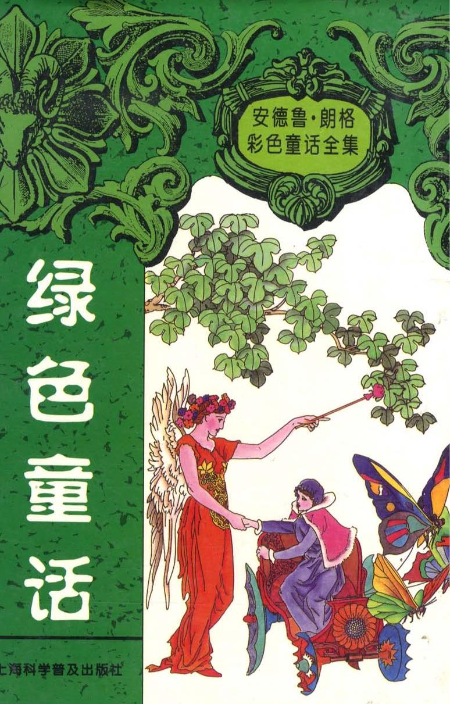

**安德鲁·朗格彩色童话全集**

绿色童话
王晴 汪幼枫译

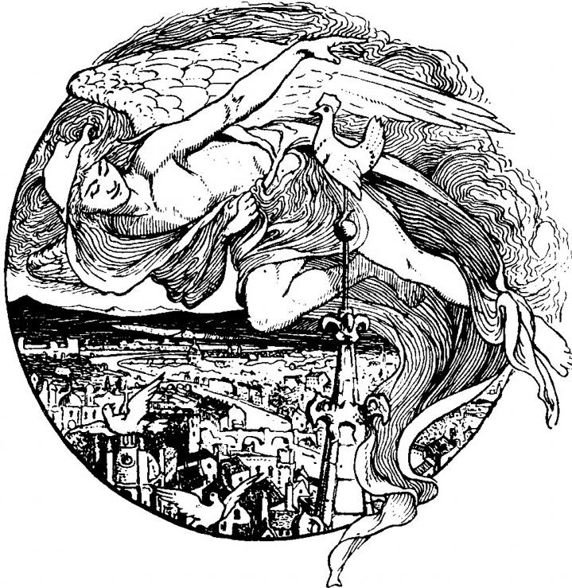

上海科学普及出版社

（沪）新登字第 305 号

Edited by Andrew Lang
The Green Fairy Book

Published by Longmans, Green, and Co. in 1892

---

安德鲁·朗格彩色童话全集
**绿色童话**

王晴 汪幼枫译

---

责任编辑：钟海谷
技术编辑：万福棠
出版：上海科学普及出版社（上海曹杨路 500 号邮政编码 200063）
发行：新华书店上海发行所
印刷：上海市委党校印刷厂
开本：850×1168 1/32
印张：12
插页：4
字数：290000
版次：1997 年 7 月第 1 版 1997 年 7 月第 1 次印刷
印数：1-8000
书号：ISBN 7-45427-1296-9/G·405
定价：14.00 元

---

（本版图书凡印刷、装订错误可及时向承印厂调换）

| 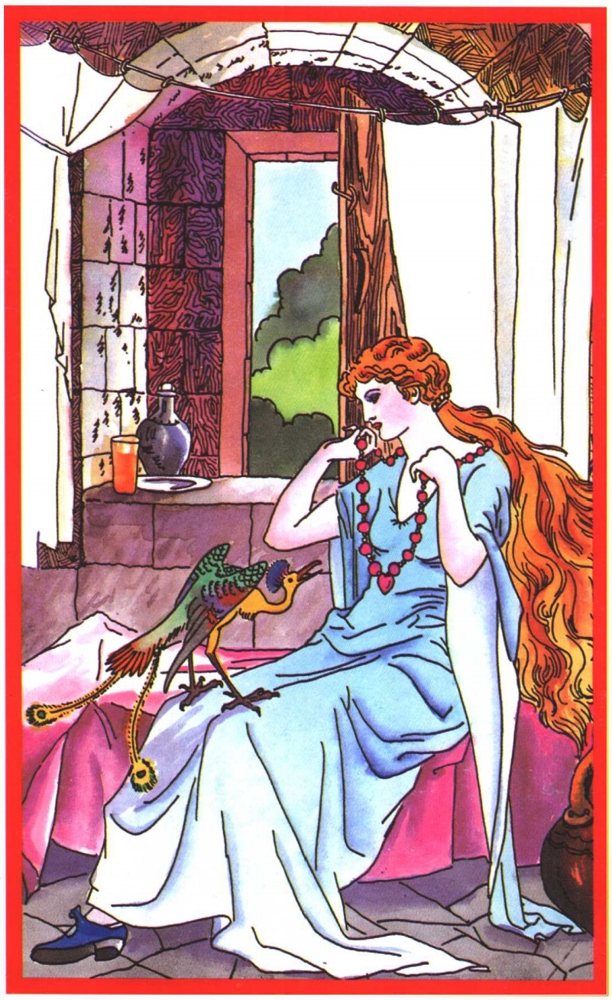 |
| :----------------------------: |
|            《蓝鸟》            |

 

| 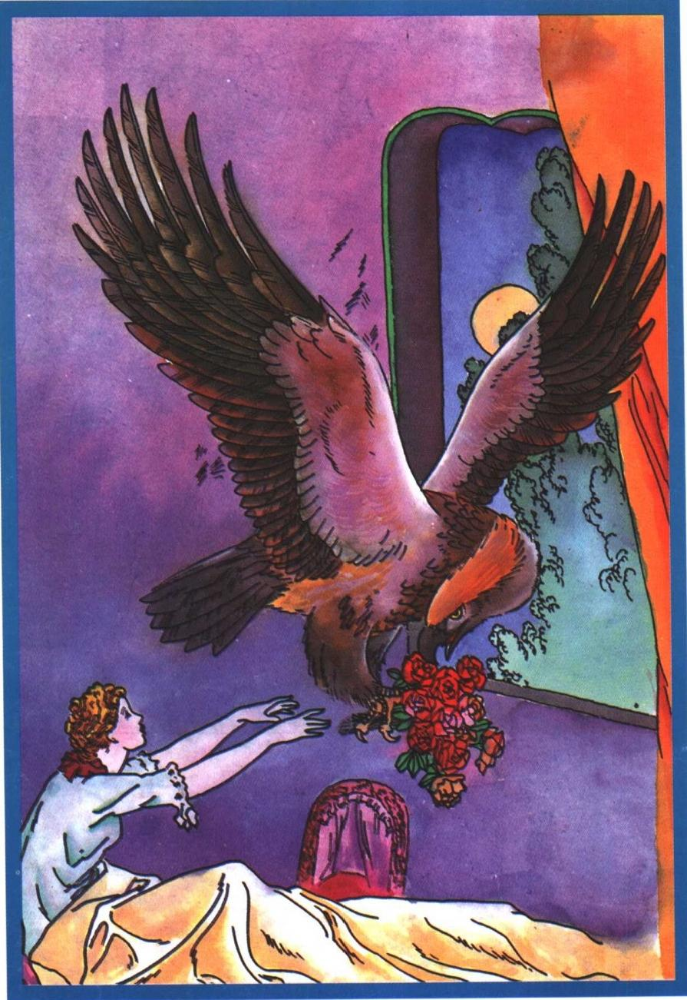 |
| :----------------------------: |
|           《小玫瑰》           |

 

| 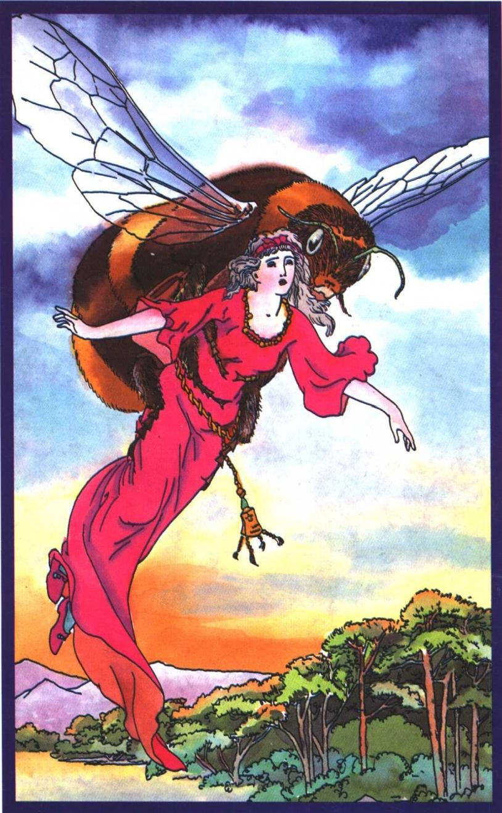 |
| :----------------------------: |
|           《小玫瑰》           |

 

| 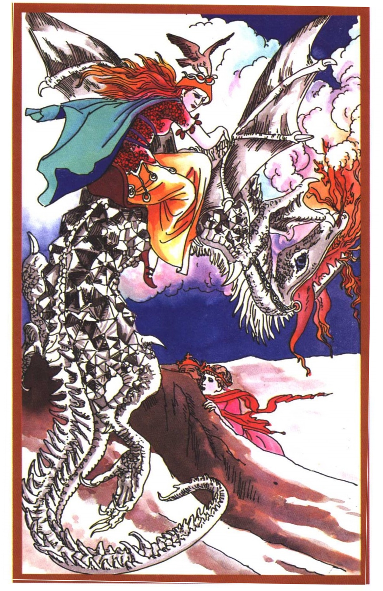 |
| :----------------------------: |
|            《冰心》            |

 

| 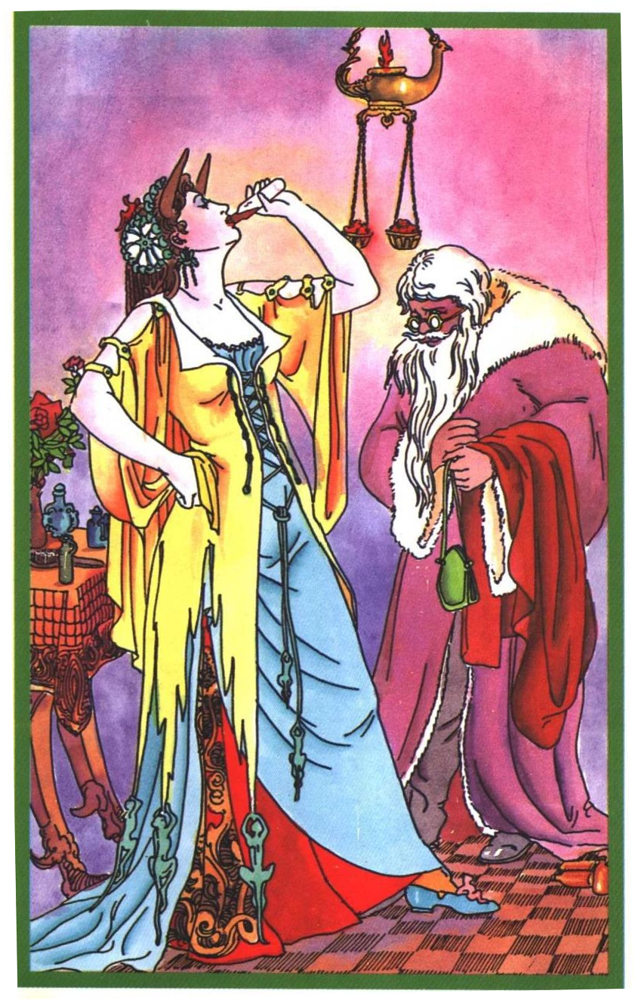 |
| :----------------------------: |
|          《小兵约翰》          |

 

| 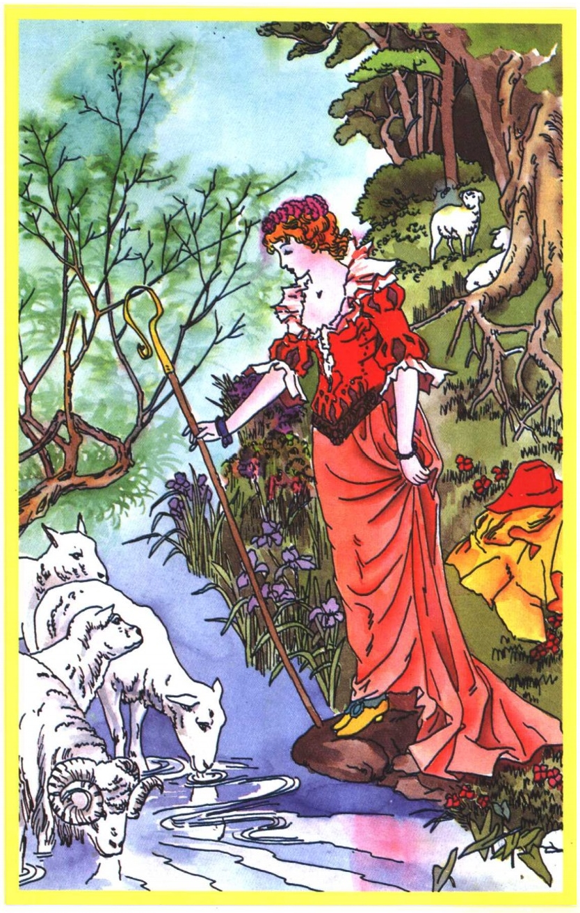 |
| :----------------------------: |
|        《肮脏的牧羊女》        |

 

| 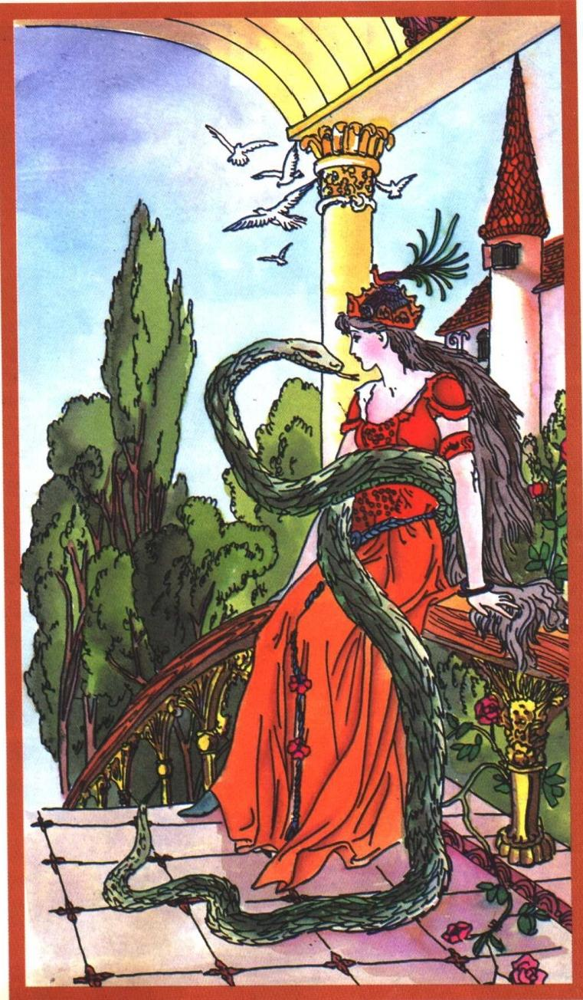 |
| :----------------------------: |
|            《魔蛇》            |

 

| 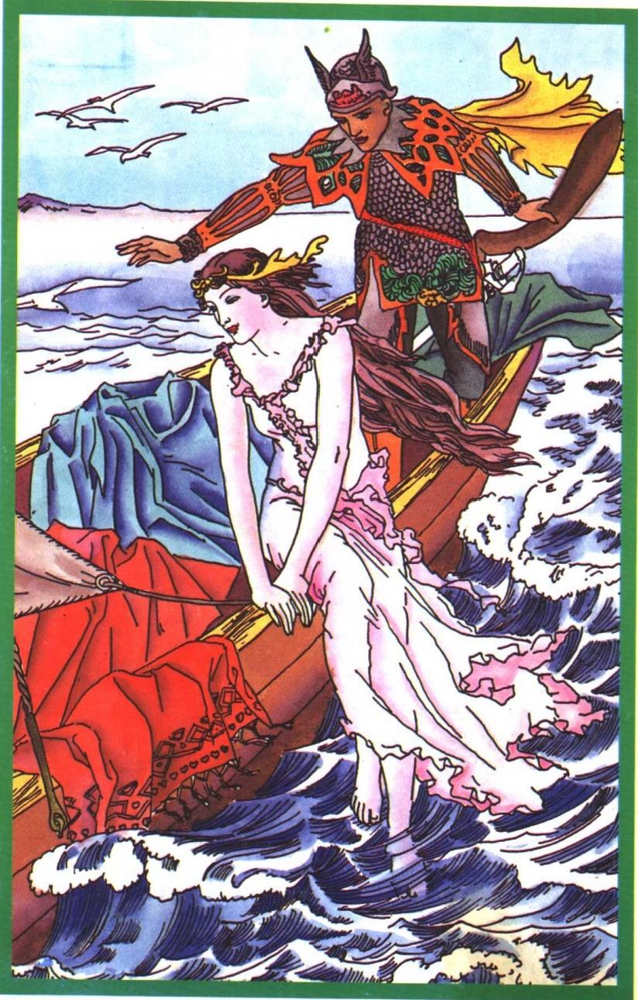 |
| :----------------------------: |
|          《金美人鱼》          |

 

 
 

## 前言

《安德鲁·朗格彩色童话全集》是英国著名文学家安德鲁·朗格（1844～1912）编辑的十二集童话。为了编辑这些童话，他广泛地收集英国、欧洲以至全世界的童话和民间故事。那些非英语的文字，如法文、德文、葡萄牙文、意大利文、西班牙文、加泰隆语等主要由他的妻子莱奥诺拉·布朗歇翻译和整理成英文。最先编成一集，当时编者的意图也只是编这一集。后来搜集的材料越来越多，才决定继续再编三集。其中的艰难和辛苦是外人所难以想象的，编者因此曾发誓，编成这四集以后，再也不编下去了。

四集童话的出版，效果非同凡响。不仅受到英国读者的欢迎，而且被译成多种文字，受到许多国家读者的欢迎。其受欢迎的程度赢得了一代又一代的读者，历数十年而不衰，这不仅源自编者长期的努力，也得益于世界各地广大热衷于这一题材的读者的帮助，他们纷纷把手头的作品和资料寄给安德鲁·朗格。这给了他极大的鼓舞，他一鼓作气，又编了八集。后面几集主要搜集了苏格兰、爱尔兰、加拿大、印度、葡萄牙、斯堪的纳维亚的民间故事和传说。有些则选自以神话、民间传说和英雄传奇为基础的中世纪威尔士故事集《马比诺吉昂》。

安德鲁·朗格认为，这些童话故事很难说是某个人写成的，它们从很久很久以前就流传下来，经过民间艺人和文学家的不断收集和整理，才达到了今天这样思想性和艺术性都比较好的程度。这些童话也被认为是英语、甚至也是全世界各种语言中时间跨度最大、包含地域最广、流传国家和地区最多、内容最丰富的童话集。

她是世界古典童话中的瑰宝，童话世界中永不凋谢的鲜花，被译成多种文字，得以广泛流传，一代又一代的儿童被她的魅力吸引，长大成为家长后，又为能给自己的孩子朗读和讲述安德鲁童话而自豪。

《绿色童话》收集了世界各地共四十二个童话和民间故事。小读者们读了这些生动有趣的故事以后，可以看到一个普通的士兵如何从自己的亲身经历中体会到，真正的爱情必须建立在志同道合的基础之上，还要经得起时间和挫折的考验；幸福的生活要靠自己的双手去创造；可以看到权利和私欲如何使人堕落，陷入罪恶的深渊。这些美丽的童话故事为我们展现了很久以前，这些地区的人民是怎样生活的，展现了他们的欢乐和悲伤、理想和追求；颂扬了勤俭朴素、助人为乐、正直忠诚；谴责了贪得无厌、懦弱无能、奸诈狡猾。

与《安德鲁·朗格彩色童话全集》的其他各集一样，《绿色童话》中的故事充满了当地的风土人情和乡村气息，展现了从冰雪覆盖的北极圈到赤日炎炎的非洲大陆的美丽风光。读者们可以从中领略到许多乐趣，懂得什么是正义，什么是邪恶；什么值得爱，什么该去恨；而且还会对这些地区的人文历史和地理概貌有所了解，从而更加热爱生活，热爱我们这个世界。

 

**目录**

[TOC]

 

 
 

## 蓝鸟

从前有一个国王，他有着无穷无尽的财富：成片成片的土地，成箱成箱的金银。但对于这些财富，他一点也不在乎，因为王后不幸去世了。国王极度悲伤，他把自己关在一间小房子里，并用头撞着墙壁。大臣们担心国王这么做会伤害自己，于是派人在墙壁和挂毯之间镶了一层羽绒。这样，国王可以继续用头撞墙，来减轻内心的痛苦和悲伤，而不会对自己造成伤害。国王所有的臣民都来拜见，带来各种减轻痛苦的办法。国王觉得其中有些办法过于严肃和沉闷，他不喜欢。而另外一些令人愉快的办法也不能在国王头脑中留下任何印象，其实，他似乎根本没听进去。最后，来了一位身披黑色斗篷，看上去悲痛难抑的女人。她不停地抹眼泪，直到国王注意到她。于是，这个女人告诉国王，她这次来，并非要试图减轻国王的痛苦，而是要和国王一起，为各自死去的伴侣哀哭。因为她正好刚失去了一位好丈夫，所以懂得那种痛苦的滋味。国王听了她的话，更加觉得悲伤。他对这个女人讲了很多显示王后优秀人品的轶事。而她呢；也把自己死去的丈夫的优点叙述了一遍。在这种交谈中，时间过得令人愉快，国王不再想到用头撞墙，那个女人也无需像刚来的时候一样，频繁地将眼泪从她那双忧伤的大眼睛中抹去。逐渐地，他们开始谈起国王感兴趣的事。令人不可思议的是，过了没多久，整个王国都得到了一个令人们大为震惊的消息，国王又结婚了，新娘就是那个伤心的女人。

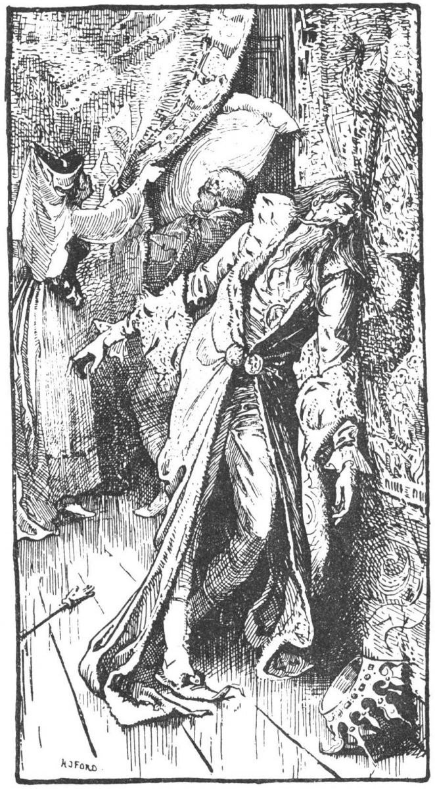

国王与死去的王后生过一个女儿，名叫菲奥德丽莎。芳龄十五的菲奥德丽莎公主是一位非常美丽动人的姑娘，她总是那么快乐，那么招人喜爱。新王后与以前的丈夫也有一个女儿，名叫塔莉苔拉，很快，她就被接到了王宫。塔莉苔拉是由她的教母马兹拉仙女一手带大的，尽管她受到仙女细心的照顾，但还是长得很丑，而且没有教养。其实，当新王后看到自己的女儿站在菲奥德丽莎身边显得那么丑陋凶恶时，她感到一阵绝望。于是，王后借自己的权势，想尽办法离间国王和菲奥德丽莎，并希望以此让国王慢慢喜欢上塔莉苔拉。有一天，国王告诉王后，菲奥德丽莎和塔莉苔拉都到了女大当嫁的年龄，他将从中选择一位，把她嫁给前来拜见他的第一位优秀的王子，王后听了这话，对国王说道：

“我的女儿塔莉苔拉应当先出嫁，她比菲奥德丽莎岁数大，而且长得比她美多了！”

国王一向不喜欢和别人争吵，他说：“那好吧，这事我就不管了，由你决定吧！”

很快，有消息传来说，邻国中最为风度翩翩，气度非凡的王子查米已经启程，前来拜见国王。王后刚得到这个消息，就召集了宫里所有的首饰匠、裁缝、编织工和绣工，为塔莉苔拉定做华丽的衣服和饰物，她转而又告诉国王，菲奥德丽莎不需要添置任何衣服和饰物，查米王子到来的前一天晚上，王后贿赂了一位侍女，让她把菲奥德丽莎公主所有的衣服和首饰都偷走。第二天，菲奥德丽莎打算好好打扮自己，以符合公主的身份，但是，她却连一根丝带都找不到。

公主马上就猜到是王后在背地里搞鬼，她没有把这事告诉国王，而是到商人那边去，打算买点上等的好货，但他们告诉公主，王后已经明确下令，不准任何人向公主出售物品，没有人胆敢违背王后的旨意。于是，除了那条她前天就穿在身上的白色衣裙外，公主没有任何选择。王子来到王宫后，公主就穿了那条裙子下了楼，坐在角落里，希望以此躲避别人的注意。王后为贵客查米王子举行了隆重的欢迎仪式，并把自己的女儿塔莉苔拉引见给他。塔莉苔拉衣着华丽，但她丑陋的容貌因此而更明显。王子瞥了她一眼，就把眼光转向了别处，王后以为查米王子害羞才不多看塔莉苔拉几眼，于是想尽办法把她置于王子视野中。这样，王子就能不断注意到穿着盛装的塔莉苔拉公主，查米王子知道宫内还有一位公主，名叫菲奥德丽莎，他向塔莉苔拉打听这事。

“对呀，”她用手指着菲奥德丽莎，答道，“她就在那儿，她躲在一边，不想让人看见，那是因为她实在很笨，也很难看。”

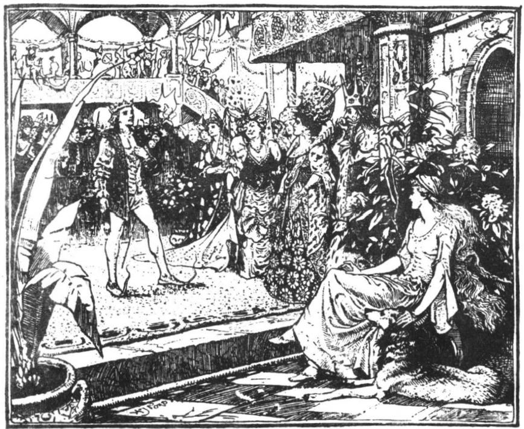

菲奥德丽莎听到这话，脸唰地红了起来。王子看到她那羞红了脸的可爱模样，大吃一惊，他立刻站起身来，朝公主深深鞠了一躬，并对她说：

“女士，你的美貌无与伦比，无需任何打扮。”

“殿下，”公主答道，“我可以向你保证，穿这样皱巴巴不干净的衣服，不是我的习惯，所以如果你今天看不到我，我会感到更高兴。”

“这不可能！”王子大声喊叫，“公主花容月貌，我无法将眼睛转向别处。”

这时，王后插了进来，尖刻地说道：

“殿下，我可以告诉你，菲奥德丽莎已经够虚荣的了，请不要再说什么令她听了飘飘然的话。”

王子明白，王后对他的行为感到不悦，但他对此毫不在乎，他发自内心地喜欢美丽的菲奥德丽莎公主，并和她交谈了三个小时。

王后和塔莉苔拉看到王子如此偏爱菲奥德丽莎，感到非常绝望，她们在国王面前不停地抱怨、挖苦、嘲弄、乞求，直到国王最后同意把公主关起来。这样，在查米王子来访期间，他不会再见到心爱的公主。那天晚上，菲奥德丽莎公主回到自己房间时，四个蒙面大汉冲了出来，把她抓住，带到一座高塔顶上的小房间，公主被一个人扔在那儿，伤心地哭泣，神情沮丧。她马上就猜到，自己被关在这儿，是因为王后她们害怕查米王子爱上她。此刻的公主深感失望，她是那么地喜欢查米，甚至愿意立刻作他的新娘，由于查米王子对公主的遭遇一无所知，他急切地盼着能和公主再见上一面，并试着和那些被安排侍候他的大臣们谈起公主。但是，可恶的王后早已对大臣们下令，不准他们说公主一句好话，并让他们谎称公主是如何虚荣，反复无常，脾气暴躁。她不仅经常折磨自己的侍女，而且低贱得宁愿穿得像个贫穷的牧羊女跑来跑去，也不愿从国王给她的大笔钱中拿出一部分，把自己打扮得更得体。大臣们的这些话令查米王子感到困惑、不安，他一句话也没说，心里想：

“公主穿得很不像话，这倒是真的，但她对自己的穿着似乎感到很羞愧。这证明，她并不习惯于那样的穿着，我不敢相信，有着那样可爱脸庞的菲奥德丽莎会像他们描述的一样，脾气暴躁，叫人讨厌。不，她不会是那种人，一定是王后嫉妒公主比她自己的女儿长得漂亮，所以才让大臣们散布这些恶毒的谣言！”

大臣们清楚地看到，查米王子对他们的话，感到很不高兴。于是，其中有位大臣开始说一些关于菲奥德丽莎的好话。当然，这是当他单独和查米王子呆在一起时，其余的大臣们听不到他们在说什么。

听了这些好话，查米王子变得快活起来，他对大臣说的每一句话都表示出极大的兴趣。人们一眼都看得出，他是多么地爱慕公主。王后把大臣们召来，问他们情况怎么样了。可是，大臣们的回答让她确信，她最害怕的事终于发生了。此时，可怜的菲奥德丽莎公主，却在小屋中整夜不停地哭泣，公主边哭边想：

“就算我从未见过查米王子，我也不愿意被关在这样阴暗的塔房中。可是现在，他就在我们的宫中，所有人都可以享受到和他相处的快乐，除了我，唉！我真是太不幸了！”

第二天，王后送给王子很多华丽的珠宝以及其他贵重物品作为礼物，其中有一件饰品，很明显是特地为将要举行的婚礼赶做的。那是一颗由大块红宝石刻成的心，周围是钻石做成的箭，其中一支穿过那颗心，心上打着金色的同心结，并刻着这样一句话：“这支箭向我射来，让我坠入爱河。”整颗宝石挂在由大颗珍珠串成的项链上，世上还从未有人做出过如此美丽的饰物！王子看到这件礼物时，大吃了一惊，将礼物送到面前的仆人恳求王子收下公主的礼物，因为公主已经选择他作为自己的骑士。

“什么？”王子大叫起来：“美丽的菲奥德丽莎竟然不顾自己高贵的身份，用这种方式鼓励我，我真的感到无比快乐！”

“殿下，你把名字搞错了。”仆人急于纠正王子的错误，“我是代表塔莉苔拉公主来赠送这件礼物的。”

“哦，原来是塔莉苔拉公主。”王子口气立刻冷淡下来，“很遗憾，我不能收下这件礼物。”于是，他把那些华丽的礼物全部还给了王后和塔莉苔拉公主。王子如此蔑视她们，令她们大为恼火。王子找到机会，来到王宫，求见菲奥德丽莎公主，每次有人进来，他都要回头看一眼，希望能看到心爱的公主，当他发现来人不是公主时，就表现出非常的不安和失望。王后在一边看得清楚明白，但她装出一副什么都没看到的样子，继续谈论着她为王子安排的娱乐活动，王子心不在焉地回答王后的问题，突然，他问王后，他是否能荣幸地再见到菲奥德丽莎公主。

“殿下，”王后得意地答道，“她父王已经下令，在我女儿塔莉苔拉结婚之前，她不得离开自己的住所。”

“把可爱的公主像囚犯一样关着，究竟是为什么呢！”王子愤怒不已，大声叫道。

“这事我也不清楚，不过，就算我知道原因，恐怕也没有义务告诉你。”王后更加得意了。

王后如此敷衍他，令查米王子非常生气，他心里明白，都是塔莉苔拉在搞鬼。他忿忿地看了王后一眼，突然起身告辞，回到了自己的住处。他对随同来访的自己一位大臣谈道：“要是能得到一个侍女的帮助，让我有机会和公主说几句话，哪怕就说一句话，我也愿意把我拥有的一切都作为报酬赠送给她。”

“这事太容易了！”那位年轻的大臣答道。于是，他很快想法和一位侍女交上了朋友。侍女告诉他，一到傍晚时分，菲奥德丽莎公主就会站在小窗边，那窗正对着花园，查米王子可以在那儿和公主说上几句话。不过，他必须非常小心，不要让人看见，要不，她会因为帮助王子与公主见面而被赶出王宫。大臣听了这话，高兴极了，他保证不会为难侍女，按她的要求去做。但是，他刚兴奋地跑到王子那边去报告这一好消息，那个狡猾的侍女就把这一切告诉了王后。王后马上打定主意，让塔莉苔拉代替菲奥德丽莎站在小窗边，她耐心地教塔莉苔拉应该说些什么，做些什么，保证这个愚蠢的女儿不会犯任何错误。

那天晚上，夜色笼罩，查米王子根本没有觉察到王后的诡计，他满心快乐地走近窗子，把埋在心中已久的情话对公主诉说，希望公主能够相信他深切的爱。塔莉苔拉按王后教她的话回复王子，她告诉王子，自己是多么地伤心！如果塔莉苔拉没有嫁人，王后就不可能转变对她的态度，王子于是向她求婚，他把自己的戒指取下，戴在塔莉苔拉的手上，塔莉苔拉尽力扮演着自己的角色，不露出任何马脚。可是王子还是隐约地感到，面前这位公主所谈的话，好像不太对头。但是，他安慰自己，公主是因为害怕让王后发现这一秘密，才变得如此尴尬、生硬。他让公主答应第二天晚上再和她见面，否则，他就不走。塔莉苔拉自然非常乐意。王后看到自己的计划成功了，喜不自禁，她相信，事情会按她希望的那样发展下去。第二天天色刚暗，王子就来到了花园中，还带来一辆礼车。这辆由飞蛙驾着的礼车是他一位法师朋友赠送的，他毫不费力就说服塔莉苔拉上了礼车。接着，他自己也登上礼车，坐在公主身边，满怀胜利的喜悦，高声喊道：

“哦，我的公主，你已重获自由。请问，你希望在哪儿举行婚礼？”

塔莉苔拉用斗篷把自己的脸遮得严严实实，她告诉王子，她的教母马兹拉仙女有一座华丽的城堡，她希望婚礼能在那座城堡中举行。于是，王子把目的地告诉飞蛙，那些熟悉世界上每一个角落的飞蛙，很快就将王子和塔莉苔拉送至城堡。他们走过灯火通明的城堡时，若不是塔莉苔拉用斗篷把脸遮得更严实，王子马上就能发现，自己犯了一个不可饶恕的错误。塔莉苔拉请求单独会见马兹拉仙女，很快，她就把发生的一切，包括她如何成功地欺骗了王子，全部告诉了教母。

“哦，我的女儿。”仙女叫了起来，“我们面对的，可不是件容易事，王子这么爱菲奥德丽莎公主，他不会善罢甘休的，我肯定他总有一天会明白事情的真相，起来反抗的。”这时，王子等在一间四面是钻石墙的富丽堂皇的厅内，大厅里非常明亮，他能清楚地看到塔莉苔拉和仙女站在一块，交头接耳嘀咕着，王子迷惑了。

“难道这儿有谁会背叛我们？”他心里想，“为什么我亲爱的菲奥德丽莎还不回到我身边来呢？这儿要是有我们的敌人，她一定正计划着如何阻止我们成婚。”

但是，当仙女带着塔莉苔拉走进来时，事情比他想象的还要糟得多，仙女这样对他说：

“王子殿下，这是塔莉苔拉公主，你既然已经宣誓对她忠诚，那就马上举行婚礼吧！”

“什么！让我娶那个丑东西，”王子愤怒地叫了起来，“你把我当什么了！我可从未许诺过她什么！”

“住嘴，你得对一个仙女表示应有的尊敬！”马兹拉也动怒了。

“那当然，女士，我很乐意尊敬你，但是，你得把公主还给我！”

“我不是就在这儿吗？”塔莉苔拉插嘴道，“这是你送我的戒指，除了我，还有谁站在窗边和你说话呢？”

“什么！”王子气得大叫起来，“难道你一直在骗我？我的礼车呢？这鬼地方我一刻也不想再呆下去。”

“哦，别那么着急，”仙女上前阻拦道，只见她轻轻碰了一下王子的双脚，就把王子钉在地板上，一步也不能动。

“好吧！”王子毫不示弱：“你怎么对付我都可以！哪怕把我变成石头，我也只要菲奥德丽莎！”

整整二十天，王子不愿再多说一句话，不管仙女如何斥责、恐吓，也不管塔莉苔拉怎样假惺惺掉眼泪或流露出恼羞成怒的真相，王子都不予理睬。最后，仙女怒不可遏。王子的固执，不妥协，已让她感到疲惫、厌倦。她对王子说：“要么你娶我的教女，要么为你自己不守信用受七年的惩罚，你看着办吧！”

王子对仙女的威胁，面无惧色。他厉声答道：“你想怎么对我就怎么对我吧！不要说这些令人讨厌的责备的话，好像是我做了坏事！”

“责备！”塔莉苔拉在一边生气地大声嚷嚷，“你以为你是谁，胆敢说我们责备你？你不过是个言而无信的家伙，坐着一辆沼泽地里爬出来呱呱乱叫的青蛙驾着的礼车到处乱跑！”

“好吧，我们停止互相指责，”仙女又插嘴道，“我要把你这忘恩负义的家伙变成一只蓝鸟，从那扇窗子里飞出去。”仙女话音刚落，王子的脸就扭曲变形，双臂缩成一对鸟翅，脚上长出黑色爪子，身子变得小鸟一样细长，披着闪闪发光的蓝色羽毛，嘴巴成了象牙般洁白的鸟喙，眼睛又小又亮，如天上的星星，头上还有一撮白色羽冠。

王子完完全全变成了一只蓝鸟，随着一声凄厉的哀鸣，蓝鸟在塔莉苔拉和仙女的嘲笑声中从打开着的那扇窗中飞了出去。它不停地飞啊飞，最后落在了树林深处的一棵柏树上。蓝鸟开始为自己不幸的命运发出阵阵哀号：“天哪！这七年，我心爱的菲奥德丽莎会有怎样的遭遇！她的继母也许会把她嫁给别人，若真这样，我活着还有什么意义！”

这时，马兹拉仙女把塔莉苔拉送回了王宫。王后一直焦急地等待着婚礼的消息。可是，当她女儿把发生的一切告诉她时，她自然暴跳如雷，可怜的菲奥德丽莎成了出气筒，王后恶狠狠地说道：“这下，菲奥德丽莎该后悔让王子爱上她了吧！”随后，王后带着塔莉苔拉，来到公主被关押的小屋。公主看到塔莉苔拉身披皇室斗篷，头戴钻石王冠，感到震惊，而王后的话更让她的心直往下沉：

“我女儿是来让你看看她的结婚礼物的。现在，她是查米王子的新娘，王子全心全意地爱着她，他们可是世上最幸福美满的一对。”王后说这番话时，塔莉苔拉忙着把她的项链等珠宝首饰和绫罗绸缎在菲奥德丽莎面前炫耀，并有意把戴在手指上查米王子的戒指横在最明显的位置。尽管公主尽力不让自己看这些东西，她还是注意到了那只戒指。马上，她就认出了这是查米王子的戒指。于是，公主完全相信了王后的话，她绝望地叫喊着：“把这些讨厌的东西拿走！我是个可怜的囚犯，不想看这些鬼东西！”说完，公主就昏过去了，狠心的王后见公主晕了过去，幸灾乐祸，笑得更起劲了。她把公主扔在那儿，带着塔莉苔拉得意地走了。那天晚上，王后告诉国王，菲奥德丽莎公主因为得不到查米王子的爱，正在发脾气呢！她向国王建议，不如把公主继续关在塔顶小屋内，等她恢复理智，头脑清醒后，再把她放出来。国王让王后自己决定这件事，只要她认为合适，她可以下任何关于如何处置公主的命令。

不幸的菲奥德丽莎公主从昏迷中醒来，回忆起她刚刚所听到的一切时，禁不住失声痛哭。她深信，查米王子永远不会属于她了。公主整个晚上都坐在打开的窗子边，伤心地叹气、流泪。当东方破晓，晨曦微明时，公主挣扎地爬到黑暗的角落，坐在那儿，她已经伤心过度，对什么也不关心。夜幕又一次降临了，公主爬回到窗边，身子探出窗外，对着夜色为自己悲惨的遭遇哀哭。

查米王子现在已成了一只蓝鸟，它在宫殿四周飞来飞去，希望能见到心爱的菲奥德丽莎公主。可是，它又不敢飞得离宫殿太近，因为它害怕让塔莉苔拉看到，她无疑会认出变成蓝鸟的王子。天黑了，蓝鸟依旧没有找到关押公主的地方。它又累又伤心，便在高塔附近一棵枞树上栖息下来，并开始鸣叫，正当它迷迷糊糊快要睡着时，突然一阵细柔的悲泣声吸引住了它，蓝鸟仔细聆听着，那细柔的声音这样诉说：

“啊，狠心的王后！我究竟做错了什么，你把我像囚犯似地关押起来？是不是你觉得我遭遇的不幸还不够多，所以要用你女儿正享受着的幸福来折磨我？塔莉苔拉，你的女儿，她成了查米王子的新娘！”

蓝鸟听了这些话，大吃一惊，它急切地等待着黎明的到来。天刚亮，它就离开栖息的树枝，去寻找那个说那些话的人。但是，塔屋的窗门紧闭，谁也看不到。第二天晚上，蓝鸟在窗外，透过明亮的月光，看到窗子边伤心的姑娘不是别人，正是它寻觅不到的菲奥德丽莎公主。

“我的公主！我终于找到你了！”王子激动不已地飞向公主。

“谁在和我说话？”公主也吃惊地叫了起来。

“就刚才，你还念着我的名字，可现在，你就认不出我了”王子伤心地说道，“可这不能怪你，我变成了一只蓝鸟，而且还要做七年的蓝鸟。”

“什么！小蓝鸟，你真的是威武强健的查米王子吗？”公主温柔地抚摸着蓝鸟，问道。

“我说的是真话，由于我忠贞不渝，真诚地爱着你，我受到了这样的惩罚。但是，请你相信，就算做十四年的蓝鸟，我也不会放弃对你的爱！”

“哦，你为什么要对我说这些话？”公主大声问道，“塔莉苔拉，你的新娘，刚才还在这儿，她披着皇室斗篷，头戴钻石王冠，如果我没弄错的话，这些都是你的礼物，因为我看到了她手上戴着你的戒指。”

蓝鸟听后，气愤不已，它把自己如何上当受骗，将塔莉苔拉带出王宫，后来又如何拒绝娶塔莉苔拉为妻，因而受到了仙女马兹拉的惩罚，变成了一只蓝鸟的事，原原本本告诉了公主。

菲奥德丽莎最后明白了，她心爱的人对她痴心未改，不禁又快活起来。公主对查米王子的解释和表达爱慕之情的话，百听不厌。可是，不久太阳便从东方升起，这对爱人不得不暂时分别，因为要是王后她们发现了蓝鸟，可就糟了。查米王子对公主许诺，天一黑，他就飞来与公主见面。于是蓝鸟飞走了，躲进了枞树的空隙处。公主一直忧心忡忡，担心蓝鸟被老鹰吃了，或者误入捕鸟者的陷阱。

但是蓝鸟并没有在自己的藏身之处呆很久，它飞啊飞啊，飞回了自己的王宫。通过一扇打碎玻璃的窗户，它飞进宫殿，找到了那个装着珠宝首饰的柜子，挑了一只华贵漂亮的钻戒，作为送给心上人的礼物。蓝鸟飞回公主身边时，公主早已焦虑地等待在窗子边了。她收到查米王子的礼物后，轻声责备起来，她觉得蓝鸟真不应该为她冒这样大的险。

“答应我吧！公主，说你永远替我戴着它！”蓝鸟恳求道，公主先让它保证，大白天也会飞来看她，他们说了整整一夜的话。第二天早上，蓝鸟又飞回了它的王宫，通过那扇破窗子，它飞了进去，又从宝物中选出了一对翡翠手镯。蓝鸟把这对手镯送给公主时，公主不悦地摇着头，用责备的口吻说道：

“你莫非觉得我爱你不深，所以才送给我这些礼物，好让我时刻想起你？”

“不，我的公主，不是这样，我非常非常爱你，但不知该如何表达，送你这些毫不足道的小玩意，是想让你知道，尽管我被迫暂时与你分别，可还是时刻都思念着你。”蓝鸟一往情深地说道。第二天晚上，蓝鸟又送给公主一只镶在一颗大珍珠上的表，公主见了那块表，微微一笑，说道：

“你真应该送我这只表，自从与你相识，我便失去时间概念，见面的几个小时，犹如几分钟般匆匆而过，而没有你，几个钟头就像几年那么长。”

“哦，公主，那些晚上，我更觉得凄苦难熬。”蓝鸟说道，过了一天又一天，查米王子给公主的礼物越来越多——钻石、红宝石、猫眼石等各种各样的珠宝。每晚，公主会把这些礼物戴在身上，以便让心上人感到高兴，到了白天，她把礼物都藏在草垫下，而蓝鸟则躲在高高的枞树上，对着公主鸣叫歌唱。过路的人都觉得奇怪，他们说，树林里一定住着精灵。两年就这样过去了。菲奥德丽莎公主仍然被关押在塔屋内，塔莉苔拉公主也一直未嫁，王后已经把她引见给所有邻国的王子，但他们都用同样的话回复王后：“要是让我娶菲奥德丽莎，我会非常乐意，但若是塔莉苔拉，那说什么也不行！”这话让王后大为不悦，她忿忿地说道：“一定是菲奥德丽莎与他们合谋来气我！我要当面揭穿她的阴谋！”

于是，王后带着塔莉苔拉来到塔楼。正好，那时已近午夜，菲奥德丽莎戴着一身的珠宝首饰，坐在窗边与蓝鸟一起唱着歌，王后在房门外站住，偷听起来，公主和她心爱的王子唱着这样一支歌：

> “哦，我们是不幸的爱侣，
> 一个在牢里，一个在树上，
> 我们忧愁，我们痛苦，
> 全都是因为我们真诚相爱，
> 敌人的诡计，终究会破灭，
> 相爱的心啊，永不分离。”

这歌词听上去伤心忧郁，但唱歌的人似乎都很快乐，王后猛地冲进屋内，大声叫嚷：

“快看啊，我的塔莉苔拉，有人在这儿搞阴谋！”

聪明的菲奥德丽莎一看到王后进来，就立刻打开小窗，以便让蓝鸟及时逃脱。然后，她转身向王后走去，王后的责骂声劈头盖脸地向她袭来。

“女士，你的阴谋诡计被我识破了，”王后气呼呼地叫道，“别指望你父亲会把你释放，谁让你自作自受。”

“夫人，请问我和谁一起搞阴谋呢！这两年你把我关在这儿，除了你派来的那些看守，谁也见不到。”公主毫不畏惧地反诘道。

王后和塔莉苔拉此时看着公主，吃惊不已，天生丽质的公主在满身璀璨的珠宝首饰的映衬下，美得令人眩晕，王后问道：

“能不能问一下，你从哪儿弄来这些珠宝的？可不要回答我，你在塔中找到了一座金矿。”

“我确实发现了一座金矿，这些东西都是在这儿找到的。”公主巧妙机智地答道。

“你这样打扮，是想给谁欣赏？以前，就算在一些最为重要的宫廷活动中，你也从未打扮得像现在这样漂亮。”王后越说越气愤。

“我为自己打扮，可以吗？你得承认，关在这儿，唯一富足的是时间，花点时间让自己漂亮些，该不会是什么大惊小怪的事吧！”公主从容地说道。

“那好，可我得四处看看。”王后依然不肯轻易相信。

于是，王后和塔莉苔拉开始拨弄房中的每个角落，她们翻到草垫子时，珍珠、翡翠、钻石、猫眼石、红宝石、蓝宝石等一个接一个从里面滚出来，母女两个震惊地哑口无言。王后早就决定，要把一叠伪造的书信藏在房内，并以这些假信为证据，向国王证明，公主与他的死敌串通一气，搞阴谋诡计。她正打算把信放在烟囱里时，躲在烟囱上面监视着屋内的蓝鸟看到了王后的鬼花招，为了帮助公主躲避险境，它大声叫道：

“当心，菲奥德丽莎，王后这个坏女人在施诡计！”

这奇怪的叫声把王后吓了一大跳，她只好拿着信和塔莉苔拉匆忙走掉了。她们回到王宫后，立刻召来手下人，与他们商量用什么办法找到那个帮助菲奥德丽莎的仙女或法师。最后，她们决定派一个侍女去伺候公主，并让她装出一副又笨又傻的样子，好像对周围发生的一切麻木不仁。其实，她每时每刻都监视着公主，并将观察到的一切汇报给王后听。

菲奥德丽莎马上猜到，派来的侍女是王后的奸细，可怜的公主感到绝望了。她失声痛哭，因为她不敢再与蓝鸟见面，要是有人发现了蓝鸟，天知道会有什么灾祸。

于是，对公主而言，白天漫长难熬，夜晚更是百无聊赖，整整一个月，她不能走近小窗，以免蓝鸟会像过去一样，飞到她的身旁。

可是，王后派来做奸细的侍女终于因为整日整夜的监视，累得睡着了，公主见此，立刻奔向窗子，她打开窗门，温柔地唱道：

> “蓝鸟啊蓝鸟，
> 你蓝得像天；
> 快飞到我身边吧！
> 现在没人在旁边。”

侍女被歌声惊醒，她非常狡猾，依旧闭着眼睛装睡，这时，传来了说话声，她微微睁开眼睛。皎洁的月光下，有一只美丽无比的蓝鸟，公主正抚摸着它的羽毛，和它说话。

这个女仆把公主和蓝鸟的谈话一字不漏地偷听到了。第二天天刚亮，蓝鸟就依依不舍地与公主告别。女仆急速赶到王后那儿，汇报了她的所见所闻。

于是，王后派人把塔莉苔拉叫来，一起商量这事，很快，她们就下了论断，那只蓝鸟正是查米王子。

“啊，胆大包天的菲奥德丽莎！”王后嚷道，“我们一直以为她会感到非常伤心，可谁知道，她竟偷偷摸摸，尽一切可能与那个不忠诚的家伙见面、取乐，我知道该怎么对他们报复！”

女仆受王后之命，又回到菲奥德丽莎公主身边，继续对她进行监视，她装得和平时一样，睡得很死，甚至比以前上床还早，并尽量自然地打着呼噜，可怜的公主对此一无所知，她依旧跑到窗边，开始歌唱：

> “蓝鸟！蓝鸟！
> 蓝得像天，
> 快飞到我的身边，
> 正好没人在旁边！”

然而蓝鸟却没有来，整个晚上，公主这样呼唤着，等待着，聆听着，可还是没有任何回答。原来，心狠手辣的王后已经下令在那棵枞树上挂满了刀、剑、矛、钩子、镰刀之类的锐器。因此，当蓝鸟听到公主的呼唤，向她飞去时，它的翅膀和脚爪都被割伤，身上有二十多处被刺伤，它浑身淌满了鲜血，飞回到枞树丛中的藏身之处。蓝鸟躺在那儿，痛苦绝望地呻吟着。它想，公主为得到自由，一定背叛了它，向王后屈服了。

“美丽可爱的菲奥德丽莎，你真的会对我忠贞不渝吗？”蓝鸟叹着气自言自语，“如果真的是你背叛了我，那还不如我现在就死！”它侧躺着，等待着死神的降临，正当查米王子绝望痛苦，不愿再与死神抗争时，他的法师朋友来到了那片树林中，其实，法师看到他送给王子的飞蛙礼车没有带着王子就独自回去时，就感到非常吃惊。为了寻找王子，他走遍了世界整整八次，这时，他正好是第八次经过树林，像往常一样，他一边寻找，一边大声地呼喊：

“查米！查米王子！你在哪儿？”

王子立刻认出了自己朋友的声音，他用极其微弱的嗓音回答着：

“我在这儿，我在这儿。”

法师往四处看，什么也没看到，这时王子又说话了：

“我成了一只蓝鸟。”

于是，法师马上就找到了王子，看到王子的处境竟如此悲惨，他来回走动，没有说一句话，他找来了一堆魔草菇，念了几句咒语，很快就治愈了蓝鸟的伤口，让它恢复了老样子。

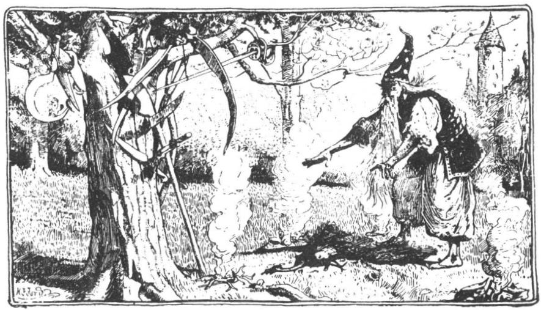

“把一切都告诉我吧！我猜这事肯定和那个公主有关。”

“确切地说，是与两位公主有关。”查米王子苦笑着谈道。

接着，他就把事情的经过原原本本地告诉了法师，并指责菲奥德丽莎为了与王后妥协，背叛了他，把他来访的秘密出卖给了王后，查米王子还说了很多对公主不利的话。比如，他说公主很轻浮，她美丽的容貌使人受骗上当，法师完全同意王子的看法，并宣称，世上所有的公主都一样，只不过有的长得漂亮些，而有的长得丑陋些，他还劝王子彻底忘掉菲奥德丽莎，可是，不知为什么，他的这一劝告令王子很不高兴。

“下一步该做什么呢？”法师问道，“要知道，你还有五年的惩罚。”

“把我带到你的宫中，至少在那儿，你能把我养在笼里，使我免受刀剑的伤害，也不会让猫把我吃了。”王子答道。

“好吧，目前来说，这是最好的选择了，可我这个法师也不是白当的，我很快就会想出绝妙的好主意。”法师自信地说道。

这时，菲奥德丽莎公主正在痛苦绝望中煎熬，她日日夜夜守在窗边，徒劳地呼唤着蓝鸟，并一遍又一遍地想象着王子可能遭遇到的危险和伤害。公主的脸色越来越苍白，身体也越来越瘦。王后和塔莉苔拉，却为她们的胜利沾沾自喜。不过，她们得意没多久，国王就因病去世了。这个王国的人民举行起义，反抗王后和塔莉苔拉的统治，他们组织起来，冲向王宫，要求见菲奥德丽莎公主。

王后站在阳台上，对这些起义的人民威逼、恐吓，并说了很多趾高气扬、不可一世的话，人民再也无法容忍了。他们砸破了王宫的大门，闯了进去。一扇掉下的门正好砸在王后身上，把她压死了。塔莉苔拉公主仓惶逃到仙女马兹拉那儿去了，宫里的贵族们把菲奥德丽莎公主从高塔中放出来，带回王宫，并拥她为王。经过他们的精心护理和悉心照料，公主很快恢复了健康，甚至比以前更加漂亮了。公主逐渐具备了与大臣们商讨国事的能力，她安排好国家大事，保证了在她不在的情况下，一切都能正常运转，然后，公主就准备了一袋珠宝，独自一人去寻找蓝鸟，关于自己的行踪，她没有告诉任何人。

此时，法师也正悉心照料着查米王子，但由于他的法力还不足以抵销仙女马兹拉的法术，他不得不为了自己的朋友，去和仙女马兹拉商谈。毕竟，从某种意义上说，仙女和法师称得上是表兄妹，他们相识已有五六百年，经常地吵架、和好，彼此双方都很了解。所以，马兹拉热情友好地接待了他。

“来这儿有何贵干，你这爱说三道四的家伙？”

“如果你愿意，就能帮我一个大忙，”法师答道，“我的那个王子朋友，不幸冒犯了你…… ”

“啊，我知道你在说谁，”仙女打断了他的话，“很遗憾，这事我不能帮你，除非他答应娶我教女为妻，啊，看那儿，她就是我的教女，多漂亮，多动人的姑娘，你让那位王子考虑一下我的条件。”

法师觉得无话可说，这个塔莉苔拉模样丑极了，根本谈不上漂亮。可是，为了王子，他又不能一走了事，还得再做一次努力。只要王子还呆在鸟笼里，他的生命安全就没有保障。其实，有好几次，王子差点丢了性命。有一次，悬挂鸟笼的钉子松了，笼子掉下来，把王子重重地掉在地上，正好一只猫在屋里，它用爪子在王子脸上猛抓了几下，差点弄瞎了他的眼睛。还有一次，负责照顾王子的人忘了给他喂水喝，害得他几乎渴死。最糟糕的是，王子面临着失去整个王国的危机，他的臣民们长期没有看到他，都以为他死了。出于这些考虑，法师答应了仙女提出的条件，马兹拉同意恢复王子的原形，并让他把塔莉苔拉带回王宫。如果以后王子还是不打算娶她，那么他就会重新被变成一只蓝鸟。

马兹拉把塔莉苔拉用金袍银衣等华丽服饰打扮了一番后，带着她乘上飞龙，来到了查米王子的王宫。这时，王子忠诚的朋友法师也把他带回了王宫。

仙女用魔杖敲了三下，王子就恢复了人形，他看上去仍旧那么英俊潇洒、风流倜傥。他一看到塔莉苔拉，就觉得自己付出了沉重的代价，一想到自己娶这个女人为妻，他就禁不住浑身发抖。

已经成为女王的菲奥德丽莎已经出发去寻找王子，她乔装打扮成一个农家女，戴着一顶大草帽，脸部全被遮住，一只破旧麻布袋耷拉在肩上。她走过陆地，穿过海洋，有时徒步，有时骑马，漫无目的地四处漂游，走到了很远很远的地方，她每走一步，都担心自己是否离心爱的人越来越远。一天，菲奥德丽莎又累又伤心，便在一条小溪边坐了下来。她把白皙的双脚伸进清澈的溪水中冲凉，接着又拿出梳子，梳理起那些在阳光下金黄耀眼的一头长发。一个矮小的驼背老妇拄着拐杖经过那儿，她停下步子，对菲奥德丽莎说道：

“美丽的姑娘，你独自一人吗？”

“是的，老妈妈，我很伤心，想独自一人呆着。”她说这话时，泪水止不住顺着脸颊淌下来。

“别哭，姑娘，告诉我发生了什么事，也许我能帮你。”老妇人安慰她。

于是，菲奥德丽莎把发生的一切对老妪诉谈，并告诉她，自己正在艰难地寻找蓝鸟。

老妪听完这些话，突然站直身子，一下子变得颀长、年轻、美丽，她面带微笑，对一脸吃惊样的菲奥德丽莎说道：

“亲爱的女王，你寻找的那只蓝鸟已不再是只鸟了，我姐姐马兹拉已经让他恢复了人形，他现在正在自己的王国。别害怕，你一定会实现你的心愿，把他找到，拿着这四个蛋，碰到困难就敲开一个，马上你就能得到帮助。”

说完，她就消失得无影无踪了。菲奥德丽莎深受鼓舞，她把蛋放进麻布袋，向心上人的王国走去。走了八天八夜，她终于来到了一座洁白发亮、高高耸立的象牙山前，这座山异常陡峭，菲奥德丽莎试了无数次，都没法在上面站稳。她绝望地坐在山脚下，突然，她想到了那些蛋，她拿出一个，把它敲开，发现里面有一些小金钩，她把金钩绑在自己的手脚上，毫不费力地登上了那座象牙山，因为那些金钩不会使她往下滑落。菲奥德丽莎一到山顶，就碰上了新的困难，山的另一边，即整个山谷，如同一块擦得发亮的金子，成千上万的人在那儿照镜子，欣赏着自己镜中的模样。这是一块魔镜，人们希望自己什么模样，就能在镜中看到那种模样。因此，四面八方的人都跑来，以便从镜中欣赏自我。可是，还没有哪个人能够爬到山顶。他们看到菲奥德丽莎站在那儿，便大声惊呼，担心那镜子会被她踩得粉碎，菲奥德丽莎不知如何是好。她明白，从这儿下山，就会有生命危险。于是，她又敲开了第二个蛋，一辆由两只白鸽驾驶的礼车从里面冒了出来，她坐上礼车，白鸽就驾着车飘然飞去了。白鸽飞了一天一夜，把她带到了查米王子的城门，菲奥德丽莎下了礼车，吻了吻白鸽以示谢意。随着人群，她不安地进了城，并向别人打听，哪儿能见到查米王子，但那些人只是嘲笑她，对她叫嚷：

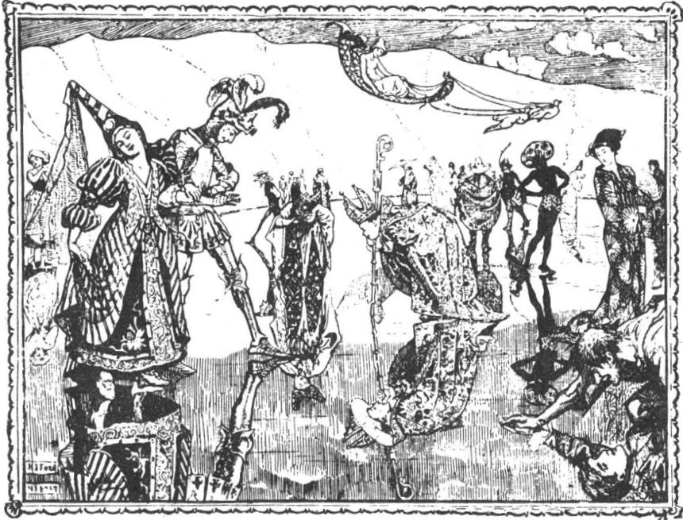

“要见查米王子？就你这样，还要见查米王子，可怜的小厨女，你还是回去，把你那张脸好好洗洗，你那眼睛那么脏，能看见查米王子吗？”这时的菲奥德丽莎因为乔装打扮，并用长发遮住了眼睛，根本没有人能认出她。由于没有人愿意告诉她查米王子在哪儿，她只好继续往前走。没多久，她又开始向人打听。这次，有人告诉她，第二天，她能看到查米王子和塔莉苔拉一起坐车驶过大街，据说查米王子已经同意娶塔莉苔拉为妻了。这对菲奥德丽莎真是个可怕的消息，难道她千里迢迢来到这儿，就为了看到塔莉苔拉成功地把查米王子夺走吗？

菲奥德丽莎又累又伤心，她无法再往前走，就在一个台阶上坐了下来。整个晚上，她在那儿痛哭流涕。天刚亮，她就匆匆赶到王宫，求见查米王子。守卫的士兵不停地赶她走，但她还是坚持要见查米王子。最后，她还是进了王宫，并在大殿里看到了为查米王子和塔莉苔拉准备的宝座，看来，塔莉苔拉早就被当作是王后了。

菲奥德丽莎藏在一根大理石柱子后，不一会儿，塔莉苔拉就走了出来，她虽然衣着华贵，但还是和从前一样丑陋，查米王子也随着走了出来。他看上去比菲奥德丽莎记忆中还要英俊潇洒，气度不凡，塔莉苔拉在宝座上坐下后，菲奥德丽莎走上前去。

“你是谁？竟然跑到这尊贵的王宫里来？”塔莉苔拉怒气冲冲地说道。

“别人叫我小厨女，”菲奥德丽莎答道，“我来卖一些宝物。”

说完，她把手伸进麻布袋，从里面找出了查米王子送给她的翡翠手镯。

“啊！多漂亮的小玩意，我出五个银币买下，你觉得怎么样？”

“夫人，你把这些东西给内行的人看看，然后我们再谈价格。”

如果说塔莉苔拉还真能爱上别人，那她应该算是非常爱查米王子的，她总是为有机会和查米王子说话而感到高兴。她把手镯拿到查米王子面前，让他估个价。查米王子一看到那对手镯，就脸色苍白，深深地叹气，陷入了伤心的回忆中，完全忘了回答塔莉苔拉的话。她只得将问题再重复一遍，查米王子竭力控制住自己的感情，说道：

“这对手镯价值连城，我原以为如此漂亮的手镯，不会再出现第二对。”

塔莉苔拉回到大殿，问菲奥德丽莎，她愿意接受的最低价格是多少。

“这价格恐怕你支付不起，夫人，不过，如果你让我在回音室中睡一晚，我就把手镯给你。”

“那一言为定了，小厨女，”塔莉苔拉一口答应，心里好不欢喜。

查米王子没有问塔莉苔拉手镯的来路，并非他不想知道，而是他非常讨厌塔莉苔拉，因此尽可能避免和她说话。查米王子还是蓝鸟时，曾向菲奥德丽莎说起过回音室。那间屋子在查米王子卧室下面，由于巧妙的设计和建造，即使是轻声细语，查米王子也能在自己的卧室中听得一清二楚，菲奥德丽莎觉得这是用来痛斥查米王子背弃爱情的最好办法。仆人受塔莉苔拉之命把菲奥德丽莎带来回音室后，她就开始不停地流泪、哭泣、哀诉、直到天亮。

第二天，塔莉苔拉向查米王子的贴身男仆打听情况，他们告诉她，昨晚他们在查米王子的卧室中不断地听到哭泣声和叹息声。

于是，塔莉苔拉去问菲奥德丽莎，这究竟是怎么回事，菲奥德丽莎告诉她，她经常地做梦，还总是大声说梦话。

不幸的是，查米王子什么也没听到，因为他每天睡觉前，都吃一些安眠药水，太阳没升得老高，他是不会醒来的。

菲奥德丽莎一整天都在焦虑不安中度过。

“难道他听到我的哭声，还能这样冷漠无情，无动于衷吗？但是，如果他并没有听见，我该如何寻找第二次机会呢？确实，我身边还有很多珠宝，但它们并不能足以让塔莉苔拉动心。”

这时，她想到了那些蛋。于是，她敲开一个，里面出来一座擦得锃亮的铁板礼车，上面点缀着金色，六只绿色老鼠驾着礼车，一只玫瑰色老鼠和另一只灰色老鼠分别做车夫和骑手，礼车里坐了一些小巧玲珑、漂亮迷人的小人。他们在里面跳舞，变奇妙的魔术。菲奥德丽莎看到神奇的魔法又奏效了，高兴地直拍手。天一黑，她等在花园里一条幽暗的小径上，她肯定塔莉苔拉会经过那儿，她让老鼠们驾着车，快速往前驶，并让那些小人们在车上变着魔术。果然，塔莉苔拉走了过来，她一看到那座礼车，就惊呼起来。

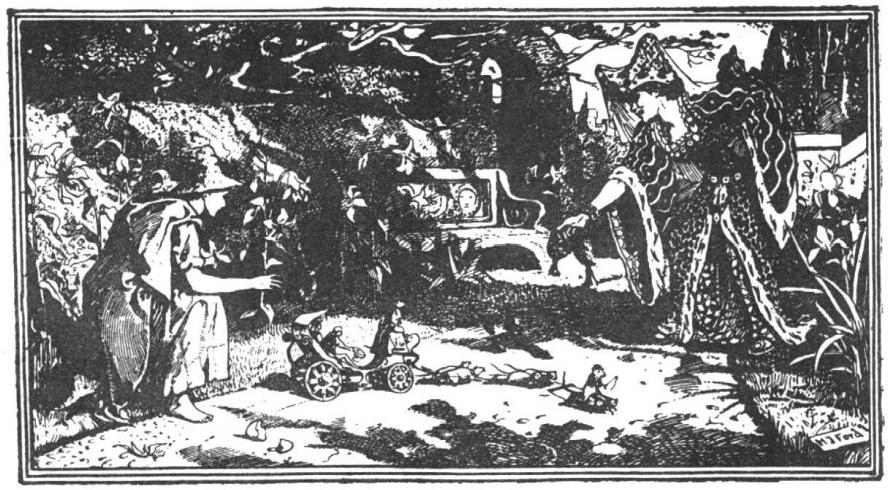

“小厨女，小厨女，你哪来这漂亮的小玩意，你愿意出什么价格把这些东西让给我呢？”

“那就让我在回音室中再睡一晚。”

“可怜的小东西，我答应你的要求吧。”塔莉苔拉神情骄傲地说道。

接着，她又转身对身边的女伴低声说道：

“这小东西太傻了，给她赚钱的机会，她都不要，这下我可占了便宜。”

到了晚上，菲奥德丽莎竭尽所能对查米王子倾诉衷肠，可这次她又没有成功，因为查米王子吃了药，又沉沉地睡去了，他的一个男仆说道：

“这个农家女肯定是个疯子。”但是，另一个男仆却说：

“她的话听上去多么伤心，多么感人啊！”

菲奥德丽莎觉得，如果查米王子听到了那些伤心话还是无动于衷，那他一定是铁石心肠。现在只有最后一次机会了，她敲了最后一个蛋后，高兴地发现，里面有一件更为奇妙的东西，这是一只由六只鸟做成的大馅饼，烘烧得近乎完美。而且那些鸟还活着，它们唱歌，说话，不仅能回答问题，还能算命，让人觉得很有意思。菲奥德丽莎带着这件宝物在大殿里坐着。等着塔莉苔拉经过，这时，查米王子的一个男仆正好走来，他对菲奥德丽莎说：

“喂，小厨女，查米王子要是不喝安眠药水，早就被你的叹气声，哀哭声吵得没法睡觉了。”

菲奥德丽莎这时才明白，查米王子为什么没有反应，于是她从麻布袋里抓出一大把珍珠、钻石，对那个男仆说：“如果你答应我今晚不让查米王子喝安眠药水，我就把这些珠宝都给你。”

“哦，我保证，我保证。”那个男仆贪婪地收下珠宝，许诺道。

这时，塔莉苔拉也走了过来，她看到那只香喷喷的，有小鸟在上面又说又唱的馅饼，大声叫道：

“小厨女，这只馅饼太诱人了，你愿出什么价卖给我呢？”

“还是老样子，让我在回音室中睡一晚。”

“只要你把馅饼给我，这没问题。”贪婪的塔莉苔拉说道，到了晚上，菲奥德丽莎等宫里所有人都睡着后，开始和前两天一样哀哭起来。

“啊！查米！”她边哭边说，“我究竟做了什么，你要这样把我抛弃，娶塔莉苔拉为妻？为了找你，你不知道我走了多少路，受了多少苦？”

由于那个受贿赂的男仆没有食言，用一杯水代替安眠药水给查米王子喝下，所以那晚查米王子没有睡着。菲奥德丽莎说的每字每句，他都听到了，并听出了是她的声音。不过，他无法判断，这声音是从哪里来的。

“啊！公主！”他也叫了起来，“我深深地爱着你，可你却背叛我，投靠那些心狠手辣的坏家伙！”

菲奥德丽莎听了查米王子这些话，立刻答道：

“你把小厨女找出来，她会将一切对你解释清楚。”

于是，查米王子把仆人们找来，对他们说道：

“你们若是能找到小厨女，立刻把她带来见我。”

“这还不容易吗，殿下，”仆人们答道，“她就在回音室里。”

一听此话，查米王子感到迷惑不解，漂亮的菲奥德丽莎公主，怎么会是个小厨女？若回音室中真是小厨女，她怎么又有和公主一模一样的声音？于是，查米王子马上穿好衣服，通过一座秘密的小梯子，来到了回音室。一打开门，他就看到心爱的公主正倚在一堆靠垫上。这时的公主已经取下那些难看的装束，穿着一件白色丝袍，一头金发在温柔的烛光下闪闪发亮。查米王子看到这景象，欣喜若狂。他一个箭步冲上前去，跪在公主身旁，查米王子对公主提了一连串的问题，叫公主不知先回答哪个。菲奥德丽莎公主和查米王子再次相逢，内心充满了喜悦。现在，他们只担心一件事：可恶的仙女马兹拉。这时，法师走了进来，随他一起来的还有一位很有名的仙女，就是她赠给了公主那些神奇的蛋。他们拜见了查米王子和菲奥德丽莎，并告诉他们一个好消息：由于法师和这位仙女已经决定联合起来对付仙女马兹拉，帮助查米王子和菲奥德丽莎，马兹拉已无力再对查米王子施什么魔法。因此，只要查米王子愿意，他随时都可以娶菲奥德丽莎为妻，查米王子高兴得无法形容。天一亮，这个消息就传遍了整个王宫，所有人见了菲奥德丽莎就立刻喜欢上了她。塔莉苔拉得知此事，马上跑到查米王子面前，她看到菲奥德丽莎，气得浑身发抖，但还没来得及说一句话，她就被法师和仙女变成了一只很大的棕色猫头鹰，它发出令人恐怖的“哑哑”叫声，从王宫的窗户飞了出去，查米王子和菲奥德丽莎的婚礼隆重地举行了。从此，他们幸福地生活在一起。

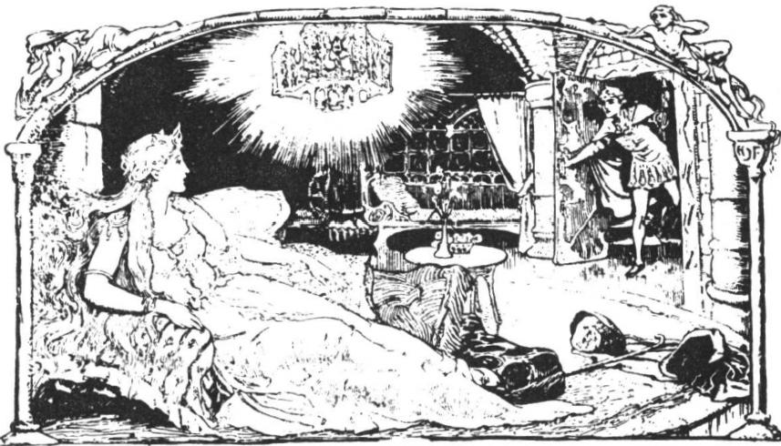

 
 

## 半只小鸡

从前，有一只漂亮的西班牙黑母鸡，母鸡带着一大群小鸡，它们个个长得胖乎乎的，样子很可爱，只有最小的那只和哥哥姐姐们长得一点也不像。其实，它的长相非常奇怪，所以它刚从蛋壳里钻出来时，鸡妈妈简直不敢相信自己的眼睛。另外十二只小鸡依偎在它的翅膀下，看上去毛茸茸，软乎乎的。可这第十三只小鸡，看上去就是与众不同，它似乎是被切成两半的小鸡，因为它只有一条腿，一只翅膀，一只眼睛，并且只有半个头和半个嘴巴，鸡妈妈看到它这副模样，伤心地摇摇头，说道：

“我最小的孩子只是半只小鸡，它永远没法和哥哥们一样，长成一只漂亮的大公鸡，它们会到外面的世界，去寻找属于自己的一块地方。但这个可怜的小家伙，恐怕不得不一辈子和我呆在家中。”

鸡妈妈给这半只小鸡起名为麦迪欧·波利特，即西班牙语“半只小鸡”的意思。

虽然麦迪欧长相奇怪，一副无限可怜的样子，但鸡妈妈马上就发现，它一点也不喜欢呆在妈妈的翅膀下，接受保护。其实，麦迪欧不仅长得和兄弟姐妹们大相径庭，性格也独特。其余的小鸡都很乖，很听话，只要母鸡“咯咯”一叫，它们就会“唧唧”地跑到妈妈身边。可是，麦迪欧尽管只有一条腿，却喜欢到处乱跑，每次鸡妈妈唤它回鸡笼，它就假装什么也没听见，反正它只有一只耳朵。

鸡妈妈带着一大家子去田野散步时，麦迪欧就独自一跳一蹦地走开了。它藏在玉米地中，让它的哥哥姐姐们找得好苦，鸡妈妈也为了找它，来来回回地跑，它害怕麦迪欧迷路，咯咯直叫。

麦迪欧渐渐长大了，它变得更加任性，不听话，它对母亲态度粗暴，对哥哥姐姐们也没有礼貌。

一天，麦迪欧到田野去玩，很晚才想到回家。快到家时，它以自己特有的走路方式，一蹦一跳，趾高气昂地向母鸡走去，甚至斜眼看着它，粗鲁地对母亲说道：

“妈妈，这种无趣的农村生活，我已经厌倦了。这儿除了玉米地，什么也没有，我要去首都马德里看国王。”

“麦迪欧，你要去马德里！”母鸡听了，吃惊地喊道，“为什么去马德里，傻孩子？就算你是一只大公鸡，这也是很艰苦的长途跋涉，像你这样可怜的小东西，恐怕才走一半路，就得累垮。别去了，还是和妈妈在家呆着吧，等哪天你长大了，我们一起去作一次小小的旅行。”

可是麦迪欧早就打定了主意，它不想听从妈妈的劝告，也不愿意答应哥哥姐姐们让它留在家中的请求。

“我们大家挤在这个狭小的地方，有什么意思呢？”麦迪欧辩解道，“等我在国王的宫殿里有了自己漂亮的小院子，我会叫你们来看戏的。”

说完，它就转身往马德里的方向走去，甚至等不及和家里人道别。

“一定要友善对待路上遇到的每一个人，还要有礼貌。”鸡妈妈一边在后面追赶它，一边大声说道。但是，急于离开农场的麦迪欧，根本不想回头答话，一个劲地往前走。

天快黑了，麦迪欧为走近路，穿过一片田地，来到一条河边。河里因为长满了野草，河水没法顺畅地流淌。

“哎，麦迪欧，”河水看到半只小鸡一蹦一跳地走过，便大声叫了起来，“请过来帮帮我，好吗？把这些野草弄掉。”

“帮帮你！”麦迪欧甩甩头，摇着只有稀疏几根毛的尾巴，不屑一顾地说道，“你以为我无所事事，会把时间浪费在这种微不足道的小事上吗？你还是自力更生吧，不要麻烦我这样忙着赶路的人，我可要去马德里看国王。”麦迪欧说完这话，就一蹦一跳地走掉了。

过了一会儿，它来到了树林中的一堆篝火旁，这是吉卜赛人留下的篝火，火焰正微弱地跳动着，似乎马上就要熄灭了。

“哎，麦迪欧！”篝火看到半只小鸡走来，便用微弱的、颤抖的嗓音说道，“快替我搬一些柴火和枯叶，否则，我几分钟后就会熄灭，帮帮我吧，要不我会没命的！”

“帮帮你！”麦迪欧骄傲地说道，“我可是有重要的事要办，你自己去拣些柴火吧，别来烦我，我得去马德里看国王！”说完，麦迪欧又一蹦一跳，一蹦一跳地走掉了。

第二天早上，麦迪欧快到马德里时，经过了一棵栗子树，风不小心被树干缠住了，怎么也脱不了身。

“哦，麦迪欧，快到这边来！”风见了半只小鸡，像看到大救星似地叫道，“帮我从树干这儿挣脱出来，我被缠得紧紧的，觉得难受极了！”

“谁让你从那边经过的！”麦迪欧一点也不同情风的遭遇，“我可不能浪费一个上午在这儿帮你，你自己想办法挣脱它，可别妨碍我赶路，我要去马德里看国王。”

说完，麦迪欧就一蹦一跳，一蹦一跳地走开了。这时，它心里别提有多高兴了，因为马德里的高塔和屋顶已经清晰可见了。麦迪欧进了城，看到一座富丽堂皇的宫殿，门口还有士兵守卫。它马上就猜到，这是国王的王宫。于是，它决定到前门去，守在那儿，等国王从宫里出来。可是，正当它一蹦一跳地经过后宫的窗子时，国王的公鸡发现了它，公鸡大声喊道：

“啊，我正想要这样的家伙，国王刚刚传令，晚饭要喝鸡汤。”公鸡打开窗子，伸出手臂，一把将麦迪欧抓了进去，扔进了火炉旁的一只汤锅里。锅里的水把麦迪欧整个儿淹没了，它感到又湿又冷，身上的毛都紧贴在一起。

“水！水！”麦迪欧绝望地大叫起来：“可怜可怜我吧，别让我被水淹死！”

“啊，麦迪欧！”水说话了，“我在田地上的小河里时，你可是不愿帮我忙啊，现在，你得受到惩罚！”

“火！火！请别这样烫我！你不知道这有多痛！”

“啊，麦迪欧，”火也说起话来，“我在树林里奄奄一息时，你可是不愿帮我啊，现在你要受到惩罚！”

麦迪欧最后疼痛难忍，它觉得自己这回必死无疑了。这时，公鸡打开了锅盖，想看看鸡汤是否已经煮好，拿出去给国王作晚餐。

“快看啊！”公鸡恐怖地叫了起来，“这只小鸡真是一点也没用，它被烧成了灰，我可不能把它端上国王的餐桌。”于是，公鸡打开窗子，把麦迪欧扔到了大街上。可就在这时，风来了，它把麦迪欧吹到空中，把它吹得头晕目眩，麦迪欧被折磨得连气也喘不过来，它的心脏也被压到了一边，似乎快要碎掉了。

“哦，风啊，求求你了！”麦迪欧喘着粗气，哀求道，“如果你继续这样折磨我，我会没命的，快让我歇一会吧，否则……”麦迪欧气喘吁吁，话都说不下去了。

“啊，麦迪欧！”风得意地说道，“我被栗子树缠住时，你可是不愿意帮我忙啊！现在我要惩罚你！”于是，风把麦迪欧吹过屋顶，让它落到城里最高的教堂顶上，然后，又把它牢牢钉在塔尖上。

直到现在，麦迪欧还呆在那个塔尖上，要是你去马德里，穿过几条大街，就来到城里最高的教堂边。这时，你会看到麦迪欧，它的一条腿站在塔尖上，翅膀耷拉在一边，一只眼睛伤心地望着底下这座城市。

 
 

## 国王变鹳的故事

个晴朗的午后，巴格达城哈西德教派的哈里发国王正舒舒服服地躺在一张长沙发椅上，他抽着管烟，不时地啜一口女仆递上的咖啡，捻着自己长长的胡子，一副悠闲自得的样子。总之，谁都看得出，国王现在的情绪非常好，趁这个机会拜见他，是最为合适的，此时，他一定精神愉快，亲切和蔼。因此，他的大臣曼瑟每天总是在这个时候拜见他。

今天，曼瑟大臣和往常一样，又来见国王，但他脸上那副心事重重的表情，却有点反常。国王见状，放下烟管关切地询问道：“曼瑟大臣，你有什么心事？”

大臣两手交叉，放在胸前，对国王深深鞠了一躬，答道：“陛下，难道我真的看上去心事重重吗？是这样的，后宫里来了个小贩，他有许多漂亮的小玩意，只可惜我囊中羞涩，因此感到有点自恼。”

国王一直希望能给曼瑟大臣一件礼物，于是，他命令身边的黑奴去把小贩叫来。很快，黑奴就把小贩带来了，那个小贩身材矮壮、肤色黝黑，衣衫褴褛，他把所有的盒子都打开给国王看。盒子里面装了各种各样的小玩意：成串的珍珠，上了弹药的手枪，还有戒指、杯子、梳子等。国王把这些东西看了一遍后，为自己和大臣挑了几把漂亮的手枪，又为曼瑟的妻子买了一把镶着宝石的梳子。

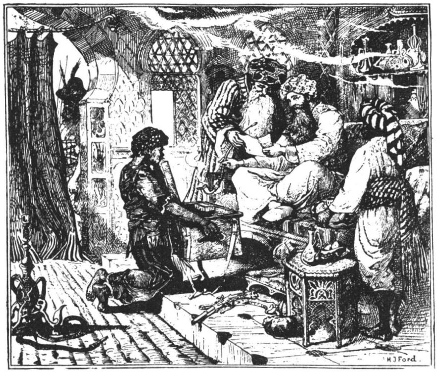

正当小贩要把盒子关上时，个小抽屉，他问小贩，抽屉里是否还有可以卖的货品，小贩打开抽屉，从里面取出了一个装有黑色粉末的小匣子和一卷写着很奇怪文字的书稿，国王和大臣看不懂书稿上写了些什么。

“这两样东西是一个商人在麦加的大街上买来的，后来他又卖给了我，”小贩告诉国王，“我也不知道里面究竟是什么，反正这些东西对我也没多大用处，还是便宜些卖给你吧。”

国王一直喜欢收藏旧的书稿国王发现了一，因此，他虽然看不懂那些文字，还是把书稿和小匣子买了下来，把小贩打发走了。国王急于想知道书稿的内容，他问曼瑟大臣，有没有人能将那些奇怪的文字破译出来。

“尊敬的国王陛下，”大臣答道，“大清真寺旁坐着一位博学多才的人，名叫塞林姆。此人精通各国语言，不妨把他请来，也许他能为我们解开奇怪文字之谜。”

于是，国王马上派人把博学多才的塞林姆请来了。

“塞林姆，”国王对他说道，“听说你是个学识渊博的人，这卷书稿，你是否能看懂，如果你能的话，我会赐你一件荣耀之袍，如果你不能，就表明‘博学多才的塞林姆’这个称号与你不符，我会命令手下人打你二十个巴掌。”

塞林姆在国王面前俯下身子，说道：“遵旨，国王陛下。”然后，他便盯着那篇书稿，仔细地看了起来。突然，他大叫了一声：“国王陛下，我以性命担保，这是拉丁语。”

“好吧，如果这是拉丁语，那就告诉我们书稿上写了些什么。”

于是，塞林姆开始一字一句地翻译给国王听：“发现此物的人，请你感谢阿兰的恩赐，谁吸了小匣子中的粉末，并念一声咒语‘穆塔博’，谁就能变为他想成为的任何一种动物，还能听懂所有动物的语言。如果谁想恢复人形，只需对着东方鞠三次躬，并重复那句咒语。但千万要小心的是，变成动物模样后，不能笑，否则，那个咒语就会被遗忘，你永远不能再恢复原形。”

国王听了博学的塞林姆念完书稿的内容后，感到十分高兴，他让塞林姆发誓，不把这件事告诉任何人，并赐给他一件华贵的荣耀之袍，把他打发走了。然后，国王对大臣说：“曼瑟，我买的真是便宜货，我多希望能马上变成动物啊！明天早上你早点到王宫来，我们一起去乡下，在那儿吸一点小匣子中的粉末，这样，我们就能听到水陆空所有动物的说话声了。”

第二天早上，国王刚穿好衣服，吃完早餐，曼瑟大臣就按国王的吩咐来到了王宫，陪伴他到乡下去。国王不希望身边带着仆人，他把小匣子藏在腰带里，就带着大臣一人出发了。他们走过王宫花园时，想找到一些能吸引他们尝试魔法的动物，但是，却没有收获。最后，大臣建议再往远的地方去，城外有个小池塘，他经常在那儿看到各种各样的动物，特别是一种叫鹳的鸟，它们神情严肃，外表尊贵，又喜欢喋喋不休地鸣叫，因此总能把他牢牢地吸引住。

国王接受了曼瑟大臣的建议。于是，他们径直朝小池塘走去，刚到那儿，就有一只鹳引起了他们的注意。这只鹳威严，骄傲地走来走去，寻找着青蛙，还不断地自言自语。这时，他们又看到一只鹳在空中飞翔，然后朝着第一只鹳的地方飞去。

“尊敬的国王陛下，”大臣说道，“我敢以胡子打赌，这两只长腿的鹳会聊上好一阵子，我们两人也变成鹳，你觉得怎么样？”

“这个主意好，”国王答道，“但是，我们得先记住怎么恢复原形，应该是面朝东鞠三躬，念一声咒语‘穆塔博’。然后，我就又成了国王，你又成了大臣。但是，看在老天的份上，我们千万不能笑，否则，就回不了王宫了。”

国王说话时，第二只鹳在他头顶盘旋，慢慢地飞。国王迅速把小匣子从腰带中取下，深深吸了一口里面装着的粉末，然后把匣子递给大臣。大臣也照国王的样，吸了一口粉末，随后，他们一起大声叫道：“穆塔博！”

一转眼的工夫，他们的双腿皱缩起来，变得细长，红色；漂亮的黄靴子也变成了笨拙的鹳爪；手臂则成了一对翅膀；脖子像抽芽似的，从脖子上往上窜，足有一码长；胡子消失了，浑身长满了羽毛。

国王先是大吃一惊，不知所措地站着，接着又开玩笑似地对大臣说道：“曼瑟，你的长嘴巴真漂亮，我以先知的胡子发誓，这么漂亮的东西，我还从未见过。”

“非常感谢您的夸奖，”大臣弯下长脖子，答道，“可是，请容我斗胆说一句，陛下您现在的模样，比做国王时漂亮多了。要是您乐意，我们先到鹳鸟中去，看看是否真能听懂它们的说话。”

这时，第二只鹳已经飞到了地面上。它先用爪子抹了抹嘴巴，理了理羽毛，然后朝着第一只鹳走去。刚刚变成鹳的国王和大臣也匆匆赶了上去，他们吃惊地听到了以下的对话。

“早上好啊，长腿夫人，今天早上你可真早啊！”

“是的，唠叨小姐，我正在找早餐呢！你想尝点蜥蜴或青蛙吗？”

“非常感谢，长腿夫人，可是今天早上我胃口不大好。我到这儿来另有他意。今天，我得在父亲的宾客前跳舞，所以现在来草地上作练习。”

说完，它就摆出优美的姿态，跳起舞来，国王和大臣在一边看呆了。最后，当鹳鸟单腿直立，摆出了一个独具风韵的舞姿，并优雅地上下轻拂着翅膀时，国王和大臣再也控制不住自己了，他们爆发出一阵持续的笑声，好长时间才安静下来。

国王最先止住笑声，他对大臣说：“这是我见过的最有意思的事了，遗憾的是，那些愚蠢的家伙被我们吓跑了，否则，它们肯定还会唱歌。”

这时，大臣突然想到书稿上那些话，曾严厉地警告他们，不能在变形后笑。大臣的恐惧、害怕，一下子便传给了国王。国王大声叫了起来：“老天哪！如果我这辈子还得做一只鹳，那真是太可笑了！哎呀！我真的记不起那个咒语了，你快好好想想，是句什么话！”

“面朝东三鞠躬，咒语是‘穆……穆…… ’”

国王和大臣转身向东，深深鞠了三个躬，嘴巴也碰到了地上。可是，令人恐怖的事发生了，他们把咒语忘得一干二净，不论国王怎么频繁地鞠躬，也不管大臣如何绞尽脑汁，那句咒语还是想不起来。可怜的国王和大臣，仍然保持着鹳鸟的模样。

两只通过魔法变成的鹳鸟，伤心地徘徊在草地上。他们心情沮丧，不知所措，既不能摆脱这副模样，又不能回到城里去，如果他们告诉别人自己的真实身份，有谁会相信他们的话呢？就算别人相信，巴格达的人民也不会让一只鹳鸟来统治他们。

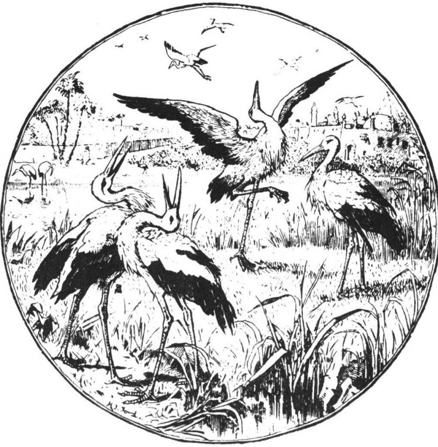

国王和大臣就只能四处流浪，他们每天靠水果填饱肚子。不过，那些长长的鸟喙吃起水果来，可真费事，而他们又不喜欢吃蜥蜴或者蛙。在这种悲惨的处境中，他们唯一的慰藉，就是有了一对可以让他们飞行的翅膀。因此，国王和大臣经常地在巴格达上空飞来飞去，看看城里发生的事。

头几天，国王和大臣发现大街上有不安、骚动的迹象。到了第四天，从王宫的屋顶上，他们看到大街上有一支浩浩荡荡的队伍，在号鼓声中前进。队伍中有一人身披红色斗篷，坐着一匹装饰华丽的白马，身着绫罗绸缎的奴仆将他围住，巴格达城里有一半的人都跟在他后面，齐声高呼：“向你致敬！亲王殿下！你是巴格达的国王！”

站在王宫屋顶上的两只鹳鸟你看看我，我看看你。这时，国王说话了：“大臣，你现在大概能猜到，大法师卡奇努，这家伙曾经恶狠狠地发誓，要对我进行报复。不过，我不会悲观绝望，就此罢休的，跟我来吧，忠诚的朋友，我们到先知的墓地去。在那块神圣的土地上，魔力也许会有所减弱。”

于是，他们展开翅膀，飞离王宫，前往麦迪那。

不过，由于这两只鹳鸟都没怎么练过飞行，他们飞的时候，都觉得很费劲。

“哦，国王陛下，我再也飞不动了，”才过了几个小时，大臣便气喘吁吁地对国王说道，“你飞得实在太快，再说，天快黑了，我们还是快找个地方过夜吧！”

国王接受了大臣的建议，他们发现，地上有个山谷，山谷中有一所破房子，看上去可以作为栖息之处。于是，两只鹳鸟便往那所房子飞去。他们打算在此过夜的这所房子，显然曾经是座城堡。有几根漂亮挺拔的大柱子，依旧站立在一堆碎砖片瓦中，有几个房间还保持着原先富丽堂皇的装饰。国王和大臣在走廊中飞来飞去，想找块干燥些的地方，突然，大臣停住了。

“哦，陛下，”大臣轻声对国王说，“我知道作为一个大臣，是不应该害怕幽灵的，现在作为一只鹳鸟，更不应当害怕鬼魂，可是我现在确实害怕极了，我好像听到周围有人在叹气、呻吟。”

国王听了大臣的话，也停住了。这时，他也听到了清晰的微弱的哭泣声，这声音好像是人而不是动物发出的。出于好奇，国王朝哭声传来的地方飞去，大臣忙用嘴巴咬住国王的翅膀，求他不要鲁莽行事，以免遭遇突如其来的险情。可是，国王虽然成了一只鹳鸟，他的胸膛内，还是跳动着他原来那颗勇敢的心，他宁愿舍弃几根羽毛，摆脱了大臣的阻拦，沿着黑暗的走廊匆匆飞去。国王看到有一扇房门微微开启，清晰的叹气声和哭泣声从里面传出。他用嘴巴把门推开，停在门槛上，眼前的情景不禁让他大吃一惊，这是一间破旧不堪的房间，几丝微弱的光线，从仅有的一扇小窗中透进来，地板上坐着一只很大的苍鹄，豆大的泪珠从它的大眼睛中滚落，带着嘶哑的嗓音，一声声哀哭从它嘴里发出。苍鹄看到国王和跟着而来的大臣，快活地尖叫起来。它用带着斑点的翅膀轻柔地挥去眼中的泪水。但是，让两位来客最感到惊讶的是，它竟用纯正的阿拉伯语说起话来：

“欢迎，欢迎，鹳鸟先生们！你们可是我获得解脱的好兆头，有人曾经告诉我，鹳鸟能为我带来好运。”

国王从震惊中缓过神来，他变换了双脚，姿态优美地站在那儿，弯下长长的脖子，说道：“哦，苍鹄，听了你的话，我相信，你和我们一样遭遇了不幸，可是……哎，希望通过我们获得解脱是不可能的事。如果你知道我们的遭遇，就会明白，我们对自己也感到无能为力。”

苍鹄恳求国王把他们的经历告诉它。于是国王就把自己的故事说了一遍。

国王叙述完毕后，苍鹄向他致谢，并且对他说：“你也来听听我的故事吧，我的遭遇也不会比你好多少。我的父亲是印度国王，我是他的独生女儿，名叫露莎，那个对你报复的卡奇努，也是给我带来不幸的罪魁祸首。一天，他来见我父亲，要求把我嫁给他儿子米尔泽亲王，父亲马上就派人把他轰了出去，根本没考虑到什么后果。不久，那个可恶的卡奇努就变成一个奴仆，设法接近我。有一次我在花园中，让这个奴仆给我拿些吃的东西，他拿了一种药来欺骗我，害得我吃了药后，变成了现在这个可怕的样子。卡奇努趁我吓得晕过去时，把我弄到这所房子，他还用令人厌恶的嗓门对我大声叫喊，‘你这辈子都别想出去，就你现在这副可怕的样子，连野兽都不会看得起你，除非有人向你这只苍鹄求婚，这是我对你和你那骄傲的父亲的报复！’”

“几个月来，我像隐士一样，呆在大墙内，一个人伤心。那些令其他动物害怕的野兽，见了我也要躲避，更别说人了。白天，我变成了瞎子，看不到一点大自然的美景。只有到了晚上，惨淡的月光才将蒙住我双眼的面纱揭开，让我重见光明。”苍鹄说到这儿，已经泣不成声了，对辛酸往事的回忆，使它眼泪涟涟。它又一次用自己的翅膀，挥去了眼中的泪水。

国王听了公主的叙述，陷入了沉思。“要是我的判断没错，公主的遭遇和我的不幸之间，一定有某种神秘的联系。现在的问题是，我该如何解开这个谜底呢？”国王对公主说道。

苍鹄回答道：“哦，陛下，我对这一点也深信不疑，我很小的时候，有个聪明的女人就曾预言，一只鹳鸟会给我带来幸福。我想，我现在找到了一个自救的办法。”国王很是惊讶，忙问这话是什么意思。

“为我们带来不幸的卡奇努法师，每个月都要到这破房子来。离这房间不远有个大厅，法师常在那儿宴请宾客，我已经观察他们很久了。这些家伙喜欢交流各自所干的坏事，也许，他们当中有人会提起你忘记了的那句咒语。”

“啊，亲爱的公主，快告诉我，法师什么时候来？大厅在什么地方？”国王激动地大声叫了起来。

苍鹄沉默了一会儿，接着说道：“只要你答应我一件事，我就回答你的问题，我实在是不得已才这样做的。”

“有什么请求就快说吧，”国王有点不耐烦了，“我会乐意为你效劳。”

“那好吧，你知道，我非常渴望重获自由，这就是说，你们当中必须有一个人向我求婚。”

两只鹳鸟一听这话，可傻了眼，他们面面相觑，不作回答。国王把大臣拉到一边，和他商议。

他们到了房门外后，国王说道：“大臣，这可是件叫人头疼的事，依我之见，还是你向她求婚吧。”

“什么！要我向她求婚！”大臣惊呼起来，“我老婆知道了，会挖了我的双眼！更何况，我已经上了年纪，而陛下您还是个年纪轻轻的孤家寡人，再说公主也与你年龄相仿，长得又漂亮，你们俩才更般配。”

“漂亮？恐怕问题就在这儿，”国王沮丧地耷拉着翅膀，“你怎么知道她年轻漂亮？这是连袋子买猪，不知是死是活，她现在只是一只苍鹄，谁知道她原来究竟是什么模样！”

国王和大臣为这事又争论了好一阵子。最后，国王终于明白，他的大臣宁愿一辈子做鹳，也不愿娶一只苍鹄。于是，他决定还是自己向公主求婚。苍鹄知道国王要向她求婚后，感到非常高兴，它告诉国王和大臣，他们来得正是时候，因为就在今晚，法师们要在这所房中会面。

于是，苍鹄带着两只鹳鸟，沿着黑暗的，长长的走廊，往大厅走去。走廊的尽头，有一束亮光从快要倒塌的墙缝中钻进来。到了大厅门外，苍鹄让鹳鸟们保持安静，门边正好有个小洞，这样，他们能把大厅里发生的一切看得一清二楚。

大厅中立着几根刻有图案的华丽石柱，几只彩灯悬挂着，代替了房子外面的日光。大厅的中央摆了张圆桌，桌上是各种各样的美味佳肴。桌旁的一张长沙发椅上坐着几个人，那个卖匣子的“小贩”也在其中，国王和大臣立刻就认出了这个家伙。“小贩”旁边的一个法师，正央求他把最近干的坏事说出来听听。于是从“小贩”得意的叙述中，国王和大臣听到了关于自己的故事。

“你给了他们一个什么咒语？”另一个法师急切地问道。

“一个很难的拉丁语，‘穆塔博’。”

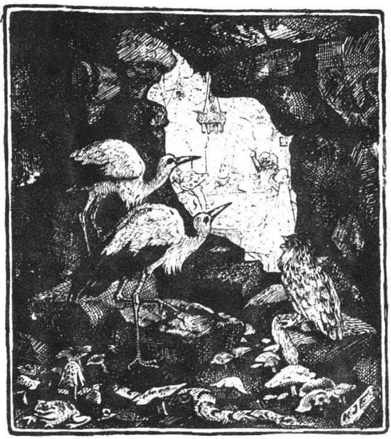

两只鹳鸟听到了这句拉丁语，高兴得忘乎所以。他们快速向城堡的大门口跑去，苍鹄在后面使劲地追赶。到了大门口，国王转过身来，面对着公主，满怀深情地说道：“多亏了你，我和我的朋友才得以解脱，作为对你永远的感激，我现在向你求婚，请你接受我做你的丈夫。”说完，国王就又转过身去，和大臣一起面朝东，对着刚从山顶冉冉升起的太阳，弯下长长的脖子，鞠了三个躬，口中念道：“穆塔博！”一转眼，两只鹳鸟便恢复了人形。国王和大臣为自己恢复人形而感到欣喜若狂，他们又哭又笑地紧紧拥抱。当他们转过身来，却发现身后站着一位婷婷玉立，衣着华丽的姑娘，国王和大臣惊呆了。

那位姑娘面带迷人的微笑，一只手伸向国王，说道：

“是不是认不出我这只苍鹄了？”

原来是苍鹄！国王非常迷恋这位公主美丽的容貌和优雅的举止，简直像着了魔一样。他宣布，自己这辈子最大的好运，就是有幸变成了一只鹳鸟。于是，他们一行三人，向巴格达走去，幸运的是，国王不仅找到了那只装有魔粉的小匣子，还发现了自己贴在腰带内的钱包。这样，他们就有了足够的钱，在最近的村子里买了一些旅行所需的物品，最后来到了巴格达的城门外。

国王归来的消息，在巴格达城引起了轰动，人们早就以为他死了。所以，当他们重又见到自己爱戴的国王时，一个个都感到无比的喜悦。

而那个篡夺王位的米尔泽亲王，却让他们深恶痛绝。人们用武力占领了王宫，把亲王和卡奇努法师扔进了监狱。国王派人把法师送到曾经关押苍鹄的房间，并命令手下人在那儿把他处死。至于米尔泽亲王，由于他对父亲的所作所为一无所知，国王给了他两种选择：一个是死，一个是尝一下那种魔粉，亲王选择了后者。于是，大臣将小匣子递给他，亲王吸了一口魔粉，念了那句咒语，就立刻变成了一只鹳。国王命令手下将这只鹳鸟关在笼中，放在王宫的花园里。

国王和公主从此幸福地生活在一起。每到午后，曼瑟大臣来拜见国王时，国王还是和以前一样，心情特别好。如果他兴致很高，就会放下尊贵的架子，模仿曼瑟大臣变鹳时的模样，他高昂着头，紧绷着腿，嘴巴里像鹳一样“咕咕”叫着，在屋里走来走去。他甚至模仿大臣面朝东，三鞠躬，大声喊道：“穆……穆……穆……”，却怎么记不起那句咒语时的样子。王后和孩子们被国王的表演逗得前俯后仰；不过，就在这时，大臣就会笑着威胁国王，如果他再继续这种表演，他就要将那晚在苍鹄房门外的一番争论，全部告诉公主。

 
 

## 魔表

从前有一个富人，他有三个儿子，儿子们长大成人后，富人把长子送去周游世界。三年以后，这个长子衣着华丽地回到家中。富人对这位长子的言行举止感到很满意，邀请了所有的亲戚朋友，为长子举行了盛大的宴会。

这阵热闹过去后，富人的次子也要求父亲送他去周游世界。这一请求令富人感到高兴，他给了次子一大笔钱，作为旅行的花费，并对他说：“如果你能做得和哥哥一样好，我也会为你举行盛大的宴会。”次子向父亲保证，他会尽最大的努力。果然，他在三年中的表现也很出色，完全达到了他父亲的要求。因此，他回到家中后，富人也对他很满意，为他举行了一个更为隆重的欢迎仪式。

富人最小的儿子名叫强尼。强尼被认为是三个儿子中最愚蠢无用的一个。平时他在家，除了坐在火炉边，把自己弄得全身是灰以外，几乎不做任何其他事情。可是，他却向父亲提出同样的请求——周游世界三年。

“要走就走吧，你这傻瓜，不过，这对你也不会有多大用处！”

只要能得到父亲的回答，强尼对这句话毫不介意。富人见强尼高高兴兴出发了，心里也暗自欢喜，他总算可以摆脱这个傻瓜儿子了。富人给了强尼大笔的钱，供他路上花费。

有一次，强尼在旅行途中穿过一片草地时，碰上了几个牧羊人，他们正要杀一条狗。强尼恳求他们放了那条狗，送给他算了，牧羊人同意了。于是，强尼带上了那条狗，继续旅行。过了没多久，他又看到有人正要杀一只猫。在他的要求下，那只猫也幸免于难。这样猫也跟着强尼，一起旅行。最后，强尼又在一个地方救下了一条蛇，这些动物一个紧挨一个跟着他走。

一天，蛇对强尼说：“你跟着我走。”这时已是秋天，除了这条蛇还在到处寻找着蛇王，其余的蛇都藏进了洞里。

这条蛇又补充道：“我好长时间没回去，蛇王一定会责备我。其他的蛇都已经有了冬天的住处，我却太迟了。我会告诉蛇王，是你帮我脱离了险境，保全了我的性命。它会让你挑一样东西作为报酬，你一定得要那块挂在墙上的表。这块表有各种奇妙之处，擦它一下，你就能得到任何想要的东西。”

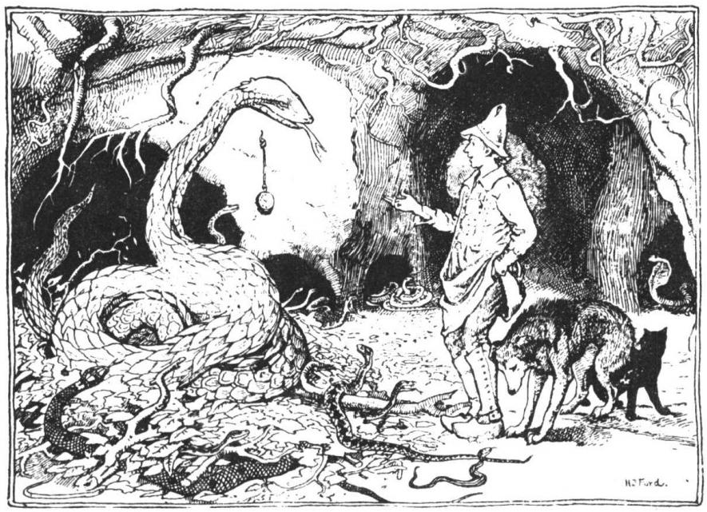

这事没过多久就真的发生了，强尼成了魔表的主人。他刚从蛇王的洞穴里出来，就想试试那表，看它是否如蛇描述的那样神奇。此时强尼正好饿了，他想，要是草地上能出现一块新鲜面包，一块上好的牛排，再加一瓶醇美的葡萄酒，那该有多好啊！于是，他擦了一下表，一眨眼，那些东西就全部出现了。你可以想象，强尼这时该有多高兴啊！

夜幕很快降临了，强尼擦了擦表，希望得到一间屋子，屋子里有一张舒适的床和一顿可口的晚餐。果然，这些东西立刻出现在他眼前。和所有诚实的人一样，强尼吃了晚饭，就上床睡觉，到天亮才醒了过来。他决定回家去，走在路上，强尼一直想着会为他举行的盛大晚会。他到了家，直奔以前常去的火炉边，把自己弄得浑身是灰，可是并没人对他表示在意。

回到家后的第三天，强尼感到百无聊赖。他想，要是现在眼前能有一座三层高楼，里面是漂亮的家具和成箱成袋的金银珠宝，那倒也挺不错。于是，强尼又擦了擦表，他希望看到的东西即刻就出现了。强尼找到父亲，对他说道：“你还没给我举行任何的宴会，算了，还是让我送一个宴会给你吧，跟我来，看看我的盘子。”

富人见了楼房和房中的景象，大为吃惊，他急切地想知道这些东西究竟是怎么弄来的。强尼没有回答他的问题，只是让他把所有的亲戚朋友都请来，参加宴会。

于是，富人把该请的人都请来了。客人们看到桌上摆了那么多盘子，盘里盛满了各种美味佳肴，令人眼花缭乱，不禁大吃一惊。第一道菜上来后，强尼让父亲去把国王和公主也请来。他擦了擦魔表，顿时，一辆马车出现了。马车由六匹马拉着，车身用金银装饰，缰绳上镶嵌着熠熠发光的宝石。富人不敢坐进如此华丽的马车，只好走着去王宫。国王和公主看到了那辆华丽的马车，吃惊不已。他们立刻接受了邀请，登上马车，准备去参加强尼的宴会。这时，强尼又擦了擦魔表，一转眼的工夫，从王宫到他家六里长的路上就铺上了一层大理石。有谁比此刻的国王更加震惊呢？他还从未踏着这样华丽的大道出门过。

强尼听到马车声由远而近，便又擦了擦魔表，一所更漂亮的房子出现了。这所房子是四层高楼，外面挂满了金银，里面摆满了桌子。桌上那么多美味珍品，恐怕还没有哪个国王幸运地有机会品尝过。国王、王后和公主见到这场面，吃惊得连话也说不出来。他们可从未见过如此华丽的宫殿和如此丰盛的宴会！甜点心上来后，国王就要求富人把强尼送给自己做女婿，富人自然一口答应。于是，婚礼马上就举行了。然后，国王回到自己的王宫，而强尼和公主则留在那所漂亮的房子里。

因为强尼不是个聪明有趣的人，公主没过多久就对他厌倦了。她问强尼，那所漂亮的宫殿和里面许许多多的珍品是怎么来的，强尼把魔表的秘密告诉了她。于是，公主一夜不睡，把魔表偷走了。一天晚上，她拿出魔表，擦了一下，一辆由四匹马驾着的马车便出现了。公主坐上这辆马车，马上向她父王的宫殿进发，到了王宫，她把所有的仆人召集起来，命他们也坐马车。马车带着这些人直奔海边，公主又擦了擦魔表，海面上立刻架起了一座大桥。另外，在大海的中央，出现了一所金碧辉煌的宫殿，公主带着她的人马进入了宫殿，然后，她又借魔表的活力，让那座大桥消失了。

孤零零一个人的强尼，感到伤心难过。他的父亲、母亲和其他所有人都嘲笑他。除了他曾经救了一命的猫和狗，他已是一无所有，强尼无法再和家人住在一起。于是，他带上猫和狗，离家到很远的地方去了。最后，他来到一片大沙漠，看到一群乌鸦往高山飞去，其中有一只乌鸦掉队了，它重新回到队伍中时，大家都上来问它迟到的原因：“你为什么迟到呢？冬天来了，我们应该尽快飞到其他地方去过冬。”这只乌鸦告诉大伙儿，它在海的中央看到了一所世上最漂亮的房子，于是多看了几眼，所以掉队了。

这话正好让强尼听到了，他马上就明白，乌鸦说到的那所房子，正是他妻子的藏身之处。于是，他带上猫狗，直奔海边。到了海边，强尼对他的伙伴说：

“小狗，你是个游泳好手，小猫你呢？小巧玲珑，行动敏捷，你跳到小狗背上，让它把你带到宫殿。然后你们一个躲在门外，一个想法溜进宫去，把魔表偷出来。”

猫和狗马上行动，按强尼教它们的方法穿越大海，来到公主的宫殿。小狗在大门附近躲了起来，而猫则偷偷溜了过去。公主认出了这是强尼的猫，并猜到它是来偷魔表的。于是她把魔表藏在地窖里的一个盒内，锁了起来。可强尼的猫也偷偷溜进了地窖，公主刚一转身，它就使劲用爪子抓盒子，直到上面有了一个洞。然后，它用嘴叼起魔表，一声不响地等在旁边，等公主把门打开，打算回房去时，便一溜烟窜了出去。这样，魔表神不知鬼不觉地被偷了出来。

猫刚跑到大门，就对等候在那儿的狗说：

“我们在穿过大海的时候，你千万别和我说话。”

狗牢牢记住了这句话，一路上果然什么也没说。但它们快到海边时，狗再也沉不住气了，向猫问道：

“你偷到那只魔表了吗？”

猫不予理睬，它担心自己开口说话，魔表就会掉进海里。等它们已经能触摸到沙滩时，狗又重复了一遍它的问题。

“是的，我偷到魔表了。”猫总算开口说话了。

可就在这时，它口中的魔表“扑通”一声，掉进了海里。猫和狗这两位朋友开始互相指责对方，它们站在魔表掉下去的地方，看上去一副伤心难过的样子。突然，一条鱼从身边冒了出来，猫一下子扑上去，把它抓住了，心想，这下可以吃一顿美味的晚餐了。

“可怜可怜我这个一家之主吧，我有九个孩子啊！”那条鱼苦苦哀求道。

“好吧，我不吃你，”猫回答道，“不过你得答应帮我们找到我们的表。”

鱼答应了，并履行了它的承诺。于是，猫和狗胜利地完成了主人的任务，将魔表交到了强尼手中。强尼擦了擦魔表，希望看到宫殿、公主以及她的仆人全部被海水淹没，魔表自然马上满足了他的愿望。强尼最后回到了父母身边，他带着猫、狗和魔表，从此快乐地生活在一起。

 
 

## 小玫瑰

我们都知道，仙女即使能活上几百年，也终究难免一死，尤其是当她们必须每星期做一天动物时。显然，这一天她们最容易惨遭横祸，仙女国的王后也正因为这个原因而丢了性命。仙女们于是召开了大会，选举新一任统治者，经过一番激烈的讨论，两位仙女成了王位的最佳人选，一位名叫瑟肯妲，另一个名叫帕瑞达米。由于这两位仙女实力相当，因此，偏爱任何一方都似乎有点不公平。在这种情况下，仙女们一致同意，让她们各自向世人展示自己的奇妙法术，获胜者将成为王后。她们的法术必须非常奇特，而不是那种普通仙女都能完成的移山止水的小把戏。瑟肯妲仙女决定，她将培养一位十分出色、优秀的王子。而帕瑞达米仙女则决定，她要将一位美丽动人的公主向世上展示，公主的美貌将会惊世骇俗，谁见了都会爱上她。为了让两位仙女全力以赴准备各自的绝招，仙女国的事务将由四位年龄较大的仙女暂时处理。

帕瑞达米仙女与一位巴唐国王保持着友谊。巴唐国王是一位最有建树的国王，他治国有方，成为当时国王中的楷模。他的妻子巴莱妮斯王后，也独具魅力，他们对任何事都看法一致，其实，这样的夫妻很少见。国王和王后有个女儿，白皙的颈脖上长了一朵小小的粉红色玫瑰，所以，大家叫她“小玫瑰”。这位公主很小的时候，就表现出非凡的聪明才智，大臣们将她的每一句妙语都牢牢记住，然后在各种场合中运用。仙女们召开大会之后的一个午夜，巴莱妮斯作了个恶梦，她发出一声尖叫，惊醒过来。女仆们忙跑来看是怎么回事，王后告诉她们，自己做了个恶梦。

“我梦见小公主变成了一束玫瑰花，我正把玫瑰花捧在手中时，一只小鸟猛然飞过来，将玫瑰花抢走了。”王后把恶梦描述了一遍。

“你们快去看看，小公主是否安然无恙。”王后补充道。

于是，女仆们按王后的吩咐，来到了公主的睡房。令她们惊慌失措的是，公主的摇篮空空如也。她们到处寻找，也不见公主的踪影。王后知道后，悲痛欲绝，国王也对此伤心不已，只是身为男人，他只得忍痛，将自己真实的感情隐藏起来。不久，国王向王后建议，到乡村的一座宫殿去住上几天。王后接受了这个建议，自从公主失踪后，她一直感到伤心、哀愁，城里快活的气氛，实在令她厌恶。在一个清凉迷人的夏夜，国王和王后坐在草地上，这片草地状如星星，十二条绿荫大道犹如星星的十二个角，闪烁着光芒。这时，王后看到，每一条大道都有一个美丽的农家女向她走来。更为奇怪的是，她们每人手中都拎着一只竹篮，王后全部的注意力都转移到竹篮上。农家女走到王后面前，将竹篮放在王后身边，齐声说道：

“美丽的王后，愿这些东西能为你遭遇的不幸带来安慰。”

王后匆匆打开竹篮，发现每个竹篮中都躺着一个女婴，她们令王后想起了失踪的公主，勾起了她对伤心往事的回忆。不过，那些可爱的农家孩子很快使王后忘记了自己的哀愁，她为那些女婴们找来了奶妈、摇篮、侍女，并送她们去荡秋千，玩布娃娃，给她们做新衣，准备好吃的。

奇怪的是，这些女婴的颈脖上都长了一朵粉红色的小玫瑰，王后想为她们取个适当的名字。但她发现，这可不是件容易的事。于是，她决定用她们各自玫瑰的颜色来称呼她们。这些女孩聚在一起时，犹如一簇色彩明亮、鲜艳的花朵。随着时间的推移，她们各自的气质和禀性慢慢显露了出来。尽管她们所受的是相同的教育，个个也都聪明伶俐。逐渐地，代表每个名字的颜色被忘记了，王后给了每个人一个新的称呼：

“甜姐”，“美人”或者“快乐天使”……

当然，这些姑娘们迷人的风采，引来了无数的爱慕者。有的王子还从遥远的国度赶来，目睹她们的风采，因为这些姑娘们已经声名远扬了。姑娘们的行为也很小心谨慎，不对任何一个王子表现出偏爱。

现在，我们再来看看瑟肯妲仙女。有个国王是巴唐国王的表兄弟，仙女选中了这个国王的儿子，决定将他培养成一位最见异思迁的王子。在小王子的洗礼仪式上，仙女曾将王子可能希望得到的心灵和外表都赐与了他。现在，她更是毫无保留地将各种风采和魅力赐给王子。这样，不管王子的态度是粗暴还是友善，衣着是朴素还是华贵，举止是稳重还是轻浮，他总是那么英俊风流，叫人不可抗拒。其实，王子真的是个很有魅力的年轻小伙子，因为仙女已将最聪明的头脑和最美好的心灵赐给了他。要不是王子有些见异思迁，他可真算得上完美无缺了。不可否认的是，这个名叫莫利弗多的王子是个不可救药的花心萝卜，和风一样叫人捉摸不定。因此，当他满十八周岁时，就已经征服了自己国内所有的人。虽然这些人都喜爱他，可他却已经对他们厌倦了。在这种情况下，他接受了巴唐国王的邀请，去他的国家作客。

王子刚到巴唐国王的王宫，就见到那十二位世上最最美丽动人的姑娘。王子激动兴奋的心情，是可想而知的。但是，王子的处境也很尴尬。因为十二个姑娘个个都喜欢上了他，而他也喜欢她们中的每一位。现在的情形是这样：王子才离开姑娘们一小会儿，就感到极不开心。王子喜欢与“甜姐”轻声细语的同时，和“快乐天使”一起大笑，而两眼又直盯盯看着“小美人”。有时，他喜欢表情严肃地和“端庄”在绿荫覆盖的草地上交谈，同时拉着“悦人”的手，其他的姑娘们则在他身边安静地走动。王子感觉这是他一生中最快活的事。他第一次真正爱上了别人。可是，这个“别人”总共有十二位姑娘，而这些姑娘，个个都让他迷恋，瑟肯妲仙女本人，也被这种情形迷惑了。她认为，莫利弗罗王子的风流倜傥已达到了巅峰，帕瑞达米仙女将这种情形看在眼里，不作任何评价。

王子的父亲几番写信催他回国，并到处张罗，想替他找一位合适的姑娘作妻子，但却总是徒劳无益。世上没有任何东西能叫王子离开他十二位心爱的姑娘。

一天，王后在花园中举行了一个盛大的晚会，客人都到齐后，王子像往常一样，周旋在十二位佳人之中。这时，传来一阵蜜蜂“嗡嗡”的叫声，姑娘们害怕让蜜蜂蜇着，惊叫着四处躲避。但是，令在场的所有人感到恐怖的是，那些蜜蜂转眼间就变得巨大无比，它们各自抓了一位姑娘，带着她们飞走了，一下子便无影无踪。这一事件令整个王宫的人痛苦不已，特别是莫利弗罗王子。起先，他像疯了似的，发泄着内心的痛苦，逐渐地，他变得抑郁、沮丧。瑟肯妲仙女也匆匆赶来，想为她最喜爱的王子做点什么，她为王子带了很多漂亮迷人的公主的画像，让他选择。可是王子对此不屑一顾，断然拒绝了仙女的好意。总之，事情已经很清楚：王子的情绪糟透了，而仙女对此无计可施。一天，莫利弗罗王子四处游荡着，沉浸在对往事的伤心回忆中。突然，他听到一阵令人大吃一惊的叫喊声和喧哗声。此时的王子如果能抬头看一眼，他就会和其他人一样，感到震惊：一辆在太阳光下闪耀着光芒的水晶礼车，从空中缓缓驶来。六个美丽的少女，带着发光的翅膀，用玫瑰颜色的丝带拉着礼车。礼车的上部，还有几位同样美丽的少女。她们手捧着玫瑰花环，在礼车顶部形成了一个完整的罩篷。礼车上坐着帕瑞达米仙女，她身边则坐了一位公主，公主的美貌惊世骇俗。她们踩着梯子，从礼车上款款而下，朝王后的寝宫走去。这时，所有人都蜂拥而至，想看一眼这奇妙的景象，把王宫挤得水泄不通。人们看到如此美貌的公主，不时发出阵阵惊叹。

“尊敬的王后陛下，”帕瑞达米仙女见了王后，对她说道，“是我把你的女儿‘小玫瑰’从摇篮中偷走，现在，请允许我将她送还给你。”

王后真是喜出望外，她问仙女：“可是，那十二位可爱的姑娘们呢？难道她们永远地离我而去，不再回来了吗？”

仙女回答道：“你很快就会停止想念她们。”仙女的口气好像是在敷衍王后，她似乎想告诉王后，不要再提任何问题。然后，帕瑞达米仙女返回水晶礼车，转眼就消失了。

公主回到王宫的消息，很快就传到了王子耳朵里。可是王子根本没有去看看漂亮表妹的心思。不过，王子还是感到，出于礼貌，他还是最好与公主见一下面，表示自己对她的尊敬。自从那十二位姑娘被蜜蜂抢去后，王子一直郁郁寡欢。但是，与公主见面还不到五分钟，他就发现，公主身上集中了那十二位姑娘的风采，而每一种风采，都深深吸引着他。现在，他感到心满意足，毕竟，他能够全心全意地爱一位姑娘了。因此，他与公主相识不到几分钟，就向公主求婚。王子的语音未落，帕瑞达米仙女就出现了，她面带胜利的微笑，坐在一辆为仙女国王后准备的礼车上。原来，这个时候，仙女们都听说了她成功的法术，选她做了仙女国的王后，帕瑞达米仙女又将自己的法术向众人叙述了一遍，她先把“小玫瑰”公主从摇篮中偷走，然后再把她的品性分成十二部分，其中每一部分都会吸引莫利弗罗王子。当十二部分再次结合为整体时，王子见异思迁的毛病就会痊愈，永不再犯。

所有宾客都到齐后，王子与公主的婚礼马上就举行了。那个被帕瑞达米击败的对手瑟肯妲仙女也为公主送来了结婚礼物。这足以证明，重新结合为一体的“小玫瑰”公主确实魅力四射，招人喜爱。莫利弗罗王子对公主的爱，始终没有改变。当然，娶了这样一位如花似玉的公主，他怎么可能移情别恋呢？“小玫瑰”对王子的喜爱，也决不亚于那十二位姑娘，从此，他们两人就幸福地生活在一起，为王国带来了安定和繁荣。

 
 

## 西尔维和乔可萨

从前，一座小村庄里住着两个孩子，男孩名叫西尔维，女孩名叫乔可萨。他们两人都长得很漂亮，人又聪明。但是，由于很久以前发生的一次争吵，使他们的父母成了冤家对头，没有人还记得引起争吵的原因。但出于习惯，两家人还是没有往来。不过，西尔维与乔可萨非但没有因此疏远对方，反而成了形影不离的一对。他们每天在一起放羊，共同度过阳光灿烂的时刻；或者，就同坐在绿荫成行的小河边休憩。一天，草地仙女从他们身边经过，被他们美丽的外表和温柔的举止深深吸引，她决定把他们置于自己的保护之中。随着西尔维和乔可萨一天天地长大，仙女也越来越疼爱这两个孩子。最初，仙女喜欢在他们常去的地方放一些礼物，以此来表达自己对他们的喜爱。两个孩子也喜欢把这些礼物相互赠送，因为他们彼此相爱。所以，出现在他们头脑中的第一个问题总是“乔可萨想要什么？”或者“西尔维喜欢什么？”看到孩子们拿到蛋糕、肉饼等礼物时表现出来的那种天真无邪的高兴劲，仙女就感到非常欣慰。西尔维和乔可萨长大成人后，仙女决定与他们相识。一天，西尔维和乔可萨为躲避正午的烈日，在茂盛的灌木丛林中乘凉。仙女就选择这个时机走上前去，西尔维和乔可萨看到有位身材高挑、削瘦的女士幽灵似地突然出现，不禁大吃一惊。仙女马上用亲切随和的语气，告诉了他们事情的真相：她就是那位经常送一些漂亮的小礼物给他们的人，因为她非常喜欢他们。西尔维和乔可萨得知真相后，对仙女表达了感激之情，并愉快地回答了仙女提出的各种问题。很快，仙女就和他们道别了。临走之前，仙女让他们保证，不要把见过她的事告诉别人。“以后你们还会经常看到我，”仙女补充道，“我也会常来看望你们，就算有的时候，你们根本看不到我的存在。”仙女说完这话，便消失了。西尔维和乔可萨对发生的这一切感到又震惊，又兴奋。以后，仙女果然常来看望他们，并教他们各种知识，还把他们带到她的王国，去看很多奇妙的东西。有一天，仙女对他们说：“你们知道，我一直对你们很好，还记得我最喜爱的那个泉水吗？答应我，每个清晨日出之前，你们一定要到泉水边去，把那些阻碍水流的小石块拿掉，把那些弄脏了泉水的落叶断枝也一起清除。如果你们既不忘记也不耽搁这份责任，就表明，你们确实很感激我。只要黎明的第一道阳光认为我的泉水是草地上最清澈、最甜美的一个，我保证你们两人将永不分离。”

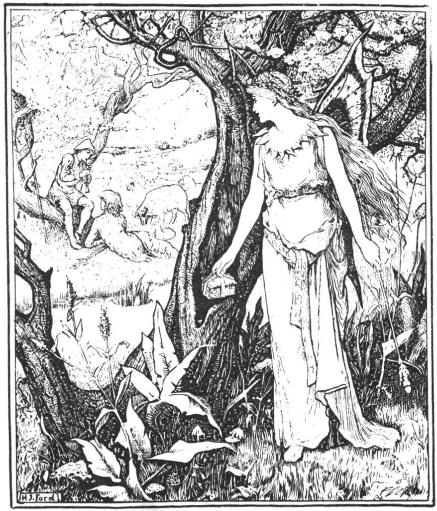

西尔维和乔可萨很乐意地接受了这份工作，他们都认为，如果仙女能保证让他们永远在一起，做这点小事实在算不上什么。因此，很长一段时间里，他们都精心照料着仙女喜爱的那道泉水，而那道泉水，也成了草地上最清澈最美丽的水流。一个春天的早上，太阳还沉沉地睡着大觉，西尔维和乔可萨就匆匆忙忙地从相对的方向往泉水走去。一路上，他们看见到处都是鲜花盛开，姹紫嫣红，禁不住被眼前的美景迷住了。于是，各自停下脚步，开始为对方采摘鲜花。

“我要为西尔维做个花环。”乔可萨自言自语地说道。这个时候，西尔维也在想：“乔可萨戴上我做的花冠，一定很神气。”

他们俩就这样沉醉在花海中，越走越远。因为最鲜艳的那朵花，似乎总是在前面不远处。最后，第一道太阳光闪现时，西尔维和乔可萨不觉一惊，他们不约而同地转身往泉水方向跑去。尽管两人是从不同的地方往泉水跑去，却几乎同时到达那儿，他们被眼前的景象吓坏了。平时一贯平静安定的泉水，突然“沽沽”地冒水泡，沸腾起来。接着，一股强大的水流冲了出来，吞没了泉水。顿时，西尔维和乔可萨就被一条宽广汹涌的大河相隔在两岸。事情发生得这样突然，他们除了惊叫一声，将采摘的鲜花递给对方外，就只能眼睁睁看着对方站在对岸。不过，手中的鲜花会代替他们向对方解释迟到的原因。西尔维一次次地跳进激流之中，想游到乔可萨站着的对岸。但是每次，他都被一种强大的，不可抗拒的力量冲回岸上。这时，对岸的乔可萨，也正努力着想回到西尔维身边，她试图伏在一棵被激流连根拔起的大树上，穿越那条将她与心上人相隔的大河。可是，她的努力也毫无收获。于是，他们各自强忍着悲痛，沿着水流方向前行，不管是白天还是黑夜，高山还是深谷，严冬还是酷暑，他们都不畏艰难地挣扎前进。他们忍受着疲惫和饥饿的煎熬，克服了重重困难，心中唯一的慰藉，就是能与心爱的人重逢。三年以后，他们终于走到了大河入海口的悬崖边上。

而此时的西尔维和乔可萨相隔更远了。绝望之中，他们再次跳进了汹涌的波涛，试图游到对方身边。但是，草地仙女从来没打算让他们淹死。其实，她一直在旁边默默地观察，保护着他们。因此，仙女只匆匆挥了一下手，西尔维和乔可萨就发现他们并肩站在金色的沙滩上。可以想象，当他们发现自己无需再去跋山涉水找寻爱人时，心里是多么高兴啊！西尔维和乔可萨心里都有着千言万语，要跟对方说，就是不知该从何说起。于是，他们一致同意，先严厉地批评自己一番，因为正是由于他们的粗心大意，才带来了这许多的磨难。草地仙女听到了他们的自责声，立刻出现了。西尔维和乔可萨一下子跪倒在仙女面前，要求得到仙女的原谅，仙女当然同意了。她还许诺，西尔维和乔可萨不会再受到任何惩罚。从此，她将永远是他们的朋友。接着，仙女派人把她那辆由绿色灯心草做成的礼车驾来，那些点缀着礼车的五月的露珠，是仙女最为珍爱的，她总是精心采集这些露珠。仙女命令六只短尾巴的小白鼠用礼车把西尔维和乔可萨送到一片很出名的大草原去。小白鼠们以极快的速度完成了这一任务，经过磨难以后的西尔维和乔可萨又回到了自己心爱的家园，心里真是高兴极了。在他们离开家的那段日子里，仙女为了保证他们得到持久的幸福，已经想办法使他们的父母消除旧怨，和好如初，并让他们答应了西尔维和乔可萨这对真心相爱的人的婚事。仙女将西尔维和乔可萨带到一所非常漂亮的小农舍中，农舍与已经恢复往日宁静的泉水相邻，泉水轻柔地流入小溪，而小溪又将农舍中的花园、果园和草坪整个地包围，不管是西尔维和乔可萨，还是他们的羊群，都不会觉得这地方还有欠缺之处，他们对这个农舍满意极了，仙女因此也感到欣慰，因为她特地为他们才安排了这一切。西尔维和乔可萨在农舍中走来走去，欣赏着仙女为他们安排的一切。他们感到累了，就坐在覆盖着玫瑰的门厅下休息。仙女告诉他们，前来参加婚礼的宾客正陆续赶来，在婚礼正式举行之前，她倒想先讲个故事，消磨时光，于是，仙女就讲了这样一个黄鸟的故事——

从前有个仙女，因为干了件调皮事，被仙女国的法庭判罪，让她以某种动物的模样生活上几年，并在恢复原形的那个时刻，允许她让两个人同时交上好运。法庭让仙女自己选择一种动物，由于这个仙女非常喜爱黄色，就选择做一只可爱的黄鸟。这只黄鸟身上披了一层闪闪发光的金黄色羽毛，还从未有人见过这么漂亮的羽毛。仙女所受的惩罚快要结束时，她变成的那只美丽的黄鸟飞到了巴格达，黄鸟设法让一个捕鸟人抓住了自己。这时，一个名叫巴迪的家伙正在他富丽堂皇的宫殿外走来走去，这个家伙在巴格达，被认为是世上最富有的人，他那名字的意思，就是“世界的奇迹”。其实，这位大富翁并没有感到真正的快乐，因为他不得不为自己拥有的财富操心。他对其他事都不感兴趣，唯一关心的便是占有更多的东西。巴迪的宫殿宽敞、华丽，足有五十个国王的王宫那么大。这时他刚从宫中出来，一副百无聊赖、情绪很坏的样子。因为这时的巴迪，实在找不到能令自己开心的新鲜事物。捕鸟人看到巴迪，觉得这个时候把黄鸟给他看，是最为合适的。他断定，巴迪见了黄鸟，马上就会买下。

捕鸟人的想法果然没错，巴迪从他手中接过美丽的黄鸟，捧在手上，爱不释手。他发现鸟的右翼上写了这样一行字：“谁吃了我的头，就会成为国王。”左翼上也有一行字：“谁吃了我的心脏，每天早上，他就能在枕头下发现一百个金币。”尽管巴迪家财万贯，可还是希望有更多的金币。于是，他从捕鸟人手中买下了这只黄鸟。但是，巴迪马上就面临着一个难题：谁来煮给他吃这只鸟呢？当然他的仆人能组成一支军队，但他对其中任何一个都不信任。最后，他问捕鸟人是否已经成家，捕鸟人告诉他自己已经有了老婆，巴迪立刻请他把鸟带回家中，让他老婆来煮这只黄鸟。

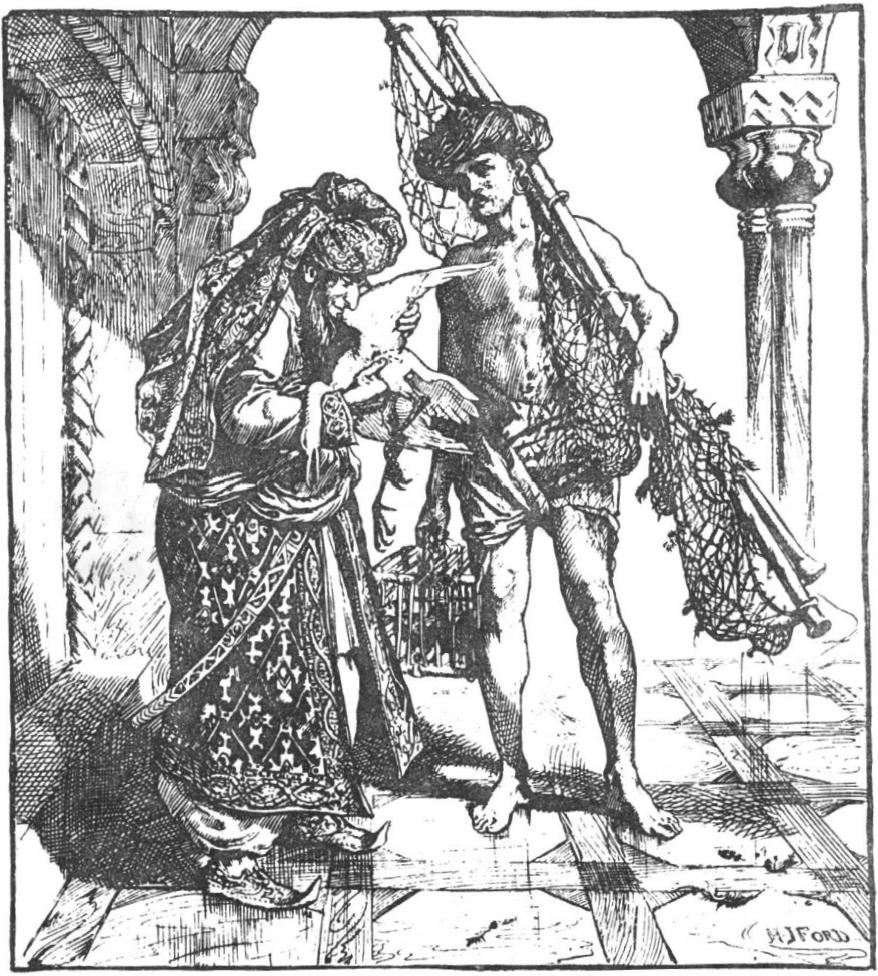

“也许，这样我的胃口更好，”巴迪对捕鸟人说道，“这阵子我的胃口一直不好，如果你老婆把这菜做得好，我就给你一百个银币。”

捕鸟人乐不可支地跑回家中，他的老婆马上就用黄鸟做了一碗美味的焖肉。巴迪来到捕鸟人家中，急切地在碗中寻找头和心脏。可是，他却什么也找不到，火冒三丈的巴迪对捕鸟人的老婆大发雷霆，她吓坏了，跪倒在巴迪面前，把事情的真相告诉他。原来，她的两个儿子在巴迪之前回到家中，见母亲做了道好菜，便吵着要吃。于是，她把黄鸟的头和心脏分别让他们吃了，这些东西通常没人要吃的。巴迪得知真相后，怒气冲冲地跑了出去，并扬言要对捕鸟人一家进行报复。激怒了有钱人，可真是件可怕的事。捕鸟人和老婆打算把孩子送到安全的地方去，老婆为了安慰丈夫告诉了他一个秘密：她是有意将头和心脏给孩子吃的，因为她看到了翅膀上所写的那两行字。于是，这对夫妻相信，自己的孩子已经交上了好运，他们拥抱了一下两个儿子，就把他们送走了，并嘱咐他们，走得越远越好，而且要选择各自不同的道路，可能的话，就让别人带个口信。捕鸟人和老婆送走儿子后，就在城里东躲西藏，或者乔装打扮，他们的这种做法，倒也挺聪明。大富翁巴迪因为失去了眼看就要到手的财富，忧虑过度，气出毛病，不久便一命呜呼了。捕鸟人和老婆重新回到自己的农舍中，等待着他们孩子的消息。小儿子吃的是黄鸟的心。不久，他本人也发现了心的秘密，因为他每天早上醒来，总能在枕头上发现一个钱包，钱包里装了一百个金币。这个儿子于是大肆挥霍，他相信自己拥有取之不尽，用之不竭的财富。结果，不久他就遭到了抢劫，在反抗时，他受了重伤，最终丢了性命。这种结局大概会让穷人们感到欣慰，世上大概没有其他东西像财富一样，需要花费很多心思，也会带来很多的麻烦。

捕鸟人的大儿子吃的是黄鸟的头，他没有什么特别冒险的经历。来到了一个遥远的地方，他进了亚细亚的一座大城市中，那里的人们正在选举新的国王，城里一片混乱，重要的平民们分成了两派。长时间的争吵以后，两派之间达成了协议，谁的遭遇最奇特，就推举他为国王。捕鸟人的儿子——一个年轻的旅行者就在此时来到了城里，他五官长得端正，一副知足快乐的神情。突然，一只雪白的鸽子飞到了他头上，停在那儿。于是，人们都跟随着他，盯着那只鸽子看。年轻人很快就走到了王宫，鸽子也一直呆在他的头上，城里的人们全都在他面前下跪。他还没搞清楚究竞是怎么回事，就做了国王。这事让他惊讶不已。

发号施令确实令人高兴，也很容易叫人适应，年轻的国王对自己刚获得的地位很快就熟悉起来。可是，他也无法避免犯错误，他把王国治理得一团糟。最后，人们起来造反，很快就剥夺了他的权力，并且把他处死了。捕鸟人的儿子得到了自己应有的报应，因为在他做了国王以后，就和自己的父母——捕鸟人夫妇断绝了关系，任凭他们在贫困潦倒中死去。

“亲爱的西尔维和乔可萨，这就是我要对你们讲的故事。”仙女说道，“我想用这个故事来证明，简陋的小农舍，或许比那些看上去华贵舒适的东西更有可能为你们带来幸福和满足。如果你们对我许诺，你们会耕作土地、放牧羊群，并更加坚守自己的诺言，我就可以肯定，任何一种对你们真正有用的东西，都会在农舍中找到。”

西尔维和乔可萨向草地仙女许下了诺言。他们深信，只要坚守自己的诺言，生活就会过得安宁、富足。仙女把所有的朋友和邻居都请来参加他们的婚礼。很快，婚礼就在喜庆狂欢的气氛中举行了。从此，西尔维和乔可萨真诚相爱、白头偕老，幸福地生活在一起。

 
 

## 仙女的礼物

事情通常都是这样：人们的周围环境或多或少正确地反映了他们的心灵和品质，也许这就是为什么百花仙女住在一座非常美丽的宫殿里。宫殿里的花园是你想象中最令人赏心悦目的。花园里有各种美丽的东西：花草树木，喷泉鱼池。百花仙女不仅花容月貌，而且心地善良，所有的人都喜欢她。伴她左右的那些王子和公主整天都快快乐乐的，而他们如此快乐，唯一的原因就是能和百花仙女住在一起。他们很小的时候就被送到仙女身边，直到长大成人才不得不离开仙女的宫殿，到外面的世界去生活。每当他们离开时，仙女会按他们的意愿赠送他们礼物。但是，你现在将要听到的故事，主要是关于一个名叫西尔维娅的公主。百花仙女对这位公主极其宠爱，因为她性情温柔，具有独创性。西尔维娅快到了离开宫殿、接受礼物的年龄。不过，百花仙女有一个很大的心愿，她想知道那些在宫殿里长大成人后离去的公主们现在情况如何。于是，仙女决定在西尔维娅离开之前，送她到公主们那边去。一天，百花仙女备好了自己那辆蝴蝶礼车后，对西尔维娅说：“西尔维娅，我打算把你送到彩虹公主那儿去，因为我的缘故，也因为你招人喜欢，她一定会很高兴地迎接你，两个月以后你再来见我，告诉我一些你对她的看法。”

西尔维娅很不愿意离开，但既然百花仙女主意已定，她就没再说什么。两个月以后，西尔维娅高兴地乘上蝴蝶礼车，急着赶回到仙女身边，百花仙女又见到了西尔维娅，也同样感到高兴。

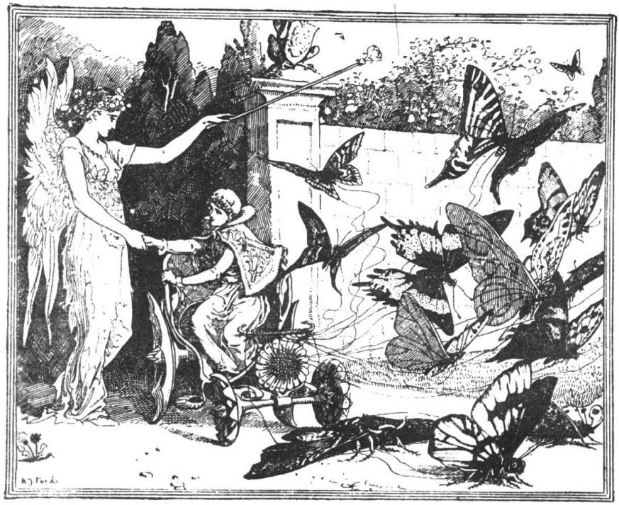

“孩子，现在你可以讲讲你对那边的印象了。”

“我奉你之命去拜访的这位彩虹公主，你对她的馈赠是美丽的容貌，”西尔维娅答道，“她经常向人提起你的好心肠，但从未坦率地告诉任何人，她的美貌是你的礼物。确实，她的美貌最初让我感到眼花缭乱，但我还是觉得，美丽的外表妨碍了她运用其他天赋的能力。她似乎认为，向别人展示自己的容貌，便是她所需要做的一切。但不幸的是，我还在那边时，彩虹公主生了场重病，她现在虽然已经康复，但已经完全失去往日的风采。因此，她对自己现在的模样感到厌恶，陷入了痛苦和绝望中。公主求我把她的不幸告诉你，并乞求得到你的怜悯，让她恢复往日美丽的外表。说真的，她很需要那样的外表，以前她漂亮的时候，人们容忍了她所有缺点，甚至觉得那正是她可爱之处。可现在她越变越丑，人们就再也不像从前那样对待她了。何况，彩虹公主已经好久没有想到运用自己的头脑和聪颖的天性，我觉得她现在也不会有多少聪明才智，当然她自己也清楚这一点。你可以想象，彩虹公主是多么伤心，多么需要你的帮助！”

“你已经说了我想要知道的一切，”百花仙女大声说道，“但是，我不能帮她，我的礼物只能给一次。”

过一些时候，西尔维娅又得离开还是那么美丽宜人的宫殿了，因为百花仙女想让她去和瑞香公主呆上一阵子。于是，蝴蝶礼车又载着西尔维娅，飘然而去，把她带到了一个陌生的王国。她在那儿呆了没多少天，就请一只四处飘游的蝴蝶捎个口信给百花仙女，让她赶快派人接自己回到宫殿。不多久，仙女就允许公主回到了她身边。

“啊，夫人，”公主刚见到百花仙女，就大声说道，“这次你真送我去了个好地方！”

“怎么了？出什么事了？”仙女疑惑不解地问道，“如果我没记错，瑞香公主当初要求得到的礼物是一副能言善辩的伶牙俐齿。”

“能言善辩放在女人身上可不合适。”西尔维娅用深信不疑的口气说道，“瑞香公主确实能说会道，用词造句也恰到好处，但她一说起来就没完没了。虽然开始人们也许觉得她挺有意思，但到了最后，都对她不停地说感到厌烦。她尤其喜欢召集会议，商讨国事，因为在这种场合，她就可以名正言顺地大说特说，而不会被人打断。还有，她每次刚说完一大通话，就又滔滔不绝地说了起来，也不管自己还有没有话好说。哦！你真不知道，能离开她那块地方，我是多么高兴啊！”

百花仙女听到西尔维娅用这种厌恶的语气谈她自己在瑞香公主那儿的经历，不禁笑了起来。但是，她只让西尔维娅休息了一小会儿，就又送她去辛西娅公主的王国去，准备叫她呆上三个月。三个月之后，西尔维娅回来了，她看到百花仙女，如同与多年不见的老朋友会面，内心充满了喜悦和满足。百花仙女和往常一样，急于想知道西尔维娅对辛西娅公主的看法。当初仙女送给辛西娅的礼物是令人愉悦，因此她对别人，一直都很亲切、很和气。

“最初我觉得，辛西娅一定是世上最快乐的公主，成千个小伙子爱慕她，争先恐后取悦于她。其实，我几乎下了决心，问你要一件同样的礼物。”

“那么，你的主意有所改变吗？”百花仙女问道。

“是的，夫人，”西尔维娅答道，“我告诉你这是为什么。随着我在她身边呆的时间越来越长，我发现辛西娅其实根本不快乐，她为了让别人感到愉悦，不再保持真诚，逐渐堕落为一个卖弄风情的女人，甚至爱慕她的那些人后来也发现，她那些令接近她的人感到不可拒绝的魅力和风采，原来并无多少价值，不值得珍视。因此，他们不再爱慕，不屑一顾地离她而去了。”

“孩子，你让我感到很满意，”百花仙女听了西尔维娅的这番话，高兴地说道，“你先在宫殿里玩上几天，马上，我就要送你到菲莉达公主那边去。”

西尔维娅为自己能在宫殿里呆上几天，感到很高兴。这下她就有闲暇时间来思考问题了，因为她一直无法决定自己离开仙女时该要一件什么样的礼物，而那个时刻却已经越来越近了。几天以后，仙女把西尔维娅送到了菲莉达公主的王国，当西尔维娅回到宫殿后，仙女又像往常一样，兴致勃勃地听她的汇报。

“我安全地抵达了菲莉达公主的宫廷，公主热情友好地接待我，并马上把你赠与她的聪明才智向我展示。我承认自己刚开始被她过人的才智深深吸引。整整一个星期，我都考虑着要同样的礼物，在我看来，没有比这更好的礼物了。但是，到了最后，我就不那么渴望获得聪明才智。因为，它和令人愉悦一样，并不能叫人真心感到满意。渐渐地，我甚至对它厌倦起来，特别是最终，我清楚地看到，如果想要保持聪明、有趣，就非得时不时地搞些恶作剧，并总是要把所有的事，甚至是最最严肃的事，当作开个聪明玩笑的好机会。”

百花仙女心里完全赞同西尔维娅的结论，她对自己培养出一位这么出色的公主感到欣慰。

西尔维娅接受礼物，离开宫殿的时候终于到来了。她所有的伙伴都被召集起来，把百花仙女围在中间，仙女用她馈赠礼物时一贯的语气，问西尔维娅究竟要选择一件什么样的礼物，带着它到外面的世界去。

西尔维娅沉默不语，半晌才开口答道：“我需要一个宁静的心灵。”百花仙女满足了西尔维娅的要求，给了她一个宁静的心灵。

正是这件可爱的礼物，把幸福和快乐带给了西尔维娅和所有与她相处的人。她不仅美丽温柔，而且快乐知足，即使偶而的伤心和不安使她可爱的脸庞稍显暗淡，人们所说的最难听的也不过是这句话：

“西尔维娅的脸蛋今天怎么有点苍白？看到她这样真叫人难过。”

不过，西尔维娅心里乐开花时，就会像阳光一样，把快乐撒向每一位有幸在她身边的人。

 
 

## 那西瑟斯王子和波婷蒂拉公主

从前有个国王和他的王后，虽然他们很久以前就死了，但他们的兴趣爱好与现代人没有多少区别。国王名叫克洛利夫，最喜爱狩猎。但是，他在国家事务上所花费的精力，也足以使他觉得对得起臣民。所谓的关心国家大事，对他而言，就是不断地翻看公文。王后名叫费丽弗拉，她年轻时非常漂亮，并且始终相信自己容颜未改、美丽依旧。当然，身为王后，要保持青春和美丽倒也不是件难事。这位王后唯一的追求就是快乐，宫廷舞会、化妆舞会、郊游野餐，这些活动总是一个紧挨一个，将她的日程排得满满的。在这种情况下，王国的事务多少被他们忽视了。事实上，普通人如果想去一个小镇或省市游玩，他便自己跑去了。但是，国王只要有了马和猎狗，而王后有了乐师和演员，他们无需自己操什么心，便能得到享乐。国王和王后有一位公主。公主很小的时候，就已经显露出非同一般的美貌。她长到四岁时，王后对她极为嫉妒，她担心小公主长大以后，会比她更受别人的爱慕，于是决定把公主藏起来，让别人看不到她。为了达到这个目的，她派人在王宫花园不远处的小河边建了一所小房子。房子四周筑有高大的围墙，公主像囚犯一样被关押在里面。王后派了一个哑巴女仆伺候公主，而一些生活必需品则由别人从墙上的一扇小窗户中递进来。墙外负责守卫的士兵不断地来回走动，戒备森严。王后命令他们，谁试图走近那所房子，就要被砍头。王后还装出一副痛心不已的样子，告诉别人，公主长得极为丑陋，又老是招惹是非，根本不会招人喜爱，所以她决定让公主避开众人的眼睛。王后不断重复着这些谎言。最后，宫里所有人都信以为真了。公主就这样被关在那所房子里，逐渐地长到了十五岁。这时，有个名叫那西瑟斯的王子，听说了费丽弗拉王后举行的舞会、野餐等活动后，被传闻中的热闹快乐所吸引，前来拜访王后。那西瑟斯王子年纪比公主稍大一些，长得英俊潇洒，一表人材。虽然他年纪还轻，但已经显得老成、稳重。关于他父母的故事，你也许某天会读到，在他们先后去世之前，他们把王位传给了大儿子，而把最小的那西瑟斯王子托付给梅丽奈特仙女。他们为小儿子所作的这一安排，真是再好不过了，因为梅丽奈特仙女不仅心地善良，而且法力无边。她不遗余力地教王子很多有用的东西，甚至将自己作为仙女的独特智慧传授给他。王子长大成人后，仙女就把他送到外面的世界去经受磨炼。当然，仙女一直偷偷保护着他，随时准备在他需要时提供帮助。王子出发以前，梅丽奈特仙女将一枚戒指赠给他。王子只要戴上它，就会成为隐身人，这种魔戒似乎挺多，就算你没有见过，也一定听说过。王子四处飘游，寻找着各种各样的人生体验。其间，他来到了费丽弗拉王后的宫中，并受到她热情友好的接待。王后和她的女伴都很喜爱那西瑟斯王子。国王虽然不明白，为什么整个王宫的人都在为这位王子的到来忙得不亦乐乎，但他对那西瑟斯王子的态度，也是彬彬有礼。

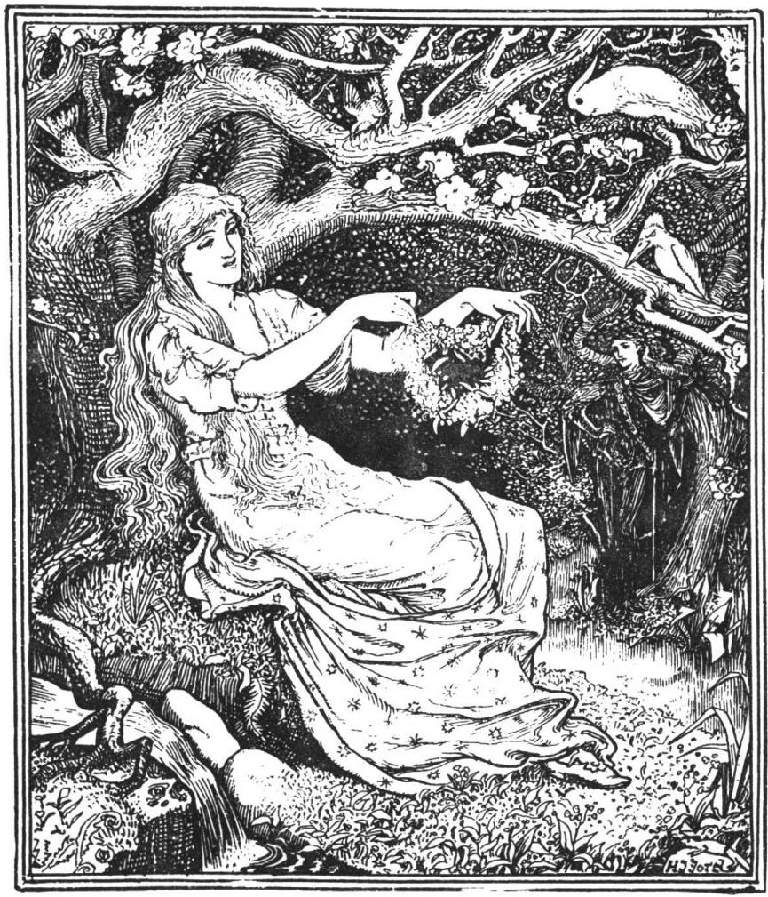

王子参加了宫中所有的娱乐活动，玩得很痛快，因此这段日子，他过得很愉快。当然，他不久便听说了波婷蒂拉公主的故事。这时，王后编的那些关于公主的谎言已被添油加醋地四处传遍。传闻中，公主成了个丑陋无比的大怪物，那西瑟斯王子对此非常好奇，他倒是想看看，公主究竟如何地丑陋。他决定借助魔戒的法力，满足自己的好奇心。于是王子一下子就变成了隐形人，他经过卫兵的身边时，他们根本就觉察不到。不过，王子费了好大的劲才爬上了那堵高墙。到了房子里面，王子立刻被一种幽静、神秘的氛围迷住了。这时，他看到一位婷婷玉立、美若天仙的少女漫步在花丛中，王子看得如痴如醉。他在里面四处寻找那个传闻中的丑陋无比的大怪物，但却一无所获。王子明白了，那位美丽绝伦的少女，就是波婷蒂拉公主。此时的王子，已经深深地爱上了公主。确实，他现在面前的这位公主，无人能与她媲美。她坐在小溪边，用蓝色的勿忘我编织了一个花环，戴在自己瀑布一样浓密柔顺的金发上。小鸟以及其他小动物都喜欢到这个小王国来，陪伴在公主身边。公主也总是温柔亲切地抚摸着它们，这幅画面是如此动人。那西瑟斯王子的眼睛一动不动地直盯着波婷蒂拉，似乎沉醉在甜美的梦幻中。在公主面前，王子一下子想到了自己的渺小、卑微，他不敢走上前去，只是在一边徘徊、犹豫。夜幕降临了，哑巴女仆将公主带回了房里，王子也不得不回到王宫。如果他一夜不归，别人就可能发现他这个宝贵的秘密。不过，王子却没想到，自己原先的快乐、热情，突然间荡然无存，取而代之的是神思恍惚，心不在焉。这理所当然引起了别人的怀疑，有人开玩笑似地问他原因，他却红着脸，说话时躲躲闪闪，像在敷衍。宫里的女士们于是都深信，王子有了心上人，她们想方设法，试图找出这位将王子弄得神魂颠倒的姑娘。而此时的王子，已经越陷越深，他唯一的念头，就是借助魔戒回去照料公主，帮她做事，并尽力使她快乐。在宁静的幽居生活中，公主学会了从不起眼的东西中寻找乐趣。王子于是不断地把各种各样的小玩意放在公主能发现的地方，这令公主始终保持着快乐的心境。那西瑟斯王子求助于自己忠实的朋友梅丽奈特仙女，希望她施点魔法，让他能出现在公主的梦中。这样，如果他有一天真的出现在公主面前，她就会把他当作一个早已熟悉的朋友。这个办法果然奏效，公主不停地作着有趣的梦，梦里有位那西瑟斯王子，成了她知心的伙伴和爱人。她还担心这些甜蜜的美梦有一天会终止。那西瑟斯王子决定采取进一步行动，他开始与公主长时间地交谈，当然，他还是依靠魔戒隐藏起身形。终于，公主急切地提出请求，希望能见到自己心爱的人。王子不忍心三番五次地拒绝她的要求，他要公主保证，不管他长相如何，她都不会变心。于是，王子摘下魔戒，现出了原形。公主高兴极了，眼前的这个小伙子不仅亲切友善，而且英俊潇洒。王子和公主，沉浸在无比的幸福之中。他们在公主最喜爱的小溪边，度过漫长的夏日。当王子不得不暂时与公主告别时，他们才发现，美好的时光已匆匆流逝。公主留在自己被囚禁的房子里，日日夜夜思念着王子，她怎么都没想到，一场灾难正要降临到她身上。一天，有个名叫格拉蒙达的法师，突然踩着风沙经过。不幸的是，他正好看到了波婷蒂拉公主，于是便直奔公主而来。他看到公主那双迷人的蓝眼睛和微微开启的红唇，马上决定在她面前显现。法师为自己没有穿着自己最好的斗篷有点恼火。公主看到有人幽灵似地突然出现，吓得跳了起来。确实，格拉蒙达法师长相极其丑陋，他不仅粗粗大大，笨手笨脚，而且还是个独眼，牙齿长长，说话结结巴巴。不过，他的自我感觉好极了，将公主恐惧而发出的惊叫当成对自己的赞叹。法师为给公主一点时间来欣赏他，沉默了一会儿，然后，便对公主说了一大堆奉承话。公主根本没有感到高兴，而法师却对自己说的这番话非常满意，波婷蒂拉公主害怕得浑身颤抖，大声惊呼：

“哦，我的那西瑟斯王子，你快来呀！”

法师洋洋自得地大笑起来，说道：“女士，你要水仙花（那西瑟斯在英语中是水仙花的意思，所以法师以为公主想要水仙花。——译者注），是吗？这好办，你想要多少我就给你多少。”

于是，他挥了挥手，顿时，公主的周围到处都是芬芳溢香的水仙花，几乎将她淹没在花海中。这时如果没有梅丽奈特仙女，公主一定会泄露秘密，她想要的是那西瑟斯王子，而不是水仙花。仙女一直焦虑地注视着发生的一切，她觉得该是自己干涉的时候了，便用王子的嗓音，在公主身边轻声说道：

“现在我们面临着很大的危险。可是，我亲爱的公主，我唯一担心的就是你。所以，我希望你能掩饰自己的真情，相信我们总会想出办法摆脱困境。”

公主听到这番话，更是心神不宁，她担心法师也会偷听到。但是，此时的格拉蒙达忙于将公主的注意力吸引到水仙花上。由于他摘了那么多花讨公主欢心，不禁有点沾沾自喜，而公主却冷冷地告诉他，水仙花根本不是她所喜爱的一种花。法师听了这话，还真受了不小的打击。公主还告诉他，她会很高兴看到这些花全部消失，法师当然照办了。随后，他请求公主伸出纤手，让他吻一下，作为对他百依百顺的报酬。梅丽奈特仙女当然不会让这样的事发生，她突然衣着华丽地出现在格拉蒙达面前，厉声斥责道：

“住手！格拉蒙达！这位公主受我保护，你胆敢无礼，我就关上你一千年。我不反对你用正当的手段赢得公主的芳心，不过，我警告你，你要耍那些鬼花招，别怪我不客气！”

仙女的这番警告使法师大为恼火，但是，他也明白，除了接受仙女的命令，他别无选择。于是，他尽量想办法给予公主细心的照顾，尽管这种作法不符合他一贯的作风。他打定主意，要赢得波婷蒂拉公主的芳心。在他看来，这事值得一做。梅丽奈特仙女看到公主暂且不会有危险，就急急忙忙跑到那西瑟斯王子身边，把发生的事告诉了他。一听到有个法师也钟情于自己心爱的公主，王子便怒不可遏。若不是仙女想办法让他平静下来，还真不知道他会干出什么傻事来。仙女告诉王子，格拉蒙达法师法术很高，要是把他惹火了，他一定会对王子报复。这家伙蛮不讲理，脾气暴躁，以前常因干了坏事而遭到仙女的惩罚。有一次，仙女把他关在一棵树里，狂风吹倒了那棵树，他才得以逃脱。还有一次，仙女把他压在一块大石头下，大水冲翻了石头，他才重获自由。但是，这些惩罚并没有使他的行为有所收敛。梅丽奈特仙女要王子保证，他和公主在一起时，必须隐身。她相信只有这样，他们才不会有危险。于是，王子以梅丽奈特仙女的名义，决定和格拉蒙达法师一比高低，看谁能使公主感到快乐。王子先是和公主小王国中的小鸟们交上了朋友，他教会它们用最婉转的歌喉和最动听的旋律为公主唱赞歌，日日夜夜地对公主诉说衷肠。格拉蒙达对此不屑一顾，他宣称，这样的做法已经老套了，自从有了世界，鸟儿们就会歌唱，而热恋中的人总以为小鸟在为自己歌唱。于是，法师表示要亲自写一出歌剧，歌剧的内容绝对新颖，值得一看。当这部持续五个小时的歌剧正式上演时，公主惊奇地发现，这部所谓的歌剧，原来是由十万只青蛙扯着嗓门，就着平庸的歌词，大声唱道：

> “美丽的公主啊，
> 你是好心还是仁慈？
> 这样突然看我一眼啊，
> 我就感到魂不守舍！”

其实，若不是那西瑟斯王子不停地在公主身畔轻声细语，转移了她的注意力，公主真的会被这部歌剧厌倦致死。那些怪里怪气的歌声只让她觉得有趣了一小会儿。格拉蒙达并没发现这个秘密，因为他忙着用鞭子抽打那些青蛙，好让它们不停地，使劲地唱。他不给青蛙们一点喘息的机会，因此，可怜的青蛙一个个都累死了。那西瑟斯为逗公主开心，又想出了一个好主意，他不知从哪儿搞来了一支舰队，和埃及女王克里奥佩特拉的一模一样（你一定在历史书中读到过关于这支舰队的故事）。舰队沿着小河驶来，女王斜倚在装饰最为华丽的那只船上。波婷蒂拉公主被舰队迷住了，她全神贯注地望着它由远而近，驶到她的小王国中。女王仪态万千、高贵大方，她袅袅娜娜地上了岸，将自己那颗著名的珍珠赠给公主（关于这颗珍珠，你一定也在历史书中读到过），并对她说道：

“你长得比我还要美，可是，你要以我为戒，不要滥用自己的美貌。”

说完，舰队继续往前驶去，消失在蜿蜒曲折的小河的尽头。格拉蒙达也在一边观望，他带着嘲弄讥讽的语气说道：

“不过是些木偶，有什么稀奇！那颗珍珠，谁知道是真是假！要是你喜欢珍珠，我马上就能满足你。”

说完，他从口袋里掏出一只口哨，吹了一下。这时，河面上开始冒气泡，河水变得混浊。转眼间，成千上万只河蚌缓慢地、费力地爬向公主，它们张开自己的壳，将珍珠放在公主脚边。

“这才是真正的珍珠！”格拉蒙达得意地说道。那许许多多的珍珠，足以将公主花园中每一条小径都铺满。第二天，那西瑟斯王子为了让公主高兴，准备了一座别致的凉亭。凉亭的顶部是茂盛的枝叶，四周是青苔做的长椅，地板是柔软的草地，凉亭中间鲜花盛开、姹紫嫣红，构成一个公主名字的图案。王子还安排了一个精巧的宴会，躲了起来的乐师演奏着抒情的音乐，晶莹剔透的小珠从喷泉中溅撒出来，落在大理石做的小池中。音乐一停，有只夜莺便开始婉转歌唱，打破了四周的寂静。

“啊！费勒美，我的小可爱，这支歌是谁教你的？”公主认出了她最喜爱的那只夜莺的嗓音，激动不已。

“公主，我为圣洁的爱情歌唱！”夜莺答道。

这时，格拉蒙达法师对王子所作的这些安排，感到很不满意。他宣称，这些场面，是他所见过的最无趣的一种。

“好像你只会让小鸟尖叫，根本不懂什么是宴会，真难以想象，宴会中竟然没有一碟小菜。”

第二天，公主走进花园，看到一座金子般的房子，房子里里外外，都挂着公主和法师名字的缩写。另外还有一顿丰盛的晚宴，桌上摆满了金杯银盘，杯盘中盛满了美味佳肴，在摇曳的烛光下，闪烁着诱人的光晕，令人眼花缭乱。法师像恶魔一样狼吞虎咽，可是公主却一点也吃不下，格拉蒙达咧着大嘴对公主说道：

“我没请人奏乐，也没叫人唱歌，不过，既然你喜欢有音乐作伴，就让我来为你唱几首吧！”

说完，他就用自己老鹰似的嗓音，唱起自己创作的歌剧来。令公主感到幸运的是，格拉蒙达这回没有重复那些平庸的歌词，也没有让青蛙为他伴唱。又该轮到那西瑟斯王子露一手了，他请小鸟们来帮忙。当它们从四面八方赶来，聚到一起后，王子在它们的脖子上挂了一盏明亮的小灯。夜幕降临后，他让小鸟们在公主面前作各种各样的表演。它们一会儿排成行列，在黑暗的天空中划出公主的名字；一会儿又聚集起来，变换着七彩颜色，看上去花团锦簇，美不胜收。公主观赏着小鸟的表演，高兴得直拍手。而格拉蒙达却躺在扶椅上，跷着二郎腿，骄傲地抬着头，一副不屑一顾的样子。

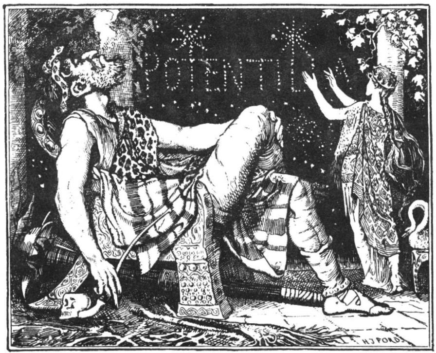

“哦，公主，原来你喜欢看烟花。”第二天晚上，法师将所有的烟火都聚集在草原上，让它们跳舞。公主倚在窗边，远远地观望，心情也很愉快。可是，一阵浓烟和烈焰突然火山似地爆发。这时，烟火都拼命向公主的花园涌来，高高的紫杉顿时像在烟花丛中舞蹈。不过，公主才观赏了几分钟，就感到厌倦了，她请求格拉蒙达不要再让她看任何东西。公主对法师憎恶之至，但她还是竭力掩饰着自己的情绪。格拉蒙达觉察到了公主的敌意，他开始怀疑，公主已经有了心上人，他甚至还怀疑，为取悦公主与他争高低的，绝不仅仅是梅丽奈特仙女一个人。法师考虑良久，想出了一个诡计，以找出事情的真相。他跑到公主面前，告诉公主他不得不与她暂时道别，虽然他很不情愿这样做。公主听了这话，难以掩饰心中的喜悦。法师刚转身离去，她就请那西瑟斯王子现出原形，这对爱人终于又见面了。他们欣喜若狂，幸福地依偎在一起，诉说衷肠。正当他们笑着说起法师的狼狈相时，灌木丛中传来一声怒吼，格拉蒙达手操大棍，冲了出来，朝王子身上狠狠打去。在这关键时刻，梅丽奈特仙女及时赶到，她一把抓住王子，将他带回了自己的城堡。若不是仙女行动敏捷，身手不凡，王子恐怕早就死在法师的大棍之下。但是，可怜的波婷蒂拉公主对此毫无所知，她看到法师拿着大棍朝王子冲去，便尖叫一声，晕了过去。公主醒来后，不见王子，以为他惨遭杀害。而这时，梅丽奈特仙女也已经离开，没人能再保护公主免遭法师的伤害。

更为糟糕的是，格拉蒙达此时气得大发雷霆，他咆哮而来，对公主怒吼一通：

“女士，你给我好好听着，不管你爱不爱那个爱出风头、自吹自擂的家伙，我一定得娶你。你自己看着办吧，现在我要去安排婚礼，不过，我得先让你睡着，否则，你又要对我耍什么鬼花招！”

说完，他就用魔杖往公主头上一挥，公主竭力想让自己保持清醒，但是，在法师的魔力下，她还是沉沉地睡去了。

格拉蒙达觉得自己应该像模像样地到王宫去。他出了关押公主的那所房子，登上了一辆巨大的礼车，礼车的轮子和车辆全部用金子做成。不过，那车辆看上去，倒更像是橡树干，四十八头强壮的公牛拉着礼车，法师则悠闲地坐在车上，倚着魔杖，一头黄褐色的非洲雄狮蹲在他的腿上，看上去如同一只叭儿狗。第二天早上七时，这辆礼车就到了王宫。国王早就起床了，正准备出门打猎去。王后却刚刚入睡，谁都不敢在这个时候把她叫醒。

国王得知有人前来拜访，恼羞成怒，他不得不推迟打猎，费力地将靴子脱掉。大厅里传来一阵踢里哒拉的脚步声，只听有人大声叫喊：

“国王呢？国王在哪儿？快去把他叫来，我要见他和王后。”

国王在楼上听到这话，觉得这人太无礼了。他和自己最喜爱的猎手商量了一下，决定听取他的建议，先下楼看看是怎么回事。国王看到那辆礼车，一下子愣住了，格拉蒙达大步走到他面前，高声叫道：

“握握手吧，老家伙！不认识我吗？”

“我想我确实不认识你！”国王表情尴尬地回答。

“不认识？我是大法师格拉蒙达，你这下要交好运了，我们进去，好好谈谈。”

于是，法师让那些公牛们出去轻松一下。于是，公牛们像雄鹿一样，一蹦一跳地出去了，很快就没了踪影。只见法师魔杖一挥，那辆礼车就变成了一座金山。

“这些金子送给你仆人，让他们祝你健康。”法师得意地对国王说道。

自然，这在王宫里引起了一阵骚动。笑声、叫喊声把王后吵醒了。她把女仆叫来，问她们是怎么回事。女仆告诉王后，有人要见她。这时，又连续跑来了几个仆人，告诉她这件奇怪的事。他们一个个说话上气不接下气，王后只听清楚了“公牛”、“金子”、“魔杖”、“狮子”等让人摸不着头脑的东西。她觉得这些人大概都疯了。这时国王正在请求法师，将来访的真正原因告诉他。可是，法师坚持要求王后在场，否则他就不说。国王只得一次又一次地派人去把王后请来。王后无缘无故被吵醒，情绪本来就坏。于是，她谎称自己有病，怎么都不愿下楼。

法师知道王后不愿下来后，并没有就此妥协，他仍然坚持要王后在场。

“把这根魔杖带给王后，告诉她，如果她碰一下魔杖的两头，就会重新焕发青春。”

国王令手下四个最为强壮的仆人，扛着魔杖，摇摇晃晃地到了王后的寝宫。王后禁不住诱惑，同意试试这种新方法。她刚刚闻到魔杖的味道，就大声宣布，自己已经完全焕发了青春。原来，她一碰魔杖，金银珠宝就哗哗落地。所以，就很难说，她的重新焕发青春，究竟是因为木头的香味，还是因为那些金光闪闪的珠宝。总之，王后现在急切地想见一下这位神秘来客，她匆匆披了件斗篷，没来得及脱下睡帽，就戴上了钻石王冠。她还在两颊随便抹了些脂粉，拿起一把最大的扇子，遮住了大半个脸。她从来不习惯在白天露面。就这样，王后踩着碎步，一扭一扭地来到大厅。国王和王后在宝座上坐下后，法师走到他们中间，表情严肃地说道：

“我叫格拉蒙达，是个法力无边，结交甚广的法师。你们的女儿波婷蒂拉把我迷住了，叫我不能自拔。可是，公主自以为爱上了一个名叫那西瑟斯的讨厌的家伙，我已经把那家伙解决了。现在，不管你们是否同意把女儿嫁给我，我都不在乎。我来征求一下你们的意见，不过是想和一位梅丽奈特仙女搞好关系。”国王和王后听了这番话，觉得很尴尬，不知该如何回答这样一个求婚者。最后，他们要求把这件事再考虑一下，并告诉法师，臣民们不会愿意看到公主像牧羊女似地被草率地嫁出去。

“好吧，你们就考虑几天吧”法师说道，“我派人去把公主接来，你们或许能叫她放聪明点。”

说完，他掏出自己的宝物——那只口哨，随着一声刺耳的口哨声，那头一直在后院打盹的雄狮，猛地跳了起来，挥舞着它那双柔软、厚重的爪子。

“狮子！乖乖！”法师吩咐道，“马上去把公主接来！注意，不要对她粗暴！”

雄狮受令，忽地窜了出去，消失在王宫的花园中。不一会儿，它就来到关押着公主的那所房子，把看门的士兵吓得抱头鼠窜。狮子纵身一跃，跳进大墙，背起熟睡的公主，用牙齿咬住她的长袍，小心翼翼地踩着步子，马上就把公主带到了王宫。国王和王后大吃一惊。

格拉蒙达将魔杖朝公主秀美的鼻子一指，公主便醒了过来。她发现自己来到一个陌生的地方，旁边还站着那个讨厌的法师，不禁尖叫起来。站在一旁的王后看到美丽的女儿，气得直发抖，她假惺惺地走到公主身边，要求将她带回自己房内，好让她安静下来。其实，王后的真实意图是不想让别人看到公主。她用面纱遮住公主的脸庞，把她带回了自己的房间，锁了起来。再说那西瑟斯王子被仙女救走后，一直被关在仙女的空中城堡中。在这所富丽堂皇、应有尽有的城堡内，王子本可以好好享乐，玩个痛快。可是，他还是想念着公主，整天愁容满面，郁郁寡欢，一心想再见公主一面。梅丽奈特仙女有事情离开城堡一阵子，临走之前，她对王子许诺，自己会尽全力帮助他。仙女还下令，所有的燕子、蝴蝶都要来伺候王子，听从他的指挥。一天，正当王子伤心地散步时，突然听到一个熟悉的声音，在叫他的名字，原来是公主最喜爱的那只夜莺费勒美。夜莺告诉王子，自从雄狮将公主带走后，小鸟们一个个伤心难过，它自己不知该做什么，只好四处流浪。

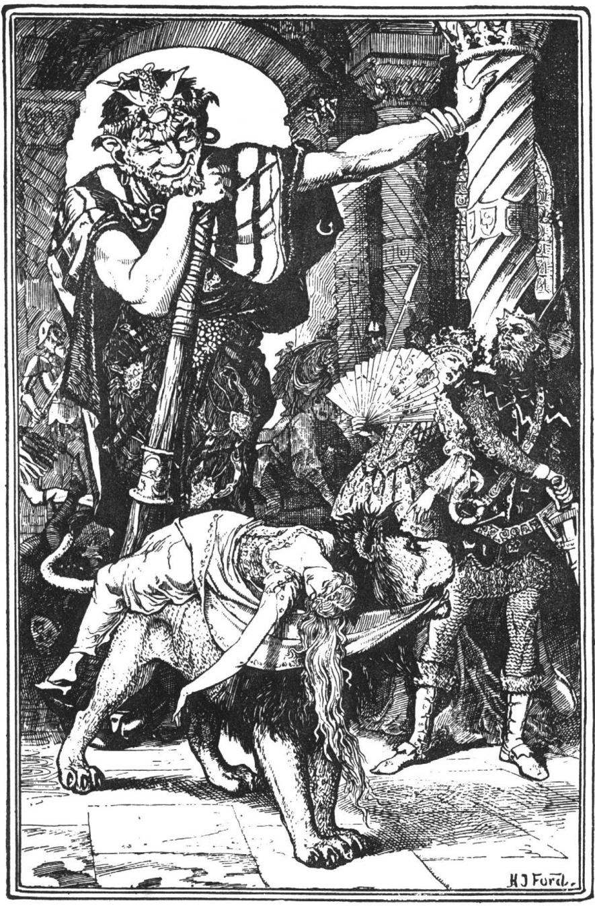

偶而听到燕子的谈话，才知道空中城堡中住着一位王子。于是，它便飞来看看，这位王子是不是那西瑟斯。王子听了费勒美的话，再也无法在城堡中呆下去了。他一次次地从屋顶往下跳，打算离开城堡。但每次都跳在白云上，白云往高处飘浮，把王子带回城堡。最后，王子只好放弃了逃跑的念头，在绝望中等待仙女的归来。再说说王宫里的情况吧，王后已经下定决心，像波婷蒂拉公主这样的大美人，必须铲除。于是，她秘密会见了格拉蒙达，要求他马上就娶公主，并把她带走，越远越好，而且永远不要再出现。不过，她还要法师保证，她和国王不会因此而失去王国。

波婷蒂拉公主得知自己马上要嫁给格拉蒙达，痛苦万分。她为自己不幸的命运流泪、伤心。公主乞求王后和法师能对她手下留情。可是，王后冷冷地答复说，如果她宁愿去死也不愿嫁给格拉蒙达这样一个富有的丈夫，那么王后倒是能为她提供毒药。

公主害怕的那一天终于来到了。她站在国王和王后中间，被带到了大厅。王后听到周围的人对公主的美貌发出阵阵惊叹，嫉妒得简直要发疯。格拉蒙达立刻从对门走了进来，他头发一根根竖起，肩上背着个大钱袋，脖子上系着三个领结，穿着一件用银子做的，镶着玫瑰色花边的斗篷。法师对自己的这身打扮满意极了，他怎么都不会想到，不管是哪位公主，都宁愿死，也不愿嫁给他这样的魔鬼。果然，当王后开玩笑地将致命的毒药递给公主时，公主急切地接过毒药，大声喊道：

“亲爱的那西瑟斯王子啊！我来陪伴你了！”她把杯子举到嘴边，刚要喝下时，大厅的窗户猛地打开了，梅丽奈特仙女踏着火红的晚霞飞了进来，后面跟着那西瑟斯王子。

大厅里的人们被这幅景象惊呆了。波婷蒂拉公主看到心爱的王子，扔下杯子，欣喜若狂地奔向王子。

法师看到仙女，转身就想逃。可是仙女早已敏捷地转到他身后，拽住他的眼睫毛，把他拉到了天花板上。为了教训教训这个恶棍，仙女让他在那儿踢腿挣扎了一阵，然后用魔杖轻轻一碰，格拉蒙达就被关进一个水晶球内，他要在那里呆上一千年。接着，仙女转身面对国王和王后，要求他们继续主持婚礼。现在，她已经为公主找了位更合适的新郎。仙女觉得，国王和王后的行为足以证明，他们不配统治王国，于是剥夺了他们的权力，把王国交给王子和公主。王子和公主虽然并不愿意接受，但是他们又不想违背仙女的意愿，不过，他们还是尽力满足国王和王后的一切需要。

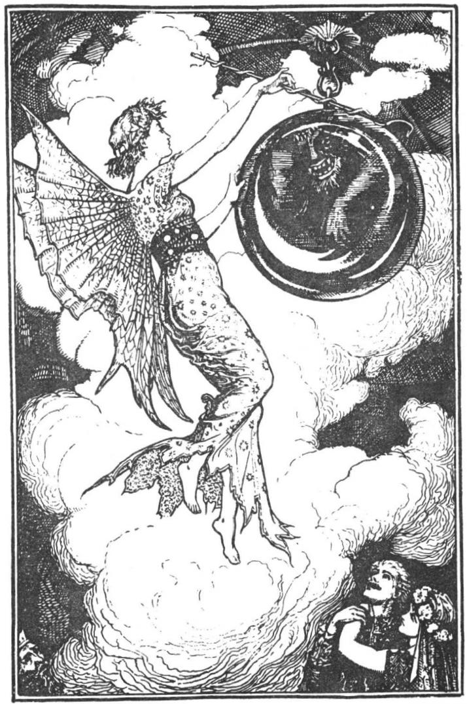

那西瑟斯王子和波婷蒂拉公主从此便幸福地生活在一起。他们治国有方，受到臣民的爱戴，至于那位格拉蒙达法师，恐怕至今还被关在水晶球内。

 
 

## 费斯海德王子和萨拉迪妮公主

从前有一对国王和王后，是世上心地最善良的人。他们从来不忍心看到自己的人民挨饿受冻。逐渐地，他们把自己所有的财富都用来接济穷人，结果倾家荡产，变得一无所有。这个消息传到了邻国布鲁尼国王的耳中，他马上组织了一支强大的军队，攻占了王国。可怜的国王无力组织力量抵抗，只得乔装打扮，抱着独生子费斯海德王子和王后逃到了乡下。他们幸运地逃出了布鲁尼国王的魔爪，历尽艰辛，来到一座迷人的山谷。一条小河穿越山谷，河水晶莹透彻，河两岸绿树成荫，景色宜人，风光秀丽。正当国王和王后欣喜地望着这一美景，陶醉其中时，一个声音突然说道：“钓鱼吧，看你能钓到什么。”国王一直喜爱钓鱼，身边总带着鱼钩。于是，他拿出鱼钩，王后卸下腰带，一根简易钓鱼杆便做成了。鱼钩刚落到水面上，一条大鱼就上钩了，这家人于是有了一顿美餐。这顿美餐来得真及时，因为他们除了野果和草根，还未找到其他能吃的东西。他们决定，暂时在这块好地方住下。国王着手干活，很快就用树枝造了一间小亭子，以此来避风挡雨。王后很喜欢这个简陋的亭子。她告诉国王，要是再有羊群，她就很满足了。国王钓鱼时，她可以带着小王子放羊，这样的生活，不是很幸福吗？很快，他们就发现，小河里的鱼不仅多，容易上钩，而且五彩斑斓，颜色各异，漂亮极了。不久，国王又发现，他能教这些鱼开口说话，吹口哨，它们学得比鹦鹉还快。于是，他决定到最近的城镇去卖鱼。城里的人还从未见过这样神奇的鱼，他们争先恐后地买国王的鱼。没多久，城里每家每户的水晶鱼缸里，都养了这种鱼。这些买鱼的人都希望鱼的颜色能和他们家具的颜色相配，因此在挑选时，给国王添了很多麻烦。不过，国王总算攒了足够的钱，为王后买了羊群，还添置了一些生活用品，日子因此越过越好。国王和王后不再为失去王国而感到遗憾了。在这个可怜的逃亡者们落脚的山谷中，住着一位榉木仙女。仙女对国王和王后的遭遇非常同情，正是她为国王带来了好运，并把这一家人置于自己的保护之中。仙女这样做还有一个原因，她喜欢小孩，尤其是费斯海德王子。他不哭不闹，而且一天比一天长得漂亮，仙女自然特别疼他。她隐瞒自己的真实身份，结识了国王和王后，并和他们越来越熟。国王和王后也很喜欢她这个新朋友，甚至把自己的宝贝儿子托付给她照顾。仙女把小王子带回宫殿，并用各种精美的点心、糖果等好东西逗他开心。她想用这种办法让王子也喜欢上自己。随着王子一天天长大，仙女努力让他受到一个王子应当接受的各种教育和训练。不幸的是，仙女的这番苦心并没有带来预想的结果。王子变得十分虚荣，又很轻浮，甚至开始厌恶起平静的乡村生活，跑到附近的城里，去追逐花天酒地、荒淫无度的城市生活。王子英俊潇洒，风流倜傥，在城里很受欢迎，国王和王后对王子这种变化，感到非常遗憾，但不知该做些什么来补救。显然，好心的榉木仙女已经把他宠坏了，使他变得这样任性、乖戾。

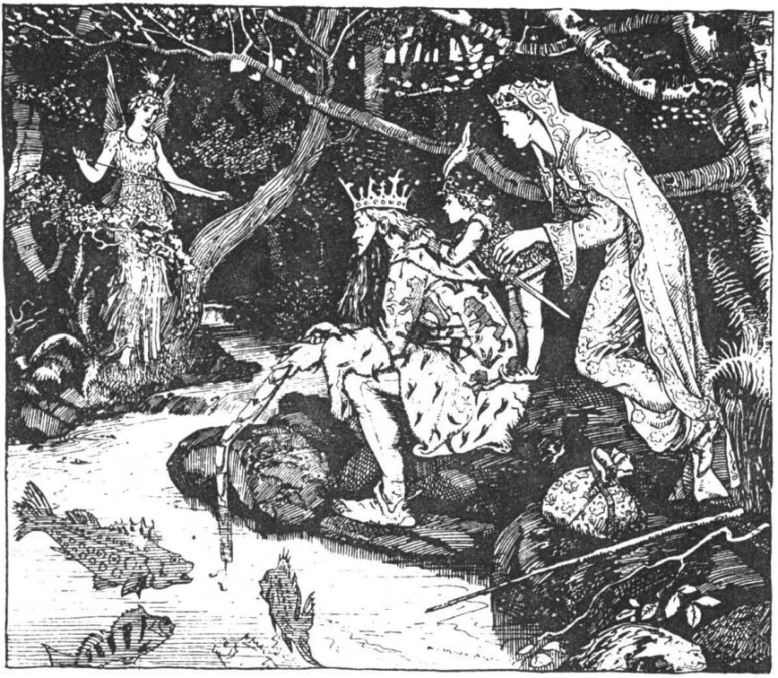

这时，榉木仙女的老朋友莎拉迪仙女突然气乎乎地跑来了，上气不接下气，话也几乎说不出来。

“亲爱的老朋友莎拉迪，你这是怎么回事？”榉木仙女迎上前去，关切地询问道。

“什么事？”莎拉迪仙女大声嚷道，“还不是那个萨默岛王国的公主萨拉迪妮。你知道，当初我为了使她美丽动人，给了她想要的一切，甚至费了一番心血，亲自将她抚养成人。可是，她竟然跑来，又是甜言蜜语，又是拥抱亲吻，求我帮她一个大忙。我被她缠得只好答应。你猜她要我帮什么忙？她要我收回对她的馈赠，听听这小妮子怎么说的：‘你的礼物使我变得十全十美，你虽然感到满足，可我怎么了解真正的自我呢？不管我这辈子遇上什么人，他们见到的总是我这副十全十美的模样。处于这种情况下，生活是多么地枯燥无聊啊！我向你保证，这并不是我的忘恩负义！’听听，她就是这么说的，我想方设法，劝她回心转意，可她就是不听。”莎拉迪仙女越说越气，“我只得举行了必要的仪式，收回了我的礼物，现在找到你这儿来，是想降降火气，安静一阵子。不过，这位令人气恼的萨拉迪妮公主，倒没什么重大的损失。反正她天生丽质、聪明伶俐，没了我的礼物，她也照样很出色，为了教训她一下，我把她独自一人丢在沙漠中。”

“什么？你把她丢在沙漠中？”好心的榉木仙女听了大吃一惊，“这叫她怎么生存？还是把她交给我吧！我觉得她还不错，我会想办法让她爱别人胜过爱自己。这样，她就不会那么自负了。这小妮子倒是不同于一般的公主，有个性，敢做敢为，又有独创性。”

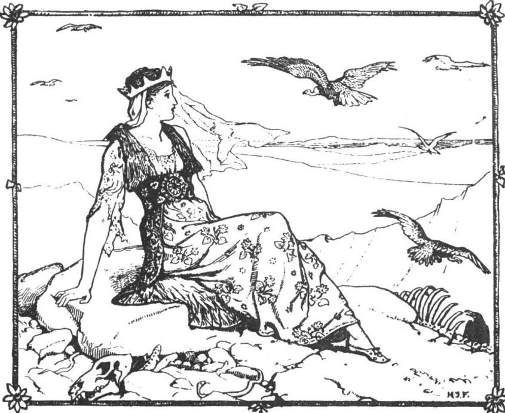

莎拉迪仙女很乐意将公主交给榉木仙女处置。首先，榉木仙女先帮助公主摆脱了沙漠中的困境，然后，让她沿着一条绿荫覆盖的青苔小路，来到了国王和王后居住的那个山谷，介入了他们平静的生活。

国王和王后看到山谷中来了一位姑娘，感到很惊讶。这位姑娘容貌秀丽，身上的衣服虽然已被荆棘划得破破烂烂，但却掩饰不住原先的华丽。国王和王后认为，这姑娘一定和他们同病相怜，因此对她很同情。他们热情地跟她打招呼，并留她吃饭。萨拉迪妮对他们的盛情邀请感激不已，她把自己的故事告诉了他们。国王听后，对她的这种精神大加赞赏。王后则认为，公主违背仙女意愿的做法，也实在太冒险了。

“现在我遇上了你们，过去的一切也都结束了。发生的事已不可挽回，如果我能和你们生活在一起，一定会很快乐。”公主说道。

由于榉木仙女为费斯海德王子在城里造了一座宫殿，王子已经很少回家。他在城里过着奢侈的生活，成天就是挥霍享乐。现在，这样一位漂亮迷人的公主代替王子和国王王后作伴，令他们感到欣慰，萨拉迪妮就在山谷中住下了。她经常帮助王后做点家务，深得两位长辈的喜爱。榉木仙女来看望国王和王后时，他们便将公主介绍给她认识，并告诉她公主过去的经历。其实，有关萨拉迪妮的一切仙女早已了如指掌，国王和王后却对此毫无所知。榉木仙女也很喜欢公主，经常请她去宫殿作客。仙女的宫殿非常漂亮，里面满是金银珠宝。她还常把一些好东西给公主看，并对她说：

“这件东西可以作为结婚礼物。”公主情不自禁地想到仙女的意思，是指将来把这东西送她作为结婚礼物。这里面有多少神奇、美妙的好东西啊：两根蜡制的蓝色火把，整日整夜地燃烧着，但总也不会烧完；一条船竟能在水底航行……这么多的好东西，令公主目不暇接，眼花缭乱。当然，仙女没有明白地表示，这些东西将来是要送给她的，但是，她却有意让公主往这方面想。因为她觉得，给公主一点失望，对她是有益的。不过，榉木仙女还是打算依靠费斯海德王子，来治好公主自负的毛病。很长一段时间，仙女对王子的生活方式感到不满，但是由于她太疼爱这位王子了，实在不忍心剥夺他喜爱的生活方式。仙女认为，目前唯一的办法是再给他一样更好的东西，虽然她不能肯定这种办法对改正王子的缺点是否有效，但无疑是最适宜的。

仙女经常在公主面前提起费斯海德王子，她不断地提示，这位王子完美无瑕。所以，当仙女宣布王子要来宫中看望她时，萨拉迪妮决定让这位人见人爱的王子对她一见钟情，想到这儿，她心里暗自高兴。榉木仙女看出了公主的心思，她可不愿看到这种事发生。于是，她对公主施了魔法，这样，公主在别人眼中和平常没有什么区别，但是到了王子眼中，就变得又丑陋，又笨拙。王子终于来到了宫中。公主发现，这位费斯海德王子，比她想象中还要英俊潇洒，风度翩翩。可是，王子几乎不朝她看，只顾和仙女说话。王子这种漠然的态度，令公主很吃惊。她于是也装出一副冷漠、气愤的表情。可王子好像根本没有觉察到，像他这样的年轻人，只对女人的容貌感兴趣。虽然有的时候，他也会彬彬有礼地回答公主的几个问题，但是，他的心思很明显不在这儿。公主感到痛苦极了，她真的很喜欢眼前的这位王子，平生第一次，她觉得后悔了，当初不应该急切地要求莎拉迪仙女收回她的礼物。其实，费斯海德王子心里也很纳闷，他经常听父母夸奖公主美丽动人，但他看到的事实，却与他们的话完全相反。这不得不令他更加相信，乡村里的人太没有品味了。他对仙女和公主谈起自己城里的生活，称赞他那些充满情趣的朋友和漂亮迷人的女伴。公主听了这话，心里很烦，几乎想大哭一场。仙女看到王子变得如此自命不凡，也很惊讶。她决定施行一个计划，以此治好王子这个毛病。他派人给王子送了一张萨拉迪妮公主真实模样的画像，下面还刻有一行字：“这位姑娘花容月貌，娇美动人，她有一颗爱心，还会继承一个王国，若不是你见异思迁，风流成性，这一切都会属于你。”

虽然这句话也给王子留下了深刻的印象，但最让他刻骨铭心的，还是画像中那位公主。他目不转睛地盯着画像看，并情不自禁地发出惊叹。他还从未见过如此美丽动人，气质优雅的姑娘。他觉得自己英俊潇洒，风度翩翩，却被一副画像弄得神魂颠倒、如痴如醉，实在是件荒唐可笑的事。为了摆脱那双时刻出现在他脑海中的令他心醉神迷的大眼睛，王子匆匆返回了城里。可到了那儿，一切似乎都改变了。城里那些姑娘们的美貌和口才已不再对他有吸引力，而那些姑娘们，也觉得王子不如以前那样亲切和善了。所以，当王子宣布，自己更适合乡村生活而决定回去时，姑娘们也不觉得有什么可惜。王子回到了仙女的宫殿。此时，和国王王后一起生活的萨拉迪妮，也正觉得度日如年，她再次见到王子时，高兴得难以形容。公主立刻注意到了王子的反常行为，便好奇地想知道原因。王子不但没有躲避她，反而一直找她作伴，并似乎很乐意和她交谈。公主没有因此而有点飘飘然，觉得是王子爱上了自己，不过，她没过多久就断定，王子有了自己的心上人。一天，公主在小河边伤心徘徊，突然发现王子在一棵大树下熟睡。于是，她蹑手蹑脚地走过去，想趁这个机会好好看看王子那张英俊的脸。令她大吃一惊的是，王子的手中竟然捧着她的画像！王子自相矛盾的行为，令公主大为困惑，为什么他宝贝似地捧着她的画像，又对她表现出一副冷漠，不感兴趣的样子？终于，公主等到了一个机会。她问王子，他成天捧在手上的那张画像上的公主，叫什么名字。

“哎！我也不知道。”王子唉声叹气地说道。

“你不知道？”公主红着脸说道，“你不可能不知道。”

“不可能？我竭尽全力想找到公主的芳名，可还是一无所获，令我伤心的不是找不到这位公主，而是我根本不知她是谁！”

公主听了这话，更加吃惊，她从王子手中拿过画像，看了一下，然后羞涩地对王子说，画上的公主应当对这副画像感到满意。

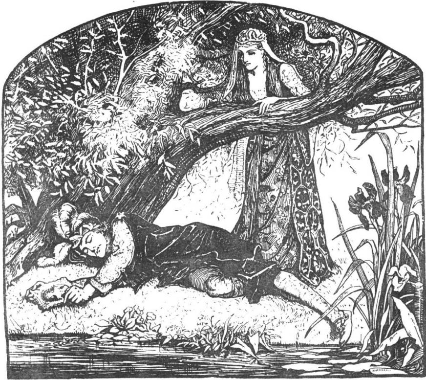

“你的意思是，本人并没有画像漂亮，”王子表情严肃起来，“萨拉迪妮，我还以为你不喜欢嫉妒别人，看来，我的判断错了，你们女人都这德性！”

“不对，我的意思是画像和本人一模一样。”公主感到很委屈，但她还是温顺地说道。

“这么说，你知道她是谁。”王子激动地叫了起来，一下子跪倒在萨拉迪妮面前，“请你快告诉我她是谁，不要这样吊我胃口！”

“难道你看不出来，这姑娘就是我吗？”萨拉迪妮也大声叫了起来。

王子一听这话，立刻站起身来。他忍不住想对公主说，她也太自负了，画像上的姑娘和她毫无相似之处。王子冷眼打量了她一下，一句话没说，转身就走。几个小时后，他就离开了仙女的宫殿。

萨拉迪妮伤心极了，王子如此冷酷地对待她，使她觉得无法再在山谷呆下去。于是，她没有向国王和王后告别，就离开了山谷，伤心地四处游荡，不知该到哪里去。公主不停地走啊走，终于累得走不动了。这时，她看到前面有一间小屋，于是就拖着疲惫的步子，慢慢往前走。越是离小屋近，公主越是觉得它可怜巴巴。终于，她看到有个老太婆坐在屋前，老太婆看到公主，冷冷地说道：

“好啊！又来了个无所事事，浪费时间的小乞丐，在野地里到处乱跑！”

“哎，老妈妈，都怪我命不好，才落到这个地步，不得不向你讨个住处。”公主边说话，边掉眼泪。

“以为我不知道你们那套鬼把戏吗！”老太婆大声吼道，“先是借个住处，然后讨点吃的，最后再伸手要钱，不给就赖着不走。我敢打赌，要是每天都能遇上一个好心肠，头脑简单的人，人人都愿意做乞丐。我辛辛苦苦才盖起这小屋，有了一日三餐。你是不是觉得我应当满足每一个过路人的请求，给他们住，还给他们吃。呸！我才没那么傻呢！我敢发誓，像你这样的女士一定比我有钱。来让我看看，你是不是真的没钱。”老太婆说完，便拄着拐杖，一瘸一拐地朝公主走来。

“哎，老妈妈，我也希望身边有钱，”公主说道，“我要是带着钱，就会很乐意把钱给你。”

“可你穿得一点也不像个乞丐。”老太婆说道。

“什么！难道你以为我是来乞讨的？”

“这谁知道呢！反正，你也不像是个来给我钱的人，你究竟想要什么？住一晚吗？好吧，这花不了我什么钱。不过，不准问我要吃的。哦，不，绝不能给你吃的，你们年轻人这么能吃，何况你又走了很多路，一定饿坏了。”

“老妈妈，我一点也不饿，我伤心得吃不下任何东西。”公主可怜地说道。

“哦，那太好了！如果你能保证一直伤心得吃不下东西，我就让你住一晚。”老太婆嘲讽道。

然后，她让公主坐到她身边，伸手去摸她的丝袍，嘴里还嘀咕着：“啊！花边！这么多的花边！这件袍子一定很值钱吧！有钱你应该先填饱肚子，别到我这样的穷人家来乞讨。告诉我，这件袍子花了你多少钱？”

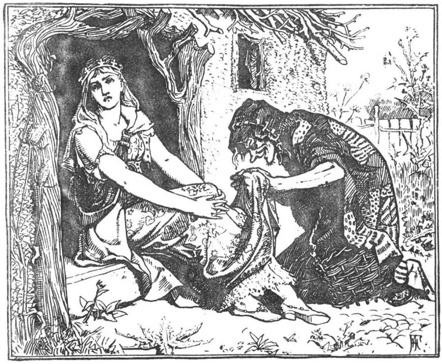

“哎，老妈妈，这衣服不是我买的，钱的事，我一点也不懂。”

“那你懂什么？”老太婆问道。

“我几乎什么也不懂，”公主哭了起来，“我现在难过极了，如果我能为你做什么…… ”

“为我做事？”老太婆生气地打断了公主的话，“让你做事我就得付你工钱，我可没钱叫别人伺候。”

“老妈妈，你不必付我工钱，”可怜的公主情绪越来越低落，“你让我做什么都可以，只求你让我在这个荒无人烟的地方安安静静地过日子。”

“哦，别以为你能骗得了我，穿得这么漂亮伺候我，可不大合适。如果我让你住在这儿，你愿意把这件袍子给我，穿上我的衣服吗？说真的，我年纪也大了，确实需要别人伺候。”

“好吧，”公主无可奈何地说道，“看在你可怜的份上，你把衣服拿去吧。”

老太婆一瘸一拐地走进屋去，看上去灵活多了。不一会儿，她就抱来了一大堆破烂衣服。老太婆在公主身边跳来跳去，忙着帮她脱下长袍，还不停地叫嚷：

“老天！这针线缝得多好！这花边多宽！我能做四件上衣。哦！姑娘，你穿着这么重的衣服，走得动吗？我敢肯定，你穿着这衣服在我的小屋里，根本不能转身。”

说完，她折好长袍，小心地放了起来，并对萨拉迪妮说道：

“我的衣服你穿一定合适，不过，可要小心，别弄坏了。”

到了吃晚饭的时间，老太婆进屋去了。公主想帮忙准备晚饭，被她一口拒绝。不一会儿，她从屋里拿出一个小盘子，对公主说：

“吃晚饭吧！”

说完，她递给公主一小片面包，打开了盆盖，盆里有两个干李子。

“我们一人吃一个，因为你是客人，就吃那个有核的，小心别把核吞下，冬天我还用得着它。你不懂，这李子核到了冬天，可是很好的柴火。听听我的忠告吧，你不必付钱，记住，买有核的水果更能省钱，因为你就不用买柴火了。”

萨拉迪妮沉浸在对伤心往事的回忆中，她根本没有听见老太婆的“忠告”，而且忘了吃她的李子。老太婆见状，暗自欢喜，她把李子小心地收起来，打算第二天作早餐。

“我对你满意，如果你保持这样不吃不喝，我们就能很好地相处。我可以教你很多别人不懂的有用的东西。就拿我这间屋子来说，我把吃过的梨的籽都收集起来，才造了这小屋。现在的人吃了梨就扔了籽，依我看，只要有点耐心，再加上心灵手巧，很多东西都能派上大用场。”

萨拉迪妮没法让自己对老太婆的忠告感兴趣。老太婆让公主上床去睡觉，因为她觉得公主在夜晚的空气中，会有食欲，公主在床上整夜未眠。第二天早上，老太婆对她说：

“我知道你昨晚睡了个好觉，所以不想吃早餐。我做家务的时候，你最好也呆在床上。人睡得多了，就不会想吃东西。今天有个集市，我得花一个便士买个面包回来，作为下个星期的食物。”

可怜的萨拉迪妮根本就没听到老太婆的唠叨，她漫无目的地在荒野中游荡，伤心地回忆着过去。榉木仙女可不愿看到公主挨饿，她设法让一头漂亮的白色母牛跟着公主回到了小屋。那老太婆见了母牛，简直乐坏了。

“现在我们有牛奶、奶酪和白脱了！”她高兴地大声叫道，“多好喝的牛奶啊！可是价钱太高，我一向买不起。”于是，她叫公主帮忙，用树枝为母牛搭了间牛棚。这头母牛很温顺，每天都跟着公主，到野地吃草去，如同公主养的宠物。一天早上，公主坐在小溪边，又沉浸在对往事的伤心回忆中。突然，她看到一个陌生的年轻人朝她走来。于是，她立刻站起身，打算避开。可是，这个年轻人不是别人，正是费斯海德王子。这时，他也一眼认出了公主，这位姑娘就是他不屑一顾的萨拉迪妮。王子一直到处寻找着画像中的那位姑娘。现在，他眼前的这个女子，不正是他寻觅已久的那位姑娘吗？其实，这一切都是榉木仙女的安排，她认为，萨拉迪妮所受的惩罚，已经足够了，现在该把施予她的魔法去掉了。仙女将这个魔法转移到了费斯海德王子的身上。于是，王子即刻由一个英俊潇洒的年轻人，变为一个长相平平、毫不起眼的小伙子。正因为他出色的外表，才使得王子见异思迁，风流成性。这时，王子已冲到公主面前，跪倒在地上，恳求她不要离去，哪怕先和他说几句话也好。公主看到这个小伙子非常固执，便同意了。

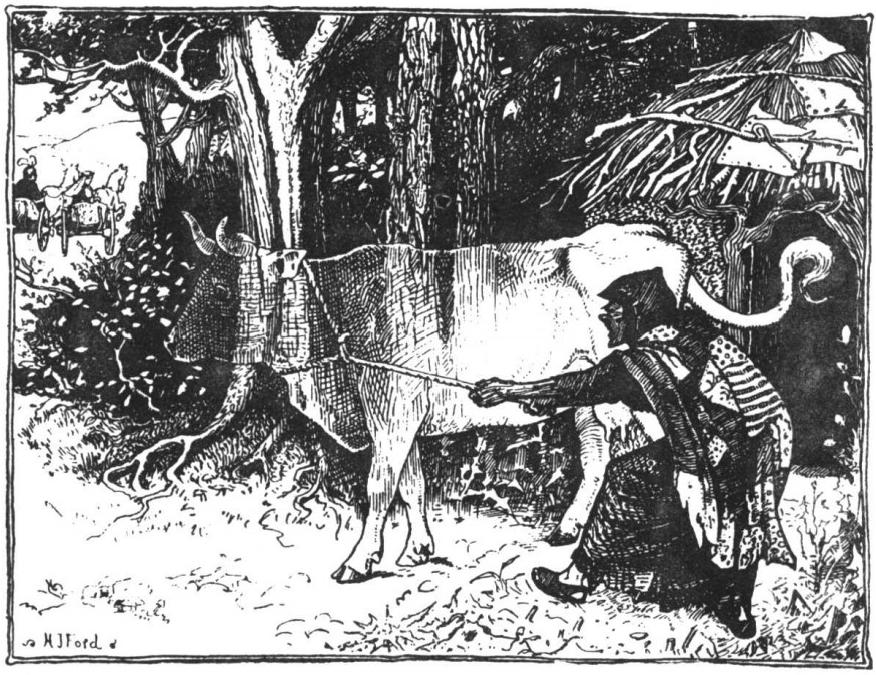

以后，王子每天都来到小河边，与公主见面。他和公主在一起时，毫不掩饰自己的感情。一天，王子恳求公主，希望她也能够爱他，公主坦白地告诉王子，她不可能爱上他，因为她的心中，早已有了心上人。

“我爱上了一位王子，不幸的是，他见异思迁，轻浮骄躁，除了自己，谁也不关心。别人的奉承话，使他有点飘飘然了。不过，最让我伤心的，是他根本不爱我。”

“这种家伙自命不凡，不值一提，他不值得你爱。”王子听了公主的话，气愤地说道。

“哎，可是我就是喜欢上了他，怎么办呢？”公主一边说，一边抹眼泪。

“这家伙真是有眼无珠，像你这样美丽动人的姑娘，他怎么一点也不动心呢？自从我看到你的画像，便开始四处寻找。现在，我终于找到你了，你比我想象中还要美丽，为了赢得你的爱，我愿意付出一切。”

“我的画像？”萨拉迪妮一下子对王子的话感兴趣了，“难道费斯海德王子把画像送给别人了吗？”

“美丽的公主，他宁愿死，也不会把画像送给别人，这点我可以向人保证，因为我就是费斯海德王子。”

这时，榉木仙女将王子身上的魔法去除了，公主惊喜地发现，她心爱的费斯海德王子就站在面前。经过几番考验的王子和公主已经改正了各自的缺点。现在，他们终于能够真心相爱了，这对恋人是多么幸福啊！他们似乎有千言万语，要向对方倾诉。当他们想起该回小屋时，公主才发现，她还穿着老太婆那件破烂衣服，她觉得自己看上去一定糟透了。可王子却表示，她穿那衣服也挺不错，看上去很别致，独具风情。他们一起回到小屋后，老太婆气呼呼地走到他们面前，说道：

“别人常说，有个姑娘，就定会出现个小伙子，这话说得太对了，快走开吧，小伙子，我不会收留你的。”

王子见老太婆这样无礼，气得真想发脾气。可是，沉醉在幸福之中的他，还是止住了怒气，他以公主的名义，要求老太婆归还长袍，让公主穿得体面地离开小屋。

这个要求把老太婆惹火了，她原来认为有了这件长袍，这辈子就不愁穿了。王子表示，他愿意出钱买回长袍，可是老太婆光顾着发脾气，过了好一阵子才听见王子的话。她看到王子拿出一大把金币，不禁怒气全消了。不过，她坚持要王子和公主许诺，不管发生什么，都不会要回金币。然后，她才带着公主走到屋里，很不情愿地拿出长袍，让公主穿上。至于其他的衣服，她谎称已经丢失，找不到了。这时，王子和公主都发现，他们正饿得发慌，毕竟，人不能喝西北风过日子，也不能用爱情填饱肚子。于是，他们问老太婆要点吃的，老太婆叫得更响了，似乎满肚子都是怒火：“什么？你们难道还不够幸福，还要问我要吃的，没门！”

老太婆看到王子好像要发怒了，只好唉声叹气，嘀嘀咕咕地从屋里拿出一块面包，一碗牛奶和六个李子。这些东西足以让王子和公主感到满足。他们深情地、长久地注视着对方，根本不在乎吃的究竟是什么。两人谈起一些往事，似乎要一直说下去。王子告诉公主，他走遍了全世界，见过很多美女，但令他失望的是，没有一个长得像画像中的那位姑娘。公主也告诉王子，她实在不明白，为什么他们相处了那么久，可是王子始终没有认出她来。王子为自己曾经那样冷酷、轻蔑地对待公主而请求原谅，公主当然一口答应，她对王子说道：

“费斯海德，我是那么爱你！不管你做过什么，我都不会计较，我们不能在这儿久留，你说该怎么办呢？”

王子觉得最好还是回到榉木仙女身边，接受她的保护。他们两个刚商量好这事，就出现了两辆分别用山茶花和金银花点缀的礼车。礼车载着王子和公主，往仙女的宫殿驶去。这时，他们听到一阵尖叫，然后是一阵号啕大哭。原来是那个老太婆，她刚转身，就看到那头漂亮的母牛想要跑掉。于是，她就使劲地抓住缰绳，但是，母牛还是挣脱掉了。公主和王子后来听说，那个老太婆从此就一直拿着钱包，想把王子给她的金币放进去，仙女为了惩罚她的贪婪，让那些金币不断地滑落出来。

榉木仙女展开双臂，欢迎王子和公主的归来。她看到他们都已经改正了缺点，真是高兴极了。这下，她就能宠爱他们而问心无愧了。莎拉迪仙女也闻讯带着国王和王后赶来了，公主请求莎拉迪仙女原谅她，仙女自然很大度地原谅了她，她怎么会拒绝这样可爱迷人的公主的请求呢？仙女还将萨默岛王国交还给她，并保证，以后要全面保护她。榉木仙女告诉国王和王后，现在，人民正盼着国王和王后回去重新统治王国呢。但是，国王和王后立刻宣布自己退位，将王位传给了费斯海德王子，因为他们无论如何也不愿放弃宁静的乡村生活。于是在两位仙女的安排下，王子和公主成了各自美丽的王国的统治者。第二天，他们就举行了婚礼。由于他们已经改正了自负或轻浮的毛病，从此便幸福地生活在一起。

 
 

## 三头小猪

从前有一头老母猪，它带着三个孩子，住在一座又大又舒适的农家院子里。它最大的孩子名叫小褐，第二个孩子名叫小白，最小的也是最漂亮的那个，名叫小黑。小褐最不爱干净，成天喜欢在烂泥巴中打滚、嚷叫，没有比下雨更令他感到高兴的事了，因为雨水使院子里的泥巴变得又软又厚。每到这个时候，它就会从母猪身边偷偷溜走，在院子里找一块最泥泞的地方，然后在里面滚呀，爬呀，玩得很痛快。猪妈妈为这事，总是要和它生气。这时总会伤心地摇摇头，说道：“小褐啊小褐，总有一天你会后悔，没有听妈妈的话。”但是，它的规劝和告诫，都无法让小褐改掉那个坏习惯。

小白是头聪明的小猪，但是很贪吃，它成天就想着吃，老盼着晚饭时间快点到来。每次主人家的小女孩拎着食桶走进院子时，它总是后腿撑在地上，身子高高抬起兴奋地摇头摆尾。小女孩刚把吃的倒进食槽，小白就把小黑和小褐拼命挤到一边，以便自己吃到最多最好的东西。猪妈妈总是责备它太自私，并告诫它，总有一天，贪吃会让它受到惩罚。

小黑是一头善良、讨人喜欢的小猪。它爱清洁，又不贪吃，而且长得小巧结实，一身光亮的毛，看上去就像黑色绸缎，比起小白和小褐，它要聪明得多。猪妈妈每次听到主人的朋友夸奖小黑，并预测它会赢得大奖时，心里总是充满了自豪。

终于，猪妈妈年纪大了，身体很差，快不行了。一天，它把三个孩子叫到跟前，对它们说道：

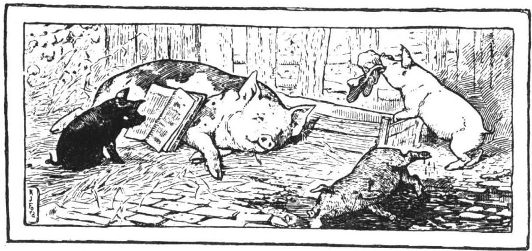

“孩子们，妈妈年纪大了，恐怕活不了多久，临终之前，我打算为你们每人造一所房子。我们在这个院子住得一直很愉快，但另一家小猪马上就要搬来，到时候，你们不得不另找住处。小褐，你先说，想要一座什么样的房子？”

“我要一座泥巴做的房子。”小褐一边回答着问题，一边贪婪地看着院子角落里的一个大水洼。

“你呢，小白？”猪妈妈掩饰不住自己的伤心，小褐所作的愚蠢选择，令它很失望。

“我要一所甘蓝菜做的房子。”小白答道，它几乎头也不抬，忙着在猪槽里找土豆皮吃，嘴巴塞得满满的。

“傻孩子！真是傻孩子！”猪妈妈痛心地说道，“那么，小黑你呢，你想要一所什么样的房子？”它又问自己最小的孩子。

“妈妈，请为我准备一所砖房子吧，砖房子冬暖夏凉，又很安全。”

“这真是个好主意。”猪妈妈疼爱地看着小黑，说道，“我会马上为你们安排好这三所房子，最后我还有一个劝告，记得我常对你们提起的狐狸那个大坏蛋吗？他要是听说我死了，一定会想方设法抓住你们，带回到它的窝里去。这家伙狡猾得很，它会谎称是你们的朋友，所以你们要答应我，在任何情况下，都不能开门让它进屋。”

三头小猪立刻答应了，因为它们早就听说过很多关于狐狸的可怕故事，对狐狸总有一种恐惧感。没过多久，猪妈妈就去世了，三头小猪就到它们各自的房子里去住了。

小褐见到那些软软的泥巴墙和土块做的地板，开心得不得了。很快，那些泥巴墙和地板就成了一个大泥巴馅饼，但这正是小褐所喜欢的。它在屋里尽情玩耍，滚来滚去，把自己和房子都弄得一团糟。一天，正当小褐躺在泥巴堆里昏昏欲睡时，听到一阵轻柔的敲门声，有人用温和的口气说道：

“小褐先生，我能进来吗？我想看看你漂亮的房子。”

“你是谁？”小褐警觉地问道，它吓得一下子清醒过来，因为那声音虽然听上去很温和，但肯定是装出来的。它明白，敲门的不是别人，正是狐狸。

“我是你的朋友，前来拜访你。”那声音又说道。

“不，不是！”小褐答道，“我不相信你是我的朋友，你就是狐狸那个大坏蛋。妈妈叫我们小心提防你，所以，我不会开门让你进来的。”

“哦？你就这样对待我吗？”狐狸用它真正的嗓音，粗鲁地说道，“我现在就让你看看谁是这房子的主人。”说完，它就用爪子开始在墙上挖洞。很快，软软的泥巴墙上就出现了一个大洞。狐狸从那个洞跳进小褐的泥房子，一把抓住它的脖子，把它扛在肩上，得意地回到了自己的老窝。

第二天，正当小白大口大口地嚼着屋角的甘蓝菜时，狐狸偷偷走到它的房门外。它决定把小白也抓到自己的老窝去，让它和哥哥“团聚”。狐狸仍然用装出来的声音，温和地说道：

“我是你的朋友，过来看看你，想尝尝你那些美味的甘蓝菜，作为我的晚餐。”

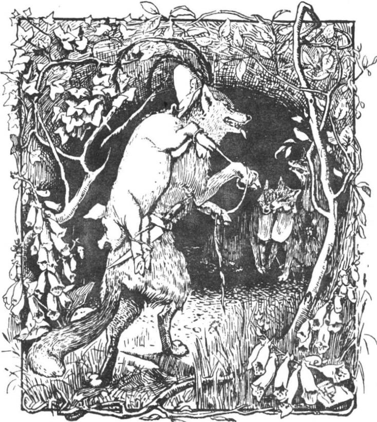

但狐狸的话还是把小白吓了一跳。“别，请别碰我的甘蓝菜，”小白着急地大声喊道，“这些菜是用来做墙壁的，如果你把它们吃了，墙上就会有个大洞，风和雨跑进来，会使我着凉生病的。快走开吧，我敢肯定你不是我的朋友，而是那个狡猾的狐狸。”可怜的小白呜呜地啼哭起来，它真希望自己没有那么贪吃，选择了用甘蓝菜而不是用更为坚固的材料做成的房子。但是现在，一切都迟了。狐狸很快就在墙上啃出个大洞，它一把抓住吓得瑟瑟发抖的小白，把它带回了自己的老窝。

第三天，狐狸朝小黑的房子进发，它已经下定决心，把三头小猪都抓到它的窝里去，然后杀了它们，请它的朋友们来美餐一顿。可是，狐狸走到小黑的砖房子时，发现门是闩着的。于是，它又用起自己那套鬼把戏：

“让我进去吧，小黑，来的路上，我在院子里捡了些鸡蛋，给你送来。”

“你在说谎，狐狸先生，”小黑说道，“我才不会开门让你进来，你那些鬼把戏可骗不了我，可怜的小褐和小白都被你抓去了，在我这儿，你是不能得逞的。”

狐狸听了这话，火冒三丈，它使出浑身的力气，往墙上撞去，希望能把墙撞塌。但是，砖房子非常坚固，造得又好，所以尽管它又用爪子使劲地刨，还是不能进去，反而弄伤了自己的爪子。最后，它不得不放弃，带着血流不止、疼痛难忍的前爪，一瘸一拐地走开了。

“等着瞧吧！”狐狸临走前，对小黑怒气冲冲地吼道，“总有一天，我会把你抓住带回窝去，然后，我要把你撕成碎片！”狐狸一边说话，一边气得龇牙咧嘴，直喘粗气。

第二天，小黑不得不出门，去邻近小镇买点东西，它买了个大水壶。回家的路上，它就把水壶扛在肩上。这时，它听到身后悉悉嗦嗦的脚步声，由于害怕，它的心脏似乎一下子停止了跳动。不过，它马上就想出了一个绝妙的主意。此时的它，刚好走到小山顶，从那儿，它能看到自己的房子。偎在山脚下的树林中，小黑迅速把壶盖打开，跳了进去。它让自己蜷缩成一团，紧贴在水壶的底部，然后用前腿盖上壶盖。这样，小黑把自己完全藏了起来，它在壶里轻轻踢了一下，那水壶就顺着小山坡，快速地往下滚，狐狸追上来时，就只能看到一个黑色大水壶，不停地转啊转，狐狸失望极了。正当它转身打算回去时，看到那个水壶在靠近小砖房的地方停了下来，只见小黑从里面跳了出来，一转眼，就拿着水壶，躲进了小屋。小黑进了屋，立刻把门闩上，把窗户关得严严的。

“呸！”狐狸自言自语地大声吼道，“你以为这样就能逃脱吗？我的朋友，咱们走着瞧吧！”于是，它在小黑的房子四周偷偷摸摸，鬼鬼祟祟地走来走去，想找个地方爬到屋顶。

这时，小黑已把水壶装满了水，放在火上烧。然后，它安安静静地坐在一旁，等水烧开。当水壶开始作响，蒸汽从里面冒出来时，它听到屋顶上传来一阵细微、沉闷的脚步声。接着，它就看到狐狸的头和前爪伸进了烟囱。可是，聪明的小黑并没有把壶盖盖上，随着一声惨叫，狐狸跌进了滚烫的热水中，它还没有来得及逃出来，小黑就迅速地盖上了壶盖，狐狸被活活烫死了。

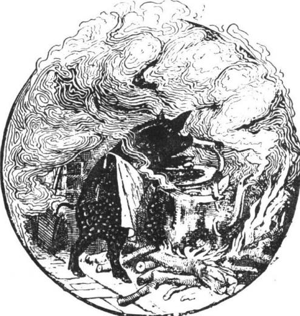

小黑断定狐狸已经死了，不会再对自己构成威胁。于是，它立刻出发，去营救小褐和小白。当小黑走近狐狸老窝时，听到小褐和小白凄惨的哭叫声，它们两个害怕狐狸会杀了它们，美餐一顿，所以一直在恐惧中生活。当它们看到小黑突然出现在洞口时，真是喜出望外。小黑马上找了一块能当刀使的石块，割断了那根把它们绑在一个石椿上的绳子。三头小猪一起，回到了小黑的砖房子。从此，它们一直快活地住在那儿，小褐改掉了自己喜欢在泥地里打滚的坏习惯，小白也不再那么贪吃了，因为它们永远不会忘记，正是那些坏习惯，几乎让它们年纪轻轻就丧失了性命。

 
 

## 冰心

从前有一对国王和王后，他们非常愚蠢，但却彼此欣赏。有人背地里说，这更证明了他们的愚蠢。当然，大臣们可不敢说这样的话，因为，他们毕竟是国王和王后。他们的王国，一直到现在，还是保持着兴盛。那个时候，统治者必须考虑如何与仙女和法师和睦相处，必要的时候，还得送他们一些糕点、绸缎等礼物。这些东西，他们也理应得到。不过，最为关键的，是得邀请他们来参加洗礼仪式，不论他们是好是坏，地位举足轻重，还是微不足道。王后有个出生不久的儿子，马上就要受洗礼了。于是，她花费了几个月的时间，制订了一份很长的名单，名单上都是那些被邀请来参加洗礼仪式的宾客的名字。可是，王后却没料到，宣读这份名单所要花费的时间，并不亚于它的制订。最后，宣读名单的任务决定由国王亲自完成。到了洗礼的那一天，国王拿出名单，开始宣读宾的名字。可是，他才读完第二页，就觉得很劳累，再加上心急，舌头便不听使唤了。其实，国王只是不断重复着这句话：“某某仙女（或某某法师），我邀请您参加王子的洗礼仪式，并慷慨地为他带来礼物，对您的光临我将深感荣幸。”

更为糟糕的事发生了，有人报告国王，说那些名字列在第一页上的仙女早就到场了。此刻，她们正等在大厅里，已经很不耐烦，并不断地抱怨，大厅里没有人迎接她们。于是，国王绝望地放弃了宣读名单，匆匆赶到大厅，去欢迎那些已经到场的仙女。国王态度卑微，恳求仙女们不要因此而迁怒于王子。绝大多数仙女都被他的话所感动，同意不对王子进行报复。其中有一位仙女，来自一个无人知晓的遥远国度，她的名字被列在名单的第一页，这位仙女千里迢迢赶来参加王子的洗礼仪式，但是，却没有受到隆重的欢迎，甚至没人将她从鸵鸟坐骑上搀扶下来。这时候，她口中开始念念有词，样子很可怕。

“哦！你少说废话！”仙女对国王说道，“无论你怎么道歉或请求原谅，王子永远都不会成为你的骄傲，他只能成为一个小矮人。”

正在这个时候，王国的特别保护者，心地善良的杰娜斯塔仙女及时赶到，阻止了那位仙女的不良行为。否则，她一定会继续诅咒，给王子带来更多的不利。杰娜斯塔仙女又是奉承，又是恳求，才平息了那位来路不明的仙女的怒气，使她停止了诅咒。接着，好心的仙女给国王一个暗示，让他开始接受仙女们各自带来的礼物。这个仪式结束后，除了杰娜斯塔，其余的仙女陆续离开了王宫，她跑去见王后，并对她说：

“你现在把事情搞得一团槽，当初你为什么没有放下架子，征求我的意见呢？不过，像你这样愚蠢透顶的人，总以为自己不需要别人帮助，就能把事情做好，虽然我对你一直不错，可你却没有在名单上列上我的名字！”

“啊！尊敬的女士！”国王跪倒在仙卖面前，大声喊道，“我还没有来得及读到你的名字，不信，你可以看看名单，上面有我做的记号，你要知道，我才读了两页，就不得不放弃！”

“没有关系，没有关系，”仙女安慰道，“你并没有冒犯我，我不会为这区区小事和我喜欢的人生气，现在，还是来谈谈王子吧，你必须把王子交给我，让我来照顾他，只有等到王子浑身长满了毛，你才能再见到他。”

国王和王后听了这话，疑惑不解，而且流下了眼泪。他们的王国，处于热带，所以不能明白，王子为什么非得浑身长毛，他们觉得，这一定预示着将有不幸要落到王子头上。

杰娜斯塔仙女劝人们不必为此担忧。

“如果王子让你们抚养长大，一定会和你们一样愚蠢。我甚至不打算让他知道自己是个王子。至于你们，还是动动脑筋，想办法把王国治理得更好些。”仙女说完这话，就带着王子，连摇篮一起，从窗户轻盈地飞了出去，犹如在冰上滑行。国王和王后痛哭流涕，他们询问所有在场的人，仙女那番话究竟是什么意思。但是，没人能解开这个谜底，并且一致认为，如果王子浑身长毛，那实在是件恐怖的事。国王和王后愈加伤心，他们在宫中愁容满面，漫无目的地徘徊，令看到的人同情不已。这时，仙女已将王子带回了她的城堡，并把他交给一个农妇照料。仙女施了魔法，使农妇以为王子是她自己的孩子。王子在农妇的照料下，健康地成长，过着简单的农家生活。仙女觉得，这种生活，是培养王子的最佳方法。随着王子年龄的增长，仙女尽量让他和自己多呆在一起。这样，他的心智就能得到和身体同样的培养和训练。但是，仙女所关心的，还不仅于此。她决定再让王子经历一些磨难和挫折，以便他更好地了解人类。仙女明白，她应当尽全力去帮助王子，因为王子的年龄虽然在增长，但他的身高却不见长。事实上，他可算得上是长得最矮小的一个王子了。尽管这样，他还是健康强壮，充满活力，而且相貌英俊，招人喜爱。这样，他矮小的身材就显得不那么重要了。王子自己也很明白，别人都嘲笑地称他为“小矮人”，他发誓，要让“小矮人”这个称号人尽皆知。

为了完成自己的计划，培养好王子，仙女开始用魔法让王子作一些奇怪的梦，这些梦都与冒险有关，王子成了冒险故事中的主人公。有时候，他梦见自己临危不惧，解救了一位美丽的公主。有时候，他也梦见自己勇敢善战，建功立业，赢得了一个王国。最后，王子心中萌发了远离家乡，去一个遥远的国度的渴望，并相信在那儿，自己低微的出身，不会阻碍他凭借力量和勇气获得荣耀和财富。有一天，王子终于骑上骏马，踌躇满志地上路，来到了一座离仙女城堡不远的城市。他原来只打算在附近的森林中打猎，所以穿着非常简单，而且身边只带了弓箭和一把长矛。可是，他看上去还是风度翩翩，气宇不凡。王子到了城里，看到城里的居民都往集市跑去，便掉转马头，跟了上去，他好奇地想知道发生了什么事。他到了那儿，看到几个装束奇特的外族人，正打算对着聚集的人群，宣布重要的事情。王子匆匆忙忙挤到人群最前面。这时，一个看上去老态龙钟的家伙，开始说话了：

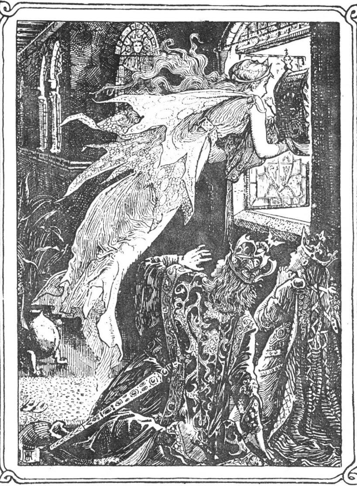

“你们各位都听好，谁能爬上冰山的顶峰，便能获得重赏，他将娶美貌绝伦的萨比拉公主为妻，还将赢得公主继承的王国！”老人停顿了一下，继续宣布道：“这第一张名单上的王子，被公主惊人的美貌所吸引，都试图爬到冰山顶峰，但他们一个个都死了。这第二张名单上的人，都刚刚报名，加入这一冒险的行列。”

小矮人王子听了这番话，真想走上前去，在名单上留下自己的名字，参加爬越冰山的冒险。但是，他想到自己还未独立，而且是个穷光蛋，便又停了下来。正当他犹豫不定时，那个老人恭敬虔诚地走到一副画像前，撩起帷幕，将美丽的萨比拉公主的画像向众人展示。王子才看了一眼画像，便一个箭步冲上前去，要求把自己的名字也写在名单上。那些外族人看到身材矮小，衣着朴素的王子，顿时你看看我，我看看你，不知道是拒绝还是接受他的请求。他们实在不敢相信，这样的小矮人怎么能去征服冰山。

“把名单给我，让我把自己的名字写上，”王子说道。于是，外族人将名单递给了他，他对美丽的萨比拉公主产生了爱慕之情。然而，那些外族大使们犹豫不决的态度，又让他感到恼火。王子心烦意乱中，便在名单上写上了自己的绰号——“小矮人”。而名单的其余部分，都是一个个地位显赫的王子的尊姓大名，大使们看到“小矮人”这名字，不禁哈哈大笑起来。

“可悲的家伙！”王子大声喊道，“要不是这张美丽的画像，我早把你们的头砍下了。”

这时，他突然想到，“小矮人”这个名字确实有点滑稽可笑，再说，他还没有让这一称呼声名远扬，因此，他平息了怒火，冷静了下来，并向大使们询问，如何才能到萨比拉公主的王国去。

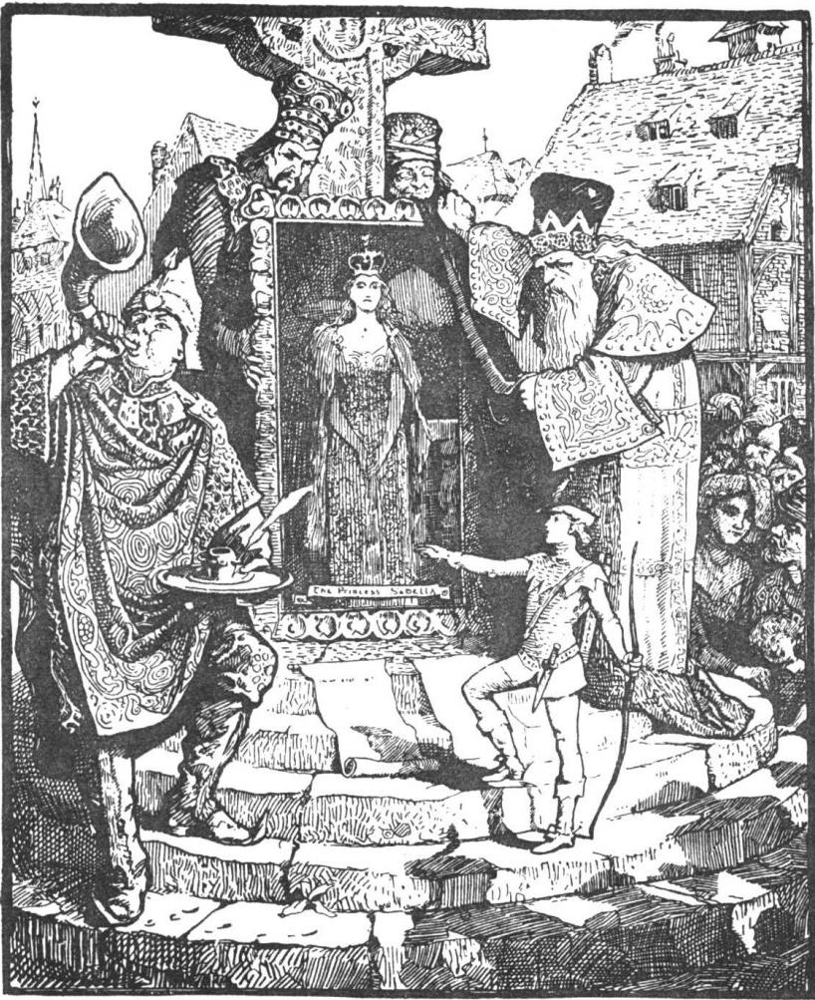

此时的王子浑身充满了勇气和胆量，虽然他也感到自己会遭遇很多困难和挫折，但却没有因此而后退。由于王子害怕仙女会设法阻拦他，于是决定不辞而别，立刻出发。城里认识他的人得知这个小矮人要去冒险登冰山，一个个都嘲笑他。连国王和王后也听说了这件事，他们比别人笑得更厉害，却怎么也想不到，他们认为自命不凡的小矮人，竟是自己的亲生儿子！

王子踏上了远征旅途，但是，那些外族大使们，并没有为他明确地指出方向，只是告诉他：

“在高加索山北部一千五百英里处，你将得到征服冰山的命令和指示。”

他们竟然对一位将要作长途旅行的人说这种话！要知道，小矮人出发的地方，可是相当于现在的日本，离开那儿很远很远。

王子向西方走去，为了不让别人嘲笑他的名字，他避开了所有的城镇。由于他并不是个经验丰富的旅行者，所以还没有学会将别人对自己的嘲弄当作一种快乐。他以野果充饥，晚上便睡在树林里。杰娜斯塔仙女一直慈爱地看护着王子，她可不愿让他这样挨饿。于是，便趁他睡着时偷偷地喂他名种各样的好东西吃。王子发现自己醒来时，从来都不感到肚子饿，他觉得这事很奇怪。仙女按照自己的计划，一路上为王子设置了很多的险恶，以此证明他的勇气，王子成功地脱离了这些险境。但是，在他最后与一头暴怒的猛虎争斗时，不幸失去了他的骏马。王子毫不畏惧，继续前进，步行来到了一个海港。到了海港，他发现有一艘船正准备出发，驶往他想去的海岸。他掏出身边所有的钱，买了一张船票，登上了那艘船。可是，过了几天，船就遇上了风暴，沉入了大海。王子于是只能在茫茫大海中不停地游啊游。好久，他才看到前方出现了一块陆地。他爬上岸，才发现这块陆地，原来是一座荒无人烟的小岛。王子于是在小岛上住下了，每天以打鱼、狩猎为生，心中企盼着好心的仙女能来救他。一天，正当王子伤心地眺望着大海时，他突然看到一艘样子奇怪的小船向小岛驶来。小船一头撞在礁石上，陷进了沙滩里。王子急切地跑过去，他惊奇地发现，那艘船的桅杆上，竟满是枝杈。枝杈上长着浓密的叶子，看上去像个小树林。王子没有听到什么动静，以为船上空无一人，便拨开树枝，眼前的景象让他大吃一惊。几个船员像死人一样躺在地上，一动不动，样子惨不忍睹。他们一个个像树一样，不是紧贴在船桅上，就是紧挨着船身。总之，魔法降临时，他们正好站在什么地方，就被固定在了什么地方。小矮人对船员可怜的处境非常同情，于是，他便想方设法，试图把他们放开。他轻轻地用箭头将他们的手脚与木头分离，然后，再将他们一个个背到岸上，使劲地搓着那些麻木的四肢，并用各种草药的浓汁替他们擦身。最后，船员们完全恢复了健康，又能驾船航行了。草药的神奇作用，自然与杰娜斯塔仙女有关。她还往小矮人的脑中送去了另一个好主意，叫他拿着那些魔药去擦船，船上的枝叶顿时完全消失了。要是它们还是一个劲地往外长，小船很快就会变成一个大森林！船员们对小矮人感激不尽，他们表示，很乐意将王子带到他想去的任何地方。当王子问起这件怪事时，船员们谁也解释不清。他们告诉王子，船驶过一个树林覆盖的海岸时，突然刮起了一阵大风，风沙把他们的船紧紧裹住。接着，船上除金属以外的东西，全都发芽开花，而他们自己，也逐渐地感到四肢麻木，身体越来越重，最后，便失去了知觉。小矮人对这个奇特的故事，表现出极大的兴趣。他从船底收集了一些尘土，小心地保存起来，因为他觉得这些尘土一定有一种特性，日后可能会帮他大忙。

于是，王子和船员们一起，高兴地登上了船，离开了那座荒无人烟的小岛。他们在平静的大海上航行了很久，最后终于看到了一片陆地，他们决定上岸，贮备一些新鲜的水和食物，并想知道，他们现在究竟在什么地方，下一步该往哪里去。

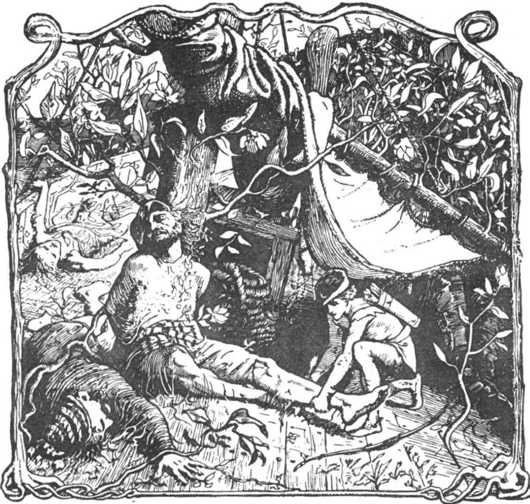

小船逐渐地向海岸靠拢，船上的人却感到困惑，这恐怕又是一座荒芜的小岛，因为他们连一个人影也没看到。这时，他们发现空气骚动起来，一团风沙在离地面不远处滚动，逐渐地，模糊的黑影又出现了。这些黑影正好聚集在他们打算登陆的地方。他们惊奇地发现，这些黑影原来是一些矮脚长毛狗。它们中有的是哨兵装束，其余的便形成一支队伍，眼光都急切地注视着那些要上岸的人。小矮人王子看到了这些狗，并没有叫喊着要打死它们，而是走上前去，非常友好地，甚至有些奉承地和它们打招呼。于是，这些狗摇头摆尾，挥动着前爪，将王子围在中间。王子很快明白，它们是想让他离开那条船和船员，跟着它们走。王子很乐意这样做，因为他好奇地想知道，狗到底想要他做什么。于是，他让船员们等他十五天，如果十五天后他还没有回来，他们便可自己上路，而不用等他了。王子跟随着他新结识的朋友，往岛上走去。一路上，他惊奇地看到，两边的农田中，庄稼长得很好，马或者牛拉着犁在耕地。此外，还有村庄里干净、整洁的农舍。总之，这个地方到处是一片繁荣的景象。在一个村庄里，王子还有幸品尝了一顿美味丰盛的晚餐。他吃饭时，突然来了一辆礼车，一只很大的长毛狗娴熟地指挥着两匹拉着礼车的白马。王子坐上礼车，舒舒服服地继续旅行。一路上，他看到很多莫名其妙的礼车，礼车上坐着的长毛狗们，都很有礼貌地向他挥手致意。最后，礼车到了一座很大的城市。王子断定，这是王国的首都，城里的居民显然都得到了王子到来的消息，它们不是站在门前，便是倚在窗边，争看这位奇异来客。小狗们甚至爬到墙上或大门上。王子看到自己受到这样隆重的欢迎，高兴极了。他饶有兴趣地望着它们。礼车驶过几条路面宽广、光滑、两边绿树成行的大街，来到了一座富丽堂皇的宫殿。经过后院时，他看到王宫里到处都是长毛狗，显然，它们是守卫王宫的士兵，“国王的保镖”。王子一边向那些狗回礼，一边想着自己的事情。礼车停下后，王子被带到了国王面前。国王正躺在一块漂亮的波斯地毯上，它的周围是几只小狗，它们正忙着给国王赶苍蝇。国王是一只非常漂亮的长毛狗，它的那双大眼睛充满了忧伤。但是，一看到王子，忧伤便顿时消失了，国王一下子站了起来，高兴地迎向小矮人。接着，它又招呼大臣们，前来向王子致敬，王子迷惑了，他不知该如何和这位国王交谈。这时，大厅里只剩下他和国王，国王派人叫来了国务大臣。于是，国王口述，大臣记录，一段很有礼貌的话很快就写成了。在这段话中，国王表示，他为不能与王子直接交谈而感到非常遗憾，因为除了书面语言，它们的语言和王子的语言大相径庭。

小矮人也用笔写了一段非常适宜的回答，他请求国王能够满足他的好奇心，对他上岸来看到的所有奇怪现象作一番解释。可是，这段话似乎勾起了国王对伤心往事的回忆。它告诉王子，自己原来是个国王，名叫贝亚德。邻国的一位仙女疯狂地爱上了他，她想方设法，试图成为他的妻子。但是，由于他正全心全意地爱着香岛王国的女王，便拒绝了仙女的爱情。仙女看到自己受到如此冷漠无情的对待，勃然大怒。她施了魔法，将他变成了一条矮脚长毛狗，夺去了他说人话的能力，但同时保留了他人的头脑。最后，她还觉得对国王的报复不够满意，把他所有的臣民也变成了狗，而且还恶狠狠地对他说：

“贝亚德，从此你就用四脚走路吧，除非这个世界，好人真能得到好报。”

对国王来说，仙女无疑是在告诉他：“你这辈子都别想再恢复成人样！”

小矮人的看法也是如此，但他还是安慰国王道：

“陛下，你应该耐心等待。”

其实，王子对这位可怜的国王非常同情，他说了很多很多安慰的话，并许诺，自己会尽全力帮助他。总之，他们很快成了好朋友。国王自豪地拿出香岛王国女王的画像给王子看。王子也觉得女王非常迷人，为她遭受痛苦也是很值得的。小矮人也将自己的经历告诉了国王，国王得知他是去征服冰山，便给他很多有价值的建议，帮他决定走哪条路最好。最后，国王把王子送到了岸边停船的地方。那些船员们一直希望王子不会有什么危险，现在，他们看到王子回到船上，都很高兴。他们一起将国王送的生活必需品装上船后，便又开始远航了。国王和小矮人不得不遗憾地道别。临走的时候，国王将他自己的一个仆人穆斯塔交给小矮人，他还吩咐这个仆人，要紧紧跟随王子，并全心全意地服侍他，仆人许诺他会照国王的话去做。

国王下令，所有的士兵都列队高呼，作为欢送王子的仪式。海上刮起了顺风，将船越吹越远。很快，狗叫声便逐渐微弱，陆地最后也完全在视野中消失。一路上，王子和船员们几乎没有遇上什么大的风险，很快，他们距离自己的目的港只有六英里。可是，王子还是决定就在那六英里处上岸，因为他没想到城市中去，身边没有钱，不知道下一步该怎么办。于是，船员们就把他和穆斯塔送到了那边的岸上，他们依依不舍地回到了船上。王子和穆斯塔则朝着一个看上去充满希望的方向走去。很快，他们就来到了树林边的一个草地上。长途旅行的劳累使他们感到，能坐在草地绿荫中休息，真是一件很快乐的事。他们一边坐着，一边欣赏着附近一棵树上的漂亮小猴。那只小猴跳来跳去，样子滑稽可笑。王子一下子喜欢上了那只小猴。他站了起来，想去抓它，可是，小猴敏捷地逃脱了。它站在王子面前，与他相隔了一臂那么长的距离，说服他跟着它走，王子答应了。于是，小猴蹦到他的肩膀上，在他身边轻声说道：

“可怜的小矮人，我们两个都是穷光蛋，而且都不知道下一步该做什么，像迷途的羔羊。”

“这倒是真话，”王子伤感地说道，“可怜的小猴，我没有糖，没有饼干，什么都不能给你。”

“你真是太为我着想了，而且，你对自己要做的事很有耐心。这样吧，我告诉你到金石头去的路，不过，你得把穆斯塔留在这儿。”小猴说道。

小矮人同意了，于是，小猴纵身一跃，跳到了最近的一棵树上，对王子说，“跟我来。”它从一个树枝跳到另一个树枝，为王子在前面带路。

王子费力地跟随着小猴，小猴则耐心地等他跟上，并指给他看，哪儿走最方便。最后，他们走出了树林，来到了山脚下一块杂草丛生的空地上。抬头一看，山腰上有一块十英尺高的巨石。他们开始往上爬，等爬到巨石边时，小猴对王子说：

“这块石头看上去很硬，不过，你用长矛敲击一下，看看会发生什么。”

于是，王子拿出长矛，在石头上狠狠敲了一下。有些石片飞了出来，然而，在那层薄薄的石片下，竟然是一整块的金子。

小猴看到王子大吃一惊，不禁笑了起来，说道：

“你凿开了金石，就应该拿到金子，要多少你就拿多少。”

王子向小猴道谢，然后，他拿了一块最小的金子。这时，在一边看着他的小猴突然变成了一位个子高挑、举止优雅的女士，女士对王子说：

“如果你能一直像现在一样心地善良，意志坚强，快乐知足，那么，你就能战胜一切困难，大有一番作为。继续前进吧，别担心把钱花光，由于你不贪心，才要了这一小块金子，但是，这一小块金子，永远不会减少。现在，你跟我来，看看如果你贪婪的话，会有什么样的后果。”说完，她便带着王子，沿着另一条路，回到树林中。这时，王子看到，有很多脸色苍白、面容憔悴的男男女女，他们跑来跑去，在地上或空中找着什么东西，听到一点声响，他们便会朝着声音传来的方向跑去，互相推着踩着，发了疯似地寻找金石头。

“你看看，这些人多辛苦！”仙女对王子说道，“不过，他们是找不到金石头的，很多人已经绝望地死去了。其他人的结局，最终也会这样。”

仙女刚和王子一起回到穆斯塔呆的地方，便突然消失了。那条忠诚的长毛狗穆斯塔见了王子，高兴地迎上前来，王子带着它，选择了一条最近的路，往城里走去。他们在城里住了几天，王子买了几匹马和几个仆人，他还到处向别人打听萨比拉公主以及去公主王国的路。别人除了告诉他，去那个王国还有很长一段路以外，没能为他提供更多重要的信息。但是，等他到了高加索山，情况就有了很大的不同。这儿，人人都谈论着萨比拉公主，而且，四面八方的人不断地向王宫涌去，要向冰山挑战。

王子听到的话，证实了公主的非凡美貌和巨额财富。他还得知，自己将遇到很多有实力的对手。这些对手中，有人带了一支军队，有人是个大富翁，还有人不仅英俊潇洒，而且早就有所成就。可怜的小矮人，却只有赢得胜利的坚定决心，一条忠实的长毛狗，和一个逗人发笑的名字。而这些东西，几乎不能帮他什么忙。他明智地作出决定，既然自己无法改变这些客观条件，他最好还是别去多想。经过了整整两个月的长途跋涉，王子终于来到了萨比拉公主王国的首都。这儿，他听到了很多关于冰山的可怕描述。那些试图爬上去的人，没有一个能够生还。他还听到了萨比拉公主的父亲，国王法达的故事。他是一个富有、强大的君主，并娶了美丽的公主波妲为妻。他们的生活过得幸福美满。

一天，国王和王后去滑雪橇，他们干了一件蠢事，得罪了一个老太婆，从此破坏了自己的幸福。

“等着瞧吧，”一个老太婆正坐在路旁，搓着双手，不怀好意地怒气冲冲地说了一句。国王听了这话，非常气愤，打算惩罚老太婆，但被王后阻止了，她对国王说：

“算了吧，别再把事情搞得更糟，我敢肯定，这个老太婆是个仙女。”

“你说得很对，”老太婆突然站起身来，变得又高又大，样子可怕极了。她身边带着的破东西变成了一条长着翅膀，带着火舌的飞龙。身上那件破烂不堪的斗篷也变得漂亮华丽，金光闪闪，脚上的木鞋则成了两只烟火筒，“记住高贡佐拉仙女吧，看看你们做的好事，以后会有什么报应。”说完，她乘上飞龙，扬长而去。四射的烟火，在天空中留下了一道长长的光迹。

国王和王后卑微地向她表示歉意，试图能平息她的怒火，并乞求她不要走。可是仙女连头也不回，很快便消失得无影无踪，把国王和王后扔在那儿。他们不知道自己将要大难临头，没过多久，王后就生了个女儿。她的美貌举世无双，北方所有的仙女都来参加了洗礼仪式，并要国王和王后提防心怀恶意的高贡佐拉仙女。她虽然也被邀请了，但却没有参加宴会，也没有送来什么贺礼。等仙女们将各自的恩赐施与公主，在餐桌旁就座后，高贡佐拉仙女便趁机偷偷溜进了王宫。她躲在摇篮下面，看护公主的仆人刚一转身，她就窜了出来，偷走了公主的心，逃了出去。走过后宫时，几条狗在后面拼命追她，但她还是逃出了王宫，上了坐骑，很快飞到了北极。到了那儿，她将偷来的宝贝放在冰山顶上，并在周围设置了重重障碍。这样，她就放心了，在公主的有生之年，她的心将一直呆在冰山顶上。于是，她返回了自己的城堡，为自己的胜利洋洋自得。其他仙女都未觉察这个秘密，宴会结束后，她们各自返回城堡。国王和王后心中，也不甚欢喜，随着萨比拉年龄的增长，她的美貌也与日俱增，她毫不费力地将一位公主应当学到的知识全部吸收。但是，在她身上，似乎总是缺少了一样东西，使她难以十全十美。公主的声音很动听，不管是唱快乐的还是悲伤的歌，都很悦耳。但是，她的歌声缺乏感情，听到的人都会说：

“她唱得确实不错，但是，她好像没有用心在唱。”可怜的萨比拉，她的心在遥远的冰山上，怎能用心歌唱呢？除了唱歌，她在其他事中也都表现出不懂感情的特点。随着时间的推移，虽然萨比拉越来越招人喜爱，国王和王后也越来越宠她，但他们还是发现，公主有一种致命的缺憾：她被许许多多的人爱着，但她自己却不能爱别人。于是，国王和王后把仙女们都请到王宫里来，请求她们找出真正的原因。国王一次次地表达了自己的悲伤，最后，他乞求仙女们亲自去看一下公主，他还对仙女们说：“什么地方肯定出错了，从某种意义上说，你们对公主的馈赠，还不够完美。”

仙女们向国王保证，她们已经毫无保留地将各种礼物赠与了公主，因为国王一直是她们的好邻居。然后，她们便亲自去看萨比拉公主，她们一见到公主，便不约而同地大叫起来：

“天哪！太可怕了！公主根本没有心！”

听到仙女们恐怖的结论，国王和王后绝望地大声哭喊，他们恳求仙女，为公主找到一种能治愈这种怪毛病的良药。年龄最大的一位仙女于是从腰带上取下她随身携带的“魔法大全”，翻阅起来。很快，她就发现，原来是高贡佐拉仙女偷走了公主的心，把它放在了冰山上。

“我们该怎么办呢？我们该怎么办呢？”国王和王后同时叫了起来。

“当然，你们深爱着公主，看到这么漂亮的女儿遭受不幸，你们一定会很痛苦，而且，这种痛苦还将折磨你们很长一段时间。不过，依我看，公主最终还是能重新得到自己的心。我建议你们马上派人带着公主的画像到世界各地去宣布，如果有人能将公主的心带回，你们将把公主嫁给他，甚至把王国交给他。我相信，单凭公主的美貌，全世界的王子都会跃跃欲试，去征服冰山。”

于是，国王和王后马上按仙女的话去做。小矮人听说已经有五百位王子死在冰天雪地中，更别提他们带在身边的大臣和仆人了。而且，还是每天不断有人去向冰山挑战。王子考虑一番后，决定到王宫去，他身材矮小，毫不起眼，后面还跟着一条看上去可怜巴巴的狗。因此，他的到来，没有引起任何轰动，而他的那些对手们，一个个衣着华贵，很有派头，连法达国王站在一边，也显得黯然失色。小矮人风度优雅地拜见了国王，并要求国王允许他礼节性地亲吻萨比拉公主的手。当他告诉国王，自己的名字叫“小矮人”时，国王忍不住想笑，在场的王子们则爆发出一阵大笑。

“小矮人”王子转身面对国王，带着自尊和高贵神情，对国王说道：

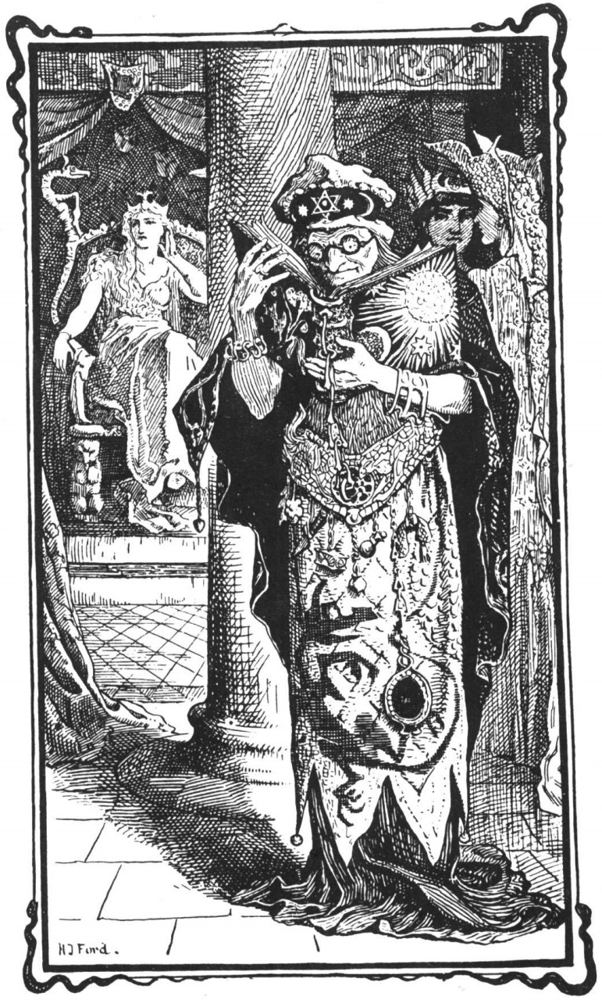

“陛下，如果您觉得这很好笑，那就笑吧，能够为你增添快乐，我感到非常高兴。但是，我想恳求在场的这些先生们，别把我当作一件玩物，对我大声嘲笑。”说完，他就走到一位笑得最响，神态最为骄傲的王子面前，提出要和他决斗，一比高低。那位王子名叫费达斯，他轻蔑地看了小矮人一眼，觉得这样瘦小不起眼的家伙，怎么也不会是自己的对手。于是，他欣然接受，并又对小矮人嘲弄了一番，决斗被安排在第二天举行。小矮人退出大厅，被人带到了萨比拉公主的住处。公主惊人的美貌和高贵的气质，令小矮人几乎停止了呼吸。过了好一阵子，他才缓过神来，对公主说道：

“美丽的公主，我被你的容貌深深吸引，因此远道而来，想要征服冰山，全心全意地帮助你取回那颗心。但是，由于我有个滑稽的名字，和你的一个求婚者吵了起来。明天，我就要和这个人高马大、相貌丑陋的家伙进行决斗，公主如能到场观看，我将不胜荣幸。我要向所有人证明，名字并不能代表什么，你会接受我做你的骑士。”

小矮人说到这儿，公主也被他的话逗乐了。公主虽然没有心，不懂感情，却很有幽默感。她优雅地接受了小矮人的邀请。小矮人受到鼓励，便进一步恳求公主，不能有任何偏心。

“哎！这些愚蠢的家伙，我一个也不喜欢。他们自作多情，愚蠢透顶，叫我讨厌。我觉得现在这样没有心也挺不错，可这帮家伙整天唠叨，说什么要把我从苦难中解救出来，还不停地表示爱我。什么是爱，我可一点也不明白，至于他们还说了些什么，我都记不清了。”

聪明的小矮人听了这话，马上就明白，要让这位公主喜欢自己，重要的不是像其他求婚者一样，不停地向她表达爱慕，而是得让她觉得有意思，逗她开心。因为公主没有心，不可能理解爱情的含义。于是，小矮人开始谈论他的对手，特别是他们身上的可笑之处，公主对这个话题倒是很有兴致。他们的谈话越来越投机，越来越有趣。没过多久，公主就宣布，王宫里那么多人，小矮人是唯一一个她喜欢交谈的人。

第二天，决斗的时间到了，国王、王后和公主都在看台上就坐。王宫和城里所有的人也都聚集在决斗场边，观看比赛。费达斯王子一身盔甲，威风凛凛地来到了决斗场。他身后跟了很多大臣和士兵。他们每人牵着一匹白马。小矮人从另一边入场，只带了一柄长矛和穆斯塔。两个决斗者之间鲜明的对比，令在场的人都哈哈大笑。随着一声号角，两个决斗者便向对方冲去。小矮人一个闪身，躲过了费达斯的利剑，并将他一把从马上拉下，用长矛把他按在了沙地上。周围观看的人都发出低声的惊叹。

制服了费达斯后，小矮人转身面对公主，向她保证，他不会杀害这个向她求婚的家伙。然后，他让受到屈辱而恼羞成怒的费达斯向公主致谢，因为要不是公主，他肯定没命。最后，在号角声和欢呼声中，小矮人带着穆斯塔，神情庄重地退出了决斗场。

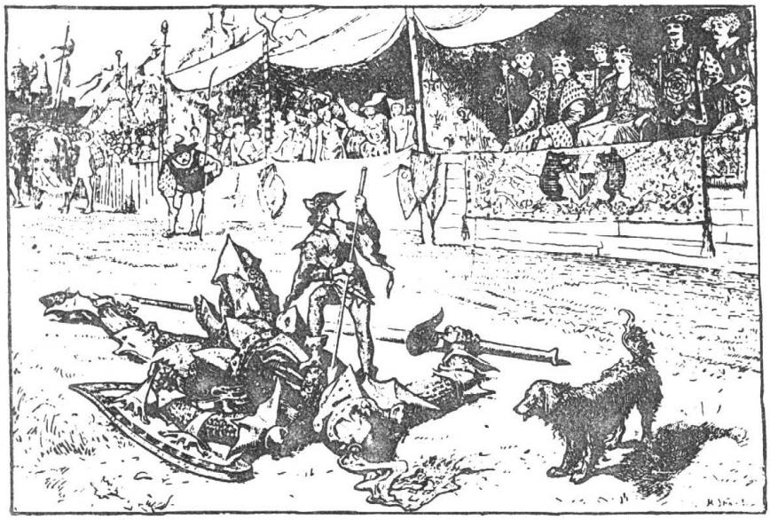

国王不久就派人去向小矮人表示祝贺，并邀请他住到王宫里去。小矮人欣然接受，公主表示，希望穆斯塔也住在宫中。于是，他派人接来了穆斯塔。公主非常喜爱这条很有礼貌的长毛狗，恳求小矮人把它送给她。小矮人高兴地答应了，他这样做不仅仅是出于礼节，让忠实的穆斯塔陪伴在公主左右，将来也许能帮他大忙。发生了这些事以后，小矮人在宫中的地位一下子变得举足轻重了。没过多久，边境线上来了一个大使，他的国王非常强大。大使给法达国王带来了一封信，并要求进入首都，等待回答，这封信的内容是这样的：

“法达国王，布拉提摩向你致意，如果我早点看到萨比拉公主的画像，就不会允许那么多冒险的家伙和自以为是的王子们对公主大献殷勤。他们也就不会因为想得到美丽的公主，而在冰天雪地中活活冻死。我根本不担心自己会有对手，并在此宣布，我决意要娶萨比拉公主为妻。相信那些有同样意图的家伙听到这个消息，马上就会灰溜溜地跑回家去，停止在公主面前装腔作势。我派来的这位大使负责把公主接到我这儿来，不得延误。在我看来，你完全没有必要派人四处宣布，寻找去征服冰山的人。如果萨比拉公主果真没有心，我毫不介意，因为世上能为她取回那颗心的，除了我没有别人。

就此搁笔，我的岳父大人！”

读了这封信，国王和王后又尴尬，又气愤。而萨比拉公主听到这个无礼的要求，更是气得直发抖。他们三人决定，在没有给予正式答复之前，任何人不得泄露这封信的内容。但是，忠实的穆斯塔却巧妙地设法将这个情况告诉了小矮人。小矮人得知此事，又震惊，又气愤。考虑之后，他请求会见公主，并聪明地将谈话引到这个话题上。公主和他一样，头脑中也始终想着这件事，因此，她把事情经过原原本本告诉了小矮人，并问他有什么建议，用什么最好的办法处理此事。这也正是小矮人自己感到困惑的地方。不过，他建议公主可以暂时让大使进宫来，让他觉得自己在等待答复，以此拖延时间，思考对策，公主照他的话去做了。

大臣进宫后，发现公主只是在敷衍他，很不高兴。但是，他暂时只能耐心地等一会儿。大使用傲慢的口气告诉在场的人，他的礼车马上就到，到了那时，城里所有的人和那些求婚的王子们可以看看，他的国王是多么地富有，多么地强大。绝望之中的小矮人，决定请求好心的杰娜斯塔帮他一次忙，他一直想念着这位仙女，而且对她为自己所作的一切感激不尽。自从他出发远离家乡，他就决定，除非紧要关头，否则不会向她求助。那天晚上，小矮人绞尽脑汁，想着如何解脱面前的困境，思考得累了，他就迷迷糊糊睡着了。这时，他梦见杰娜斯塔仙女站在他身边，对他说道：

“小矮人，你干得一直不错，继续这样干下去吧！相信你在最困难的时候，总能找到能帮你一把的朋友。关于目前这件事，你告诉萨比拉，她可以安安心心地等大使进宫来问她要答复，一切都会好起来的。”

小矮人刚想跪在仙女面前向她道谢，便突然醒了过来，原来只是一个梦！可是，第二天早上，他浑身又充满了勇气，跑到公主那儿，神秘地向她许诺，一切都会好起来的。他甚至还问她，如果有人帮她脱离困境，挫败那个傲慢无礼的布拉提摩的企图，她是否会很感激他呢？对那个获得成功的幸运的人，她会给予什么报酬呢？公主表示，她当然会对那个人感激不尽，至于报酬，她希望那个人能和自己一样幸运，对一种叫“爱”的愚蠢的东西一无所知。

公主这话，对全心全意爱着她的小矮人来说，真是个巨大的打击。但是，他还是用自己的勇气，掩饰住内心的痛苦。

这时，大使已经派人传话进宫，他第二天就要来正式接受答复。一大早，城里的人便早早起床，在街上占个好位置，以便观赏将要出现的盛况。可是，好心的杰娜斯塔仙女早就为这些观看的人群准备了一些出乎意料的有趣的事。她对这些人的眼睛施了点魔法，因此，当大使带着一支华丽的队伍进城来时，人们看到他所穿的，不是一件漂亮的制服，而是一件破烂不堪的乞丐服。那些神气活现的马匹，在他们眼中，都是可怜巴巴，瘦骨嶙峋的样子，走一步拖一步，有气无力。本来是金银珠宝装饰的马鞍，则成了皱巴巴的羊皮，甚至不如那些用来耕地的马。而仆人们，就成了丑陋无比的羊群。一声声号角声，听上去像用洋葱杆子吹出来的，难听极了。五十辆排成一列的马车，看上去就像猴车。最后的一辆马车上，坐着趾高气扬，不可一世的大使。他觉得自己代表了一位强大的君主，所以应当是这种神情。整支队伍中最让人感到滑稽可笑的地方，恐怕就在于此：队伍中每一个都似乎为自己华丽的装束和那些与之相配的马匹车辆表示满意，因此，他们一个个表情骄傲自负，洋洋自得。

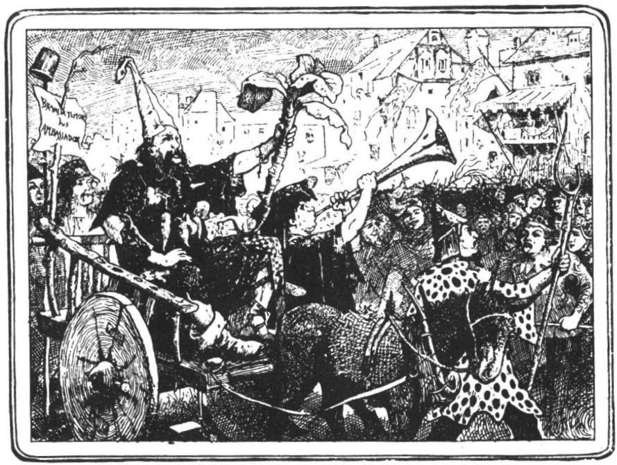

但是，周围的人们所看到的，却完全是另外一番景象。于是，他们大声地嘲笑，而且越笑越响。那支队伍照样向王宫走去，人们的笑声传到了王宫，国王也听到了。而且，他还听说，大使带领的这支队伍，破破烂烂很不像话，国王觉得这是对他的侮辱，便下令关闭大门。大使得知国王没有理由，毫不妥协地把他拒之门外，气得暴跳如雷，冲着国王和围观的人群大叫大吼。人们不停地嘲笑，朝他的队伍扔石头和泥巴，队伍散作一团，逃到了城外。大使立刻骑着马，飞奔急驰，回到他的王国去向国王汇报。那个国王立刻就向法达国王宣战，并且对他威胁恐吓，要将他的王国铲平。

几天以后，贝亚德国王派手下给小矮人送了一封友好的信，信中，他对小矮人目前的境况表示出极大的兴趣，并表示，如果需要，他会尽力提供帮助。

小矮人即刻回信，将他与贝亚德国王分手以后发生的一切都告诉了他。信中还提到了法达国王和布拉提摩国王之间的冲突，他恳求贝亚德国王派几千只善战的长毛狗来。

法达国王，王后以及萨比拉公主怎么都弄不明白，布拉提摩国王的大使会带着那样一支队伍来到城里。不过，他们还是迅速地安排了战事。还没有来得及去征服冰山的那些人都表示，愿意参战，并要求在军队里取得最好的职位。小矮人也在这第一批志愿者之列，但他只是要求做将军手下的一名副官。这位将军，作战勇敢，曾经立下无数战功。队伍集合完毕，便向边界挺进。布拉提摩国王知道自己的大使遭到侮辱，大发雷霆，发誓要对法达国王进行报复，并占有萨比拉公主。他派出的军队与法达国王的军队在边界上开始了一场激战。由于法达国王的军队在人数上远远少于敌人，便只能采取防御战略，以守为攻。没过多久，小矮人便以自己的勇猛善战以及对部下的关心，赢得了其他军官和所有士兵的尊敬。他指挥的每一场战役，都获得了胜利。

最后，布拉提摩国王集合了全部兵力，打算和对方决一雌雄。法达国王的军队顽强抵抗，但还是被击败了。将军也不幸战死，队伍损失惨重，只得撤退。小矮人在这次战斗中的表现，简直是奇迹。他多次指挥队伍掉转马头，向敌人发起反攻。他还成功地将残留的人马召集起来，清点人数。由于冬天到来，这场战争暂时平息了。

小矮人回到王宫时，王宫里一片惊慌。国王得知他信任的将军战死，悲痛绝望。他请求小矮人代替将军指挥军队，并让他参与国家一切事务。小矮人按照以前的计划，继续逗公主开心，并只字不提爱。他知道，公主一点也不喜欢别人对她说什么爱不爱的，因此，公主也很高兴和小矮人在一起，对他们两人来说，这个冬天过得很愉快。

而此时，小矮人也一直偷偷地在为下一次战斗作准备。他得到一条可靠消息，贝亚德国王已派了他的一支由长毛狗组成的队伍来到了法达国王的王国。小矮人下令，这支队伍应当到边境去，隐蔽在那儿。而且，一有机会，他就和这支队伍的将领举行密谈。这位将领年纪挺大，作战经验相当丰富，他建议和敌人进行阵地战。布拉提摩国王深信，他将在这次战斗中彻底击败法达国王，结束战争。因此，战斗刚开始，他就指挥人马，下令向法达国王的军队全线出击。但是，他刚一下令，隐蔽在周围的长毛狗便猛地冲了出来，闯进了他的队伍中，看到马就咬，骑在马上的士兵一个个都倒了下来，被狗活活咬死。顿时，队伍乱作一团，到处都是惨叫声。没用多久，小矮人指挥的队伍就大获全胜。在一次面对面的交锋中，他还将布拉提摩国王俘虏了，布拉提摩还未被带回法达国王的王宫，便自杀了。他不想自己以这种狼狈不堪的失败者的形象，出现在萨比拉公主面前。这时，留在宫中的费达斯和其余的王子们都匆匆上路，去征服冰山。因为他们看到小矮人如此勇敢善战，所向披靡，也许会成功地登上冰山。小矮人回到宫中，听说此事，气愤不已。确实，他所做的一切，都是为了公主。但是，公主除了赞赏他的勇敢善战，并没有流露出一丝爱慕之心。穆斯塔安慰小矮人，虽然公主没有爱上他，但她也没有爱上其他任何人。小矮人只好也用这话安慰自己。不过，他决定立刻出发去征服冰山，不管会发生什么，他都不在乎。毕竟，他远离家乡来到这儿，为的就是得到美丽的萨比拉公主。当他去向国王和王后告别时，他们都恳求他不要去冒这个险，已经有消息传来，费达斯和其他的王子们，都丧生在冰山中，但是，他还是决意要走，萨比拉公主伸出自己的手，让小矮人亲吻。此刻，她那副优雅冷漠的神情，还是与小矮人初见她时一模一样。王宫里所有的人正好都在场，目睹了公主和小矮人的告别，他们也很喜欢小矮人，因此看到他受到公主如此冷漠的对待，都感到愤愤不平。

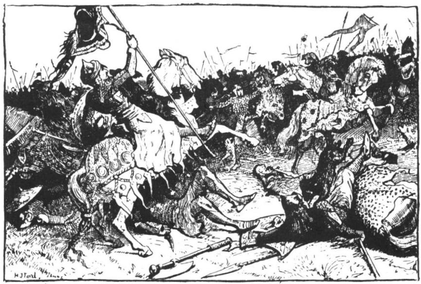

最后，法达国王对小矮人说道：

“王子，为了感谢你为我们王国所做的一切，我送了你很多礼物，可你全都拒绝了。现在，我叫萨比拉公主将她那件貂皮大衣送给你，希望你能够收下。”公主一直很喜欢穿这件大衣，不是因为她感到冷，而是因为大衣的光泽，完美地衬托出她的浅肤色和一头金发。公主脱下大衣很有礼貌地恳求小矮人收下。小矮人对于这样的礼物，自然满心欢喜地收下了。他拿了一小捆由各种木头组成的柴火，又从战争结束后留在他身边的五十条长毛狗中选出两条作为伙伴，便离开王宫，向冰山走去。所到之处，他都受到了热烈的欢迎，人们用各种方式表达对他的喜爱。

到了最后一个村庄后，小矮人将马留在那儿，带着狗开始艰难地在雪地中前进。眼前白茫茫一片的雪地，看不到尽头。这儿，他遇上了按照约定也来到雪地的另外四十八条长毛狗。它们看到了小矮人，感到非常高兴，并向他许诺，不管发生什么，它们总会忠诚地伴随在他左右帮助他。于是，小矮人和他的长毛狗伙伴们带着希望和勇气，开始穿越雪地。一开始，雪地中有一条别人留下的足迹，虽然很浅，但总能跟着它走。最后，足迹逐渐便消失了，唯一能够为他们指引方向的，就是北极星。

到了该休息的时候，王子便开始仔细地考虑他的行动计划。他从随身携带的柴捆中抽出几根嫩枝，插在雪地里，并在上面撒了一把他从被施了魔法的船上带来的魔粉。令小矮人感到高兴的是，那些嫩枝一下子抽条发芽，迅速地生长，才过了一小会儿，他的帐篷周围便长满了各种各样的树。它们还开花结果，小矮人和他的伙伴们于是就有了食物。他们还用树枝生了一堆大火，用来取暖。小矮人派了几条长毛狗去前面侦察，不久，它们就幸运地发现，有匹马带了很多吃的用的，深陷在雪地中。它们回来又叫了几条狗，一起把马上的那些东西拖回了帐篷。原来，里面装了很多饼干，于是，长毛狗们一个个都吃得饱饱的，才满足地去睡觉。他们就这样继续前行，白天赶路，晚上宿营，并总是要带上几根新长出的嫩枝，以便在下一次宿营时，再让嫩枝生长，开花，结果，提供食物和柴火。他们还在雪地上发现一些已被冻僵，站在那儿没有知觉，一动不动的人。小矮人决定就让这些人呆在原地，而没有想办法溶化他们身上的雪，将他们救活。

他们又在雪地中跋涉了整整三个月，冰山一天比一天更加清晰地在前方。最后，他们终于来到了冰山脚下。眼前的冰山巍峨耸立，悬崖陡峭，小矮人和长毛狗们不禁感到浑身颤抖。但是，他们还是意志坚强，很有耐心地一步一步往上爬，并且继续用魔枝取暖。要不是有魔枝帮忙，他们恐怕早就在寒冷的雪地上冻僵了。过了没多久，他们终于爬上了顶峰。山顶上有一座冰殿，冰殿富丽堂皇，一片寂静。萨比拉公主的心就在冰殿中。这时，情况变得复杂了。如果他们继续用魔枝取暖，就会溶化冰殿中的冰块，使冰殿整个地倒塌，砸在他们头上。小矮人带着长毛狗，小心谨慎，动作迅速地穿过了后宫和大厅，来到了一个巨大的宝座前。宝座有一块厚实的雪垫，雪垫上的一颗钻石晶莹夺目，巨大无比，里面装着萨比拉公主的心。宝座最下面的一个台阶上，刻着这样一行字：高尚勇敢的人，你得到了萨比拉公主的心，作为对你的行为应有的报答，请你在这块平静的地方安息吧！

这时的小矮人已经非常虚弱，但是，他还是使出仅剩的一点力气，猛地冲上宝座，将钻石拿在手中。钻石中的这颗心，是他一心渴望得到的东西。小矮人刚拿到钻石，便晕倒在厚实的雪垫上。他那些忠实的长毛狗们见状，立刻冲上前去，用嘴巴咬住衣角，一起将他拖出了冰殿。它们刚跑出冰殿，就听到身后一声巨响，原来，冰殿中的冰块已经被小矮人他们带进去的火熔化了，整座冰殿都倒塌了。等长毛狗们把小矮人带到冰山脚下后，便立刻设法使他恢复了知觉。小矮人清醒过来，他看到自己手中拿着萨比拉公主的心，简直欣喜若狂。

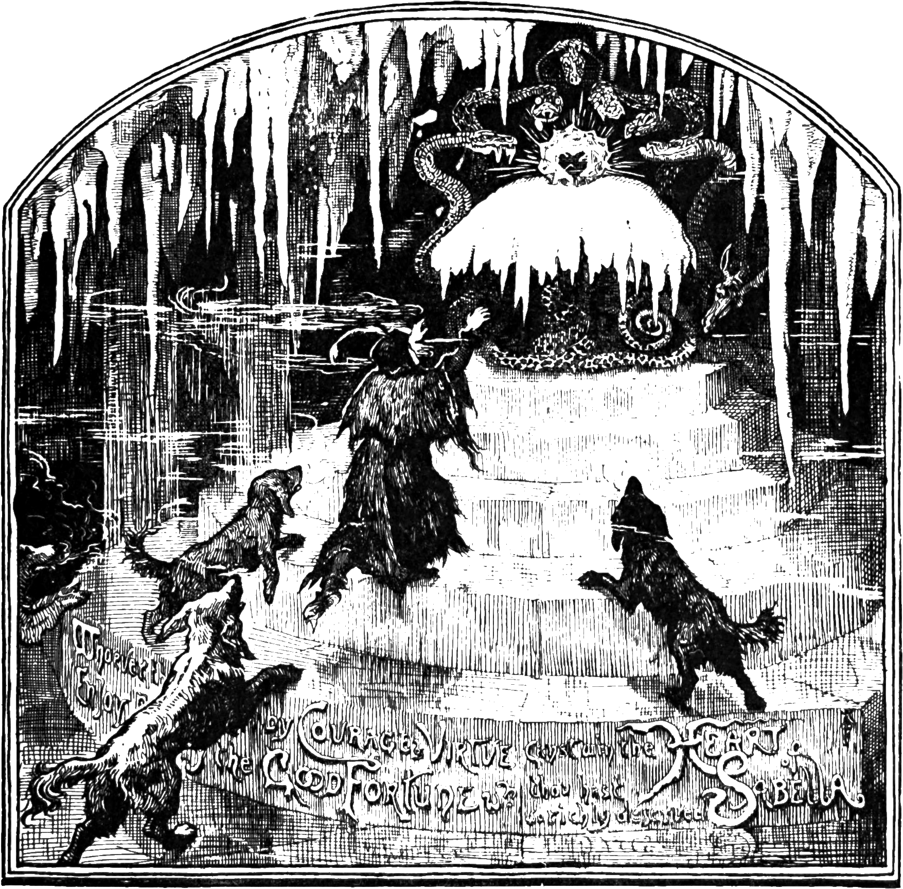

这位征服冰山的勇士，带着他的伙伴们开始往回走。路上，幸福无比的小矮人又看到了那些被冻僵的人，他不忍心看到他们这样悲惨地站在雪地上，即便这些家伙就是他的对手，那些也想征服冰山，得到萨比拉的王子们。于是，他便命令长毛狗们不遗余力将他们救活。这样，它们每天救活几个，每天救活几个，因此，小矮人身后跟着的人越来越多。等他回到那个小村庄时，与他一同回来的，还有五百个王子，以及无数个王子们手下的大臣和士兵。由于小矮人对他们彬彬有礼，态度随和亲切，所以他们都愿意跟着他，急切地想为他效劳。这时的小矮人因为得到了萨比拉公主的心，快乐无比，与所有的人都能愉快地相处。不久，小矮人就见到了那条忠实的长毛狗穆斯塔。穆斯塔飞快地奔向小矮人，此刻它有好多的话要对小矮人说。在他出去征服冰山的这段日子里，穆斯塔发现萨比拉公主突然有了一个奇妙的变化，她整天若有所思，温柔多情，并总是和它谈起小矮人。话语中流露出她对小矮人此行的担忧，生怕他遭到什么不测。当穆斯塔将公主的这些变化告诉小矮人，小矮人心中更是充满了喜悦。这时，法达国王和王后已经听说了小矮人凯旋归来的消息。他们派了一个大臣，前来向小矮人表示祝贺。大臣还带来了萨比拉公主的感激之词。小矮人让穆斯塔回到公主身边去，公主高兴地看到它回来，毕竟，这条长毛狗，是她心爱的人赠给她的礼物。

最后，所有的人一起回到了王宫，受到了隆重的欢迎。法达国王和波妲王后见到小矮人，和他紧紧拥抱，并宣布，他们要把萨比拉公主嫁给他，让他成为王位的继承人。小矮人表示，国王和王后的决定，使他感到莫大的荣幸。于是，他又去拜见公主，当他亲吻她的手时，萨比拉公主有生以来第一次羞红了脸，说不出一句话。小矮人跪倒在公主身旁，将那颗晶莹夺目的钻石捧在手中，对她说道：

“女士，这件宝物是你的，虽然我历尽艰险，饱受磨难，但是，我觉得自己不配得到它。”

“啊！王子！”公主答道，“如果我收下这件宝物，还是会把它送还给你，因为，这颗心早就属于你了。”

这个时候，国王和王后进来了，他们问了许许多多的问题，有的甚至重复问了好几遍，好像世上每一件事，都会产生一个大家都感兴趣的问题。比如对小矮人来说，他征服冰山后，人们不厌其烦地问他：

“你到冰山去，不觉得冷吗？”

国王让小矮人和公主一起跟他去见见大臣们，他的意图，是要把自己的女婿和王位继承人介绍给高官显族。小矮人觉察到国王的真实意图后，便要求国王让他先说几句。于是，他便把自己的经历简单地讲述了一遍，甚至提到，自己肯定是个农夫的儿子。小矮人话音刚落，天空顿时变暗，雷声滚滚，闪电交加，好心的杰娜斯塔仙女突然出现了，她面对着小矮人，对他说道：

“我对你相当满意，你的所作所为，不仅表现出巨大的勇气，而且有一颗善良的心。”于是，仙女又转身面对国王和王后，将小矮人的真实身份和有关的故事告诉了他们，她将小矮人带出王宫，放到农夫家中，因为她觉得，那些教育和训练有助于他将来统治王国。然后，她又对小矮人说：“你已经懂得了一个忠实的朋友的价值，现在，你会高兴地看到，贝亚德国王和他的臣民恢复原形，这是他们对你的好心得到的报偿。”

这时，雄鹰驾了一辆礼车赶来了。车上坐着王子那对愚蠢的父母，他们兴奋地和自己失踪已久的儿子紧紧拥抱。并且，他们还吃惊地看到，王子的身上果然都是毛！然后，他们还拥抱了萨比拉公主，紧紧握住她的手（愚蠢的人最喜欢用这种方式表达自己对别人的喜爱）。这时各种各样的礼车从四面八方赶来，车上坐着仙女们。

“陛下，”杰娜斯塔仙女对法达国王说道，“我自作主张，把你的王宫定为我们仙女集会的地方，通常，我们每一百年都要举行一次舞会，这次，就由你来安排舞会吧！”

国王表示，这是他莫大的荣幸。接着，他又和仙女商量，要求和仙女一道来主持舞会。仙女同意了，有位叫马瑟帝的仙女使贝亚德国王和他的臣民恢复了原形。这位贝亚德国王，也是英俊潇洒，风度翩翩。其中有个仙女立刻派礼车把香岛国的女王接了过来。于是，两对爱侣的婚礼同时进行，从此，他们各自过着幸福美满的生活。等他们的孩子长大成人后，他们又结为亲家，令王国的疆域更为辽阔。

王子为了永远记住萨比拉公主赠给他的第一件礼物，把所有那些最漂亮的貂，都称之为“萨比拉”，这就是为什么这种动物，至今一直被叫做“萨比拉”。

 
 

## 魔戒

从前有个年轻人，名叫罗兹蒙，他模样俊秀，心地善良。而他的哥哥布拉明托，却是个长相丑陋，心眼很坏的家伙。他们的母亲对罗兹蒙非常喜爱，对布拉明托却感到讨厌，这使得布拉明托对弟弟心怀妒意。为了破坏弟弟的名誉，他编造了一堆可怕的谎言。布拉明托对父亲说，罗兹蒙常去拜访一个与他们家积仇很深，不相往来的邻居，还把自己家中的情况透露给邻居，并与他密谋用毒药害死自己的父亲。

他们的父亲听了这些话，自然大发雷霆。他把罗兹蒙狠狠揍了一顿，打得他遍体鳞伤，然后又把他关起来，三天不准他吃东西。最后，父亲又把罗兹蒙赶出家门，并不准他以后再踏进家门一步，否则，就把他杀了。他们的母亲对此当然伤心得很，但是，除了不停地掉眼泪，她也不敢多说什么。

罗兹蒙眼中含着泪花，离开了自己的家。他不知该到哪儿去，只好四处流浪。最后，他来到一座密密的小树林中。罗兹蒙走到一块大岩石下面时，天马上就黑了，罗兹蒙听着潺潺的流水声，迷迷糊糊地在青苔上睡着了。

他醒来的时候，天已经亮了。在他的面前，出现一位美丽的女士，女士骑在一匹点缀着金子的灰色骏马上，似乎正打算去狩猎。

“你看到有一只雄鹿和几只猎狗经过吗？”她问罗兹蒙。

“没有，夫人，”他回答道。

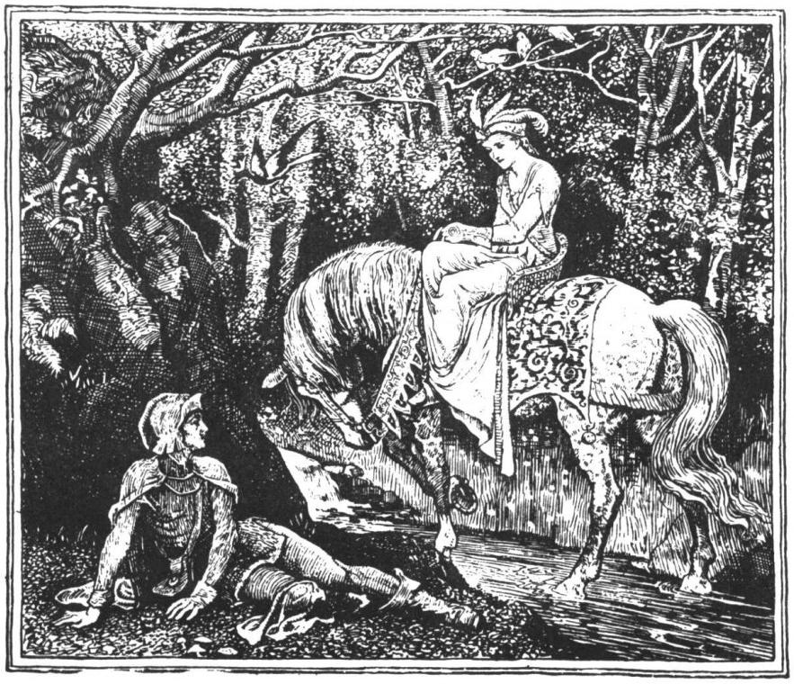

于是，女士又问他：“你看上去很伤心，是不是发生了什么事？这只戒指送给你吧！有了它，你就会成为世上最强大最幸福的人。不过，你不能用它来干坏事。如果钻石转到里面，你就会成为隐形人。钻石转在外面，就会现出身形。如果戒指戴在小指上，你就会变为国王的儿子，后面跟着一大群衣着华贵的侍从。如果戒指戴在无名指上，你就会恢复到原来的样子。”

这时，罗兹蒙明白，跟他说话的这位女士是个仙女，仙女说完话，便突然跑进密林深处，不见了。罗兹蒙急于要试试戒指的魔力，就立刻赶回家中。仙女所说的果然是真话，而且，罗兹蒙还发现，他隐形时，仍能听到看到周围的一切。这时的罗兹蒙要是愿意，可以用魔戒对布拉明托进行报复，而不会为自己招致任何麻烦。罗兹蒙把这件奇怪的事告诉了他母亲，接着，他就把戒指戴在小指上，转眼就变成了国王的儿子，后面跟随着上百匹骏马和许多衣着华丽的侍卫军官。

罗兹蒙的父亲见王子突然驾临寒舍，感到又惊讶又窘迫。他不知道在这种场合中，什么样的行为举止才算得体。罗兹蒙问他有几个儿子。

“两个，”父亲答道。

“我想见见他们。”罗兹蒙说道，“马上叫他们来，我要带他们到王宫里去，给他们荣华富贵。”

父亲犹豫了一阵，回答“王子”道：“我很荣幸把我的长子交给您。”

“那么你的小儿子呢？我也想见见他。”罗兹蒙坚持道。

“他现在不在这儿，因为他做了错事，我惩罚了他一顿，所以他逃跑了。”

“你应当向他指出什么是对，什么是错，而不是惩罚他。不过，就让你长子跟我走吧。至于你嘛，就跟着那两个卫兵走，我会告诉他们把你带到哪儿的。”

于是，两个卫兵带着罗兹蒙的父亲来到了树林中仙女遇上罗兹蒙的地方。仙女用一根金棒把父亲狠狠揍了一顿，然后把他扔到一个又深又暗的洞里，并对他施了魔法。“呆在这儿吧，”仙女对他说道，“等你儿子来把你解救出去。”

这时，变成王子模样的罗兹蒙来到了王宫。真王子正好不在宫中，他坐船到一个很远的岛上去打仗，但由于狂暴的逆风，王子的船只被打翻，他被海浪卷到不为人知的海边，作了野人的俘虏。罗兹蒙以王子的身份来到宫中后，告诉那些在为王子的失踪而伤心不已的人们，他在危难时刻被几位商人救了。王子平安归来的消息令整个王国欢呼雀跃，国王更是激动得语无伦次，紧紧地与王子相抱。王后也兴奋不已，她下令，整个王国召开庆典活动，庆祝王子的平安归来。

一天，假冒的王子对自己的哥哥布拉明托说：“布拉明托，我把你从小村庄带到王宫，是想给你荣华富贵。可是，我发现你是个不诚实的家伙，由于你编的谎言，你弟弟罗兹蒙遭受了苦难。他现在也在王宫，我希望你能和他说话，听听他对你的痛斥。”

布拉明托听了这些话，吓得浑身发抖，“扑通”一声，跪倒在王子面前，向他忏悔自己的罪孽。

“光这样是不行的，”罗兹蒙说道，“你应当向你弟弟忏悔，并乞求他的原谅。即使他非常仁慈宽容地原谅了你，你也不配得到他的原谅。罗兹蒙现在就在王宫的前厅，马上你就能看到他。我回房去了，你们两个单独会面吧！”

布拉明托一看到罗兹蒙，就感到羞愧不已，他乞求弟弟原谅他，并表示愿意为自己所犯的错误赎罪。罗兹蒙流着眼泪，和哥哥紧紧相拥，并立刻原谅了他。罗兹蒙对布拉明托说：“我承蒙国王的照应，他让我自己选择：是砍你的头，还是把你关在牢中，永世不得翻身。尽管你曾那样心狠手辣地对待我，我还是希望能对你仁慈。”布拉明托听了这话，既感到惭愧，又觉得困惑。他不敢抬头看弟弟一眼，也不敢提醒他自己是兄长。罗兹蒙结束了与哥哥间的恩怨，就放出风声，说他为了迎娶一位邻国的公主，打算作一次秘密旅行。其实，罗兹蒙是去看他的母亲。他把宫中发生的事告诉了母亲，还给了她一笔钱。国王允许罗兹蒙拿走任何自己想要的东西，但是罗兹蒙总是很小心谨慎，不滥用国王给予的这份权力。这时，国王与某个邻国之间爆发了战争。邻国的国王刁钻歹毒，不守信用。罗兹蒙跑到坏国王的宫中，借魔戒的法力，偷听到了坏国王和大臣之间关于战事的商议和作战计划。这样，罗兹蒙就可以挫败那些计划。国王命令罗兹蒙带领军队，与邻国的军队作战。经过激烈的战斗，罗兹蒙带领的军队获得了胜利，凯旋归来。最后，那个坏国王只得答应在对双方都公平的情况下，签一份和平协议。

于是，国王想让罗兹蒙娶一位邻国的公主，这位公主不但长得漂亮，而且还是王位继承人。一天早上，罗兹蒙在他遇见仙女的树林中狩猎时，仙女出现了。“你要注意，不要娶任何一个相信你是王子的人。”仙女神情凝重，表情严肃地对罗兹蒙说道，“你不能欺骗别人。现在，整个王国的人都把你当成了真正的王子，但继承王位的，必须是真正的王子，这是公平正当的事。你去遥远的岛上寻找王子，我会助你一臂之力，祝你一路顺风。平安地找到王子，即使这与你的雄心壮志不符，你也得替国王找到王子，对他效忠。因为你必须做个诚实的人，随时准备恢复自己真实的身份。如果你不这样去做，我就会抛下你，让你回到原先的伤心痛苦中去，成为一个罪恶的、不幸的人。”

罗兹蒙把仙女这一明智的建议牢牢记在心里。他又放出风声，说他要去邻国执行一个秘密使命。然后，他就登上了船，果然是一路顺风。罗兹蒙来到了一座小岛，仙女曾告诉他，真正的王子就在这座小岛上。不幸的王子被野人俘虏后，做了他们睡觉时的守卫。罗兹蒙用魔戒隐身后，在草原上找到了正在放羊的王子。他将斗篷披在王子身上，使他逃脱了野人的手掌。两个年轻人一起坐上船，在仙女送来的一路顺风中，回到国王的宫中。

罗兹蒙首先对国王说道：“你一直把我当成儿子，其实，我不是王子，现在，我给你带来了真正的王子。”

国王大为震惊，他转身面对自己的儿子，问道：“那个带领军队战胜敌人，为国家带来和平安定的王子，难道真的不是你吗？你的船沉入大海，野人把你俘虏，而罗兹蒙把你解救了出来，这些都是事实吗？”

“确实如此，”王子答道，“正是罗兹蒙找到了我并将我带回王宫。要不是他，我大概永远不会这么幸运，能再与你相见。带领军队战胜敌人，凯旋而归的也是罗兹蒙，而不是我。”

国王几乎不相信自己的耳朵，罗兹蒙动了一下戒指上的钻石，马上就变成了王子模样。国王看着面前站着的两个一模一样的年轻人，迷惑不解。接着，他打算用重金酬谢罗兹蒙。但是，罗兹蒙婉言拒绝了，他只求国王答应他一件事，让他哥哥布拉明托在朝中获得一个职位，因为罗兹蒙对自己由平民百姓变为达官要人感到恐惧。他害怕别人羡慕自己，更害怕自己经不住富贵荣华的侵蚀。他愿意回到小村庄，和母亲住在一起，以耕田种地为生。

一天，罗兹蒙在树林中，又遇见了那位仙女。仙女将那个关押着他父亲的洞穴指给他看，并将用来释放他父亲的咒语念给他听。罗兹蒙高兴极了，不停地重复着那句咒语。他一直希望能把老父接回家中，让他安享晚年。把父亲救出后，罗兹蒙就成了家里的大恩人。虽然哥哥和父亲曾经恶毒地对待他，他还是乐意善待他们。至于他为王国所作的一切，罗兹蒙唯一要求的回报就是能让他远离王宫的腐败。最后，他还决定把魔戒还给仙女，因为罗兹蒙害怕自己抵挡不住诱惑，会借魔戒的法力，重新获取王子的地位。他在树林中到处寻找仙女，几天以后，他终于找到了仙女。“我要把魔戒还你，”罗兹蒙一边把魔戒递给仙女，一边说道，“这件礼物虽然威力无穷，但如果使用不当，也会带来祸患。只有当它无法再帮助我摆脱孤独，满足我的欲望时，我才有一种安全感。”

正当罗兹蒙寻找仙女归还魔戒时，利欲熏心的布拉明托企图说服刚继承王位的王子，使他对罗兹蒙忘恩负义。布拉明托没有从过去的经历中吸取任何教训，可是，仙女对发生的这一切都了如指掌，她对恳求自己收回魔戒的罗兹蒙说道：

“你那个心狠手辣的哥哥正千方百计对王子进馋言，说你的坏话。他想借王子之手将你置于死地，这家伙应该受到惩罚，得到死的报应。我会把这个魔戒给他，让他自取灭亡。”

罗兹蒙听了这话，不禁哭了起来，他问仙女：

“你说要把魔戒给布拉明托，作为对他的惩罚，这究竟是什么意思？他不会用魔戒迫害他人，篡夺王位吗？”

仙女答道：“一个人的良药，是另一个人的致命毒药。对一个本性邪恶的人来说，荣华富贵是万恶之源。如果你想惩罚一个无赖，就不妨给他权力，他会自取灭亡的。”

仙女说完这些话，就消失了。其实，她是径直往王宫去了，仙女装扮成一个衣衫褴褛的老妇，来到布拉明托面前。她见布拉明托也看到了自己，便走上前去对他说道：

“我曾经把这只魔戒借给了你弟弟，在它的帮助下，罗兹蒙获取了荣耀。现在我把它拿了回来，把它交给你，你要小心谨慎地使用它。”

布拉明托大笑了起来，说道：

“我当然不会像他那样愚蠢，自己不留在宫中作国王，却把王子找了回来。”果然，布拉明托比弟弟“明智”得多，借用魔戒的法力，他专做这些事：挖掘并出卖家族秘密；进行谋杀活动以及其他罪恶的勾当；用非法手段谋取巨额财富；这一系列阴谋活动令人们感到震惊。国王看到发生了这么多关于国家和个人的事件，起先也和别人一样，感到迷惑不解。但是，布拉明托莫名其妙的财富增长和他越来越盛气凌人的姿态，不得不令国王感到怀疑。他猜想，魔戒可能早已落入布拉明托的手中。为了找出事情的真相，国王贿赂了一个刚到王宫的外族人。他的国家经常和国王的国家打仗，国王让他晚上偷偷溜进布拉明托的家，用巨额财富和显赫地位作诱饵，要他出卖国家机密。

布拉明托同意作这笔交易，并当即收下了第一笔报酬。他还向外族人吹嘘，自己有一个魔戒，凭借它的法力，他可以隐身潜入王宫里最机密的地方。但是，布拉明托得意了没多久，第二天，国王就下令将他逮捕，并收缴了魔戒。在对布拉明托搜身时，士兵们找到了一些可以作为他叛国证据的公文。虽然罗兹蒙亲自来到王宫向国王求情，国王也毫不手软，处死了布拉明托。在罗兹蒙手中非常有用的魔戒成了致布拉明托于死地的毒药。

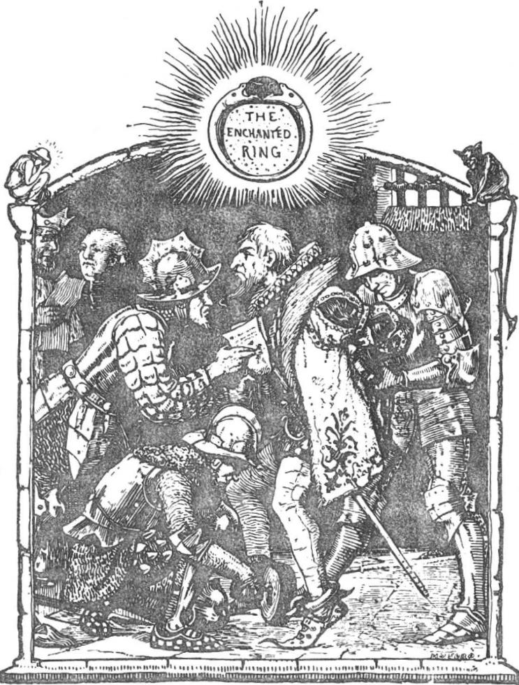

布拉明托出了事，国王为了对罗兹蒙表示安慰，他把魔戒作为无价之宝还给罗兹蒙。谁知伤心的罗兹蒙并不当它是无价之宝，回到家中，他所做的第一件事就是到树林中找仙女。

“这是你的魔戒，还给你，”罗兹蒙对仙女说，“哥哥的经历使我明白了很多道理。留着魔戒，只会带来毁灭。要是没有它，布拉明托也许还活着，我年迈的父母也无需在耻辱和悲痛中死去。如果布拉明托从来不曾有机会满足自己的欲望，他或许会理智，快乐得多！哦！拥有过多的权力是件多么危险的事！魔戒你还是拿回去吧！似乎它一到谁手中，谁就会大难临头。所以，我现在恳求你帮我一个忙，从今以后，不要再把魔戒送给任何一位我亲爱的人。”

 
 

## 鼻烟盒

这种事经常发生。有个年轻人，把所有时间都花在旅行上。一天，他在路上拣到了一只鼻烟盒。这只鼻烟盒刚被打开，就用西班牙语问道：“你想要什么？”年轻人吓了一跳。幸运的是，他没有把它一扔了事，而是关紧盒盖，放进了自己的口袋里。于是，他继续前行。年轻人走啊，走啊，边走边想：“如果鼻烟盒再问我想要什么，我会知道怎么回答它。”接着，他拿出鼻烟盒，把它打开。“你想要什么？”果然，鼻烟盒再次问道。“我要满满一帽子的金子。”年轻人答道。说完，他的帽子一下子就装满了金子。

年轻人高兴极了，从此，他什么也不会缺了。于是，他继续旅行，走啊，走啊，他穿过重重森林，来到了一座美丽的城堡。城堡里住着一位国王，年轻人毫不避讳地在城堡四周走来走去。终于，国王看到了他，并问他在那儿做什么？“我只想看看你的城堡，”年轻人答道，“你也想建一座这样的城堡，对吗？”年轻人没有回答。天黑以后，他拿出鼻烟盒，打开盒盖。“你想要什么？”鼻烟盒问道。“给我建一座金梁钻石瓦的城堡，里面有金银做的家具。”话音刚落，他的面前就出现了一座城堡，和他要求的一模一样，并且正对着国王的王宫。国王醒来后，看到这样一座富丽堂皇的城堡在阳光下闪闪发光，不禁大吃一惊。仆人们不得不停下手里的活，盯着城堡，看得眼睛都直了。国王穿上衣服，去见那个年轻人。年轻人直言不讳地告诉国王，自己是一个威力无穷的王子，他希望国王能和他住在一起，并把公主嫁给他。这正合国王的心意，于是，婚礼马上就举行。年轻人和公主幸福地生活在金殿里。

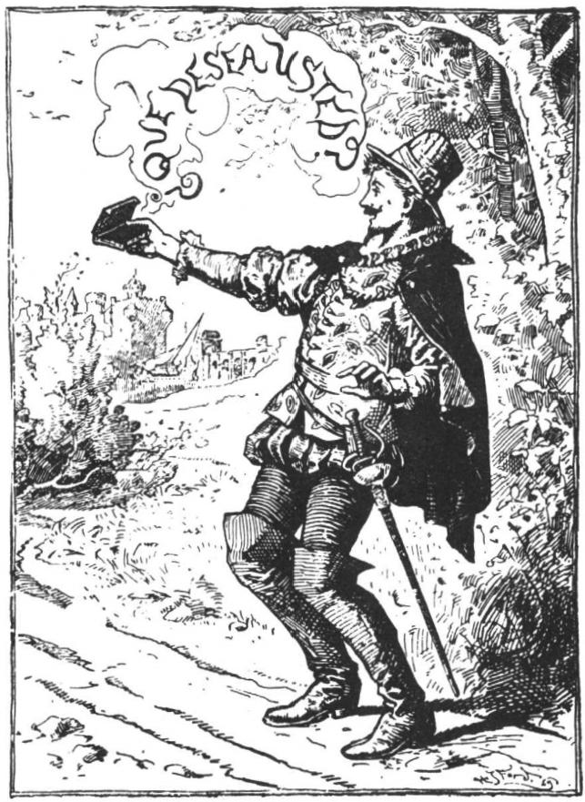

但是，国王的妻子却对这对年轻夫妇非常嫉妒。公主毫无戒心地将鼻烟盒的秘密告诉了王后。王后于是贿赂了一个女仆，让她设法把鼻烟盒偷走。她们密切地注意着鼻烟盒每天被安放在何处。一天晚上，宫里人都入睡后，那个女仆偷走了鼻烟盒，并把它交给王后，王后高兴极了！她把盒盖打开，当宝盒问她想要什么时，她立刻回答：“我想让你把国王、仆人和这座漂亮的房子都带到红海的另一边去，但公主和她丈夫得留在这儿。”

当年轻夫妇醒来时，发现他们睡在国王原来的城堡中，鼻烟盒不翼而飞了。他们四处寻找，但还是一无所获。年轻人感到应该抓紧时间，立刻行动，把宝盒找回来。于是，他在口袋里装满了沉甸甸的金子，飞身上马，去找宝盒了。他不停地走啊，走啊，走遍了所有的邻国，也没能找到那只鼻烟盒。很快，他就用完了最后一枚金币。于是，他只得沿路乞讨，骑着马继续寻找。

有人告诉这个年轻人，他应该向月亮打听一下，因为月亮绕着地球转，去的地方很多，也许可以为他提供一点信息。年轻人接受了建议，继续往前走，去寻找月亮。最后，他来到了月亮上面。在那儿，有个老妇人对他说：“你在这儿干什么？我的儿子见了活物就吃，你要是聪明点，还是马上离开此地，不要再往前走了。”年轻人听了这话，没有吓得转身就逃，而是把自己的不幸遭遇一五一十地告诉了老妇人：他如何得到那只神奇的鼻烟盒，可又让人偷走，变得一无所有。现在他为了寻找宝盒，只得离开心爱的妻子，还沦落为乞丐。他告诉老妇人，也许她的儿子月亮见过一座金梁钻石瓦的宫殿，里面全都是金银的装饰，因为月亮哪儿都去过。正当年轻人对老妇说这番话时，月亮来了，他说自己闻到了活物的血腥味。老妇人把年轻人失去了一切的不幸遭遇和他千里迢迢来到此地的原委告诉了月亮。她还鼓励年轻人不要畏惧，走上前去对月亮直抒来意。于是，年轻人勇敢地走到月亮面前，问他是否见过一座金碧辉煌，绝妙非凡的宫殿，这宫殿本来属于他，但现在被人偷走了。月亮否定他曾见过这样一座宫殿，但他向年轻人推荐了太阳，因为太阳去过的地方比他还多。

年轻人只得向月亮告辞，踏上了寻找太阳的艰难历程。他骑着马，一路乞讨，最后终于来到了太阳的领土。在那儿，他又看到了一个老妇人。老妇人见了这位年轻人，问道：“你来这儿做什么？快走吧，你难道没听说过我儿子太阳以基督徒为食吗？”可是年轻人拒绝走开，他告诉老妇人，他的遭遇非常悲惨，生与死对他来说已没有多大区别。他已经失去了一切，特别是那座世上绝无仅有的华丽宫殿。那座宫殿金梁钻石瓦，里面全都是金银家具。为了找到这座宫殿，他已经浪迹天涯，历尽艰辛，但还是未曾找到，恐怕世上没有比他更不幸的人了。听了年轻人的这番话，老妇人的心肠软了下来，她答应把年轻人藏匿起来。

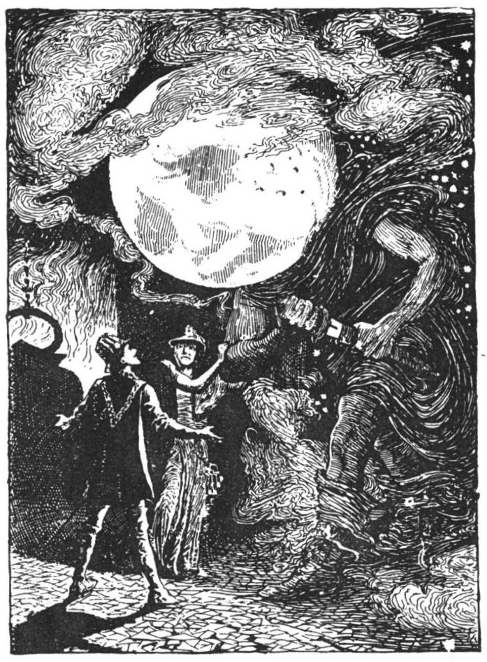

不久太阳就来了，他说自己闻到了基督徒的血腥味，打算以此作为晚餐。但那个老妇人对儿子讲了年轻人的不幸遭遇，并告诉他，年轻人不远千里赶来，就是为了寻求他的帮助。太阳被感动了，他答应见一下这个不幸的人。

年轻人从藏匿之处走了出来，他恳求太阳告诉他，是否在旅行途中见过一座金梁钻石瓦，里面全都是金银装饰的绝无仅有的华丽宫殿。

太阳说他从未见过，但他向年轻人推荐了风，因为风也是到处跑，他见过很多别人未曾见过的东西，如果有人真的看见过那座宫殿，那这个人肯定是风。

于是，年轻人又骑着马，一路去寻找风，最后，他来到了风的家园，看到一位老妇人正忙着用水桶提水。她问年轻人，什么念头使他来到此地，她儿子风可是见什么就吃什么，并且马上就会疯疯癫癫地跑来。她让年轻人最好还是小心警惕。但是，年轻人毫不畏惧，他把自己的不幸遭遇告诉了老妇人，并对她说，他离开自己心爱的妻子，到处去流浪，如果寻不到那座宫殿，他是永远不会回家的。经历了那么多不幸，就算让风吃了，他也不会在乎。他还告诉老妇人，正是太阳让他来找风帮忙的。于是，老妇人把年轻人藏在楼梯下。很快，他们就听到南风呼啸而来，把房屋震得直摇晃。南风口渴得厉害，急急忙忙喝了口水，然后对自己的母亲说，他闻到了基督徒的血腥味，她最好立刻把那家伙交出来，好让他填饱肚子。老妇人恳求儿子先随便吃点什么填填肚子。然后，她告诉风，这个年轻人确实值得同情。太阳曾给了他一条生路，让他来找风帮忙。说完，她把年轻人带到风面前，年轻人把自己几番周折寻找宫殿，但都没有下落，只得来向风求助的过程对风叙述了一遍。接着，他又向风描述了那座富丽堂皇的宫殿和自己被洗劫一空的遭遇。他问风是否在飘游时见过那座宫殿。风告诉年轻人，他确实见过那座宫殿，而且他一整天都对着宫殿前前后后地猛吹，但不管他怎么吹，那些钻石瓦还是纹丝不动。“哦，快告诉我，它在哪儿？”年轻人迫不及待地大声问道。“在很远的地方，红海的另一边。”风答道。但这话丝毫没让年轻人感到泄气，他早已走过了千山万水，再遥远的目的地和再艰难的旅程，都不会使他后退。

于是，年轻人立刻上路了。终于，他来到了遥远的红海的另一边。到了那儿，他问人是否需要一个花匠。别人告诉他，城堡里有个花匠刚好离职，也许他可以在那儿找到一份活干。年轻人立刻赶到城堡，要求找一份花匠的活干。城堡里的人同意给他这份差使，年轻人这时简直欣喜若狂。他开始在城堡里工作后，成天和仆人们闲聊，谈论主人的财富和城堡中一些神奇的东西。不久，他和一个女仆交上了朋友。这个女仆把鼻烟盒的故事说给了年轻人听，年轻人于是缠着女仆，说想见一下这个宝盒。一天晚上，女仆设法偷到了宝盒，并将它藏在了女主人卧室中一个隐秘处，这一切，年轻人都看得明白。

第二天晚上，城堡里的人都睡着了，年轻人偷偷溜进了那个卧室，把鼻烟盒偷走了。他打开盒盖时，兴奋激动的心情溢于言表。当鼻烟盒和原先一样问道你想要什么时，他立刻答道：“我要什么？我要什么？还用问吗？我要和我的宫殿一起回到原来的地方，让国王、王后和所有的仆人都淹死在海中。”话音刚落，他就发现自己已经回到了妻子身边，王宫里所有的人都沉到了海底，被水淹死了。

 
 

## 金色画眉鸟

从前有个大老爷，他有三个儿子。一次，这个大老爷得了重病，各种医生，甚至接骨师，都被请来替他看病，但没有一个人能说出他究竟得了什么病。因此，也没人能够为他解除病痛。最后，来了一个外国医生，他看了老爷的病后宣布，唯有金色画眉鸟才能治好这种病。

于是，老爷让他的长子去寻找这种神奇的鸟，并许下诺言，如果长子能把金色画眉鸟带回来，他将会得到大笔的财富。

长子出发了，开始去寻找金色画眉鸟。不久，他来到一个十字路口，在那儿犹豫徘徊，不知该走哪条路。于是，他把帽子抛到空中，帽子落在什么地方，他就往那儿走。又过了两三天，长子开始厌倦这种毫无目的，遥遥无期的寻鸟旅程。他在一个满是寻欢作乐者的旅店里住了下来，要了些东西大吃大喝。

“我相信，浪费更多的时间去找那种鸟，实在是件愚蠢透顶的事。反正父亲已经年纪很大了，如果他死了，我会继承一笔遗产。”

老爷耐心地等了一阵子，还是不见长子回来，他只好打发次子去找金色画眉鸟。次子和长子选择同一个方向出发。到了那个十字路口，他也用同样的方法，选择自己的路线。帽子恰好掉在了同一个地方，他沿着那条路往前走，不久也到了长子住下的小旅店。长子正靠在旅店的窗边，他见到弟弟，马上和他打招呼，并劝他也在旅店住下，好好玩几天再说。

“你说得对”，弟弟说道，“哪怕我们找遍全世界，也未必能把金色画眉鸟找到，就算父亲死了，我们也会继承他的财产。”

于是，次子也在旅店住下了，两兄弟一起大吃大喝，寻欢作乐，把寻鸟的事抛在了脑后。很快，他俩就把身边的钱花光了，还欠了店主一大笔钱。店主把他们关在旅店里并宣布，不还清债务就不放他们走。

这下轮到最小的儿子去找金色画眉鸟了。他也来到了关押着两个哥哥的那个小旅店。他们看到弟弟走来，大声呼叫他，想让他停下来。

“不，我不会停下的，”小儿子对哥哥们说道，“父亲信任我，才让我去找金色画眉鸟，我要找遍全世界，把那只能治好父亲的病的小鸟找到。”

“呸！”两个哥哥不屑一顾地说道，“你的结果也不会比我们好多少！”然后，他们又一起哼哼道：“这家伙想找死。他死了也好，我们俩把财产分了。”

小儿子继续去寻金色画眉鸟。途中，他碰到了一只野兔，那只野兔停下来，望着他，问道：

“你去哪儿，我的朋友？”

“我也不知道，”年轻人答道，“我父亲病了，除非我找到金色画眉鸟，否则他会病死的。我已经找了很久了，但没人告诉我该到哪里寻找画眉鸟。”

“啊，是这样！你还得走很长一段路。”野兔很同情这个年轻人，“在你找到之前，至少还得走七百里路。”

“这么远的地方，我该怎么走去呢？”

“骑在我背上吧，让我把你带过去。”野兔热心地说道。

年轻人照野兔说的，骑到了它背上。野兔往前跳一下，就可以前进七里路，很快，他们就来到了一座城堡，这可是一座真正的城堡，又宽敞，又漂亮。

“金色画眉鸟就在附近的小木棚里。”野兔告诉年轻人，“找到它并不难，它被关在一个鸟笼里，旁边还有一只金笼子。千万别把画眉鸟放到漂亮的金笼子里，否则，城堡里的人都会知道，有人在想偷金色画眉鸟。”

年轻人很快找到了金色画眉鸟。小鸟蹲在笼中一根小横杆上，一副生硬僵直的样子，像死了一样，旁边果然有一只金笼子。

“我把画眉鸟放到金笼里，它或许就能活过来。”年轻人心想。

可是，画眉鸟刚碰到金笼的边栏，就清醒过来。它开始大声尖叫，城堡里的仆人听到叫声，都跑来看是怎么回事，他们一口咬定年轻人想偷走画眉鸟，一致同意把他扔进监狱。

“不是的，我不是小偷，”年轻人竭力为自己辩护，“我要带走金色画眉鸟，是因为我父亲得了重病，唯有画眉鸟能治好他的病。为了找到这只小鸟，我已经走了足足七百里路。”

“那好吧，”仆人们说道，“我们会放你走，也会让你带走金色画眉鸟，但你得把小瓷女带到城堡来。”

年轻人根本不知道什么小瓷女，只好流着泪离开了城堡。他又碰上了那只野兔，它正大口大口地嚼着麝香草。

“你为什么哭呢，我的朋友？”野兔关心地问道。

“城堡里的人不让我带走金色画眉鸟，除非我能把小瓷女交到他们手中。”

“你一定没有听我的劝告，把画眉鸟放到了漂亮的金笼子里。”

“哎，我确实这么做了！”

“不要绝望，年轻人，小瓷女是个年轻的姑娘，长得像维纳斯一样美丽。她住在两百里以外的一个地方，来吧，骑到我背上来，我把你带到那儿去。”

于是，野兔一跃十里，很快把年轻人带到了目的地，它在一个湖泊边停了下来。

“我先去吃一口麝香草提提精神，小瓷女马上会和伙伴来这儿洗澡，”野兔嘱咐年轻人，“小瓷女在洗澡时，你要趁机把她那件白得耀眼的衣服藏起来。要让她答应跟着你走，否则不要把衣服还给她。”

野兔叮嘱完，就跑掉了。几乎是一眨眼的工夫，小瓷女就和朋友们一起，来到湖边。她脱下衣服，跳进了水里，年轻人蹑手蹑脚地走过去，拿起她的衣服，藏在不远处的一块石头下面。

小瓷女和同伴们在水里嬉戏了一阵后，有点累了，就上了岸，打算穿好衣服。可是，她发现自己的白衣服不翼而飞了，她急忙到处找，还是没找到。同伴们也帮忙一起找，最后，她们都明白，衣服不可能被找到了，于是便自个儿先走了，把小瓷女一个人扔在那儿，伤心地哭泣。

“姑娘，你为什么哭啊？”年轻人走上前去，关切地询问。

“哎，我洗澡的时候，衣服被人偷走了，朋友们扔下我，先走了。”

“如果你跟着我走，我一定能帮你找到衣服。”

小瓷女于是同意跟着年轻人走，年轻人把衣服还给了小瓷女，还为她买了一匹小马驹。这匹马跑得和风一样快，野兔带上年轻人和小瓷女，一起去找金色画眉鸟。他们快走到那座关着画眉鸟的城堡时，野兔对年轻人说：

“现在，你只要比上次精明些，就能把金色画眉鸟和小瓷女一起带回家。记住，不要把画眉鸟从鸟笼里放出来，至于那只金笼子，你最好还是拿在手上。”

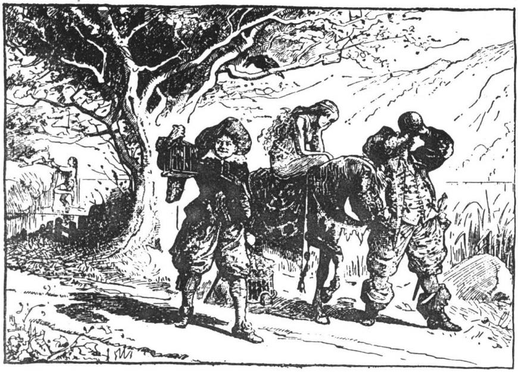

野兔说完这话，就一溜烟跑掉了。年轻人按照野兔的吩咐去做了。果然，城堡里的仆人对他带走画眉鸟的事全然不知。年轻人在回家去的路上，又经过了那家关着他两个哥哥的旅店，于是，他替他们还清了债务，店主就把哥俩放了。三兄弟结伴回家去。可是，两个哥哥看到弟弟成功地找到了金色画眉鸟，心生妒意。他们走到一个湖泊时，两个哥哥凶恶地扑上前去，夺走了金色画眉鸟，抓住弟弟，把他扔到了湖里。然后，他们带着小瓷女，继续赶路。他们相信，被扔进湖里的弟弟必死无疑。可幸运的是，年轻人情急中抓住了一把灯心草。他大声呼救，野兔闻声赶来解救，它对年轻人说：“快抓住我的腿，从水里爬上来。”

等年轻人安全上了岸，野兔又对他说：

“你现在必须这么做：装扮成一个找活干的马仔，到你父亲那边去，要求为他工作。到了那边，你就很容易使他明白事情的真相。”

年轻人照野兔教他的办法，装扮成马仔，来到父亲的城堡，问他是否想要一个马仔。

“是的，确实需要，”他父亲说道，“但这不是份好干的差使。

马厩里有一匹小马驹，不让任何人接近，有几个想驯服它，已被它踢死了。”

“让我试试吧！”年轻人答道，“还没有哪匹马让我惧怕过。”

年轻人走到那匹小马驹跟前，伸手抚摸它。它竟然出奇地温顺，既不甩头，也不踢腿。

“天哪！”主人叫了起来，“为什么它不允许别人接近，却如此温顺地让你抚摸？”

“或许这匹马认识我。”“马仔”答道。

过了几天，主人对他说：“我这儿有个小瓷女，她虽然长得很美，犹如初升的太阳，但总是对走近她的人很粗暴，不是抓就是咬，你不妨去试试，看她是否会接受你。”

年轻人走进小瓷女的房间，金色画眉鸟见了他，突然欢快地鸣叫起来。小瓷女也高兴地唱起了歌，乐得又蹦又跳。

“天哪！”主人又惊讶一声，“难道小瓷女和金色画眉鸟也认识你吗？”

“当然！”年轻人答道，“如果小瓷女愿意，她会把真相告诉你。”

于是，小瓷女把事情原委一五一十告诉了老爷，包括她是怎么同意跟年轻人走，年轻人又是怎么把金色画眉鸟带出了城堡。

“这些都是真话，”年轻人补充道，“哥哥们被关在一家小旅店，是我让他们重获自由的，可是他们竟然把我扔进湖里，以此报答我。因此，我只能乔装打扮回到家中，使你明白事情的真相。”

老爷听完这些话，把小儿子紧紧拥在怀里，并许诺，把自己全部财产交给他继承；而且，他还下令处死了那两个欺骗自己父亲，又企图害死亲弟弟的坏家伙。

年轻人娶了美丽的小瓷女，他们举行了隆重的婚礼。

 
 

## 小兵约翰

从前有个小兵从战场归来，他作战英勇，也没有因受伤而少了胳膊或缺了条腿。战争结束后，军队也随之解散，于是，小兵决定回到自己出生的小村庄去。

这个小兵名叫约翰，但不知是什么原因，他的朋友们总爱叫他“小国王”，没人知道这个绰号是怎么来的，反正别人就喜欢这么称呼他。

由于约翰没有父母在家中等候，所以他并没有急急忙忙赶路。他背着一个包，腰佩一把剑，独自一人不急不忙地回家去。一天晚上，约翰的烟瘾突然犯了，他在身上摸索了一阵，想找火柴把烟管点上，可是，火柴竟不翼而飞了，这让他心里很不痛快。

约翰失望地继续往前走。没走几步路，他就发现，穿过树林不远处，有几丝亮光。他顺着亮光的方向走去，看到一座大门敞开的旧城堡。

约翰走进城堡的院子。透过窗户往里看，里面是一间低矮的厅堂。厅堂的另一头，有一堆烧得很旺的火，约翰把烟管放进口袋，轻轻地敲了几下门，并很有礼貌地问道：

“请问，能借个火吗？”

可是，没有人回答他。

等了一会儿，约翰又用力敲了几下门，可还是没人回答。

于是，他打开门闩，走了进去，发现厅堂里空无一人。

约翰径直走向火堆，他拿起一把铁钳，蹲下身子，想找块烧得透红的火炭点烟。只听得“喀嚓”一声，什么东西好像跑了出来。这时，他看到一条巨大的蛇从火焰中窜了出来，直窜到他面前。

更令约翰惊奇的是，那条蛇竟然有一个女人的头。

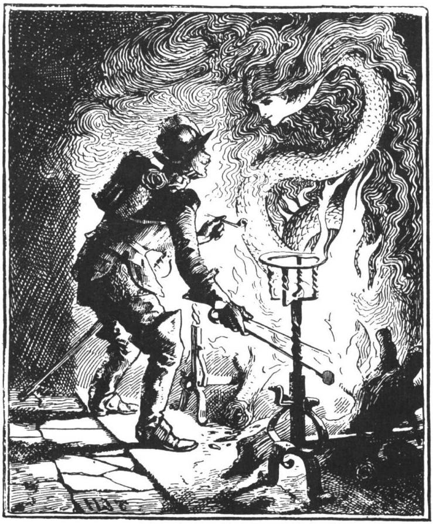

这么恐怖骇人的景象，恐怕会令很多人转身逃命。但身材瘦小的约翰，却是一个真正的士兵，具有勇气和胆量。他只是往后退了几步，并一把抓住剑柄，打算出击。

“别拔出你的剑，”那条蛇说起话来，“我正等着有人来解救我呢！”

“你是谁？”

“我叫露多维尼，是矮人国的公主。要是你解救了我，我就会嫁给你，并让你一生都过得幸福。”

让一条带着女人头的蛇带来幸福，很多人恐怕会对此毛骨悚然吧！可是我们的“小国王”却毫无惧色。露多维尼看着约翰的眼神，就像一条蛇瞪着那只将要成为它猎物的小鸟。不过，约翰觉得，露多维尼的眼神很迷人，她的眼睛并非圆圆的像猫眼，而是一种细长的杏眼，还闪着荧荧的绿光，很神秘，也很漂亮。她那头飘逸的金发，如丝般有光泽。虽然她是蛇的身体，却有着一张天使般动人的脸庞。

“我该做些什么呢？”约翰问道。

“你打开那扇门，走进大厅。大厅的另一头有一间和这厅堂一模一样的房间。房间里有个壁橱，你把壁橱中一件上衣给我拿来。”

约翰决定勇敢地按这些话去做。他安然无恙地走过大厅，来到了房间。但是，借着星光，他看到八只大手在他面前挥舞，威胁恐吓他。约翰四处看，也没发现这究竟是谁的手。

于是，约翰低下头，直往前冲。那些大手对着他一阵痛打，而他也出拳还击。终于，他冲到了壁橱前，打开橱门，拿出上衣，带到了露多维尼那儿。

“你的大衣。”约翰上气不接下气地说道。

只听“喀嚓”一声，火焰又被劈开了。露多维尼腰部以上的部分恢复了女人的模样，她接过上衣，穿在身上。

这件上衣是桔红色的天鹅绒做的，看上去非常华丽，上面还镶着珍珠。可是露多维尼的脖颈，比那些珍珠还要白皙。

“还有事要你做，”露多维尼对约翰说道，“你从大厅右边的楼梯上去，在第二层第二间屋子的壁橱里，挂着我的裙子，把那条裙子给我拿来。”

“小国王”又一次照露多维尼的话去做了。可是他刚走进楼上那个房间，就发现除了上一次的八只大手，又多了八条手臂，每只大手中还有一根木棍。约翰于是拔出剑来，奋力挥舞着往前冲去，并没受一点伤。

约翰为露多维尼带回了裙子，这条裙子是用丝绸做的，看上去和西班牙的天空一样湛蓝。

“给你裙子。”约翰对出现在面前的露多维尼说道，她穿上裙子后，膝盖以上也恢复了原形。

“现在我就缺鞋袜了，你到三层楼去，把鞋袜从壁橱里给我拿来。”

约翰接了指令，转身就执行去了。这次，拦住他去路的是八个魔鬼。他们手拿铁锤，眼睛里喷着火舌，一副凶恶相。约翰站在门槛前，心想：“这回，我的剑也恐怕不顶用了，这些魔鬼会把剑敲得粉碎。如果我不想个对策，那就必死无疑了。”这时，他的眼光落在地板上，地板是用老橡树干做的，又厚又重。他把地板撬了起来，举过头顶往魔鬼身上砸去，把它们都压扁了。于是，约翰又为露多维尼取回了鞋袜，露多维尼穿上鞋袜后，完全恢复了原形。

等她把那双白色丝袜和带花点的蓝色拖鞋穿上后，便对自己的解救者说道：

“现在，你必须马上就走，不管发生什么事，永远不要再回到这个城堡。这只钱袋给你，里面有两百个金币。今晚，你就睡在树林边一个小旅店里，明天早上九点我经过旅店时，你可以坐上我的马车。”

“为什么我们不能现在就一起走呢？”约翰疑惑不解地问道。

“因为还没到时候。”公主道，“你先为我的健康喝下这杯葡萄酒。”说完，她在一个水晶杯中斟满了一种看上去像是熔化了的金子的液体。

约翰接过杯子，一饮而尽，然后，他点上烟管，离开了城堡。

约翰来到了那座小旅店，要了一份晚餐。但是，他刚坐下打算吃饭，就感觉昏昏欲睡。

“大概是我太累了。”约翰心想。于是，他关照店员，第二天早上八点一定要叫醒他。然后，他就上床睡觉去了。

约翰一整夜都睡得很沉。第二天早上店员去叫醒他时，发现怎么也叫不醒他。有人在八点半和八点三刻时又叫了他两次，可还是叫不醒他。最后，店员决定不再叫他，就让他睡个够。

约翰醒来时，已是正午十二点。他一下子从床上跳起来，来不及穿好衣服，就急匆匆向人询问，是否有人找过他。

“倒是有个漂亮的公主坐着金马车来找过你。”店主告诉他，“她给你留了一束花，还让我转告你，明天早上八点，她还会经过这儿。”

约翰为自己如此贪睡，狠狠地骂自己。他望着公主留下的花束，试图寻找一些安慰，这是一束山鼠菊草。

“这种花代表思念。”约翰甜蜜地自言自语。不过，他却忘了，山鼠菊草通常是用来送给死人的。

到了晚上，约翰睁一眼闭一眼地睡觉，还不断地从床上跳起。小鸟们开始鸣叫歌唱时，他再也不想睡了。他从窗口爬到门前一棵树上，坐在树枝上，神情恍惚地对着公主留下的那束花看，终于，他又沉沉地睡去了。

约翰一睡着，别人就无法再叫醒他。太阳越升越高，小鸟不停地啁啾鸣叫。露多维尼的金马车经过旅店时“咕咕”作响，店主四处寻找约翰，大声叫着他的名字。

钟声“咚咚”敲了十二下，约翰猛然醒了过来。他从树上爬下来，心里有种不祥的预感，这时，店员们正忙着摆放晚餐的桌子。

“公主来过吗？”他问店员。

“是的，她来过，还给你留了这块纱巾。明天早上七点她还会路过这儿，但这是最后一次了。”

“我大概是中邪了。”约翰心想。他接过那块散发着奇怪香味的纱巾，把它缠在手臂上。他决定不再上床了，这是保证自己不会睡着的最好办法。于是，约翰付了旅店的账，用剩下的钱买了匹马，夜幕降临后，他就骑上马，打算一整夜都守在旅店门口。

约翰不时地俯下身子，去闻那块纱巾的清甜香味。他不断地闻，逐渐又昏昏欲睡了。最后竟伏在马脖子上，和马一起睡着了，还打着呼噜。

公主早上经过旅店时，店员们使劲摇他，大声喊他，可都没法叫醒他。慢慢地，公主的马车就越走越远，可是，约翰和他的马，仍然睡得和死猪一样。

约翰醒来后，看到渐渐远去的公主的马车，扯着嗓门大声叫喊：“停下！快停下！”他快马加鞭，去追赶公主。可是，马车照样前驶，毫不理会他的叫喊。约翰追赶了一天一夜，也没能追上。

就这样，公主的马车往前驶，约翰骑着马在后追。经过了无数个村庄和城镇，他们来到了大海边。约翰心想，公主的马车这回该停下来了吧。但令他不可思议的是，那辆马车踩着海水，像在陆地上一样稳稳当当地继续前行。约翰的马由于奔驰了太长的距离，终于累垮了。可怜的约翰伤心地坐在马鞍上，眼睁睁地看着自己追赶的马车消失在地平线上。

可是，约翰并没有因此而泄气。他振作精神，来来回回地在海滩上寻找小船，他想乘坐小船去追赶公主。然而，他却一无所获，又累又饿的约翰最后不得不在一座渔夫的小木房前坐下休息。

小木屋里有位年轻姑娘正在修补渔网。她把约翰请到屋里，并拿出一些葡萄酒和煎鱼。约翰填饱肚子，消除疲劳后，就把自己的经历告诉了她。这个渔家女长相甜美，由于她皮肤白皙，如同海鸥的胸膛，邻居们都叫她海鸥姑娘。可是约翰并没有对她心动，因为他日思夜想，魂牵梦绕的，还是露多维尼公主那双美丽的绿眼睛。

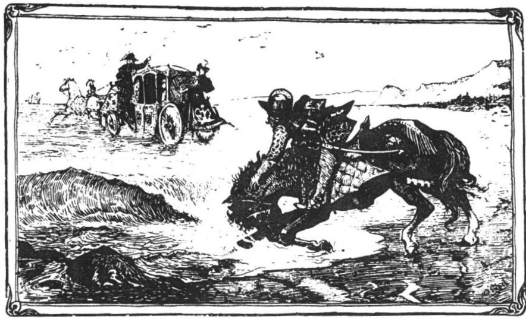

听完了约翰的故事，渔家女深表同情，她对约翰说：

“上星期我打鱼时，渔网突然直往下沉。等拉上鱼网时，我发现里面有个大铜花瓶，瓶口用铅密封着。于是，我把花瓶带回家，放在火上烤。等铅熔化后，用小刀打开了花瓶。花瓶里有一件红色斗篷和五十个金币。我把斗篷铺在床上，把钱存放起来，打算结婚时用。你现在拿着这些东西，到最近的海港去，那儿会有船只驶往矮人国。等你做了矮人国国王，再把钱还我。”

“小国王”约翰感激不已，他对海鸥姑娘说：“你不仅长得漂亮，而且心地善良，等我做了国王，一定让你做王后的贴身女伴。现在，就让我们道别吧。”于是，渔家女打鱼去了，约翰披上斗篷，一头倒在干草堆上。想着自己遭遇到的那些奇怪的事，情不自禁地大叫一声：

“哦！现在我要是在矮人国的首都，那该多好啊！”

一眨眼的工夫，约翰就发现自己站在一座富丽堂皇的宫殿前。他揉揉双眼，使劲地拧身上的肉，才肯定这不是做梦。这时，有个人站在宫殿前吸烟，约翰于是走上前去，问道：“这是什么地方？”

“你难道看不出这是哪儿吗？这当然是国王的宫殿。”

“哪个国王？”

“废话！当然是矮人国的国王。”那个人大声笑了起来，他觉得约翰肯定是个疯子。

天下竟有这样奇怪的事？约翰实在摸不着头脑。可是，由于他是个诚实的小伙子，因此担心海鸥姑娘会以为他偷走了斗篷和金币。他开始琢磨，怎么把这些东西尽快还给海鸥姑娘。冥思苦想之中，约翰突然明白，那件斗篷有一种神奇的魔力，穿上了它，便可以去任何一个想去的地方。为了证明这一点，约翰许了个愿，希望能住在城里最好的旅店中。果然，他立刻就站在那样的旅店里。

约翰发现了斗篷的秘密后，简直欣喜若狂。他吃了晚饭，就上床睡觉了，因为这个时候去拜见国王，显然已经太晚了。

第二天早上，约翰醒来后，发现城里的房子都点缀着鲜花，五颜六色的旗帜到处飘扬，教堂的钟声也“当当”作响。他向别人打听是怎么回事。别人告诉他，国王美丽的女儿露多维尼公主被人找到了。今天这盛大的庆典，是为了欢迎公主安全回宫。“这真是太巧了！”约翰心想，“我去站在宫殿门前，看看公主是否能认出我来。”

约翰刚穿好衣服，公主的金马车就从旅店经过。她头戴金冠，坐在国王和王后中间。当公主的眼光不经意地正好落到约翰身上时，她的脸色一下变得苍白，头也刻意地转向别处。

“是公主没有认出我来呢？还是因为我几次失约，她在生我的气？”约翰不禁纳闷起来，他跟随着人群来到了王宫。皇家人马都进宫后，约翰告诉门口守卫的士兵，正是他解救了公主，并希望能进宫去和国王说上几句话。可是，约翰越是不停地说，试图让士兵们相信他的话，士兵们就越觉得他是个疯子，拒绝让他入内。

约翰气得直冒火，于是想抽会烟，好让自己心情平静下来。他走进一家酒店，要了一瓶啤酒，边喝边想：“都怪我戴了这顶看上去可怜兮兮的头盔。要是我有足够的‘钱’把自己打扮成贵族，士兵们大概就不会阻拦我进宫。不过，海鸥姑娘借我的五十金币，也已经用得差不多了。没有钱，就这么空想，又有什么用呢？”

约翰拿出钱包，想数数还剩多少金币。令他大吃一惊的是，那五十个金币还是原封未动。

“海鸥姑娘一定数错了。”约翰心想，他付了酒钱，把钱又数了一遍，那钱包里竟然还有五十个金币。约翰把金币全部倒出来，关上钱包。可当他再打开时，发现里面还是五十个金币。

这时，约翰顿时想出了个好主意，他决定马上去找皇家裁缝和马车匠。

约翰让裁缝为他做了一件斗篷，一袭镶着珍珠的丝绒长袍。他又让马车匠为他做一辆和露多维尼公主那辆一模一样的金马车，他还向裁缝和马车匠保证，如果他们能尽快把活赶出来，他们就能获取双份的报酬。

几天过去了，城里的大街上，出现了一辆由六匹白马拉着的金马车。金马车后面跟随着四个衣着华丽的男仆，马车内坐着约翰。他身着蓝哔叽长袍，手棒一束山鼠菊花，臂上缠着一块纱巾。约翰的金马车在城里转了两次，其间，约翰把金币大把大把地撒给路人。金马车第三次在城里转悠，从王宫窗户下经过时，他看到露多维尼公主拉着窗帘的一角，偷偷往他这边看。

第二天，城里所有的人，甚至王宫内部的人，都谈论着昨天在大街上撒钱的富有贵族。王后也对此产生了好奇心，她急切地想与这个与众不同的王子见上一面。

“好吧，我派人把他请到宫中，让他和我玩牌。”国王答应了王后的要求。这次，“小国王”约翰可没有失约，他准时来到了王宫。

国王叫人把钱拿来后，就坐下和约翰一起玩牌。他们玩了六局，可约翰每局都输。然而当他把钱包中五十个金币全部倒出作为赌注时，那钱包立刻又变得满满的。

第六局牌结束后，国王控制不住地大叫起来：“啊！这真是不可思议！”

王后也高声叫喊：“这太叫我吃惊了！”

公主在一边也同样无法保持沉默：“这真令人感到疑惑不解！”

“和你变成蛇的故事相比，恐怕这还算不上什么吧！”约翰讥讽道。

“你给我住口！”国王可不喜欢话题转到这件事上来，他粗鲁地打断了约翰的话。

“我只不过提到这事，”约翰并无惧色，“因为正是站在你面前的这个小伙子，把公主从魔鬼手中解救了出来，她当初还许诺要嫁给我呢！”

“这是真的吗？”国王问露多维尼。

“这是真的，”公主答道，“可我曾经告诉他，他必须在一家旅店里等我，我的马车经过那儿时，可以把他一起带走。但是我三次经过那儿，他都还睡着大觉，谁也不能叫醒他。”

“你叫什么名字？”国王问约翰，“做什么的？”

“我叫约翰，是个小兵，我的父亲做过船夫。”

“那你可与我的女儿不般配。不过，要是你把钱包给我，我就把公主嫁给你。”

“这钱包不是我的，我不能用它来送人。”

“但是你也可以借给我，我们结婚那天，我再把它还给你。”公主一边说话，一边用她那双勾魂销魄的迷人的绿眼睛盯着约翰，令约翰感到无法抗拒。

“那我们什么时候结婚呢？”

“复活节吧！”国王答道。

“让我嫁给你，除非太阳从西边出来。”露多维尼小声嘀咕了一句，约翰并没听到这话，他把钱包给了公主。

第二天晚上，约翰来到王宫，想与国王玩纸牌，并向公主正式求婚。但宫里的人告诉他，国王到乡下收租去了。第三天，约翰又来到了王宫，但他还是被同样的话打发走了。于是，他要求见王后，宫里的人告诉他，王后正犯头疼病。就这样，约翰去了王宫五六次，每次都被打发走了。他最后终于明白，自己被欺骗、嘲弄了一番。

“国王怎么能干这种事。”约翰气乎乎地骂道，“这家伙简直是个恶棍！”突然，他想到了海鸥姑娘给他的那件红斗篷。

“哎，我真是个傻瓜，怎么就没想到它呢？披上斗篷，我当然是通行无阻，想去哪儿就去哪儿。”

那天晚上，约翰披着红色斗篷，站在王宫的大门前。

王宫的第一层楼上有个窗户灯亮着，约翰看到窗帘上映着露多维尼的婀娜身影。

“我要到公主的房里去。”约翰刚对斗篷说完这句话；就发现自己站在了公主的闺房中。

露多维尼此时正坐在桌旁，数着她不断从钱包里倒出的钱。

“八百，八百五十，九百，九百五十……”

“一千，”约翰突然打断了公主的数数，“晚上好啊，各位！”

公主惊跳起来，她见是约翰，便压低嗓门对他说：“是你！你来这儿做什么？快离开，要不，我会叫…… ”

“我来是想提醒你，别忘了自己的许诺。后天就是复活节，所以现在该是考虑一下婚礼的时候了。”

露多维尼大笑起来：“天哪！你难道真的那么愚蠢，相信矮人国的公主愿意嫁给一个船夫的儿子为妻吗？”

“好吧，那你把钱包还给我。”约翰说道。

“休想。”公主镇静地、从容地把钱包放进口袋，冷冷地说道。

“悉听尊便。”约翰很有风度地说道，“谁笑到最后，谁笑得最好。”只见他一把将公主搂在怀中，大声叫了一句：“让我到地球的另一端去。”一转眼，约翰就真站在了地球的另一端，双手还紧紧地拽着公主。

“哈哈！”约翰把公主放在一棵大树下，“我还从未走过这么长的路呢！女士，你感觉如何？”露多维尼心里明白，现在可不是开玩笑的时候。何况，刚才那段快速飞行令她感到头晕目眩，所以，她一声不吭，不作任何回答。

矮人国的国王可不是个做事谨慎小心的人，他的女儿露多维尼这方面倒是很像他，这也正是公主被变成蛇的原因。有个人曾经预言，一个小士兵会来解救公主。但是，除非小士兵连续三次失约，否则，公主就必须嫁给他，精明的公主于是想出了一个诡计，以躲避与小兵成婚。

露多维尼在魔鬼的城堡里让约翰喝下的那杯酒，以及后来送给约翰的那束花和一块纱巾，都具有一种特殊的魔力，它们会令人睡得很沉。果然，这种魔力在约翰身上奏效了。

露多维尼虽然被约翰带着远离了王宫，但在这种关键时刻，她依然保持着头脑的冷静。

“我原以为你不过是个街头流浪汉，现在看来，你比任何一个国王都有威力。”公主用她极有诱惑力的嗓音，对约翰说道，“这是你的钱包，还给你，我的纱巾和花束，你带在身边吗？”

“带着。”约翰看到公主的态度有了变化，感到非常高兴。他小心翼翼地从怀里掏出那两件东西。露多维尼将花插在约翰的钮扣洞里，把纱巾缠在他手臂上，然后对他说：“现在，你就是我的主人了，只要你愿意，你随时都可以娶我。”

“公主，你并没有我想象的那么坏，”约翰说道，“我爱你，我会让你永远幸福。”

“那么，亲爱的丈夫，告诉我你是如何一眨眼就把我带到这个地方的呢？”

约翰抓了抓后脑勺，心想：“公主是真心想嫁给我，还是又想骗我一次呢？”

露多维尼见约翰犹豫不决，便在一边催促道：“难道你不愿把秘密告诉我吗？”公主的语气那么温柔，约翰实在感到无法拒绝她的请求。

“算了吧，只要我不把斗篷给她，告诉她这个秘密也没什么关系。”

于是，约翰把红斗篷的秘密告诉了露多维尼。

“哎，我累得要命！”露多维尼假装唉声叹气道，“我们还是先睡一觉吧，醒来再好好商量结婚的计划。”

她舒展着身子，在草地上躺下了。约翰也跟着躺下了，他把缠在手臂上的纱巾取下，当作枕头，很快便呼呼入睡了。

露多维尼眯着眼睛，愉偷看着约翰的一举一动。她一听到约翰的呼噜声，就解开了斗篷扣子，轻轻地把它从约翰身上抽出来，裹在自己身上。然后又偷偷把钱包从约翰口袋里拿出来，放进了自己的口袋。“让我回到自己房间去。”公主话音刚落，她就发现自己站在了王宫的房间里。

一天一夜过去后，约翰醒过来了。当他发现斗篷、钱包和公主全都不见了时，觉得自己简直是世上最愚蠢的人。他又是撕抓头发，又是捶胸顿足，把花束踩了个稀巴烂，把纱巾也撕成了碎条。

这时，约翰的肚子饿得“咕咕”直叫。可是，他找不到一点吃的东西。

他回忆起小时候，祖母曾跟他讲起过很多神奇的东西，可以用来填饱肚子。但这个时候，他连这些东西也找不到。绝望之中，约翰不禁仰天长叹。突然，他发现自己竟然是站在一棵李子树下，树上结满了金灿灿的李子。

“就吃几个李子充饥吧，一个人饿得发慌时，什么都可以吃。”约翰心想。

他于是爬到树上，一颗接一颗地吃起李子来。可是，才两颗李子下肚，令人恐怖的事就发生了。约翰的额头上长出了硬绑绑的什么东西，他用手摸摸，发现那东西竟是一对羊角。

约翰从树上一跃而下，直奔附近一条小河而去。他凑到水面一照，就被自己的模样吓呆了。他觉得自己这下算是完蛋了，那对羊角，长在羊身上，或许还挺招人喜爱。可长在他身上，实在太不雅观了。

这回约翰真有点泄气了。

“先是女人骗了我，现在魔鬼也来凑热闹，让我长了这么对羊角。要是别人看到我这副样子，肯定会大笑一通。”

约翰肚子还是没填饱，既然那对可恶的羊角已经长在了头上，他也就索性不管它了。他大胆地跑到了另一棵李树上，摘了两颗可爱的青李子。约翰刚吞下这两颗青李子，他头上的羊角就消失了。约翰又是惊讶，又是欢喜，他深深地感到，自己不应当过早就失去信心和勇气，陷入绝望。他填饱肚子后，马上就想出了一个绝妙的主意。

“也许，这些漂亮的李子能帮我拿回斗篷和钱包，还可以让我彻底摆脱那个恶毒的公主。她已经有了双鹿眼，再给她加上一对羊角，这样，我敢肯定自己不会再想娶她为妻了，一个头上有对羊角的姑娘看上去怎么都不会可爱动人。”于是，约翰用长长的柳条编了个竹篮，小心地把两种李子都放了进去，然后便勇敢地上路了。这是一段又长又艰辛的旅程，约翰以路边的野果充饥，并得时刻提防着野兽和野人的袭击。他唯一的担忧，就是那些李子。但幸运的是，李子个个保持新鲜，没有腐烂。

最后，约翰来到了一个文明发达的国家，他变卖掉那些从王宫飞出来时带在身上的几件宝物，用这些钱买了船票，登上了一艘去矮人国的轮船。过了一年零一天，约翰终于又来到了矮人国的首都。

第二天，约翰装上假胡子，穿上一件卖枣小贩的衣服，扛着一张桌子，来到了教堂门前。

约翰将漂亮的，看上去像刚采摘来一样新鲜的李子摆放在一块白布上。他看到公主正从教堂里走出来，便用假嗓门叫卖起来：“卖李子喽！上等的新鲜李子喽！”

“这李子怎么卖？”公主被叫卖声吸引，走上前来问道。

“五十块金币一个。”

“五十块金币一个！这些李子究竟是什么宝贝？难道吃了它们人会变得更聪明，更漂亮吗？”

“美丽的公主，像你这样完美无瑕的人，是无需增添任何聪明才智和美丽容貌的。不过，你吃了这些李子，还是会有进步的地方。”

虽说滚石不生苔，转业不聚财，但去的地方多了，人有时候就会变得能说会道。约翰四处流浪的那段日子，还不能算是浪费光阴。他这几句漂亮利落的恭维话，说得公主飘飘然起来。

“什么地方有进步呢？”公主微笑着问道。

“尝了以后你就会明白的，我保证让你大吃一惊。”

露多维尼变得更加好奇了，她拿出钱包，不断地将金币五十五十地倒出来，买下了整篮的李子。约翰看到自己的钱包，真想把它夺回来，并大声宣布，公主是个小偷。但是，他还是尽力控制住了自己。

李子全部卖完后，约翰收拾好东西，脱下小贩的装束拉掉胡子，换了家旅店住，他耐心地等待着事情的发展。

公主刚回到自己房间，就兴奋地大声叫起来：“我要看看这些李子究竟能为我增添些什么。”她拉下头罩，抓起几个李子，便吃了起来。

这时，公主突然感到额上长出了什么东西，她感到非常惊讶和恐惧，她飞奔到镜子前，看到自己的模样后，厉声尖叫起来。

“羊角！原来这家伙要给我添一对羊角！来人哪！立刻把那个卖李子的小贩给抓来！我要亲手割下他的鼻子和耳朵！还要活剥了他的皮，把他扔到火里烧成灰，再让狂风把他的骨灰吹散！天哪！长着这对羊角，我怎么走得出去啊？这叫我怎么活下去！”

女仆们听到公主声嘶力竭的叫喊声，都跑来看是怎么回事。她们试图把羊角使劲拧下来，但却毫无用处，反而使公主头疼得厉害。

于是，国王派了一个传令官到处宣布，如果谁能把公主头上那奇怪的装饰物取下，他就把公主嫁给谁。命令宣布后，矮人国和它的邻国中所有的医生和巫师都向王宫跑来，并带着各自的配方，可是，没有一个人能把那对羊角去掉。那些配方令公主饱受痛楚，国王不得不再下一道命令，凡是替公主治病又不能成功的人，都将被吊死在最近的一棵树上。

但是，由于国王提供的报酬太有诱惑力，第二道命令并没有阻止那些试图治好公主的病、然后娶她为妻的人。就在这一年，矮人国果园的树上挂满了死人，他们都因最终无法治愈公主的病而被国王处死。

国王派人四处搜查，企图抓到那个卖李子的小贩。但是，没人能看到他的踪影。

当约翰觉得人们的耐性大概已被消磨得差不多了，便拿出青李子，把汁水挤在一个药瓶中。他跑去买了件医生穿的长袍，戴上假发和眼镜，乔装打扮来到了国王面前。约翰声称自己是位著名的医生，来自一个遥远的国度。他对国王许诺，如果让他和公主单独呆上一会，他就能治好公主的病。

“又是个来送死的疯子。”国王对左右的人说道，“好吧，就照他说的办，我不该拒绝一个将要死的人的请求。”

约翰来到公主面前，在杯里滴了几滴李汁，公主才喝了一口，额上羊角的尖头就消失了。

“若不是有些东西与药性相抵触，你的羊角应该会完全消失的。”假扮成医生的约翰表情严肃地说道，“只有灵魂如同我掌心这般洁净的人，才可能被完全治愈。难道你肯定自己没干过什么罪恶的事吗？你扪心自问，好好想想吧。”

对于这个问题，露多维尼无需思考太久，她当然明白，自己确实干过一些很坏的事。虽然她急于想让头上那对怪物消失，但就这样老老实实地忏悔，毕竟也是件令人羞耻的事。露多维尼在两种选择之间痛苦地挣扎，终于，她低垂着眼帘，轻声细气地说道：

“是的，我确实干过罪恶的事，我把一个小兵的钱包偷走了。”

“快把那个钱包给我，只有当我把钱包拿在手中，那药水才会完全发挥作用。”

要放弃钱包，露多维尼感到痛苦万分。不过，她也明白，只要头上还长着那对羊角，再多的钱对她也是毫无意义的。

公主叹了口气，将钱包递给了“医生”。这个“医生”又在杯里倒了些药水，公主喝下去后，发现头上的羊角退去了一半。

“你肯定有事瞒着我，除了那个钱包，你还偷了他什么东西？”

“我还偷了他的斗篷。”

“把斗篷给我。”

“好吧，给你。”

露多维尼已经拿定主意，等头上的羊角全部消失后，她就让仆人用暴力把那些东西抢过来。

公主为自己这个绝妙的主意而沾沾自喜。突然，那个假冒的医生披上斗篷，扔掉了假发和眼镜，把自己的真面目展现在公主面前。原来这位医生，就是她曾背弃过的小兵约翰。

公主站在约翰面前，吓得一句话也说不出来，约翰对公主说道：

“我原本可以让你一辈子都顶着这对羊角。但是，我这人心地太善良，况且我也真心喜欢过你。不过，就算没有这对羊角，你已经可以算得上一个魔鬼了！”

约翰借斗篷的魔力，来到了海鸥姑娘的小木屋中。海鸥姑娘正坐在窗边补鱼网，她的眼光不时地移向大海，似乎盼着什么人的到来。这时，她听到有人进屋的声音，便抬起头来，海鸥姑娘一看是约翰，脸刷地就变红了。

“原来是你，你是怎么来的？”海鸥姑娘轻声又问道，“你娶了那位公主了吗？”

约翰把自己离开海鸥姑娘后的经历告诉了她，然后，他把钱包和斗篷还给了海鸥姑娘。

“我要这些东西有什么用呢？你的经历已经证明，财富并不能带来幸福。”

“只有劳动，只有和一位真诚姑娘相爱，才会得到幸福。”约翰满怀深情地望着面前的海鸥姑娘。这时，他才注意到，海鸥姑娘也长着一双漂亮迷人的大眼睛。他向姑娘伸出双手，并对她说：“亲爱的海鸥姑娘，你愿意成为我的妻子吗？”

“是的，我愿意。”渔家女此刻羞红着脸，答道，“不过我有一个条件，我们把斗篷和钱包封在花瓶里，扔进大海。”

约翰和海鸥姑娘真的将斗篷和钱包重新封在花瓶里，扔到了大海中。从此，他们两人就一直幸福地生活在一起。

 
 

## 魔天鹅

从前有三兄弟，最大的名叫杰克勃，当中的那个名叫弗瑞德里克，最小的名叫彼德。两个哥哥无耻地对待彼德，有什么不顺心的事，就拿他作出气筒。彼德不得不忍受这种不公平的对待，因为他长得瘦小，无力对抗两个哥哥。生活对可怜的彼德来说，是多么痛苦难熬，他成天想着如何摆脱这种处境。有一天，彼德在树林里捡着柴火，想自己在家的处境，不禁伤心地哭起来。一个老妇人走到他面前，问他发生了什么事。彼德把自己在家受哥哥虐待的事全部告诉了她。

“别哭，好小伙子。”老妇人听完彼德的伤心事后，对他说道，“世界这么大，你为什么不离家出走，试着到另一个地方去生活呢？”

彼德将老妇人的这句话牢牢记在了心里。一天清晨，他听从了老妇人的建议，离开了自己的家，想到外面的世界去寻找一种更好的生活。但是，离开自己出生的地方，离开那个至少给了他一个短暂却快乐的童年的家，令彼德感到非常地痛苦。他坐在一座小山脚下，满怀深情地注视着他将要远离的家乡。

突然，那位老妇人又出现在他面前。她拍拍彼德的肩膀，对他说道：“做得很好，小伙子，但是你现在打算去哪儿呢？”

彼德感到一片茫然，不知作何回答。以前，他总是认为，好运会像成熟的樱桃，落入自己的口中。老妇人看出了彼德的心思，慈善地笑着，对彼德说：

“我会告诉你做些什么，因为我很喜欢你。你交了好运，一定不会把我忘记。”

彼德对老妇人真诚地许下诺言，他一定不会忘了自己的大恩人。于是，老妇人又说：

“日落黄昏时，你到十字路口的那棵梨树底下。你会发现有个熟睡的人躺在那儿。树干上拴着一只漂亮的大天鹅。你把拴住天鹅的绳子解开，把它带走。但千万记住，不要弄醒熟睡的那个家伙。所有人见了天鹅，都会喜欢上它那身美丽的羽毛。要是有谁想拔一根，你一定得同意。他们的手指一触到天鹅，它就会大声尖叫。这时，你必须叫一声：‘天鹅，抓住他’他们的手就会立刻被天鹅紧紧拽住，除非你用我给你的这根小魔棍碰他们一下，否则，他们都难以重获自由，就如他们难以摆脱自己身上的恶习一样，等你用这种方式捕获了一大批人，就带他们到城里去。那儿有位公主，从来未曾笑过。如果你能让这位公主展颜一笑，好运自然也就来了，到时候，可别忘了我——你的老朋友哦！”

彼德听了这番话，再次对老妇人许诺，他不会忘记老朋友。日落时分，他就往老妇人指给他看的那棵梨树走去。树底下果然躺着一个熟睡的人，一根红绳子将一只美丽的大天鹅拴在树干上。彼德解开绳子，带走了天鹅，天鹅的主人照样在树底下睡大觉。

彼德带着天鹅走了一段路后，来到了一个建筑工场。有几个人在那儿忙碌地工作，他们看到天鹅美丽的羽毛，都赞叹不已。一个全身都是泥巴的年轻人走了上来，大声说道：“哦，我多想有一根这样的羽毛啊！”

“那就拔一根吧！”彼德友好地说道。于是，年轻人伸出手来，想在天鹅的尾部拔根羽毛。他的手刚触到天鹅，天鹅就尖叫起来，彼德按照老妇人的话，大声喊道：

“天鹅，抓住他。”

可怜的年轻人想方设法想把手挣脱出来，但还是无能为力。他越是急，周围看的人就越是大笑，一个姑娘在附近一条河中洗衣服。她听到喧闹声，跑来看究竟发生了什么事。当她看到那个小伙子被天鹅紧紧拽住，不禁心生同情。她伸出手去，想帮他一把，这时，天鹅又尖叫起来。

“天鹅，抓住她。”彼德喊道，于是，那个姑娘也被天鹅牢牢抓住。

彼德带着这两个“俘虏”，没走多久，就遇上了一个扫烟囱的家伙。他看到这支奇特的队伍，大笑了一通，他问姑娘，这是做什么。

“哦，亲爱的约翰，”姑娘哀求道，“伸出手来帮我一把，把我从这个可恶的家伙手中解救出来。”

“这个忙我当然乐意帮。”约翰说着，想出手去拉姑娘。这时，天鹅又尖叫起来。

“天鹅，抓住他。”彼德大叫，那个全身黑乎乎都是烟灰的家伙，成了第三个“俘虏”。

他们很快又来到了一个村庄。村庄里恰好有集市，一个马戏团正在那儿巡回演出，在台上变着戏法的小丑看到一支奇特的队伍走了过来，便吃惊地睁大了眼睛。

“你是不盖疯了，黑鬼。”他笑得连话也说不出了。

“这事一点也不可笑。”扫烟囱的约翰答道，“这女人紧抓着我，把我像胶水一样粘在她身上。好心的小丑，快救我出来吧，总有一天我会报答你的。”

小丑听了这话，毫不犹豫地伸出手去，一把抓住了那只使劲往外伸的黑手。这时，天鹅又尖叫起来。

“天鹅，抓住他。”彼德喊道，立刻，小丑成了第四个“俘虏”。

前排的观众席上，正好坐了一位受人尊敬的市长。他觉得眼前发生的这一幕，完全是个愚不可及的把戏，他大动肝火，恼羞成怒，上前一把抓住小丑的手，想把他拉走，扔到监狱里去。

随着天鹅的又一声尖叫和彼德的又一声大喊，尊贵的市长落得个和前四个“俘虏”同样的结局。

瘦骨嶙峋的市长夫人看到丈夫受到这番愚弄，不禁火冒三丈。她抓住丈夫自由的那只手，用尽全力，想把他解救出来。结果呢？自然也加入了“俘虏”的队伍。这以后，再没人愿意上前帮忙了，谁也不想成为队伍中新的一员。

很快，彼德就看到了城里的高塔。他刚要进城，一辆闪闪发光的礼车就从城里驶了出来，车里坐着一位美丽动人的姑娘，不过，她神情严肃、忧郁，这位姑娘看到天鹅尾巴上拖着一串五花八门，形形色色的人，忍不住大声笑了起来。她的仆人和贴身女伴也紧跟着大笑起来。

“公主笑了！公主笑了！”她们都高兴地大声呼喊。

公主为了更清楚地观赏眼前的景象，从礼车上款款而下。她看到那些可怜的家伙跟在天鹅后面一蹦一跳走路的样子，不禁又大笑了起来。公主命礼车调回头去，慢慢驶回城里。一路上，公主的眼睛始终盯着彼德和那支滑稽的队伍。

公主终于展颜欢笑的消息传到了国王耳中，国王高兴极了。他令人把彼德和那支奇特的队伍带到王宫，国王自己看到那幅情景后，笑得眼泪都流了出来。

“我的朋友，你知道我曾许诺，凡令公主笑的人，将得到一份报酬吗？”国王问彼德。

“不，不知道。”

“那么，我来告诉你，”国王说道，“这份报酬是一千个金币，或者一大片土地，你选择哪样？”

彼德选择了一大片土地。接着，他拿出小魔棍，在小伙子、姑娘、扫烟囱的约翰、小丑、市长和市长夫人身上轻轻一碰，他们便全都从天鹅的束缚中解放了出来。这些人都像是火烧到了屁股，一溜烟直往家跑。他们那种落荒而逃的样子，使周围观看的人又大笑一场。

公主非常欣赏天鹅美丽的羽毛，一时冲动，她伸手就去抚摸它。

“天鹅，抓住她。”彼德大喊一声。就这样，公主成了彼德的新娘，可是，那只天鹅却冲上了云霄，消失在蓝天白云中。作为礼物，国王给了彼德一个公爵的封号。现在，彼德可真的交了好运，成为大人物了，他没有忘记自己的老朋友——那个让彼德交好运的老妇人。彼慈和公主住在一座富丽堂皇的城堡中，而那个老妇人，则成了他储的第一管家。

 
 

## 肮脏的牧羊女

前，有一个国王。他有两个女儿，他非常疼爱他们。女从儿长大以后，他突然很想知道她们是否也真正爱他。他决定把王国传给最爱他的那个女儿。

于是他把大公主叫来，问：“你有多爱我？”

“就像爱自己的眼珠！”她答道。

“啊！”国王叫道，一边吻她一边说，“你的确是个好女儿。”

接着他把小公主叫来，问她有多爱他。

她答道：“我尊敬您，我的父亲，就像尊敬我的食物里的盐。”

国王很不喜欢这些话，命令她离开王宫，再也别让他看到她。可怜的公主悲伤地回到了卧室，哭了起来。可当她想到父亲的命令，她就擦干眼泪，把自己的珠宝和最漂亮的衣服打成一个包裹，飞快地离开了她出生的城堡。

她漫无目的地沿着脚下的路向前走，不知道己的命运将会怎样。她从来不知道怎样工作，只知道干一点点家务活，以及她母亲很久以前教她的烹调技术。因为她担心没有什么家庭主妇愿意雇一个像她这么漂亮的女孩，于是她决定把自己打扮得丑一点。

就这样，她脱下了身上穿着的衣服，把一些乞丐穿的破得可怕的衣服套到身上，那上面到处都是泥，没有一块布是完整的。接着，她在脸上、手上涂满泥浆，并把头发搅成一团糟。用这种办法改变形象以后，就四处去问人家需不需要放鹅女或牧羊女。可是农夫的妻子们不愿搭理一个这么肮脏的女孩，往往出于慈悲给她一小块面包，把她打发走。

过了很多时候，她也没找到一个工作。最后，她来到一个大农场，那儿急需一个牧羊女，他们很高兴地把她雇了下来。

一天，正当她在一块草地上牧羊，她突然很想穿上她的漂亮衣服。于是她在河里仔细地洗了个澡。由于她一直带着自己的包裹，她很容易就脱下身上的破衣服，不一会儿就把自己打扮成一个高贵的淑女。

那个地方的王子正巧在树林里迷路了，从很远就看到了这个美丽的少女。他很想走近些看个清楚。可当公主发现他要做什么之后，立刻像鸟儿一样迅速地逃进了树林中。王子在后面追她，可是他在奔跑中不小心在树根上绊了一下，摔倒了。等他重新爬起来，她已经不见踪影了。

等她已经安全了，她又穿上破衣服，把脸和手弄脏。年轻的王子又热又渴，找到了农场，希望喝一点苹果汁。他问在这儿牧羊的美丽姑娘叫什么名字，所有人一听到这个就哈哈大笑，都说牧羊女是天下最脏最丑的人。

王子心想，这里面一定有什么巫术在作怪。于是，他在牧羊女回来以前就赶紧离开了。那天晚上，牧羊女成了大家的笑柄。

可是王子常常怀念那位美丽的姑娘，尽管他只看过她一眼，他还是觉得她比王宫里任何贵族女子都要迷人。到最后，他除了她便什么也不再想，以至于日渐憔悴下去。终于，他父母开始问他到底出了什么事，并且答应愿意为他做一切事，只要他能像以前一样快乐。他生怕他们嘲笑自己，不敢说出真相，只是说他希望吃到一位在遥远农场的厨房里打杂的姑娘做的面包。

尽管他父母觉得这个愿望十分古怪，他们还是赶紧去实现它，派人通知那个农场主。农场主的女仆听到关于王子提出的要求的命令，没有显出一点惊奇的样子，只是要了一些面粉、盐和水，并且要求让她一个人留在面包炉旁一间放着揉面槽的小屋里。开始工作以前，她小心地洗了澡，甚至戴了戒指。可是，就在她烤面包时，她的戒指滑进了面团里。做完面包，她又重新把自己弄脏，并且让手上沾满面疙瘩，这一来，她就和从前一样难看了。

她做出的面包非常小，送到王子那里去以后，王子吃得很愉快。可是他在切面包时发现了公主的戒指。他向父母宣布他要娶戴得下这个戒指的人。

于是国王向全国发出了通告。从很远的地方都有姑娘跑来要求试戒指，可是那个戒指是这样小巧，以至于她们中间手最小的也没法把小手指伸进去。在很短的时间内，王国里的所有姑娘，包括农夫的女儿都试过戒指了。正当国王要宣布没有人适合戴这个戒指，王子发现还没见到那个牧羊女。

他们派人去叫她，她穿得破破烂烂地来了。不过，她的手比以往要干净，因此很容易就戴上了戒指。王子说他要实现自己的诺言，而他的父母温和地提出这个女孩只是个放羊的，而且非常丑陋。这时，姑娘大胆地说出自己本是一位公主，只要他们给她一些水，并且让她单独呆在一间屋子里，那么要不了几分钟，她就能证明穿上好衣服以后她不比任何人差。

他们照她说的做了，当她穿着美丽的衣服重新走进来时，她看上去是这样美丽，以至于所有人都相信她是一位乔装的公主。王子认出她就是他只看过一眼的迷人的姑娘，立刻跪倒在她脚下，向她求婚。

于是公主讲述了自己的经历，并且说有必要派一位使者去征得她父亲的同意，并请他来参加婚礼。

公主的父亲一直在后悔自己对待女儿太残忍，而且已经派人找遍了全国，由于一直没有人看到她，他们以为她已经死了。现在，听说她还活着，而且正有一位王子向她求婚，这令他高兴得无以复加。于是他和大女儿离开自己的国家去参加她的婚礼。

根据新娘的命令，婚礼上，仆人们只给她父亲送上没有盐的面包和没有调料的肉。公主就坐在他旁边，看到他不断地做苦脸，并且只吃一点点东西，就问是不是饭菜不合他的口味。

“不，”他说，“送上来的菜都烧得很精致，只是太没味道了。”

“我不是告诉过您么，我的父亲，盐是生命中最重要的。可是，当我把您比作盐来告诉您我有多爱您时，您却对我非常蔑视，把我从您跟前赶走。”

国王拥抱了自己的女儿，承认自己误解了她的话。于是在接下来的婚宴上，他们给他端上加了盐的面包和加了调料的菜，他说这是他一生中吃过的最好吃的东西。

 
 

## 魔蛇

从前，有一位可怜的女人，她愿意用她的一切去换得一个孩子，可是她一个孩子也没有。

有一天，她和丈夫到树林里去砍柴，回来的路上，在草丛中发现了一条可爱的小蛇。

农夫的妻子名叫萨巴泰拉，她看到这条小蛇，深深地叹了一口气，说：“即使是蛇，也有自己的后代，单单我没有运气生个孩子。”

她刚说完这些，就吃惊地看到小蛇抬起头来，望着她说：“既然你没有孩子，那就当我的妈妈吧。我向你保证你不会为此后悔的，因为我会像亲生儿子一样爱你的。”

一开始，听到一条蛇开口说话，萨巴泰拉差一点吓死，可是她还是鼓起勇气回答道：“如果你说的这些都是出于好意，那么我就答应你，以后就像母亲一样爱你并照顾你。”

于是，她在屋里给蛇凿了个小洞让它睡觉，用她能想到的最好吃的东西喂它，好像怎么爱它都爱不够似的。小蛇一天天地长大、长胖。终于，有一天早上，它对自己一直视作父亲的农夫科拉·麦托说：“亲爱的爸爸，我现在已经到了结婚的年龄了。”

“我很同意。”麦托说，“我要尽力找到另一条长得像你一样的蛇，为你们举行婚礼。”

“啊，如果这样做，”蛇回答道，“我们就永远也不过是爬行动物罢了。我一点也不希望那样。不，我更想娶国王的女儿。因此，我请你不要耽搁，马上就去要求见国王，告诉他有一条蛇想娶他的女儿。”

科拉·麦托是一个头脑非常简单的人，他就照蛇希望的那样去找国王。国王答应见他以后，他说：“陛下，我常常听人说，只管开口要，这并不会让你失去什么。因此，我来告诉您，有一条蛇想娶您的女儿，我很想知道您是否愿意让一只鸽子去陪伴一条蟒蛇？”

国王立刻看出这个男人是个笨蛋，为了把他打发走，他说：“回去告诉你的蛇朋友，就说如果他能在明天中午以前把这座宫殿变成象牙的，里面再镶上金子和银子，我就让它娶我的女儿。”说完，他哈哈大笑，把农夫打发走了。

科拉·麦托把国王的话告诉了蛇，蛇看上去一点也不气馁，而是说：“明天早晨，在太阳升起之前，你必须到树林里收集一捆野草，用它们抹擦王宫的门槛，接下来你就等着看会发生什么吧。”

像我前面说过的，科拉·麦托是一个头脑非常简单的人，他没有说什么。可是第二天早上，在太阳升起来之前，他来到树林里，收集了一堆野草，照蛇说的那样，用它们抹擦王宫的门槛。他刚这么一擦，宫墙就立刻变成了象牙的，里面镶着金子和银子，使所有看到它的人都眼睛发花。

国王起床后，看到发生的奇迹，惊奇得不知身在何处，对该干什么一点主意也没有。

可是，当科拉·麦托第二天代表蛇来向他要求娶公主时，国王回答道：“你先别急，如果那条蛇真想娶我的女儿，他还得再做一些事。其中一桩就是在明天中午前把我的花园里所有的路和墙都变成纯金的。”

蛇听说了这个新任务，说道：“明天早晨，你必须一大早到街上收集起所有的垃圾，然后把它们扔到花园的路上、墙上，接下来，你就会看到，我们比老国王要能干得多。”

于是，公鸡一叫，科拉·麦托就起床了，挎着一个大篮子，小心地收集起所有的破罐、破盆、破锅、破灯等等垃圾。他刚把这些垃圾撒在国王花园的路上、墙上，它们就变成了闪闪发光的金子了。所有的人都看得眼睛发花，心中充满了惊奇。国王看到这些也很惊讶，可是他仍不能下决心与自己的女儿分开。因此，当科拉·麦托来请他实践自己的诺言时，他说：“我还有第三个要求。如果那条蛇能把我花园中所有的树和果实都变成宝石，那么我就把女儿嫁给他。”

农夫把国王的话转告给蛇，蛇说：“明天一早，你必须去集市把你所看到的所有水果都买下来，然后把它们的果核、种子都种在王宫的花园里。如果我没有弄错，国王一定会很满意的。”

第二天，科拉·麦托天一亮就起床了，挎上一个篮子，来到集市，把他所看到的所有石榴、杏子、草莓等等水果都买了来，然后把它们的果核、种子都种在王宫的花园里。顿时，树上都挂上了灿烂夺目的红宝石、绿宝石、钻石，以及所有其他的名贵宝石。

这一回，国王觉得必须实现自己的承诺了。他把女儿叫到面前，说：“我亲爱的格兰诺妮娅，”——格兰诺妮娅是公主的名字——“我仅仅是出于开玩笑，才向你的新郎要求些在我看来不可能办到的事。可是他已经做到了我所要求的所有的事，我必须遵守自己的诺言。你一直是个乖孩子，一直都很爱我，请你不要逼我反悔诺言。你应该尽量顺从这一最令人不愉快的命运。”

“你愿意怎么处置我就怎么处置我，我的父王，因为你就是我的法律。”格兰诺妮娅说。

国王听了这些，就叫科拉·麦托把蛇带到王宫，并说他已经准备好要把蛇作为女婿来欢迎。

蛇坐着一辆由六头大象拉着的金马车来到王宫。可是无论它出现在哪儿，都把人们惊吓得四处逃散。

蛇来到王宫以后，所有大臣都因为恐惧而全身发抖。国王和王后连神经都要崩溃了，躲到一个很远的塔楼里。只有格兰诺妮娅一个人还能保持镇定。尽管她的父母恳求她快些逃命，她却一步也不肯走，而是说：“我当然不想从你们为我选中的丈夫身边逃走。”

蛇一看到格兰诺妮娅就缠到她身上吻她，然后，把她领进一个房间里，并闩上门。接着，它抖落蛇皮，变成了一位长着一头金发和一双明亮眼睛的英俊的年轻人。他温柔地拥抱格兰诺妮娅，并对她诉说着甜蜜的话语。

当国王看到蛇把自己和他的女儿关在一个房间里，就对妻子说：“愿上天保佑我们的孩子，我恐怕她现在已经全完了。那条该死的蛇很可能已经把她吞下去了。”

说完，他们把眼睛凑到钥匙孔前看发生了什么事。

他们看到一个英俊的年轻人站在女儿面前，而蛇皮就躺在他的脚边，真是惊讶极了。他们在激动之下破门而入，抓过蛇皮就扔进了火里。可是他们刚做完这些，年轻人就喊道：“哦！可恶的人哪！你们都干了些什么？”他们还没有来得及回头，那个年轻人就变成了一只鸽子，撞破一面窗玻璃，从他们眼前飞走了。

格兰诺妮娅在一瞬间同时经历了快乐与悲痛，希望与绝望，她痛苦地埋怨父母剥夺了她的幸福，把她欢乐的美酒变成了毒药，给她的命运以不幸的一击。尽管她的父母再三表明自己没有恶意，公主一点也不能得到安慰。到了晚上，当王宫里其他人都已沉入梦乡，她从一扇后门溜出宫去，把自己扮成一个农妇，决心要重新找回失去的幸福。她来到郊外，在月光下遇到了一只狐狸。狐狸提出要陪伴她，格兰诺妮娅高兴地接受了它的提议，说：“我非常乐意和你作伴，因为我对附近的路一点也不熟。”

于是他们一起上了路，最后来到一座树林里。他们已经走累了，就在一棵树下停留了一会儿。在那儿，有一股清泉在细软的绿草间流淌着，用它水晶般的水珠滋润着草木。

他们在地毯般的绿草地上躺下，不久就睡着了，直到太阳高高升起才醒过来。他们站起来，听了一会儿鸟儿唱歌，因为格兰诺妮娅喜欢它们的歌。

狐狸发现了这一点，就说：“如果你能像我一样听懂这些小鸟在唱什么，你会比现在更高兴。”

格兰诺妮娅被它的话激起了好奇心。众所周知，好奇心和爱唠叨一样，是深深植根于每个女人的天性中的。因此，她请求狐狸告诉她小鸟说了什么。

一开始，狡猾的狐狸不肯告诉她小鸟在说些什么。可是最后，经不起她的苦苦哀求，才告诉她，小鸟在议论一个英俊的年轻王子的不幸遭遇。他被一个邪恶的巫婆变成了一条蛇，需要过七年才能恢复人形。在七年快结束时，他爱上了一位迷人的公主。可是当他把自己和公主关在一个房间里，并且脱下了蛇皮时，公主的父母闯进了房间，把蛇皮烧掉了。于是王子又变成了一只鸽子，在试图飞出窗子时撞碎了一块玻璃，受了很重的伤，医生们认为他已经没救了。

当格兰诺妮娅知道它们在谈论她的爱人时，立刻问他是哪位国王的儿子，以及他是否有希望恢复。狐狸回答说，小鸟已经说了，他是瓦洛内格洛索国的王子，要救他就必须用讲这个故事的那些小鸟的血抹他头上的伤。

格兰诺妮娅跪倒在狐狸面前，用她最甜蜜的话语与姿态请求它帮她捉住小鸟，取得它们的血，并且答应要重重回报它。

“好吧，”狐狸说，“你用不着这么急。晚上再干吧。等它们睡觉了，我就爬上树把它们都给你捉来。”

于是，他们白天什么也没干，只是谈论王子是多么帅，王子的父亲是怎样的，以及那些不幸的事情。最后，夜晚终于来临了，所有小鸟都在一棵大树高高的树枝上睡着了。狐狸悄悄地爬上树，用爪子把小鸟一只只捉住、杀死，然后把它们的血倒进它带在身边的一个小瓶子里，然后把小瓶子交给了格兰诺妮娅。格兰诺妮娅对狐狸的成功高兴得无以复加。

可是狐狸说：“我亲爱的孩子，别高兴得太早。因为，实话对你说，这血对你一点用也没有，除非你在里面掺上我的血。”说完它就跑开了。

格兰诺妮娅眼看她的希望就要落空，连忙施展开吹捧讨好的战术，这是女人惯用的武器。她跟在狐狸后面叫道：“狐狸大叔，你想逃命自然很正确，不过，要知道，我觉得自己欠你太多，而且，世界上不是还有许多别的狐狸吗？你也知道我对你有多感激，知道附近还有成堆的狐狸，因此，你可以信任我。不要像一些奶牛一样，它们在桶里挤满牛奶后，就把桶踢翻。你可以继续和我旅行，等到了首都，你可以把我卖给国王当女仆。”

狐狸从没想到即使聪明的狐狸也可能上当。于是犹豫了片刻，它就同意和她一起走了。可是它还没走多远，这个精明的女孩就抓起一根棍子，对着它的头狠命一敲，于是它立刻倒下去死了。格兰诺妮娅取了一些它的血倒进她的小瓶子里，随后便全速赶往瓦洛内格洛索。

到了那儿，她径直来到王宫，让人告诉国王她是来救年轻的王子的。

国王立刻让人把她带到跟前。当他发现是一个女孩要做他的王国中最聪明的医生也做不到的事时，他惊讶极了。他觉得试一试也不会有坏处，就让她尽力而为。

“我希望，”格兰诺妮娅说，“如果我成功了，你就让你的儿子娶我。”

国王早已经放弃了让王子恢复的希望，因此他回答道：“你只要让他恢复健康，他就是你的了。你能还我一个儿子，我就要给你一个丈夫，这才公平。”

于是他们来到王子的房间。格兰诺妮娅一把血搽在他的伤口上，他就痊愈了，和以往一样健康。国王见儿子如此奇迹般地恢复了生命与活力，就对他说：“亲爱的儿子，我以为你没救了，现在你居然活过来了，真让我又高兴又困惑。我答应这个年轻女子，如果她能治愈你，就让你娶她。现在，既然上天是如此慈悲，你也该实现我对她的诺言才是。我受了恩，必须回报她。”

可是王子说：“我的父王，我非常爱你，如果我能强迫自己这么做，我一定会的。可是我已经答应过另一个姑娘要娶她。你，还有这位年轻姑娘都会明白，我不能食言，对自己所爱的人不忠。”

格兰诺妮娅听到这些话，明白了王子对她的爱有多深。她十分高兴，红着脸说：“如果我让那位姑娘放弃她自己的权利，你还愿意娶我吗？”

王子答道：“你永远也不可能把我的爱人的美丽身影从我心头抹去。不管她说什么，我的心和渴望是不会更改的。即使我会为此失去生命，我也不会同意另娶别人。”

格兰诺妮娅无法再保持沉默了。她脱下农妇的伪装，向王子露出了真面目。王子认出自己美丽的恋人，高兴得几乎要晕过去。他立刻告诉父亲她是谁，以及她为他吃了什么苦头。

于是他们请来格兰诺妮娅的父王，举行了盛大的婚礼。这一切再次证明，真爱的欢乐离不了一点点痛苦的磨难作为调味品。

 
 

## 骗人反骗己

从前，有一个叫作西蒙的人。他十分富有，可是他也吝啬到极点。他有一个管家，叫妮娜，那是一个聪明能干的女人。她干工作细致而有责任感，因此她的主人对她非常敬重。

西蒙年轻时是这一带最活泼快乐的年轻人之一。可当他年纪大了，身子不灵活了，他感到连走路也很困难。他忠实的女仆催他快点买一匹马骑，这样也好救救他那把可怜的老骨头。最后，西蒙对他能言善辩的管家让步了，答应了她的要求。这样，有一天，他就来到了集市。在那儿，他看到一头骡子，心里想，这正适合我。就花了七个金币买了下来。

正巧，有三个快乐的无赖正好也在集市上游荡。这三个人觉得与其自己挣钱养活自己，不如用别人的钱来得痛快。他们一看到西蒙买了一头骡子，其中一个人就对他的两个酒肉朋友说：“我的朋友，我们马上就得把这头骡子弄到手。”

另一个人问：“我们怎么才能弄到手？”

“我们必须分散在这个老头回家的路上，这样，每过一段时间我们中间就会有一个人告诉他，他买的是一头驴子。只要我们坚持这么说，你们就看着吧，骡子很快就会是我们的了。”

另两个人很赞同这个建议，就照计划分头行动了。

当西蒙走过来，第一个无赖对他说：“上帝保佑你，我的好大爷。”

“谢谢。”西蒙答道。

“你到哪儿去了？”这个无赖问。

“我到集市去了。”西蒙答道。

“你在那儿买了什么？”无赖继续问。

“这头骡子。”

“哪头骡子？”

“就是我骑着的这头喽！”西蒙答道。

“你是当真，还是在开玩笑？”

“你是什么意思？”

“我觉得你买下的是一头驴子，而不是一头骡子。”

“一头驴子？胡扯！”西蒙叫道，不再多说，继续赶路。

走了几百米，他遇到了第二个无赖。那无赖对他说：“你好，亲爱的先生。您从哪儿来？”

“从集市来。”西蒙答道。

“东西很便宜吧？”无赖问。

“我觉得的确如此。”西蒙说。

“你自己有没有买东西？”

“我买的就是我正骑着的这头骡子。”

“怎么，你竟然把那畜生当作骡子买下来了吗？”

“当然，怎么啦？”

“可是，上帝呀，这只不过是头驴子！”

“一头驴子，”西蒙重复道，“你一定是弄错了。如果再有人这么对我说，我就要把这头倒霉的畜生作为礼物送给他。”

说完，他继续赶路，不久，就碰到了第三个无赖。那家伙对他说：“上帝保佑你，老爷。你是不是刚从集市回来？”

“是的。”西蒙答道。

“你在那儿做了什么买卖没有？”那个狡猾的家伙问。

“我买了这头我正骑着的骡子。”

“一头骡子！你别在开玩笑吧？还是把我当傻瓜了？”

“我是很认真的。”西蒙说，“我根本不会拿这个开玩笑。”

“哦，我可怜的朋友，”那恶棍叫道，“你看不出这不是骡子而只是一头驴子吗？你肯定是被哪个不要脸的骗子给骗了。”

“你是两个小时内第三个这么说的人！”西蒙说，“可我一直都不能相信这个。”

他从骡子上下来，又说：“这头牲口是你的了，算我送你的。”

那个恶棍牵过骡子，友好地谢过西蒙，然后把骡子骑到同伴那儿去了，而西蒙则步行回家。

这位老先生一回家，就告诉他的管家他买了一头牲口，以为是头骡子，结果却是一头驴子。至少他在路上碰到的几个人都是这么说的，所以他很气恼地把驴子送人了。

“哦，你这个傻瓜！”妮娜叫道，“你看不出他们是在和你玩鬼花样吗？我还以为你足够精明，不会被这种无赖骗过呢！他们可别想用这种方法骗过我。”

“没关系。”西蒙说，“我会让他们加倍地上当的。因为如果我没弄错的话，他们是不会满足于只从我这儿骗走一头骡子的。他们一定会试着玩一些新伎俩从我这儿骗更多的东西。”

村子里离西蒙的住处不远住着一个农民，他有两头山羊。这两头羊每一处都是这样相像，以至于他们完全不可能把它们区分开来。西蒙出高价把它们都买了下来，然后把它们带回家。他让妮娜准备一顿丰盛的饭菜，因为他要请一些朋友来吃饭。他要她烤一些牛肉，煮两只鸡，并且给了她一些香菜做美味的开胃菜，他要求她做出她所能做的最好的馅饼。然后他牵过一只山羊，拴在院子里的一根柱子上，并喂了它一些草。可是在另一头山羊的脖子上他绑了一圈绳子，把它牵到了集市上。

他刚到那儿，那三个骗了他骡子的家伙就注意到他了。他们走到他跟前，说：“欢迎，西蒙先生，您到这儿来干什么？是想做买卖吗？”

“我来买一些东西。”他答道，“因为有几个朋友今天要来和我一起吃晚饭。如果你们也能赏光，我将非常高兴。”

这几个家伙很乐意地接受了这个邀请，等西蒙买好了所有东西，他把东西绑在山羊的背上，当着三个骗子的面对它说：“现在你回去，告诉妮娜烤一些牛肉，煮两只鸡，再叫她用香菜做一些开胃菜，而且要烤一些她能烤出的最好的馅饼。你听明白了？那么现在回去吧，愿上帝保佑你。”

这头驮满东西的山羊一旦感到被放开了，就要多快有多快地跑开了，直到今天都没有人知道它后来究竟怎样了。可是西蒙和他这三位朋友在市场里逛了一阵子，又碰到了几个别的朋友，然后他们一起回到了西蒙的家。

他和客人走进院子，他们注意到那头拴在柱子上的山羊正在飞快地吃着草。他们对此十分惊奇，因为他们理所当然地认为这就是西蒙派回家送货的那头山羊。

他们一进屋西蒙先生就对他的管家说：“呃，妮娜，你有没有做好我让山羊告诉你要做的事？”

这个聪明的女人立刻明白了主人的用意，答道：“当然了。牛肉烤好了，鸡也蒸好了。”

“好极了。”西蒙说。

那三个坏蛋看到烧好的肉，炉子里的食物，又听到妮娜的话，简直惊讶得不知身在何处了，立刻开始讨论如何把这只山羊占为己有。他们一直没想出有什么好办法可以把山羊从西蒙先生那儿夺走。最后，快吃完饭时，他们中的一个对他说：“我亲爱的主人，您一定得把您的山羊卖给我们。”

西蒙回答说，他最不愿意的事就是与这头山羊分开，因为再多的金钱也不可能弥补这一损失。不过，如果他们执意要买它的话，他可以以五十枚金币的价钱卖给他们。

三个坏蛋以为他们占了便宜，立刻掏出五十枚金币，兴高采烈地牵着山羊离开了西蒙的家。当他们到家以后，他们对他们的妻子们说：“明天你们先不要做饭，等到我们把东西送回来以后再做。”

第二天，他们来到集市，买了鸡和其他吃的东西，把这些装到山羊背上（他们把山羊也带来了），然后把他们希望妻子做的菜告诉了山羊。山羊一感到自由了，就要多快有多快地跑了，很快就不见了。就我所知，再也没有人看到过它。

到了吃饭时间，三个坏蛋回到家，问妻子山羊是否把需要的东西带回了家，是否告诉她们做怎样的晚饭。

“哦，你们这些笨蛋，死脑筋！”他们的妻子叫道，“你们怎么能相信一头山羊可以干一个女仆才能干的事？你们被骗惨了！当然，如果你们总是骗别人，你们也总会有一天要受骗的。这一次你们看上去可真是再傻不过了。”

这三个家伙明白西蒙先生胜了他们一筹，并且骗走了他们五十枚金币，大怒之下，决定要杀了他。于是他们拿上武器，直奔西蒙的家。

可是那位聪明的老人担心这三个坏蛋会伤害他的性命，早已有所防备。他对管家说：“妮娜，你拿着这个皮囊。它里面装着血。把它藏在你的外套里面。如果那三个坏蛋来了，我会把一切过错推到你身上，并且装作对你发火，然后用我的刀刺你，把这个皮囊刺破。这时，你必须倒在地上好像死了一样，接下来的一切就交给我好了。”

西蒙刚说完这些，三个恶棍就闯了进来，扑向他要杀了他。

“我的朋友，”西蒙对他们叫道，“你们为什么要怪我？这完全不能怪我。也许是我的管家背着我干了什么对不起你们的事！”

说完，他举着刀子转向妮娜，一下子刺中了她，把装满了血的皮囊刺穿了。顿时，管家像死了一样倒了下来，地上到处流淌着鲜血。

接着西蒙装作被这一灾难弄得无比悲痛，大喊大叫道：“我是多么不幸啊！我干了什么了？我像个疯子一样杀了这个照顾我晚年生活的女人！没有她我可怎么活？”说完，他抓起一根长笛吹了起来。他吹了一阵子之后，妮娜就生气勃勃地从地上跳了起来。

三个恶棍从没有这样惊奇过。他们忘记了生气，花了两百金币买下这根长笛，兴高采烈地回了家。

这件事过后不久，他们中的一个人与妻子吵架，一怒之下拔刀刺进了她的胸膛，于是她倒在地上死了。他拿过西蒙的笛子吹了起来。他拼命地吹，希望让他的妻子复生，可全是白费力气。因为那个可怜的女人已经完全断气了。

他的一个同伴听说了这件事，说：“你这个笨蛋，你一定没有按正确方法吹，让我试一试。”说完，他抓住他妻子的头发，用一把剃刀割断了她的喉咙，然后拿起长笛拼命地吹起来，可是他没法让她复生。

在第三个恶棍那儿，事情也完全一样。因此他们都变成了光棍。

他们满腔怒火地冲到西蒙家，不肯听任何解释，抓住那个老人把他放进一个口袋里，要把他扔进附近的河里淹死。可是在半路上突然响起了一阵喧闹声，他们吓得丢下装着西蒙的袋子就逃跑了。

不久，恰好有一个牧羊人赶着羊群路过这儿。他的羊不时停在路边嚼青草，他慢慢地跟着它们走。这时，他听到一个可怜的声音在哭泣：“他们非要我娶她，可我并不想要她。因为我太老了，我根本不可能要她。”

牧羊人吓了一大跳，因为他弄不清这些反反复复的话语是从哪儿来的。他左右看看，最后，他看到了装着西蒙的口袋，就走过去打开它，这一来就看到西蒙正在那儿反复抱怨。于是牧羊人问他为什么被捆在麻袋里扔在这儿。

西蒙回答说，这个国家的国王坚持要他娶他的女儿为妻，可是他拒绝了这个荣誉，因为他太老太虚弱了。这个头脑简单的牧人完全相信了西蒙的故事，问道，“你觉得国王会把他的女儿嫁给我吗？”

“当然会，我知道他会的。”西蒙答道，“只要你代替我给捆在这个口袋里就行了。”

说完，西蒙钻出口袋，把这个轻信的牧人捆了进去，并且遵照他的要求把袋口捆得十分结实，然后，赶着他的羊群走了。

一个小时后，三个坏蛋又回到扔下装着西蒙的袋子的地方，也没有再打开它，他们中的一个就扛起它扔进了河里。于是可怜的牧羊人就代替西蒙先生被淹死了！

三个坏蛋报复成功就回家了。半路上，他们注意到一群羊正在路边不远处吃草。让他们吃惊的是，刚被他们扔进河里的西蒙先生居然变成了照看羊群的牧羊人。

他们问他是如何从河里上来的，他答道：

“走你们的路，你们比没头脑的蠢驴好不了多少！如果你们把我扔进更深的水里的话，我就会带回比这多三倍的羊来。”

三个坏蛋听到这话，就对他说：“哦，亲爱的西蒙先生，帮帮忙，把我们捆进麻袋里，再把我们扔进河里，这样我们就可以不再以行骗为生，而成为羊群的主人。”

西蒙答道：“我随时准备为你们效劳。世界上没有什么我不肯为你们办的事。”

于是他拿了三个麻袋，一个袋子里装一个无赖，并紧紧捆上，这样他们就出不来了。然后把他们扔进了河里。这就是那三个恶棍的下场。西蒙先生回到家里，又见到了忠实的妮娜。他现在金子和羊群都很富足，又健康快乐地活了许多年。

 
 

## 科加塔国王

从前，有一位国王叫科加塔，他的胡须长得一直拖到膝盖下面。他结婚已有三年了，和妻子过得十分幸福。可是上天没有给他任何孩子，这使这位国王非常伤心。

一天，他从首都出发，打算在国内视察一番。他在不同的辖区旅行了差不多有一年，该看的也都看过了，这才开始往回走。

一路上，天气又闷又热，他便命令仆人在露天扎营，等晚上天气凉快一些了再赶路。突然，这位国王感到一阵无比的口渴。由于附近没有水，他便骑上马，到周围的地方看看有没有泉水。

不久，他就来到一口井边，里面的水像水晶一样清澈，一直满到井口，在水的中央漂着一个金罐子。科加塔国王立刻试着去捞这个罐子，可是尽管他试了右手，又试了左手，这个该死的东西却总是漂开去，没法够到。国王的确试过用一只手，再用两只手抓它，可是这个玩意儿像鱼一样滑，总是从他的手指间滑开，弹到井底，然后又在别处浮起来，仿佛在嘲笑国王。

“该死的！”科加塔国王说，“没有你我也可以喝到水！”

然后，他向着井水弯下腰，用手掬水喝。他喝得是那样贪婪，以至于把他的脸和胡子全都浸到了这水晶镜子般的水中。可当他喝够了，想站起来，却没法抬起头。因为有人在水里抓住了他的胡子。

“那是谁？放开我！”科加塔国王叫道。

可是没有人回答他，只有一张可怕的面孔从井底深处向上望着他。那张脸上有两只巨大的绿眼睛，像绿宝石一样闪闪发光，一张嘴有从这只耳朵到那只耳朵那么宽阔，里面露出两排闪闪发光的白牙。而国王的胡子不是被握在凡人的手里，而是被握在两个巨爪中。

最后，一个粗哑的声音从井底深处传来：“科加塔国王，你不必白费力气了。除非你送我一样东西，否则我不会放开你。那样东西你现在对它一无所知，不过你回家以后就会发现是什么了。”

国王没有多加考虑。他想，我的宫殿里能有什么东西是我不知道的呢？——绝对不可能。于是他飞快地答道：“好，我答应你把它送给你。”

那个声音回答道：“很好。不过如果你不实现你的诺言的话，它就会生病的。”说完，那两个爪子松开了，那张脸也从井底深处消失了。国王把下巴从水里抽出来，像小狗一样抖了抖身子，然后骑上马带着随从若有所思地回去了。

他们到达首都，所有人都欢天喜地地跑出来迎接，欢呼雀跃。国王回到王宫时，王后在门口迎接他。她的身边站着首相，手里推着一个摇篮，里面是一个刚出生的像白昼一样美丽的婴儿。顿时，国王明白了一切。他呻吟着自语道：“这就是我当时一无所知的东西了！”于是泪珠滚下了他的面颊。

所有站在附近的大臣对国王的悲伤都十分不解，可没人敢问他这是为什么。他抱过婴儿，温柔地吻了一下，然后把婴儿放回摇篮里。他决定控制自己的感情，开始像从前一样治理国家。

国王的心中始终有个秘密，尽管他悲哀的表情没有逃过任何人的眼睛。可怜的科加塔始终担心自己的孩子会被夺走，因此，他无论白天黑夜一刻也不能平静。可是，时光飞逝，什么也没发生，一天天，一月月，一年年都过去了，王子长成了一个英俊的年轻人，国王本人也忘记了很久以前所发生的那一切。

一天，王子出去打猎。在追一只野猪时他与其他猎人走散了，独自来到了一片漆黑的森林中。那儿树木长得又密又茂盛，几乎挡住了所有视线。只有在他前方有一小块绿草地，长了各种野草。草地中间有一棵酸橙树。突然，树干里面发出一阵悉悉索索的声音，然后，一个老得不得了的，长着一对绿眼睛和长下巴的老头从里面爬了出来。

“你好，米兰王子，”他说，“你可真让我等了有些年头了。你早该到这儿来看我了。”

“我的天，你是什么人？”王子惊讶不已地问。

“你很快就会知道的。不过你得先照我说的做。代我向你父亲问好，别忘了提醒他欠的债。他欠我的债已经很久了，不过他如今必须偿还了。今天暂时说声再见，我们还会再见面的。”

说完，老头又钻进了树干里。王子满怀惊讶地回了家，把看到和听到的一切告诉了父亲。

听了王子的故事，国王的脸变得像纸一样惨白，说：“儿子啊，我太不幸了！我们分手的时候终于到了！”说完，他心情沉重地告诉王子他出生时所发生的事。

“不要担心，不要难过，亲爱的父亲。”米兰王子说道，“事情不会像看上去那么糟的。你只需要给我一匹马，我保证你不久就会又见到我的。”

国王给了他一匹配着金马镫的骏马，王后在他的脖子上挂了一个小小的十字架。在流了许多眼泪，说了许多悲伤的话之后，王子与所有人道别，踏上了旅途。

他一直向前骑了两天。第三天，他来到一个湖边。湖水像玻璃一样平，像水晶一样清澈。那儿没有一丝风，没有一片树叶在动，一切都像坟墓一样寂静，只有在湖中央有三十只长着鲜艳羽毛的鸭子正在游来游去。

米兰王子注意到湖岸不远的草坪上有三十件白色的小衣服。于是他从马上下来，从高高的灌木丛下爬了过去，拿了一件衣服，然后躲在湖边的灌木丛中。

鸭子四下里游着，一会儿潜入湖里深处，一会儿浮上来，一会儿顺着水波滑行。最后，它们玩累了，就游到了岸边。它们中有二十九只披上了白色的小衣服，立刻变成了许多美丽的姑娘。她们穿好衣服就消失了。只有第三十只小鸭子没法上岸。它兜着圈子游近岸边，悲伤地叫了一声，胆怯地伸长脖子焦虑地四下张望了一下，然后又潜进了水里。

米兰王子的心中对这只可怜的小鸭子充满了怜悯，就从灌木丛后面走出来，看看能不能帮上什么忙。

鸭子一看到他，就用人类的声音说：“哦，亲爱的米兰王子，看在上天的份上把我的衣服还给我吧！我会非常感激的。”

王子把那件小衣服放到她身边的岸上，然后回到了灌木丛里。过了几秒钟，一个穿着白袍子的美丽的姑娘出现在他面前。

她看上去是这样美丽，这样甜蜜，这样年轻，简直没有任何笔可以描述她的风采，她把手伸向王子，说：

“多谢你的善意，米兰王子。我是一个邪恶的魔法师的女儿，名叫赫雅辛西娅。我父亲有三十个年轻女儿。他是地下世界的强大的统治者，拥有许多城堡和数不清的财富。他等了你许多年。可如果你照我说的去做就不必害怕什么了。你一看到我父亲，就得跪倒地上，用膝盖走到他面前。如果他愤怒地跺脚、诅咒、骂人，你不必在意。剩下的一切交给我好了。现在，我们最好离开这儿。”

说完，美丽的赫雅辛西娅用小巧的脚跺了一下地面，地面裂开了，他们俩便一起沉到了下面的世界。

魔法师坐在一个宝座上，头上戴着个闪闪发光的王冠。他的眼睛像两堆燃烧着的绿火。他没有手，只有一对爪子。米兰王子一进去就跪倒在地。魔法师用力地跺着脚，瞪大了绿眼睛。他大声诅咒着，弄得整个地下世界都颤抖起来。可是王子牢记着听到的劝告，一点也不害怕，用膝盖走向宝座。

最后，魔法师大笑起来，说：“你这个坏蛋！一定有人告诉过你要设法使我发笑了。我不再是你的敌人了，欢迎你到地下世界来！不过，因为你没有及时到这儿来，我必须要你完成三件事。今天你可以走了，不过明天我还有话要对你说。”

于是两个仆人过来把米兰王子领进了一个华丽的房间。他无畏地躺到为他准备好的柔软的床上，不一会儿就睡着了。

第二天一大早魔法师就把他叫去，说：“现在我要看看你有什么本事。首先你得在今天晚上为我造一座宫殿，屋顶得是纯金的，墙壁得是大理石的，窗户得是水晶的，周围得有一圈美丽的花园，里面要有鱼塘和优美的喷泉。如果你办到了我会给你丰厚的奖赏，如果你办不到，你就得掉脑袋。”

“哦，你这可恶的怪物！”米兰王子想，“你还不如马上就把我杀了算了。”

他悲伤地回到房间，坐在那儿垂着头思忖着他悲惨的命运，一直坐到晚上。天黑以后，一只小蜜蜂飞了过来，敲着窗户说：“把它打开，让我进来。”

米兰打开窗户，蜜蜂一飞进来，就立刻变成了美丽的赫雅辛西娅。

“晚上好，米兰王子。你为什么这么悲伤？”

“我怎么能不悲伤？你父亲威胁要杀了我，我已经看见我没有脑袋的样子了。”

“你打算怎么做呢？”

“我什么也不想做。不管怎么说，我想他最多只能杀死我一回。”

“哦，别发傻，我亲爱的王子。振作起来，你根本不必这么绝望。上床睡觉去，明天早上你醒来后，宫殿将已经被造好。然后你在里面四处走动，在墙上东敲西敲，就好像你刚刚造好它一样。”

一切就和她说的一样。天一亮，米兰王子走出房间，就看到一座美妙的宫殿，即使最微小的地方也十分精美。魔法师看了也惊讶不已，几乎不能相信自己的眼睛。

“呃，你的确是个了不起的工匠，”他对王子说，“看得出你的手很巧。现在我要看看你的头脑是不是同样灵巧。我家里有三十个女儿，都是美丽的公主。明天我要让她们三十个人排成一排。你必须在她们面前走三次，第三次你必须找出谁是我最小的女儿赫雅辛西娅。如果你猜错了，你就得掉脑袋。”

“这一回你可犯了个错误！”米兰王子想。他回到房间，在窗口坐下，想道，我会认不出美丽的赫雅辛西娅！哦，这真是世界上最容易的事了！

可是小蜜蜂飞过这儿时叫道：“没你想的那么容易！如果我不帮你的话，你永远也不可能猜出来的。我们三十个姐妹长得一模一样，就连我们的亲生父亲也几乎分辨不出来。”

“那我该怎么办？”米兰王子问。

“听着，”赫雅辛西娅说道，“我会让一只小苍蝇停在我左边的面颊上，这样你就可以认出我了，不过要小心，因为你很容易出错。”

第二天魔法师又把米兰王子召到跟前，他的女儿们在他前方直直排成一排，穿得一模一样，眼睛也都向下注视着地面。

“现在，我的天才，”魔法师说，“请你看这些美人三次，然后告诉我谁是赫雅辛西娅公主。”

米兰从她们面前走过，仔细审视她们。可是她们长得完全一样，就像同一张脸在三十面镜子里的影像一样，而且看不到什么苍蝇。第二次他走过时仍然没看出什么。可是第三次他看到一只小苍蝇悄悄落在一个女孩的面颊上，使她现出一层淡淡的红晕。于是王子抓住这个女孩的手叫道：“她就是赫雅辛西娅公主！”

“你又对了！”魔法师惊奇地说，“可我还有一件事要你做。我要把这根蜡烛点亮，在它烧完之前，你必须为我做一双一直到膝盖的靴子。如果到时候完不成，你就得掉脑袋。”

王子绝望地回到房间，接着赫雅辛西娅变成一只蜜蜂飞到他身边，问：“为什么这么悲伤，米兰王子？”

“我怎么能不悲伤？这回你父亲给了我一桩不可能完成的任务。在他点亮的一根蜡烛烧完之前，我得做好一双靴子。可一个王子怎么可能会做鞋子？如果我做不到，就得掉脑袋。”

“你打算怎么做？”赫雅辛西娅问。

“哦，我还能做什么？他要我做的我做不到，也不想做，所以他必须把我杀了。”

“不是这样的，我最亲爱的王子。我非常爱你，你得娶我。我要么救你的命，要么与你一起死。我们现在必须尽快逃走，否则的话就没有别的出路了。”

说完，她往窗子上吹了一口气，这口气就在窗框上凝结住了。随后，她拉着米兰一起走出房间，关上门，把钥匙扔掉。他们手牵着手赶往他们最初沉到地下世界的地方，最后，他们来到了湖边。

米兰王子的骏马仍在水边吃草，它一认出主人就发出一声欢快的嘶鸣，向他跃了过来。米兰王子和赫雅辛西娅跳上它的背时，它稳当得就像腿长在泥土中似的。然后它就像离弦的箭一样飞奔起来。

与此同时，魔法师正不耐烦地等着王子。王子迟迟不来，他十分恼火，时间已经过了，他就派仆人去找王子。

仆人来到王子房间的门口，发现门被锁上了，他们敲敲门，凝结在窗框的那口气就用米兰王子的声音回答道：“我马上就来。”他们把这个回答带给了魔法师。可是过了一阵子，王子还是没来，魔法师第二次派仆人去找他。凝结在窗上的那口气给了他们同样的回答，可是王子仍然没来。最后，魔法师失去了耐心，要仆人把门打开。他们照办了，看到房间里空无一人，而那凝结的那口气则开始哈哈大笑起来。魔法师怒气冲冲，下令追赶王子。

于是疯狂的追踪开始了。

“我听见后面有马蹄声。”赫雅辛西娅对王子说。

米兰从马鞍上跳下来，把耳朵贴到地上听了一会儿，说：“是的，他们在追我们，已经离我们很近了。”

“那么我们不能再多耽搁了。”赫雅辛西娅说道，立刻把自己变成一条河，把米兰王子变成河上的一座铁桥，把骏马变成一只黑鸟。在桥后面，是一个三岔路口。

魔法师的仆人顺着新鲜的马蹄印急急地追赶着，来到桥边，他们站住了，不知道该选择哪条路。他们满怀恐惧、浑身发抖地回到魔法师那儿汇报发生的一切。魔法师一看到他们便大发雷霆，叫道：“哦！你们这些笨蛋！那条河那座桥就是他们俩变的！快回去把他们带到我这儿来，否则有你们好瞧的！”

追踪又重新开始了。

“我听见马蹄声了。”赫雅辛西娅叹息道。

王子跳下马把耳朵贴到地上听了一会儿，说：“他们正在紧紧追赶我们，而且已经离我们很近了。”

顿时，赫雅辛西娅把自己、王子和马变成一座茂密的森林，里面有成百上千条纵横交错的路。他们的追踪者进了树林，却找不到米兰和他的新娘。最后发现自己又回到了一开始进去的地方，于是便绝望地再一次两手空空地回去见魔法师。

“这回我要亲自去抓这两个可恶的家伙！”他吼道，“快把马牵来，他们逃不出我的掌心！”

美丽的赫雅辛西娅又一次低语道：“我听见马蹄声很近了。”

王子答道：“他们正在加紧追我们，已经很近了。”

“这回我们要完了，因为追我们的是我父亲本人。不过等我们到达了第一个教堂，他的力量就失去作用了，他就再也不能追我们了。把你的十字架给我。”

米兰王子把母亲给他的金十字架从脖子上取下来。赫雅辛西娅一拿到它，就把自己变成一座教堂，把米兰变成一个修道士，把马变成了钟楼。他们刚刚变好，魔法师就带着仆人赶到了。

“尊敬的神父，你有没有看到有人骑马经过这儿？”他问修道士。

“米兰王子和赫雅辛西娅公主刚刚路过这里。他们在教堂里逗留了一阵子，祈祷过之后，要我为你点亮这根蜡烛，并告诉你他们很爱你。”

“我要拧断他们的脖子！”魔法师咬牙切齿地说完，立刻掉头回家。到家以后，他把每个仆人都揍得半死不活。

米兰王子带着他的新娘慢慢往前赶，不再担心任何追踪了。

太阳刚刚落山，它的余辉照亮了一座他们正渐渐接近的大城市。米兰王子突然十分想进城去。

“哦，我亲爱的，”赫雅辛西娅公主恳求道，“请不要进去。我很害怕，我觉得那儿有点邪气。”

“你怕什么？”王子问，“我们去看看城市里有些什么，只要一个小时就行了，然后我们就继续上路，回我父亲的王国去。”

“这座城市要进去很容易，要出来就困难多了。”赫雅辛西娅叹息道，“不过既然你希望如此，你就进去吧。你进去，我在这儿等你。不过我要先把自己变成一个白色的里程碑。我希望你多加小心。这座城市的国王和王后会出来迎接你，并且会带着一个孩子，你干什么都可以，但千万别吻这个孩子，否则你会忘记我和我们所经历的一切。我将在这儿等你三天。”

王子飞快地向城市赶去，而赫雅辛西娅则留在后边，把自己变成路上的一块白色里程碑。第一天过去了，第二天过去了，第三天终于也过去了，可米兰王子没有回来，因为他没有听从赫雅辛西娅的劝告。国王和王后的确如她所说的出来迎接他了，并且随身带着一个可爱的有着一头美发的小女孩，她的一对眼睛像两颗星星一样闪闪发光。这孩子上前扶摸王子，王子被她的美貌弄得神魂颠倒，弯腰在她面颊上吻了一下。从那一刻起，他的记忆变成一片空白，他把美丽的赫雅辛西娅完全忘记了。

王子不再回来，可怜的赫雅辛西娅悲伤地哭着，把自己从里程碑变成了一朵蓝色的小花。她说：“我要长在路边，直到路人把我踩碎。”她的一颗泪珠变成了露珠，在小小的蓝花上闪闪发光。

过了不久，恰巧有一位老人路过这儿。看到这朵花，他觉得它十分美，就小心地把它连根挖出带回家。他把它种在一个盆里，精心地灌溉，看护它。于是，最最奇怪的事发生了。从这时起，老人屋里的一切都发生了变化。每天早上当他醒来，总是发现他的房间被收拾得井井有条，一尘不染。而中午他回家时，他的桌上会放满最美味的食物，他只需要坐下来尽情地享用就行了。一开始他惊讶得什么似的，过了一阵子，他对此感到有点不舒服了，就去找一个老巫婆出主意。

巫婆说：“你在鸡叫前起来，仔细地观察，直到你发现有什么东西在动，然后飞快地把这块布盖上去，接下来，你就会看到事情真相了。”

老人一个晚上都没合眼。天刚发亮，他注意到那朵蓝色的小花开始摇动，最后它飞出花盆，在屋里到处飞舞，把所有东西都放整齐，掸去灰尘，并且点亮了火堆。

老人飞快地从床上跳起来，用巫婆给他的布盖住了那朵花，顿时，美丽的赫雅辛西娅公主出现在他面前。

“你干了些什么？”她哭道，“你为什么要把我唤醒？自从我的未婚夫，英俊的米兰王子抛弃了我，我就再也不想活了。”

“米兰王子就要结婚了。”老人对她说，“人们正在为宴会作好一切准备，所有客人都正从四面八方赶往王宫呢。”

美丽的赫雅辛西娅听到这些伤心地哭着。接着，她擦干眼泪，打扮成一个农妇进了城。她直接来到国王的厨房，系着白围裙的厨师们正一团混乱地四下忙碌着。公主走到首席厨师跟前，说：“亲爱的厨师，请您答应我的请求，让我为米兰王子做一个婚礼蛋糕。”

厨师忙得不可开交，他刚要开口拒绝并且命令她离开厨房，可是一转脸，他看到了美丽的赫雅辛西娅，于是话到嘴边又吞了回去。他谦和有礼地说：“你来得正是时候，美丽的姑娘。你去做蛋糕吧，我会亲自把它放到米兰王子面前的。”

蛋糕很快就做好了。客人们都已经在桌边坐定。首席厨师用银盘托着一个美丽的婚礼蛋糕走了进来，并把它放到米兰王子面前。客人们都赞慕不已，因为这个蛋糕实在是件艺术品。

米兰王子立刻动手把它切开。出乎他的意料，两只白鸽从里面飞了出来，其中一只对另一只说：“我亲爱的伴侣，请不要离我而去，然后就像米兰王子忘记他的爱人赫雅辛西娅那样把我忘掉。”

米兰听了小鸽子的话深深地叹了一口气，然后他突然从桌边跳起来冲到门口，在那儿，他看到美丽的赫雅辛西娅正在等他。门外，他忠实的骏马正用马蹄敲打着地面。米兰和赫雅辛西娅一秒钟也没有耽搁就骑上骏马，要多快有多快地驰向科加塔国王的国家。

国王和王后见到他们时那份欢喜劲真是空前绝后。他们从此都过着幸福的生活。

 
 

## 费克尔王子和美丽的海伦娜

从前，有一个美丽的女孩名叫海伦娜。她很小的时候就失去了母亲，她的后母对她冷酷到了极点。海伦娜尽力做了一切能做的事，希望后母能对她好一点，然而，她的后母丝毫不为所动。这个可怜的女孩做的越多，她要她干的活也越多。

一天，她交给海伦娜十二磅混在一起的羽毛，命令她在天黑前把它们全部分清，并且威胁说如果她完不成的话，就要重重惩罚她。

可怜的女孩坐下来开始分羽毛，她眼中满含着泪水，以至于看不清如何工作。分出一小堆羽毛后，她重重地叹了一口气，于是分好的羽毛都被吹散了。这样的事一再发生，可怜的女孩越来越绝望，她把脸埋进手里哭道：“天底下就没有人可怜可怜我吗？”

突然，一个温柔的声音回答她说：“别难过，我的孩子，我来帮助你。”

海伦娜闻声差点吓死，抬头一看，只见一个仙女站在她面前，用最亲切的声音问：“你为什么要哭，我亲爱的孩子？”

海伦娜已经好久没听到过友好的话语了。她把自己的伤心经历告诉了仙女，并且告诉仙女自己又得干什么新工作，以及她对完成这些工作如何不抱希望。

“你不用再担心这个。”善良的仙女说，“躺下来睡觉，我会帮你把这些完成的。”

于是海伦娜躺下睡了，当她醒来时，所有羽毛都已经被理好，捆好。她想谢谢仙女，可是仙女已经不在了。

晚上，后妈回来后，惊奇地发现。海伦娜安静地坐在那儿，所有的活都已经干好了，理好的羽毛就放在她面前。

她表面上夸奖海伦娜的勤劳，同时又在绞尽脑汁地想，还能给她做什么更难的事。

第二天，她给了海伦娜一把满是窟窿的勺子，让她把屋子附近的一个池塘舀干。海伦娜立刻照办。可是没过多久，她就发现后妈交给她的任务是不可能完成的。她满怀绝望与痛苦地扔掉了勺子，这时那位善良的仙女突然又出现在她面前，问她为什么这样悲伤。

于是海伦娜把后妈的新任务告诉仙女，仙女说：“把这个交给我，我会帮你完成的，你只管躺下来睡一觉吧。”

海伦娜十分高兴，躺了下来，没多久，仙女就温柔地叫醒她，告诉她池塘已经被舀干了。

海伦娜满怀感激与兴奋地跑去告诉后妈，希望她现在终于可以对她心软一些了。可是这个坏女人由于自己的邪恶计划受到挫折而恼火得不得了，一门心思地考虑还能让这个女孩干什么更重的活。

第二天早晨，她命令海伦娜在天黑以前造一座美丽的城堡，并且为它从阁楼到地下室都配好家具。海伦娜来到她指定造城堡的地方，坐在岩石上，感到非常沮丧，可与此同时，心里又暗暗希望那个善良的仙女会再来帮助她。

果然不出所料，仙女出现了，答应为她建造城堡，并让海伦娜躺下睡一觉。仙女念了一句咒语，奇迹出现了，岩石自动升起来，一块一块地堆砌成了一座美丽的城堡，太阳还没落下山，里面的一切就都布置好了，什么也不缺。海伦娜醒来，发现一切都已完成，一时感激得说不出话来。

然而她的后妈一点也不开心。她把城堡上上下下仔细地察看了一遍，希望挑出什么毛病来以便惩罚海伦娜。最后，她来到一间贮藏室，由于光线太暗，她从陡峭的楼梯上摔下去，这个恶毒的女人当场就摔死了。

这样，海伦娜就成了这座美丽城堡的主人，在那儿，她过着宁静、愉快的生活。不久，关于她的美貌的传闻就在外传开了，许多求婚者来到这儿，希望能赢得海伦娜的欢心。

在他们中间，有一位费克尔王子，很快就赢得了美丽的海伦娜的爱情。一天，他们正愉快地坐在城堡前的一棵酸橙树下，费克尔王子伤心地告诉海伦娜：“我必须回家，恳求父母同意我俩的婚事。”他忠实地许诺要尽可能快地回到她身边，并请求她在树下等他回来，因为他们在那儿度过了无数快乐时光。

分手时，海伦娜温柔地吻了他左边的面颊，并请求他在他们分开的这段日子里，不要让任何别的人吻她吻过的地方。她答应要在酸橙树下等他，因为她信赖王子对她的忠诚，并且会尽可能快地回到她身边。

海伦娜在酸橙树下坐了三天三夜，哪儿也没去。可是费克尔王子一直没有回来，这令她十分难过。于是她决定去找他。她带上她所能拿得动的所有首饰，以及三件最漂亮的衣服，一件绣着星星，一件绣着月亮，一件绣着太阳，全都是金色的。

她走了很久，也走了很远，却始终找不到他的未婚夫的任何踪迹。最后，她绝望地停止了寻找。她也不愿回到自己的城堡，因为在那儿，她曾和爱人过得那么愉快。她宁可在异国他乡度过孤单寂寞的日子。她开始为一个农民放牛，并且把珠宝首饰和美丽衣服埋在了一个安全隐蔽的地方。

每天她把牛赶到草地上吃草。她心里一直只想着她那不忠诚的未婚夫。在牛群中，她最喜欢一头小牛犊，把它当作心爱的宠物，亲手喂它草料。她教它在她面前跪下，并且在它耳边低语：

> “跪下，小牛犊，跪下，
> 你要忠实又听话，
> 不要像王子费克尔，
> 忘记了自己的承诺，
> 把他美丽的海伦娜，
> 抛弃在酸橙树下。”

这样过了几年，她听说她所在的这个国家的公主将要嫁给一个名字叫“费克尔”的王子。所有人听了这个消息很高兴，除了可怜的海伦娜，这对她是个可怕的打击。因为在她心底深处，她还一直相信她的爱人对她是真诚的。

正巧，通向首都的路正好经过海伦娜所在的村庄。当她把她的牛群赶到草地上时，费克尔王子经常会骑着马经过她身边。他一心扑在他的新未婚妻身上，从没注意到这个贫穷的放牛女。于是，海伦娜试一试他的心，看有没有可能让他重新回忆起她。一天，费克尔王子经过时，她对她的小牛说：

> “跪下，小牛犊，跪下，
> 你要忠实又听话，
> 不要像王子费克尔，
> 忘记了自己的承诺，
> 把他美丽的海伦娜，
> 抛弃在酸橙树下。”

费克尔王子听到她的声音，似乎想起了什么，可又不能回忆起来，这是因为他听不清她在说什么，因为海伦娜说话的声音很低，并且还微微颤抖着。她回过头，王子已经走远了。不过她注意到他的马骑得很慢，他本人则深深地沉浸在思考中，于是她觉得自己还没完全失去他。

为了庆祝将要来临的婚礼，首都要举行持续好多个晚上的宴会。海伦娜把她全部的希望都寄托在这上面，她决定去参加宴会，把她的未婚夫找回来。

夜晚来临，她悄悄溜出农夫的屋子，来到她藏东西的地方。她穿上绣着金色太阳的衣服，戴上所有首饰，并把以前一直藏在头巾下的美丽的金发披散下来。这样打扮好以后，她就上路去了城里。

当她迈进舞厅时，所有的眼睛都投向了她，每个人都惊讶于她的美丽，可没有人知道她是谁。费克尔王子也被这位美丽迷人的姑娘弄得神魂颠倒，根本没想到她曾经就是他的爱人。整个晚上，他一直陪着她。到了回家的时候，海伦娜费了好大劲才从他身边溜进人群逃走。费克尔王子到处找她，并热切地盼望第二夜的来临，因为那位美丽的姑娘答应还会再来。

第二天晚上，美丽的海伦娜很早就出发去参加宴会了。

这一次她穿着绣着银色月亮的礼服，并在头发上插了个月牙形的头饰。费克尔王子就像着了魔一样，他甚至觉得她比头一天晚上还要美丽，他一直守着她，拒绝和别人跳舞。他请她告诉他叫什么名字，可是她拒绝了。于是王子请求她第三天晚上再来，这个请求姑娘答应了。

第三天晚上，费克尔王子简直等不及要再看到他美丽的心上人，于是他在宴会开始前就到场了，眼睛一直盯着大门。最后，海伦娜穿着一件绣满金的、银的小星星的衣服出现了，腰里束着条星星串成的腰带，头上束着根星星串成的发带。费克尔比以前更爱她了，再次请求她说出自己的名字。

于是海伦娜一言不发地在他左边的面颊上吻了一下，刹那间，费克尔王子认出了他旧日的恋人。他满怀悔恨与悲伤地请求她的宽恕。海伦娜十分高兴重新得到他的爱，很快就原谅了他。于是他们结了婚，一起回到海伦娜的城堡。毫无疑问，他到现在还和她一起快乐地坐在酸橙树下。

 
 

## 小蛤蟆

从前，有一个贫穷的女人，她有一个小女儿，叫作“芹菜”。给她起了这个名字是因为她最爱吃芹菜，事实上，她除了芹菜几乎什么也不肯吃。她的穷妈妈没有钱总是买芹菜给她吃，由于她长得非常美丽，她妈妈没法拒绝她的任何要求。于是，她妈妈每天晚上都到住在附近的一个巫婆的花园里，从那儿摘取一大把芹菜，以满足女儿的渴望。

不久，美丽的“芹菜”的这种奇怪口味就广为人知，而她妈妈偷芹菜的事也被发现了。巫婆把女孩的妈妈叫到眼前，提议让她的女儿跟自己住在一起，这样，她爱吃多少芹菜就可以吃多少芹菜。“芹菜”的妈妈很喜欢这个建议，于是美丽的“芹莱”就和老巫婆住在一起了。

一天，有三位王子来到了“芹菜”所住的镇上。他们是被父亲送出来旅行的。他们看到美丽绝伦的“芹菜”正坐在窗边梳理编结她长长的黑发，顿时，三位王子都不可救药地爱上了她，渴望娶这个女孩为妻。可是他们刚刚急切地说出自己的愿望，便被嫉妒之火烧得发疯，拔出宝剑互相搏斗起来。他们打得异常激烈，那一阵阵厮杀声，连老巫婆都听到了。她立刻说：“毫无疑问，‘芹菜’就是这一切的起因。”

当她确信这一切的确是“芹菜”造成的，她走上前，出于对这些由于“芹菜”的美丽而引起的争端的愤怒，诅咒“芹菜”道：“我希望你是只丑陋的癞蛤蟆，坐在世界另一头的桥下。”

这些话刚一出口，“芹菜”就变成一只癞蛤蟆，从他们眼前消失了。

争端的起因被除去了，王子们便收起了宝剑，互相亲切地拥抱、亲吻，然后回到了父亲那儿。

国王已经年老体衰，很想把王位传给三个儿子中的一个。可是，他不知道该选哪个儿子为继承人。最后，他决定让命运来为他作出选择。于是他把三个儿子叫到跟前，说：“我亲爱的儿子们，我已经老了。已经不想再统治这个国家了。可是我不知道该把王冠传给你们三个人中的哪一个，因为我对你们每个人的爱是相等的。同时，我希望从你们中间挑选出最好、最聪明的一个来统治我的人民。所以，我决定给你们三个任务，谁完成得最好，谁就将成为我的继承人。首先，我要你们为我带一匹一百米长的细亚麻布，它必须精细得可以穿过一个金戒指。”

三个儿子闻言深鞠一躬，保证要尽力而为，随后，他们没有多耽搁，就上路了。

两个哥哥带了许多仆人和车马，可是小王子什么也没带，只身上路了。不久，他们来到一个三岔路口，有两条路十分热闹，充满阳光，可第三条路又阴暗又不见人迹。

两个哥哥选择走人多的路，小王子向他们道别，踏上了那条阴暗的路。

无论哪儿有好亚麻布卖，两个哥哥都匆匆赶去，他们在马车上载满了他们所能找到的最好的亚麻布，然后就回家了。

与此同时，小王子在令人疲倦的旅途上走了好多天，什么亚麻布也没见到。于是他继续向前走。每走一步，他的精神上就要增加一分沮丧。最后，他来到一座桥边，桥下是一条深深的河流，流淌在布满沼泽的平原上。在过桥前，他坐在河边，为自己令人伤感的命运而深深叹息。

突然，一只奇形怪状的癞蛤蟆从沼泽里爬上来，坐到他对面，问：“你怎么啦，我亲爱的王子？”

王子不耐烦地答道：“告诉你也没用，小蛤蟆，因为即使我告诉了你，你也帮不了我。”

“别这么自信。”小蛤蟆说，“告诉我你的麻烦，看我能不能帮你。”

于是王子便非常信任地把自己离开父亲王国的原因告诉了这只小蛤蟆。

“王子，我肯定会帮助你的。”癞蛤蟆说着便爬回了她的沼泽地里，然后拖了一匹比手指头还细的亚麻布回来了。

她把亚麻布放在王子面前，说：“把这个带回家，你会看到，它会对你有用的。”

王子并不想把这么不起眼的一小捆玩意带在身边，可是他不想伤小蛤蟆的感情，所以没有加以拒绝，而是拿起它放进了自己的口袋，然后向小蛤蟆道别。小蛤蟆目送着王子离去，直到再也看不见他，然后慢慢地爬回了沼泽。

小王子一边走一边感觉到装着那卷亚麻布的口袋变得越来越重，于是，他的心情也随之变得越来越轻松。这样，他很满意地回到了父亲的王宫，而他的两个哥哥也带着他们的车队同时回来了。国王很高兴又见到他们，立刻从手上摘下戒指开始检验亚麻布。

车队装载的亚麻布中，没有一块可以穿过戒指。两个哥哥一开始嘲笑小弟弟什么行李也没带回来，可是当他们看到小王子从口袋里取出一卷细致、柔软、色泽纯正得无与伦比的亚麻布时，简直惊呆了。那卷亚麻布上的线细得几乎看不见，毫不费力就可以穿过戒指，而且长度正好是一百米。

父亲拥抱了幸运的小王子，同时下令把其他亚麻布扔进水里。随后，他对他的孩子们说：“现在，我亲爱的王子们，准备完成第二桩任务吧。你们必须给我带回来一条小狗，它要小得可以很舒服地钻进一个胡桃里。”

三个儿子对这个要求都很绝望。小王子又踏上了他那条孤独的道路，可是这一次他觉得比上次有信心多了。他刚在桥下坐定，叹了一口气，小蛤蟆就出来了，坐在他对面，问：“你怎么啦，亲爱的王子？”

王子这次一点也不再怀疑这只小蛤蟆有力量帮助他，立刻把自己的困难告诉了它。

“王子，我会帮助你的。”小蛤蟆又说，尽可能快地迈着它短小的四肢爬回沼泽中。

不久，它拖着一个榛子回来了，放在王子脚下，说：“把这个带回家，告诉你父亲打开时要非常小心，然后你就会看到会发生什么事了。”

王子真诚地感谢了它，兴高采烈地踏上了回家的路，而这只小小的蛤蟆则慢慢地爬回了沼泽里。

小王子回到家后，发现他的两个哥哥也刚刚到家，他们带回来许多马车，上面装满了各式各样的小狗。

国王已经准备好了一个胡桃壳，开始考验小狗。可是两个哥哥带回来的狗没有一只可以有一只爪子钻进去。当他们的小狗都试完了时，小王子谦虚地鞠了一躬，然后把那个榛子交给了父亲，并请求他打开时要小心。老国王刚把榛子打开，一条可爱的小狗就从里面跳了出来，在国王的手上跑来跑去，并且摇着尾巴，对着其他的小狗起劲地汪汪叫。整个朝廷都被逗乐了。

国王再次拥抱幸运的小王子，下令把其他小狗扔进水里淹死，然后对他的儿子们说：“最困难的两项任务已经完成了。现在听着，第三项任务也是最后一项任务，谁能把最美丽的妻子带回家，谁就将继承我的王位。”

这个要求听来简单而令人愉快，而奖励却十分可观，因此王子们立刻就出发了。在三岔路口，两个哥哥讨论是否该和小王子走同一条路，可是当他们看到那条路是那么阴暗、荒凉，便认定在这种荒野是不可能找到他们要找的东西的，因此他们还是坚持走老路。

这一回小王子十分没信心，他对自己说：“别的事小蛤蟆都有可能帮我办到，可这桩任务已经大大超出了它的能力。它怎么可能为我找到一个美丽的妻子呢？它的沼泽地又大又空旷，没有任何人类住在那儿，只有些青蛙、癞蛤蟆和诸如此类的东西。”

尽管如此，他还是像以往那样在桥下坐下，这一回，从心底最深处叹了一口气。

没过几分钟，小蛤蟆就又出现在他面前，问：“你怎么啦，我亲爱的王子？”

“哦，小蛤蟆，这一回你可帮不了我了，因为我的任务即使以你的力量也办不到。”王子答道。

小蛤蟆应道：“可是你还是可以告诉我你的困难，谁知道我这回能不能再帮助你一回呢？”

王子就告诉了它这回的任务。

“我刚刚好可以帮助你，我亲爱的王子。”小蛤蟆说，“你只管回家，我很快会追上你。”

说完，小蛤蟆不再像以往那样慢吞吞地走动，而是用力一跃，跳进水里，不见了。

王子站起来，悲伤地往回走，因为他不信这次小蛤蟆真的还能帮助他。还没走几步，他就看到一辆硬纸壳做的马车由六只大老鼠拖着冲他驶来。两只豪猪骑在前面作为侍从，马车前坐着只肥老鼠作为马车夫，后面则站着两只小青蛙作为脚夫，在马车里，坐着小蛤蟆，经过王子身边时，它从窗口向王子抛了个飞吻。

王子正沉浸在忧郁中，感慨无常的命运实现了他的两个愿望，却不愿满足这最后也是最好的愿望，因此他几乎没有注意到这辆荒唐的马车，也没有兴致对它滑稽的形象发笑。

这辆马车在他前面跑了一段时间，然后在一个拐弯口拐了个弯。突然间王子又惊又喜地发现，在同一个拐弯口，有一辆美丽的马车对着他驶了过来，它由六匹漂亮的骏马拉着，随车的侍从、马车夫、脚夫和其他仆人都穿着最灿烂夺目的制服，马车里坐着位王子曾见过的最美丽的姑娘，他立刻认出这就是美丽的“芹菜”，他以前曾热烈地爱过她。

马车在他面前停了下来，脚夫跳下来为他打开车门，他上了马车，在美丽的“芹菜”身边坐下来，衷心地感谢她的帮助，并告诉她，他有多么爱她。

就这样，他回到了父亲的首都。与此同时，他的两个哥哥也回来了，带了许多马车，上面装满了美丽的女人。当这些姑娘被带到国王面前时，整个朝廷的人都一致认为最美的还是美丽的“芹菜”。

老国王十分高兴，亲切拥抱了三次都是那么幸运的小王子和他的媳妇，并指定他们为王位的继承人。他下令把其他女子扔进水里淹死，就像那些亚麻布和小狗一样。王子娶了小蛤蟆，和她一起愉快地统治着他的国家。如果现在他们还没死的话，我想他们一定还在开心地活着。

 
 

## 霍犁和小矮人的故事

从前，在中国的一个小城里住着一个叫霍犁的人。他一直都很勤劳，不仅要辛勤地在外工作，还要自己做家务，因为没有妻子为他做。

“霍犁是个多么勤奋出色的人啊！”他的邻居说，“看他工作得多么勤奋！从来不像别人那样出去寻欢作乐，也从不度假。”

可是霍犁并不真是他的邻居们心目中的道德楷模。不错，他白天工作得很辛苦，可是到了晚上，当所有正派的人都入睡以后，他就偷偷溜出去加入一伙凶恶的强盗，闯进富人的家中，抢走所有他们能搬得动的东西。

这种状况持续了一段时间。尽管不时有强盗被捉住，并受到惩罚，可是从没有人怀疑到霍犁，因为他是这样一位受人尊敬的勤奋工作的人！

霍犁与强盗一起劫聚了一大笔钱财。有一天早晨，他去集市时，有一个邻居对他说：“哟，霍犁，你的脸怎么了？有一边全肿起来了。”

一点不假，霍犁的右脸颊肿得有左边脸颊一倍大，不久他就感到很难受。

“我要把脸裹起来，”霍犁想，“想来暖和一点，肿就会消下去。”

可是事情并不这么简单。第二天，他的右脸肿得更厉害了，而且一天天越肿越厉害，直到肿得和他的头一样大，而且变得非常痛。

幸运的是，有一天来了位江湖医生。他不但卖各种药，而且也治疗巫术和邪术造成的奇怪症状。

霍犁的脸颊又丑又痛，而且他的邻居也开始讥笑他，拿他开玩笑，这非常伤他的自尊心。于是霍犁决定去请教那位医生，并把他请到了自己家里。

医生仔细地为他检查后，对他说：“哦，霍犁，这可不是普通的肿胀，我很怀疑你是不是干了什么坏事，触怒了神仙。我没有什么药可以为你治疗，可是如果你能付我一大笔钱，我可以告诉你怎样才能治好它。”

于是霍犁与医生开始讨价还价，过了许久才把价钱谈妥。不过，最后还是医生占了上风。因为他拿定主意，拿不到一定的钱就决不泄漏自己的秘方，而霍犁并不想一辈子都扛着他的大面颊走来走去。于是，他不得不从他的不义之财中取出一大半交给医生。

医生把钱放进口袋，然后告诉霍犁，在满月的那天晚上到某个树林里去，守在某棵树旁，他就可以看到住在地下的小矮人和小精灵出来跳舞。当他们看见他，他们肯定会让他跟着一起跳。“你努力跳得好一些，”医生说，“如果你跳得好并让他们觉得开心的话，他们会答应你一个请求，到时候你就请他们把你的脸颊治好；可如果你跳得不好，他们很有可能出于厌恶捉弄你一番。”说完，医生就走了。

令人高兴的是，第一个满月马上就要到了。到了那天晚上，霍犁出发去了树林。费了一点周折，他找到了医生描绘过的那棵树，并爬到了树上。他觉得十分紧张。

刚刚在一根树枝上坐定，他就看到许多矮人开始从四面八方源源不断地聚集过来，最后好像来了有几百人。他们看上去十分高兴，在四下里跳舞、雀跃、蹦蹦跳跳。霍犁越看越惊奇，不觉沿着树枝越爬越靠前，最后，一声巨响，树枝折断了，所有矮人都停了下来，霍犁觉得自己的心跳也停了下来。

这时，一个矮人大声说：“有人躲在那棵树上！无论你是谁，快下来，否则我们就要来捉你了！”

霍犁恐惧极了，他开始往下爬。可是他太紧张了，以至于快到地面时一失脚，从树上滚了下来，样子滑稽可笑之极。他爬起来，深深地鞠了一躬。一开始说话的那个矮人好像是他们的领袖。他说：“好吧，你是什么人？怎么会到这儿来的？”

于是霍犁讲述了关于自己的肿面颊的伤心事，以及他是如何在医生的建议下到森林里来求小矮人医治自己脸颊的。

“好吧，”小矮人说，“我们会考虑的。不过，首先，你必须在我们面前跳舞。如果你能跳得让我们开心，我们也许可以为你做点什么，可如果你跳得太难看，我们一定会惩罚你的。现在，你小心一点，开始跳吧！”

说完，他和其他小矮人都围成一大圈坐了下来，把霍犁一个人留在场子中央，让他跳舞。

霍犁差不多要吓死了，而且因为刚从树上跌下来，他受了不少惊吓，所以，他一点也不想跳舞，可是小矮人们并不理会这些。

“开始跳！”他们的首领叫道。于是其他人也跟着叫：“开始跳！”

于是霍犁开始绝望地跳了起来。一开始，他用一只脚蹦踖，然后又用另一只脚蹦趾，可是他太紧张，太僵硬，跳得实在糟透了。过了一会儿他一屁股坐在地上，发誓说他再也跳不下去了。

小矮人们非常生气。他们围住了霍犁又叫又骂。

“你到这里来想治病，是不？”他们叫道，“你来的时候带着一个大面颊，可是你走的时候会有两个大面颊。”说完，他们跑开，消失了，把霍犁抛在那儿，他只有回家。

霍犁一瘸一拐地走着，又累又沮丧，而且对小矮人的威胁十分害怕。

他的恐惧并非没有道理。第二天早晨，他起床后，他的左脸已和右脸一样肿了，弄得他都没法看东西了。霍犁十分绝望，而他的邻居比以往更加大肆嘲笑他。那位江湖医生也失踪了，所以他没有办法，只有再去找小矮人。

他等了一个月才等到月亮又一次圆起来。于是他在那个晚上步履艰难地回到森林里，坐在他上一回曾经掉下来的那棵树下。他并没有久等。不一会儿，小矮人就成群结队地来到了这儿。“我觉得不太舒服。”一个小矮人说，“我觉得附近有讨厌的人类。”

听到这个，霍犁走上前，对着小矮人鞠躬，头都碰到了地上。小矮人围上前来，看到他的两个大面颊的滑稽样子，他们都开心地大笑起来。

“你需要什么？”他们问。

霍犁就告诉他们自己的苦处，并且苦苦哀求他们让他再跳一次舞试试看，小矮人们同意了，因为他们最爱别人表演节目逗他们开心。

现在，霍犁知道他的命运全取决于舞是否跳得好了，因此，他打起精神开始跳，一开始他跳得很慢，渐渐地，越来越快。他跳得很好，很优美，并且跳出了许多新奇优美的舞步，于是小矮人们都很满意。

他们拍着小手，喊道：“跳得好，霍犁，跳得好！别停下来！继续跳！我们很喜欢！”

于是霍犁跳啊跳啊，直到他再也跳不动了，不得不停下来。

这时，小矮人的首领说：“我们很开心，霍犁，作为对你的舞蹈的报答，你的脸会好的。再见！”

说完，他和其他小矮人都消失了。霍犁把手放到脸上一摸，不由大喜，原来他的面颊已经恢复得和原来的一样了。回家的路显得短而轻松，他高兴地上床睡觉了，并决心再也不做强盗了。

不久，一个生了许多年病的富有的邻居找到霍犁，说如果他能告诉他自己的病是如何治好的，他就给他一大笔钱。霍犁说只要他不把秘密泄露出去就把经过告诉他。邻居发了誓，霍犁就把小矮人和跳舞的事告诉了他。

邻居严格地遵照霍犁的吩咐去找了小矮人，并且治好了病。于是人们一个接一个地来找霍犁打听他的秘方。他让每个人都发誓守秘，并且交一大笔钱。这样，过了几年，霍犁就成了一个非常富有的人，在宁静与富裕中过完了一生。

 
 

## 三头熊的故事

从前，有三头熊，它们一起住在树林里的一座房屋里。它们中有一头是一只一丁点大的小熊，一头是一只中等身材的中熊，还有一头高大的大熊。它们都有一只盛粥的罐子。一丁点大的小熊有一只小罐子，中熊有一只稍大的罐子，最大的熊有一只大罐子。它们都各有一张椅子，小熊有一张小椅子，中熊有一张中等大的椅子，大熊有一张大椅子。它们都还有一张床，一丁点大的小熊有一张小床，中熊有一张中等大的床，大熊有一张大床。

一天，它们做好早餐吃的粥，并把它们盛进各自的罐子，然后，它们就到树林里去散步，让粥凉一凉，以免因为喝得太早而把嘴烫坏。

正当它们散步时，有一个很矮的小老太婆来到了它们的屋子前。她一定不是位诚实的老太太，因为，她首先从窗户往里看，然后她从钥匙孔往里窥视，当她发现屋里没人，她就把门闩抬了起来。

门没有锁上，因为三只熊都是善良的熊，它们从不伤害任何人，也从不怀疑会有任何人要伤害它们。于是老太婆推开门走了进去。当她看到桌上的粥罐子，就十分高兴。如果她是一位好老太太，她就会等熊回来，它们也许会请她吃早饭，因为它们都很善良——一尽管作为熊它们难免会有一点粗鲁，可它们仍然是善良的、好客的。可是这位鲁莽的坏老太婆，坐下来就自说自话地吃了起来。

她先尝了大熊罐子里的粥，觉得太烫了，就骂了一句。然后她尝中熊罐子里的粥，又觉得粥太凉了，于是又骂了一句。最后，她尝了尝小熊罐子里的粥，觉得不烫也不凉，正正好。她很开心，就把它吃光了。可是这个可恶的老太婆对小罐子也骂了一句，因为里面的粥太少了。

接着，她坐到大熊的椅子上，觉得太硬了，然后，她坐到中熊的椅子上，发现那又太软了。最后，她坐到小熊的椅子上，觉得既不太硬，又不太软，正正好。于是她坐在上面，一直坐到椅子底被坐穿，她直直地坠落在地板上。于是，这个可恶的老太婆对小椅子也骂了一句。

随后，小老太婆爬到楼上，来到三只熊的卧室里。一开始，她躺在大熊的床上，可是她觉得枕头太高。然后，她睡到中熊的床上，又觉得脚垫得太高。最后，她睡到小熊的床上，觉得头也不高，脚也不高，正正好。于是她舒服地盖上被子，躺在那儿，很快就睡着了。

这时，三只熊想它们的粥一定凉了，于是就回来吃早饭。

小老太婆把大熊的勺子插在他的粥罐子里就没再管它。

“有人在我的罐子里吃过了！”

大熊用粗哑的声音说。当中熊看自己的罐子时，发现自己的勺子也竖在罐子里。这些都是木勺子，如果它们是银勺子的话，那个可恶的老太婆一定早已把它们装进自己的口袋了。

“有人在我的罐子里吃过了！”中熊用它的中等音量的嗓子说。

最后，一丁点大的小熊看了看它的罐子，罐子里有一把勺子，可是里面已经空了。

“有人在我的罐子里吃过了，而且把我的粥吃光了！”一丁点大的小熊用它的又细又小的嗓子说。

看到这种情况，三只熊明白有人到它们家里来过了，而且把一丁点大的小熊的早餐给吃了，就开始四处打量起来。

小老太婆从大熊的椅子里站起来时，没有把硬垫子摆正。于是大熊就用它粗哑的大嗓门说：

“有人在我的椅子上坐过了！”

小老太婆把中熊的软椅垫坐陷下去一个坑，中熊见了就用它中等音量的嗓子说：

“有人在我的椅子上坐过了！”

我们已经知道小老太婆把小熊的椅子怎么样了。

“有人在我的椅子上坐过了，把我的椅垫都坐穿了！”

一点丁大的小熊用它那一丁点大的声音说。

这一来三只熊觉得有必要作更深入的调查，于是它们上楼来到卧室。

小老太婆把大熊的枕头抽了出来扔在一边。大熊见了用它粗哑的大嗓门说：

“有人在我的床上躺过了！”

小老太婆还把中熊的靠垫挪动了地方，中熊见了用它中等音量的嗓门说：

“有人在我的床上躺过了！”

当一丁点大的小熊来到自己的床边，它发现靠垫在老地方，枕头也照旧搁在靠垫上，不过在枕头上有一个小老太婆的丑陋、肮脏的脑袋，——这颗脑袋可不是搁在应该搁的地方，因为她根本就没权力睡在这儿。

“有人在我的床上躺过了！她就在这儿！”一丁点大的小熊用它一丁点大的小嗓门说。

小老太婆在梦中听到大熊粗哑的大嗓门，可她睡得很熟，觉得那不过是风在吼叫或是轰轰的雷声。她也听到中熊的中等音量的嗓门，可这在她听来不过像在梦中听到有人说话而已。可是当她听到一丁点大的小熊的一丁点大的小嗓门时，由于那声音十分尖锐，她一下子惊醒了。她惊跳起来，看到床边站着三只熊，她立刻从另一边跌出去，跑到窗边。

窗户是开着的，因为三只熊都很好，很爱清洁，早上起床后总要把卧室窗户打开。小老太婆跳出了窗子。她究竟是跌断了脖子，还是跑进树林迷了路，或是找到了走出树林的路，但却作为一个无业流浪者被治安官员抓起来送进教养院了，这些我都不清楚，不过，三只熊从此以后再也没见到过她。

 
 

## 维维安王子和普拉希达公主

从前，有一对国王和王后，他们彼此都很爱对方。王后名叫桑托利娜，她是这样美丽又善良，国王不可能不喜欢她。国王叫格利德林，他本人就是一个各种美好品质的楷模，因为他的保护仙女在他的洗礼上从他各个祖先身上抽取了一部分好东西赠给了他。不幸的是，她给了他太多的善良品质，这往往会令它们的主人陷入麻烦中去。不过，好在到目前为止，格利德林国王的一切都很顺利。然而，这样的好运能否持久难以预料。不久，王后就生下一个可爱的小女儿，名叫普拉希达。

国王心想，如果她能在容貌和心肠上都像她母亲，她就不需要额外的礼物了。于是，他没有邀请任何仙女参加她的洗礼。这对仙女们是不可原谅的冒犯，因为他剥夺了她们的权利，于是他们决定严厉地惩罚他。这样，王后先是病倒了，然后整个人就完全消失了。这简直令格利德林国王要发疯。要不是还有小公主，很难说他会变成什么样。他的确非常悲惨，可是他仍然悉心抚养公主成人，而且幸运的是，善良的仙女洛洛忒并不计较过去发生的事，很乐意来照看她和她的小表哥维维安王子，维维安王子是个孤儿，从婴儿时起就一直在他的舅父格利德林国王的照顾下成长。

尽管洛洛忒仙女没有忽略任何该为他们做的事，可是在他们成长的过程中，他们的性格表明，教育只能缓和他们天生的缺点，并不能完全除掉它们。普拉希达尽管十分美丽可爱，而且拥有足够的能力和智慧掌握并理解眼前的一切事物，可她同时也懒惰、冷漠到了极点。与此相反，维维安王子却是过于活跃，永远会对一些新事物发生兴趣，可转眼又对它们厌倦了，把注意力转到别的什么事上，而那些东西也只能抓住他一小会儿的心。由于这两个孩子都有可能继承王位，自然，他们的人民对他们都十分关注。结果，热爱和平与宁静的人希望普拉希达有朝一日成为他们的女王，而鲁莽好战的人则十分希望维维安继承王位。这种意见分歧似乎预示着内战和国家的各种骚乱，即使在王宫里，持两种不同意见的集团也常常要发生争执。至于这两个孩子，尽管他们的教养很好，不至于吵架，可是他们在品味、情感上的分歧使他们不可能彼此爱慕，因此，似乎也没有任何可能让他们结婚。这是个遗憾，因为这是唯一可以使国内两派都满意的办法。

维维安王子很清楚支持他的人的想法，可是他太高傲了，不想伤害他美丽的表妹，而且也许是因为他过于急躁，对于认真考虑任何事都很不耐烦，他突然异想天开地决定要一个人出去冒险。好在当这个主意冒出来的时候他是骑在马上，否则他肯定会一刻也不耽搁地徒步出发。事实上，他很简单地拨转他的马头，什么也没再多想，就尽快地骑出了这个国家。

他突然离去对国家是一个巨大的打击，特别是没有人知道这位王子究竟怎样了。即使是格利德林国王，自从桑托利娜王后消失后就什么也不关心了，现在也被这个消息惊动了。尽管他一看到普拉希达公主就难免思及妻子而泪流成河，他还是决定亲自去看看她的天赋与能力究竟如何。不久，他就发现，除了她天生的懒惰以外，她正在一天天被纵容娇惯坏下去。仿佛仙女就是她的祖母一样。他不得不向仙女很严肃地指出这一点。

洛洛忒很温顺地接受了他的指责，并忠实地发誓她不会再纵容公主无所事事，对一切漠不关心的态度继续下去。从这一刻起，可怜的普拉希达的麻烦开始了！她不得不自己选择衣饰，自己保管首饰，自己去找些消遣。可是由于懒得费事，她从早到晚只穿同一件旧衣服，如果能不在公开场合露面就尽量不露面。可是，还不止这些，格利德林国王坚持要她学习了解国家大事，她必须参加所有会议，并且一旦问到她，她就得说出对正在讨论的问题的看法。这使她的生命成了一个沉重的负担，因此她请求洛洛忒把她从这个国家带走，这个国家向她这个不快乐的公主要求太多了。

仙女一开始态度坚决地拒绝了。可是谁能抵挡得住像普拉希达这样可爱的人儿的泪水与祈求呢？最终的结局就是：她把公主带到了自己的岩洞里，而在这个过程中，公主连姿势都没变一下，只是舒服地倚在她最心爱的沙发上。这一新的失踪使所有人都绝望了，格利德林看上去比以往更加六神无主了。可现在让我们回到维维安王子那儿，看看他永不安定的脾气给他带来了什么。

尽管普拉希达的王国非常大，可维维安的马还是很勇敢地把他带到了国界。不过，到了那儿它就再也走不动了。王子不得不下马步行继续他的旅程，而这种缓慢的行进方式使他的耐性受到很大折磨。

过了一段在他看来很长的时间，他独自来到了一片大森林里。那儿是这样的黑暗阴森，他不由暗暗颤抖。不过，他选了他所能找到的看上去最有希望的一条路，以他最快的速度在上面勇敢地往前走。可是无论他怎样努力，夜晚降临时他仍没走出森林。

他跌跌冲冲地走了一段时间，尽量在黑暗中不偏离道路，就在他快累垮的时候，他看到前方有一缕微光。

这缕光线使他低沉的情绪有所回升。他相信他现在快到达有食宿的地方了，这对他来说真是太需要了。可是他越往灯光处走，灯光看上去就越是远。有时它几乎完全失去了它的踪影。你可以想象，当他终于到达了那座发出灯光的破旧的小屋时，他有多么气恼和不耐烦。

他用力敲了敲门，有一个老妇人的声音从里面回答他。可是她好像并没有赶着来开门。于是他又敲了一通门。傲慢地要求让他进去，完全忘了他已经不在自己的王国了。可是这一切对于那位老妇人丝毫不起作用，她只是注意到他制造了太多吵闹声，她柔声说：

“你必须有耐心。”

他可以听出她真的是要过来给他开门，只不过她的动作太慢了。首先她把她的猫赶开，以免它在开门的时候跑出去。然后他听到她在自言自语，原来她的灯需要剪灯芯，这样她就可以看得更清楚些谁在敲门。接着，灯里没有油了，她必须重新倒油。就这样，一桩事接着一桩事，她花了很久很久时间来来回回走动。与此同时，她不断地叫王子要有耐心。最后，当他终于进了小屋，他绝望地看到四下里一派贫穷的景象，看不到任何可以吃的东西。当他告诉老妇人他饿得要死，累得要死，她只是平静地回答说他必须有耐心。不过，她不久就指给他看一堆稻草，说他可以在上面睡觉。

“可是我能吃什么？”维维安王子尖叫道。

“等一会儿，等一会儿。”她答道，“如果你有耐心的话，我这就到花园里采一些豌豆。我们可以在有空的时候剥去壳，然后我会升火烧它们。当它们煮好了，我们就可以安静地享用了。不能着急。”

“等这一切做好，我早就饿死了。”王子悲惨地说。

“耐心，耐心。”老妇人说，望着他露出一个缓缓的温柔的微笑，“我不能太快。‘耐心的人最终得到一切。’你一定听说过这话。”

维维安王子气得要发疯，可是他一点办法也没有。

“来吧，”老妇人说，“我摘豌豆时你得为我举着灯。”

王子匆忙地去抓灯，可是动作太猛，把它弄灭了。于是他花了很长时间才把它又点亮。因为他必须从炉子上的灰堆中挖出两小块燃烧的木炭来点灯。不管怎样，最后，豌豆采来了，去了壳，火也升起来了。不过，现在他们必须仔细地数豌豆，因为老妇人宣布她只煮五十四颗豆子，一颗也不能多。王子向她提出他正饿得要死，五十四颗豌豆一点也不能使他解饥，多煮几颗豆子无关紧要，可这一点也没用，纯属白费口舌。最后，他不得不数出五十四颗豌豆。更糟的是，由于他匆忙间弄掉了一两颗豆子，他还不得不重新开始数，以保证数目正确。

豌豆煮好后，老妇人从碗橱里取出一个天平和一块面包，她正要开始分面包，维维安王子实在等不下去了，抢过整块面包，吃了个精光，并且说：“耐心。”

“你这么说只是开开玩笑。”老妇人说，仍和以往一样温柔，“不过那的确就是我的名字，有一天你会对我有更多了解的。”

接着，他们开始吃各自的二十七颗豌豆。王子惊奇地发现他吃得很饱，而且他在稻草上睡得就和在王宫里一样香甜。

到了早上，老妇人给他牛奶和面包当早餐，他吃得很满意，非常高兴不必采集什么，不必清点什么，也不必煮什么。吃完以后，他请求她告诉他，她是谁。

“我很乐意告诉你我是谁，”她说，“可这说来话长。”

“哦！如果要说很久，我不想听！”王子叫道。

“可是，”她说，“以你的年纪，你应该听老人的话，学会有耐心。”

“可是，可是，”王子用他最不耐烦的声调说，“老人不该总那么唠叨！你只要告诉我，我这是在哪个国家就行了，别的不必说了。”

她说：“实话告诉你，你是在黑鸟的森林里，他就是在这儿发布他的神谕的。”

“神谕！”王子叫道，“哦！我要去向他请教！”

说完，他从口袋里掏出一把金子给老妇人。老妇人不要，他就把它们扔到桌上，然后就像一道闪电一样离开了，甚至没有留下来问一问路。

他踏上看到的第一条路便全速前进，不时走失方向，或是被石头绊倒，或是撞到树上。他一点也不后悔离开那间小屋，它不对他的胃口，正如它的主人的性格不对他的胃口一样。

过了一阵子，他看到远方有一座巨大的黑色城堡，高高地俯瞰着整座森林。王子觉得这一定就是发布神谕的地方。就在太阳落山时，他来到了城堡大门外，整个城堡都被深深的壕沟环绕着。吊桥、大门甚至壕沟里的水和围墙、尖塔一样都是阴森森的。大门上吊着一口巨钟，上面用红字写着：

“凡人，若想知道你的命运，就敲响此钟，并顺从降临到你身上的一切。”

王子一刻也没犹豫，就搬起一块大石头，使足力气在钟上敲了一下。钟发出一声低沉而可怕的巨响，门打开了。等王子一走进去，它又“轰”地一声关上了。这时，从每一个塔顶和城墙垛上都飞出许多蝙蝠。它们成群结队地盘旋着、尖叫着，把天空都遮住了。换了别人，一定会被这怪异的景象吓坏，可是维维安王子没被吓住，他大步向前走着，直到来到第二扇门前。六十个从头到脚都罩着长衫的黑奴为他打开了门。

他想和他们交谈，可不久就发现他们说的是一种他完全不懂的语言，而且对他说的话一个字也听不懂。这对王子来讲十分痛苦，因为他不习惯保留自己的想法。这时他发现自己开始想念老朋友“耐心”了。不管怎样，他必须一言不发地跟着向导往前走。他们把他引进一个大厅。地板是乌木的，墙壁是黑大理石的，所有的帘子都是黑丝绒的。王子四处搜寻，可是没有发现什么吃的，于是便打手势表示自己饿了。向导们用同样的方式尊敬地告诉他必须等待。

过了几个小时，这六十个戴着兜帽，裹得严严实实的人又出现了，用非常隆重的仪式，可是用极慢极慢的速度，把他领到了一个餐厅，他们都在一张长桌子旁坐下。饭菜摆在桌子正中间。王子像往常一样鲁莽地抓住离他最近的盘子要把它挪近一些，可很快发现它被牢牢地固定在原处。他看了看他庄重、忧郁的邻座，发现每个人都通过一根长长的空心芦苇慢慢吸取自己的食物。王子不得不也这么做，尽管他觉得这么做会把人烦死。

吃过饭，他们像来的时候那样慢慢回到了乌木地板的大厅。在那儿王子被迫在一边看他的同伴下象棋。直到他厌倦得要死过去了，他们才慢慢地，像刚才一样隆重地把他领到他的房间。

王子一心要求神谕，因此第二天一早就起来了。他第一个要求就是要去神示所。可他们没有回答他，而是把他领到一个巨大的大理石浴池旁。浴池一头很浅，另一头很深，他们设法让他明白他必须进去。王子很乐意，打算一下子跳到深水中去。可是他被轻而有力地弹了回来，只许他站在一英寸深的水中。当他发现无论他说什么做什么，这个过程每天都得重复一次，他简直不耐烦得要发疯了。水面一寸一寸地升高。他得在完全沉默中度过以后六十天，被人隆重地带到这儿，带到那儿，通过长长的芦苇吸取食物，观看无数次象棋，这在其他人是其乐融融，但他却再憎恶不过。最后，水到了他的下巴，他总算洗完了澡。就在那一天，穿着黑袍的奴隶们每个人头上栖息着一只大蝙蝠，把王子簇拥在中间，唱着一只忧伤的歌，慢慢走向一扇通向一个庙堂的铁门。就在他们唱歌时，另一队奴隶出现了，把闷闷不乐的维维安领走。

他觉得他们看上去和刚刚离开的那些人一模一样，只不过他们的动作更慢，每个人手腕上都站着一只乌鸦，它们粗哑的啼叫声在阴暗的大厅里回荡着。他们扶着王子的手臂，不是为了显示尊敬，而是为了抑制他的不耐烦，就这样慢吞吞地踏上庙堂的台阶。当他们最后终于到达顶部时，他想他漫长的等待一定是到头了。可是恰恰相反，他们慢慢地给他裹上了一件像他们那样的黑袍子，把他领进神殿。在那儿，他不得不参加无数种冗长的仪式。到这个时候，维维安的不耐烦已经让位给被动的疲倦了。他很可恶地不断打哈欠，还是没人注意他。他绝望地瞪着直直地悬在他面前的厚厚的黑帘子。当它终于开始往上升起时，他几乎不能相信自己的眼睛。接着，他看到了黑鸟。

黑鸟形体庞大，栖息在一根粗粗的横穿整个神殿的铁杆上。看到它，所有奴隶都跪倒在地，不敢抬头。它拍了三下它的巨翅，然后用维维安王子的语言清晰地说：

“王子，你获得幸福的唯一机会取决于一桩与你的天性最最不合的东西。”

接着，帘子又落了下来。又经过许多仪式，王子得到一只乌鸦，站在他的手腕上，然后被慢慢带回了铁门。在那儿，乌鸦离开了他，他又一次被交给了第一批奴隶，而一只大蝙蝠飞下来站在他的头上，于是他又被带回到大理石浴池旁，不得不再次重复整个仪式，只不过这一次是从深水开始，水一天降低一寸。等这一切结束了，奴隶们把他护送到大门口，无比尊敬、礼貌地向他道别，而他对此恐怕是完全漠然视之，因为门一打开他便抬腿没命地逃跑了。他唯一的想法便是能离开这个倒霉的地方多远就离开它多远。他鲁莽地闯了进去，结果费尽周折，只得到一个单调乏味的神谕，等于什么也没告诉他。这回他的确花了五秒钟反思自己的愚蠢行为，并且得出结论，有时候在行动前思考一下是有好处的。

又游荡了好几天，直到他又累又饿了，他终于成功地找到走出森林的路。不久，他来到一条又宽又急的河流边，他沿着河流走，希望找到过河的办法。第二天早晨太阳升起的时候，他看到一个白得耀眼的东西停在河中央。走近了，他发现那是艘他没见过的最美丽的小船，它被系在离他不远的岸边。王子顿时被一阵最强烈的愿望攫住，想登上船去。他大声呼喊船家，可是没人回答。于是他跳上小船，把它划开，觉得一点也不费力。这是因为桨完全是用白纸做的，轻得就像一片玫瑰的叶子。船也是用白纸做的，王子上了船就发现了这一点。船上一个人也没有，可是船舱里有一张非常舒适的小床，而且有充足的吃的、喝的。他决定尽情享用，直到又有新的情况出现再说。他在格利德林国王的王宫里受到了全面的教育，所以他当然会驾船。可是他刚一开始驾驶，水流就急速地载着船飞奔而行，他还未明白过来是怎么回事，就已经到了海上。正巧，他后面起了一阵风，不久就把他吹得不见陆地了。

这一回，他有些担心了，尽力想掉转船头，驶回河中。可是风和海潮太强大了，他没法驶回去。于是他开始回忆起从他小时候起人们有多少次警告他不要随便玩水。不过现在说什么都迟了，只有徒劳地希望自己当时留在岸上就好了，而且他对船，对大海以及一切与之有关的事物都越来越厌烦。他就这么一个劲地希望，一个劲地厌烦。最后，仿佛是要给他的不幸加上最后一笔，他发现自己停在了大海的中央。这种事对最有耐心的人来讲也是一种考验，你可以想象在维维安王子身上会产生什么效果 1 他甚至开始希望自己可以回到黑鸟的城堡，因为在那儿他至少可以看到一些活的东西，而在这艘白色的纸船上，他完全是一个人，根本想象不出如何才能从这令人厌倦的困境中解脱出来。不过，过了很久很久，他总算看到陆地了。他急于上岸，立刻从船的一侧往水里跳去，这样他就可能早点游上岸。不过这是白费力气。因为不管他跳得多远，船总是在他入水之前又接住他的脚。于是他不得不屈从于命运，用尽所有的耐心，等待风和海浪把船带到一个深入陆地的天然港口。

由于长时间被困在海上，王子很高兴看到一直长到水边的高大树木。他轻快地跳到岸上，飞快地闯进茂密的森林里，并且迅速迷了路。走了很久以后，他在一个清澈的泉水边停下休息。可是他刚刚躺倒在苔藓地上，附近的灌木中就发出一阵很响的骚动，一只漂亮的小羚羊从里面跳了出来，精疲力尽地倒在他脚下，喘息着说：

“哦！维维安，救救我！”

王子惊奇地跳了起来，刚刚来得及拔出宝剑，就发现有一头巨大的绿色狮子，正一心追逐可怜的小羚羊。维维安王子勇敢地向它挑战，于是一场激战开始了。可是没过多久，维维安就给了对手绝妙的一击，于是狮子倒了下去。在倒下时，它发出了三声巨吼，以至于整个森林都为之震动。这吼声一定几里外都能听见。叫完之后，看来在这个世上已经没有什么需要它做了，于是它翻滚了一下，死了。王子没有再多留心它和它的吼叫，回到可爱的羚羊旁，说：

“哦！现在你可满意了？既然你会说话，就请你马上告诉我这是怎么回事，以及你是怎么知道我的名字的。”

“哦，我必须休息很长时间才能说话。”它答道，“而且我十分怀疑你是否能有空听。因为这桩事情还远未了结。”“事实上，”它继续用懒散的调子说，“你最好现在就回头看看。”

王子立刻回过头，惊恐地看到一个庞大的巨人正大踏步地跑来，一边大声叫着：“我想知道是谁让我的狮子叫了！”

“是我。”维维安王子勇敢地答应，“不过我可以担保它永远也不会再那么做了！”

听到这些，巨人开始嚎叫、哭泣起来。

“天哪！我可怜的小东西！我甜蜜的小宝贝！”他哭道，“可我至少可以为你报仇！”

说完，他冲向王子，手中挥舞着一条巨大的蟒蛇，蛇尾就缠在他的手腕上。维维安没有失去冷静，而是用宝剑准确地对准它一击。可是他刚碰到蛇，蛇就变成了巨人，而巨人则变成了蟒蛇，速度是这样快，以至于王子一阵头晕目眩。这样经过了至少六七次，最后王子幸运地把蟒蛇斩成了两截。他拎起其中的一截，用尽力气扔到了巨人的鼻子上，巨人不省人事地倒在了狮子身上。这时，一股黑色的浓烟升起，把他们裹得看不见了，等浓烟散开，他们就都消失了。

王子甚至没来得及擦宝剑，就冲回羚羊身边，叫道：

“现在你已经休息得足够长了，也没什么好害怕的了。所以，告诉我你是谁，这个可怕的巨人和他的狮子和蟒蛇又和你有什么关系。而且请你发发慈悲，说得快点。”

“我很乐意告诉你。”它答道，“可你急什么呢？我希望你和我一起回绿色城堡。可我不想走到那儿。路很远，而走路却很累人。”

“那么我们马上出发吧！”王子严肃地说，“否则我就要把你扔在这儿了。一头像你这样年轻、健康的羚羊不能走路是可耻的。城堡越远，我们就越该走得快。可既然你看上去不爱走得快，我可以答应你走慢些，我们可以在路上交谈。”

“可如果你能抱着我走就更好了。”它甜甜地说，“既然我不爱给人们制造麻烦，所以，你可以抱着我，而让蜗牛背你。”说完，它用一只纤小的蹄子懒散地指向一个王子原以为是块石头的东西，不过现在他看出那是只巨大的蜗牛。

“什么！要我骑蜗牛！”王子叫道，“你是想笑话我吗？我们走一年也走不到的！”

“哦，你可以不那么做。”羚羊说，“我很愿意留在这儿。这儿草很绿，水很清。可如果我是你，我会接受这个提议，骑上这头蜗牛。”

于是，尽管王子一点也不喜欢这样，他还是抱起小羚羊，骑上了蜗牛背。蜗牛很安静地滑行着，尽管王子不断用脚跟踢它，它始终不肯加快速度。羚羊告诉他它非常舒服，并且说这是它所发现的最简单的旅行工具。不过，他根本听不进去。维维安王子不耐烦得要发疯，觉得永远也到不了绿色城堡了。不过，最后他们还是到达了那儿，所有人都跑出来看王子是如何从他那独一无二的坐骑上下来的。

令王子大感意外的是，当他遵照羚羊的要求把它轻轻地放在通向城堡的台阶上后，他看到它突然变成了一个迷人的公主，并且认出她正是他漂亮的表妹普拉希达。她用她一贯的恬静而甜蜜方式欢迎他。他高兴得无以复加，激动地跟着她进了城堡，等不及想知道是什么怪事把她带到了这儿。不过，在听到公主的故事之前，他还是得等待。因为绿色王国的居民听说巨人被杀死了，都跑来要求征服者当他们的国王。维维安王子必须听各式各样的赞赏之辞，这花了他很多时间，尽管他在礼貌允许的范围中尽力中止了不少对他的赞颂。不过，他总算有时间回到普拉希达公主身边了。公主立刻开始讲她的冒险经历。

“你走了以后，”她说，“他们想让我学会如何治理国家，这让我累得要死。所以我请求洛洛忒把我带走。她这么做了，可是非常勉强。不过，我躺在最心爱的沙发上被送到她的岩洞里，倒的确是过了几天好日子。那儿有着柔和的绿色光线，就像春天的柏树一样。小蜜蜂嗡嗡叫，瀑布哗哗地流淌，这一切使我很舒适。可是，唉，洛洛忒被逼着去参加一个仙女的大会。她回来的时候十分悲伤，告诉我由于对我过于纵容，她付出了极大的代价。她被严厉地责备了一顿，而且被命令把我交给墨丽菲奇仙女。那位仙女已经开始负责照看你了，并且因为对你施加的管教而大受赞扬。”

“很好的管教，的确如此！”王子打断了她，“如果我所遇到的一切都是出自她的手的话！可是继续说你的故事吧，我的表妹。我可以在以后告诉你我的遭遇，然后你可以自己判断。”

“一开始，我看到洛洛忒哭也很难过，”公主继续说，“可不久我就发现悲伤是件很麻烦的事，于是我想还是冷静些好。不久，我就看到墨丽菲奇仙女骑着她巨大的独角兽来了。她在岩洞前停下来，要洛洛忒把我带出去交给她。洛洛忒为此哭得更厉害了，她吻了我无数次，但是她不敢违抗命令。我被举到独角兽上，坐在墨丽菲奇身后，她对我说：

‘抓牢些，小姑娘，如果你不想摔断你的脖子的话。’”

“的确，我必须用尽力气抓牢她，因为她可怕的坐骑跑得十分猛，简直让我喘不过气来。可最后我们总算在一个很大的农场停了下来，农夫和他的妻子一看到仙女就跑了出来，帮我们下了坐骑。”

“我知道他们实际上是国王和王后，因为无知和懒惰而受到仙女们的惩罚。你可以想象这时候我已经累得要死了。可是墨丽菲奇坚持要我在干其他事前先喂她的马。要做这些，我必须沿着一架长梯爬到稻草垛上，一把一把地拿下共计二十四把干草。我真是从来、从来也没干过这么累的事。现在想到它我都要发抖。而这还不是全部。我还得用同样的方式把这二十四把干草送到马厩。接着，是吃饭的时间了，我必须伺候别人进餐。这以后我真的以为我可以获准安静地上床睡觉了。可是，哦，天哪，不！首先，我得收拾我的床铺，因为那上面一团糟，然后我得为仙女也准备一张床铺，服侍她躺下，为她拉下帘子，还要为她干一些我以前从没干过的琐碎的小事。最后，我被这些工作弄得精疲力尽，终于可以上床睡觉了。可是我以前从没自己脱过衣服，也真的不知道该怎么脱，于是就和衣躺下去了。不幸的是，仙女发觉了这点，在我睡得正香时又把我弄起来了。不过，即使这样，我还是逃过了她的注意，只把上衣脱了。真的，我可以很自信地告诉你，我发现不听话的结果总是好的，你会挨骂，那不错，可是你也省了不少麻烦。”

“天一亮，墨丽菲奇把我叫起来，让我来回跑了许多趟去马厩看她的独角兽睡得怎样，吃了多少干草，再给她回话，然后去看是什么时间了，天气好不好。我动作慢，任务完成得很差劲，于是她在离去前对国王和王后说：

‘我今年对你们十分满意，继续好好照看你们的农场一如果你们想回到自己的国家的话。另外，为我照看好这个小公主。教她成为有用的人，这样我来的时候就能知道她是否改正缺点了。如果她不是——’

说到这儿，她停了下来，露出一个意味深长的表情，然后骑上我的死对头独角兽，飞快地消失了。”

“接着国王和王后转向我问我能干些什么。”

“‘什么也不会，相信我。’我回答的声调应该能使他们相信这一点，可他们开始描述各种工作，想发现哪一种最合我的口味。不过，最后我还是说服了他们，什么事也不做是唯一适合我的事。如果他们真想对我好的话，他们应该让我上床睡觉，不是用工作来骚扰我。让我高兴的是，他们不仅允许我这样，而且在他们吃饭的时候，王后还会把吃的给我送上来。可是第二天早晨，她出现在我床边，用抱歉的口气说：

‘我可爱的孩子，恐怕你今天非得起床不可了。我很清楚完全无所事事是多么令人愉快，因为当我丈夫和我还是国王和王后时，我们从早到晚什么也不做。我真心希望不久以后这样的快活日子又会来临。不过目前它们还没来，对你也一样。而且你也听到仙女说了，如果违抗她的命令，我们可能会受到更严厉的处罚。我求你快点起床，下来吃早饭，我为你做了一点可口的奶油。’”

“这的确很烦人。可是没办法，我只好下楼去了。”

“可是一吃完早饭，他们又开始重复他们的老调子：‘你想干什么？’”

“我徒劳地回答：‘什么也不想干，夫人。’”

“最后，王后给了我一个梭子，一根纺纱杆，上面大约有四磅重的麻，然后派我出去放羊，并且告诉我没有比这更令人愉快的工作了，我可以爱怎么休息就怎么休息。你可以想象，我很不情愿地出发了。我还没走多远，就来到一个阴凉的地方，那儿看起来很可爱，于是我很舒服地躺倒在柔软的草地上，把那些麻当作枕头，睡得很安静，仿佛世界上从来就没有羊群这回事似的。而那些羊则四处散开，随自己的意志爱上哪儿就上哪儿，仿佛世界上从来没有过牧羊人这回事似的。它们闯进田野，到处吃它们不该吃的美味庄稼。农民们被它们带来的灾难惊动，大喊大叫起来，叫声传到国王和王后耳中，他们跑出来，看到这团混乱的起因，连忙把羊群赶到一起。真的，动作越快越好，因为他们必须赔偿羊群造成的损失。”

“至于我，我还是躺在那儿，看着他们奔忙。因为我觉着十分舒服。如果不是他们上气不接下气地跑过来逼我起来跟他们走，我现在还会躺在那儿。他们狠狠地责备了我，不过我不说你也知道，他们再也不会把羊群交给我了。”

“可无论他们让我干什么，结果都是一样，我总是把一切都弄糟，弄坏。我成功地把脾气最好的人也给惹恼了，以至于有一天我不得不从农场逃走，因为我真的担心王后会不得不揍我。当我来到国王经常去钓鱼的小河边，我看到有一条船系在一棵树上。我走进去，把绳子松开，它就顺着河水平缓地漂开了。船滑行得这样平稳，我根本不必费什么力气。这时，王后看到了我，就沿着岸边跑了起来，叫道：

‘我的船！我的船！国王！快去捉住那个小公主！她坐着我的船逃跑了！’”

“我顺流而下，很快就听不到她的叫声。我在波浪的歌唱和树木的细语声中睡着了，直到船突然停下来，我才发现它在一处绿草地边搁浅，而且太阳也已经升了起来。我看到远方有一些小房子，样子都很奇特。我这个时候已经很累，就下了船向它们走去。可还没走几步，我就发现空中到处都是闪闪发亮的东西，它们好像都被固定在那儿，可我看不出它们是挂在什么上面的。”

“我走近一些，看到有一根丝带一直垂到地上。因为它就在我手边，我就扯了一下。顿时，整个草坪上空都回荡起一串银铃奏出的曲子来。它们十分动听，于是我就坐下来聆听，并且看着它们在阳光下闪闪发光的样子。不等铃声停止，就飞来一大群小鸟，它们栖息在每只铃铛上，用悦耳的歌声加入这场音乐会。等这一切都结束了，我抬起头，看到一个高大庄重的妇人向我走来，她的四周是一大群各式各样的鸟。”

“‘你是谁，小姑娘？’她开口道，‘你怎么敢闯到这儿来？我从不许凡人到这儿，免得他们惊动我的鸟。不过，如果你能做点什么事的话，我也许能容忍你。’”

“‘夫人，’我站起身答道，‘请相信我不会做任何事惊动你的小鸟，我只希望你发发慈悲，给我一点吃的。’”

“‘我会的，’她答道，‘在我把你送到你该去的地方之前。’”

“说完，她派她的侍从，也就是六只松鸦，给我带来各种饼干，而其他一些鸟则给我带来一些熟透了的水果。事实上，我吃了一顿很美味的早餐，尽管我不喜欢它们送吃的东西的速度这么快。急急忙忙的很讨厌。我开始想我很喜欢住在这个可爱的地方。于是我就这么对那位庄重的妇人说了。可是她用最厌恶的口气回答说：

‘你觉得我会把你留在这儿？你？！你觉得你在这个地方能派什么用场？这儿所有人都很清醒、很忙碌，可你呢？不，不，我对你的礼遇就到此为止了。’”

“说完，她转过身，用力扯了一下我前面提到过的那根丝带。这回不再有悦耳的乐声，而是发出了一阵难听的铿锵声，把我吓得不轻。顿时，一只巨大的黑鸟出现了，落在仙女的脚边，用可怕的声音说：

‘你想要我为你做些什么，我的姐妹？’”

“‘我希望你把这个小公主带到我表兄绿色城堡的巨人那儿，马上就去。’她说，‘替我请求他让她从早到晚地为他织美丽的花毯。’”

“听到这些，大鸟把我抓住，不管我怎么大喊大叫，无比迅速地飞走了——”

“哦！你在开玩笑，表妹！”维维安王子插了进来，“你一定是指它飞得要多慢有多慢。我知道那头可怕的黑鸟，它那儿的一切都缓慢得吓人。”

“随便你怎么想，”普拉希达不动声色地说，“我不想争执。也许，这不是同一只鸟。不管怎么说，它带着我飞时速度惊人。它把我轻轻放到现在已经属于你的这座城堡里。我们从一扇窗户进去，黑鸟把我交给了现在已经被你杀死的那个巨人，又转达了仙女的嘱托，就离去了。”

“于是，巨人对我说：

‘这么说你是个无所事事的人！啊！好，我们必须教你工作。在你之前我已经把不少人懒病治好了。看看所有我的客人是多么忙碌吧！’”

“他说话的时候，我抬起头，看到大厅周围有一条很宽阔的走廊，里面放着花毯架子，梭子，成束的羊毛，纸样，以及一切必需的东西。每个架子前都坐着一排人，辛苦地工作着。看到这可怕的景象，我晕了过去。一醒过来，他们就开始问我会干什么。”

“我像从前那样回答一点用也没有，我怀着最强烈的希望说：‘什么也不会。’指望他们照我说的对待我。”

“巨人只是说：

‘那么你必须学会做点事。世界上有足够的工作让每个人忙起来。’”

“他们好像正在把仙女们最喜欢的故事织进地毯。他们开始试着教我帮他们。可是从他们开始教我的第一节课开始，我就越来越没希望，连最简单的针线也学不会。”

“他们徒劳地用所有通常的办法惩罚我。巨人徒劳地向我展示他的动物园，里面全是些不肯干活的孩子！没有什么对我有效果。最后我堕落到只能打些染羊毛时用的水。可是即使干那个，我的动作也太慢了。于是今天早晨，巨人大发雷霆，把我变成了一只羚羊。”

“他刚要把我放到动物园里，我就看到一条狗。我被吓坏了，用最快的速度跑开，穿过城堡外面的庭院逃之夭夭。”

“巨人担心把我弄丢了，派他的绿狮子追我，要它不惜一切代价把我带回去。如果不是幸运地在泉水边遇到了你，我肯定宁可自己被抓住，或者被吃掉，也不想再跑了。哦！”公主总结道，“能够再次过上宁静的生活是多么令人愉快啊！我再也不想学做什么事情了。”

维维安王子说，就他的遭遇来说，他受够了要保持宁静的日子，觉得这一点也不愉快。接着他一口气把他所有遭遇叙述了一遍。他是如何在“耐心”女士那儿投宿的，如何求神谕的，以及是如何在纸船上航行的。接着，他们手牵手去把城堡里所有囚犯给放了出来，还有动物园里所有关在笼子里的王子和公主——巨人一死，他们就恢复了人形。你可以想象，他们都感激不尽。普拉希达公主请求他们这一辈子都不要再干什么活。于是他们迅速地在院子里点了一堆火，庄重地把所有绣花绷和纺车轮子都投入火中烧毁。接着，公主送给他们很好的礼物，确切地说，她只是坐在一边，而让维维安王子分发礼物。绿色城堡里一片欢腾景象。

所有人都尽力讨婚王子和公主。可是尽管他们用意很好，却经常犯错误。因为维维安和普拉希达从来都不能在计划上达成一致，所以事情十分混乱。人们经常很慢很慢地执行王子的命令，却用闪电般的速度去做公主根本不想要他们做的事。终于，渐渐地，这对表兄妹开始互相讨论一些事，并且在所有这些小烦恼中互相安慰。最后，他们彼此是这样喜欢对方，以至于维维安为了普拉希达而变得很有耐心，而普拉希达为了维维安也做出闻所未闻的努力来。可是现在，那些怀着极大兴趣关注着这一切的仙女们觉得是进行干涉的时候了。她们想进一步考验他们，看他们的进步能否持续，以及他们是否真心相爱。于是她们使普拉希达看上去像发了高烧一样，而使维维安看上去懒散而无精打采。这一来，他们都很为对方不安。接着，瞅准一个他们俩不在一起的机会，墨丽菲奇仙女突然出现在普拉希达面前，说：

“我刚刚看到维维安王子，他好像病得很重。”

“哎哟！是啊，夫人，”她答道，“如果您愿意治好他，您可以把我带回农场或是让绿色巨人复活，您会看到我要多听话就有多听话。”

“如果你真希望他恢复健康，”仙女说，“你只需要把正在跑的老鼠和正在飞的燕雀捉住给我送来就行了。不过要记住，时间很紧迫。”

她话刚落音，公主就飞奔出了城堡的大门。仙女目送着她，直到她跑得不见踪影了，这才咯咯笑了一声，走进去找王子。

王子急切地请求她把自己送回黑色城堡或是纸船上，只要她能挽救普拉希达的生命。

仙女摇摇头，看上去十分忧郁。她很同意他的话，公主的确情况不佳。----“可是，”她说，“如果你能找到玫瑰红的鼹鼠交给她，她就会好起来。”

于是王子急急忙忙出发了，只是离开城堡时，他正好走了与普拉希达完全相反的方向；现在你可以象这两个真挚的恋人是如何日夜追逐目标的。公主在树丛中不断地奔跑，不断地倾听，跟在两种在她看来很难捉到的小动物后面穷追不舍，永远不愿停下来。而王子则一直在草地上不断追寻，两只眼睛盯着地面，不放过鼹鼠们的每个行动。他必须走得很慢，只能用脚尖看地，几乎不敢呼吸。他经常一动不动地站几个小时，就像一尊雕塑。如果成功的愿望能帮助他的话，他早就会抓住那只玫瑰红色的鼹鼠了。可是，唉，他捉到的都是普通的黑鼹鼠。尽管要说他从没有不耐烦过是很奇怪的，可是他一直都准备着重新开始这令人疲倦的追踪。不过这一性格的改变只是爱情创造的最普通的奇迹之一。王子和公主心中除了仙女要他们找的东西以外，什么都不想。他们从来都不想想自己到了哪个国家。当他们有一天终于成功地完成了他们漫长而疲倦的追逐，同时叫道：“我终于救了我的爱人！”这时，他们听出了对方的声音，一抬头便看见了对方，你可以想象他们有多惊讶。他们狂喜地奔向对方，在惊喜之下，一句话也说不出来，只是久久地注视着对方。

这时候，格利德林国王走了过来，因为他们恰巧流落到了他的国家。他认出了他们，高兴地迎向他们。可当他们再去看玫瑰红色的鼹鼠、燕雀和老鼠时，这些东西都消失了，在它们原来呆的地方站着一位他们不认识的美丽的夫人，黑鸟和绿色巨人。格利德林国王一看到那位夫人就惊喜地大叫一声，把她抱进怀里，因为她就是他失踪已久的妻子桑托利娜。关于她被关在仙女岛的故事也许有一天你会读到。

接着，黑鸟和绿色巨人恢复了原形，因为他们实际上都是巫师。这时，洛洛忒和墨丽菲奇乘着她们的马车从天而降，大家彼此拥抱，亲吻，祝贺，因为所有人都获得了自己所爱的，包括两个巫师，因为他们很爱自己原来的模样。

接着，他们回到了宫殿，为维维安王子和普拉希达公主举行了最最隆重的婚礼。

格利德林国王和桑托利娜王后在经历了这许多事以后，再也不想统治国家了。于是他们隐居到一个安静的地方，把国家交给王子和公主治理。他们受到了所有百姓的拥戴，他们在终身为他人谋求幸福中找到了自己最大的快乐。

 
 

## 独眼、两只眼和三只眼

从前，有一个女人，她有三个女儿。最大的叫独眼，因为她只长了一只眼睛，就在额头正中间。老二叫两只眼，因为她和别人一样长着两只眼睛。最小的叫三只眼，因为她长了三只眼睛，她的第三只眼睛也长在额头中间。可是，由于两只眼和别的孩子看起来没什么两样，所以她的姐妹和母亲都无法忍受她。她们常对她说：“你长着两只眼睛，和凡人没什么两样。你不属于我们这些人。”她们对她推推搡搡，把她的破衣服到处乱扔，只给她吃剩的饭菜，总之，能怎么对她不好就怎么对她。

有一天，两只眼必须到野外去放羊，可是她的肚子还很饿，因为她的姐妹只给了她一丁点吃的。于是她坐在草地上开始哭了起来。她哭得是这样厉害，以至于泪水聚成了两条小河。可是当她悲伤地抬起头，她看到有个妇人站在她身边，问她：“两只眼，你为什么哭？”

两只眼答道：“我没有理由哭吗？就因为我和别人一样长着两只眼睛，我的母亲和姐妹就不能忍受我。她们把我从一个角落推到另一个角落，除了剩饭菜什么也不给我吃。今天她们几乎什么也没给我吃，我到现在还饿得很。”

那位妇人说：“两只眼，快把眼泪擦干。我会教你一个办法，使你从此再也不会挨饿。你只要对你的山羊说：

> ‘小山羊，咩咩叫，
> 小桌子，快出来。’

于是，一张漂亮的小桌子就会呈现在你面前，上面放着最美味的食物，你想吃多少就可以吃多少，等你吃够了，不再需要小桌子了，你只要说：

> ‘小山羊，咩咩叫，
> 小桌子，收起来。’

那么，它就会消失了。”说完，她就离去了。

两只眼想，我必须现在就试试看她说的是不是真的，因为我已经饿得受不了了。于是她说道：

> “小山羊，咩咩叫，
> 小桌子，快出来。”

话音未落，她面前就出现了一张小桌子，上面铺着白色桌布，桌子上放着一个盘子，一副刀叉，一把银勺子，以及最可口的食物，上面还冒着热气，就像刚从厨房里端上来。两只眼飞快地作了声祷告，就开始大吃起来。等她吃完以后，她依照那位聪明的妇人教她的说道：

>“小山羊，咩咩叫，
>小桌子，收起来。”

顿时，小桌子和上面的一切都消失了。

要是干家务活都能这么方便就好了！两只眼想。她十分高兴，十分满足。

晚上，她带着她的山羊回家以后，看到一个陶盆，里面盛着她的姐妹扔给她的食物。她碰也没碰它。第二天，她又带着她的山羊出去了，没有吃分给她的那点残羹剩饭。第一次和第二次，她的姐妹都没注意到这些，可是当这事一再发生以后，她们注意到了，议论道：“两只眼有点不对劲。因为现在她一直不吃她的那份饭菜。以前给她什么她都会吃光。”为了弄清真相，她们派独眼跟两只眼一起出去放羊，并要她注意观察两只眼在草地上得到了什么没有，以及是否有人给她送去了吃的喝的。

于是，当两只眼准备出门时，独眼走过去对她说：“我要和你一起去野外，看你是否照顾好了山羊，是否用了正确的方法赶羊。”可是两只眼看透了独眼的心思，她把山羊赶到深深的草丛中，说：“来，独眼，我们就坐在这儿，我给你唱支歌。”

独眼坐了下来。她不习惯走这么长的路，再加上天气很热，所以她感到很累，两只眼反复地唱着：

> “独眼，你醒着吗？
> 独眼，你睡了吗？”

她便合上她的独眼睡着了。两只眼见独眼睡着了，不会再觉察什么了，就说：

> “小山羊，咩咩叫，
> 小桌子，快出来。”

然后，她坐在桌边尽兴地吃了一顿。吃完以后，她说：

> “小山羊，咩咩叫，
> 小桌子，收起来。”

一眨眼工夫，所有东西消失了。

于是两只眼唤醒独眼，说：“独眼，你说要看我干活，可是你却睡着了。山羊完全有可能在这时候跑掉。走，我们该回家了。”

这样，她们一起回了家，两只眼还是没吃留给她的那点东西。独眼没法向她母亲解释为什么两只眼不吃东西。她为自己找了个借口，说：“我在外面感到很困，就睡着了。”

第二天，母亲对三只眼说：“这一回由你去跟着两只眼，看她是否在外面吃了什么东西，还有是否有人送给她吃的喝的。她一定是偷偷地吃过什么了才对。”

于是三只眼找到两只眼，对她说：“我要和你一起出去，看你是否照顾好了山羊，是否用了正确的方法赶羊。”

两只眼知道她在打什么主意，就把羊赶到深草丛中说：“我们就坐在这儿，三只眼，我给你唱支歌。”

三只眼坐了下来，天气热，外加走了很长的路，她感到很累。两只眼开始唱同样调子的歌：

“三只眼，你醒着吗？”

不过，接下去她没有唱该唱的：

“三只眼，你睡了吗？”

而是未经考虑，唱成了：

“两只眼，你睡了吗？”

她不断地唱：

“三只眼，你醒着吗？

两只眼，你睡了吗？”

于是，三只眼的两只被唱到的眼睛睡着了，而第三只眼睛并没有在小曲子中被唱到，便没有睡着。当然，三只眼很狡猾地把那只眼睛也闭上了，这样，她看上去完全睡着了。可是那只眼睛一直在眨啊眨的，什么都看得一清二楚。

当两只眼以为三只眼睡熟了，就开始念她的咒语：

> “小山羊，咩咩叫，
> 小桌子，快出来。”

这样，她美美地饱餐了一顿，然后要把桌子收起来，于是她又念道：

> “小山羊，咩咩叫，
> 小桌子，收起来。”

可是，三只眼把一切都看在了眼里。两只眼走到她身边，叫醒她，说：“三只眼，你睡着了吗？你可是来看我干活的！走，我们该回家了。”

她们到家以后，两只眼又是什么也没吃，于是三只眼对母亲说：“我知道那个骄傲的丫头为什么不吃东西了。她在外面对山羊说：

> ‘小山羊，咩咩叫，
> 小桌子，快出来。’

她面前就会出现一张桌子，上面摆满最好的食物，比我们吃的东西要好得多。当她吃饱了，她就说：

> ‘小山羊，咩咩叫，
> 小桌子，收起来。’

于是，一切都消失了。我看得很清楚。她唱了一支歌，让我的两只眼睛睡着了，可幸运的是，我额头上的那只眼睛还醒着。”

母亲听了妒火中烧，叫道：“你想过得比我们还好吗？你不会再有机会这么做了！”说完，她拿起一把刀，把山羊杀了。

两只眼见状，伤心地跑了出去，坐在草地上痛哭起来。这时，那位聪明的妇人又一次出现在她身边，问：“两只眼，你为什么哭啊？”

“我没有理由哭吗？”她答道，“那只山羊，只要我一念那两句话，就会为我摆出一张放满了美味食物的桌子，现在我母亲已经把它杀了。从此以后我又要挨饿了。”

那位聪明的妇人说：“两只眼，我给你出个好主意。叫你的姐妹把死羊的心脏给你，你把它埋在门前，它会给你带来好运的。”

说完，她就不见了。两只眼回到家，对姐姐和妹妹说：“我亲爱的姐妹，把我的山羊身上的什么送给我吧。我只想要它的心脏。”

她的姐姐和妹妹哈哈大笑，说：“如果你别的都不要，你可以把心脏拿走。”

于是两只眼取出山羊的心脏，到了晚上，等大家都睡了，她依照那位聪明的妇人的吩咐，把它埋在了门前。第二天早晨，大家起床后，打开门，发现门口长出一棵最美妙的树，上面长着银叶子和金果子，你这一辈子都不会见到比那更可爱更灿烂的景象。可她们不知道这棵树是怎么一夜之间长出来的。只有两只眼清楚，那是从山羊的心脏里长出来的，因为它就长在她埋山羊心脏的地方。

母亲对独眼说：“爬上去，我的孩子，把树上的果子摘下来。”

独眼爬到树上，可是就在她准备摘一个金苹果时，树枝一下子从她手中弹了出去。每次都是这样，所以不管她怎么努力，她一个苹果也摘不下来。

于是母亲又说：“三只眼，你爬上去，你有三只眼，可以比独眼看得更清楚些。”

于是，独眼从树上滑下来，三只眼爬了上去。可是她也一无所获。尽管她眼力很好，金苹果却总是自己往后缩，使她够不着。

最后，母亲不耐烦了，亲自爬上去。可是她比独眼和三只眼还要没用，抓来抓去只能抓到空气。

这时，两只眼开口道：“让我试一次，也许我能摘到。”

她的两个姐妹嘲笑道：“你长着两只眼睛，当然能摘到。”

两只眼爬上树，金苹果没有从她面前跳开，而是很安静地一动不动，这样，她就可以把它们一个接一个地摘下来。最后她摘了一围裙的金苹果。母亲把金苹果拿走了。可她和另两个女儿并没有因此对可怜的两只眼好一些，反而十分嫉妒只有两只眼才能摘到苹果，从此后，对她更坏了。

有一天，当她们都站在这棵树下时，恰巧有一位年轻的骑士骑着马经过这里。

“快点，两只眼！”独眼和三只眼叫道，“快趴下来，这样，你就不会丢我们的脸了！”

说完，她们迅速把树旁一个空筐罩在两只眼身上，然后把她摘下来的金苹果也塞了进去。

那位骑士是个非常英俊的年轻人，他走近了，不由对那棵长满金银的树惊叹不已。于是他对独眼和三只眼说：“谁是这棵美丽的树的主人？如果有谁能给我一根树枝，他要什么我就给他什么。”

独眼和三只眼回答说这棵树属于她们俩，她们很乐意给他一根树枝。可是她们费尽气力也没法摘下一片叶子。树枝和果子总是从她们的手中跳开。

于是骑士说：“这棵树居然会属于你们，真是不可思议，因为你们没有办法从上面摘下任何东西！”

可她们坚持说这棵树是她们的。就在她们说这些时，两只眼把两个金苹果推到箩筐外，一直滚到骑士的脚边。她这么做是因为很生气独眼和三只眼不说实话。骑士看到苹果十分惊讶，问这是从哪儿来的。独眼和三只眼回答说她们还有一个姐妹，可她不能见人，因为她和普通人一样只长着两只眼睛。可是骑士一定要见她，并且喊道：“两只眼，快出来！”

于是两只眼很高兴地从箩筐里钻了出来。骑士为她的美貌感到惊奇，对她说：“两只眼，我相信你一定能从树上摘下一根树枝给我。”

“是的，”两只眼答道，“我能，因为这棵树是我的。”

说完，她爬上树，毫不费力地摘下一根长着银叶子的金树枝，递给了骑士。

骑士问：“两只眼，我该怎么报答你呢？”

“啊！”两只眼答道，“我从早到晚都缺衣少食，郁郁不欢。如果你能把我带走，让我远离这一切，我会很高兴的。”

于是骑士把两只眼抱到马上，将她带回了他父亲的城堡。在那儿，他给她穿美丽的衣服，并且给她吃的、喝的。他非常爱她，就娶她为妻，婚礼进行得非常愉快、热闹。

英俊的骑士把两只眼带走以后，一开始，独眼和三只眼非常妒忌她的好运气。可随后她们就想，不管怎么说，这棵神奇的树还在我们这儿，尽管我们没法从上面摘下任何果实，可所有人都会停下来看它，并走到我们面前赞扬它。谁知道我们能不能也有所收获呢？

可是第二天这棵树就不翼而飞，她们的希望也随之泡汤。而当两只眼从她的窗子望出去，她发现苹果树就站在她的窗下，这令她十分高兴。

两只眼一直过着幸福的生活。可是有一天，有两个可怜的女人来到城堡讨饭。两只眼看着她们，认出她们就是她的姐姐独眼和妹妹三只眼。她们沦落到这种地步，以至讨饭讨到她的家门口了！可是两只眼亲切地欢迎了她们。她对她们是这样好，以至于她们俩都从心底后悔以前对她是那么恶劣。

 
 

## 约灵德和约灵吉尔

从前，有一座茂密的森林里有一座城堡，里面独自住着一个老太婆，除了她再没有别人了，因为她是一个巫婆。

白天，她把自己变成一只猫或是一只猫头鹰，可到了晚上她就和一个普通妇女没什么两样了。她能够把野兽和飞禽引诱到她那儿去，然后把它们杀了做饭吃。如果有任何年轻人走近城堡一百米以内，他就会站在原地动弹不得，直到她放了他，他才能走。而如果有一个漂亮的女孩走进了这个界限，老巫婆就会把她变成一只小鸟，关在一个柳条编的鸟笼里，再放进城堡的一个房间里。她在城堡里大约有七千个这样的鸟笼，里面关着非常珍贵的小鸟。

现在，有一个叫约灵德的姑娘，她比其他的姑娘都美丽。她和一个叫约灵吉尔的年轻人订了婚。约灵吉尔也和她一样好看。他们最大的幸福莫过于能守在一起。一天黄昏，他们到林间去散步，这样就可以长时间尽情地交谈。

“小心，”约灵吉尔说，“不要走得太靠近城堡。”然而，已经太晚了。

那是个美丽的黄昏。明亮的阳光穿过树干照在林间深绿色的树叶上，失去伴侣的鸽子在老山横树上清晰地啼叫着。约灵德和约灵吉尔在城堡附近迷失了方向。

约灵德不时地哭泣着，她坐在夕阳下悲叹不已，约灵吉尔也跟着她悲叹。他们感到十分悲伤，就像已被宣判了死刑。他们四下张望着，心中十分迷惑，想不起来哪条路才是回家的路。夕阳已经有一半沉到了山后面。约灵吉尔穿过树林，看到城堡的老墙壁就在他们附近。他十分恐惧，吓得半死。这时，约灵德唱道：

> “我的红喉咙的小鸟，
> 唱着悲伤、悲伤、悲伤，
> 他为死去的鸽子歌唱，
> 唱着悲伤，悲——恰，恰，恰。”

约灵吉尔抬头望着约灵德，她已经被变成了一只夜莺，正在唱着“恰，恰”。一只目光炯炯的猫头鹰绕着他飞了三圈，尖叫了三遍“突——威特，突——威特，突——胡。”约灵吉尔动弹不得，站在那儿像块石头。他不能哭，不能说话，也不能挪动手和脚。现在，太阳完全落山了，猫头鹰飞进了一簇灌木丛中，立刻，有一个驼背的老太婆从里面走了出来。她皮肤黄黄的，人瘦瘦的，长着一对大大的红眼睛和一个鹰钩鼻子，鼻尖一直碰到下巴上。

她喃喃自语着，抓住那只夜莺，要把她带走。约灵吉尔什么也说不出来，也不能挪动脚步，只有眼睁睁地看着夜莺被带走。

最后，老太婆又回来了，用沙哑的声音说：“晚上好，小伙子，当月亮升起来时，你就自由了。”

接着约灵吉尔就自由了，他跪倒在老太婆面前，哀求她把约灵德还给他，可她说，他永远也不会再见到约灵德，就走开了。他在她后面叫她，他哭泣，他悲叹，可是却无济于事。

“我活着还有什么意思！”他想。于是他离开那儿，最后，到达了一座陌生的村庄，在那儿放了很长一段时间的羊。他经常在城堡外面转悠，可从不敢靠得太近。终于，有一天晚上他梦到自己找到了一朵血红的花朵，它的中央有一颗很大的美丽的珍珠。他摘下这朵花，带着它来到城堡，在那儿，他用这朵花碰过的东西都被解除了魔法。他就用它又赢回了他的约灵德。

早上他醒来后，就开始在高山和峡谷中到处寻找那样的一朵花。他找了八天，在第九天清晨，他找到了那朵血红的花。在这朵花的正中有一大滴露珠，就像一颗最可爱的珍珠。

他带着花夜以继日地赶路，直到来到城堡。当他走进一百米以内时，他并没有变得动弹不得，而是一直走到了大门口。他对自己的成功十分高兴，用花碰了一下大门，大门立即弹开了。他走进去，穿过院子，然后停下来聆听鸟儿的歌唱。最后，他听到了。他走进屋子，找到一个大厅，老巫婆就在里面，身旁有七千只被关在柳条编的鸟笼中的小鸟。当她看到约灵吉尔，她十分恼火，冲他喷出毒气和苦胆汁，可是她没法向他挪近一步。

他没有理睬巫婆，径直去察看鸟笼。可是那儿有几百只夜莺，他怎么才能找出他的约灵德呢？

他正在考虑，突然，他看到老巫婆悄悄地拎起一个鸟笼向门口走去。他立刻追上她，用花碰了一下那个鸟笼，也碰了一下老巫婆。这一来，老巫婆再也不能施展魔法了。约灵德站在他面前，用胳膊搂着他的脖子，她比以前更美了。他们把所有其他鸟都变回了原来的姑娘，然后，约灵吉尔带着他的约灵德回到家乡，从此过着幸福的生活。

 
 

## 千皮兽阿蕾莱洛

从前，有一个国王，他有一个长着一头金发的妻子，她是这样美丽，全世界找不出第二个像她这样的人来。不幸的是她病倒了，当她觉得自己肯定活不了多久时，就把国王叫来，对他说：“如果我死后你还想结婚，就一定要娶一个和我一样美丽，并且有和我一样的金发的王后。答应我吧！”国王答应了，她便合上眼睛，死了。

过了很长时间，国王都没有从这个打击中恢复过来，他连想都不想要再娶一位王后。最后，他的大臣们说：“国王必须重新结婚，这样我们就能有一个王后了。”于是他们派出听差到远近各处为国王挑选一位和上一任王后一样美丽的新娘。可是根本找不到这样的人，即使有这样的人，她也不能有那样一头金发。于是听差们回到宫里，都没完成任务。

国王有一个女儿，名叫阿蕾莱洛，和她死去的母亲一样美丽，也长着同样的金发。她长大以后，有一天她父亲看到她，发现她和她母亲长得一模一样，就对自己的大臣们说：“我要把我的女儿嫁给你们中的一个，她将成为王后，因为她和她死去的母亲长得一模一样。我死了以后，她的丈夫就将成为国王。”

可是公主听到父亲的决定后，她一点也不乐意。她对父亲说：“在我执行你的命令以前，我必须有三件衣服，一件像太阳一样金光万丈，一件像月亮一样银光闪闪，一件像星星一样灿烂美丽。除了这些，我还想要一件斗篷，它得用一千种不同的皮料缝成，你的王国里的每一种动物都得贡献出一块皮。”

她心想，这是不可能的，所以我就不会嫁给一个我不爱的人了。

可是国王并不想改变决定，他召来自己国家里最能干的姑娘制作那三件衣服，一件像太阳一样金光万丈，一件像月亮一样银光闪闪，一件像星星一样灿烂美丽。并且他给他所有的猎人下达命令，要他们把每种动物都捉住一只，弄下一小块皮去做那件用一千种兽皮拼成的斗篷。

最后，这些都准备好了，国王让人把斗篷呈上来，他把它在公主面前摊开，说：“明天你就得结婚。”当公主发现没有希望改变父亲的决定后，她就准备逃跑。

晚上，别人都睡了以后，她从床上爬起来，从自己的珠宝盒里拿了三样东西：一枚金戒指，一个小小的金纺车和一个金线轴。她把太阳、月亮、星星衣服放进一个胡桃壳里，披上千兽皮，用煤灰把手和脸抹黑，然后，她向上帝祈祷了一番，便离开了宫殿。她走了整整一个晚上，直到来到一座大森林里。她非常累，就坐在一棵空心树里睡着了。

太阳升起来了，她仍在睡，一直睡到将近中午。正巧，拥有这座森林的国王正在这儿打猎。他的猎狗来到树下，就不断地用鼻子嗅着，绕着树干奔跑，吠叫。国王对猎人们说：“看看树里面有什么野兽。”

猎人进去看了，然后出来说：“在空心树里躺着一个奇妙的动物，我们不知道那是什么，我们从来没见过那样的东西。它的皮是一千种兽皮拼成的。它正躺在那儿睡觉。”

国王说：“看看你们能不能把它活捉，然后把它捆起来放到车上，我们可以把它带回去。”

猎人抓住那姑娘。她惊醒过来吓坏了，对他们哭叫道：“我是一个被父母抛弃的可怜的孩子，发发慈悲，带我走吧。”

他们对她说：“‘千皮兽’，你可以在厨房干活，跟我们走，以后你就负责扫煤灰吧。”

于是，他们把她放到车上带回了王宫。在那儿，他们分给她一间终日不见阳光的小屋，对她说：“‘千皮兽’，你可以住在这儿。”然后，她被带进厨房，在那儿搬木柴，挑水，拨火堆，洗菜，拔鸡毛，扫煤灰，总而言之，干所有脏活。

“千皮兽”在极度的贫困、艰辛中过了很长一段时间。啊，美丽的公主，你将会有怎样的命运呢？

有一次，宫里要举行一个盛大的舞会。她对厨师说：“我可不可以到楼上看一小会儿？”

厨师说：“可以，你可以去。不过半小时以后你必须回来扫煤灰。”

于是她拿起她的小油灯回到她的小屋里，脱下她的兽皮斗篷，把脸上和手上的煤灰洗掉，于是，她的美丽容光绽放出来，恰似阳光，一道道地从一块乌云后放射出来。接着，她打开她的胡桃壳，取出像太阳一样金光万丈的衣服穿上。做完这一切，她来到舞厅。所有人都为她让开道路，因为没有人认识她，大家都想她一定是某位国王的女儿。

国王向她走过去，伸出手请她跳舞。他一边跳一边想，我真是从没见过这么美丽的姑娘，这支舞结束后，她向他行了屈膝礼。就在国王环视大厅的时候，她消失了，没人知道她上了哪几，王宫门口的卫兵被叫过来询问，可是没有一个卫兵看到过她。

她已经跑回了小房间，飞快地脱下衣服，把脸和手涂黑，穿上兽皮斗篷，又变成了“千皮兽”。当她走进厨房准备扫煤灰时，厨师对她说：“把那些留到明天再干吧。现在你去替我为国王烧一盆汤。我想到楼上瞧一瞧来了什么客人。小心别让头发掉进汤里，否则今后你就别想吃到任何东西。”

厨师说完就走了，“千皮兽”就为国王烧汤。她尽全力把汤做好，然后回屋取来她的金戒指，把它放进了盛汤的碗里。

舞会结束后，国王命人送上汤，然后就喝了起来。汤做得很好，他觉得这辈子没尝过比这更好的。可当他喝完时，他在碗底发现了一枚金戒指。他想不出来它会是怎么进到碗里去的。于是他叫人把厨师找来。厨师听到命令后吓坏了，对“千皮兽”说：“你一定把头发弄到汤里了！真是那样的话，你就会有一顿痛打。”

他来到国王跟前，国王问汤是谁做的。

厨师说：“我做的。”

可是国王说：“不对，它的味道与你平时做的汤大不一样，而且比你做的任何一次都好。”

于是厨师说：“我必须承认，汤不是我做的，它是‘千皮兽’做的。”

“把她带到这儿来。”国王说。

“千皮兽”来了以后，国王问她是什么人，“我是一个失去父母的可怜的孩子。”

“你在我的宫里干什么？”国王问。

“我没有什么用处，人们常用靴子踢我。”

“你是怎么得到放在汤里的那枚戒指的？”他问。

“我对戒指的事一点也不知道。”她答道。

国王问不出任何东西，只好让她走。

不久，宫里又有一次舞会。“千皮兽”请求厨师像上次一样让她去看一看。

厨师说：“可以，不过半个小时以后你得回来为国王做汤。他很喜欢你做的汤。”

于是她跑回自己的小屋，飞快地把自己洗干净，从胡桃壳里取出像月亮一样银光闪闪的衣服穿上。接着她上了楼，犹如一个高贵的公主。国王很高兴又看到她，走过来与她共舞。可是这支舞结束以后，她又消失了，快得国王根本看不出她是从哪条路走的。

她跑回自己的小房间，把自己变回了“千皮兽”，然后到厨房去烧面包汤。厨师上楼以后，她把她的金纺车取出来，放到碗里，再把汤倒进去。汤送到国王那儿，国王吃了以后，发生的事和前一次一样。他把厨师叫来，厨师再次承认汤是“千皮兽”做的。接着，“千皮兽”被叫到国王跟前，可她仍然说自己没有什么用处，常有靴子在她头顶飞来飞去，她对金纺车的事一点也不知道。

国王第三次举行舞会时，情况就和上两次不大一样了。厨师说：“你肯定是个巫婆，‘千皮兽’，因为你总是在汤里放点什么玩意，于是国王就觉得它比我做的汤好喝得多。”不过她苦苦哀求他，于是他又让她上楼去看半个小时。这一回她穿上了像星星一样灿烂美丽的衣服走进了大厅。

国王又一次和这位美丽的姑娘跳舞，觉得她比以前更美丽。就在跳舞时，他趁她不注意把一枚金戒指套在了她手上，并且宣布这支舞得比以前时间更长。当他们跳完舞，他想拉住她的手不放，可是她挣脱开来，从人群中飞快地跑开，很快他就看不到她了。

她拼命飞奔回她在楼梯下的小屋，可是由于她为舞会花的时间已经超过了半个小时，她没有时间脱下美丽的衣服，只有直接在外面披上了兽皮斗篷。匆忙中，她没能把自己全用煤灰涂黑，还有一只手指是白色的。“千皮兽”冲进厨房，为国王做面包汤，等厨师走了，她把金线轴放进汤里。

国王在碗底发现那个线轴后，就叫人把“千皮兽”找来。这时，他看到她那只没涂黑的洁白的手指以及他在跳舞时给她套上的戒指。于是他紧紧地握住她的手，就在她试图挣脱时，她把兽皮斗篷弄松了些，于是那件星星衣服的光芒绽射出来。国王抓住斗篷，用力从她身上扯了下来。她的金发顿时披散下来，她站在那儿是那么耀眼，再也不能隐藏什么了。当她脸上的煤灰被洗掉以后，她看上去比世界上任何人都要美丽。国王说：“你是我亲爱的新娘，我们将永远守在一起。”

于是，他们举行了盛大的婚礼，从此过着幸福的生活。

 
 

## 十二个猎人

从前有一个王子，与一位他深爱着的公主订了婚。一天，他正很幸福地坐在她身边，突然听说他父亲躺在床上快要死了，很想在临死前再见他一面。于是他对自己的爱人说：“唉！我必须离开你了。可是请戴上这个戒指，作为对我的纪念。等我当上国王，就会来接你回家。”

说完，他就骑着马走了。到家以后，他发现父亲已经病入膏育，快咽气了。

国王说：“我最亲爱的儿子啊，我很希望临死前再见你一面。我请求你答应我，能够娶我所希望你娶的姑娘。”接着，他说了一个邻国公主的名字，那个公主很想成为王子的妻子。

王子沉浸在极大的悲痛之中，因此，他除了父亲什么也不能多想，他说：“好的，好的，亲爱的父亲，你的任何希望我都会照办的。”

于是老国王合上眼睛咽气了。

王子继承了王位以后，等过了哀悼期，他感到必须实现对父亲的承诺，便派人向邻国的公主求婚。他的要求立刻便被接受了。

现在，他的第一个爱人听说了这个消息。被自己的爱人遗弃，使她日益憔悴，几乎死去。她的父亲对她说：“我最亲爱的孩子，为什么这么不开心呢？你告诉我你想要什么，我一定会给你的。”

公主想了一会儿，说：“亲爱的父亲，我想要十一个和我一样高，长得也和我一样的同龄女孩。”

国王说：“如果可能的话，我一定会满足你。”

他派人在他的国家里四处搜寻，直到找到十一个和他女儿一样高，一样胖瘦，长得也一样的女孩。

接着公主希望为她做十二套一模一样的猎人的服装。她让那十一个姑娘穿上猎装，自己则穿上最后一套。做完这一切，她离开了父亲，和她的女伴们来到了她从前爱人的宫廷。

在那儿，她问国王是否想要一些猎人，是否愿意把她们全收留下来。国王看到了她，却没有认出她来。他觉得她们都是十分漂亮的年轻人，就说：“好的，我要把你们全留下来。”于是，她们成了十二位皇家猎人。

国王有一头非常神奇的狮子，它知道世上的一切秘密。

有一天晚上，狮子对国王说：“你是不是以为自己有十二个猎人？”

“对，当然，”国王说，“他们的确是十二位猎人。”

“那你就错了。”狮子说，“她们是十二位姑娘。”

“这不可能，”国王答道，“你怎么能证明呢？”

“你在你对面的卧室里撒上一把豆子，”狮子说，“那么你很快地就会看出来了。男人的步伐坚定有力，踩到豆子上，豆子不会滚动。女人的步伐轻巧，容易打滑，这会使豆子滚来滚去。”

国王很喜欢狮子的建议，就命令在他的卧室对面撒上豆子。

幸运的是国王的一位仆人十分偏爱年轻的猎人们，他听到他们要经受这种考验，就去对她们说：“狮子想说服国王，让他认为你们是女孩子。”接着，他把整个计划都告诉了她们。

公主十分感谢他，他一走，她就对她的女伴说：“你们必须尽力坚定有力地踩在豆子上。”

第二天早晨，国王召见他的十二位猎人。她们穿过了那间满是豆子的卧室，每一步都走得坚定有力，以至于没有一颗豆子滚动过一下。她们走了以后，国王对狮子说：“你看，你撒了谎，你亲眼瞧见他们走路跟男人一样。”

“那是因为她们已经知道你要考验她们了，”狮子说，“所以才故意那么走。可你可以在那个房间里放十二架纺车。当她们经过那儿时，你可以看到她们会十分高兴，和任何男人的反应都不一样。”

国王很喜欢这个建议，就下令在他对面的卧室里放十二架纺车。

可是好心的仆人又来到猎人那儿，把新的计划告诉了她们。于是，他一走，公主就对她的女伴说：“听好，你们要小心，别朝那些纺车看一眼。”

第二天早晨，当国王要召见他的十二个猎人时，她们穿过那个房间，完全没往那些纺车上瞟上一眼。

于是国王又一次对狮子说：“你又骗了我，他们的确是男人，因为他们一直都没有看那些纺车。”

狮子回答道：“他们已经知道你要考验她们了，所以才违背了她们自己的意愿。”

可是国王已不愿再相信这头狮子了。

于是十二位猎人继续跟随国王，而国王对她们的宠爱日渐加深。一天，正当他们一起出去打猎时，有消息传来说国王的未婚妻已经出发了，很快就会到达这儿。当真正的新娘听说这些，她感到好像有一把尖刀刺进了她的心脏，于是她晕倒在地上。国王生怕他亲爱的猎人有什么意外，连忙跑去救护她，并且开始脱下她的手套。这一来，他看到了他赠给自己第一个爱人的戒指。仔细看了她的脸以后，他认出了她。他的心灵深受感动，于是他便吻了她。她睁开眼来，他大声说：“我是你的，你也是我的。没有任何力量可以把我们分开。”

他派人给另一位公主送了一封信，请她马上回到她自己的国家去。

“因为，”他写道，“我已经有了一位妻子。而一个人如果找到了原来的钥匙，就不会再要新的钥匙。”

就这样，他们举行了盛大的婚礼。那头狮子又重新获宠，因为不管怎么说，它所说的一切都是真话。

 
 

## 纺锤、梭子和针

从前，有一个女孩，她很小的时候便失去了父母。她的教母一个人住在很远的村头的一间小屋里，在那儿靠纺纱、织布、缝补挣钱糊口。这位老太太把小孤儿带回家抚养，把她培养成一个虔诚、勤劳的好姑娘。

女孩长到十五岁以后，教母病倒了。她把女孩叫到床边，说：“我亲爱的女儿，我觉得我已经不行了。我把我的小屋留给你，这至少能让你有地方住。我也把我的纺锤、梭子和针留给你，你可以用它们来挣口饭吃。”

接着，她把她的手放在女孩的额上，祝福她，并且补充道：“凡事小心，别做坏事，那么就一切都会好的。”说完，她就永远合上了眼睛。当她被送到墓地时，女孩跟在她的棺材后面痛哭流涕，并对她表示了最后的敬意。

这以后，女孩就一个人住在小屋里了。她辛勤地工作着，纺纱、织布、缝补，她的老教母的祝福似乎在她做的一切事上得到了应验。亚麻的数量似乎一直在增加，而当她织好一条毯子或一块亚麻布后，总会找到一位愿意出个好价钱的顾客，因此不仅她自己不觉得缺什么，她甚至还可以帮助别的困难的人。

这时，恰好国王的儿子正在全国旅行，要为自己寻找一位新娘。他不能娶一个穷姑娘，可也不想娶一个富姑娘。

他说：“我要娶的姑娘必须同时是最穷又最富的。”

他来到女孩住的村庄，他问谁是村子里最富的女人，谁又是村子里最穷的女人。人们首先说出了最富的人的名字，接着，人们告诉他，最穷的人是位独自住在遥远的村头的一间小屋里的年轻姑娘。

最富的女孩穿上她所有的最漂亮的衣服坐在门口，王子走近时，她站起来，迎向他，向他行了个屈膝礼。他打量了她一会儿，什么也没说，就继续向前走了。

他来到穷女孩屋前，他没有在门口看到她，因为她正在屋里工作。王子勒住马，从窗口往里看。当时阳光十分灿烂，他看到女孩正坐在纺车前忙着纺纱。

她抬起头，看到王子正注视着她。她立刻羞红了脸，垂下眼睑，继续纺纱。这回她纺出的线是不是跟以前一样光滑非常难说，可是她一直纺到王子走开，才停了下来。然后，她走到窗前，打开窗子，口中说：“屋里太热了。”可是她的眼睛一直望着他的背影，直到看不到他头盔上的白羽毛为止。

然后她又坐下来继续纺纱。这时，她想起了一支她的教母生前经常一边工作一边唱的歌，于是她唱道：

> “纺锤，纺锤，
> 去看个明白，
> 我的爱人，
> 他是否会来。”

忽地一下，纺锤从她手中跳了起来，冲到门外去了。她半天才从震惊中恢复过来，去看它去了哪儿。只见它欢快地跳着舞穿过田野，背后拖着一条长长的金线，很快就在视野中消失。

失去了纺锤，女孩就拿起梭子，坐在织布机前，开始织布。与此同时，纺锤一路跳着舞前进，当它的金线到头时，它也正好到了王子那儿。

“我看到什么了？”王子叫道，“这个纺锤好像想为我指路呢！”于是他拨转马头，沿着金线往回走。

这时，女孩一边坐着织布，一边唱：

> “梭子，梭子，
> 织一张地毯
> 把我的爱人，
> 带到屋前。”

梭子立刻从她手中溜走，一下子就跳到门外。它从门槛开始，织了一条世上最美的地毯。地毯两边织着玫瑰和百合，中间是树林，树林里有野兔在奔跑，公鹿与小鹿正从树枝后往外看。树梢上栖息着羽毛鲜艳的小鸟，它们是这样逼真，你几乎可以听到它们在歌唱。梭子从一边飞到另一边，毯子好像自己在越长越长。

既然梭子也跑了，女孩就坐下来缝补。她拿起针，唱道：

> “针啊，针啊，
> 缝缝又补补，
> 让我的屋子，
> 明亮又舒服。”

针立刻从她指间滑开，开始像闪电一样在屋子里飞舞。你会觉得有一些看不见的精灵正在工作，因为不一会儿，桌子和凳子上都被铺上了绿色的布，椅子上铺上了丝绒，窗前挂上了高雅的丝绸窗帘。针刚刚缝上最后一针，女孩就从窗口看到了远处王子头盔上的白羽毛。原来，他被拖着金线的纺锤引回来了。

王子下马，从地毯上走进屋子，看到女孩站在那儿，脸红得像朵玫瑰。

“你是最穷的，也是最富的。”他说，“跟我走，你将成为我的新娘。”

她什么也没说，只是伸出手去。他吻了她，把她带出屋，抱到马上，和她一起回到了王宫。在那儿，他们举行了热闹的婚礼。

纺锤、梭子和针被小心地放在国库里，一直享受着最高的荣誉。

 
 

## 水晶棺

没有人有权利说一个穷裁缝就不能发迹，甚至没有人可以肯定他不能获得很高的荣誉。他只要能有一个正确的开端就行了，不过当然，最重要的事还是他的努力能够成功。

从前，有一个非常聪明活泼的年轻裁缝出发去旅行，来到一个森林里。他不识路，所以就迷路了。夜晚降临了，看来他最好还是找个地方度过这一宿，他本来可以用苔藓铺一张床，睡个舒服觉，可他又担心万一有野兽路过就糟了。最后，他决定在树上度过这一夜。

他选了一棵高高的橡树，爬上树顶。他感到十分运气，因为口袋里装着一个大熨斗，不然的话，树梢上的风非常大，很有可能把他整个人吹跑。

他在极度的恐惧和寒冷中度过了几个小时，然后，他注意到不远处有一点亮光。他希望这是从什么屋子里发出来的，那样的话，他就可以找到一个比这树顶更好的睡觉的地方。于是，他小心翼翼地从树上爬下来，向那亮光走去。

那儿有一个小棚子，完全是用草编盖起来的。他重重地敲着门，门开了，就着里面射出的灯光，他看到一个头发灰白的老人，穿着件缝有鲜艳补丁的衣服。

“你是什么人？想干什么？”老人没好气地发问。

“我是一个穷裁缝，”年轻人答道，“我得在这森林里过一夜，请你让我在你这儿住到明天早晨。”

“走你的路。”老人愠怒地说，“我不跟流浪汉啰嗦，你另找地方吧！”

说完，他就想溜回屋里去，可是裁缝抓住了他的衣摆。老人并不像表面上那么不通人情，裁缝苦苦哀求，老人终于被他打动了，让他进了屋，给了他一些吃的，并且把屋角一张很不错的床指给他看。疲倦的裁缝一上床就沉沉入睡了，一直到第二天清晨，才被一阵巨大的喧嚣声吵醒。

小棚外传来很响的尖叫声和吼叫声。裁缝现在已经恢复了元气，他从床上一跃而起，飞快地穿上衣服，冲出了小屋。于是他看到一头巨大的黑牛正跟一头美丽的公鹿激烈地搏斗着。它们十分愤怒地冲向对方，以至于大地都似乎被它们震动了，而空气中也似乎充满了它们的吼叫。有好一阵子都胜负不定，可最后公鹿终于把它的角猛地戳进了敌人的身体。黑牛发出一声可怕的怒吼，倒在了地上，抽搐几下，就死去了。

裁缝一直在惊奇地观看这场战斗，当公鹿向他走来时，他依旧傻站在那儿。他还没来得及逃跑，它就已经用它那巨大的鹿角把他叉起来，飞奔而去。他们越过灌木丛和沟坎，山坡和峡谷，树林和溪流。裁缝什么也不能做，只有用两只手紧紧地抓住鹿角，听天由命。他感到自己像在飞一样。最后，公鹿在一块陡峭的岩石前停下，把裁缝轻轻地放到地上。

裁缝觉得自己差不多快死了，好一会儿神志才恢复过来。当他看上去已经恢复以后，公鹿用角撞了一下岩石上的一扇门。门被撞开了，火焰从里面喷射出来，浓烟滚滚，以至于公鹿不得不把头掉转。裁缝想不出该怎么办，该沿着哪条路逃离这可怕的一切，回到人类中去。

正当他犹豫不决地站在那儿，岩石中传来一个声音，对他说：“进来，别害怕，你不会受到任何伤害。”

他仍在踌躇，可是似乎有一种神秘的力量在驱使他前进。进了门，他发现自己来到了一个宽敞的大厅，天花板、墙壁上、地上都铺着光洁的瓦，瓦上雕满了奇异的图案。他好奇地四下打量着，正当他要再出去时，那个声音又对他说：“站到大厅中央的石头上，你就会有好运气的。”

这一回，他已经变得很勇敢了，毫不犹豫地执行了这个命令。他刚一站到石头上，石头就带着他沉了下去。沉到底以后，他发现自己正站在一间跟上面的大厅一样大的厅里，不过里面的奇妙事物比上面那间还要多得多。墙四周有几个壁龛，每个壁龛里都有一个大罐子，里面盛着色彩艳丽的液体或是蓝色的气体。地板上面对面放着两个大水晶箱子。这些马上吸引了他的注意力。

他走到其中一个箱子前，看到里面有一个好像是某个城堡的模型。城堡很漂亮，环绕着农场、仓库、马厩和一些其他建筑。所有东西都很小，可是它们是这样美丽、精致，一定是出自一位卓越的艺术家之手。要不是那个声音说希望他去看看对面那个水晶棺，他还会继续注视这个杰出的奇观。

可当他看到对面的水晶棺中躺着一位美丽无比的姑娘时，他惊讶极了！她躺在那儿，就像在睡觉，她那长长的美发像金子一样环绕着她。她的眼睛是闭着的，可是她鲜润的脸色和胸前随着呼吸起伏的缎带都表明她是活着的。

裁缝站在那里望着她，心呼呼乱跳。这时，姑娘突然睁开了眼睛。看到他，她显得又惊又喜。

“天哪！”她叫道，“我的救星来了！快！快！帮我从这棺材里走出来，只要把它的插销拉开我就自由了。”

裁缝立刻照办了。她飞快地推开水晶棺盖，走出棺材，赶紧跑到大厅的一角，用一件披风裹住自己。然后她坐到一块石头上，要年轻人过去。她满怀爱意地吻了他一下，说：“我期待已久的救星啊！慈悲的上帝总算把你带到我这儿来，结束了我的一切苦难。你是我命中注定的丈夫，你将得到我的爱、我的财富和权力，从此过上宁静而幸福的生活。现在你坐下来听我的故事。”

“我是一个富有的贵族的女儿。我很小时父母就死了，我在哥哥的照顾下长大，他让我受到了很好的教育。我们都深深地爱着对方，我们的品味和兴趣几乎完全一致，所以我们决定都不结婚，一辈子守在一起。我们在家里并不寂寞，朋友和邻居常来拜访我们，我们对任何人都很欢迎。”

“有一天晚上，一个陌生人来到我们的城堡，要求投宿，因为天已经黑了，他到不了前面的城镇。我们很殷勤地接待了他。晚饭时，他与我们愉快地聊天，说了许多有趣的传闻。我哥哥很喜欢他，执意要他在我们家多住几天。他犹豫了一会儿，也就答应了。我们很迟才离开饭桌。我哥哥领客人到客房，我则飞快地回到自己的房间，因为我很累，很想睡觉。”

“我刚躺下，就听到一阵轻轻的温柔的音乐。我很想知道这是从哪儿传来的，就想叫住在我隔壁的女仆去问问。可是，让我吃惊的是，我感到好像有什么重物压在我胸口，拿走了我的所有的力量，我躺在那儿，一点点声音也发不出来。这时，在灯光下，我看到那个陌生人走进了我的房间，尽管我的两扇门都锁上了。他走到我身边对我说，他利用魔法制造出轻柔的音乐来唤醒我，并且穿过重重锁住的门来到这儿向我表示爱意。我是这样憎恶他的魔法，以至于不愿作出任何回答。他一动不动地等了一会儿，觉得毫无疑问我会答应的。可是我一直不说话。他便愤怒地宣布，他会找到办法来惩罚我的骄傲，然后便很恼火地离开了。”

“我整个晚上都心神不安，直到快天亮才打了个盹。我一醒过来便跳起来，跑去找我哥哥，要告诉他发生的一切。可是他不在他的房间里。他的仆人说天一亮他就和那陌生人打猎去了。”

“我顿时觉得大事不妙，飞快穿上衣服，给我的马装上马鞍，然后就拼命向森林骑去，只带了一个仆人。我马不停蹄地向前急驰，不久，我看到那个陌生人牵着一头漂亮的公鹿向我走来。我问他我哥哥在哪儿，他是怎么捉到这头公鹿的。公鹿两只眼睛里不断涌出泪水来。陌生人没有回答我，只是大笑。我愤怒之极，拔出手枪对他开了一枪。可是子弹从他胸口弹起来射中我的马的前额。我跌到地上，陌生人念了几个字，我就失去了知觉。”

“当我醒来时，我就躺在这座地下宫殿的水晶棺材里。魔法师又出现了，告诉我他把我哥哥变成了一头公鹿，并且把我们的城堡以及它的所有围墙缩小成一个模型锁在一个水晶箱子里，他还把我们的所有财物、仆人变成各种气体装在瓶子里。只要我答应他的求婚，他就会很轻易地打开这些容器，所有的东西就都会恢复原状。”

“我还是一个字也不想对他说，于是他消失了，把我留在这儿。不久我就沉入了梦乡。在我做过的许多梦中，有一个令人愉快的梦，是关于一个年轻人前来解救我的。今天，就在我睁开眼睛时，我认出了你，知道我的梦终于变成了现实。现在帮助我实现我其他的愿望吧！首先要把这个装着我的城堡的箱子放到这块大石头上。”

这件事一做好，石头就开始渐渐升高，把他们带到上面的大厅里。从那儿，他们很轻松地就把水晶箱子搬到了野外。姑娘揭开了盖子，城堡、房屋、农田就奇迹般地在他们面前伸展开来，直到恢复到原来的大小。随后这对年轻人通过可以升降的石头回到地下，把所有装着气体的玻璃瓶带了上来。瓶塞一揭开，蓝色的气体就涌出来变成了活生生的人，姑娘非常高兴地认出了她的许多仆人和侍从。

当她看到哥哥把变成黑牛的魔法师杀死，恢复了从前的模样，从森林中回来了，她的欢乐达到了顶点。就在那一天，根据她自己的承诺，她与快乐的年轻裁缝结了婚。

 
 

## 三片叶子

从前有一个人，他穷得连自己唯一的儿子也养不活。于是，儿子对他说：“亲爱的父亲，你太穷了，我现在对你来说只是个累赘。我想出去闯闯天下，看看能不能养活自己。”父亲祝福了他，满怀悲伤地把他送走了。

那时候，有一个非常强大的国家的君主正在进行一场战争，这个年轻人就参加了他的军队，走上了战场。敌人到来后，两军开始交锋。战斗非常激烈，子弹像雨点般袭来。年轻人的四周不时有同伴倒下去。他们的指挥官也倒下后，剩下的人就想逃跑。这个年轻人站出来鼓励他们，并且叫道：“我们不能让我们的祖国遭到不幸！”于是其他的人就跟在他后面冲向敌人，打败了敌人。国王听说这次胜利完全归功于他，就把他的军衔提到最高，赏给他许多财宝，使他成为王国中最显赫的人。

国王有一个女儿，她非常美丽但也非常任性。她发誓说她的丈夫必须保证，如果她先死去，他就得与她一起被活埋，否则她决不嫁给他。她常说：“如果他真的爱我，我死后他活着还有什么意思呢？”同时，她也愿意保证，如果他先死，她也要与他一起下葬。这个古怪的誓言已经吓跑了许多求婚者。可是那个年轻人被她的美貌吸引住了，毫不犹豫地向她父亲要求娶她。

国王问：“你知不知道你得发什么誓？”

“如果她比我先死，我就得和她一起被埋进坟墓。”他回答道，“我太爱她了，我不在乎冒这个险。”

国王答应了他的请求，婚礼举行得非常隆重。

他们在一起过了很长一段快乐的日子，可是有一天，年轻的公主病倒了，她病得很厉害，没有任何医生能救活她。当她躺在床上时，年轻人想起了自己发过的誓，想到要活活地埋在她的坟墓里，他不由全身发抖。可是他无路可逃。老国王已经派卫兵守住了所有的门，他不能逃避自己的命运。

葬礼那天，公主的尸体被放进了皇室墓穴，年轻人也被送到里面，然后，人们便从外面把门封住了。

棺材旁有一张桌子，上面放着四根蜡烛、四只面包和四瓶酒。这些用完之后，他就只有死路一条了。他悲伤凄惨地坐在那儿，每天只吃一丁点面包，只喝一口酒，眼见死神一天天向他逼近。

一天，他正坐在那儿闷闷不乐地注视着前方，有一条蛇从角落里出来向尸体爬过去。他以为蛇要碰公主的尸体，就拔出剑说：“只要我活着，你就不能伤害她！”挥剑把蛇砍成三截。

不一会儿，又有一条蛇从角落里爬了出来。当它发现第一条蛇砍成几截，就转了回去，不久，它口中衔着三片绿叶子回到这儿。它把那三截蛇放在一起，依次排好，每个伤口处放一片叶子，顿时，三段蛇合成了一条蛇。那条蛇扭扭身子，活过来，与同伴一起飞快地离去了，那三片叶子就留在地上。不幸的年轻人把一切看在眼里，突然想到这些叶子的神奇力量也许对人类也有作用。

于是他拾起一片叶子放在死者的嘴上，另两片放在死者的眼睛上，一转眼工夫，她的血液又开始流动，给她苍白的面颊带来红润的光彩。接着她开始呼吸，并睁开眼睛问：“啊！我这是在哪儿？”

他回答道：“你正和我在一起，亲爱的夫人。”接着他告诉了她发生的一切，以及他是怎样让她复活的。

他又给了她一些面包和酒吃，等她恢复了所有气力，她就站起来，与他一起走到门边，用力敲门，大声喊叫。卫兵们听见了，就报告给国王。国王亲自去打开门，看见里面两个人一切完好如初。一切麻烦都结束了，他和他们俩一样，非常高兴。年轻人把三片叶子给了一个仆人，对他说：“替我把它们看好，要永远把它们带在身边。谁知道会不会有哪天我们得用到它们。”

年轻的公主恢复生命以后，似乎有了一点改变，好像她对丈夫的爱完全消失了。过了一段时间，年轻人想越过大海去看望老父亲，他就和妻子一起上了船。公主已经忘记了他对她的伟大爱情与忠诚，居然爱上了船长。一天，当年轻人正躺在那儿睡觉，她叫来船长，自己抓住沉睡中的丈夫的头，让船长抓住他的脚，两个人一起把他扔进了大海。干完这罪恶勾当，她对他说：“现在我们回家去，就说他死在旅途上了。我会大大夸奖你，这样我父亲会让我嫁给你并让你继承他的王位。”

可是那位忠诚的仆人看到了这一切。他乘他们不备偷偷放出一条小船到海里。那两个背信弃义的人乘着大船继续旅行，他则划着小船寻找主人。他把主人的尸体捞到船上，把身边带着的那三片叶子放在他的嘴唇和眼睛上，使他重新获得了生命。

他们日日夜夜一起拼命地划船，因此他们的小船前进得飞快，比那两个坏蛋早一步回到老国王身边。老国王十分惊讶他们独自回来，询问出了什么事。当他听说女儿的恶行之后，他说：

“我不能相信她会干出这种事！不过我们很快就会知道真相的。”

他让他们俩进入一间密室，不让任何人看到他们。

不久，那艘大船就回来了。那个邪恶的女人一脸哀伤地来到父亲跟前。他问她：“你怎么一个人回来了？你丈夫在哪儿？”

“啊！亲爱的父亲，”她答道，“我是在巨大的悲痛中回到这里的。我的丈夫在旅途中突然病倒，接着就死了。如果不是好心的船长帮助了我，我也会死去的。他一直守在我丈夫的床边，可以告诉你发生的一切。”

国王说：“我可以让死人活过来。”说完，他打开门，让里面两个人出来。

那女人一看到丈夫，顿时像遭了雷击。她跪倒在地，请求宽恕。可是国王说：“你不会得到任何宽恕。他准备着与你一起去死，并且让你恢复了生命，可是你却在他睡觉时杀了他，你必须受到应有的惩罚。”

于是她和她的同谋被放到一艘全是洞的船上，送到了海里，不久，他们就在波浪中丧失了性命。

 
 

## 谜语

从前，有一个王子，很想出去周游世界。于是，他便出发了，身边只带了一个忠实的仆人。一天，他来到一座大森林里。天黑了，他找不到住宿的地方，不知道上哪儿去度过这一晚。突然，他看到一个女孩正向一座小房子走去。他走近了些，发现这个女孩又年轻又漂亮，他对她说：“亲爱的孩子，能不能让我和我的仆人在这座房子里借住一个晚上？”

“哦，当然可以。”这个女孩用一种悲伤语调说，“如果你愿意，可以这么做，可我劝你还是别这么做，你最好别进去。”

“为什么不行呢？”王子问。

女孩叹息了一声，说：“我的继母会施邪恶的巫术，她对陌生人并不友好。”

王子很容易猜出他是碰到了一座巫婆的房子。可是这时候天已经很黑了，他不能再往前走了，而且他不害怕什么，于是他便走进了小屋。

在火堆旁的椅子上坐着一个老太婆。这位陌生人一进屋，她就用红红的眼睛瞪着他。

“晚上好！”她咕哝着，装作很友好的样子，“为什么不坐下来呢？”

说完，她把火拨旺了一些，火堆上方有一个罐子，她正在用它煮什么东西。她的女儿悄悄告诉王子，不要吃喝任何东西，因为那个老太婆做的东西总是十分危险的。

王子他们上床休息，一觉睡到天亮，正当他们要上路，而且王子已经上了马时，老太婆说：“等一下，我得让你饮一杯饯行酒。”就在她进屋去取酒时，王子骑着马走了，而他的仆人必须留下来，因为他的鞋带松了。他正一个人在那儿系鞋带，巫婆回来了。

“把这个带给你的主人。”她说。可是，话还没说完，杯子就裂开了，毒药泼在马的身上。它的毒性是这样强，以至于那可怜的牲口立刻倒在地上死了。仆人立刻追上王子告诉他发生了什么事。接着，因为不想把鞋子也失去，他又回去找鞋子。等到了地方，他看见一只乌鸦站在马的尸体上，正在吃死马肉。仆人自语道：“谁知道我们今天会不会有比这乌鸦更好的东西吃呢？”于是他开枪打死乌鸦，把它带了回去。

他们在森林里走了一整天也没有走到尽头。天黑的时候，他们来到一个小客栈。他们进去以后，仆人把乌鸦交给店主让他把这做成菜。不巧的是，这个客栈其实是一群杀人犯经常光顾的地方，那个老巫婆也是这儿的老主顾。

天一黑，十二个凶手来到了客栈，早已盘算好要谋害投宿的旅客，抢劫他们的钱财。在他们动手之前，他们在桌边坐下，店主和老巫婆与他们坐在一起。他们都喝了一点用乌鸦肉做的汤。还没喝上两勺，就都倒在地上死了。原来毒药从死马身上传到了乌鸦身上，然后又传到了肉汤里。这么一来，这座房子的主人就只剩下店主的女儿了。她是一个善良的好女孩，与其他人干的那些罪恶勾当一点关系也没有。

她把所有的房门都打开，向住在这儿的旅客出示强盗们收集的财宝。可是王子让她自己把这些财宝留着，因为他并不想要那些。然后他带着仆人继续向前赶路。

又旅行了一段时间，他们来到一座城市，那儿住着一位美丽但却非常骄傲的公主。她宣布，如果有人能出一道她猜不出的谜语，她就会嫁给他，可如果她猜出来了，那么那个人就得被砍头。她要求给她三天时间想谜底，可她非常聪明，总是一下子就猜出来了。已经有九个求婚者为此失去了生命。当那个王子到来时，他被她的美貌迷住了，决定冒生命危险来赢得她。

于是他来到她跟前说出他的谜语。“有一样东西，”他说，“它没有杀任何人，却还是把十二个人弄死了，这是什么？”

公主想不出这是什么！她想了又想，查遍了所有的谜语书，可是却找不到任何线索，更不用说找出谜底了。事实上，她已经用尽了她的智慧。由于想不出猜谜的办法，她命令她的女仆晚上偷偷溜进王子的卧室，注意听，她想王子也许会说梦话，从而泄漏秘密。可是那个聪明的仆人与王子换了房间。当那个女仆进来时，他剥下她裹着的披风，用鞭子抽她，把她赶走了。

第二天晚上，公主派她的女侍臣去偷听，希望她能干得漂亮些，可是仆人同样剥下她的披风，把她也赶走了。

第三天晚上，王子心想他也许安全了，于是就上床睡了。可是半夜时分，公主亲自来了。她裹着一件灰蒙蒙的披风，坐在王子身边。当她以为他睡着了，就开始对他说话，希望他能像许多人那样在梦中回答她。可他其实一直都很清醒，对发生的一切一清二楚。

公主问：“有一样东西，它没有杀任何人，——这是什么？”

王子回答道：“一只乌鸦，它吃过一匹被毒死的马肉。”

公主继续问：“可它却把十二个人弄死了，——这是什么意思？”

“那是十二个凶手，他们吃了乌鸦肉，也被毒死了。”

她一知道答案就想溜走。可是王子紧紧抓住她的披风不放，于是她不得不把披风扔在那儿。

第二天早晨，公主宣布自己猜出了谜底，并请来十二位法官，向他们宣布谜底。可王子请求为自己辩护。他说：“她半夜来问过我，否则她永远也不会猜到谜底。”

法官们说：“让我们看看证据。”

于是他的仆人拿出那三件披风。法官们看到那件灰色的披风，认出那是公主常穿的。他们说：“用金线和银线把它绣起来。这应该是你的结婚礼服。”

 
 

## 豪猪杰克

从前，有一位过得很舒适的农民。他有土地也有钱。可是，尽管他很富裕，他还是缺了一样东西——他没有孩子。

他在附近的集市上无数次遇到其他农民，他们都取笑他，问他怎么会没有孩子。最后，他终于受不了了，生气地宣布：“我必须有个孩子，不管他是什么，哪怕是头豪猪也好！”

这话说了不久，他的妻子便生下了一个孩子。尽管他的下半身是个正常的男孩，可腰以上部分却是一头豪猪的样子。母亲一看到它就吓坏了，对丈夫说：“瞧你干的好事！你把自己的孩子给诅咒了！”

农夫说：“抱怨有什么用？我想他该接受洗礼，可我不知道如何才能为他找到教父教母，而且，他该叫什么名字好呢？”

妻子说：“我们只能叫他豪猪杰克。”

于是他们带他去接受洗礼。大家都说：“你们不能让他睡在任何好床上，因为他浑身是刺。”这话一点不假。他们便在炉子后面铺了一些稻草，可怜的杰克就在那儿躺了八年。

父亲对他十分讨厌，常常希望他死了算了。可是杰克没有死，只是一年又一年地躺在那儿。

一天，农夫打算到集市去参加一个大型交易会。他问妻子想让他捎点什么。

他妻子说：“你捎点肉，再捎两大块面包回来。”

然后他又问女佣人想要点什么。女佣人说想要一双拖鞋和一些袜子。

最后他问：“那么，豪猪杰克，你想让我带点什么呢？”

“爹爹，”他说，“你给我带一个风笛回来吧！”

农夫回来以后，把妻子和女佣要的东西给了他们，然后，他来到炉子后面，把风笛给了豪猪杰克。

杰克拿到风笛以后便说：“爹爹，请你到铁匠那儿，让他给我们家的大公鸡钉上铁掌，然后我就会骑上大公鸡离开这儿，不再麻烦你了。”

农夫听说终于能摆脱他了，十分高兴，就让人给公鸡钉上铁掌。这一切都准备好之后，豪猪杰克就骑上公鸡，向森林走去。他身后跟着一群猪和驴子，他答应要照顾它们。

到了森林以后，他让公鸡驮着他飞到一棵很高的树顶上，然后他就坐在那儿看着他的猪和驴子。他在那儿坐了好几年，直到他已经有了一大群牲畜。在这段时间里，他父亲对他的情况一无所知。

当他坐在树上时，就吹奏他的风笛，他能吹出最美妙的曲子。

有一天，他正在那儿吹风笛，来了一位国王。国王迷了路，正好路过这里，听到音乐声，他就派一个仆人去看看是谁在吹风笛。那个仆人四下张望了一番，只看到一个小动物，看上去就像是一只背上坐着头豪猪的公鸡，正高高栖息在一棵树上。国王要仆人去问那个奇怪的动物，为什么坐在那儿，是否知道去他的王国的最近的路。

于是豪猪杰克从树上下来，说他可以为国王指路，只要国王能写下保证书，把他回家后遇到的第一样东西送给他。

国王心想，这还不容易吗？这个东西一个字也不识，我可以爱怎么写就怎么写。

于是他拿出笔墨，写了一些东西。他写好后，豪猪杰克就把路指给他看，于是国王平安地回到了家。

国王的女儿老远就看到父亲回来了。她兴高采烈地跑出去迎接他，直扑进他的怀里。这时国王想起了豪猪杰克，便告诉女儿，他是如何被迫写下保证书，要把自己回家后遇到的第一样东西送给一个奇怪的动物。正是那动物为他指明了回家的路。他说，这个东西骑在一只公鸡上，就像那是一匹马似的，而且它会吹美妙的音乐。不过，当然喽，它不识字，所以也不会知道他在保证书上写的是他什么东西也不会给它。

公主听到这些，十分高兴，说父亲这桩事解决得非常好，不然的话她就得跟豪猪杰克走了，这当然是她不愿意的。

这时候，豪猪杰克正高高坐在树上照看他的驴和猪，吹着他的风笛，一直都那么愉快而精神十足。过了一阵子，恰巧又有另一位迷路的国王带着仆人路过这儿。森林无边无际，他不知道如何才能找到回家的路。他也听到了笛声，便也叫一个仆人去看看谁在吹风笛。仆人来到树下，看到豪猪杰克骑着公鸡坐在树梢上。

仆人便问杰克在上面干什么。

“我在照看我的猪和驴子，你想要什么？”杰克问。

仆人告诉他，他们迷路了，希望他能给他们指路。豪猪杰克骑着公鸡从树上下来，对老国王说，如果他愿意庄重地发誓把他在他的城堡前遇到的第一样东西送给他，他就会为他指路。

国王说：“好的。”并且写了一份保证书交给杰克。

于是杰克骑着公鸡走在前面为国王指路，国王安全地回到了自己的王国。

国王有个非常美丽的独生女儿。她看到父亲回来，十分高兴，跑出去迎接他，她扑进他怀里，搂住他的脖子热情地吻他。接着，她问他在哪儿耽搁了这么久，他便告诉她自己是如何迷了路，如果不是一个奇怪的动物指路，他也许永远也回不了家。那个动物，半人半豪猪，骑着大公鸡，坐在树梢上吹奏非常美妙的音乐。他还告诉她他是如何被迫写下保证书，要把自己在城堡外遇到的第一样东西送给杰克。他很难过，因为她就是他第一个遇到的。

可是公主安慰他说，如果豪猪杰克来接她，她很愿意跟他走，因为她很爱亲爱的老父亲。

豪猪杰克继续养他的猪，后来，猪越来越多，似乎整个森林里都满是猪了。于是他决定不再呆在那儿了。他让人给父亲捎了个信，要他把村里所有的马厩和院子都打扫干净，因为他要带回来很多很多牲口，所有人都可以随心所欲地屠宰它们。他父亲听到这个消息十分烦恼，因为他以为杰克早就死了。豪猪杰克骑上公鸡，赶着猪回到了村里。他让每个人随心所欲地杀猪，从几里外你都可以听见剁猪肉的声音。

杰克说：“爹爹，让铁匠再给我的公鸡上一次铁掌，然后我就要离开这儿了。我向你保证我这一辈子再也不会回来了。”于是他父亲让人给公鸡上了铁掌，很高兴终于可以摆脱儿子了。

就这样，豪猪杰克出发去了第一个王国，那儿的国王下达了严格的命令，如果看到有什么人骑着公鸡背着风笛，就得赶走他，并且向他开枪，无论如何不许他进宫殿。因此，当豪猪杰克到来时，士兵们就用刺刀刺他。于是他拍了一下公鸡，公鸡就直接飞过大门一直落到国王的窗户上。杰克站在窗台上叫道，如果他得不到先前许给他的东西，他就要国王和他的女儿用命来抵偿。

国王于是又是哄骗又是乞求地要女儿跟杰克走，这样两个人都可以活命。

于是公主穿了一身白衣服，她父亲给了她一驾六马车，一群身着耀眼制服的仆人以及许多钱财。她迈进马车，豪猪杰克骑着公鸡带着风笛走在她身边。他们一同出发了，国王着实希望再也不要看到他们了。

可是事情和他预想的完全不一样。当杰克他们走出城门一段路以后，杰克把公主的所有漂亮衣服都剥下来，用他的刺把她浑身上下刺了个遍，然后说：“这就是对你们背信弃义的惩罚。现在你回去吧，我和你没什么好说的了。”说完，他把她赶回家，她感到这是非常不光彩的事，她这一辈子都不能从羞耻中抬头了。

接着，豪猪杰克骑着公鸡带着风笛来到了第二个他曾经为之指路的国王的国家。这位国王下令：如果杰克来了，卫兵们必须向他举枪致敬，百姓们得向他欢呼，他将被郑重其事地领进王宫。

国王的女儿看到杰克，着实吓了一大跳，因为他的样子确实不同寻常。可不管怎么说，她认为说出的话不能反悔。于是她欢迎杰克的到来，然后，他们俩就订了婚。吃饭时，他坐在她的旁边，两人一起吃菜、饮酒。

退席以后，他们准备去休息。公主害怕杰克吻她时会刺着她。可是杰克告诉她不用害怕，因为她不会受到任何伤害。接着他请求老国王安排四个人守在他的卧室门口，并且生一堆火。在他躺下以前，他会爬出他的豪猪皮，把它扔在床边。这时，门口的人必须冲进来，把豪猪皮扔进火里，全部烧成灰。

于是一切就照他说的安排了。钟敲响十一下以后，豪猪杰克回到房间，脱下外皮，扔在床边。门口的人冲进来，飞快地抢过豪猪皮扔进了火里，当它被烧成灰以后，杰克就从诅咒中被解救出来了，他躺在床上，从头到脚恢复了人形。不过他看上去很黑，就像被严重烧伤了似的。

国王叫来他的御医，御医用各种香精、药膏搽抹杰克的全身，于是他变白了，成为一个非常英俊的小伙子。国王的女儿看到他的样子，非常高兴，第二天他们就举行了婚礼，老国王把自己的国家交给了豪猪杰克。

过了几年，杰克带着妻子去看望他的父亲。可是那个农夫认不出他，他宣称自己没有儿子。他说他曾经有过一个，可那个儿子身上长着刺毛，像只豪猪，而且已经到外面旅行去了。于是杰克讲了自己的经历。他的爸爸十分高兴，来到他的王国，又和他生活在一起了。

 
 

## 金童

从前，有一个穷人和他的妻子住在一个小棚子里。他们靠在附近的一条河里打鱼为生。他们努力干活，仅能糊口。

一天，渔夫收网以后，发现网里有一条引人注目的鱼，浑身上下都是金的。正当他有些吃惊地察看它时，这条鱼开口说话了：“听我说，渔夫，如果你把我放回水里，我就把你的小棚子变成一座宏伟的城堡。”

渔夫回答道：“如果没有吃的，城堡对于我又有什么用处呢？”

“哦！”黄金鱼说，“我会照顾到这一点的。城堡里会有一个碗橱，在那里你将能找到所有你想吃的东西。”

“如果是这样的话，”渔夫说，“我就答应你的请求。”

“好的。”黄金鱼说，“可是我的礼物有一个条件，那就是你不能告诉任何人你的好运是从哪儿来的。只要你说出一个字，它们就会全部消失。”

于是渔夫把这条鱼掷回河里，回家去了。只见在他原来的小棚子那儿，矗立着一座宏伟的城堡。他瞪大眼睛，走了进去，发现他的妻子穿着漂亮的衣服，正坐在一间装饰华贵的起居室里。她兴高采烈地叫道：“哦，当家的，这是怎么回事？我太高兴了！”

“是啊，我也很高兴。可是我现在饿得要死，马上就得吃点东西才行。”

妻子说：“我什么吃的也没有，而且我对这座新房子里的一切都不熟悉。”

“没关系，”渔夫说，“我看到那儿有个大碗橱，你把它打开来。”

他们打开碗橱后，找到了肉、蛋糕、水果以及葡萄酒。这些食物都被摆设成最诱人的样子。妻子高兴地拍着手，叫道：“我的天哪！这简直好得不能再好了！”于是他们坐下来开始吃喝。

吃完饭，妻子问：“可是，当家的，这些好东西都是从哪儿来的？”

“啊！”他说，“别问我，我不敢告诉你，如果我把这个秘密泄漏给别人，这一切就都会消失的。”

“好吧，”她说，“如果我不该知道的话，我就什么也不想知道。”

可是她这话并非发自内心，因为她的好奇心日日夜夜折磨着她。她不断地纠缠、骚扰她的丈夫，以至于最后他失去了耐心，说出这些都来自一条神奇的黄金鱼，他捉住了那条鱼，又把它放了。这些话刚说出口，城堡、碗橱和其他的一切就全都消失了，他们又一次坐在了他们那间简陋的小渔棚里。

渔夫不得不重操旧业，又开始打鱼了。幸运的是，他又一次捉住了那条黄金鱼。

“现在听好了，”这条鱼说，“如果你把我放回水中，我就把城堡和装满食物的碗橱重新送给你。可这一次要小心了，不要说出它们是从哪儿来的，不然你还会失去它们的。”

“我会非常小心的。”渔夫保证道，然后把那条鱼扔回了河里。

回去以后，他发现所有的好东西又回来了，他的妻子因为他们的好运气而无比高兴。可是她的好奇心继续折磨着她。她努力地忍耐了两天，便重新开始问丈夫一些问题，例如究竟发生了什么事啦，他又是如何解决的啦，等等。

渔夫沉默了一些日子，但最后他被她惹恼了，嚷出了事情真相。于是，一眨眼工夫，城堡消失了，他们又一次坐在破棚子里。

“这下好啦！”渔夫叫道，“这就是你想要的！我们现在只能继续过苦日子了。”

“啊！”他妻子说，“不管怎么说，我宁可不要世上所有的好东西，如果我不能知道它们是从哪儿来的。因为那样的话，我就不能有一分钟的安宁。”

渔夫又开始打鱼了。一天，命运第三次把黄金鱼带进了他的网中。

“好吧，”这条鱼说，“我看我是命中注定要落入你手中了。你把我带回家去，切成六块，两块给你的妻子吃掉，两块让你的马吃掉，剩下的两块埋在你的花园里，它们会给你带来好运的。”

渔夫把鱼带回家，一丝不差地照它说的做了。过了一段时间，在他埋下两块鱼肉的地方长出了两棵金百合花；他的马产下了两匹金马驹；同时，他的妻子生下一对双胞胎，全身都是金的。

两个孩子长大以后都十分高大英俊，马驹和百合花也跟着他们长大了。

一天，两个孩子找到他们的父亲，说：“父亲，我们想骑上金马，出去看看世界。”

他们的父亲悲伤地回答道：“你们离开以后，我就会失去你们的消息，这叫我怎么受得了呢？”

他们说：“你看看金百合花就会知道我们的一切了。如果它们的花朵耷拉下来，就说明我们病了，如果他们倒下来枯萎了，就说明我们已经死了。”

这样，他们就出发了。

一天，他们来到一家酒店，那儿有一群人，看到这两个金小伙子，便开始哈哈大笑，嘲讽他们。他们中的一个听到这些，感到十分失望，不想再深入到这个世界中去了。于是他掉转马头，回到了父亲的身边。可是他的兄弟继续往前走，直到来到一个茂密的森林边。在那儿，人们告诉他说：“你千万不要穿越这座森林。那里面全是强盗。你肯定会遇上他们的。特别是当他们看到你和你的马都是纯金的，就一定会抓住你把你杀死。”可是他没有被吓倒，而是说：“我想前进，我必须前进。”

于是他准备了一些熊皮，把自己和马都裹了起来，不让一点点金子露在外面，接着，便勇敢地向密林深处骑去。

走了一段路之后，他听到灌木丛中有一点动静，然后便传来了说话声。

一个人在他一侧低声说：“那边来了个人。”

接着在他另一侧有个人回答说：“哦，让他走吧！他只是个看熊的人，跟教堂里的老鼠一样穷。”

于是我们的金童安然无恙地穿过了森林。

一天，他来到一座村庄。在那儿，他看到一个女孩，他觉得她是世界上最可爱的人，不禁深深地爱上了她。于是，他走过去对她说：“我全心全意地爱着你，你愿意当我的妻子吗？”

女孩也十分喜欢他，把手放到他手中，说：“是的，我愿意嫁给你，并且一辈子忠实于你。”

于是他们就结婚。婚礼举行了一半，女孩的父亲回来了。当他发现女儿正在举行婚礼，他惊讶极了，问：“新郎是谁？”

有人把金童指给他看。当时，金童仍然裹着熊皮。于是父亲生气地说：“我的女儿不能嫁给一个看熊人！”说完，他就要冲上去杀了新郎。

可是新娘想尽办法阻止住他，请求道：“不管怎么说，他已经是我的丈夫了，我全心全意地爱他。”于是他终于勉强答应了。

然而，他没法放弃自己的意见。第二天，他一大早就起来了，因为他感到必须去瞧瞧他女儿的丈夫，看他是不是真的只是一个穿得破破烂烂的乞丐。于是，他来到女婿的房间。只见床上躺着一个灿烂的金人，那张破熊皮被扔在一旁的地板上。于是他悄悄地溜走了，心想，我没有发火真是太运气了！否则我一定会犯下严重的罪过。

与此同时，金童梦到自己外出打猎，正在追赶一只高贵的雄鹿，他醒来以后就对新娘说：“我必须出去打猎。”

新娘感到十分不安，请求他留在家里，并且说：“也许你会遇到什么不测。”

他来到森林里，不久，便看到一只美丽的雄鹿，和他梦中见到的一模一样，就站在他的前方，他用枪瞄准它，正要射击，雄鹿突然跑开了。他便催马去追。在灌木和荆棘丛中足足追了一整天之后，到了晚上，那头雄鹿完全消失了。金童四下里寻找它，不久，他看到对面有一座小屋。那座小屋里住着个巫婆。他敲敲门，一个矮小的老太婆过来开了门，问：“这么晚了，你在这片茂密的森林里想干什么？”

他说：“你有没有在附近看到一头雄鹿？”

“是的，”她说，“我对它很熟悉。”

她说话时，一只小狗冲出屋子，对着这位陌生人又叫又咬。

“安静点，讨厌的东西，”他叫道，“不然我就开枪把你打死！”

巫婆听了十分恼火，叫道：“什么！你想杀我的狗，是不是？”

顿时，他便变成了一块石头，躺着再也动不了了。与此同时，他的新娘总也等不到他，心想，天哪！一定是我所害怕的，一直让我的心感到沉甸甸的厄运降临到他头上了！

就在这时，双胞胎中的另一个兄弟正站在家中的两株百合花旁。突然，它们中的一株弯下来倒在地上。

“天哪！”他叫道，“我兄弟一定遭到了什么不幸。我必须马上出发，或许还能救他。”

他父亲对他说：“你还是留在家里吧，如果我连你也失去了，那还让我怎么活呢？”

可是他答道：“我要去，我必须去。”

说完，他骑上金马出发了，一直来到他兄弟变成石头的那座森林里。

老巫婆走出屋子向他打招呼，因为她很想对他也施加咒语，可是他小心地不靠近她，对她喊：“你马上让我兄弟恢复生命，不然我就要向你开枪了！”

巫婆很不情愿地用手指碰了一下石头，石头马上恢复了人形。两个金童拥抱在一起，高兴地互相亲吻，然后一起骑马出了森林。他们在那儿分了手，一个回到父亲的身边，另一个回到新娘的身边。

当头一个金童回到家中时，他父亲说：“我知道你已经救出你兄弟了。因为那棵金百合花突然又站起来，并且开出了花朵。”

从此，他们所有人都过着快乐的生活，一直到死，从没有任何不顺心的事。

 
 

## 白蛇

就在不久以前，有一位国王，他的智慧之名广为流传。他好像什么都知道，就仿佛风会把一切最秘密的事情告诉他。他有一个非常特别的习惯。每天吃过饭，所有人都离去之后，一个心腹仆人会端进来一个盘子。盘子是盖住的，无论是仆人还是任何别的什么人都不知道里面是什么，因为国王从不当众揭开盖子，也从不与别人分享这道菜，只有当他一个人时，他才会吃它。

这样过了一段时间，有一天，那个端盘子的仆人再也抑制不住好奇心。把盘子端进了自己的房间里。他小心地把门锁上，揭开盖子，发现盘子里躺着一条白蛇。一看到它，他便忍不住想尝尝。于是便切了一小块蛇肉下来放进口中。

他的舌头刚碰到蛇肉，他便听到窗外传来一种奇怪的微小的声音。他走到窗边聆听了一阵子，发现那声音是麻雀发出来的。它们正在互相交流在田野，林间的一切见闻。原来他吃下去的那片白蛇肉使他能听懂动物的语言了。

就在那天，恰巧王后丢失了她最心爱的戒指。这个心腹仆人受到怀疑，因为他就一直在宫里四处走动。国王把他叫来，生气地威胁他，说如果他不能在第二天找到小偷，就要把他抓起来审问。

他申辩说自己是清白的，可这没有用，被很不光彩地赶了出去。他在烦恼沮丧中走到院子里思索该怎么办。院子里正好有几只鸭子在小河边休息，它们一边用嘴巴理着羽毛，一边在和睦地交谈。仆人静静地听它们说话。它们正在谈论一个上午都在什么地方游泳，找到了什么好吃的，这时一只鸭子很难过地说：“我的胃里有一个很重的东西，因为我在匆忙中不小心吞下去一个戒指，当时那戒指刚好躺在王后的窗户下面。”

一听到这个，仆人就抓住这只鸭子的脖子，把它拎到厨房里，对厨师说：“我建议你，把这只鸭子杀了，看，它长得又肥又胖。”

“一点不错，”厨师说，用手掂掂鸭子的重量，“它一定吃得不错，早就在等着挨刀子了！”说完，他就砍下了鸭子的头，剖开它的肚子以后，人们发现王后的戒指就在它的胃里。

现在仆人很容易就可以证明自己是无辜的了。国王觉得自己错怪了他，很想对他加以补偿，他许诺说可以满足这个仆人提出的任何要求，并且答应在朝廷里给他最高的位置，只要他愿意。

可是这个仆人谢绝了这一切，只要求得到一匹马，一些钱，这样他就可以出去旅行了，因为他很想看看外面的世界。

他的要求得到了满足，于是他便开始了旅行。

一天，他来到一个很大的池塘边，看到岸上有三条鱼被野草缠住了，正喘息着，希望得到水呢。尽管人们通常认为鱼是哑巴，可是这个仆人听到它们在大声抱怨，说这种死法对于它们未免也太悲惨了。善良的仆人便下了马，把这三条鱼解救出来，放回了水中。它们高兴地甩着尾巴，伸出头对他喊道：“我们会报答你的救命之恩的。”

于是，他继续向前赶路，不一会儿，他觉得脚下的沙子里似乎有什么声音。他停下来注意听，便听到蚂蚁王在抱怨：“人类如果能让他们的牲口离我们远一点就好了！那头蠢马正用它的大蹄子毫不留情地践踏我的百姓！”听到这个，他立刻把马骑到旁边的小路上，蚂蚁王在后面叫道：“我们会报答你的！”

他沿着小路来到一片树林里，在那儿他看到乌鸦爸爸和乌鸦妈妈站在窝边，正在把小乌鸦一只只扔到窝外。

“滚吧！小无赖！”它们喊着，“我们不能再喂养你们了！你们已经长大了，可以自己养活自己了！”

可怜的小乌鸦躺在地上，拍打着翅膀，哀叫着：“我们这些可怜、无助的孩子，得自己养活自己，天哪，我们还不会飞呢！只有等着饿死啦！”

于是善良的年轻人下了马，拔出剑，杀了自己的马，留给小乌鸦吃。小乌鸦跳过去饱餐一顿，然后叽叽喳喳地说：“我们会报答你的！”

现在，年轻人必须徒步旅行了。走了很久以后，他来到一座城市。在那里，他发现街上满是喧嚣的人群，一个传令官骑在马上四处宣告：“国王的女儿正在选婿，每个求婚者必须先完成一桩艰巨的任务。如果他完不成，就必须被处死。”许多小伙子都拿生命冒险，但是他们都失败了。年轻人看到国王的女儿，顿时被她的美丽弄得晕头转向，忘了一切危险，径直去找国王要向公主求婚。

于是，他被领到一个大湖边。国王让人把一个金戒指从他眼前扔进湖里，然后要他跳进湖里找到它，并且说：“如果你没有找到戒指就回来，你就会一次又一次地被扔进湖里，直到淹死为止。”

所有人都为这个英俊的年轻人难过，他们都走开，把他一个人留在了岸边。正当他站在那儿不知如何是好时，突然，他看到三条鱼游了过来，并且认出这正是他救过的那三条鱼。中间那条鱼嘴里衔着一个河蚌，把它放在了年轻人的脚边。年轻人把河蚌拾起来，打开一看，发现金戒指就在里面。

他满心欢喜地把戒指交给了国王的女儿，希望能得到她许诺的一切。可是，一听说他出身低下，骄傲的公主便很瞧不起他，要求他再去完成第二桩任务。

她走进花园，亲自在草坪上洒上满满十袋稻谷，然后说：“你必须在明早把所有谷子都拾起来，一粒也不能少。”

年轻人坐在花园里，不知道自己怎样才能完成这桩任务。他一点办法也没有，只有坐在那儿悲伤地等待天亮以后被处死。

就在第一缕阳光照进花园里时，他发现十个袋子已经全装满了，整齐地排成一排，一粒谷子也不缺。原来蚂蚁王和他的成千上万的臣民晚上来过了，这些知恩图报的小东西搜集起所有的谷子，并把它们装进了口袋。

国王的女儿亲自来到花园里，惊奇地发现她的求婚者已经完成了她下达的任务。可即使是现在，她骄傲的心灵也不愿屈服。她说：“尽管他已经完成了两桩任务，可是他仍然不能成为我的丈夫，除非他能从生命树上给我摘来一个苹果。”

年轻人连生命树长在哪儿都不知道，可他还是出发了。尽管他没有抱任何希望，他还是决定能走多远就走多远，尽力去找生命树。

走过三个国家之后，一天晚上，他来到一个树林里，躺在一棵树下准备睡觉。突然，他听到树枝上有什么动静，接着，一个金色的苹果落进了他的手中。这时，三只乌鸦向他飞下来，停在他的膝盖上，对他说：“我们就是你从饥饿中解救出来的三只小乌鸦。现在我们长大了，听说你在寻找金苹果，就飞越重洋，来到世界的尽头，生命树就长在那儿，也就是从那儿，我们给你带来了这只金苹果。”

于是年轻人兴高采烈地启程回去，把金苹果交给了可爱的公主。公主对他的反感现在完全消失了。他们分享了生命之树上的苹果，她也全心全意地爱上了他。从此，他们在一起过着幸福宁静的生活，直到很老很老。

 
 

## 聪明的裁缝

从前有一位非常骄傲的公主，如果有人敢向她求婚的话，她就会出一道谜语让他猜。如果他没猜中，就会在讥笑声中被赶出城去。她公开宣布任何人都可以来试试，猜中谜语的人就可以作她的丈夫。

那时候恰好有三个裁缝聚到了一起，其中年长的两位心想，既然我们已经成功地缝了千针万线，从来没在任何地方出过错，在这里我们也一样不会出错的。第三个裁缝是一个懒惰的年轻人，甚至连自己的工作也干不好。但他觉得这次幸运之神肯定是站在他这边的，因为如果不是这样的话，他还能干什么呢？

另两个裁缝对他说：“你最好留在家里，你那个小笨脑瓜是派不上什么用场的。”可是小裁缝并不因此而气馁，他说他主意已定，要改变自己的命运。就这样，他出发了，神气得仿佛自己是世界的主人。

三个裁缝来到王宫，见到了公主，请求她说出她的谜语。他们说：“我们就是最适合你的人，因为我们的智慧比针尖还要锐利。”

公主问道：“我头上长着两种头发。它们各是什么颜色的？”

第一个裁缝说：“如果是这样，那就最有可能是黑色和白色的，就像我们用的黑白条纹布。”

“错了。”公主说。

“那么，”第二个裁缝说，“如果它们不是黑色和白色的，毫无疑问就该是红色和棕色的，就像我父亲礼拜天穿的礼服一样。”

“又错了。”公主说，“现在让第三个人猜，我看他好像觉得自己什么都知道。”

于是年轻的裁缝勇敢地迈步走到前面，说：“公主的头发一种是金发，一种是银发，那就是它们的颜色。”

公主听到这个，变得十分苍白，差点因恐惧而晕过去。因为小裁缝猜得一点也不错，而她还以为不可能有人会猜得出。当她恢复镇静之后，她说：“别以为你已经赢了我，接下来你还得做一件事。我的马厩里面住着一只熊，你必须和它呆一个晚上，如果明天早上我起床时你还活着，你就可以娶我。”

公主希望用这个方法除掉小裁缝，因为那头熊从不会让任何落入它掌中的人活命。可是小裁缝一点也没被吓住。他说：“胆子大就等于成功了一半。”

到了晚上，他被送进马厩。熊立刻便企图扑向他并向他伸出了爪子。“慢点，慢点，”小裁缝说，“我会教你变规矩点的。”他冷静地从口袋里掏出一把胡桃，咬碎壳吃了起来，一副无忧无虑的样子。熊见状，便也想吃一点。小裁缝把手伸进口袋，掏了一把给他。不过那些不是胡桃，而是鹅卵石。熊把鹅卵石放进嘴里，可是费尽气力也没法把它们咬碎。

天哪！它想，我一定是蠢到极点了，连个果子都咬不动！于是它对小裁缝说：“我说，你能不能帮我把果子的壳弄碎？”

“你真是少有！”小裁缝说，“有这么强壮的下巴，却连胡桃也咬不动！”于是他拿过鹅卵石，飞快地把它换成一枚胡桃，毫不费力就把它弄碎了。

“让我再试试。”熊说，“这看起来很容易，我想我自己也一定能做到。”

于是小裁缝给了它更多的鹅卵石。熊使出了吃奶的力气，又啃又嚼，可是不用说，连一颗石子也没咬碎。

这时小裁缝取出了一把小提琴拉了起来，熊听到音乐便不由自主地手舞足蹈起来。它跳了一阵子之后，觉得很开心，就问小裁缝：“我说，小提琴难拉吗？”

“小孩子的把戏罢了。”小裁缝说，“看好了！你用左手手指按住琴弦，用右手拉弓，就这样——你看，上上下下，十分简单，嗒啦啦啦…… ”

“哦！”熊叫道，“我真希望我也能拉！这样我想什么时候跳舞就可以什么时候跳舞了！你看怎么样？能教教我吗？”

“当然！”小裁缝说，“如果你有天分的话就没问题。可先让我看看你的爪子。天哪！你的指甲太长了！我得把它们剪短才行！”说完，他掏出一双袜子，熊把爪子伸出来，小裁缝就用袜子把熊的爪子紧紧捆了起来，然后说道：“你等着，我去拿剪刀。”说完，他就在墙角躺下来，呼呼大睡起来，把熊扔在那儿，任它大声咆哮。

公主听到熊吼了一个晚上，相信那全是出于高兴，而小裁缝一定没命了。第二天早上她起床时觉得欢欣鼓舞，不再担心什么了。可当她来到马厩，她发现小裁缝正站在门口，就像水里的鱼一样生气勃勃。

现在她已经不能再公开反悔了，于是国王命令用皇家马车把公主和小裁缝送到教堂去结婚。

他们出发后，另两个坏心眼的裁缝十分嫉妒年轻裁缝的幸福，就来到马厩，给熊松了绑。熊立刻便去追赶马车，嘴角愤怒地喷着白沫。公主听到熊的喘息声和吼叫声，吓得大叫：“哦，天哪！熊在追赶我们呢！他会抓住我们的！”小裁缝依然十分镇静。他倒过来站着，把两条腿伸出马车，对熊喊道：“你看见我的这两只袜子了吗？如果你不马上回去，我就要用这个把你捆起来。”

熊听了这话，又看到这些，便立刻掉转头没命地逃跑了。小裁缝顺利地来到教堂和公主结了婚。从此，他们像百灵鸟一样，幸福快乐地生活了许多年。不相信这个故事的人必须付我一块钱，因为它全是真的。

 
 

## 金美人鱼

从前有一个强大的国王，他有许多财宝，其中有一棵神奇的苹果树，长在他的花园里，每年都要结出金苹果。可是国王并不能享受这一财富，因为尽管他严密监护这些苹果，苹果一熟总是要被偷走。最后，他在绝望中叫来他的三个儿子，对两个大儿子说：“你们快去作好旅行的准备，带上金子和银子，再带上一大批仆人，这样看上去像两个高贵的王子。你们到外面去直到找到偷我的金苹果的贼，如果有可能的话，把他带到我面前，我要好好惩罚他。”他的儿子们听了这话十分高兴，因为他们早就想出去看看世界了。于是他们立刻为旅行作好准备，向父亲道了别，就离开了家乡。

小王子十分失望，因为他没有被派出去旅行。可是国王不打算派他出去，因为他一直被看作是家里最笨的一个，国王害怕他会出什么事。可小王子不断地哀求，最后他父亲不得不同意让他走了，并且像对待他的哥哥一样给了他金子和银子。不过他给了他马厩里最劣的一匹马，只因为那个笨蛋没有要更好的马。这样，小王子也出发去找小偷了，整个朝廷和城里都可以听到讥笑他的声音。

他沿着道路首先来到了一座树林里。还没走多远他便遇上一只很瘦的狼。他越走越近，狼却站在那儿一动不动。小王子问它是不是饿了，狼说是的，于是小王子从马上下来，说：“如果你真像你看上去、听上去那么饿，你可以把我的马吃了。”

这只狼不等他说第二遍，就扑上去把倒霉的马吃了。小王子发现狼吃过东西以后看上去和先前大不一样，就对狼说：“现在，我的朋友，你把我的马吃了，而我还要赶很长的路，我再有决心，也不可能靠步行走完全程，而你至少可以当我的坐骑，让我骑在你的背上。”

“那当然。”狼说，让小王子骑上了他的背，然后就飞快地穿过了树林。

他们走了不远，狼回头问小王子想到哪儿去，小王子就告诉它国王的金苹果是如何一再从花园里被偷走，他的哥哥如何带了一大批随从去找小偷。当他讲完整桩事情，狼说他可以告诉小王子谁是小偷，并帮他捉住小偷。其实这只狼并不真是一只狼，而是一个神通广大的魔法师。它说：“在附近的一个国家里，有一个强大的皇帝，他养了一只美丽的金鸟，就是这只金鸟偷走了金苹果，可是它飞得太快，要在它偷东西时捉住它是不可能的。你必须在晚上溜进皇帝的宫殿，把金鸟连同鸟笼一起偷出来，可要记住，出来时千万别去碰墙壁。”

第二天晚上，小王子溜进了皇帝的宫殿，像狼说的那样看到了笼子里的金鸟。他小心地提起鸟笼，可是不管他怎样当心，他还是在试图绕过卫兵时碰到了墙壁。宫里的人立刻醒了过来，抓住他一顿痛打，用铁链锁住了他。第二天，他被带到皇帝跟前，皇帝立刻判他死刑，并把他关进黑牢等待执行死刑的那天到来。

当然，那只狼通过魔力知道了发生的一切，它立刻变成一个带了许多随从的强大的国王，来到了皇帝的宫廷，在那儿他受到很好的礼遇。他与皇帝聊了许多东西，最后他问皇帝是否有许多奴隶。皇帝告诉他自己的奴隶多得没法处置。昨晚他刚刚抓到一个想偷他魔鸟的家伙，而他要养的奴隶已经够多了，所以他决定明天就把那家伙吊死。

“他一定是个最胆大包天的贼！”国王说，“竟然敢偷那只魔鸟，因为这只鸟一定被保护得很好，我倒想看看这个不要命的无赖。”

皇帝说：“当然可以。”

于是他亲自带着客人来到地牢里，不幸的王子就被关在那儿。

当皇帝和国王走出地牢时，国王对皇帝说：“最强大的皇帝陛下啊，我对这人十分失望。我以为会看到一个强壮的强盗，结果却看到一个最倒霉的可怜虫。吊死他对他来讲还算好。如果是我，我就要派他去完成一桩非常困难的任务。如果他完成了，对你只有好处，如果他完不成，你还是可以把他吊死。”

皇帝说：“你的建议很好。正好我有件事可以让他去做。我最近的邻国里也有一个强大的皇帝，他有一匹金马，是他看管得最严的宝贝。我要这个囚犯给我去把那匹马偷来。”

于是小王子被带出地牢，告知如果能把金马偷来交给皇帝的话，他就可以免于一死。他并没有因此而高兴起来，因为他根本不知道该如何完成这项任务。他痛哭着上路了，心里很想弄清楚究竟是什么让他想到要离开父亲的宫殿和国家。

还没走多远，他就看到老朋友狼站在他跟前，问：“亲爱的王子，你为什么这么沮丧？不错，你是没有偷到鸟，可是不要因为这个而失去信心。因为这回你会更加小心，毫无疑问，你会偷到马。”说完，狼安慰了小王子一阵子，又特别关照他出来时别碰墙壁，也不要让马碰到墙壁，否则，他就会遭到和上次一样的失败。

经过一段长途跋涉，小王子和狼来到了拥有金马的皇帝统治的国家。一天夜里，他们到达了首都，狼让小王子立刻行动，以免他们在城里露面过久，引起卫兵的警觉。他们溜进皇帝的马厩，找到了卫兵最多的地方，狼很正确地推断出那儿就是金马所在的地方。当他们来到一扇门前时，狼让小王子等在外面，自己走了进去。不一会儿，它回来了。说：“我亲爱的王子，那匹马给看守得十分严密，可我已经向所有卫兵施了魔法，只要出来时你小心别让自己或是马碰到墙壁，你就不会有事的。”

这回小王子决心一定要小心从事，然后很有信心地开始行动了。他发现所有卫兵都睡着了，便溜进马厩，抓住马的缰绳，把马牵了出来。可是，不幸的是，他们还没出来，马就被一只牛虻叮了一下，马甩了一下尾巴，正好碰到了墙壁上。转眼，所有卫兵都醒了，抓住小王子，毫不留情地用马鞭痛抽了他一顿，用铁链锁住他，把他投进了黑牢。第二天早晨，他们带他去见皇帝，这个皇帝就像金鸟的主人一样处置他，下令明天一早将他砍头。

当狼魔法师发现小王子又失败了，它就又变作一位强大的国王，带着一批比上次更威武的随从去见皇帝。他被礼貌地迎接并款待了一番。饭后，他又一次提起关于奴隶的话题，并且又一次要求看看那个敢于闯进皇帝的马厩，去偷最宝贵的金马的胆大包天的强盗。皇帝同意了。所有的事情都和在拥有金鸟的皇帝那儿所发生的一模一样。皇帝决定饶了小王子，只要他能在三天里把金美人鱼带来。目前为止还没有哪个凡人能接近她。

小王子离开了阴暗的牢房，想到这桩危险而艰难的任务，他十分闷闷不乐。可令他感到高兴的是，他还没有走出几英里就遇到了他的朋友狼。这头聪明的动物假装对发生的一切一点儿也不知道，问小王子他的马怎么样了。小王子把自己的倒霉遭遇都告诉了它，还说了皇帝要他干什么来赎回性命。于是狼提醒他自己已经两次把他救出了监狱，如果他信任它的话，就要完全照它说的做，那么就一定能完成这最后的任务。说完他们就向大海走去。

大海展现在他们面前，小王子极目眺望，全是在阳光下跳跃着的闪闪发光的波浪。狼说：“现在，我要把自己变成一条装满最美丽的丝绸的船，你必须勇敢地跳进船里，用手操纵我的尾巴，把船直接驶向大海。不久你就会遇上金美人鱼。无论如何，你别跟着她走，即使她叫你。相反，你得对她说：‘一向是顾客自己到店里买东西，店家不会自己去找顾客。’说完这些，你必须把船头转向陆地。她会跟着你的，因为她不可能抵挡得住你船上美丽的丝绸的诱惑。”

小王子发誓要完全照它说的做，于是狼就把自己变成一条船，上面载满最精美的丝绸，五光十色，应有尽有。小王子惊讶不已地上了船，抓住狼的尾巴，勇敢地向大海驶去。太阳在蓝色的波浪上镀了一层金光。不久，他就看到金美人鱼在船的附近游来游去，向他招手，要他跟她走。可他牢记着狼的警告，大声告诉她，如果她想买东西就得到他这儿来。说完，他掉转魔船，向陆地驶去。美人鱼叫他停下来，可他不听她的，一刻也不停地驶到沙滩上。他在那儿停下来，等着美人鱼。美人鱼一直在他后面游着。当她游近时，他发现她比他见过的任何人都要美丽得多。她绕着船游了一阵子，然后姿态优雅地跳进船里，好更近地察看这些美丽的丝绸。这时，小王子抱住她，温柔地吻她的面颊和嘴唇，并且说她将永远属于他了。与此同时，船又变回了狼的模样，这可把美人鱼吓坏了，她抱紧小王子请求他保护她。

就这样，美人鱼被成功地捉住了。不久她就对新生活感到很愉快了，因为她发现既用不着害怕王子也用不着害怕狼。她骑在狼背上，小王就坐在她后面。当他们到达拥有金马的皇帝的国家时，小王子跳下来，把美人鱼也抱下来，并把她领去见皇帝。看到美人鱼和紧随着小王子的令人生畏的狼，所有卫兵都变得很恭敬。

不久，他们三个就站在了皇帝面前。当皇帝听完小王子讲述他如何得到美人鱼时，他立刻明白了小王子一定有魔力相助。于是他不再要求占有美人鱼姑娘，而是说：“亲爱的年轻人，原谅我对你的无礼举动，为了表示你已原谅我，请接受金马作为礼物。我相信你的力量比我能想象的更强大，因为你已经成功地得到了从来没有任何人能够靠近的金美人鱼。”

然后他们坐下来开始享用丰盛的宴席，而小王子不得不再次讲述他的冒险经历，客人们都听得目瞪口呆。

小王子现在很累了，想早点回到自己的国家。宴会一结束，他就向皇帝道别。踏上了回家的道路。他把美人鱼抱到金马上，自己坐在她的身后。他们快乐地骑着马，狼跟在后面，一直来到拥有金鸟的皇帝的国家。他的冒险故事早已在前面传开，皇帝坐在宝座上等待他们的到来。当他们三个来到皇宫的大院，他们惊喜地发现所有东西都像过节一样装点起来迎接他们的到来。当小王子和金美人鱼以及狼踏上皇宫的台阶，皇帝亲自出来迎接他们，把他们带到正厅。这时，一个仆人提着装着金鸟的金鸟笼出现在大厅，皇帝请求小王子接受这件礼物以及他的爱，并忘记在他手中受到的屈辱。然后，皇帝向美人鱼姑娘鞠躬，朝她伸出手臂，领她去就餐。小王子和狼紧随其后。狼坐在桌边，尽管没人邀请它这么做，它却一点也不觉得害羞。

丰盛的宴会一结束，小王子和他的美人鱼就告别了皇帝，骑上金马，继续回家的旅途。半路上，狼对小王子说：“亲爱的朋友，我必须向你告别了。但是我们现在是这样开心，我觉得我无法因为分手而伤心。”小王子听到这话非常不开心，请求狼永远和他们在一起。可是这个好心的动物不愿意，尽管它十分感谢小王子的好意。在它消失在密林中时，它叫道：“如果有什么不幸降临到你身上，亲爱的王子，我一定会出于对你的友谊和感激之情来帮助你的。”这就是狼的临别赠言。小王子看到他的朋友消失在远方，忍不住落下泪来，可是一看到他心爱的美人鱼，他不久便又振作起来，他们又愉快地上路了。

小王子的冒险经历已经传到了他父亲的朝廷里，对于这个一度遭到耻笑的人的成功，所有人都惊奇万分。他的两个哥哥没有抓到偷苹果的小偷，现在十分愤怒弟弟的好运气，于是密谋要杀死小王子。

他们躲在树林里，小王子要回王宫必须经过那里，他们突然跳出来袭击他，把他打死，然后抢走了金马和金鸟。不过他们没办法说服金美人鱼离开那儿跟他们一起回去，因为自从她离开大海以后，她已经深深爱上了她的小王子，是死是活她都要和他在一起。

有好几个星期，可怜的美人鱼就坐在那儿望着她的爱人的尸体，为失去他而哭泣。直到有一天，突然间他们的老朋友狼出现了，对她说：“用你能在树林里找到的所有树叶和花朵把王子的身体盖起来。”美人鱼照办了。于是狼开始对着这个花垒成的坟墓呼吸。突然，小王子躺在那里就像一个孩子一样熟睡了。

“现在如果你愿意就可以叫醒他。”狼说。美人鱼弯下腰，轻轻地吻了一下两个哥哥在他额头上弄出的伤痕，于是，小王子醒了。你可以想象，当他看到美人鱼守在身边，他是多么高兴，尽管想到失去的金鸟和金马，他有点不痛快。

不一会儿，狼凑到小王子身边，建议他们继续上路。于是小王子和他可爱的新娘又一次骑到了这头忠实的野兽的背上。

国王无比高兴地拥抱小儿子，因为他对他的归来早已绝望了。他同样最真诚地欢迎狼和美丽的金美人鱼。小王子应他的要求把自己的经历从头到尾说了一遍。当听到两个大儿子的所作所为后，可怜的父亲十分悲伤。他把他们叫到面前。他们一看到弟弟，立刻面如死灰，他们以为他死了，结果他却生气勃勃地站在他们旁边。当国王问他们为什么要对自己的弟弟干出那么邪恶的事，他们惊吓得一句谎话也编不出来，立刻招认他们杀死小王子是为了得到金鸟和金马。他们的父亲愤怒得无以复加，命令把他们流放出去。同时，他不知该如何奖赏小儿子才好。小王子和美人鱼的婚礼进行得十分豪华气派，婚礼结束后，尽管老国王和王子夫妇十分不愿意，狼还是向所有人告别，重新回到了林间。

这就是小王子和他的朋友狼的冒险故事。

 
 

## 狼与狐狸的战争

从前，有一个人和他妻子养了一只老猫和一只老狗。一天，这个叫西蒙的人对妻子苏珊说：“我们为什么还要养这只老猫？它现在已经不再捉老鼠，成了废物，我决定把它扔了。”

可是他的妻子答道：“别那么做，我肯定它还能捉老鼠。”

“胡说。”西蒙说，“即使老鼠在它身上跳舞，它也捉不住的。我决定下次看到它，就把它扔到河里去。”

苏珊听到这些话很不高兴。那只老猫也一样。它一直躲在炉子后面听他们谈话。西蒙出去工作后，这只可怜的老猫悲惨地叫着，抬头哀求地望着苏珊，于是苏珊飞快地打开门，说：“快逃命去吧，我可怜的小东西，在你的主人回来之前快快离开这儿。”

猫听从了她的劝告，迈着它的老腿尽快地跑进了林子里。当西蒙回家后，他的妻子告诉他那只猫已经失踪了。

“这对它来说再好不过。”西蒙说，“既然我们已经把它除掉了，接下来我们就该考虑这只老狗了。它又聋又瞎，没什么事时爱乱叫，有事时却一声不吭。我想我最好把它吊死。”

可是软心肠的苏珊回答说：“请别那么做。它并不是像你说的那么没用。”

“别傻了，”她丈夫说，“就算院子里满是小偷它也发现不了的。不，下次我看到它，它就完了，你等着瞧吧！”

苏珊听到这些话很不高兴，那只老狗也一样。它正躺在墙角里，什么都听到了。西蒙一出去工作，它就站起来，可怜巴巴地低声叫着，于是苏珊飞快地打开门，说：“逃命去吧，可怜的东西，别让你的主人看见你。”于是这条狗夹着尾巴逃进了树林。

西蒙回家时，苏珊告诉他狗已经失踪了。

“它很运气。”西蒙说。可是苏珊叹了一口气，因为她很喜欢这只可怜的狗。

猫和狗恰巧在林间遇上了，尽管它们在家时并不十分和睦，可现在能遇到对方它们都很高兴。然后它们坐在一棵大树下开始哀叹起来。

这时，恰巧有一只狐狸路过这里。它见这两个同伴愁眉苦脸地坐在一起，就问它们为什么坐在那儿，为什么抱怨不休。

猫回答道：“在我年轻时我捉过许多老鼠，现在我老了，不能工作了，主人就想淹死我。”

狗说：“我曾经在无数个夜晚守卫着主人的家，现在我老了，耳朵不行了，主人就想吊死我。”

狐狸说：“世上的事就是这样的。但是我要帮你们重新赢得主人的欢心，只是你们得帮助我解决我的麻烦。”

猫和狗答应尽力而为。狐狸就继续说：“狼已经向我宣战了，现在它正和熊与野猪向这儿进军。明天我们之间会有一场激烈的战斗。”

“好吧，”狗和猫说，“我们会支援你的。即使我们被杀死了，死在战场上也总比不光彩地死在家里要好。”于是它们互相握握爪子，表示达成了协议。狐狸向狼传话，约定在某个地点碰头，这三个动物就出发去迎战狼和它的朋友了。

狼、熊和野猪首先到达约定的地点。在它们等待狐狸、狗和猫的时候，熊说；“让我爬到树上看看它们来了没有。”

当它看完第一遍时，它说：“我什么也没有看见。”当它看完第二遍时，它说：“我还是什么也没看见。”可是当它看第三遍时，它说：“我看到远方有一支强大的军队，有一个战士的长矛大得你们从没见过！”

那其实是猫，它前进时竖着尾巴。

于是狼、野猪哈哈大笑。由于天气太热，熊说：“照它们的速度看，我们的敌人要过好几个小时才能到这儿，我想先趴在树上睡一觉。”

于是狼躺在橡树下，野猪钻进野草堆中，只露出一只耳朵。

就在它们躺着的时候，狐狸、猫和狗到了。当猫看见野猪的那只耳朵时，它以为这是只躲在草堆中的老鼠，便一掌拍了上去。

野猪在惊吓中跳起来，嚎叫一声，消失在树林中，可是猫受的惊吓比它更大。它在极度的恐惧中窜上了树，爪子正好抓在了熊的脸上。这回轮到熊吓一跳了，它发出一声巨吼，从橡树上跳下来，正好砸在狼的背上，立刻把狼给压死了。

在从战场胜利归来的路上，狐狸捉了许多老鼠。当它们到了西蒙的农舍时，狐狸把所有老鼠放在炉子上，然后对猫说：“把这些老鼠一只一只地带到你主人那儿，放在他脚边。”

“好的。”猫说，完全照它说的做了。

当苏珊看到这些，她对丈夫说：“你看看，我们的老猫又回来了，看它捉了多少老鼠！”

“这真是奇迹！”西蒙叫道，“我从没想到这只老猫还能再抓到哪怕一只老鼠！”

可苏珊答道：“你自己也看到了。我一直都说我们的猫是最好的，可你们男人总是自以为是。”

与此同时，狐狸对狗说：“我们的老伙计西蒙刚杀了一头猪，等天黑一点时，你必须到院子里使出所有力气叫唤。”

“好吧。”狗说，于是天一黑，它便开始大叫起来。

苏珊先听到它的叫声。她对丈夫说：“一定是我们的狗又回来了，我听到它在大声叫唤。出去看看出了什么事，也许有小偷在偷我们的香肠。”

可西蒙答道：“这个蠢货聋得像根柱子，永远要无缘无故地乱叫。”他不肯站起来。

第二天早晨，苏珊一大早起来要去附近的教堂。她打算带些香肠送给住在那附近的姨妈。可当她来到贮藏室，她发现香肠都不见了，而地板上有一个大洞。她对她丈夫叫道：“我一点没猜错！昨晚小偷来过这儿了，把香肠偷得一根也不剩！哦！如果你当时听我的话来瞧瞧就好了！”

西蒙搔搔头，说：“我一点也不明白。我没法相信这只老狗的耳朵还这么灵。”

可苏珊说：“我一直都说我们的老狗是世界上最好的狗——可你总认为自己知道得很多。世上男人都一样。”

狐狸在这件事上也不是没有得到好处，因为香肠都归它了。

 
 

## 渔夫和他妻子的故事

从前，有一个渔夫和他的妻子住在海边的一座小木屋里。渔夫每天都在海边钓鱼。每天他都不停地钓啊钓，他一直拿着鱼竿坐在那儿，望着闪闪发光的水面，就这么一直地望啊望。

突然，钓鱼线被水里的什么东西重重地扯了一下。他提起鱼竿，看到一条很大的比目鱼。比目鱼对他说：“听着，渔夫，请你放了我。我不是真正的比目鱼，我是个中了魔法的王子。你杀了我有什么好处呢？我并不好吃，把我放回水里，让我游走吧。”

“好吧。”渔夫说，“你用不着叽叽呱呱地说这么多。对于一条会说话的比目鱼，我当然最好把它放走。”说着，他把比目鱼放回闪闪发光的水中。比目鱼沉到了海底，在水中留下了一条长长的血痕。于是渔夫站起来，回到小屋去见他的妻子。

“老头子，”他妻子问，“你今天什么也没钓到吗？”

“不，”渔夫说，“我钓到一条比目鱼，它说自己是个中了魔法的王子，我就把它放走了。”

“你没有向它提出任何要求吗？”他妻子问。

“不。”渔夫说，“我该向它要什么呢？”

“啊！”这女人说，“在这间又破又小的房子里住一辈子是多么不幸！你本该向它讨一座房子。现在你去找它，告诉它我们想要一座房子，它一定会给你的。”

“天啊！”渔夫叫道，“为什么我还得再去那儿一次？”

“为什么？”他妻子说，“你捉住了它，又把它放走了，它当然会答应你的请求，快去！”

渔夫一点儿也不想去，可是他没法说服妻子，于是他又来到了海边。

当他到那儿时，大海又黄又绿，已不再闪闪发光。他站在沙滩上说：

> “比目鱼，小王子，
> 请你游到这里来。
> 我的妻子有愿望，
> 要我向你把口开。”

于是，比目鱼游了上来，问：“她有什么愿望？”

“唉呀，”渔夫说，“她说我应该捉住你不放，直到你满足我提出的要求。她不想住在小木屋里，她想要一座大房子。”

“你回去吧。”比目鱼说，“她已经有了。”

渔夫回到家中，发现他的妻子不再在小木屋里了。原先的小木屋变成了一幢美丽的房子，他的妻子坐在门前的一条板凳上。她拉着他的手说：“进来看看这是不是好得多。”他们走进去，看到这座房子包括一个小客厅，一个漂亮的起居室，一间放有一张床的卧室，一个厨房以及一个餐厅。这些房间都配有最好的家具，还有各种锡器、铜器。屋外有一个小院子，里面养着鸡鸭，还有一个种着蔬菜、果树的花园。

“看，”他的妻子说，“这不好吗？”

“是啊，”渔夫答道，“我们在这儿会过得非常快乐。”

“我还得再想想。”他妻子说。

他们吃过晚饭便睡觉了。这样过了一两个星期，渔夫的妻子说：“听着，老头子。这座房子太小了，院子和花园也一样。比目鱼应该给我们一座更大的房子才对。我想住在宽敞的大理石盖的房子里。去找比目鱼，让它送给我们一座城堡。”

“啊，老太婆！”渔夫说道，“这座房子已经够好了，我们为什么要住在城堡里？”

“为什么？”他妻子说，“你快给我去，比目鱼会办到的。”

“不，老太婆。”渔夫说，“比目鱼给了我们这座房子，我不想再去找它，它也许会生气的。”

“去呀！”他妻子催促道，“它当然能给我们一座城堡，而且它也应该很乐意这么做才是。快去！”

渔夫心情十分沉重。他并不想去。他对自己说：“这么做不对。”可是他还是去了。

当他来到海边，大海不再是黄绿色，而是变成阴沉浑浊的紫蓝色，但还是平静的。

于是，他站在那儿，唤道：

> “比目鱼，小王子，
> 请你游到这里来。
> 我的妻子有愿望，
> 要我向你把口开。”

“现在她想要什么？”比目鱼问。

“啊！”渔夫羞愧地说，“她想住在一座宽敞的大理石城堡里。”

“你回去吧，她现在就站在门口。”比目鱼说。

渔夫回去了，以为自己不会看到任何房子。当他走近了，他看到一座宽敞的大理石宫殿，他的妻子站在台阶上，正打算走进去。她拉住他的手说：“进去看看。”

他和她一起走进去。城堡里有一个大厅。地上铺着大理石，有许多仆人正忙着打开一扇扇大门。墙上挂着美丽的挂毯，房间里放着镀金的桌椅，天花板上挂着水晶吊灯，所有房间都铺着美丽的地毯。当他们想吃饭时，面前会捧出最好的酒菜。屋外有一个很大的院子，里面有马厩、牛圈，还有马车房——都盖得很漂亮；还有一座种满最美丽的花果的漂亮的花园；此外，还有一片林子，里面有成群的鹿、狍子和野兔。总之，一切应有尽有。

“现在看看，”渔夫的妻子说，“这不美吗？”

“是啊，的确很美。”渔夫说，“我们可以住在这座美丽的城堡里，过得非常快乐。”

“我还得再想想。”他妻子说。然后，他们便睡觉了。

第二天天刚亮，渔夫的妻子就醒来了。她躺在床上望着窗外美丽的景色。渔夫还在睡觉，她便用胳膊肘捅捅他，说：

“老头子，起来看看窗外。我们不能作这片土地的国王吗？去找比目鱼，告诉它我们想当国王。”

“啊，老太婆，”渔夫答道，“我们干嘛要当国王？我不想当国王。”

“好吧，”他妻子说，“如果你不想当国王，那就由我来当好了。去找比目鱼，说我要当国王。”

“天哪！老太婆，”渔夫问，“你为什么要当国王？我不能向它提这种要求。”

“我为什么不呢？”他妻子答道，“快给我去找它，我必须当国王。”

于是渔夫就去了，尽管他妻子想当国王令他十分苦恼。

“这么做不对！这么做不对！”他对自己说。他不想去，可还是去了。

当他来到海边时，大海是一片深灰色，海水冲击着沙滩。他就站在那儿唤道：

> “比目鱼，小王子，
> 请你游到这里来。
> 我的妻子有愿望，
> 要我向你把口开。”

“这回她想要什么了？”比目鱼问。

“唉呀，”渔夫说，“她想当国王。”

“你回去吧，她已经是国王了。”比目鱼说。

渔夫回家去了。当他走近时，他发现他们的宫殿变得比以前大多了，上面竖着高高的尖塔，还饰有精美的雕刻。门口有一个岗哨，还有一排背着鼓或扛着喇叭的士兵。他走进王宫，发现所有东西都是大理石或者纯金的，窗帘是丝绸的，下面垂着金流苏。这时，大厅的门都打开了。大厅里，他的妻子高高地坐在一个用金子与钻石做成的宝座上，周围簇拥着她的所有大臣。她穿着件金色的袍子，手中拿着一根金子与宝石做成的权杖。她的左右各有六个侍从官整齐地站成一排，一个比一个高一个头。于是渔夫走到她跟前，问：

“啊，老太婆，你现在是国王了？”

“对。”他妻子说，“我现在是国王了。”

他站在那儿打量着她，过了一会儿，他说：“既然你已经当上国王了，那么就到此为止吧，老太婆！我们没什么可再要求的了。”

“不，老头子，”他的妻子飞快地说，“我的愿望是无穷的。我已经不能再控制它了。去找比目鱼，告诉它，我现在是国王了，可我还想当皇帝。”

“天哪！老太婆！”渔夫叫道，“你为什么要当皇帝？”

“别罗嗦，老头子，”她说，“快去找比目鱼，我要当皇帝！”

“啊，老太婆，”渔夫说，“它没法让你当上皇帝的。我不想去跟它要求这个。这片土地上只能有一个皇帝。它绝对不可能让你当上皇帝。”

“什么！”他妻子叫道，“我是国王，你是我丈夫，你去还是不去？快去！只要它能让我当国王，就能让我当皇帝。我必须要当上皇帝，一定要当上皇帝。快去！”

渔夫不得不去。但是他一边走，一边感到非常恐惧。他对自己说：“这绝对是错误的。想当皇帝太野心勃勃了。比目鱼不会忍受这种要求的。”

他边想边来到海边。大海黝黑而浑浊，海水激烈地拍打着海岸，溅起阵阵飞沫，风在猛烈地吹着，所有东西看上去都十分惨白。渔夫害怕得直发颤。他站在那儿唤道：

> “比目鱼，小王子，
> 请你游到这里来。
> 我的妻子有愿望，
> 要我向你把口开。”

“她现在想要什么了？”比目鱼问。

“唉呀！比目鱼，”他说，“我的妻子想当皇帝。”

“你回去吧。”比目鱼说，“她已经是皇帝了。”

渔夫便回家去了。他发现整座城堡都是由磨光的大理石盖成，到处都装点着雪白的雕塑和金子。大门前有士兵在巡逻，吹着喇叭敲着鼓。宫殿里面，男爵、伯爵、公爵在走来走去，举止好似仆人。他们打开贴着金箔的门。渔夫走进去后，看到他的妻子坐在宝座上，宝座是用一整块金子做成的，足有六米高。她戴着一顶有三码高的金冠，上面镶着金碧辉煌的宝石。她一只手握着权杖，另一只手拿着地球仪，两旁整齐地各侍立着一排卫兵，他们一个比一个小，从十几英尺高的巨人一直排到最矮小的只有小手指那么大的侏儒。在她跟前，侍立着许多王子和公爵。渔夫静静地走上前，说：

“老太婆，你现在是皇帝了？”

“对，”她说，“我是皇帝了。”

他站在那儿打量着她的光辉形象。打量了一阵子以后，他说：“啊！老太婆，既然你已经当上皇帝，那么就到此为止吧。”

“老头子，”她说，“你站在那儿干什么？我现在是皇帝了，可我还想当教皇。你去找那条比目鱼去！”

“天哪！老太婆，”渔夫说，“你还想要什么？你不能当教皇。基督世界里只有一位教皇，它不可能让你当教皇。”

“老头子，”她说，“我一定要当教皇。你快给我去找它。我必须今天就当上教皇。”

“不，老太婆，”渔夫说，“我不能向它要求这个。这是不对的。这太过分了。比目鱼没法把你变成教皇。”

“老头子！你胡说些什么！”他妻子说，“既然它能让我当皇帝，就也能让我当教皇。你现在就给我去找它。我是皇帝，你是我的丈夫，你到底去还是不去？”

渔夫十分害怕，走了出去。可是他感到头发晕，全身都在发抖，他的膝盖以下都不听话了。风咆哮着吹遍大地，乌云笼罩着天际，使一切都像在晚上一样，树叶纷纷从树上刮落下来，海水汹涌地翻腾着冲上海滩，渔夫看到远方的船只在海浪中剧烈地颠簸着。不过天空的正中间仍是蓝色的，尽管它的四周是一片愤怒的赤红色，仿佛在风暴中一样。他颤抖着，满脸愁容地站在那儿，唤道：

> “比目鱼，小王子，
> 请你游到这里来。
> 我的妻子有愿望，
> 要我向你把口开。”

“哦，她现在又想要什么了？”比目鱼问。

“唉呀，”渔夫说，“她想当教皇。”

“你回去好了，她已经是教皇了。”比目鱼说。

渔夫回家去，发现原先的宫殿变成了一座大教堂，周围簇拥着一座座宫殿。他拼命挤过人群走进去，看到教堂里点着成千上万支蜡烛，他的妻子穿着金子做的衣服，坐在更高的宝座上，头上戴着三顶贵重的金冠。她的周围全是教会的要人，两旁边各竖着一排蜡烛，最大的蜡烛有教堂的尖顶那么高，最小的只有圣诞树上的蜡烛那么大。所有的皇帝和国王都跪在她面前，吻着她的脚。

“老太婆，”渔夫望着她说，“你现在是教皇了？”

“对，”她说，“我是教皇了。”

他站在那儿，注视着她，那种感觉就像他在望着太阳。他这么看了一阵后问道：

“啊，老太婆，既然你已经是教皇了，那就到此为止了吧！”

可是她笔直地坐在那儿，就像一棵树，动也没有动一下。渔夫又说：

“老太婆，既然你已经当上教皇，就该满足了，你不能再要求更高的了。”

“我还得再想想。”他的妻子说。

说完这些，他们上床睡觉去了。可是这个女人并没有满足。她的贪婪使她无法入眠，她不断地苦苦思索她还能当上什么。渔夫睡得很香，因为他已经折腾了一天，可是他的妻子一点睡意也没有。她一个晚上都在床上翻来复去，绞尽脑汁，想还能当上什么。直到已经不能再想下去。不久，太阳便渐渐升起来了。她看到拂晓的晨光，便侧过身子，望着太阳。就在她观看窗外日出时，她想，哈！我不能让太阳听我的指挥吗？

“老头子，”她说，用胳膊肘捅捅他的肋下，“起来，快去找比目鱼，说我想当神。”

渔夫还没全醒，可还是吓得掉到了床底下。他想他一定听错了，就睁大眼睛问？

“你说什么，老太婆？”

“老头子，”她说，“如果当我出现时，太阳不会为我升起，我就不能安心。我永远也不会安宁的，除非我能让太阳为我升起。”

他恐怖地望着她，身子一阵哆嗦。

“你快动身，我要当神。”

“天哪！老太婆，”渔夫说，跪倒在她跟前，“比目鱼办不到的。他最多只能让你当皇帝或教皇，我求求你，安心当教皇吧！”

可是她发怒了，她的头发狂乱地披散在她脸上，她用脚踢着他，喊道：

“我还没有满足，我不应该满足！你到底去还是不去？”

于是渔夫尽快穿上衣服，像疯子一样跑掉了。

可是风暴是这样的猛烈，他几乎站都站不住。树和房子都被刮倒了，高山也在摇动，岩石在海中翻滚着。天空和墨汁一样黑。电闪雷鸣中，大海翻腾着和教堂的塔顶与山峰一样高的巨浪，每个浪尖上都顶着白色的泡沫。

渔夫呼喊着，自己也听不见自己的声音：

> “比目鱼，小王子，
> 请你游到这里来。
> 我的妻子有愿望，
> 要我向你把口开。”

“好吧，她现在还要什么？”比目鱼问。

“唉呀。”渔夫说，“她想变成神。”

“那么你回去吧，她又坐在小木屋里了。”

直到今天，渔夫和他的妻子还坐在那座小木屋里面呢！

 
 

## 三个音乐家

从前，有三个音乐家离开家乡出去旅行。他们都是同一位音乐大师的学生，所以他们决定结伴同行，到异乡去碰运气。他们从一个地方流浪到另一个地方，过得很愉快，挣了不少钱，而且所有听过他们演出的人都很欣赏他们。

一天晚上，他们来到了一个小村庄。在那儿，他们给大家演奏了美妙的音乐，所有人听了都很愉快。最后，他们结束了演奏，开始吃饭饮酒，并且聆听周围的人的交谈。他们听到这个地方的所有传言，也听到人们提到或谈论许多有趣的事。最后话题落到附近的一个城堡上，关于这个城堡有许多怪异神奇的故事。一个人说那儿有宝藏有待发掘；另一个说尽管城堡里没人住，可那儿永远有最丰富的食物；还有一个说城堡里住着一个坏精灵，它是这样可怕，以至于所有闯进城堡的人出来后都奄奄一息了。

当三个音乐家单独呆在卧室里时，他们决定去调查一下这座神秘的城堡，如果有可能的话，就取走那儿的宝藏。他们决定分头行动，按年龄大小一个个地去探险，每一个探险者有一整天时间去试运气。

第一个出发的是小提琴家，他上路时精神抖擞，勇气十足，当他来到城堡前，他发现城堡最外面的门大开着，仿佛在期待着他的到来。

可是他刚迈进大门，大门就“呼”的一声从他的后面沉重地关上了，而且被一条巨大的铁栓拴住了。这一切就像有一个哨兵在执行警戒似的，可是那儿看不到任何人。一阵恐惧袭向小提琴家，可是他根本不可能回转或是站在那儿发呆。要找到金子和其他宝藏的希望多少给了他一些勇气和力量，他开始向城堡深处走去。

他漫无目的地上楼下楼，穿过无数豪华的大厅和漂亮的房间以及美丽的闺房。所有东西都摆设得很美丽，收拾得十分整洁美观。可是到处都是死一般的寂静，没有活的生命，甚至连苍蝇也看不到。尽管如此，当年轻人来到城堡的下层，他感到他的精神又回来了。因为在那儿，厨房里摆满了最美味诱人的食物，坛子里装满了最贵重的葡萄酒，贮藏室里堆满了罐子，里面装着你能想象到的所有果酱。厨房里燃烧着一堆旺火，一只看不见的手正在烤肉上抹油。同时，各种菜蔬佳肴也在看不见的手中被烹调着。小提琴家还没来得及眨眨眼睛，一只看不见的手就把他领进了一个小房间，在那儿有一张桌子，上面为他摆满了他刚才看到的在厨房里烧制的美味食品。

年轻人首先抓起小提琴奏了一曲美妙的音乐，乐曲声在寂静的大厅里回荡着。然后他便津津有味地大吃起来。然而，不一会儿，门开了，一个小矮人走了进来。他不到三英尺高，穿着件大袍子，脸上满是皱纹，长着长长的灰胡须，一直垂到他的银鞋扣上。这个小矮人坐在小提琴家身边与他一起吃饭。当他们开始吃野味时，小提琴家递给小矮人一副刀叉，请他先吃，再把碟子递过来。小矮人点点头，可是他笨手笨脚的，把一块肉掉到了地上。

好心的小提琴家弯下腰去拾那块肉，可是一眨眼工夫，小矮人就跳到了他的背上，开始拼命打他，直到他浑身上下都青一块紫一块。最后，小提琴家已经奄奄一息了，那个坏蛋才离开，把这个可怜的人推到铁门外，而几个小时前他进来时还是那么神采飞扬。新鲜空气使他清醒了一点，不久，他便拖着伤痛的腿跌跌撞撞地回到了旅店。天已经黑了，另外两个音乐家已经睡了。第二天早晨，他们惊奇地发现小提琴家就睡在他们旁边，便不断向他发问。可是，他们的朋友蒙着脸和背，只回答了短短几句话：“你们自己去看好了。可是相信我，这件事得非常小心才行。”

于是第二位音乐家，他是一个小号手，出发去了城堡，他遭遇的事与小提琴家遇到的一模一样，一开始受到热情款待，然后便遭到一顿残酷的痛打，以至于第二天早晨他也像一只受伤的野兔一样躺在了床上，并且告诉他的朋友，到那个中了魔法的城堡里去，并不是一件值得开心的事。尽管受到同伴们的警告，第三位音乐家，他是个吹笛子的，仍然决定去碰碰运气。于是他勇气十足地出发了，决心有可能的话，就找到并取走宝藏。

他勇敢地逛遍了城堡，就在他漫无目的地穿过一间间绚丽的空房间时，他想到如果能一直住在这儿该多好，特别是他还能拥有一个装满食物美酒的地窖和一个贮藏室。同样，有一张桌子已经为他准备好了，当他唱着歌吹着笛子游逛了一阵子以后，他像他的同伴那样坐下来，准备享用面前的丰富美味的食物。这时，那个长着胡须的小矮人和先前一样走了进来，在笛子手的身边坐下来，笛子手对于他的出现一点也不惊讶，而是和他闲聊，就像他生来就认识这个矮人似的。但是他发现他的这个同伴并不很健谈。终于，他们开始吃野味了，小矮人和往常一样把肉弄到了地上。笛子手正要好心地去拾起肉，突然，他发现这个小矮人打算跳到他背上。于是他猛地转过身子，抓住小矮人的胡须。他用力一扯，就把小矮人的胡须抓掉了，小矮人哀叫着，倒在了地上。

当年轻人把胡须握在手中时，他觉得自己强大得可以做任何事情，而且他能觉察到以前不曾注意到的在城堡中发生的一切事。而在另一方面，小矮人的力量似乎完全消失了。他哭哭啼啼地说：“哦，把我的胡子还给我，我会把城堡内外的一切魔法都教给你，帮你取走宝藏，使你一辈子都富有、幸福。”

可是这位聪明的笛子手回答道：“我会把胡须还给你，可你必须先帮助我，就像你承诺的那样。否则的话，我不会把胡须还给你。”

于是小老头不得不实现自己的诺言，尽管他并不想这么做，只想把胡须要回来。他带着年轻人穿过一条条黑暗的秘密通道，一个个地下室，以及灰色的岩石洞，直到最后他们来到郊外，那儿看上去像是属于一个比我们的世界更美丽的世界。

他们来到一条湍急的河边，小矮人取出一根魔杖，碰碰波浪，河水就向两边分开，出现了一条通道。两个人穿过河去，一点也没弄湿脚。

河对岸的一切是多么美丽啊！长着金羽毛、银羽毛的小鸟在树上歌唱，漂亮的蝴蝶四处飞舞，闪闪发光的甲壳虫爬来爬去，灌木丛后还藏着可爱的小动物。他们头顶的天空不是蓝色的，而是像纯金一样辉煌，星星有通常的两颗那么大，比在我们的世界看上去要亮得多。

当小矮人把年轻人带到一个比他们原先离开的城堡更加宏伟、辉煌的城堡时，年轻人简直惊奇得要命。这里，同样笼罩在最深沉的寂静中。他们走遍了城堡，最后来到一个屋子里。这间屋子里有一张床。四周挂着厚重的帘子。在床的上方挂着一个鸟笼，笼里的小鸟在这个寂静的地方唱着美丽的歌。小矮人掀起床边的帘子，招手让年轻人过去。在铺满镶着金花边的丝绸的床上，躺着一个可爱的少女，她正在熟睡。她像天使一样美丽，长着一头金色的卷发。金色的发卷垂落在她大理石一样光滑的肩上，在她的头上有一顶闪闪发光的钻石王冠。可是她中了魔法，熟睡不醒，似乎没有任何声音能唤醒这位睡美人。

小矮人转向惊奇的年轻人，说：“看吧，看看这熟睡的孩子！她是一位了不起的公主。这座宏伟的城堡和这片中了魔法的土地都是属于她的。可是她在魔力中已经睡了几百年。这几百年中，没有任何人能找到这里来。我独自一人看守着她，每天到自己的城堡中吃饭，并且痛揍那些闯进我的住处找金子的贪婪的人。我这么多年一直小心地看守着公主，不让任何陌生人靠近她。可是我的所有魔力都在我的胡须里。现在你把我的胡须抢走了，我也就失去了法力，没法再让公主继续在魔力中睡觉。我只能把我宝贵的秘密告诉你。你照我说的话做，先把挂在公主头顶上鸟笼中的鸟捉住。正是这只鸟的歌声使公主进入睡眠，而很久以来它就没停止过歌唱。你捉住它，把它杀死，然后取出它的心脏烧成灰烬放进公主的嘴里，公主马上就会醒过来。她会把她的心和她的手交给你，连同她的王国、城堡和她所有的财富。”

小矮人说到这里停了下来，他已经累坏了。年轻人没有耽搁就照他说的做了。他干得十分迅速而小心，把小鸟的心脏取出来，然后把它烧成灰。他刚把灰放进公主嘴里，公主就睁开了美丽的眼睛，注视着这位快乐的年轻人。她温柔地吻他，感谢他把自己从魔法中解救出来，并答应嫁给他。与此同时，一阵雷鸣般的声音响彻了城堡，所有楼梯上、房间里都发出了声音。然后，一群男女仆人拥进了这对快乐的恋人所在的房间，祝愿公主和她的新郎幸福快乐。接着，他们就分散到城堡各处干活去了。

可是小矮人现在又开始向年轻人讨他的胡须了。在他的邪恶的心里，他决定要断送他们的幸福。他知道只要他的胡须重新回到他的下巴上，他就可以随心所欲地处置他们了。可是聪明的笛子手在智谋上一点也不亚于他。他说：“好吧，你用不着担心。我们分手前我会把胡子还给你的，可你必须允许我和我的新娘送送你。”

小矮人不能拒绝这个请求，于是他们一起穿过美丽的绿色小径和开满鲜花的草坪，直到最终来到河边。这条河环绕着公主的王国，是它的国界。河上没有桥，也没有船只。要游过河是不可能的，因为最勇敢的游泳者也不敢同那奔腾怒吼的河流挑战。年轻人对小矮人说：“把你的魔杖给我，让我为你开道。”

小矮人不得不交出魔杖，因为年轻人还拿着他的胡子。可是这个坏东西暗地里咯咯地窃笑，他想，我一过河，这个傻瓜就会把胡子还给我，那时我就会恢复力量，然后我就要抢回魔杖，不让他们再次踏上他们美丽的国土。

可是小矮人的坏主意注定要落空。快乐的年轻人用魔杖碰碰河水，河水立刻就分开了。小矮人走在前面先过了河。他一上岸，河水就在他后面合上了。年轻人和他美丽的新娘安然无恙地站在河对岸。他们把小老头的胡须从河上扔过去，但却没有把魔杖还给他。这样，那个坏矮人就永远也不能再进入他们的王国了。

这对快乐的恋人回到他们的城堡里，从此过着宁静富足的生活。可是另外两位音乐家仍在徒劳地等待着伙伴的归来。当他终究没再回来时，他们说：“啊！他去吹笛子去了！”这句话后来变成了一句谚语，每当有人出发去做什么事，结果却永远也没再回来，人们就会说：“他吹笛子去了。”

 
 

## 三只狗

从前，有一位牧羊人。他有两个孩子，一个是男孩，另一个是女孩。这位牧羊人在临死前把他的孩子叫到跟前，说：“我没有什么好东西留给你们，除了三只羊和一幢小房子。你们俩愿意怎么分就怎么分，可是千万不要为了这些东西争吵。”

牧羊人死后，哥哥问妹妹想要羊还是想要房子。妹妹选择了房子。哥哥便说：“那么我就带着我的羊到外面的世界去闯一闯。我觉得我应该和其他那些出去闯天下的人一样幸运。我是在星期天出生的，总该有一点运气。”

于是他就出发了，一路上赶着他的三只羊。他走了很久，可是他似乎没有交上什么好运气。一天，他正沮丧地坐在一个十字路口，突然，有一个人出现在他面前。那人带着三只狗，一只比一只大。

“你好，我的朋友，”那人说，“我看到你有三只羊。听我说，如果你把你的羊给我，我就把我的三只狗给你。”

尽管这位年轻人很伤感，可他仍然微笑着回答：“我要你的狗有什么用呢？我的羊至少能自己找东西喂饱自己，而狗却得要我去为它们找吃的。”

“我的狗和别的狗不一样，”陌生人说，“它们不仅不需要你来喂它们，而且还能喂饱你，并让你交好运。这只最小的狗叫作‘盐’，你什么时候想吃东西，它都能给你带来食物；这第二只狗叫作‘辣椒’，如果有谁想伤害你，它就会把它撕成碎片；这只最大的狗呢，叫‘芥末’，它力大无比，可以用牙齿咬碎钢铁。”

最后，牧羊人被说服了，把羊交给了陌生人。为了试试陌生人关于狗的说法是否确有其事，他立刻说：“‘盐’，我饿了。”话音未落，那只狗就不见了。几分钟之后，便带回来一大篮最最可口的食品。于是，这位年轻人庆祝自己做了一桩好买卖，然后便精神抖擞地继续赶路。

有一天，他在路上看到一辆完全黑色的马车，就连马的鞍绺也是黑色的。马车夫从头到脚穿着黑衣服，马车里坐着一位穿着黑衣服的美丽的姑娘，她一直在伤心地哭泣。马儿们慢慢地向前走着，它们的头悲伤地向下耷拉着。

牧羊人问：“马车夫，你们为什么这样悲伤？”

一开始马车夫什么也不愿意说，可是在年轻人再三追问下，他说出了真相。原来在这个国家附近住着一条恶龙，恶龙每年都要求人们给它献上一位美丽少女作为供品。今年这个疆运降临到国王女儿的头上，全国上下都为此而悲伤难过。

牧羊人很为这位可爱的姑娘难过。他决定跟着马车走，去看个究竟。不久，马车停在一座高山脚下。姑娘走下马车，慢慢地、悲伤地走向等待她的恐怖命运。马车夫看出牧羊人想跟她一起走，就劝告他说，如果他珍惜自己的生命，就不要这么做。可是牧羊人不听他的劝告。

他们俩爬到半山腰时，看到一个可怕的怪物向他们走来。怪物的身体像蛇，长着一对巨大的翅膀和一对利爪，嘴里还喷着火焰，正张牙舞爪地准备掠走它的供品，牧羊人喊道：“‘辣椒’，快来救我们！”于是第二条狗扑向了恶龙。它与怪物激烈地搏斗了一会儿，便深深地咬住了怪物的脖子。怪物翻滚着，不一会儿就断了气。接下来这条狗把怪物的身体吃掉了，只剩下它的两颗门牙，牧羊人把这两颗门牙拾起来放进了口袋。

公主惊喜交加，晕倒在她救命恩人的脚下。当她苏醒过来后，她请求牧羊人跟她一起回去见他父亲，说她父亲会重重酬谢他的。可是这位年轻人回答说，他想出去见见世面，三年之后他会回来找她，什么也不能让他改变主意。于是公主又坐上马车，他们互道再见之后，就分手了。她回家，他去见世面。

可是就在公主经过一座桥的时候，马车突然停了下来。马车夫转向她，说道：“你的救命恩人已经走了，他对你的感激一点也不领情。你应该使一个可怜人得到幸福才是。所以，你最好告诉你父亲是我杀了恶龙。如果你不答应，我就把你扔进河里，没有人会知道这些，因为大家都以为你已经被恶龙吃掉了。”

听到这些话，公主非常难过。可是她没有别的办法，只好发誓说她将对别人说马车夫是她的救命恩人，并且不把这个秘密告诉任何人。这样他们便回到了国都。

看到公主安然无恙地回来，所有人都非常高兴，人们收起王宫尖顶上的黑旗子，换上漂亮的彩旗。国王含着喜悦的泪水拥抱自己的女儿和她所谓的救命恩人。他对马车夫说：“你不但救了我的孩子，而且还把我们国家从可怕的灾难中解救出来。因此，你应该得到丰厚的回报。我要把女儿许配给你。不过，她现在还太年幼，我希望你一年之后再娶她。”

马车夫感谢国王的慷慨，然后便被带去换上了华贵的衣服，并且开始学习各种符合他的新地位的礼仪、技能。可是可怜的公主在伤心地哭泣，尽管她不敢把她的悲伤告诉任何人。第一年过去时，她苦苦哀求国王把婚礼再推迟一年，国王同意了。可这一年也过去了。于是，她跪倒在她父亲的脚下，恳求把婚礼再推迟一年。她看上去是如此可怜，国王心软了，同意了她的请求。公主高兴极了，因为她知道她真正的救命恩人会在第三年年底出现。这一年和前两年一样过去了。于是，婚期终于定了下来，所有人都开始准备宴饮狂欢。

可是在举行婚礼的那天，城里来了一位外地人，身边带着三只黑狗。他向人打听这里为什么这么热闹开心，人们告诉他国王的女儿就要嫁给那位杀死可怕的恶龙的人了。这位外地人立刻说马车夫在撒谎。可是没有人听他的，他被抓起来投进了装着铁门的监牢里。

正当他躺在稻草堆上哀叹自己的不幸时，他仿佛听到他的狗在墙外低声地叫。他灵机一动，用尽力气喊起来：“‘芥末’，快帮帮我。”一眨眼工夫，他便看到他最大的狗的爪子出现在监牢的窗口，没等他反应过来，“芥末”便已经打破铁栅栏闯进来站在他的身边了。他们都从窗口逃出了监狱。可怜的年轻人又一次自由了。想到另一个人正在享受原本理当属于他的奖赏，他十分悲伤。同时他也饿了，于是他叫来“盐”，要求它弄点吃的来。这条忠实的狗跑开了，不久便带回来一块餐巾和许多最美味的食物，那条餐巾上面绣着一个王冠。

国王刚刚和他的大臣在婚宴上坐定，大厅里突然出现了一条狗，它满含期待地舔着公主的手。公主惊喜地认出了它，并且把自己的餐巾缠在它的脖子上。然后她鼓起勇气向她的父亲说出了真相。国王立刻派一个仆人跟着这条狗走，不久这个仆人就把那位外地人带到了国王面前。从前的那位马车夫一看到牧羊人，就立刻脸色惨白地跪下来乞求宽恕。公主立刻认出了救命恩人，根本不需要他从口袋里掏出龙牙作证明。马车夫被关进了黑牢，牧羊人取而代之坐在了公主身边。您一定猜得出，这一回公主没有请求推迟婚礼。

这对年轻的夫妇过了一段幸福宁静的日子。有一天，这位过去的牧羊人想到了他贫穷的妹妹。他想再见见她，并让她分享自己的幸运。于是派了一辆马车去接她。不久，她到了王宫，再一次回到她哥哥的怀抱中。这时一只狗开始说话了：“我们的任务完成了。你不再需要我们了。我们看到你在得意时并没忘记自己的妹妹。”说完，这三只狗变成了三只小鸟，一直飞上了天堂。
