<h1>安德鲁·朗格彩色童话全集</h1>

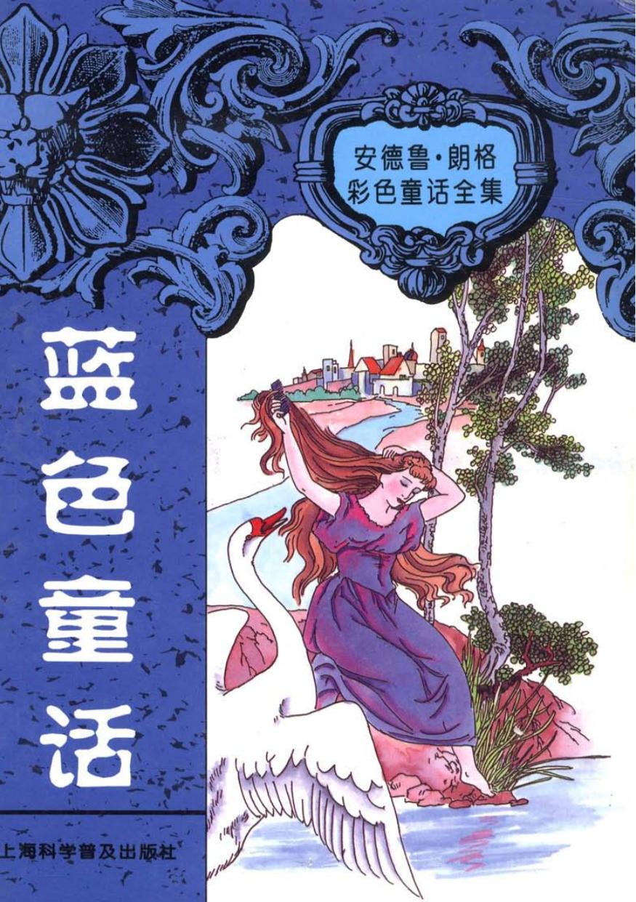

**安德鲁·朗格彩色童话全集**

蓝色童话

程贺译

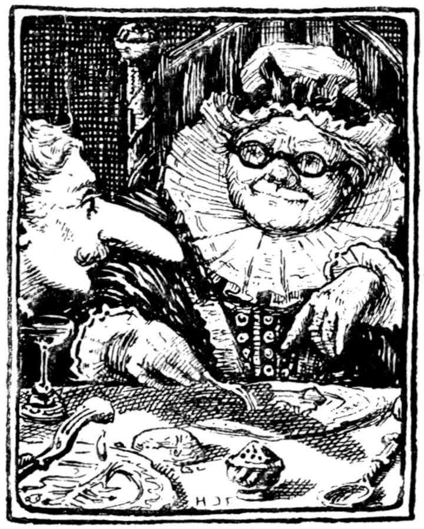

上海科学普及出版社

 

（沪）新登字第 305 号

Edited by Andrew Lang
The Blue Fairy Book

Published by Longmans, Green, and Co, Circa 1889

---

安德鲁·朗格彩色童话全集
**蓝色童话**
程贺译

---

责任编辑：钟海谷
技术编辑：万福棠
出版：上海科学普及出版社（上海曹杨路 500 号邮政编码 200063）
发行：新华书店上海发行所
印刷：上海市委党校印刷厂
开本：850×1168 1/32
印张：13
插页：4
字数：314000
版次：1997 年 4 月第 1 版 1997 年 4 月第 1 次印刷
印数：1-8000
书号：ISBN 7-5427-1233-0/G·366
定价：16.00 元

---

（本版图书凡印刷、装订错误可及时向承印厂调换）

 

| 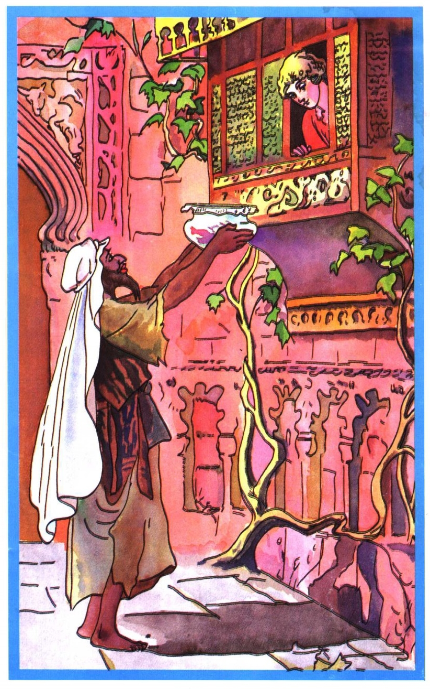 |
| :----------------------------: |
|           《铜戒指》           |

 

| 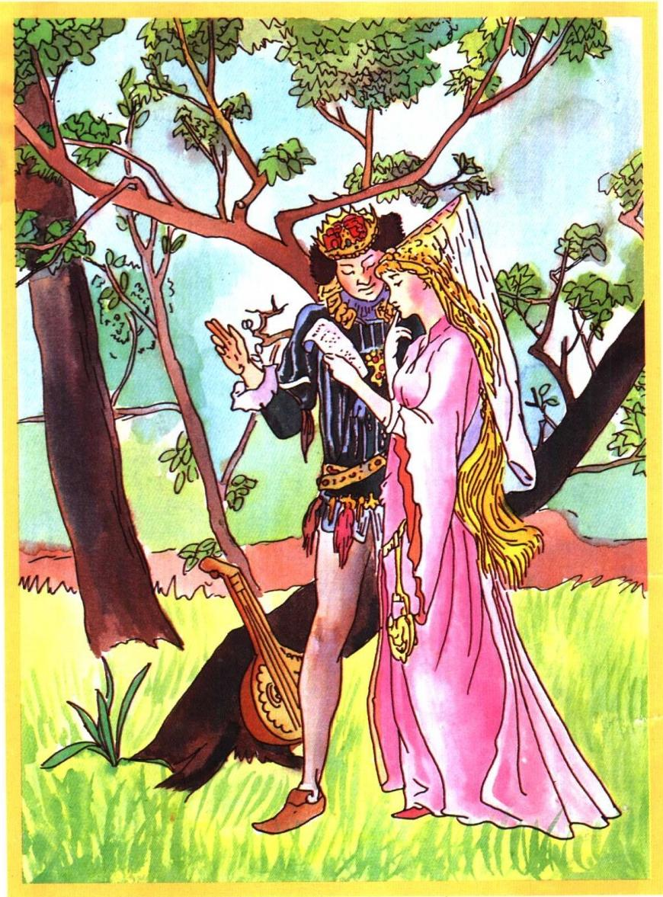 |
| :----------------------------: |
|           《黄矮神》           |

 

| 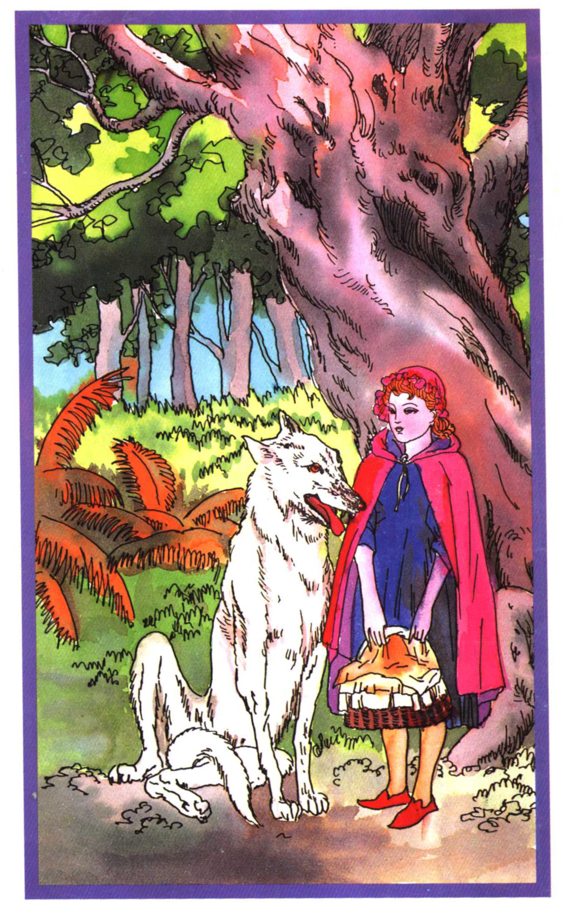 |
| :----------------------------: |
|           《小红帽》           |

 

| 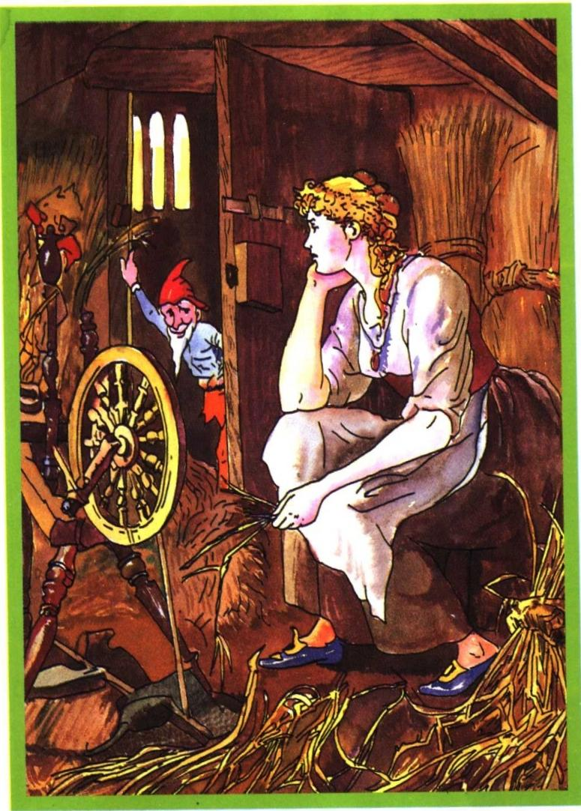 |
| :----------------------------: |
|      《伦佩尔史蒂尔茨金》      |

 

| 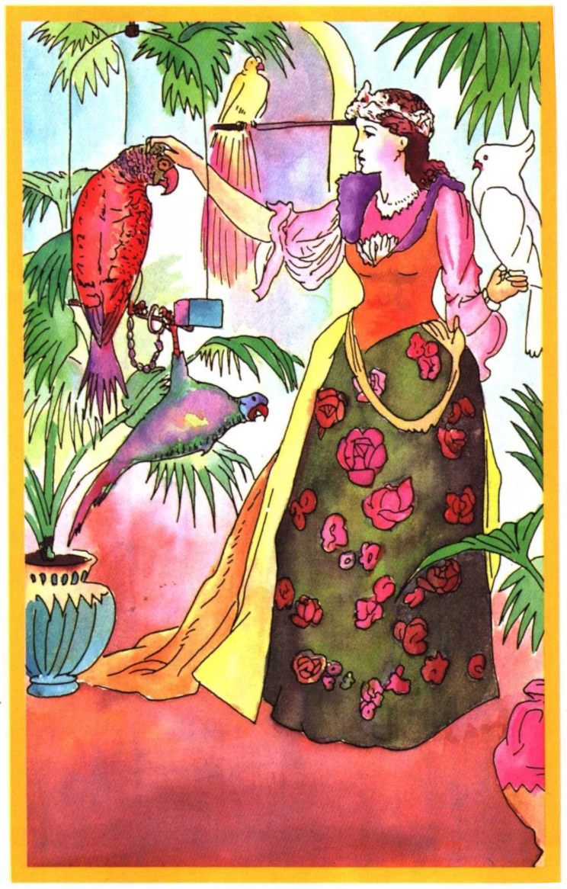 |
| :----------------------------: |
|         《美女和野兽》         |

 

| 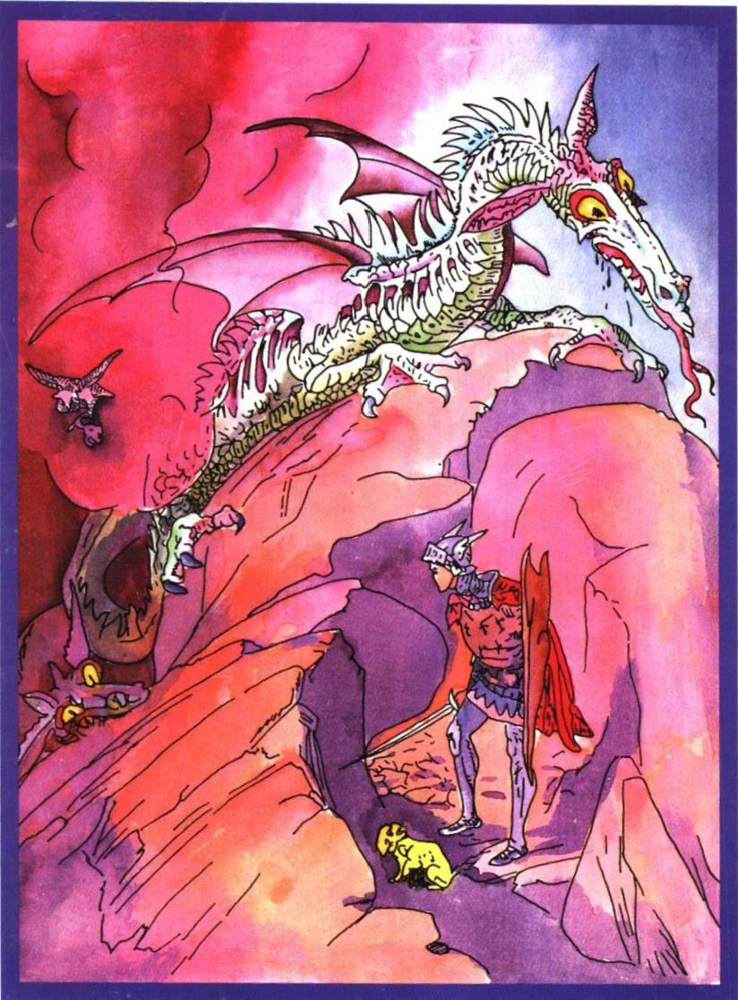 |
| :----------------------------: |
|       《金发公主的故事》       |

 

| 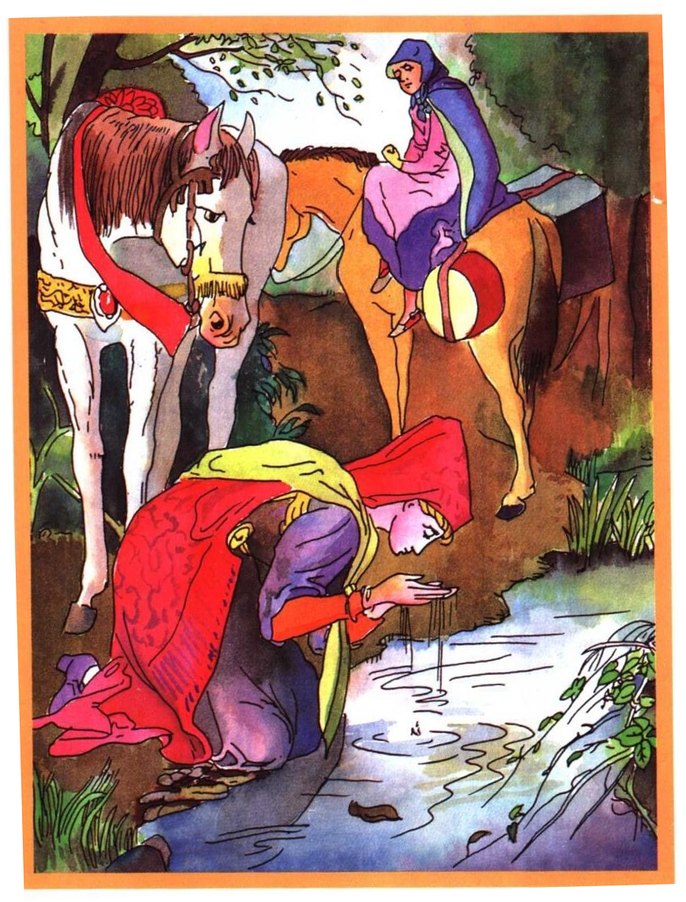 |
| :----------------------------: |
|          《放鹅姑娘》          |

 

| 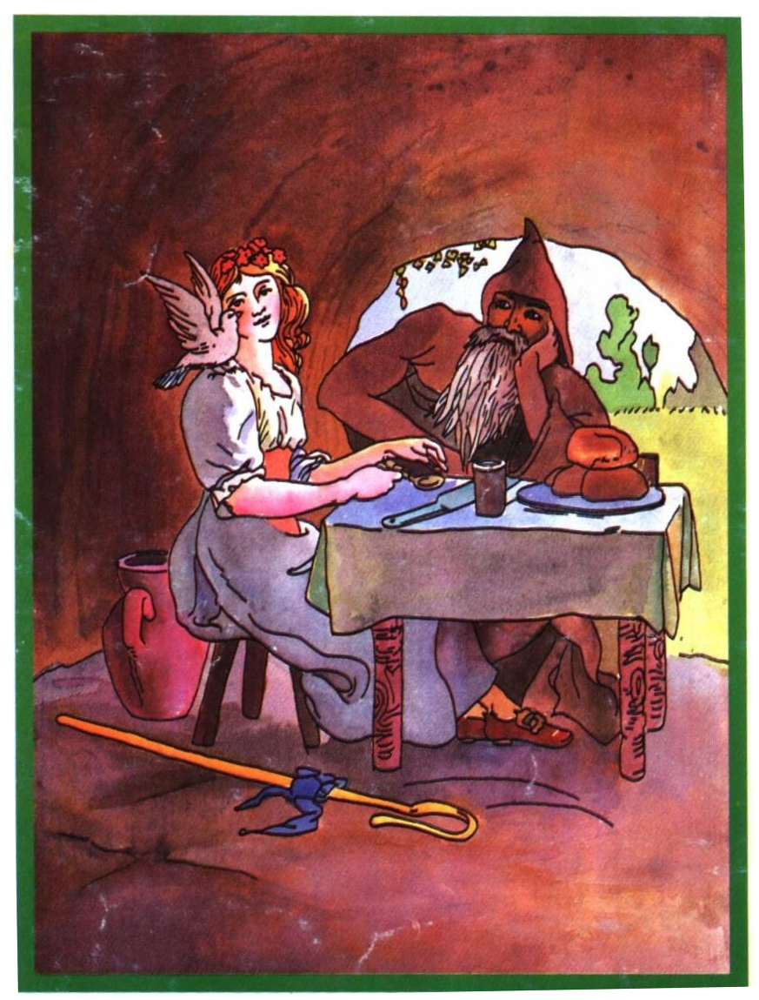 |
| :----------------------------: |
|         《亲爱的王子》         |

 

## 前言

《安德鲁·朗格彩色童话全集》是英国著名文学家安德鲁·朗格（1844～1912）编辑的十二集童话。为了编辑这些童话，他广泛地收集英国、欧洲以至全世界的童话和民间故事。那些非英语的文字，如法文、德文、葡萄牙文、意大利文、西班牙文、加泰隆语等主要由他的妻子翻译和整理成英文。最先编成一集，当时编者的意图也是只编这一集。后来搜集的材料越来越多，才决定继续再编三集。其中的艰难和辛苦是外人所难以想象的，编者因此曾发誓，编成这四集以后，再也不编下去了。

四集童话的出版，效果非同凡响。不仅受到英国读者的欢迎，而且被译成多种文字，受到许多国家读者的欢迎。欢迎的程度经历了一代又一代的读者，历数十年而不衰。这不仅源自编者长期的努力，也得益于世界各地广大热衷于这一题材的读者的帮助，他们纷纷把手头的作品和资料寄给安德鲁·朗格。这给了他极大的鼓舞，他一鼓作气，又编了八集。后面几集主要搜集了苏格兰、爱尔兰、加拿大、印度、葡萄牙、斯堪的纳维亚的民间故事和传说。有些从以神话、民间传说和英雄传奇为基础的中世纪威尔士故事集《马比诺吉昂》中选出。

安德鲁·朗格认为，这些童话故事很难说是某个人写成的，它们从很久很久以前就流传下来，经过民间艺人和文学家的不断收集和整理，才达到了今天这样思想性和艺术性都比较好的程度。这些童话也被认为是英语中，也许是全世界各种语言中时间跨度最大、包含地域最广、国家和地区最多、内容最丰富的童话集。她是世界古典童话中的瑰宝，童话世界中永不凋谢的鲜花，被译成多种文字，得以广泛流传，一代又一代的儿童被她的魅力吸引，做家长后，又为能给孩子朗读和讲述安德鲁童话而自豪。

《蓝色童话》共收集世界各国的三十七篇童话故事，这些故事在世界各地广泛流传，由来已久，深受少年儿童的喜爱。在这本书中，我们可以读到一个王子如何勇敢地正视自己的错误，在实践中努力加以改正；美丽的贝蒂姑娘如何通过自己的经历，认识到一个人的内心美比外貌美更加重要，大胆地爱上了外表丑陋的野兽，最后得到了幸福；善良的小白猫自己身处逆境，还竭尽全力帮助别人。读了这些故事，小读者们不但能增长知识，还能学会做人的许多道理。

 

目录

[TOC]

 

## 铜戒指

从前，在一个国家里住着一个国王，他的王宫坐落在宽广的花园之中。可是，虽然花园里的土地肥沃，园丁也很多，就是长不出花，结不出果；连一棵遮荫的树和青草都没有。

国王非常失望。这时，一个聪明的老人来对他说：

“你的园丁都是些外行，他们的父辈都是鞋匠和木匠，从哪学来管理花园的本事呢？你不能指望这些人能干好。”

“你说得对。”国王说。

“因此，”老人继续说，“你应该找一个父亲和祖父都干过这种活的园丁。这样，你的花园里很快就会绿草如茵，鲜花盛开；而且你很快就可以尝到又香又甜的水果了。”

于是，国王派人到全国各地的城镇和乡村里去寻找祖祖辈辈都干这一行的园丁。四十天以后，找到了一个。

“跟我们走吧！去给国王当园丁。”他们对他说。

“我怎么能去见国王？”园丁说，“你看我穷得这副样子！”

“这没有关系。”他们回答，“这是给你和你家里人的新衣服。”

“可是，我还欠了好几个人的钱。”

“我们帮你还债。”他们说。

于是，园丁被他们说服，带着妻子和儿子，跟着他们走了。国王很高兴能找到一个真正的园丁，把管理花园的事信任地托付给他。让国王的花园里长出鲜花和水果来，对新的园丁来说，也不是一件难事。到了年底，花园里可是面目一新。国王高兴地奖赏了新仆人。

你已经知道，园丁有一个儿子。他长得很英俊，是个仪表端庄，彬彬有礼的小伙子。每天，他把花园里最好的水果送给国王；把最美丽的鲜花送给国王的女儿。公主那年正好十六岁，美丽得出奇。国王想，是到了公主该出嫁的时候了。

“我心爱的孩子，”他说，“你到了该嫁人的时候了；因此，我想让你和宰相的儿子结婚。”

“父亲，”公主说，“我决不和宰相的儿子结婚。”

“那是为什么？”国王问。

“因为我爱上了园丁的儿子。”公主回答。

听到这些话，开始国王非常生气。接着，他开始流泪和叹息。他说，这样的丈夫配不上他的女儿。可是，年轻的公主矢志不渝，一定要嫁给园丁的儿子。

于是，国王去和大臣们商量。他们说：“你应该这么办，为了甩掉园丁的儿子，你把两个求婚者送到很远很远的国家去。谁先回来，就把公主嫁给他。”

国王采纳了他们意见。他们给宰相的儿子一匹好马，还有满满一钱袋的金币；而园丁的儿子呢？只给他一匹又老又瘸的马，钱袋里装的也只是铜板。人人都认为，他这么一去，就再也不会回来了。

出发前的那一天，公主来见她的心上人，对他说：“勇敢些，要永远记住我爱你。带上这一钱袋宝石，为了我们的爱情好好地使用它，尽快地回来向我求婚。”

两个求婚人一起出城。可是出城以后，宰相的儿子骑着骏马飞奔起来，很快就消失在远方的群山之中。他一直走了好些天，来到一个泉水旁。一个衣衫褴褛的老妇人坐在旁边的一块石头上。

“你好啊！年轻的旅行者。”她说。

可是宰相的儿子不理睬她，没有回答。

“可怜可怜我吧！旅行者，”她继续说着，“你也看得出，我饿得快要死了。我在这里已经呆了三天，没有一个人给我一点东西。”

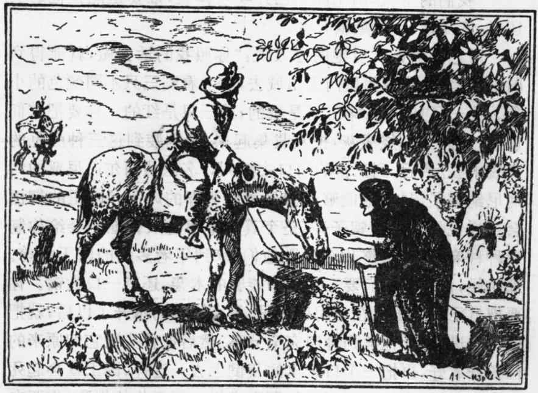

“别来烦我，丑老太婆，”年轻人喊道，“我不会给你什么东西。”说着，他继续赶路。这天晚上，园丁的儿子也骑着他那灰色的瘸马来到喷泉旁。

“你好啊！年轻的旅行者。”讨乞的妇人说。

“你好，好妇人。”他回答。

“年轻的旅行者，可怜可怜我吧！”

“把我的钱袋拿去吧！好妇人。”他说，“骑到我的后面来，我看你的腿不怎么行。”

老妇人不等他请第二次，就上了马，坐在他后面。就这样，他们来到了一个强大王国的首都。宰相的儿子在一家豪华的旅店里住下；园丁的儿子和老妇人住在穷人的旅店里。

第二天，园丁的儿子听到街上传来很吵闹的声音。原来是国王的传令兵从街上走过，吹着各种各样的乐器，还高声喊道：

“我们的主人，国王陛下已经年老体衰，谁要是能让他返老还童，恢复青春，就重重有赏。”

讨乞的老妇人对她的恩人说：“你照我的话去做，就能得到国王的奖赏。从南面城门走出城去，你会看到三只不同颜色的小狗。第一只是白的；第二只是黑的；第三只是红的。你要把它们杀掉，然后分别烧成灰，把灰收集起来，分别装到这三种颜色的口袋中去。然后，到王宫的门口去喊叫，‘名医从阿尔巴尼亚的约阿尼纳来了，只有他能够让国王重现青春的风采。’国王的御医会这样说，‘这是个骗子，不是个真有本事的人。’他们会给你制造种种麻烦，但最终你会战胜他们，来到年老多病的国王面前。那时候，你要跟他们要三头骡子能驮的木柴，还有一口大锅。你要把自己和国王关在一间房间里。等大锅里的水开了以后，就把国王扔进去，让他煮到骨肉完全分离。然后把骨头照它们原来的位置安放好，再把三个口袋里的灰倒上去。这样，国王就会起死回生，而且回到他二十岁时的那副模样。至于你的报酬，你要向他要那个铜戒指。你想要什么，铜戒指都有能力给你什么。去吧！我的孩子，别忘了我说的每一句话。”

年轻人按照老妇人的吩咐，来到城外，看到白、红、黑的三只狗，就把它们杀死烧成灰，把灰装进三个口袋里。接着，他来到王宫门口喊道：

“名医从阿尔巴尼亚的约阿尼纳来了，只有他能让国王重现青春的风采。”

开始，国王的那些御医都取笑这个陌生的旅行者。可是国王命令让这个陌生人进来。他们搬来了大铁锅和木柴。年轻人很快把国王煮了。到了中午时分，园丁的儿子把国王的骨头安排好。他刚刚把灰撒上去，国王就苏醒过来，而且发现自己又恢复了青春和体力。

“我该如何来报答你呢？我的恩人。”国王说，“把我的一半财富分给你好吗？”

“不！”园丁的儿子回答。

“把我的女儿嫁给你？”

“不！”

“把半个王国给你？”

“不！我只要那个我想要什么，它立刻就给我什么的铜戒指。”

“啊！”国王说，“这枚神奇的戒指给我积累了许多财富。不过，你会得到它的。”说着，他就把戒指给了园丁的儿子。

园丁的儿子回来和老妇人告别，然后对铜戒指说：

“给我准备一条华丽的船只，我好乘着它继续旅行。这条船的船身要用黄金做成，桅杆是银的，船帆是绸缎的。水手由十二个仪表堂堂的年轻人组成，他们的穿戴要像国王一样，让圣·尼古拉斯来掌舵。至于船上的货，就装上钻石、红宝石、绿宝石和红宝玉。”

刹那间，一条船在海面上出现，船上的一切都像园丁儿子说的那样。于是他走上船，继续他的旅程。不久，他来到一座大城市，给自己造了一幢神奇的宫殿住下来。几天以后，他碰上了自己的情敌，宰相的儿子。他把所有的钱都花光了，只好给一个搬运垃圾的人干活。园丁的儿子对他说：

“你叫什么名字？家里人是干什么的？从哪个国家来？”

“我是一个大国宰相的儿子。可是你看，现在不得不干这种下贱的活。”

“听我说，虽然我对你没有更多的了解，可是我愿意帮助你。只要你答应我一个条件，我就给你一条船，送你回到自己的国家去。”

“不论是什么条件，我都愿意接受。”

“跟我到我的宫殿里去。”

宰相的儿子没有认出他来，跟着这个陌生的富人，他来到了园丁儿子的宫殿。园丁的儿子向仆人打了个手势，他们把他的衣服全部剥下来。

“把这个戒指烧红，”主人吩咐，“在他的背上留下一个烙印。”

仆人们照他的话做了。

“现在，年轻人，”园丁的儿子说，“我要给你一条船，它会送你回到自己的国家。”

他来到外面，拿出铜戒指，说：

“铜戒指，听从主人的吩咐，给我准备一艘船。把快要腐烂的船身漆成黑色，船帆要破烂不堪，水手要体弱多病，有一个只有一条腿，有一个只有一只胳膊，第三个是驼背，还有的不是瘸腿，就是畸形或瞎子。他们多数长得很丑，脸上都有疤痕。去吧！去执行我的命令。”

宰相的儿子登上这条又破又旧的船，幸亏是顺风，他才终于回到了自己的国家。尽管他归来的情景非常凄惨，他们还是高兴地欢迎他回来。

“我第一个回来了，”他对国王说，“现在，实现你的诺言吧！把公主嫁给我。”

于是，他们立刻开始准备婚礼。可怜的公主又气愤又悲伤。

第二天，东方破晓的时候，一条神奇的船张满风帆驶进这座城市的港口，抛下锚。国王这时正好站在宫殿的窗口。

“多么奇怪的一条船！”他说，“船体是金的，船桅是银的，风帆是绸缎的。那个穿戴得像王子一样的人是谁？那不是圣尼古拉斯在掌舵吧？快去邀请船长到王宫里来。”

仆人遵从他的吩咐。很快，一个美貌英俊，风度迷人的年轻王子走进来了。他身穿华丽的丝绸，装饰着珍珠和钻石。

“年轻人，”国王说，“不论你是谁，我们都欢迎你。只要你不离开我的首都，请赏光常来作客。”

“太感谢了，陛下！”船长回答，“我接受你的邀请。”

“我女儿就要结婚了，”国王说，“你愿不愿意当她的证婚人？”

“我太荣幸了，陛下。”

不久，公主和她的未婚夫走进来。

“啊！这是怎么一回事？”年轻的船长叫起来，“你会把这么迷人的公主嫁给这样一个人吗？”

“可是，他是我的宰相的儿子！”

“这又有什么关系！我不能当你女儿的证婚人，她的未婚夫是我的奴仆。”

“你的奴仆？”

“毫无疑问，我在远方的一座城市里，看到他在干从房子里清除垃圾的活。我可怜他，就让他当我的仆人。”

“这是不可能的！”国王说。

“你要我证明我说的话吗？这个年轻人乘回来的船是我给他的。那是一条经不起风浪的船，黑色的、破旧的船壳，水手也是体弱多病，缺手缺腿的。”

“那倒是真的。”国王说。

“那是胡编，”宰相的儿子说，“我不认识这个人！”

“陛下！”年轻的船长说，“叫你女儿的未婚夫把衣服脱了，看看他的背上是不是有我的戒指留下的烙印。”

国王正要下命令，宰相的儿子为了保住面子，只好承认他说的都是真话。

“陛下！现在你认出我来了吧！”年轻的船长说。

“我认出你来了！”公主说，“你是我一直爱着的，园丁的儿子，我愿意嫁的就是你。”

“年轻人，你将成为我的女婿。”国王说，“婚宴已经开始，今天你就和我的女儿结婚。”

于是就在这一天，园丁的儿子娶了美丽的公主。

几个月过去了，这对年轻的夫妇过着幸福美满的生活。国王也因为得到一个好女婿而越来越满意。

后来，这艘金船的船长觉得有必要去远航。他温柔地拥抱一下妻子，和她告别以后就登船出发了。

那时候，首都的郊外住着一个人。这个人一直在学习黑道——炼丹术、占星、魔法和妖术。他发现，园丁的儿子之所以能和公主结婚，只是因为得到了服从铜戒指命令的妖怪的帮助。

“我要弄到那个戒指。”他对自己说。于是，他来到海边，抓来一些红颜色的小鱼，这些鱼可真是十分漂亮。然后他返回来，从公主的窗口走过，高声地喊叫着：

“谁想要漂亮的小红鱼？”

公主听到了，叫一个仆人出来问魔术师：

“你的鱼要用什么来换？”

“一个铜戒指。”

“一个铜戒指，大笨蛋！我到哪里去找？”

“公主房间里的垫子底下。”

仆人回到女主人面前。

“这个老疯子不要金子，也不要银子。”她说。

“那么，他要什么呢？”

“他要藏在垫子底下的一个铜戒指。”

“找出来给他。”公主说。

仆人终于找到了铜戒指，那是金船的主人偶然留下来的。她把戒指交给魔术师，他拿到手立刻就走了。

他刚回到自己的家，就迫不及待地拿出铜戒指说：“铜戒指，听从主人的命令。我要把那条金船变成黑木头，把那些水手变成可怕的妖魔，让圣·尼古拉斯离开舵，把船上的货物都变成黑猫。”

铜戒指手下的妖怪执行了他的命令。

年轻的船长在海上发现自己突然陷入这种悲惨的境地，知道肯定是有人偷了他的铜戒指。他大声地悲叹自己的不幸，可这又有什么用呢！

“我的天啊！”他自言自语地说着，“偷了我戒指的人，说不定已经抢走了我亲爱的妻子，我回到自己的国家去还有什么用呢？”于是，他驾着船从这个岛屿开到那个岛屿，从这个海岸开到那个海岸。他相信，不论到什么地方，人人都会取笑他。很快，他就穷得毫无分文。他，还有那些水手和可怜的黑猫只好吃野草和树根。这样流浪了好长时间以后，他们来到了一个老鼠居住的荒岛。船长命令把船靠岸，上岛去看看有些什么。岛上到处都是老鼠，除此以外，什么都没有。有几只黑猫跟他一起上去，这些黑猫已经饿了好几天，正是饥肠辘辘，就凶狠地捕食起老鼠来。

老鼠的王后赶紧召开紧急会议。

“这些猫会把我们都吃光。”她说，“要是这条船的船长不把这些可怕的动物关起来，我们都要完蛋。让我们选出最勇敢的老鼠来当代表，去见他。”

几只老鼠自告奋勇去执行这个使命，它们来找年轻的船长。

“船长，”它们说，“快点离开我们的岛，否则我们就会遭到灭顶之灾，个个都要完蛋。”

“我很乐意，”年轻的船长说，“不过有个条件，那就是帮我找回一个铜戒指，一个狡猾的魔术师把它从我这里偷走了。要是你们不肯，我就把所有的猫放到你们岛上去，你们就绝种了。”

老鼠们惊慌失措地回去。“这可怎么办呢？”鼠王后说，“我们怎么才能找到这个铜戒指？”它又召开一次会议，把地球上每一个角落里的老鼠都叫来，可是谁也说不出铜戒指在哪里。突然，有三只老鼠从很远的国家赶来，有一只的眼睛瞎了，有一只的腿瘸了，还有一只耳朵给割掉了。

“嗬！嗬！嗬！”新来的老鼠说，“我们从很远的国家来。”

“你们知道妖怪听它话的铜戒指在哪里吗？”

“嗬！嗬！嗬！我们知道。一个坏家伙刚刚得到它。白天，他放在口袋里；晚上，他含在嘴里。”

“快去从他身上拿过来，然后尽快地赶回来。”

于是，三只老鼠造了一只船，向魔术师的国家开去。它们来到首都，上了岸，向王宫飞奔过去，只留下瞎老鼠看管船。它们一直等到晚上，魔术师在床上躺下，把铜戒指放进嘴里，很快就睡着了。

“现在，我们该怎么办？”两只小老鼠说。

耳朵被割掉的老鼠看到一盏装满油的灯，还有一瓶胡椒，就把尾巴在油里浸一浸，再放到胡椒瓶里去，然后把尾巴塞进魔术师的鼻子。

“哈欠！哈欠！”魔术师打起喷嚏来，但是没有醒。铜戒指从他嘴里喷出。瘸腿的老鼠一下子就窜上去咬住这个珍贵的法宝，带着它回到船上。

可以想象，魔术师醒过来，到处找不到铜戒指，是多么绝望！

这时候，我们的三只老鼠已经带着它们的战利品起航。微风送着它们向小岛驶去，鼠王后正在那里等着它们呢！它们自然而然地说起铜戒指来。

“谁应该得到最大的荣誉？”它们异口同声地提出这个问题。

“我！”瞎老鼠说，“要不是我看住船，它早就到大海中去了。”

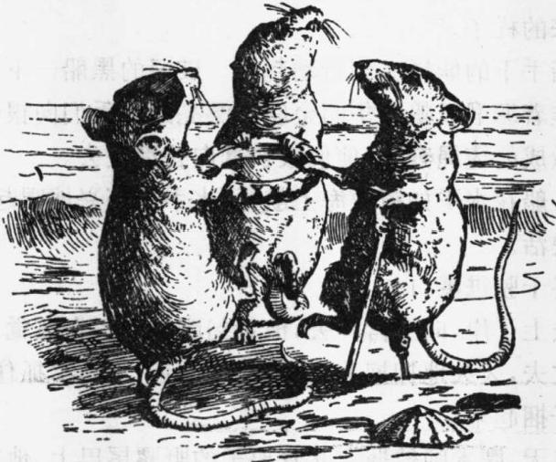

“当然不是！”没有耳朵的老鼠说，“最大的荣誉应属于我，不是我叫那人把铜戒指喷出来吗？”

“不！应该是我！”瘸腿老鼠说，“是我把戒指拿回来的。”

它们越吵越凶，不久就打了起来。哎！就在它们吵得最厉害的时候，铜戒指掉到海里去了！

“我们怎么去见王后？”三只老鼠说，“由于我们的愚蠢，把救命的法宝丢了。我们的人都要因此而遭受灭顶之灾！我们再也不能回到自己的国家去了。让我们登上这荒芜的小岛，在这里了结我们悲惨的生命吧！”

很快，船就靠上小岛。三只老鼠上了岸。两只老鼠跑在前面，去捉苍蝇吃，把瞎眼老鼠抛在后面。它伤心地在海岸边走着，找到一条死鱼就吃起来。它感到咬着了什么硬的东西，就叫了起来。两只老鼠闻声赶过来。

“是铜戒指！是那个法宝！”它们高兴地喊叫起来，又重新回到船上去。没有多久，就返回了老鼠岛。它们来得正是时候，因为船长正要把他的猫放出来，老鼠的代表把宝贵的铜戒指送来了。

“铜戒指！”年轻人马上下命令，“听从主人的吩咐，把我的船变回原来的样子。”

戒指手下的妖怪立刻行动起来。破旧的黑船一下子就变成了那只挂着绸缎风帆的华丽金船。漂亮的水手们向银色的船桅和真丝做成的缆绳奔去，他们很快就向首都驶去。

啊！船在水平如镜的海上航行，水手们高兴地唱起歌来，他们多么快活。

船终于驶进港口。

船长上了岸，向王宫奔去，他看到魔术师正在睡觉。公主扑向她的丈夫，久久地拥抱着。魔术师想逃走，可是给抓住了，用结实的绳子捆起来。

第二天，魔术师被捆在驮着栗子的野骡尾巴上。他被拖成碎片，就像骡背上的栗子一样。

（小亚细亚）

 

## 王子海辛斯和可爱的小公主

从前有一个国王，他深深地爱上了一个公主。可是公主不能和任何人结婚，因为她中了魔法。于是国王出去寻找仙女，问她如何才能得到公主的爱？仙女对他说：

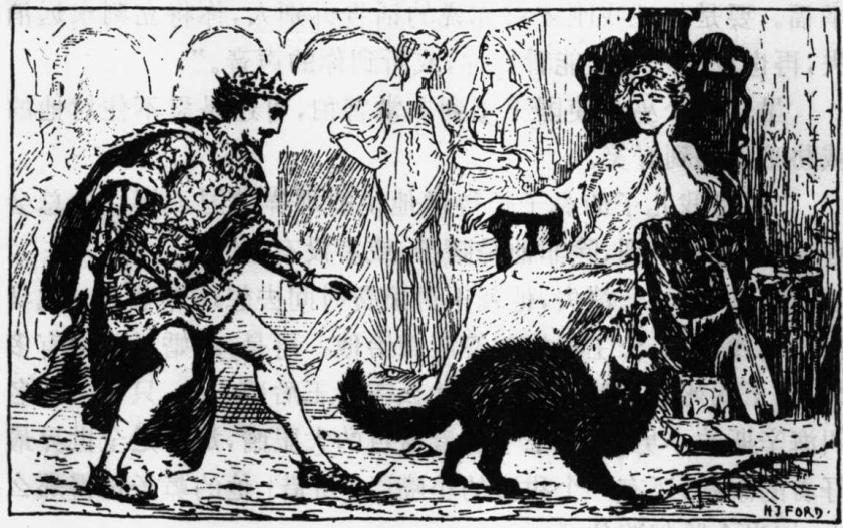

“你看到了，公主有一只非常喜欢的大猫。谁要是聪明地踩到猫的尾巴，他就是公主命中注定的丈夫。”

国王想，这不应该太难吧！于是他告别了仙女，决心要去把猫的尾巴踏个稀巴烂，而不是踩上一脚算数。

你可以想象，国王迫不及待地就来看公主。那只猫像往常一样，走到他的面前，拱起背来。国王跨上一步，心里想十拿九稳会把猫的尾巴踏在脚下。可是猫非常敏捷地转过身去，他踩了个空。一连八天，国王毫无结果。这时他才承认，这根决定人命运的尾巴真是像灌满了不停地滚动的水银一样，一刻也不会静止不动。

可是后来，他幸运地看到那只猫睡着了，尾巴伸在地上。国王不失时机地在它的尾巴上狠狠地踩了一脚。

猫恐怖地叫了一声，跳了起来，立刻变成一个高大的汉子，他用愤怒的眼光盯着国王说：

“你可以和公主结婚，因为你已经破了魔法，可是我要报复。你会有一个儿子，在他发现自己的鼻子太长之前，他永远也不会幸福。要是你把我刚才对你说的话告诉别人，你将立刻永远消失，再也没有一个人能看到你，或听到你的声音。”

虽然这个巫师使国王感到非常害怕，可还是忍不住对他的威胁暗自感到好笑。

“要是我儿子的鼻子长得像他说的那样，”国王想，“他总会看得见，感觉得到，除非他是瞎子，或者没有手。”

不过，巫师一消失，他就不再浪费时间去想这件事了。他马上就去找公主，公主很快就答应嫁给他。可是，结婚以后没有多久，国王就死了。他没有留下什么需要王后费心的，只有一个名叫海辛斯的小男孩。小王子长着蓝色的大眼睛，那可是全世界最好看的眼睛，还有一个甜蜜的小嘴巴。可惜！他的鼻子长得那么大，把半个脸都遮住了。

王后看到儿子的大鼻子，非常伤心。可是周围的女人都劝她说，这鼻子看上去很大，其实并不大。这是古罗马人的鼻子，你只要翻开历史书就会读到，个个英雄都有个大鼻子。王后的全副心思都用在孩子的身上，听了她们的这些话，她也开心起来。再回过头来看看海辛斯，鼻子看上去也不那么大了。

王子在极其细心的照料下成长。他一会说话，人们就和他讲各种各样那些小鼻子的可怕故事。凡是和王子的鼻子相差太大的人，都不许接近他。大臣们为了讨王后的喜欢，每天都要把他们小孩的鼻子拉上几次，好让它长得长一些。不过，无论他们怎么做，都不能和王子的大鼻子相提并论。

王子懂事以后，就开始学习历史。每当讲到伟大的王子或美丽的公主时，老师总忘不了告诉他，他们都长着一个大鼻子。

王子的房间里挂着许多画，上面都是长着大鼻子的人。王子长大以后坚信不疑，大鼻子是一种伟大的美，他丝毫也没有想过，让自己的鼻子缩短一寸！

王子满二十周岁以后，王后想他应该成亲了，于是命令把几个公主的画像拿来给他看，其中有一张是可爱的小公主的画像。

小公主是一个伟大君主的女儿。将来有一天，她会继承好几个王国。不过，海辛斯王子对这些并不感兴趣，他只是被她的美丽深深地打动。可是，王子认为十分迷人的这位公主却长着一个漂亮的小鼻子。这个鼻子长在她脸上，可真是再美不过了。但这也让那些大臣们感到非常为难，因为他们已经习惯于取笑小鼻子。有时，他们会不知不觉地取笑起她来。不过，这对王子来说，一点也不起作用，他觉得这一点也不好笑。有两位大臣还因为胆敢对亲爱的小公主的小鼻子不尊重而被他赶出去。

其他人从中吸取教训，说话之前先仔细地想一想。有一个还大胆地对王子说，一个男人如果没有大鼻子，那就一钱不值，这是千真万确的；可是女人的美貌却是另一回事。他认识一个有学问的人，这个人了解古希腊，读过一些古希腊的史料，其中就说到美丽的克娄巴特拉有一个尖端翘起来的鼻子！

王子送给他一件贵重的礼物，作为这个好消息的奖赏，并且立刻派出大使去向可爱的小公主求婚。公主的父亲，国王同意了。王子急于要见公主，赶了十英里地来到她面前。正当他想吻公主的手的时候，周围的人恐惧地看到，巫师闪电般地出现在他们面前，抓起可爱的小公主，像旋风般地把她卷走，一转眼就不见了！

王子非常沮丧，他发誓找不到公主就决不回到自己的国家去。他不许任何人跟随，独自骑着马伤心地走了，任凭马把他带到天涯海角去。

走着，走着，他来到了一片大平原上。整整走了一天，连一间房子也看不见，人和马都饿得慌。到了晚上，王子看到一丝亮光，好像是从一个山洞里射出来的。

王子骑着马向山洞走去，看到里面有一个矮小的老太婆，看上去起码有一百岁。

她拿起眼镜，想戴上看看王子，可是戴了好久才戴好，因为她的鼻子实在太短。

王子和仙女（这个老太婆是个仙女）只相互看了一眼，就不约而同地笑出声来，异口同声地说：“啊！多么有趣的鼻子！”

“我的鼻子不像你的那么有趣。”海辛斯王子对仙女说，“不过，夫人，请你先不要考虑我们的鼻子长得怎么样，它们就是那个样子了。请先给我点吃的东西，我饿坏了，还有我那匹可怜的马。”

“我非常乐意。”仙女说，“虽然你的鼻子长得很滑稽，可你是我最好朋友的儿子，我爱你的父亲就像亲兄弟一样，他有一个非常漂亮的鼻子！”

“那么，请说。我的鼻子缺点什么？”王子问。

“哟！它什么也不缺，”仙女回答，“相反，倒是多了一点。不过没关系，一个鼻子太长的人也可以成为伟大的人物。我刚才对你说了，我是你父亲的朋友。那时候，他经常来看我。你要知道，我从前可是很漂亮的呵！起码他常常这样夸我。我很乐意告诉你，我们最后一次见面的时候说了些什么。”

“是的，”王子说，“等我吃饱以后，会很高兴地听你说。不过，夫人，我请你想一想，我已经整整一天没有吃过一点东西了。”

“这可怜的孩子是对的。”仙女说，“我忘记了。那么，进来吧！我要让你吃些晚饭。在你吃饭的时候，我可以非常简单地和你说说我的事情，我不喜欢喋喋不休地谈论自己。长舌头比长鼻子还要糟糕。记得年轻的时候，我常常因为说话不罗嗦而受称赞。他们常常去对王后，我的母亲这样说。现在你知道我是什么人了吧！我是一个伟大国王的女儿。我父亲……”

“你父亲，我敢说，他饿了也会去找东西吃！”王子打断她的话。

“啊！那当然，”仙女说，“你也会马上就可以吃到晚饭，我只是想告诉你…… ”

“可是在我吃些东西前，我真的什么也听不进！”王子说，他的火气越来越大。不过他马上想起来还是有礼貌一些好，因为他非常需要得到仙女的帮助。于是他补充说：

“我知道，只要高高兴兴地听你说话，就会把饥饿忘得一干二净；可是我那匹马听不懂你的话，一定要喂它！”

仙女对这些赞美的话非常满意，一边叫仆人，一边对王子说：“你用不着再多等一分钟。你那么有礼貌，尽管你的鼻子很大，但还是很讨人喜欢的。”

“讨厌的老妇人，她怎么老是没完没了地说我的鼻子！”王子心里想着，“几乎人人都认为，她的鼻子太短了，我的鼻子正好。要不是饿得慌，我早就直接了当地和这个自以为说话简短扼要，实际上罗罗嗦嗦的饶舌女人说个明白了。人要是看不到自己的缺点该有多愚蠢！当一个公主会有什么结果呢？她从小就被那些阿谀奉承的人惯坏了，他们使她相信，自己是个说话恰如其份的人。”

这时候，仆人们把晚饭送上桌来了。王子饶有兴趣地听着仙女说话，她不停地问着仆人们这样或那样的问题，目的只有一个，那就是好让自己不停地把话说下去，享受说话的快乐。王子特别注意到，不论仙女说什么，有一个女仆总是想方设法赞扬一番女主人的智慧。

“唉！”王子一边吃饭，一边想着，“我真高兴来到这里。这恰好证明，我是多么明智，从不去听那些恭维话。那些拍马屁的人恬不知耻地当面说我们的好话，把我们的缺点遮盖起来，或者把它们说成是优点，我决不会上他们的当。我知道自己的缺点，我希望这样。”

可怜的海辛斯王子！他真的相信自己的想法，一点没有想到那些赞美他鼻子的人都在背后取笑他，就像仙女的女仆取笑她一样。王子注意到，那些女仆在仙女看不见的时候，偷偷地取笑她。

不过，王子什么也没说。等他吃得差不多以后，仙女说：

“我亲爱的王子，可以请你挪过去一点吗？你的鼻子影子那么大，我一点也看不清楚盘子里有些什么东西。啊！谢谢！现在，让我们来说说你父亲。我第一次到王宫里去的时候，他还是个小孩呢！那已经是四十年以前的事了。打那以后，我一直住在这荒芜的地方。告诉我，现在的情形怎么样？女士们是不是还像从前那样喜欢娱乐。我那时候，在集会上、剧场里、舞厅里、赛马场里，天天都可以见到她们。我的天！你的鼻子那么长，我真不习惯！”

“真的，夫人，”王子说，“我希望你不要再提起我的鼻子，它长得怎么样跟你毫无关系。我对它十分满意，也不想叫它短一些。人的长相是天生的，他总得接受。”

“现在，你生我的气了，我可怜的海辛斯。”仙女说，“我向你保证，我没有惹你生气的意思；相反，我还想帮帮你呢！不过，尽管你的鼻子总是令我惊讶，我还是尽量不再说它。我还尽可能地去想，你的鼻子和平常人没有什么两样。不过说实话，它有正常人的三倍那么大。”

王子这时候已经吃饱，对仙女不停地说他的鼻子感到很不耐烦，他终于骑上马，急急忙忙地走了。可是不论他走到什么地方，他总认为人们都疯了，因为他们总在说他的鼻子。然而，他决不承认自己的鼻子太长了，他生来就习惯于听别人说它长得很漂亮。

希望让他幸福的老仙女终于想出了一个办法。她把可爱的小公主关在水晶宫里，把水晶宫放在王子找得到的地方。看到公主，王子高兴得无法形容。他开始想尽一切办法，要把公主从囚禁中解救出来。可是，不管他如何努力，都无法办到。在绝望之中，他想起码和公主靠得近一些，和她说几句话也好。公主那边也伸出手来，好让他吻。可是他无论如何也无法把公主的手举到嘴边，因为他的鼻子总是把公主的手挡住。王子第一次意识到，他的鼻子真的是太长了，不禁叹息起来：

“唉！必须承认，我的鼻子是太长了！”

话刚说完，水晶监狱立刻裂成上万块碎片，飞向四面八方。老仙女拉着可爱的小公主的手，对王子说：

“现在，你说说看，该不该很好地感谢我！我跟你说鼻子的事完全是出于好心。要不是它妨碍了你去做想做的事，你永远也不会看到它是多么特别。你看，自负是如何妨碍我们去认识自己思想和身体上的缺陷，理智想给我们指出来也是白搭。只有在它们损害我们利益的时候，我们才肯承认。”

海辛斯王子的鼻子已经长得和平常人一样了，可是没有忘记从这件事中吸取教训。他和可爱的小公主结了婚，从此开始幸福的生活。

 

## 太阳的东边和月亮的西边

从前有一个穷苦的农民，他有许多孩子，可是他们缺食少穿。孩子们个个都长得很漂亮，尤其是最小的女孩子，那么美丽，怎么形容她都不会过份。

有一天，那是秋天的一个星期四晚上，天已经很晚了。天气很糟糕，外面漆黑一团，暴雨倾盆而下，风刮得那么猛，连小屋的墙壁也摇晃起来。这时候，一家人都围着火炉坐着，各人忙各人的事情。突然，有人在窗框上敲了三下。农民走过去看看是谁，到了门口，他看见外面站着一头高大的白熊。

“晚上好。”白熊说。

“晚上好。”农民回答。

“你肯把你的小女儿嫁给我吗？”白熊说，“要是你答应，你就会富裕起来。”

当然，农民不会反对富裕起来，不过他心里暗想：“我总得先问问我的女儿。”于是，他回来对家里人说，外面有一头大白熊，说是只要把小女儿嫁给它，就保证让我们富裕起来。

可是小女儿不肯，说这种话她听也不要听。于是农夫又走出来，说好白熊下个星期四晚上再来，听候他的回音。然后，农民开始劝说他的小女儿，说了许多他们将如何富裕，她自己将会怎么好的话。后来，她终于决定出嫁了。她把自己的那些破烂衣服洗干净，缝补好，尽可能把自己打扮得漂亮些，做好一切出嫁的准备。她要带走的东西实在少得可怜。

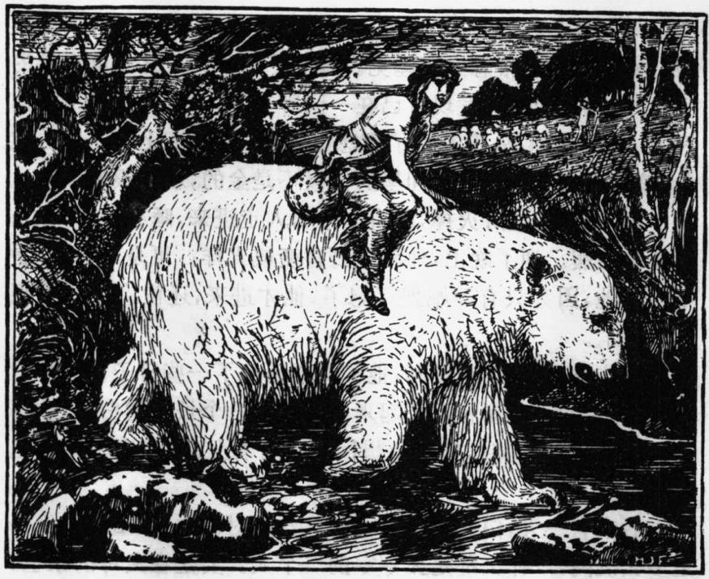

又到了星期四晚上，白熊来接她。她拿着包裹，坐在白熊的背上，就这样走了。他们走了许多路以后，白熊问她：“你怕不怕？”

“不！我不怕。”她说。

“抓住我的毛，就不会有什么危险。”它说。

就这样，她骑着熊走得很远很远，一直走到一座大山前。白熊在高山上敲了一下，一扇门打开了。他们走进一座城堡。城堡里有许多被照耀得格外明亮的房间，闪烁着金色和银色的光芒。在一间同样金碧辉煌的大厅里，摆着一张铺好的桌子。它是那么富丽豪华，没见过的人真是无法想象。

白熊交给小女儿一个银铃，对她说，想要什么东西只要摇一下铃，东西就会出现。

等她吃过晚饭以后，天已经开始黑了。经过一天的长途跋涉，她觉得很困，很想上床睡觉。她摇了一下铃。几乎就在她的手碰到铃的同时，就发现自己在一间卧室里，一张床已经给她铺好了。床那么漂亮，谁看见了都想上去睡一觉。床上有丝做的枕头，镶着金边的绸帐。房间里的摆设不是金的，就是银的。

她刚躺下，把灯灭掉，就有一个男人走进来，睡在她的身边。他就是白熊。到了晚上，他就从野兽变成人样。可是，她一直看不清楚他，因为只有等她把灯熄了，他才进来，还没有等到天亮他就走了。

就这样，一切都很顺利，他们幸福地过了一些日子。可是后来，她开始变得悲痛和伤心起来。因为每一个长长的白天，她都得孤独地度过；同时，她也很想回家去看看父亲、母亲和兄弟姐妹。

后来有一天，白熊问她想要什么？她对他说，在山上过日子是多么沉闷，干什么都是孤零零的一个人。要是在父母的家里，满屋都是兄弟姐妹。她还说，因为不能去看他们，所以感到很伤心。

“这有办法解决。”白熊说，“不过你要答应我，除非有人在旁边，否则决不和母亲单独在一起说话。你回家以后，她会拉着你的手，领你到一个房间里去和你单独说话。你千万不要答应她，否则就会给我们带来巨大的灾难。”

于是，在一个星期天，白熊来了，说现在可以去看望她的父母了。她坐在白熊的背上，他们走啊！走啊！走啊！走了许多许多路，花了很长很长的时间，终于来到了一家有很大农家房舍的前面。她的兄弟姐妹们在外面奔跑着，玩耍着，那么开心，看到这情景也令人高兴。

“你的父母现在住在这里，”白熊说，“别忘了我对你说过的话，否则就会害苦了你自己和我两个人。”

“不会，真的，”她说，“我决不会忘记。”她一走进家门，白熊就转过身来回去了。

她回到父母的身边，全家人是多么高兴啊！他们的这种欢乐好像永远也不会停下来，她为全家做出了贡献，人人都认为怎么感谢她都永远不够。现在，他们要什么有什么，而且都是绝顶的精品。大家都问她，在那边过得怎么样？她回答说，她的一切也都很好；凡是她所能够想得到的，都有了。她还回答了些什么问题，我就说不上了。不过有一点可以肯定，关于她的事情，他们打听得到的并不多。

吃过午饭以后，到了下午，事情就像白熊说过的那样，她母亲想叫她到自己的房间里去单独说话。她想起白熊的话，说什么也不肯去，她说：“要说的话，什么时候说都可以。”

可是后来不知道为什么，她的母亲还是把她说服了。她不得不把整个事情都说出来。她说，每天晚上灯灭以后，一个男人如何走进来躺在她的身边。第二天如何天还没亮，他就走了，所以她从未看清楚他。她如何悲伤地度日，想象着如果能见他一面也会感到幸福；白天，她是如何孤独地一人度过，那么凄凉和苦闷。

“啊！”母亲听到这里，害怕得喊叫起来，“你很像是和神话中说的巨人睡在一起。不过，我来教给你一个办法，让你可以看清楚他。我给你一支蜡烛，你把它藏在胸口带走。等他睡着以后，点上蜡烛来看他，不过要小心，别让蜡滴在他身上。”

于是，她拿起蜡烛，把它藏在胸口。天快黑了，白熊来接她回去。走了一些路以后，白熊问她，是不是事情和它说过的不一样？她只好承认自己没有照它的话去做。

“那么，要是你照你母亲的话去做，就给我们俩带来了巨大的灾难。”它说。

“没有，”她说，“我什么也没有做过。”

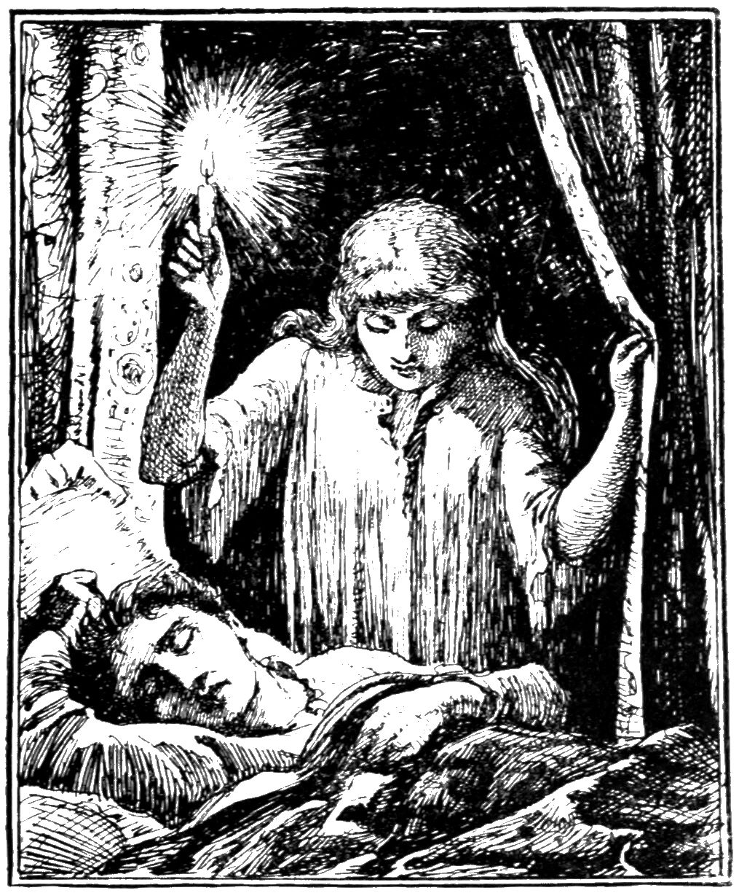

她回到家里，上床睡觉。一切都像以前一样，一个男人走进来，躺在她的身边。夜深了，她听得出，他已经睡熟了。她从床上起来，把蜡烛点亮，用烛光来照他的脸。她看到了一个从未见过如此英俊的王子。她那么深情地爱他，如果不亲吻他一下，可能立刻就会死去。她情不自禁地吻他一下。可这时，三滴热蜡油滴到他的衬衫上。他醒过来了。

“你干了些什么？”他说，“你给我们两个人都带来了不幸。你只要再等一年，我就自由了。我有一个继母，她对我施了魔法，从此我白天是一头白熊，到了晚上才是人。可是现在，我们之间的一切都结束了。现在，我必须离开，到她那里去。她住在一个城堡里，城堡坐落在太阳的东边和月亮的西边。那里还有一个公主，她的鼻子有三米那么长，我必须和她结婚。”

她悲痛地哭泣起来，可是有什么用呢！他不得不走。接着，她问能不能跟他一起走。不行！这是不可能的。

“那么，你能不能把到那里去的路告诉我，我要去找你，我想这总可以吧！”

“是的，你可以去找我。”他说，“可是，那里无路可走。它在太阳的东边和月亮的西边，你永远也找不到到那里去的路。”

早上，她醒过来的时候，王子和宫殿都不见了。她发现自己在又黑又密的森林中，正躺在一块绿色的草地上，身边是她从家里带来的那个包裹。她擦了擦眼睛，赶走了睡意，伤心地哭得精疲力尽才站起来。她走了许多许多天，后来看到一座大山。山脚下坐着一个上了年纪的老妇人，正在玩金苹果。姑娘上去问她：知不知道王子和他的继母居住的城堡？这个城堡坐落在太阳的东边和月亮的西边，到那里去的路该怎么走？城堡里还住着一个鼻子有三米长的公主，王子就要去和她结婚了。

“你是怎么认识他的？”老妇人问，“也许你就是应该得到他的那位姑娘？”

“是的，的确，我就是。”她说。

“那么，原来就是你喽！”老妇人说，“我知道他住在太阳东边和月亮西边的城堡里。即使你最终能够到达那里，也要花很长很长的时间。不过我可以把马借给你。你骑着它去找一个老太婆，她是我的邻居，也许她能告诉你王子的消息。到那里以后，别忘了在马的左耳下面拍一下，叫它自己回家。不过这个金苹果你可以带着走。”

姑娘骑上马，走了许多许多路，来到一座山脚下，看到一个手中拿着金梳子的老妇人坐在那里。姑娘问她，是否知道到太阳东边和月亮西边那座城堡去的路。她的回答和第一个老妇人一样：“我只知道它在太阳的东边和月亮的西边，即使你最终能到那里，也要花很长时间。不过我可以把马借给你。你骑着它去找一个老太婆，她住得离我最近。也许她能知道城堡的地址。你到她那里以后，在马的左耳朵下拍一下，叫它自己回家来。”接着，她把那把金梳子交给姑娘，说也许对她有用。

于是，姑娘又上了马，继续向前走一条很长的，令人厌烦的道路。走了好久以后，她来到一座大山前，看到一个上了年纪的老妇人正在用金纺轮纺纱。她又问了这个老妇人，寻找王子的路该怎么走？太阳东边和月亮西边的城堡在哪里？可是结果和前面一样。

“也许，是你应该得到王子。”老妇人说。

“是的，不错，应该是我。”姑娘说。

可惜这个老妇人知道的并不比前面的两个多——在太阳的东边和月亮的西边。她还说：“即使你最终能到那里，也要花很长时间。不过，我可以把马借给你。我想你最好骑着马去找东风，也许它知道城堡在哪里，把你吹到那里去。但是，你到它那里以后，要在马的左耳下面拍一下，它就会自己回家。”她还把金纺轮送给姑娘，说：“也许你会发现它对你有用。”

姑娘又得骑上马走上许多天，经历了一段漫长而令人厌烦的时间以后，她终于来到了东风的家里。她问东风，能否告诉她去找王子的路，他住太阳的东边和月亮的西边。

“嗯！”东风说，“我听说过王子，还有他的城堡。可是我不知道到那里去的路，因为我从来没有吹得那么远过。不过，要是你愿意，我可以带你到我的兄弟西风那里去，它可能会知道，它比我强劲得多。你可以坐到我的背上来，我带你到那里去。”

于是，她坐到东风的背上，他们飞得多么快啊！一会儿就到了西风的家里。东风走进去对西风说，它带来了应该得到王子的姑娘，王子住在太阳东边和月亮西边的城堡里。她到处奔波，目的就是为了再次找到他，所以就把她带来了，想来问问西风是否知道这座城堡在哪里。

“不知道，”西风说，“我从来没有吹得那么远过。不过，要是你愿意，我可以带你到南风那里去。它比我们俩都强得多，它吹拂过的地方又远又多。也许它能告诉你想知道的事。你可以坐到我的背上来，我带你去找它。”

就这样，她跟着西风去找南风，这也花不了多少时间。到了南风的家以后，西风问它是否能告诉姑娘，到太阳东边和月亮西边的城堡去的路该怎么走？因为她就是该嫁给住在城堡里的王子的姑娘。

“啊！是真的吗？”南风说，“她就是那姑娘？嗯！我生下来就到处游荡，到过许多景色各异的地方，可就是从来没有吹得那么远过。不过，要是你愿意，我可以带你到北风兄弟那里去。它是我们之中年纪最大，身体最棒的一个。要是连它也不知道，那么这个世界就不会再有人能回答你的问题了。你可以坐到我的背上来，我带你到那里去。”

于是，她坐到南风的背上。南风从它家里一跃而起，路上也花不了多少时间，他们就接近了北风的住处。它是那么野蛮和疯狂，他们很远就感到阵阵凛冽的寒风扑面而来。

“你们来干什么？”很远就听到了北风粗犷的喊声，随着声音的传来，他们感觉自己冷得快冻僵了。

“是我呀！”南风回答，“这是应该得到住在太阳东边和月亮西边城堡里的王子的姑娘。她想问问你，你到过那里吗？能不能给她指路，再次找到王子她会很高兴的。”

“是的，”北风说，“我知道它在什么地方。有一次，我将一片白杨树叶吹到那里去，累得我好多天一点也吹不动。不过，要是你急于要到那里去，而且不怕和我一起走，那么就骑到我背上来吧，看看我能不能把你吹到那里去。”

“我一定要到那里去，”姑娘说，“要是没有别的路可走，我愿意跟着你去，不管你飞得多么快，我都不害怕。”

“那么，非常好！”北风说，“不过，今天晚上你得在这里过夜。因为要到那里去，得走一整天的时间。”

第二天一早，北风把姑娘叫醒，而且把自己浑身的劲鼓得足足的，看上去那么高大，那么粗壮，真有点吓人。他们从高高的天空飞过，好像不飞到世界的尽头，他们决不会停下来。在他们下面是一场巨大的风暴，吹倒了无数树木和房子，毁掉了海上成百上千艘船只。他们在空中呼啸着，奔驰着，飞了很久很久，下面还是茫茫的大海。北风渐渐地觉得累了，好像再也吹不动了，一点一点地往下降，飞得越来越低，越来越低，到后来几乎要掉进大海。海浪溅起的浪花已经冲到可怜的姑娘脚跟。

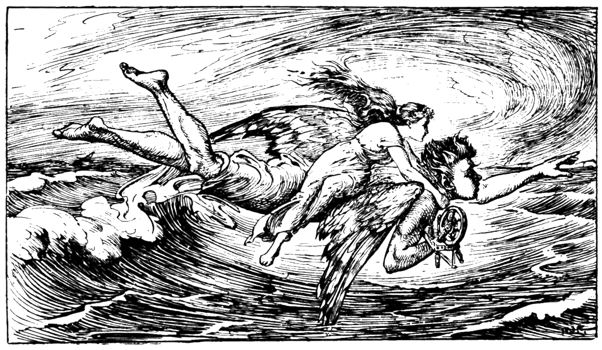

“你害怕吗？”北风问。

“我不害怕。”她说。这倒是真的。这时候，他们离陆地已经不远了。北风剩下的那点力气，也只能勉强能把她送上岸。转眼间，他们降落在太阳东边和月亮西边城堡的窗下。这时候，北风已经是筋疲力尽，一点力气也没有了。它不得不休息几天，才能返回家乡。

第二天早晨，她坐在城堡的墙脚下玩金苹果。她看到的第一个人就是那个要嫁给王子的，鼻子很长的公主。

“你那个金苹果要卖多少钱？姑娘。”她打开窗口问。

“不论是黄金或是钱，我都不会把它卖掉。”姑娘说。

“如果用钱和黄金也买不到，那么用什么东西来换呢？你想要什么都可以。”公主说。

“好啊！要是我能到王子那里去，今天晚上和他在一起，这个金苹果就给你。”姑娘说。

“那可以办到。”公主一口答应，因为她心中已经想好该怎样去对付。

于是，公主得到了金苹果。可是，当姑娘晚上到王子的房间里去时，王子已经睡着了，这正是公主设下的圈套。可怜的姑娘喊他，摇他，还不停地哭着，就是弄不醒他。

第二天一早天刚亮，长鼻子的公主就走进来，把她赶出去。白天，姑娘还是坐在城堡的窗口下，开始用金梳子梳头发。接着发生的事情又和昨天一样。公主问她要什么才肯给金梳子。她说这把金梳子不论是给钱还是黄金也不卖，但是只要让她晚上和王子在一起，就可以给公主。可是晚上她来到王子的房间以后，他还是睡着了，不论怎么喊他，摇他，或者大声地哭泣，他还是沉睡不醒，好像是死过去了一样。天刚有点亮，长鼻子的公主又走进来把她赶出去。

天大亮以后，姑娘又来到窗口下，用她的金纺轮开始纺纱。长鼻子的公主看到以后，还想要。所以她打开窗户，问用什么来换。姑娘还是那句话，用钱和黄金她也不卖，只要和王子一起过一个夜晚。

“好吧！”公主说，“我很乐意答应你。”

那时候，城堡里还有一些被送过来的基督徒，他们就住在王子的隔壁房间里。一连两天，他们都听到了一个女人哭喊着王子的声音。他们把这件事对王子说了。所以那天晚上，当公主又送来放了安眠药的饮料时，他假装喝了，却偷偷地把它倒掉，他也怀疑里面有安眠药。这天晚上，姑娘走进来的时候，他没有睡。她把怎么到这里来的经过都对他说了。

“你来得正是时候，”王子说，“要不我明天就要结婚了。我不愿意娶那长鼻子的公主，只有你能够救我。明天我会说，想看看新娘能干些什么，叫她去洗那件滴有三滴蜡油的衬衫。她会同意去洗的。她不知道，那是你滴上去的。可是，只有出身于基督徒家庭的人才能把它洗掉，那帮女巫一个也洗不掉。那时，我会说，只有能洗掉这些蜡油的人，才能做我的妻子。我知道你肯定洗得掉。”这天晚上，他们兴高采烈，沉浸在无比的欢乐之中。

第二天，要举行婚礼了。王子说：“我要试试看，新娘能做些什么。”继母说：“那可以。”

“我有一件漂亮的衬衫，想在婚礼上穿。可是有三滴蜡油滴在上面，我想把它们洗掉。我已经发过誓，只和能洗掉这些蜡油的人结婚。如果她洗不掉，就不配嫁给我。”

她们心里想，那有什么难，这种事情微不足道，于是就同意了。长鼻子的公主开始尽力去洗，她又是洗，又是擦，可是那些污点却越来越大。“哎！你一点也不会洗！”她的母亲，一个老女巫说，“把它给我！”可是她拿到手没多久，情况更加糟糕，她越洗，污点就越黑，越大。

那些女巫都过来洗，结果是那件衬衫越来越黑，越来越难看，后来竟变得像是在烟囱里熏过一样。

“啊！”王子叫起来，“你们这些人个个都是笨蛋，窗口外面有个穷女孩，我敢肯定她比你们都能干！”“过来，那边的姑娘！”他大声地喊着。

于是，姑娘应声走过来。“你能把这件衬衫洗干净吗？”他说。“嗯！说不准，”她说，“让我试试看。”她刚拿起衬衫浸入水中，衬衫就变得像地上的积雪那么白，不！甚至比积雪还白。“我要娶你！”王子说。

老女巫肺都气炸了，还有长鼻子的公主，所有那些小女巫，肯定也是气炸了肺，因为打那以后，就再也听不到她们的消息。王子和新娘把所有关在那里的基督徒都放了，把所有能带走的金子和银子都带走了，离开了这座太阳东边和月亮西边的城堡。

 

## 黄矮神

从前有一个王后，她生了许多孩子，可是只有一个女儿活下来，于是，她便成了千金小姐。

自从国王死了以后，对王后来说，世界上就再也没有比小公主更重要的了。王后那么害怕失去她，从来不想去指出她的任何缺点，真是把她宠坏了。结果是这个说有多美丽就多美丽，将来总有一天会戴上王冠的孩子，长大以后那么骄傲，那么迷恋自己的美貌，全世界的人都不在她的眼里。

王后的宠爱和夸奖，更是使她相信，世界上没有任何东西配得上她。她身上穿的，总是最漂亮的衣服，打扮得像一个最美丽的仙女，或者是一个出去打猎的王后。那些跟随她的侍女，也穿戴得像森林里漂亮的仙女一样。

王后还请来了最好的画家，把女儿的模样画下来，送给几个非常要好的邻国。这就使公主更加虚荣。

凡是看到公主画像的人，没有一个不迷上她。可是结果并不美妙，有些病倒了，有些发疯了。还有一些算是最幸运的人也迫不及待地要去见她。可是，这些可怜的王子，只要看到公主一面，就成了她的奴隶。

不会有哪个王宫比这里更加欢乐，二十个兴高采烈的王子想方设法来讨公主的欢心。为了举办一个招待会，他们花多少钱也在所不惜，只要公主说一声“很好！”就觉得福星高照了。

所有这些赞赏使王后感到非常高兴。每一天，她都要收到七八千首十四行诗，还有同样数目的哀歌、情歌和乐曲，那是世界各地的诗人送来的。所有的散文和诗歌都是为贝莉斯玛而作——这就是公主的名字。他们的篝火都是用这些诗篇来点燃，它们发出的火光和燃烧的声响比任何柴火都要辉煌。

贝莉斯玛十五岁了，个个王子都想娶她，可是谁也不敢开口。是啊！他们怎么敢开口呢？他们知道，为了取悦公主，他们之中谁都愿意一天被砍掉五六次头。但这种事情对她来说，真是不值得一提，她才不管那么多呢！你可以想象，在这些追求她的人心目中，公主的心肠是多么硬。王后也希望能早日看到她结婚，可是不知道该如何来说服她，让她认真地来考虑这个问题。

“贝莉斯玛，”她说，“我真诚地希望你不要那么自傲，是什么让你看不起这些善良的王子？我希望你和他们之中的一个结婚，可你总是不肯让我满意。”

“我那么幸福，”贝莉斯玛回答，“请让我安静一些，夫人，我不想去管任何人的事情。”

“可是，你和这些王子中的任何一个结婚，都会非常幸福。”王后说，“要是你爱上了哪一个配不上你的人，我会非常生气。”

可是，公主关心的只是自己，她并不去考虑恋人中哪一个聪明，哪一个漂亮，能够配得上她。母亲对她不想结婚的决定真的变得非常生气了，开始后悔不该让她那么任性。

后来，王后实在想不出别的办法，决定去请教一个被人称为“沙漠仙女”的女巫。这是一件非常困难的事情，因为一些非常凶猛的狮子保护着女巫。幸亏王后很早以前就听说，谁要想安全地通过这些狮子，就得扔给它们一些用小米粉、糖和鳄鱼蛋做成的饼。她亲手做好了饼，放进一个小篮子里，就动身去找仙女。由于她从来没有走过这么远的路，不久就觉得累了，坐在一棵树下休息，很快就睡着了。等醒过来时，她非常惊慌地发现，篮子里空空的，饼全没有了。更糟糕的是，就在这个时候，她听到了那些巨大狮子的吼声，它们发现她就在附近，正过来找她。

“我该怎么办？”她喊叫起来，“我要被吃掉了。”她吓得腿发软，一步也跨不出去，靠在刚才睡觉的那棵树上哭起来。

这时候，她听到有人在“哼！哼！”地发出声音。她朝四周看了看，后来抬起头来，才看到树上有个小矮人在吃橘子。

“啊！王后！”他说，“我非常了解你，知道你多么害怕这些狮子。你一点也没错，这些狮子吃过许多人。你没有饼给它们，你想想看，会有什么结果？”

“我得准备去死了。”可怜的王后说，“啊！要是我亲爱的女儿结婚了，我也就无所谓了。”

“哦！你有一个女儿。”黄矮神叫了起来（这样叫他是因为他是矮神，又有一张黄脸，而且住在橘子树上），“这真让我太高兴了，我走遍整个世界，一直在找个妻子。这样吧！要是你答应把她嫁给我，不论是狮子、老虎还是熊，谁也不敢碰你一下。”

王后看着他，那张又丑又小的脸几乎像那些狮子一样，叫她非常害怕，所以她一句话也说不出来。

“怎么！夫人，你还在犹豫？”矮神喊道，“我看你是非常愿意被活活吃掉。”他说话的时候，王后看到狮子正顺着山坡向他们奔过来。每只狮子都有两个头，八条腿，四排牙齿，它们的皮像乌龟壳一样硬，闪着红光。

看到这可怕的场面，王后像鸽子看到老鹰一样嗦嗦发抖，她声嘶力竭地喊起来：“啊！亲爱的矮神先生，贝莉斯玛就嫁给你吧！”

“嗯！是吗！”他轻蔑地说，“贝莉斯玛是够漂亮的了，可我不是很想娶她，你还是把她留在身边吧！”

“啊！高贵的先生，”王后万分烦恼地说，“不要拒绝她，她是世界上最迷人的公主。”

“嗯！那么好吧！”他回答，“出于善心，我就要她吧；不过你要记住，别忘了她是属于我的。”

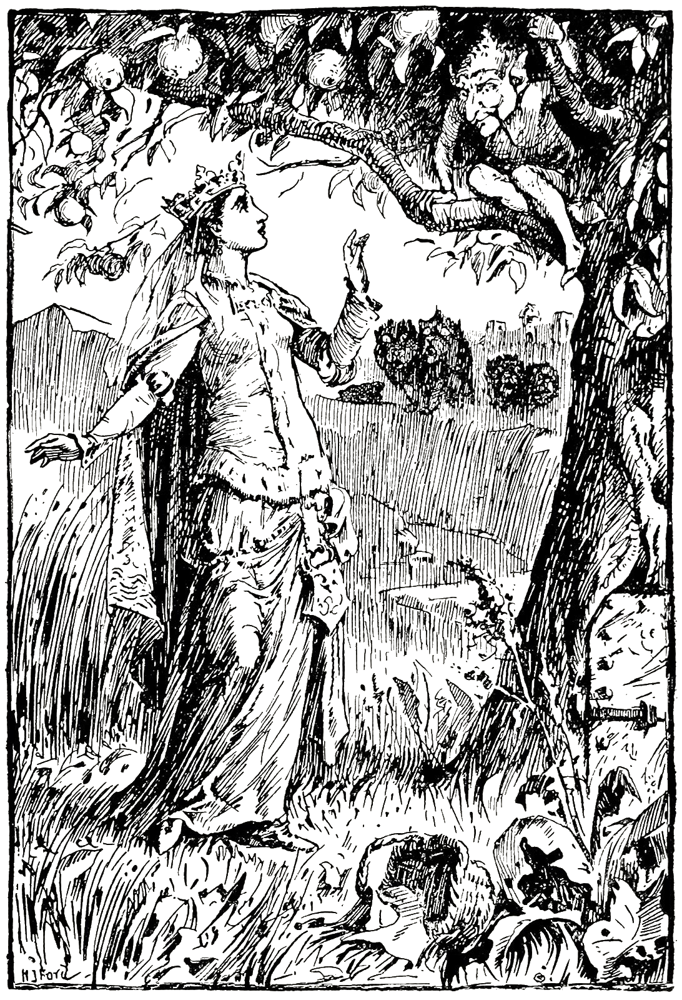

他说完话，橘子树的树干上开出一扇小门来，王后赶紧躲进去。真险，门刚关好，狮子的脸就撞了上来。

王后心慌意乱，起初根本没有注意到橘子树上还有另一扇小门。现在，这扇小门打开了，她发现自己站在一块长着蓟草和荨麻的地里，周围是土沟。再过去一点有一间很小的草舍，黄矮神满脸春风地从小舍里走出来。他脚上穿着一双木鞋，身上穿着一件黄色的小大衣。因为没有头发，耳朵又很大，所以看上去像是个摇晃着的小玩意儿。

“我很高兴，”他对王后说，“你将成为我的岳母，你会看到你的贝莉斯玛将和我一起住的小房子。她可以用这些蓟草和尊麻来喂一头驴子。要是她喜欢，可以骑驴子。在这间简陋的屋顶下，用不着担心风吹雨打。她可以喝这条小溪里的河水，吃那些青蛙，这里的青蛙长得很肥。而且，她将永远和我在一起。我那么漂亮，那么和蔼，那么快活，就像你现在看到的一样。我们俩那么要好，要是她的影子比我还要靠近她，我就觉得奇怪了。”

不幸的王后一下子就明白了，她的女儿将和这个矮神一起过多么悲惨的日子。想到这些，她实在受不了，一言不发地倒在地下，昏过去了。

等醒过来时，她十分惊讶地发现，自己正躺在家里的床上。更奇怪的是，她戴着一顶有最漂亮花边的睡帽，这种帽子她生下来从未见过。开始，她还以为自己的冒险，那些可怕的狮子，还有她答应把贝莉斯玛嫁给黄矮神，都是一场梦。可是，这顶有着美丽丝带和花边的新帽却提醒他，这一切都是真的。这使王后闷闷不乐，愁容满面，她整天想着这件事，不吃也不喝，连觉也睡不着。

公主尽管很任性，可是她打心底里真心实意地爱着母亲。看到母亲那么忧愁，她心里很难过，常常问母亲是怎么回事。可是王后不想把真相告诉她，只是说生病了，或者说有个邻国威胁要向她宣战。贝莉斯玛心里十分清楚，这些都不是母亲感到不安的理由，母亲心里肯定有什么事瞒着她。于是，她决定去请教沙漠仙女，她常常听人说沙漠仙女如何聪明。同时，她还想，乘这个机会也可以问她一下，自己到底是结婚，还是不结婚好。

她非常小心地做了一些合适的饼，准备用来对付那些狮子。这一天晚上，她很早回到自己的房间里去，说是准备睡觉。她用一块很长的面纱把自己裹起来，从一条秘密的楼梯走出去，独自一人去找女巫。

当她走到那棵致命的橘子树前时，看到上面开满了鲜花，结满了水果。她停下脚步，摘下一些橘子，然后放下篮子，坐下来开始吃。等她站起来想走的时候，篮子不见了。她四处寻找，可是一点线索也没有。她越找心里越害怕，后来开始哭起来。这时，黄矮神突然出现在她的面前。

“你这是怎么啦？我的美人儿！”他说，“你干吗哭啊？”

“啊！”她回答，“别问我为什么哭，看到我的一篮子饼丢了吗？没有这些饼，我怎么能平安地到沙漠仙女那里去呢？”

“你找她干什么呢？美人！”那小怪物说，“我是她的朋友，就此而言，我也和她一样聪明。”

“王后，我的母亲，”公主回答，“近来陷入无比的悲痛之中，我担心她会活不长；我害怕这也许是由于我的缘故，因为她非常希望我结婚。老实对你说吧！由于我还没有找到一个配得上我的人。正是由于这些原因，我想找仙女谈谈。”

“不要再自找麻烦了，公主，”矮神说，“你想知道的事情，让我来告诉你，我比她更加清楚。王后，你的母亲，已经给你订了婚……”

“给我订了婚？”公主打断了他的话，“啊！不可能！我可以肯定她不会。要是这样她早就告诉我了。没有我的同意，她什么也不会同意，这我太了解了。你肯定是搞错了。”

“美丽的公主，”矮神突然跪在她面前说，“我敢抬举自己说，你对她的选择不会感到不高兴；让我告诉你吧！她把和你结婚的幸福给了我。”

“你！”贝莉斯玛连连后退，喊起来，“我母亲希望我嫁给你，你怎么这样傻，生出这种念头来。”

“哼！我对能不能得到这种荣誉，倒不是很在乎，”矮神生气地说，“那些狮子过来了，它们三两口就可以把你吃掉，你和你的骄傲一起见鬼去吧！”

真的，这时候，可怜的公主听到骇人的咆哮声越来越近。

“我该怎么办？”她喊叫起来，“我所有的幸福日子就这样结束了吗？”

恶毒的矮神看着她，狞笑起来。“至少，你会为未曾嫁人就死去而感到满意。”他说，“像你这样可爱的公主，肯定是宁愿去死，也不会嫁给一个像我这样可怜的小矮神。”

“啊！别生我的气！”公主紧紧地握着双手说，“我宁愿和全世界的矮神结婚，也不愿意这样可怕地死去。”

“在你答应我之前，公主，仔细地看看我。”他说，“我不希望你那么匆忙地许诺。”

“啊！”她喊叫着，“狮子过来了，我已经把你看够了，我害怕极了，快点救我，否则我就要吓死了！”

是的，她说着说着，就倒在地上，失去了知觉。当她醒过来时，发现自己躺在家里的小床上。她是怎么来的，她一点也说不出来。她身上穿着最漂亮的花边和丝带衣服，手指上还戴着用一根红头发做成的小戒指，套得那么紧，她怎么用力也拿不下来。

公主看到这些东西，回忆起发生过的事情，也陷入极度的悲痛之中。整个宫廷都感到震惊和恐慌，尤其是王后，她成百次地问贝莉斯玛，是不是出了什么事，可她总是说没有什么。

后来，王国的头面人物都焦急地希望他们的公主结婚，他们请求王后尽快地为她挑选丈夫。王后回答说，再也没有什么别的事情，能比这个让她更高兴的了，可是她的女儿好像很不愿意结婚。她建议他们自己去找公主说这件事。于是他们立刻就去了。自从险遇黄矮神以后，公主的傲气好多了。而且，除了和某个强国的王子结婚以外，她也想不出什么更好的办法来摆脱小怪物。因此，她的答复比他们原先希望的好得多。她说，虽然她现在很幸福，但是为了让他们高兴，她同意和金米纳斯的王子结婚。金米纳斯是一个强大的王国，王子也长得非常英俊潇洒，他几年来一直爱着公主，可从来没有想过公主会留意他。你可以想象，当他听到这个消息时是多么高兴；其余的王子从此失去了和公主结婚的希望，是多么气愤。可是归根到底，贝莉斯玛总不能嫁给二十个王子。从中选择一个对她来说，确实也很困难，因为她的虚荣心使她相信，这个世界上没有任何人配得上她。

王宫里开始准备举行前所未有的豪华婚礼。金米纳斯国王送来那么多钱，港口里挤满了这些把钱运来的船。虽然公主的美丽已经是无以复加，可还是派人到装饰最华丽、打扮最讲究的王宫，特别是法兰西王宫去，弄来为公主进行打扮的稀世珍宝。至少金米纳斯王子认为应该这么做。除非和公主在一起，否则他不会感到幸福。

至于公主呢？和王子相处的时间越长，她越是喜欢他。她感到他那么漂亮，那么聪明，那么大方。到后来，她对王子的爱已和王子对她的爱不相上下。当他们一起在美丽的花园里散步时是多么幸福啊！有时候，他们一起听甜蜜的音乐。王子还常常给贝莉斯玛写一些歌词，这是公主很喜欢的一首：

> 公主从森林中走过，
> 到处都充满欢乐。
> 鲜花处处盛开，
> 为了给她铺路，
> 纷纷向地上飘落。
> 花朵从嫩枝上抬起头，
> 看她在草地上款步。
> 啊！我的公主！
> 鸟儿在和我们一起唱情歌，
> 在这块神奇的土地上，
> 我们手拉着手多么快乐！

他们天天相处得那么幸福，那些败下阵来的王子都绝望地打道回府。他们和公主告别时那么伤心，公主不禁为他们感到遗憾。

“啊！小姐，你这是怎么啦？”金米纳斯王子说，“你用不着去怜悯这些王子，他们那么爱你，你只要笑一笑，他们的一切烦恼也就得到了最好的补偿。”

“要是你没有注意到，我是多么同情这些永远离开我的王子，我将感到遗憾。”公主说，“关于你，先生，那就完全不同了。和我在一起，你有一切理由感到高兴，可他们是满怀悲伤地离开这里的，所以，你不必因为我的同情而妒忌他们。”

公主这样宽容地对待他的干预，使金米纳斯王子非常感动。他跪在公主的面前，一遍一遍地吻着她的手，请求她的原谅。

幸福的日子终于来临。贝莉斯玛的婚礼一切准备就绪。喇叭吹起来了。街道上挂满了旗子，摆满了鲜花，人们从四面八方涌向王宫前的大广场。

王后那么高兴，她几乎彻夜未眠，天还没亮就起来安排好那些要紧的事情，给公主挑选佩戴的珠宝，它们都是价值连城的钻石，连公主穿的鞋子也用它们装饰起来。她那银丝绸缎的礼服上，刺绣着万道金光。它们的贵重可想而知。可是，和公主的美丽比起来，它们顿时黯然失色。公主头上戴着一顶灿烂的王冠，美丽的卷发几乎泻到脚下。和那些伴随的姑娘们比起来，她更显得雍容华贵，鹤立鸡群。

金米纳斯王子也毫不逊色，他满面春风，流露出幸福的笑容。凡是前来向他表示祝贺的人都不会空手而归。宴会厅的周围排满了几千桶满满的金币。地上放着用天鹅绒制成，镶着珍珠和装满钱的钱袋，多得数都数不清，每个钱袋里起码有十万块金币，这些钱是发给那些愿意伸出手来的人的。许多人争先恐后，你可以相信，有些人认为这是婚礼上最引人注目的一幕。

王后和公主正准备和王子一起走的时候，看到长廊的另一头有两个巨大的蛇怪正向他们走过来，还拖着一个粗制滥造的箱子。后面跟着一个身材高大，年纪已经很大的老太婆。然而，她的丑陋比她的年龄还要让人吃惊。她身穿着一件黑色塔夫绸皱领服，头裹一条红色天鹅绒头巾，浑身的重量几乎都依在一根拐杖上。这个奇怪的老太婆一句话也不说，蹒跚着在走廊里走了三圈，蛇怪跟在她后面，然后在走廊中间停下来，挥舞着拐杖威胁说：

“啊哈！王后！啊哈！公主！你们想违背对我的朋友黄矮神的承诺而不受惩罚吧？我是沙漠仙女。要不是黄矮神和他的橘子树，我的大狮子早就把你们吃掉了。我可以告诉你，在我们仙人居住的地方，我们不会忍受这种侮辱。赶快决定该怎么办吧！因为我已经发誓，你一定要和黄矮神结婚，你要是不答应，我就要烧拐杖了！”

“啊！公主，”王后哭着说，“我听到她说了些什么？你答应了什么？”

“啊！我的母亲，”贝莉斯玛悲伤地回答，“你亲口答应了什么？”

金米纳斯王子看到这邪恶的老太婆破坏他的幸福，非常气愤，他拔剑走到她面前，说：

“立刻从我的国家里滚开，永远也不要再来，无耻的东西，否则我就要你的命，这样才能解恨。”

他的话音刚落，木箱的盖子突然打开，掉在地板上，发出可怕的声响。人们恐惧地看到，黄矮神骑着一只巨大的西班牙猫，从箱子里跳出来。

“无礼的小家伙！”他冲到沙漠仙女和王子中间喊道，“竟敢碰这位大名鼎鼎的仙女！争吵只是在你和我之间，我是你的敌人，你的对手。这个要嫁给你的人，不讲信誉的公主已经答应嫁给我了。你看看她的手指上是不是有用我头发做成的戒指，试试看能不能把它拔下来。这样你就会发现，我比你强大得多！”

“无耻的小怪物！”王子说，“竟敢说你是公主的情人，想霸占美丽的公主！你难道不明白，你是一个矮鬼，长得那么丑，谁看上一眼都觉得难受。要不是怕太抬举你了，我早就亲手把你杀了！”

黄矮神被这些话深深地激怒了，他踢了一下猫，猫发出令人毛骨悚然的叫声，跳过来跳过去。除了勇敢的王子，在场的人都吓坏了。王子紧紧追赶着黄矮神。黄矮神拔出他佩带的一把长剑来，扬言要和王子单独决一胜负。随着一声可怕的巨响，他一下子就窜到王宫前的院子里。王子非常愤怒，立刻就追上来，可是，他们还没有来得及摆开架势，宫廷里的人也只是刚刚拥到阳台上，准备看个究竟。突然，太阳变得像血一样红，天也黑暗下来，他们什么也看不清楚。这时，雷声大作，闪电飞舞，好像要把一切都烧尽。两个蛇神出现在黄矮神的旁边，一左一右，像是山一样高的巨人。火焰从他们的嘴里和耳朵里喷射出来，好似熊熊燃烧的火炉。可是年轻高贵的王子并没有把这一切放在眼里，他那大无畏的神情和勇敢的举动，使在旁边观看的人安下心来，也许还让黄矮神感到窘迫。

可是，一看到公主的不幸，王子的勇气也没有了。沙漠仙女这时候比刚才更加可怕，她骑着一头长着翅膀的鹰头狮身怪兽，头颈上盘着长蛇，手中的长矛向公主刺过去。贝莉斯玛浑身是血地倒在王后的怀中，失去了知觉。她的慈母就好像长矛是刺在自己的身上一样，悲痛地发出凄惨的叫声。王子听到这叫声，心乱如麻，完全丧失了战斗力。他扔下对手扑过去，想去救公主，或者和她一起死去。可是黄矮神比他还要快，他骑着西班牙猫跃上阳台，从王后怀中抢走贝莉斯玛，宫女们还没有来得及阻拦他，他已经跳上王宫的屋顶，带着他的战利品消失了。

王子恐惧地站在那里，绝望地看着这可怕的，他无力阻止的事情发生。更糟糕的是，他突然感到自己什么也看不见了，眼前一片漆黑。他觉得，一只有力的手正抓住他在空中飞行。

这一新的罪恶是恶毒的沙漠仙女干出来的。她这次和黄矮神一起来是为了帮助他抢走贝莉斯玛。一看到金米纳斯王子，就爱上了他。她想，只要把他带到那些可怕的洞穴里去，把他锁在岩石上，死亡的恐怖就足以叫他忘记贝莉斯玛，成为自己的奴隶。所以，一来到目的地，她就让王子恢复视力，但不肯给他松绑。运用自己的魔力，她变成一个年轻美貌的仙女，出现在他的面前，假装是偶然从这里经过。

“我看到了什么？”她喊道，“是你吗？亲爱的王子，是什么不幸把你带到这荒凉的地方来了？”

王子被她的假装给欺骗了，回答说：“啊！美丽的仙女，把我带到这里来的仙女先是让我失明，但是听她的声音，我知道她是沙漠仙女。可是，我也不知道她为什么把我带到这里来。”

“啊！”伪装的仙女说，“要是你落入她的手中，你永远也不得脱身，除非和她结婚。她用这种方法已经带走不止一个王子。她想要干什么，没有一件是办不成的。”就在她这样假装同情王子的时候，他突然注意到，她的脚就像鹰头狮身的怪兽一样。因为不论她把脸蛋变得多少漂亮，脚是没有办法变的。

王子假装什么也没有看见，自信地说：

“我倒不是不喜欢沙漠仙女，可是她保护黄矮神，把我像囚犯一样地锁在这里，我真的受不了。我爱美丽的公主，那是真的。可沙漠仙女要是让我恢复自由，出于感激，我会只爱她一个人。”

“你说的话可是真的吗？王子！”仙女真的上当了，问道。

“真的，”王子回答，“我怎么会骗你呢？被一个仙女爱上比被一个普通公主爱上更能满足我的虚荣心。不过，即使我为爱她而死，我也要假装恨她，直到获得自由。”

沙漠仙女十分相信王子的这些话，决定立刻把他转移到比较舒适的地方去。她让王子坐上她的战车，用天鹅来取代平常拉车的蝙蝠，和他一起飞走。他们从令人眩晕的高空飞过。王子看到他所爱的公主被关在用磨光的钢板筑成的城堡里，钢板墙反射着太阳的光芒，温度那么高，任何一个接近它的人，都会烧成灰烬。贝莉斯玛坐在溪流旁的小树丛里，用手托着头，痛苦地哭泣着。王子看到这种情景，心如刀割。

就在他们的战车从头上飞过的时候，公主恰巧抬起头来，看到王子和沙漠仙女。沙漠仙女非常狡猾，她不但让王子看到她那美丽的变化模样，连可怜的公主也觉得她是从未见过的最漂亮的女人。

“天哪！”她喊道，“可恶的黄矮神把我抢到这里来，关在这孤零零的城堡里，难道我还不够痛苦吗？为什么还要让我看到，我一走，金米纳斯王子就不再爱我了！可是，我的情敌是谁？她那绝伦的美丽连我也比不上？”

公主伤心地说这些话的时候，仍然真心实意热烈地爱着公主的王子，看到刹那间就从爱人的头上掠过，心中感到说不出的伤悲。可是，他清楚地知道，沙漠仙女的魔力有多大，要想从她的魔掌中逃脱，就必须有足够的耐心和聪明与智慧。

沙漠仙女也看到了贝莉斯玛，她看着王子，极力想从他的眼神中看出，这不期而遇的情景会在他心中引起什么反应。

“除了我，没有任何人能更好地告诉你你想知道的事情。”王子说，“和这位在幸运地见过你之前我曾经爱过的，不幸的公主的巧遇，我承认，在我心中激起了一点浪花。但是，你在我的心中永远比她重要，我宁愿死去，也不愿意离开你。”

“啊！王子！”她说，“我能相信，你真的那么爱我吗？”

“时间将会作证，小姐，”王子答道，“不过，要是你想使我相信，你对我也有感情的话，我请求你，不要拒绝帮助贝莉斯玛。”

“你知道你在说些什么吗？”沙漠仙女皱起眉头，用怀疑的眼光看着他说，“你想要我用法力来和我最好的朋友黄矮神对抗吗？想让我从他那里抢走只能算是我的情敌，一个骄傲的公主吗？”

王子叹了一口气，不再说什么了。是啊！对这样一个目光敏锐的人，还能说什么呢？后来，他们来到一块宽阔的草地上。草地上开满了各种各样的鲜花，四周为一条很深的河流所环绕，树荫下面有许多小溪在潺潺流动，空气新鲜而凉爽。

不远处坐落着一幢华丽的宫殿，墙壁是用透明的绿宝石筑成的。拉着战车的天鹅在一条用钻石铺成，盖着红宝石拱顶的走廊上一降落，立刻就有成千的美人从四面八方拥上来，兴高采烈地欢迎他们。她们一起歌唱：

> 爱情的火焰在胸中燃烧，
> 想要扑灭也是枉然，
> 痛苦和骄傲相互交织，
> 胜利的喜悦更加辉煌。

沙漠仙女很高兴地听她们歌唱自己的胜利。她把王子领进一间你说多豪华就有多豪华的房间，让他单独呆一会，好让他摆脱自己是个俘虏的感觉。可是他敢肯定，她不会走得很远，一定藏在一个看不见的地方监视着。于是，他走到一个很大的镜子前面，对它说：“可靠的参谋，让我瞧一瞧，如何才能取悦于迷人的沙漠仙女，除了讨她的欢心以外，我什么也不想。”

他动手弄卷自己的头发，看到桌子上有一件衣服比身上的华丽，就小心翼翼地把它穿上。仙女兴高采烈地走进来，掩盖不住自己的欢乐。

“我很清楚，你动不少脑筋让我高兴，”她说，“我应该告诉你，你做得非常成功。你看，只要你心里真的有我，这一点也不难办到。”

王子自有理由让老仙女高兴，他尽可能地说她好话。过了一段时间，他得到允许单独到海边去散步。沙漠仙女自有魔法，能叫大海卷起可怕的风暴，最勇敢的舵手也无法逃生。所以，她不怕自己的俘虏逃脱。王子能不受残酷的仇人干扰，独自悲伤地思考自己的不幸遭遇，也算是得到一些解脱。

盲目地在海滩上走来走去以后，他用手杖在沙滩上写下这首诗：

> 我终于走上海滩，
> 用泪水洗刷忧伤，
> 啊！我的爱人，
> 你在何方？
>
> 啊！汹涌的大海，
> 狂风掀起了巨浪，
> 是你把我囚禁，
> 叫我们天各一方。
>
> 命运对我那么残忍，
> 我的心比你还要疯狂，
> 为什么把公主抢走，
> 为什么让我独受煎熬？
>
> 啊！海中可爱的仙女，
> 你知道爱情多么珍责，
> 快平息这疯狂的海涛，
> 让相爱的人得到团圆。

他写着写着，突然有一种声音吸引了他的注意力，叫他忘记了自己。他看到，海上的波涛比以前卷得更高。他朝四周张望，看到一个可爱的女子躺在巨大浪尖上，慢慢地向他漂浮过来。她一手拿着镜子，一手拿着梳子，长长的头发披满全身，一条像鱼一样的美丽尾巴代替了双脚，她用这条尾巴在水中游着。

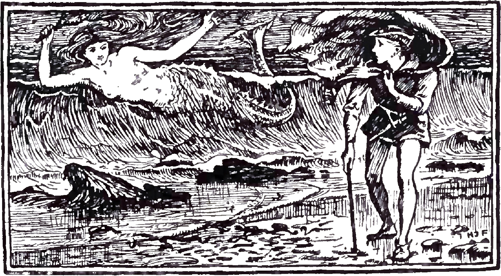

这突然出现的景象，叫王子吃惊得发呆。那女子一游到听得见说话的距离，就对他说：“我知道你失去公主，当沙漠仙女的俘虏是多么痛苦。要是你愿意，我可以帮助你逃离这个要命的地方，否则你会在这里经受三十年或者更长时间的忧伤。”

金米纳斯王子真不知道该如何回答她的好意才好。不是他不想快点逃跑，而是怕这是沙漠仙女想出来欺骗他的诡计。正当他犹豫不决的时候，美人鱼猜出了他的心思，对他说：

“你可以相信我，我不会让你上当。我非常痛恨黄矮神和沙漠仙女，决不会去帮他们。特别是在我经常看到你那可怜的公主以后，她的美丽和善良唤起了我对她的无限同情。我跟你说吧！要是你相信我，我就帮你逃跑。”

“我绝对相信你，”王子喊道，“不论你叫我干什么，我都做。要是你见过我的公主，我请求你告诉我，她发生了什么事情，现在怎么样了？”

“我们不能浪费时间来说话。”她说，“跟我来吧！我带你到钢城堡那里去。我们在岸边留一个和你一模一样的形象，叫仙女自己也辨认不出来。”

说着，她很快就弄来一捆海草，对它吹了三口气，说：

“我的朋友海草，我命令你留在这里，直挺挺地躺在沙滩上，直到沙漠仙女来把你带走。”海草立刻变成王子的模样。王子吃惊地站在那里看着。海草还穿上了和他一样的衣服，脸色苍白，一动也不动地躺在沙滩上，好像是一个巨浪把他吞没，又把失去知觉的他抛上海岸。这时，美人鱼抓住王子带他一块高兴地从海上游走。

“现在，”她说，“我有时间把公主的事告诉你了。尽管公主被沙漠仙女刺中受了伤，黄矮神还是强迫她骑上那只可怕的西班牙猫。但她很快就因为伤痛和恐惧而昏迷过去，直到关进他那恐怖的钢城堡里面才醒过来。在那里，黄矮神叫几个能找到的最漂亮的姑娘来接待她。他也急急忙忙地来伺候她，给她尽可能的照顾。她躺在一张睡椅上，上面铺着一张金色的床单，床单上镶着胡桃那么大珍珠。”

“啊！”王子打断她的话，“要是贝莉斯玛把我忘了，同意和他结婚，我的心一定会碎！”

“你用不着担心，”美人鱼说，“公主除了你，谁也不想。可怕的黄矮神想叫她看一眼都办不到。”

“请继续往下说。”王子说。

“还有什么该告诉你呢？”美人鱼答道，“当你从天上飞过时，她正坐在林子里，看到你和聪明地把自己伪装起来的沙漠仙女，公主以为她比自己还要漂亮。你可以想象，公主是如何绝望，以为你已经爱上了她。”

“公主相信我爱上了她！”王子喊叫起来，“多么致命的误解！如何才能消除她的误会呢？”

“你自己最清楚，”美人鱼和蔼地对他微笑着，说道，“当人们像你们俩一样地热烈相爱时，用不着别人给他们指点。”

说话间，他们来到了钢城堡。靠海的一边，是黄矮神唯一没有用那致命的钢墙保护起来的地方。

“我知道得很清楚，”美人鱼说，“公主正坐在小溪旁，就是你上次经过时，看到她的地方。可是在接近她之前，你要对付许多敌人，拿着这把剑吧！这样你就可以面对任何危险，克服任何难以想象的困难。不过你必须牢记，任何时候也不能让它脱手。再见吧！现在，我到那块岩石旁等你，要是需要我帮你带走你那热恋着的公主，我不会拒绝你的。因为王后，她的母亲，是我最好的朋友，正是因为她的缘故，我才来救你。”

说完，她把那把用一颗金刚石做成的剑交给王子，这把剑比太阳还要明亮。他不知道该说什么才能表达自己的感激之情，但请她相信，他完全明白她的礼物的珍贵，将永远不会忘记她的仁慈和帮助。

现在，我们要回过头看一看沙漠仙女。她看到王子没有回来，就急忙出去找他。她身后跟随着一百个女子，她们带着送给王子的罕世之宝来到沙滩。有的提着满篮子的钻石；有的拿着精雕细刻的金杯，有的带着琥珀、珊瑚、珍珠；有的头上顶着大包小包最贵重最漂亮的物品；其余的送来水果和鲜花，甚至珍贵的鸟类。

可是，当沙漠仙女带着这支兴高采烈的队伍走过来，看到美人鱼用海草做成的王子模样僵硬地躺在沙滩上时，她是多么惊恐。因为震惊和悲伤，她发出骇人的喊叫声，扑到假王子的身旁嚎啕大哭，叫她十一个姐妹来帮忙，她们也都是仙女。尽管她们都很聪明，但是都比不过美人鱼，因此全都被王子的替身骗过去了。她们能够做的，只是帮沙漠仙女把“金米纳斯王子”葬入坟墓，并在上面筑起一个辉煌的纪念碑。

就在她们收集碧玉、斑岩、玛瑙、大理石、黄金、青铜，布置雕像和纪念碑的时候，王子正在感谢善良的美人鱼，请求她继续帮助他。美人鱼愉快地答应以后就不见了。

王子立刻动身到钢城堡去。他走得很快。一边走一边焦急地四周观望，希望能再次见到他的爱人贝莉斯玛。可是，他还没有走多远，就有四个狮身人面的可怕怪物包围上来，要不是美人鱼那把金刚石宝剑，他很快就会被它们那锋利的魔爪撕成碎片。王子只是把宝剑在它们面前晃动一下，它们立刻就瘫倒在地。再一下，就把它们都杀了。

王子刚转过身来继续寻找公主时，就和六条鳞甲比铁还硬的龙遭遇上了。这些龙虽然非常吓人，可是王子的勇气也毫不动摇。在那把神奇的宝剑帮助下，他一个接一个地把它们砍成碎片。

就在他希望所有的难关都已闯过的时候，一转身又碰上了不知如何对付的难题：二十四个容貌美丽，姿态优雅的仙女向他走过来。她们手中拿着花环，挡住了他的去路。

“王子，你要到哪里去？”她们说，“我们的责任是保护这块地方。如果让你过去了，我们和你都会遭到巨大的不幸。我们求你不要再往前走了，难道你要杀死二十四个从来没有得罪过你的姑娘吗？”

王子不知道该做什么，说什么才好。作为一个骑士，去做女士们请求他不要做的事情，就完全违背了他的信仰。正当他犹豫不决的时候，一个声音在他耳边响起：

“冲过去！冲过去！不能手软，否则你就会永远失去公主！”

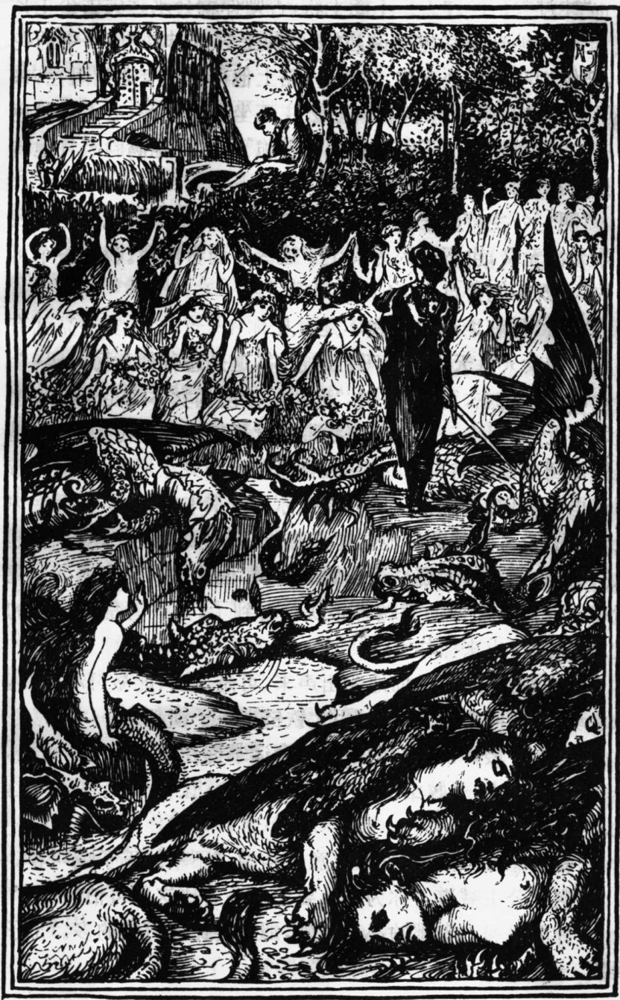

于是，他一句话也不说，立刻就冲上去，打掉她们手中的花环，把她们吓得四处奔逃。这样，一路上他再也没有遇到阻拦，来到了见过贝莉斯玛的小林子里。公主正坐在小溪旁，看上去脸色苍白，非常疲倦。王子刚要在她面前跪下，只见她满脸怒气地转过身去，仿佛他是黄矮神似的。

“啊！公主！”王子说，“别生我的气，让我把事情说清楚。我并非无情无义，也不能因为发生了这些事而责怪我。我是一个可怜的人，既不能帮自己，还让你失望。”

“啊！”贝莉斯玛说，“我不是看见你和一个说有多漂亮就有多漂亮的女人从天上飞过吗？难道说，这是违背你意愿的吗？”

“是的，公主，”他回答说，“邪恶的沙漠仙女不满足于把我锁在岩石上，她用自己的战车把我带到世界的另一个尽头。要不是突然得到友好的美人鱼的帮助，我现在还被关在那里。她把我带到这里来救你。我的公主，我要把你从魔掌中救出，不要拒绝你最忠诚的爱人的帮助。”他这样说着，在她的面前跪下，双手捧起她的衣角。可是，天哪！这样做的时候，他的宝剑掉在地下。蜷缩在一棵莴苣后面的黄矮神很快就看到了，他很清楚这把剑的威力，立刻跳出来抓住它。

公主看到矮神，恐怖地叫出声来。可是，这只能激怒小怪物，他念动咒语，叫来两个巨人，用大铁链把王子锁起来。

“现在，”矮神说，“我的情敌的命运掌握在我的手中。可是，公主，只要你同意嫁给我，我就饶他一命，让他安全地离开这里。”

“我宁愿死一千次，也不愿意这样做。”不幸的王子喊叫着。

“啊！”公主喊道，“你为什么要死？还有比这更可怕的吗？”

“你要是和这卑鄙的小人结婚，那就要比死可怕的多。”王子回答。

“起码，要死就让我们死在一起。”公主说。

“我的公主，为你而死我心甘情愿。”

“啊！不！不！”她喊叫着，转过身来对矮神说，“还是让我照你的话去做吧！”

“残酷的公主！”王子说，“你难道会当着我的面嫁给别人，让我的生命更加悲惨吗？”

“不能这样，”黄矮神说，“你这样的对手太让我感到害怕了，你不能看到我们结婚。”说着，他不顾贝莉斯玛的眼泪和哭喊，用金刚石宝剑向王子的胸膛刺过去。

可怜的公主看到心爱的人死在自己的脚下，再也活不下去了，她倒在他的身边，带着一颗破碎的心死去。

一对不幸的情侣就这样告别了人生。没有人，连美人鱼也救不了他们，因为失去了金刚石宝剑，所有的法力也就随之消失。

至于邪恶的矮神，他宁愿让公主死去，也不愿意让她和金米纳斯王子结婚。还有那个沙漠仙女，她听到王子的大胆举动以后，推翻了为他建造的宏伟纪念碑。她对王子跟自己耍的这些花招非常生气，那刻骨的仇恨就像过去对他那种刻骨铭心的爱一样深。

善良的美人鱼对这对恋人的悲惨命运非常悲伤，把他们变成两棵高大的棕榈树。他们永远肩并肩地耸立在那里。那沙沙作响的声音，是他们在倾诉着至死不渝的爱情；那相互交叉的树枝，是他们在相互爱抚着自己的恋人。

（奥尔诺夫人）

 

## 小红帽

从前，在一个村子里住着一个乡村小姑娘。她长得那么漂亮，谁见了都说从来没有见过。妈妈非常喜欢她，奶奶是溺爱她。好心的奶奶给她做了一顶小红帽，戴上去那么好看，于是人人都叫她小红帽。

有一天，妈妈做了一些牛奶布丁，对她说：

“我的宝贝，去看看奶奶怎么样了，听说她病得很厉害，带一块牛奶布丁和一罐黄油给她。”

小红帽立刻动身到奶奶那里去，她住在另一个村子里。

就在穿过森林的时候，她碰上了一只老狼。它很想把她吃掉，可是又不敢，因为森林附近有一些砍柴的人。老狼问她要到哪里去？可怜的孩子不知道停下来和狼说话该有多危险，对它说：

“我去看奶奶，妈妈叫我带一块牛奶布丁和一罐黄油给她。”

“她住的地方离这里很远吗？”狼问。

“哎！”小红帽回答，“就在你看得见的磨坊那边，村子里的头一间房子。”

“那好，”狼说，“我也要去看看她。我从这条路走，你从那条路走，看谁先到。”

狼挑了一条最近的路，拼命地奔跑起来。小姑娘走最远的一条路，还不时停下来采果子，追蝴蝶，看到小花就摘下来做花束。狼不久就来到了老奶奶的家门口，它嘚嘚嘚地敲起门来。

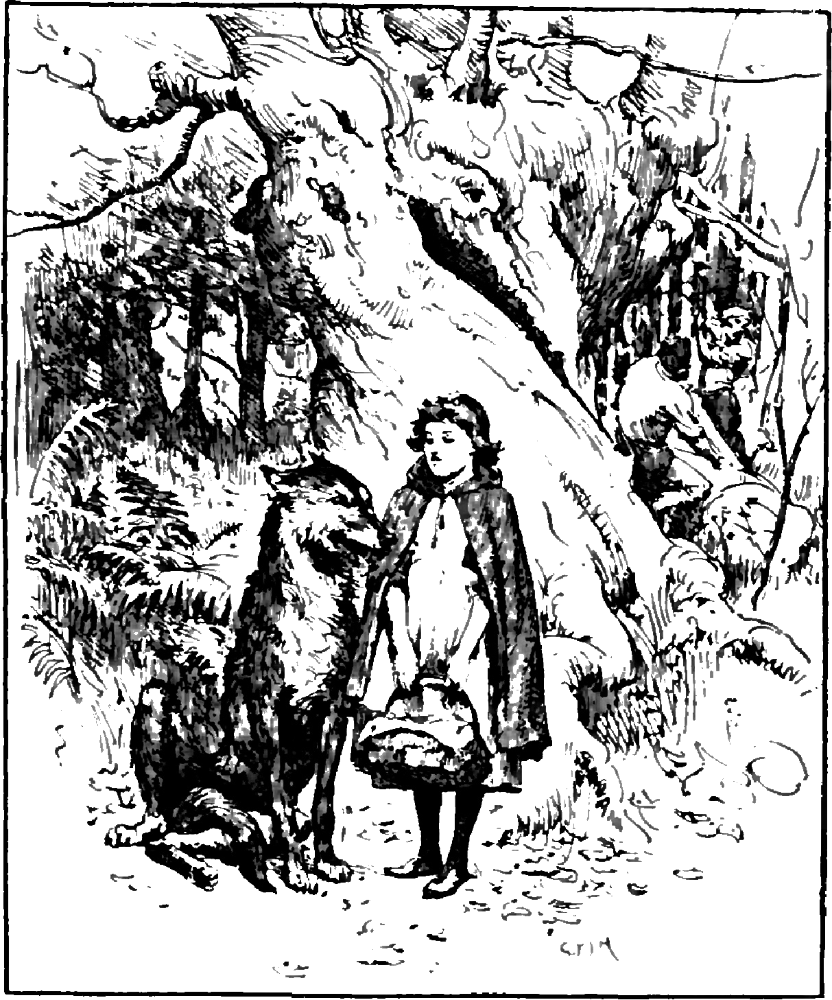

“是谁啊？”

“是你的孙女，小红帽。”狼学着小红帽的声音回答，“妈妈叫我给你送来一块牛奶布丁和一小罐黄油。”

善良的奶奶因为病了，正躺在床上，她喊道：

“拉一下连着绳子的木棍，门闩就开了。”

狼拉了一下木棍子，门就打开了。它马上就扑到老奶奶身上，一会儿就把她吃掉了。因为它起码有三天没有吃过一点东西了。接着，它把门关上，睡到奶奶的床上去，等着小红帽。不一会，小红帽来了，嘚嘚嘚地敲起门来。

“是谁啊？”

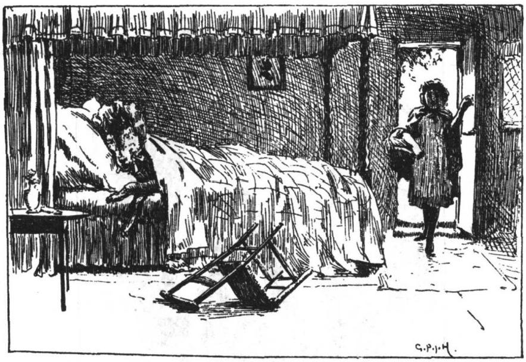

小红帽听到狼的大嗓门，开始有点害怕。不过，她以为奶奶感冒了，声音有点哑，于是就回答：

“是你的孙女，小红帽，我把妈妈给你的牛奶布丁和一小罐黄油带来了。”

狼尽量把声音装着温柔一些，对她说：

“拉一下木棍，门闩就会打开。”

小红帽拉了一下木棍，门打开了。

狼看到她进来，躲进被窝里对她说：

“把牛奶布丁和那一小罐黄油放在凳子上，过来和我一起睡吧！”

小红帽脱下衣服，上了床，看到奶奶穿着睡衣的那个模样，感到很奇怪，就对她说：

“奶奶！你的手臂多粗啊！”

“那抱起你来就更容易了，亲爱的。”

“奶奶！你的腿多粗啊！”

“那是为了跑得更快，我的孩子。”

“奶奶！你的耳朵多大啊！”

“那是为了听得更清楚，我的孩子。” “奶奶！你的眼睛多大啊！”

“那是为了看得更清楚！我的孩子。” “奶奶！你的牙齿多大啊！”

“那是为了把你吃掉。”

说完这些，可恶的狼扑向小红帽，把她吃掉。

 

## 林中的睡美人

从前有一个国王和王后，他们因为没有孩子而非常难过，难过得无法形容。他们走遍整个世界，许愿、朝圣，所有的办法都试过了，还是没有结果。

不过，后来王后终于生了一个女孩。洗礼非常隆重，他们把王国里所有能找到的仙女（一共找到七个）请来当她的教母。像当时仙女们的习惯一样，每个教母都可以给她一个祝福。这样一来，公主就会成为一个尽善尽美的人。

洗礼的仪式结束以后，所有的人都回到王宫，这里已经为仙女们准备好了盛大的宴会，每个人的面前都放着一副豪华的餐具和装满黄金的盒子。那些全部用纯金制成的调羹和刀、叉上面镶嵌着钻石和红宝石。可是，就在他们全部就座以后，他们看到一个已经很老了的仙女走进大厅。她没有受到邀请，因为自她从一个塔中出走以后，已经过了五十多年。大家以为她不是死了，就是中了魔法。

国王命令给她准备一副餐具，不过却不能像其他仙女一样，拿出一盒黄金来送给她。因为只定做了七个盒子，送给七个仙女。老仙女以为看不起她，嘴里嘀嘀咕咕地发出一些威胁的话。坐在她旁边的一位年轻仙女听到她在发牢骚，估计她会给小公主许下什么不吉祥的愿。所以，大家从桌子旁站起来以后，她赶紧躲到帷幕后面去。这样，她可以最后一个祝愿。如果老仙女给公主安排什么厄运，她可以尽可能地弥补。

这时候，所有的仙女开始以祝愿的方式给公主送礼。最年轻的仙女祝愿她成为世界上最漂亮的人；第二个祝她有天使般的智慧；第三个祝她处事仁慈宽厚；第四个祝她舞技完美无缺；第五个祝她歌声像夜莺一般地美妙；第六个祝她所有的乐器都能演奏得完美无缺。

下一个轮到老仙女了。她的头摇得更加厉害，那是因为除了年纪大以外，更主要是因为她满怀恶意。她说，公主的手将会被纺锤刺伤，并因此而死去。这可怕的赠言使所有在场的人都浑身战栗，大家都哭出声来。

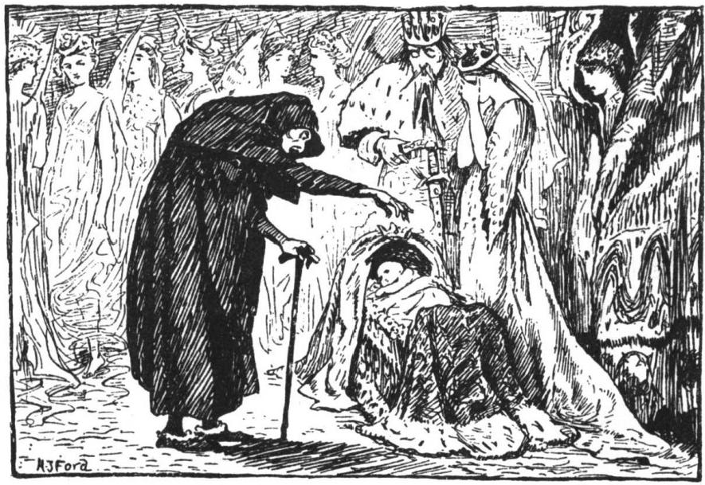

就在这个紧要关头，年轻的仙女从帷幕后面走出来，大声地说：

“国王和王后，请放心，你们的女儿不会因为这场灾难而死去。当然，我没有力量完全改变老仙女的预言，公主的手将会被纺锤刺伤。但是，她不会死去，只会陷入沉睡的状态。这种状态将持续一百年，直到一位王子来把她唤醒。”

国王为了避免老仙女预言的那场灾难，命令立刻发出布告，不论什么地方，都不许任何人用纺杆和纺锤纺纱，家里也不允许有纺锤，否则将处以死刑。

这样大约过了十五六年。有一次国王和王后到别处去娱乐。这一天，年轻的公主在王宫里跑上跑下。她从一间房间跑到另一间房间的时候，走进了塔顶的一间小房间，看到一个面善的老太婆正在独自一人用纺锤纺线。这个善良的老太婆从来没有听到过国王关于禁止纺锤的布告。

“你在那里做什么？老太太。”公主问。

“我在纺纱，我的好孩子。”老妇人回答，她不知道这个小女孩是谁。

“嗬！”公主说，“这东西真是太漂亮了，你是怎么用它的？给我，让我看看能不能用它。”

她刚接过纺锤，不知道是因为心里太急了，笨手笨脚；还是因为仙女的咒语的缘故，纺锤刺伤了她的手，公主昏厥过去，倒在地上。

善良的老妇人不知道该怎么办才好，赶紧大喊救命。许多人从各个角落奔跑过来，有的向她头上浇水，有的给她松开衣服，有的掐她的掌心，有的在她太阳穴上擦药水。可是，都没有办法能使她恢复知觉。

这时候，国王也闻声赶过来。他想起了仙女们的预言，断定事情肯定是像她们说过的那样发生了，就吩咐把公主送到王宫最好的房间里去，把她安置在一张镶满金银的床上。

公主虽然昏睡过去了，可是她那美丽的容颜一点也没有变，看上去就像小天使那么可爱。她的脸颊红润，双唇像红珊瑚那么动人；她的眼睛虽然闭着，然而呼吸却非常均匀平静，这使周围的人都安下心来：公主还活着。国王下令不许打搅公主，让她安静地睡觉，等待苏醒时刻的到来。

当这些事情发生时，让公主沉睡一百年，免以一死的善良仙女正在几万里之外的马塔金王国。但一个小矮神立刻就把这件事情告诉她了。小矮神有一双靴子，穿上它一步就能跨出几十里。仙女闻讯立刻就动身赶过来，她乘坐的一辆火红战车用龙来拉着，一个钟头就赶到了。

国王扶着仙女下了车。她对他所做的一切表示满意。仙女想得很远。她想当公主独自一个醒过来以后，在这个老王宫里会不知道发生了什么事情。于是她安排了下面这些事情：她用魔杖碰了一下王宫里除了国王和王后以外的许多人——女管家、伴女、内侍女、侍从、管家、厨师、厨师帮手、护卫，还有那些童仆、脚夫；此外，她还碰了马厩里所有的马、鞍褥等其他东西，以及宫内的那些大狗、公主床上那只漂亮的小狮子狗摩柏思。

被仙女魔杖碰过的这一切，都立刻就沉睡过去，他们不会比公主早醒。等公主醒过来需要他们的时候，他们立刻就可以尽力。连在火上烤着的鹧鸪和野鸡，似乎也睡着了。所有这一切都发生在一刹那之间。仙女做事从来不拖拉。

国王和王后吻了沉睡中亲爱的女儿，离开了宫殿，同时宣布，谁也不许靠近这座宫殿。

其实，这已经没有什么必要了。一刻钟以后，宫殿的周围长出一片丛林、灌木和荆棘。它们盘根错节，紧密地缠在一起。不要说人，就是野兽也无法通过。所以，这里除了丛林，什么也看不见。只有从远处才能见到宫殿的塔顶。毫无疑问，仙女运用她的魔法，在这里创造了一个奇迹，她让公主安稳地睡上一百年而不必担心受那些好奇者的打扰。

一百年过去了，当时另一个国王（他属于公主的远族）的王子打猎从这里经过，远远看见了宫殿的塔尖，就问旁边的随从：这些塔坐落在茂密的丛林中间，是干什么用的？

随从们根据自己听到的各种各样的传说，纷纷回答。有的说，那是一座毁坏了的老城堡，经常有幽灵出没。有的说，那是男巫和女巫半夜里聚会的地方。多数人认为：那是一个吃人妖魔的住所，他把能够抓到的小孩都带到那里去，在那里他可以安心地吃掉他们而不会被人跟踪，因为除了他，没有任何人有本事穿过这片森林。

王子很吃惊，不知道该相信谁的话才好。这时，一个年纪很大的乡下人这样对他说：

“但愿我的话能让尊敬的殿下满意。这件事我从父亲那里听来，至今已有五十年了。我父亲也是从我祖父那里听来的：那城堡里有一个举世无双的美丽公主，她要在那里睡上一百年，等待一个王子来把她叫醒，她是为这个王子而生的。”

年轻的王子听了这些话热血沸腾。他不加思索就相信，这闻所未闻的奇迹应该由他来实现。在爱情和荣誉的驱动下，他决定立刻就到里面去看一看。

他刚刚踏进那片丛林，所有高大的树木，还有灌木丛和荆棘都自动地给他让开一条路。接着，一条大道出现在他的面前，大道的尽头就是城堡。他沿着大道走过去。他感到有点惊讶的是，他的随从一个也没有跟进来。因为他一走过，那些树丛又合拢起来，恢复原状。尽管如此，他并没有停下脚步。年轻多情的王子总是无所畏惧的。

他走进了一个宽敞的庭院，看到的景象足以叫一个最勇敢的人害怕得停止呼吸。死一般的寂静笼罩着整个空间和一切。所有的人和动物都直挺挺地躺在那里，就像僵尸。不过，王子从卫兵们那红润的脸膛和长着丘疹的鼻子上知道，这些人只是睡着了。他们的酒杯里还有一些酒，这就足以说明他们是喝多了才睡着的。

接着，他穿过一个大理石铺成的院子，走上楼梯，走进卫兵室。卫兵们成排地站立着，肩上扛着枪，鼾声如雷。他走过几个房间，房间里都有不少男人和女人，有的站着，有的坐着，但是都睡着了。

最后，他走进一间金光闪闪的房间。房间里有一张床，床上的帐子拉开着，床上躺着一个十五六岁的公主。看到公主，一种无限美妙和神圣的感觉涌上王子的心头，他怀着一颗敬慕和颤抖的心，向光彩照人的公主走过去，双膝跪在她的床前。

就这样，魔法被破除了，公主苏醒过来，用无比温柔的眼光看着王子，好像他们不是第一次见面似的。

“是你吗？我的王子。”公主对他说，“我等你很久了。”

这句话把王子迷住了。公主说这句话时的神情，更是令他神魂颠倒。他不知道该如何来表示自己的欢乐和感激之情。他向公主保证，他爱她胜过爱自己。他们断断续续地倾诉着相爱之情，眼泪比语言还要多。话虽然不多，但却深深地震撼着这对恋人的心。王子对这忽然到来的爱有点不知所措，这当然不值得奇怪。而公主却有足够的时间去考虑对自己的爱人说些什么。也许善良的仙女在她漫漫的长夜里已经给过她许多非常美妙的梦（尽管历史没有记下这一笔）。总之，他们一起坐了四个钟头，说话的时间还不到一半。

与此同时，整个宫殿都苏醒过来。每个人都在忙着干自己的事情，谁也不想饿死。女总管像其他人一样，饿得实在受不了，变得很不耐烦起来。她大声地告诉公主，晚饭已经准备好了。王子帮助公主起床。她穿好衣服，显得非常高雅富贵。王子殿下留神不去说她穿戴得像他的曾祖母一样，高高的衣领上还露出一条针绣花边。尽管如此，这一点也不影响她的美丽和妩媚。

他们走进挂着镜子的大厅，在那里共进晚餐。公主的仆人伺候他们。小提琴和双簧管演奏着曲子，这些老曲子虽然已经演奏了上百年，但还是非常优美动听。晚饭以后，他们不失时机，就在宫殿的小教堂里举行了婚礼。女管家为他们拉上了窗帘。这天晚上，他们几乎整夜没有睡——公主已经睡够了。

第二天一早，王子就离开公主，返回城里。他父亲肯定已经很焦急了。王子见到父亲，对他说：

他打猎的时候在森林里迷了路，在一个烧炭人的家里过夜，烧炭人还给他奶酪和黑面包。

国王，也就是王子的父亲是个心地善良的人，他相信了儿子的话；可是他的母亲怎么也不相信。她注意到，他几乎天天都要出去打猎，而且总是可以找到借口，有时一出去就是三四天。这样的日子过了两年，她开始怀疑王子是不是已经结婚。

王子和公主一起生活整整两年以后，生下了两个孩子。大的是个女孩，起名叫莫宁（早晨的意思）；小的是个男孩，取名叫戴（白天的意思），他比姐姐还要神气，漂亮。

王后好几次提醒她的儿子，应该对她说出，他的日子是怎么安排的，他有责任让她得到满意的回答。可是，他不敢对她公开自己的秘密。虽然他爱母亲，但是很怕她，因为她出身于食人妖魔的家族，要不是因为她很有钱，国王绝对不会和她结婚。王宫里还在偷偷地传说着，她想吃人，每当看到小孩从身边走过，她总是非常痛苦地克制着自己，免得向他们扑过去。因此，王子决不会对她说出一个字。

又过了两年，国王去世以后，王子继承了王位。看到自己成了国家的统治者，于是他公开了自己的婚姻，以非常隆重的仪式把他的王后接回宫中，入城的场面非常壮观，王后坐在马车中间，两个孩子坐在她的两旁。

不久，国王出去和邻国打仗，把国事交给他的母亲——太后管理，还真切地希望她照顾好自己的妻子和两个孩子，因为整整一个夏天他不会回来。

国王刚走，太后就把她的媳妇赶到森林中的乡下房子里居住，以便她能随心所欲地满足她那些可怕的欲望。

几天以后，她亲自来到厨房，对厨师说：

“明天午饭我想吃莫宁。”

“啊！夫人！”厨师惊叫起来。

“就这样定了。”太后斩钉截铁地说，口气中流露出女妖魔想吃人时的那种强烈愿望，“用罗伯特酱来做作料。”

可怜的厨师心里非常明白，和女妖魔绝对不能耍什么花招。他拿起刀，来到莫宁的房间。她那时刚好四岁，看到厨师，她蹦蹦跳跳地跑过来，搂着他的脖子，笑着闹着跟他要糖吃。看到这情景，厨师不禁哭出声来，手中的刀掉在地下。他转身来到后院，把一只小羊羔杀了，加上一些上等的作料。女主人对他说，她生下来还没有吃过这样好的东西。

与此同时，厨师把小莫宁送到妻子那里去，把她藏到他在院子深处的一间地下住所里。

大约八天以后，恶毒的王后又来到厨房对厨师说：“晚饭我要吃小戴。”

厨师不吱声，他决定像上一次一样地骗她。他从厨房里出来找戴，看到他手中拿着一把小的练习剑，正在和一只大猴子对击，那时他才三岁。厨师把他抱起来，送到妻子那里去，让她把他和姐姐一起在房间里藏起来。在小戴住的房子里，厨师烧了一只小山羊，非常嫩。女妖魔吃得非常满意。

事情到了这种地步，好像应该太平无事了。可是不，一天晚上，太后来对厨师说：“我要把王后吃掉，用的作料要和吃掉她两个孩子的一样。”

可怜的厨师这回绝望，他觉得实在没有办法再骗太后了。年轻的王后快二十了，还不算她睡着了一百年。在院子里到哪里去找这么结实的肉呢？这可是太难了。后来他终于下了决心，要保住自己的命，唯一的办法是把王后杀了。他手中拿着一把刀，来到王后的房间。他想尽快地结束这件事情，因此尽量地装出一副气势汹汹的样子。可是他又不忍心把王后吓坏了，结果是毕恭毕敬地把太后的命令对她说了。

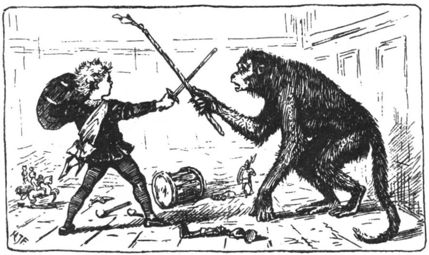

“干吧！干吧！”她一边说着，一边伸出头来，“执行给你的命令，这样我就可以去见我的孩子了。我那些可怜的孩子，我是多么热烈，多么温柔地爱他们。”

王后以为他们被偷偷地带走以后，就被杀害了。

“不！不！夫人！”可怜的厨师这时已经泪流满面，“你不会死，你还会再次看到自己的孩子。不过你要和我一起到我的家里去，我把他们藏在那里。我还要再骗太后一次，用一只小雌鹿来取代你。”

说着，他把王后带到自己的住所，让他们去抱头痛哭。他来到厨房，杀了一头鹿，浇上作料，给王后当晚饭。太后以为她吃的是王后，吃起来津津有味，胃口大开。她对自己的狠毒非常满意。她编好了一段谎话，准备等国王回来以后骗他，说是那些疯狂的狼把他的妻子王后，还有他的两个孩子吃掉了。

有一天晚上，她像往常一样到宫殿里的各处走走，看看能不能闻到新鲜的肉味。她听到从一间地下室里传出小戴的哭声。那是因为他淘气，妈妈正要打他，接着还传来小莫宁为她弟弟求情的声音。

女妖魔听出了王后和她的孩子的声音，知道自己就这样上当以后，她气得发疯。第二天天刚亮，她就发号施令（那可怕的声音叫每一个听到的人都浑身发抖），叫人把一个大桶搬到大院子的中间来，把癫蛤蟆和各种各样的毒蛇都放进去。接着，她又命令把王后，她的孩子，还有厨师，他的妻子和女仆都反绑着带来，把他们全扔到桶里去。

遵照太后的命令，他们都被带进来。正当执行命令的人准备把他们扔到桶里去的时候，谁也意想不到的事情发生了，国王骑着马走进院子，因为他是心急火燎地赶回来的。看到这副可怕的景象，他非常吃惊地问，这是什么意思。

谁也不敢说话，女妖魔看到大势已去，气得暴跳如雷，头朝下地跳进桶里。那些按照她的命令扔到桶里去，准备吃别人的可怕动物，一下子就把她吞掉。国王也觉得很遗憾，因为她毕竟是他的母亲。不过，看到他美丽的妻子和两个可爱的孩子，他也就得到安慰了。

 

## 灰姑娘和水晶鞋

从前有个绅士，前妻死了以后第二次结婚，娶了个后妻。那是个谁也没有见过如此傲慢、如此无礼的女人。她和前夫生了两个女儿，脾气等各个方面完全跟她一模一样。绅士和前妻也生了一个女儿，可她无比善良和温柔的性格谁也比不上。这是她从生母那里继承下来的，她的生母本是世界上最好的人。

结婚以后不久，继母就开始露出她的真面目来。她不能忍受这个美丽姑娘的美好品德，这起码是因为相比之下，她的女儿就显得更丑陋了。她叫她干家里最贱的活，洗碗碟，擦桌子，打扫继母和两个姐姐的房间。她住的是破破烂烂的阁楼，睡的是烂草铺成的床；而两个姐姐住的是最好房间，地板是镶嵌的，床是最时髦的。房间里的镜子那么大，可以从头照到脚。

可怜的姑娘默默地忍受着这一切，不敢告诉她父亲。父亲也最多只能说说几句把她打发走，因为继母已经牢牢地把他控制在自己手中。每当干完活，她习惯来到烟囱角落里，坐在煤渣和炉灰上，因此被人叫做煤渣姑娘。她的小姐姐不像大姐姐那么粗鲁和不文明，把她叫做灰姑娘。然而，尽管灰姑娘衣衫褴褛，却遮盖不住她的天生丽质，与两个穿着华丽的衣服的姐姐比起来，要胜过百倍。

那时，国王的儿子准备举行舞会，邀请所有体面的人都去参加。小姐们也受到了邀请，因为她们在上流社会中也颇有名气。接到邀请信，她们都兴高采烈，激动地忙着挑选礼服、衬裙和围巾，把自己打扮起来。这给灰姑娘添了不少麻烦，因为她得给两个姐姐烫衣服、打褶裥。她们整天只忙着商量穿什么衣服，如何打扮自己，其他什么都不管。

“我吗！要穿那件有法兰西花边的红色天鹅绒套装。”大姐姐说。

“我呢！准备穿那条常穿的裙子。不过，为了更加醒目，再套上那件黄色的开襟外衣，还有镶钻石的胸衣。这样就显得超群脱俗了。”

她们尽最大的努力，请来了第一流的化妆师，帮她们做头发，戴上双层垂沿女帽。还从有名的包歇小姐化妆品商店买来红色的化妆笔和饰颜贴片。

她们也把灰姑娘叫来，让她做参谋，因为她很有见解，出的点子总是高人一筹。不仅如此，她还动手帮她们弄弄头发，她们也都很乐意让她做。这时候，她们问灰姑娘：

“灰姑娘，你愿不愿意和我们一起去参加舞会？”

“啊！”她说，“你们这不是嘲笑我吗？像我这样的人，怎么能到那里去！”“你说对了，”她们说，“一个煤渣姑娘出现在舞会上，会引起人们的笑话。”

要是换上别人，肯定会故意把她们的头发做歪。可是灰姑娘心肠好，帮她们做得完美无缺。她们专心致志地打扮着，兴奋得几乎两天没有吃一点东西。为了找一根束腰的带子，把自己打扮得苗条一些，她们拆开了不止一打束腰带。她们整天整夜不停地站在镜子面前照着。

幸福的日子终于来临，她们动身到王宫去。灰姑娘的目光一直跟随着她们，等她们在远处消失以后，她终于放声大哭。

灰姑娘的教母来了，看到她哭得像个泪人似的，问她是怎么回事。

“我希望能……希望能……”她抽噎着无法说下去。

灰姑娘的教母是个仙女，看着她说：“你希望能去参加舞会，是这样的吗？”

“是……的。”灰姑娘深深地叹了一口气。

“那好吧！”教母说，“要做个好姑娘，我想办法让你去。”她把灰姑娘领进自己的房间，对她说：“跑到花园里去，给我摘个南瓜来。”

灰姑娘立刻去找来最好的南瓜，给教母送来，但想象不出南瓜怎么能送她到舞会上去。教母把南瓜里面全部挖空，只留下瓜皮，然后用魔杖敲了它一下，南瓜立刻变成一辆全部镀金的漂亮马车。

教母又去看看她的鼠笼，里面有六只生蹦活跳的小豚鼠。她叫灰姑娘把鼠笼的门拉开一点，让小豚鼠一只一只地跑出来；每跑出来一只，教母就在它头上轻轻地点一下。小豚鼠立刻就变成骏马。六匹马的皮毛就像小豚鼠一样，有深灰色斑纹，非常漂亮。现在，只缺一个马车夫了。

“让我再去看一看，”灰姑娘说，“耗子笼里是不是能找到一只耗子，我们让它来当马车夫。”

“你说得对，”教母说，“去看一看。”

灰姑娘把耗子笼带过来，里面有三只大耗子。仙女挑了那只长着大胡子的最大的一只，用魔杖碰它一下，把它变成一个肥胖的，乐呵呵的车夫，那双敏锐的小眼睛真是人世间少见。接着，教母对灰姑娘说：

“到花园里去，把浇水壶后面的六条蜥蜴给我抓来。”

蜥蜴刚刚抓来，转眼间教母就把它们变成了仆人。他们的制服上都随便地装饰着金和银。六个仆人一个紧接一个地排在马车后面，好像生来就是干跟脚这一行似的。

仙女对灰姑娘说：“好了！你看，去参加舞会的马车和仆从都有了，你不感到高兴吗？”

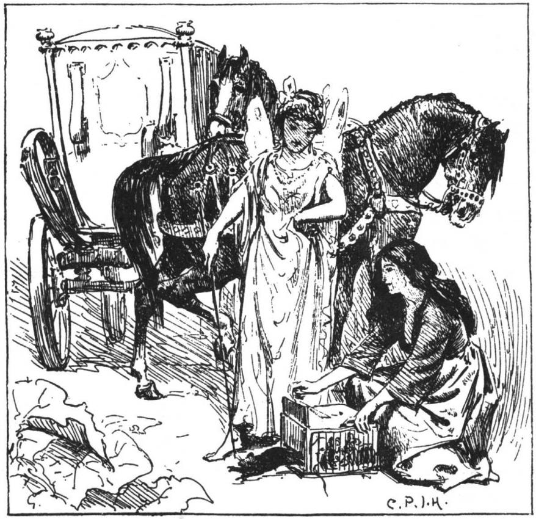

“啊！高兴！”她说，“可是，我非得穿这身破烂衣服去吗？”

教母只是用魔杖轻轻地点了她一下，她的衣服变得像是用金和银织成，上面镶着钻石。接着，教母又给她一双世界上最漂亮的水晶鞋。这样打扮妥当以后，她上了马车。可是，教母特地关照她，午夜之前，一定要离开舞会。如果她多待一会，马车就会变成南瓜，马就会变成老鼠，车夫就会变成耗子，仆人就会变成蜥蜴，她的一身衣服也会恢复原状。

她答应教母，一定在午夜之前离开舞会，然后就怀着克制不住的欢乐，乘着马车走了。

国王的儿子被告知，一个谁也不认识的伟大公主来了。他赶紧出去迎接她，伸出手去扶她下马车，把她领进舞厅里的大伙之间。大厅里顿时一片寂静，跳舞的人都停了下来，小提琴手也忘记了演奏，人人都聚精会神地看着这新来的陌生人举世无双的美丽容颜。四面八方只听见一片赞叹声：

“啊！她长得多美！啊！她长得多美！”

国王本人虽然上了年纪，但也情不自禁地注视着她。他轻声地对王后说，他已经很久没有看到如此美丽，如此可爱的姑娘了。

所有的女士们都全神贯注地研究起她的衣服和头发来，要是她们能找到这样好的衣料和这样好的美容师，第二天就会照这种式样去做。

王子把她领到最高级的贵宾座位上，接着又请她和自己一起跳舞。她的舞姿那么优美，大家越来越崇拜她。精美的点心送上来了，王子目不转睛地看着她，一口也顾不上吃。

她来到两个姐姐旁边坐下，对她们很有礼貌，还把王子给她的橘子和香橼送一些给她们。这使她们受宠若惊，因为她们认不出她来。就在灰姑娘和两个姐姐逗乐的时候，钟已指向了十一点三刻，她立刻和大家告别，尽快地离开舞厅。

回到家里，她先去找教母。谢过教母以后，她说，她衷心地希望第二天还能去参加舞会，因为王子也希望她去。

正当她兴高采烈地和教母说舞会上的事情时，传来两个姐姐敲门的声音，灰姑娘跑过去开门。

“你们怎么去了这么久？”灰姑娘揉揉眼睛，打着哈欠，还伸伸懒腰，好像是刚从睡梦中被喊醒似的。实际上，从她们离开家的那个时候起，她根本就没有丝毫睡意。

“你要去参加舞会，”一个姐姐说，“你就一点也不会觉得累了。来了一位最好的公主，那么美丽，真是世界上绝无仅有。她对我们那么客气，还给我们橘子和香橼。”

灰姑娘对这些好像很冷淡，她问她们，那公主叫什么名字。她们说不知道，王子也为此而坐立不安，正在千方百计地打听她是谁。关于这些，灰姑娘只是笑笑，回答说：

“那她肯定是非常漂亮了，你们是多么快活啊！我能不能见到她？啊！亲爱的夏洛特小姐，把你天天穿的那套黄衣服借给我吧！”

“哎！你再想一想吧！”夏洛特小姐喊叫起来，“把我的衣服借给像你这样脏的煤渣姑娘，那我不成了大傻瓜了吗？”

其实，灰姑娘早就料到了她会这样回答，所以遭到拒绝她很高兴。要是姐姐把她的玩笑当真，把衣服借给她，她倒要为该不该穿上而犯愁呢！

第二天，两个姐姐都去参加舞会，灰姑娘也去了，而且比第一天穿得更加艳丽。王子跟她寸步不离，不停地赞美她，和她说话。这些话真是百听不厌，灰姑娘把教母的话忘得一干二净，当时钟敲响十二下时，她还以为是十一点钟呢，幸亏她边听边数。她赶紧站起来奔出去，像一只敏捷的小鹿。王子紧跟着，但怎么也追不上她。慌忙中她掉了一只水晶鞋，王子小心翼翼地把它拣起来。

灰姑娘上气不接下气地跑回家中，身上穿着她那身脏的旧衣服，除了那只水晶鞋，一身漂亮的穿戴都没有了。

当问到有没有看到一个公主走出去时，宫殿门口的警卫说：他们只看到一个衣着褴褛的年轻姑娘出去过，那样子不像个体面的女士，倒像个穷苦的乡下姑娘。

等两个姐姐回来，灰姑娘问她们是否玩得开心，那位漂亮的姑娘来了没有。

她们告诉她：是的，那姑娘来了。可是当时钟敲响十二下的时候，她立刻就匆匆离开，那么急急忙忙，以至于掉了一只水晶鞋，那可是世界上最漂亮的鞋，给王子拾到了。后来一直到舞会结束，他什么也不干，只是盯着水晶鞋发呆。看样子，他已经深深地爱上了这只水晶鞋的主人，那美丽的姑娘。

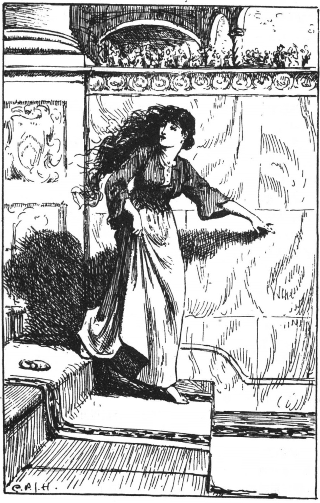

她们说得一点也不错，几天以后，王子叫人吹响喇叭，向大众宣布，哪位姑娘的脚正好能穿上这只水晶鞋，他就和她结婚。王子先派人去找那些公主们来试一试，接着是那些女公爵，还有宫廷里所有的淑女们，可是没有一个是合适的。他们还来找灰姑娘的两个姐姐试一试，她们费了九牛二虎之力才把脚伸进去，可是也没有用，连一步路也不能走动。灰姑娘看在眼里，知道这是自己的鞋，就笑着对他们说：

“让我来试试合不合适。”

两个姑娘忍不住大笑起来，开始嘲讽她。那些派来试鞋的人仔细地打量起灰姑娘来，发现她长得很美，就说：她是应该试一试，王子的命令是让所有的姑娘都穿穿看。

他们叫灰姑娘坐下，给她套上鞋子，发现太合适了，好像是用蜡照她的脚模样做出来的一样。两个姐姐非常惊讶。可是当灰姑娘从口袋中拿出另一只鞋套到脚上时，她们更是吃惊得难以言语。这时，灰姑娘的教母走进来，用魔杖碰了一下灰姑娘的衣服，一身衣服立刻变得比舞会上穿的更加艳丽，更加富贵。

这时候，两个姐姐才知道，她就是舞会上那个善良、美丽的姑娘。她们跪在她的面前，请求原谅过去对她的过错。灰姑娘把她们扶起来，一边拥抱她们，一边说：

她诚心诚意地原谅她们，希望她们永远爱她。

灰姑娘穿着这身衣服，被带到王子面前。王子觉得她比以前更加妩媚动人。几天以后，他们就结了婚。灰姑娘心地善良，一点也不比她的美貌逊色。她叫两个姐姐一起住到王宫里来。就在同一天，让她们和两个大贵族结了婚。

（查尔斯·佩罗特）

 

## 阿拉丁和神灯

从前有个穷苦的裁缝，他有个儿子叫阿拉丁。阿拉丁为人懒散，什么事情都满不在乎，整天无所事事，只是和那些同他一样的孩子在街上玩。父亲为此非常悲伤，后来就死去了。尽管母亲为此也经常流泪，不断地为他祈祷，可他还是我行我素。

有一天，阿拉丁像往常一样在街上玩，一个陌生人走过来问他的年龄，是不是裁缝穆斯塔法的儿子。“是的，先生。”阿拉丁回答，“可是他已经死了很久了。”

陌生人是个有名的非洲魔术师，听了阿拉丁的回答，低下头来吻他，说：“我是你的叔叔，你长得像我的哥哥，所以我认出来了。回去告诉你妈妈，说我来了。”

阿拉丁跑回家，对他母亲说来了个从未见过的叔叔。“是的，孩子，”她说，“你的父亲是有一个弟弟，可我总以为他死了。”不过她还是准备了晚饭，叫阿拉丁去把叔叔找回来。魔术师带着许多酒和水果来了。他一进门就跪下来，吻穆斯塔法生前常坐的地方，还对阿拉丁的母亲说，不要为从未见过他而感到惊奇，因为他离开自己的国家已经有四十多年了。接着，他回过头来问阿拉丁干些什么，阿拉丁一声不吭地低下头来。母亲却哭了起来。他一听说孩子游手好闲，什么手艺也没有学会，就说要给他开一个商店，帮他备好各种货物。第二天，他给阿拉丁买了一套好的衣服，带他到城里去逛街，让他长长见识，直到晚上才带他回家。母亲看到儿子穿得那么气派，非常高兴。

第二天，魔术师把阿拉丁领到离城很远的花园里去。他们在一个喷泉旁坐下，魔术师从腰带里拿出一块饼来，两个人分来吃。他们继续往前走，一直走到山脚下。阿拉丁觉得再也走不动了，请求回去。可是魔术师不理睬他，继续往前走，一路上还讲些有趣的故事来哄他。

后来，他们来到被一条峡谷分开的两座山前。那个假叔叔说：“我们不再往前走，我要让你看一些奇妙的东西，你先去收集一些树枝来，我来点一把火。”火点起来以后，魔术师撒上一些随身带来的粉末，同时还念动一些咒语。大地微微地抖动起来，并且裂开一道缝，露出一块正方的平石板，中间有一个可以把石头提起来的铜环。阿拉丁想逃走，可是魔术师把他抓住，一拳把他打倒在地。“我做错什么事？叔叔。”阿拉丁讨饶地说。“别害怕，照我的话去做，在这块石头下面，有一个属于你的宝库，除了你以外，谁也不能碰它一下。所以，你一定要不折不扣地照我的话去做。”魔术师说这些话的时候，显得更加友好。

一听说宝库，阿拉丁也忘记了害怕。他照魔术师的吩咐，抓住铜环，嘴里说着父亲和祖父的名字。石板轻而易举地就移开了，下面露出几级台阶。

“下去，”魔术师说，“台阶走完以后，你就会看到一个通向三个厅的门。你把袍子提起来束住，然后穿过大厅，注意不要碰到任何东西，否则你就会立刻死去。过了大厅，就是一个长着许多好果树的花园。你继续往前走，一直走到一个平台上的壁龛前。壁龛有一盏点着的灯，把灯里的油倒掉，把灯给我带回来。”他从手上脱下一个戒指交给阿拉丁，祝他好运。

阿拉丁发现，一切都像魔术师说过的一样。他从树上摘下一些水果，拿了那盏灯，回到洞口。魔术师急忙大声地喊叫起来：“赶快把灯给我。”阿拉丁不理睬他，想出了洞口再说。魔术师见状大发雷霆，把一些粉末撒在火上，口中不知道说了些什么，那块石板又把洞口盖上，把可怜的阿拉丁关在里面。

魔术师离开了波斯，显然，他不是阿拉丁的叔叔，而是狡猾的魔术师。他从那些魔法书中读到，有一盏神奇的灯可以使他变成世界上最有力量的人。虽然只有他一个人知道到哪里去找这盏灯，不过，他只能从别人手中得到它。他选中了有点傻里傻气的阿拉丁，打算拿到灯以后就把他杀掉。

一连两天，阿拉丁被关在黑魆魆的洞里，哭泣和叹息着，后来，他合起双手做祈祷，无意中擦了一下魔术师忘了要回去的戒指，一个巨大而可怕的神怪出现在他的面前，说：“你叫我干什么？我是戒指的奴隶，一切都听从你的吩咐。”阿拉丁大胆地回答：“把我从这个地方救出去！”大地立刻裂开，阿拉丁发现自己回到了地面上。等到他的眼睛能够习惯外面的阳光，张得开以后，他就动身回家。但是一踏进家门口，他就昏过去了。

等他醒过来，就把发生的事情对母亲说了，还给她看那盏灯以及从花园里摘来的水果，这些水果实际上是非常贵重的宝石。接着，他跟母亲要点吃的东西。母亲说：“哎呀！孩子，家里一点吃的东西都没有了。不过，我已经纺一些纱，现在就去卖掉它。”阿拉丁叫她把纱留着，把那盏灯去卖掉。灯那么脏，她想擦干净，好卖个好价钱。她刚碰了一下，一个可怕的神怪站在她面前，问她要什么？她立刻吓得昏过去。阿拉丁拿起那盏灯，壮着胆子说：“给我弄点吃的来！”神怪立刻送来一个银碗，十二个银盘，里面盛满了好吃的菜；此外，还送来了两个银杯和两瓶酒。等阿拉丁的母亲醒过来的时候，她问：“这桌丰盛的筵席是从哪里弄来的？”阿拉丁回答：“别问，吃吧！”于是，他们开始吃早饭，一直吃到午饭时间。阿拉丁把那盏灯的事对她说了。她请求他把灯卖掉，说和魔鬼打交道可不是好玩的。“不！”阿拉丁回答，“运气既然降临到我们头上，我们知道了它的价值，就得利用它；那枚戒指也一样，我要永远把它戴在手上。”等他们把神怪送来的东西吃完以后，阿拉丁卖掉一个银盘。钱用完以后，又再卖掉一个，这样直到一个也不剩，然后他又叫神怪送来一套，就这样过了好几年。

有一天，阿拉丁听到苏丹发布命令，在他的女儿，公主出去洗澡和回来的时候，所有的人都要留在家里，放下门窗板。阿拉丁忽然想看看公主的面容，这在平时当然是很难的，因为公主总是戴着面纱。阿拉丁躲在浴室的门后，想透过门缝偷看。公主走进浴室的时候，把面纱掀掉，阿拉丁看到公主那么美丽，立刻就爱上了她。阿拉丁回到家那副丧魂落魄的样子，叫母亲看到了非常害怕。他对她说，他爱公主那么强烈，没有她就再也活不下去了，他想去向她的父亲提亲。母亲听到这里笑出声来。可是阿拉丁后来还是说服她，叫她到苏丹那里去提出他的请求。于是，她取出一块头巾，带上一些从魔花园里摘来的神奇水果，这些水果就像最瑰丽的宝石一样闪烁着光芒，她想苏丹看到这些一定会高兴。怀着对神灯魔力的信任，她出发了。

首相和大臣们刚到，阿拉丁的母亲紧接着也走进大厅，来到苏丹的接见席前。可是，苏丹没有注意到她。整整一个星期，她每天都来，站在同一个地方。到了第六天上朝结束以后，苏丹对首相说：“我看到一个女人天天都在接见席上，头巾里好像带着什么东西。下一次叫她上来，我好问问她有什么请求。”

第二天，在首相的示意下，她来到苏丹的宝座前跪下，直到苏丹对她说：“起来吧！善良的女人，告诉我你有什么要求。”她有点迟疑不决。于是苏丹叫所有的人都退下，只留下首相，叫她大胆地说，并且许诺不论她说什么，都不会责怪她。这时，她才对苏丹说，她的儿子疯狂地爱上了公主。“我请求他把公主忘了”，她说，“可是没有用，他威胁我说，要是我不肯到尊敬的陛下这里来求婚，他就要做出性命交关的事来。现在，我请求你不但要原谅我，而且还要原谅我的儿子阿拉丁。”

苏丹和蔼地问她，头巾里包的是什么？她把包解开，把宝石呈递到他面前。苏丹看到宝石大为震惊，转过身来对首相说：“你说该怎么办？他这么抬举公主，我能不把公主许给他吗？”首相心里早就打定主意，要让公主嫁给他儿子，所以他请求苏丹叫她再等三个月，以便他儿子能筹措更加丰厚的礼品。苏丹同意了，他对阿拉丁的母亲说，他同意这门婚事，不过要再等三个月以后，才允许她再来见他。

阿拉丁耐心地等待着。可是过了两个月以后，有一天，他母亲到街上去买油，看到街上的人个个兴高采烈，就问发生了什么事情？人们对她说：“你不知道吗？公主今天晚上要和首相的儿子结婚了。”她听到这个消息，气喘吁吁地跑回来告诉阿拉丁。开始，他不知所措，但很快就想到那盏神灯。他擦了一下，神怪出现了，问：“你要什么？”阿拉丁说：“如你所知，苏丹违背了对我的诺言，首相的儿子今天就要娶公主，我命令你，今天晚上把新娘和新郎都带过来。”“主人，我服从。”神怪说。

阿拉丁回到自己的房间。到了半夜里，神怪果然把首相的儿子和公主，连同他们睡觉的床一起送过来。“把这个刚结婚的男人扔到外面去，让他冻一夜，天亮再让他回来。”神怪把首相的儿子从床上抓走，留下阿拉丁陪公主。

“别害怕，”阿拉丁对公主说，“你是我的妻子，是你那不公正的父亲答应我的，你不会受到伤害。”公主吓得话也说不出来，度过了有生以来最可怜的一个夜晚。阿拉丁却躺在她的身边呼呼大睡。到了说好的时间，神怪把冻得直打哆嗦的新郎放回原处，把床送回王宫。

这时，苏丹来看望他的女儿，不幸的首相儿子从床上跳下，躲起来。公主一句话也不说，非常悲伤。苏丹叫她的母亲来看她。母亲说：“怎么了，孩子！为什么和你父亲一句话也不说？发生了什么事情？”公主深深地叹了一口气，后来终于对母亲说，晚上床如何到一间陌生的房子里，后来又发生了什么事情。母亲一点也不相信，认为这是一个无聊的梦，叫她起床。

第二个晚上发生的事情和第一天完全一样。早晨苏丹来看公主，见她还是不肯说话，就威胁说要杀她的头。这时她才肯把一切都说出来，还说如果不信，可以去问首相的儿子。苏丹叫首相去问他的儿子，儿子承认这是事实，还说虽然他很爱公主，可是宁愿死也不愿意再去过这样可怕的一个夜晚，他希望和公主脱离关系。后来，他的愿望得到批准，婚宴和庆祝活动到此结束。

三个月过去以后，阿拉丁叫他的母亲去提醒苏丹他的承诺。她又站在上次等苏丹接见的地方。苏丹早就把阿拉丁忘了。看到她，苏丹立刻想起阿拉丁，于是就叫她过来。看到她那副穷相，苏丹很想推翻自己的承诺。他叫首相出个主意，首相叫他为公主开个很高彩礼，高到这个世界上没有一个人出得起。

于是，苏丹转过身来对阿拉丁的母亲说：“善良的妇人，作为苏丹，必须记住他的承诺，我当然不会忘记。不过，你的儿子必须先给我送来满满四十盆的宝石，要叫四十个黑奴送来，前面还要有同样数目的，穿戴华丽的白奴领路。回去告诉他，我在等他的消息。”

阿拉丁的母亲低头鞠躬，回到家里。她想这一回一切都完了。她把消息对阿拉丁说了，还补充说：“他并不急着等候你的回答。”她的儿子回答说：“母亲，不会像你想象的那么久，为了公主，我要干得比他说的还要漂亮！”他召来神怪。很快，八十个奴隶就来了，他们站满了小房子和花园。阿拉丁叫他们两两排成一行，跟着他母亲一起到王宫去。他们打扮得富贵华丽，腰带上的宝石闪闪发光。人们都蜂拥上来观看他们以及头上顶着的金盆。他们走进王宫，在苏丹面前跪拜以后，就在他的宝座前围成半个圆圈站着，双手交叉在胸前。阿拉丁的母亲上去把彩礼献给苏丹。苏丹不再犹豫了，他说：“善良的妇人，回去告诉你的儿子，我张开双臂欢迎他。”

她急忙回到家里对阿拉丁说了，还叫他快点去。可是阿拉丁先把神怪召来。“我要洗个香浴，”他说，“给我准备一条绣得金碧辉煌的长袍；一匹赛过苏丹马匹的马；还有二十个奴隶给我当随从；六个穿得很漂亮的奴隶来伺候我母亲。最后，还要一万块金币装在十个钱袋里。”说得快，做得也快，话刚说完，事情也就办好了。

阿拉丁骑着马通过街道，奴隶们一路上散发金币。那些儿时和他一起玩耍的孩子们现在都认不出他来了。他已经长成一个英俊的小伙子。

苏丹看到他来了，从宝座上走下来拥抱他，把他领进大厅，那里宴席已经准备好了。苏丹想今天就为他们举行婚礼。可是阿拉丁不同意，他说：“我必须先为她建造一座舒适的宫殿。”说完就走了。

回到家里，他对神怪说：“用最好的大理石给我造一座宫殿，要镶上碧玉、玛瑙，还有各种珍贵的宝石。宫殿的中央建造一个圆顶大厅，四面墙壁用黄金和白银筑成，每面墙壁上开六个窗口，窗框上全部用钻石和红宝石装饰起来，但留下一扇窗口不要完工。此外，宫殿里还要有马厩、马匹、车夫和奴隶；去办理吧！”

第二天，宫殿就建成了。神怪领他去视察，他的吩咐已经不折不扣地完成，连从阿拉丁宫殿通往苏丹宫殿的路上，也铺好了天鹅绒地毯。阿拉丁的母亲仔细地打扮她自己，然后在奴隶的护送下向王宫走去。阿拉丁骑马跟在她后面。苏丹派出乐队，吹着喇叭，击响铙钹欢迎他们。到处都充满了美妙的音乐和欢乐。她被领到公主的面前，公主毕恭毕敬地向她行礼。晚上，公主向父亲告辞，踏着地毯来到阿拉丁的宫殿。阿拉丁的母亲陪着她，后面簇拥着上百的奴隶。看到阿拉丁，公主也被迷住了。

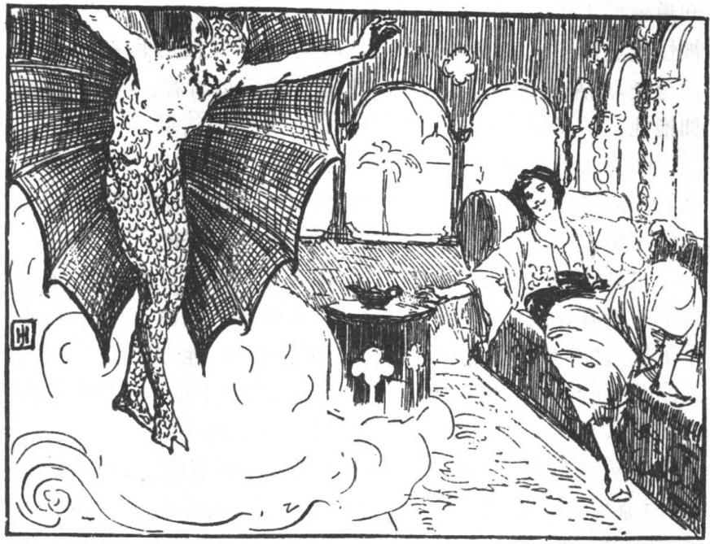

“公主，”阿拉丁说，“如果我曾冒犯你的话，那么我的大胆也是因为你的美丽引起的。”公主对他说，见过他以后，她也就心甘情愿地听从父亲的安排了。婚礼以后，阿拉丁领公主走进大厅，宴席就在这里举行。公主和阿拉丁共进晚餐，然后他们一起跳舞，直到深夜。

第二天，阿拉丁邀请苏丹来观看宫殿。他们走进大厅，二十四个窗口镶着红宝石、钻石和碧玉。苏丹说：“这真是全世界的奇迹，只是有一件事我不明白。还有一个窗口没有完成，这是不是偶然的？”“不！陛下，这是有意保留的。”阿拉丁说，“我希望尊敬的陛下也能分享宫殿落成的荣誉。”苏丹非常高兴，他派人把城里最好的宝石匠找来，把那扇未完工的窗指给他们看，叫他们也像别的窗口一样把它装好。“陛下，”那些宝石匠说，“我们找不到那么多宝石。”苏丹叫人把自己的宝石也送来，它们很快全部用上去了，可是还不行。一个月过去了，工程还没有过半。阿拉丁知道他们干不了，就叫他们拆掉，把钻石都拿回去。他自己命令神怪把这扇窗也完成。苏丹看到自己的钻石又被送回来，觉得非常奇怪，就来看阿拉丁。阿拉丁把完工的窗指给看。苏丹高兴地拥抱他。妒忌的首相在一旁暗示，这是魔法的结果。

阿拉丁的豪爽赢得了人们的信任，他当上了苏丹军队的首领，为苏丹打了几次胜仗。然而他还是保持着谦虚谨慎、彬彬有礼的举止。就这样，他心满意足地过了几年太平的日子。

可是，在非洲的魔术师想起了阿拉丁。他通过魔术，知道阿拉丁并没有在山洞里悲惨地死去，不但捡了一条命，而且和公主结了婚，过着荣华富贵、深受别人尊敬的生活。他知道，这个穷裁缝的儿子所以有今天，全是神灯帮忙的结果。于是，他日夜兼程，赶回到这个国家的首都，决心要毁掉阿拉丁的一切。

他从城市里经过的时候，听到人人都讲那座神奇的宫殿。“请原谅我的无知，”他问，“你们在谈论哪一座宫殿？”“你没有听说过阿拉丁王子的宫殿吗？”有人回答他说，“那是世界上最了不起的奇迹！你要想去看，我可以给你指路。”魔术师对他表示感谢。看过那座宫殿以后，他知道，那是神灯的神怪把它造出来的。他决心要把神灯夺回来，把阿拉丁再次推入穷苦的深渊。

不幸的是，阿拉丁正好出去打猎，需要整整八天时间，这就让魔术师有了充分的时间来实施他的阴谋。他买了一打铜灯，放进篮子里，来到宫殿门前高声喊叫：“新灯换旧灯！”引来许多取笑的人。公主坐在对着窗口的大厅里，听到外面吵吵闹闹，就叫个仆人出去看个究竟。仆人哈哈大笑地回来，遭到公主的责骂。“夫人，”仆人说，“一个老傻瓜正在那里用新灯去换人家的旧灯，看到的人能不笑吗？”另一个仆人听到了说：“屋檐上有一盏旧灯，可以跟他换。”这盏灯正是神灯，阿拉丁出去打猎不能带走，就把它留在那里了。公主不知道它的价值，就笑着吩咐仆人也拿出去换。仆人把它拿出去对魔术师说：“我跟你换一盏新灯。”魔术师抓住神灯，在众人的取笑声中毫不在意，叫仆人自己挑一盏，然后带着那些灯叫唤着离开。他走出城门，来到一个僻静的地方。等天黑以后，他就拿出神灯来擦了一下。神怪出现了，在魔术师的吩咐下，把魔术师连同那座宫殿和公主一起搬到非洲人烟稀少的地方。

第二天早晨，苏丹从自己的窗口向阿拉丁的宫殿张望，不由得揉了揉眼睛，阿拉丁的宫殿不见了。他派人把首相找来，问他宫殿是怎么回事？首相也朝窗外看去，不由得大惊失色。他还是说这是魔法的结果。这一回苏丹相信他了，派出三十个人骑马出去逮捕阿拉丁。他们在阿拉丁骑马回家的路上碰见他，就把他捆起来，勒令他下马步行跟他们回去。可是，那些热爱他的人都拿着武器跟随着，看看谁敢动他的一根毫毛。

阿拉丁被带到苏丹的面前，苏丹命令把他的头砍下来。刽子手叫阿拉丁跪下来，蒙上他的眼睛，举起月牙刀准备砍下去。就在这紧急关头，首相看到外面的人群强行冲进院子，准备越墙过来救阿拉丁，赶紧叫刽子手停下来。那些人来势汹汹，苏丹只好作出让步，命令给他松绑，当众宽恕了他。这时，阿拉丁才有机会请求苏丹告诉他，自己做错了什么？

“假情假意的混蛋！”苏丹说，“过来！”他朝窗口指了指阿拉丁宫殿的方向。阿拉丁吃惊得一句话也说不出来。“我的宫殿和女儿到哪里去了？”苏丹责问，“宫殿丢了我还不怎么在乎，可是我不能没有女儿，你一定要把她找回来，否则就杀你的头。”

阿拉丁请求给他四十天的时间去找公主，说如果空着手回来，任凭苏丹杀他的头。苏丹同意了他的请求，阿拉丁悲伤地离开了苏丹。一连三天，他发疯似地到处乱跑，逢人就问他的宫殿到哪里去了？可是，他们只能笑笑，表示同情。他来到河边，双膝跪下，作投河之前的最后一次祈祷。无意之中，他擦到了手指上还戴着的戒指，洞中见过的那个神怪又出现在面前，问他要干什么。“救救我，神怪，”阿拉丁说，“把我的宫殿搬回来。”“这个我管不了，”神怪说，“我只是戒指的奴隶，你要请神灯的奴隶才行。”“即使是这样，”阿拉丁说，“但你总可以把我送到宫殿那里去，送到我的爱妻窗口下面去吧！”紧接着，他发现自己已经来到了非洲，正坐在公主的窗口下，由于非常疲倦，他一下子就睡着了。

鸟儿的歌声把他从睡梦中唤醒，他感觉轻松多了。他心里明白，所有的不幸都是因为丢了神灯引起的。可是谁抢走了他的神灯呢？他百思不得其解。

这天早晨，公主醒得特别早。自从被魔术师抢到非洲，她还没有这么早就醒来过。今天又得受他一天的折磨了。不过，公主对他非常强硬，所以，他还不敢和她住在一起。就在公主穿衣服的时候，一个女仆朝窗外张望，看到了阿拉丁。公主跑过来把窗打开。阿拉丁听到开窗的声音，抬起头来。公主叫他进来，一对恩爱夫妻又见面了，他们是多么兴奋！阿拉丁吻过公主以后，就对她说：“公主，在我们谈论别的事情以前，为了你，也为了我，我以真主的名义请求你告诉我，在我出去打猎的时候，我留在宫殿屋檐下的那盏旧灯到哪里去了？”“啊！”公主说，“我们的不幸都是由于我的无知造成的。”接着，她把换灯的事对他说了。

“现在，我明白了，”阿拉丁说，“看来这件事得感谢这个非洲魔术师了！灯在哪里？”“他随身带着。”公主说，“有一次他怀中拿出来给我看，所以我知道了。他要我抛弃你，和他结婚，说你已经被我父亲下令砍头了。他总是不停地说你的坏话，可我只是用眼泪来回答他。假如我再坚持下去，我不怀疑他会使用暴力。”

阿拉丁安慰她，说要离开她一会。他来到城里，和碰上的第一个人换了衣服，还带一些药粉回来。公主让他从边上的一扇小门进来。“穿上你最漂亮的衣服，”阿拉丁对她说，“看到魔术师的时候要面带笑容，让他认为你已经把我忘了。请他和你一起吃晚饭，说你想尝一尝非洲的酒。他会去拿一些酒来，等他走了以后，我再告诉你该怎么做。”

她仔细地听着，等他走了以后，她把自己打扮得很漂亮，这还是她离开自己的国家以后第一次。她束上腰带，戴上钻石头饰，照了照镜子，觉得自己比以前更加好看了。迎接魔术师的时候，她的话确实使他大吃一惊：“我已经下了决心，既然阿拉丁已经死了，我就是哭干眼泪也不能叫他活回来。所以，我不再悲伤了，因此请你和我一起共进晚餐。可是，我对自己国家的酒有点厌倦了，想尝一尝非洲酒的滋味。”

魔术师赶紧到地窖里去拿酒。公主把阿拉丁给她的药粉倒进自己的杯子里。魔术师回来以后，她请他为了她的健康，喝下这一杯非洲酒，同时用自己手中的杯子和他交换，以表示听他的话。喝下这杯酒之前，魔术师说了一番赞美她的美丽的话。可是公主打断了他，说：“让我们先干杯，然后你爱说什么就说什么。”公主的杯子只是碰到嘴唇就不动了。魔术师一饮而尽，立刻就倒在地下不动了。这时，公主把门打开，让阿拉丁进来，扑倒他的怀抱里；阿拉丁赶紧把她推开，说他还有许多事要做。他走到已经死去的魔术师面前，从他的怀中取出神灯，吩咐神怪把宫殿搬回自己的国家。这时候，公主在自己的房间里只觉得轻微地震动了两下，根本没有想到自己又回家了。

苏丹这时正坐在自己的密室里，为失去女儿而悲哀。他偶然抬起头，看到宫殿又出现在老地方，不禁擦了擦眼睛。他赶紧走过去，阿拉丁在开着二十四个窗口的大厅里迎接他，公主站在阿拉丁的身旁。他把发生的事情对苏丹说了，还把魔术师的尸体指给他看，好证明自己说的话是真的。苏丹宣布举行十天的盛宴，以示庆祝。看来阿拉丁往后可以平平安安地过日子了。可是，事情并非如此。

非洲魔术师有个弟弟，比他哥哥更加阴险，更加狡猾。他来到阿拉丁的国家，要为哥哥报仇。他先来到一个虔诚的女教徒家里，她的名字叫法蒂玛。他想利用她来达到自己的目的。他闯进她的房间，用匕首对准她的胸膛，叫她站起来照他的话去做，否则就杀了她。他逼她和自己交换衣服，化妆成她的样子，披上她的面纱，最后为了灭口，还是残忍地把她杀了。

他向阿拉丁的宫殿走去。一路上人们把他当成圣女，都围拢上来，吻他的手，恳求他的祝福。他来到宫殿前的时候，吵闹声那么大，公主听到了，吩咐她的仆人从窗口朝外看一看，问一问发生了什么事情。仆人说，是一个圣女正在为人摩顶，消除烦恼。公主早就想见一见圣女法蒂玛，就派人去请她来。

魔术师的弟弟一进来，就为公主的健康和富贵祈祷。接着，公主就请他坐在自己的身边，希望他永远地留下来。这正中这个假法蒂玛的下怀，他立刻表示同意；但是，他不肯把面纱拉下来，害怕会暴露自己。公主请他参观大厅，问他有什么看法。

“真是妙极了，”假法蒂玛说，“在我看来是样样俱备，缺一件东西。”“哪是什么呢？”公主问。“只缺一个大鹏蛋，”他说，“要是有个大鹏蛋挂在大厅的正中央，那可是人世间的奇迹了。”

从此以后，公主什么也不想，只是整天挂念着大鹏蛋。阿拉丁打猎回来，看到她闷闷不乐，问她出了什么事。她说，大厅里缺少一个大鹏蛋，她怎么也高兴不起来。“就为了这件事？”阿拉丁说，“你很快就会开心起来的。”

他走了出去，擦了一下神灯，神怪一出现，他就叫他去拿个大鹏蛋来。神怪发出巨大而可怕的喊叫声，连宫殿也震动起来。“无耻！”他喊道，“我给你做了这么多事情，难道还不够吗！你还非得叫我去把我的主人带来，把他吊在大厅的中央吗？你，还有你的妻子，你的宫殿应该烧成灰。不过，这个要求不是你提出，而是你杀的非洲魔术师的弟弟提出来的。他现在就在你的宫殿里，装扮成被他杀害了的圣女。是他把这个念头塞进你妻子的头脑中。你要留神，他想把你杀了。”说完，神怪就不见了。

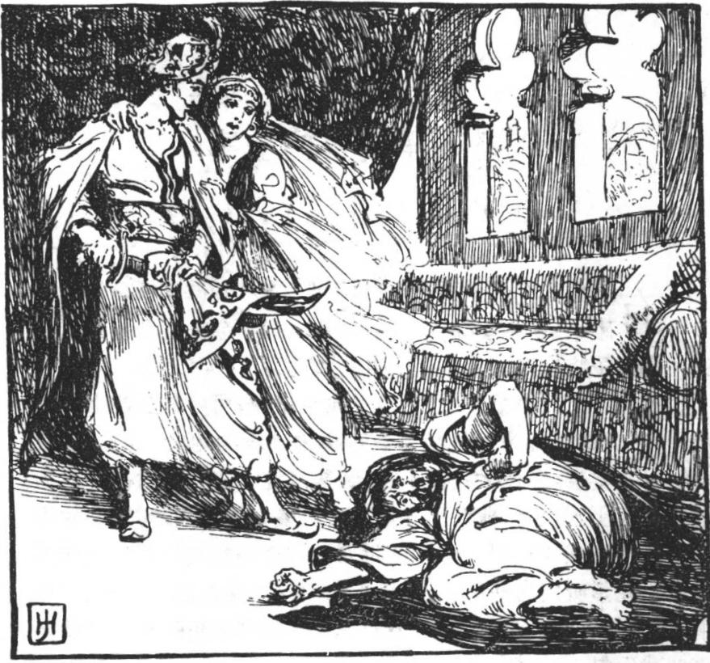

阿拉丁回到公主那里，说他头痛，想请圣女法蒂玛来帮他摸一下。在魔术师走近的时候，他拔出匕首，刺进他的心窝。

“你干了些什么？”公主惊叫起来，“你杀了圣女！”

“不！不是！”阿拉丁回答，“他是邪恶的魔术师。”接着，他告诉公主，她怎么受骗了。

从此以后，阿拉丁和公主平安地生活着。苏丹死了以后，他继承了王位，统治了好多年，他的许多子孙也都继承了王位。

（《一千零一夜》）

 

## 年轻人学发抖的故事

有个父亲有两个儿子。大儿子聪明伶俐，做事情总是有条不紊；小儿子却不聪明，学什么都不会。看到他的人都说：“这孩子将来对父亲是个沉重的负担！”

平常有什么事情要做，总是大儿子出面；可要是在晚上或者夜里，或者需要穿过墓地和传说有鬼神出没的地方，他总是说：“啊！不！父亲，说什么我也不去，到这些地方去我会发抖。”因为他胆子很小。晚上，他们围着篝火讲故事，那些阴森恐怖的故事有时会让人喊叫：“啊！这故事叫人害怕得浑身发抖。”坐在角落里的小儿子听到这些话，一点也不明白这是什么意思。他想，“他们总是说，这使人浑身发抖！这使人浑身发抖！可从来没有什么事叫我发抖，可能我还没有这种本事。”

有一天，父亲对他说：“你坐在角落里好好听着，你现在长大了，身强力壮，必须去学会挣钱养活自己。你看你哥哥，他干活多么辛苦。可是我花钱让你受教育，这些钱都白扔了。”“亲爱的父亲，”他回答，“我很高兴去学本事，实际上，如果有可能，我想先学会发抖，我一点也不知道这是怎么一回事。”哥哥在一旁听到了不禁笑起来，他想，“我的天！我弟弟怎么这样傻！他这一辈子是什么也干不成了！树苗是歪的，长成树也不会直！”他父亲叹了一口气，对他说，“你很快就会学会发抖，可靠这个是不能过日子的。”

这以后不久，有一天，教堂司事来他们家。父亲对他说，他的小儿子如何不成才，什么也不懂，什么也学不会。“你想，当我问他以后打算靠什么过日子的时候，他一本正经地说要去学会发抖！”“他要真是这么想，”司事说，“我可以教他。你只要把他送到我这里来，我很快就可以把他教育好。”父亲听到这个提议很高兴，他想，“这对小家伙来说，倒是个受管束的好机会。”

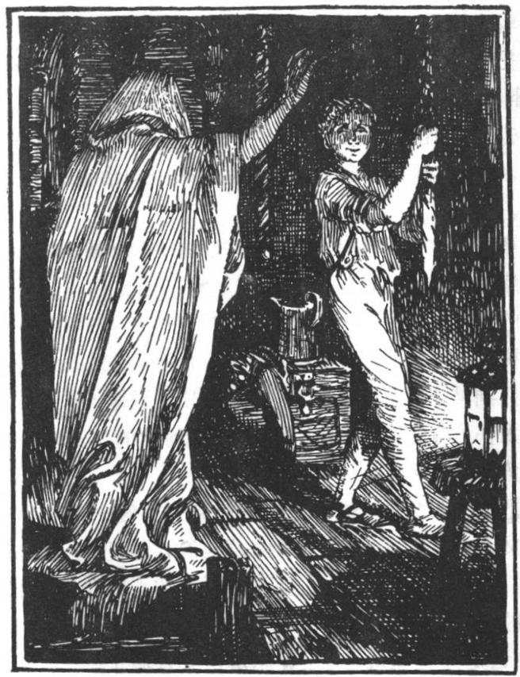

于是，司事把他带回教堂，他的职责是敲钟。几天以后的半夜里，司事把他叫醒，叫他爬到钟塔上去敲钟。

“现在，我的朋友，我要教会你如何发抖。”司事想。他偷偷地走在前头。等年轻人爬上钟塔，伸出手去抓住敲钟的绳子时，看到钟塔出口对面有个白色的影子。

“谁在那里？”他喊起来。可是那个影子不作声，也没有什么动静。“快说！”年轻人又喊道，“要么就滚开，这么晚了，这里没有你的事。”可是司事还是一动也不动，他想这样一来，小家伙就会把他当成鬼神。

年轻人喊道：“你到这里来干什么？你要是个好人就说话，要不我就把你推下去！”司事想，“他只不过是说说而已。”还是不吱声，像座石雕似的。年轻人又喊了一次，还是没有结果。他向幽灵冲过去，把他击倒，滚下楼去。司事滚下十级楼梯，躺在角落里不动了。年轻人接着把钟敲响，然后回来一句话也不说就睡他的觉去了。

司事的妻子等了好久不见丈夫回来，开始着急起来。她把年轻人叫醒，问：“你知道我丈夫在哪里吗？他比你先走一步，到钟塔上去的。”“不知道，”年轻人回答，“不过，有人站在钟塔门口对面的楼梯上，他不回答我的话，也不肯走开，我想肯定是个坏人，就把他打到楼下去了。你最好去看一看是不是他。要真的是他，那我就太伤心了。”妻子赶快跑过去，看到她的丈夫腿也摔断了，正躺在角落里呻吟。

她把丈夫带回来，然后急匆匆地赶到年轻人的家里，大声责骂他的父亲。“你儿子真是个祸根，”她说，“他把我丈夫从楼上扔下来，腿也摔断了。立刻把这个不干好事的恶棍带回去！”父亲吓坏了，赶紧去把他找来，把他骂了一顿。

“你这是开什么玩笑，我看你是走火入魔了。”

“父亲，”他回答，“请听我说，我一点也没有错，半夜三更的，他站在那里，像个坏人。我也不知道他是谁，警告了他三次，叫他要么回答，要么就走开。”

“够了！”父亲咆哮起来，“你这个扫帚星，我再也不愿意见到你了。从此以后，我再也不管你了。”“是的，父亲，我很乐意，不过我要等天亮以后再走。我要出去学会发抖，这样我就有了一样本事，可以养活自己了。”“你爱学什么就什么吧！”父亲说，“这不干我的事，这里有五十块钱给你，带着它去闯荡世界去吧！不过不要对别人说你是从哪里来的，父亲是谁，我有你这样的儿子真是感到羞愧。”“是的，父亲，不论你说什么我都答应，要是你只有这些要求，我很容易记在心上。”

天亮了，年轻人把五十块钱放进口袋，沿着大路走去，一路上还不停地嘀咕着：“我要学会发抖！我要学会发抖！”这时候，有个人从他身边走过，听到他在嘀咕着什么。他们又走了一段路以后，看到一副绞刑架。那人对他说：“看！那边有一棵树，上面吊着七个人，他们正想学着飞起来。坐到那棵树的下面去，一直等到天黑，那时候，你肯定很快就能学会发抖。”年轻人回答说：“要做的就这些，那太容易了。我要是这么快就学会发抖，我这五十块钱就给你，明天一早你就来找我。”

接着，年轻人来到那棵当绞刑架的树下坐下，等着天黑。因为觉得有点冷，就生起篝火来。到了半夜，天那么凉，生火也没有用，他一点也不觉得暖和。风一阵阵吹过来，吊在树上的尸体相互碰撞，晃来晃去。他想：“要是我坐在火堆旁边也冻僵了，这些可怜的家伙吊在上面肯定冷得浑身哆嗦！”

因为他有一副好心肠，所以就搬来一副梯子，爬上去把七具尸体一一解下。他把火烧得更加旺盛，把尸体围着篝火放着，好让他们暖和。他们躺在那里一动也不动，火烧着了他们的衣服。年轻人说：“小心！否则我就再把你们吊起来！”那些死人当然听不见，任凭他们的破衣服继续烧着。这下他真的生气了，说：“要是你们不能照顾自己，我也帮不了你们，我没有把你们烧掉的意思。”说着，又把他们挨个地吊起来。然后在火堆旁坐下，不久就睡着了。

第二天一早，那个人来找他，想拿走他的五十块钱。那人对他说：“现在，你该知道发抖是什么意思了吧！”“没有，”他回答，“我怎么知道呢？吊在那里的家伙从不开口，他们那么笨，让自己身上穿的那么一点旧衣服给烧掉。”那人看到自己拿不到他的五十块钱，就转身走了，还说：“哎！我还算走运，从前没有碰到过这样的人。”

年轻人也继续走他的路，边走边嘀咕着：“啊！我要学会发抖！我要学会发抖！”这时，走在他后面的一个送货人听到他的话，就问他：“你是谁？”年轻人回答：“我不知道！”“你是从哪里掉下来的？”“我不知道。”“你的父亲是谁？”“我不能说。”“你嘴里不停地在嘀咕些什么？”“啊！”年轻人说：“我宁愿付出一切去学会发抖，可是没有人能教我。”“胡说八道，”送货人说，“跟我来，这个问题我很快就可以解决。”

年轻人跟着送货人。晚上，他们来到一家客栈，准备在那里过夜。一走进门口，他就大声地说：“啊！我要学会发抖！我要学会发抖！”店主听到了笑起来，说：“要是你为这个唉声叹气！这里有的可都是机会。”店主的妻子说：“嗨！闭上你的嘴！许多人已经为了满足他们的好奇心送了命，要是这双漂亮的眼睛再也不能看到灿烂的阳光，那该有多可惜啊！”可是年轻人说：“不管有多难，我一定要学会它，我已经下了决心。”

他缠住店主不放，店主后来只好对他说：附近有个神出鬼没的城堡，只要在那里守上三个晚上，就很容易学会发抖。国王已经许诺，谁要是敢这么做，就把公主嫁给他，公主可是天底下最美丽的姑娘。城堡里还藏着许多财宝，由那些坏幽灵鬼怪守护着。要是把这些幽灵鬼怪赶走，这些财宝让穷人变富可是绰绰有余。许多人都到那里去尝试过，可是还没有一个人能活着走出来。

于是，年轻人到国王那里去对他说：“要是你同意，我很乐意到城堡里去守上三夜。”国王朝他看了一看，因为喜欢他，所以就对他说：“你可以要求三样没有生命的东西，并且把它们一起带到城堡里去。”年轻人回答说：“好的！我要一把火，一台镟床和一张带刀的切肉板凳。”

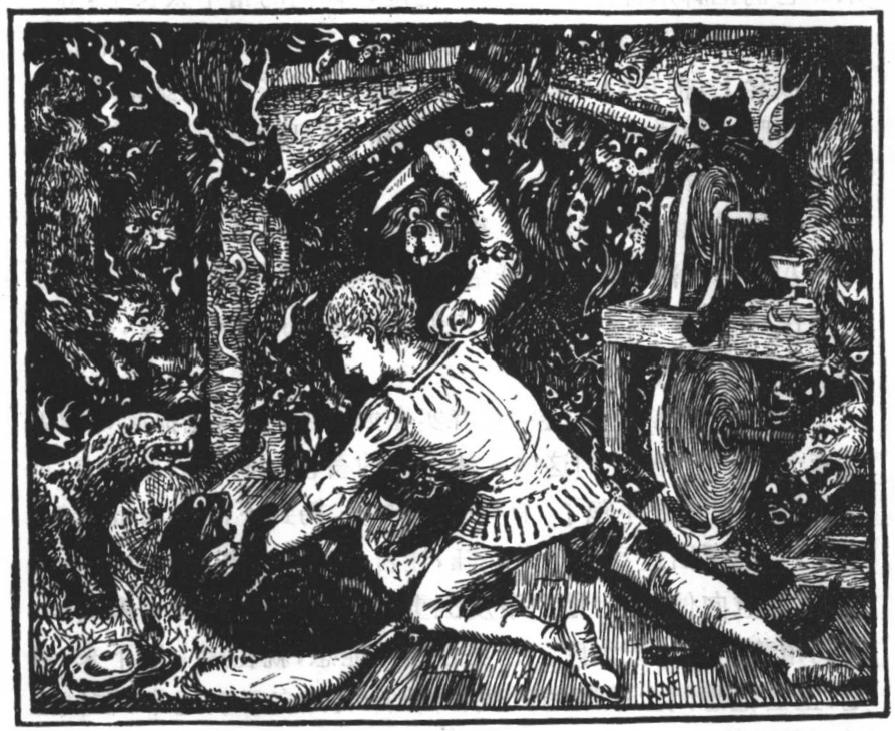

第二天，国王命令把这些东西送到城堡里去。到了晚上，年轻人来到他守夜的地方，在房间中央点起一把明亮的火，把切肉板凳和刀一起放在旁边，自己坐到镟床上去。

“啊！我要学会发抖！”他说，“可惜我在这里也学不会。”到了半夜，他走过去想把火弄得旺一些，就在朝火焰吹气的时候，他听到角落里传来尖叫声，“呜！喵！我们好冷啊！”“你们这些笨蛋！”年轻人喊道，“叫什么！要是觉得冷，就过来坐在火旁边，暖和暖和你们自己。”他话刚说完，就有两只巨大的黑猫凶猛地跳出来，两只猫分别坐在他两边，用恶狠狠的眼睛肆无忌惮地盯着他看。过了一会，等它们觉得暖和以后，就说：“朋友，我们来玩一会牌好吗？”“为什么不？”他回答，“不过，先让我看看你们的脚爪。”它们把脚爪伸出来。“唉！”他说，“你们的指甲太长了，等一会，我得先把它们切掉。”说着，他抓住它们的颈背，把它们拎到切肉板凳上，把它们的脚爪毫不客气地拧下来。“仔细地看看你们的嘴脸，”他说，“我再也没有胃口和你们玩牌了。”他把两只猫打死，扔到水沟里去。

可是当他结果了这两只猫，准备到火边再坐下来的时候，从四面八方的角落里冲出成群结队的黑猫和黑狗来。它们把他团团围住，叫他根本无法逃脱。它们鬼哭狼嚎般地叫喊着，扑到火堆上去，想把火扒开，扑灭。

他不动声色地看一会，看看实在太不像话了，就抓起切肉刀大喊一声：“滚开！你们这些无法无天的畜生！”向它们冲过去。那些猫和狗有些被吓跑了，有些被他砍死，扔到下面的水坑里去。这以后，他再回过身来把火吹旺，让自己暖和一些。等他坐下来以后，睡意向他袭来，他的眼皮沉重地要闭起来。他看了看周围，看到角落里有一张大床。“这正合适，”他想，就在床上躺下来。可是，正当他想闭上眼睛的时候，那张床突然自己动起来，在城堡里到处乱跑。

“好极了，”他说，“只是快了一点。”紧接着，床跑的速度更加快起来，好像有六匹马在拖着它。它飞过门槛，飞上楼梯，一会儿升高，一会儿降低。突然“轰！”的一声巨响，床好像撞上什么似的，整个地翻过身来，像座山似的把他压在下面。不过，这也难不倒他。他把枕头和毯子扔出来，自己再从床底下爬出来，说：“现在，谁要是喜欢，就乘着它去兜风吧！”他在火堆旁躺下，一直睡到天亮。

国王一早就来了，看到他躺在地下，以为他对付不了那么多幽灵鬼怪，被折磨死了。国王说：“真可惜！多么好的一个小伙子啊！”年轻人听到国王说的话，跳起来说：“还没有到这种地步。”国王非常吃惊，但是也很高兴，问他看到了些什么？他说：“妙极了！我已经过了第一个夜晚，我还要过接下来的两个夜晚。”店主看到他回来，眼睛睁得很大，说：“天哪！我从来没有想过你会活着回来！怎么样？学会发抖了吗？”“没有，”他回答说，“一点指望都没有，要是有人教我就好了。”

第二天晚上，他又来到老城堡里，在火堆旁坐下，开始老调重弹：“我要学会发抖！”快到半夜的时候，突然传来喧闹声，开始很轻，后来越来越响，接着又停了一分钟。然后伴随一声响亮的尖叫，半个人从烟囱上掉下来，落在他的前面。“喂！上面！”他喊起来，“这还不够，还有一半在上面，也要掉下来。”这时候，吵闹声又响起来，接着随着尖叫声和喊叫声，另外一半也掉了下来。

“等一下，”年轻人说，“让我为你把火拨旺些。”等他拨好火，再抬起头来看时，那两半人已经合成一个，面目狰狞地坐在他的位置上。“来！来！”年轻人说，“这个我可不做交易，这座位是我的。”那人想把他推开，可年轻人不答应，用力把他推开，自己又坐上去。这时，又有人从上面掉下来，一个接着一个。他们拿起九根死人的腿骨和两个头骨，玩起九柱戏来。年轻人想这倒是很好玩的，就说：“喂！我也一起来玩好吗？”“不行！你有没有钱？”“我有的是钱。”他说，“不过，你们的球不太圆。”说着，他拿起头骨，放在镟床上加工，直到把它们弄圆。“现在，它们滚起来就好多了，”他说，“来吧！这样玩起来就有劲了。”他和他们一起玩了一会，输掉了一些钱。可是当时钟敲响十二下的时候，这些人都消失得无影无踪。他躺下来安静地睡着了。

第二天国王来了，急于要知道他的情况，说：“这天晚上你是怎么过的？”“我和他们玩九柱戏，”他说，“输掉了几个便士。”“你发抖了吗？”“没有这个运气，”他说，“我自取其乐，唉！要是我知道发抖是怎么回事就好了！”

第三个晚上，他又坐在板凳上，非常失望地说：“我要学会发抖！”夜深以后，六个身材高大的人抬着一副棺材走进来。他看到了喊起来：“喂！喂！那很像是我几天前死去的小表弟的棺材。”接着又指手划脚地说：“过来！我的小表弟，过来。”那些人把棺材放在地上，他走过去把棺材盖掀开，里面有个死人。他摸摸死人的脸，觉得像冰一样冷。“等一下，”他说，“我要让你暖和一些。”他来到火堆旁，把自己的手烘热，再去捂死人的脸，可死人还是冰冷冰冷。他又把死人抱起来，到火堆旁坐下，把尸体放在膝盖上，用手去擦他的双臂，好让他的血液流动起来，可是这也没有什么用。他又想起，要是两个人一起躺在床上，可以相互暖和身体。于是他把尸体搬到床上，盖上被子，在他身边躺下。过了一会，尸体开始暖和起来，而且开始动了。年轻人对他说：“我的小兄弟，要是我不让你暖和过来，现在会怎么样了？”可是死人站起来喊叫：“现在，我要勒死你！”“什么？”年轻人说，“这就是你对我的全部报答？你活该再回到棺材里去！”年轻人把他举起来，扔到棺材里去，把盖子盖上。那六个人走进来，把棺材抬走。

“我还是不会发抖！”他说，“事情明摆着，在这里我一辈子也学不会。”

不久，又有一个人走进来，个子比普通人高大，面目狰狞。这人上了年纪，长着很长的白胡子。

“啊！你这可怜的家伙，你很快就会知道什么是发抖了！你已经死到临头！”那人喊道。

“还没有这么快吧！”年轻人说，“想叫我死，你得先把我抓住。”

“我很快就会抓住你。”那老怪物说。

“斯文一点，斯文一点，牛皮别吹得那么大；我的力气和你一样大，甚至比你更大。”

“很快就有分晓，”老怪物说，“要是你力气比我大，我就放你走，让我们来较量一下。”说完，他拉着年轻人穿过黑暗的走廊，来到一个打铁铺。他拿起一把斧子，一下子就把一个铁砧敲进地里。

“这有什么，我干得比你还要出色。”年轻人说着，走到另一个铁砧前。老头子把头凑过来，想看得更清楚些，白胡子从他头上垂下。年轻人抓起一把斧头，把铁砧劈开，正好把老头的白胡子夹在里面。

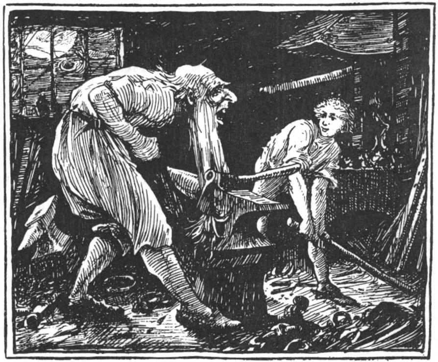

“这一回我逮住你了。”年轻人说，“该死的是你了。”他捡起一根铁棒，朝老头子打过去，直打得他哭哭啼啼地求饶，说只要年轻人住手，就答应给他一大笔财富。

年轻人抽出斧头，放了老头子。老头把他领回城堡，来到一个地窖里，把三箱子黄金指给他看，说：“这三箱子黄金，有一箱是给穷人的，有一箱是给国王的，还有一箱是给你的。”这时候，时钟敲响了十二下，这个精灵不见了，黑暗中只留下年轻人。

“我肯定可以找到出去的路。”他说。在黑暗中摸索了一会，他终于回到原来的房间，在火堆旁睡着了。

第二天，国王走进来对他说：“好了！现在你肯定学会发抖了吧！”“没有，”他回答，“发抖会是什么样子呢？我死去的表弟来过；一个长着白胡子的老头来过，他把下面几大堆钱指给我看。可是发抖是什么样子，没有人告诉过我。”

这时国王说：“你把这座城堡从咒语中解脱出来了，你将和我的女儿结婚。”“那真是太好了，”他说，“可我还是不知道发抖是什么？”

他们把地窖里的黄金搬上来，接着，年轻人和公主举行了婚礼。年轻人和公主结婚以后，当上了小国王。可是，尽管他很爱妻子，生活也过得很幸福，他还是不停地说：“我要学会发抖！我要学会发抖！”这终于使公主感到很失望。后来公主的侍女说：“我来帮你，我们会很快就叫他发抖。”她来到从花园里流过的小溪旁，捉了满满一桶小鮈鱼。晚上，等小国王睡着以后，公主把他身上的衣服脱掉，把满满的一桶鮈鱼向他倒下去，小鮈鱼在他的身上游动起来。他从梦中惊醒，喊道：“啊！我抖得多厉害！我抖得多厉害！是的，亲爱的妻子，现在我知道什么是发抖了！”

（格林兄弟）

 

## 伦佩尔史蒂尔茨金

从前有个穷苦的磨坊主，他有个非常美丽的女儿。有一天，他有机会见到国王。为了表明自己与众不同，就对国王说，他有个女儿，可以把麦杆纺成黄金。“那倒是一种了不起的本事，”国王说，“要是你女儿像你说的那么聪明，明天把她带到我的王宫里来，我要试试她。”

姑娘被带到国王的面前。国王把她领进一间堆满麦杆的房间，给她纺车和纺锤，说：“现在就开始，你要通宵达旦地纺到天亮。到时候要是还没有把这些麦杆纺成黄金，就杀你的头。”说完，他把门关上就走了，把姑娘一个人孤零零地关在里面。

可怜的磨坊主的女儿坐下来，不知道该怎么办才好。她压根儿不知道该如何把麦杆纺成黄金。她越想越伤心，后来终于放声大哭起来。这时，门突然打开，一个非常矮小的小矮人走进来说：“晚上好！磨坊姑娘，你干吗哭得那么伤心？”“啊！”姑娘说，“我必须把这些麦杆纺成黄金，可是一点也不知道该怎么做。”“要是我帮你纺好了，你给我什么？”小矮人问。“我的项链。”姑娘回答。

小矮人接过项链，在纺车前坐定。纺车呼呼地转了三下，纺筒上绕满了黄金；他换上另一个纺筒，纺车又呼呼地转了三下，这个纺筒也绕满了。就这样，他一直干到天亮，所有的麦杆都纺完了，所有的纺筒上也绕满了黄金。

太阳刚从东方升起，国王就走了进来，看到满地黄金，又惊又喜。可是他的心并没有得到满足，反而变得更加贪婪。他把磨坊主的女儿关进另一个房间，里面的麦杆堆比上次的还要大。他对姑娘说，要是珍惜自己的生命，就要在天亮之前把它们全部纺成黄金。姑娘不知道该怎么办才好，又开始哭起来。像上一次一样，这时门又打开了，小矮人出现在她面前，对她说：“要是我把这些麦杆帮你纺成黄金，你给我什么？”“我把手上的戒指给你。”姑娘回答。小矮人把戒指拿过来，又呼呼地纺起来。拂晓，所有的麦杆都变成了黄金。

国王走进来，看到这么多黄金，高兴得无法形容。可是，他对黄金的渴望并没有因此而满足，他把姑娘带到另一个更大的房间，里面的麦杆堆得满满的，对她说：“今天晚上，你得把这些麦杆全部纺完。不过，这一次如果成功了，你就可以嫁给我，做我的妻子。”国王心里想：“不错，她只是一个磨坊主的女儿，可是找遍全世界，也找不到一个比她更富有的妻子。”

国王走了以后，小矮人第三次出现在姑娘面前，说：“要是我再次帮你把这些麦杆纺成黄金，你给我什么？”“我再也没有什么给你了。”姑娘说。“那么，答应我，你当了王后以后，生下来的第一个孩子给我。”“谁知道在这以前会发生什么事情？”姑娘想。再说，除此以外，再也没有什么别的办法可想。于是，她答应了小矮人的要求。小矮人坐下来开始摇动纺车，把麦杆全部纺成黄金。天亮了，国王走进来，看到自己的愿望实现了，就宣布娶她为妻，磨坊主的女儿变成了王后。

第二年，王后生了一个漂亮的小男孩，她再也没有想起小矮人。直到有一天，他突然走进王后的房间，对她说：“现在，把你答应过的给我。”王后大为震惊，说愿意把她国库里的全部财富都给他，只要他答应别把她的孩子带走。可是小矮人说：“不！一个有生命的小家伙对我来说，比全世界的所有财宝更亲切。”王后开始大哭起来，她抽泣得那么可怜，小矮人也不免动了恻隐之心，他说：“好吧！我给你三天时间，让你猜我的名字，要是猜得出来，你可以把自己的孩子留下。”

王后整夜地想着那些她曾听到过的名字，还派人到全国各地去，不论远近，凡是能听到的名字都收集起来。小矮人来了以后，她开始报所有听到过的和打听到的名字，什么卡斯波、麦乔尔、贝沙扎，一大串。可惜每报出一个名字，小矮人都喊叫：“那不是我的名字！”

第二天，她又派人出去收集名字，又得到了许多千奇百怪的名字。小矮人来了以后，王后说：“你的名字也许叫夏普斯夏克斯？克鲁克斯夏克斯？斯宾特夏克斯？……”可是小矮人总是摇头说：“那不是我的名字！”

到了第三天，派出去的人回来说：“我再也找不到一个新的名字了。可是当我登上森林那边的一座高山时，看到经常有兔子和狐狸出没的地方有一间小屋子，屋子前生着一堆篝火。一个非常古怪的小矮人单脚围着篝火跳来跳去，还不停地喊叫着：

> ‘明天酿酒，今天烤饼，
> 然后去把孩子领；
> 王后哪里想得到，
> 伦佩尔史蒂尔茨金是我名！’”

你可以想象，王后听到这个名字有多么高兴！不久，小矮人走进来问：“请吧！我的王后女士，我叫什么名字？”于是她先问：“你是不是叫康拉德？”“不是！”“是不是叫哈利？”“不是！”“也许，你的名字叫伦佩尔史蒂尔茨金吧！”“是哪个恶魔告诉你了！是恶魔告诉你了！”小矮人尖叫起来。愤怒之下，他的右脚踩进地下，一直陷到腰部。接着，他大发雷霆，用双手抓住自己的左脚，把自己撕成两半。

（格林兄弟）

 

## 美女和野兽

从前，在一个非常遥远的国家住着一个商人，他所做的生意都那么走运，所以变得非常富有。不过，他有六个儿子和六个女儿，他发现，要想让他们过着习以为常，要什么就有什么的日子，手中的钱并不是太多了。

可是有一天，谁也预料不到的灾难降临到他的头上。他们的房子着了火，大火把房子，连同里面豪华的家具、书籍、画、黄金、白银等所有贵重的东西，一下子都烧成灰烬。而且，这仅仅是他们不幸的开始。至今为止一切事业都称心如意，一帆风顺的父亲突然损失了在海上的全部船只。这些船不是遭到海盗的打劫，就是遇难或着火。接着，他又得到了远方国家那些他完全信赖的职员背叛他的消息。于是，他终于从一个百万富翁变得一贫如洗。

他所剩下的全部财产，只是离现在居住的城市几百公里以外，处境非常偏僻的一间小屋。现在，他不得不带着孩子们到那里去生活。想到要过一种和以前迥然不同的日子，孩子们深感失望。实际上，女孩子们开始还指望，以前那些众多的朋友看到她们无家可归，会让她们留下来一起住。可是她们很快就发现，没有人再理睬她们。以前的这些朋友甚至把她们的不幸归结于她们自己的奢侈，没有丝毫要帮助她们的意思。她们没有别的出路，只好搬到阴森森的森林深处的小屋里去居住，那里恐怕是地球上最凄凉的地方了。

因为穷得没钱请佣人，姑娘们得像农家妇女一样日夜操劳。

至于那些男孩子，就得下地干活，养家活口。他们穿的是粗布衣服，吃的是粗茶淡饭，过起了最简朴的生活。姑娘们每时每刻都在痛苦地怀念着过去那样奢侈和欢乐的日子。只有最小的姑娘努力地激励自己勇敢一些，快乐一些。当不幸开始降落到父亲的头上时，她也像其他人一样伤心，但不久就恢复了她那快活的天性。她想尽办法把事情弄得好一些，尽可能地把父亲和兄弟们逗乐，尽力地劝姐姐们和她一样唱歌跳舞。可是她们不愿意。而且，由于她不像姐姐们那样愁眉苦脸，她们就说她只配过这种悲惨的生活。实际上，她远比姐姐们聪明和漂亮得多了！她长得那么可爱，人们总是叫她贝蒂（美女的意思——译注）。

两年以后，大家都开始习惯于过这种新的生活。这时，有些事情发生了，又扰乱了他们的平静。父亲得到消息说，他以为已经沉没的一条船，满载着贵重的货物安全地驶进了港口。孩子们立刻认为，他们的贫困日子结束了，都想马上就回到城里去。可是他们父亲显得更谨慎一些，请他们耐心地等待一下。这时虽然已经是收割的季节，家里实在走不开，可他还是决定自己先去看一看，打听一些消息。只有最小的女儿有点怀疑，他们会很快地和从前一样富有，或者有足够的钱在城里过舒服的生活，像过去一样有快乐的伙伴和寻欢作乐。姐姐们缠着父亲，要买钻石和衣服，而这些东西恐怕要发一大笔横财才买得起。只有贝蒂觉得提出这些要求没有用，所以什么也没有说。父亲注意到她一言不发，就问她：“我该给你带什么回来呢？贝蒂！”

“我唯一的希望就是看到你平安地回来。”她回答。

这些话激怒了她的姐姐们。她们以为这是在责备她们要父亲买那些值钱的东西。可是她的父亲听了以后却很高兴，想到她这种年纪肯定喜欢漂亮的礼物，还是叫她挑选一些。

“那好吧！亲爱的父亲，”她说，“既然你坚持要给我买礼物，我就请你给我带一朵玫瑰花回来。来到这里以后，我还没有见过玫瑰花，我那么喜欢它。”

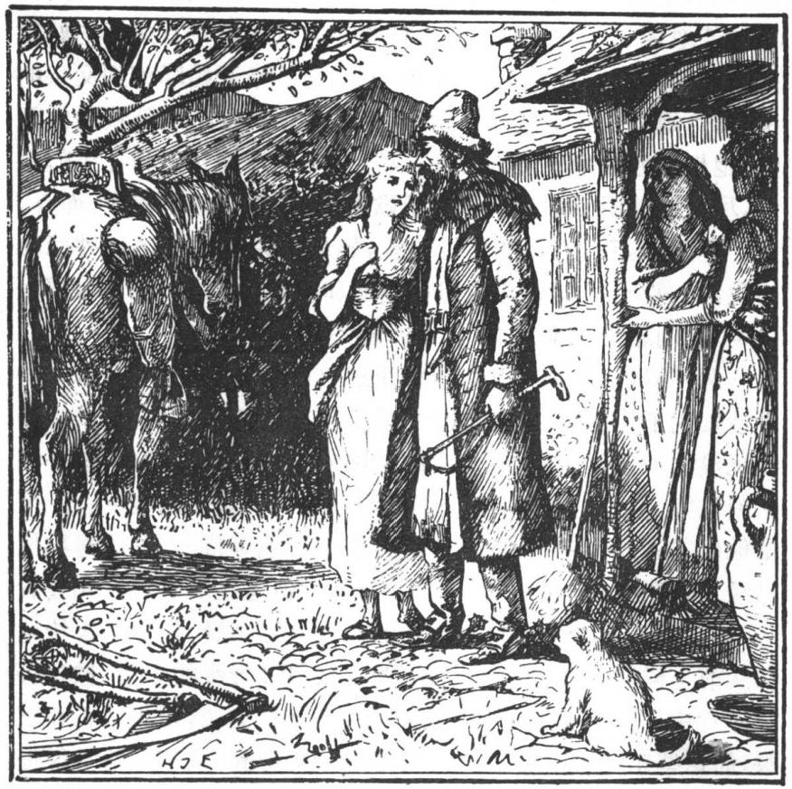

于是，商人动身了，他尽快地赶回城里。可他只是发现，以前的那些伙伴相信他已经死了，把船上带回来的货物全都分光了。经历了六个月的曲折、奔波和花费以后，他发现自己又是穷途潦倒，剩下的钱只够支付路费。更糟糕的是，他不得不在天气最恶劣的时候离开这个城市。等到离家还有几里地的时候，他又冷又饿，几乎再也支持不住了。虽然他知道，穿过森林还得花几个钟头，可是他归心似箭，急于要赶回家，就不顾一切地走下去。然而，黑夜笼罩着大地，深深的积雪和刺骨的严寒使他的马寸步难行。周围看不见一幢房子。唯一可以遮身避风的地方是一棵大树的树洞。他整夜蜷缩在里面，这是他有生以来度过的最漫长的一个夜晚。尽管他精疲力尽，四周传来狼的嚎叫声叫他难以合眼。后来天终于亮了，可情况也好不了多少。大雪把所有的路都埋没了，他不知道该往哪里走。

后来，他认出一条路的痕迹，就跟着走过去。开始路面崎岖不平，而且很滑，他也不知道摔了多少次。后来变得好走了一些，不久就走上一条林荫大道，大道的尽头是一座辉煌的城堡。商人感到非常奇怪，因为大道上一点雪都没有，两旁长满了橘子树，覆盖着鲜花和水果。

他来城堡的第一个院子前，前面是用玛瑙铺就的台阶。沿着台阶走上去，他经过几间装饰得很富丽的房间。迎面吹来的暖风令人心旷神怡，这时他感觉到饥肠辘辘。可是，在这华丽而宽敞的宫殿里空无一人，向谁要吃的东西呢？死一般的寂静笼罩着整个空间。逛了那么多空房间和走廊以后，他也觉得累了。他走进一间稍为小一些的房间，里面炉火明亮，火的旁边放着一张舒适的睡椅。他想，这张睡椅肯定是为某个人准备的，就坐下来等。可是没有多久，他就舒服地睡着了。

几个钟头以后，强烈的饥饿感把他唤醒，周围还是一个人也没有。但这时在他的身边却已摆上一张小桌子，上面放着丰盛的午餐。他已经整整一天一夜没有吃东西了，就毫不迟疑地吃起来，边吃边想希望有机会感谢这位热情地款待他的人，不管这个人是谁。可是，饭吃完了，还是没有人来。他又睡了很久，直到体力完全恢复，醒过来还是不见一个人影，身边的小桌子上却又摆上了新鲜的饭菜，上面有美味的糕点和水果。商人生来胆小怕事，这寂静世界叫他有些害怕。他决定去搜查一下所有的房间，可还是毫无结果，连一个佣人也看不到，宫殿里竟然一点有生命的迹象都没有！他开始感到不知道该怎么办才好。为了自娱自乐，他想象所有这些看到的财富都属于他的，并且考虑如何把它们分给自己的孩子。接着，他走进一个花园，虽然外面是寒冷的冬天，这里却是阳光明媚，鸟儿歌唱，鲜花盛开，空气中充满了温柔和甜蜜。这些所见所闻的景象把商人弄得神魂颠倒，他自言自语地说：

“所有这一切都是为我而准备的，我马上就回去把孩子们带来，让他们来分享这里的欢乐。”

他走进城堡的时候，尽管又冷又累，但没有忘记把马拴入马厩，让它吃些饲料。现在，他想该是骑着它回家的时候了。他沿着进来的路走回去。路的两边都种着一排排玫瑰。商人想，他从来没有见到过这么美的花朵，闻过这么芬芳的花香。这使他想起了对贝蒂的许诺。他停下来，刚摘下一朵想给她带回来，背后突然传来一种奇怪的声音，使他大吃一惊。他回过头来，看到一头非常可怕的野兽，那样子好像非常生气，它用一种令人恐惧的声音说：

“谁告诉你可以随便摘我的玫瑰花？我让你走进我的宫殿，对你那么友好，这还不够吗？你偷我的花，这就是对我的报答吗？你这种无礼的行为一定要受到惩罚！”这些愤怒的话把商人吓坏了，那朵致命的玫瑰从他手中落下。他双膝跪下说：“请原谅我，高贵的先生，我真心实意地感谢你的款待。这些款待那么慷慨大方，因此，我没有想到，拿一样像一朵玫瑰花这么小的东西会惹你生气。”可是这些话并不能平息野兽的愤怒。

“你很会辩解和奉承别人，”它说，“但你死有应得，这也不能救你一命。”

“啊！”商人思忖着，“我的女儿贝蒂怎么会想到，她要的玫瑰给我带来了什么危险！”

绝望之下，他开始把自己的不幸对野兽说了，还告诉它这次旅行的目的，当然没有忘记说起贝蒂的请求。

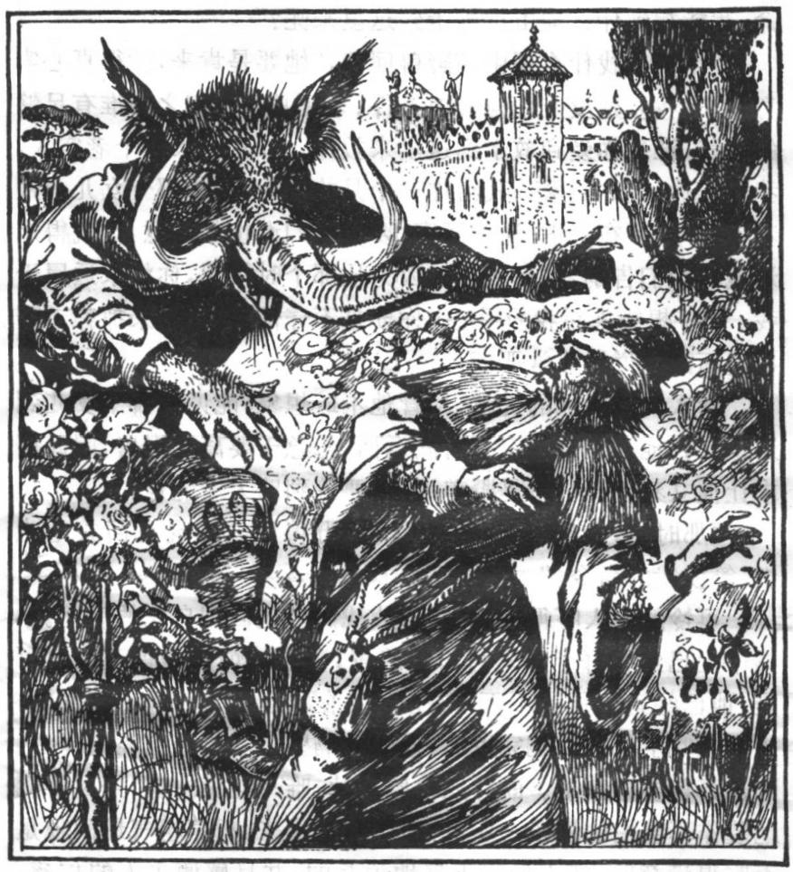

“即使是国王也无法满足我其他女儿的欲望。”他说，“可是，我想，我起码可以给贝蒂带回一朵玫瑰。请宽恕我吧！你看，我没有丝毫想损害你的意思。”

野兽想了一会，用比较温和一些的口气说：“我可以原谅你，不过有个条件，你要把一个女儿给我。”

“天哪！”商人喊道，“即使我残酷到用孩子的生命来救我一命，我能找到什么理由把她带到这里来呢？”

“用不着找什么理由。”野兽回答，“她要是肯来，就得真心实意地来，我要她没有任何其他条件。看看吧！她们之中谁有足够的勇气，谁爱你爱到敢于到这里来救你。你看起来是个老实人，我相信你，让你回家。我给你一个月的时间，看你哪个女儿会跟着你回来，留在这里，让你回家。要是她们谁也不愿意，你就得永远地和她们告别，独自回来。因为从那个时候起，你将永远属于我。别梦想能逃脱我的手心。你要是不守信用，我就来抓你。”野兽后面的话说得非常严厉。

商人同意了他的提议，尽管他不敢想象，能说服哪个女儿到这里来。他答应在指定的时间返回，他急于要离开野兽，因此请求让他立刻动身。可是野兽说，他要等到明天才能走。

“那时候，会给你备好一匹马，”野兽说，“你现在回去吃晚饭，等候我的命令。”

可怜的商人吓得魂不附体，战战兢兢地回到自己的房间。小桌子上已经摆好了非常可口的晚餐，旁边的炉火烧得正旺。可是，他已经害怕得吃不下，只是因为怕野兽说他不听话而发怒，才勉强吃了几口。吃完以后，他听到隔壁房间传来响亮的声音，知道野兽要过来了。既然躲也躲不掉，唯一能做的事，是尽可能地装作不害怕的样子。所以，当野兽走进来，粗声粗气地问他是否吃得满意时，商人低声下气地说是的，并且感谢主人的仁慈。然而，野兽提醒他记住他们说好的条件，以及完全按照他的愿望做好准备。

“明天，在太阳升起和铃响之前不要起床，”它补充说，“那时你会看见，早饭已经在这里给你准备好了，马也给你在院子里备好了。一个月以后，也是这匹马把你和你的女儿带回来。再见！给贝蒂带上一朵玫瑰花，要记住你的承诺！”

野兽走了，商人这才高兴起来。尽管如此，他一整夜还是忧心忡忡，难以入眠。他躺在床上，等待着太阳从东方升起。匆匆地吃过早饭以后，他给贝蒂摘了一朵玫瑰花就跨上马背。那匹马带着他跑得很快，一转眼宫殿就不见了。他还在闷闷不乐地想着心事时，马已经在他家的小屋前停下。

孩子们蜂拥而出欢迎。他去了那么久，他们都已经感到惶恐不安，这时都急于想知道结果。看到父亲骑着一匹那么英俊的马，披着一件那么贵重的斗篷，都猜想一定有好消息。可是他开始什么也不对他们说，只是在把玫瑰花交给贝蒂的时候满脸忧愁地说了一句：

“这是你叫我给你带来的玫瑰花，你不知道为了它需要付出多少代价。”

这句话引起了他们强烈的好奇心。等他把事情从头到尾说了一遍以后，他们都很不开心。姑娘们大声地抱怨希望成了泡影；儿子们说，父亲不能够再回到那可怕的城堡里去。他们开始出谋划策，准备一旦野兽来抓他们的父亲，就把它杀掉。可是父亲提醒他们，他已经答应过要回去。姑娘们很生贝蒂的气，说这些都是她的过错，当初要是要一些有用的东西，这种事也就不会发生了。她们愤恨地埋怨贝蒂，说是由于她的愚蠢，大家都跟着受罪。

可怜的贝蒂心中非常烦恼，对他们说：

“这种不幸是由于我造成的，可是我向你们保证，我完全是无意的。谁会想到，在仲夏时节要一朵玫瑰花，会造成这种悲剧？既然不幸是我造成的，那就由我一个人来承担，因此，我和父亲一起回去，以实现他的承诺。”

开始，谁也不听她的这些话。父亲和兄弟们那么爱她，宣布说怎么也不会让她去。可是贝蒂的态度非常坚决。随着时间的一天天接近，她把自己仅有的一些东西都分给了姐姐，和自己所熟悉和热爱的一切道别。不幸的一天来到了，她不停地鼓励父亲，好让他高兴一些。他们一起骑上那匹他带回来的马。马带着他们简直是像飞一样地奔跑，可是那么平稳，贝蒂一点也不害怕。要不是担心旅行结束以后会发生什么事情，她真的是非常喜欢这样的旅行。父亲仍然不停地劝她回家，可是没有用。

父女说话之间，夜幕已经降落。突然间，他们十分惊讶地看到，神奇的光彩从四面八方射出，绚丽的焰火在他们的面前燃烧着，整片森林被照亮。尽管刚才还是严寒的冬天，这时却令人感到暖意融融。在这种五光十色之中，他们踏上了那条橘子树覆盖着的林荫大道，两旁有许多高举火炬的雕像站立着。走近宫殿，他们看到里面从天花板到地面，都被照亮得金碧辉煌，院子里传来温柔美妙的音乐。

“要是它这样快活地迎接猎物的到来，这野兽一定是很饿了。”贝蒂说着，尽量地想装出笑容。不过尽管她提心吊胆，还是情不自禁地欣赏着眼前的这些奇妙景象。

马在登上平台的台阶前停下，他们下了马。父亲把她领进自己住过的小房间。他们看到，炉火烧得正旺，桌子上十分考究地摆着丰盛的晚餐。

商人知道，这是专为他们准备的。至于贝蒂呢？她穿过那么多房间，丝毫也没有看见野兽的影子，所以也就不那么害怕了。长途跋涉又使她感到饿极了，她也就十分乐意地想吃起来。可是，他们饭还没有吃完，就听到野兽走过来的脚步声。贝蒂害怕地缩进父亲的怀里，看到父亲也被吓坏了，她更是毛骨悚然。可是当野兽真的出现了，尽管看到它时贝蒂浑身颤抖，她还是尽力克制住自己的恐惧，有礼貌地向它致意。

很明显，这使野兽感到高兴。它看了她一眼，尽管那样子看不出像发怒，然而说话的声音却让最勇敢的人听了也会感到害怕。它说：“晚上好！老人！晚上好！贝蒂！”

商人恐惧得说不出话来，可贝蒂用甜美的声音回答：

“晚上好！野兽！”

“你是心甘情愿地来的吗？”野兽问，“你父亲走了以后，你愿意一个人留下吗？”

贝蒂勇敢地回答说，她已经充分地作好了准备。

“你让我感到满意，”野兽说，“既然你是自愿来的，你可以留下。至于你呢！老人，”他转过身来继续对着商人说，“明天天一亮，你就可以走了。听铃响，你就快点起来吃早饭，还是那匹马等着带你回家。不过你要记住，你别想再见到我的宫殿了。”

接着，它又转过身来对贝蒂说：

“带你父亲到隔壁房间去，帮他挑选任何你认为你的兄弟姐妹喜欢的东西。那里有两个旅行箱子，你们尽可能地把它们装满。你要送给他们一些非常贵重的东西，作个永久的纪念，这也是应该的。”

野兽说了一声“贝蒂，再见！老人，再见！”就走了。想到就要和父亲分别了，贝蒂非常惊慌；但是，她不敢违抗野兽的命令。他们来到隔壁房间，房间四周堆满了柜子和架子。他们看到上面堆放的那些贵重东西，都大为惊讶。那些华丽的服装连王后也会喜欢，旁边还有许多和这些服装相配的装饰品。贝蒂把一个柜橱打开，架子上都堆满了光彩夺目的钻石，令她眼花缭乱。她给每个姐姐挑选了一大堆衣服，又给她们分好了许多钻石，然后打开最后一个柜子。里面堆满了黄金。

“父亲，我想黄金对你更有用，”她说，“我们最好还是把箱子里别的东西拿出来，全部装上黄金。”于是他们就这么干了。可是，他们装进去的黄金越多，箱子就好像显得越空。后来，他们又重新把取出来的服装和钻石放进去，贝蒂又双手捧了满满的一堆钻石加进去，箱子还是没装满，可已经重得连大象也搬不动了。

“那野兽是故意耍我们，”商人说，“它明明知道我搬不走，就故意假装送我们这些东西。”

“让我们等着瞧吧！”贝蒂说，“我不相信它在故意欺骗我们。现在，我们能做的事就是把箱子捆好，随时准备带走就是了。”

他们干好这些事情以后，就回到小房间里去。他们惊奇地发现，早饭已经准备好了。这一回，商人吃起来胃口可好了。野兽的慷慨大方使他认为，他也许用不了多久就可以回来看望贝蒂。可是，贝蒂十分清楚地感觉到，父亲将永远地和她告别了。所以当铃声第二次刺耳地响起来，提醒他们分别的时候到了时，她心如刀绞。他们来到院子里，那里已经备好了两匹马，一匹驮着两只箱子，一匹等着他来骑。这时，它们已经急不可待地刨着地面，商人不得不匆匆地和贝蒂告别。他刚跨上马背，马就扬起四蹄飞奔起来，转眼间就不见了。贝蒂开始伤心地哭起来，跌跌撞撞地回到自己的房间。她很快就感到倦极了，眼前又想不出别的办法来，于是她就躺下来，马上就睡着了。

她梦见自己在两岸长满树木的小河边散步，为自己的悲惨命运而伤心。这时，一个她从未见过如此英俊的年轻王子向她走过来，用一种震撼她心田深处的声音对她说：“啊！贝蒂！你不会像你想象中的那样不幸，你过去不论在何处所受的全部苦难，在这里都会得到补偿，你的任何愿望都会得到满足。只是不论我装扮成什么模样，你都要尽量地去发现我。我那么爱你，让我幸福，你也就找到了自己的幸福。只要你那颗真诚的心和你的外貌一样的美丽，我们就没有什么不能达到的目的。”

“王子，为了让你幸福，我能做些什么呢？”贝蒂问。

“只要有一颗善良的心，”他说，“不要过份地相信自己的眼睛，尤其重要的是，在把我从残酷的不幸中解救出来之前，不要抛弃我。”

接着，她想自己又走进了另一个房间，里面有一位美丽端庄的女士，对她说：“亲爱的贝蒂，尽可不必为失去的一切而悔恨，因为你注定要有一个更好的命运，只是注意不要让自己被外貌所欺骗。”

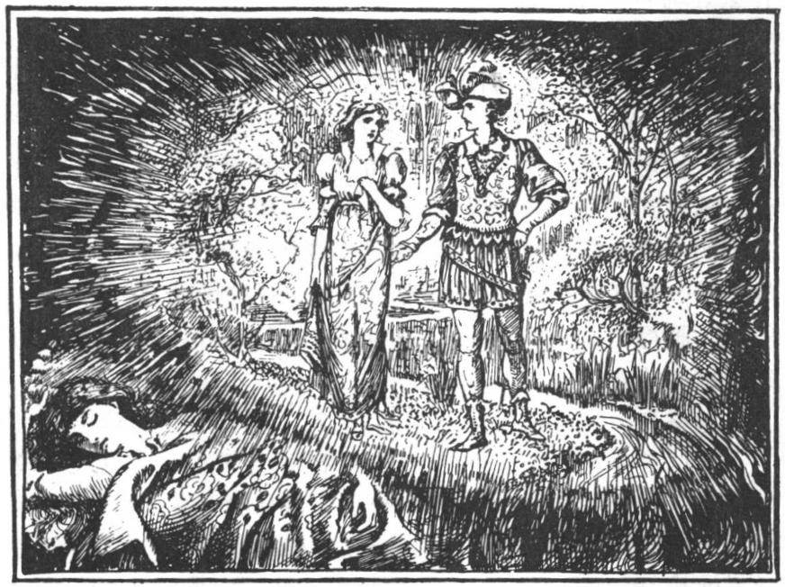

贝蒂感到自己的梦很有趣，她不想马上就醒过来，可这时时钟温柔地喊了十二次她的名字，把她唤醒。她从床上起来，看到梳妆台上已经备好一切需要的东西。梳洗完了以后，她看到，隔壁房间里，午饭已经准备好了。一个人吃午饭也用不了多少时间，没多久，她就在沙发的一角舒适地坐下来，开始回想自己在梦中见到的迷人王子。

“他说我能让他幸福。”贝蒂自言自语地说着。

“可是，看来，是那可怕的野兽把他关起来了，我怎样才能把他放出去呢？奇怪的是，他们都对我说，不要相信外表的东西？我一点也不明白这是什么意思。不过，归根到底，这只不过是场梦，我干吗要为它而自寻烦恼呢？我还是出去走一走，看一看有没有什么好玩的东西。”

于是她站起来，准备去看一看宫殿里的一些房间。

她走进的第一个房间里排满了镜子，镜子从各个角度映出她的身影。她心里想着，自己从来没有见过这么迷人的房间。一只挂在枝形吊灯上的手镯引起她的注意。她把手镯拿下来，十分惊奇地看到，上面有着她那还未认识的偶像画像，样子和她梦中见到的一模一样。她非常兴奋地把手镯戴到自己的手上。接着，她走进一条画廊，很快就看到那个英俊王子的画像，样子和真人一样。画得那么逼真，在她仔细地观看的时候，他好像也在亲切地向她微笑着。她在画像前站了很久，最后才恋恋不舍地离去。

她来到一间摆满乐器的房间，天底下所有的乐器这里都有了。她试着弹奏一些乐器，唱着一些歌曲，自我娱乐了好长一段时间，直到觉得累了为止。下一个房间像是藏书室。在这里，她找到了以前读过的所有的书，还有以前想要读的书。这里的藏书那么浩瀚，恐怕用一辈子的时间，也来不及读完那些书名。这时候，天已经开始黑了，钻石和红宝石烛台上的蜡烛开始点燃，照亮了每一个房间。

当她想吃晚饭的时候，晚饭就给她准备好了。她看不到一个人影，也听不到任何声音。虽然父亲已经警告过她，她将是孤身一人，可她这时才开始感到那么孤独。

可这时，她听到了野兽走过来的声音。她害怕得全身哆嗦地想着，野兽是不是想过来把她吃掉。不过，它看上去一点也不像穷凶极恶的样子，只是粗声粗气地对她说：“晚上好！贝蒂。”

她尽量地掩饰自己的恐惧，装出快活的样子来回答它，野兽问她为了让自己开心，她干了些什么。贝蒂就把看过那些房间的事情对它说了。

接着，野兽问她，是否认为自己在它的宫殿中也能得到幸福。贝蒂回答说，这里的一切都那么美好，要是她不觉得幸福，那她这个人就太难以满足了。他们大约谈了一个钟头以后，贝蒂开始感到，野兽不像她开始想象的那样可怕。野兽站起来准备走的时候，用他那粗哑的声音问：

“你爱我吗？贝蒂，你愿意嫁给我吗？”

“啊？我该怎么说呢？”贝蒂说，她怕拒绝会让野兽生气。

“不用害怕，就说‘是’或者‘不是’”它回答。

“啊！不！野兽。”贝蒂赶紧说道。

“既然你不肯，那就再见吧！晚安！贝蒂。”它说。贝蒂回答：“晚安，野兽。”她很高兴地看到，她的拒绝并没有激怒它。野兽走了以后，她很快就上床睡着了，还梦见了那位没见过面的王子。她感到，他在向她走过来，对她说：“啊！贝蒂，为什么这样无情地对待我！我真害怕，幸福离我还那么遥远。”

接着，她又做了许多梦，梦中都有那位迷人的王子身影。天一亮，她想到的第一件事就是去看一看那幅肖像，看一看是不是就是他，她发现，一点也没有错。

上午，她决定到花园里去散散心。花园里阳光明媚，喷泉飞舞。她惊奇地发现，这里的一草一木她都非常熟悉。她走到小河旁，这里盛长着爱神木，正是她第一次在梦中遇见王子的地方。这使她比以往更加坚信，王子是被野兽囚禁起来了。

她觉得累了，又回到宫殿里去，看到在一间新的房间里堆满了各种各样手工制作的材料。有编结蝴蝶结的绸带，还有扎成花朵的丝织品等等。里面还有一间鸟笼，鸟笼里有许多珍贵的小鸟。它们那么驯服，看到贝蒂就马上向她飞过来，在她的头上和肩膀上落脚。

“可爱的小东西，”她说，“我多么希望你们的鸟笼离我的房间再近一些，这样我就可以常常听到你们的歌声了。”

说着，她打开了一扇门，很高兴地发现，这扇门直通她的房间。原先她还以为，这里是宫殿的另一头呢！

再往前走，有一个房间里鸟更多了。会说话的鹦鹉和白鹦鹉叫喊着她的名字，欢迎她的到来。看到这些鸟儿那么讨人喜欢，她就带了一两只回到自己的房间。吃晚饭的时候，它们就在旁边陪她说话。晚饭以后，野兽像往常一样地来看她，照样问她那个老问题，然后粗哑地说一声“晚安”就走了。贝蒂也上床睡觉，去和那神秘的王子梦中相会。

在各种各样不同的娱乐活动中，日子一天又一天很快地过去了。一段时间以后贝蒂又发现了王宫里另一件奇妙的事情，在她感到孤独和厌倦的时候，这里常常会唤起她的欢乐。

宫殿里有一间房间，原先并没有特别引起她的注意。里面除了每扇窗子下面有一张特别舒服的椅子以外，什么也没有。她第一次走进这个房间时，也朝窗外看过，可好像有一块窗帘把视线挡住了，什么也看不见。第二次走进这个房间的时候，她正好很累，就在一张椅子上坐下。只见窗帘立刻卷向一边，一场非常有趣的哑剧开始在她面前表演起来，还有舞蹈，有五彩缤纷的灯光和音乐，还有艳丽的服装。节目都非常精彩，贝蒂看得心旷神怡。接着，她又轮流到其余七个窗口去坐坐看，每个窗口都有些新鲜的、令人惊叹不已的娱乐节目。这样，贝蒂就再也不感到孤独和寂寞了。每天晚上，吃过晚饭以后，野兽就来看她，而且告别之前，总是用那可怕的声音问她：

“贝蒂，你愿意嫁给我吗？”

至于贝蒂呢？她已经更多地了解它了，知道当她说：“不！野兽。”时，它会十分悲痛地走开。不过那些关于年轻英俊王子的美梦很快就会叫她忘记可怜的野兽。唯一使她感到心烦意乱的是，她总不停地受到告诫，不要去相信外貌，要靠理智，而不是眼睛来引导自己的行为。还有许多相类似的事情也使她百思不解，她怎么考虑也想不出个所以然来。

时间就这样日复一日地过去了。终于有一天，幸福的贝蒂开始想见父亲和兄弟姐妹一面。这天晚上，野兽看到她闷闷不乐的样子，就问她是怎么回事。贝蒂这时候已经一点也不怕它了，知道尽管它的外貌凶猛，声音骇人，可实际上温文尔雅。所以她就直接了当地回答说，想回家去看一看。听到她这些话，野兽显得心乱如麻，十分痛苦地说：

“啊！贝蒂，你难道会忍心抛弃像我这样一个不幸的野兽吗？为了让你幸福，你还需要什么呢？你是不是因为恨我，才想逃离这里？”

“不！亲爱的野兽。”贝蒂温柔地回答，“我不恨你，要是再也看不到你了，我会非常遗憾。可是我想再见一见父亲。我只请求你让我离开两个月，我答应到时候就会回到你这里来，在这里度过我的一生。”

一直唉声叹气地听她说话的野兽这时开口说：“不论你提出什么要求，我都不能拒绝，即使是以我的生命为代价。在你隔壁的房间里，你会找到四个箱子，装满你想带走的所有东西。不过，要记住你的承诺，两个月以后就回来，否则就会后悔莫及。要是不准时回来，就会看到忠实于你的野兽死了。你回来的时候，用不着什么马车，只需要在离别前的那天晚上和你的兄弟姐妹们说再见，上床以后，转动你手指上的这个戒指，毫不犹豫地说：‘我想回到自己的宫殿，再次见到我的野兽。’再见吧！贝蒂，什么也不用害怕，安静地睡吧！不久你会再次见到自己的父亲。”

野兽一走，贝蒂就赶紧往箱子里装周围那些罕世珍宝，直到她搬得累了以后，箱子好像才装满了。

她上床去，可是兴奋得难以入眠。等她终于入睡以后，她伤心地看到可爱的王子正直挺挺地躺在岸边的草地上，样子忧虑而悲伤，判若两人。

“你这是怎么啦？”她大声地问。

他以责备的眼光看着她说：

“你还来问我？狠心的人，你不是把我抛下，让我可能为此而死去吗？”

“啊！别这样悲伤。”贝蒂说，“我只是回去让父亲放心，让他知道我在这里很平安，幸福。我已经诚心诚意地答应过野兽，我要回来，要是我不遵守自己的诺言，它会悲伤地死去的。”

“这与你又有什么相干？”王子说，“你肯定不会把这件事放在心上吧？”

“要是我不关心这么善良的野兽，那真是忘恩负义了！”贝蒂愤慨地说，“只要能把它从痛苦中解救出来，我死也不怕。跟你说吧！长得丑并不是它的过错。”

紧接着，一种奇怪的声音把她唤醒，有人在不太远的地方说话。她张开眼睛，发现自己在一间从未来过的房间里，当然不像她所习惯的野兽宫殿房间那么华丽。这会是什么地方呢？她赶忙起床，穿好衣服，看到昨天晚上装好的箱子都在房间里。当她正惊讶野兽用什么魔法把她和箱子送到这个陌生的地方来时，突然听到父亲的声音。她赶紧奔出去，高兴地问候父亲。兄弟姐妹们看到她都非常吃惊，他们从来没有想过还能见到她，没完没了地问她许多问题。她也很想知道自从她走了以后，还有父亲回来以后，家里发生了什么事情。可是，当他们知道，她只是回来和家人短时相处，然后就永远回到野兽的宫殿里去以后，都大声恸哭起来。接着贝蒂问她父亲，那些奇怪的梦是什么意思？为什么王子总是不停地请求她不要相信外貌？父亲经过认真考虑以后回答：“你自己对我说，野兽虽然可怕，但是很爱你；它的文雅和善良也值得你去爱它，感激它。我猜想，王子的意思肯定是你应该明白，为了报答它，不管它外貌怎么丑，也要照它的愿望去做。”

贝蒂也觉得这些话很合情理。可是，一想到她那英俊可爱的王子，就一点也不想嫁给野兽。不管怎么说，这两个月里她还用不着作出决定，可以尽情和姐妹们一起玩个痛快。不过尽管她们像从前一样富有，住在城里，有许多朋友，贝蒂还是觉得也没有什么能让她很开心。她经常想起宫殿，她在那里那么幸福，特别是回家以后，她一次也没有梦见过亲爱的王子，这使她感到十分忧伤。

姐妹们也早已习惯了她不在家里，有时甚至还觉得她碍手碍脚的。所以，她也不在乎两个月就这样过去了。可是，父亲和哥哥却不同，他们恳求她留下来，想到她要走，显得那么悲伤，这使她没有勇气和他们说再见。她每天早上起来的时候，总是打算这天晚上就告别，可是到晚上，她又改变主意，想再推迟一天。直到有一天，她做了一个令人沮丧的梦，才下了决心。她梦见自己在宫殿花园里一条静僻的小道上散步，听到一种呻吟声，那声音好像是从遮盖洞口的灌木丛中传来。她赶快跑过去看，想弄清楚是怎么回事，她看见野兽僵硬地侧身躺在地上，仿佛快要死了。它用微弱的声音责备她，说是她给它带来了不幸。这时，一个仪表端庄的妇女出现在她的面前，非常严肃地对她说：

“啊！贝蒂！你再不回来，它就没有救了！看吧！人如果不遵守自己的诺言，会发生什么事情。你要是再多待一天，它就死定了！”

贝蒂被这个梦吓坏了。第二天她说准备立刻就回去了。到了晚上，她和父亲，还有所有的兄弟姐妹们告别。躺到床上以后，她立刻转动手上的戒指，毫不犹豫地照野兽告诉她的话说：

“我想回到自己的宫殿里，再次见到我的野兽。”

她立刻就睡着了。等闹钟用美妙的音乐声呼唤十二次“贝蒂！”时，她才醒过来。这使她立刻就明白，自己真的又回到了宫殿。一切都像以前一样，鸟儿看到她非常高兴！贝蒂觉得这个白天过得那么慢，似乎从来没有这么慢过，因为她急于要再次见到野兽。她好像感到，吃晚饭的时间仿佛永远也不会到来。

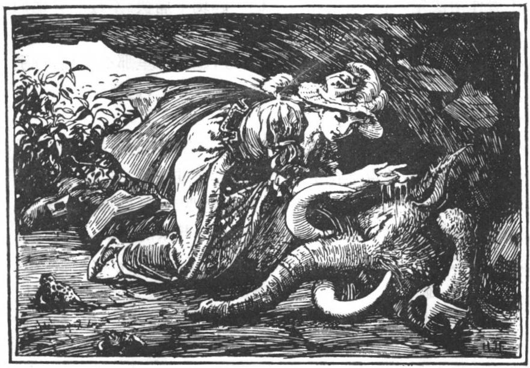

终于到了吃晚饭的时候，可是不见野兽的影子，这回贝蒂真的是吓坏了。她等待着，期待着听到它过来的声音，可是很久也没有等到。她跑到花园里去找它。可怜的贝蒂在花园的小径和大道上来回奔跑，不停地呼喊着它，却听不到回音，也找不到它的踪迹。后来她实在太累了，就停下来休息一会，她看见自己正站在梦中那条林荫小道一边，于是就沿着小道奔跑过去。不错，那里是有个山洞，野兽正躺在那里。贝蒂想它是睡着了。找到野兽她非常高兴，跑过去拍拍它的头，她恐惧地看到，它一动也不动，连眼睛也不眨一下。

“啊！它死了！这全是我的过错。”贝蒂说，大声地痛哭起来。

接着，她又看它一下，觉得它还有气。她赶紧到附近的泉水旁取来一些泉水，泼在它的头上。她满心欢喜地看到，它开始苏醒过来。

“啊！野兽！你把我吓坏了。”她喊叫着，“直到现在，我才知道我是那样地爱着你，我真害怕我来得太晚了，再也救不了你了。”

“你真的那么爱像我这样丑的东西吗？”野兽虚弱地说，“啊，贝蒂，你来得正是时候，我就要死去了，因为我想你已经忘记了自己的诺言。现在你回去休息吧！过一会我就来看你。”

贝蒂原先还想野兽会生她的气，听到它和蔼的声音也就放心了。她回到宫殿，晚饭已经准备好了。晚饭以后，野兽像往常一样走进来，两人谈论着她和父亲一起度过的日子，问她是否过得快活，他们看到她是不是很高兴。

贝蒂有礼貌地一一回答，很乐意把自己的经历告诉它。到野兽该离开的时候，它像以前一样地问道：

“贝蒂，你愿意嫁给我吗？”

她温柔地回答：“愿意，亲爱的野兽。”

话刚说完，一道火光在宫殿窗口前腾空升起，只见礼炮齐鸣，焰花飞舞；无数只萤火虫在两旁长满橘树的大道上空停留，构成一行明亮的文字：“王子和新娘万岁！”

贝蒂转过头来，想问野兽这些是什么意思，可是她发现野兽不见了，站在那里的是她爱慕已久的王子！与此同时，平台传来马车驶过的声音，两个妇女走进房间里来。贝蒂认得出，其中的一个就是她梦中见过的仪表端庄的女士；另一个也是像王后那样高贵，贝蒂开始真不知道该怎样招呼她。

贝蒂认识的那位女士对她的伙伴说：

“王后，这是贝蒂，她有着巨大的勇气，把你的儿子从可怕的魔法中救了出来。他们相互爱恋着，只要你同意他们的婚姻，他们就会美满幸福。”

“我从心底里同意他们结婚。”王后说，“不论怎样做，也难以表达我对你的感谢，美丽的姑娘，是你恢复了我亲爱的儿子本来面貌。”

王后亲切地拥抱贝蒂和王子，他们也向仙女问候并接受她的祝福。

“现在，”仙女对贝蒂说，“我把你的兄弟姐妹都请来参加你的婚礼，让他们也一起来跳舞，我想你一定会高兴吧！”

于是，仙女就这么办了。婚礼第二天就举行，那可是世界上最隆重的婚礼了！从此以后，贝蒂和王子就幸福地生活在一起。

 

## 主人和大闺女

从前有个国王，他有许多儿子。究竟有多少？我也说不清。最小的儿子不肯安分守己地留在家里，他决心要到外面的世界去碰碰运气。国王开始不同意，直到过了很长时间，才不得不答应他。

走了几天以后，王子来到一个巨人家里，给巨人当佣人。早上，巨人得到牧场去放羊，出去之前他关照国王的儿子，把马厩打扫干净。他说：“干完这活以后，今天就用不着干别的活了。你会看到，你找到了一个好心肠的主人。不过，我叫你做的事，必须做干净利落。同时，除了昨天晚上你睡觉的房间以外，无论如何也不许到别的房间里去，你要是不听话，我就要你的命。”

“不错，他是好说话的主人。”王子自言自语地说着，在房间里走来走去，嘴里还不停地哼着歌曲。他想只打扫马厩，有的是时间。

“偷看一眼别的房间，肯定也很有趣。”王子说，“他既然不让我进去，里面一定有见不得人的东西。”于是他走进第一个房间，看到墙上挂着一个大锅，里面的水开着，可王子看不到下面有火在烧。

“我要看看里面是什么！”他想，拉下一绺头发浸到锅里去，只见头发变成了铜丝，像是天生的铜头发似的。“这锅汤真好，要是谁喝了一口，他的喉咙就会镀上铜了。”年轻人说着。他又走进第二个房间。里面也有一个大锅挂在墙上，锅里的水在沸腾，锅下面也没有火。“我也要试一试这里面是什么。”王子说，又把一绺头发浸进去，头发变成了银的。“我父亲宫殿里也没有这么昂贵的汤。”王子说，“不过，还得看看它的味道怎么样。”

他走进第三个房间。像前面两个房间一样，里面也挂着一个大锅，水也正开着。王子也兴致勃勃地试了一下，浸进一绺头发，这一回变成了金光闪闪的黄金。“有人说事情会越来越坏，”王子说，“可这里倒是越来越好。要是他在这里煮黄金，那边该是煮什么呢？”他决心要去看一看，跨出门后，走进第四个房间。里面没有锅，可在一张凳子上坐了一个少女，看上去像是国王的女儿。不管她是谁，她长得那么美丽，王子从未见过像她这样漂亮的人。

“天哪！你到这里来干什么？”坐在凳子上的姑娘问。

“我是昨天才到这里来当佣人的。”王子说。

“要是你到这里来当佣人，但愿你能找到个更好的地方！”她说。

“啊！可是我想，我找到了一个仁慈的主人。”王子说，“他今天没叫我去干什么重活。我只需去把马厩打扫干净。”

“是啊！可这活你怎么干得了？”她又问道，“你要是像通常那么干，铲掉一叉子，就会多出十叉子垃圾来。让我教你怎么干，你要把叉子掉个头，用柄去打扫，垃圾就全会自己飞掉。”

“好的，我会这么干的。”王子说。接着，他在这个房间里坐了一天，和姑娘很快就说好了，以后要结成夫妻。就这样，他给巨人干活的头一天很快就过去了。天快黑了，姑娘说他最好在巨人回来之前快去把马厩打扫干净。

他来到马厩，开始还饶有兴趣地想试试她的话是不是真的，就像马夫打扫父亲马厩的样子干起来，但很快就不得不停下来。因为还没有干多久，地上的垃圾就多得连立足之地也没有了。于是他照大闺女教给他的办法，把叉子掉个头，用叉柄来打扫。

一眨眼工夫，马厩就干净得像擦洗过一样。干完以后，他回到巨人让他住的房间，一边走来走去，一边哼着歌曲。

不久，巨人赶着山羊回来。“你把马厩打扫干净了吗？”巨人问。

“是的，马厩现在又整洁又干净，主人。”王子回答。

“我要去看一看，”巨人说。他来到马厩，事情果然像王子说的那样。

“肯定是我的大闺女告诉你的，你决不会自己想出这个办法来。”巨人说。

“大闺女！你这是什么意思，主人。”王子说，装作像头蠢驴似的，“我倒很想去看看。”

“嗯！你很快就会见到她。”巨人说。

第二天早晨，巨人还得去放羊。他对王子说，这一天只需要到山脚下去把他的马拉回家来，然后就可以休息了。“因为你会发现，你找到了个好主人。”巨人又把这句话说了一遍，“但不要到昨天和你说过的那些房间里去，否则我就把你的头拧下来。”说完就赶着他的羊群走了。

“是的，不错，你是个好主人。”王子说，“可是我还要去和大闺女说话，也许用不了多久，她就属于我而不属于你了。”

他来到她的房间，她问他，今天要去干什么活。

“嗯！我想这活没有什么危险。”国王的儿子说，“我只要到山脚下去看好他的马。”

“那么，你打算怎么去看管它呢？”大闺女问。

“嗨！骑一匹马回家算不了什么大本事。”王子说，“性子再烈的马我以前都骑过。”

“是的，可骑这匹马回家可不像想的那么容易。”大闺女说，“不过，让我来教你该怎么办。当你靠近这匹马的时候，它的鼻子就会像松树的火把一样，喷射出火焰来。你要非常小心，把挂在那扇门上的缰绳带上，把马嚼子朝它的嘴上扔过去，把它的嘴套住，它就会变得非常驯服，你怎么摆布它都行。”

王子说他会把这些话记在心上，然后又坐下来和大闺女说了一整天。他们海阔天空，漫无边际地聊着。不过，最先和最后说到的都是，要是他们能结婚，从巨人这里平安地逃出去，将是多么幸福和快活。要不是大闺女提醒他，他早就把山脚下那匹马忘得一干二净了。大闺女对他说，天快黑了，他最好赶在巨人回来之前把马赶回来。于是，他把挂在钩子上的缰绳拿下来，大步流星地向山上走去。不久，他就看见了那匹马，烈火不停地从它的鼻子里喷射出来。年轻人小心翼翼地在一旁观察着，等待着机会。就在它张着嘴向他奔过来的时候，他把马嚼子对准它扔过去，不偏不倚地套住它的嘴。那匹马立刻变得像只小羔羊似的，安静地站在那里不动了。王子毫不费力地把它带回家，关进马厩。王子回到自己的房间，开始哼起歌曲来。

到了晚上，巨人回到家里。“你把马从山脚下赶回来了吗？”他问。

“赶回来了，主人，这匹马骑起来很有趣。不过我骑着它就直接回家，把它关进马厩里了。”王子说。

“我要去看一看。”巨人说，他来到马厩，看到马像王子说过的那样，安静地站在那里。“你肯定和我的大闺女说过话了，你决不会自己想出这个办法来。”巨人又说。

“主人，昨天你说了这个大闺女，今天你又说她了。啊！上帝保佑你，主人，干吗不让我去看看她，见到她我肯定很高兴。”王子说，还是装出一副又笨又傻的样子。

“嗯！你很快就会见到她了。”巨人说。

第三天早晨，巨人又得到森林里去放羊，他对王子说：“今天，你必须到地下去帮我收税。干完以后，多余的时间你可以尽情地休息。你会看到，你碰上了一个多么好商量的主人。”说完他就走了。

“好啊！你是个多么好商量的主人，叫我去做这么艰难的事。”王子心里想着，“要不是找到你的大闺女，那才真是有我好看的了。你说她是属于你的，正是因为这样，她才有可能告诉我现在该怎么办。”他动身去找她。大闺女问他，巨人今天派他去干什么。他告诉她说，叫他到地下去收税。

“这件事你准备怎么做？”大闺女问。

“啊！你得告诉我该怎样去做。”王子说，“因为我从来没有到地下去过，即使我知道怎么去，我也不知道该收多少。”

“好吧！我马上就告诉你该怎么做。你先到山脊下的那块岩石那里去，拿起那里的一根棍子，敲打那块岩石山壁。”大闺女说，“这时，一个身上迸发火花的人会出来，你要把自己的差使告诉他。等他问你要多少的时候，你就说，‘我能拿多少就要多少。’”

“行！我会记在心上的。”他说，然后就坐下来陪大闺女一整天，直到天将黑下来。要不是大闺女提醒他，要在巨人回来之前把税收好，现在就得走了，他会很乐意一直坐下去。

他走出去以后，完全照大闺女的话去做。他来到石壁旁边，拿起那根棍子，敲打石壁。一个两只眼睛和鼻子都喷射着火花的人走出来问道：“你想要什么？”

“是巨人派我到这里来的，我来替他收税。”国王的儿子说。

“那么，你要多少呢？”那人问。

“只要我拿得走就够了。”王子说。

“你真走运，没有开口要一匹马能驮得动的。”从岩石里走出来的人说，“跟我进来吧！”

王子跟着走进去，他看到了无数的黄金和白银。它们存放在山里头，就像是荒野上成堆的石头一样。他装了自己能背得动的满满一袋就走了。

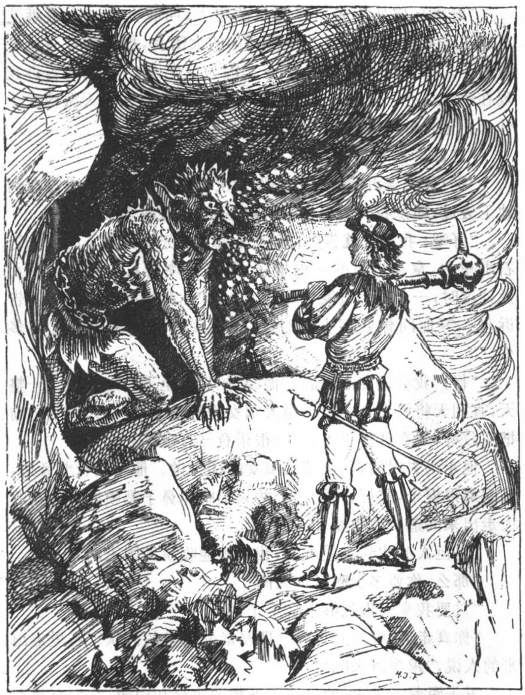

到了晚上，巨人赶着山羊回家的时候，王子像前两天一样，在自己的房间里哼着歌曲。

“你去收税了吗？”巨人问。

“是的，我去过了，主人。”王子说。

“你把它放到什么地方去了？”巨人又问。

“那袋黄金就放在凳子上。”王子说。

“我要看一看。”巨人说。他走到凳子前，袋子竖在那里，装得满满的，巨人把绳子解开的时候，金子和银子都掉出来了。

“你肯定是去和我的大闺女说过话了！”巨人说，“要是去过了，我要拧掉你的脖子。”

“大闺女？”王子说，“昨天，我的主人说起过这个大闺女，今天又说起她了，还有第一天，也说过这件事情。我真想亲眼去见见她。”

“好的，好的，等到明天吧！”巨人说，“到时候，我亲自带你去见她。”

“啊！主人，谢谢你，不过，你只是在嘲弄我。”王子说。

第二天，巨人带他到大闺女面前。“现在，你把他杀了，放在你知道的那口大锅里煮，等汤煮好了就叫我。”巨人说完，就睡在长凳子上，立刻打起鼾来，那声音听上去，像是山里面在打雷。

大闺女拿起一把刀，把王子的小手指割开，在一张木凳上滴上三滴血，然后把所有的破烂、鞋底，反正能找到的垃圾全扔到锅里去。接着，她把金粉、一块盐，还有挂在门上的一个水壶装进箱子，又拿起一个金苹果和两只金鸡。然后，她和王子以最快的速度逃离这个地方。没有跑多远，他们就来到了海边，开着船走了。至于船是从什么地方弄来的，我也搞不清楚。

这时，巨人已经睡了好一会了，他开始在长凳上伸伸懒腰。“水快开了吧？”他说。

“刚要开。”凳子上的第一滴血说。

巨人又躺下来睡着了，又睡了好长时间，然后又开始动一动。“现在差不多了吧？”他问。不过，像第一次一样，没有张开眼睛来看，他还是半睡半醒。

“只烧熟了一半。”第二滴血说。巨人又相信这是大闺女在说话，翻了个身又睡着了。等又睡了好几个钟头以后，他又开始动起来，伸伸腰。“还没有好吗？”他问。

“全准备好了。”第三滴血说。巨人坐起来，揉了揉眼睛。可是，他看不见和他说话的人，就喊叫大闺女，没有人回答。

“嗯！她是偷偷地溜出去一会。”巨人想，他拿起一个匙子，来到锅前想尝一尝味道。可里面除了鞋底、破烂和垃圾以外，什么也没有。而且这些东西全都烧烂了，他也说不上这是稀粥还是牛奶浓汤。这时候，他才明了发生了什么事情，顿时气得昏头转向，不知道该怎么办才好。后来，他才想起去追赶王子和大闺女。他跑得那么快，风呼呼地向他身后刮去，不久就追到海边，可是他不能跨过大海。“好吧！好吧！我会找出办法来对付的，只要把我的吸河兽叫来就行了。”巨人说着，真的把吸河兽叫来了。

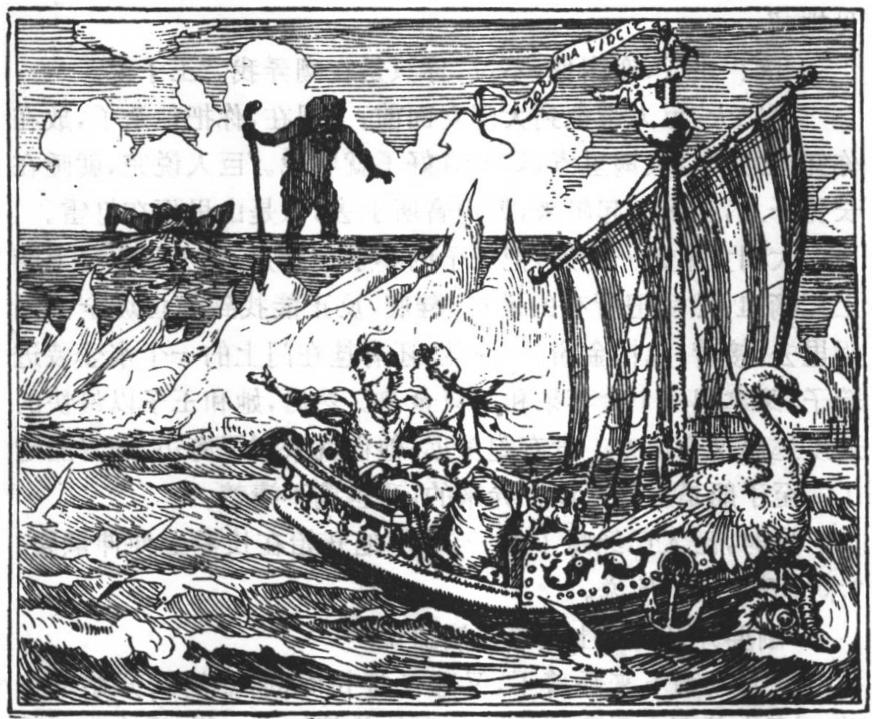

吸河兽蹲下身子，张开大嘴吸了一口、两口、三口，海水顿时下降了许多。巨人看见大闺女和王子正坐着船在海上航行。“快把那块盐扔出去！”大闺女说。王子照她的话做了。那块盐立刻变成一座高山，横跨在海面上，巨人无法跨过来，吸河兽也没法再吸更多的海水了。

“好吧！好吧！我会找出办法来对付的。”巨人说。他把穿山兽叫来。它在山下面钻穿了一个洞，海水顺着山洞流过来，吸河兽又开始吸海水了。可是洞一打穿，吸河兽开始吸水的时候，大闺女叫王子把水壶里的水滴一两滴到海里去。王子刚滴下两滴，海水马上就涨得和原来一样高。吸河兽还没有来得及吸一口，他们的船已经靠上岸，不再有什么危险了。他们决定回到王子父亲的家中去。可是王子说什么也不肯让大闺女步行到家里去。他认为不论是她还是自己，走路回去都不成体统。

“在这里稍等一回，我回家去把父亲马厩里的七匹马拉来。”他说，“路不是很远，我去不了多久，我决不能让我的未婚妻步行踏进宫殿。”

“啊！不！不要去！你一回到家里，走进国王的宫殿就会把我忘记，我有这种预感。”

“我怎么可能把你忘记呢！我们一起经历了那么多苦难，相互爱得那么深。”王子说。他坚持要回家去，把那辆七匹马拉的马车赶来，叫她就留在海边等着。他的决心那么大，大闺女后来只好让步，同意了。

“你回到家以后，不能停下来和任何人打招呼，直接到马厩里去，把马拉出来，套上马车，把它赶回来，越快越好。因为他们看到你，就会都围上来。你要做得就好像没有看到任何人一样；而且无论如何，你什么东西都不能吃，否则就会给我们带来可怕的灾难。”大闺女说。王子同意了。

可是，当他回家，走进国王宫殿的时候，他的一个哥哥正准备举行婚礼。新娘子和她所有的亲戚朋友都到王宫里来了。看到小王子，他们都围拢上来，问这个，问那个，还想叫他跟他们一起走。他好像没有看到他们似的，一直向马厩走去，把马拉出来，给它们套上缰绳。他们看到没有办法叫他一起走，就拿出酒和肉，还有为婚宴准备的最好吃的东西来，可是王子连碰也不碰它们一下，只是一心一意尽快地把马匹套上。后来，新娘的妹妹把一个苹果从院子的一头滚过来，对他说：“你既然什么也不吃，也许会想吃一口苹果吧！走了那么多路，你肯定又饿又渴了。”王子拿起苹果，咬了一口。他一张口咬苹果，马上就忘了大闺女，忘了他回来是为了赶马车去接她。

“我想我是疯了，我要这辆马车，还有这些马干什么？”他说着，把马牵回马厩以后，来到国王的宫殿里。在这里，他们做出了这样的安排，让他和新娘子的妹妹，也就是把苹果滚给他的姑娘结婚。

大闺女在海边等王子，等了很久，很久，不见他回来。于是她走了。没有走多远，就来到小森林里一间孤零零的小屋前，这里离国王的宫殿不远。她走进去，问主人是不是可以让她留下来。主人是个干瘪的老太婆，而且为人刻毒，脾气很坏。开始，她说什么也不让大闺女留下来和她一起住。后来大闺女说了许多好话，同意付给她许多钱，她才同意了。小屋里非常阴暗，又脏又黑，像个猪圈，所以大闺女说要把它装修一下，好让它看上去像是人住的房间。老太婆也不喜欢这个主意，她大发脾气，不停地骂人。大闺女不理睬她。她从箱子里拿出金粉来，抓了一把撒到火上去。金粉碰到火沸腾起来，向屋子里的四面八方喷射出去，把屋子的里里外外都镀上了一层金。当金粉沸腾的时候，老太婆吓坏了，好像有个魔鬼要来抓她一样，急忙向外面逃跑，慌张之中，经过门口时忘了低下头来，头撞在门上裂开了，一命呜呼。

第二天一早，地方长官从这里经过，看到林子中有一间金屋金光闪闪，大放异彩，惊奇万分。等他走进去，看到一个年轻美貌的姑娘正坐在那里，更是万分惊讶。他立刻就迷上了她，而且马上装出一副温柔的样子，甜言蜜语地向她求婚。

“嗯！你是不是有许多钱？”大闺女问。

“啊！是的，不管怎么说，我并不穷。”地方长官说。这样，他只得回家去取钱。晚上，他带着一口袋钱回来，大约有两蒲式耳那么多。他把钱放在凳子上。既然他有那么多钱，大闺女就说愿意嫁给他，于是他们一起坐下来说话。

可是他们屁股还没有坐稳，大闺女又急忙站起来说：“我忘了往炉里添煤了。”

“你干吗急急忙忙去干这种活？”地方长官说，“让我来干！”他一跃而起，大步跨到炉火前。

“拿到铲以后请告诉我一声！”大闺女说。

“我拿到铲子了！”地方长官说。

“那么，愿你把铲子抓紧，铲子也把你抓紧，把火红的煤块铲到你身上，一直到天亮。”大闺女说。于是，地方长官通宵达旦地站在那里，把火红的煤块往身上铲。不管他怎么喊叫，怎么求情，讨饶，通红的煤块一点也不会因此而冷下来。等到天放亮的时候，他才能够把铁铲子扔掉，他片刻也不想再停留，拔起双腿拼命地奔跑出去。他跑得那么快，看到他的人都以为他疯了，瞪着他看。他那浑身焦黑的样子，比被烈日晒掉一层皮还可怕。人人都想知道他是在哪里弄成这副样子的，只是他觉得万分羞愧，难以启齿。

第二天，律师骑着马从大闺女住的地方经过，看到小屋透过树林，发出明亮的光芒。他也走进去，想看看谁住在里面。进去一看，里面是一个年轻美貌的姑娘。他比地方长官更热烈地爱上她，马上就向她求婚。大闺女问他，就像问过地方长官一样，问他是否很有钱。律师说，他并不缺钱，马上就回家去取。到了晚上，他带来一大口袋钱，足足有四蒲式耳。他把钱放在大闺女旁边的凳子上。于是，她答应嫁给他。律师在她旁边坐下，开始商量怎么安排这件事情。可她突然说，她忘了把走廊的门关上，要马上去关好。

“你干吗去干这种事？”律师说，“坐着别动，我去关。”

他马上就站起来，到走廊里去。

“你拉住门闩的时候，就跟我说一声。”大闺女说。

“我拉住门闩了。”律师大声地说。

“让你拉紧门闩，门闩也拉紧你，在走廊里走来走去，直到天亮。”

这一天晚上，律师跳得可真惨了。他从来没有跳过这种华尔兹舞。有时候，他在前，门在后；有时候，门在前，他在后。从走廊的这一头跳到那一头；又从那一头跳回这一头，直到快把律师累死！开始，他还大骂大闺女，可不久就开始求饶。可是门毫不在意，一点放松他的意思都没有，一直跳到天亮。

等到门一把他松开，律师就立刻跑出去，顾不得去找让他受折磨的人，也忘了那口袋钱和求婚的事。他只怕那扇门会追过来缠着他跳舞。他跑得像疯了似的，周围的人都瞪着他看。他那副狼狈相，比整夜受到一群公羊的围攻还要凄惨。

到了第三天，司法官从这里经过，也看到了这片小树林和金屋，他感到应该去看一看谁住在里面。看到大闺女一眼，就热烈地爱上了她，还来不及问候就开口向她求婚。

大闺女的答复和前两个求婚者一样。说要是他很有钱，就嫁给他。“要是说钱么，我并不缺。”司法官说。他马上就动身回家去取钱。到了晚上，他带了一大口袋钱回来。那口袋比律师的还要大，里面起码有六蒲式耳那么多。他把钱放在凳子上，于是婚事就这样定了。可是他们刚一起坐下来，大闺女就说忘了把小牛赶进牛圈了。

“不！不！这种事用不着你去干，”司法官说，“让我去做就是了。”尽管他很肥胖，跑起来倒像个小孩似的。

“抓住牛尾巴以后，跟我说一声。”大闺女说。

“我抓住它了。”一会儿司法官喊道。

“让你抓住牛尾巴，牛尾巴也抓住你，你们一起周游世界，不到天明不要停下。”大闺女说。

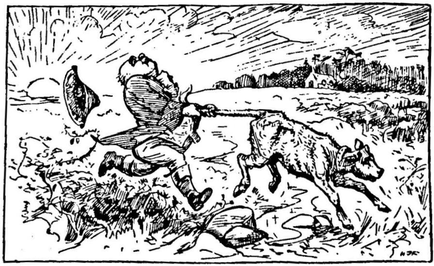

于是，司法官不得不抖擞精神，跟着小牛奔跑。不论是平地，还是崎岖的道路，小牛全不在乎。它翻山越岭，穿过山谷。司法官越是叫得凶，它就越是跑得快。等天快亮的时候，司法官已经累得半死。牛尾巴刚从手中松掉，他就再也想不起那口袋钱，还有别的什么事情了。

他慢慢地走回去，比地方长官和律师慢得多了，一路上那些好奇的人也有了更多的时间来瞪着他看。他们都难以想象，在跟着小牛狂奔一夜以后，他会显得那样衣衫褴褛和疲倦。

第二天，王宫里举行婚礼，小王子的哥哥和新娘一对，小王子和新娘的妹妹一对，他们准备一起坐马车到教堂里去。可是，当他们在马车上坐好，准备出发的时候，马车上挽缰绳的一根木栓子断了。尽管他们换上一根又一根，还是不顶用，这些木栓不论是用什么木料做成的，装上去就断掉。花了很长时间，马车还是无法离开王宫，这个麻烦可大了。这时候，接到通知也来参加婚礼的地方长官说：“离这里不远的森林里住着一个姑娘。要是你们能向她借到那把生火用的铁铲柄，我敢断定用它来做木栓一定不会断。”于是，他们派人到森林里去，苦苦哀求姑娘借给他们地方长官说的那把铁铲柄，姑娘同意了。他们这才有一根不会折断的木栓。

然而，就在马车开始滚动的时候，车厢底的木板突然断裂成好几块，他们赶紧再重新装上。但是不论他们用什么木料，怎样仔细地把它们钉好，只要车轮一滚动，它们就断裂。这回的情形比木栓断裂还要糟糕。这时候，也来参加婚礼的律师说：“那边森林里住着一个姑娘，要是她肯借给你们走廊里的半扇门，用它来做车底，我敢肯定不会断开。”于是，他们又派人到森林里去，苦苦哀求姑娘把那扇镀金的走廊门借给他们，姑娘同意了。正当他们想赶着马车走的时候，马怎么也拉不动马车。这时候，马车上已经套上了六匹马，他们加到八匹，后来又加到十匹，十二匹。可是，马加得越多，鞭子抽得越凶，就越是没有什么好处。马车像是生了根似的，别想挪动一步。这时候，时间已经不早了，教堂里今天可是非去不可的，人人都急得像热锅上的蚂蚁。

司法官开口说话了：“那边的森林里有一间金色的屋子，里面住着一个姑娘，要是她肯把小牛借给你们，我相信即使是马车重得像座山，它也拉得动。”开始他们都认为，让一头小牛把他们拉到教堂里去未免太滑稽了。可是，除此之外，还有什么办法呢？于是，他们只好再派人去代表国王恳求姑娘，把那头曾拉着司法官到处奔跑的小牛借给他。大闺女也不刁难他们，立刻就同意了。

他们把小牛套在马车上，看看能不能拉得动。是的，马车开始奔驰起来，道路不管是平坦，还是崎岖，它都毫不在乎。碰到树木和石头，它都是一跃而过。马车上的人吓得大气也不敢喘。马车有时在陆地上奔跑，有时会腾空而起，像小鸟似的在空中飞行。到了教堂以后，马车开始像轮子一样地围着教堂转起来。他们冒着很大的危险，才从马车上跳下来，走进教堂。等他们坐着马车从教堂里回来时，马车奔跑得还要快。许多人还不知道是怎么回事，就回到王宫里来了。

大家都在桌子旁坐好以后，给巨人当过仆人的王子说，应该去邀请借给他们铁铲柄、走廊门和小牛的姑娘到王宫里来。“因为要是没有这三件东西，我们就永远也走不出王宫去。”他说。

国王也想，这个提议既合情，也合理，所以就派出五个最得力的人到金屋子那里去，转达国王对她真诚的问候，并请她仁慈地中午来王宫赴宴。

“请问候国王，并且对他说，如果他能真心诚意地到我这里来，我也就真心诚意地到他王宫里去。”大闺女回答。

国王只好亲自动身去请她，大闺女也立即动身跟国王一起回去。国王相信，她的为人比相貌还要出众，把她捧为上宾，让她坐在年轻的那位新娘旁边。

当大家都坐定以后，大闺女把她从巨人那里带出来的公鸡、母鸡和金苹果拿出来，放在她面前的桌子上。公鸡和母鸡立刻为争夺那只金苹果争斗起来。

“啊！看！这两只鸡为了金苹果抗争起来了！”王子说。

“是啊！当初我们俩在山上的时候，也是经过抗争才逃出来的。”大闺女说。

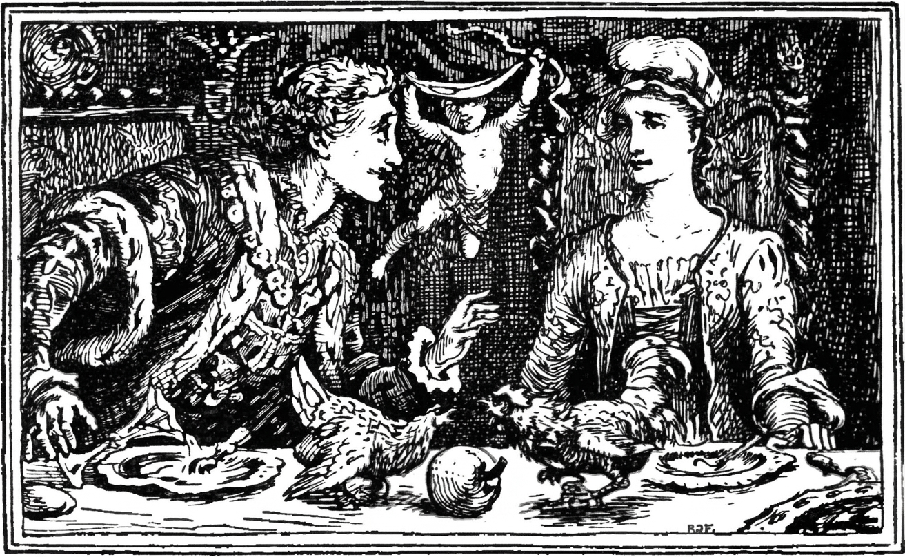

于是王子想起她来了。你可以想象他该有多高兴。他下令准备二十四匹马，把那个滚苹果给他的女巫立刻分尸，叫她片甲不留。这以后，婚礼才开始正式举行。这时候，地方长官、律师和司法官虽然感到很不舒服，但也不得不坚持到底。

 

## 海水为什么是咸的

很久很久以前，有两兄弟。哥哥富有，弟弟贫穷。圣诞夜到了，弟弟家里穷得既没有肉，也没有面包，一点吃的东西都没有。他来到哥哥家里，请求他看在上帝的份上，给他一点吃的东西好过圣诞节。哥哥已经不是第一次不得不给弟弟一些东西了。尽管是圣诞夜，弟弟上门来讨吃的，他不见得比平时高兴一些。

“要是你愿意照我话去做，我就给你整条火腿。”哥哥说。穷弟弟立刻表示感谢，答应了他的条件。

“那好，这条火腿就给你了。现在，你必须立刻就到‘死人厅’那里去。”富哥哥说着，把火腿扔给他。

“好吧！我会照答应过的那样去做。”弟弟说。他拿起火腿就走。走啊！走啊！走了整整一天。到了天黑的时候，他来到一处火光明亮的地方。

“毫无疑问，这里就是了。”弟弟想。

屋子外面，一个长着长长的白胡子的老头正在劈圣诞夜放入炉中燃烧的大原木。

“晚上好！”弟弟说。

“晚上好！这么晚了你还要到哪里去？”老人问。

“我要到‘死人厅’那里去，我没有走错路吧！”穷弟弟回答说。

“喔！没有，一点也没有错，这里就是。”老头说，“你进去以后，所有的人都想买你的火腿，因为这里的肉不够吃。不过，你一定不要卖给他们，除非他们用门后那个小磨子来换。你出来以后，我再教给你使用的方法。这个磨子几乎什么都可以磨。”

弟弟感谢他的忠告，过去敲门。

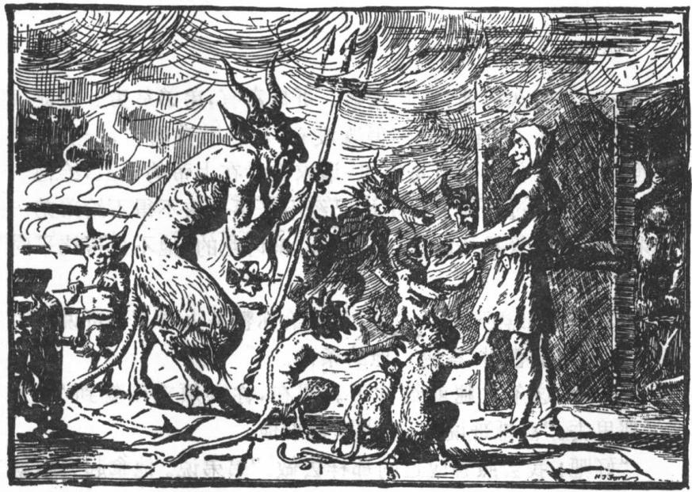

走进去以后，里面的一切都像老头说过的那样。所有的人，不论是高大的，还是矮小的，都像蚁穴里的蚂蚁一样，向他围拢过来，人人都想抢先买下火腿。

“按理说，这火腿应留着给我和妻子过圣诞节，但既然你们决心要买，那我只好让给你们了。”弟弟说，“不过，这笔买卖你们得用门后的那个小磨子来交换。”

开始，他们不肯，还是纠缠着他讨价还价。可是他态度很坚决，不肯让步，他们只好把小磨子给他。他拿着磨子走出来，问劈柴的老头如何使用小磨子，然后谢过老头子就回家。尽管他拼命地赶路，回到家以后，圣诞夜的时钟已经敲响了十二下。

“你到什么鬼地方去了？”妻子问他，“我坐在家里等你一个钟头又一个钟头，烧圣诞粥的柴火一根也没有了。”

“嗯！我不能再早了，我有重要的事情要办，有很长的路要走；不过，现在，你等着瞧吧！”弟弟说着，把小磨子放在桌子上，叫它先磨出亮光，然后是台布、肉、啤酒，总之，圣诞节晚餐需要什么就叫它磨什么。磨子都一一照办。

“我的天啊！”妻子看到这些东西一样一样地出现，惊叹起来。她问丈夫这个磨子是从哪里弄来的，丈夫不肯告诉她。

“不管我是从哪里弄来的，反正你看到了，它很有用，推磨的水永远也不会结冻。”丈夫说。接着，他又磨了一些肉和饮料，还有各种各样的好东西，以便度过整个圣诞节节期。第三天，他请来所有的朋友，设宴招待他们。

富哥哥看到了弟弟家里宴席上的一切，非常妒忌，心里又气又恨。“圣诞之夜，他还穷得揭不开锅，到我家来，叫我看在上帝的份上，给他一点吃的东西。现在，他倒大摆起宴席来，好像他既是伯爵，又是国王似的！”哥哥心里想着，禁不住开口问他的弟弟：“看在上帝的份上，告诉我，你从哪里弄来这么多钱？”

“从门背后，”弟弟说。他不愿意让哥哥得到一个满意的回答。可是到了晚上，他喝得太多了，没法控制自己，忍不住把小磨子的事说了出来。“你看到了！是什么给我带来这么多财富！”说着，他把小磨子拿出来，叫它磨出一样又一样东西来。

哥哥看了以后，坚持要这个小磨子。在好说歹说了老半天以后，他终于如愿以偿。不过，他得付给弟弟三百元，还得等到草都晒干以后才能拿走。弟弟想，“只要我能尽可能长久地留住它，就可以让它磨出许多肉和吃喝的东西来，这样就够吃好长时间了。”

你可以想象，在这段时间里，磨子一刻也没闲过。等草收割完了以后，哥哥把磨子拿走了。可是弟弟故意不把如何叫磨子停下来的方法告诉他。

哥哥带着磨子回到家里，天已经黑了。第二天早晨，他叫老婆和割草的工人一起出去干活，把他们割下来的草铺开，说自己今天要留下照顾家里。

快到吃午饭的时候，他把磨子放在厨房的桌子上，说：“磨鲱鱼和奶油浓汤，要又快又好！”

鲱鱼和奶油浓汤源源不断地从磨子中流出。它们把厨房里所有的碗和桶装满以后，开始流到地板上。哥哥对着磨子又是拧又是转，用尽一切办法想叫它停下。可是不管他怎么使劲，磨子还是在不停地转动着。很快，浓汤像河水一样地涨高起来，看看像是要把他淹死。他赶紧把客厅的门打开。可是没有多久，磨子里流出的浓汤又把客厅灌满。他冒着很大的危险，费了九牛二虎之力，才涉过浓汤抓住外面的门闩。等把门打开以后，他再也不敢留在家里了，拔腿就向外奔跑，鲱鱼和浓汤在他身后紧追不舍，流过田野和农场。

这时候，在地里铺草的妻子想，午饭早就应该送来了。她对其他妇女和割草的工人说：“主人没有来叫我们回家，我们还是自己回去吧！也许他感到自己汤做不好，我回去可以帮帮他的忙。”

他们陆陆续续地往家里走，刚走上一个小山坡，就看到鲱鱼、浓汤、还有面翻滚而来，主人奔跑在这股洪流的最前面。“你们就是有一百个肚子也不管用，当心被浓汤淹没了！”他喊叫着从他们的身边冲过去，像是大难就要临头似的。他一直跑到弟弟的家里，请求看在上帝的份上，快去把那个磨子拿回来，越快越好。他说：“要是再磨上一个钟头，整个地区就给鲱鱼和浓汤毁了。”弟弟开始不理睬他，后来他答应再给他三百元钱，弟弟才答应了。这样一来，穷弟弟可是又有钱又有磨子了。没有多久，他就有了一幢比哥哥那幢漂亮得多的房子。磨子给磨出那么多钱来，房子的屋顶上全盖上了金。弟弟的家就住在海边，所以从海上很远的地方，就可以看到他的房子闪烁着金色的光芒。所有的船只从这里驶过，船上的人都要上岸来拜访住在金房子里的富翁。他们都想亲眼看一看那神奇的磨子，它的名气传遍了五湖四海，天底下无人不晓。

这样过了很久很久以后，有一天，来了一位船长，也想看看那磨子，还问它能不能磨出盐来。“当然，它也可以磨出盐来。”磨子的主人说。船长听他这么一说，就想尽一切办法，不管花多少钱，也要把它买下。他想，只要有了它，就不必为了运盐，到那险恶的大海里去远航。开始，主人压根儿不想卖给他，可是船长不停地苦苦哀求，他才同意卖，主人为此得了成千成万元钱。

船长把磨子扛上肩以后不敢停留，立刻就走，生怕主人会改变主意，他也来不及问明白该怎样去使用它，只是想回到船上去，越快越好。

船驶离码头没有多远，他就把磨子搬到甲板上来。“磨出盐来，要磨得又快又好。”他说。于是磨子开始磨盐，盐像水一样倾泻而下。等把船装满以后，船长想叫它停下来。可是不论他想出什么法子来，怎么去转它，它还是不肯停下来。船上的盐越堆越高，终于把船压沉了。磨子掉到海底以后，还是在不停地磨着，日复一日，年复一年，于是，大海也变成咸的了。

 

## 穿靴子的猫

从前有一个磨坊主，他留给三个儿子的全部家产就是他的磨坊、一头驴子和一只猫。用不着请来公证人和律师，这些家产很快就分好了。这些少得可怜的家产用不了多久他们就要吃光。大儿子分到磨坊，二儿子分到那头驴，小儿子就只有那只猫了。

可怜的小儿子只分到那么一点点，心里很不平静。

“我的两个哥哥，”他说，“要是合伙干的话，日子可以过得很不错，可是我呢？我吃掉这只猫，它的皮只能做一副皮手笼，我非饿死不可。”

这些话那只猫都听见了，可是它装做不知道，郑重而严肃地对他说：

“别这样自找烦恼了，我的好主人。你用不着操什么心，只要给我做一双靴子，再给我一个口袋就行了。穿上靴子，我就可以在泥地和荆棘中奔跑。你会看到，分到我这份财产并不像你想象的那么坏。”

猫的主人并没有把它的话认真地当作一回事。不过，他倒也是常常看到，它在抓老鼠的时候会玩耍许多高明的花招。它也常躺在他的脚下，在他吃饭的时候睡在一边装死。所以，他也不是一点也不相信，在遇到不幸的时候，猫一点也帮不上忙。

猫得到它需要的东西以后，神气十足地套上靴子，把口袋挂在头颈上，用两只前爪抓拉住口袋的绳子，来到养兔场，里面有许多兔子。它在口袋里放进去一些麸和苦苣菜，然后就直挺挺地躺下来装死，等待着那些不知道世界上还有尔虞我诈的小兔子钻进它的口袋里找这些东西吃。

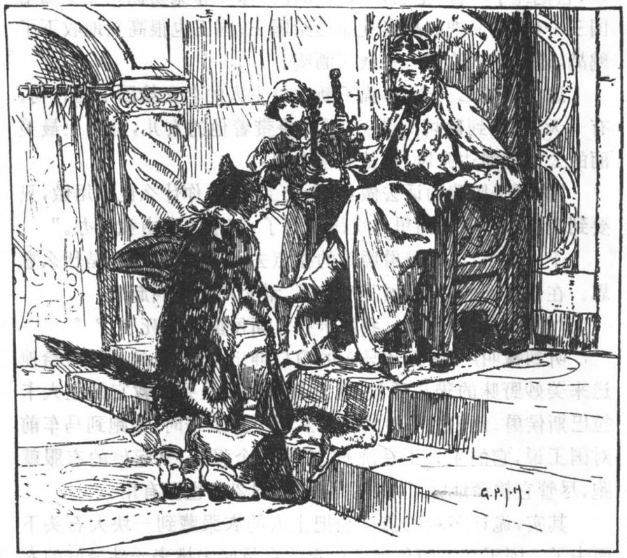

它刚躺下没有多久就如愿以偿了：一只傻乎乎的小兔子冒失地撞入它的口袋。猫先生立刻就抽紧口袋的绳子，毫不怜惜地把小兔子抓出来杀掉。猫怀着骄傲的心情，带着它的猎物来到王宫，请求尊敬的陛下接见它。它被带上台阶，来到国王的大厅。看到国王，猫行了大礼以后对他说：

“陛下，我给你送来了一只养兔场的兔子。这是我尊敬的主人卡拉巴斯侯爵大人（这是猫送给主人的头衔）命令我替他给尊敬的陛下送来的。”

“转告你的主人，”国王说，“我谢谢他，他使我感到很高兴。”

又有一次，猫藏在庄稼地里，把口袋张开。两只鹧鸪跳进口袋，它把绳子一拉，把它们双双抓住。像在养兔场抓到兔子送给国王一样，它又把鹧鸪当礼品送给国王。国王也很高兴地收下了鹧鸪，还命令赏给它一些钱买酒喝。

这样连续二三个月，猫不断地以主人的名义给国王送礼物。有一天，它得到确切的消息，国王将带着他的女儿，世界上最美丽的公主到河边兜风，它就对主人说：

“你要是照我的话去做，就会交上好运。你什么也不用做，只要到我指给你看的河里去洗澡就行了，其余的事由我来办。”

于是，卡拉巴斯侯爵照猫的指点去做，也不知道这是什么意思。在他洗澡的时候，国王过来了，猫大声地喊叫起来：

“救命啊！救命啊！我的卡拉巴斯侯爵快淹死了！”

听到喊叫声，国王从马车的窗口伸出头来，看到是经常给他送来美妙野味的猫在呼救，就立刻叫他的卫兵去救它的主人卡拉巴斯侯爵。他们把可怜的侯爵从河里拉上来时，猫跑到马车前对国王说，它的主人正在洗澡，来了几个强盗，拿起他的衣服就跑，尽管它拼命地喊了几声：“强盗！强盗！”也没有用。

其实，诡计多端的猫已经把主人的衣服藏到一块大石头下面去了。国王马上叫负责他穿衣的官员回去挑来一件最好的衣服，给卡拉巴斯侯爵穿上。

国王热情地拥抱他。这些好衣服穿在他身上特别合身，使他显得神采奕奕，仪表非凡（他本来就体格匀称，相貌英俊）。国王的女儿不禁暗暗地对他产生好感。等卡拉巴斯侯爵向她投过来两三次敬慕和温柔的目光之后，她很快就神魂颠倒，爱上他了。国王邀请他一起登上马车，观赏乡村的风光。猫看到它的计谋开始成功，非常高兴，跑在马车的前面。路上，它看到一些农民正在割草，就对他们说：“你们好啊！割草的老百姓。要是你们不告诉国王，说你们正在割的这块草地是属于我的主人，卡拉巴斯侯爵的，那么，你们就会像放到锅里去煎的草药一样，被剁得粉碎。”

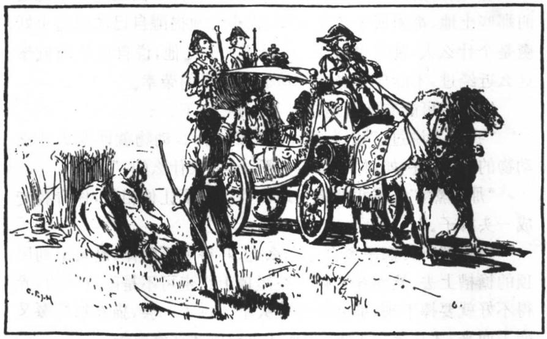

国王没有忘记问那些割草的人，这块草地是谁的。

“是我们的主人卡拉巴斯侯爵的。”他们异口同声地回答，猫的威胁把他们吓破了胆。

“你看，陛下，”侯爵说，“这片草地年年都有好收成。”

猫继续往前跑，看到一些农民在收割庄稼，就对他们说：“你们好啊！收割庄稼的农民，要是你们不对国王说，这些庄稼是属于卡拉巴斯侯爵的，你们就会像放到锅里去煎的草药一样，被剁成碎片。”

过了一会，国王的马车来了，他想知道眼前的这一片庄稼是属于谁的。

“是我们的主人卡拉巴斯侯爵的。”收割庄稼的农民说。国王非常高兴，侯爵也非常高兴，国王还对侯爵表示祝贺。

猫一直跑在前面，看到什么人都这样说。卡拉巴斯侯爵的庄园那么辽阔，国王感到有点吃惊。

后来，猫先生看到了一座十分壮观的城堡。城堡的主人是一个妖魔，他的财富世界上首屈一指，路人皆知。国王的马车经过的那些土地，都附属于这个城堡。猫小心地提醒自己注意这个妖魔是个什么人，能干些什么，然后请求去见他，说自己从离城堡这么近经过，不能放弃当面向他表示敬意的荣幸。

妖魔尽可能有礼貌地接见它，请它坐下。

“我听人说过，”猫说，“你有想变成什么动物就能变成什么动物的本事。例如，你可以变成狮子、大象什么的。”

“那当然，”妖魔非常得意地回答，“为了让你相信，你看我变成一头狮子。”

猫看到一头狮子离自己那么近，吓得魂不附体，赶紧窜到屋顶的檐槽上去。然而穿着靴子在屋顶上行走可不是闹着玩的，弄得不好就要摔下来，那麻烦可就大了。过了一会，猫看到妖魔又变了回来，才从屋顶上下来，承认自己刚才非常害怕。

“我还听说了，”猫说，“可是我无法相信，你还有本事变成最小的动物，比如一只老鼠、耗子之类的。不过我得向你承认，我想这是不可能的。”

“不可能！”妖魔喊道，“你马上就可以亲眼看到。”

几乎与此同时，他变成了一只老鼠，在地下到处乱跑。猫不失时机地一下扑过去，把它吃掉。

这时候，国王正好赶到，看到妖魔的这座漂亮城堡，有心要进去看一看。猫听到国王的马车从吊桥经过的声音，跑出来对他说：

“欢迎尊敬的陛下光临卡拉巴斯侯爵的城堡。”

“什么！我的侯爵！”国王喊叫起来，“这座城堡也是你的，再也没有比这座宫殿，还有周围的建筑更加富丽堂皇的了。要是你愿意，让我们进去看一看。”

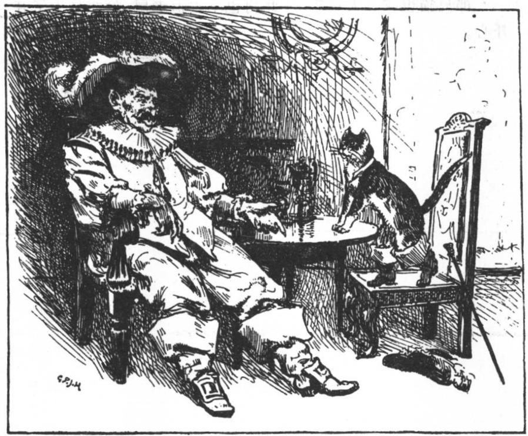

侯爵向公主伸出自己的手，跟着走在前面的国王一起进去。他们一走进一间宽敞的大厅，看到里面已经摆好了丰盛的点心。那是妖魔为他今日来访的朋友们准备的。看到国王在里面，他们谁也不敢进来。国王完全被卡拉巴斯侯爵高贵的身份迷住了。他的女儿当然也不例外，她已经疯狂地爱上了他。国王看到他拥有那么广阔的土地，喝了五六杯以后就开口对他说：

“这件事要由你自己来决定了，侯爵，你是否愿意成为我的女婿。”

侯爵鞠了几躬，接受了国王授予他的荣誉。就在这一天，他们举行了婚礼。

那只猫也成了大贵族，从此再也不去追老鼠，除非是为了开开心。

（查尔斯·佩罗特）

 

## 费利西亚和一盆石竹

以前有一个穷苦的农民，他觉得自己将不久于人世了，就想把自己的财产分配给儿子和女儿，他很爱他们。

他把他们叫到面前，说：“你母亲带来两只凳子和一张草垫床作嫁妆；此外，我还有一只母鸡、一盆石竹和一枚银戒指。那是一位高贵的女士送给我的。她在我们的破房子里住了一夜，走的时候对我说：‘小心地照看好我的礼物，好心的人，别丢了银戒指或忘了给石竹浇水。至于你的女儿，我向你保证，她会比你一生中看到的姑娘更美丽。叫她费利西亚吧！等她长大以后，把银戒指和这盆石竹给她，让她在穷苦的生活中也得到一些安慰。’那么，这两件东西就给你吧，我亲爱的女儿。其余的东西就归你哥哥了。”

两个孩子看上去都很满足。父亲去世以后，他们失声痛哭。按照父亲的吩咐，他们分掉了他的财产。费利西亚相信，她的哥哥爱她。可是，当她在一只凳子上坐下来时，他生气地说：

“看好你的那盆石竹和戒指，别碰我的东西，我不喜欢自己的房里被弄得乱七八糟。”

本性善良的费利西亚什么也没有说，只是默默地站起来，眼泪直流。她的哥哥布鲁诺舒服地在炉火旁坐下。到了吃晚饭的时候，布鲁诺吃了一个美味的鸡蛋，把蛋壳扔给费利西亚，说：

“看！这就是我能给你的一切，要是不喜欢，到外面去抓青蛙去，附近的沼泽地里有的是青蛙。”费利西亚没有回答，只是哭得更加厉害。她跑回自己的小房间，发现房间里充满了石竹花的清香，她走过去，对着石竹花伤心地说：

“美丽的石竹花，你那么芬香，那么可爱，你是我剩下的唯一安慰了。请放心吧！我一定小心地照顾你，好好地给你浇水，决不让一只残酷的手把你摘下。”

她弯下腰来，看到石竹花很干枯，于是就拿起手罐，迎着明亮的月光，来到有一段路程的泉水旁。她在泉水边坐下，想先休息一会。可是她还没有坐稳，就看到一个高贵的妇人在许多侍从的簇拥下向她走来。六名庄重的侍女托着她的拖裙，一名侍女搀扶着她。

她走近泉水以后，侍从支起华盖，华盖下面放上一张金黄色布面沙发，然后送上味道鲜美，式样考究的晚餐。桌子上摆满了黄金和水晶餐具。微风从林中轻轻吹过，泉水潺潺流动，奏出温柔而神奇的乐曲。

费利西亚躲在树荫底下，被眼中看到的这些情景惊呆了，不敢移动一步。可是过了一会，女王说：

“我想，好像那棵树下有个牧羊女，叫她过来。”

于是费利西亚走上前来，羞怯地向女王致礼。她的举止那么优雅，叫所有的人都大吃一惊。

“你在这里干什么？我美丽的孩子。”女王问，“你不怕强盗吗？”

“啊！夫人，”费利西亚说，“一个身无分文的穷牧羊女，还怕强盗来抢什么呢！”

“那么，你并不是很富了？”女王笑着问道。

“我很穷，”费利西亚回答，“在这个世界上，我只有一盆石竹和一个银戒指。”

“可是你有一颗心，”女王说，“要是有人想偷走你的心，你会怎么说？”

“我不知道一个人没有心会是什么样子，夫人。”她回答，“可是我总是听人这么说，没有心，人就不能活下去。要是一颗心破碎了，人就会死去。尽管我很穷，我也不想死去。”

“可爱的孩子，你这样爱惜自己的心，那是很对的。”女王说，“告诉我，你晚饭吃过了吗？”

“没有，夫人，”费利西亚回答，“我哥哥把晚饭独自吃光了。”

女王吩咐给安排个位置，让她坐下来一起吃，并亲自给她的盘子里装好吃的东西。可是这一切令她太惊讶了，她反而吃不下了。

“我想知道，你这么晚了还到泉水旁来干什么？”女王问。

“我来汲一罐水，好回去浇我的石竹，夫人。”她回答说，弯下身来拿起水边的水罐。可是，当她把水罐给女王看时，惊奇地看到它变成了金的，上面还嵌满了闪闪发光的大钻石，罐里的水也变得比芬芳的玫瑰花还要香。她不知所措，不敢再去拿它，直到女王开口对她这样说：

“这就是你的水罐，费利西亚。回去用它来给你的石竹浇水吧！让它使你记住，森林女王是你的朋友。”

牧羊女在女王的面前跪下，恭敬地感谢她说这些仁慈的话。

“啊！夫人！”她说，“假如我可以请求你在这里多停留一会，我就跑回家去把我那盆石竹拿来给你，再也没有比你更高贵的手来捧它了。”

“去吧！费利西亚，”女王温柔地抚摸着她的脸颊，说，“我在这里等你回来。”

费利西亚拿起她的水罐，跑回自己的小房间。可是在她出去的时候，布鲁诺走了进来，拿走了石竹，留下一棵大卷心菜。费利西亚看到这棵倒霉的大卷心菜，非常苦恼，不知道该怎么办才好。后来，她跑回泉水旁，跪在女王面前说：

“夫人，布鲁诺偷走了我那盆石竹。我除了银戒指，什么也没有了。我请求你把它收下，以表明我对你的感激之情。”

“可是，我可爱的牧羊女，要是我拿了你的戒指，那你就什么也没有了，以后可怎么办呢？”女王说。

“啊！夫人，”她坦率地说道，“只要有了你的友谊，我会过得很好的。”

女王拿起戒指，套在自己的手指上，登上了她的马车。这辆马车是用珊瑚做成的，上面装饰着绿宝石，用六匹奶白色的马来拉它。费利西亚目送她远去，直到转弯处的森林把她遮住。

费利西亚回到自己的小屋，心里还想着刚才发生的这一切美妙的事情。走进自己的小房间，她要做的第一件事是把卷心菜扔到窗外去。

可是，她惊讶地听到一个奇怪的小声音在喊：“啊！我被折磨得快要死了！”她不知道这声音是从哪里来的，因为卷心菜总不会说话吧！

天一亮，她就出去寻找那盆石竹。失去石竹，她感到很不高兴。她先看到的，是那棵倒霉的卷心菜。她踢了它一脚，说：“你在这里干什么？你怎么敢侵占我那盆石竹的位置？”

“要不是被人搬动，”卷心菜开口说，“你完全可以相信，我决不会想到到这里来！”

卷心菜开口说话，把她吓得发抖。卷心菜接着说：“要是你好心地把我种回到我伙伴旁边去，我可以告诉你，你的石竹现在在哪里，它就藏在布鲁诺的床底下。”

费利西亚听它这么一说，感到很失望。她不知道该怎样才能把它弄回来。不过，她还是很友好地把卷心菜种回它的老地方去。种好以后，她看到布鲁诺的母鸡，就一把抓住它，说：

“来吧！讨厌的小东西，哥哥对我干的所有坏事，都要叫你来负责。”

“啊！牧羊女！”母鸡说，“别杀了我。我是个多嘴婆。我可以告诉你一些令你吃惊的事情，你会愿意听的。不要以为你是那个把你养大的，穷苦农民的女儿。你母亲是个王后，她生了六个女儿。国王威胁她说，要是她不再养个儿子来继承他的王位，就把她杀了。”

“所以，当王后再生下一个女孩时，她非常害怕，就和她的姐姐说好用女儿来换她的儿子。她的姐姐是个仙女。可是许多天过去了，她没有得到仙女的任何消息。国王命令把王后关在一座高大的塔里。王后再也等不下去了，就用一根绳梯，带着她的婴儿从窗口逃跑。她们到处流浪，饥寒交迫，累得半死，才找到这间房屋里来。我就是农民的妻子，也是个好保姆。于是，王后就把你的不幸对我说了，把你交给我抚养。她还没有来得及说你以后怎么办就死了。”

“我生来就是个无话不说的人，我忍不住把这个奇怪的故事对邻居们说了。有一天，来了一个美丽的女士，我也把事情对她说了。等我说完以后，她用手中的杖子碰了我一下，我立刻就变成了一只母鸡！那就是我多嘴多舌的下场。我伤心极了。这件事情发生的时候，我丈夫出去了。根本不知道我出了什么事。在到处都找不到我以后，他以为我不是被淹死了，就是在森林里被野兽吃掉了。后来，那位女士又来了一次，吩咐给你起名叫费利西亚，还留下戒指和那盆石竹给你。当她在房间里的时候，来了二十五名国王的卫兵，他们是来搜捕你的，显然是想把你杀掉。可是，只见她喃喃地说了几句，他们立刻全都变成卷心菜。昨天你从窗口扔出去的，就是它们之中的一个。”

“我不知道，它是怎么会开口说话的，我从来没有听见它们说过一个字。我变成母鸡以后，也不会说话，直到今天才开口。”

公主听完了母鸡讲的故事，大为震惊。她和蔼地说：“我真为你感到遗憾，我可怜的保姆，希望我有能力来恢复你的原形。不过，我们不必感到绝望。听了你对我说的话，我总觉得有些事情就要发生。现在，我必须去看看我的石竹，我爱它胜过世界上的一切。”

布鲁诺已经到森林里去了。他决不会想到，费利西亚会到他的房间里来找石竹花。她没有想到布鲁诺会出去，所以非常高兴，以为把石竹花拿回去不会再有什么困难。可是，她一走进房间，就看到可怕的成群的老鼠在护着那张草垫床。她想靠近时，那些老鼠就扑过来，疯狂的咬她、抓她。她非常害怕，赶紧退回去，喊道：“啊！我亲爱的石竹，你怎么能留在这里，和这些可怕的东西为伍呢？”

这时，她忽然想起她的水罐，希望它具有一种神奇的力量。她跑回去拿来水罐，向那群张牙舞爪的老鼠泼过去几滴水。立刻，眼前一根老鼠胡须和尾巴都看不见了。老鼠都争先恐后地逃回自己的洞里去，只是恨自己的腿长得太短，跑得太慢。这样，公主就平安无事地把她的石竹拿回来。她发现，石竹花已经干枯得快要死了，赶紧用罐里的水给它们浇上。正当她弯下腰来分享它那神奇的芳香时，一个温柔的声音传进她的耳朵，像是石竹的叶子在沙沙作响：

“可爱的费利西亚，这一天终于来临，我可以幸福地对你说了，连花也那么爱你，那样为你的美丽而欢乐。”

公主接二连三地听到卷心菜、母鸡，然后是石竹说话，这奇怪的事使她大为惊讶，加上受到那群可怕的老鼠惊吓，她这时实在受不了，脸色突然变得苍白，昏迷过去。

这时候，布鲁诺走进来，在酷暑中的辛苦劳动并没有使他的脾气变得好一些。他看到费利西亚成功地找到了石竹，非常生气，就把她拖到花园里去，把门关上。新鲜的空气使她张开了美丽的眼睛。她看到面前站着森林女王，还是像以前那样容貌迷人。

“你的哥哥很坏，”她说，“我亲眼看到他残酷地把你拉出来，要不要我为此而惩罚他？”

“啊！不用，夫人，”她说，“我不生他的气。”

“可是，假如他不是你的亲哥哥，那么，你该怎么说？”

“啊！可是，我想他是我哥哥。”费利西亚说。

“什么！”女王说，“难道你还没有听到，你是公主？”

“我刚刚听说了，夫人，可是什么证据都没有，我怎么能相信呢？”

“啊！亲爱的孩子，”女王说，“你说话的方式使我相信，尽管你在穷困中长大，你还是一个真正的公主。我可以把你从这种环境中救出来，让你不再受苦。”

这时候，一个非常英俊的青年走过去，打断了她的话。他穿着一件绿色的天鹅绒大衣，上面系着绿宝石做成的扣子，头上戴着一顶石竹花花冠，他单膝跪下，吻了一下女王的手。

“啊！”女王说，“我的石竹，我亲爱的儿子，看到你在费利西亚的帮助下，恢复了原形，我是多么幸福！”她快乐地拥抱他，然后转过身来对费利西亚说：

“美丽的公主，母鸡对你说的话我全都知道。但是你不可能知道，我曾托西风把我的儿子带到塔里去，王后，也就是你的母亲正在那里焦急地等待着。哪知道它把他放在花园里，自己飞过去告诉你母亲。一个曾和我争吵过的仙女把他变成了石竹，我没有办法能阻止她。”

“你可以想象，当时我是多么愤怒，我想尽办法想解除她的恶作剧，可是没有成功。我只好把石竹王子带到抚养你的地方去，希望你长大以后，他会爱你；也希望在你的照料下，他能够恢复原形。现在你看到了，一切都像我所希望的那样，恢复了本来的面貌。你把银戒指送给我，象征着魔力即将解除。我的对手的最后一招，是用她的老鼠来吓唬你。但这一招也失败了。所以，现在，我亲爱的费利西亚，假如你戴着这枚银戒指和我儿子结婚，你将来一定幸福。你认为他是不是又英俊又善良，值得嫁给他？”

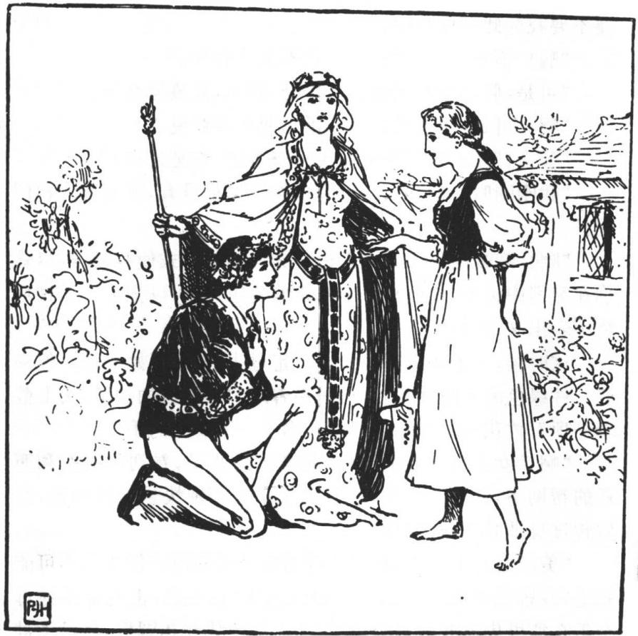

“夫人，”费利西亚红着脸回答，“你的仁慈使我感激不尽。我知道，你是我母亲的姐姐。你用自己的法力把那些来追杀我的士兵变成卷心菜，把我的保姆变成母鸡。你提议，让我和你的儿子结婚，真是给我太多的荣誉了。我怎么能对你说，我还犹豫不决呢？我有生以来第一次感到，能被人爱是多么幸福。你真的能把王子的一颗心给我吗？”

“它已经是属于你的了，可爱的公主！”王子拉着她的手说，“要不是那可怕的魔法使我不能开口说话，我早就对你说，我是多么爱你。”

这些话使公主万分幸福。女王不忍心再看到她穿得像个穷牧羊女一样，就用手杖碰了她一下，说：

“我祝愿你的打扮和你的身份和美貌相配。”公主粗布花衣服立刻就变成银丝锦缎长裙，上面装饰着红宝石；柔软的一头黑发上，套着一顶钻石头冠；洁净雪白的纱巾从头上飘下，配上那双清澈明亮的双眸，白里透红的迷人双颊，使她浑身上下焕发出迷人的光彩。王子看在眼里，不禁心醉神迷。

“你多么美丽啊！费利西亚！”他说，“我请求你，别让我再等待了，说你愿意嫁给我。”

“嗯！”女王笑着说，“我想她不会拒绝你吧！”

这时候，布鲁诺恰好出去干活，从屋里走出来，看到费利西亚，他以为自己是在做梦。可是费利西亚非常亲切地喊他，请求女王可怜他。

“什么！”她说，“可是他对你那么不好！”

“啊！夫人！”公主说，“我是那么幸福！我应该祈求人人都一样幸福。”

女王吻了她一下，说：“好！为了让你幸福，让我看看能为这个粗鲁的布鲁诺做些什么。”她挥动了一下手杖，把那间破旧的小屋变成漂亮的宫殿，里面到处都有贵重的珍宝。只有那两张凳子和草垫床还留着，好让他记住过去的穷苦。接着，女王又碰了布鲁诺一下，把他变成一个举止文雅、讲究礼貌的人。他一次又一次地感谢女王和公主。最后，女王也恢复了母鸡和卷心菜的原来面貌，他们也感到心满意足。王子和公主很快就举行了隆重的婚礼，从此过着幸福的生活。

（奥尔诺夫人）

 

## 白猫

从前有个国王，他有三个文武双全的儿子，他们既聪明又勇敢。所以，他开始害怕自己还没有死，儿子们就要来抢夺王位。国王虽然觉得自己越来越老，可是他一点也不想放弃王位，他还能很好地治理国家。他认为要想太平无事，最好的办法是作出承诺，以稳住儿子们的心，这样，在需要阻止他们抢班夺权的时候，自己就可以永远立于不败之地。

于是，他把三个儿子叫来，和颜悦色地说了一番以后，又接着说：

“亲爱的孩子们，你们一定很同意我的想法。我年纪大了，不可能像过去一样那么仔细地料理国家。我开始担心，国家的利益可能会因此而受到影响。因此，我希望你们之中的一个能继承我的王位。不过，我送给你们这样贵重的礼物，你们也理应为我做些什么。现在，我想退位以后要到乡村里去生活，有一只活泼、可爱、忠诚的小狗来和我作伴，那将是一件很好的事情。为此，我答应你们，不管你们的年龄大小，谁能够给我带来一条最美丽的小狗，谁就立刻继承我的王位。”

父亲突然喜欢起小狗来，三个王子都大为震惊。不过，这也给了两个小王子有当上国王的机会，而大儿子又太和气了，也没有提出什么反对意见。于是三个人就愉快地接受了父亲的托付。国王送给他们银子和贵重的宝石，说好一年以后，在同样的地方，同样的时间看看他们带回来的小狗。于是，他们告别了父亲。

他们在朋友的陪同下，来到了离城约有三英里的一座城堡。王子设下盛大的宴席，招待他们的朋友。三兄弟说好了永远是朋友，有福同享，决不会因为羡慕和妒忌而反目。他们约好一年以后先在这个城堡里汇合，再一起去见国王。这样，他们就分头出发了，各自走一条路。两个哥哥也经历了许多风险。不过，我们这里只讲最小的王子的故事。他年轻、漂亮，又快活，作为王子应该懂得的知识他都具备。至于他的勇气，那真是无法形容。

王子几乎每天都要买几条狗，大的，小的，什么灵缇狗、大驯犬、獚（一种长垂耳短尾矮足小犬）、叭儿狗都有。刚买下一条漂亮的小狗，接下来还有更好看的，于是他不得不把身边的狗打发掉，买下更好看的。因为他孤身一人出来，身边总不能带上成群结队的狗。

他走了一天又一天，也不知道该到哪里去。后来有一天夜晚，他走进一片黑暗的大森林，迷失了方向。更糟糕的是，突然雷声大作，倾盆大雨从天而降。王子慌不择路，见路就走。走了许久以后，他仿佛看到远处有微弱的灯光。他心中燃起了希望，也许能找到一些农舍好让他过夜。

在灯光的指引下，他来到一座难以想象那么宏伟华丽的城堡门前。门是黄金铸成的，上面镶着红宝石。就是这些红宝石发出的红光引导他穿过森林。城墙是用最好的陶瓷砌成的，色彩非常艳丽。王子看到，他以前读过的故事墙壁上都画着。可是他浑身都湿透了，雨越下越大，不可能站在那里仔细观看。他回到黄金门前，看到有一只鹿脚用钻石链条挂着。他心里有点纳闷，谁会住在这么豪华的城堡里呢？

“他们一定觉得很安全，不怕强盗。”王子自言自语地说，“好像没有什么措施，可以防止有人切断这根钻石链条，挖下这些红宝石。拿走这些东西，就足以一生富贵荣华了。”

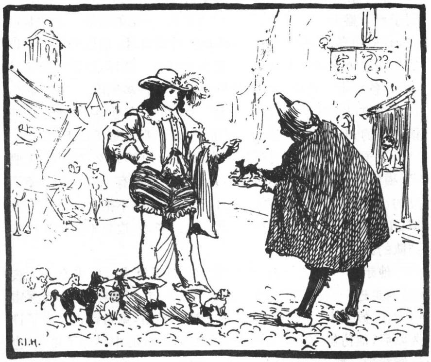

他拉了一下鹿脚，立刻响起银铃声，门打开了。可是王子没有见到什么，只是空中有许多只手在举着火炬。王子非常吃惊，呆呆地站在那里不动，直到觉得有些手在推他向前。所以，尽管他心中有些不安，也只好往前走。他手按着宝剑，以防不测。他走进一间铺着青金石的大厅，这时，有一个甜美的声音在歌唱：

> 空中飘浮的手，
> 随时听从你使唤，
> 留在这里别害怕，
> 只要你能征服爱情。

王子受到这样的欢迎，不再害怕有什么危险。在那神秘的手带领下，走到一扇珊瑚门前，珊瑚门自动打开，让他走进一间装饰着珍珠母的宽敞大厅。大厅四周有许多房间。房间里都点燃着上千盏灯，挂满了美丽的图画和珍品。王子觉得有点眼花缭乱。

穿过六十间房间以后，领路的手停了下来。王子看到，一张看上去非常舒适的扶手椅被搬到壁炉边上来；与此同时，炉火自行燃烧起来。一双美丽、温柔而轻巧的手把王子身上沾满泥泞的湿衣服脱下，又递给他干净的新衣服。这些镶着金丝和绿宝石的衣服是用最精美的材料做成的。他情不自禁地欣赏起眼前所见到的这一切来。那双伺候他的双手是那么灵巧，虽然有时突然出现会叫他吓一跳。

这时候，王子已经打扮得十分妥当了。可以告诉你，眼前的王子和站在大雨中拉鹿脚的那个十分疲惫，像落汤鸡似的他可迥然不同了。那双手把他领进一间华贵的房间，墙壁上画着“穿靴子的猫”和一些有名的猫的故事。准备用晚餐的桌子上，摆着两个金盘子，还有金匙和金叉。餐具柜里放满了水晶盘和水晶杯，上面都嵌着宝石。王子正想着，还有一个位置是留给谁的，忽然走进来约莫有十二只猫，手中拿着吉他和其他乐器。它们在房间的一头坐下，在一个打拍的猫指挥下，开始用不同的调唱起来。有的用爪子拨动吉他的琴弦，奏出一种奇怪的音乐。王子赶紧用手捂住耳朵。但即使是这样，看到这些滑稽的音乐家，他也会忍不住发出一阵阵笑声。

“接下来还会看到什么有趣的事情呢？”他心里想着。

这时，门打开了，一个套着长黑面纱的小个子走进来，前面有两个穿着黑斗篷，拿着宝剑的猫给它引路。后面还跟着一大群猫，它们手中提着笼子，笼子里都是老鼠。

王子非常吃惊，以为自己是在做梦。可是小个子向他走过来。掀开头上的黑面纱。王子看到，这是一只可爱得怎么形容都不会过份的小白猫。它看上去很年轻，也很悲伤，它用一种轻微而甜蜜的声音对他说，这声音深深地打动他的心弦：

“王子，欢迎你，猫女王很高兴见到你。”

“猫女王，”王子回答，“感谢你这么友好地接待我。可以肯定，你不是一只普通的猫。真的，你的语言和说话的方式，还有你那座壮丽辉煌的城堡都明明白白地说明了这一点。”

“王子，”白猫说，“我请求你不要对我说这些恭维话，因为我不习惯。现在，准备用晚餐吧！既然王子听不懂音乐里在诉说着些什么，那就停止演奏吧！”

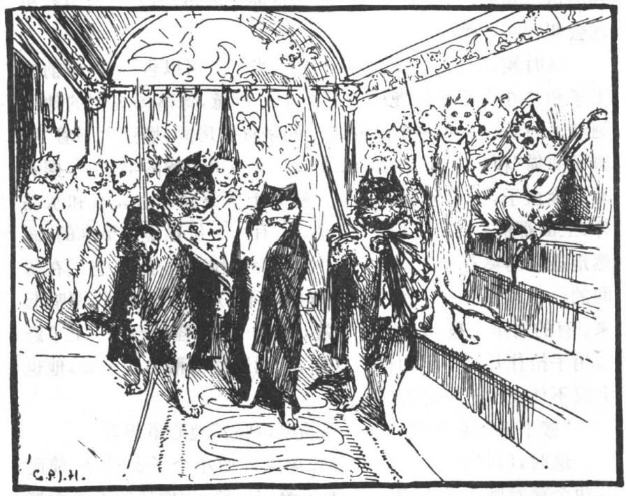

于是，那些神秘的手开始把晚餐送上来。起初，它们端上两道菜，一道是炖鸽子，一道是油煎肥鼠。看到第二道菜，王子似乎感到，这顿晚餐无法再享受了。白猫看出他的心思，对他说，这些菜是专门为他做的，没有老鼠，这一点请他尽管放心。王子十分相信，白猫不会骗他，这才不再犹豫地吃起来。不一会，王子注意到，白猫靠近他的那只小手上，戴着一只手镯。手镯上有一幅画像。王子请求让他看一看。令他大为震惊的是，那是一个十分英俊的青年，而且那么像他，很有可能就是他的画像。他看画像的时候，白猫深深叹息着，好像比刚才还要伤心。王子不敢提出任何问题，怕会让它不高兴，所以就开口说别的事情。他发现，它对自己关心的各类问题都很有兴趣，而且对世界上发生的事情都了如指掌。

吃过晚饭以后，他们走进另一个房间，里面装饰得像剧院。一些猫为他们表演戏剧和跳舞等娱乐节目。表演结束以后，白猫对他道了晚安。那些手把他领进一间他还没有见过的房间。墙壁上挂着壁画。上面织着色彩缤纷的蝴蝶翅膀。落地镜子一直伸到天花板。一张白色的小床上挂着薄纱织的帐子，上面系着缎带。王子一点也不知道该如何和这些伺候他的手交谈，默默地上了床。

第二天早晨，窗外的吵闹声把他吵醒。那些手进来，很快就帮他穿好猎装。他朝外观望，所有的猫都在院子里集合好了。有些猫牵着灵缇狗，有些吹着号角，因为白猫正准备出去打猎。那些手给王子牵过一匹木马来，那样子好像是要他骑上去。王子十分气愤，可是反对也没有用，他很快就看到，自己已经骑到马上。马带着他轻快地奔跑起来。

白猫自己骑着一只猴子，在它想抓只小鹰取乐的时候，猴子还会爬到树上的鹰巢里去。再也没有比这伙打猎者更快乐的了。他们返回城堡以后，又和上次一样，一起共进晚餐。晚餐一结束，白猫就递给他一只水晶高脚杯。杯里一定是一种神奇的饮料，因为他一喝完以后，就忘掉了一切，连给国王找小狗的事也忘得一干二净，只想着和白猫住在一起是多么幸福！在各种各样的娱乐之中，时间就这样一天一天地过去了，很快就要到一年了。王子完全忘了和哥哥会面的事，他甚至不知道自己是属于哪个国家的。可是白猫并没有忘记他什么时候该回去。有一天，它对王子说：

“你知道吗？你只有三天时间给你父亲找条小狗了，你两个哥哥都已经找到了可爱的小狗。”

这时，王子才突然恢复了记忆，喊叫起来：

“是什么事情让我忘记了这么重要的事？我一生的前途都取决于它；即使我在这么短的时间里，能找到一条可爱得能使我得到王位的小狗，我又从哪里得到一匹马，能在三天里把我送回去呢？”他开始感到非常烦恼。可是白猫对他说：“王子，不必折磨自己。我是你的朋友，会帮助你，让你一切顺利的。你还可再住一天，那匹好木马二十四小时之内就可以把你送回自己的国家。”

“我感谢你，美丽的猫。”王子说，“可是，在我没有找到一条狗送给父亲之前，回去又有什么用呢？”

“看这里，”白猫手中拿着一颗橡果，对他说，“这里有一条比狗明星还漂亮的小狗。”

“啊！亲爱的白猫，”王子说，“这时候你还和我开玩笑，多不好啊！”

“你听听！”它把橡果放在他的耳边说。

他清楚地听见里面有个微弱的声音在叫：“汪！汪！”

王子很高兴，一条能关到橡果里面去的狗肯定非常小。他想拿出来看一看，可是白猫说，最好是到了国王面前再打开，免得小狗在路上挨冻。王子千百次地感谢白猫。到该动身的时候，他伤心地和它告别。

“和你在一起的日子过得那么快，”他说，“我只希望现在能带你走。”

白猫摇摇头，深深地叹了一口气，算是对他的回答。

后来，小王子还是第一个到达和哥哥约好见面的城堡。不过他们很快也就来了。看到木马在院子里像猫一样地跳跃，他们吃惊地瞪大了眼睛。

小王子高兴地迎接他们。他们开始告诉他一路上的风险。小王子有意不把自己的经历说给他们听，还让他们以为，自己随身带回的那只转叉狗就是准备献给国王的狗。三兄弟虽然相亲相爱，两个哥哥还是禁不住为自己的狗能有更多的机会获胜而感到高兴。

第二天，他们同乘一辆马车出发。两个哥哥篮子里的两条小狗那么小巧，那么脆弱，他们几乎不敢去碰它们。而小王子的转叉狗却跟在马车后面跑，浑身沾满了泥巴，连它的样子也看不出来了。

他们回到王宫，向国王的大厅走去，大家都围拢上来欢迎他们。两个哥哥把他们的小狗拿出来，谁也说不上哪一条更好些。正当他们准备平分王国的时候，小王子走上前来，从口袋拿出白猫给他的橡果。他很快地把橡果打开。在一块白色的垫子上，有一条很小的狗，那么小，它可以轻而易举地从戒指中穿过去。小王子把它放在地上，它立刻就站起来跳舞。

国王不知道该怎么说才好。不会有什么比这个小东西更可爱的了。不过，既然他还不想急急忙忙地让出王冠，于是就对儿子们说，他们第一件事办得那么成功，所以，他还想叫他们再出去一次，走遍陆地和海洋，去寻找一块非常细巧的麦斯林纱，它能够从针眼中穿过。兄弟们开始不太愿意再出去奔波。可是后来两个哥哥同意了，因为这是他们的又一次机会。于是，他们像上一次一样，又出发了。

小王子又骑上他的木马，全速奔跑，去见他可爱的小猫。城堡的每一扇门都大开着，所有的窗和塔都照得通红，城堡显得比以前更金碧辉煌。那些手很快地上来迎接他，把木马牵进马厩。王子急忙去找白猫。它这时正在一个篮子里的白色锦缎垫子上睡觉，但听到王子的声音，很快就醒过来。再一次看到王子，它是多么高兴！

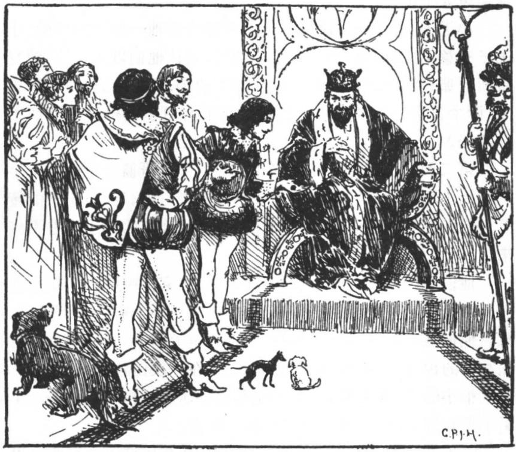

“我真不敢相信，你又回到我这里来了，王子。”它说，王子抚摸着它，告诉它自己成功的旅行，说自己回来是为了请求它的帮助。他相信，自己是无论如何也找不到国王要的东西的。白猫认真地听着，说它要想一想该怎么做。幸运的是，城堡里有些猫织布的手艺非常高明。要是它们织不出，世界上就不会有人织得出来了。它得亲自去安排这件事。

接着，那些手擎着火炬，把王子和白猫领到一条长廊里，这里俯瞰着一条河流。站在窗口，可以看到色彩缤纷的各种焰火大放异彩。在这以后，他们又一起用晚餐。与观看焰火比起来，王子更加喜欢晚餐。因为已经很晚了，在长途跋涉以后，他觉得很饿。

时间又是这样一天一天地很快过去。和白猫呆在一起，永远也不会感到沉闷。它十分聪明，总会想出一些新的娱乐方法来。实际上，一只猫不可能具有它这样的聪明才智。可是当王子问它怎么会这样才气横溢时，它只是说：

“王子，请不要问我，你爱怎么想就怎么想吧！我什么也不会对你说。”

王子过得那么快活，早就把时间给忘了。有一天，白猫对他说，一年的时间过去了，不过，他用不着为那块麦斯林轻纱担心，它早就已经织好了。

“这一回，”它说，“我可以派一些合适的人送你去。”王子朝院子里望去，只见一辆被擦得铮亮的黄金马车正停在那里，火红的珐琅面上绘着上千种不同的图案。十二匹雪白的白马排成三排站立在马车前面，全都披着金色的天鹅绒，上面还镶着钻石。马车后面跟随着一百辆战车，每辆战车用八匹马来拉。战车上坐满了穿华贵制服的军官。还有一千名卫兵簇拥在车队的两旁。

“去吧！”白猫说，“这样去见国王，他肯定不会拒绝把你应得到的王冠给你。带上这个核桃，到国王面前再打开，里面有你向我要的那块轻纱。”

“可爱的小白猫，”王子说，“你对我总是那么友好，该怎样才能表达我对你的感谢呢！只要你愿意，我宁愿放弃一切，甚至王位，留下来永远陪伴你。”

“王子，”它回答，“你对一只只会捉老鼠的小白猫那么关心，说明你的心地是多么善良，可是你不能留下。”

王子亲吻一下它的小手就出发了。你可以想象，他们的速度是多么快，只用了木马一半的时间，就来到了王宫。这一回，因为时间来不及了，他没有到城堡里去和两个哥哥会面。他们还以为，他不会再回来，正为此而高兴呢！他们在国王面前骄傲地拿出自己的麦斯林纱。那些纱倒也确实非常精细，穿过特大号针眼也是不成问题的。可是国王有意刁难，叫人到宝石库里去拿来一枚特别细的针。谁都可以一眼就看出来，要想从这枚针眼中穿过是不可能的。

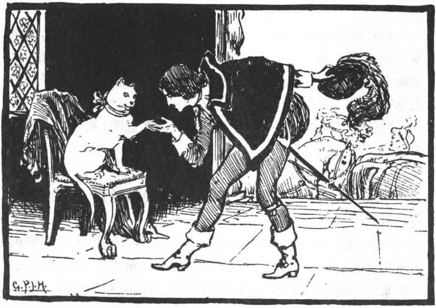

正当两个王子非常生气，开始抱怨这是个诡计的时候，突然传来了喇叭声，小王子回来了。他的父亲和哥哥看到他那么大的气魄，都非常吃惊。问候他们以后，小王子从口袋中拿出核桃来，把它打开，满怀希望地想看到麦斯林纱，可只是找到一颗榛子；把榛子打开，里面是颗樱桃核。大家都张开眼睛看着。国王看到小王子想从核仁里寻找麦斯林纱，不禁暗自觉得好笑。

王子又把樱桃核敲开，里面又只是一个核仁，大家终于都忍不住笑出声来。王子再把核仁打开，看到一粒麦子，麦子里面是一粒小米种子。这时，王子自己也感到很奇怪，不禁轻声地嘀咕起来：

“白猫！白猫！你可不是和我开玩笑吧！”

这时候，他觉得猫的爪子在他的手上抓了一下。他希望，这象征着一种鼓励，于是把小米种子掰开，从里面抽出一块九英寸长的麦斯林纱来，它是用最绚丽的色彩和最奇妙的图案编织成的。国王叫人把那枚针拿过来，它轻而易举地在针眼中穿行了六个来回！国王的脸刷地变得苍白。另外两个王子无言地站在那里，非常沮丧，谁也无法否认，这是世界上最奇妙的麦斯林纱。

过了一会，国王转过头来，深深地叹了一口气，对他的儿子说：“我已经上了年纪，知道你们都非常愿意满足我的愿望，再也没有什么比这能给我最大的安慰了。再出去一趟吧！满一年以后，谁能把最美丽的公主带回来，就和她结婚，而且不必再等待，立刻举行加冕典礼，因为我的继承人必须先成亲。”

小王子想，他已经两次公平地得到了王位的继承权。不过，他太有修养了，也不去争辩，于是回到自己威武雄壮的战车行列中，在随从的护卫下，以比来的时候更快的速度返回白猫的身边。

这一回，白猫在等待着他的到来，道路上都撒 满了鲜花。一千只火盆在烧着香木，空气中充满了芬香。白猫坐在走廊里，等待着王子。从这里，很远就可以看到他的到来。

“啊！王子，”它说，“你又回来了，王冠还是没有得到。”

“小姐，”他说，“感谢你的慷慨相助，我已经两次赢得了王冠，可事实是，我的父亲不愿意放弃王位，就是拿到了，我也不会感到高兴。”

“没有关系，”它回答，“尝试一下，证明自己有能力得到它不是也很好吗！这一回，你要带回一位美丽的公主，我要给你物色一个。与此同时，让我们好好地玩一玩。今天晚上，为了让你开心，我要安排一场由我的猫和河鼠进行的决斗。”

这一年比前两年过得更快，更开心。有时候，王子禁不住要问白猫，它怎么也会说话？

“也许你是仙女，”他说，“或者是哪个巫师把你变成了猫？”

可是，它的回答总是叫他不得要领。幸福的日子过得那么快。可以肯定，王子自己决不会想到是该回去的时候了。有一天晚上，他们坐在一起的时候，白猫对他说，他要是想明天能带一个可爱的公主回家，必须准备好，照它的话去做。

“把这把剑拿起来，”它说，“把我的头砍下！”

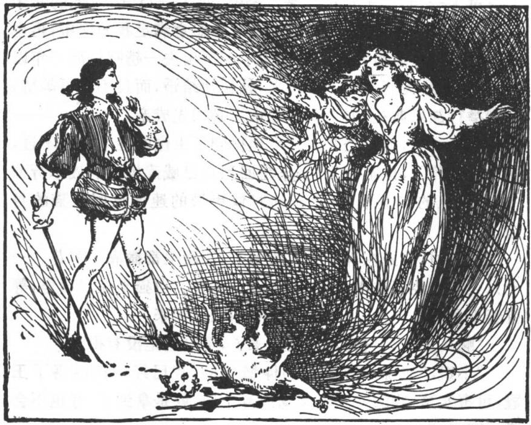

“我？”王子喊叫起来，“把你的头砍下！亲爱的白猫，这怎么可能呢？”

“我请求你照我的话去做，王子。”它回答。

眼泪从王子的脸上滚滚落下。他恳求它，让他去做任何其他它喜欢的事情，以证明他的忠诚，但不是要叫他去承受把自己心爱的小猫杀死的悲伤。可是，无论他说什么，都不能改变它的决心。王子用颤抖着的手，把它的小白头砍下。

突然，一个美丽可爱的公主站在他的面前，他的惊愕和高兴真是难以形容。在他目瞪口呆地说不出话的时候，门打开了，一大群骑士和女士走进来，人人手中都拿着一张猫皮。他们喜形于色地跑到公主的面前，亲吻她的手，祝贺她恢复了原形。她仁慈地接待了他们。过了几分钟以后，她请求他们离开，让她和王子单独地在一起，并开始向他讲述下面的故事：

“你看，王子，你猜对了，我不是一只真正的猫。我父亲统治着六个王国，他深深地爱着王后，我的母亲。我母亲有喜欢旅行和探险的嗜好。我生下来刚几个星期，她就得到父亲的允许，去游览一座大山。她听说那里有许多神奇的传说。她同时带去许多随从。”

“路上，他们要从一座属于仙女们的城堡旁经过。里面从未有人进去过，只是传说里面到处都是最奇妙的东西。我母亲想起她曾听说过，仙女们在她们的花园里种了许多水果，这些水果的鲜美和香甜是任何地方都找不到的。她开始想去亲口尝一尝，于是转身向花园方向走去。”

“到了门口，只见门上闪烁着黄金和珠宝的光芒。她命令随从大声地敲门，可是没有用，好像城堡里的人不是全睡着了就是死了。可是，得到这些水果的困难越大，王后越是下决心要得到它。她叫人搬来梯子，准备从墙上翻进去，墙看上去虽然不是很高，他们还想办法把梯子接高，可怎么做都伸不到墙顶。”

“王后很失望，这时夜幕已经降临，她命令就地安营。王后独自上了床，觉得自己像是生了一场大病似的，非常沮丧。到了半夜，她忽然醒过来，看到一个又小又丑的老太婆正坐在她的床边，对她说：

“‘我必须向你说清楚，王后陛下如果一定要吃我们的水果，这件事有些麻烦。但是，为了消除你的烦恼，我和我的姐妹们同意给你一些水果，你能拿多少就拿多少。不过有个条件，那就是把你的小女儿送给我们当自己的女儿抚养。’”

“‘啊！我亲爱的夫人，’王后回答，‘难道再也没有别的什么来换你们的水果吗？我宁愿把自己的王国给你。’”

“‘不！’老仙女回答，‘除了你的小女儿，别的什么都不要。她会永远幸福，我们会给她一切仙境里应该有的东西，可是在她结婚之前，你不能再见到她。’”

“‘虽然这是一个非常苛刻的条件，’王后说，‘我还是同意，如果吃不到这些水果，我肯定会死去，我宁愿失去我的女儿。’”

“于是，老仙女把她领进城堡。虽然还是半夜里，王后还是清清楚楚地看到，它比传说中的要美丽得多了。”

“当我告诉你，它就是我们现在居住的这个城堡时，王子，你对这一点就不会有什么怀疑了。”

“‘王后，你是自己动手去摘这些水果呢？’老仙女说，‘还是我叫它们自己走过来？’”

“‘我请求你让我看看，这些水果听到召唤的时候是怎样自己走过来的。’王后说，‘那可是件稀罕的事。’”

“老仙女吹了两下口哨，然后喊道，‘杏子、桃子、油桃、樱桃、洋李、梨子、西瓜、葡萄、苹果、橘子、柠檬、鹅莓、草莓、山莓，来吧！’”

“刹那间，这些水果一个压着一个地跌跌撞撞滚进来，既完好，又干净。王后发现，它们确实是像她想象中的那么好。你看，它们毕竟是仙树上长出来的。”

“老仙女给她一个金篮子，让她把水果带回去。水果那么多，足足要用四百头骡子来驮。接着，她提醒王后别忘了她们之间的协议，然后送王后回到营地。第二天一早，她动身回到王宫去，还没有走多远，她就开始后悔答应仙女的条件。国王出来迎接她时，她看上去那么悲伤，他心里想肯定是出了什么事，就问她是怎么回事。开始王后不敢告诉他。可是，他们刚到王宫不久，仙女就派五个可怕的小矮人来抱我走，王后不得不承认她答应了些什么。国王非常生气，把王后和我关进一个高塔里，严密地看守起来。同时，把小矮人赶出王国。”

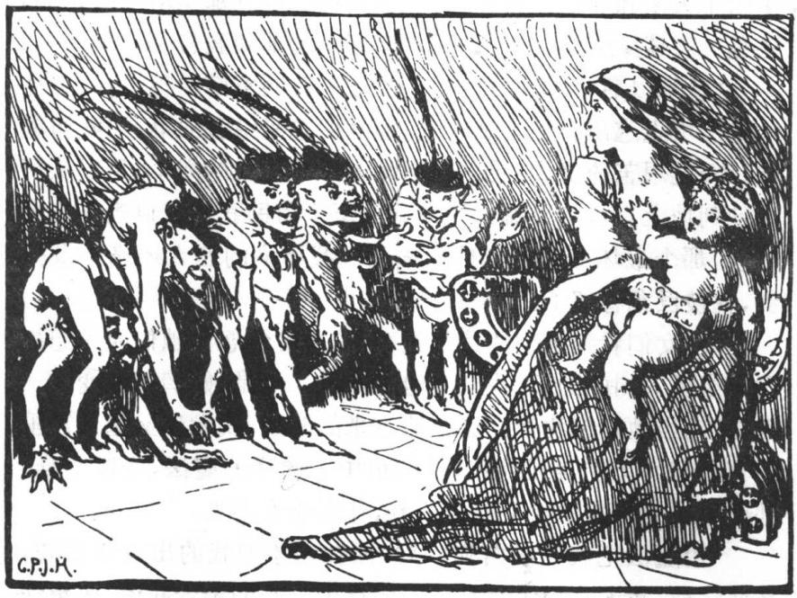

“可是，仙女派来了一条巨龙，它看到人就吃掉，它喷出的火焰把一路上经过的地方都烧光。后来，看到没有办法把它除掉，为了保护老百姓，他不得不同意把我送给仙女。这一回，仙女们亲自来领我，她们乘坐一辆海马拉着的珍珠战车，后面用钻石链条拉着一条巨龙。我的摇篮放在老仙女们的座位当中，她们小心地把我放进摇篮。我们旋风似地从空中掠过，来到她们专门为我建造的一座塔里。我就在塔里成长，周围的一切都是美丽的物品和稀世珍宝。我在这里接受一个公主应该接受的教育。除了一只会说话的鹦鹉和一条小狗以外，我没有任何伴侣。每天，我都要接待一个骑着龙来看我的仙女。”

“有一天，我坐在窗口张望，看到一位年轻英俊的王子，他好像是在我牢房周围的森林里打猎。他也站在那里抬起头来看我。当看到我在注视着他时，便很庄重地向我致礼。你可以想象，有个陌生人来和我说话，我该有多么高兴。尽管那座塔很高，我们还是一直谈到天黑，然后王子才恋恋不舍地和我告别。”

“从那以后，他又来过许多次，后来我同意嫁给他。可我怎样才能从塔里逃出去呢？那时候，仙女们总是给我亚麻，叫我纺成纱。经过艰苦的努力，我把亚麻编成一根很长的绳子，足以从窗口伸到地上。可是天哪！正当我的王子帮助我从窗口逃下来的时候，那个最坏最丑的老仙女来到。我不幸的恋人还来不及拔剑，就被巨龙吞掉了。”

“仙女们看到她们的计划失败了，非常愤怒。她们原先想把我嫁给矮人国的国王，我坚决地拒绝了。于是，她们把我变成一只白猫。当她们把我带到这个地方来的时候，我发现父亲王宫里的官员和女士在等候着我，他们也中了同样的魔法，变成了猫。那些下层的人变得除了双手以外，什么也看不见。”

“用魔法把我变成白猫以后，仙女们才把我的出身告诉我，在此之前，我十分相信我是她们的孩子。她们警告我说，要想恢复原形，唯一的机会是受到一个王子的爱，而且他各个方面都要像我那不幸的爱人。”

“你真是奇迹般地像他，”公主继续说，“你的声音、相貌，所有的一切。要是你真的爱我，我的一切烦恼都会到此结束了。”

“我的烦恼也到此结束了，”王子跪在她的脚下说道，“如果你同意嫁给我。”

“我爱你早已胜过世界上的任何人。”她说，“不过，现在该是回到你父亲那里去的时候了。让我们看一看，他会说些什么。”

王子向她伸出手去，拉着她的手一起走出去，他们一起登上战车。战车和整个队伍显得比以前更加壮丽辉煌。连马掌也是用红宝石做成，用钻石钉子钉上去。我想，这种事肯定是开天辟地第一回。

公主既美丽，又善良，而且聪明透顶。你可以想象，王子和她一起赶路是多么有趣，他觉得公主所说的一切都是那么吸引人。

来到他们兄弟约好相见的城堡，公主登上一顶由四个卫兵抬着的轿子。轿子是用一整块华美的水晶石凿成的，四面都拉上丝绸帘子，公主坐在里面谁都看不见。

小王子看到两个哥哥各自由一个美丽的公主陪同，登上台阶来欢迎他，问他是否也挑中了一个妻子。他说他看中的更加稀罕——一只小白猫！他们哈哈大笑起来，问他是不是怕在王宫里被老鼠吃掉。

他们一起返回城里，两对王子和公主各乘一辆华丽的马车，马匹都用羽毛装饰起来，闪耀着金色的光芒。后面跟着小王子，然后是那顶水晶轿，人人都惊奇地欣赏着这顶美丽的轿子。大臣们看到他们来了，赶紧去通报国王。

“那些女士们漂亮吗？”国王担心地问。

他们回答说，谁也没有见过这么可爱的公主。国王听了似乎很烦恼。

尽管如此，他还是有礼貌地欢迎他们。但是他发现，从她们之中选出一个最漂亮的来是不可能的。

接着，他转过身来问小儿子：

“那么，你是一个人回来的了？”

“尊敬的父王陛下，”小王子回答，“水晶轿里有一只小白猫，它那么温柔，叫起来那么动听，我想你会喜欢它的。”

国王微笑着，走过去想亲自拉开帘子。可是公主在里面碰了一下轿子，水晶立刻裂成上千块碎片。美丽的公主站立在大家的面前，一头秀发披肩直泻而下，头上戴着一顶花冠，飘柔的裙子像雪一样的洁白。她优雅地向国王致礼，四周响起了一片轻轻的赞叹声。

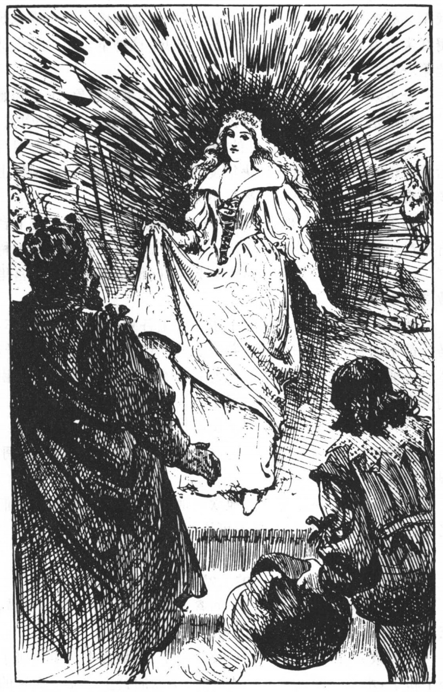

“陛下，”她说，“我来不是为了剥夺你如此称职的王位的。我统治着六个王国，请允许我把一个给你，还有两个给你两个儿子。我什么也不需要，只需要你的友谊和同意我和你小儿子的婚事。还有三个王国是属于我们的。”

国王和所有的大臣都掩饰不住他们的欢乐和惊讶。三位王子立刻举行婚礼。庆祝活动一直持续了几个月。然后一对对国王和王后都前往自己的王国去，从此过着幸福的生活。

（奥尔诺夫人）

 

## 睡莲和纺金女

从前在一片大森林里，住着一个老太婆和三个少女。三个少女都很美丽，其中最小的一个长得最美丽。她们的屋子坐落在森林深处，十分隐蔽。因此，除了白天的太阳，晚上的月亮，还有星星的眼睛以外，谁都没有见过她们的美丽。老太婆叫少女们拼命地干活，从天蒙蒙亮一直干到晚上，把金色的亚麻纺成纱。一根纱杆纺好了，另一根马上就递过来，她们片刻也不能休息。纺出来的纱线要又好又光滑。老太婆把纺好的纱都锁在一间密室里。每年夏天，她都要出去旅行两三次。在出去以前，她总是把回来之前的活派好，而且总是在半夜里回来。所以，少女们永远也看不到她带什么回来；她也从不对她们说，金麻是从哪里来的，用它纺成纱以后做什么。

现在，老太婆出去旅行的日子又到了，她给三个少女安排六天的活，像以前一样地警告她们：“孩子们，千万不要东张西望，更不要去和男人说话。如果说了，纺出来的线就会失去光彩，各种各样的灾难就会随之而来。”听到这老掉牙的警告，她们都笑了起来，说：“我们纺出来的金线怎么会失去光彩呢？我们有机会和男人说话吗？”

老太婆出去以后的第三天，有一位年轻的王子到森林里来打猎，和伙伴们走散了，完全迷失了方向。由于找不到路，他精疲力尽，倒在一棵树下睡着了，任凭他的马去吃草。

等他醒过来的时候，太阳已经西沉。他又开始寻找走出森林的道路。后来，他看到一条狭窄的小路，就急忙跟着走。小路把他领到那间森林小屋前。这时候，少女们正坐在门前纳凉，看见他走过来。两个姐姐非常惊慌，因为她们想起了老太婆的警告。可是最小的一个说：“我从来没有见过一个像他这样的人，让我仔细看一看。”她们恳求她进去，后来见到她不肯，就自己进去了，把她一个人留在外面。

王子走过来，彬彬有礼地向她问候，对她说，他在森林里迷了路，又累又饿。她给他拿来食物，和他说得很开心，完全忘记了老太婆的警告，一说就是几个钟头。

这时候，王子的伙伴正到处寻找他，看到毫无结果，就派两个人回去把坏消息报告国王。国王立即派出一团步兵和一团骑兵出来寻找。

找了三天以后，他们发现了这间小屋。王子还是坐在门口，和少女作伴，他感到非常高兴，时间像刚过去一个钟头。在离开之前，他答应还要回来，把她带回到父亲的王宫去，娶她作新娘。

王子走了以后，她坐下来开始纺纱，想把失去的时间补回来。可是她惊愕地看到，纺出来的纱完全没有光彩。她的心怦怦直跳，痛哭起来。她想起了老太婆的警告，不知道会有什么灾难降临到她的头上。

晚上，老太婆回来，从那些暗淡无光的纱线上，知道她不在的时候发生了什么事情。她大发雷霆，对少女说，她已经给自己和王子带来了不幸。少女整天提心吊胆，不得安宁。后来，她再也受不了了，决心去向王子求救。

她从小就学会鸟的语言，现在，对她帮助可大了。看到一只渡鸦在杉树上梳羽毛，她轻轻地对它说：“亲爱的鸟儿，所有的鸟中数你最聪明，你还有一双飞得最快的翅膀，你愿意帮助我吗？”“我怎么帮助你呢？”渡鸦问。她回答：“一直飞过去，直到看见一座瑰丽的城堡，那里有国王的宫殿。找到国王的儿子，对他说，巨大的灾难正降临到我头上。”

接着，她告诉渡鸦，她纺的纱如何失去光彩，老太婆如何大发雷霆，她如何担心大祸临头。渡鸦忠诚地答应照她的吩咐去做。它展开双翅飞走了。

少女回到家里，整整一天卖力地把两个姐姐纺出来的纱绕成团，老太婆不再让她纺纱了。到了晚上，她听到渡鸦在一棵松树上“嘎嘎”地叫，就迫不及待地跑过去听回话。

非常幸运，渡鸦在王宫的花园里找到了风巫的儿子，他也懂鸟的话，渡鸦叫他给王子传话。王子听到以后，非常难过，就找来他的朋友商量，如何去救少女。然后，他对风巫的儿子说：“请渡鸦快点飞回到少女那里去，叫她在第九个晚上准备好，到时候我来救她走。”风巫的儿子这样做了。渡鸦飞得那么快，它当天晚上就回到小屋。少女由衷地感谢小鸟。回到屋里，对谁也不提起这件事。

第九个晚上越来越近了，少女的心事越来越重，生怕会碰上厄运，把一切都毁了。

这天晚上，她悄悄地从屋子里溜出去，到离屋子不远的地方去等待着，她浑身颤抖着。不久，她听到裹着布的马蹄声。接着，在王子的带领下，一支武装的人马出现了。一路上，王子小心地在树上作了记号，以免迷路。看到少女，他从马上跳下，把她抱到马鞍上，自己再跨上去，坐在她后面，然后策马向家里奔跑而去。一路上月光皎洁，不难看出那些树上的记号。

天渐渐放亮，鸟儿开始喳喳地叫起来。要是王子能听懂它们在说些什么，或者少女留心听一下，他们也许会少受许多痛苦。可这时他们心中只有对方。等走出森林时，太阳已经高高升起。

这天早晨，最小的少女没有出来干活。老太婆问，她到哪里去了，两个姐姐假装不知道。可是实际上，老太婆是个巫婆，她轻而易举地就猜了出来，决定要惩罚逃跑的人。她采集九种不同种类的巫师用的茄属植物，加上一些盐，施上魔法，用布包成绒毛球状，朝着他们逃去的方向，扔到风的翅膀上去，嘴里还念念有词：

> 旋风，你是风的母亲，
> 帮我惩罚那罪人，
> 把这魔球带去，
> 叫她和王子分离，
> 永远淹没在涟漪的河水里。

中午时分，王子和他的人马遇到一条很深的河流。河上只有一条很狭窄的桥，一次只能让一匹马通过。当王子和少女骑的马走到桥中央时，魔球正好从他们身边飞过。马受了惊，突然仰起前蹄，还没有人来得及拉住它，少女已经被摔到桥下面湍急的河流中。王子想跟着跳下去，被手下的人拉住，不管他怎么挣扎、反抗，还是被他们硬拖回家里。

一连六个星期，王子把自己关在一间密室里，不吃也不喝。王子悲痛欲绝，后来终于病倒了，眼看生命垂危。国王大为震惊，把全国所有的巫师都召来，可是谁也救不了王子。

后来，风巫的儿子对国王说：“去把芬兰的老巫师请来，他知道的比你全国的巫师加起来还要多。”国王立刻派使者到芬兰去。一个星期以后，老巫师坐在风的翅膀上来了。

“尊敬的国王，”老巫师说，“是风把这场病吹到你儿子身上，一个魔球抢走了他的爱人，正是这个原因才使他悲痛不已。让风来把他身上的悲哀吹散吧！”于是，国王让他的儿子到外面去吹风。王子渐渐地恢复过来，把发生的一切都对他父亲说了。

“忘了那少女吧！”国王说，“另娶一个做新娘。”可是王子说，他再也不会爱上别的姑娘了。

一年以后，他突然来到爱人遇难的桥上。想起这不幸的往事，他失声大哭。他情愿抛弃所有的一切，以换回她的生命。在深深的悲痛之中，他好像听到有个声音在歌唱，四处张望，却不见人影。过了一会，他又听到那声音在唱：

> 啊！中了魔法，被人遗弃，
> 难道我永远躺在这里？
> 爱人啊！为何不想一想，
> 新娘在等你救起！

王子非常吃惊，他从马上跳下，到处寻找，看看是不是有人藏在桥底下。可是一个人也没有。后来，他注意到有一朵黄色的睡莲花飘浮在水面上，有一半被睡莲宽广的叶子遮住了。可是花总不会歌唱吧！他十分惊讶地等待着，希望能再听到那歌声。果然，那声音又唱起来了：

> 啊！中了魔法，被人遗弃，
> 难道我永远躺在这里？
> 爱人啊！为何不想一想，
> 新娘在等你救起！

王子忽然想起那两个纺金女，自言自语地说：“如果我骑马去找她们，说不定她们会告诉我其中的道理。”他立刻朝小屋奔过去，看到两个少女正在泉水旁。他把她们的妹妹一年前发生的事说了，还有他如何两次听到那奇怪的歌声，却找不到唱歌的人。

她们说，那黄色的睡莲花正是她们的妹妹，她没有死，只是被那魔球改变了模样。在王子临睡之前，最大的少女用魔草药做了一个饼给他吃。那天晚上，他梦见自己住在森林里，能全部听懂小鸟们相互之间的谈话。

第二天早晨，他把这个梦对少女们说了。她们说，是那个魔饼起的作用，还劝他注意听小鸟说的话，看看它们能告诉他什么。等救起他的新娘以后，她们请求他回来，把她们从悲惨的奴役中救出去。

王子答应以后，高兴地返回家去。他骑着马从森林中经过时，全部听懂小鸟们说的话。他听见一只乌鸦对喜鹊说：“人是多么笨啊！连最简单的道理也不懂。那少女被变成睡莲已经整整一年了。虽然她的歌唱得那么悲伤，谁从桥上经过都听得见，可就是没有一个人来救她。她以前的新郎昨天还骑马从这里经过，听到她的歌声，也无动于衷。”

“而且她的所有不幸都是他造成的。”喜鹊补充说，“要是他只留意人说的话，那少女只能永远是一朵花了。她能否很快得救，全看芬兰老巫师的了。”

听到这里，王子想着如何能带个讯到芬兰去。这时，他听到一只燕子对另一只燕子说：“来吧！让我们飞到芬兰去！在那里我们能筑起更好的窝。”

“等一下，好朋友！”王子喊道，“你们能不能帮帮我的忙？”燕子表示同意。他接着说：“请转达我对芬兰巫师的无限敬意，问他我怎样才能把一个变成花的少女恢复原形？”

燕子飞走了。王子骑着马回到桥上。他停下来，渴望能再听到那歌声。可是，除了河水的奔流声和风的呜咽声，他什么也听不见。王子失望地骑着马回家。

不久以后，他来到花园里坐着，心里想燕子肯定把他的话给忘了。这时，他看到一只鹰在他头上飞着。鹰慢慢地降落下来，停在王子附近的一棵树上，说：

“芬兰的巫师向你问候，他叫我告诉你，这样做你就可以救出少女：到那条河里去，把你全身涂上泥，然后说：‘从人变成蟹。’这样你就会变成一只蟹。勇敢地潜到水里去，尽可能地游到睡莲的根部，把它从泥土和芦苇中挖出来。然后用你的钳爪抓住它的根，升出水面，让河水冲洗睡莲花，顺流一直漂到河左岸的一棵山榉树下。树的旁边有块大石头，在那里停下来说：‘从蟹变成人；从睡莲变成少女。’这样，你们就会双双变成原来的模样。”

王子心中充满了怀疑和忧虑。过了一会才鼓起勇气，想试试看能不能救起少女。这时，一只乌鸦对他说：“你为什么犹豫？老巫师对你说的话并没有错，那些鸟也并没有欺骗你，快去擦干少女的眼泪吧！”

“再没有比死更可怕的了，”王子想，“大不了就是一死，死了也比无穷无尽的忧愁好。”于是，他骑着马来到桥上。他又听见了睡莲伤心的歌；他不再犹豫了，立刻把泥涂满全身，说了一声“从人变成蟹”，纵身跳入河水。一瞬时，只听见耳边的水嘶嘶地响，但很快就一片寂静了。他游到睡莲旁边，开始挖它的根。可是根在泥土和芦苇中扎得那么紧，他费了好长时间。

把睡莲根挖起来以后，他抓紧睡莲升上水面，让河水哗哗地冲洗睡莲。河水带他们顺流而下，可是哪里有山榉树呢？后来，他终于看到了，旁边还有一块大石头。他停下来，说：“从蟹变成人，从睡莲变成少女。”他非常高兴地看到了，自己又变成了王子，少女就站在他身边。

少女比以前还美丽十倍，她穿着一条浅黄色的裙子，上面的宝石珠光闪闪，显得瑰丽无比。她感谢王子把她从残酷的巫婆手中救出来，表示十分愿意嫁给他。

可是，当他们回到桥上的时候，留在桥上的马不见了，怎么也找不到。王子自以为他变成蟹只有几个小时，其实，他在水中已经待了十几天。正当他们不知如何回王宫而发愁的时候，看到六匹装饰华丽的马拉着一辆豪华的马车从岸边奔过来。他们乘着马车回到王宫。

这时，国王和王后正在教堂里为他们的儿子而哭泣。他们以为他已经死了。为他哀悼了好几天。当王子拉着一位美丽少女的手走进来时，他们既是惊讶万分，又是说不出的高兴。王子和少女的婚礼立刻就举行。一连六个星期，整个王国到处都是盛宴和欢乐。

在此以后，有一天，王子和新娘正坐在花园里，一只乌鸦飞过来对他们说：“忘恩负义的家伙！你是不是忘了在你忧愁的时候，帮助过你的两个可怜的少女？难道一定要让她们一辈子纺金麻吗？别可怜那老巫婆，这三个少女都是公主。她们还是小孩时，老巫婆就把她们连同王宫里所有的银器都偷来。她把银器变成了金麻。毒死她是她应得的惩罚。”

王子为忘记自己的承诺而羞愧。他立刻就动身。幸运的是，他到达小屋的时候，老巫婆正好出去了。两位少女已经梦见了他的到来，做好了和他一起走的准备。她们做了一个饼，在饼里放了毒药，把饼放在桌子上。老太婆回来时，总是先看桌子。这一天她回来以后也是这样，看到桌子上有饼，那么诱人，就贪婪地把它吃了，当时就死了。

他们在密室里找到了五十车金麻，还有五十车埋在地下。临走之前，他们把小屋铲成平地。从此以后，王子和新娘，还有她的两个姐姐幸福地生活在一起。

 

## 可怕的头

从前有一个国王，他只有一个女孩子。国王非常想有个儿子，或者是个外孙子也行，这样可以继承他的王位。可是，他在请教预言家时，预言家对他说，他亲生女儿的儿子将把他杀掉。这个消息可把他吓坏了。他决定永远也不让女儿出嫁。他想，没有外孙总比被外孙杀掉好得多。

他把建筑工人找来，叫他们在地下挖一个很深的洞，在洞里筑起铜的监牢。完工以后，就把女儿关在里面。再也没有人能看到她。她也不能再看到田野和海洋，只能看到天空和太阳，因为铜做的屋顶上开了一个很大的窗。公主坐在那里抬头观望，看着云朵在天上飘过，想着有一天能离开这个监狱。

有一天，公主好像看到头上的天窗打开了，金色的光辉从屋顶的窗口泻下，房间里一片光亮。没有多少日子以后，公主生了一个婴孩，一个小男孩。

国王听到这个消息，生气极了，害怕孩子的出生就象征着他的死亡。不过，国王胆子小，他也不敢直接了当地把他们杀掉，而是把他们关进一个包着铜皮的大箱子里，再叫人把箱子扔到海里去。这样，他们不是被淹死，就是被饿死；或者他们会从此飘落异国他乡，再也不会给他造成威胁了。

公主和婴儿被关在箱子里，日以继夜地在海上飘流。婴孩不怕大风，也不怕海浪。他不知道，大风和海浪会来伤害他，他睡得很香甜。公主抱着他，给他唱歌，歌词是这样的：

> 孩子，我的孩子，
> 你睡得好香，
> 尽管妈妈满腹忧愁，
> 你的心依旧坦然，
> 在小小的箱子里躺。
> 这黑暗的阴郁的夜晚，
> 没有星星在闪光。
> 你睡得那么熟，
> 听不到波浪在翻滚，
> 听不到海风在盘旋。
> 裹着柔软的紫色被，
> 你的小脸依偎着妈妈，
> 听不到她的哭泣，
> 大海仿佛也为你默然。

白天终于来临，海浪把箱子冲上一个岛屿的海滩。公主和她的婴儿，就在这包着铜皮的箱子里，躺在海滩上。后来有人走过来，看到了箱子，把它拉上岸，把它打开，天哪！里面有一个美丽的女子和小孩。他把他们带回家，对他们很好，把男孩子抚养成一个青年。

小孩成年以后，这里的国王爱上了他的母亲，想娶她。可是他知道，她怎么说也不会和儿子分开。所以，国王想出一个计谋来，想把她的儿子除掉。他的计谋是这样的：

离岛国不远有个国家，这个国家的女王即将结婚。岛国国王对他的臣民说，大家都得把礼物带来，好让他送给女王。国王还举行盛宴，招待送来礼物的人。有些人送来金杯，有些人送来金项圈和琥珀，还有些人送来了漂亮的马。只有公主的儿子什么也没有送。因为尽管他母亲是个公主，却什么也没有给他。其他人开始取笑这个青年人。国王说：“要是你无礼可送，你起码可以去把那可怕的头送来。”

年轻人很自傲，他想也不想就回答：

“那好，我发誓要把那可怕的头带来，别人能做到，我也能做到。可是我不知道你说的是什么头。”

他们对他说，在离这里很远的一个地方，住着可怕的三姐妹，她们是野兽般的女妖魔，长着金翅膀，铜爪子，头发是一条一条毒蛇。她们看上去那么可怕，谁看上一眼就会变成石头。她们之中有两个是杀不死的，只有脸长得非常漂亮的最小一个可以杀死。年轻人答应要带回来的，就是她的头。你可以想象，这可不是普通的冒险。

明白了怎么回事以后，他也许会后悔不该发誓把这可怕的头带回。可是，他决心要信守自己的誓言。他离开了大家饮酒作乐的宴席，在黄昏的笼罩下独自来到海边。这里就是当年他和母亲坐在箱子里，被抛上海岸的地方。

他坐在一块岩石上，眺望着大海，想象着如何才能去实现自己的誓言。这时，他感到有人碰了一下他的肩膀。回过头来，他看到一个像王子一样的青年，身边还有一个身材高大而美丽的女子，她的眼睛像星星一样在闪光。他们都比凡人高大。男青年手中拿着一根手杖。手杖上有一对金色的翅膀，还有两条金蛇缠在上面。他的帽子和鞋子上也有翅膀。他开口和年轻人说话，问他为什么这样忧愁。年轻人对他说，自己已经发过誓，要把那可怕的头带回来，可是不知道该如何着手去做。

那美丽的女子也开始说话了。她说：“这是一个匆忙而愚蠢的誓言。不过要是一个勇敢的人说过了，他也可以去实现它。”年轻人回答说，只要知道该怎样开始，他并不害怕。

女子告诉他，要杀掉金翅膀、铜爪子的可怕女妖，砍下她的头，需要有三件东西：首先是隐身帽，戴上它别人就看不见；其次是一把削铁如泥的利剑；最后是一双飞鞋，穿着它能在空中飞行。

年轻人说，他不知道该到哪里去取这三件东西，为了得到它们，他只能试试看。这时，那个男青年脱下他的鞋子，说：“首先，你可以先用这双鞋子，等你拿到那可怕的头以后，你一定要还给我。穿上这双鞋，你就可以像鸟一样地飞翔，想到哪里就到哪里。”

“只要是它认识的路，它就会带你飞越陆地和海洋。可是，世界尽头以外的路它不认识，这些路要靠你自己去探索。现在，你先得到三个灰姐妹那里去。她们住在遥远的北方。她们年纪那么大，三个人只有一只眼睛和一个牙齿。你要偷偷地接近她们，等一个人把眼睛递给另一个的时候，你就把它抢过来，不要还给她们，直到她们告诉你到花园三仙女那里去的路怎么走。她们还会给你隐身帽和一把利剑，还会告诉你该怎样飞越这世界，到可怕的头的领地上去。”

那美丽的女子接着说：“快点去吧！不要回去和你妈妈告别。这种事情要快点办。这双飞鞋会把你带到三个灰姐妹那里去，它认识这条路。”

于是年轻人对她表示感谢，穿上飞鞋，系好鞋带，转过身来准备和他们说再见。可是，他们已经不见了。不知道是怎么走的，到哪里去了。

他跳入空中，想试一试飞鞋。飞鞋带着他飞起来，比风还快。他从温暖的蓝色海洋上飞过；从南方的乐土上飞过；从北方的人群头上飞过，他们喝马奶，住大篷车，过着游牧的生活。他越过宽阔的河流，野禽从河面上飞起，四处逃窜；他穿过宽广的平原和寒冷的北海，还有那茫茫的雪地和数不清的冰山。这里已经是世界的尽头。水冻成了厚厚的冰，没有人烟，没有野兽，也没有绿色的草地。在一个蓝色的洞穴里，他找到了三个灰姐妹，她们是世界上寿命最长的人，比所有活着的人和动物寿命都长。她们的头发像雪一样白；她们的皮肤也像冰一样，泛着淡淡的蓝光；她们喃喃说话和点头的模样，像是在梦幻中似的；呼出来的热气变成云雾，在她们周围环绕。

冰洞的洞口非常狭窄，要想进去又不碰她们，可真不容易。靠飞鞋的帮忙，年轻人总算勉强偷偷地飞进去。他听到一个人对另一个用眼睛的人说：

“姐姐，你看到了什么？看到过去的年代回来了吗？”

“没有，妹妹。”

“那么，把眼睛给我吧！我也许能比你看得更远。”

于是，第一个人把眼睛递给第二个。就在第二个伸出手来摸索时，年轻人抢先把眼睛拿过来。

“眼睛呢？姐姐，”第二个人问。

“你不是已经拿走了吗？妹妹。”第一个人说。

“你是不是把眼睛丢了？姐姐，是不是丢了？”第三个灰女人说：“我们会不会丢了眼睛，再也看不到过去的年代回来了？”

年轻人偷偷地从她们背后溜出冰冷的山洞，大声地笑起来。

灰姐妹听到笑声，开始哭起来。因为她们现在知道了，是陌生人抢了她们的眼睛，她们一点办法也没有了。眼泪从她们没有眼珠的眼眶中滚下，立刻冻成冰珠，在洞穴里结了冰的地面上滚动。接着，她们开始恳求年轻人把眼睛还给她们。她们那么可怜，他禁不住同情她们起来。可是他说，除非她们告诉他，到花园仙女那里去的路怎么走，否则决不会把眼睛还给她们。

听了他的话，她们痛苦地绞起手来。她们猜出来了，他是为什么而来的，将如何去取可怕的头。那可怕的三姐妹和她们是亲戚，所以，叫她们给年轻人指路是多么艰难。不过后来她们还是说了，叫他一直往南走，左边靠着陆地，右边靠着海洋，这样就可以一直走到花园仙女的岛上。于是，他把眼睛还给她们，她们又开始看到过去的年代回来。

年轻人在陆地和海洋之间一直向南飞去。左边总是靠着陆地，一直飞到一个美丽的海岛。海岛上覆盖着鲜花盛开的树林。他在岛上降落下来，找到了花园三个仙女。她们是三个非常年轻漂亮的女子。一个穿着绿衣服，一个穿着白衣服，还有一个穿着红衣服。她们围着一棵苹果树且歌且舞，苹果树上长着金苹果。歌中唱道：

> 金苹果，圆又圆，
> 我们绕它跳舞蹈。
> 从古跳到今，
> 围着这棵树啊，
> 从来不停息。
> 春风吹绿大地，
> 河水奔流不息，
> 风吹海水起波浪，
> 金苹果还不能吃，
> 要等新的黄金时代到来。
> 树木吐新芽，
> 花儿凋谢了，
> 歌声寂静了，
> 多少曲终人散，
> 新时代啊，还没有到来。
> 围着金苹果，
> 我们跳啊跳，
> 地球从古转到今，
> 夏去秋到，暑尽寒来。
> 唱不尽的歌曲，
> 讲不完的故事，
> 我们围着仙女树，
> 一直跳啊跳，
> 送走过去，迎接未来。

这些庄重的舞蹈仙女不像那些灰女人，她们很高兴看到年轻人，非常友好地接待他。她们问他为什么而来。他说，他来是为了寻找利剑和隐身帽。仙女们把这两样东西都给了他，还给他一个皮袋和一块盾牌。她们帮他把有钻石剑刃的利剑佩在腰上，戴上隐身帽，然后对他说，尽管她们是仙女，现在也看不见他了。年轻人把隐身帽摘下，她们一个接一个吻他，祝他好运。这以后，她们又围着金树，跳起永恒的舞蹈。保护金树，直到新时代的到来，或是世界末日的到来是她们的责任。

年轻人戴上隐身帽，把皮袋挂在腰上，把闪光的盾牌扛到肩上，飞越像蛇一样地围绕着整个世界的那条大河。就在河岸边，他看到那三个可怕的女子都睡在一棵杨树下，四周铺满了枯死的杨树叶。她们的金翅膀都收拢着，铜爪交叉着。两个姐姐睡姿像鸟一样，可怕的头埋在翅膀下，头发一样的蛇从金羽毛下伸出来，蠕动着。最小的睡在两个姐姐中间，背贴在地上，美丽而忧伤的脸朝天。她虽然睡着了，眼睛却张得很大。年轻人只要看上她一眼，就会被对她的恐惧和怜悯变成石头，她那样子实在可怕。可是，年轻人已经想出了不用看她的脸就可以把她杀掉的办法。

从远处看到她们三个以后，他从肩上取下那闪亮的盾牌，把它当作一面镜子，从中可以看到她们的影子，而不必直接去看这些可怕的头。他一步步地靠拢过去，直到估计利剑能砍到最小的那个头。算好能从背后砍中她以后，他拔出利剑用力一挥，那可怕的头应声从她的肩膀上落下。鲜血喷到他身上，力量那么大，像是被人打了一下似的。他迅速地把可怕的头塞进皮袋，头也不回地赶紧飞走。

这时，两个可怕的姐姐醒过来，像巨鸟一样升上天空。年轻人虽然戴着隐身帽，她们看不见；可是她们穿过云层能闻到他的气味，就像狗在丛林中追捕猎物一样。她们靠得那么近。他连她们拍动金翅膀的声音也听到了；还听到她们一边追，一边喊叫着：“这边！这边！”“不！那边，他朝那边走了。”不过，飞鞋的速度要比她们快得多。他飞过那条环绕世界的大河以后，就再也听不到她们拍动翅膀的声音和喊叫声了。

年轻人把那两个可怕的怪物远远地抛在后面以后，发现自己正在河的右边，就一直向东飞去，想寻找自己的国家。可是，在他从空中往下看时，看到了一件奇怪的事。一个美丽的姑娘被链条锁在海水最高水位的木桩上。那姑娘不是被吓坏了，就是极度疲倦，看上去像是死过去了一样，要不是锁在腰上的铁链把她拉住，她早就倒下了。

年轻人非常可怜她，就飞下来站在她身边。听到他说话的声音，她抬起头来，四处张望，心里更加害怕了。这时，他才想起自己还戴着隐身帽，她只能听到他的声音，看不见他人。于是，他把帽子摘下，一个她从未见过的，英俊的年轻人站在她面前。他长着黄颜色的短头发，蓝色的眼睛，一张和善和微笑的脸。年轻人也想，她是世界上最美丽的姑娘。他拔出利剑，一下就把锁着她的铁链砍断，然后问她怎么会到这里来，人们为什么这样残酷地对待她？姑娘对他说，她是这个国家的公主，她被锁在这里，是为了让一个海里的怪物来吃掉。那怪物每天都要来吃一个姑娘，现在轮到她了。她正说着的时候，一个凶狠的海怪从波涛中升起，伸出又长又凶猛的头来，扑向姑娘。那海怪也许是饿急了，第一次没有扑到。等它抬起头来准备扑第二次时，年轻人已经从袋中抽出那可怕的头，并且把它举起来，海怪抬起头的时候，眼睛看到了那可怕的头，立刻变成石头。这石头海怪到现在还留在海岸上。

年轻人和公主回到她父亲的王宫。那里，人人都在为公主的死而哭泣，看到她好好地回来，几乎不相信自己的眼睛。国王和王后把年轻人捧为上宾，知道他想和公主成亲，他们高兴得难以自制。他们俩立刻举行婚礼，那豪华和欢乐的气氛，真是无与伦比。在王宫里度过蜜月以后，他们乘上一条船回到年轻人自己的国家。因为不能带新娘在空中飞行，他把飞鞋脱下，摘下隐身帽，连同那把利剑一起放在山上一个隐蔽的地方。后来他在海边遇见的，指点他如何去取那可怕的头的青年男女把它们拿走了。

办好这件事以后，年轻人带着新娘登上了自己国家的土地，回到了自己的家乡。他在街道上竟看到了自己的母亲在拼命地奔跑逃命，邪恶的国王在她身后紧紧追赶，想要杀死她，因为她不肯嫁给他。如果说，她以前就不喜欢国王，现在就更加恨他了。她认为，儿子突然失踪，肯定是他一手造成的。所以，年轻人看见他母亲的时候，她正在为活命而奔逃，国王握着剑奋力追赶。慌忙中，她一头撞在儿子的怀抱中。他只来得及把她拦住，吻了她一下，国王的剑就向他砍过来了。年轻人用盾牌把剑挡住，对国王喊道：

“我发誓把那可怕的头给你带回来，现在我办到了！”

接着，他把那可怕的头从皮袋中拿出来，国王看了一眼，立刻就变成石头，手中还举着那把剑！

全国人民欢欣鼓舞，因为邪恶的国王再也不能统治他们了。他们推选年轻人当国王，可是他拒绝了，说要带着母亲回到她父亲的家里去。于是，老百姓推选了那个在海边找到装着他们母子的大箱子，善良地收养了他们的人当国王。

年轻人带着母亲和妻子，乘船动身向母亲的家乡驶去，当年，她是那么残忍地被从家乡赶出去。半路上，他们上了岸，来到一个国王的王宫里，恰巧那里举行竞技会，谁跑得最快、拳击最好、铁圈投得最远，国王就奖励谁。年轻人想和别人较量较量。他投出的铁圈出乎人们意料地远远超过其他人，向观看的人群中飞去，击中了一个观众，当场把他砸死。这个观众不是别人，正是他的外公。他因为整天提心吊胆，害怕外孙会来找他，把他杀了，于是干脆抛弃王国出逃。这样，他就偶然地死于自己的胆怯心虚，预言也就这样实现了。年轻人带着母亲和妻子回到属于他们的王国，在度过那么多苦难以后，开始过着永久幸福的生活。

 

## 金发公主的故事

从前曾有一个公主，她是全世界最美丽的姑娘。她长得那么漂亮，而且有一头金黄色的长头发，波浪似的直泻而下几乎着地，所以大家都叫她美丽的金发公主。她头上总是戴着花冠，身上总是穿镶着钻石和珍珠的衣服，看见她的人都会情不自禁地爱上她。

那时候，邻国有一个还没有结婚的年轻国王。他不但非常富有，而且也长得很英俊。他听到那么多关于赞美金发公主的话，尽管从未见过面，却也深深地爱上了她，而且到了寝食不宁的程度。于是，他决定派使者去向她求婚。他给使者准备了一辆华丽的马车，还派给他一百个随从，一百多匹马，叫他一定要亲自带公主回来。

使者出发以后，王宫里整天都在议论着这件事。国王觉得十拿九稳，公主肯定会同意他的求婚。他命令手下的人裁制漂亮的衣服，制作豪华的家具，免得公主到来的时候措手不及。

使者到达金发公主的王宫以后，说明了他的来意。可是这一天，不知道公主正好不高兴呢，还是礼节上不合她的意，她只是说，很感谢国王，但现在还不想结婚。使者非常沮丧地带着国王送给公主的全部礼物回国。公主很有教养，她认为既然不接受国王的求婚，也就不能收下他送来的珍珠和钻石。所以，她只留下二十五枚英国饰针，免得他难堪。

正当国王等得很不耐烦的时候，使者回来了。他没有带公主回来，大家都很不高兴。国王像个孩子似的大哭起来，谁也劝不了他。那时候，王宫里有个年轻人，他比谁都聪明，比谁都漂亮，大家都叫他美男子，而且都喜欢他。只是有少数人因为他讨国王喜欢，知道国家的全部机密而妒忌他，心中感到愤愤不平。这一天，他恰巧和一些议论这件事的人在一起。那些人说，使者被派到公主那里去，事情办得并不漂亮。美男子不加思索地插进来说：

“当初国王要是派我到金发公主那里去，我敢肯定她会跟我一起回来。”

他的对头马上就去对国王说：

“陛下，你肯定不敢相信，美男子竟敢放肆地说，要是派他到金发公主那里去，公主肯定早就跟他一起回来了。他似乎认为，他比你漂亮得多，公主肯定会爱上他，心甘情愿地跟他走。”国王听了这些话，非常生气。

“哼！”他说，“他竟敢取笑我的不幸，认为比我更吸引人？去！把他关到最高的那座塔里去，叫他饿死！”

于是，国王的卫兵立刻去抓美男子。这时，他早已忘了那句脱口而出的话。卫兵非常粗暴地把他投进监狱。可怜的囚犯只能在一些稻草上睡觉，要不是塔上有一小股水流下来，他早就渴死了。

有一天，当他陷入绝望之中时，他对自己说：

“我怎么会冒犯国王呢？我是他最忠诚的臣民，从来没有做过什么对不起他的事情。”

国王恰巧从塔旁经过，认出这是他以前喜欢的美男子的声音。国王不顾美男子对头的劝阻，停下来想听他说些什么；那些人对国王说，背逆的人说不出什么好话来，可是国王说：“安静些，我想听听他说些什么。”

接着，国王命令把塔门打开，把美男子叫出来。美男子非常伤心地走过来，吻着国王的手说：

“陛下！我干了些什么？值得受到这样残酷的处罚？”

“你嘲弄我和我的使者，”国王说，“你还说，当初要是派你到金发公主那里去，你早就把她带回来了。”

“那倒是真的，陛下，”美男子说，“要是我去，我会极力形容你的美貌，赞扬你的高贵品德，公主肯定会无法拒绝你。可是我看不出，这有什么会让你生气。”

事情挑明以后，国王倒也感到没有什么是值得他生气的。他开始不满地瞪了几眼那些说自己喜欢的美男子坏话的人。

国王随后把美男子带回王宫，招待他吃了一顿丰盛的晚饭以后，对他说：

“你知道，我永远是那么爱美丽的金发公主。尽管她拒绝了我，我还是一往情深。可是我不知道该如何去打动她的心。我真心实意地想派你去，看看你能否劝她嫁给我。”

美男子回答说，他十分乐意去，而且明天就动身。

“可是你还得等一等，我得派一支有气魄的人马跟你一起去。”国王说。美男子说，用不着，只要给他一匹好马就可以了。国王见他这么快就动身，也很高兴，叫他带一封信给公主，吩咐他快去快回，把事情办好。

星期一早晨，他单枪匹马地出发了，一路上只想着如何才能说服金发公主嫁给国王。他随身带着一本笔记本，一旦想到什么好的主意，就赶紧从马上跳下来，坐在树下把它记到笔记本中准备和公主交谈的讲话稿中去，免得把它忘了。

有一天，他天蒙蒙亮就起来赶路。骑着马经过一片大草原时，忽然有了个绝妙的主意。他赶快下马，坐在一条小河畔的柳树底下。等他把这个好主意在笔记本上写好以后，他抬头望远，发现周围的景色很美，不禁满心欢喜。这时，他突然看见，一条金色的大鲤鱼正奄奄一息地躺在草地上喘着气。它从河里跳起来抓飞虫的时候，摔到岸上来了，看来只好躺在那里等死了。美男子很可怜它，当然，他也想到这是一顿很好的午餐。不过，他还是轻轻地把它捧起来，放回河里去。鲤鱼姑娘一碰到清凉的河水，立刻快活地潜游到水底下去，然后，又十分大胆地游到岸边来，说：

“谢谢，美男子，谢谢你对我的大慈大悲。你救了我的性命，有一天我会报答你的。”说完，它又游入水中，美男子对它的礼貌十分吃惊。

有一天，他在赶路的时候，看到一只渡鸦十分危险，一只老鹰正在紧紧地追赶着这只可怜的小鸟，很快就要抓住它，把它吃掉。幸亏美男子迅速地拔出弓箭来，一箭射中那老鹰。渡鸦高兴万分地停在一棵树上。

“美男子，”它说，“你真是非常善良，救了一只可怜的渡鸦。我不会忘恩负义，有一天我会报答你的。”

美男子想渡鸦也会这样说话，真是太好了。他继续赶自己的路程。

一天早晨，太阳还没有出来，他在一片茂密的森林里走着，天还那么黑，路也辨别不清。他听到一只猫头鹰绝望的叫声。

“听！”他说，“那肯定是一只猫头鹰有大麻烦了，它肯定是中了什么圈套。”他开始四处寻找，后来看到捕鸟人昨天晚上布下的一张大网。

“真是太可怜了，这些人不去好好做别的事，偏来折磨和伤害这些无辜的小鸟。”他说着，把刀拿出来把网割破。猫头鹰一下子就飞到黑暗的丛林中去了。可一会儿它又回过头来，拍动着翅膀对他说：

“用不着对你说千言万语，你帮了我那么大的忙。我被网罩住了，几分钟以后那些捕鸟的人就会过来，要不是你，我也就完了。我十分感谢你，有一天会报答你的。”

这三件奇遇，可算是美男子旅途中碰上的大事。一路上，他都是急急忙忙地尽快向金发公主的王宫赶去。

到了目的地以后，他想，眼前的一切富丽堂皇，是那么叫人喜欢。钻石像是鹅卵石一样多，处处可见金子、银子、华贵的服饰、美味佳肴、奇珍异宝，令人眼花缭乱。他心里想着：“要是公主肯抛弃这里的一切，跟我回去嫁给国王，那他可以认为自己是太走运了。”

他细心地穿上一件色彩艳丽的锦缎外衣，上面装饰着红色和白色的羽毛，披上一件精美刺绣的披甲，打起精神来，尽量装出一副风度翩翩而又心情愉快的样子。他来到王宫门口，怀里抱着一只路上买来的十分可爱的小狗。卫兵尊敬地向他敬礼，传令兵去向公主报告，邻国国王的使者美男子来到。

“美男子，”公主说，“这个名字是个好兆头。我不怀疑，他一定很漂亮，而且人人都会被他迷住。”

“是的，小姐，”公主的侍女们异口同声地说，“我们从纺纱的顶楼窗口看见他，就什么也别想干了，眼睛怎么也移不开。”

“好啊！”公主说，“你们就这样寻欢作乐，是不是？朝窗口外面看陌生人！快给我把那件蓝色的刺绣缎子衣服拿来，帮我把金头发梳一梳，叫人用新鲜的花给我编个花冠，把我的扇子和高跟鞋拿来，把大厅和我的宝座打扫干净，我要让人人都说我是真正的‘美丽的金发公主’。”

你可以想象，为了把公主打扮妥当，侍女们是多么忙乱。她们你碰我，我碰你，连头都撞在一起了。由于相互妨碍，公主想她们什么也干不好了。不过，她们终于能够把公主领进挂满镜子的走廊，让她相信自己已经打扮得完美无比。然后，她登上她那用黄金、乌木和象牙制成的宝座。侍女们也拿起吉他，唱起温柔的歌曲。

美男子被带进来，惊讶和敬慕使他一下子说不出话来。不过，他很快鼓起勇气，开始自己滔滔不绝的演说，最后大胆地请求公主不要让他失望，叫他一个人回去。

“美男子先生，”公主回答，“你对我讲的全部道理都非常好。我可以对你说，和任何其他人比起来，我更乐意答应你的请求。可是你必须知道，一个月以前，我和我的女士们在河边散步时，我想把手套脱下，手上的一枚戒指掉下来，滚到水里去了。我把这枚戒指看得比自己的王国还要重要。你可以想象，丢了它，我是多么烦恼。我发誓，再也不会听任何使者来提婚事，除非他能把我的戒指找回来。现在，你明白自己该做什么了吧！这件事办不到，你就是说上十五个昼夜，也改变不了我的决心。”

美男子对这个回答感到非常吃惊。不过，他还是深深地向公主鞠了一躬，请她收下随身带来的刺绣头巾和小狗。可是公主说，她不收任何礼物，而且请他记住刚才对他说的话。美男子回到住处，晚饭一口也不吃就躺到床上去。他那条名叫弗里克的小狗也什么都不吃，躺在他的身边。整整一个晚上，美男子不停地唉声叹气。

“我怎么能找到一个月以前掉到河里去的戒指呢？”他说，“试试看也没用。公主肯定知道这是不可能的，故意叫我去做。”他不由得又叹起气来。

弗里克听完他的话，说：

“我亲爱的主人，别泄气，也许会时来运转；你心地那么好，应该得到幸福。天一亮我们就到河边去。”

美男子只是轻轻地拍了它两下，没说什么，很快就睡着了。

东方射出第一道光芒，弗里克就跳起来。它叫醒美男子以后就一起出去，先走进花园，再来到河边，在岸上走来走去。正当他悲伤地想到要失望而归时，听到有个声音在喊他：“美男子！美男子！”他朝四周张望，可周围一个人也没有，心想自己是在做梦吧！他又继续往回走，那声音又喊叫起来：“美男子！美男子！”

“谁在叫我？”他问道。弗里克身材矮小，离河水近，能看清楚河水里的东西。它喊道：“我看到一条金鲤鱼游过来了。”是的，那是一条大鲤鱼，它对美男子说：

“在柳树旁的草地上，你救过我的命。我说过要报答你。拿着吧！这是金发公主的戒指。”美男子从鲤鱼姑娘的嘴中接过戒指，千恩万谢。然后，他和小弗里克直接来到王宫。有人去告诉公主说，美男子请求见她。

“啊！可怜的家伙，”她说，“他肯定是无法照我的话去做，来和我告别了。”

美男子走进来，把戒指交给她，说：

“小姐，你的吩咐我已经照办了，这回你会高高兴兴地嫁给我的主人了吧！”公主看到她的戒指完璧归赵，惊奇得不敢相信，还以为自己是在做梦呢！

“说真的，美男子，肯定是哪个仙女喜欢你了，否则你永远也找不到。”

“小姐，”他回答说，“没有任何人帮我，只是听从你的愿望在鼓励我。”

“既然你那么好心，”她说，“也许你还能再帮我一个忙。在这件事办好之前，我不会结婚。离我们国家不远有个名叫加利弗隆的王子，他曾来向我求婚。遭到我的拒绝以后，他向我发出最可怕的威胁，发誓要把我的国家变成一片荒土。可叫我怎么办呢？我不能嫁给一个像一座塔那么高大的可怕巨人。他吃起人来就像猴子吃栗子一样。他说话的声音那么响亮，谁听到了就会变成聋子。而且，他至今还在威胁我，杀害我的臣民百姓。所以你得先把他杀死，把他的头带来，我才能听从你的劝告。”美男子听完她的吩咐，十分沮丧。不过，他还是这样回答：

“非常好，公主，我会去和这个加利弗隆决斗的。我相信他会把我杀掉的，反正无论如何，我都要为你而死。”

公主听了这些话，害怕起来，反而想尽一切办法劝他不要去和巨人决斗，可是没有用。他出去适当地把自己武装起来，然后带着小弗里克，骑上马，向加利弗隆的国家奔驰而去。看到他的人都对他说，加利弗隆是个多么可怕的巨人，谁也不敢靠近他。美男子越听越害怕。弗里克为了鼓励他，说：“亲爱的主人，等你和巨人决斗的时候，我就上去咬他的脚跟。他弯下腰来看我的时候，你可以趁机把他杀掉。”

美男子称赞小狗的计划，可是他心里明白，这也帮不了多少忙。

他们接近巨人的城堡，恐怖地看到，通向城堡的每一条路上都是骨头。没有多久，他就看到加利弗隆走出来了。他的个子比最高的树还要高。他用非常可怕的声音唱着：

> “男孩女孩送上来，
> 不用费时卷头发；
> 来多少我吃多少，
> 管他是什么头发。”

美男子接着拉开嗓门用他的调子唱道：

> “来看勇敢美男子，
> 不把你放在眼里；
> 他的身材不高大，
> 能叫你立刻趴下。”

歌词虽然不很押韵，但你看他那么快就想出来，而且当时正被巨人吓得要命，歌也不算差，这真是个奇迹。

加利弗隆听到声音，就四处寻找。看到美男子手中握着剑站在那里，气得暴跳如雷。他对准美男子就把手中的大铁棍打过去。棍子要是碰到美男子，他肯定就没有命了。但就在这千钧一发的时候，一只渡鸦飞过来，停在巨人的头上，用它那锋利的嘴乱啄，那对大翅膀也在巨人的头上乱扑。巨人被弄得晕头转向，眼睛像瞎了似的。大铁棍在空中乱舞，就是打不到美男子。而美男子却冲上来，用那把锋利的剑狠狠地砍了他几下，巨人终于倒在地上。当他还不明白是怎么回事的时候，美男子已经把他的头砍下来，渡鸦这时在旁边的一棵树上说：

“你看，你为了救我，把老鹰杀了，我没有忘记报答你。我想，今天我终于实现了自己的承诺。”

“是的，你对我的恩情比我对你的大得多了。”美男子说。

接着，他骑上马，带着巨人的头往回赶。

他回到城里的时候，人们成群结队地跟在他后面跑着，还大声地喊着：

“快来看勇敢的美男子，他把巨人杀死了。”他们的喊声传到了公主的耳朵里。可是她没有听清楚，也不敢问发生了什么事情，害怕听到是美男子被巨人杀了。不过，很快，他就提着巨人的头来到王宫。虽然巨人再也不能来危害她了，公主看到他的头还是很害怕。

“公主，”美男子说，“我已经把你的敌人杀了，我希望，你现在会同意嫁给我的主人国王。”

“啊！亲爱的，不！”公主说，“还得等到你去黑山洞给我弄些水来。离这里不远有一个很深的山洞。山洞口有两条眼睛冒火的龙守卫着，不让任何人进去。进了山洞以后，你会看到里面是一个很大的洞，你要向洞里一直走下去。洞里到处都是蛤蟆和蛇。到了洞底，还有一个小洞，美丽泉水就从这个小洞里喷出。我真正需要的，就是这种美丽泉水。任何东西只要滴上这种泉水，就会变得奇妙无比。美丽的就永远美丽，丑的也会变得可爱；年轻人再也不会变老，上了年纪的也会返老还童。你看，美男子，不带上美丽泉水，我怎么能离开我的王国呢？”

“公主，”他说，“你根本用不着这种泉水。可我是个不幸的使者，你只是想叫我去死。无论是什么地方，只要你叫我去我就去。虽然我知道，我再也不会活着回来了。”

金发公主的脸上没有丝毫怜悯的表情。于是他带着小狗向黑山洞出发。路上碰到的人都说：

“这么漂亮的小伙子就这样毫不怜惜地去送死，多么可惜啊！他孤身只影到黑山洞里去，其实，就是带上一百个人也不会成功。公主干吗叫他去办这种办不到的事情？”

美男子一言不发，可心里非常悲伤。接近山顶的时候，他从马上下来，让马吃些草。弗里克在一旁抓飞虫玩耍。美男子知道，这里离黑山洞已经不远。他朝四周观望，看到一块狰狞的黑岩石，一股黑烟从里面冒出。接着，一条龙从里面出来，火焰从它的嘴里和眼睛中喷出。它的身体有黄有绿，爪子是猩红色的。尾巴那么长，盘成一圈又一圈。弗里克对它害怕极了，恨不得钻到地下去。美男子已经下定决心，不是拿到泉水，就是死去。这时，他横下一条心，拔出剑来，手中拿着金发公主给他的水晶瓶，对弗里克说：

“我已经感到，这次出征不会活着回去了。我死了以后，到公主那里去告诉她，为了完成她的使命，我付出了自己的生命。然后，回去见我的主人国王，把我的冒险告诉他。”

说话的时候，他听到一个声音在喊叫：“美男子！美男子！”

“谁在叫我？”他问。接着，他看见一只猫头鹰站在一棵枯树上，对他说：

“我被网捉住的时候，是你救了我的命。现在，我可以报答你了。把水晶瓶给我，我认得黑山洞里所有的路，能汲到美丽的泉水。”

美男子非常高兴，把瓶子递给它。它飞进山洞时，龙一点也没有注意到。过了一会，它带着瓶子出来，泉水满得从瓶口溢出。美男子全心全意地感谢它，满心欢喜地赶回城里。

他直接来到王宫，把瓶子交给公主。她再也没有什么反对的理由了。所以，她感谢美男子，吩咐做好出发的准备。他们很快就一起动身了。

公主发现，美男子是这样一个情投意合的伴侣，有时会对他说：“我们干吗不留下来？我可以让你当国王，那我们会多幸福！”

可美男子只是回答：“我不能做任何让我主人生气的事情，即使是给我一个王国，或者是为了让你高兴，虽然我认为你像太阳一样美丽。”

他们终于到达了国王居住的大城市。国王带着非常丰厚的礼物出来迎接公主。婚礼十分隆重地举行，欢乐的气氛难以形容。可是金发公主是那么喜欢美男子，他不在身边，她就不高兴，还不停地说他的好话。

“要不是因为美男子，”她对国王说，“我决不会到这里来，你应该好好地感谢他。他做了许多看来根本做不到的事，还给我取来了美丽泉水，所以我永远也不会老，而且还会一年比一年漂亮。”

后来，美男子的死对头对国王说：“你一点也不妒忌，真是奇迹。王后认为，在这个世界上，没有任何一个人比得上美男子，好像你无论派什么人出去，也办不了这些事似的！”

“你说得很对，现在，我想到这个问题了。”国王说，“把他的手和脚铐起来，关到塔里去。”

于是，他们把美男子抓走，关到塔里去。这就是他那么忠诚地为国王效劳的报答。在那里，他只能见到每天给他送来的一片黑面包和一壶水的看守。

不过，小弗里克常来安慰他，告诉他外面的消息。

美丽的金发公主知道发生了什么事以后，跪在国王面前求他放了美男子。可是她越哭，国王就越生气。后来，她看到再求他也没有用了，这使她非常伤心。

后来国王想，自己可能还不够漂亮，不足以让金发公主高兴。他想最好是用美丽泉的泉水来洗脸。那瓶子就放在公主房间里的架子上，公主好经常看见。

不巧这时候，公主的侍女在捉蜘蛛时把那瓶子从架子上碰下来，瓶子摔坏了，泉水一滴也没有留下。侍女不知道该怎么办才好，她急忙把碎片打扫干净，后来又想起国王那里也有一个一模一样的瓶子，里面也装满了水，就悄悄地把它拿来，放在公主房间的架子上。

其实，这瓶水是国王专门用来除掉那些令他讨厌的人的。他想除掉这些人的时候，不是像通常那样下令把他们砍头，而是用这种水来给他们洗脸，这些人立刻就睡着，而且永远也不会醒过来。因此，当国王想变得漂亮一些，拿起瓶子，把水泼到自己脸上以后，立刻就睡着了，谁也没有法子叫醒他。

小弗里克第一个听到这个消息，立刻跑去告诉美男子。美男子叫它去请求公主，别忘了他这个可怜的囚犯。国王一死，王宫里一片混乱。小弗里克穿过人群，来到公主的面前，对她说：“夫人，别忘了可怜的美男子！”

这时，公主想起了他为自己所做的一切，和谁也不说，直接来到塔里，亲自给美男子打开镣铐，然后把金王冠戴到他头上，给他披上王袍，说：“来吧！忠诚的美男子，我让你当国王，你也将是我的丈夫。”

美男子再次获得自由和幸福，他跪在公主的面前，感谢她的宽厚和仁慈。

美男子要当国王了，大家都高兴。婚礼当天就举行，婚礼的豪华怎么想也不过份。从此，国王美男子和金发公主永远过着幸福的生活。

（奥尔诺夫人）

 

## 惠廷顿的故事

迪克·惠廷顿很小的时候，父母就去世了。那时候他还那么小，所以记不起来父母是谁，自己是什么地方出生的。他像一匹刚生下来的小马一样，蓬头散发地在乡下到处流浪。后来他看到有一辆马车要到伦敦去，车夫同意让他跟着马车走，不收他一分钱。惠廷顿很高兴，他太想去看一看伦敦了。他早就听说，伦敦的马路上铺满了金子，真想去捡它一袋。

可怜的孩子，来到伦敦以后，他是多么失望。他看到马路上铺的不是金子，而是垃圾。这时候，他才感到，自己来到了一个完全陌生的地方，一个朋友也没有，既没有吃的，也没有一分钱。

马车夫虽然大方地不要他一分钱，让他跟着马车走进伦敦。可是进城以后，就扔下他不管了。可怜的孩子很快就觉得又冷又饿，他多么希望能呆在乡下的一间像样的厨房里，在温暖的炉火旁烤火啊！

在万分烦恼中，他请求几个过路人施舍。有个人叫他“去给那些游手好闲的人干活。”惠廷顿说：“我是想诚心诚意地去给人干活，要是你肯收我，我就给你干。”

那人想这话显然是在耍滑头，顶撞他（其实，可怜的孩子只是想说自己想工作），就拿起棍子来打他的头，鲜血从他的头上流下。挨了这一下，加上好久没有吃东西，他在一个名叫菲茨沃伦的商人门口倒下。这家人家的厨师是个粗暴的坏女人，她看到惠廷顿倒在家门口，就叫他滚开，否则就用开水来浇他。这时候，菲茨沃伦先生从交易所回来，也开始骂这可怜的孩子，叫他去找工作。

惠廷顿回答说，要是有人肯雇他，他很愿意效劳。他是个可怜的乡下孩子，在这里举目无亲，没有人雇用他。他已经三天没有吃东西了，要是能有点东西吃，就有力气干活。

他努力地想站起来，可是因为太虚弱，又摔倒了。商人看到了不禁也同情起来，吩咐佣人带他进去，给他一点饭和饮料吃，让他在厨房里干些脏活。人往往爱责备讨乞的人懒惰，从不考虑如何去安排他们的工作，或者这些工作他们是否合适，这不是仁爱的表现。

让我们再来看一看惠廷顿，在这个富裕的家庭里，他本该过得幸福。不幸的是，那凶恶的厨师总是和他过不去，不是捉弄他就是大骂，要不就是动手打他。后来，主人的女儿爱丽丝小姐知道了，很同情这个可怜的男孩子，叫仆人们对他好一些。

除了凶恶的厨师以外，还有一件棘手的事叫惠廷顿很不开心。主人叫他在阁楼上铺一张棉屑床睡觉。阁楼上有许多老鼠，晚上常常从他的头上跑过，叫他无法入睡。后来有一天，主人家来了一位客人，惠廷顿给他擦皮鞋，他给了惠廷顿一分钱。他把钱放进口袋，决心把它花在刀口上。

第二天，他看到街上有一个女人抱着一只猫，就跑过去问价钱。那女人开价很高，因为这只猫很会抓老鼠。惠廷顿说，他在这个世界上，所有的财产只是一分钱，可是他非常需要一只猫。于是她就把猫给了他。

惠廷顿偷偷把猫藏在阁楼上，害怕自己的死对头厨娘会打它。那只猫很会抓老鼠。阁楼上的老鼠不是被它咬死，就是被吓跑了。惠廷顿这才安稳地睡上好觉。

不久，商人有一条船准备出海。像以前一样，他把所有的仆人都叫来，吩咐他们各自拿些东西出来碰碰运气，这些东西不必付运费和交税。他想，让穷人们和他一起做生意，万能的上帝会因此而赐给他更多。

除了可怜的惠廷顿以外，所有的仆人都来了。他既没有钱，又没有任何东西，拿什么去碰运气呢？他的好朋友爱丽丝小姐想到他是因为穷才没有来，就派人去叫他。

她帮他拿出几样东西来。可是商人对他的女儿说，这不行，必须是自己的东西。可怜的惠廷顿只好说，他什么也没有，只有花一分钱买来的猫。“把猫抱来，孩子，”商人说，“就把它送出去。”惠廷顿把可怜的小猫抱出来，交给船长，眼中充满了泪水，说以后又要像过去一样，受到老鼠的骚扰了。所有的人都取笑惠廷顿这有趣的投资，只有艾丽丝小姐不是这样，给他一些钱再去买一只猫。

当小猫在海上颠簸的时候，惠廷顿在家里经常遭受那残暴的厨娘毒打。她对他那么刻毒，还常常取笑他把猫送出去。可怜孩子终于决定逃离这个地方。他整理好自己的几件东西。诸圣节那天一早，他就出走。走到霍洛韦街时，他在一块石头上坐下，想着以后应该干些什么。就在他陷入沉思时，伦敦圣玛丽·勒·博教堂的钟声敲响了六下。他仿佛觉得，那钟声在对他说：

> “回去吧！惠廷顿，
> 伦敦的三任市长阁下。”

“伦敦市长阁下！”他自言自语地说，“要是能当上伦敦市长，乘坐那么漂亮的马车，谁还受不起那种苦，好吧！我还得回去，宁愿再去忍受西塞莉的毒打和虐待，也不要错过当市长阁下的机会。”于是，他又往回赶，幸运地在西塞莉还没有露面之前就开始干活。

现在，我们必须跟随小猫到非洲海岸去。在海上航行是件多么危险的事情，风浪说变就变，海上的生活真是危机四伏。

载着小猫的船在海上饱经风浪，后来被风刮到巴巴里海岸，这里居住着英国人不了解的摩尔人。他们有礼貌地接待了客人。因此，船长也想和他们做买卖，让他们来看船上的货物，还给这个国家的国王送去一些。国王非常高兴，就邀请船长和代理商到王宫来做客。王宫离海岸约有一英里远。按照当地的风俗习惯，安排他们坐在绣有金银花纹的名贵地毯上；国王和王后坐在大厅的上头。宴会开始了，侍者送上非常丰盛的菜肴。可是盘子刚放好，数目惊人的老鼠从各个角落蹿出来，把荤菜一扫而光。

代理商十分惊愕，他回过头来问身边的贵族，这些可恶的老鼠不是太无法无天了吗？贵族们回答说：“嗯！是的，简直是忍无可忍。为了把它们除掉，国王愿意把他的一半财宝拿出来。它们不但像你看到的那样，抢他的饭吃，还在他的房间里，甚至床上攻击他。他睡觉的时候，还得专门有人看着，他害怕老鼠。”

代理商高兴得跳起来，他想起了可怜的惠廷顿和他的那只猫。他对国王说，在船上有一只动物，可以把这些可恶的老鼠一下子就打发掉。国王听到这个消息，高兴得不能自已，连头巾也从头上掉了下来。“把这个动物给我带来，”他说，“王宫里这些可恶的老鼠实在太可怕了。要是它能干得像你说的那样，我就用黄金和宝石把你的船装满，用它们来换你的动物。”

代理商很会做生意，他利用这个机会夸奖了一番小猫的身价。他对国王陛下说，这只猫如果给了他，船上的鼠就可能要毁掉船上的货物。没有这只猫也有很多难处，可是为了满足国王陛下，他准备把它抱来。“快去！快去！”王后说，“我急着想看到这可爱的动物。”

代理商赶忙出去。等他带猫回来的时候，菜已经重新上好，和刚才一样，老鼠正在穷凶极恶地抢着吃。他立刻把猫放下，它一下子就咬死了许多老鼠。

国王十分高兴地看到，他的老对手被一只小动物打得落花流水。王后也喜形于色，叫人把猫抱过来让她看看仔细。代理商叫了几声“猫咪！猫咪！”小猫就向他跑过来了。他把猫抱起来递给王后。王后朝后一缩，不敢碰对待老鼠时那么凶狠的动物。不过，当代理商抚摸着亲切地叫唤“猫咪！猫咪！”时，王后也摸摸它，还叫它“猫昵！猫昵！”因为她不懂英语，学得不像。

代理商把它放到王后的裙兜里。小猫呜呜地叫着，逗着王后的手玩，叫着叫着就睡着了。

国王亲眼目睹了小猫的本事。他们还对他说，小猫的后代会延续到他整个国家。国王向船长和代理商买下了整船货，又用整船货物价钱的十倍买下小猫。这些事情办完以后，他们就告别了国王陛下和王宫里的高官贵族，一帆风顺地向英国驶去。现在，让我们看一看英国那里怎么样了。

这天早晨，天刚蒙蒙亮，菲茨沃伦先生就起来点钱，安排这一天的商务。他刚走进账房，在办公桌前坐下，就听到笃笃的敲门声，“是谁？”菲茨沃伦先生问。“一个朋友，”门外回答。“是什么朋友来得这样不是时候？”“真正的朋友不是时候不会来。”门外那人回答，“我给你带来了‘独角兽号’船的好消息。”商人忘记了自己痛风病，一下子就跑过去把门打开。门口站着的正是船长和代理商，他们送来了一箱宝石和账单。商人仰望苍天，感谢上帝赐给他这次幸运的航行。接着，他们把猫的经历对主人说了，还把带给惠廷顿的一箱宝石给他看。商人真挚地欢呼起来，不过，他欢呼的句子不完全像白话：

> 去，叫他，他的身价已倍增，
> 所以称他惠廷顿先生。

批评这些文字，不是我们的事情；我们不是批评家，而是历史学家。我们的目的不是要证明他是个好诗人，这也许已超越了我们的权利范围。我们只需要知道这是菲茨沃伦先生说的话，这就够了。读者们很快就会相信，他是个好人，有着很高尚的品德。因为当有人提出来说，对于像惠廷顿这样的穷孩子，给他这么多宝石太多了。他说：“上帝不允许我拿走他的一分钱，这些都是他的，一文钱也不能少。”接着，他吩咐把惠廷顿先生找来。惠廷顿这时正在打扫厨房，他不敢走进账房，说这里刚打扫过，他的鞋子很脏，鞋底还钉着许多钉子。商人还是叫他进来，还叫人给他搬来一只椅子。看到这种情形，惠廷顿以为他们在和他开玩笑，这种事在厨房里常常发生。他请求主人不要嘲弄一个穷孩子，他并不妨碍他们，还是让他去干活去吧！商人握着他的手说：“这不是开玩笑，我是真心实意地找你来，祝贺你获得的很大成功。你的猫为你挣得了一笔财富，比我在这个世界上的所有财富还要多。我希望你永远地享用它，得到幸福！”

后来，主人把那箱宝石指给他看，让他相信这些宝石全部都是属于他的。惠廷顿双膝跪下，感谢上帝对一个可怜的穷孩子的关怀。他把全部财宝放在主人的面前。主人一点也不肯拿，对他说，看到他发财，自己由衷地感到高兴，希望这笔财富能让他过上幸福和舒适的日子。接着，他又把宝石给女主人和爱丽丝小姐送去，她们一点也不肯收下，但衷心地为他的巨大成功感到欢喜，并祝他万事如意。而后，他又去感谢船长、代理商和船员，感谢他们一路上细心地照顾他的小猫。他还给全体佣人赠送了礼物，而且没有忘记他的老对头厨娘，虽然她实在不配。

在这以后，菲茨沃伦先生建议惠廷顿先生请些人来做客，自己也要穿戴得像个绅士。他还提出，在惠廷顿先生找到更好的房子之前，可以先在他这里住下。

惠廷顿先生剪过发，修过脸，穿上华丽高贵的衣服以后，面目焕然一新，成了一个风度翩翩的青年。财富能给人以信心。不久，他就一改过去那种唯唯诺诺，精神不振的状态，变成一个朝气蓬勃，积极活泼的好伙伴。这样，过去怜悯过他的爱丽丝小姐现在也爱上了他。

爱丽丝的父亲觉察到他们相互之间的恋情，就提议他们成婚，他们俩都高兴地同意了。伦敦市市长、参议员、行政长官、文具公司和皇家艺术学院的首要人物，还有一些著名的商人都来参加他们的婚礼。他们在为婚礼而举行的招待会上，受到热情的接待。

历史还记载，他们生活得非常幸福，有几个孩子，两人都很高寿。惠廷顿先生当过伦敦市的行政长官，三任市长。他当市长的最后一年，国王亨利五世征服法国归来，他设宴招待了国王和王后。宴会上国王在评价惠廷顿的功绩时说：“从来没有一个国王有过这样的臣下。”这句话在宴席上就传给了惠廷顿。惠廷顿回答说：“从来没有一个臣下有过这样的国王。”国王出于对他崇高品德的尊重，不久就封他为爵士。

理查德爵士（即惠廷顿先生）生前经常救济大量的贫民，还建立了一所教堂和一所附属大学，并为那些贫苦的学者提供年金。在教堂附近，他还建立起一所医院。他还为犯人建造了伦敦著名的纽盖特监狱，捐赠圣巴托罗缪医院和其他公共慈善事业。

 

## 奇妙的羊

从前，仙女们在地球上生活的年代，有一个国王，他有三个女儿，都那么年轻，那么聪明，那么漂亮。不过，三姐妹当中，要数最小的一个最美丽，最可爱。她的名字叫米兰达。她的父亲，国王一个月里给她的衣服和宝石比一年给两个姐姐的还要多。不过，她是那么慷慨大方，有什么都拿出来和两个姐姐平分。三姐妹都相亲相爱，过得很幸福。

后来，国王和邻国发生了纠纷，邻国不想让他得到安宁，向他发动了残酷的战争。国王担心，如果不奋起保卫自己，就会被彻底摧垮。所以，他召集起一支强大的军队，开出去和他们作战。他让公主和她们的保姆留在一座城堡里，每天给她们送来战争的最新消息。有时是攻克一座城市；有时是打了个胜仗。后来送来的消息说，他彻底打垮敌人，把他们赶出国土，他将尽快地赶回城堡，看望他那么喜欢的小米兰达。

公主们穿上了专门为这一时刻制作的缎子衣服。她们的衣服颜色不一样，一个是绿的，一个是蓝的，第三个是白的。她们佩戴的宝石颜色和衣服相配。大的是祖母绿，第二个是青绿色，最小的是钻石。打扮妥当以后，她们一起出来欢迎国王，唱着她们自己为庆祝他的胜利而编写的歌。

国王看到她们都那么漂亮，那么活泼，温柔地拥抱她们，他给米兰达的亲吻最多。

接着，王宫里举行盛大的宴会。国王和他三个女儿一起出席。国王认为，任何一件事情总包含着某种意义，所以他问最大的女儿：

“告诉我，你为什么穿绿色的衣服？”

“父王陛下，”大女儿回答，“听到你胜利的消息，我想绿色象征着我的欢乐和盼望你早点回来的心情。”

“这个回答很好。”国王说，“你呢！我的女儿，你为什么穿蓝衣服？”

“父王陛下，”第二个公主说，“为了表示我们永远希望你成功；看到你，就仿佛看到蓝色的天空和它那最美丽的星星一样叫我高兴。”

“好啊！”国王说，“你那么聪明的回答真叫我吃惊。你呢！米兰达。你为什么穿上白色的衣服？”

“因为，父王陛下，”她回答，“白色对我来说，比任何其他颜色更合适。”

“什么？”国王生气了，“你只想到这些？无知的孩子！”

“我想你会喜欢我的，”米兰达公主说，“这就够了。”

国王很爱她，对这个回答也满足了。他想一开始她没有把理由全说出来，所以也就不再责怪她。

“我今天晚饭吃得很开心，”国王说，“现在离睡觉的时间还早，你们跟我说说，昨天晚上都做了些什么梦？”

大公主说，她梦见父亲给买了一件衣服，上面的宝石和金色的刺绣比太阳还要辉煌。

第二个公主说，她梦见国王给她买了一辆纺车和纺纱杆，她可以用来纺织，给他制作衬衫。

可是最小的公主说：“我梦见二姐即将出嫁，在举行婚礼的那一天，父亲你拿着一个金水壶对我说，‘来吧！米兰达，我给你端着水，你可以用来浸浸手。’”

说真的，国王听了这个梦非常生气，他紧皱眉头，脸也歪了。从他的表情上看，人人都知道他是如何气愤。他站起来，三步并成两步地走回去睡觉。可是，他怎么也忘不了女儿的这个梦。

“这骄傲的女孩难道想叫我当她的奴隶吗？”他自言自语地说，“我一点也不奇怪，她选择穿白色衣服的时候，一点也没有想到我。她根本就不把我放在眼里。可是，我要很快就叫她的自作聪明见鬼去！”

天还没有亮，他就怒气冲冲地起床，派人把卫队长叫来，对他说：

“你听说米兰达公主的梦了吧！我想，这对我来说，意味着将发生意想不到的事情。因此，我命令你把她带到远远的森林里去，把她杀掉。为了证明她已被杀死，你必须把她的心和舌头带回来给我。你要是想欺骗我，就处死你！”

卫队长听到这样残忍的命令，非常震惊。但是，他不敢违拗国王，怕那样会使他更生气，或者会派别人去执行命令。所以，他答应说，他就去抓公主，照国王的话去办。

他来到公主的房间时，外面的人不让他进去。因为天还早。可是他说，是国王派他来叫米兰达的。于是，公主很快就起床并穿好衣服出来。一个名叫佩蒂帕塔的黑人小姑娘给她拉裙裾，她的宠物猴子格拉布根和小狗迪迪跟在后面。

卫队长请米兰达到花园里去，说国王正在那里呼吸新鲜空气。来到花园以后，他假装到处找国王，找了一会以后他又说：

“没有问题，尊敬的陛下溜达到森林里去了。”他把通往森林的小门打开，他们一起走了过去。

这时候，天已经开始亮了。公主看着她的向导，发现他在流泪，伤心得说不出话来。

“出了什么事？”公主非常和蔼地问，“你看上去非常悲伤。”

“啊！公主，”他回答，“像我这样去执行那么残酷的命令，谁不悲伤。国王命令我在这里把你杀掉，把你的心和舌头带回去见他。要是我不服从，他就要杀死我。”

可怜的公主吓坏了，脸色刷地变得苍白，开始呜咽地哭泣起来。接着，她抬起头来，用那双美丽的眼睛温柔地看着卫队长，说：

“你真的忍心要把我杀掉吗？我从来没有伤害过你，在国王面前总是说你好。要是我真的惹父亲生气，就是受罪我也不会哼一声。可是，天啊！他抱怨我实在太不公平了，我总是那么爱他，那么尊敬他！”

“别害怕，公主，”卫队长说，“我宁愿自己去死也不会伤害你。但是，即使我死了，你还是没有得救。我们必须想出个办法来，让国王相信，你已经死了。”

“我们有什么办法呢？”米兰达说，“除非你把我的心和舌头带回去，否则他决不会相信你。”

公主和卫队长那么紧张地商量着，他们没有想到佩蒂帕塔。不过，他们说的话她都听见了，这时，她跪在米兰达公主面前说：

“小姐，我把我的性命献给你，把我杀了吧！为你这样好的女主人去死，我只会感到幸福。”

“啊！佩蒂帕塔，”公主吻着她，哭着说，“这绝对不行，你的性命像我的性命一样宝贵，特别是你刚才对我的感情证明了这一点。”

“你说得对，公主，”猴子格拉布根走上来说，“爱护像佩蒂帕塔这样忠诚的仆人吧！对你来说，她比我有用得多。我真心实意地把自己的舌头献给你，特别是我还想在生灵世界里出名呢！”

“不！不！我的小格拉布根，”公主说，“夺走你性命，我接受不了。”

“像我这样有良心的小狗，”迪迪说，“决不能想象让你们去为它的女主人而死。要是需要有人为她献身，那应该是我。”

佩蒂帕塔、格拉布根和迪迪开始争吵起来，声音越来越大。

后来格拉布根的动作比谁都快，它爬上旁边一棵树的树顶，头朝下地从树上跳下来，摔在地下死了。

公主非常伤心！可格拉布根真的死了。她让卫队长割下它的舌头。可是！它的舌头那么小，还不如人的拇指大。他们痛心地想到，这一点也没有用，一点也骗不过国王。

“天啊！我的小猴子！”公主哭着说，“我失去了你，可处境一点也没有好转。”

“救你性命的光荣应该是属于我的。”佩蒂帕塔打断了她的话。在他们能阻止她之前，她已经拔出一把刀，砍下自己的头。

可是，当卫队长把她的舌头割下来时，舌头很黑，这当然也骗不了国王。

“我难道就这么不幸？”可怜的公主哭得很伤心，“我失去了所爱的一切，可命运一点也没有改变。”

“要是你接受了我的提议，”迪迪说，“那么你只需为我一个人悔恨，而我将得到你的全部感激之情。”

米兰达吻着她的小狗，号啕大哭起来。后来，她实在受不了，转身向森林里跑去。等她回过头来看时，卫队长已经走了，只留下她一个人，还有佩蒂帕塔、格拉布根和迪迪躺在地下。她不忍心就这样抛下她们，于是在一棵树旁把她们埋了，做了一个细巧的苔藓坟墓。还在树皮上刻下她们的名字，记下她们如何为救她而献出自己的生命。这以后，她才考虑该到什么地方去才能脱离危险。森林离父亲的城堡太近，可能会被过路人看见和认出来；而且，森林里有那么多狮子和狼，它们要把一个公主吃掉就像吃一个迷路的小鸡那么容易。所以，她尽量地加快脚步。可是，森林那么大，这时候的太阳又是火辣辣的，她几乎被酷暑、恐惧和疲劳折磨而死。森林里的路仿佛永远也走不到尽头。她的害怕似乎已经达到了极点，她觉得每一分钟都听见父亲在后面追赶上来，要把她杀掉的声音。你可以想象，她的处境是多么凄惨，一边走一边哭得多么悲切；荆棘和树丛撕破她那漂亮的衣服，把她划得遍体鳞伤，而且，可怜的公主还不知道该往哪里走才是。

后来，她听到羊叫的声音，就自言自语地说：

“这里一定有牧羊人和他的羊群。他们会给我指出到哪个村子里去的路，我就在那里装扮成一个乡下姑娘过日子。啊！天底下并不总是国王和公主才是最幸福的人。谁会相信，是因为国王莫明其妙地想杀我，我才不得不逃走呢？”

她一边说着，一边向羊叫的地方奔过去。她非常吃惊地看到，在一小块四面是景色迷人的空地上，有一只大羊。它的羊毛像雪一样白，角像金子一样闪光，颈上套着花环，还有钻石项圈，一串串大珍珠挂在它的脚上。它躺在橘花盛开的堤上，头上撑着一把金色的天篷，挡住强烈的阳光。周围分散着近百只羊，不过它们不是在吃草，而是喝着咖啡、柠檬汁或果汁饮料；还有些在吃冰淇淋、草莓和奶油食品，或者甜食。有些羊还在做游戏。许多羊都戴镶着宝石的金项圈、花环和缎带。

看到这种意想不到的景象，米兰达不由得惊呆了，她四边寻找这神奇羊群的放牧人。这时，一只美丽的羊蹦蹦跳跳地向她走过来。

“过来吧！可爱的公主！”它喊叫着，“用不着害怕我们这些善良和文静的动物。”

“多么了不起的奇迹！”公主吃惊得往后退，喊起来，“这是一只会说话的羊。”

“你的猴子和小狗不是也会说话吗？小姐。”它说，“看到我们会说话怎么会这样吃惊？”

“一个仙女给了它们会说话的能力，”公主回答，“所以我也习惯了。”

“也许同样的事情发生在我们身上。”它说着，露出一只羊的微笑，“不过，公主，是什么风把你吹到这里来了？”

“那真是说不尽的不幸，羊先生。”她回答，“我是一个世界上最不幸的公主，想找个地方躲避父亲的愤怒。”

“跟我来吧！小姐，”羊说，“我给你找个安身的地方，以后只有你一个人知道，在那里所见到的一切，都将是属于你的。”

“我实在没法跟你走，”米兰达说，“我累得一步也走不动了。”

长着金角的羊吩咐把它的车拉过来。不一会，六头山羊拉着一辆用南瓜做成的车驶过来了。南瓜里面衬着天鹅绒和绒毛垫子，空间那么大，可以舒适地坐上两个人。公主走进去，这新颖别致的车叫她兴致盎然。羊国王在她旁边坐下。公羊拉着车飞快地奔跑起来，一直到小洞口才停下。山洞口有一块大石头挡着。羊国王用它的脚碰了一下，石头立刻落下去。它邀请公主一起进去，用不着害怕。说实在的，公主要不是目睹了那么多可怕的事情发生，怎么说她也不会走进这可怕的山洞。这时候，她还非常害怕还会有什么厄运降临，所以就是一口井，她也会纵身跳下。因此，她毫不犹豫地跟在羊的身后，一步一步地往下走，直到她想，肯定已经走到了世界的尽头——的确，羊国王是把她领进了仙界。她终于看到了，前面是一片辽阔的平原，地上长满了各种各样的鲜花。这些花散发着一种从来没闻到过的芬芳。一条宽广的河流围绕着大平原流淌，河面上飘浮着许多橘花。四周有许多喷泉，向四面八方喷射着美酒，落下来形成了许多瀑布和溪流。平原上长着许多神奇的树。大道两旁的树枝上，挂着烤熟了的鹧鸪；如果你想吃野鸡、鹌鹑、火鸡或兔子，只要向右或者向左转，准能找到。有些地方，龙虾饼、奶油布丁、香肠、果酱饼和各种各样的甜食会从天而降；有时是金币、银币、钻石和珍珠。这时候，天空也会暗下来。这种奇怪的雨，还有整个地方那种愉快的气氛，毫无疑问会吸引许多人。可惜羊国王不那么喜欢交际，从各方面来看，它显然更像个严肃的法官。

公主来到这块欢乐的土地上，正逢一年中最美好的季节。她看到的唯一宫殿是由一长排橘子树、茉莉、金银花和麝香玫瑰筑成的；它们的树枝相互交织，构成一间间最漂亮的房间。房间里挂着金丝和银丝编织而成的薄纱，摆设着大镜子和烛台，还有非常漂亮的图画。奇妙的羊请求公主把自己看做是这里所有一切的女王；而且还肯定地告诉她，虽然自己已经忍受了多年的痛苦和折磨，可是她有能力使它摆脱这一切。

“你是那么慷慨善良，高贵的羊，”公主说，“我真是感激不尽，可是必须承认，对我来说，我所看到的一切都是那么古怪，我真不知该怎样去看待它。”

就在她说话的时候，一群可爱的仙女向她走过来，送来了满满的一琥珀篮子水果。可是，她向她们伸出手去的时候，她们都溜走了。她想摸她们一下，却什么也没有碰到。

“啊！”公主喊道，“她们是些什么东西？我在跟谁打交道？”她开始哭起来。

这时候，羊国王回来了，看到她在哭，顿时心烦意乱，恨不得扯下自己的羊毛。

“这是怎么回事，可爱的公主！”它说，“是谁对你不尊重吗？”

“啊！不是，”米兰达说，“只是我不习惯和精灵还有会说话的羊住在一起。这里的一切都叫我害怕。你是那么善良，把我带到这里来；可要是你能把我送回到原来的世界去，我会更加感激你的。”

“别害怕！”奇妙的羊说，“我请求你安下心来，听我说说我的不幸。我原先是个国王，我的王国是世界上最美丽的国家，我的臣民热爱我，我的邻国妒忌我，害怕我。人人对我都那么尊敬，都说再也没有比我更有威望的国王了。”

“我非常喜欢打猎。有一天，在追逐一头鹿的时候，把随从远远地抛在后面。突然间，我看见这个动物跳到水塘里，我赶紧策马追上去。可是，还没有跑出几步远，就感到自己不是置身于阴凉的水中，而是热得难以忍受。这时候，我才看到池塘里的水已经干涸，眼前是一道深谷，烈火从峡谷里喷射出来，我身不由己地掉进了谷底。”

“我以为一切都完了，可这时听到一个声音在说话，‘无情无义的国王，即使是烈火也难以烧暖你那颗冰冷的心！’”

“‘在这生死的关头，谁还在抱怨我冷酷无情？’我喊叫起来。‘一个毫无希望地爱着你的不幸的人，’那声音回答。这时候，火势开始减弱，熄灭。我看到了一个仙女，从懂事那天起我就认识她，她那张丑陋的脸总是叫我非常害怕。她依靠在一个美丽绝伦的年轻姑娘身上；姑娘的手腕上锁着金手铐，显然，她是丑仙女的奴隶。”

“‘嘀！拉格特，’我说，这是她的名字，‘你这是什么意思？我到这里来是你安排的吗？’”

“‘那是谁的过错呢？’她回答，‘直到现在你还不了解我！难道像我这样一个神通广大的仙女，要低三下四地向你这样一个连蝼蚁都不如的人解释她的所作所为吗？你还自以为是个了不起的国王呢！’”

“‘你爱怎么称呼我就怎么称呼吧！’我不耐烦地说，‘可是，你到底想要什么？我的王权？土地？还是宝藏？’”

“‘宝藏！’仙女轻蔑地说，‘只要我愿意，就可以叫我任何一个最卑贱的佣人变得比你更富有，更强大。我不需要你的宝藏，不过’她温柔地补充说，‘要是你把你的心交给我，和我结婚，我就再给你二十个和现在一样大的王国；你还会拥有一百个堆满黄金和五百个堆满白银的城堡。总而言之，你想跟我要什么就有什么。’”

“‘拉格特小姐，’我说，‘当一个人在深渊里头眼睁睁看着自己将被火烤死的时候，不可能想去向你这样美丽的女人求婚！我请你给我自由，然后我才会给你一个合适的回答。’”

“‘哼！’她说，‘你要是真的爱我，你就不会去管现在在什么地方！不管是地窖里、森林里、狐狸洞里还是沙漠里，你都应该一样地感到高兴。你别想骗得了我；你想逃跑？我可以肯定地对你说，你将留在此地。我要你做的第一件事是给我看管羊群 - 它们是很好的伙伴，和你一样能说话。’“

“她一边说着，一边走过来，把我带到我们现在站着的这片平原上，把她的羊群指给我看。可是，我当时一点也没有注意那些羊，也没有去注意她。说老实话，我被她那美丽的奴隶吸引住了，正在全神贯注地欣赏她的容貌，把周围的一切都忘了。残忍的拉格特发觉了，转过头来恶狠狠地瞪了她一眼，她立刻倒在地下死了。”

“看到这残酷的一幕，我立刻拔出剑来向她冲过去，要不是她用魔力把我锁住，叫我一动也不能动，我早就把她的头砍下来了。当时，我竭尽全力想跨出一步，可是毫无结果。后来，我绝望地倒在地上，她冷笑着对我说，‘我要你领教一下我的力量。你刚才看起来像是一头狮子，我要你变成一只羊。’”

“她这样说着，用魔杖碰了我一下，把我变成你现在看到的这个样子。我没有丧失说话的能力，也没有忘记落入现在这种境地的悲惨。”

“‘五年之内，’她说，‘你将是一只羊，而且是这块乐土的主人。这样一来，我再也看不到那张我那么喜欢的脸了；我可以恨你了，这样会更好一些，你也应该受到憎恨。’”

“说完这些话，她就走了。要不是我陷于绝望之中，对什么都不在乎了，她走了，我会感到高兴的。”

“那些会说话的羊把我当成它们的国王，告诉我，它们也是不幸的国王和王子，都是由于各种不同的原因得罪了这个仙女报复狂，才被她变成几年的牲口。这些年份有时候长，有时候短。的确，不时会有人恢复原来的人形，回到原来的世界里去。你看到的其他人，都是拉格特的对手或敌人，他们被囚禁了近百年。即使是他们，最终也会返回去。我刚才跟你说的那个年轻的女奴隶就是其中的一个。我经常看见她，这对我来说，是极大安慰。她从不跟我说话。如果我想靠近她，就会发现，她只不过是个幽灵，真叫人烦恼。”

“后来我注意到，我的一个不幸的伙伴也非常注意这个小幽灵，残酷的拉格特早就把他们强行分开。从那时候起，我唯一的希望就是如何重新恢复自由。我经常到森林里去，在那里我看到了你，可爱的公主。有时，你以人世间最优美的姿势和技巧驾驶着马车；有时，你骑着一匹英俊的马在追赶猎物，骑术那么精湛，好像这匹马非你莫属；有时，你和宫廷里的公主们在草原上赛跑，你跑得那么轻快，奖品总是属于你。啊！公主！我早就爱上你了，可是，我又怎么敢倾诉我对你的爱呢？像我这样不幸的一只羊，还会有什么指望？”

米兰达听完它说的这些话，既十分惊讶，又心烦意乱，也不知道该对羊国王说些什么才好。不过，她还是想办法说了几句，免得让它失望；她还说，现在再也不怕那些影子了，因为她知道，总有一天，它们会恢复生命。

“啊！”公主继续说，“可怜的佩蒂帕塔，亲爱的格拉布根，还有可爱的小迪迪，她们为我而牺牲，要是她们也能够一样出现，我在这里也就不再希望什么了！”

羊国王虽然是个囚犯，可它还是有些力量和特权。它对负责管它的马的人说：“去寻找那个黑人小姑娘、猴子和狗的影子，公主看到她们会高兴的。”

不一会，公主就看到她们向她走过来。她们的出现，给了她莫大的安慰；虽然她们不能走近，好让她摸到。

羊国王那么善良，那么讨人喜欢，爱米兰达那么深，后来，公主也开始爱上它。本来嘛！那么好看的一只羊，又那么懂礼貌，那么体贴人，谁看见了都会喜欢。再加上它本来就是国王，这种奇怪的囚禁方式也行将结束。因此，公主在盼望着幸福的日子到来的时候，天天都过得很快活。

羊国王在全体羊群的帮助下，办起了舞会、音乐会和打猎活动。连那些影子也都来参加全部娱乐，这些活动使他们感觉到了自己生命的存在。

一天晚上，信使回来了（国王非常注意收集各种消息，信使们总是给他带来最新消息），说米兰达公主的姐姐即将嫁给一个大国的王子，正筹备最豪华的婚礼。

“啊！”年轻的公主说，“我是多么不幸，看不到那许多美丽的情景！我被囚禁在这地牢里，跟羊群和影子作伴；我的姐姐却打扮得像王后一样，受到所有爱她和崇拜她的人祝贺，只有我不能去向她表示祝福！”

“你用不着抱怨，公主！”羊国王说，“我说过你不能去参加婚礼吗？你愿意什么时候动身就什么时候走；只是答应我一定要回来，我太爱你了，没有你我就活不下去了。”

米兰达非常感激它，真诚地答应它，世界上不论发生什么事情，都不能阻挡她回来。羊国王吩咐照公主的身份准备好她的护送队伍。她穿上艳丽的衣服，没有忘记任何能让自己更美丽的装饰品。她的马车是用珍珠贝母做成的，拉车的六条暗褐色狮身鹰首兽是从世界的另一头送来的。护送公主的卫兵都穿着威武神气的制服，身高都在八英尺以上，他们是从世界各地召集来的。

米兰达到达父亲的王宫时，婚礼正好开始举行。她走进来的时候，在场的每一个人都被她的美丽和富贵的装饰惊呆了，从四面八方都传来赞不绝口的声音。国王，她的父亲是那么全神贯注地看着她，她真担心被认出来。但是，他那么相信她已经死了，所以根本不会想到是他的小女儿。

由于担心走不掉，所以婚礼还没有结束她就走了。在匆匆忙忙离开之前，她留下一个镶着绿宝石的珊瑚盒，上面用钻石拼写着：“献给新娘的宝石饰品。”他们一看见这个盒子就把它打开，里面装着似乎是数也数不清的豪华装饰品。国王很想和这位陌生的公主交谈，看看她的来历。她突然不辞而别使国王非常失望。他命令，如果她再来，就把所有的门关好，不要让她轻而易举地走了。

米兰达离开的时间虽然很短，可是在羊国王看来，似乎已经过了一百年。它在森林密处的喷泉旁等待着她的归来，地上摆满了精美贵重的礼物，以表示对她归来的欢乐和感激之情。

公主一出现，它立刻就迎上去，又蹦又跳，像一只真正的羊一样。它温柔地拥抱她，跪在她的面前，吻她的手，对她说，她走了以后，它是如何的不安，多么急切地盼望她回来。它滔滔不绝的表白真使公主着迷。

过了不久，又传来了国王的第二个女儿即将结婚的消息。米兰达听到这个消息，请求羊国王像上次一样，也让她去参加婚礼。这个请求使它感到非常伤心，好像预感到将发生什么不幸。可是，它爱公主胜过一切，不想拒绝她。

“公主，你想离开我，”它说，“那是我的不幸，不能责怪你。我同意你去。但是，请你相信我，再没有什么能比这个更能证明我对你的爱了。”

公主安慰它说，她和上一次一样，只逗留很短的一段时间，并且请它安下心来。要是因为什么原因耽搁了，她也会和它一样，感到十分悲伤。

于是，像上一次一样，她在卫兵们的护送下来到王宫。婚礼正好开始，大家见她都非常高兴。她长得那么漂亮，大家认为她肯定是某个仙女公主。在场的王子都目不转睛地瞪着她看。

对于她的再次来到，国王比谁都更高兴。他命令把所有的门都关上，闩好，一分钟也不能打开。婚礼在隆重地进行，还没有结束的时候，公主很快地站起来，想悄悄地从人群中溜出去。可是她十分狼狈地发现，所有的门都关上了。

国王向她走过来时，她觉得自己安静了一些。他非常尊敬地请求她不要这么快就走，起码应该给他一些面子，留下来出席为王子和公主举行的盛大婚宴。他领着她走进一个金碧辉煌的大厅，宫廷里的全体官员都在里面。国王亲自端起一只金碗，里面装满了水，请她在水里浸一浸美丽的手指。

看到这里，公主再也控制不住自己，双膝跪在国王的面前大声地哭起来：“到头来，我的梦还是变成了现实——在姐姐举行婚礼的那一天，你端水给我洗手，而且你做这件事的时候，一点也没有感到烦恼。”

国王立刻认出她来。实际上，他已经有好几次想到，她是多么像他那可怜的小米兰达。

“啊！我亲爱的女儿！”他喊起来，吻着米兰达，“你能原谅我的残酷吗？我下令处死你，是因为我想你的梦预兆着我将失去王冠。事实也是这样。”他又补充说，“你的两个姐姐都已经出嫁，都有了自己的王国，我的王国应该是属于你的。”他说着，把自己的王冠戴到公主的头上，喊道：

“米兰达女王万岁！”

整个宫廷都跟着欢呼起来：“米兰达女王万岁！”年轻女王的两个姐姐跑上来，拥抱她，不停地吻她。她们激动得一会儿笑，一会儿哭，不停地说着、不停地吻着。这一切都发生得那么突然，米兰达感谢她的父亲，问起自己熟悉的每一个人，特别是卫队长，她欠他那么多。叫她感到十分难过的是，他已经死了。

接着，他们一起入席。国王请米兰达告诉他，自从那个可怕的早上，他派卫队长去抓她以后发生的事情。米兰达感情激动地讲述了她的经历，在座的所有客人都屏住了呼吸，全神贯注地听着。

可是，当她沉浸在与国王和姐姐的重逢欢乐之中时，羊国王却在非常焦急地等待着她的归来。时间一分一秒地过去了，还不见公主的踪影。它的忧虑变得越来越沉重，它终于再也承受不了！

“她再也不会回来了，”它喊叫着，“我这可悲的羊脸使她厌恶了。失去了米兰达，我还有什么呢？我是个多么可怜的动物！啊！残酷的拉格特，我的惩罚终于到头了！”

好长一段时间，它一直这样地为自己的悲惨命运而哭泣着。看看天越来越黑，公主仍然毫无消息，它竭尽全力，向城里的方向赶去。

来到王宫，他请求见一见米兰达。可是这时候，人人都知道了她的冒险经历。谁也不愿意再让她回到羊国王那里去。所以，他们严厉地拒绝了它，不让它去见公主。它苦苦地哀告，恳求，可是毫无结果；它的哀求那么恳切，也许能打动铁石心肠，可却丝毫不能改变卫兵们的主意。后来，羊国王看到毫无希望，心力交瘁，倒在他们的脚下死了。

这时候，国王一点也不会想到在他的王宫门口会发生那样的悲剧，他提议米兰达坐上她的马车，去游览一下整个城市。这时候，成千上万把火炬正在家家户户的窗口、阳台，以及广场上燃烧，把城市照着如同白昼。

公主刚走到门口，看到的是一种什么景象，大道上静静地躺着亲爱的仁慈的羊国王，一动也不动。她从车上跳下来，奔到它的身旁，失声痛哭。她知道，由于自己的失约，断送了它的性命。以后好长时间里，她一直闷闷不乐，人们以为，她也会伤心地死去。

所以，你看，即使是公主也不会永远幸福——特别是在她们忘记了自己的诺言的时候。当人们认为自己心中的愿望已经实现了的时候，悲剧往往就会发生。

（奥尔诺夫人）

 

## 小拇指

从前有一对夫妇，以砍柴为生。他们有七个孩子，都是男孩，最大的才十来岁，最小的七岁。

他们很穷，七个孩子都还小，全得靠他们来养活，吃饭成了他们不堪负担的难题。最令他们不安的是，最小的儿子身体非常弱小，因为他难得开口说句话，所以父母认为他很笨，其实这是聪明的象征。他个子非常矮小，生下来的时候还没有大人的拇指大，所以都叫他小拇指。

家里不论出了什么差错，这可怜的孩子总得挨骂；不管是不是他干的，总是怪到他头上。尽管如此，他人却是很机灵，六个哥哥加起来，也没有他的点子多。如果说他的话不多，那么他看得多，听得多，想得更多。

恰巧有一年，年头很坏，到处都发生了可怕的饥荒。这对可怜的夫妻实在无计可施，决定摆脱他们的孩子。

一天晚上，等孩子们都睡觉以后，夫妻俩坐在火堆旁，丈夫忍着悲痛对妻子说：

“你也知道，我们无法再养活这些孩子，我不能眼睁睁地看着他们饿死，我决心把他们扔在森林里。这很容易做到，在他们忙着捆柴的时候，我们就跑掉，让他们留在森林里，他们不会注意的。”

“什么！”妻子喊叫起来，“你难道就那么狠心，把孩子领出去丢掉？”

随便丈夫向她怎么解释，她开始就是不同意；她知道家里是很穷，可她到底是孩子们的母亲。但是，想到亲眼看着他们受到饥饿折磨的痛苦，她最终还是同意了。这样决定以后，她满脸泪痕地上床睡觉。

他们说的每一个字，小拇指都听见了。他虽然已经上了床，可是看到了父母正忙着商量事情，就悄悄地爬起来，躲到父亲坐着的凳子底下。在这里，他可以清清楚楚地听见他们说话而不会被发现。等父母把话说完以后，他又回到床上去。可这天晚上，他片刻也没有睡着，老是想着该怎么办。第二天早上，他很早就起来到河边去，捡了许多小卵石，装满自己的口袋，然后回家去。

一家人一起出去了，小拇指知道的事一句也不向哥哥们说。他们走进非常茂密的森林深处，十步远就谁也看不见谁。樵夫开始砍柴，孩子们把树枝捡起来捆好。夫妻俩看到他们在忙着干活，就横下心来走开，沿着一条弯弯曲曲的小路跑回家去。

孩子们找不到父母，开始放声大哭起来。小拇指一声也不吭，让他们哭去。他心里明白，该怎样回到家里去。原来出来的时候，他留心一路上把口袋里的小卵石扔下。这时候，他开口说话了：

“别害怕，哥哥们，爸爸和妈妈把我们留在这里，可是我能领你们回家，你们只要跟着我走就是了。”

就这样，小拇指领着他们沿着那条早上走进森林的路，回到了家里。他们不敢进屋，只是在门口坐下，偷偷地听着父母在说些什么。

就在樵夫和他的妻子回到家的时刻，庄园主给他们送来了十克朗，那是他很久之前欠他们的一笔钱，他们从未指望能讨回这笔钱。有了这笔钱，新的生活开始了。樵夫马上叫他妻子到肉铺去，他们已经很久没有闻到肉味了。因此，她一下子就买了不少，够他们吃三顿的了。他们吃着，吃着，妻子开口说话了：

“天哪！我们那些可怜的孩子现在在哪里？剩下的这些肉，也够他们美美地吃上一顿了；都是你！威廉！那么狠心地把他们丢了。我跟你说了，我们会后悔的。现在，他们在森林里干什么呢？啊！我的上帝！也许狼早就把他们吃掉了。你真是没有人性，抛弃自己的孩子！”

这些话她起码重复地说了二十遍，樵夫后来终于忍不住要发脾气了，因为这些话正好刺中他的痛处。他威胁说，要是她还不闭嘴，就打她。其实，他心里也感到非常烦恼，只是他像多数人一样，只爱听妻子说好话，不爱她唠唠叨叨地说个没完。这时候，她已经哭得像个泪人，大声地喊叫着：

“天哪！我的孩子现在在哪里？我可怜的孩子！”

她的声音那么响，站在家门口的孩子都听到了，他们一起喊起来：

“我们在这里！我们在这里！”

她立刻奔出来开门，一边搂着他们，一边说：

“看到你们真高兴，我亲爱的孩子们；你们又饿又累了吧！我可怜的彼得，看你浑身是泥，多吓人，快进来，让我给你洗一洗。”

现在，你该明白了，彼得就是她的大儿子，她最喜欢他了。因为他的头发有点红，像她一样。他们坐下来吃晚饭，那副狼吞虎咽的样子，父母看了都很高兴。他们异口同声地向父母诉说着，在森林里是多么可怕。这对善良的夫妇看到孩子们又回到家里，真是觉得喜从天降。这种快乐的气氛一直持续到十块克朗用完。家里一分钱也没有了，他们又陷入了像以前一样的惶恐不安之中，最后不得不再次下决心，再把孩子丢掉。为了保险起见，打算把他们带到比上次更远的地方去。

他们商量这件事时，本想保守秘密，但还是让小拇指听到了。他心里想，还是像上次一样，用老办法渡过这个难关。可是，尽管他一大早就起来，想出去捡些小卵石，但很快就非常失望。他发现，门上都上了两把锁。这一下，他也不知道该怎么办才好。

等父亲给他们每人一片面包当早饭以后，他想，可以用面包来代替小卵石，把它撕成碎片沿途撒下。于是，他把面包塞进了口袋。

父母把他们领进森林里最茂密最昏暗的地方，然后，顺着一条小路偷偷地走了，把孩子们抛下不管。小拇指也不怎么慌张，他想，顺着一路上撒下的面包屑，可以轻而易举地找到回家的路。可是，他大惊失色地看到，路上一粒面包屑都没有了。原来森林中的小鸟早就来把面包屑吃得精光。这一回，他们可吃大苦头了。他们毫无方向，越走离回家的路越远，越走越手足无措。

黑夜已经降临，森林里刮起了可怕的狂风，他们感到害怕极了，似乎四面八方都传来狼嚎的声音，它们好像在走过来，要把他们吃掉。七兄弟吓得不敢作声，也不敢回头。接着，暴雨又向他们袭来，把他们全身都打湿了；每走一步都要打滑，摔在泥沼里，再爬起来，浑身都是泥泞，双手也冷得麻木了。

小拇指爬上一棵大树顶，想看看能发现些什么；他张大眼睛朝四面八方看了又看，好不容易才看见一丝微弱的灯光，像是一支蜡烛在燃烧似的，可是离森林还很远很远。他从树上下来，可是一到地上就什么也看不见了。这使他感到伤心极了。不过，他领着哥哥朝灯光的方向走了一会以后，灯光又出现了。这一回他们走出了森林。

他们终于找到了点烛光的房子，一路上也受惊不少。每当他们走入低洼地的时候，那烛光就消失了，好不吓人。他们敲了敲门，一个善良的妇女出来开门，问他们想干什么。

小拇指对她说，他们都是可怜的穷孩子，在森林里迷了路，想找个地方过夜。

那妇女看到他们十分可爱，开始哭起来，对他们说：

“天哪！可怜的孩子！你们来到了什么地方！你们不知道，这房子是一个残忍的吃人魔王的，他看到小孩子就要吃掉。”

“啊！亲爱的夫人！”小拇指回答，他和六个哥哥一样，每一根骨头都在发抖，“我们该怎么办呢？要是你不让我们住下来，今天晚上森林里的狼肯定要把我们吃掉。我们宁愿冒着让这位先生吃掉的危险；也许他会可怜我们，特别是如果你肯替我们求情，我们求你了。”

妖魔的妻子想，她可以瞒过丈夫，把他们藏到天亮，就让他们进来了。她把他们领到烧得正旺的炉火前，好让他们暖和暖和。炉火上正烤着一只整羊，那是给妖魔准备的晚餐。

他们刚刚开始感到有点暖和过来，就听到三四声响亮的敲门声，那是妖魔回家了。她赶紧把孩子们藏到床底下，这才去开门。妖魔一进来就问，晚饭准备好了没有，酒倒好了没有，接着就在桌子旁坐下。那只羊还血淋淋的很生，可他觉得这样更好吃。他东闻闻西嗅嗅，说：

“我闻到了生肉味。”

“我刚杀了一头小牛，把它的皮剥了，”妻子说，“你闻到的肯定是它的味道。”

“我再跟你说一遍，我闻到了生肉味，”妖魔严厉地看着妻子，说，“这里有些什么名堂，我真搞不懂。”

他一边说着，一边从桌子旁站起来，向床边走过去。

“啊哈！”他说，“这一回我看到了，你是怎么骗我的，你这该死的女人。我真不知道为什么不把你吃掉，你得谢谢你一身又老又臭的肉。这回可好了，这些猎物来得正是时候，过一两天，我有三个要好的妖魔要来，正好招待他们。”

说话间，他把他们一个一个从床底下拖出来。可怜的孩子们跪在他的面前，请求他的宽恕。可是，他们不巧碰上了一个世界上最残忍的妖魔，根本谈不上对他们有丝毫怜悯。那贪婪的眼光表明，他恨不得一口就把他们吞掉。他对妻子说，拌上上等的佐料，他们一定非常好吃。接着，他抽出一把大刀，向这些可怜的孩子走过去，左手拿起一块很大的磨刀石，霍霍地磨起来。他的老婆开口说话的时候，他已经抓起一个孩子。

“你干吗现在就动手？明天没有空吗？”她问。

“别罗嗦！”他说，“先挑嫩的吃掉。”

“可你今天已经有了那些肉，”他妻子说，“今天你吃不下了；这里已经有了一头小牛、两只羊、半头猪了。”

“那倒是真的，”妖魔说，“让他们填饱肚皮，免得饿坏了，然后叫他们去睡觉。”

好心的女人听到这些话高兴极了，忙给孩子们准备一顿丰盛的晚餐。可是因为受了过份的惊吓，他们一点也吃不下。至于妖魔，因为有了好吃的来招待他的朋友，特别高兴，又坐下来喝酒了。由于比平时多喝了十二杯，醉得晕头转向，只好上床去睡觉。

妖魔有七个女儿，都还很小，因为像父亲一样爱吃生肉，皮肉白嫩。可是，她们都长着圆圆的灰色小眼睛，鹰钩鼻子，牙齿又尖又长，齿距很大。她们虽然还不会吃人，但小小的年纪已经喜欢恶作剧，将来肯定也好不了，因为现在就爱咬别的孩子，以便吮吸他们的血。

她们这时已经上床睡觉了，每人头上戴着一顶金色的帽。这间房间里还有一张一样大的床。妖魔的妻子把七个小男孩安顿在这张床上睡觉，然后自己也睡去了。

小拇指注意到，妖魔女儿的头上都戴着一顶金色的帽子。他害怕妖魔会后悔没有把他们杀掉，所以半夜里悄悄地起来，把自己和哥哥头上的童帽拿下，来到七个小妖魔床前，摘下她们的金色帽子，换上他们的童帽。这样，妖魔可能会把他们当成自己的女儿，把自己的女儿当成要杀掉的小男孩。

小拇指的计谋成功了。妖魔半夜里醒过来，后悔不该拖延时间，想用不着等到明天，今天晚上就应该杀掉他们。想到这里，他匆忙地爬起来，拿起他那把大刀。

“让我来瞧一瞧，”他说，“这些小混蛋到底行不行，不要到时候给我添麻烦。”

他走出自己的卧室，摸索着来到女儿的房间。他先来到小男孩睡的那张床前。小拇指的哥哥都睡熟了，只有他还醒着。看到妖魔摸自己和哥哥的头，他害怕极了。妖魔摸了一会，觉得这是女儿戴的金色帽，说：

“这事早就应该办好了，真的，昨天晚上我喝得太多了。”他又走到女儿睡觉的床前，摸到了男孩子戴的小童帽。

“呵哈！”他说，“快活的小朋友，你们在这里？让我们做该做的事吧！”

说着，他毫不费力地割断了七个女儿的喉咙。

干完以后，妖魔很得意，又回到妻子的身边睡觉。

小拇指一听到妖魔开始打鼾，就赶紧叫醒哥哥，叫他们快点穿上衣服跟他走。他们偷偷地下了楼，穿过花园，翻过围墙。整整一夜，他们一边发抖，一边不停地奔跑，也不知道该到哪里去。

妖魔醒过来，对妻子说，“到楼上去，给昨天晚上到这里来的小恶棍穿好衣服。”

女妖魔对丈夫的好心大为惊讶，她做梦也没有想到丈夫说的话是什么意思，还以为和平常给孩子们穿衣服一样呢！她上了楼，看到七个女儿被杀，躺在血泊中，猛然大吃一惊，立刻晕了过去。女人看到这种情景，几乎开始都是这样。妖魔担心妻子拖延的时间太长，就亲自上楼来帮她。看到这吓人的场面，他吃惊的程度并不亚于妻子。

“啊！我干了些什么？”他叫起来，“这些恶棍要偿命，现在就得这么干！”

他拿来一罐水，浇在妻子头上，她苏醒过来。

“快把我的七里鞋拿来，”他说，“我好去追赶他们。”穿上这种鞋，一步就能跨出七里格路（相当于五十公里）呢！

他穿上鞋追赶出去，东奔西跑，走了不少路，终于追上了孩子们走的那条路。这时候，他们离家只有一百步了。他们看到妖魔追过来了，他一步就能跨两座山，过河就像过小沟一样。这时，小拇指看到路旁有两个小石洞，赶紧叫哥哥跟他一起躲进去，看看妖魔要干什么。

妖魔走了那么远的路，又毫无结果，觉得很累，想躺下来休息一会。实际上，穿七里鞋虽然走得很快，但也很累。碰巧，他正好躺在孩子们藏身的那块岩石上。因为实在是太累了，躺一会以后就打起呼噜来。妖魔鼾声如雷，很吓人，孩子觉得就像他拿着刀要砍他们头的时候那么可怕。小拇指不像他哥哥那么害怕，他对哥哥说，趁妖魔睡得正熟的时候，赶快跑回家去；至于自己，他叫哥哥们用不着为他担心。哥哥们听他的话，立刻就跑回去。小拇指走到妖魔的跟前，轻手轻脚地脱下他的七里鞋，穿到自己的脚下。那双鞋穿在妖魔的脚上时，又长又大，可它毕竟是仙物，可以根据穿它的脚的大小而变化。小拇指穿上以后，也觉得很合适，好像是专门为他做成似的。他马上就赶到妖魔的家里。妖魔的妻子正在为失去女儿而嚎啕大哭。

“你的丈夫现在的处境非常危险，”小拇指说，“他被一伙强盗抓住了。他们发誓要把他杀掉，除非他把所有的金子和银子都交出来。就在他们用刀对准他的喉咙时，他看到了我，叫我来告诉你他的处境，还叫我对你说，把家里所有值钱的东西都交给我，一点也不能留下，否则强盗会毫不留情地把他杀掉。情况那么危急，他叫我把他的鞋子穿上，这你也看见了，这样我可以赶得快一些，也免得你怀疑我骗你。”

善良的女人吓得魂不附体，把所有的钱都交给他。因为妖魔虽然吃小孩，可她觉得他是个好丈夫。小拇指拿到妖魔所有的钱以后，就回到自己的家里去，受到了一家人兴高采烈的欢迎。

有许多人不同意这种说法，他们认为小拇指决不会去打劫妖魔的钱财。他只是出于正义和安全，才脱妖魔的七里鞋，因为妖魔穿上它只是为了追赶小孩，从不干好事。这些人一口咬定，他们这样说有充分的根据；他们在樵夫的家里吃得越多，喝得越多就越肯定。他们断言，小拇指从妖魔脚上脱下那双鞋以后，就到王宫里去。王宫里的人对他说，他们很挂念几百里以外的一支军队，还告诉他有关战争的消息。小拇指去对国王说，如果国王想知道，他天黑之前就可以给他带回这支军队的消息。

国王说，如果他能办到，就给他一大笔奖金。小拇指说得漂亮，事情办得也漂亮，果然当天晚上他就带回军队的消息。第一次出征成功使他名扬四海，他想要什么就有什么，因为他给国王传递了给军队的命令，国王给他非常丰厚的奖励。这以后的一段时间里，他扮演了传令官的角色，获得了巨大的财富。后来他回到家里，回到父亲的身边，家里人都高兴得无法形容。他使整个家庭的日子好过起来，给父亲和哥哥们买了土地，让他们在这个世界上得到很好的安顿。与此同时，他也把自己的生活安排得尽善尽美。

（查尔斯·佩罗特）

 

## 四十个强盗

在波斯的一个城镇里，住着两兄弟。哥哥叫卡西姆，弟弟叫阿里巴巴。卡西姆和一个有钱的女人结婚，过着富裕的生活。阿里巴巴为养活妻子和孩子，不得不到附近的森林里去砍柴，然后运到镇里去卖掉。

有一天，阿里巴巴正在森林里砍柴，看到一支队伍骑在马上，风尘滚滚地朝他这个方向奔驰过来。他害怕这些人是强盗，就爬到树上去躲藏起来。这些人来到他面前，从马上跳下。他数了一数，共四十个。他们解开缰绳，把马拴在树上。这些人中最粗悍的一个，阿里巴巴想他肯定是首领，在丛林中走了几步，对着一道石壁喊道：“开门，芝麻！”阿里巴巴清楚地听到他是这样喊的。这时，石壁上的一扇门打开了。整支队伍都走了进去，头领走在最后。接着，门也自行关上。他们在里面待了一段时间，阿里巴巴害怕他们随时都会出来把他抓住，只好在树上耐心地坐着。后来，门又打开了，四十个强盗从里面走出来。首领最后一个进去，最先一个出来。他守在门口，看着这些人一个一个地从他身边走过以后，就喊了一声：“关门，芝麻！”把门关上。这些人把马拉过来，纵身上马，在首领的带领下，又向远处奔驰而去。

阿里巴巴从树上下来，走到藏在丛林中的门前，说：“开门，芝麻！”门立刻打开。阿里巴巴原以为里面又阴暗，又沉闷。结果大为吃惊，里面又宽敞又明亮。洞顶被人挖成拱形，光线就从上面的开口处照射进来。他看到里面有一大捆一大捆的钱财，丝绸、锦缎堆积成山，金子和银子到处堆放。一包一包皮袋里装满了钱。他刚走进来，门就关上了。阿里巴巴对那些银子连看也不看一眼，只是不停地往口袋里装金子，他盘算着那头驴能驮多少他就装多少，上面还要盖些树枝把它们遮住。那头驴子这时正在外面叫着。把金子搬出来以后，他喊了一声，“关门，芝麻！”把门关上，然后就回家。

阿里巴巴把驴子赶进院子，把门关上，把妻子叫来，把钱袋给她看，当着她的面把金子倒出来。他关照妻子别说出去，他要去把这些金子埋起来。

“让我先量量看有多少，”妻子说，“你先挖洞，我去跟别人借样东西来量一量。”她跑到卡西姆的妻子那里去借量斗。她嫂子知道阿里巴巴很穷，她来借量斗量什么粮食呢？她很奇怪，就狡猾地在斗底抹上一些油。

阿里巴巴的妻子回到家里，开始满满地一斗一斗量金子。量完以后就把斗还回去，没有注意到斗底粘着一块金币。她刚一走，卡西姆的妻子就发觉了。她诧异极了。当卡西姆回来时就对他说：“卡西姆，你弟弟比你富，他的钱不是一块一块数的，是用斗来量的。”开始卡西姆搞不清楚是怎么回事，请他妻子说说清楚。于是她把那块金币拿出来，告诉他是怎么得到的。

卡西姆听说以后非常妒忌，晚上怎么也睡不着，天还没亮就来找弟弟。“阿里巴巴，”他拿出那块金币来对弟弟说，“你装作很穷的样子，可是却用斗来量金子。”这样，阿里巴巴明白了，由于妻子的愚蠢，卡西姆和他的妻子知道了他们的秘密。于是，他只好承认并答应分一份给他。

“我知道你会这么做的，”卡西姆说，“可是我得知道这些财宝是在哪里发现的，否则给我找到了，你就没有份了。”阿里巴巴倒不是害怕，而是出于善心，把那个山洞和使用的暗语都对他说了。

卡西姆向阿里巴巴告辞，打算抢先独吞山洞里的财宝。第二天，一大早他就起来，带上十头驮着大箱子的骡子出去。他很快就找到那个地方，还有岩壁上的门。他喊了一声：“开门，芝麻！”门打开了，他进去以后又关上。这么多财宝，他就是看上整整一天也嫌不够；不过，他没有忘记赶快把它们装起来，越多越好。可是，等到他想出去的时候，因为老是想着自己发了大财，迷了心窍，怎么也想不起来该说什么把门打开。他不是喊“开门，芝麻！”而是喊“开门，大麦！”所以门还是关得紧紧的。他又喊几种谷物的名字，但都没有喊对，门怎么也打不开。他越来越害怕，终于把芝麻忘得一干二净，好像从来没有听到过似的。

到了中午时分，强盗们回到山洞，看到卡西姆的骡子在洞口走来走去，背上还驮着大箱子。他们大吃一惊，纷纷拔出马刀来，守住门口。首领喊了一声：“开门，芝麻！”门打开了。卡西姆在山洞里已经听到了强盗们回来的马蹄声，决定就是死也要死得够本。看到门一开，他就跳出来，把强盗首领摔倒在地。可是没有用，旁边的强盗一下子就用刀把他砍死。他们走进山洞，看到那些口袋都装满了财宝，难以想象别人不知道他们的秘密，是怎么进来的。他们把卡西姆的尸体砍成四块，钉在洞里，好吓唬那些胆敢进来的人，然后又出去掠夺更多的财宝。

到了晚上，卡西姆的妻子越来越不安，她跑去找阿里巴巴，告诉他丈夫到那里去了。阿里巴巴尽量地安慰她，然后动身到森林里找卡西姆。他进了洞口就看到哥哥的尸体，心中充满了恐惧。他把尸体放在一头驴背上，另外两头驴用来驮装黄金的口袋，盖上一些树枝，然后赶回家。他把两头驮黄金的驴子赶进自己的院子；另一头赶到卡西姆的家。

卡西姆的佣人摩吉安娜来开门。阿里巴巴知道她既勇敢又聪明，把尸体卸下来后，对她说：“这是你主人的尸体，他被人杀害了，我们要像他是病死似的把他埋掉。待一会我再跟你说，现在你先去告诉女主人，我来了。”卡西姆的妻子听到丈夫的不幸，失声大哭。阿里巴巴答应，只要她肯照他的话去做，剩下的事情交摩吉安娜去办，就让她和自己以及他妻子一起生活。她擦干眼泪同意了。

与此同时，摩吉安娜动身去找药商，向他买药。她说：“我可怜的主人不能吃东西，也不能说话，不知道得了什么病。”她把药带回家。第二天，又哭着来买只给死人用的香油。这样，到了晚上，当人们听到卡西姆的妻子和摩吉安娜悲惨的哭声，知道卡西姆已经死了以后，就不再感到奇怪了。

又过了一天，摩吉安娜来找城门口一个老鞋匠，他一大早就开了店门。摩吉安娜把一块金币塞到他的手里，叫他带着针和线跟她走。用围巾把他的眼睛蒙上以后，她把他领到停着尸体的房子，再把围巾拿掉，叫他把尸体缝好。然后，又把他的眼睛蒙起来，送他回家。这件事情办好以后，他们才给卡西姆下葬。摩吉安娜护送主人上墓地，一路上揪着自己的头发嚎啕大哭。卡西姆的妻子也在家里大哭一场。第二天，她就去和阿里巴巴一家一起生活。阿里巴巴把卡西姆的店交给他的大儿子去管理。

四十个强盗回到山洞，看到卡西姆的尸体，还有一些钱袋不见了，大惊失色。“我们肯定是被发觉了，”首领说，“要是不把知道我们秘密的人找出来，我们就完了。起码有两个人知道这个秘密。一个已经被我们杀了，现在必须找到另一个。为了解开这个谜，你们之中要有一个胆大心细的人到城里去，打扮成旅行者的样子，查明被我们杀死的这个人的身份，还要听听是否有人说他死得蹊跷。如果打听消息的人办不成这件事，就得把他处死，免得暴露我们。”

有一个强盗自告奋勇去做这件事，在其他强盗都大夸特夸他的勇敢以后，他开始打扮自己，进城门的时候恰好天亮。他从穆斯塔法鞋铺走过，就和鞋匠打招呼，问他早上好，然后说：“诚实的人，你这么大年纪还看得清针脚吗？”

“我虽然老了，”鞋匠说，“可眼力很好，跟你说了你就会相信，在一个光线比这里暗的地方，我缝好了一具尸体。”强盗为自己的好运气深感高兴。他给鞋匠一块金币，想叫他领自己到缝尸体的地方去。穆斯塔法开始不肯，说自己是被蒙上眼睛去的。可是当强盗再给他一块金币时，他开始想，如果像上次一样蒙上眼睛，也许能想起在什么地方转弯。这个方法果然奏效。一半靠他回忆，一半靠强盗猜想，他们摸到了卡西姆的家门口。强盗在门上用粉笔做了个记号。然后，十分高兴地和穆斯塔法告别，回到森林里。

不久，摩吉安娜出来，看到强盗做的记号，立刻猜到会发生什么不幸的事，于是就拿来粉笔在左右邻居的几家门口也做上记号，这件事她对自己的主人都只字不提。

强盗回去以后，把他的发现对同伙说了。强盗首领对他表示感谢，叫他带路去找做上记号的房子。可是，他们到了那里，看到五六家门上都有同样的记号。带路的强盗傻了眼，根本认不出来是哪一家。回到森林里，他因为失败了，立刻被砍头。他们又派出去第二个强盗。这个强盗也同样骗到了穆斯塔法鞋匠，在房门上用红粉笔做上了记号。可是，摩吉安娜还是比他们更聪明，这个强盗也被处死了。

强盗首领这回决定自己亲自去。他比那两个强盗聪明，不在家门口做记号，而是仔细地观察，记住它的特点，免得认错。他回到森林，命令手下的人到附近的村子里去买十九头骡子和三十八个皮坛子，把其中的一个灌满油，其余的都空着，叫三十七个强盗全副武装，钻到坛子里去，然后在坛子的外面抹上油。完了以后，用十九头骡子把这三十八个坛子乘天黑之前赶到城里。强盗首领赶着骡子来到阿里巴巴的家门口，对正坐在外面乘凉的阿里巴巴说：“我从远方买来了一些油，想明天到市场上去卖掉，可现在天黑了，找不到地方过夜，你能不能让我住一夜？”

阿里巴巴虽然在森林里见过这个强盗，可是他伪装成油贩子以后，阿里巴巴就认不出来了。他表示欢迎以后，就把大门打开，让骡子进去，吩咐摩吉安娜给客人准备晚饭和睡觉的地方，他把客人领进厅里。吃过晚饭以后，他又到厨房里去和摩吉安娜说话。

强盗首领假装要去看他的骡子，来到院子里，其实是想告诉他的人下一步该怎么做。他从第一个坛子开始，一直走到最后一个，对里面的人说：“当你听到我从睡觉的房间窗口往外扔石头的时候，用刀把皮坛子割开，快点出来，我马上就出来接应你。”然后，他回到屋里，摩吉安娜把他领进睡觉的房间。

接着，摩吉安娜叫她手下的仆人阿布杜勒为已经上床睡觉的主人煮些肉汤。这时候，她的油灯灭了，家里一点油也没有了。“不用着急，”阿布杜勒说，“到院子里去，从坛子里拿些就是了。”摩吉安娜感谢他的主意，拿着油壶来到院子里。她走到第一个坛子前，里面的强盗听到声音，轻轻地问：“到时候了吗？”

要是换上别的仆人而不是摩吉安娜，看到坛子里装的不是她要的油而是人，肯定吓得弄出声音尖叫起来。可是她立刻知道主人面临危险，立刻心生一计，小声地回答：“还没有，但快了！”她走到每个坛子前，都同样地回答了他们。最后的一个坛子才是油。

现在，她看到了，主人本想接待一个油贩子，却把三十八个强盗引进家里。她装满油壶，回到厨房，把油灯点亮，又拿起一个大油罐，到油坛前把它灌满，把油烧滚以后，把滚烫的油浇到藏人的油坛子里去，把强盗一个接一个地烫死、闷死。完成这勇敢的计划以后，她又回到厨房里，把火和灯都熄灭，等着瞧会发生什么事情。

约莫一刻钟以后，强盗头子醒了。他从床上起来，把窗子打开。看到一切都很平静，他向油坛子扔出去一些小石头。小石头击中了油坛子，可是他听不出自己的人有什么动静，开始感到不安起来。他来到院子里，走到第一个油坛前说：“你睡着了吗？”他闻到一股烧焦的油味，立刻知道，想杀死阿里巴巴和洗劫他家的计谋败露了。接着，他发现同伙都死了，从最后那个空坛子，他知道同伙是怎么死的。他砸开通往花园那扇门的锁，翻过几道墙逃走了。摩吉安娜把一切都看到了，听见了，为自己的成功而感到高兴，上了床很快就睡着了。

天亮了，阿里巴巴起床以后，看到油坛子还在院子里，问油贩子为什么不把他的骡赶走。摩吉安娜叫他去看看第一个油坛子，看看里面有没有油。看到里面的人，他吓得连连后退几步。“别害怕，”摩吉安娜说，“他不会伤害你，他已经死了。”

等阿里巴巴从惊吓中定下神来，看出一点名堂以后，问商人到哪里去了？“商人？”她说，“我看还是我比他更像商人。”接着，她把事情的全部经过都对他说了，告诉他，这肯定是森林里那些强盗的阴谋。门上那白的和红的记号和这件事多少有些关系。那些强盗现在只剩一个人了。阿里巴巴感谢她的救命之恩，并且立刻给她自由。他们把那些尸体都埋在阿里巴巴的花园里，那些骡子就叫仆人拉到市场上去卖掉。

强盗头子回到凄凉的山洞，失去了那么多伙伴，更令他感到万分恐惧。他下定决心，要杀死阿里巴巴给他们报仇。他精心地把自己打扮起来，到城里租店住下，然后来来往往于城里和山洞之间，搬出许多贵重的织品和上等的亚麻布，在阿里巴巴的儿子店铺对面开起店来，自称名叫卡吉亚·哈桑。他衣着讲究又彬彬有礼，很快就和阿里巴巴的儿子交上朋友，然后再通过他和阿里巴巴相交，不断地请阿里巴巴吃晚饭。为了答谢他的好意，阿里巴巴也请他到自己家里来，友好地接待他，感谢他对自己儿子的友情。

商人准备告辞的时候，阿里巴巴留住他，说：“先生，你这么急急忙忙要到哪里去，为什么不留下来和我一起吃晚饭？”商人拒绝了他的邀请，说他有理由这样做。阿里巴巴问是什么理由，他回答：“是这样的，先生，我不能吃任何放一点盐的食物。”“如果仅仅是这样，”阿里巴巴说，“那我可以向你保证，我们今天晚上吃的面包和肉里，不会放一粒盐。”

他出去吩咐摩吉安娜。她感到非常奇怪。“这个人是谁？”她说，“会吃不放盐的肉？”“他是个诚实的人，摩吉安娜，”主人说，“照我的话去做吧！”可是，她还是禁不住想去看看这个奇怪的人，所以就帮阿布杜勒一起上菜。她一眼就看出这个卡吉亚·哈桑就是强盗头子，长袍下面还藏着一把刀。“我不感到奇怪，”她自言自语地说，“这个想杀害我主人的坏人不要吃盐；可是我要挫败他的阴谋。”

她让阿布杜勒伺候他们吃晚饭，自己准备实施一个大胆设想，最勇敢的计划。甜点心上过以后，卡吉亚·哈桑和阿里巴巴以及他的儿子一起喝着酒，他想把他们灌醉以后再把他们杀掉。这时，摩吉安娜围上一块头巾，像舞女一样地打扮起来，结上腰带的时候在里面藏了一把银柄匕首，然后对阿布杜勒说：“带上你的小鼓，让我们一起去给主人和客人助兴。”阿布杜勒拿起小鼓敲起来，摩吉安娜跟在他后面来到客厅门前。鼓声停下来，摩吉安娜上前致意。阿里巴巴说：“进来吧！摩吉安娜，让卡吉亚·哈桑看看你的本事。”他又转过头来对卡吉亚·哈桑说：“她是我的仆人和管家。”卡吉亚·哈桑并不感兴趣，他担心的是，会失去杀死阿里巴巴的机会。可是，他不得不装出很想看摩吉安娜跳舞的样子。于是阿布杜勒打起鼓来，摩吉安娜伴着鼓声翩翩起舞。表演了几个舞蹈以后，她拔出匕首开始挥动，有时指向自己的胸口，有时指向她的主人，好像这也是一种舞蹈动作似的。突然间，她喘着粗气，用左手从阿布杜勒那里抢过小鼓来，右手持着匕首，把小鼓送到阿里巴巴和他的儿子面前。阿里巴巴和他的儿子拿出一块金币投进去。卡吉亚·哈桑看到摩吉安娜向他走过来，也拿出钱袋准备给她礼物。可是就在他把手伸进钱袋的时候，摩吉安娜把她的匕首刺进了他的胸膛。

“莽撞的姑娘！”阿里巴巴和他的儿子喊叫起来，“你干了些什么？想害我们吗？”“是为了保护你，主人，不是想害你。”摩吉安娜说，“你们看看这个。”她撩开假商人的长袍，露出里面的匕首，“看看你们招待的是个什么样的敌人。记住，他不愿意吃你的盐（按照一些国家的风俗，不吃对方的盐表示是仇敌——译注。），你还能指望什么？仔细看一看吧！他就是那个假油贩子，四十个强盗的头子。”

阿里巴巴那么感激摩吉安娜救他的命，提出要娶她做媳妇；他儿子也高兴地答应了。几天以后，就举行了非常隆重的婚礼。

这一年年底，阿里巴巴再也听不到还有什么强盗的消息，断定他们都死了。他又来到山洞口，喊了一声：“开门，芝麻！”以后，洞门打开了。他走进山洞，看到自从强盗头子死了以后就再也没有人来过。他尽可能地搬走一些黄金，回到城里。后来，他把山洞的秘密对儿子说了。儿子又告诉自己的儿子。这样，阿里巴巴的子子孙孙都过着非常富裕的生活！

（《一千零一夜》）

 

## 汉塞尔和格雷特尔

从前，在一片大森林边上住着一个穷苦的樵夫，还有他的妻子和前妻留下的两个孩子。男孩子叫汉塞尔，女孩子叫格雷特尔。他们的日子总是过得紧巴巴的。有一年，发生了大饥荒，家里眼看连面包都没有了。这天晚上，樵夫在家里翻来覆去地睡不着，心中有着无限的烦恼和忧愁，于是长叹了一口气，对妻子说：“我们该怎么办？连自己都吃不饱，拿什么去养活这些可怜的孩子？”“让我来告诉你，该怎么办，丈夫，”妻子回答说，“明天一大早，我们领着孩子到森林深处去，在那里生起一堆篝火，给他们一人一片面包，然后叫他们留下，我们去干我们的活。他们找不到回家的路，这样就可以把他们甩掉。”

“不行，妻子！”丈夫说，“我不能这样做，我怎么能忍心把孩子们丢在森林里呢？野兽很快就会把他们撕成碎片。”“唷！你这个笨蛋！”她说，“那我们就得四个人一起活活地饿死，你快去钉棺材吧！”她不停地吵闹着，不让他安宁，直到他同意为止。“可是我心里在为这些可怜的孩子感到难过。”丈夫说。

两个孩子因为饥肠辘辘，也难以入睡。继母对父亲说的话，他们一字不漏地都听到了。格雷特尔伤心地哭着对汉塞尔说：“这一下我们全完了。”“不！不！”汉塞尔说，“别着急，我会想出办法的，用不着害怕。”当两个大人都睡着以后，他从床上起来，穿上衣服，打开后门，偷偷地溜出去。

外面月光皎洁，屋前白色的鹅卵石像点点白银似的闪着亮光。汉塞尔弯下腰来捡起白卵石，装进口袋里，能装多少就捡多少。然后，他回来对格雷特尔说：“放心吧！亲爱的妹妹，闭上眼睛睡觉，上帝不会抛弃我们。”说完，他也躺到床上去。

天刚蒙蒙亮，太阳还没有出来，继母就进来叫醒两个孩子：“起来！睡懒觉的懒鬼，我们要到森林里砍柴去了。”她给他们一小块面包，说：“这是给你们的午饭，不到时候别吃掉，就这么一点了。”格雷特尔把面包藏在围裙下，因为汉塞尔的口袋里装满了石头。

一家人向森林里走去。每走一段路，汉塞尔就回过头来看看自己的房子，这样重复了一次又一次。父亲看到了，问他：“汉塞尔，你老看那里干什么，干吗总是走在最后？小心点，别摔跤。”“啊！父亲！”汉塞尔说，“我在回头看我的小白猫，它正坐在屋顶上和我告别呢！”那女人嚷道：“你这头蠢驴，那不是你的小白猫，那是早晨的太阳照在烟囱上闪光。”可汉塞尔并不是回头看他的小猫，而是一路上不断把口袋里的白卵石扔下。

他们来到森林深处，父亲说：“孩子们，去捡些树枝来，我们好生篝火，这样你们就不会觉得冷了。”汉塞尔和格雷特尔捡来许多树枝，直到堆得像座小山似的。火点起来了。等火焰窜得很高的时候，那女人说：“孩子们，在火堆旁躺下来休息休息，我们到别处去砍些柴，完了以后我们会回来叫你们。”

汉塞尔和格雷特尔在篝火旁坐下，到中午时分就把那块小面包吃掉。他们听到斧头砍在树上发出的声音，以为父亲离他们很近。其实那不是斧头的声音，而是树枝被风吹动，撞在一棵枯树上的声音。那树枝是他们的父亲走之前系在枯树上的。他们坐了很久以后，累得闭上了眼睛，很快就睡着了。

等他们醒过来时，已是伸手不见五指的深夜。格雷特尔害怕得哭起来，说：“我们怎么走出森林呢？”汉塞尔安慰她说：“再等一会，月亮升起来以后，我们肯定会找到回家的路。”

圆圆的月亮从天边升起，他拉着妹妹的手开始回家。小卵石在月光的照射下像崭新的硬币，给他们指明了归途。他们整整走了一夜，天亮的时候终于回到家里。他们敲了敲门，女人出来开门，看到他们就嚷起来：“不听话的孩子，你们在林子里睡了多久，我们还以为你们再也不会回来了呢！”可是父亲看到他们真的很高兴，因为理智已经在责备他，不该把孩子扔下不管。

可是不久，又发生了大饥荒。一天晚上，孩子们睡在床上听见继母对父亲说：“家里的东西又吃光了，只剩下半个面包，吃掉以后我们就得等死了。还得把孩子们丢掉。这一回，我们要把他们领到森林里更远的地方去，叫他们再也找不到回家的路。除此以外，我们再也没有别的活路了。”丈夫只觉得心里一阵刺痛，说：“和孩子们一起分享最后一片面包也是好的！”可是妻子不听他的，只是不停地骂他，责怪他。是啊！男人只要让过一次，就得不停地让下去；因为他已经答应过一次，这一次也不得不答应。

孩子们还没有睡着，听见了他们的谈话。大人睡着以后，汉塞尔从床上起来，想像上次那样出去捡卵石。可是女人已经把门锁上，他出不去。不过，他还是想办法安慰妹妹说：“别哭，格雷特尔，安静地睡吧！上帝会帮助我们的。”

第二天刚拂晓，女人就来叫孩子们起床，给他们一小块面包，比上次那块还小。在到森林里去的路上，汉塞尔把口袋里的面包捏碎，每隔几分钟就停下来把一些面包屑丢在路旁。

“汉塞尔，你老停下来看什么？”父亲问。“我在回头看我的小鸽子，它正站在屋顶上向我告别。”汉塞尔回答。“笨蛋！”女人说，“那不是你的鸽子，那是早晨的太阳照在烟囱上闪光。”汉塞尔慢慢地把全部面包屑都撒在路上。女人领着孩子们继续往森林深处走，他们生下来从未走得这么远过。

篝火生起来了，女人说：“就坐在这里别动，孩子们，累了可以睡一会，我们要到别处去砍柴，到晚上收工以后就来叫你们。”

中午的时候，格雷特尔把她的面包拿出来和汉塞尔分来吃，他自己的全扔在路上了。然后他们就睡着了。黄昏很快就过去了，父母并没有来叫他们。他们一直睡到半夜里才醒过来。汉塞尔安慰妹妹说：“只要等一会，格雷特尔，等月亮上来了，就可以看到撒在路上的面包屑，它们会给我们指出回家的路。”

月亮升起来了，他们开始动身。可是哪里有什么面包屑，森林里成群结队地飞来飞去的鸟早就把它们吃光了。“没有关系，”汉塞尔对格雷特尔说，“你看着吧！我们会找到路的。”可他们还是没有办法，整夜在森林里转来转去。第二天，他们又从天亮一直走到晚上，还是找不到走出森林的路。他们又累又饿，找不到吃的东西，只能摘长在地上的草莓充饥。后来，他们累得一步也走不动，倒在一棵树下睡着了。

离家以后的第三天，他们还是在森林里乱转，但结果是越走越进入森林深处。这时候，他们也明白了，如果没有救兵，他们肯定很快就完了。

中午，他们看到一只美丽雪白的小鸟站在一棵树上，它的歌声那么甜蜜，孩子们停住了脚步，听它唱歌。小鸟唱了一会就停下来，然后拍动翅膀在他们前面飞起来。孩子们跟着它，走到一间小房子前。小鸟停在房顶上不走了。他们走近一看，看到那房子是用面包筑成的，屋顶用大饼盖成的，窗呢？是用透明的糖块做成的。“现在我们可以大吃一顿了！”汉塞尔说，他是个随便的孩子，“我先吃一块屋顶；格雷特尔，你呢！先吃窗，咬上一口就会觉得很甜的。”

汉塞尔拉下一块屋顶来，看看是什么样子的。格雷特尔来到窗框前，也开始啃起来。这时，从屋里传来一个很尖的声音：

> 咬啊！咬啊！小耗子，
> 谁在咬我的房子。

孩子们回答：

> 天生的孩子，
> 全是野性子。

然后，他们仍然毫无顾忌地吃着。汉塞尔太喜欢屋顶了，索性敲下一大块来。格雷特尔也拉下整个窗框，坐得更舒服一些品尝起来。

突然，小房子的门打开了，一个很老的老太婆扶着拐杖瘸着脚走出来。汉塞尔和格雷特尔害怕极了，手中吃的东西都掉了下来。可是老太婆却摇着头说：“呵！呵！你们这些可爱的孩子，是谁领你们到这里的。进来吧！和我一起住，不会出什么事的。”她拉着他们俩的手，把他们领进屋子，给他们送上最丰盛的午餐——牛奶、糖饼，还有苹果和核桃。等他们吃完以后，两张漂亮的小白床已经给他们准备好了。汉塞尔和格雷特尔睡到床上，那么舒服，他们觉得好像是进了天堂。

老太婆看起来好像很善良，其实她是个拐骗孩子的老巫婆，她造这个小面包房屋就是为了引诱他们进来。谁落入她的魔掌，就要被她杀死，煮了吃掉，像是过年过节似的。巫婆都是红眼睛，看得不远；可是她们的嗅觉很灵，像野兽一样，有人经过都瞒不了她们。汉塞尔和格雷特尔落入她的手中以后，老巫婆狞笑着说：“他们被我抓住以后，就别想逃跑。”

第二天一早，孩子们还没有醒，她就起来了。看到他们睡得那么熟，红红的脸蛋圆圆的，她情不自禁地嘀咕起来：“咬起来可真是太美了。”她用瘦骨嶙峋的手把汉塞尔抓起来，把他关进小马厩，把门锁上。不论他在里面如何叫喊，也不会有人来救他。然后，她又来到格雷特尔那里，把她摇醒，对她喊道：“起来，你这个懒骨头，去打些水来，烧点东西给你哥哥吃，等他肥了我就把他吃掉。”格雷特尔吓得嚎啕大哭，可是没有用，她不得不照残忍的巫婆的话去做。

这样，天天都给汉塞尔烧最好吃的东西，可格雷特尔只能吃蟹壳。每天早上，老太婆都跛着脚来到马厩前喊道：“汉塞尔，把你的手指伸出来，让我看看你长胖了没有。”可汉塞尔总是伸出一根骨头来，老太婆的眼睛昏花，看不清楚，总以为这就是他的手指。汉塞尔老是胖不起来，她感到很奇怪。四个星期过去了，汉塞尔还是那么瘦，她再也没有耐心等了，决定立刻把他吃掉。

“喂！格雷特尔，”她对着姑娘喊叫着，“快去弄点水来，不管汉塞尔是胖还是瘦，明天就把他杀了，煮来吃掉。”啊！可怜的小妹妹提着水的时候哭得多厉害，泪水从她脸颊上滚滚而下！“天啊！快来救救我们吧！”她说，“当初要是森林里野兽把我们吃掉了，至少我们还可死在一起。”“不许哭，”老巫婆说，“哭也没有用。”

天刚亮，格雷特尔就得把倒满水的水锅支起来，把火生好。“我们先烤面包，”老巫婆说，“我已经把炉子烧热，面粉也捏好了。”她把格雷特尔推到烤炉前，炉下的火焰正吐着火红的舌头。“爬进去，”老巫婆说，“看着炉里的热度够不够，我们好把面包推进去。”她想把格雷特尔推进去，把炉门关上，把她烤熟，然后一起吃掉。格雷特尔识破了她的阴谋，说：“我不知道该怎样做，该怎样进去呢？”“你真笨！”老巫婆骂道，“炉口那么大，你看着，我都可以进去。”说着，她弯下腰来，头先伸进去了。格雷特尔顺势推她一把，把她推进去，关上铁炉门，插上销子。这下可好了！老巫婆在里面拼命地喊叫，声音可怕极了。可是格雷特尔早就跑了，老巫婆受到了严厉的惩罚。

格雷特尔一直向汉塞尔奔过去，把小马厩的门打开，喊道：“汉塞尔，我们得救了！老巫婆死了。”门打开以后，汉塞尔像小鸟一样跳出来。他们有多高兴，兄妹俩抱在一起亲吻着！现在，再也没有什么可害怕的了，他们又回到老巫婆的房子里，在每个角落里都找到装着珍珠和宝石的箱子。

“这比鹅卵石还要好。”汉塞尔说，把自己的口袋塞得满满的。格雷特尔说：“我也要带一些回家去！”她也把自己的围裙塞满。“现在，”汉塞尔说，“让我们离开这老巫婆的森林。”他们走了几个钟头以后，看到一个大湖。“我们过不去，”汉塞尔说，“湖上一座桥都没有。”“是啊！”格雷特尔说，“也没有摆渡船。可是，看！那儿游着一只白鸭子，要是我们请它，它会过来帮忙。”说完，她喊道：

> “我们是伤心孩子，
> 想过湖去没法子，
> 坐到你的背上去，
> 嘎嘎嘎嘎划过去。”

白鸭子听到她的声音游过来，汉塞尔坐到它的背上，叫妹妹坐在自己的身边。“不行，”格雷特尔说，“鸭子同时背我们俩太重了，我们只能分两次过去。”善良的鸭子就这么办了。他们安全地登上对岸以后，又在森林中走了一会，周围变得越来越熟悉起来。后来终于远远地看到了父亲的房子。他们开始奔跑起来，到了家门口就冲进去，激动地抱住父亲的脖子。父亲自从把他们扔到森林里去了以后，一直闷闷不乐，没有片刻快活过。后来他妻子也去世了。格雷特尔把她的围裙抖开，珍珠和宝石掉到房间里满地滚起来。汉塞尔也从口袋里一把一把地抓出来。这样，他们所有的烦恼和忧愁都结束了，从此过着幸福的生活。

我的故事到此结束。看！那里有一只小耗子在跑，谁抓住它，就可以给自己做一顶大皮帽！

（格林兄弟）

 

## 白雪和红玫瑰

从前有个穷苦的寡妇，住在一间小屋子里。屋子前有个花园，花园里长着两棵玫瑰树，一棵开白玫瑰花，一棵开红玫瑰花。她有两个女孩子，就像花园里的两棵玫瑰树一样，一个叫白雪，一个叫红玫瑰。她们是世界上最好最可爱的孩子，总是又快活又勤快。白雪比红玫瑰更安静更文雅些。红玫瑰喜欢在田野和草地上到处奔跑，捉蝴蝶，采鲜花。白雪喜欢和母亲一起呆在家里，帮她做家务，家务做完了就大声地读书给她听。两个孩子相亲相爱，那么亲密，一起出去的时候总是手拉着手。白雪说：“我们永不分离。”红玫瑰说：“我们活着永远在一起。”妈妈补充了一句：“有福同享。”

她们常常一起到森林里去采草莓，森林里的野兽都不会来伤害她们，相反，只会友好地来到她们身边。小兔子会吃她们手中伸过来的菜叶子；小鹿会在她们身边吃草；牡鹿会从她们身边快活地跑过；小鸟会停留在附近的树上，给她们唱最美好的歌曲。灾祸不会降临到她们头上。如果她们在森林中逗留得太晚了，夜幕已经降临的时候，她们会一起在苔藓上躺下，一直睡到天亮。母亲知道她们在森林里很安全，从来不为她们担心。

有一次，她们在森林里过夜。第二天在阳光的照耀下醒过来，看到一个身穿闪光白袍的漂亮男孩就坐在离她们不远的地方。他站起来，友好地看着她们，但一句话也不说，就向森林里走去，一会就不见了。当她们再仔细地看看周围时，才注意到她们就睡在悬崖边，再走几步就肯定会掉入万丈黑暗的深渊。她们把这次危险的经历对妈妈说了。妈妈说，她们看到的，肯定是保护好孩子的天使。

白雪和红玫瑰把妈妈的小房子打扫得干干净净，整洁漂亮，谁都愿意进去。夏天，红玫瑰看家。每天早晨她妈妈醒过来之前，她总是从玫瑰树上摘下一束鲜花，放在她床前。冬天，白雪负责生火和烧水，那把铜水壶被擦得锃亮，像金子一样闪闪发光。晚上，窗外飘起雪花，妈妈会对她说：“白雪，去把百叶窗关上！”然后她们就围着火炉坐下，妈妈戴上一副眼镜，捧起一本大书，大声地朗读起来。两个小姑娘坐着，一边听一边纺纱。旁边的地板上躺着一只小羔羊，身后有一只小白鸽，头藏在翅膀里。

一天晚上，一家人正舒服地坐在一起的时候，传来了敲门声，像是有人想进来。妈妈说：“红玫瑰，快去开门，肯定是哪个过路人想借宿。”红玫瑰赶紧去把门闩拉开，她以为黑洞洞的门口外面站着一个可怜的人；可不是那么一回事，那是一只熊。它把黑茸茸的头从门外伸进来。红玫瑰吓得尖叫着缩回来。羊羔也开始咩咩地叫，鸽子拍动翅膀。白雪跑到妈妈的床后躲起来。

这时，熊开始说起话来：“别害怕，我不会伤害你们，我快冻僵了，只想进来暖和一下身子。”

“可怜的熊，”妈妈说，“到火炉旁躺下来吧！只是当心别烧着了你的毛。”她又回过头来喊道：“白雪，红玫瑰，出来吧！熊不会伤害你们，它是头老实善良的野兽。”姐妹俩从藏身的地方出来。小羊羔和鸽子也敢靠近了，它们不再害怕。熊请孩子们帮它扫掉身上的雪。她们拿来了一把刷子给它刷起来，直到它的皮毛干得一滴水都没有。熊在炉火前伸伸懒腰，又舒服又快活地哼着。孩子们很快就和它混熟了，而且捉弄起好欺负的客人来。她们用手拉它的毛，把小脚搁在它背上，还用榛木棍子来打它。熊要是咆哮起来，她们也一点也不害怕，只是哈哈笑。等到她们实在闹得太不像话的时候，熊就喊叫：“啊！孩子们，饶了我吧！

> 小白雪和红玫瑰，
> 别把相好往死里打。”

到了该睡觉的时候了，大家都准备上床睡觉。妈妈对熊说：“上帝保佑，你就睡在炉边吧！免得挨冻受潮。”

天一亮，孩子们就送它到森林里，它踏着积雪向林子中走去。从那天起，熊每天晚上到时候就自己来，在炉边躺下，让孩子们和它随便打闹。孩子们和它相处得那么习惯了，到了晚上，门总是开着，要一直等到她们的黑朋友出现。

春天来了，大地披上了绿色的新装。一天早晨，熊对白雪说：“现在，我要离开你们了，整个夏天都不会再回来。”“亲爱的熊，你要到哪里去？”“我要到森林里去，保护我的财宝不受坏矮人的侵犯。冬天，地面冻得很硬，他们只好老老实实地呆在地下。他们自己无论如何没有办法出来。现在，温暖的阳光把大地解冻了，他们就会钻到地面上来了，东走走，西看看，能偷到什么就偷什么。东西一落入他们的手中，就被藏到他们的洞里去，就难得有机会再见到阳光了。”

朋友走了，白雪感到很伤心。当她拉开门闩，送熊出去的时候，门环钩掉了它的一撮毛。白雪想，她似乎看到熊毛下面有金子在闪光，不过她不能肯定。熊急匆匆地走了，很快消失在林子中。

这以后没多久，妈妈叫她们俩到森林里去拾柴火。她们在林中走动时看到一棵树倒在地上，躺在茂密的野草中的树干上，她们注意到有个什么东西在乱蹦乱跳。是什么她们一时也看不清楚。走近以后，才看到那是个小矮人，长着一副丑恶的脸，胡子有一米长。胡子尖被树干上的裂缝夹住了。小矮人在树干上像链条锁住的狗一样狂跳着，不知道该怎么办才好。看到姑娘们走过来，他瞪着可怕的红眼睛喊道：“站在那里干什么，还不过来帮帮我！”

“你这是在干什么？小矮人！”红玫瑰问。“你这个什么都想问的笨鹅！”小矮人回答，“我想把树劈开，好弄些小木片到厨房里去烧火。你们那些粗鲁贪心的人用的生火木柴太大了，准会把我们那么一点吃的东西烧焦。我已经打进去一个木楔子，一切都很顺利。可那该死的木块太滑了，它一下弹出来。树缝合拢得那么快，一瞬间就把我漂亮的白胡子夹住了，把我牢牢地困在这里，怎么也走不掉。你们这些脸上不长胡子，显得毫无生气的傻丫头，只会在那里傻笑！哼！真是坏透了！”

孩子们竭尽全力，可还是没有办法把他的胡子弄出来，夹得实在太紧了。“我回去叫人来帮忙。”红玫瑰说。“傻瓜蛋！你疯了！”小矮子急匆匆地大喝一声，“多叫一个人来有什么用，你们两个就够多的了。你们就想不出什么更好的办法来吗？”“别着急，”白雪说，“我会想办法帮你的。”说着，她从口袋中拿出一把剪刀来，把夹在树干中的胡子剪掉。小矮人一得脱身，就赶紧拎起藏在树根里一袋满满的黄金，嘴里还大声地数落着：“这些该死的野丫头，把我那么漂亮的胡子剪掉一截！”说着，他把口袋往肩上一背，不再看姑娘们一眼就很快消失了。

这以后不久，白雪和红玫瑰想去捉些鱼做菜。来到河边，她们看到什么东西像是个大蚱蜢似的在跳跃着，像是想扑到水里去似的。她们跑过去一看，认出来就是她们的老相识小矮人。“你这是想干什么？”红玫瑰说，“不是想跳到水里去吧！”“我才不会那么傻呢！”小矮子尖声叫起来，“你没有看见那该死的鱼想把我拖下水吗？”

原来小矮人正坐在河边钓鱼，不巧风把他的胡子和线刮得缠在一起了。这时正好有一条大鱼上钩，小矮人没有力气把鱼拉上来，倒是鱼要把他拖下去。他用尽全力拉住旁边的树丛和草根，但这也帮不了多少忙，他的处境非常危险，看样子就要落水了。姑娘们来得正是时候，她们赶紧拉住他，想办法把他的胡子和钓鱼线分开。可是胡子和线都打结了，怎么也解不开。没有办法，她们只好把剪刀拿出来，把他的胡子剪掉一点。

小矮人看到自己的胡子又被剪掉一些，大喊大叫起来：“你们觉得这像话吗？太可恶了！把我的容貌都毁了。上次你们已经把我的胡子剪断了许多，这次又存心把最漂亮的一撮剪掉，我怎么有脸去见自己人。你们早就应该滚开，滚得越远越好。”说着，他拿起树丛中的一袋珍珠，不再说一句话，在一块大石头的后面消失了。

这件事发生以后不久，妈妈叫两姐妹到城里去买些针线、花边和缎带。路上要经过一片荒地，那里遍地是乱石头。她们穿过这块荒地时，看到空中有一只大鸟飞过来，在她们头上盘旋，慢慢地越来越低，越来越低，后来落到离她们不远的一块石头旁。接着，传来一阵凄厉的喊叫声。她们赶紧跑过去，看到一幅恐怖的景象。老鹰已经捉住了她们的老相识小矮人，正准备飞走。两个善良的小女孩抓住小矮人，和老鹰争夺了很久，最后迫使它放弃自己的猎物。

小矮人一从惊厥中醒过来，就用他那刺耳的声音尖叫起来：“你们不会小心一点吗？把我的薄大衣都撕成碎片了。你们这些没用的，笨手笨脚的小丫头。”说着，他拿起一袋宝石，溜到他岩石下的洞穴里去了。

孩子们对他蛮不讲理的样子也习惯了，没有理睬他，继续赶她们的路，到城里去办自己的事。回家路过这块荒地时，她们看到小矮人把他的宝石都倒在地上，非常惊奇。小矮人自以为这么晚了，不会再有人从这里经过。黄昏的阳光把宝石照耀得熠熠生辉，美丽无比。孩子们站在那里都看呆了。“你们站在那里傻看什么？”小矮人生气地喊叫着，灰色的脸因气愤而涨得通红。他气鼓鼓地正想走时，传来了一声咆哮，一只黑熊从森林里奔出来。小矮人害怕得跳起来，可是他逃跑已经来不及了，黑熊已经迫近。他只好恐惧地喊道：“亲爱的熊先生，饶了我吧！我把所有的珍宝都给你，看这些美丽的贵重的宝石！给我一条活路吧！从像我这样可怜的小人这里，你能得到什么乐趣呢？连塞你的牙缝都不够。看那里，把这两个可恶的小姑娘抓住，你就可以美餐一顿，她们像小鹌鹑一样肥。看在上帝的份上，把她们吃掉。”可是熊根本就不听他的，伸出巴掌来给这个邪恶的小东西一下，他就再也不会动弹了。

这时候，小姑娘都吓跑了，可是熊把她们叫住：“白雪，红玫瑰，别害怕，等一等，我和你们一起走。”她们听出它的声音，站在那里不动了。熊来到她们跟前，身上的熊皮忽然掉下来，一个漂亮的青年男子站在她们面前，身上的衣服金光闪闪。

“我是一个国王的儿子，”他说，“这个邪恶的小矮人想把我毁掉，他偷走了我的全部财宝，把我变成一只熊，整天在森林里游荡，要等到他死了以后我才能恢复自由。现在，他受到了应得的惩罚。”

白雪和他结了婚。红玫瑰也嫁给了他的弟弟。他们把小矮人藏在地洞里的巨大财富都分掉。妈妈和她的孩子们一起幸福地生活了许多年。她搬家的时候还带着那两棵玫瑰树，把它们种在自己的窗口外面。每年，两棵玫瑰树都开出非常好看的红白玫瑰花。

（格林兄弟）

 

## 放鹅姑娘

从前有个老女王，丈夫在许多年以前就去世了。她有个美丽的女儿，长大以后和一个相距很远的王国的王子订了婚。婚期很快就要到了，公主很快就要出嫁到远离老母亲的王国去。母亲给她准备好许多箱贵重的嫁妆、装饰品、金银财宝，珍贵的小物品。总而言之，一个王国公主出嫁应有的她都有了，因为她非常爱自己的女儿。她还派一个侍女陪公主一起去，叫她亲自把公主交给新郎。为此，女王给她们每人备了一匹马。公主骑的马叫法拉得，它还会说话呢！

出嫁的日子到了。老母亲来到她的房间，拿出一把刀来把自己的手指割破，让三滴血滴在一块白布上，然后递给女儿说：“亲爱的孩子，小心地保存好这块白布，你在旅途中会有用的。”

母女俩伤心地相互告别。公主把那块白布别在自己的衣服上，骑上马，向新郎的王国出发。约莫走了一个钟头以后，公主觉得口渴难忍，对她的侍女说：“请下马，带着我的金杯子到河边去弄点水来，我要喝点水。”“你要是口渴，”侍女说，“就自己下来，到河边去躺下来喝吧！我不再是你的侍女了。”公主渴得难受，只好自己下马，到河边去俯下身子来喝水，因为侍女不许她用金杯。她一边喝一边喃喃地说着：“啊！天哪！我该怎么办？”那三点血回答：

> “要是你妈妈知道，
> 她一定会心碎。”

公主生性温顺，对侍女的无礼行为也没有说什么，一言不发地骑上马，又走了好几里路。天气那么热，太阳像烈火一样把人烤得慌。公主又觉得口干舌燥，要喝水。她早已忘记了侍女刚才的无礼，经过一条小溪时她又说：“请下马，拿着金杯子到溪边去给我弄点水来。”侍女的回答比上次还要粗暴：“想喝水就自己下马去，我不是你的仆人。”公主口干得难以忍受，只好下马到溪边弯下腰来，望着潺潺流动的溪水，她哭着说：“啊！天哪！我该怎么办？”那三滴血回答：

> “要是你妈妈知道，
> 她一定会心碎。”

就在她俯下身子喝水时，沾着三滴血的白布从她胸前掉入溪中，随波逐流而去。公主心中这时有无限的忧伤，竟然没有注意到。侍女在马上看到了，非常高兴，因为她知道，这三滴血能赋予公主魅力去吸引新郎，丢了它，公主会变得软弱无力。

公主想骑到自己马上去时，侍女喊道：“我要骑法拉得，你来骑我这头牲畜。”公主也同意了。接着，侍女又蛮横地命令她脱下自己的公主服装，穿上侍女的衣服。最后，她叫公主发誓，到了王宫以后，这件事一个字也不许提起。只要她胆敢违背自己的誓言，就要当场杀掉她。法拉得把这一切看在眼里，记在心里。

侍女现在骑上了法拉得，真正的新娘却骑上那匹劣马。她们继续向前赶路，终于来到了王宫的院子里。王宫里的人都兴高采烈地欢迎她们的到来。王子快步走上前去迎接，他把侍女当成了新娘，把她从马上抱下来，领她走上台阶，进入王宫。这时，真正的公主被人丢在院子里。老国王恰巧站在窗口向外观望，看到她的窘境。可是她看上去那么温柔，那么可爱，那么美丽，深深地打动了老国王的心。他立刻来到王宫，问新娘站在院子里的姑娘是谁？新娘回答：“哦！我带她来是为了路上有个伴。找点事叫她去做，别让她闲着。”

可是老国王没有什么事叫她去做，也想不出什么合适的活，所以就说：“我有个小男孩在放鹅，还是让她去帮个忙吧！”那男孩名叫克迪肯。于是，真正的新娘就这样去帮他放鹅。

不久，假新娘对王子说：“我最亲爱的丈夫，我请求你答应我一件事。”他回答，“我会同意的。”“那么，派人去把我骑来的那匹马杀掉，因为一路上它对我很坏。”实际上，她是害怕那匹马会说话，把她怎么对待公主的事说出来。由于她的诡计，忠诚的法拉得难免一死。消息传到真正的公主耳里，她来到刽子手那里，偷偷地对他说，只要他肯帮她做一件事，就给他一块金币。城里有一扇又大又黑的城门，公主每天早晨赶着鹅出去，晚上赶着鹅回来的时候，都要从那里经过。公主请他好心地把法拉得的头挂在那里，好让她能再看到它。刽子手答应满足她的愿望，把马的头砍下来，牢牢地钉在城门上。

第二天一早，她和克迪肯赶着鹅从城门经过时，她说：

“啊！法拉得，挂在上面的是你吗？”

马头回答：

> “是你从这儿经过吗？
> 可爱的公主；
> 要是你妈妈知道，
> 她一定会心碎。”

公主离开城门，把鹅赶到牧场，来到经常放牧这些鹅的地方。她坐下来，松开她那金黄色的头发。克迪肯喜欢看她的头发在阳光下闪闪发光，很想拉下她一绺，她回答：

> “风儿风儿轻轻吹，
> 吹掉他的帽子，
> 叫他满地追；
> 等我把满头散发梳好，
> 像王冠一样熠熠生辉。”

这时，一阵风吹过来，把克迪肯的帽子吹跑。他只好爬山坡，越壕沟去追。等他拿着帽子回来，公主已经梳好头发盘好，他想拔她的头发也难以下手。克迪肯很生气，不再和她说一句话。他们放鹅一直到晚上，才赶着鹅回家。

第二天早晨，他们从城门经过的时候，公主说：

“啊！法拉得，挂在上面的是你吗？”

马头回答：

> “是你从这儿经过吗？
> 可爱的公主；
> 要是你妈妈知道，
> 她一定会心碎。”

他们来到放鹅的牧场，公主开始梳理头发。克迪肯跑过来，想拉她一绺，她赶紧说道：

> “风儿风儿轻轻吹，
> 吹掉他的帽子，
> 叫他满地追；
> 等我把满头散发梳好，
> 像王冠一样熠熠生辉。”

一阵风吹过来，把克迪肯的帽子吹掉，他只好拼命地追。等他回来，公主已经把金发盘好，他一根也拉不到。他们看守着鹅，一直到天黑。

晚上回家，克迪肯跑去对老国王说：“我再也不和这个姑娘一起去放鹅了。”老国王问：“为什么？”克迪肯回答：“因为她一点也帮不上忙，只是整天给我添麻烦。”接着，他又对老国王诉说她的古怪：“每天早晨，我们赶着牲畜经过黑城门时，她总是对挂在墙上的马头说：

‘啊！法拉得，挂在墙上的是你吗？’

马头接着就会回答：

> ‘是你从这儿经过吗？
> 可爱的公主；
> 要是你妈妈知道，
> 她一定会心碎。’”

克迪肯还说了放鹅时发生的事情，说他如何总是不得不去追他的帽子。

老国王叫他明天还像往常一样去放鹅。第二天一亮，老国王就躲在城门后面，听放鹅姑娘如何招呼法拉得。然后，他跟着她一起来到牧场，藏在树丛里。他很快就亲眼看到，放鹅少年和放鹅姑娘如何看守鹅群；过了一会，姑娘松开她的头发，那头发像金子一样闪闪发光；然后，她又说：

> “风儿风儿轻轻吹，
> 吹掉他的帽子，
> 叫他满地追；
> 等我把满头散发梳好，
> 像王冠一样熠熠生辉。”

接着，一阵风吹过来，吹走克迪肯的帽子，他只好在山坡上和壕沟里飞奔去追帽子。姑娘乘这个机会很快地整理好她的头发。

这一切，老国王都亲眼看见了。他悄悄地回到王宫，不让任何一个人看见。晚上，放鹅姑娘回来了，他把她叫过来，问她白天为什么有那些事情？姑娘说：“我不能告诉你为什么！我怎么敢向别人诉说自己的苦难呢？我已经对天发过誓，说出去就会没命的。”老国王不让她安宁，请她一定要把所有的事情告诉他，可她还是毫不动摇，一个字也不肯说。后来老国王只好说：“那么好吧！你要是不愿意告诉我，就把你的烦恼对那边的铁炉诉说吧！”说完他就走开。公主来到铁炉子面前，开始诉说自己的悲惨命运，情不自禁地哭泣起来。她边哭边说：“我坐在这里，被整个世界遗忘。可我是一个国王的女儿。一个虚伪的侍女剥去了我的衣服，冒充我去和新郎结婚，我只好充当一个下贱的牧鹅姑娘。

> 要是我妈妈知道了，
> 她一定会心碎。”

老国王并没有走远，他躲在铁炉子烟囱的旁边。公主说的每一个字，他都听得清清楚楚。这时候，他走进房间，吩咐她离开铁炉子，穿上公主的服装。这样一来，她就显得十分美丽可爱。接着，他把儿子叫来，告诉他，他娶了个假公主，她只不过是个侍女，真正的公主是那个牧鹅姑娘，她就站在你身边。王子看到她是那么美丽，知道她是那么善良，从心底里感到非常高兴。

国王吩咐准备举行盛大的宴会，并通知所有的人。

宴会上，王子坐在桌子的首位上，公主坐在他一边。侍女坐在另一边，但她是那么眼花缭乱，竟认不出浑身珠光宝气的公主来。宴会开始以后，他们又吃又喝，快活非常。老国王要侍女帮他解开心中的一个结。他说：“一个人如果欺负了所有的人，应该怎么处置她？”接着，他讲了整个故事的经过，然后问：“该怎么处罚她？”假新娘回答说：“应该剥光她的衣服；把她塞到四面钉上尖利钉子的圆桶里去，用两只马拖到马路上去，直到把她拖死。”

“你就是这样的人，”国王说，“你已经对自己做出了判决，这种判决对你也适用。”等惩罚得到执行以后，王子和真正的公主结了婚。后来他们一起治理整个国家，过着和平和幸福的生活。

（格林兄弟）

 

## 癞蛤蟆和钻石

从前有个寡妇，她有两个女儿。大女儿的脸和脾气都长得很像她，看到大女儿，也就仿佛看到了她的母亲。她们俩都是那么傲慢，那么怪僻，没有人愿意和她们相处。

小女儿却长得和她的父亲一模一样，温和、文雅，而且美丽绝伦。通常，人总是喜欢长得像自己的人。这个母亲也是溺爱大女儿，憎恨小女儿，只许她在厨房里吃饭，叫她不停地干活，片刻也不能休息。

除了别的家务活以外，这可怜的孩子还得每天两次到离家三公里以外的地方去打水，每次都得带满满的一大罐回来。有一天，她刚来到泉水旁，就有个穷苦的妇女向她走过来，请求让她喝口水。

“啊！我非常乐意，大婶。”这位美丽的姑娘说。她立刻把水罐洗干净，从泉水中最干净的地方汲上一些水，捧到那妇人的面前，好让她喝起来方便些。

那善良的妇女喝了一些水，对她说：

“亲爱的孩子，你是那样美丽绝伦，那样好心肠、那样懂礼貌，我一定送件礼物给你。”原来她是个仙女，把自己变成一个穷苦的乡下妇女，来试试看这可爱的姑娘究竟有多善良和温和。

“我要给你一件礼物，”仙女说，“只要你说话，就有鲜花或宝石从你嘴中吐出。”

姑娘回到家中，母亲骂她不该在泉水旁待那么久。

“请原谅，妈妈，”可怜的姑娘说，“请原谅我没有再快一些。”说这些话的时候，有两朵玫瑰，两粒珍珠和两粒钻石从她的嘴中吐出来。

“我看到了什么？”母亲十分惊讶地说：“这不是珍珠和钻石从这丫头的嘴里吐出来吗？这是怎么回事？孩子！”

这还是母亲第一次叫她孩子。可怜的姑娘把一切都对母亲说了。说话的时候，嘴里不停地有珍珠掉下来。

“真的，”母亲说，“我一定要叫我的孩子到那里去！范妮，到这儿来，看你妹妹说话的时候嘴里吐出什么来了。我亲爱的孩子，你如果也能得到这样的礼物，会不高兴吗？你不用干别的事了，快到泉水那里去打水。那个穷女人来跟你要水喝时，要很礼貌地让她喝。”

“别人看见我去打水，会觉得很好笑的。”这个从小被宠坏的娇女子说。

“一定要去，你这轻骨头，而且马上就去。”母亲说。

于是她拿起家里最好的银酒杯去了，可一路上牢骚不断。

她刚到泉水旁，就看到从森林里走出一个衣着非常华丽的女士。女士向她走过来，请她给点水喝。你肯定知道，这个女士就是来见过她妹妹的那位仙女。现在，她把自己打扮着像个公主一样，来看看这个姑娘会粗鲁到什么程度。

“难道我到这里来，就是为了伺候你喝水的吗？我把这个银杯带来，完全是为了你这位贵夫人的，是不是！不过，你要是乐意，就自己拿去喝吧！”这位骄傲而鲁莽的女郎说。

“你太不懂礼貌了。”仙女不动声色地说，“好吧！既然你那么缺少教养，那么不通情达理，我给你的礼物是，你一开口说话，就有蛇或癞蛤蟆从嘴中吐出。”

母亲一看她回来，就迫不及待地问：

“怎么样，女儿？”

“怎么样，妈妈！”冒失鬼一开口，就吐出两条毒蛇和两只癞蛤蟆。

“啊！天哪！”母亲喊叫起来，“我看到了什么？都是你那可恶的妹妹惹出来的，她要为此付出代价。”说着，她立刻就跑过去把小女儿打了一顿。可怜的姑娘只好赶紧逃走，到附近的森林里去躲藏起来。

这时候，恰巧国王的儿子们打猎回来，看到她长得那么美丽动人，就问她怎么会一个人在这里哭泣。

“啊！先生，我母亲把我赶出了家门。”

王子看到五六颗珍珠和同样数目的钻石从她嘴中吐出，就想问她这是怎么回事。她把事情的经过对他说了。于是，王子爱上她，想到这种礼物比任何嫁妆都要贵重得多，就把她带回王宫来见国王。接着，王子就和她结了婚。

至于她的姐姐呢？她那么令人憎恶，连亲生母亲最后也不要她了。这个可怜虫在外头流浪了很久也没人肯要她。最后只好走进森林的角落，死在那里。

（查尔斯·佩罗特）

 

## 亲爱的王子

从前有个国王，既公正又仁慈，臣民都称他为“善良的国王”。有一天，他出外打猎，一只被猎狗追逐的小白兔跳入他的怀中，想得到保护。国王轻轻抚摸着它说：

“好吧！小兔子，既然你来要我保护，我就不会让你受到任何人的伤害。”

他把小兔子带回王宫，放进一幢漂亮的小屋子里，里面有各种各样好吃的东西。

那天晚上，他独自待在房间里时，一个美丽的女子突然出现在他的面前。她的长裙像雪一样白，头上戴着玫瑰花冠。善良的国王看到她非常吃惊，因为他清楚地记得，这个房间所有的门都关上了。他想象不出，她是怎么进来的。这时，她开口说话了：

“我是真理仙女。我从森林里经过时正好看见你在打猎。我想看看你是不是像人们说的那样，是个善良的国王。所以我变成一只小兔子，扑入你的怀抱请求保护。我知道，怜悯小动物的人对自己的同胞也一定很仁慈。要是你拒绝保护我，我就知道你是个坏人。我感谢你对我的好心，从此，我将永远是你的朋友。不论你提出什么要求，我都会满足你。”

“夫人，”善良的国王说，“你既然是仙女，一定会知道我的所有愿望。我只有一个儿子，我非常爱他，所以叫他亲爱的王子。如果你真心实意地想帮助我，我请求你成为他的朋友。”

“我诚心诚意地答应你，”仙女回答，“我可以让你的儿子成为世界上最漂亮的王子；或者是最富有的王子；或者是最强大的王子。你愿意挑哪一种都可以。”

“我不想为儿子挑选这些，”善良的国王说，“但是，如果你能帮助他成为最好的王子，我将从心底里感谢你。如果他为人邪恶，那么就算他是最富有的王子，或者是最漂亮的王子，或者是拥有全世界的所有王国，那对他又有什么用呢？你也很清楚，他还是不会幸福。只有善良的人才会真正地得到满足。”

“你说得很对，”仙女说，“但是，依靠我一个人的力量是不能让亲爱的王子成为一个好的王子的，除非他配合我。他必须身体力行，才能达到这个目的。我只能答应给他最好的指导，同时指出他的缺点；如果他不能改正自己的错误，谴责自己，我就惩罚他。”

善良的国王对这些承诺非常满意。这以后没有多久，他就去世了。

亲爱的王子非常悲痛，他是那样全心全意地爱父亲。只要父亲能活着，天天和他在一起，就是放弃王位和全部金银财宝，他也心甘情愿。

两天以后，王子已经上床准备睡觉。仙女突然出现在他的面前，对他说：“我答应过你父亲，做你的朋友。为了遵守我的诺言，我给你带来了一件礼物。”说着，她把一枚小小的金戒指套在他的手指上。

“小心地看好这枚戒指，”她说，“它比钻石还要贵重。你每做一件坏事，它就会扎一下你的手指。如果你不理会它的警告，在错误的道路上越走越远，你就会失去我的友谊，我将成为你的对头。”

说完，仙女就消失。留下惊讶不已的王子。

有一段时间，王子的行为无可指谪，戒指从不扎他手指。这使他心满意足，大臣们都叫他亲爱的快乐王子。

可是有一天，他出去打猎，两手空空而归，这使他大为恼火。回来的路上，他似乎感到手上的戒指扣得很紧。不过，戒指并没有扎他，所以他也不在意。他回到家里，走进自己房间的时候，小狗比比上来欢迎他，围着他高兴地跳着。“滚开！”王子十分粗暴地说，“我没有叫你，别挡道。”

可怜的小狗一点也不明白这是什么意思，拉拉他的衣服，想引起他的注意。这使王子大为恼火，狠狠踢了它一脚。

戒指立刻狠狠地扎了他一下，像一枚针似的。王子深感震惊，坐在房间的角落里，十分羞愧。

“我相信仙女一定在笑话我，”他想，“我只不过是踢了这讨厌的动物一脚，这又算不了什么大错。要是连自己的狗也不能踢一下，统治一个伟大的王国又有什么用？”

“我并没有取笑你，”一个声音在回答王子的想法，“你犯了三个错误。首先，你没有得到自己想要的东西就大发脾气，你以为所有的人和动物都是为了让你得到快乐而活着；其次，你真的发怒了，这是非常愚蠢的行为；最后，你残忍地对付一个可怜的小动物，它压根儿不该受虐待。”

“我知道，你的身价和地位远在一条小狗之上。但是，如果允许大人物去虐待所有比他低下的人，认为这是可以的，那么，我现在就可以打你，甚至把你杀掉。因为仙女比普通人更伟大。统治一个强大王国的好处不是随心所欲，他想做什么坏事就去做，而是尽力而为地多做好事。”

王子看到自己是多么无知，答应今后要努力做得好一些。可是，他没有照自己的这些话去做。事实上，他还很小的时候，就被那些愚蠢的保姆带坏了。不论他想要什么，只要又哭又闹，跺跺脚，她们就会给他送来，这使他变得自私而贪婪。她们还从早到晚喋喋不休地对他说，总有一天他会当国王，国王是非常非常的幸福，人人都得尊敬他，服从他。他不论干什么，谁也不能阻挡他。

等王子长大明白事情以后，他很快就懂得，再也没有比骄傲自大、顽固不化、目空一切更糟糕的了。他也真心实意地想改正自己的这些缺点。可惜到这个时候，这些缺点已经养成了习惯，而坏习惯是很难改掉的。这并不是说，他生来就是很坏。每当他做错一件事的时候，他真的也很后悔，说：

“我每天不得不和自己的骄傲和坏脾气作斗争，这使我感到很不快活。如果小时候就因为这些缺点而受处罚，那么，今天，这些缺点就不会给我带来那么多麻烦。”

手上的戒指常常扎他，有时，他立刻就改正错误；有时，他不把它当一回事，奇怪的是，在他犯小过错时，戒指只是轻轻地扎他一下；但如果他太过份了，戒指就会把他的手扎出血来。后来，他对戒指这种不停的警告感到厌烦，想不受干扰地想干什么就干什么，所以就索性把戒指扔到角落里去。摆脱这令人烦恼的刺痛以后，他想，自己是世界上最幸福的人了。从此，他为所欲为地专干蠢事，直到变得很坏，再也没有一个人喜欢他。

有一天，王子出去散步，看到一个年轻的姑娘长得非常漂亮，他立刻决定要娶她。她的名字叫西莉亚，不但外貌美丽非凡，心灵也不比外貌有丝毫逊色。

亲爱的王子自以为只要对西莉亚说一声，让她当一个伟大的王后，她就会非常幸福。可是她却毫不畏惧地拒绝他说：

“陛下，我虽然只是一个牧羊女，一个穷苦的女孩子，然而，我还是不愿意嫁给你。”

“你不喜欢我？”王子对她的答复非常恼火，问道。

“不，我的王子，”西莉亚回答，“我不能不注意到，你长得很英俊。可是，要是我天天看到你做坏事，从而恨你，看不起你，那么，你给我的财富、华丽的衣服和漂亮的马车，对我来说又有什么好处呢？”

王子听了这些话非常生气，吩咐手下的官员把西莉亚抓起来，送到他的王宫里去。整整一天，西莉亚的这些话都在令他坐立不安。可是他还在爱着这个姑娘，所以难以下决心惩罚她。

王子有个要好的伙伴，是他父母领养的哥哥，他很相信这个哥哥。可这个人不是个好东西，他老是给王子出很坏的主意，纵容王子去干坏事。这一天，他看到王子非常沮丧，就问他是怎么回事。王子说，西莉亚对自己的印象那么坏，实在受不了。他决心改邪归正，以得到她的喜欢。可这个专门出坏主意的人对他说：

“为了一个小姑娘，你这样责备自己，实在是太善良了。我要是你，很快就叫她听我的话。要记住，你是国王，要是想去讨好一个牧羊女，那会叫人耻笑的。她要是能当上你的奴隶，高兴还来不及呢！把她关到监牢里去，只给她面包和水。过了一段时间以后，要是她还说不肯嫁给你，就砍掉她的头，让所有的人都知道，要听你的话。要是你无法叫这样一个女孩子顺从，你的臣民很快就会忘记他们来到这个世界上，唯一的目的是让我们快乐。”

“可是，”王子说，“如果我下令处死一个无辜的少女，那不是令人太羞愧了吗！实际上，西莉亚也没有做错什么事，值得处罚。”

“谁不服从你的命令，谁就应该受处罚。”他的哥哥这样对他说，“即使处罚得不公正，臣民百姓因此而指责你，那也比他们发现可以随意侮辱你、反对你好得多。”

他这样说，正好命中了王子性格中的弱点，因为王子害怕失去哪怕是一点点的权力。这样，他立即就改变了原来想对牧羊女好一些的念头，决定迫她就范，强迫她和他结婚。

他的哥哥怕他改变主意，邀请三个和他一样的年青朝臣来陪王子吃晚饭。他们劝他喝了许多酒，说西莉亚如何嘲笑他的求爱，以此来继续激起他对西莉亚的气愤。后来，王子变得非常愤怒，他立刻冲出去找她，宣布如果她还是不肯嫁给他，明天就把她像奴隶一样卖掉。

可是，当他来到锁着西莉亚的房间时，尽管钥匙从来没有离开过他的口袋，他却大吃一惊地发现，西莉亚不见了。王子怒不可遏，发誓要惩罚帮助她逃跑的人。他的坏伙伴听到这个消息，决心把王子的愤怒转移到他以前的教师，一个高尚的老人身上。这个教师有时还敢于指出王子的过错，因为他爱王子就像爱自己的儿子一样。开始，王子因此而感激他。后来，王子也变得不耐烦了。他想，人人都赞美他，奉承他，只有这个老教师经常指责他，这老教师一定是喜欢挑他的毛病。于是，他下令叫老教师退休。不过，尽管他已经不爱老教师，他有时还说起，老教师是值得尊敬的高尚的人。王子那些坏伙伴害怕他会有一天生出叫回老教师的念头，所以想现在是永远把他除掉的好机会。

他们向王子报告，老教师萨利曼曾扬言要帮西莉亚逃跑。他们还买通三个人作证，说是萨利曼亲口对他们说的。

王子大发雷霆，叫他的哥哥带一群士兵去把老教师抓来见他，要像对付犯人一样地给他上手镣。下了这个命令以后，他回自己的房间，他刚跨进门口，就听到平地一声雷鸣，大地也抖动了起来。真理仙女突然出现在他的面前。

“我答应过你父亲，”她严厉地说，“要正确地引导你，如果你不听就要惩罚你。你藐视我的教诲，在错误的道路上越走越远，变得人面兽心；实际上，你是一头野兽，人人看见你都害怕。现在，是该实现我的诺言的时候了，你要开始受罚。你的行为和野兽没有什么两样，我要让你的外貌也和它们一样。你发怒时像一头狮子；贪婪时像只狼；对待你的第二父亲老教师，你像一条忘恩负义的蛇；粗暴起来像头公牛。因此，你的新模样就和这些野兽一样。”

仙女的话音刚落地，王子就恐惧地看到，她的话实现了。他长着狮子一样的头，头上有两只公牛一样的角，脚像狼一样，身体却像蛇一样。与此同时，他发现自己已经在大森林里，旁边是一个湖水清澈的湖泊，水面上清楚地映出他现在的那副可怕的形象。

“仔细地瞧一瞧你的邪恶给你带来的模样吧！实际上，你的灵魂比这个外貌还要丑恶上千倍！”

王子听出这是真理仙女的声音，他疯狂地转过身来，想抓住她，恨不得一口把她吞掉。可是他连个人影也看不见，那声音继续说着：

“你的疯狂和无能令人感到可笑。为了惩罚你的骄傲，我要让你落入自己的黎民百姓手中。”

王子想，最好是立刻离开这个湖泊，越远越好，这样起码不会老是看到自己那副可怕的嘴脸。于是，他向森林里奔跑过去。可是还没有跑多远，就掉入一个为捕捉熊而挖的深坑里。躲在树上观看的猎人立刻跳下来，用几根链条把他锁住，带回到他自己王国的首都去。

回到城里，王子看到满城都在欢呼雀跃。猎人问城里的人：发生了什么事情？他们说：以虐待老百姓为乐的王子，被人发现在他的房间里被雷劈死了（大家都是这样猜想他的死因）。他手下那四个总怂恿他做坏事的大臣想瓜分王国。可是老百姓知道，正是他们的坏主意才把王子变坏的，就把他们杀了。老百姓一致推选被王子关进监狱的萨利曼当国王。这位高尚的人刚刚加冕。王国有了新的国王，所以大家都兴高采烈。他们说：“因为他是个善良和正直的人，我们百姓又可以重过太平和富裕的日子了。”

王子听了这些话，气得愤怒地吼叫起来。可是，当他来到自己王宫前的广场时，事情对他来说，更加糟糕。他看到萨利曼坐在华丽的王座上，人们都拥簇在他的周围，祝他健康长寿，以便消除前任遗留下来的灾难。

萨利曼做了一个手势，叫大家安静下来。他说：“我接受了你们授予我的王冠，可我只是为亲爱的王子保留着，他并没有像你们想象的那样已经去世了。仙女已经向我保证，你们还有希望看到他，那一天他会像第一天登上王位那样正直和善良。啊！他只是被那些奉承的人引入歧途。我知道他的心，可以肯定，要不是受到他周围那些坏人的影响，他一定是一个好国王，像慈父一样地爱护百姓。我们可以恨他的缺点，可是，也让我们同情他，希望他早日改邪归正，恢复王位。至于我个人，只要我们的王子能回来，再次主持公正，英明地治理国家，叫我去死也心甘情愿。”

这些话打动了王子的心。他领会到了老教师对他的忠诚和真实的感情，第一次责备自己的所有过错。与此同时，他的满腔怒火平息了，开始安静地反省自己的过去，承认他所得到的惩罚还远远不够。他不再去狠命地想撞开关着他的铁笼子，而是像绵羊一样地安静下来。

抓住他的猎人把他送到一个很大的动物园里去，和其他的野兽锁在一起。他决心安分守己，好好地听管理员的话，以忏悔自己以前的过错。不幸的是，管理员既粗暴又凶狠，发脾气的时候，不管这头可怜的野兽是多么安静，也要毫无理由地把他痛打一顿。有一天，管理员睡着了，一只老虎挣脱链子，向他扑过来，要把他吃掉。王子看到这种情景，开始很高兴，想以后可以摆脱他的虐待了。不过很快，他就往好的地方想，希望他能得救。

“我要以德报怨，”他对自己说，“救下这不幸的人的命。”他刚这么想，铁笼子就打开了。他扑到管理员的身边。管理员这时已经醒过来，正在和老虎搏斗。看到怪物扑过来，他想这回肯定完了。可他的恐惧立刻就变成欢乐，善良的怪物向老虎扑过去，一下子就把它杀了。接着，怪物走过来蜷缩在得救的管理员面前。

管理员感激地弯下腰来抚摸帮了他大忙的怪兽。这时，一个声音在王子耳边响起：“好有好报。”立刻，怪兽不见了。管理员看到自己的脚下蹲着一只可爱的小狗！

王子看到自己的样子变了，非常高兴，围着管理员又蹦又跳，直摇尾巴，尽可能地表达自己的欢乐。管理员把他抱起来，送到国王的面前，叙说整个事情的经过。

王后说，她很喜欢这条奇妙的小狗。王子要是忘记了自己曾经是一个人，一个国王的话，他在这个新的家庭里一定很幸福。王后很喜欢他，小心地照料他，很怕他长得太胖，就去和御医商量。御医说，只能用面包来喂他，而且不能让他吃得太多了。所以，王子从早到晚都饿得慌。不过，他也非常耐心地忍受着。

有一天，他得到一小块当早餐的面包后，他想拿到花园里去吃，所以就用嘴叼住面包，小跑到离王宫较远的小溪那边去。可是等他跑过去一看，他吃惊地发现，原来的小溪不见了，取而代之的是一幢像是用黄金和宝石砌成的大房子。许多衣着华贵的人正在走进去，窗口里传出音乐、跳舞和开宴会的声音。

然而非常奇怪的是，从大房子里走出来的人个个面黄肌瘦，衣服也是褴褛不堪，像布条似的挂在身上。有些人刚出来还来不及走远就死在门口；有些人拼命地挣扎着向远处爬去；有些人饿得爬不动了，躺在地下向那些走进去的人讨块小面包吃，可是他们连看也不愿意看这些可怜的人一眼。

王子向一个想吃几片草叶子的年轻姑娘跑过去，她肯定是饿坏了。他深为感触地对自己说：“我还不是很饿，在吃午饭之前还不会死去。要是把我的早餐送给这可怜的人，我也许能救她一命。”

他把那片面包放进姑娘的手中，看到她狼吞虎咽地把它吃掉。很快，她脸色看上去就好多了。王子很高兴自己能帮助她，正想着要回到王宫的家中去，忽然听到大声的呼叫，回头一看，是西莉亚，有人正想硬把她拉到大房子里去。

王子第一次后悔自己已经不是那头怪兽模样了，否则他就会救出西莉亚了。现在，他只能对着那些拉走西莉亚的人软弱地吠叫。他还想跟着走，可是被那些人踢了几脚，把他赶走。

在搞清楚西莉亚的下落之前，他不想离开，为了西莉亚落到这种地步，他责备自己。

“天哪！”他对自己说，“我恨这些拉走西莉亚的人，可我以前不也是这样干的吗？如果不是受到阻拦，我不是会对她更加残忍吗？”

头顶上的响声打断了他的思路，有人把窗打开了。他高兴地看到，是西莉亚站在上面。她走到窗口，把一块看上去非常精制的点心从窗口扔出去。接着，窗又重新关上。王子今天还没有吃过一点东西，想趁这个机会吃一点。他跑过去刚要张口，只见他给过面包的那位年轻姑娘一把把他抱起来，恐惧地喊道：“别碰它，我可怜的小狗，这房子名叫快乐宫，里面扔出来的东西都是有毒的！”

这时候，有个声音说话了：“看到了吧！好有好报。”接着，王子看到自己变成了一只美丽的小白鸽。他记得，真理仙女喜欢白颜色，开始期望能再次得到仙女的喜爱。不过这时候，他最关心的是西莉亚。他飞到空中，绕着房子飞了一圈又一圈，直到找到一扇开着的窗口。他飞进来，可是找寻了所有的房间，都找不到西莉亚。王子不死心，决心就是走遍整个世界，也要找到她。他一连飞了好几天，来到一片大沙漠。他看到一个洞穴，惊喜地发现西莉亚坐在里面，正在和一个老隐士一起用简单的早餐。

找到她，王子非常高兴，轻轻地停在她的肩膀上，想用自己的温柔来表达再次见到她的欢乐。看到这只美丽的小白鸽那么温顺，西莉亚又高兴又惊讶。她轻轻地抚摸着小白鸽说，虽然她绝对不会想到，小白鸽会明白她的意思：

“你把自己送给了我，我收下这份礼物，我将永远爱你。”

“留神你在说些什么，西莉亚，”老隐士说，“你准备信守自己的承诺吗？”

“我真诚地希望这样，我可爱的牧羊女，”王子这时又恢复本来的形象，大声地说，“你答应永远爱我，告诉我你真是这么想的，否则我就请仙女把我变回去，变成你那么喜爱的小鸽子。”

“你用不着担心她会改变主意，”老隐士脱下身上的长袍，变成了仙女说道，“西莉亚第一次看到你的时候，就爱上你了。只是当时你那么无知，那么固执，她不愿意对你这么说。现在，你已经悔恨过去，改邪归正，你应该得到幸福。因此，她也可以毫无掩饰地对你表达自己真诚的爱。”

西莉亚和亲爱的王子双双跪在仙女的面前。王子对她的仁慈感激不尽。西莉亚高兴地看到，王子对自己以前的愚蠢和过错有多么后悔，答应永生永世都爱他。

“起来吧！我的孩子们，”仙女说，“我要把你们送回到王宫里去。亲爱的王子将重新得到因为自己的错误行为而失去的王位。”

仙女说话之间，他们发现自己已经回到萨利曼的大厅时，老教师再次看到亲爱的主人，兴奋异常。他快乐地把王位交给王子，表示永远当一个最忠诚的臣民。

王子和西莉亚统治了这个王国许多年，他决心尽心尽职，英明地管理国家。他重新戴上的戒指从此以后再也没有狠狠地扎过他。

 

## 蓝胡子

从前有一个人，他在城里和乡下都有漂亮的房子。家里有许多金盘子和银盘子，雕花家具，还有全部镀金的大马车。可是这个人很不走运，长着一把蓝胡子，使他显出可怕的丑貌，妇女和女孩子看到他都躲得远远的。

蓝胡子的邻居中，有一个很有地位的妇女，她有两个女儿，都是十全十美的美女。他向她提亲，想娶她两个女儿中的一个为妻，至于是哪一个，由她来决定。可是两个女儿都推来推去，都不想嫁给他，因为一想到嫁给一个长蓝胡子的男子，她们都觉得受不了。而且，令她们对他反感的原因还有一个，那就是他已经结过几次婚，但是谁也不知道，他的这些前妻都到哪里去了。

蓝胡子为了培养和她们的感情，邀请她们母女三个，还有她们熟悉的三四个妇女以及邻居中的一些年轻人，一起到他的乡下住宅去，在那里整整住了一个星期。

整整一个星期，他们都沉浸在欢乐的集会、宴会，还有打猎、钓鱼、跳舞等各种娱乐之中。他们通宵达旦地玩耍，乐不可支。总而言之，一切都非常顺利，以至于后来小女儿想，这房子的主人胡子并不见得那么蓝，他显然是个又了不起又讲礼貌的文明人。

他们回到城里以后，婚礼很快就举行。一个月以后，蓝胡子对妻子说，他必须到乡下去办一件很重要的事，时间起码要六个星期，希望妻子在他不在的时候，好好地玩。她可以请朋友和熟人来，或者邀请她们到乡下去，总而言之，只要她高兴，爱怎么玩就怎么玩。

“这里，”他拿出一串钥匙来对妻子说，“是两个贮藏室的钥匙，里面有最好的家具；这是锁着金盘和银盘的钥匙，这些盘子不是经常使用，这是打开大箱子的钥匙，箱子里藏着我的钱，不是金子就是银子；这是宝石盒子的钥匙；这是能打开我所有房间的钥匙；这把小的钥匙，是专门开楼下大走廊尽头小房间的，我禁止你走进去。如果你把它打开了，那么，你除了看到我的愤怒和悔恨以外，什么都不会看到。”

妻子答应听他的话，丝毫不差地照他的吩咐去做。丈夫拥抱了她以后，就上了马车，踏上旅途。

她的邻居和好朋友没有耐心等待新娘的邀请，就自己上门来了。她们非常仔细地观看她家里所有富丽堂皇的家具。她的丈夫在家的时候，她们是不敢来的，因为害怕他的蓝胡子。她们跑了许多房间和贮藏室，它们都那么漂亮、豪华，似乎是一间比一间好。

然后，她们上楼去看两个房间，里面摆设着最好看最贵重的家具。那么漂亮的挂毯、床、沙发、橱柜、台子、桌子和椅子，怎么也欣赏不过来。大镜子可以把人从头照到脚。这些家具有的框上玻璃；有的镶着金和银。谁都没有见过这么精致和华丽的家具。

她们不停地夸奖这位朋友的幸福，不时流露出羡慕和妒忌的心情。可是女主人这时已无心欣赏这些贵重的东西，她的心已经被楼下的那间小房间吸引了，没有耐心再等待下去了。由于好奇心那么重，她也来不及考虑扔下她的朋友是否有不礼貌，就沿着后面的一条小楼梯奔下楼去。她那么激动，那么匆忙，有两三次差点摔断自己的脖子。

走到小房间的门前，她迟疑了一会，心里想着丈夫的话，考虑如果违背了他的意志会发生什么不幸。可是诱惑是那么强烈，她无法克制自己。她拿出小钥匙，颤抖着把门打开。开始因为窗都关着，她什么也看不清楚。过了一会，她看到地板上都是一滩滩的血迹，血迹上有几具死去的女尸，都靠墙排列着（她们都是蓝胡子的前妻，后来被他一个接一个地杀害了）。看到这种景象，她想自己会被吓死。这时，她手中的钥匙掉到地板上。

等她从惊吓中苏醒过来时，她捡起钥匙，锁上门，奔到楼上自己的房间里去，想镇静下来，可办不到，她惊吓得太厉害。看到钥匙上有血迹，她擦了几下，想把血迹擦干净。可是怎么也擦不掉。就是用水冲洗，用肥皂、沙子来擦，也毫无用处，血迹还是留在上面。因为那把钥匙是施过魔法的，她不可能把它擦干净。即使是这边的血迹擦干净了，那边还会有血迹出现。

这天晚上，蓝胡子返回自己的家中。他说半路上他已经收到来信，说他的事情都已经办妥当了。妻子尽量装出一副兴高采烈的样子来，好让他相信，他这么快就回来了，她特别高兴。

第二天早晨，他向妻子要回自己的钥匙。她把钥匙还给他，可是双手抖得那么厉害，他轻而易举地猜到，发生了什么事情。

“怎么啦！”他说，“我小房间的钥匙不在里面？”

“我肯定是把它忘在桌子上了！”她说。

“不能忘了，”蓝胡子说，“马上就去给我拿来。”

走进走出好几次以后，她不得不把钥匙还给他。蓝胡子非常仔细地看了一下，问妻子：“钥匙上怎么会有血迹？”

“我不知道。”可怜的妻子脸色苍白得像死过去了一样。

“你不知道？”蓝胡子说，“我可知道得非常清楚。你下定决心要到小房间里去，是不是？非常好！夫人，你会进去的，在你看到的那些女人之间占据你的位置。”

妻子听完他说的这些话，跪倒在丈夫的脚下，真心悔过，请求他的原谅，发誓不再违背他的话。她的面容是那么美丽动人，那么痛心疾首，即使是块岩石，也会被她熔化，可惜蓝胡子的心肠比岩石还要硬！

“你非死不可！夫人，”他说，“而且现在就得死。”

“既然我非死不可，”她回答，用满含泪水的双眼看着他，“给我一点时间作祈祷吧！”

“我给你半刻钟的时间，”蓝胡子说，“一点也不能再多了。”

蓝胡子走了以后，她叫来她的姐姐安妮，对她说：

“安妮姐姐，我请求你到塔顶上去，看看我的兄弟来了没有，他们答应我今天要到我这里来。要是看到了，就打个手势叫他们快一点。”

她的姐姐爬上塔顶，可怜的心急如焚的妻子不停地问着：“安妮！姐姐安妮！看到有人过来没有？”

安妮姐姐回答：“除了阳光照耀下的一片灰尘，还有绿色的草地以外，我什么都没有看见。”

不久，蓝胡子手中拿着一把大马刀，在下面对妻子大声地喊叫起来：“立刻就下来，否则我就在上面抓你。”

“再等一会，求求你了。”妻子说。接着，她又小声地问她姐姐：“安妮，姐姐安妮，看到有人过来了吗？”

姐姐安妮回答：“除了阳光照射下的一片灰尘，还有绿色的草地以外，什么也看不到。”

“快点下来，”蓝胡子又喊起来，“否则我就上来了。”

“我来了，”妻子回答。然后她又问姐姐：“安妮，姐姐安妮，你看到有谁过来了吗？”

“我看到那边扬起一大片灰尘。”姐姐安妮回答。

“是不是我的兄弟来了？”

“啊！不是，我亲爱的妹妹，我看到了一大群羊。”

“你不想下来了，是不是？”蓝胡子又喊叫起来。

“再等一会，”妻子说。然后，她又问姐姐：“安妮！姐姐安妮！你看到有谁过来了吗？”

“我看到有两个人骑着马，但是他们离这里还很远。”

“赞美上帝，”可怜的妻子高兴地喊起来，“他们是我的兄弟，要尽可能地给他们发个信号，叫他们快一点。”

这时候，蓝胡子咆哮起来，声音那么响，整个房子都抖动起来。悲伤的妻子走下楼来，跪在他的脚下，披头散发，泪如雨注。

“这没有什么用，”蓝胡子说，“你必须去死。”说着，他一只手抓住她的头发，另一只手高高地举起马刀，准备砍掉她的头。可怜的妻子转过头来，绝望地看着他，希望他能再给她一点时间，让她定定神。

“不！不！”他说，“准备去见上帝吧！”手中的刀落下来……

在这一瞬间，传来响亮的撞门声。蓝胡子手中的刀突然停下。门打开了，冲进来两个骑马赶来的人，他们手中拿着刀，向蓝胡子直扑过来。蓝胡子知道，他们是妻子的兄弟，一个是龙骑兵，一个是枪手。他赶快逃出去，想保住自己的一条命。可是两兄弟追得那么紧，他还没有来得及奔上走廊，就被他们赶上。他们手起刀落，结束了他的生命。可怜的妻子这时也倒在地下，几乎像死去的丈夫一样，没有丝毫力气站起来欢迎她的兄弟。

蓝胡子没有继承人，他的妻子成了他的全部财产继承人。她拿出一部份财产给姐姐作嫁妆，让她和一位爱她已经很久了的年轻人结婚；另一部分给她两个兄弟买了上尉军衔。剩下的就给自己办婚事，嫁给一个品德高尚的人，他使她很快就忘记了和蓝胡子一起过的恶梦般的日子。

（查尔斯·佩罗特）

 

## 忠诚的约翰

从前有一个老国王，他病得很厉害，他想，“看来我得死在这张床上了。”他对旁边的人说：“去把忠诚的约翰叫来。”忠诚的约翰是国王喜欢的仆人，之所以这样叫他，是因为他一生都在忠心耿耿地为国王效劳。

忠诚的约翰来到国王的面前。国王对他说：“我最忠诚的约翰，我感到我的生命就要结束了。我最放心不下的是我的儿子。他还年轻，有些事情还不能自己拿主意。除非你答应我，教给他一切他应该懂得的知识，像父亲一样关心他，否则我死不瞑目。”忠诚的约翰回答：“我决不会抛弃他，要忠诚地为他效劳，即使是献出自己的生命也在所不惜。”这时国王说：“这样我就可以安心地死去了。”接着他又说：“我死了以后，你要领他去看整个城堡，所有的房间，所有的地下室以及里面的全部财宝。可是你不能让他走进长廊的最后一个房间，里面收藏着金屋公主的画像。他一旦看到那幅画像，就会疯狂地爱上她，并且昏死过去。为了她，他会面临许多危险。你必须保护他，防止发生这种事。”忠实的约翰再次作出保证以后，老人不再说话，头靠着枕头闭上了眼睛。

老国王的灵柩送到墓地以后，忠实的约翰把他答应过老国王的事对年轻的国王说了。他还补充说：“我保证信守我的诺言，像忠诚于你的父亲一样地忠诚于你，甚至付出自己的生命。”

葬礼结束以后，忠诚的约翰对国王说：“现在，你应该看看你继承的遗产了。我要领你去看一看你祖先的城堡。”这样，他让国王看了所有的一切，包括全部财富和华丽的房间，只有挂着公主肖像的那个房间没有打开。那幅肖像正对着房门。只要打开门，一眼就可以看见。肖像画得那么美丽，那么栩栩如生，你会以为这是一个真人，好像还在动呢！这可是全世界最美丽最可爱的公主了。

年轻的国王注意到忠诚的约翰老是错过一扇门，就说：“你为什么总是不给我开这扇门？”“里面有些东西会吓坏你的。”他回答。“我已经看过了整个城堡，我要看看里面有些什么。”年轻的国王说着，向那扇门走过去，想把它推开。忠诚的约翰挡住他，说：“你父亲临终前，我答应过他，你不能看房间里的东西，这有可能给你和我带来巨大的灾难。”“啊！不！”年轻的国王回答，“如果我不能进去，在某种程度上来说，就把我毁了，不亲眼看一看房间里有什么东西，我就日夜不得安宁。你不把门打开，我就在这里一步也不会挪动。”

忠诚的约翰看到没有法子可想，只好怀着十分沉重的心情，不停地叹息着拿出那把钥匙来。把门打开以后，他第一个跨进去，想遮住肖像，不让国王看见。可是没有用，国王踮起脚尖，从他的肩膀上往里面看。当看到上面的黄金和宝石在闪闪发光的美丽画像时，他昏倒在地上。忠诚的约翰把他抱起来，抱到床上去，心里充满了悲伤：“灾难已经降临到我们头上，仁慈的上帝啊！这会有什么结果呢？”他给国王灌了一些酒，国王醒了过来，他说的第一句话是：“啊 1 那美丽的肖像上画的是谁？”“她是金屋公主。”忠诚的约翰回答。国王继续说：“我爱她爱得那么深，即使树上的叶子都会开口说话，也表达不尽我对她的爱。我的性命取决于能否得到她。你是我最忠诚的约翰，你一定要帮我。”

忠诚的仆人为了想出一个办法来，考虑了好久。因为听说想见到这位公主都非常困难。后来，他想出了一个计划，对国王说：“公主房间里的全部家具，还有桌子、椅子、碗碟、酒杯、盆子，全部都是用黄金做成的。你的宝库里共有五吨黄金，把王国里的金匠都找来，叫他们用这些黄金打成各种各样的花瓶、器皿，各种奇妙的飞禽走兽，这会让她高兴的。我们带着这些东西见她，看看运气如何。”

国王把全国所有的金匠都召来，叫他们日夜不停赶工，直到把这些最精美的黄金物品都完成。他们把这些物品都装到一条船上去以后，忠诚的约翰把自己打扮成商人，国王也是这样，免得被人认出来。他们跨洋过海，最终来到金屋公主居住的城市。

忠诚的约翰叫国王留在船上等他回来。“也许我能把公主带回来，”他说“把船上所有的东西整理好，把那些黄金饰品都安排好，把整条船都装饰起来。”他带上一些黄金制品上岸，径直向王宫走去。来到院子里，他看到一个美丽的少女正站在一口井旁，用两个金桶汲水。当她准备提起闪闪发光的两桶水回去时，她转过身来看到这个陌生人，就问他是什么人。他回答：“我是个商人。”他撩起围裙，让她看随身带来的东西。“啊！天哪！”她惊叫起来，“多么美丽的黄金器具！”她把金水桶放下，仔细地一件接一件地观赏，然后说：“一定要让公主看一看，她非常喜欢黄金制品，这些东西她都会全部买下。”她拉着他的手，把他领进王宫，因为她是公主的贴身女侍。

公主看了这些黄金制品，非常着迷。她说：“它们制作得那么精巧，我要全部买下来。”忠诚的约翰说：“我只是一个富商的仆人，带来的这几件和主人放在船上的根本不能相比。他的黄金制品不论是从艺术上，还是从价值上来讲，都是与你以前所见的黄金制品不能相提并论的。”她想让他把所有的制品都带来给她看。可是他回答：“东西实在太多了，搬许多天也搬不完，再说你这里也没有那么多房间堆得下。”这么一说，公主的好奇心和愿望越来越强烈，最后，她说：“带我到你船上去，我要亲眼去看看你主人的宝贝。”

忠诚的约翰非常高兴，把她带到船上。国王看到她，觉得她比肖像上更加美丽，自己的心每时每刻都要从胸膛里跳出来。公主一步一步地登上船来，国王把她领进船舱。约翰留在后面，他来到舵手面前，命令立刻把船开走。“张开所有的风帆，让我们在海上全速前进，就像鸟儿在空中飞行一样。”

这时候，国王正在船舱里领公主看所有的黄金制品，连最小的那些也不错过——盘子、酒杯、碗碟、飞鸟、各种奇异的走兽。许多钟点就这样很快地过去了。公主那么快活，一点也没有注意到船在开走。等看完最后的一件以后，她谢过商人，准备回家。可是，等她走上甲板的时候，她看到船已经远离陆地，在大海上鼓足风帆飞速前进。

“啊！”她恐惧地喊叫起来，“我上当了，被人骗走并落入商人的手中，我宁愿去死！”可是国王抓住她的手说：“我不是商人，而是像你一样，是个出身高贵的国王。因为我那么深深地爱上你，才想办法把你带走。我第一次看到你的肖像，就昏倒在地上。”金屋公主听到这些话，才安下心来。她也看上了国王，同意做他的妻子。

有一天，船在大海上航行，忠诚的约翰独自坐在船头拉琴。这时，有三只渡鸦飞过来。他停止演奏，想听听它们说些什么，因为他听得懂它们的语言。

第一只渡鸦呱呱地说：“呵哈！他就这样把金屋公主带回家了。”“是的，”第二只渡鸦回答，“可是，他还没有得到她。”“不！他已经得到她了！”第三只渡鸦说，“因为他们肩并肩地坐在船上。”第一只渡鸦又接着说：“那又有什么用！等他们靠岸以后，有一匹栗色马会奔跑过来接他们。国王看到就想骑上去。那匹马就会带着他向远处奔去，在空中消失，他再也看不到他的新娘了。”“他没有任何办法可以避免吗？”第二只渡鸦问。“啊！有的。如果有人抢先骑上去，拔出枪套里的手枪把马射杀，年轻的国王就得救了。可是谁知道这些？就是有人知道了，告诉国王，那么他膝盖以下的双脚就会变成石头。”第二只渡鸦接着说，“我知道的还不止这些。即使是马被杀死了，年轻国王还是得不到他的新娘。他们一起回到王宫以后，就会看到衣橱里有一件做好的结婚礼服。它看上去就像是用金线和银线织成一样，其实它是用硫磺和柏油做成的，国王一碰到它，就会被烧成一堆骨头。”第三只渡鸦问：“那么，有没有办法可以逃脱？”“啊！有的，”第二只渡鸦说，“如果有人戴上手套，抓起这件结婚礼服扔到火里去，让它烧掉，年轻的国王就得救了。可是有什么用？谁知道了这件事并说出去，他心以下的半截身体就会变成石头。”第三只渡鸦说：“我还知道，即使是新娘的礼服被烧掉，国王还是不能保证得到他的新娘。婚礼以后，举行舞会，年轻的王后会忽然脸色苍白，像死人一样倒在地上。除非有人把她抱起来，从她右侧吸出三滴血来。并立刻把血吐掉，否则她就会死去。可是，如果有人知道这件事并把它说出去，他就会从头到脚变成石头。”

渡鸦说完这些话以后就飞走了。忠诚的约翰把这些话记在心里。从这个时候起，心里充满了沉闷和沮丧，难过极了。因为如果他保持沉默，主人就要遭殃；但如果把事情说出去了，就会失去自己的性命。后来他下了决心：“我要帮助我的主人，即使是为此付出我的性命。”

他们一登上陆地，渡鸦说过的话就兑现了。一匹漂亮的栗色马向他们奔跑过来。“好极了！”国王说，“这匹马将带我回到王宫。”可是忠诚的约翰比他还要快，他纵身一跳，从手枪套里掏出手枪，把马射死。这时候，国王的另一个不喜欢约翰的仆人说：“这么漂亮的一匹马，本来可以带国王回王宫。杀了它真是有罪！”可是国王说：“别胡说！让他去，他是我忠诚的约翰。也许他这样做是有理由的。”

他们向王宫走去，进了王宫以后，看到大厅里有一个衣橱，里面有一件新娘穿的结婚礼服，那么漂亮，像是用金丝和银丝织成的。年轻的国王走过去，想伸过手去拿。可是忠诚的约翰把他推开，用戴着手套的手把它抢过来，急忙扔到火里去，让它烧掉。另一个仆人又不满地嘀咕起来：“看！他真的把国王新娘子的礼服也烧掉了。”可是年轻的国王说：“他也许是出于好心才这样做的，让他去吧！他是我最忠诚的约翰。”

接着，举行婚礼。舞会开始以后，新娘子也一起跳。忠诚的约翰留神地注意着她。忽然，新娘子脸色刷地变白，倒在地上，像死过去了一样。约翰立刻跳过去，把她举起来，抱到房间里去，让她躺下，跪在她的旁边从她右侧吸出了三滴血来，再吐掉。她立刻缓过气了，恢复了正常。可是国王亲眼目睹了整个经过，不知道约翰为什么要这样做。他大发脾气，喊道：“把他关到监狱里去！”

第二天上午，宣布了对忠诚的约翰的判决，决定对他处以绞刑。约翰站在绞刑架上说：“每个被处以死刑的人都有权利在死前说几句话，我有这个权利吗？”国王说：“是的，你有这个权利。”于是忠诚的约翰说：“对我的判决是不公道的，因为我一直忠诚于你。”他开始诉说如何在海上听到渡鸦的对话，如何为了救主人一命而尽力去做的一切。国王这时才如梦初醒，喊叫起来：“啊！我最忠诚的约翰，请原谅！请原谅！快把他放下来！”可是，等说完了最后一句话，忠诚的约翰的性命已经终结，他变成了一块石头，倒在地上。

国王和王后悲痛欲绝。国王说：“啊！他的一片忠诚却得到我多么残忍的回报！”他叫仆人把约翰的石像搬进自己的房间，放在床边。他常常对着石像哭泣，说：“啊！我最忠诚的约翰，要是我能恢复你的生命该有多好啊！”

过了一段时间，王后生了一对双胞胎，是两个小男孩。他们茁壮成长，给王后带来了无限的欢乐。有一天，王后到教堂里去了，两个孩子和父亲坐在一起玩，父亲凝视着石像，悲痛地一边哭泣，一边叹息，“啊！我最忠诚的约翰，要是我能恢复你的生命该有多好啊！”突然，石像开口说话了：“是的，你可再次恢复我的生命，如果你准备牺牲你最宝贵的所有的话。”国王喊叫起来：“为了你，我愿献出我在这世界上的所有一切。”石像说：“如果你亲手砍下你两个儿子的头，用他们的血抹在我身上，我就会恢复生命。”国王听说要让他亲手杀死两个儿子，立刻吓呆了。可是他想到了忠诚的约翰对他的一片忠心，如何为他而献身，就拔出剑来，亲手砍下两个儿子的头。当他用孩子的血抹到石像上时，约翰的生命恢复了。他又健壮地站在国王面前，对国王说：“你的真诚将会得到报答。把你孩子的头拿起来，装到他们的身体上去。用他们血来抹他们的伤口，一分钟之内他们就会活过来，活蹦乱跳，好像没发生过什么事似的。”

国王高兴得无法形容，他照着做了。他看到王后回来了，就把忠诚的约翰和两个孩子藏到大衣橱里去。等王后走进来，他说：“你到教堂里做过祈祷了吗？”“是的，”她回答，“可是我心里老是不断地想着忠诚的约翰，想到他为我们所牺牲的一切。”国王说，“亲爱的妻子，我们可以恢复他的生命，但必须以我们两个儿子为代价，我们得贡献出他们的性命。”王后的脸色刷地变得苍白，心脏仿佛也停止了跳动。可是她回答：“他对我们的忠心耿耿，恩比天高，我们的一切都是属于他的。”国王非常高兴她的想法和自己一样。他走上前去把大衣橱的门打开，叫两个孩子和忠诚的约翰出来。国王说：“赞美上帝，忠诚的约翰又复活了，我们又重新得到了两个孩子。”接着，他把事情的经过都对她说了。从此，他们幸福地生活在一起。

（格林兄弟）

 

## 勇敢的小裁缝

盛夏时节的一天，小裁缝坐在窗口的桌子前聚精会神地干着活。一个农家妇女从街上走过，高声地喊叫着：“卖好果酱了！卖好果酱了！”这声音听上去那么诱人，小裁缝把瘦小的脑袋从窗口伸出去喊道：“上来吧！我的好大婶，这里有个好顾客。”那妇女提着沉甸甸的篮子，爬上了三段楼梯，走进小裁缝的房间。他叫她把一罐罐果酱都在他面前排好，然后一罐罐地拿起来看一看，闻一闻，仔细地检查一遍，最后说：“这些果酱看上去不错，给我称四盎司，或者是四分之一磅也行，我不会计较的。”（其实，四盎司也就是四分之一磅。）那妇女原以为会做成一笔大买卖，现在只好满脸愠色地称给他，然后嘟哝着走开。“老天有眼，赐给我果酱，”小裁缝说，“它让我活下去，有力气干活。”他从橱里拿出一块面包，切下一片，涂上果酱，说：“味道一定不错。不过，我得先做完这件背心再咬上一口。”他把面包放在一边。心里一高兴，手中的针脚就越来越大。这时，甜果酱的香味直冲天花板，一群苍蝇正钉在天花板上，香味那么诱人，它们都纷纷飞下来，“嗨！谁请你们了！”小裁缝说着，想赶走这些不速之客。可是这些苍蝇听不懂他的话，不肯就此罢休，反而越来越多。小裁缝终于失去耐性，从烟囱角里抽出一块揩布来，喊道：“来吧！我会给你们的。”他毫不留情地挥动揩布抽打过去。当他把揩布抖开，看看打中几只时，发现起码有七只苍蝇伸直了脚死在他面前。

“我是多么厉害！”他说，对自己的勇气非常满意，“我要让整个城市都知道。”小裁缝兴冲冲地用布剪下一条腰带并且缝好，上面绣上几个大字：“一下子干掉七个”“我说什么来着！整个城市？不！我要让全世界都知道。”他高兴得心直跳，就像小羊开心的时候直摇尾巴一样。

小裁缝扎好腰带，就出去闯荡世界。他觉得裁缝店太小，难以施展他的才能。出发以前，他仔细地看了看自己的周围，房子里是不是有什么东西可以带走。可是除了一块老乳酪以外，没有什么是值得带走的。到了房子外面，他看到灌木丛中有一只小鸟被困住了，就把它抓住，放进旅行袋里和老乳酪作伴。他一路上很快活，因为人长得瘦小敏捷，所以从不感到累。

他爬上一座山，山顶上坐着一个身强力壮的巨人，正在神态安然地欣赏着四周的风光。小裁缝向他走过去，高兴地和他打招呼：“你好啊！朋友！你坐在这里观看整个大自然，好悠闲啊！我正想周游世界，和我一起走，我们做个伴，怎么样？”巨人不屑一顾地看了裁缝一眼说：“你是个多么可怜的小东西！”“你真会开玩笑！”小裁缝回答，他解开大衣，让巨人看他的腰带。“现在你看见了吧！我是何种人物？”巨人读道：“一下子干掉七个！”他以为小裁缝一下子就杀掉七个人，不由得有点肃然起敬。不过，他想还是先试试他看。他拿起一块石头，用力一捏，石头里竟渗出水来。“现在你来吧！”巨人说，“要想让人说你有力气，就得这么干。”“就这点小事？”小裁缝说，“对我来说，那是小孩玩的把戏。”他把手伸到旅行袋里去，拿出那块老乳酪用手一捏，乳清从乳酪中流出。“这事我做起来比你轻松多了。”他说。巨人一时也不知道该说什么，因为他怎么也不信这个小家伙。

为了再次考验他，巨人捡起一块石头，向空中掷去，石头飞得那么高，眼睛几乎看不见了。“现在，我的小侏儒，看你的了。”“掷得很高，”小裁缝说，“不过，你那块石头归根到底还是掉到地下来了。我掷出去的石头永远也不会掉下来。”他又把手伸到旅行袋里去，抓住那只小鸟，把它扔到空中去。小鸟得到自由，高兴极了，向蓝天展翅飞去，不再回头。“好了！这种小事你认为我干得怎么样？朋友！”小裁缝问。“当然，你掷得不错。”巨人说，“不过，现在还得让我们看看你能举起多重的东西。”他把裁缝领到一棵倒在地下的大橡树前，对他说：“你要是有力气，就帮我把这棵树抬出森林去。”“当然可以，”小裁缝说，“你把树干扛到肩上去，我抬树尖和树枝，那是最重的部分。”巨人把树干扛到肩膀上，可是裁缝却在树枝上舒舒服服地坐下来。巨人看不到背后发生的事，只好扛起整棵大树，连小裁缝也包括在内。小裁缝兴高采烈地坐在树上，还兴致勃勃地吹着口哨，好像抬这棵树很好玩似的。巨人扛着那么重的树走了一会以后，再也走不动了，喊道：“喂！我得把树放下来了。”小裁缝敏捷地从树上跳下，用双手抓住树，好像一直在扛着这棵树似的。他对巨人说：“真好笑，你这么大的块头也搬不动一棵树。”

他们继续向前走，从一棵樱桃树旁经过时，巨人抓住樱桃树顶，把结满樱桃的树枝弯到小裁缝的面前，叫他吃。可是小裁缝要想拉住树枝，力气远远不够。巨人一松手，树枝就连同小裁缝一起弹回去。幸好他掉下来的时候一点也没有受伤。巨人说：“怎么了！你是不是想告诉我，你抓住一枝软树枝的力气也没有？”“这里需要的不是力气，”裁缝说，“你想想看，对一个一下子能杀掉七个的人来说，这算得了什么？我跳到树上去，是因为附近的树丛里有猎人在射击。你敢像我这样试试看吗？”巨人试了一下，可是跳不到树上去，反而被树枝夹住了。所以，这一回又是裁缝赢了。

“嗯！归根结底，你是个好伙伴。”巨人说，“跟我一起到我们洞里去过夜吧！”小裁缝很乐意地同意了，跟着他的朋友走进一个洞里。里面有几个巨人正围着一堆火，手中拿着烤羊吃着。小裁缝看了看周围，心里想：“这里可以周旋的地方肯定比我的店铺大得多了。”

巨人把一张床指给他看，叫他躺上去睡个好觉。可是这张床对小裁缝来说，实在太大了，他没有上去睡，只是缩到一个角落里去过夜。半夜时分，巨人想小裁缝肯定睡熟了，爬起来拿起他那根粗的铁拐杖，一下子就把床劈成两半。他想，这下子就结束了这只小蚱蜢的性命。天一亮，巨人们都到森林里去，早就把小裁缝忘记了。等到他们忽然看见他兴高采烈地走过来时，都十分惊恐，生怕会被他杀掉，拔起腿来就拼命地逃命。

小裁缝又继续向前走。走了很久以后，他来到一个国王王宫的院子里，觉得累了，就倒在草地上睡着了。这时有几个人走过来，仔细地看他，看到他腰带上写着：“一下子干掉七个。”“啊！”他们说，“这位身经百战的伟大英雄怎么会到我们这块和平的土地上来了？他一定是个勇敢而坚强的人。”他们到国王那里去报告了这件事，说如果战争爆发，他必定是个非常有用的人，不论付出多么大的代价，都要把他留下来。国王很高兴地采纳了这个建议。他派一个大臣去见小裁缝，等他醒了以后就委任他在军队里当一名军官。传令官来到小裁缝跟前，在一旁等候着，直到他伸伸懒腰，张开眼睛，才恭恭敬敬地提出这个建议。“我到这里来就是为了这个，”他回答说，“我很乐意加入国王的军队。”于是，他受到了隆重的接待，还专门拨出一间房子来给他居住。

可是其他军官对小裁缝的成功感到非常气愤，都希望把他远远地赶走。“这事情会有什么结果？”他们一起商量说，“我们要是和他争吵，肯定不是他的对手，他只要一下就可以干掉七个，我们很快就完蛋。”于是，他们决定一起到国王那里去送上辞呈。他们说：“我们无法和一个一下子就干掉七个的人相处。”国王想到为了一个人，要失去全部忠心耿耿的臣仆，心里非常难过。他真诚地希望没有碰到这个人，或者能够把他除掉。可是，他不敢赶他走，怕他会把自己和手下的人一起杀掉，篡夺王位。为了这件事，他绞尽脑汁，想了很久，最后才想出一个办法来。

国王派人把小裁缝找来，对他说，他是个英勇善战的大英雄，想给他一个机会。在王国的一片森林里，住着两个无恶不作的巨人，拦路抢劫、杀人放火，臭名远扬。接近他们的人都要冒着九死一生的危险。但是，如果他能打败这两个巨人，把他们杀掉，就把自己的独生女儿嫁给他，还送给他半个王国。国王还说，可以派一百个骑兵去支援他。

“这种事对像我这样的人来说，很合适。”小裁缝想，“不是天天都有得到一个美丽的公主和半个王国的机会。”

“就照你的吩咐，”他回答国王，“我很快就结束这两个巨人的性命。可是你那一百个骑兵我一个也不要。一下子就可以干掉七个的人，用不着害怕两个人。”

小裁缝出发了，一百个骑兵跟在他后面。来到森林边缘时，他对手下的人说：“你们都留下来，我自己去对付这两个巨人。”他独自走进森林，敏锐的小眼睛留神地察看着左右。过了一会，他看到两个巨人正躺在一棵大树上睡觉，鼾声如雷，把那些树枝吹得直摇晃。小裁缝抓紧时间装满一口袋石子，爬到他们头上的那棵树上去。爬到半棵树那么高以后，他滑到正对准他们的树枝上，向离他最近的巨人扔下一块又一块石头。好长一段时间，巨人一点也没有感觉。后来他醒了，推了同伴一下，“你打我干吗？”“我没有打你，”另一个说，“你肯定是在做梦。”说完他们又躺下睡觉。裁缝又对准另一个巨人扔石头，他跳起来喊道：“你这是干什么？干吗向我扔东西？”“我什么也没有扔。”第一个巨人咆哮起来。他们争吵了一会，后来都觉得累了才罢休，继续躺下睡觉。

小裁缝又开始玩他的游戏。他从口袋里挑出最大的一块石头，用足全身的力气向第一个巨人胸口砸去。“这实在太不像话了！”第一个巨人大喊一声，像疯子一样地跳起来，对准同伴就是一拳，打得他撞在一棵树上，气得他直发抖。第二个巨人也不甘示弱，以牙还牙。他们打得那么凶狠，都把大树拔起来当武器，猛击对方，直到双方都同时倒在地下死去。

小裁缝从树上跳下来。“真幸运，”他说，“他们没有把我这棵树拔起来，否则我就得像松鼠一样跳到另一棵树上去了，我虽然手脚不凡，可这也不是轻而易举的事情。”他拔出刀来，对准两个巨人的胸口狠狠地捅了一两下。然后出去对那些骑兵说：“事情干完了，我结束了两个家伙的性命。不过我告诉你们，这可不是闹着玩的。他们为了保护自己，甚至把大树也拔起来和我搏斗。可这对一下子就干掉七个的人来说，算不了什么。”“你受伤了没有？”骑兵问。“别担心，”小裁缝回答，“他们连我一根毫毛都没有碰着。”起初，那些骑兵不相信，后来他们骑着马走进森林，看到巨人躺在血泊之中，旁边是连根拔起的大树，这才心服口服。

小裁缝现在要求国王兑现他的承诺，可是国王反悔了，他又开始考虑如何才能摆脱这个英雄。“在你想得到我的女儿和半个王国之前，”国王说，“你还得做一件勇敢的事情，森林里有一只独角兽。到处为非作歹，你要先把它抓住。”“两个巨人我都不怕，还怕独角兽吗？一下子就干掉七个，这是我的座右铭。”

他拿起绳子和斧头，向森林里走去。到了森林旁边，他吩咐跟着来的人都留在外面。用不着他费力寻找，独角兽很快就走过来了。看到小裁缝，就对准他猛冲过来，看样子是打算一下子就当场把他戳出个大窟窿来。“慢点，慢点，”他说，“用不着这么急，我的朋友。”他站在那里丝毫不动，等独角兽眼看就要撞上他的时候，才纵身一跳，躲到一棵大树后面去。独角兽用尽全身的力气撞到大树上去，那只角深深地扎在树干里，怎么也拔不出来。小裁缝就这样成功地逮住了独角兽。

“现在，我把小鸟抓住了。”他说着，从树后走出来，先用绳子套住独角兽的头颈，再用斧头把它的角从树干上砍下来。一切都妥当以后，就拉着独角兽去见国王。

可是，国王还是不愿意兑现自己的诺言，又提出了第三个条件。小裁缝还得到森林里去把一头坏事做绝的野猪抓住，他可以带一些猎人去帮忙。“非常乐意，”裁缝说，“这只是小孩玩的把戏。”他不让那些猎人一起跟着到森林里去。他们也很高兴留在外面，因为他们不止一次和野猪打过交道，野猪欢迎他们的方式总使他们不想再见到它。

野猪一发现小裁缝，就向他冲过来，嘴中吐着泡沫，露出锋利的牙齿，想一头就把他撞倒。可是小裁缝很机灵，他跑进附近的一座小教堂，野猪也跟着追进去。裁缝从窗口跳出来，牢牢地把门从外面关上，这一下，这头疯狂的野猪就逃不掉了，它又重又笨，不可能从窗口跳出来。小裁缝把猎人都叫来，让他们亲眼看一看这头关起来的野猪。然后，这位英雄回来见国王。国王这回没有办法了，不管他是肯还是不肯，只好遵守自己的诺言，把女儿连同半个王国送给他。要是他知道站在面前的根本不是什么英雄，而只是个小裁缝的话，他会更气愤。所以，婚礼虽然很隆重，但没有多少欢乐，小裁缝当上了国王。

后来有一天晚上，王后听见他在说梦话：“伙计，给我做好这件马甲，补好这些裤子，否则就吃耳光。”这样，她就明白了他的身世。第二天，她到父亲面前，诉说自己的烦恼，请求父亲帮助她脱离这个什么都不是，只是个裁缝的丈夫。国王安慰她，说：“今天晚上你把房门开着，我叫卫兵守在外面。等你丈夫睡熟以后，他们就会进来把他捆起来押到船上，把他扔到大海里去喂鱼。”王后对这个主意很满意。可这些话被一个骑士随从听得一清二楚，他对年轻的主人可是忠心耿耿，就把这个阴谋对他说了。小裁缝听了以后说：“我很快就会让这个计谋落空。”

这天晚上，他和妻子像往常一样按时上床睡觉。妻子认为他睡熟了以后，就起来把门打开，再躺下来继续睡。其实，小裁缝只是假装睡着了，他大声地喊起来：“伙计，给我做这件马甲，补好这些裤子，否则就吃耳光。我一下子就干掉七个，杀了两个巨人，逮住一头独角兽，抓住一头野猪，我还会害怕站在门外的这些人吗？”门外的人听到这些话，都害怕极了，争先恐后地逃命，像是一支勇猛的军队追上来了似的，再也不敢靠近他。于是小裁缝就这样留下来当了一辈子国王。

 

## 小人国游记

### 第一章

我父亲在诺丁汉郡有一块小庄园，他有四个儿子，我排行第三，十四岁那年，他送我到剑桥去读书。读了三年以后，我跟伦敦的一位名叫贝茨的著名外科医生学医。在那里的时候，父亲经常给我送些钱来，我把它们用来学航海，还有一些对旅行有用的知识。我始终相信，命运总有一天会把我送上这条路。

三年以后，我告别了恩师贝茨先生，他介绍我到“燕子”号船上去当外科医生。我跟随这只船在海上航行了三年。上岸以后，我在伦敦安下家，买下一幢小房子，和内衣经销商爱德蒙·伯顿先生的女儿玛丽·伯顿小姐结了婚。

可是过了两年，我的恩师贝茨去世了。因为缺少朋友帮助，我的事业开始衰落，所以决心再回到海上去。经历了几次航行以后，我接受了“羚羊”号的主人，W·普里查德船长的邀请，准备向南海开去。1699 年 5 月 4 日，我们从布里斯托尔启程，开始航行非常顺利。

可是，在开往东印度群岛的途中，猛烈的风暴把我们刮到范迪门地（澳大利亚塔斯马尼亚岛的旧称——译注）的西北角。十二名船员因为饮食恶劣再加劳累过度而死去，其余的人也是奄奄一息，非常虚弱。11 月 5 日，海上起了大雾，船员们发现一块礁石离船不到一百二十码。狂风把船对准礁石刮过去，船立刻被它撞裂。六个水手，包括我在内，放下一只救生船，才逃离了即将沉没的大船。我们划了大约十海里，就再也划不动了，只好随风飘流，祈求海浪大发慈悲，不要把我们吞没。大约过了半个小时，突然吹起一阵狂风，把我们的小船掀翻。小船上的同伴，还有留在大船上的那些人，逃到礁石上的那些人命运如何？我一点也不知道。我猜想他们都完了。

至于我呢？仿佛命运在指点着我似的，我在海中游着，风和海浪也在推动着我前进。当我再也游不动的时候，我奇迹般地发现自己能站起来了。这时，风暴也大为减弱。我终于登上了陆地，时间大约是晚上八点。我在岸上行走了约半英里，看不到任何有人居住的迹象。我累极了，加上天气炎热，感到自己昏昏欲睡，就在草地上躺下。草长得又短又柔软。我大约睡了九个钟头，有生以来，我还没有睡得这么熟过。

等我醒过来时，天刚亮。我想起来，可怎么也办不到。我睡觉时，正好脸朝天，背着地。这时，我发觉自己的双手和双脚都是被捆在地上，就连那头又长又密的头发也不例外。我只能朝天上看。太阳光开始强烈起来，照得我的眼睛好难受。我听到四周是一片吵闹的声音，可是除了天空以外，我什么也看不见。

过了一会，我感到有什么活的东西在我左腿上移动，慢慢地向我的胸口走过来，差不多靠近我的下巴。我低下眼睛来看，看到是一个身高不满六英寸的小人。他手中拿着弓和箭，背上还背着箭袋。与此同时，我发现起码有四十个人跟在他后面。我惊讶万分，不禁大喊一声，声音那么响亮。他们都害怕地往回跑。有些人在我腿上往下跳时受了伤。不过，他们很快就返回，其中有一个胆子大得要看我整个脸，他钦佩得举起了双手。

我这样躺着很舒服，后来想挣脱这些束缚，并且成功地拉断了捆住左手的绳子。我忍着剧痛又拼命地拉了一下，捆住头发的绳子也松了一些。我的头大约可以转过来两英寸。可是那些小东西在我想抓住他们之前又跑掉了。这时候，又响起巨大的喊叫声，我立刻感到左手被上百支箭射中，像挨了许多针扎一样。他们又向空中放了许多箭，有些落在我脸上，我赶紧用左手来遮住。这一阵子箭射过以后，我因为悲伤和剧痛而痛苦地呻呤着，再次想挣扎起来。他们又开始放箭，这次比上次还多。有的人想用长矛来刺我。幸好我穿着一件皮茄克，他们怎么也刺不穿。这时候，我想最好还是躺着别动，等天黑再说吧，反正我的左手已经松开，很容易就可以挣脱。至于这些土著人，如果他们都像我看到的这么矮小，即使是派来一支大部队，我也对付得了。

他们看到我安静下来，也就不再放箭了。从吵闹的声音听得出，他们的人数在增加。在离我四码远的地方，连续一个多钟头，不断地传来敲打声，好像有人在干活。在短桩和绳子允许的范围内，我转过头来，看到一个台子已经搭好，有一英尺半那么高，旁边搁着两三把扶梯好爬上去。他们之中有一个好像品格很高的人站在台子上，在滔滔不绝地对我讲话。可是我一个字也听不懂。不过，从他的样子中我可以猜到，他有时在威胁我；有时话中又充满了怜悯和慈悲。我尽量以谦恭的口气回答了几句。由于饿得难以忍受，我只好不耐烦地频频把手送到嘴边，表示我要吃东西。他十分明白我的意思，从台上走下来，叫人拿来几把梯子放在我身边。大约有一百多人爬上来。他们提着一篮子一篮子的食物送到我嘴边。这是皇帝听到我的消息以后派人送来的。这些食品像是羊腿和羊肩，可是比云雀的翅膀还要小。我一口就要吃掉两三个，有时是一口吞掉三个面包。他们尽可能快地给我送上来，对我的胃口流露出无比的惊讶。接着，我做了个要喝水的手势。他们是些很聪明的人，猜想一点点水难以满足我的需要，就把他们的一个大桶吊起来，滚到我的手中，把桶盖打开。我一口气就把它喝干，这对我来说，并不难，因为它的容量还不到半品脱。他们又给我送来第二桶，我又喝光了，打打手势表示还要，可是他们已经没有了。

在我的一只手能够活动的情况下，这些小东西竟然胆敢爬到我的身上来走来走去，我确实非常吃惊。要知道，在他们眼里，我肯定是个庞然大物。过了一会，来了一位皇帝陛下手下的大臣。这位阁下登上我的右腿，在十二个随从的陪同下向我的面部走来，站在那里讲了十分钟，还不时朝前方指点着。后来我才知道，他是在指他们国家的首都，离这里约莫有半英里远。皇帝已经命令，要把我运到那里去。我用那只松开的手做了个手势，把它放到另一只手上（不过是从大臣阁下的头上划过，免得伤害他以及他的随从），以表示我希望得到自由。他好像完全明白我的意思，因为他摇摇头。他又向我做了一些手势，让我明白会有足够的饭菜和饮料，受到很好的款待。

这时，我又起了想逃跑的念头。可是，我感觉到了他们的箭在我脸上和手上留下的剧痛，这些伤口现在都起了小疱，还看到了敌人的数目在增加。于是，我摆摆手，让他们明白爱怎么处置我就怎么处置我。接着，他们用一种芬芳的油膏来涂我的手和脸。几分钟以后，箭伤的部位就一点也不痛了。饥饿和疼痛消除以后，我感到困极了，很快就进入梦乡。后来他们告诉我，我约莫睡了八个钟头。这毫不奇怪，因为御医遵照皇帝的命令，在给我喝的那个酒桶中加了安眠药。

事情看起来好像是这样的，我登陆睡着被发现以后，皇帝很快就得到了消息，决定用我前面说的方法把我绑起来（是在我夜里睡着的时候干的），然后给我送来大量的食品和饮料，并准备一台机器把我送到首都。五百名木匠和技师立刻动手制造这台设备。它像是辆平板车，有七英尺长，四英尺宽，离地面有三英寸，下面安装二十二个轮子。最困难的事是如何把我搬到上面去。因此，他们竖起了八十根柱子，工人们在我的头颈上、手上、身上和腿上绕上绷带，然后用最结实的绳子结上这些绷带。他们叫来九百个最健壮的人，通过柱子上的滑轮来拉动这些绳子。约莫化了将近三个小时的时间，我被拉起来放到平板上，然后结结实实地捆起来。王宫里一千五百匹最高大的马用来把我拉到首都去，这些马约高四英寸半。就在他们忙着干这些事的时候，我还睡得很熟。等起程以后四个小时，我才醒过来。

到了首都以后，皇帝和全体大臣都出来迎接我们。可是大臣们不同意让皇帝登上我的身体。车子停下来的地方有一座古庙，估计是整个国家最大的建筑，他们决定让我住在这里。在我能很方便地爬进爬出的大门口，他们固定了九十一根链条，它们的粗细就像女式手表的表链一样，然后用三十六把扣锁把这些链条锁住我的左脚。工人们认为我不可能拉断以后，就割断捆住我的绳子。这样，我就能站起来了。可是我的心情有生以来还没有如此忧郁过。那些人看到我站起来走路，那惊骇和吵闹声真是难以形容。锁住我左脚的链条大约有两码长。这不仅能让我在半径为两码的半圆圈里走动，而且我还可以爬进大门，伸直身体躺在庙里。

### 第二章

皇帝从衣着华丽的大臣们中间向我走过来，以非常欣赏的目光打量着我，但始终站在链子伸不到的地方。他比大臣们大约高出我的指甲那么宽的高度，这就足以使旁边的人对他肃然起敬。他神态威严，仪表堂堂。为了更好地看清楚他，我侧过身来躺着，这样我的头就差不多和他一样高，他离我约有三码那么远。不过，从这一天以后，我有许多次把他放在我手中，所以看得一清二楚。他衣着简朴，但套着一件轻巧的金盔甲，上面装饰着宝石和羽毛。他手中握着一把剑，以便我一旦挣脱链条的时候保护自己。那把剑有三英寸那么长，柄是黄金铸成的，上面镶着钻石。他的声音很尖，但是很清楚。这个皇帝陛下不时对我说些什么，我也回答他几句，可是谁也听不懂谁一个字。

大约两个小时以后，皇帝和大臣们都走了，留下一支强大的队伍来保护我，不让人群靠近。我坐在自己的家门口时，有些家伙粗暴地用箭来射我。队长命令把他们之中六个人捆起来，送到我手中。我把其中五个放到大衣口袋里去。至于第六个，我装出一副要把他活活地吃掉的样子。那可怜的家伙吓得尖声大叫起来。队长和他手下的官兵看上去非常伤心，特别是当他们看到我，把小刀拿出来的时候。不过，我很快就让他们放下心来，因为我割断了绑住他的绳子，轻轻地把他放在地上，他很快就跑了。其余几个也是这样，我一个一个地把他们从口袋里拿出来。我看到，那些士兵和百姓对我这种善良的举动都感到非常高兴。

到了晚上，我有些艰难地钻进自己的家里，躺在地上睡觉。这样一直过了两个星期。才给我准备了一张床，有这个小人国六百张普通床那么大。

他们派来六百名仆人来伺候我。三百名裁缝为我缝制了一套衣服。皇帝派来六名最伟大的学者教我说他们的语言。所以，很快我就能以某种方式和皇帝交谈，他常常来看我，使我感到很荣幸。我开始学的第一句话，是希望他能给我自由，我每天都跪在地下向他重复这句话；可他总是说，这还需要时间，而且我必须向他和他的王国发誓和平相处。他还说，根据他们国家的法律，必须有两个官员来对我进行检查，这当然必须得到我的配合才行。他放心地把两个官员放到我手中，说明不论拿走什么，当我离开这个国家的时候，都会还给我。我把两个官员举起来，放进我的上衣口袋。这些先生都带着笔、墨水和纸，把他们看到的一切都记下来。后来我把它翻译出来，上面是这样写的：

> 在大“山人”的上衣右口袋里，我们只找到一块大粗布，大小足以遮盖陛下议政厅的地毯。左边口袋里有一个大银盒，盖着银盖，我们无法打开。我们要求把它打开以后，由一个人走进去，发觉自己陷入半腿深的粉末之中。有些粉末扬起来扑到我们脸上，令我们打嚏不已。在他的背心右口袋里，我们找到一些白色的薄物体，一个叠着一个，有三个人那样大小，用一根粗绳子捆着，上面还打印着黑色图案，愚见认为是文字。左边是类似机器的东西，它的背上伸出二十根长柱子，我们猜测这是‘山人’用来梳头的。在右边的小口袋里，有几个白色和红色的扁圆物品，大小不一。那些白颜色的好像是银子，那么大，那么重，我和我的伙伴都难以举起来。在另一个口袋里，挂着一根很粗的银链条，上面系着一个奇怪的机器。它一半是银，一半是透明金属的球体。在透明的一边，我们看到一些奇怪的图形。我们原以为可以用手去摸它，后来手指被一闪光的物体挡住。这个机器不停地发出响声，像是水磨的声音。我们猜想，这也许是一种我们没有见过的动物，也许是他敬奉的神，而且很可能是后者，因为他告诉我们，他不论做什么事情，几乎都得先请教它。
>
> 这是我们在“山人”身上找到物品的清单，我们受到了他很友好的接待。

我有一个暗袋，他们没有搜查到，里面有一副眼镜和一架小望远镜。这些东西对皇帝来说无关紧要，我想也没有必要让他们看到。

### 第三章

我的文雅和善良给皇帝、大臣，还有普通老百姓留下了很好的印象。我开始抱有在很短的时间里获得自由的希望。当地人对我感到害怕的程度越来越小。我有时会躺在地上，让五六个人在我手上跳舞。后来男孩和女孩也敢在我的头发里捉迷藏。

军队和皇家马厩里的马天天都从我面前走过，它们看到我不再害怕和退缩。有一个皇家猎手骑着一匹骏马从我穿着靴子的脚上一跃而过，真是个了不起的奇迹。有一天，我想出一个非常奇特的方法来让皇帝玩得很高兴。我拿来九根棍子牢牢地插在地上，构成一个正方形。然后再另拿四根棍子平行地扎在正方形的四个角上，离地面有两英尺高。我把手帕结在九根竖起的棍子上，拉紧每一边。把它绷得像鼓面一样。我请求皇帝让他军队中最好的马，共二十四匹到这个平台上来操练。皇帝同意了这个提议。我把这些马一匹匹地送上来，由合格的军官来训练它们。命令下达以后，他们就分成两队，对射钝头箭，挥舞军刀奔跑和追击。总而言之，显示出我从未见过的军事素质。那些平行的棍子保护马匹不会从台上落下来。皇帝那么高兴，命令这种表演再继续几天。他还劝皇后让我把她连同座椅一起举起来，到离台只有两码的空中去观看，这样可以看清楚整个表演。幸亏没有发生什么重大事故。只是有一天，一匹凶猛的马把我的手帕踩出一个洞来，弄得人仰马翻。我立刻把他们扶起来，用一只手把洞遮住。用另一只手把他们一个一个地送下来，像把他们送上去一样。摔倒的马扭伤了肩部，骑手一点也没有受伤。我尽最大努力把手帕补好。不过，我再不敢相信它的牢度，再去做这种危险的娱乐游戏。

我提出了许多要求获得自由的请愿，皇帝陛下终于在全体大臣的会议上提出这个问题。除了王国将领斯基雷什·博古兰一人反对以外，其他人都一致同意。他毫无道理地把我当成宿敌。不过，后来他还是同意了，只是成功地说服别人起草一份让我获得自由的条件书。在对我宣读以后，我要以他们法律规定的形式宣誓遵守这些规定。这种形式是这样的：用我的左手握住右手，把右手的中指放在头顶上，大拇指放在右耳顶上。我已经把这些条件翻译出来，在这里公布于众：

> “高尔巴斯特·莫马伦·爱弗拉姆·戴勒·施菲·马林·乌里·格，里利普特最伟大的皇帝，宇宙的骄傲和畏惧，他的国土一直延伸到大地的尽头，他是君主中的君主，人类之中的最高者。他头顶太阳，脚踩地心，他一点头，全世界所有的国王都要双膝发抖。他像春天一样快活，夏天一样温暖，秋天一样丰硕，冬天一样威严。最伟大的君主向最近来到我们天国的‘山人’宣布以下条款，他庄严地宣誓将遵守并执行：
>
> 第一条：如无盖有玉玺的许可证，‘山人’不得离开我们的国土。
>
> 第二条：没有特别指令，不许进入我们的城区；进城之前，将提早两个小时通知居民留在家中。
>
> 第三条：‘山人’只能在大道上行走，不得在牧地和农田里行走或躺下。
>
> 第四条：他在大路上行走时，必须非常仔细小心，不要踩任何人和动物，马匹和车辆。未经他们本人同意，不得把任何人放入手中。
>
> 第五条：如有特急文件需要传送，‘山人’有义务把信使和他的马放进自己的口袋，完成六天的行程，并把信使（如有必要）安全地送回到皇帝面前。
>
> 第六条：在抵抗布莱法斯库岛上的敌人时，他将站在我们一边，竭力摧毁他们的舰队。他们现在正准备入侵我国。
>
> 最后一条：在庄严宣誓遵守以上全部条款的基础上，‘山人’每天将得到足够我们一千七百二十四人食用的食品和饮料，并且可以随时晋见王室人员及其恩宠。
>
> 执政第 91 月 12 日签发于贝尔法博雷克宫”

我兴高采烈地进行了宣誓，随后链条立刻被打开，我获得了完全的自由。

我获得自由后，大约是两个星期以后的一天上午，皇帝的私人秘书雷特雷萨只带一个随从，来到我的房间。他命令马车停在远处等着，希望和我谈一个钟头话。我提议自己躺下来，好让他贴近我的耳朵说话。可他宁愿站在我的手上和我说话。他先祝贺我获得自由，然后说，要不是王宫里现在的形势，我也许不会这么快就得到自由。“因为，”他说，“不论外来人看来我们是多么繁荣，我们正面临着布莱法斯库岛上敌人入侵的危险。他们是地球上的另一个伟大国家，几乎和我们陛下的国家一样国土辽阔，国力强大。关于你对我们说起的，这个世界上还有许多国家，那里居住着和你一样高大的人，我们的哲学家持非常怀疑的态度；他们宁愿推测你是月亮人，或者别的星球上掉下来的。因为像你这样高大的一百多人，就足以吃光国家所有的水果和牲畜。此外，我们六千个月的史书记载中，从来没有提到过除了里利普特和布莱法斯库这两个伟大王国以外的国家。正如我将告诉你的那样，这两个国家正酝酿着一场最残酷的战争。战争是这样引起的：

大家最初吃蛋的时候，总是先打破大的一头。当今皇上的祖父小时候想吃蛋时，也照习惯的方法打大头，不巧划破了一个手指。他的父亲，也就是当时的皇帝颁布一条法律，规定所有的人以后得先打蛋的小头。老百姓对这条法律感到非常气愤，为此共发生了六次暴乱。估计共有一千一百多人因为不肯先打蛋的小头而先后送命。但是这些‘大头派’的造反者在布莱法斯库王国那里得到了支持和鼓励，他们常常逃到那里去找到庇护。我说到的这场血腥的战争已经在两个国家之间持续了三十六个月。现在，布莱法斯库人已经装备好一支强大的舰队，随时准备登陆我们的国土。因此，我们尊敬的皇帝陛下对你的勇气和力量抱有很大的希望，他命令我来把这件事情和你讲清楚。”

我请求秘书向皇帝说明，我将尽力去完成我的卑微的职责。我已经准备好，哪怕是付出自己的性命，也要保护他不受侵略。

### 第四章

不久，我就向皇帝提交了捕获敌人全部舰队的计划。布莱法斯库王国坐落的小岛与里利普特王国只隔一条八百码宽的海峡。我向最有经验的水手打听了海峡的深度。他们说有七十格仑格洛夫（约等于六英尺）那么深。我来到海边，躲在一座小山后，拿出小望远镜来，观察停泊在港湾里的敌人舰队，大约有五十艘兵舰和其他船只。我回到家里，叫他们准备好大量结实的绳子和铁棍。绳子有打包绳那么粗。铁棒的长短及粗细和打毛衣的针差不多。我把三根绳子搓成一根，这样就更结实一些。同样，我把三根铁棍绞成一根，两头弯出一个钩子来。把五十个钩子都结上绳子以后，我来到海边，脱下外衣、鞋子和长袜，在满潮之前半小时穿着皮茄克走下海中。我尽快地涉水走过去，中间大约游了三十码，然后又能双脚着地了。不到半小时就来到敌舰队面前。

敌人看到我惊恐万状，纷纷跳入海中，向岸上游去，估计起码有三万人。我把五十个钩子钩住每只船头的锚孔，把绳子的另一头捏在一起。这时候，敌人向我射来了几千支箭，许多射中了我的手和脸。我最担心的是眼睛，幸亏我及时地想起那还没有被搜走的眼镜，否则我的眼睛就完了。我赶紧拿出来戴上。这样武装好以后，我就不理会那些向我飞来的箭，继续干我的活。许多箭射中了眼镜的玻璃，不过它除了微微一动以外，没有什么损坏。

我拿起绳子一头的绳结，开始拉那些船，可是它们丝毫不动，原来船锚把它们紧紧地拉住了。这样，我只好执行冒险计划中最大胆的部分。我放下绳子，把系船的缆绳用小刀割断。这样，我脸上和手上又挨了二百多支箭。然后，我又把绳子拿起来，轻而易举地拖走敌人这五十艘最大的战舰。

布莱法斯库人看到舰队和船只被我拖着一条条地动起来，发出悲痛和绝望的叫声，那样子根本无法形容。等我脱离危险以后，我停下来拔掉手上和脸上的箭，涂上我刚来时他们给我用的油膏。然后，我取下眼镜，大约等了一个小时，让潮水落下去以后，继续趟水向里利普特的港口走去。

皇帝和全体大臣站在岸上等我回来。他们只看到舰队在海上成半月形向前推进，没有看到我。因为我这时正在海峡中央，海水没到我的头颈。皇帝以为我淹死了，敌舰正在可怕地向他们迫近。不过，他很快就放心了。我每走一步，海水就越来越浅，不久就能听到他们的说话声音，我举起拖着敌人舰队的缆绳，高声喊叫：“最伟大的里利普特皇帝万岁！”皇帝无比欢喜地把我接上岸，当场封我为“纳达尔”，这是他们国家的最高荣誉。

皇帝希望，我再抓住机会去把敌人的所有船只拖回他的港口，他一心一意只想征服整个布莱法斯库王国，成为全世界唯一的皇帝。可是我明确地表示反对，说我不愿意充当把一个自由和勇敢的民族变成奴隶的工具。虽然那些聪明的大臣都同意我的意见，可是，我公开地和皇帝的野心相对抗，他决不会宽恕我。从这一天开始，他和那些以我为敌的大臣之间开始筹划一个阴谋，差一点把我送上绝路。

我出征以后的三个星期左右，布莱法斯库派来了一位大使，卑贱地提出求和，双方很快就达成对我们皇帝非常有利的条款。他们一共来了六个使者，大约五百名随从，一切都很壮观。他们悄悄地对我说，我是他们的朋友以后，就上门来拜访我，极力赞扬我的勇气和善良，以他们皇帝的名义邀请我到他们的国家去。

我请他们转达我对他们皇帝恭顺的敬意，说我决心在返回自己的国家之前要去拜见他本人。为此，后来我有幸见到我们皇帝的时候，我希望他仁慈地允许我去访问布莱法斯库王国。他同意了，但是态度非常冷淡，我后来才知道了其中的原因。

就在我准备到布莱法斯库去对她的皇帝表示敬意的时候，王宫里一个显赫的人物晚上非常秘密地来到我家里，这个人我曾帮过他的大忙。他不等通报姓名得到许可就走进来。我把这位大臣放进自己的上衣口袋，命令信得过的仆人不要让任何人进来。我把门闩上，把来访者放在桌子上，自己在桌子旁边坐下。大臣的脸上布满愁云，他要我耐心地听他说，那样子好像和我的名誉和性命密切相关。

“你很清楚，”他说，“自从你来到这里以后，斯基雷什·博古兰就是你不共戴天的敌人。自从你成功地征服布莱法斯库以后，他就更加仇恨你了，因为这使他作为将军的荣耀黯然失色。这位大臣和另外几个人一起指控你叛变，并且非常秘密地举行几次会议，讨论你的罪行。为了报答你的恩情，我冒着生命危险为你效劳，打听到了事情的整个经过，这是他们对你的指控：”

“首先，你把布莱法斯库的皇家舰队拖回我国港口以后，陛下命令你去夺回其他所有的船只，把那些‘大头派’的流亡者，还有王国所有不愿意立即同意吃蛋打小头的人处死。然而，你像一个虚伪的叛徒一样来对待最尊敬的皇帝，借口不愿昧着良心去摧毁一个无辜民族的自由和生存，拒不执行命令。”

“接着，当布莱法斯库王国的使者到来时，你像一个虚伪的叛徒一样帮助和接待他们。而且你明明知道他们是不久前和皇帝陛下开战的敌国君主的部属。”

“还有，你违背一个忠诚的臣民的职责，正准备去访问布莱法斯库王朝。”

“在讨论这些指控的时候，”我的朋友继续说，“皇帝陛下常常提起你为他做出的贡献。可是将军和财政大臣坚持对你处以极刑。皇帝的私人秘书雷特雷萨，他始终证明是你的朋友，提议说，如果皇帝陛下愿意免你一死，只下令弄瞎你的双眼，正义在某种程度上也就得到了伸张。说到这里，博古兰气愤地站起来，责备秘书竟敢为叛徒求情，饶他一命。财政大臣还说养活你的开销太多，也主张把你处死。皇帝陛下宽宏大量地说，既然大家认为弄掉你的眼睛是一种宽容的处罚，以后还可以追加处罚。接着，私人秘书低声下气地请求让他再说几句话。他说，可以逐渐减少给你的给养，由于缺乏足够的食品，你会越来越瘦，越来越虚弱，不到几个月就会死去。那时候，陛下的臣民就可以割下你的肉去埋掉，留下你的骨骼供后代鉴赏。”

“这样，出于私人秘书对你的深厚友谊，事情就这样决定了。皇帝命令，逐步把你饿死的计划必须严格保密。可是，除掉你双眼的判决已经记录在案。三天以后，你的朋友秘书将到你家里来，对你宣读判决书，同时还说明皇帝陛下的大慈大悲，他只是判决除掉你的眼睛。他相信，你会感激和恭顺地服从这个判决。那一天，会派二十名外科御医到你这里来，监视判决的执行，他们要你躺在地下，用非常尖利的箭刺进你的眼球。”

“我要走了，”我的朋友说，“你自己想想该怎么办吧！为了避免引起怀疑，我得立刻像来的时候一样，悄悄地走了。”

大臣这样走了以后，留下我孤身一人，心中非常烦恼。开始我想进行反抗。现在我还自由行动，可以轻而易举地用石头把这座京城夷成平地。不过我很快就惶恐不安地否定了这个主意。我想起了对皇帝立下的誓言。想起了他对我的恩典。后来，我决定利用皇帝同意我去拜访布莱法斯库君主的机会离开这里。在三天期限来到之前，我给我的朋友秘书写了一封信，把我的决定告诉他。不等他的答复，我就来到海边，跨进海峡，走一段游一段，到达布莱法斯库港口。那里的人民早已盼望着我的到来，把我领到他们的首都去。

皇帝本人，还有皇室成员，朝廷大官都出来迎接我。他以一个伟大的国王应有的慷慨方式款待我。我没有提起里利普特皇帝对我的贬黜。我想，在我离开他的权力范围以外，他不会公开这个秘密。然而很快就证明，我这个想法错了。

### 第五章

到达岛上的第三天，出于好奇心，我来到岛屿的东北海岸，看到海上不远处像是有只翻了身的船。我脱下鞋子和袜子，涉水走了大约二三百码，清清楚楚地看到，这是一只真正的船。我猜测是风暴把它从大船上刮下来的。我立刻跑回城里去找人帮忙。付出艰苦的劳动以后，我终于想方设法把它弄进布莱法斯库的皇家码头。好多人都围拢上来，充满好奇地观看这只巨大的船。我对皇帝说，是我的福星高照，这只船才会漂到这里来。它会把我带到某个地方，然后我就可以返回自己的祖国。我请求他同意用些材料来把船修好，允许我离开这个国家。在说了许多好话以后，他终于高兴地答应了！

与此同时，里利普特的皇帝看到我长期不归，心里很不安（但决不会想到我已经知道了他的阴谋），就派一个使者来告知布莱法斯库皇帝关于我的过失。这位使者受命说明他的皇帝陛下的宽宏大量，只是判处除去我的眼睛，同时希望他的布莱法斯库皇帝捆住我的双手和双脚，把我押回里利普特，接受叛徒的处罚。布莱法斯库皇帝在回答的时候说了许多客气的托辞。他说，要把我送回去，里利普特的皇帝也明白这是不可能的。而且，虽然我掠走了他的舰队，他还是感激我在缔结和平的过程中做了许多工作。不过，双方皇帝很快就可以心安理得了，因为我已经在海岸边找到了一只大船，它能够载我渡过大海。皇帝也已经下令修复这条船，他希望几个星期以后，两国皇帝都摆脱和我的关系。

使者带着这些信息返回里利普特。虽然布莱法斯库的皇帝私下对我说，如果我愿意留下来为他效劳，他会宽厚地保证我的安全。可我还是赶紧做好离开的准备，决心不再相信君王。

一个月以后，我准备出发了，布莱法斯库的皇帝，还有皇后和皇室成员，都走出王宫来送我。我低下头来吻他们慷慨伸出来的手。皇帝陛下送给我五十袋“斯普鲁格”（他们最大的金币），还有他的一幅全身肖像，我立刻把它们放进手套，免得损坏。走之前还举行了许多仪式。

我在船上贮藏了一些食品和饮料，还带上六头活的母牛和两头活的公牛，还有同样数目的母羊和公羊。我想把它们带回到自己的国家去。为了在船上喂养它们，我还带上了一大捆干草和一袋玉米。我还很乐意带上十二个当地人，可是皇帝坚决不允许，为此还仔细地搜查了我的口袋。皇帝还要我庄严地保证，不带走任何一个他的臣民，哪怕是他们自己情愿也不行。

在尽我所能地准备好这些东西以后，我向大海驶去。离开布莱法斯库岛，估计划出去大约六百海里以后，我看到有一只船向东北方向驶去。我拼命地呼喊，但是没有得到回答。不过，这时风速减慢了，所以我还跟得上它。过了半个小时，船上的人发现了我，发了一发炮弹。1701 年 9 月 26 日下午五六点钟光景，我追上了这条船。看到船上的英国国旗，我的心激烈地跳动起来。我把小牛和小羊放进上衣口袋，带上全部小行李登上船。船长友好地接待我，问我是从哪里来的。可是听到我的回答，他以为我是发疯了。我从大衣口袋里拿出那些黑牛和羊来，他们大吃一惊以后，不得不心服口服地相信了。

1702 年 4 月 13 日，我回到了英国，和妻子以及家里人一起住了两个月。可是我渴望看看别国风光的念头使我无法再留下去。在英国的时候，我靠向那些有地位的人和平民百姓展出这些小牛和小羊，赚了许多钱。在我准备再次远航前，我把他们卖掉，得了六千英镑。我给妻子留下一千五百英镑，帮她买了一幢好房子，然后和她以及儿子和女儿告别，我们大家都伤心地流出热泪。然后，我又乘着“冒险”号出去远航。

（斯威夫特）

 

## 玻璃山上的公主

从前有个牧民，他在山脚下有一片牧场，牧场里有一间草棚，用来存放干草。可是最近两年，草棚里没有多少干草了。因为每年圣约翰节前夕，草长得正茂的时候，总是被吃得一干二净。好像是来了一大群羊，一个晚上就把它踩到地下去似的。这件事发生一次以后，又发生了第二次。牧民对牧草的损失感到很恼火，他把儿子叫来（他有三个儿子，最小的叫灰小子），对他们说，到了圣约翰节前夕，要有一个人睡到草棚里去，不要像前两年那样，让牧草被吃得干干净净，连一片叶子，一根草杆都不留，那就太荒唐了。他还关照说，看守的人一定要张开眼睛，仔细观察。

大儿子很乐意到牧场去。他说，他要看好那些牧草，不让任何人、野兽还是恶魔来吃掉一棵草。于是，天黑之前他来到草棚，躺下来睡觉。可是到了晚上，忽然之间雷声大作，大地也抖动起来，震得墙壁和屋顶直摇晃。小伙子吓得跳起来，拔腿就跑，连头也不回。这一年和前两年一样，草棚里还是空空的。

到了下一个圣约翰节前夕，牧民又对他的儿子说，不能让牧草年复一年地全部损失，三个儿子中要有一个到那里去看守，而且还要看好。老二表示他愿意去。他来到草棚，像去年他哥哥一样，也躺下来睡觉。可是天黑以后，隆隆的雷声响起来，接着就是地震，这一次比去年的圣约翰节前夕还要厉害。小伙子被吓坏了，冲出草棚就拼命地跑，像是要和别人比个高低似的。

又是一年过去了，这一回轮到灰小子了。他准备走的时候，两个哥哥又是取笑又是嘲弄。“好啊！你去看守草料真是再合适不过了。你什么也不会，只会坐在煤渣灰中取暖！”他们说。不过灰小子一点也没有把他们的话放在心上。黄昏时分，他漫不经心地来到野外的牧场。到了牧场以后，他走进草棚躺下来。

大约过了一个钟头，雷声和地震开始了，那声音很吓人。“好啊！要是就这个样子，我还能顶得住。”灰小子心里想着。过了一会，雷声一阵响过一阵，大地晃得那么厉害，干草都撒在他的身上。“啊！要是就这个样子，我还能挺得住。”可是，当第三次雷声和地震开始的时候，那么猛烈，他想墙壁和屋顶马上就会倒下来了。但是过了一会，一切又平静下来，周围像死一般寂静。

“我敢肯定，马上又要开始了。”灰小子想。可是没有，什么事情也没有发生，周围的一切都是静悄悄的。他躺了一会以后，仿佛像是听到一匹马站在草棚的门外正吃着草。他轻轻地来到门口，门正半开着。他伸出头来想看个究竟，看到一匹马正站在那里吃草。那匹马又高大，又健壮，灰小子从来没有见过这么漂亮的马。马背上有副鞍子和马勒，还有一副骑士的盔甲。这些东西都是铜的，那么明亮，正在闪闪发光。

“啊哈！是你把我们的草吃掉了！”灰小子想，“可是我要叫你停下来。”他立刻把打火镰拿出来，朝那匹马扔过去，马就再也没有力量逃离站立的地方，而且变得非常驯服，小伙子怎么摆弄它都行。他骑上马，来到一个除了他自己以外，谁都不知道的地方，把马拴在里面。回到家以后，两个哥哥都笑他，问他怎么样了。

“即使是你到了牧场，也不会在草棚里躺多久！”他们说。

“我睡在草棚里，一直到太阳升起来。我什么也没有看见，什么也没有听见。”小伙子说，“天知道是什么使你们感到那么可怕。”

“嗯！我们很快就可以知道你是不是守住了牧草。”两个哥哥说。他们来到牧场，看到牧草和昨天晚上一样，长得又高又密。

又是一个圣约翰节前夕夜到了。事情还是和去年一样，两个哥哥都不敢到外面去守夜。可是灰小子去了，一切都和去年圣约翰节前夕发生过的一模一样。开始是第一次打雷和地震；接着是第二次，第三次。可是三次都比去年的猛烈得多了。然后又恢复了平静，一点声音也没有。不久，小伙子听到草棚门外传来吃草的声音。他悄悄地走到半掩着的门口，看到一匹马正站在草棚旁边嚼着草，可是比去年那一匹高大肥壮得多。马背上有一副马鞍，一副缰绳，一副骑士的盔甲。这三样东西都是银的，闪闪发光，谁也想象不到会那么漂亮。

“呵哈！”小伙子想，“是你晚上来把我们的草料吃掉了？我要叫你停下来。”他拿出打火镰来，向那匹马的马鬃上扔过去，这牲口立刻就像一只羊一样乖乖地站着不动了。小伙子骑上马，也把他带到上次拴马的地方，然后就回家。

“我想你又会对我们说，这一次也照看得很好。”他的哥哥说。

“是的，是这样。”灰小子说，他们又来到牧场，看到牧草还在，像以前一样长得又高又密。可是，他们并没有因此而对灰小子好一些。

第三个圣约翰节前夕又到了。两个哥哥还是不敢到外面的草棚里去看守牧草。因为睡在那里的那天晚上，他们都被吓坏了，怎么也忘不了。结果还是灰小子敢去。一切都和前两次发生过的一样。先是发生三次地震，一次比一次强烈。最后一次把小伙子从草棚的这一头抛到那一头。然后一切又恢复了像死一样的寂静。他安静地躺了一会以后，听到草棚外面有吃草的声音。他又偷偷地来到半开着的草棚门口，看到一匹马正站在外面，比他前两次捉到的那两匹马要强壮高大得多。并且配备了金马鞍、金马勒、金盔甲。“呵哈！这回是你来吃我们的草料了！”小伙子想，“可是我要叫你停下来。”他拿出打火镰来，向马身上扔过去。马就像是被钉在地上似的，一动也不动了，小伙子爱怎么摆弄它都行。他骑上马去，把它和那两匹马拴在一起，然后就回家。

两个哥哥还是像以前一样取笑他，说他们看得出，昨天晚上他一定是很小心地看守着牧草，因为他走起路来就像是在梦游一样。可是灰小子一点也不把这些放在心上，叫他们自己到牧场上去看。他们去了，看到牧草还是像以前一样长得很旺盛。

他们居住的王国国王有一个女儿，他要把女儿嫁给一个能骑马登上玻璃山山顶的人。在国王居住的王宫附近，有一座很高很高的玻璃山，山坡像冰一样滑。山顶上坐着国王的女儿，裙兜里放着三个金苹果。谁能登上这座山并拿走三个金苹果，公主就嫁给他，还能得到半个王国。国王在全国所有教堂里公布了这件事，还通知到许多其他的国家。公主长得非常美丽，看到她的人都会不顾一切疯狂地爱上她。所以不用说，听到这个消息以后，所有的国王和王子都希望得到她和半个王国。为了达到这个目的，他们从远到天边的地方赶来，衣着那么华贵，在阳光照射下非常耀眼。他们骑着马的样子像是去参加舞会，个个心里都想着，公主非他莫属。

国王选定的日子到了，许多王子和骑士都聚集在玻璃山脚下，黑压压的一大片，连那些走路的，会爬的人也都来了。大家都要亲眼看一看，谁能得到公主。灰小子的两个哥哥也来了。不过，他们不愿意带他一起去，因为他整天睡在煤灰里，在里面打滚，弄得那么脏，那么黑。他们说，带着这么一个笨蛋去，总会被人取笑。

“那么好吧！我自己去！”灰小子说。

两兄弟来到玻璃山。所有的王子和骑士都在努力地想爬上去。他们的马匹都大汗淋漓，可是有什么用呢？它们的马蹄一碰到玻璃山，立刻就滑下来，没有一个是能爬上二码那么高的。这没有什么奇怪，因为那座山就像窗上的玻璃一样滑，像墙壁一样陡。可是，他们都一心一意地想得到公主和半个王国，所以尽管不停地滑下来，他们还是不停地向上爬。后来，所有的马都累坏了，再也爬不动了，它们热得汗水不停地从身上淌下。那些骑手们只好无奈地停下来。

国王正想宣布今天到此结束，明天继续进行会更好一些的时候，突然一个骑士骑着一匹骏马跑过来，谁也从来没有看到过这么好的一匹马。骑士身穿铜盔甲，马勒也是铜的，全副装备那么锃亮，闪闪发光。

在场的骑士都对他喊叫，别去攀登那玻璃山，那是自找麻烦，不会有好结果。可是，他不理睬他们，向玻璃山直奔过去，毫不费力地登上去。他登上了好长一段路程，大约有三分之一左右。可是，已经登上那么高以后，他忽然掉转马头，奔下山来。公主想，她从来没有见过这样英俊的骑士，他向上攀登的时候，她坐在那里想着：“啊！我是多么希望他能上来！”当她看到他掉头下去时，她拿出一个金苹果向他扔过去，苹果落入他的靴子里。他从山上下来以后，就骑着马走了，速度那么快，谁也不知道他是到哪里去了。

这天晚上，国王把所有的王子和骑士都召来，以便让那位登得最高，得到公主金苹果的人把金苹果交出来。可是，骑士们一个接一个地走过去，谁也拿不出金苹果来。

这天晚上，灰小子的两个哥哥也回到家里。关于攀登玻璃山的事，他们有许多话要说。开始，他们说，谁也没有办法登上一步，可是后来，来了一位骑士，铜盔甲、铜马鞍，从很远就可以看到他浑身闪烁光芒，看他骑马是一种享受。他登上了玻璃山三分之一的路程。要是他愿意，剩下的路程对他来说也是轻而易举。可是他突然掉转马头，因为他认为这一次已经足够了。

“啊！我也真想能看到他，真的。”灰小子像往常一样，坐在烟囱的煤灰旁，说着。

“真的吗？”他的哥哥说，“你看起来好像夹在那些高贵的人中间很合适，可你不过是坐在那里的一头脏畜生。”

第二天，两个哥哥又要出去了，这一回，灰小子也请求哥哥带他一起出去看看那些骑马人。可是不行，他们说他又丑又脏，去了不合适。

“好了！好了！那我还是自己去吧！”灰小子说。

两个哥哥来到玻璃山，那些王子和骑士又开始攀登。这一回，他们注意到把马蹄铁弄得粗糙些，可这也帮不了他们的忙。他们还是像昨天一样，上去了又滑下来，没有一个人能登上一码高。等他们的马都累坏了以后，就再也无能为力了，只好一起停下来。

正当国王想宣布，明天还将举行最后一次登山活动，大家还有一次机会的时候，他忽然想起再等一会，看看那个铜盔甲的骑士今天会不会来。可是，今天没有看到他的丝毫踪影。就在大家等他时，来了一位骑士，他的坐骑比铜骑士的马不知道漂亮多少倍。这位骑士是银盔甲、银马鞍、银马勒。从很远的地方看过去，就叫人眼花缭乱。其余的骑士都大声地对他喊叫，不要去攀登玻璃山，那是白费劲。可是那骑士并不理睬他们，向玻璃山顶走去。他比那个铜骑士登得还要高，大约走了三分之二路程。可这时他又掉转马头，走下山来。公主看到这个骑士，比昨天那个还要喜欢，坐在山顶上希望他能登上来。看到他转身下山，她把第二个苹果扔下去，苹果落入他的靴子中。他一下了玻璃山，立刻就向远方飞奔而去，谁也不知道他的去向。

晚上，大家都来到国王和公主面前，以便让那个得到金苹果的人把它交出来。可是骑士们一个接一个地走过，谁也没有拿出金苹果来。

这天晚上，像上次一样，两个哥哥回到家里，说着事情的经过，说人人都想登上山，可是没有一个人能上去。“最后，”他们说，“来了一个身穿银盔甲的骑士，他的马有一副银马鞍，银马勒。他骑得真好！已经登上了三分之二的路程，他又转身下来。他真是好样的。公主把第二个金苹果给了他！”

“啊！我多么希望也能见到他！”灰小子说。

“哦！是吗！他可是要比你屁股下面的煤灰亮一些，你这个又脏又黑的东西！”哥哥说。

第三天，事情和前两天一样，灰小子想和哥哥一起去看骑马，可是他们不愿意和他作伴。他们来到玻璃山，看到没有一个人能登上去一步。大家都在等着银盔甲骑士的到来。可是，既看不到他的影子，也听不见他的消息。过了很久，来了一位骑士，他骑的那匹马盖世无双。骑士身穿金盔甲，马匹配着金马鞍、金马勒，人和马都金光闪耀，远远看过去，就叫人张不开眼睛。那些王子和骑士本来想叫他别白费力气去登玻璃山的，但都被他的豪迈气概吓呆了，一句话也说不出来。骑士策马向玻璃山奔过去，如履平地似的直上山顶，公主还来不及祝愿他走完全程，他已经上了山顶，而且立刻把公主裙兜里的第三个金苹果拿走，转身就向山下奔去。大家还来不及和他说句话，他就从众人的视线中消失了。

晚上，两个哥哥回到家里，说了许多登玻璃山的事情，后来又说到穿金盔甲的骑士。“他真是好样的，真了不起！这样威风的骑士真是人世间罕见！”两个哥哥说。

“啊！我真想也能见到他！”灰小子说。

“是啊！他骑在马上光彩照人，和你整天在上面打滚的煤堆差不多！”两个哥哥说。

第二天，所有的王子和骑士都来到国王和公主的面前，以便叫那个得到公主金苹果的人把它交出来。这件事本该昨天晚上就进行，但是因为太晚了才改到今天。他们一个接一个地从国王和公主面前走过，先是王子，后是骑士，可是谁也没有金苹果。

“可是，确实有人拿到它了，”国王说，“我们都亲眼看到他登上山去，把它拿走。”于是，他命令全国所有的人都到王宫里来，看看谁有金苹果拿出来。所有的人都一个接一个地来了，可是没有人有金苹果。又过了很久，灰小子的两个哥哥也来了。他们是最后的两个人了，所以国王问，王国里还有没有人没有来过？

“啊！是的，我们有一个弟弟，”他们说，“但是他不会拿到金苹果！这三天里他片刻也没有离开过煤堆。”

“这没有关系，”国王说，“人人都到王宫里来过了，让他也来吧！”

这样，灰小子不得不到国王的王宫里来。

“你拿到金苹果了吗？”国王问。

“是的，这是第一个，这是第二个，这是第三个，”灰小子说着，从口袋里拿出三个金苹果来。与此同时，他把身上沾满煤灰的破衣服扔掉，露出金光四射的金盔甲，神采奕奕地站在大家的面前。

“你将得到我的女儿，我的半个王国，你已经证明有资格得到她！”国王说。于是，举行了婚礼，灰小子得到了国王的女儿。婚礼上大家尽情地欢乐。那些人虽然没有登上玻璃山，但尽情欢乐还是可以的。如果他们还在那里，一定会乐到现在。

 

## 王子阿哈默德和仙女帕里巴努

从前有个苏丹，他有三个儿子和一个侄女。大王子叫哈桑；二王子叫阿里；小王子叫阿哈默德；公主，他的侄女叫侬罗妮哈。

侬罗妮哈公主是苏丹弟弟的女儿。公主很小的时候，她父亲就去世了，苏丹承担起抚养和教育她的责任，让她和三个王子一起住在王宫里，希望她长大以后和某个邻国的王子结婚，以此来和邻国结秦晋之好。可是，当他发现他的儿子，三位王子都深情地爱上她以后，不得不严肃地考虑这个问题。他非常担心，他猜最难的是说服两个小儿子同意把她让给长子。他发现他们相当固执以后，就把他们三个人叫来，对他们说：“孩子们，为了你们的幸福和和睦，我本想说服你们不要再去追求公主，你们的堂妹，可是这件事我没有办到。我想这样不会有什么错，你们不妨分别到各个国家去旅行，这样你们就不会碰在一起。你们知道，我非常好奇，喜欢收集奇特的东西。谁要是能够给我带回来最稀奇的珍宝，我就答应把侄女嫁给他。为了得到罕世珍宝，你们得四处找寻，我会给你们每人一大笔钱，以供旅途消费。”

三位王子对苏丹的话向来言听计从，都想命运女神会偏爱自己，于是都同意了。苏丹把答应过的钱给了他们。他们当天就吩咐随从做好旅行的准备，并向苏丹告别，以便第二天一早便能从容不迫地起程。

按照常规，他们都从同一个城门出发，大家都打扮成商人模样，由一个乔装成仆人的可靠军官陪同。他们的坐骑和装备都非常好。第一天，他们没有分开，一起赶路，到同一家客栈住宿。这家客栈正好处在三岔路口。晚上，他们一起吃晚饭，大家一致同意出去旅行一年。一年以后就在这家客栈汇合，先来的人要等后到的人。既然大家都是一起向苏丹告别，就应该一起回到苏丹那里去。第二天一早，他们相互拥抱，相互祝福好运气以后，就骑上马各奔东西。

大王子哈桑来到比斯纳加，它是比斯纳加王国的首都，国王就住在这里。他来到专门为外国商人开设的客栈住下。他听说这里有四个主要的商业区。各种各样的商人可以在这里出售他们的商品和开店。商业区当中有一座城堡，那就是国王的王宫。第二天，哈桑王子来到了一个商业区。

哈桑王子一边观赏，一边赞叹不已。商业区很大，分成几条街，全都有拱形天篷，挡住强烈的阳光，但仍然很明亮。商店的规模都差不多。经营同一类商品的商人，都住在同一条街上。那些手工艺人也是一样，他们的商店开在较小的马路上。

街道上商店多如天上的繁星，货架上的货物琳琅满目。从印度各邦来的上等亚麻布上，有的印着非常鲜艳生动的色彩和象征动物、树木和鲜花的图案。丝绸和锦缎来自波斯、中国和其他地区。瓷器有来自中国的和日本的。花毯和挂毯的色彩那么绚丽，使他大为吃惊，简直不相信自己的眼睛。来到金店和珠宝店，看到那么多精雕细刻的金银饰品，不禁令人心醉神迷。放在柜台里出售的珍珠、钻石、红宝石、绿宝石，还有其他珠宝光彩熠熠，更是叫人眼花缭乱。

另一种叫哈桑王子特别欣赏的景观是，马路上成群结队卖玫瑰花的人。印度人对玫瑰花特别喜爱，每每出门，手中总是拿着一束花，或者头上戴个花环。商店里，老板总是把花插在花瓶里，空气里总是充满了花的芬香。

哈桑王子一条街接一条街地走遍了整个商业区，脑子里老是在想着看到的繁华和财富。后来他觉得很累。一个商人看到了，友好地邀请他到自己商店里坐坐。可是，他刚坐下来没有多久，就看到有人手中挂着一块地毯在沿街叫卖，那地毯有六英尺方，开价三十块金币。王子把他叫住，说要看看地毯。他看了以后觉得开价太高，因为这地毯不但面积不大，而且质地低劣。他仔细地检查过以后，对叫卖的人说，他很难想象，这么小的一块地毯，看上去又不怎样，怎么会开出这么高的价钱。

叫卖的人以为他是个商人，回答他说：“你如果觉得这个价钱太高的话，我说出的话你会更加吃惊，我完全有理由把价钱抬到四十块金币，而且少一分也不卖。”

“当然，”哈桑王子说，“看来它一定有什么特别之处，这我可不知道。”“算你猜对了，先生，”叫卖的人说，“你如果知道，谁坐在这块地毯上，就可以一帆风顺地立刻把他送到想到的地方去，你一定会想得到它。”

听了叫卖人的这番话，哈桑王子想起，他此番出来的主要目的，就是给他的父亲苏丹带回一些奇特的东西。他想，可能再也找不到比这更令他满意的了。

“如果这块毯子像你说的那样，”他对叫卖的人说，“我不但认为四十块金币一点也不贵，而且还会另送你一件礼物。”“先生，”叫卖的人回答，“我说的话句句是真，要让你相信真是太容易了，只要你答应四十块金币做成这笔生意。当然，作为条件，我会当场表演给你看。不过，我想你身边不会带这么多钱。我得跟你到你住的客栈里去取。等你和这里的店主告别以后，我们到后面去，我把地毯打开，我们俩一起坐上去。这时，你只要脑子里想着回到自己客栈的住处去就行了。如果我们去不成，这笔生意就到此结束，你可以走你的路，我不会拉你。至于你的礼物嘛，虽然买卖做成，我的劳动也得到报酬了，不过，作为一种纪念，我还是愿意收下，并对你表示十分的感谢。”

王子相信他的话，接受他的条件，就这样说定了。和店主辞别以后，他们一起来到商店后面，坐上地毯。王子刚想到要回到客栈的住处去，就发现自己和叫卖地毯的人已经到了那里。他不想再进一步证实地毯的价值了，于是数给叫卖人四十块金币，还另加二十块金币给他。

就这样，哈桑王子成了飞毯的主人。他非常庆幸自己来到比斯纳加，得到了一块珍宝。他毫不怀疑，自己将得到侬罗妮哈。总而言之，一句话，他认为自己的两个弟弟不可能找到和飞毯相提并论的东西了。坐在这块飞毯上，他当天就能到达相约会面的地点。可是到了那里，他就得像约好的那样等待他们。由于他对比斯纳加国王和他的宫殿很感兴趣，而且还想了解一下这个王国的国力、法律、习惯和信仰，所以，他情愿留下来多住些日子，以满足他的好奇心。

哈桑王子本来还可以在比斯纳加王国和宫廷再多住一些日子，可是他那么急不可待地想见到公主，于是把飞毯铺开，和随身出来的军官一起走上去坐下。他刚想到和两个弟弟约好要见面的客栈，就已经到达那里。他以商人的身份住下，等待着他们的到来。

哈桑王子的大弟弟，阿里王子想到波斯去。在前往波斯的路上走了三天以后，他加入了一支商队。和商队一起又走了四天，来到了波斯王国的首都施拉兹。在那里，他把自己打扮成珠宝商。

第二天一早，阿里王子穿戴妥当以后，徒步来到施拉兹人称为贝泽斯汀的地区。阿里王子出来只是为了娱乐，所以除了一些必需的零用钱以外，他什么也不带。

街道上熙熙攘攘，那些叫卖人拿着各种各样的货物从他身边走来走去，向他兜售。所以有一个人手中拿着约一英尺长，大拇指那么粗细的象牙望远镜向他走过来时，他一点也不奇怪。那人开价三十块金币，开始，他想那人是疯了。为了弄个明白，他来到一家商店面前，指着那个开价三十块金币卖象牙望远镜的人，问站在门口的商人：“先生，请问那人是不是疯了？如果不是，那我就弄不明白了。”“是这样的，先生，”商人回答，“昨天他还很正常。我可以向你保证，他是我们这里最能干的兜售人。谁有值钱的东西要卖，十有八九要找他。如果他那架象牙望远镜开价三十块金币，那一定是有这种或那种理由，它才值这么多钱，甚至更多。他马上就会走过来了，我们把他叫过来，你会得到满意的答案的。请过来坐在我的沙发上，休息一会吧！”

阿里王子接受了商人慷慨的邀请。接着，那个叫卖人走过来。商人喊他的名字，指着王子对他说：“这位先生问我你精神是不是正常，你那副象牙望远镜看起来不怎么样，却开价三十块金币，这是什么意思？请告诉这位先生吧！我要是不了解你，也会大吃一惊的。”

叫卖人和阿里王子打过招呼以后，说：“先生，听到我给这副望远镜开这个价钱，你不是第一个以为我疯了的人。等我把它的特性告诉你以后，你可以自己判断我是不是疯了。我希望，你能像我给他们看过这副望远镜的那些人一样，看出它的昂贵价值来，他们开始也和你一样，对我的看法很坏。”

“先生，首先请看，”叫卖人把象牙管子送到王子的面前继续说，“这根管子的两头都装有玻璃，而且想想看，透过一块玻璃，你可以看到任何你想看的东西。”王子说：“要是我错怪了你，我准备给你一切可以想象得出的赔偿。不过，你得先证明你刚才所说的是真的。”王子手中拿着象牙管，看着两块玻璃说：“告诉我，该看哪一头，才能满足自己的愿望。”叫卖人立刻指给他看。他看看望远镜，同时心中希望看到他的父亲苏丹。苏丹立刻出现在他的面前，他身体非常健康，正坐在王座上召开会议。除了苏丹以外，在这个世界上，对他说来，就再也没有比侬罗妮哈公主更亲的了。他希望也能见到她。于是，他看到她正在盥洗室里开心地笑着，心情非常好，周围是她的侍女。

用不着再进行别的试验了，阿里王子相信这副望远镜是世界上最值钱的东西。他相信，如果不把它买下来，他就再也看不到这样的珍宝了。他把叫卖人带回自己居住的客栈，把钱交给他，买下了这副望远镜。

阿里王子对这笔买卖非常高兴。他对自己说，他的兄弟不可能碰到这样珍贵和美妙的东西。他的麻烦和疲惫，会得到报答，那就是侬罗妮哈公主一定会嫁给他。这时候，他什么也不想，只想微服私访波斯王宫，看看施拉兹和它的周围地区有什么好玩的东西。等到和他一起来的商队准备回去的时候，再和他们一起回到印度去。

等商队一准备出发，他就加入他们的队伍。一路上除了旅途漫长，颇感疲劳以外，没有发生什么事情，出现什么麻烦。大家高高兴兴地回到说好碰头的地方。在这里，他看到了哈桑王子，两人一起等待着阿哈默德。

阿哈默德和他们分手后的方向是萨马干地。到达那里以后的第二天，他也像两个哥哥一样，去逛市场。没有走多远，就看到一个人手中拿着人造苹果在叫卖，要卖三十五块金币。他走过去拦住叫卖人，对他说：“让我看看这个苹果，请教它有什么特别之处，要卖这么高的价钱。”

“先生，”叫卖人把苹果送到他手中，说，“如果你只看它的表面，那么很不值钱；但如果考虑到它的特点和价值，它对人类巨大的好处和使用价值，你就会说它是无价之宝，得到它，就是得到了一笔巨大的财富。简短地说吧！它能治愈各种各样的病人，即使是快要死去的病人，它也能起死回生，叫他立刻完全恢复健康。而且要做到这一点，也是再容易不过了，只要让病人闻一闻这个苹果就行了。”

“假如你的话是真的，”阿哈默德王子说，“这苹果确实是非常奇妙，它的价值也是难以估量的。可是，凭什么来证实，你对我说的话都是真的呢？”“先生，”叫卖人回答，“这件事整个萨马干地人人皆知。用不着走远，你只要问一问这里的商人，看他们怎么说。他们之中好几个人会告诉你，全靠这个苹果的极好疗效，他们才得以能活到今天。但是，你最好了解一下这苹果的来历。我应该告诉你，这是这座城市里一位杰出的炼金士研究和试验的成果。他花费毕生的精力来研究植物和矿物的知识和价值，最后才取得这样的成功。他用这个苹果在城里创造了许多惊人的奇迹，治好了许多病人，整个城市将永远也不会忘记。可惜他忽然身亡，连应用自己这种特效药的机会都没有，身后留下妻子和一大群小孩子，而且生活非常困难。他的妻子为了养家活口，才不得不决心把它卖掉。”

叫卖人向阿哈默德王子介绍人造苹果的价值时，许多人围拢过来，证明他的话是真的。其中还有一个人说，他有个朋友病得很重，看来已经没救了，这倒是个让阿哈默德王子试一试的好机会。于是，阿哈默德王子对叫卖的人说，如果他能治好这个病人，就给他四十块金币。

叫卖人也想卖出这个价钱，就对阿哈默德王子说：“来吧！先生，让我们过去试试看，这苹果将是属于你的，我敢向你保证，它的效果总是非常理想的。”很快，试验证明有效。王子把四十块金币数给叫卖人以后，叫卖人把苹果交给他。王子耐心地等待着最近就返回印度的商队，平安地来到哈桑和阿里王子等候他的客栈。

三个王子见面以后，相互出示自己的宝贝。他们立刻从望远镜里看到，公主生命垂危。他们马上坐上飞毯。希望立刻到达她的身边。刹那间，他们的愿望就实现了。

阿哈默德王子看到自己已经达到侬罗妮哈公主的房间里以后，立刻从飞毯上站起来，两个王子也跟着他一起来到公主的床边。他把苹果放到公主的鼻子底下。过了一会，公主张开眼睛，头转过来，转过去，看看站在两边的人，然后坐起来，叫人帮她穿衣服，好像刚从睡梦中醒过来一样。她的侍女满心欢喜地对她说，由于三个王子，特别是阿哈默德王子，她才得以很快就恢复健康。公主立即表示看到他们的快乐，对三位王子，特别是阿哈默德表示感谢。

趁公主起身更衣之时，他们来到苏丹面前，跪见他们的父亲，对他表示敬意。这时候，他们才知道，苏丹已经从公主的总管那里得到他们已经回来，用什么方法彻底治好公主的消息。苏丹非常高兴地接见他们，拥抱他们；一方面是欢迎他们平安地回来，一方面是庆贺公主，他的侄女恢复健康，他爱她就像爱自己的亲生女儿一样，那些医生们对治好她的病已经失去了信心。

施过惯常的见面礼和相互问候以后，王子各自献出自己的珍宝：哈桑王子的飞毯，他小心地没有把它忘在公主的房间里；阿里王子的象牙望远镜；还有阿哈默德的人造苹果。他们把这些珍宝交到苏丹的手中，赞美一番自己的礼物以后，都请求苏丹像他承诺过的那样，宣布他们的命运，做出把侬罗妮哈公主嫁给谁的决定。

这位印度苏丹仔细地倾听着三位王子进一步介绍他们的珍宝，以及这些珍宝与治好侬罗妮哈公主的关系的详细说明，不去打断他们的话。他们说完以后，他又沉思了一会，似乎在考虑应如何回答。后来，他终于打破沉默，说：“如果我能公正地决定选中你们之中的哪一位，我将满怀喜悦地向你们宣布。可是请想一想，我是否能做出这个决定？不错，阿哈默德王子，是你的人造苹果救了公主，我的侄女的性命。可是我要问你，如果不是阿里王子的望远镜，你会不会知道她危在旦夕，能不能这样为她效劳；而且，如果没有哈桑王子的飞毯，你能这么快就回来吗？”

“阿里王子，由于你的望远镜，你和你的兄弟才知道，你们很有可能失去公主，你们的堂妹。在这一点上，你是立了大功的。可是你也得承认，没有人造苹果和飞毯，知道了也没有用。”

“最后，哈桑王子，公主如果没有看到你的飞毯为她做出了贡献，对治好她的病来说是必不可少的，那将是忘恩负义。可是也要考虑到，如果不是阿里王子的望远镜看到了公主在生病，还有阿哈默德的人工苹果进行治疗，那你的飞毯也就没有什么用。因此，不论是飞毯、象牙望远镜，还是人造苹果，它的作用都不比另外两个小；相反，它们都起到了同样的作用。我不能把公主许给你们之中任何一个。你们出去旅行的唯一成果，是荣幸地为恢复她的健康做出了同样的贡献。”

“如果这些都是事实，”苏丹继续说，“你们看，我只好用别的方法来决定该在你们之中挑选哪一个。现在离天黑还早，所以这件事我今天就可以做。你们回去每人拿一支弓和箭，然后到操练马匹的大平原上去，我随后就到。我将宣布把公主侬罗妮哈许给把箭射得最远的人。”

三个王子对苏丹的这个决定没有表示什么异议。离开苏丹以后，他们各拿了一支弓和箭，交给随行的军官，来到指定的大平原上，后面还跟着一大群看热闹的人。

苏丹没有让他们等多久就到了。他一来到，大王子哈桑就第一个拿起弓箭射出去。接着是阿里王子，他射得比大王子远得多。阿哈默德王子最后一个。可是不巧，谁也没有看见他的箭掉到哪里去了。无论他和周围的人如何拼命地去找，远处近处都找不到。虽然大家相信，他的箭射得最远，侬罗妮哈公主理所当然地应该属于他。可是，也应该找到他的箭才能有确凿的证据。后来，苏丹不理睬他的争辩，做出了对阿里王子有利的决定，他命令准备举行婚礼。几天以后，婚礼就非常隆重地举行。

哈桑王子没有出席婚宴。长话短说，他的悲痛那么巨大，觉得再也忍受不下去了。他离开了王宫，宣布放弃对王位的继承权，出去当隐士。

阿哈默德也和他的哥哥哈桑一样，没有参加阿里王子和侬罗妮哈公主的婚礼，但没有像他那样谢绝尘世。他怎么也想不通，那支箭到哪里去了。他偷偷地躲开了随从，决心要去找到它，他不能蒙受莫明其妙的耻辱。抱着这个目的，他来到和哈桑王子、阿里王子集合的大平原上，然后一直往前走，小心地观看两旁。后来他找得那么远，开始想自己是白费力气了；可他还是身不由己地走下去，一直走到一座峻峭的绝壁之前，再也无路可走了。绝壁周围一片荒芜，离他出发的地方约有十英里远。

阿哈默德走到绝壁的跟前，看到了一支箭。他把箭拿起来，仔细地观看，非常吃惊地发现，这就是他射出去的那支箭。“可以肯定，”他自言自语地说着，“不论是我，还是任何凡人，都不可能把箭射得这么远。”他还看到箭平躺在地上，没有插入土中。他猜想是碰到绝壁之后掉下来的。“这事情有些神秘，”他又自言自语地说起来，“这可能对我有利，也许在我自以为失去最大的幸福以后，命运会给我补偿，为了安慰我，给我更大的祝福。”

绝壁上有许多山洞，有些洞看上去还很深。王子走进一个山洞，朝四周观看，看到一扇铁门。门上似乎没有上锁，不过他担心会打不开。可是他用力一推，门就开了。他看到，前面是一条很好走的坡道，没有台阶。他手中拿着那支箭，沿着坡道走下去。开始，他想继续往前走肯定是黑洞洞的。可是，一种迥然不同的光线代替了外头的亮光，他走进了一块很宽敞的地方。大约在五六十步开外，他看到了一座辉煌的宫殿。他还没有来得及仔细观看，就看到一个仪表端庄、气质非凡的女子走到门廊上来，旁边有许多女子作伴。她们穿戴得那么富贵和华丽，叫人简直分辨不出谁是主人来。

阿哈默德一看到那女子，就赶紧走上去向她致意。至于那女子呢？看到他走过来，便抢先开口对他说：“过来吧！阿哈默德王子，欢迎你。”

在这块离他父亲的首都很近，可从来没听人说起过的地方，听到有人叫他的名字，王子确实吃惊不小。他难以想象，一位陌生的女子怎么会知道他的名字。为了答谢这位女子的礼貌，他跪下来致谢，然后站起来对她说：“小姐，由于我的冒失和好奇，我走到这个地方来，未免太唐突了。你的欢迎使我安下心来，我要千百次地感谢你。不过，小姐，恕我无礼，我能否问一声，你是怎么认识我的？而且，你和我同住在这块地方，我怎么一点也不认识你？”“王子，”那女子说，“让我们先到大厅里去，然后我会给你一个满意的答复。”

说完这些话，那女子把阿哈默德引进大厅。她在一张沙发上坐下。王子在她的邀请下也坐下来以后，她说：“你说，你感到惊讶，因为我认识你而你不认识我。等我告诉你我是谁以后，你就不会感到惊讶了。毫无疑问，你是个聪明人，会相信你们的信仰所说的，这个世界上除住有凡人以外，还有神仙。我的父亲是最显赫、最强大的神仙之一，我的名字叫帕里巴努。我想说的是，在我看来，你的命运应该比得到侬罗妮哈公主幸福得多，而且你应该得到它。当你搭弓射箭的时候，我预感到它不会比哈桑王子射得更远。我在空中抓住它，赋予它必要的力量，让它射到你找到的绝壁上。我对你说吧！能否抓住这个天赐良机，让你自己得到幸福，关键全在你手里。”

帕里巴努仙女在说最后这句话的时候，声音也有点变了。同时，她用含情脉脉的眼光看着王子，双颊泛起羞怯的红晕。王子不难想到，她说的幸福是什么意思。他立刻想到，侬罗妮哈公主已不可能属于他，仙女帕里巴努不论是在美貌、品质和智慧等方面远远地超过她，而且从这座瑰丽的宫殿可以猜想得到，她拥有巨大的财富。他为自己想到再次出来寻找这支箭而高兴，同时表示接受这种爱。

“小姐，”他回答说，“如果我能终生有幸作你的仆人，欣赏你那令我陶醉的百般妩媚，我想，我将是全世界最幸运的男人。请原谅我的大胆，它鼓励我去请求得到这种幸福。请不要拒绝一个愿为你献出一切的王子，让我进入你的宫廷吧！”

“王子，”仙女回答，“你要宣誓对我忠诚，就像我对你宣誓过的那样吧？”“当然，小姐，”王子欣喜若狂地回答，“我该怎样才能表达更加欢乐的心情呢？是的，我的女苏丹，我的王后，我把我的心毫不保留地全部献给你。”“那么，”仙女说，“你是我的丈夫，我是你的妻子了。我想你今天还没有吃过东西。在准备今天晚上婚宴的同时，便餐很快就会给你送上来。然后我就带你去参观我宫殿里的各个房间，你可以看看，这个大厅是不是最简陋的一间。”

随他们走进大厅的一些侍女领会到主人的意思，立刻走出去，不一会就送进来一些好菜和好酒。

王子吃得差不多以后，帕里巴努仙女就领他去看所有的房间。他看到处处都有钻石、红宝石、绿宝石，五光十色的瑰丽宝石应有尽有。其中还夹饰着珍珠、玛瑙、碧玉、斑岩和各种各样最值钱的大理石。至于那些豪华的家具，那就更不用说了，其价值真是无法估计。它们的款式那么丰富多彩，王子从来没有看到过这样的家具，他难以想象，世界上还会有比这更好的东西。

“王子，”仙女说，“你这样欣赏我的宫殿，当然，它确实是非常美丽，那么，要是你看到我们神仙首领的宫殿，你该怎么说呢？它要美丽、宽敞和宏伟得多了。我还可以让你游览一下我的花园，不过得等到下一次了。时间不早了，该去吃晚饭了。”

仙女领王子走进第二个大厅，餐桌上的台布已经铺好，这是王子最后看到的一间。比起其他房间来，它毫不逊色。一走进大厅，他就情不自禁地欣赏那插在蜡台上的无数支散发着琥珀香的蜡烛。这无数支蜡烛排列得那么协调，一点也不零乱，它们的光线交织成一片柔和而令人心旷神怡的光彩。大厅一头的一张大桌子上，摆着各种各样的黄金餐具，这些餐具经过精雕细刻，其工艺价值远远超过黄金本身的价格。几支由穿着艳丽服饰的美女组成的合唱队，亮出她们那令人陶醉的嗓音开始演唱。一支由许多最协调的乐器组成的乐队为她们伴奏。

他们在桌旁就坐以后，帕里巴努仙女仔细地帮王子挑选最精美可口的菜肴，一边请他吃，一边报出菜名来。王子觉得这些菜异常鲜美可口，极力夸奖，说宴席远远胜过凡人世界。他发现那些酒也是绝世佳品，不过他和仙女开始都没有喝，一直等到甜点心上来。甜点心包括精心挑选过的甜食和水果。

第二天，婚宴继续举行。或者说，婚礼以后天天都有盛宴。

六个月过去了。王子向来热爱和尊敬苏丹，他的父亲，这时，他非常想念父亲，想知道他现在怎么样了。如果不是亲自去看他，这个愿望难以实现。他对仙女说起这件事，希望她同意让他去。

“王子，”她说，“你想什么时候去都可以。不过，请不要见怪，我想对你说几句，你到了那里以后应该注意些什么问题。首先，你不要把我们的婚姻，我的身份，还有你到了什么地方告诉你的父亲苏丹，我想这不合适。请求他只要知道你幸福就满意了，不要再打听别的。同时，告诉他你回来的唯一目的是让他安心，让他知道你的命运。”

她指派二十个装备精良的人骑上骏马做王子的随从。一切都准备好了以后，阿哈默德王子拥抱仙女，和她告别，再次承诺很快就会回来。接着，仆人拉出一匹马来，它能和苏丹马厩里任何一匹漂亮的马相媲美，马身上配着美丽的鞍辔。王子非常优雅地翻身上马，最后一次挥手和公主告别就出发了。

既然到父亲的首都路程并不远，阿哈默德王子很快就到达。老百姓看到他都很高兴，愉快地欢呼着迎接他的归来，成群结队地跟着他来到苏丹的住所。苏丹无比快乐地拥抱他，接待他，同时以父辈的慈悲抱怨他不该这么久不回来，叫他牵肠挂肚。他说，这件事说起来很伤心，命运偏爱他的哥哥阿里王子，恐怕自己当时的决定也过于草率。

王子把自己的冒险经历对父亲说了，但是没有说到仙女，他说他不能提到她。最后，王子说：“尊敬的陛下，我唯一希望你答应我的是，允许我离开你，而且经常回来看你，知道你过得怎么样并表示我的敬意。”

“孩子，”印度的苏丹回答，“我不能拒绝你离开这里的请求；但是我非常希望你能留下来和我在一起。起码你应该告诉我，要是你不回来，或者是想见到你的时候，应该到哪里去找你。”

“陛下，”阿哈默德王子说，“你的问题属于我向陛下说过的保守秘密的一部分。我请求你让我保持沉默，因为我会经常回来看你。恐怕不久以后，我不仅被人指责为没有尽到自己的责任，而且被认为令人讨厌。”

印度的苏丹不再强求阿哈默德王子，只是对他说：“孩子，我不再打听你的秘密，让你自由地做出决定。不过，我可以告诉你，你能回来，再也没有什么比这个使我更高兴的了。看到你，使我感到了很久以来没有感受到的快乐。在不影响你的事业和幸福的情况下，不论你什么时候回来，都会受到欢迎。”

阿哈默德在他的父亲苏丹王宫中只留了三天。第四天，他就回到帕里巴努仙女的身边。她没有想到，他这么快就回来。

王子看望父亲回来一个月以后，仙女帕里巴努发现，自从刚回来时，王子跟她说起过他一路上的经历，和父亲的谈话，临别时父亲叫他经常去看他以后，就再也没有说起过苏丹，好像世界上根本就没有这个人似的。而以前，他总是经常说起他的父亲。她想，这可能是出于她的缘故，王子在克制自己。所以有一天，她利用一次机会对他说：“王子，告诉我，你是不是把你的父亲苏丹忘了。你还记得吗？你答应过要经常去看他。我这里，我没有忘记你回来的时候对我说过的话，一直把你这件事挂在心上，想提醒你，免得你久久不去履行自己的诺言。”

这样，阿哈默德王子第二天一早又带着上次一样的随从出发了。不过这一次他们穿戴得更加豪华。他自己的坐骑、装备和服饰也是更有气派。苏丹也同样高兴和满意地接待他。一连几个月，王子经常回来看他的父亲，而且总是一次比一次更有气派。

后来，苏丹宠爱的几个大臣断定，王子摆出来的威势和派头会使苏丹妒忌他的儿子，就对苏丹说，王子想骗取老百姓的喜爱，好取代他的王位。

印度的苏丹根本没有想到，阿哈默德王子会像宠臣对他说的那样，有那么恶毒的计划。他对宠臣们说：“你们错了，我的儿子爱我，我对他的忠心和孝顺毫不怀疑，我也没有任何理由会引起他的不满。”

可是，那些宠臣继续污辱阿哈默德王子，直到苏丹对他们说：“让他去吧！我不相信我的儿子阿哈默德会像你们说的那么坏。不过，我还是感谢你们的忠告。不用说，你们是出于好意才这样做的。”

印度的苏丹说这些话，那些宠臣们可能还不知道，他们的话在苏丹的心中留下了什么印象。他们的话使他大为震惊。他决心对阿哈默德王子进行监视，而且不让宰相知道。他派人去找来女魔法师，她被从后门带进他的房间。“快去，”他说，“跟着我的儿子，仔细观察他到什么地方去，然后回来告诉我。”

女魔法师告别苏丹，她知道阿哈默德找到那支箭的地方，立刻赶到那里去，在绝壁附近躲起来，谁也看不见她。

第二天一大早，王子阿哈默德就起身，像以前一样，既不向苏丹，也不向王宫里的任何人告别。女魔法师看到他过来，就用眼睛紧盯着他，直到他和随从突然从眼中消失。

绝壁嶙峋陡峭，是无法逾越的屏障。因此，女魔法师断定，王子只有两种可能，要么就是走进某个山洞，要么就是进入某个神仙或仙女的住所。她从藏身的地方走出来，沿着通往山洞的那条路走下去，一直来到山洞的尽头。她仔细地观看四周的洞壁，可是不管她是如何用心，还是找不到什么进口，连阿哈默德王子发现的铁门她也看不到。原来这扇门只有帕里巴努仙女愿意接待的人才能看得见，并且为他打开。

女魔法师看到再搜查下去也是白搭，只好满足于已经得到的信息，回去向苏丹汇报。

苏丹对女魔法师的行动非常满意，对她说：“你认为怎么合适就怎么干，我会耐心地等待你获得有价值的结果。”为了鼓励她，苏丹送给她一颗价值昂贵的钻石。

阿哈默德王子已经得到帕里巴努仙女的同意，每个月一次来印度王宫看望苏丹，从不间断。女魔法师知道他出来的时间，所以她提早一二天来到绝壁下面，来到她上次看到王子和他的随从消失的地方，等候着。

第二天早晨，阿哈默德王子和他的随从像往常一样，从铁门出来。他从女魔法师的身边经过，不知道她居心叵测，看到她头靠石头躺在地下，不停地呻吟着，像是非常痛苦。王子怜悯她，掉转马头向她走过来，问她怎么啦，需不需要他帮忙。

狡猾的女魔法师装出一副可怜的样子看着王子，头也不抬地用断断续续的声音和不停的叹息来回答王子，好像气透不过来似的。她说，她要到首都去，可是走到这里时突然发高烧，一点力气也没有了，只好在这里躺下来。这里人烟稀少，看来是不会有希望得救了。

“善良的女人，”阿哈默德王子回答，“事情并不是像你想象的那样毫无办法。我准备帮助你，把你送到能很快地把你治好的地方去。起来吧！让我叫个人背你去。”

女魔法师装病只是想知道王子住在什么地方，在干些什么，听了王子的这些话，当然不会拒绝王子善良的帮助。为了不让人看出她在撒谎，她连连假装努力地站起来，但力不从心。这时，王子的两个随从从马上跳下，扶她站起来，让别人背着，然后又骑上马，跟着王子回到铁门口去。先回来的人已经把铁门打开。王子走进仙女宫廷的外院，没有下马，派人去叫公主出来，说有话要和她说。

仙女帕里巴努急匆匆地赶出来，她不明白阿哈默德怎么这么快就回来。王子不等她问为什么，就对她说：“公主，我希望你同情这位善良的女人。”他指了指女魔法师，两个随从正扶着她，“我看到她的时候，她就是你现在看到的这副样子，答应给她非常需要的援助。我相信，出于你的好心和我的请求，你不会不管她。”

王子和帕里巴努仙女说话的时候，她的眼睛一直瞪着装病的这个女人。她吩咐身边的两个侍女接过由两个男人扶着的女魔法师，把她扶进宫殿里的房间，尽可能地照料好她。

两个侍从照仙女的话去做的时候，她走过来在阿哈默德耳边轻声地说：“王子，这个女人并不像她装出来的那样病得那么厉害。如果我没有弄错，她肯定是个骗子，她会给你带来很大的麻烦。不过别担心，让他们去算计你好了，请相信我，我会把你从所有给你设下的圈套中解救出来。继续办你的事情去吧！”

听了公主的这番话，阿哈默德王子一点也不害怕。他说，“我的公主，我不记得是否想过或做过伤害任何人的事情；我也不相信会有人想到要伤害我。不过，即使是他们会这样，一有机会，我还是要做好事。”说完，他转过身来向通往父亲的王宫方向走去。

与此同时，两个侍女扶着女魔法师来到一个非常漂亮的房间里，里面的摆设非常富丽。她们先让她坐在一张沙发上，背上给她垫上一个绣金的垫子。然后，在她面前的另一张沙发上把床铺好。被子上有着丝线的精美刺绣，床单是上等的亚麻布做的，床罩是金黄色的。她们把她扶上床以后（因为老巫婆假装发高烧，自己一点也不能动），一个侍女走出去，很快就端着一个瓷盆子回来，盆子里盛着一种液体。她把盆子送到女魔法师床前，另一个侍女扶她坐起来。“把这碗水喝下去，”侍女说，“这是狮子泉的泉水，是治疗所有高烧的良药。不到一个钟头，你就会感觉到它的效果。”女魔术师为了伪装得更像一些，经过再三劝说才端起瓷盆，仰起头来喝下这盆水。等她躺下来以后，两个侍女帮助她盖好被子。“好好地躺着，”端水进来的侍女说，“最好是睡一觉。我们出去一下，希望过一个钟头我们回来的时候，看到你完全恢复了。”

到了她们说定的时间，两个侍女返回来，看到女魔法师已经起来，穿好衣服，坐在沙发上。“啊！真是神丹妙药！”她说，“好得比你们说的时间还要快，我可以继续赶路了。”

两个侍女和她们的主人一样，也是仙女。她们对女魔法师说，很高兴看到她这么快就好了。然后走到她跟前，领她走过几个比她睡觉的地方更高雅的房间，来到一个大厅。大厅里有着整个宫殿最富丽最辉煌的装饰和家具。

帕里巴努坐在大厅里一张黄金铸成的宝座上，宝座镶着硕大的钻石、红宝石和珍珠，两旁站立着许多美丽的仙女，身穿华丽的服饰。看到这些瑰丽威严的场面，女魔法师不仅感到眼花缭乱，而且惊讶不已。她走到宝座前面，本想对仙女说几句感谢的话，却开不出口来。倒是帕里巴努帮她摆脱了困境，对她说：“善良的女人，我很高兴有机会帮助你，看到你能够继续赶路。我不留你，也许你想看看我的宫殿，那么就跟着我的人走吧！她们会领你去看的。”

女魔法师回去以后，告诉印度的苏丹事情的全部经过。说阿哈默德王子自从和仙女结婚以后，变得多么富有，比全世界所有的国王还要富。他回来夺取父亲王位的危险非常大。

印度苏丹虽然非常相信，阿哈默德王子的本性是好的，但是，他也不得不考虑老巫婆所说的话。老巫婆告辞的时候，苏丹对她说：“感谢你的辛劳和劝告。我很了解这个问题对我来说是多么重要，我将把它提交到内阁会议上去讨论。”

那些宠臣提出，应该处死王子。女魔法师的看法却不一样，她说：“叫他靠仙女的帮忙，给你弄来各种各样奇妙的东西，直到仙女觉得他讨厌，把他赶走。例如，陛下每次出征，开销总是很大，不但要给军队准备大量的帐篷，还要用许多骡和骆驼来驮这些行李。现在，你可不可叫他利用和仙女的密切关系，弄来一顶一个人用手就能拿得动，而又可以足够全体军队遮风避雨的帐篷？”

女魔法师说完以后，苏丹问他的宠臣，是不是还有什么更好的主意？看到他们都不吱声，苏丹决定采纳女魔法师的建议。他觉得这个建议最合情合理，最符合他善政治国的方针。

第二天，苏丹照女魔法师的建议，向王子提出要这样一顶帐篷。

阿哈默德王子一点也没有想到，他的父亲苏丹会提出来要这种东西。先不要说办不到，就是办得到也非常困难。虽然他不能准确地知道神仙和仙女的本事有多大，他怀疑父亲的这种要求太高，超出了他们的能力。后来他回答：“这种事虽然难以欣然从命，但我还是会把陛下的希望去对我的妻子说，请她帮忙。但我不能保证一定能够办到。如果我不能荣幸地再来对你表示我的尊敬，那就说明此事我没有成功。在此，我先打个招呼，希望你能够原谅我，考虑到是你把我推到这种地步。”

“孩子，”印度的苏丹回答，“如果我对你的要求会导致我再也看不到你的不幸，我将感到非常遗憾。我觉得，你还没有体会到丈夫对妻子的权利。她作为一个仙女，拥有那么大的法力，如果拒绝你提出来的，帮我办这么一点小事的要求，就说明你的妻子对你的感情非常冷淡。”

王子回到家里，生怕这件事会冒犯仙女，因此闷闷不乐。仙女再三追问这是怎么回事，他才开口说：“夫人，你可能也看得出来，至今为止，我对你的爱非常满意，从不开口向你要些什么。现在，我请求你考虑一下，不过不是为了我，而是为了我的父亲，他轻率地提出（至少我是这样想的），请你给他一顶帐篷，大到足以能够给他，他的宫廷和整个军队都能遮风避雨，抵挡恶劣的天气；但这顶帐篷又要小到一个人用手能拿得起来。请记住，这是我的父亲苏丹的要求。”

“王子，”仙女笑着说，“我很抱歉，这么一点小事也叫你为难，使你在我面前这样不安。”

接着，仙女把管理宝库的人叫来，对她说：“娜吉罕（这是她的名字），把宝库里最大的帐篷给我拿来。”娜吉罕立刻转身去把帐篷拿来。她不仅是只用一只手拿，而且是攥在手心里。她把帐篷交给仙女，仙女拿给阿哈默德王子看。

王子看了仙女称之为宝库里最大的帐篷一眼。他想她是存心和他开玩笑，脸上立刻露出惊讶的样子。帕里巴努看到了，忍不住笑起来。“怎么啦！王子，”她说，“你以为我在和你开玩笑吗？你马上就会看到，我是顶真的。”

“娜吉罕，”她把帐篷从阿哈默德王子的手中拿过来，对管宝库的侍女说，“去把它撑起来，让王子看一看，看看是不是大到能满足他的父亲苏丹的需要。”

娜吉罕立刻拿着它走出宫殿，一直走出去很远。等她把帐篷竖起来以后，帐篷的边沿一直伸到宫殿前。这时王子才看到，原先以为很小的帐篷，现在大到足以容纳两支他的父亲苏丹的大部队，还绰绰有余。这时，他对帕里巴努说：“请求我的公主千万原谅我的多疑。亲眼看见以后，我相信天底下没有公主办不到的事情。”

“你看，”仙女说，“这帐篷比你父亲需要使用的还要大，你应该知道它有一个特点：它根据需要遮盖的军队人数多少，可以变大，也可以变小。”

管宝库的人把帐篷收起来，交给王子。王子收下以后，也不等到第二天，就带着原班人马，骑上马到他的父亲苏丹那里去。

苏丹原以为世界上不可能有像他所说的帐篷这种东西。王子那么快就送来，他大为震惊。他接过帐篷，称赞它那么小巧，同时也大为惊奇，掩饰不住自己疑惑的神情。当帐篷在大平原上竖立起来以后，就像我们前面说到过的那样，他才发现，这顶帐篷能够容下两支他的出征部队。

但是，苏丹并没有满足。他说：“孩子，我已经对你说过了，我是多么感谢你给我送来的这顶帐篷。我把它当作是宝库里最值钱的东西。可是，你还得帮我做一件事，这件事情和我息息相关。我听说，你的妻子仙女用一种水，叫狮子泉泉水，治好了各种热病，即使是最危险的热病也能治好。我完全相信，你非常关心我的健康。我不怀疑，你要替我向她要一瓶泉水，在我需要的时候就可以用得上。这件重要的事就交给你去办吧！尽一点好孩子对慈父的责任吧！”

王子回来把父亲的话对仙女说了。仙女说：“这个要求用心险恶，等我对你说了，你就会明白。狮子泉坐落在一座大城堡的院子中央，入口处有四头凶猛的狮子看守。两头醒着，两头睡觉，轮流调换。不过你别害怕。我会帮你想办法，安全地从它们身边经过。”

帕里巴努仙女忙了一阵子。她身边有几个线团，她拿起一个交给阿哈默德王子，说：“首先，你先拿着这个线团，我马上会告诉你怎么用。其次，你必须准备两匹马，你骑一匹，牵着一匹，这匹马驮着切成四块的一只羊，这只羊今天就得杀掉。第三，你要带着一个瓶子去装水，这个瓶子我会给你的。明天一早你就出发。走出铁门以后，把线团扔在你面前，它会一直向前滚，滚到一座城堡的门前。你跟着它，等它停下来以后，门就会打开。你将看到四头狮子。两头醒着的狮子会吼叫起来，唤醒另外两头。不过你别害怕，每头狮子各扔给它们四分之一只羊，然后催你的马向泉水奔跑过去。不用下马就把瓶子灌满，用同样快速度赶回来。那些狮子正忙着吃羊肉，会让你过去的。”

第二天一早，阿哈默德王子按仙女指定的时间出发，严格按照她的吩咐去做。他来到城堡的门口，把羊肉分给四头狮子，从它们的中间勇敢地穿过去，来到泉水旁，把瓶子灌满，安然无恙地返回。

走出城门后不远，他回过头来，看到两头狮子跟上来了。他拔出马刀来，准备自卫。可是，当他继续向前走时，他看到有一头狮子已经绕到前面有一段距离。这头狮子摇头摆尾，表示它不是伤害他的，而只是想走在他的前面，另一头留在他的后头。他把马刀重新插入鞘中。在两头狮子的护送下，他来到印度的首都。它们一直护送他到苏丹王宫的门口，然后沿着来的路返回去。它们一路上非常温顺，看上去一点也不凶，可还是吓坏了不少行人。

王子下马以后，受到许多官员的迎接。他们把他领进苏丹的房间，那些宠臣这时正围在他的周围。王子来到苏丹的宝座前，把瓶子放在苏丹的脚下，吻了一下盖在他那脚凳上的华丽地毯，然后说：“陛下，我给你带来了永保健康的泉水。你是那么希望得到它，把它和其他珍宝一样地收藏起来。不过与此同时，我祝愿你身体强健，永远也用不着用它。”

等王子问候完毕，苏丹叫他在自己的右边坐下，对他说：“孩子，我非常感谢你送来这么贵重的礼物，感谢你为了我去冒那么大的生命危险。一位知道这个狮子泉的女魔法师对我说起过这件事。请告诉我，你是用什么办法，或者说是什么超人的力量，才化险为夷的。好让我高兴高兴。”

“陛下，”阿哈默德王子说，“我并不值得你的称赞，所有的荣誉都属于我的妻子仙女，我只是照她善良的指引去做。”接着，他告诉苏丹她的这些指引。回想起这次冒险，他深感正是她的指引，使自己得以出色地办好这件事。他的话说完以后，苏丹表面上非常高兴，心里却更加妒忌。他退回自己的内室，叫人把女魔法师叫来。

女魔法师在到苏丹这里来之前，已经知道了这件事。所以关于阿哈默德王子马到成功的消息，用不着苏丹多费口舌。由于事先得到消息，所以她已经想好了一条自以为不会失手的妙计。她把这条妙计对苏丹说了。苏丹第二天就当着所有大臣的面对王子宣布说：“孩子，我还想叫你做一件事情，这以后就不想再麻烦你，还有利用你妻子的关系再做什么了。这个要求是，给我把一个身高不足一英尺半，胡子有三十英尺长的男子带来。他肩上扛的一根铁棒有五百多磅重，可他把它当铁头木棍用。”

阿哈默德王子不相信世界上会有他父亲说的这种人，因此很想找借口推辞。可是苏丹坚持自己的要求，他对王子说，比这还要难以置信的事情，仙女也会办到。

第二天，王子回到他亲爱的帕里巴努身边，把父亲的新要求对她说了。王子说，他认为这件事比前面两件更加不可能办到，“因为很难想象，世界上会有这样的人。毫无疑问，他是存心要试试看，我是不是笨到要真的去办这件事的程度，或者是想设计害我。一句话，他怎么想得出，叫我去抓这么一个人虽小却力大无比的人？我用什么去制服他，叫他听我的话？如果有办法，我请你告诉我，不要让我丢脸。”

“你不必害怕，王子，”仙女回答，“为了给你父亲取狮子泉的泉水，你冒了很大的危险。可是找这个人不会有什么危险，他是我的哥哥斯开巴。不过，虽然我们都是同一个父亲所生，他一点也不像我。他的性情非常暴躁，稍有冒犯就要愤愤不平，而且凶相毕露，暴跳如雷。不过，他也有善良的一面，很乐意帮人做事。他长得和你父亲苏丹说的完全一模一样。他没有别的武器，只有手中一根重五百多磅的铁棒。他无论到哪里去，都带着铁棒。这根铁棒使他深受别人敬重。我派人去叫他，你将会看到，我说的话都是真的；不过，先得做好准备，看到他的时候，别被他的奇怪相貌吓着了。”

“什么？我的王后，”阿哈默德王子说，“你说斯开巴是你的哥哥？不论他多么丑，多么怪，看到他的时候我也不会怕。既然是我们的哥哥，我会尊重他，爱他。”

仙女吩咐把一个金火锅生起火来，放到宫殿的门廊下，还有一只别人送给她的金盒子。她从金盒子里拿出一点香料来，撒到火里，只见一股浓烟从火锅里升起。

过了一会，仙女对阿哈默德王子说：“你看，我的哥哥来了。”王子立刻看到斯开巴神情严肃地来了，肩上扛着那根重铁棒，胡子很长，他用手托着。一对浓密的胡须一直卷到耳朵后跟，几乎遮住整个面孔。他的眼睛很小，深深地陷进头部，头也比普通人小得多，上面还戴着一顶掷弹兵的帽子。此外，他的背还驼得厉害。

如果阿哈默德王子不知道他就是帕里巴努的哥哥，看到肯定要害怕。由于事先已经知道，他也就不当一回事地站在仙女的身边。

斯开巴走过来，十分认真地瞪着王子看，那眼光差一点叫王子血管里的血凝固起来。他和帕里巴努打过招呼以后，问这个男人是谁。她回答说：“哥哥，这是我的丈夫。他名叫阿哈默德，是印度苏丹的儿子。我之所以没有请你来出席我的婚礼，是因为不想影响你当时正在进行的远征。后来知道你已经胜利凯旋，就利用你现在有空的机会请你来。”

听了这些话，斯开巴满意地看着阿哈默德王子说：“妹妹，我能帮他做些什么吗？凭着他是你丈夫这一点，他想要我干什么都行。”

“他的父亲苏丹很想见你，”帕里巴努回答，“我想他可以领你到苏丹的王宫里去。”“他给我指路就行，我跟他走。”斯开巴说。

“哥哥，”帕里巴努说，“今天去太晚了，明天早上再去吧；今天晚上我还可以跟你说说自从我们结婚以后，阿哈默德王子和他父亲苏丹之间发生的事情。”

第二天早晨，斯开巴知道了这些事情以后，就和阿哈默德王子一起到苏丹的王宫里去。他们来到首都的城门，看到斯开巴的人都四处逃跑，躲藏起来。有些人赶快关上店门，把自己关在房子里。那些逃命的人逢人就说太可怕了，听说的人看也不敢看一眼，掉头就跑。可是斯开巴和阿哈默德王子一路走过去，看到街上一个人都没有，他们一直来到王宫门前。那些守门的人也顾不得看守大门，也转身逃跑。王子和斯开巴长驱直入，毫无阻拦地走进议政厅。苏丹这时正坐在他的宝座上，听人说话。那些负责接待的人看到斯开巴来了，丢下自己的职责不管，也四处逃窜，让他们自由自在地走进去。

斯开巴不等阿哈默德王子介绍，大胆而凶狠地走到宝座前，对苏丹说：“是你叫我来的，你看，我来了，你想叫我干什么？”

苏丹没有回答他，只是用手来遮住自己的双眼，免得看到这个可怕的东西。斯开巴不辞辛劳，老远赶来，被这种粗鲁的、没有礼貌的接待激怒了。他手起棒落，把苏丹杀了，阿哈默德王子想拦他也来不及。王子所能做到的，是保护坐在离他很近的首相不被他杀掉，对他说，首相总是给他父亲苏丹出好主意。“那么，这些就是给他出坏主意的人了。”斯开巴这些话刚说完，就把那些讨好苏丹，与王子为敌的大臣全部杀掉。他一棒一个，从不落空。只有那些不怎么害怕，站在一旁看热闹的人和逃得快的人才幸免一死。

这场可怕的判决结束以后，斯开巴肩扛铁棒，走出议政厅，来到院子中央，严厉地看着因阿哈默德王子得以活下来的首相说：“我知道这里还有一个女魔法师，她是我妹夫最大的敌人，比这些刚受到我惩罚的，卑鄙的宠臣还要坏。快把这个女魔法师带过来。”首相立刻派人去叫她。她一带到斯开巴面前，斯开巴说：“接受你那些恶毒的主意的报答吧，我叫你再去学学装病。”接着，拿起铁棒结束了她的性命。

这以后，他说：“这还不够，如果他们不立刻宣布我的妹夫阿哈默德是他们的苏丹，印度的苏丹，我就用同样的方法把全城扫平。”这时，所有在场的人都反复高声欢呼：“阿哈默德苏丹万岁！”欢呼声在城市上空回荡。这个消息也立刻向全城公布。斯开巴让他穿上苏丹的衣服，登上宝座。在叫所有的人宣誓忠于他以后，就去接他的妹妹帕里巴努。他以最隆重和最壮观的仪式接她进城，让她当上印度的女苏丹。

至于阿里王子和侬罗尼哈公主，由于他们没有插手反对阿哈默德王子的阴谋，对这些事情也一无所知。阿哈默德王子把一个不错的省份和省府封给他们。他们在那里度过了自己的一生。

接着，他派一个军官去找哈桑王子，把王国的变化告诉他，让他挑选自己最喜欢的一个省份。可是哈桑王子觉得自己过隐居生活非常幸福，他让军官回去转告苏丹他的弟弟说，感谢苏丹对他的慈悲，并保证服从苏丹的统治。他唯一的希望是，让他在隐居的地方安静的生活下去。

（《一千零一夜》）

 

## 杰克杀巨人的故事

在著名的亚瑟王统治时期，在康沃尔住着一个勇敢的少年，名叫杰克。他喜欢阅读或者听别人讲魔法师、巨人和仙女的故事，常常专心地听人讲亚瑟王圆桌骑士的经历。

那时候，在离康沃尔不远的圣迈克尔山里住着一个巨人，他身高十八英尺，腰围九英尺。他的凶狠和残忍叫所有看到的人都十分恐惧。

他住在山顶一个阴暗的山洞里，经常到山下来找吃的东西。而后，他就会肩扛六头牛，腰系三倍这么多的羊和猪，回到自己的住处。

巨人这样干了许多年以后，杰克决心要除掉他。

杰克带着号角、铁铲、鹤嘴锄、盔甲、遮光提灯，在一个冬天的夜晚，来到山上。他挖了一个二十二英尺深，二十英尺宽的坑，然后在顶上盖上泥土，使它看上去像是结实的地面一样。接着，他吹起了急促的号角声，把巨人吵醒。巨人跑出洞来，大声喝道：“你这无礼的恶棍，我要叫你为此付出代价，还要把你煮了当早饭吃！”他话刚说完，向前跨出一步，就打了个趔趄跌倒在坑里。杰克拿起鹤嘴锄，对准他的头砍过去，把他杀了。杰克回家以后把这件事和朋友们说了，大家都很高兴。

另一个巨人布伦德波尔发誓说，杰克要是落入他的手中，就要给他的巨人朋友报仇。这个巨人在一片孤零零的林子中有一座充满魔法的城堡。后来有一天，杰克从林子中穿过，因为累了坐下来休息，一会就睡着了。

巨人走过来发现了杰克，把他带进城堡，把他锁在一个大房间里，地板上堆满了男人和女人的尸体和头盖、骨头。

不久，巨人去叫他的弟弟。他的弟弟也是巨人。他们要一起来把杰克吃掉。杰克通过监狱的铁栅栏，恐怖地看到两个巨人走过来。

杰克看到房间的角落里有一根绳子，就鼓起勇气来，把绳子的两头都打上活结，对准巨人抛过去，把他们的头都套住。然后他把绳子结在窗框上，再用力拉绳子，把他们勒死，一直等到他们的脸发黑，才顺着绳子滑下来，把刀刺进他们的心脏。

杰克从布伦德波尔的口袋里拿出一大串钥匙来，又回到城堡里去。他仔细地搜查所有的房间。在一个房间里，他看到有三个女子的头发被吊起来，已经快要饿死了。她们对杰克说，她们的丈夫已经被巨人杀死。因为她们不肯吃自己丈夫的尸体，巨人就要把她们活活饿死。

“女士们，”杰克说，“我已经结束了这个怪物和他那邪恶的弟弟的性命。现在，为了弥补一些你们所承受的可怕痛苦，我送给你们这座城堡里的所有财富。”然后，他很有礼貌地把城堡的钥匙交给她们，自己继续向威尔士走去。

由于杰克身边带的钱很少，所以他尽快地赶路。后来，他来到一座漂亮的房子面前。杰克敲了敲门，一个威尔士巨人走出来。杰克说，他是过路人，迷路了。巨人对他表示欢迎，让他进屋。屋里有一张漂亮的床可以睡觉。

杰克很快就脱掉衣服，可是尽管很疲倦，他还是睡不着。不久，他就听到巨人在隔壁房间里走来走去，嘴里还在自言自语地说着：

> “今晚你在此和我同住，
> 明天你就看不到晨光透露，
> 你的头碰到我的棒再也保不住。”

“这是你说的吗？”杰克想，“这就是你和过路人玩的把戏？可是我想证明，我和你一样的狡猾。”这样，他从床上爬起来，在房间里摸索着，终于找到一根大木头。他把木头放在床上，然后到房间的一个黑暗角落里躲起来。

半夜的时候，巨人走进房间，用他的大头短棒对着床狠狠地打了好多下。每次都打中杰克放在床上去的那根木头上。然后，巨人回到自己的房间，以为把杰克的骨头也敲碎了。

第二天一早，杰克装作若无其事的样子，走进巨人的房间，感谢巨人留他住宿。巨人看到他大吃一惊，结结巴巴地说：“啊！我的天！是你？请问昨晚睡得怎么样？半夜里你听到或看到什么吗？”

“没有什么值得一说，”杰克毫不在意地说，“我想，是一只老鼠用尾巴在我身上拍了三四下，吵了我一下，可是我很快又睡着了。”

巨人越来越吃惊，不过嘴里一声也不吭，拿出两大碗麦片糊来当早餐。杰克为了让巨人相信，他的胃口和巨人一样好，就想办法把一个皮口袋塞进外衣里，然后把麦片糊倒进口袋，好像是倒到肚子里去似的。

吃过早饭，杰克对巨人说：“现在，我要变一个高明的戏法给你看，我只要摸一下就可以治好所有的伤口。我可以在一分钟里把我的头割下来，再一分钟又可以牢牢地把它装上去。我做个样子给你看。”他把一把刀拿出来，割破外衣里的皮袋，麦片糊全都从里面冒出来，弄得满地都是。

“这只不过是雕虫小技！”威尔士巨人说，他觉得比不过像杰克这样的小子太丢人了，“这事谁都能干！”说着，他抢过刀来，对准自己的肚子捅进去，不一会就倒在地上死了。

到此为止，杰克所干的事全都获得了成功。他决定将来也不能游手好闲，浪费时间。他给自己准备了一匹马、一顶智慧帽、一把利剑、一双千里鞋，还有一件隐身衣，准备去完成更辉煌的事业。

杰克翻过几座大山，第三天走进一片宽广的大森林，这是他必经之路。他刚走进森林，就看到一个可怕的巨人拖着一个英俊骑士和他妻子的头发。杰克从马上跳下，把马拴在一棵橡树上，穿上隐身衣，拿起他的利剑。

他走近巨人，对准巨人猛砍。可是他够不着巨人的身体，只是在他的腿上砍了几下。后来，他双手握剑，用尽全身的力气，把巨人的双脚砍断。巨人倒在地上，杰克踩上他的脖子，把剑刺进他的胸膛，巨人呻吟几下就没命了。

骑士和他的妻子感谢杰克的救命之恩，邀请杰克到自己家里去，以报答他的恩情。“不！”杰克说，“找不到这怪物的住所，我是不会放心的。”于是他骑上马，沿着骑士指的方向走去。不久，他就看到一个巨人正坐在一块大木头上，等着他的兄弟回来。

杰克从马上下来，穿上隐身衣，靠过去对准他的头就砍过去。可是没有看准，只是削掉了他的鼻子。巨人抓起他的棍子，穷凶极恶地在身边乱舞起来。

“不行！”杰克说，“既然这样，倒不如早点把你打发掉！”他纵身跳上那块大木头，从巨人背后猛刺过去，巨人倒在地上死了。

杰克继续前进，翻过了许多大山和峡谷，来到一座高山的山脚下，看到一幢孤零零的房子。他走上去敲门，一个老人让他进去。

杰克坐下来以后，隐士对他说：“我的孩子，这座山的山顶上有一座充满魔法的城堡，由巨人加利甘图斯和一个邪恶的魔法师霸占着。公爵的女儿在她父亲的花园里散步时，被他们抓来，变成了一头小鹿，我真为她的命运感到惋惜。”

杰克答应，明天一早，就是冒着生命危险也要破掉城堡里的魔法。他美美地睡上一觉后，第二天早早地起来，穿上隐身服，准备去战斗。

他爬上山顶，看到两只凶猛的鹰头狮身怪兽。可是他大胆地从它们中间走过，一点也不害怕，因为他穿着隐身服，他们看不见。在城堡的门口，他找到一个金喇叭，上面写着两行字：

> 谁能吹响这个喇叭，
> 巨人就要完蛋。

杰克看到这两行字，立刻把喇叭拿起来，响亮地吹起来，发出尖厉的声音。城门立刻大开，城堡也摇晃起来。

这时，巨人和魔法师知道了，他们罪恶的勾当已经到头了，两人浑身发抖地站在那里咬手指头。杰克用他的利剑杀死了巨人；接着，魔法师也被一阵旋风卷走。那些被变成鸟和野兽的骑士和美丽的妇女都恢复了原形。城堡化成一股烟消失了，巨人加利甘图斯的头被送到亚瑟王那里去。

骑士和妇女们在老人的房子里过了一晚，第二天，他们就回到王宫去了。杰克也来到国王那里，向他禀报了自己和那些巨人激战的全部经过。

杰克的名气很快就传遍了全国，在国王的提议下，公爵把自己的女儿嫁给了杰克，举国上下为此兴高采烈。他们成亲以后，国王把一大块领地封给杰克。杰克和他的妻子在这块领地上快乐而心满意足地度过他们的一生。

（《从前的小故事》）

 

## 纳罗威的黑公牛

> “他们唱了许多狩猎的歌，
> 还有游戏和欢乐的歌；
> 接着是哀怨的曲调：
> ‘对苏格兰的热爱和捍卫。’
> 接着是缠绵的慢拍：
> ‘纳罗威的黑公牛。’
> 这时烛光突然熄灭，
> 演员的歌声也随之消失。”

——J·莱登

在纳罗威的兰斯尼，住着一个妇人，她有三个女儿。大女儿对她的母亲说：“妈妈，给我烘一个饼，给我烤一块肉，我要出去寻找我的幸福。”母亲给她准备好了。大女儿来到一个洗衣女巫婆那里，向她说明来意。老太婆叫她留下来，到后门去看着，看看能看到什么。第一天，她什么也没有看到；第二天，还是什么也没有看到。到了第三天，她又去看了，看到一辆马车和六个人沿路走过来。她跑回去告诉老太婆。“呵哈，”老太婆说，“那是接你来的。”那些人把她接上马车，赶着马车走了。

第二天，二女儿对她母亲说：“妈妈，给我烘一个饼，烤一块肉，我要出去寻找自己的幸福。”母亲给她做了。她也和姐姐一样，来到老太婆那里。到了第三天，她从后门看出去，看到一辆马车和四个人沿路走过来。“呵哈，”老太婆说，“他们是来接你的。”他们把她接上马车，赶着马车走了。

第三个女儿对她母亲说：“妈妈，给我烘一个饼，烤一块肉，我要出去寻找我的幸福。”她的母亲给她做了。于是，她也来到老巫婆那里。老巫婆叫她到后面去看一看，看看能看到什么。她去看了。第一天她回来说没有看到什么；第二天又去看了，也没有看到什么；第三天她又去看了，回来对老太婆说，她没有看到什么，只见一头很黑的黑公牛叫着跑过来。“呵哈，”老太婆说，“这是来接你的。”姑娘听了又伤心又害怕，可她还是被送到牛背上，牛带着她走了。

他们不停地走啊！走啊！直到姑娘饿得发昏。“从我的右耳里拿吃的，”黑公牛说，“从我的左耳里拿喝的，劳驾您坐好了！”于是她照它的话做了，奇迹般地恢复了体力。他们又走了许多路，直到看见一座很大的美丽城堡。“今晚我们住在这里，”公牛说，“因为这里是我哥哥的家。”说着，他们已经到了城堡。人们把她从牛背上扶下来，把牛送到花园里去过夜。

第二天一早，他们把公牛牵出来，把姑娘领进一间明亮优雅的客厅，给她一个美丽的苹果，对她说，一定要等碰到世界上最大的困难时，才把它切开，那时候困难就会迎刃而解。

她又被送到牛背上。他们又走了很远很远，远到我也说不清以后，又看到一座比上次那座更加漂亮的城堡。公牛对她说：“今天晚上，我们在这里过夜，我第二个哥哥住在这里。”他们赶到城堡。人们把她扶下牛背，把牛送到草地上去过夜。第二天一早，他们把姑娘带到一间豪华富丽的房间，给她一个从来未见过那么漂亮的梨，嘱咐她要碰到世界上最大的困难时才把它切开，那时困难就没有了。

她又被人送到牛背上，继续往前走。走了很远很远，看到一座从来未见过这么大的城堡。“今晚我们在这里过夜，”公牛说，“我的弟弟住在这里。”他们赶到城堡。人们把她扶下来，领她进屋，把牛送到草地上去过夜。早上，他们把姑娘叫到一个房间里去，给她一个李子，对她说，碰到世界上最大的困难时就把它切开，困难就解决了。接着，他们把牛牵进来，把姑娘扶上牛背，继续向前走。

他们走啊！走啊！一直走到一个阴森可怕的峡谷。姑娘从牛背上下来，公牛对她说：“你留在这里，等我去和恶魔决斗。你坐在那块石头上，手和脚都不要乱动，直到我回来，否则我回来就再也找不到你了。假如你周围的一切都变成蓝色的，那就是我打败了恶魔；但如果都变成红色，那就是他打败了我。”她在那块石头上坐下。不久，周围的一切逐渐变成了蓝色。姑娘看到伙伴获胜了，高兴得忘乎所以，举起一只脚搁到另一只脚上。公牛回来了，可是怎么也找不到她。

姑娘开始还很高兴地坐在那里等着，等了很久，等得精疲力尽。后来，她再也等不下去了，只好站起来走开。她毫无目的地到处乱走，走到一座很高的玻璃山前。她想爬上去，可是不行，只好沿着山脚走，一边寻找道路，一边哭泣着。后来，她来到一个铁匠的家门口。铁匠答应她，只要给他干七年活他就给她打一双铁鞋。穿上铁鞋，她就可以爬过玻璃山。

七年过去了，她拿到了铁鞋，爬过玻璃山，恰巧来到洗衣服的老太婆家里。人家对她说，有个年轻的骑士送来一些蓝衬衫要洗，谁能洗干净就娶谁做妻子。老太婆洗得精疲力尽，又叫她的女儿来洗，都希望能得到年轻的骑士。可是无论他们怎么努力，污点一个也洗不掉。后来，她们让这个陌生的女子来洗，她一洗就把蓝衬衫洗得干干净净。但是，老太婆欺骗骑士，叫他相信衣服是她女儿洗干净的。这样，骑士就准备和她的大女儿结婚。陌生女子非常苦恼，因为她深深地爱上了骑士。于是，她拿出苹果来，把它切开，看到里面都是黄金和贵重的宝石，这么多的财富她从来都没有见过。她去对老太婆的大女儿说：“所有这些我都给你，只要你答应一个条件，把婚礼推迟一天，今天晚上让我单独到他的房间里去。”大女儿同意了。可是与此同时，老太婆在一杯饮料里放了安眠药，给骑士送去，叫他喝了。骑士一觉睡到大天亮才醒过来。姑娘通宵达旦坐在那里，悲伤地唱着：

> “我为你辛苦七年，
> 我为你爬过玻璃山，
> 你的蓝衬衫我洗干净，
> 你为何不醒过来看我一眼？”

第二天，她伤心得不知道该怎么办才好。她把梨子切开，看到里面都是珠宝，价值比苹果里的高出许多。她拿着这些珠宝去作交易，得到再在骑士房间里过第二个夜晚的许可。可是老太婆又给他喝了安眠药，他一觉又睡到大天亮，整整一晚上，姑娘坐在那里不停地叹息着，唱着：

> “我为你辛苦七年，
> ……”

可是他还是昏睡不醒，姑娘几乎要绝望了。

不过，这一天骑士起来以后就出去打猎。有人问他，昨天晚上，他们听到他的房间里有哭声，那是怎么一回事。他说，他什么声音也没有听到。可他们说肯定是有声音。他决定今天晚上不睡觉，看看能听到什么。

这已经是第三个晚上，姑娘在希望与绝望之间徘徊着。她把李子切开，看到里面的珠宝比苹果和梨子里的还要多得多。她又像上两次一样，拿着它去作交易。老太婆像上次一样，把加入安眠药的饮料送到骑士的房间里。骑士对她说，今天晚上的饮料不加糖他不能喝，然后趁她出去拿蜂蜜的时候把它倒了。老太婆以为是他喝掉了。他们都上床睡觉以后，姑娘走进骑士的房间，像前两天一样唱道：

> “我为你辛苦七年，
> 我为你爬过玻璃山，
> 你的蓝衬衫我洗干净，
> 你为何不醒过来看我一眼？”

这一回他听到了，转过脸来。她把自己的事都对他说了，他也告诉她自己的一切经过。于是，他把洗衣服的老太婆和她的女儿烧死。他们俩结婚了。据我所知，他们一直幸福地生活到今天。

（《苏格兰民间传说》）

 

## 红埃丁

从前有两个寡妇，住在从一个农民那里租来的小块土地上。一个寡妇有两个儿子。另一个有一个儿子。日子一天一天地过去。到了有两个儿子的寡妇叫孩子们出去谋生的时候了。有一天，她叫大儿子提一只桶到井边去提水，她好给他烤个饼，饼的大小要看提回来的水有多少而定。这个饼就是她唯一能送他上路的东西了。

小伙子提着桶来到井边，把水灌满，然后回来。可是，桶是漏的，等他会到家里，水都漏得差不多了。所以，那个饼真是小得可怜。他母亲对他说，是否愿意带走半个饼和她的祝福；她说，如果他宁愿带走整个饼，那只能得到她的诅咒。小伙子想，他可能要赶很远的路，还不知道什么时候找到别的食品。所以，他说宁愿要整个饼，不管母亲怎么诅咒。这样，她就把整块饼，还有自己的诅咒一起给他。他把弟弟叫到一边来，交给他一把刀，叫他保存好，直到自己回来。他希望弟弟每天早上都把刀拿出来看一看，如果刀干干净净，那就说明刀的主人安然无恙；如果它变得暗淡而且生锈，那就说明他遇到不幸了。

就这样，小伙子出去碰运气了。第一天和第二天，他不停地走，一刻也没有停过。到了第三天下午，他看到一个牧羊人坐在那里，看着一大群羊。他向牧羊人走过来，问他这些羊是谁的，牧羊人回答：

> “爱尔兰的红埃丁，
> 曾经住在贝里根，
> 偷来苏格兰公主，
> 马科伦王的千金。
> 他捆她又打她，
> 还给她戴上手铐，
> 天天用银杖敲她。
> 像是罗马的凯撒，
> 任何人他都不怕，
> 传说他也有天敌，
> 但这人还没出生，
> 也许还要许多年。”

小伙子又继续向前赶。没有走多远就看到一个满头白发的老人在放着一群猪。他走上去问，这些猪是谁的？老人的回答和牧羊人一模一样：

> “爱尔兰的红埃丁，
> ……”

小伙子又向前走了一段路，看到一个年纪很大的老人在放山羊，他走上去问这些山羊是谁的，那人的回答还是一样：

> “爱尔兰的红埃丁，
> ……”

这个老人还对他说，注意将要看到的野兽，这些野兽和他以前见过的完全不一样。

小伙子继续向前走。不久，他就看到一大群可怕的野兽。它们都有两个头，每个头上有四只角。他那么害怕，拔腿就拼命跑。当他看到山坡旁的一座城堡时，他非常高兴。城堡的门开着，他走进去想找个庇护的场所。他看到一个老太婆坐在厨房的炉火旁。他对老太婆说，他走了那么远的路，累极了，能不能留在这里过夜。老太婆说可以，不过对他来说，这可不是个好地方。因为这地方是属于红埃丁的，他是个可怕的野兽，有三个头，谁要是落入他的手中就别想活命。小伙子本想离去，可是一想到城堡外面的野兽就害怕。所以，他恳求老太婆尽可能地把他藏好，不要让红埃丁看到。他想，如果能够躲过今天晚上，第二天一早他就可以离开，这样就可以避开那些野兽。可是，他在洞里没有藏多久，可怕的红埃丁就走进来了，走进来一会就听到他喊叫：

> “从室外嗅到室内，
> 我嗅到了生人味。
> 不管他是死是活，
> 今天晚上吃面包，
> 他的心要当佐料。”

这个怪物很快就找到了可怜的小伙子，把他从洞里拖出来。他抓到小伙子后，对小伙子说，如果能回答他三个问题，就饶他一命。第一个问题：是爱尔兰先住人，还是苏格兰先住人？第二个问题是：男人是为女人而生，还是女人为男人而生？第三个问题是：先有人还是先有野兽？小伙子一个问题也答不上来，红埃丁拿起狼牙棒，对准他的头一敲，把他变成一根石柱。

这件事发生以后的早晨，他的弟弟拿出刀来看，他悲痛地看到，刀身上锈迹斑斑。他对母亲说，他出门的时候到了。于是，她也叫他提着水桶到井边去提水，她好给他烤个饼。桶漏了，他提回来的水很少，像他哥哥一样。所以，那只饼也很小。她问他，是要半个饼和她的祝福呢，还是要整个饼和她的诅咒。像他的哥哥一样，他想还是要整个饼好，管他是什么诅咒。就这样，他出发了，他碰到的事情和他的哥哥一模一样。

另一个寡妇和她的儿子从仙女那里听到了发生的这些事情。年轻人决心也要出门去，看看能不能救出两个朋友。他母亲给他一个桶到井边去提水，好让她烤个饼给他路上吃。他去了，提着水回家。一只渡鸦飞到他头上，叫他注意看，他看到桶里的水在往外流。他是个头脑灵活的年轻人，看到水往外流，就抓起一把泥土把洞堵住。所以，他提回来的水足够做一个很大的饼。当母亲想给他半个饼和她的祝福时，他情愿要整个饼和她的诅咒。其实，半个饼也比前面两个小伙子整个饼大得多。

年轻人起程了。走了很多路以后，他碰上一个老妇人。老妇人问他，能不能给她一些饼，他说，他很乐意这样做，同时，把一小块饼给她。老妇人为了报答他，给他一根魔棍，说只要他小心正当地使用它，也许会对他有用。接着，老妇人，其实她是个仙女，告诉他许多会碰到的事，还教他该怎么去做。说完，她一转眼就不见了。他又继续走了很长的一段路，看到一个老人在放羊。他问老人，这些羊是谁的，老人回答说：

> “爱尔兰的红埃丁，
> 曾经住在贝里根，
> 偷来苏格兰公主，
> 马科伦王的千金。
> 他捆她又打她，
> 还给她戴上手铐，
> 天天用银杖敲她。
> 像是罗马的凯撒，
> 任何人他都不怕，
> 不过我已经知道，
> 他的末日已来临，
> 命运操在你的手中，
> 土地全归你得到。”

接着，他又碰到了放猪和放山羊的老人，得到同样的回答。

他经过那些奇怪的野兽站立的地方，既不停下来，也不拼命跑，而是大胆地从它们中间穿过去。有一头怪兽张开大嘴向他叫着，要一口把他吞掉。他用魔棍敲了它一下，它立刻就死在他的脚下。

他很快就来到红埃丁的城堡，敲了敲门，得到允许走进去。坐在火炉旁的老妇人提醒他注意可怕的红埃丁，还告诉他两个朋友的命运。可是他不害怕，不一会，怪物回来了，他说：

> “从室外嗅到室内，
> 我嗅到了生人味。
> 不管他是死是活，
> 今天晚上吃面包，
> 他的心要当佐料。”

怪物很快就找到了年轻人，叫他走出来，然后向他问三个问题。可是善良的仙女早就把这一切告诉年轻人，所以他答得出来。红埃丁听了以后，知道自己的魔法已经消失。年轻人拿起斧头，把怪物的三个头砍下来。接着，他问老妇人，国王的女儿关在什么地方。老妇人领他到楼上，打开了许多门，每扇门里都走出一个美丽的姑娘，她们都是被红埃丁关在这里的，其中有一个是国王的女儿。老妇人又把年轻人领到下面的房间里去，里面立着两根石柱。他只是用魔棍碰一下，两个邻居的朋友就恢复了生命。

整个城堡里关着的人都为自己的得救而欢呼。他们都知道，一切都应归功于这个精明的年轻人。第二天，他们组成一支雄壮的队伍，向国王的王宫进发。国王把女儿嫁给这个救了她性命的年轻人，还让两个贵族的女儿嫁给他的两个邻居，他们从此过着幸福的生活。

（《苏格兰民间故事》）
