<h1>安德鲁·朗格彩色童话全集</h1>

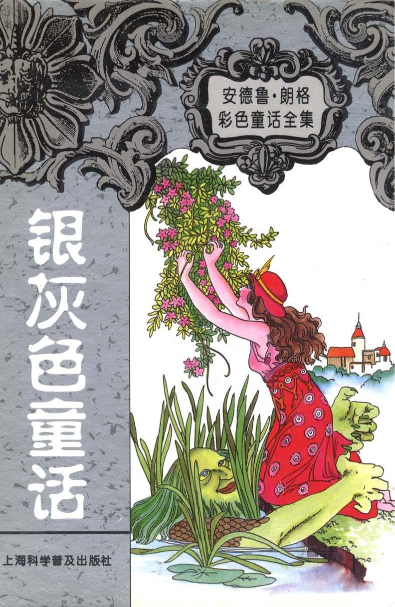

**安德鲁·朗格彩色童话全集**

银灰色童话
谢长宜 周元一译

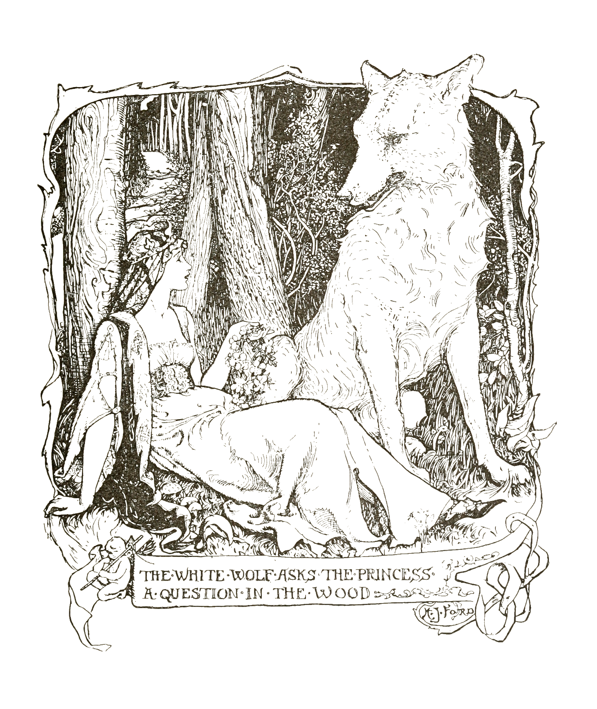

上海科学普及出版社

（沪）新登字第 305 号

Edited by Andrew Lang
The Grey Fairy Book

Published by Longmans, Green, and Co. in 1900

---

安德鲁·朗格彩色童话全集
**银灰色童话**

谢长宜 周元一译

---

责任编辑：钟海谷
技术编辑：万福棠
出版：上海科学普及出版社（上海曹杨路 500 号邮政编码 200063）
发行：新华书店上海发行所
印刷：常熟文化印刷厂
开本：850×1168 1/32
印张：10
插页：4
字数：241000
版次：1997 年 7 月第 1 版 1997 年 7 月第 1 次印刷
印数：1-8000
书号：ISBN 7-5427-1293-4/G·402
定价：14.00 元

---

（本版图书凡印刷、装订错误可及时向承印厂调换）

 

| 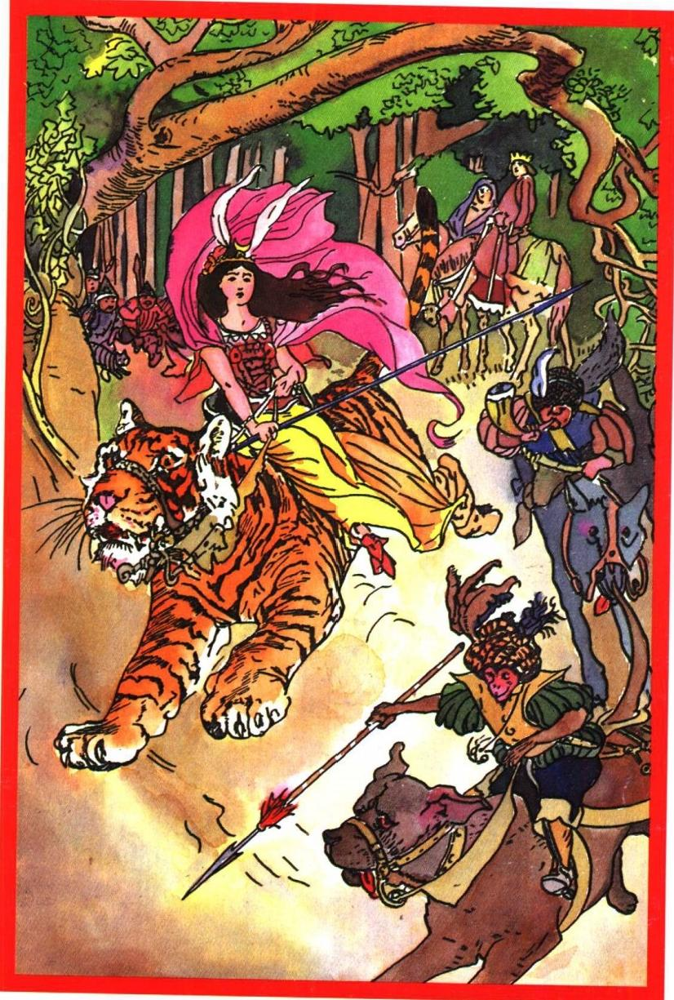 |
| :------------------------------: |
|             《魔法》             |

 

| 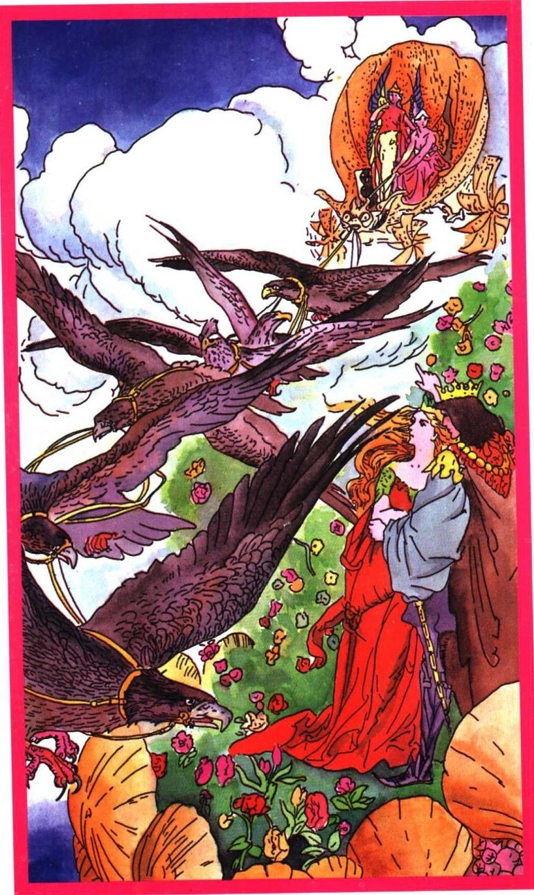 |
| :------------------------------: |
|             《魔法》             |

 

| 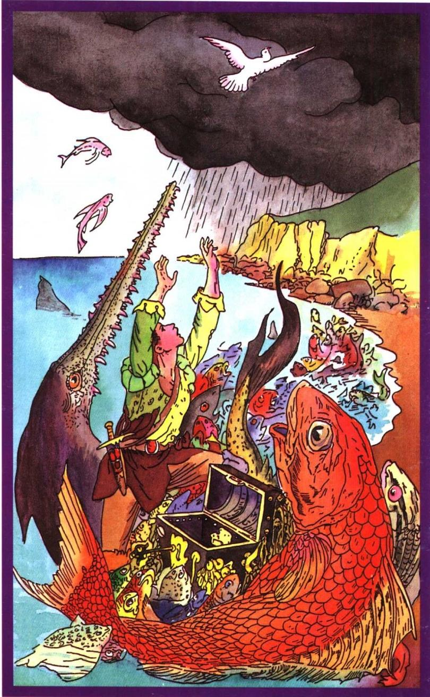 |
| :------------------------------: |
|       《采了花以后的故事》       |

 

| 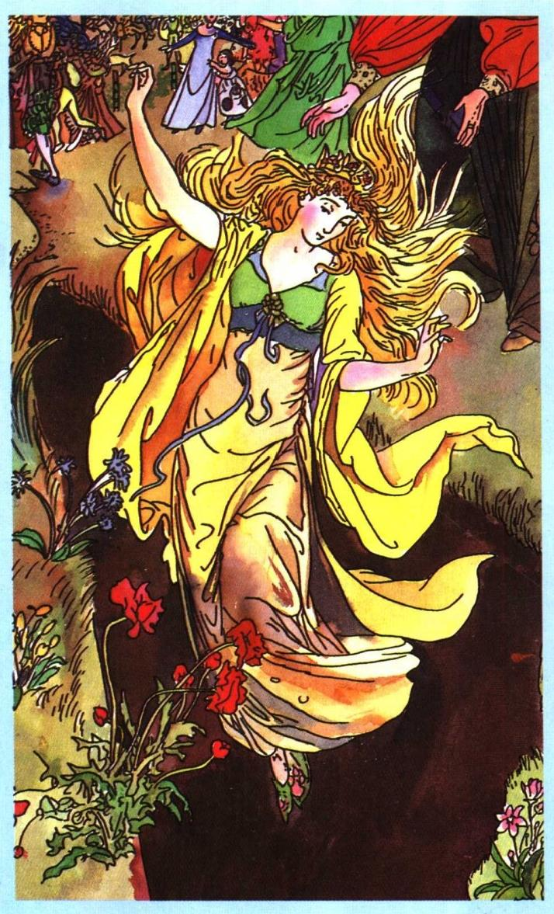 |
| :------------------------------: |
|       《百花岛女王的故事》       |

 

| 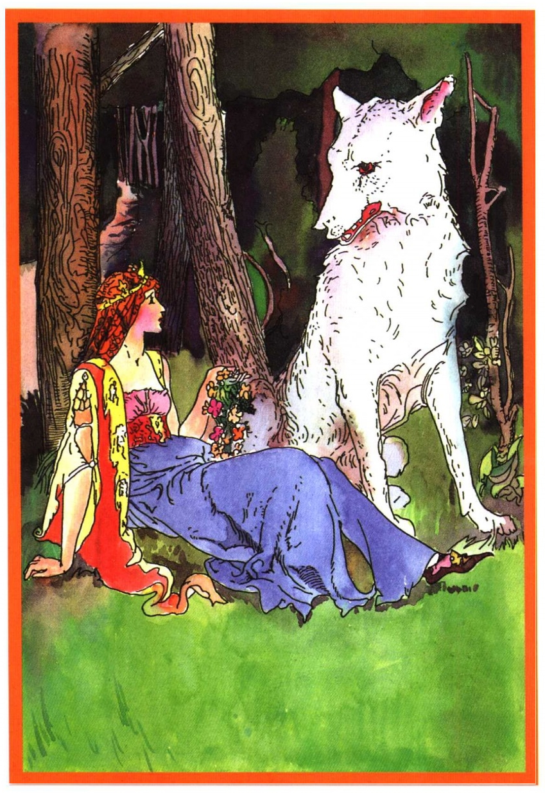 |
| :------------------------------: |
|             《白狼》             |

 

| 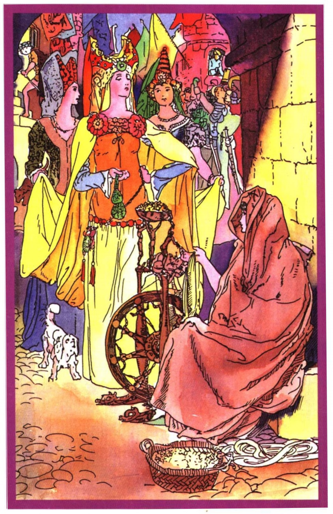 |
| :------------------------------: |
|             《白狼》             |

 

| 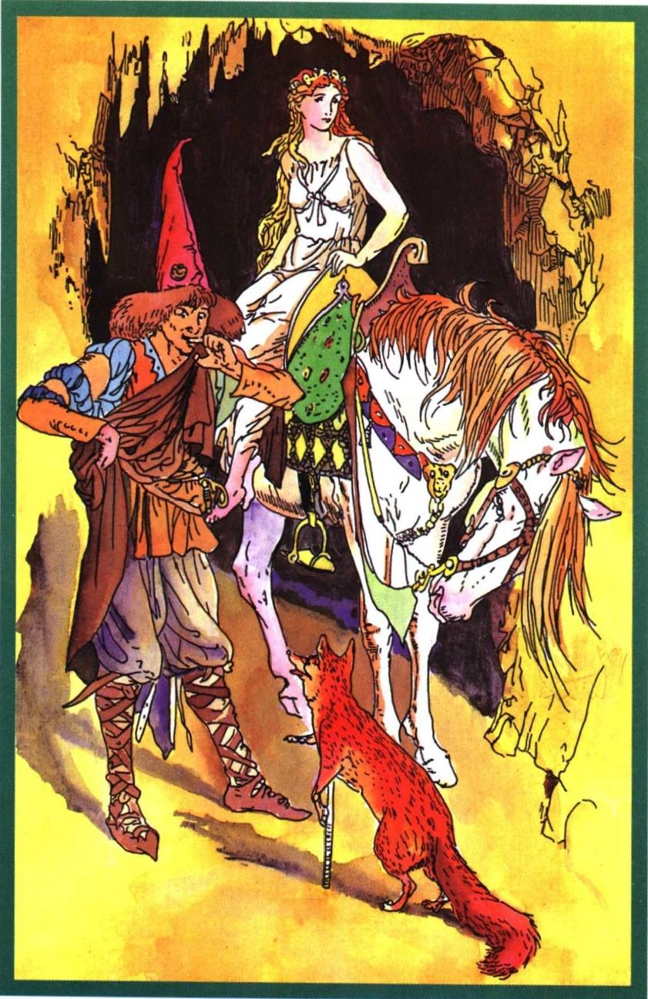 |
| :------------------------------: |
|        《哭眼睛·笑眼睛》         |

 

| 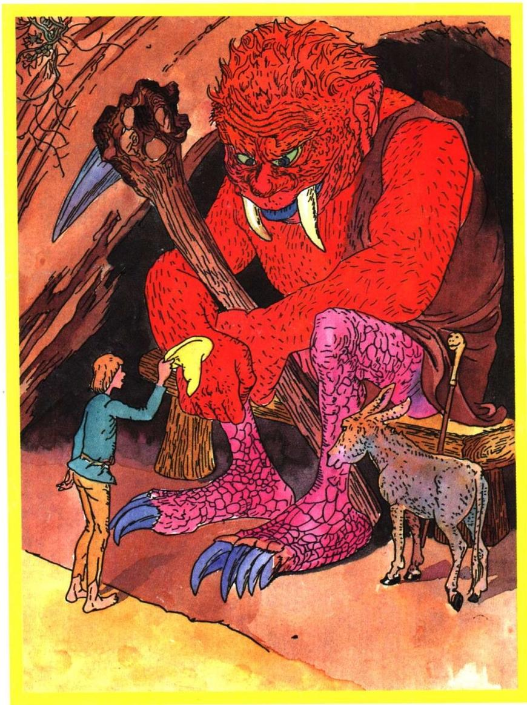 |
| :------------------------------: |
|     《安东尼奥和怪魔的故事》     |

 

## 前言

《安德鲁·朗格彩色童话全集》是英国著名文学家安德鲁·朗格（1844～1912）编辑的十二集童话。为了编辑这些童话，他广泛地收集英国、欧洲以至全世界的童话和民间故事。那些非英语的文字，如法文、德文、葡萄牙文、意大利文、西班牙文、加泰隆语等主要由他的妻子莱奥诺拉·布朗歇翻译和整理成英文。最先编成一集，当时编者的意图也只是编这一集。后来搜集的材料越来越多，才决定继续再编三集。其中的艰难和辛苦是外人所难以想象的，编者因此曾发誓，编成这四集以后，再也不编下去了。

四集童话的出版，效果非同凡响。不仅受到英国读者的欢迎，而且被译成多种文字，受到许多国家读者的欢迎。其受欢迎的程度赢得了一代又一代的读者，历数十年而不衰。这不仅源自编者长期的努力，也得益于世界各地广大热衷于这一题材的读者的帮助，他们纷纷把手头的作品和资料寄给安德鲁·朗格。这给了他极大的鼓舞，他一鼓作气，又编了八集。后面几集主要搜集了苏格兰、爱尔兰、加拿大、印度、葡萄牙、斯堪的纳维亚的民间故事和传说。有些则选自以神话、民间传说和英雄传奇为基础的中世纪威尔士故事集《马比诺吉昂》。

安德鲁·朗格认为，这些童话故事很难说是某个人写成的，它们从很久很久以前就流传下来，经过民间艺人和文学家的不断收集和整理，才达到了今天这样思想性和艺术性都比较好的程度。这些童话也被认为是英语、甚至也是全世界各种语言中时间跨度最大、包含地域最广、流传国家和地区最多、内容最丰富的童话集。

她是世界古典童话中的瑰宝，童话世界中永不凋谢的鲜花，被译成多种文字，得以广泛流传，一代又一代的儿童被她的魅力吸引，长大成为家长后，又为能给自己的孩子朗读和讲述安德鲁童话而自豪。

《银灰色童话》收集了世界各地共三十五个童话和民间故事。小读者们读了这些生动有趣的故事以后，可以看到一只善良的蜥蜴，如何帮助一个穷苦的农民摆脱贫困，而且还耐心地教育他的小女儿懂得许多做人的道理，让她获得幸福；可以看到小偷和骗子如何利用别人的贪婪和缺点，欺骗国王和强盗，为自己攫取巨大的财富。这些美丽的童话故事为我们展现了很久以前，这些地区的人民是怎样生活的，展现了他们的欢乐和悲伤、理想和追求；颂扬了勤俭朴素、助人为乐、正直忠诚；谴责了贪得无厌、懦弱无能、奸诈狡猾。

与《安德鲁·朗格彩色童话全集》中的其他各集一样，《银灰色童话》中的故事充满了当地的风土人情和乡村气息，展现了从冰雪覆盖的北极圈到赤日炎炎的非洲大陆的美丽风光。读者们可以从中领略到许多乐趣，懂得什么是正义，什么是邪恶；什么值得爱，什么该去恨；而且还会对这些地区的人文历史和地理概貌有所了解，从而更加热爱生活，热爱我们这个世界。

 

**目录**

[TOC]

 

## 驴皮公主

很久以前，有一个国王，他很受臣民的爱戴，又能得到他想要的一切东西，所以他觉得自己是这世界上最最幸福的君主。他的皇宫里陈列着许多奇珍异宝，花园里长满了缤纷艳丽的花朵。最为奇特的是，在他那用大理石砌成的牲口棚边站着一排长着棕色大眼睛的阿拉伯卫兵。

许多陌生人听说国王收藏着许多宝贝，都不远千里，慕名前来参观。但令他们感到吃惊的是在布置得最为富丽堂皇的一间牲口棚里只有一头驴，这头驴有一对特别大的耳朵，低低地垂到胸前。这的确是头好毛驴儿，但在这些陌生人看来，它还没有不寻常到要享受如此上等的礼遇。他们哪里知道，每天晚上，当这头驴一睡着，成堆的金币就会从它的耳朵里掉出来，第二天一大早，仆人们会把这些金子收起来。

转眼间许多年过去了，这个国家一直欣欣向荣。突然有一天，国王深爱的妻子去世了，这对国王的打击很大。王后总是想着国王的幸福，她在临死前，对国王说：

“答应我一件事：为了你自己的幸福，也为了你的臣民，在我死后，你必须再娶一个妻子。但不要急着办这事，直到你找到一个比我更美丽更完美的女人为止。”

“哦，别再说什么结婚了，”国王哽咽道，“还是让我陪你一起到另一个世界去吧！”王后只是微笑着，离开了人间。

王后去世后的好几个月里，国王一直处于极大的悲痛之中。

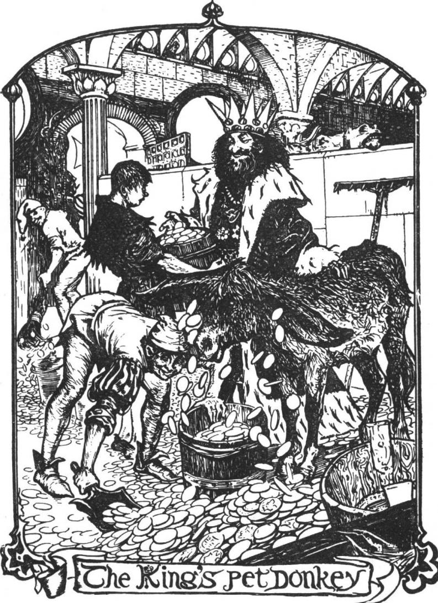

但慢慢的，他的心平静了下来，与此同时，他的谋臣们又不断地劝他再娶一个妻子。起先，国王根本不去理会他们，但渐渐的，他开始允许自己考虑这个问题，只是有个条件：新妻子必须比死去的妻子更加美丽动人，这也是他曾向死去的妻子许下的诺言。

谋臣们得知国王同意再娶一位妻子，非常高兴。他们立刻派出许多使者，到世界上的各个国家去收集著名美女的肖像，画像师们则忙着为美女们画像。但遗憾的是，在这些所谓的美女之中，没有一个能和死去的王后相比。

最后，有一天，国王失望地看过了一批新收集来的画像之后，眼睛落到了他的养女身上。当她还是个婴儿时，就被带进了王宫。国王突然意识到，如果这世上还有比死去的王后更漂亮的女人的话，那就是这公主了。于是国王立刻向她表明了心意，但这姑娘根本不想做什么王后，也不愿意嫁给国王，她心中充满着恐惧，请求国王让她仔细考虑考虑。那天夜里，当人们都进入梦乡之后，她坐着一辆羊拉的小车，去找她的仙女商量。

姑娘刚从车上下来，仙女便说道：“我知道你为何而来，如果你不愿嫁给他的话，我会教你如何避开他。让他为你做一条和天空一样蓝的裙子，他一定做不出来，这样，你就不用去理会他了。”姑娘向仙女道了谢，回到宫中。

第二天一早，当她的父亲（她一直把国王叫作父亲）来看她时，她说，除非他能为自己做一条和天空一样蓝的裙子，否则她无法给他答复。国王听公主这么一说，喜出望外。他立刻派人找来了最好的织工和裁缝，吩咐他们马上做一件和天上的颜色一模一样的长袍，一分钟也不能耽搁，否则格杀勿论。听到如此的恐吓，工人们立刻开始染色、剪裁和缝纫。两天后，裙子做好了，看上去简直就像是从天上剪下来的！可怜的姑娘看到这裙子真是目瞪口呆，不知如何是好，她赶紧套好车，又去找她的仙女了。

“看来国王比我想象的要聪明，”仙女说道，“但你可以回去对他说，你还要一条和月光一样颜色的裙子。”

第二天，当国王召见公主的时候，公主对他说自己还要一条和月光一样颜色的裙子。

“亲爱的公主，我是不会拒绝你的任何要求的。”国王说道。于是他又吩咐手下人在二十四小时内，把这条裙子做好，不然，他们都会被吊死。

工人们又尽其所能地开始干起来，到第二天黎明的时候，如月光般美丽的长裙已放到了公主的床头。公主看到这裙子，不得不承认它的美丽，但她却哭了起来。仙女听到了公主的哭声，就前来帮助她。

“这简直令人难以置信！”仙女说，“再让他做一条和太阳一样颜色的裙子，如果他连这也能办到，那我可真是吃惊不小了！”

经过前两次的失败，姑娘已不太相信仙女的话了，但她又没有其他的好办法，于是只好照仙女说的去做。

国王照例没费吹灰之力就把她要的裙子做成了，而且还用了最好的红宝石和钻石来装饰这条裙子。所以当这条裙子做成之后，真是光芒四射，甚至得戴上墨镜才能看这条裙子，以免灼伤了眼睛。

当公主看到这条裙子时，她装作被它发出的光芒刺痛了眼睛，躲进了自己的房间。她发现仙女已在这里等着她。仙女感到自己很惭愧。

“现在，你只有一件事可做了，”仙女说道，“你向国王要那头驴的皮，因为他最珍视的东西就是那头驴。国王之所以如此富有，就是因为有了这头驴，我敢肯定，他永远不会把驴皮给你。”

公主不敢肯定这方法是否奏效，但她还是按仙女的意思对国王说，如果国王不把驴皮给她，自己就永远不会嫁给他。

国王听到这一要求，既惊讶，又伤心。但公主怎么也没想到，国王竟会毫不犹豫地宰了那头驴，并把驴皮放在了公主的跟前。

可怜的姑娘眼看着无法逃脱厄运，伤心地边哭边扯着头发。忽然间，仙女又出现在她的面前。

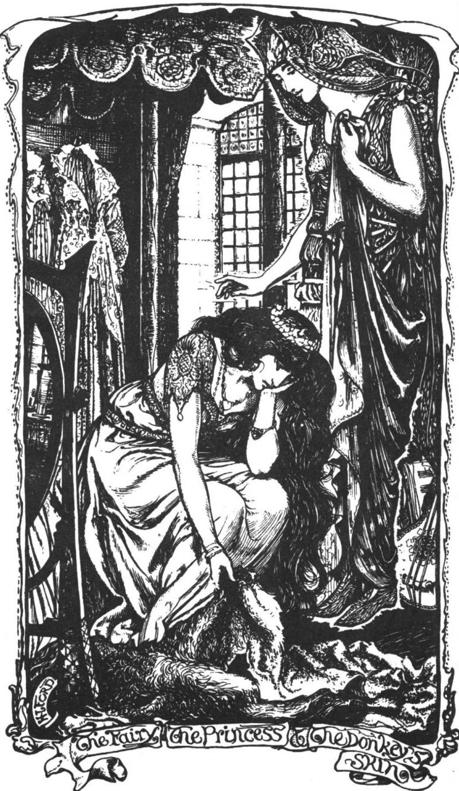

“别灰心，鼓起勇气来！”仙女说道，“一切都会好起来的，赶快把你自己裹在这张驴皮里，离开这儿，走得越远越好，我会一路护送你。你的裙子和珠宝将在地底下跟随着你。无论什么时候，你需要什么东西，只要跺一下地板，就会立刻得到你想要的东西，但现在你必须立刻动身，没有时间了。”

于是公主用那张驴皮把自己裹了起来，悄悄地溜出了王宫，没有被任何人发现。

公主走后，国王派出许多人到处找她，他们几乎寻遍了每一条小巷，每一处角落，可一旦他们走近公主，仙女就会将隐身服罩在公主身上，所以没有人能找到公主。

公主走了很远很远的路，累极了，她想找个能收留她的人家，并愿意为他们干活儿。她曾经路过一家农舍，这家的主人出于同情给了她些吃的东西，但他们看到姑娘身上裹的那张驴皮实在是太脏了，就没敢让她留宿。要知道公主逃出来时是如此的匆忙，以至于她连清洗那张驴皮的时间也没有。

公主感到精疲力尽，沮丧万分。一天，她走在路上，经过一个牧场的大门，这个牧场就在一座大城市的城墙外。忽然，她听见有人在喊她，她转过身去，看见牧场主的妻子正站在一群火鸡中间，打着手势，让她进去。

“我需要一个会洗盘子、喂火鸡和打扫猪圈的女佣。”那女人说，“从你这身肮脏的打扮来看，你干这活儿再合适不过了。”

公主愉快地答应了她的条件，并立刻开始打扫厨房。牧场的雇工们看到她的样子，都嘲笑她和她身上那张肮脏的驴皮。但渐渐的，他们看惯了这些，也就不再拿她来取笑了。公主干活儿很勤快，所以很快她的女主人就开始喜欢她了。公主还很聪明，既会牧羊，又会养火鸡，而且干得极为出色，以至于人们还以为她这一辈子，除了干这些就没干过其他的事。

一天，当她正坐在一条小河边，为自己的悲惨命运而忧伤的时候，她突然注意到自己水中的倒影。她的整个头发和一部分脸都被遮住了，而那肮脏粗糙的驴皮裹着她的全身。这是她第一次看到自己的样子，这真是让她感到无地自容。于是，她脱下那张驴皮，跳进河里，不停地搓洗，直到把它洗得像象牙那样白。到了该回牧场的时候，她不得不又穿上那张驴皮，可现在，她觉得这张驴皮比以往任何时候都更脏。于是，她自我安慰道：“明天是假日，不用干活儿，我可以暂时忘掉自己是个农场的女佣，而重新变成一个公主。”

于是，第二天休息的时候，她朝地上跺了跺脚，正像仙女告诉她的那样，顷刻间，那条像天空般透蓝的裙子出现在她的小床上。她的房间是如此之小，以至于让这条美丽的拖裙拖展开去的地方都没有。公主仔细地梳理着自己美丽的秀发，把头发盘在头顶上，又把裙摆小心翼翼地钉在墙上，就像一直穿着它那样。做完这一切，她真是满意极了。于是她决定不会放弃任何可以穿这些美丽衣裙的机会，即使是在空旷的田野里，除了那群羊和火鸡外，不会有任何人来欣赏她，她也会穿上这些漂亮的裙子的。

公主干活儿的牧场事实上是个皇家牧场。一个假日，当“驴皮姑娘”（这是人们对公主的昵称）把自己锁在房间里，穿着那条像太阳光般耀眼美丽的裙子时，王子正好骑马打猎路过这里。他问牧场主是否可以进来休息一下。于是牧场主亲自把他领进花园，给他送上了些吃的和牛奶。王子吃完后，站起身来开始察看这牧场里的房子。这些房子在这个国家是很著名的，因为都是些古老而美丽的建筑。王子一间间地参观着这些屋子，赞叹着这些古老而典雅的建筑，不知不觉他来到了走廊的尽头，这里正是公主住的小屋，门锁着，开不开。于是王子弯下腰，从钥匙洞中往里看，他简直看呆了！从小洞中，他看到了一位美丽绝伦的姑娘，身穿耀眼夺目的裙子，他简直无法看清这裙子。

当王子转身往回走时，阴暗的走廊显得更加灰黯了。王子走回到厨房，向牧场主打听是谁住在走廊尽头的那间小屋子里。他们告诉王子那里住着个绰号叫“驴皮姑娘”的女佣，这儿的每个人都取笑她，因为她既丑陋又肮脏。王子虽然察觉到这其中一定有什么秘密，但他也明白，再向这些人多问，也不会有什么新的收获，于是他骑马回到了自己的宫殿，但满脑子想的仍然是从那钥匙洞里看到的情景。

整整一个夜里，王子辗转反侧，第二天早晨，他醒来的时候，开始发高烧。王后只有这么一个独生儿子，平日里为他操碎了心，当她看到王子病成这个样子，真是心急如焚。王子这场突如其来的毛病也难倒了许多名医，他们用尽各种方法来为他治疗，但却无济于事。最后，他们告诉王后，王子之所以会病成这样，一定是有什么心事压在心里。于是王后跪在儿子的床边，求他把心里的苦衷说出来。王后说如果他是为了王位而犯愁，那么他的父亲将很乐意地把王位交给他，如果是因为爱情，那么只要是他想娶的姑娘，哪怕她是敌对国的公主，他们也会不惜一切代价，使他得到幸福。

“母亲，”王子轻轻地答道，“我怎么会如此大逆不道而想要剥夺父亲的王位呢？只要他还活着，我将永远是他最忠实的臣民。至于说到爱情，我还没有遇到过什么非娶不可的姑娘，无论如何，我都会照您的旨意行事的。”

“噢，我的儿子，”王后哭道，“我们会不惜一切代价来挽救你的生命——也是我们的生命。如果你死了，那我们活着还有什么意义呢？”

“那么，”王子说道，“我告诉你唯一能治好我病的东西——那就是‘驴皮姑娘’亲手做的蛋糕。”

“‘驴皮姑娘’？”王后惊呼道，她以为自己的儿子准是发烧烧糊涂了，“那是什么东西？”

“殿下，”王子的一个随从答道，“‘驴皮姑娘’是这世上长得最丑陋的姑娘，她的脸简直像头狼，她全身的皮肤又脏又油，是牧场里的一名女佣。”

“这无关紧要。”王后说道，“毫无疑问，他的这种怪念头是由于生病的缘故，但不管怎样，既然他提出来了，那就赶紧派人去让她做蛋糕吧。”

王子的随从立刻派了一名侍从骑着马去牧场传达这一命令。当公主一听说王后的命令，就立刻脱下那肮脏的驴皮，把自己从头到脚地洗干净，穿上那件如月光般美丽的裙子，然后把自己锁在屋子里，用最上乘的奶油、面粉和从牧场里拿来的最新鲜的鸡蛋做起蛋糕来。

当公主在锅里揉面团的时候，一只戒指从她的手上滑到了面团里。这只戒指是她偶尔偷偷戴着的。也许，公主看到了戒指掉进了面团里，也许她没有看见，但不管怎样，她并没有去理会这只戒指，继续做着蛋糕。很快，蛋糕就上了炉。等蛋糕将要烘好的时候，公主又换上了那张驴皮，然后把做好的蛋糕交给了侍从，并向他打听王子的消息。但侍从傲慢地转过身，看都不看她一眼，也不回答她的问题，拿着蛋糕匆匆离去了。

侍从骑着马，如一阵风般地回到了王宫。他立刻拿了一只银托盘，把蛋糕呈到王子面前。王子立刻狼吞虎咽地吃起了蛋糕，差点儿噎着。他一口咬到蛋糕里的戒指时，就偷偷地把它从嘴里吐出来并且藏了起来。

当王子一个人呆着的时候，他从枕头底下拿出了戒指，并且吻了它上千次。然后他开始盘算着如何才能见到这戒指的主人。他不敢当众承认他从钥匙洞里看见了美丽无比的“驴皮姑娘”，不然的话，人们都会取笑他的痴情。这些令王子心烦的事，使他因为吃了公主做的蛋糕而一度退下去的高烧重又升了上来。这一回，医生们也不知说什么是好。他们只是告诉王后，她的儿子一定是为情所惑，无药可救。王后急忙把这事告诉了国王。他们俩一起来到了儿子的床边。

“我亲爱的儿子，”国王说道，“告诉我们，谁是你想要娶的姑娘？即使她是最低贱的奴隶，我们也一定会让她成为你的新娘。在这世上，究竟有什么事，是我们不能为你办到的呢？”

王子听到父亲的这番话，泪水禁不住夺眶而出。他从枕头底下拿出了那只绿宝石戒指。

“噢，亲爱的父亲、母亲，让这枚戒指来作证，我所爱的姑娘并非农妇，能戴上如此精致小巧的戒指的手绝不可能是干粗活的手。只要谁能戴上这枚戒指，不管她处境如何，我都要娶她。”

国王和王后仔细地看着这只精巧的戒指，他们完全同意儿子的看法：这只戒指的主人绝不可能是个农妇。于是，国王下令，城里所有的姑娘都将被召见，如果谁能戴上这枚戒指，谁就将成为王子的新娘。

首先被召见的都是公主，接着是公爵的女儿，侯爵的女儿，伯爵的女儿，依次类推。但她们中没有一个人的手可以戴上这枚戒指。王子听到这一消息，毛病一下子好了一大半。最后，当贵族的小姐们都试过之后，轮到平民姑娘们被召进宫去，但结果还是这样。

“把粗使丫环们和女牧羊人也召进宫来。”王子命令道。但当他一看见她们又粗又红的手指，王子的心就凉了半截。

“城里所有的姑娘都被召见过了，殿下。”皇室总管说道，但王子并不理会他。

“有没有派人去找那个为我做蛋糕的姑娘？”王子问道。朝臣们听到王子问这话，就哄堂大笑起来，他们告诉王子他们没敢让一个如此肮脏的姑娘进宫来。

“马上派人叫她来。”国王命令道，“我说过要召见这城里的每一个姑娘！不管高低贵贱，我是言出必行的！”

再说公主，她也听说了国王要召见所有姑娘的消息。她也知道国王所指的那枚戒指就是她掉在蛋糕里的那个。事实上，当她第一眼看到王子的时候，也已经爱上了他。公主整日里担心，如果有哪个姑娘碰巧也有和她一样纤细小巧的手而戴上了那枚戒指，那么她就永远无法和王子结婚了。所以，当她得知国王派人来召她进宫时，激动得差点儿晕了过去。要知道，她一直在盼着这一天的到来啊。她精心地将自己打扮了一番，穿上那件如月光般美丽的长裙，裙摆长长地拖到地上。当国王派来的侍从催她下楼时，她赶紧又披上了那张驴皮，然后回答说她已经准备好去见陛下了。她被直接带到了宫殿，王子正在那里等候她的到来。但他一见到驴皮姑娘的样子，心就凉了，难道是自己搞错了吗？

“你就是——”王子简直不敢正眼看这姑娘，“你就是那个住在牧场走廊尽头的那小屋子里的姑娘吗？”

“是的，殿下，我就是。”公主答道。

“那么，伸出你的手，”王子继续说道，他觉得不管怎样，他该信守自己的诺言。在场的人听到王子说这话都惊呆了。公主从她那又黑又脏的驴皮下面伸出一只雪白细嫩的小手，那枚戒指不大不小，非常合适地套在了姑娘的手上。瞬时间，那张驴皮掉在了地上，从里面走出了美丽的公主。于是，王子立刻跪在公主面前，向她求婚。国王和王后也一起为儿子祈祷着。他们对公主的热情简直令她手足无措。忽然间，宫殿的屋顶被掀了起来，仙女出现了，她坐着一辆满是白色丁香花的车子。她简短地把公主的遭遇告诉大家，紧接着就忙着为他们准备最盛大的结婚庆典。

世上所有国家的国王都被邀请前来出席结婚庆典。当然，也包括公主的养父（这时，他已娶了一个寡妇为妻）。

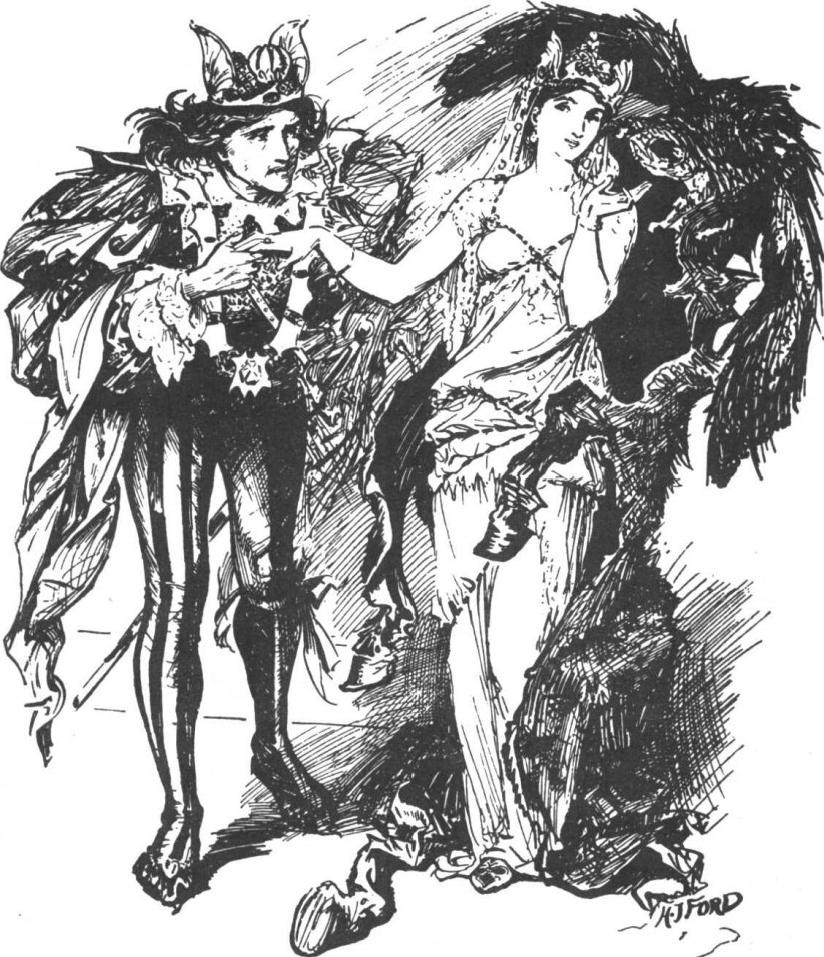

这真是个奇妙的盛会，每个君主都坐着他自己认为最体面的交通工具前来赴宴。有些坐着轿子，有些坐着各式各样的马车，还有的甚至骑着大象、老虎、老鹰前来参加盛会。可以说，这是有史以来最为盛大的一次婚礼。婚礼一结束，国王立刻宣布将为王子举行加冕典礼，他和王后将退位，由这对新婚夫妇接替他们的王位。庆典整整持续了三个月，这对新人开始正式统治他们的国家。在他们统治这个国家期间，深受臣民们的爱戴。他们去世一百年之后，人们仍然十分怀念他们。

 

## 恶魔小马

这是万圣节的前夜，老佩吉在出门前，叮嘱她的孙子、孙女说道：“孩子们，你们听，屋子外面风刮得正猛，明天就是万圣节了，今晚，巫婆和恶魔会打扮成各种模样在马路上游逛，专对小孩子干坏事。所以，今天晚上，你们就乖乖地呆在火炉边，千万别出去。”

可等老佩吉一出门，最年长的孩子马上就说：“今晚我为什么要呆在家里呢？不！我得去看看老雅各布的女儿，如果天亮前我不去她那儿看看，那她整夜都不会闭上那双美丽的蓝眼睛的。”

“我得出去抓龙虾。”老二接着说道，“我想世上所有的妖魔鬼怪不会都和我作对的。”

于是他们都决定各行其事，各寻其乐，而把老佩吉的忠告抛在了脑后。只有最小的孩子犹豫了片刻，他想起老佩吉对他说过：“你留下吧，小理查德，我给你讲好听的故事。”

但小理查德想去采些野花和黑草莓，于是他也跟着几个哥哥出去了。孩子们走出屋子，立刻说道：“老奶奶还说外面又是刮风又是下雨呢，瞧，今天天气多好，月亮正静悄悄地从云朵里穿过呢！”

突然间，一匹黑色的小马出现在他们身边。

“哦，哦！”他们喊道，“那是老瓦伦丁的小马，它一定是从马厩里逃出来，去池塘边喝水的。”

“可爱的小马驹儿，”最年长的孩子用手轻轻拍着它的头说道，“你不用跑得这么快，让我们带你去池塘那边吧。”

说着，他跳上马背。于是老二、老三也跟着跳了上去，最后，所有的孩子都骑上了马背，也包括小理查德，他总不愿意落在别人的后面。

在去池塘的路上，他们还遇到了些小伙伴，于是他们邀请伙伴们一起骑上这匹小马。小马看来一点儿都不介意，只是一路欢快地疾走而去。

马跑得越快，孩子们就越兴奋，他们双腿夹着马肚子欢呼道：“加油，小马驹儿，加油！瞧我们多勇敢啊！”

就在这时，风开始刮了起来，海浪开始怒吼起来，但这匹小黑马似乎并不在意这些，它并没有向着池塘，而是向着海边一路奔跑而去。

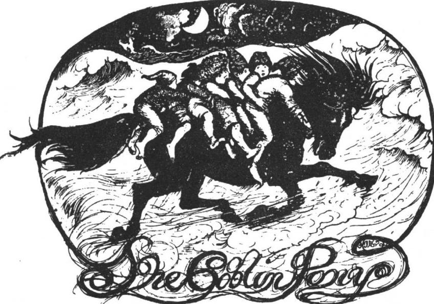

理查德这时忽然想起了野花和黑草莓；最年长的孩子用力拽着小马的鬃毛，想让它掉转头来，因为这时他也想起了老雅各布的女儿和她那双美丽的蓝眼睛，但他再怎么用力拽也无济于事，小黑马径直向大海冲去，不一会儿，海水就没过了它的前腿。小黑马的腿一碰到海水，它就立刻发出贪婪的叫声，兴奋地跑着，直奔向大海的深处，大海正无情地咆哮着。当海水没过孩子们的大腿时，他们开始为自己的鲁莽行为感到后悔了。他们喊道：“这该死的小黑马，原来是妖精变的。如果我们听了奶奶的忠告，就不会落到这一步了！”

小黑马在海里越走越深，海水越来越高，最后，海水没过了孩子们的头顶，他们都被海水吞没了。

第二天一大早，老佩吉就出门找孩子们去了，她真为孩子们担忧。虽然，她找遍了几乎所有的地方，但还是没能找到他们。她向邻居们打听孩子们的下落，但人们除了知道那晚最年长的孩子没和老雅各布的蓝眼睛女儿在一起之外，其他什么都不知道。

当老佩吉悲伤地回到家中时，她看见一匹小黑马正向她跑来，一边欢呼腾跃。当它靠近老佩吉时突然发出一声嘶叫，随后如箭般飞驰而去，消失得无影无踪。

 

## 魔法

很久以前，有个国王，他深受人民的爱戴，而他也深爱着他的人民。国王过着快乐的生活，但他却一直不想结婚，也从没考虑过爱情。他的大臣们一再要他娶一位王后，最后国王答应考虑此事。然而，在国王所看见过的所有女人当中，没有一个是能使他动心的。于是他决定进行一次旅行，希望能找到他喜欢的女子。

国王把所有的国家事务都安排妥当后就出发了，随身只带着一名侍从。这名侍从虽然不很聪明，但有极敏锐的直觉。要知道，像这种有敏锐直觉的人往往是最好的随行者。

国王遍访诸国，尽其所能地寻找爱情，但毫无收获。两年过去了，国王不得不踏上归途，而他的心依然如故，无牵无挂。

一天，当他骑马穿过一片树林时，突然听到一阵尖锐而令人毛骨悚然的猫叫，这声音越来越近，最后他们看见上百只巨大的西班牙猫从他们身旁的树丛中疾驰而过。这群猫相互紧随着，用一块大斗篷就能将它们全都遮在下面。这群猫的后面，两只身穿紫色制服的大猩猩紧紧地跟随着，猩猩的脚上穿着漂亮且质地极佳的长统靴。

猩猩正骑在猎犬背上，拼命赶着猫群向前，还一边吹着玩具小喇叭，刺耳的号角声远远传来。

国王和他的侍从静静地站在一边看这场奇特的狩猎。紧跟着，又出现了二十来个小矮人，他们中的一些骑在狼背上，轮流领队；另一些跨在猫背上。所有的小矮人都和猩猩一样，穿着用紫色丝绸做的特殊制服。

又过了不久，一位年轻美貌的女子骑着一只老虎，从国王身边飞驰而过，这位年轻姑娘根本没有注意到国王的存在。但国王却一下子被她迷住了，深深地爱上了这个姑娘。

国王发现有一个小矮人掉了队，于是赶紧上前去打听姑娘的消息。

小矮人告诉国王，他刚刚看到的姑娘是他们国王的女儿马蒂诺萨公主。小矮人还说公主很喜欢打猎。刚才，她正在追一群兔子。

于是，国王向他打听去宫殿的路怎么走。小矮人告诉他后，国王就立刻出发。几小时后，他们就来到了姑娘的宫殿。

一到宫殿，国王便向姑娘的父母通报了自己的姓名和国家。于是，他受到了热情的款待。不一会儿，公主回来了。听说这次狩猎极为成功，国王殷勤地对她大加赞美，但姑娘却一言不发。

公主的沉默使国王很吃惊，但令国王更为疑惑不解的是公主在整个晚餐期间都未开口说过一句话。有几次，她似乎想要开口说话，但这时公主的父母就会立刻拿话岔开，不让姑娘开口。然而，姑娘的沉默并没有减弱国王对她的感情。当晚，当国王回到自己房间休息时，他向仆人诉说自己对公主的爱慕之情。但仆人听了国王的叙述却毫无喜悦之意，并且毫不掩饰对此事的失望。

“你为何如此沮丧？”国王问道，“这姑娘的美貌足以打动所有男人的心。”

“她确实非常漂亮。”仆人回答道，“但真正幸福的爱情光有美丽是不够的。说实话，陛下，在我看来，这位公主的举止表现真有点儿粗鲁。”

“那是由于她高贵的地位而使她显得有些自负。”国王说道，“不会再有其他什么原因了。”

“是粗鲁还是自负，陛下，由您自己来判断。”仆人说，“不过在我看来，公主整日里和这么些凶猛的动物作伴，足见其凶悍的性格了。而且我还怀疑，她的父母不让她有开口的机会，一定有什么原因。”

仆人的话句句在理，但这时国王心中的爱情之火正熊熊燃烧，而且他又向来讨厌别人反对他的意见，于是，第二天国王就向马蒂诺萨公主求婚。他的请求立刻被接受了，但同时有两个条件。

首先，婚礼必须在第二天立即举行。其次，结婚前，他不能和公主说话，只有当公主成了他的妻子，他才能和公主说话。虽然仆人竭力反对，但国王还是答应了所有这些要求。因此，国王听到他的新娘说的第一句话便是她在婚礼上说的：“我愿意。”

一旦结了婚，公主便立刻放纵自己，她的女仆们也总是满口脏话，甚至国王也没有逃过挨骂。但国王是个好脾气的人，而且又很爱他的妻子，于是他耐心地忍受着这一切。婚礼后不久，这对新婚夫妇出发回到国王自己的国家去。

没过多久，仆人的担忧全成了事实。国王开始为他自己的一时冲动付出代价。王后得罪了几乎所有的大臣，她的凶狠和坏脾气是尽人皆知的。不到一个月，她便成了远近闻名的泼妇。

一天，当她骑马出游时，遇到了一位可怜的老太太。老太太正在路上走着，她看见王后就行了个屈膝礼，便继续朝前走。王后挡住了她的去路，大声喝斥道：“你这无礼的家伙，难道你不知道我是王后吗？你怎么敢给我行如此浅的屈膝礼？”

“殿下，”老太太答道，“我从不知道屈膝礼还有深浅之分，但我毫无不敬之意。”

“什么！”王后尖叫道，“还敢顶嘴！立刻把她捆起来，拴在我的马后，我要立刻把她带到全城最好的舞蹈家那里，让她好好学学如何行屈膝礼！”

老太太大声求饶，但王后根本不理睬她。老太太说她是受仙女保护的，王后只是嘲弄地大笑着。最后，可怜的老太太被绑了起来，但当王后挥起鞭子赶马向前走时，马却站在原地不动。无论王后怎样挥动她的鞭子，可马就像一尊青铜象那样站着纹丝不动。就在这时，捆老太太的那根绳子变成了一个花环，而老太太则变成了一位高大而庄严的仙女。

仙女轻蔑地看着王后，说道：“你这坏女人，根本不配当王后。我只是想来验证一下我所听到的关于你的传闻是否是真的。现在我毫不怀疑，所有关于你的传闻都是真的。你将会明白仙女是否可以让你随意嘲笑。”

说着，普莱西达（那是仙女的名字）吹了一下小金哨，六只美丽的鸵鸟拉着一辆两轮车飞驰而来。车里坐着仙女，并且另有十二个仙女骑着龙护送着。

所有的仙女都下了车，普莱西达向她们讲述了她的遭遇，那个坐在鸵鸟拉车里的仙女之王建议让马蒂诺萨和她的马一样，也变成一尊青铜象。但普莱西达是一位极其善良温柔的仙女，她请求给马蒂诺萨轻一点的惩罚。最后，大家商定，马蒂诺萨将终身做普莱西达的女奴，除非她能生一个孩子来代替她。

国王得知王后的遭遇，他除了接受事实外，别无他路。

所有的仙女都走后，普莱西达带着她的女奴——马蒂诺萨回到了自己的宫殿，她说道：“照理，你该做个粗使佣人，但因为你从小娇生惯养，一下子让你干这些粗活，也许你受不了。所以我只要求你每天仔细地拖一下房间的地板，并为我的小狗梳洗打扮。”

马蒂诺萨知道反抗是毫无用处的，于是她二话没说，照着仙女的话去做了。

不久，马蒂诺萨生了一个可爱的女儿，普莱西达仙女对她在做女佣期间的表现很满意，并让她保证今后不再像以前那样粗鲁凶狠，就把她送回到她的丈夫——国王的身边，而将她的女儿——小公主留在自己身边。

如今，普莱西达仙女把她的全部精力都放在小公主身上，精心地照顾她。她仔细地琢磨着该请哪些仙女来做孩子的教母，才能让小公主得到最好的礼物。

最后，普莱西达仙女决定请两位极善良而快乐的仙女来参加公主的受洗典礼。小公主被放在一只用红丝带吊着的水晶摇篮里，丝带上绣着金色的花。普莱西达仙女把公主带到了仙女们的面前。

仙女们看着公主甜甜的微笑，决心尽其所能使她得到幸福。她们给她取名叫格雷齐拉。接着普莱西达说道：“姐妹们，在我们所施的所有魔法中，最常使用的是把美貌变成丑态，把聪明变成愚蠢，或者把人彻底变个模样。现在，我们每个人只能赐给她一件礼物，我想最好的办法是你们中的一位赐给她美貌，另一位赐给她一颗善解人意的心，而我则保证她永远不失去这些。”

两位仙女非常赞成普莱西达的建议，她们给了小公主两件珍贵的礼物后就离去了，而普莱西达则负起了教育小公主的责任。她的心血没有白费，小公主长得十分可爱，当格雷齐拉还是个孩子的时候，她的美名已经传遍四方。但有一天，仙女王国的王后突然来访，令普莱西达大吃一惊。

王后一来就对普莱西达道：“你为马蒂诺萨所做的一切真令我感到吃惊，她侮辱了我们所有的仙女，应该受到惩罚。你也许可以原谅她对你所犯下的错误，但却无法宽恕她对别人所犯下的罪。据我所知，她和你在一起的时候，你对她非常好，今天，我到这儿来就是要让她的女儿来为她赎罪。你已经保证过使她永远美丽而善良，但我要把她关在一个有魔力的地方，使她永远无法离开那儿。除非有朝一日她能躺在一个爱她，同时也被她爱的人的怀里，而我将竭尽全力使这样的事无法实现。”

这个魔窟位于大海中央的一座高塔，是用各种不同颜色和形状的贝壳建成的。地下室就像是一个大浴池，海水忽涨忽落。一层楼是公主的卧室，布置得美丽优雅。二层楼有一个图书馆；一间很大的更衣室，里面挂满了各式漂亮的衣服和布料；一个琴房；一个餐厅，餐厅里放着贮存箱，里面装满了最好的葡萄酒；还有一间存贮室，里面摆着各种果酱、糖果和糕点，所有这些，看上去都像刚出炉那样新鲜。

塔的最顶层就像一座花园，有各种世上最为美丽动人的花朵，各式灌木果树，郁郁葱葱，各种小鸟栖息在枝头唱着欢快的歌。

仙女们把格雷齐拉和她的看护人邦尼塔送到塔中，随后骑在海豚背上离去了。仙女王后挥舞手中的魔杖，召来了两千条巨大凶狠的鲨鱼，命令它们守在塔的附近，不要让任何人走进塔里去。

看护人邦尼塔不辞辛劳地培育着格雷齐拉，当她长大成人时，不仅出落得美丽大方，而且还很温柔善良。

一天，当公主站在走廊上时，她忽然看见一只怪物从大海中钻了出来。她赶紧叫来了邦尼塔，问她那是什么东西，看上去，他有点儿像个男人，一张蓝色的脸，长长的像海水一样绿的头发，他正向着塔这边游过来，可鲨鱼并没有注意到他。

“那一定是条人鱼，”邦尼塔说道。

“人鱼？”格雷齐拉问道，“让我们赶紧到门边去看看清楚。”

当她们站在门口朝人鱼看时，人鱼也停下来看着公主，并向公主做各种姿势致意。人鱼发出沙哑的叫声，但当他发现自己的语言无法被理解时，就改用手势来表达。他送给公主一只用柳条编成的小篮子，里面装满了珍贵的贝壳。

公主拿过篮子，向他致谢，这时天色开始暗下来，公主回到了自己的房间，而人鱼也又重游回大海中去了。

晚上，当只有公主和邦尼塔两个人的时候，公主对她的看护神邦尼塔说道：“那家伙长得真可怕，为什么那些讨厌的鲨鱼会让他靠近这儿来呢？我想世上的男人不会都像他那样丑陋吧？”

“当然不会，”邦尼塔答道，“我想那些鲨鱼准是把它当成了自己的同类，所以才没有阻拦它。”

又过了几天，公主和邦尼塔忽然听到一种奇怪的音乐声从远处传来，于是她们朝窗外望去，原来又是那条人鱼，他头戴一顶用水生植物做成的帽子，正用力吹着一只大海螺。

公主和邦尼塔下楼来到了塔门边，公主彬彬有礼地接受了人鱼为她带来的珊瑚和其他一些海中的奇珍异宝。那天以后，人鱼每晚都会到公主的塔楼来，在公主房间的窗下吹着海螺，手舞足蹈。但无论人鱼做什么手势，公主总是俯首站在走廊上看着，从不下楼去开门。

有一天，人鱼把他的妹妹美人鱼也一起带来了。她的头发上插满了美丽的花朵，而且她的嗓子极为甜美。这个新朋友的到来使塔楼里的两个女主人下楼来开了门。令她们大为惊讶的是这条美人鱼竟会说她们的话，并对公主的美貌大加赞赏。

美人鱼注意到底层的地上都是水，于是她惊呼道：“哦，这儿真是太好了，正是我们可以躲的地方。”说着，她和她的兄弟就从门外游了进来，跳进了圆形的浴池里，公主和她的守护神就坐在浴池周围的台阶上。

“毫无疑问，亲爱的女士，”美人鱼说道，“你远离陆地而生活，就是为了避开那些求爱者，但即使在这儿，你恐怕还是无法逃脱他们。你瞧，我的兄弟已经深深地爱上了你，而且我敢肯定，一旦你到了我们的家乡，一定会有许多其他人爱上你的。”

美人鱼又向公主诉说她兄弟的苦恼，她说她兄弟由于无法使自己的感情为公主所理解而感到万分沮丧，接着又补充道：

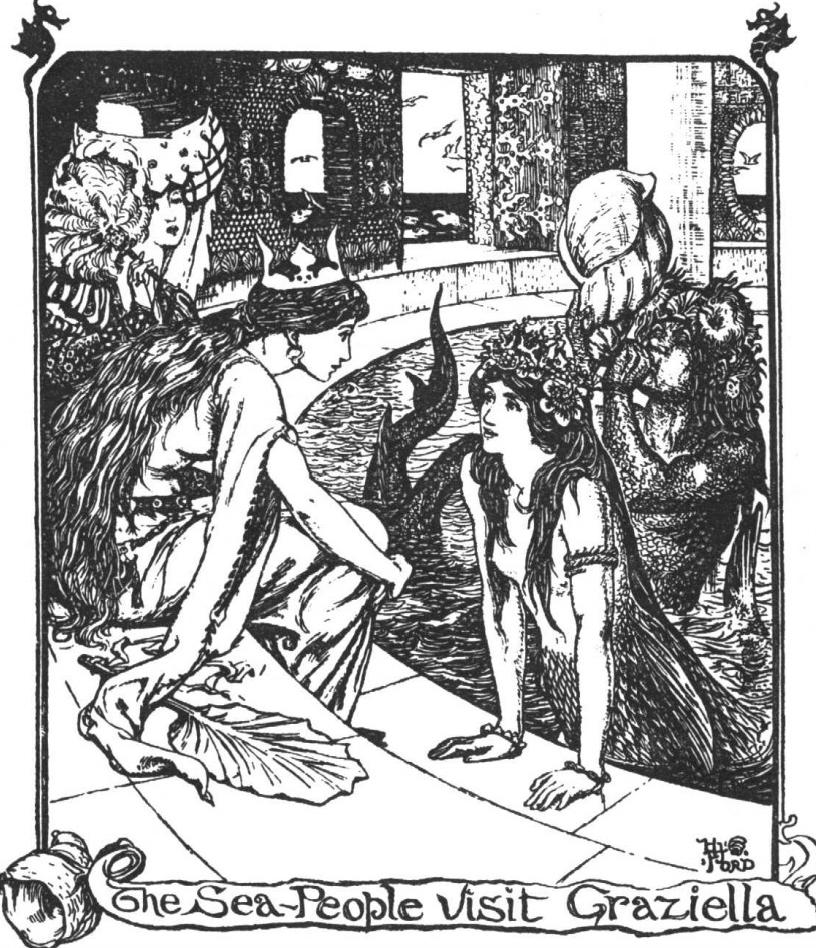

“有个仙女教过我许多种语言，所以我决定来为他做翻译。”

“哦，那么你们的世界里也有仙女？”格雷齐拉问道。

“当然有，”美人鱼答道，“不过，如果我没猜错的话，你就是被陆地上的仙女关在这儿的，是吗？”

于是，公主就把她的遭遇一五一十地告诉了美人鱼。听了她的故事，美人鱼十分同情她，但她劝公主不要失去信心。临走时，美人鱼又说道：“也许有一日，你会摆脱这一困境的。”

公主对美人鱼的来访十分高兴，希望她能再次出现。毕竟，她现在又有了一个可以说说话的人了。

“我们可以和这群人鱼中的一些保持交往，”公主对邦尼塔说，“我敢说，不是所有的人鱼都会像我们见到的第一个那样可怕的，毕竟，我们不能总这么孤孤单单地生活。”

“亲爱的孩子，”邦尼塔说道，“年轻人总是向往多采的生活的，但在我看来，这群人并不可靠。你对那个对你一往情深的家伙怎么看？”

“哦，我永远不可能爱上他，”公主叫道，“他简直令人无法忍受。但也许像他妹妹说的那样，他们和海神有联系，这一点可能对我们有用。”

美人鱼经常到公主这儿来，每一次她都谈起她兄弟对公主的爱，而公主总对她表示渴望逃出这塔楼。终于有一天，美人鱼答应带海神来见公主，帮她出出主意。

第二天，海神跟着美人鱼来到了塔楼，公主热情地接待了她。谈了一阵之后，海神请求公主带她看一下塔楼的内部结构和顶层的花园。作为海神，只要保持前额湿润，她能支着拐杖离开海水活动很长的时间。

公主立刻答应了海神的要求，带着她参观，而邦尼塔则陪着美人鱼呆在楼下。

公主和海神来到花园后，海神说道：“让我们言归正传，告诉我，要我帮助你什么？”公主于是把自己的经历告诉了海神。这时，海神说道：“亲爱的公主，我的魔力无法超越于海洋，你是陆地上来的人，所以我无法帮助你。我只能答应如果你肯嫁给我的表弟，那么你就能和我们生活在一起。我会立刻教会你游泳和潜水。我能使你的皮肤变得坚硬而不改变它的颜色。我的表弟是海里最好的勇士之一，我会赐给他许多礼物，使你成为幸福的人。”

海神又说了许多动听的话，公主终于被深深地打动了，于是她答应好好考虑海神的建议。

就在她们准备离开花园的时候，忽然看见一艘船正向塔楼驶来。以前，还从未有过一艘船如此地靠近这塔楼。在船的甲板上，一个年轻人正在遮阳篷底下，透过望远镜注视着塔楼。可还没等她们俩看清这艘船，船就调头朝反方向驶去了，于是公主和海神离开了花园，海神答应过几天来听回音。

海神一走，公主就把她的话告诉了守护神邦尼塔，邦尼塔对此事很不以为然，因为她不愿意自己在晚年时再变成一条人鱼。邦尼塔仔细琢磨着这件事，最后想出了一个好主意。她是个极聪明的画家。第二天一大早，她就着手开始画一个英俊潇洒的青年，这个青年有美丽的卷发、英俊的脸庞和一双神采奕奕的蓝眼睛。邦尼塔画完之后，拿着画像去给公主看，她希望公主能明白什么才是真正的美男子。

公主看着画像，简直惊呆了，她疑惑地问守护神世界上是否真的存在长得如此英俊美貌的男子。邦尼塔很肯定地告诉公主，世间确实有许多这样漂亮的男子，甚至还有更为英俊潇洒的。

“真令人难以置信！”公主说道，“但是，唉，世上即使存在这样的人，又有什么用呢？我想我是永远也见不到他的，而他也一样无法见到我。哦，我真是不幸！”

公主整天都盯着那幅画像看着，显然，这幅画像使人鱼的希望和憧憬成了泡影。

几天后，海神又来到塔楼，听公主的决定。但公主根本没有考虑她的话，对她提出的结婚建议也不屑一顾。于是海神只能悻悻地离去了。

这时，公主还没有意识到，她已经征服了另一个人的心。在那条曾一度靠近过塔楼的船上，正站着世上最英俊的王子。他听说了关于这座塔楼的传闻，于是决定探个究竟。他在甲板上安装了极好的望远镜，通过它，王子清清楚楚地看见了公主，并对她一见钟情。他想把船径直开向塔楼，然后用小船划进去，但所有的船员都跪在他脚下，请求他不要冒如此的危险。他的船长也劝他不要受其诱惑，“如果你这么干，只会把我们都带向死亡，”船长说道，“把船开到近岸处，我会去找一个我认识的仙女，她很善良，而且总乐意帮助我，我可以保证，殿下，她一定会想办法帮助您的。”

王子很不情愿地听着这些劝告。最后，他把船停在离塔楼最近的港口，又立刻派船长去请那位仙女帮忙。同时，他又在海滩上支起了帐篷，通过望远镜，目不转睛地盯着那座塔楼，并寻找着公主。

几天后，船长带着仙女回来了。王子看见她非常高兴。“我已经听说了这事儿，”仙女说道，“为了不浪费时间，我会派一只可靠的鸽子到那座塔楼去试探一下。只要那里有一处漏洞，它就一定能找出来并从中飞进去。如果它成功的话，我就会让它叼一枝花回来，如果它果真叼了一枝花回来，我就能让你也进去。”

“可是，”王子问道，“我能让鸽子捎句话给公主，以表白我的心意吗？”

“当然可以，”仙女答道，“这是个好主意。”

于是，王子写下了下面几句话：

“亲爱的公主：我要告诉你，我是多么地崇敬你、爱你，我恳请你接受我的爱，请相信，我将不惜一切使你摆脱困境。布朗德尔”

这张小纸被系在鸽子的脖子上，鸽子带着它立刻向塔楼飞去。当鸽子飞到近塔楼时，忽然一阵剧风猛吹过来，使它无法靠近，但鸽子并没有被吓跑，它小心地在塔楼上空盘旋。后来，它发现了一个缺口，由于疏忽，这个缺口不像其他地方那样被施了魔法。于是，它迅速从这个缺口滑了进去，躲在花园的树荫下，等着公主的到来。

没过多久，公主一个人来到了花园，这时鸽子立刻拍着翅膀飞到她跟前，这只鸽子看上去是如此的温顺，以至于公主不由得停下脚步来抚摸这只可爱的小鸟。就在这时，公主发现鸽子的脖子上系着一条粉红的丝带，丝带上系着一封信，她反复地把信念了几遍，写了如下的回信：

“你说你爱我，但在见到你之前，我无法肯定也爱你，让这只忠实的信鸽把你的画像捎来。如果我把画像还给你，那么你也不必再抱什么希望，如果我把画儿留下了，那你就该明白帮助我就将是在帮助你自己——格雷齐拉”

在飞回去之前，鸽子记起了仙女让它带回去的花儿，于是它从公主的裙子上偷了一朵，悄悄地带了回去。

当王子看见鸽子带着那封信飞回来时，真是喜出望外。幸运的是王子正好带着一张他自己的小画像，休息了一小时后，那只忠实的信鸽带着这张小小的王子的画像重又飞到了公主这儿。

鸽子在花园里找到了公主，公主犹豫不决地解开了系在它脖子上的丝带，然而，令公主又惊又喜的是，这张小小的画像和那张邦尼塔所画的像非常相似。于是公主立即让鸽子飞了回去。当王子发现公主留下了他的画像时，他的喜悦之情是可想而知的。

“现在，”仙女说道，“让我们别再浪费时间了，我要把你变成一只鸟，但在适当的时候，我会使你恢复原样的。”

王子急切地想飞到公主的身边，于是仙女用她的魔棍指了一下王子，就把他变成了一只可爱的小鸟，但同时又使他仍然可以说话，那只鸽子在前为他引路。

当公主看到这只美丽而奇特的小鸟时，真是吃了一惊，而当这只鸟开口向她说道：“早上好，公主”时，她就越发吃惊了。

公主被这只可爱的小鸟逗乐了，她让它停在手指尖上，而小鸟则欢快地唱着：“快快吻我，快快吻我，我是小鸟。”公主用手轻轻地抚摸着它，又用嘴唇柔柔地吻着它。

过了一会儿，公主累了，太阳正当空照着，于是她在树荫中躺了下来。她把小鸟放在胸前，慢慢地睡着了。这时，仙女设法使王子恢复了原形，当公主醒来时，她发现自己正躺在那个爱她、也被她所爱的王子的怀里。

与此同时，加在公主身上的魔法也消失了，塔楼开始摇摇欲坠，邦尼塔急忙跑到塔顶，这样，至少她能和她所爱的公主死在一起。就在这时，那位曾经帮助过王子的善良的仙女和普莱西达仙女，坐着一辆由六只老鹰拉着的威尼斯水晶车到了。

“快上车来！”仙女们大声说道，“塔楼就要沉下去了！”王子、公主和邦尼塔立即登上了车，就在车子腾空而去的一瞬间，塔楼一下子塌了下去，沉到了海底。原来，海神和人鱼们为了报复格雷齐拉公主而破坏了塔楼的根基。幸运的是他们的阴谋没有得逞，仙女们驾着车，把格雷齐拉公主送回到她父母的王国。

她们发现公主的母亲，马蒂诺萨王后已去世多年，但她那善良的丈夫却过得很平静，他很好地治理着他的国家。当他看见女儿回到自己身边时，感到十分欣慰。举国上下都为公主的归来而欢庆。

第二天，格雷齐拉公主和布朗德尔王子举行了婚礼，之后的好些天，人们举行各种舞会、宴会、比赛、音乐会和各种娱乐活动以示庆贺。

所有的仙女都应邀前来参加这次婚礼，她们许诺会保佑这对新人，并赐给他们各式各样的礼物。布朗德尔王子和格雷齐拉公主一直白头偕老，彼此相爱，并且随着时间的推移，他们彼此一间的爱情越来越深厚。

 

## 德谢米尔和德谢米拉的故事

从前，有个叫德谢米尔的人，他的表妹名叫德谢米拉。他们的父母在他们小的时候就替他们俩订了婚。如今他们都已长大成人。德谢米尔认为该是结婚的时候了，他到邻近的镇上去了两三天，为自己的新房购置家具。

当德谢米尔在外张罗时，德谢米拉和她的伙伴们一起到邻近的树林子里去拾柴，无意中，她发现地上有一只圆圆的铁罐儿。德谢米拉把铁罐扎在拾好的柴禾堆上，可怎么也扎不住，只要她把柴禾往肩上一扛，铁罐就会滑下来。最后，她明白了，唯一能带走铁罐的方法就是把它扎在柴堆的中央，正当她忙着解开柴禾时，她听到了同伴们的叫声：

“嗨，德谢米拉，你在干什么呢？天快黑了，如果你想跟我们一起回去，那就快点儿吧！”

但德谢米拉答道：“你们先回去吧，别等我了，我想把这只铁罐儿带回家。”

“随你吧！”姑娘们说着就都回家去了。

夜幕悄悄降临，当最后一道亮光消失时，铁罐儿突然变成了一个巨大的妖怪，它背起了德谢米拉，把她带到遥远的沙漠，从这里到姑娘的家足足有一个月的路程。妖怪把德谢米拉关进一座城堡，叫她不用害怕，告诉她在这里不会有危险。然后，妖怪就回到他妻子那里去，把德谢米拉一个人留在城堡里。德谢米拉为自己的不幸遭遇而默默流泪。

此时，和德谢米拉一起出来拾柴的姑娘们都已回到了各自的家中，唯独德谢米拉的母亲由于女儿没有回家，就出来寻找自己的女儿。

“你们和她都干了些什么？”德谢米拉的母亲焦急地问姑娘们。

“我们不得不把她一个人留在树林子里，”姑娘们答道，“因为她拾到了一只铁罐，还非要把它带回来不可。”

于是德谢米拉的母亲立刻向树林跑去，边跑边叫着女儿的名字。

村子里的人们听到德谢米拉母亲的叫声，都出来劝她道：“你还是先回去吧，我们会去帮你找女儿的，你是个女人，这件事情需要男人去做。”

但德谢米拉的母亲答道：“好吧，你们快去找，可我要跟你们一起去，也许我们能找到的只是她的尸体了，我想她不是被毒蛇咬了，就是被野兽吃了。”

人们看到德谢米拉的母亲如此担心，也就不多说什么了。他们让一个和德谢米拉一起外出的姑娘带路，一直来到了德谢米拉和大家分手的地方。大伙儿发现，就在她们分手的地方，地上有一堆柴禾，却看不到德谢米拉的人影儿。

“德谢米拉，德谢米拉，你在哪儿呀？”大伙儿拼命地喊着，可没有人回答。

“如果我们燃起一堆火，也许她能看见。”一个人建议道。于是大家燃起了一堆火，又分头到林子的各处去找。边找，边互相嘀咕着：“如果她真是被一头狮子给吃了，那至少也该找到狮子的脚印呀。或许她是睡着了，可大伙儿如此叫喊也该把她叫醒了吧。也可能她是被蛇咬了，那起码该找到她的尸体吧。”

整个晚上，人们找遍了树林，当黎明的霞光透进树林时，人们依然一无所获。大伙儿已经精疲力尽，于是他们对德谢米拉的母亲说道：

“再这么找下去也是无济于事的，还是让我们回去吧，看来，你的女儿没有遭到什么不测，她也许是跟一个小伙子跑了。”

“好吧，我会回去的，”德谢米拉的母亲答道，“但我必须先到河边去看看，或许有谁会把她扔在那儿的。”可她在河边仍然没能找到德谢米拉。

转眼间，四天又过去了，德谢米拉的父母天天都盼着他们的孩子能够回来。最后，他们不再对这事抱什么希望了。一天，他俩商量道：“我们该怎么办呢？该怎么对她的未婚夫说这事儿呢？看来，我们只能杀一头羊，把羊头埋了，这样等德谢米尔回来时，我们就告诉他说德谢米拉已经死了。”

不久，德谢米拉的未婚夫德谢米尔回来了。他买回了地毯、软靠垫等许多东西。他一来到德谢米拉的家，德谢米拉的父亲就对他说：“孩子，你可回来了，可惜德谢米拉已经死了。”

听到这些，德谢米尔失声大哭，好长一会儿，他才缓过气来，问道：“你们把她埋在哪儿了？”

“跟我一起到教堂的墓地去吧！”德谢米拉的父亲回答道。于是年轻人带着一些特地为未婚妻买的礼物跟着他来到了墓地。他把这些东西都放在德谢米拉墓前的草地上，并在那儿躺了一整天。当夜幕降临时，他收拾起这些东西，回到了自己的家。第二天一早，他又带着这些东西来到德谢米拉的墓前，忧伤地吹起了长笛，直到夜幕降临。日复一日，整整六个月，德谢米尔天天如此。

一天早晨，有个人在沙漠里走着走着迷了路，这时他发现了一座孤零零的城堡。骄阳正在他头上热辣辣地烤着，他感到精疲力尽，于是暗想道：“我要在这城堡里避避暑，休息一下。”这样，他就在城堡里躺了下来。当他快要睡着时，迷迷糊糊听到有人在轻声问他：

“你是鬼还是人？”

他睁开眼睛，看见一个女孩正从窗口探出头来，他回答道：“我是人，而且是个大好人。”

“那么祝你好运，”德谢米拉说道，“可你怎么会跑到这鬼地方来的呢？”

“难道这城堡里果真有鬼吗？”过路人紧张地问道。

“确实有鬼，”德谢米拉回答，“天快暗下来了，他马上就会来这儿的。朋友，你得赶快离开这儿，不然的话，等他回来了，就会把你当作一顿美餐的。”

“我现在非常渴！”过路人说道，“行行好，给我些水喝吧，不然，我会渴死的，我想这沙漠中一定有泉水，是吗？”

“我发现，那妖怪每次带水回来，总是从这个方向过来的，如果你朝这个方向走去，或许你能找到泉水。”德谢米拉说道。

过路人从地上一跃而起，立刻准备出发，这时德谢米拉又说道：

“告诉我，你打算到哪儿去？”

“你为什么要知道这个？”过路人问道。

“我想托你捎个信儿，可你得先告诉我，你是准备朝东走呢，还是朝西走？”

“我要到大马士革去。”

“那么请你替我捎个信儿。当你经过我家的小镇时，请你对一个名叫德谢米尔的年轻人说：‘德谢米拉向你问候，她现在正被关在一座遥远的城堡里，这城堡在风中摇摇欲坠。在她的坟墓里埋着的是一只山羊头，所以鼓起勇气，振奋起来，你一定能找到她的。’”

过路人答应了德谢米拉的请求后就上路了。不久，他找到了泉水，喝了个够。喝完后，他躺在水边静静地休息了一阵子。醒来后，他自言自语道：“那姑娘真是帮了我的大忙，要不是她告诉我在哪儿能找到水，我恐怕早就渴死了。我该履行我的诺言，找到她的家乡，把口信捎给那个叫德谢米尔的小伙子。”

过路人整整走了一个月，最后终于来到了德谢米尔住的小镇。说来也巧，德谢米尔正坐在他的家门前，留着长长的胡子和头发。

“欢迎到我们的镇来，”德谢米尔向过路人说道，“请问你打哪儿来？”

“我从西边来，正打算朝东面去。”他回答道。

“那就请上我家来歇歇吧，顺便吃些东西！”德谢米尔说。于是过路人进了他家门，这家人为他准备了些吃的，他和德谢米尔的父亲和兄弟们一起坐在餐桌前，可德谢米尔却独自盘坐在门槛边。

“你为什么不和我们一起吃呢？”过路人问道。坐在他身边的一个年轻人立刻小声地说道：

“别管他，让他一个人去吧，只有到了晚上，他才吃东西。”

过路人不再作声，默默地吃着东西。忽然，德谢米尔的一个兄弟喊了一声：“德谢米尔，请替我们拿些水来！”过路人顿时想起了捎口信的事，于是问道：

“这儿有个叫‘德谢米尔’的小伙子吗？我曾在沙漠中迷了路，可就在那时，我看见了一座城堡，一个姑娘正从窗口探出头来向外张望…… ”

“快别说了！”他周围的人们说道，他们担心这些话被德谢米尔听到。可德谢米尔已经听见了这些话，他走上前来问道：

“请告诉我，你看见了什么？把真相告诉我，不然的话，我会立刻拧下你的脑袋！”

“我的上帝啊，你别急，我全都告诉你。”过路人说道，“那天，我在沙漠里走着，又热又渴。忽然，在我眼前不远处出现了一座大城堡，于是我大声说道：‘我要在这背阳处休息一会儿！’这时，一个姑娘从窗口探出头来问道：‘你是鬼还是人？’我回答说：‘我是人，而且是个大好人。’我口渴得厉害，向她要水喝，可她也没有水，我觉得自己快要干死了。她告诉我，她住的城堡是一座妖怪的城堡，妖怪每次带水回来，他总是从同一个方向来的，她指点我也朝那个方向走，说可能找到水喝。在我出发前，她请求我为她捎个口信给一个名叫德谢米尔的小伙子，叫我对他说：‘德谢米拉向你问好，她现在被关在一座遥远的城堡里，这座城堡在风中摇摇欲坠。在她的坟墓里埋着的是一只山羊的头，所以鼓起勇气，振奋起来，你一定能找到她的。’”

听到这些，德谢米尔转身问他的家人道：

“这些都是真的吗？德谢米拉真的没死吗？她只是离家出走了？”

“不，不是这样的，”他的家人忙说道，“这个人说的都是些谎话，德谢米拉已经死了，这谁都知道。”

“我要亲自去看一看。”德谢米尔说道，他抓起铁锹来到德谢米拉的墓前，挖了起来。

于是，德谢米尔的家人只能把真相告诉了他：“你不在家时，她和伙伴们一起到树林里去拾柴。在那儿，她发现了一只大铁罐，她想把它带回家，却没有办法把它弄回来，又不肯扔下它不管，伙伴们就把她一个人留在林子里。天黑后，我们所有的人都出去找她，但没能找到。我们商议说：‘明天，新郎就该回来了，当他听说新娘失踪后，一定会去找她的。这样，我们又将失去他，还是让我们杀一头羊，把它埋起来，告诉他，他的德谢米拉已经死了。’现在，既然你已经知道了事情的真相，那你就去找她吧。不过，如果你真打算去找她，就请这个过路人带路，他会为你指路的。”

“对，这是最好的办法，”德谢米尔说道，“请替我准备些吃的，把宝剑给我，我们这就出发。”

这时，过路人说道：“我不会浪费整整一个月的时间陪你去那城堡，如果只是一两天的事，那我一定会陪你去，可现在是一个月！那可不行。”

“那么，请你为我引路，只需要三天。”德谢米尔说道，“只要你为我指明方向就行，我一定会重谢你的。”

“好吧，”过路人回答，“就这么办。”

整整三天，他们俩起早摸黑地走着，第三天过路人说道：“德谢米尔。”

“什么？”德谢米尔问道。

“沿着这路笔直走下去，你就会找到泉水，再继续往前走一程，你就会发现眼前有一座城堡。”

“好吧，我明白了。”德谢米尔回答。

“那么，再见了！”过路人说着，转身就往回走去。

德谢米尔整整走了二十六天，最后终于有一片沙漠中的绿洲出现在他眼前。这时，他意识到泉水近了。于是他加快步伐，来到了泉水边。他俯下身子，贪婪地喝着泉水。随后，他躺在清凉的草地上，静静地想着：“如果那过路人说的是真话，那么，那座城堡一定就在附近什么地方。今晚，我就睡在这儿。这样，明天我就能找到那座城堡了。”这么想着，德谢米尔躺在草地上，美美地睡着了。第二天当他醒来时，太阳已经升得很高了，他赶紧起身，在泉水中洗净了脸和手，重又上了路。没走多远，一座城堡突然出现在他面前，而几分钟前，德谢米尔还未看见这座城堡的影子。

“我怎么才能进去呢？”他思量着，“我不能敲门，否则那妖怪会听见的，也许我该从墙上爬到屋顶上去，看看动静再说。”想着，他就爬上了屋顶，在上面坐了近一个小时。忽然，他身边的一扇窗户开了，从里面传来了声音：“德谢米尔！”他转过脸来，看见了自己朝思暮想的德谢米拉，竟忍不住哭了起来。

“亲爱的哥哥，”德谢米拉轻声说道，“你是怎么找到这儿的？”

“我只想着要尽早见到你。”

“噢，你还是快离开这儿吧！如果妖怪回来，看见你在这儿，他会杀了你的。”

“我对天发誓，既然我已经找到了你，就不能再一次失去你，即使为此要付出生命的代价，我也愿意。”

“天哪，可我又能为你做些什么呢？”

“只要你愿意，什么事都行。”

“如果我给你一根绳子，你能顺着它从窗口爬进来吗？”德谢米拉问道。

“当然可以。”

于是德谢米拉递了一根绳子给德谢米尔，他把绳子系在腰间，慢慢地从窗口爬了进来。进屋后，他们两个紧紧地拥抱在一起，流出了幸福的眼泪。

“如果那妖怪回来了，我该怎么办呢？”德谢米拉问道。

“有我在，别害怕！”德谢米尔说道。

屋子里有个大箱子是德谢米拉放衣服用的。她让德谢米尔暂时躲在里面，叫他别出声。

德谢米拉刚把箱子的盖子盖上，楼梯处就传来了妖怪沉重的脚步声。他砰地打开房门，一手提着自己的晚餐——一块人肉，另一只手拿着给德谢米拉的晚餐——一些羊肉，“我在这儿嗅到了男人的味道！”他大声嚷道，“有谁到这儿来过吗？”

“怎么会有人到这沙漠地方来？”德谢米拉说着哭了起来。

“别哭了，”妖怪说道，“也许是乌鸦不小心把食物的残渣掉在附近了。”

“噢，对了，是我忘了，”德谢米拉回答说，“确实有一只乌鸦掉了些骨头在这儿。”

“那好吧，把它们烧成灰，”妖怪说道，“让我来吃了它们。”于是德谢米拉拿了些骨头，把它们烧成了灰，拿给妖怪说：

“给你，吃吧。”

吃完后，妖怪伸着懒腰睡觉去了。

那时，德谢米拉在为妖怪做晚餐，忽然，有个声音从锅里传出来：“嘻！嘻！有个人躲在箱子里！”

从另一只煮羊肉的锅里又传来了一个声音：

“他就是你的兄弟。”

妖怪翻了个身，懒洋洋地问道：“锅子里是什么声音，德谢米拉？”

“是提醒我别忘了加盐。”

“好吧，别忘了加盐。”

“我已经加好了。”德谢米拉回答说。

不一会儿，妖怪睡熟了。这时，锅里又传来了说话声：“嘻，嘻！有个人躲在箱子里！”

羊肉锅里传来了应答声：“他就是你的兄弟！”

“说些什么，德谢米拉？”妖怪问道。

“叫我别忘了加胡椒。”

“好吧，别忘了加胡椒。”

“我已经加好了。”德谢米拉回答。

妖怪一整天都在打猎，实在是累极了。没过多久，他又昏昏睡去，锅子里第三次传出了声音：“嗨，嗨！有个人躲在箱子里！”

“他就是你的兄弟！”另一个声音随声应和道。

“又在说些什么呢，德谢米拉？”妖怪问道。

“晚饭准备好了，叫你吃饭呢。”

“好吧，拿上来吧，我现在就吃。”

德谢米拉为妖怪端来了晚餐，当妖怪吃得正香时，德谢米拉吃着自己的那份羊肉，并设法为德谢米尔留了些下来。

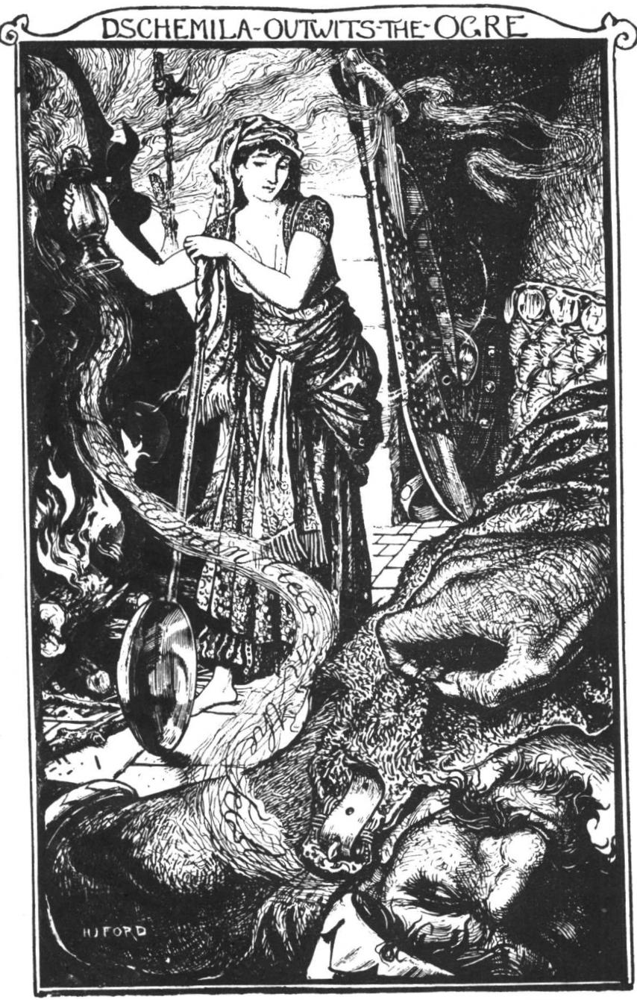

妖怪吃饱喝足后对德谢米拉说道：“替我铺床，我真是累死了。”

德谢米拉替他铺好床，为他准备了一只松软的枕头，并扶他上了床。

“父亲，”德谢米拉突然说道。

“什么事？”

“亲爱的父亲，你睡觉时为什么总睁着眼睛，你是真的睡着了吗？”

“为什么问我这个，德谢米拉？你是不是想摆脱我？”

“不，当然不是。父亲，我怎么可能要摆脱你呢？”

“那你为什么要知道这些？”

“因为昨天晚上我醒来时，发现整个屋子都发着红光，真把我给吓坏了。”

“当我熟睡时，周围就会有红光。”

“那你为什么总是小心翼翼地保管着这枚别针呢？”

“如果把这枚别针朝我面前一扔，它就会变成一座铁山。”

“那么这枚织布针又有什么用呢？”

“它会变成一片大海。”

“这把斧子呢？”

“它会变成一道长满荆棘的篱笆，没有一个人能越过它。你为什么要问我这些？我肯定你有事儿瞒着我。”

“噢，我只是出于好奇，有谁会知道我在这个地方呢？”说着，德谢米拉又哭了起来。

“快别哭了，我只是说着玩的！”妖怪说道。

妖怪很快就睡着了，屋子里发着黄色的光。

“快点儿！”德谢米尔在箱子里喊着，“我们必须趁他睡着时赶紧走。”

“现在还不行，”德谢米拉说，“现在屋子里发着黄光，我想他还没有睡熟。”

于是他们又等了一小时。德谢米尔又低声喊道：“快醒醒，我们没时间了！”

“让我看看他是不是睡熟了，”说着德谢米拉偷偷地朝妖怪的屋里看去，屋子里发着红光。她立刻来到德谢米尔跟前，问道：“我们怎么才能逃出去呢？”

“拉着这绳子，我会把你慢慢放下去。”

德谢米拉拉着绳子，拿着斧子、别针和织布针说道：“拿着这些东西，把它们放在你的口袋里，千万别丢了。”

德谢米尔小心地把它们放在口袋里，又用绳子扎住德谢米拉的腰，慢慢地把她放下城堡。

“你没事儿吧？”德谢米尔问道。

“没事儿。”

“把绳子解开，让我把它收上来。”

德谢米拉照着他的话做了，不一会儿，德谢米尔也逃了出来。

这时，妖怪睡得正香，什么也没察觉到。可他的狗来到了他身边，说道：“嗨，快醒醒，你还在做什么美梦吧，德谢米拉已经逃走了！”

妖怪坐起身来，狠狠地踢了狗一脚，又呼呼大睡起来，一觉睡到天亮。

第二天一大早，妖怪一起身就大声叫道：“德谢米拉，德谢米拉，你在哪儿？”但没有人回答，他立刻穿好衣服，佩上宝剑，带了猎狗，朝着逃跑者的必经之路追去。

“哥哥，”德谢米拉走到一半忽然转过身来对德谢米尔说道。 “什么事？”

“妖怪朝我们追来了，我看见他了。”

“他在哪儿呢？我怎么没看见？”

“就在那儿，他现在离我们还远，看过去只有一根针那么高。”

于是他们俩开始拼命朝前跑，但妖怪和他的狗还是越追越近，眼看还差几步妖怪就要追上来了，这时德谢米拉把一枚别针朝身后一扔，瞬间，它变成了一座铁山，耸立在妖怪与兄妹之间。

“我们一定要越过这山！”妖怪气急败坏地叫着，他和狗朝铁山猛击过去，最后终于凿出了一条道儿，继续朝前紧追而去。

“哥哥，”德谢米拉又忽然喊道。

“什么事？”

“妖怪和他的狗又追我们来了。”

“那么你走在我前面。”德谢米尔说着，两人又拼命向前跑去，可妖怪和狗又慢慢地追了上来。

“他们快要追上来了！”德谢米拉边喊边朝后张望，“你得把斧子扔出去。”

于是德谢米尔从外衣口袋里拿斧子朝身后扔去，瞬间，在妖怪和狗的周围出现了一道长满荆棘的篱笆，他们被困在里面。

“只要在地上挖个洞，我就能出去！”妖怪咆哮着，不一会儿，他和他的狗已出现在篱笆的外面了。

“哥哥，”德谢米拉第三次说道，“他们又追上来了。”

“继续朝前走，别害怕。”德谢米尔回答道。

他们又朝前跑了一段，最终又停了下来。

“现在，他离我们只有几码远了。”德谢米拉说。德谢米尔把剩下的一枚织布针朝地上扔去，转眼间，在他们和妖怪间出现了一片汪洋。

“我和我的狗要把它喝干！”妖怪尖叫道。狗拼命地喝着，最后胀死了，可妖怪继续喝，最终把水全部喝干了。这时，他诅咒道：“德谢米拉，我会把你的脸变成驴的模样，使你的秀发变成驴毛！”

话音刚落，德谢米尔发现自己的未婚妻真的变了模样，他惊叫道：“天哪，她哪里是个女人，分明是头毛驴呀！”

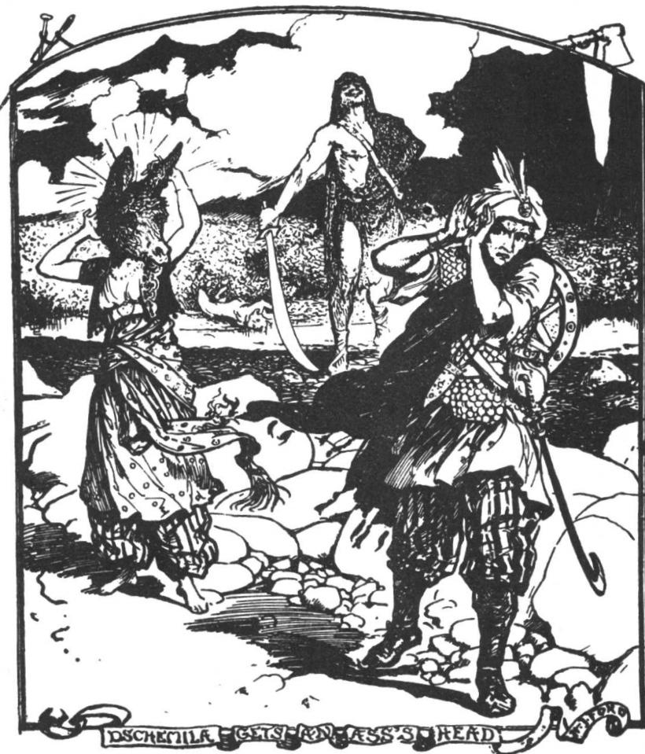

于是德谢米尔扔下未婚妻，独自回家了。

整整两天，可怜的德谢米拉孤零零地在路上走着，默默地流着眼泪。当德谢米尔快到家时，他想着自己的所作所为，突然感到非常羞愧。

“也许现在德谢米拉已经变回到她原来的模样了。”德谢米尔想着，“我要回去看看！”

于是，他健步如飞地往回跑去。最后，他发现德谢米拉正坐在一块高高的岩石上面，躲避着一群饿狼。德谢米尔立刻赶走了狼群，对德谢米拉说道：“快下来吧，亲爱的，好险啊。”

德谢米拉站起身来对她的表兄说道：“是你说服了我，叫我跟着你一起逃出来，如今你又扔下我不管。”

“你知道我为什么会这么做吗？”

“为什么？”

“我以为你是个巫婆，我感到很害怕。”

“难道你不知道我原来的模样吗？你不是亲眼看到是那妖怪的咒语才使我变成现在这样子的吗？”

“那我现在该怎么办呢？”德谢米尔问道，“如果我把你带回镇上去，人们一定会嘲笑我说：‘这是你买来的新玩意儿吗？女人的身体，毛驴儿的头。’”

“那么，你究竟打算把我怎么办？”德谢米拉问道，“还是趁天黑把我带回我母亲家，别把这事儿告诉任何人。”

“好吧，就这么办。”

于是他们在外等到天黑，德谢米尔带着未婚妻回到了她自己家里。

他们敲了敲门，德谢米拉的母亲问道：“是德谢米尔吗？” “是我。”

“你找到德谢米拉了吗？”

“找到了，我把她带回家来了。”

“噢，她在哪儿？快让我看看！”母亲哭着说道。

“就在我身后，”德谢米尔回答说。

但当母亲一见到女儿的模样，禁不住尖叫道：“你是在跟我开玩笑吗？我什么时候生过一头驴？”

“小声点！”德谢米尔急忙说道，“别让全镇的人都听到了，如果你看看她的身上，就会发现有两处伤疤！”

“妈妈，”德谢米拉呜咽道，“你难道真的认不出自己的女儿了吗？”

“不，我当然能认得出来。”

“那她的两块伤疤在哪儿？”

“一块在她的大腿上，是被狗咬的，另一块在她的胸口，是小时候被油灯烧伤后留下的。”

“那就看看我身上吧，看看我是不是你的亲生女儿。”德谢米拉说着脱下衣服，让母亲看自己的伤疤。

母亲一看到她身上的伤疤，立刻明白了她确实是自己的亲生女儿，便抱着她伤心地哭了起来。

“亲爱的孩子，”母亲哭泣道，“是什么使你遭到如此厄运呢？”

“是个妖怪，他先把我带到一座很远的城堡，把我关起来，然后又对我施咒，使我变成现在的样子。”德谢米拉回答道。

“那你现在打算怎么办呢？”

“我先躲在家里，别对任何人说起我的事，而德谢米尔，如果邻居们问起你，你就说没有找到我。”

“好的，”德谢米尔答应道。

德谢米拉躲在阁楼上整整一个月。以后只有当全镇的人都睡着后，她才敢到街上去走走。

而德谢米尔回到了自己的家里后，他的父亲和兄弟们看到他平安回来都很高兴。

“你什么时候回来的？”他们问道，“找到德谢米拉了吗？”

“没有，我找遍了所有的地方，都打听不到关于她的消息。”

“你后来和那个过路人分手了吗？”

“对，走了三天三夜，他精疲力尽，再也走不动了，我们就分手，他往回去，我想现在他早该到家了。而我继续往前走，每到一个城堡就打听德谢米拉的消息，可毫无线索，最后，我只能放弃了。”

德谢米尔的亲人们说道：“我们早告诫过你，这么找是毫无意义的，她肯定是被什么妖怪绑架了，你怎么可能找到她呢？”

“可我是那么深深地爱着她，我还要去找她。”德谢米尔说。但他的朋友们不理解他。

“我们另替你找个妻子吧，镇上有好些女孩子都比德谢米拉长得漂亮。”

“这我知道，可我不愿意。”

“但你买的这些漂亮的家具又该如何处置呢？”

“我可以把它们锁在大木箱里。”

“它们会被虫蛀掉的，几个星期也许还没问题，但一、两年后，这些东西就没用了。”

“即使再过十年，我也只娶德谢米拉一个人，再过一、两个月，我还要去找德谢米拉。”

“噢，你真是疯了，这世上难道只有德谢米拉一个女人吗？比她漂亮的女孩多得是。”

“在我眼里，德谢米拉是最美丽的，你们不用多管闲事。”

三个月过去了。有一天，一个犹太人穿过沙漠时，经过原先德谢米拉住过的那座城堡，他坐在墙脚边休息起来。

到了晚上，妖怪回来，看见他坐在那儿，就问他：“嗨，犹太人，你在这儿做什么？你有什么东西要卖吗？”

“我只有些衣服，”犹太人哆哆嗦嗦地回答道，心里对妖怪怕得要命。

“噢，别害怕，”妖怪哈哈大笑，说道，“我不会吃了你的，事实上，我打算和你一起走一程。”

“好吧，尊敬的先生，”犹太人说着，给妖怪磕了个头。

“听着，你必须笔直朝前走，直到一个小镇，在这个小镇上住着一位名叫德谢米拉的姑娘和一个名叫德谢米尔的小伙子，你拿着这面镜子和这把梳子对德谢米拉说：‘你的父亲，那妖怪向你问好，只要你把脸对着这面镜子，你就会变回到原来的模样，用这把梳子梳梳你的头，你就会有原来的秀发。’如果你不照我说的这些去做，等下一次我再见到你，就会把你吃了。”

“噢，我一定会照你说的去做。”犹太人连连应答。

三十天后，犹太人来到了德谢米尔兄妹俩住的小镇。他坐在街上休息，又累又饿又渴。

说来也巧，德谢米尔正好打这儿路过，他发现路上坐着个陌生人，就停下来说道：“快起来，犹太人，你这样坐在太阳底下会中暑的。”

“先生，你真是个好人，”犹太人回答道，“我在外面整整走了一个月，实在是累得走不动了。”

“你从哪儿来？”德谢米尔问道。

“从那个方向来，”犹太人说着指了指身后的路。

“你说你走了整整一个月，那么你遇上什么特别的事情了吗？”

“是的，先生，我看见了一座城堡，就坐在它的墙脚下休息，这时有个妖怪把我叫醒，要我到这小镇上来，叫我必须找到一个名叫德谢米尔的小伙子和一个名叫德谢米拉的姑娘。”

“我就是德谢米尔，那妖怪要对我说些什么？”

“他让我带些东西给德谢米拉，我能见见她吗？”

“请跟我来，你可以亲自把东西交给她。”

于是他们俩一起来到了德谢米拉的家。

“德谢米拉！”德谢米尔一进她家就叫道，“这犹太人是从妖怪那儿来的，他给你带来了两样东西，一面镜子和一把梳子！”

“也许，这妖怪又想捣什么鬼。”德谢米拉躲在阁楼上说道。

“我不这么想，”德谢米尔说，“你把那两样东西给她吧。”

德谢米拉从阁楼上下来，来到犹太人面前，问道，“你打哪儿来？”

“从妖怪那里来。”

“他让你来干什么？”

“他让我把这面镜子和这把梳子给你，并让我告诉你，只要你用这面镜子照一下，用这把梳子梳一下头，你就会变成原来的模样。”

于是德谢米拉拿起镜子照了照，又用梳子梳了梳头，一瞬间，她已从一个长着驴子脑袋的姑娘又变回到了一个秀发披肩的美丽少女。

德谢米拉的亲人们看到眼前发生的一切真是惊喜万分。转眼间，德谢米拉回来的消息传遍了全镇，左邻右舍都前来表示祝贺。

“德谢米拉，你是什么时候回来的？”

“是我表兄把我带回来的。”

“这真奇怪，他对我们说没能找到你呀。”

“噢，我是故意这么说的，”德谢米尔解释道，“我只是想给大家一个惊喜。”

紧接着，德谢米尔就跟他的父母和兄弟姐妹们商量道：“我们得立刻准备起来，我和德谢米拉打算马上就举行婚礼。”

他们备好了华贵典雅的轿子，准备接新娘过门，但新娘不敢上轿，说道：“我很害怕，万一那妖怪再次把我骗走，那该怎么办呢？”

“我们大家都在这儿，妖怪怎么可能拐走你呢？”大伙儿说道，“我们一共有两千个人，每个人都带着宝剑呢。”

“如果他想做一件事，就一定能得手，”德谢米拉回答说，“他是个法术极高的妖怪。”

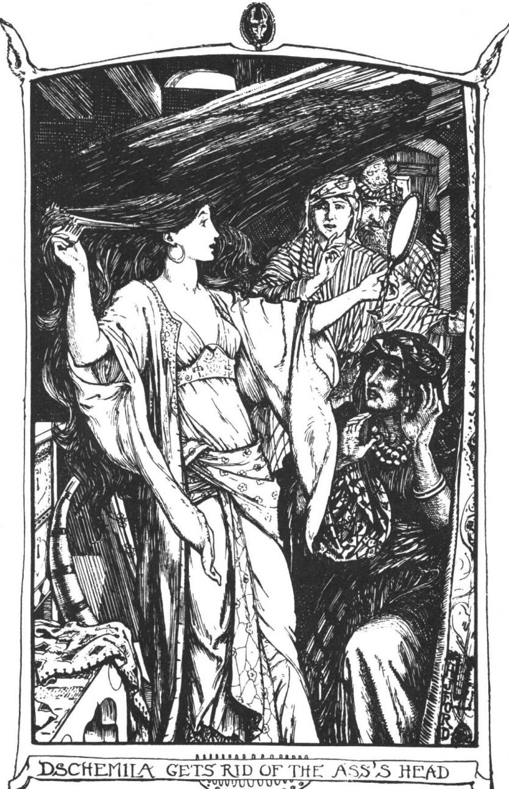

“德谢米拉说得对，”一位老人说道，“把轿子抬走，如果她害怕，就让她走着去。”

“这真是荒唐！”其余的人嚷道，“妖怪怎么可能弄走她呢？”

“我不会坐轿子去的，”德谢米拉重复道，“你们不了解那魔鬼的威力，可我明白。”

当他们争执不下时，新郎到了。

“德谢米拉一定有她的道理，”新郎说道，“就让她留在自己的家里吧，我可以住在这儿，婚礼就在这儿举行。”

于是德谢米尔兄妹俩最后终于结为夫妇，他们俩互敬互爱，白头偕老，直到去世，他俩从未争吵过一次。

 

## 詹尼和妖龙

很久以前有一位隐士，住在远离尘世的荒郊野地中。除了一群羊，他一无所有。他靠出卖羊毛和羊奶养家糊口。

另外，他还做小木匙换些钱用。隐士有个妻子和一个小女儿。过了好久，他的妻子又将为他生孩子了。就在他妻子要分娩的那个晚上，他赶到了最近的一个村庄去请接生婆。在回来的路上，他遇到了一位修道士，这位修道士请求在他家过一夜。这位隐士是个热心人，就把他带回了家。由于远近几十里没有什么人能为新生的婴儿施洗礼，隐士就请这位修道士为自己的儿子施洗礼，并为他取名詹尼。

后来，詹尼的父母都死了，他和他的姐姐，两个人孤苦伶仃地生活着。慢慢地，他们的境况越来越糟。于是，他们决定到别处去寻找生路。在整理行装时，姐姐发现了一把小刀，这把刀是修道士临走时留给他的教子詹尼的，姐姐把这把刀给了自己的弟弟。

终于有一天，姐弟俩带着仅剩下的三头羊出发了。走到第三天，他们遇见一个带着三条狗的人，他提议用自己的三条狗来换姐弟俩的三头羊，姐弟俩欣然同意，他们交换了各自的动物后，又各走各的路了。

詹尼和他的姐姐最终来到了一座大城堡前，城堡里住着四十条妖龙。当这四十条妖龙听说詹尼来了，就都逃到四十英寸深的地底下去了。

詹尼走进城堡时，里面已空无一人。于是詹尼和他姐姐就在这里住下了。詹尼每天都用妖龙留下的武器去打猎。

一天，当詹尼出去打猎时，一条妖龙来到地面上取食，它并不知道城堡里还有人，所以当它看见詹尼的姐姐时，大吃一惊，但詹尼的姐姐告诉妖龙不用害怕，而且渐渐地他们彼此竟都爱上了对方。于是每当詹尼外出打猎时，他的姐姐就会把妖龙叫上来。就这样，詹尼的姐姐和妖龙开始谈情说爱。最后，他们瞒着詹尼结了婚。不久詹尼的姐姐开始后悔了，因为她怕詹尼一旦知道了这事会大发雷霆。

一天，妖龙对詹尼的姐姐说道：“你必须装出生病的样子，当詹尼问你有什么不舒服，需要些什么时，你就回答：‘我需要草莓’，当他再问你在哪儿可以找到草莓时，你就说：‘在离这儿有一天路程远的地方，有个花园，花园里就有草莓。’这样，你的弟弟就会到那儿去，而且永远不会再回来了，因为那里住着我的三个兄弟，他们会很好地照看他的。”

于是，姐姐照着妖龙说的去做了。第二天，詹尼就带着三条狗出发去采草莓了。当他来到长草莓的花园时，跳下了马，喝了些从地上冒出来的泉水，他立刻就睡熟了。三条妖龙爬出地面来想要吃了他。这时，三条狗向妖龙猛扑过去，把它们撕得粉碎，接着，狗又用爪子在地上挖了个洞，把妖龙的尸体给埋了，不让詹尼发现。詹尼醒来，发现狗身上血迹斑斑，以为它们一定在什么地方抓住了一只野兽，并把它给吃了。为此，詹尼感到有些生气，因为三条狗什么也没有给他留下。然后，詹尼采了许多草莓准备带回去给姐姐吃。

妖龙听说詹尼竟又回来了，就惊慌失措地重又逃到了四十英寸深的地底下。而詹尼的姐姐吃了那些弟弟为她采来的草莓后，称自己的病好多了。

第二天，詹尼像以往一样出去打猎时，妖龙又来到了城堡，他又唆使詹尼的姐姐再装出生病的样子。这样，当她的弟弟问她需要些什么时，她就回答说：“榅桲果”。而当他再问在什么地方可以找到它时，她就必须回答说：“在离这儿有两天路程的花园里。”这样，詹尼就一定会被吃掉，因为在那地方住着妖龙的六个兄弟，而它们每条龙都长着两个脑袋。

詹尼的姐姐照着妖龙说的去做了。于是，第二天詹尼带着他的三条狗又出发了。来到那个花园后，他跳下马，坐下稍事休息，但很快就睡着了。起先三条妖龙围上前来想要吃了他，可它们被三条狗消灭了。于是，另三条妖龙冲上来，但也遭到了同样的命运。接着三条狗为了不让主人发现这些，就又为这些妖龙挖了个坟，把它们给埋了。詹尼醒来，看见狗又混身是血，就以为和上次一样，它们一定又杀死了一头野兽，并为它们没有想到要和自己一起来分享这只野兽而感到生气。不管怎样，他还是采了许多榅桲果带回家给姐姐吃。姐姐吃完之后，称自己的病又好了许多。妖龙听到詹尼又安全回家的消息之后，仓皇地逃到了更深的地下去了。

詹尼回来后的第二天，还和往常一样，出去打猎了。于是妖龙又跑到他姐姐那儿出鬼点子。妖龙对詹尼的姐姐说，让她再装一次病，并说需要吃梨，而这种梨长在离这城堡三天路程的花园里。如果詹尼这次能到那里去，他一定回不来的，因为那里住着妖龙的九个兄弟，而它们每条龙都有三个头。

詹尼的姐姐又照着妖龙说的做了。于是，第二天詹尼又带着三条狗出发，为姐姐摘梨去了。经过三天跋涉，他终于来到了长满梨树的花园，他下马打算歇一歇，但立刻就睡熟了。

有三条三头妖龙先冲上前来，想吃了詹尼，这时，三只狗迎上去，消灭了它们。

接着，剩下的六条妖龙一起扑上前来，与三只狗展开了搏斗。撕杀声惊醒了詹尼，于是他挥刀上阵，杀死了这些妖龙。这一次，他终于明白了，为什么每一次醒来总看到三条狗浑身是血，原来，它们是在保护自己。

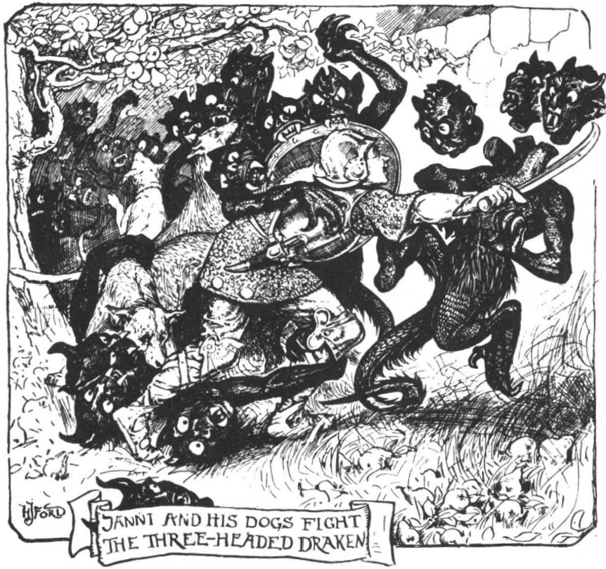

詹尼把妖龙杀死之后，把被它们囚禁着的所有的人都放了出来，其中包括一位国王的女儿。出于感激，她表示愿意嫁给詹尼，但詹尼却说他必须先回去安顿好生病的姐姐，然后才能和公主结婚。詹尼对公主说：“如果你想报答我，那就呆在这座城堡里，收留那些路过这儿的瞎子和跛子。”公主答应了他的要求，并在他临走前送给他一枚戒指。

然后，詹尼又摘了好些梨，带回家给姐姐吃。吃了这些梨后，她姐姐称病好了。然而，当妖龙听说詹尼竟第三次安全地回到了家，简直惊呆了，它立刻逃到了更深的地底下。可第二天，当詹尼外出打猎时，妖龙又爬了上来，对詹尼的姐姐说道：“现在，我们真是走投无路了，除非你能知道究竟是什么使你的弟弟有如此大的力量来打败我的这么多的兄弟，如果知道了这个，我们就能找到对付他的方法了。”

于是，当晚，詹尼打猎回来，和姐姐一起坐在火炉边时，姐姐问他道：“詹尼，究竟是什么使你具有如此大的力量呢？”詹尼回答说：“这种力量贮藏在我的两个手指间，如果把这两个手指捆绑在一起，那么我身上所有的力量都会消失掉。”

“这我不信，”姐姐说道，“除非我亲眼看见这一切。”

于是，詹尼让姐姐用一根线把他的两个手指绑在一起，顷刻间，他失去了所有力量。他姐姐立刻叫来了妖龙，恶毒的妖龙挖出了詹尼的眼珠喂狗吃，接着又把詹尼扔进了一口枯井里。

碰巧有几个人路过这口井，打算从这里打些水喝。他们听到井底有人发出呻吟声。于是，他们走近这口井，问里面是否有人。詹尼恳求他们把他从井里救上来。

过路人把一根绳子放到井底，把詹尼拉了上来。直到这时，詹尼才意识到他已经成了瞎子。于是詹尼请过路人把他带到被他救出的公主那儿，并承诺会报答这些过路人的。

过路人把詹尼带到了公主那里，詹尼请求公主嫁给他，但起先公主并没有认出他来，直到他拿出那枚临走时公主送给他的戒指时，公主才意识到是他回来了，把他带进了城堡。

公主听说了詹尼的遭遇后，她召集了全国的神仙，打听在哪儿可以找到詹尼的双眼。最后，有一位仙女说她知道在哪儿能找到詹尼的双眼，并能使詹尼重见光明。然后，这位仙女来到詹尼的姐姐和妖龙住的城堡，给吞吃了詹尼双眼的狗吃了些东西，詹尼的双眼重又出现了！仙女把它又重新安在詹尼的眼眶中，詹尼又和以前一样，看见了所有的一切！

詹尼回到妖龙的城堡，杀死了妖龙和姐姐，带着那几条狗，回到公主身边。不久，詹尼和公主便结婚了。从此，他们过着幸福的生活。

 

## 小偷和骗子

从前有个小偷，由于找不到工作而在海滩边闲逛。无意中，他从一个人身边走过，看见这个人一动不动地站在那儿，望着海中的波涛。

“我想知道，”小偷对这陌生人说，“你是否看见过石头游泳？”

“我当然见过，”陌生人回答，“更妙的是，我还见过石头从水里蹦出来，跳到天上去呢！”

“太好了！”小偷说道，“你跟我合作，一定能赚大钱。让我们先到邻国的王宫去。到了那里，我一个人先去见国王，我会对他说些不可思议的事，然后你就来证实我说的那些事儿。”

小偷和这个说谎话的骗子商量好之后，就向邻国走去。走了几天路之后，他们来到了国王的宫殿，两人就暂时分手。小偷请求国王的召见，并向国王乞讨啤酒喝。

“我无法满足你的要求，”国王答道，“因为今年庄稼收成不好，酿酒的蛇麻子和葡萄也歉收，所以整个王国里既没有葡萄酒也没有啤酒。”

“这真是太奇怪了！”小偷叫道，“我刚从一个满目良田的国家来，在那里用一根蛇麻子树枝上的果子就能酿出十二桶酒来。”

“这不可能，我用三百个硬币跟你打赌。”国王说道。

“可以，我也出三百个硬币赌这是真的。”小偷回答。

于是，两人各下了三百个硬币的赌注，国王说他要派一个仆人去那个国家看看小偷说的话是否是真的。

仆人骑马出发了。半路上，仆人遇到一个人，便问他道：“你从哪儿来？”那人说的地方正是仆人要去的国度。

“如果是这样，”仆人道，“你能告诉我，你们国家的蛇麻子长得有多高，用一根树枝上的果子能酿几桶啤酒吗？”

“这我说不好，”过路人答道，“但人们收获蛇麻子时我碰巧在场，我看见三个人整整用了三天的时间才砍下一根树枝来。”

仆人想这个人能使他少走许多路，于是他给了这个过路人十枚硬币，让他把前面所说的话在国王面前再重复一遍。两个人便一起来到王宫拜见国王。

国王问仆人道：“那些关于蛇麻子酿酒的事是真的吗？”

“是，陛下，是真的，”仆人答道，“我带来了一名从那个国家来的人，他能证明这是真的。”

国王只好给小偷三百枚硬币，于是小偷和骗子这一对搭档又出去继续他们的冒险。小偷一边走，一边对他的同伴说：“现在，我要到另一个国家的国王那儿去，我将对他说些更离奇的事情，你必须帮助我，顺着我的话说，这样，我们就又能赢钱了，你就瞧着吧。”

他们俩来到了另一个国家，小偷拜见国王并向他要一棵花椰菜。国王回答说：“由于这里的蔬菜都得了一种萎菌病，所以我们根本没有菜。”

“这真奇怪，”小偷道，“我刚从一个遍地蔬菜的国家来，那里一棵花椰菜就能装满十二个木桶。”

“这我不相信。”国王说。

“我敢出六百枚硬币赌这是真的。”小偷答道。

“我也出六百枚硬币赌这不是真的。”国王说。然后，国王派了一名仆人，命令他立刻出发前往小偷所说的那个国家，去看看他所说的关于花椰菜的事是否是真的。半路上，仆人遇见一位陌生人，他下马问陌生人从哪儿来，陌生人说他正是从他要去的国家来。

“既然如此，”仆人说道，“你能告诉我，你们国家的花椰菜长得多大，是不是一棵菜就能装满十二个木桶呢？”

“我没亲眼见到这花菜地，”陌生人回答，“但我看见过十二匹马拉着十二辆马车，拉着一棵花椰菜到市场上去卖。”

于是，仆人说道：“伙计，这里有十枚硬币给你，因为你让我少走了许多路，跟我回去，把你刚才对我说的告诉国王。”

“好吧！”陌生人说道。于是他们一起来到王宫。当国王问仆人关于花椰菜的事时，仆人回答说：“陛下，你所听到的关于花椰菜的一切都是真的，这个人正是从那个国家来的，他将告诉你一切。”

国王只好给了小偷六百枚硬币。这样，小偷和骗子这一对搭档拿着他们骗来的九百枚硬币又出发了。到了第三个国家之后，小偷来到王宫，向国王吹嘘道：“在邻国的一座小镇上，有一座尖顶教堂，一次一只鸟飞到了这座教堂的顶上，教堂的尖顶极高，而这只鸟的嘴又特别长，有一次这只鸟竟把天上的几颗星星都啄下来了。”

“我不相信！”国王说。

“我打赌，这是真的，我用一千二百枚硬币下注！”小偷回答。

“我也出一千二百枚硬币赌这不是真的。”国王说道。然后，他立刻就派了一名仆人去邻国了解真相。

半道上，仆人看见一个陌生人正向他迎面走来。于是，仆人上前招呼他，问他打哪儿来。那人回答说他正是从仆人要去的那个镇上来。仆人问他关于那只长嘴鸟的事是真还是假。

“这我说不好。”陌生人说道，“我从没见过那只鸟。但有一次，我看见十二个人拿着扫帚，正竭尽全力地把一只巨型鸟蛋推进一间地窖去。”

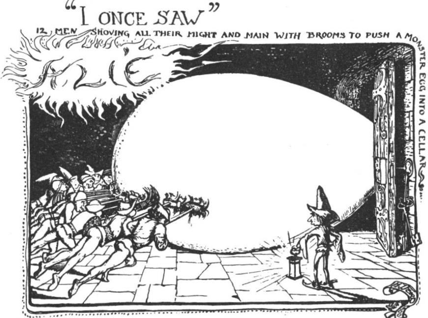

“这太好了，”仆人说道，他给了陌生人十枚硬币，“跟我回去，把你刚才说的事儿告诉国王，你可让我少走了许多路呢。”

于是，当这位陌生人把上面的事儿告诉国王之后，国王只好乖乖地给了小偷一千二百枚硬币。

小偷和骗子这一对搭档带着他们的不义之财离开了王宫，接着他们就该瓜分这笔钱了。但小偷在分给骗子钱时，少给了本该属于他的三枚硬币。不久后，小偷和骗子都成了家，并各自安顿下来。一天，骗子突然发现他的同伴——小偷少给了他三枚硬币。于是，骗子到小偷家去向他讨回这三枚硬币。

“你下星期六来，我会把你的钱给你的。”小偷说道。但事实上，他根本没打算把钱还给骗子。于是，星期六早晨，小偷装成死人的样子，直直地躺在床上并让妻子告诉骗子说自己死了。小偷的妻子用洋葱擦了擦双眼，当骗子前来要钱时，她泪流满面地告诉他说她的丈夫——小偷已经死了，所以没法还他的三枚硬币了。

但骗子知道这是他那位搭档耍的把戏，于是他说道：“既然他无法还我钱，那就让我用马鞭狠狠抽他三下来抵他欠我的债。”

听到这些话，小偷一下子从床上跳了起来，跑到门口，向同伴保证下一个星期六，自己一定会把钱还给他的，这样，骗子满意地回家去了。

但到了第二个星期六，一大早小偷就起来，躲在草棚的一堆干草下面。

当骗子来要自己的三枚硬币时，小偷的妻子又哭哭啼啼地告诉他自己的丈夫死了。

“那你把他埋在哪儿了呢？”骗子问道。

“埋在草棚里。”小偷的妻子回答说。

“那我就到草棚去，拿走些干草来抵他欠我的债。”骗子说着就朝草棚走去。来到草棚，他拿起一根长柄叉，翻铲起一堆堆的干草来，铲着铲着，骗子吓了一跳，原来躲在干草堆里的小偷爬了出来。这一次，小偷答应下一个星期六一定把三枚硬币还给骗子。

到了该还钱的那天，天蒙蒙亮，小偷就起床来到了附近一座教堂的地下墓穴室，僵直地躺在一口旧石头棺材里。

但骗子很聪明，十分了解自己搭档的把戏，他一下子就猜到了小偷准是藏到教堂的墓室里。于是，骗子出发，径直向教堂走去，他相信自己马上就能找到自己朋友的藏身之处。骗子来到教堂的地下墓室，光线一下子暗了许多，眼前模糊一片。忽然，他听见从铁窗边传来低低的说话声，他伸长耳朵仔细听着。原来，这是一伙强盗，打算把他们抢来的东西都藏在这儿。他们一边商量，一边把抢来的金银珠宝从墓穴室的铁窗外塞进来。接着，他们就该进墓穴室来了。这样，骗子就会被发现，于是骗子立刻披上斗篷，笔直地一动不动地站在墙上的一个壁龛里。昏暗的光线下，他看上去就像一座石雕。

这伙强盗一进地下室，就开始瓜分财宝。他们一共十二个人，但强盗头子却错将金子分成了十三堆，当他发现自己分错了时，他说：“我们没时间再重新分了，谁能把壁龛里那尊石像的头一斧子砍下来，这第十三堆金子就归谁。”说着，他自己先拿起斧子朝骗子站着的那个壁龛走去。但是，强盗刚把斧子举过头顶，忽然，从一口石头棺材里传来了阴森可怕的说话声：“别这么干，不然的话，鬼魂就会从棺材里爬出来，墙壁必会倒塌，你们将被埋葬在这墓穴里。”说着，小偷忽然从棺材里蹦了出来，骗子也从壁龛里跳了出来。强盗们被吓坏了，他们手忙脚乱地逃出了墓穴，把所有抢来的财宝都留在了里面。强盗们发誓，再也不进这鬼地方了。于是，小偷和骗子这对搭档又平分了强盗留下的金银财宝，各自带回了家。从此后就再也没有听说关于他们俩的消息。

 

## 福图内特斯和他的钱袋

很久以前，有个名叫塞浦路斯的小岛，岛上有座城市叫法马古斯塔。城里住着一个叫西奥多的有钱人。他原本该是世界上最幸福的人，因为他拥有所希望的一切：一个温柔美丽的妻子和一个可爱的儿子。但不幸的是，过了没多久，他就对已经拥有的一切感到厌倦而去追求新欢了。一旦人们走上了这条路，结局往往是一样的：福图内特斯（这是西奥多儿子的名字）还不到十岁，他的父亲就用完了所有的钱，一个子儿也没留下。

虽然西奥多很愚蠢，但他还不是完全不明事理，所以他立刻开始找工作做。他善良的妻子没有责备他，而是辞去了家里的仆人，卖了他们拥有的好马，承担起所有的家务，甚至亲自洗丈夫和孩子的衣服。

很快，福图内特斯长到了十六岁。一天，当他们一家人坐在一起吃晚饭时，男孩子问父亲：“爸爸，你为什么如此忧伤？告诉我，出了什么事，也许我能帮助你。”

“哦，我的孩子，我有充分的理由伤心，要不是因为我，你现在就能尽情地享受生活，而不是住在这么一间小屋子里了！”

“哦，爸爸，不要为此而烦恼。”福图内特斯答道，“该是我自己赚钱的时候了。虽然我从没学过如何做生意，但一定会有适合我做的事。我要去海边走走，好好考虑一下这件事。”

很快，甚至比福图内特斯自己预料的还快，有了一个机会，和所有聪明的男孩子一样，福图内特斯及时把握住了它。他的差事是做弗兰德斯伯爵的侍从。伯爵的女儿正要出嫁，为此，举行了盛大的庆典活动。福图内特斯在赛马中幸运地获了奖。与此同时，福图内特斯开朗豁达的性格也深得达官显贵们的赏识，他们经常赏钱给福图内特斯，这些赏钱和奖金加在一起，使福图内特斯感到自己已经很富有了。

但这些却激起了其他宫廷侍从们的嫉妒，他们中一个叫罗伯特的想出了一个赶走福图内特斯的阴谋。他骗福图内特斯说伯爵不喜欢他，而且还打算要杀了他。福图内特斯信以为真，收拾起他的好衣服和所有的钱，在天亮前悄悄地离开了城堡。

之后，福图内特斯走遍了许多大城市，而且过得不错。因为他很慷慨，又不比他的同龄人更精明，所以他很快就花完了所有的钱。像他的父亲一样，他开始考虑找工作做。他徒步走遍了半个不列塔尼，但没有人雇他。他漫无目的地从一个地方走到另一个地方，直到有一天，他发现自己走进了一个茂密的树林，树林里没有路，光线黯淡。他在树林里整整走了两天，几乎没有吃任何东西。他先朝着一个方向走去，然后换一个方向继续走，但他始终没能找到出去的路。第一天晚上，他睡得很香，因为实在太累，所以也顾不上担心人或者野兽了。但第二天夜幕降临的时候，他听到远处传来野兽的嚎叫声，突然害怕起来。于是，他四处寻找可以安身的大树。他刚在一棵大树的树杈处安顿下来，一只狮子突然来到树下，一股泉水正从树边的石缝中流出，狮子俯下身子贪婪地喝着泉水。“这真是糟透了，”福图内特斯心想，但还好，狮子是不会爬树的，只要他呆在树上，还是很安全的。可是没想到，狮子刚走开，又来了一只熊。福图内特斯很清楚，熊是会爬树的！他的心开始剧烈地跳动。福图内特斯的担心不是没有理由的，熊转过身来，往上看，它看到了福图内特斯！

在那个时代，年轻男子的腰带上总是佩着一把剑，福图内特斯也不例外，而且他一直很强壮。于是，他举起了剑，等熊爬到离他只有一码远时，他朝熊猛刺过去。熊被刺伤后，试图猛扑过来，但它身下的树枝突然断了，于是熊重重地摔倒在地上。福图内特斯也从树上下来（他事先已看好没有其他的野兽在场），只轻轻一击就把熊给杀死了。他正盘算着点起一堆篝火，用熊肉做一顿丰盛的晚餐，那一定会是美味佳肴。突然，他发现一位美丽的女神站在他身边，女神靠在一个轮子上，她的双眼被一块布蒙着。

“我是幸运女神，”她说道，“我有一件礼物要送给你，你仔细考虑一下，智慧、力量、长寿，富有、健康或是美丽，你要什么？”

福图内特斯深深体会到饿着肚皮只能胡思乱想，于是立刻答道：“尊敬的女神，请让我变得富有，让我永远不要再像现在这样忍受饥饿之苦。”

于是幸运女神拿出了一个小钱袋，告诉福图内特斯，他或他的子孙们只需把手伸进袋子，就永远能拿到十枚金币。但一旦他们去世，这个小钱袋就不再有如此魔力了。

听到这些，福图内特斯欣喜若狂，不知该如何感谢女神。但幸运女神告诫他，对他而言，首要之事是要走出树林。女神在跟福图内特斯告别前，为他指点了一条走出树林的道路，他竭尽全力地沿着这条道走着。最后，在不远处出现了亮光，他知道附近一定有屋子。果然，他看到了一家客栈。但在进屋之前，福图内特斯想验证一下那个女神告诉他的事是否是真的。于是，他拿出小钱袋朝里摸，果然，里面的确有十枚闪闪发光的金币。于是福图内特斯大摇大摆地走进了客栈，因为饿极了，所以他立刻要了最好的葡萄酒和一顿丰盛的晚餐。他花钱很大方，所以人们都以为他是贵族。

在客栈柔软的床上睡了一夜之后，福图内特斯感到舒服了许多，于是他问店主能否给他找几个仆人，在哪里可以买到好马。接着，他又买了许多华丽的衣服和一幢大房子，在那里，他经常宴请当地的贵族和漂亮女人。

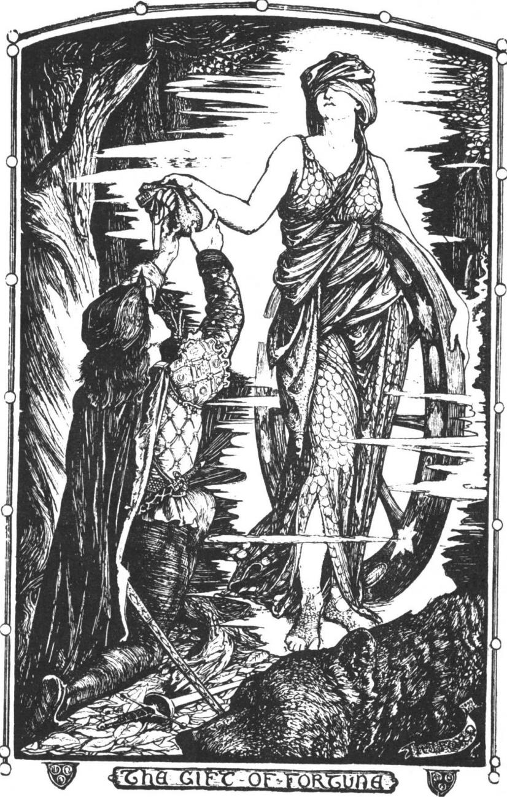

就这样，一年很快过去了，福图内特斯尽情享乐，几乎把在塞浦路斯岛上的父母忘得一干二净。但他毕竟不是没有良心的人，所以，当他一想起父母后，就开始准备去看他们。但他不想一个人单独去，他想找一个比自己年长和更明智的人同行。不久，他有幸遇到了一位老人，这个老头多年前就远离他的国家和妻子儿女，出来寻找幸运，但始终没能找到。他答应陪福图内特斯回塞浦路斯。但有一个条件，先让他回到自己的家看一看。福图内特斯同意了。出于好奇，福图内特斯和老人一起回到了他的家。

旅途很长，他们渡过了许多条大河，翻过了无数座高山，穿过层层密林，最终来到了老人的家。他的妻子和孩子们几乎已失去了再见到他的信心，所以，当他们看到他回来时，都激动地围上前去问寒问暖。福图内特斯一看到老人的小女儿就立刻爱上了她，她是世界上最漂亮的女人，名叫卡桑德拉。

“请让她做我的妻子吧！”福图内特斯向老人请求道，“让我们一起回法马古斯塔去！”

于是，他们租了一条大船，足以载下福图内特斯、老人和他的老伴以及他们的十个孩子——五个男孩，五个女孩。在他们启航的前一天，福图内特斯和老人的小女儿举行了盛大的婚礼，所有的人都认为福图内特斯是一位王子。当他们到达塞浦路斯后，福图内特斯得知他的父母都已经去世，他非常难过，把自己一个人关在屋子里，什么人都不见。他感到很羞愧，因为自己这么些年来把父母抛在了脑后。他请求老人和他的老伴代替他的父母，和他们一起生活。

转眼又是十二年过去了，福图内特斯和他的妻子卡桑德拉以及他们的两个儿子在法马古斯塔幸福地生活着。他们有一幢美丽的房子，几乎拥有所需要的一切。卡桑德拉的姐姐们出嫁时，福图内特斯用钱袋里的钱为她们每人准备了一份嫁妆。但最终福图内特斯开始厌倦呆在家里，想再次出去周游世界。当福图内特斯告诉妻子他的想法后，卡桑德拉流了许多眼泪，他费了好大劲，才说服她同意自己的打算，但福图内特斯保证两年后一定回来。在他离开家之前，给妻子留下了三箱金币，箱子放在铁门锁着的房间里，这间屋子的墙壁有十二英尺厚。“万一我出了什么事，”福图内特斯说道，“永远回不来了，你就自己留一箱金币，另两箱留给我们的儿子。”说完，他拥抱了家人，乘船去了亚历山德里亚。

一路上风平浪静，没几天，他们就进到了港口。在上岸时福图内特斯遇到一个人，这个人告诉他，如果他想在这个城市受到欢迎，必须送一件像样的礼物给这儿的君主。“那很简单，”福图内特斯说道。于是他来到一家金器店，买了一只价值五千镑的大金杯送给君主。这件礼物确实使君主很开心，于是君主定购了一百桶香料送给福图内特斯。福图内特斯把这些香料搬到他来时的船上，让船长把船开回塞浦路斯，把这些香料送给他的妻子卡桑德拉。接着，福图内特斯又得到了君主的接见。他请求君主允许他在这个国家旅行。君主立刻答应了他，还写了几封信给其他领地的君主，让福图内特斯带上。

福图内特斯很高兴，因为他能再一次周游世界了。他一天也没有耽搁就启程了。他从一个宫殿走到另一个宫殿，他华丽的衣着和名贵的礼物使每个人都感到惊讶。最后，他对在外漫游的生活厌倦了，就像当初厌倦呆在家里的生活一样。于是，他回到了亚历山德里亚。在那里，他发现那条把他从塞浦路斯带出来的船正停泊在港口。当然，他回亚历山德里亚后做的第一件事就是向君主致意，而君主也很急切地想了解他的所见所闻。

当福图内特斯向君主讲述了他的经历之后，君主说道：“虽然你看到了许多美妙的东西，但我有一件更美妙的东西给你看。”于是，君主领着福图内特斯到一间堆满了宝石的屋子里，看得福图内特斯眼花缭乱。但君主没有停下来，继续朝前走，在房间的另一头，打开了一扇门，可以看到里面有个橱，橱里除了一顶小红帽外没有任何其他东西。

“瞧这个。”君主说道。

“不是什么有价值的东西。”福图内特斯答道，“我见过许许多多更好的帽子。”

“唉，”君主说，“你不明白，任何人只要戴上这顶帽子，他想到什么地方，立刻就能到什么地方去。”

“那么，这帽子是谁做的呢？”福图内特斯问道。

“这个我不能说。”君主答道。

“这帽子戴着重吗？”福图内特斯问。

“不，很轻。”君主说，“你戴上试试吧！”

福图内特斯拿过帽子戴在头上，他想都没想，就希望自己回到去法马古斯塔的船上，立刻，他就站到了船头，船正在起锚。当君主还在后悔不该让福图内特斯戴上那顶帽子的时候，船已经向塞浦路斯疾驶而去了。

当船回到塞浦路斯时，福图内特斯发现他的妻子和孩子都很好，但两位老人都已去世。他的两个儿子都已长大成人。但他们和父亲不一样，并不想周游世界，而喜欢打猎和赛马。福图内特斯答应妻子从此安静地呆在家里。有时，如果他实在感到无法平静，他就会用那顶帽子出去漫游几小时，而家人也不会为此而感到担忧。真是全靠了那顶帽子，他一直没把它还给那个君主。

渐渐地，福图内特斯老了，自知没有多少日子可以活了，他派人找来了他的两个儿子，把帽子和钱袋给了他们。福图内特斯对他们说：“永远不要离开这两件宝物，它们比我留下的所有金子和土地都值钱。但永远不要说出这个秘密，即使对你们的妻子和最亲密的朋友也不要说。那个钱袋跟随我四十年了，没有人知道我怎么会如此富有。”不久，他死了，他的妻子卡桑德拉埋葬了他。在法马古斯塔，他被哀悼了许多年。

 

## 长着山羊脸的姑娘

很久以前，有个叫马桑尼洛的农民，他共生了十二个女儿。这十二个女儿站成一排时，就像是个阶梯，因为她们从大到小，彼此都只相差一岁。可怜的农民，为了养活这一大家子，不得不整天在地里耕作。尽管他终日忙忙碌碌，但所赚的钱却只刚刚够养家糊口，那些可怜的小女孩们还常常要忍饥挨饿。

一天，马桑尼洛正在山脚下干活儿，不知不觉，他来到了一个山洞口，洞里漆黑一片，没有一丝亮光。突然，一只巨大的绿色蜥蜴从里面钻了出来。马桑尼洛几乎被这突如其来的景象吓晕了。这只蜥蜴大得像条鳄鱼，而且看上去很凶残。

奇怪的是，这只蜥蜴很友好地在马桑尼洛身边坐了下来，对他说道：“我的朋友，你不用害怕，我决不会伤害你的，相反，我很愿意帮助你呢！”

听到这些，马桑尼洛跪在蜥蜴面前恳求道：“亲爱的女士，我真不知该如何称呼您，求你发发慈悲，让我回去，因为我还有十二个可怜的小女儿在家等着我，她们还得靠我过日子呢！”

“这正是我到这儿来找你的原因。”蜥蜴答道，“明天早上，把你最小的女儿带到我这儿来，我保证，我会像对待自己的亲生女儿那样来爱护她，把她养大成人。”

马桑尼洛听到这些话，感到很沮丧，因为他深知蜥蜴既然开口要他把自己最小的，也是最温顺的女儿带来，那么这可怜的小女儿就必定会成为这只可怕的蜥蜴的一顿美餐。但同时，农夫心中又暗想道：“如果我拒绝了它的要求，它一定会立刻把我给吃了。但如果我答应了她的要求，那我又该如何去面对我的女儿呢？我该怎么做，究竟怎样才能摆脱困境呢？”

正当马桑尼洛喃喃自语时，蜥蜴又说：“立刻照我说的去做吧，我非常希望得到你的小女儿，如果你不照我说的去做，那么恐怕你的境况会更糟。”

马桑尼洛看到别无选择，只能悻悻地回到家中，看到他脸色苍白，无精打采的样子，妻子问道：“发生了什么事，亲爱的，你和谁吵架了，还是那头可怜的驴摔倒了？”

“都不是，”她的丈夫答道，“我遇到了比这更糟的事。一只可怕的蜥蜴几乎把我吓晕了，它威胁说如果不把我们最小的女儿给它，它会让我们为此而感到后悔。现在，我的脑子乱极了，不知该怎么做，真是进退维谷。你知道，我是多么疼爱我们的小女儿伦佐拉，但是如果明天早晨，我不把她带到蜥蜴那里去，我就会没命的，你说我该怎么办？”

农民的妻子听完这些，对他说道：“亲爱的，你怎么知道蜥蜴就一定是我们的敌人呢？它会不会是我们的朋友呢？你和它的相识也许会是我们家的转机，使我们的生活从此不再这么艰苦。既然如此，就把孩子带到它那儿去吧，我的心告诉我，你这么做是永远不会后悔的。”

听了妻子的话，马桑尼洛感到宽慰了许多。第二天天一亮，他就带着最小的女儿来到那个山洞口。

蜥蜴已在山洞口等候着农民的到来，一看到他，蜥蜴就赶紧走向前来，牵着小女孩的手。蜥蜴给了这小女孩的父亲满满一袋金子，并对他说：“你回家去吧，等你其他的女儿出嫁时，就用这些金子为她们置办嫁妆。你尽可以放心，你的小女儿伦佐拉可以从我这里既得到父爱又得到母爱，她能到我这儿来，真是她的幸运。”

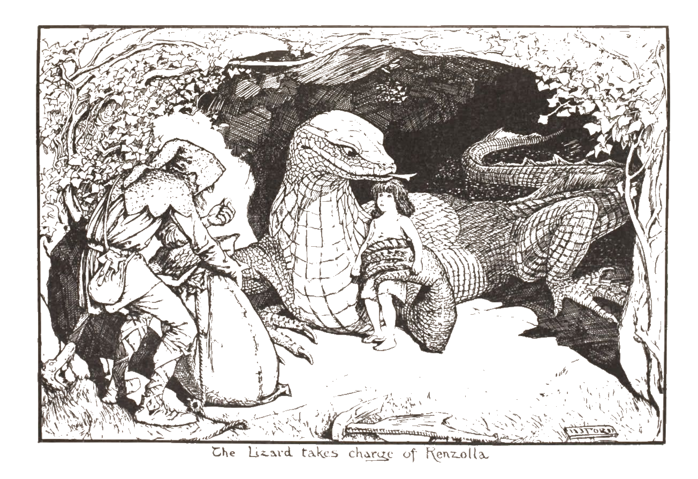

马桑尼洛非常感动，他向蜥蜴道了谢，就回家去了。

农夫变得非常富有的消息一旦传开，前来向他女儿求婚的人络绎不绝。不久，他所有的女儿都出嫁了。除了为女儿们办嫁妆的开销，农夫和他的妻子仍有足够的金子来维持舒适而富裕的生活。

再说蜥蜴和那小女孩。农夫一走，蜥蜴就把山洞变成了一座美丽的宫殿，领着小女孩走了进去。在这座宫殿里，蜥蜴把小女孩当公主那样带大，满足她所有的要求，给她吃山珍海味，穿绫罗绸缎，还用了一千个仆人来服侍她。

终于有一天，一位国王到这片树林子里来打猎，他在这座宫殿的附近迷了路，天色又慢慢暗了下来。国王发现从这座宫殿里射出一道亮光，于是，他派了一名侍从去打听能否在这里过一夜。

当侍从敲门时，蜥蜴摇身一变，成了一位美丽的仙女，并亲自来开门。当她得知国王的请求后，她请侍从向国王转达她的衷心欢迎，并表示她将为国王提供他所需要的一切。

国王听到如此善意的邀请，立刻来到了宫殿，他受到了极好的款待。一百个仆人点着灯来迎接他，另外一百个仆人侍候他用餐，还有一百个仆人摇扇为他驱赶苍蝇。伦佐拉亲自为国王斟酒，她的举止如此优雅，以至于国王一下子就被她吸引住了。

吃完饭，收拾完餐桌，国王感到很疲劳，准备睡觉去。就在伦佐拉为国王脱鞋子时，他的心被伦佐拉征服了。国王深深地爱上了伦佐拉。把她当作自己的梦中情人，并向她求婚。善良的蜥蜴一心只想着伦佐拉的幸福，马上同意了这门婚事，她还为伦佐拉准备了七千枚金币的嫁妆。

国王满心欢喜地准备带着伦佐拉离开宫殿。但伦佐拉对蜥蜴为她所做的一切没有表示丝毫的感谢。蜥蜴看到伦佐拉如此忘恩负义，决定惩罚她一下，她要把伦佐拉的脸变成山羊脸。眨眼间，伦佐拉美丽的小嘴变成了一张长长的大嘴，向前伸去，嘴角边挂着一码长的胡须，她的面颊凹陷下去，闪闪发亮的辫子成了两只尖尖的羊角。当国王转过脸来看到她时，简直不敢相信自己的眼睛。他泪流满面，失声痛哭道：“她那秀美的长发，美丽动人的双眼和温柔的嘴唇都到哪里去了？难道我一生都要和这个长着山羊脸的姑娘一起度过吗？不，不行，我不能因为这个姑娘而成为人们的笑料！”

国王和他的新娘一回到自己的国家，他就把伦佐拉关在王宫塔楼的一间小屋子里，让一个女仆陪着她。国王给了她们俩每人十捆麻线，告诉她们在周末前必须把些麻线纺完。

女仆遵照国王的命令，立刻精心地纺起布来。她先把麻线绕在锭子上，然后坐在织布机前轻快地织起布来。到了星期六晚上，她已经把所有的布都织好了。但伦佐拉，因为她在蜥蜴的宫殿里过惯了娇生惯养的日子，而且还不知道自己的脸已经变了模样，所以她生气地把麻线扔出了窗外，说道：“国王怎么能想得出让我做这事，如果他需要衣服的话，尽可以去买。他如此对待我，就好像我是他从贫民窟拣来似的，他该记着我还为他带来了七千枚金币的嫁妆呢！我是他的妻子，不是他的奴隶，他这样待我，准是疯了。”

到了星期六晚上，伦佐拉看到女仆已经完成了她的工作，担心自己会因为无所事事而受到惩罚。于是，她急匆匆地来到了蜥蜴的宫殿，向她倾诉自己的苦恼。蜥蜴轻轻地拥抱她，安慰她，给了她满满一袋纺好的麻布，让她交给国王，让国王知道她是个手巧的姑娘。伦佐拉拿起那口袋，没有向蜥蜴道一声谢就回到了王宫。善良的蜥蜴为此感到很伤心。

国王看到所有的麻线都被纺成了布，就又给了伦佐拉和女仆每人一条小狗，让她们悉心照料和驯养小狗。

女仆尽其所能地照看着小狗，把它当作自己的儿子那样对待。但伦佐拉却说：“我真不知该说些什么，我是不是生活在一群疯子中间？难道国王以为我会亲自为一条狗来梳洗喂食吗？”说着，她打开窗户，把那可怜的小动物扔了出去。那条可怜的小狗，像石头般地摔到了地上，死了。

几个月过去了，国王派人捎信来说他要亲自来看看那两只小狗过得怎么样了。伦佐拉听到这消息，忐忑不安起来。于是她又匆匆离开塔楼来到蜥蜴的宫殿。这一次，她在宫殿的门口遇到了一位老人，老头问她道：“你是谁，到这儿来做什么？”

伦佐拉听后，生气地回答道：“你难道不认识我吗，你这只老山羊，怎么敢对我说这样的话？”

“你还说我呢，”老头答道，“长得像山羊的不是我，正是你自己呀！你等一会儿，我马上会让你看到你自己的脸。”

说着，他急匆匆地走开，不一会儿，又拿着一面镜子回来了。老头把镜子放在姑娘面前。伦佐拉从镜子里看到自己的脸上长满了毛，样子十分丑陋，她几乎晕了过去，接着，她嚎啕大哭起来。

老头说道：“你必须记住，伦佐拉，你原本是个农夫的女儿，是蜥蜴使你成了王后，但你从来没有感谢过它，从来没有对它为你所做的一切表示过感谢，所以，它才决定要惩罚你，把你的脸变成山羊的模样。如果你想除掉那些长长的白胡子，就该跪在蜥蜴跟前，请求它的宽恕。它有一颗善良的心，或许会原谅你的。”

伦佐拉听了老人的这番话后，很为自己的所做所为感到羞愧。她照老人说的话，跪在蜥蜴面前，请求它的原谅。善良的蜥蜴不但原谅了她，使得她和从前一样漂亮，还为她穿上了一件用金子绣成的裙子，又给她准备了一辆漂亮的马车和一大群仆人，把她送回到国王的身边。当国王看见伦佐拉变得和过去一样的美丽，就再一次深深地爱上了她，并且为这些年来使她所受的苦表示深深的忏悔。

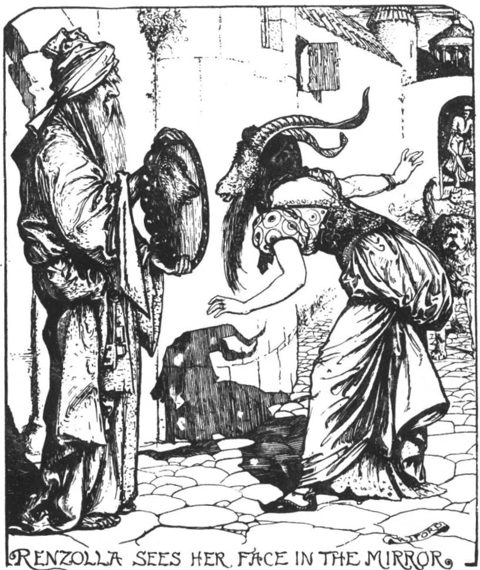

从此，伦佐拉过着幸福的生活。她深爱着自己的丈夫，衷心感谢蜥蜴为她所做的一切，同时也深深感激那个告诉她真相的老人。

 

## 采了花以后的故事

从前有个女人，她生了三个女儿。有一天，大女儿正在草地上走着的时候，看到小河中有一朵石竹花正显出鲜艳绚丽的色彩。于是她停下来去采这朵花。她的手刚一碰到花，人就整个地消失了。第二天早晨，二女儿见姐姐昨天没回去，就去草地上找她，可在路上她碰到一朵可爱的玫瑰花挡住了去路，就伸手去把玫瑰花枝移开，可是她看到这朵玫瑰花这么美丽，就忍不住伸手去摘它。眨眼工夫她也不见了。三女儿不知道两个姐姐究竟是怎么回事，就踏着两个姐姐的足迹去找她们，可她也成了一朵美丽的茉莉花的牺牲品。这样，那女人身边就一个女儿也没有了。

女人成天哭呀哭，哭呀哭。她哭了那么久，一直哭到她的儿子从一个小孩长成一个茁壮的青年。终于有一天，儿子向母亲询问是什么原因使她每天哭泣不止。

当小伙子听到她姐姐们遭遇的事情后，就对妈妈说：“祝福我吧，妈妈！我要走遍天涯海角寻找姐姐，直到找到她们为止。”

于是他就出发了。开始的那几英里路十分顺利，路上什么事也没有发生。走着走着，他遇到三个男孩在路上打斗，于是就停下来问这些男孩为什么打斗，其中一个男孩答道：

“老爷！我们的父亲死的时候，留下来一双魔靴，一把魔钥匙及一顶魔帽。不管是谁，只要他穿上魔靴，就能立刻到他想去的任何地方；魔钥匙可开启世界上任何类型的锁；戴上魔帽后，谁也看不见你了。而现在我们这个哥哥竟然想独占这三件宝贝，而我们则要求以抽签来确定宝物的归属。”

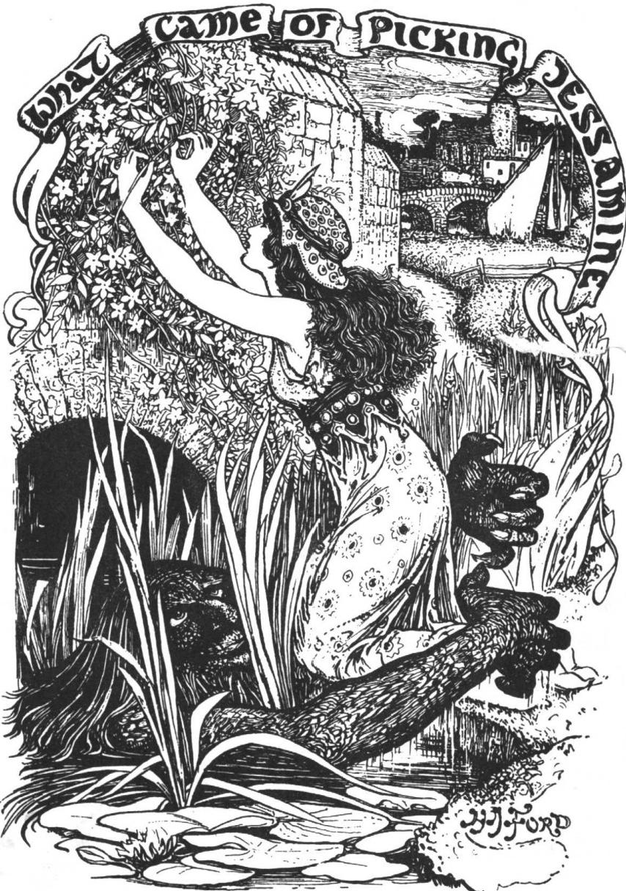

“哦，这好办，”小伙子说，“我把这块石头尽力一扔，你们三人中谁先捡到它，谁就能获得这三件宝物。”说着他捡起那块石头向远处扔去。当那三兄弟拼命跑去捡那块石头时，小伙子迅速地套上魔靴，说：“魔靴！快带我到能找到我大姐的地方！”

眨眼间小伙子就站到了一座陡峭的山上。他面前是一座坚固的城堡的大门，大门上布满着铁栓、铁条，还用铁链锁着。小伙子并没忘记带上那把魔钥匙，这时他就从口袋里取出钥匙，打开了一重又一重的铁门，接着他穿过了许多大厅和走廊，直到看到一个盛装的美丽少妇。少妇看到他不禁吃惊地倒退了一、两步，并叫起来，“啊呀，先生，你是怎么想办法进到这里来的？”年轻人告诉少妇他就是她的弟弟，以及他穿越重重铁门来到她跟前的经过。接着，她也告诉他，她现在生活得非常幸福，只有一件不顺心的事，那就是她丈夫中了魔法，而这魔法必须要处死一个长生不死的人后才能得到解除。

他们在一起谈了很久。接着少妇告诉她兄弟，她丈夫可能随时会回来，而她丈夫可能不喜欢他在自己身边，因此他最好还是离开她。但小伙子让姐姐尽管放心，因为他手里有一顶魔帽，戴上它后就谁也看不到他了。正当他们谈话谈得非常起劲的时候，门突然开了，一只鸟儿飞进来，但它没看到任何异常现象，因为小伙子刚一听到门响就立刻戴上了帽子。少妇跳起来，拿出了一只金面盆。那只鸟儿飞进金面盆，立刻变成了个英俊的男人。他转向妻子，喊道，“我肯定这屋里还有别的人！”少妇吓坏了，她反复说屋里只有她一个人，但他丈夫仍然肯定还有别人，最后少妇只好说了实话。

“如果他真的是你的弟弟，为什么还要把自己藏起来呢？”他问道，“我敢肯定你在对我撒谎，如果这人回来的话，我就要杀了他！”

听了这话，小伙子摘下了他头上的帽子，走到姐夫面前。她姐夫看到他真的那么像他的妻子，就再也不怀疑妻子的话了。他高兴地拥抱了自己的妻弟，并且从身上摘下一根羽毛，说，“如果你遇到了危险，就把这拿出来，说，‘快来帮我，百鸟之王。’你就会一切顺利的。”

小伙子谢过了姐夫，告辞后出来。当他走出了城堡时，他对魔靴说，快带我去二姐住的地方。与上一次一样，眨眼间他到了一座巨大城堡的大门前，而城堡里则住着他的二姐；她与丈夫幸福地生活在一起，她丈夫很爱她，但却希望能早日摆脱使他过着半人半鱼生活的魔法。小伙子到来并被介绍给他二姐夫后，二姐夫热情地欢迎了他，并递给他一片鱼鳞，说，“如果你遇到危险就喊，‘快来帮我，百鱼之王，’你就会一切顺利的。”

小伙子谢过他以后就告辞了。当他来到大门口时，他要魔靴把他带到他小姐姐住的地方去。魔靴将他带到了一个黑暗的山洞前，山洞里有铁的阶梯可以上到山洞内部。他小姐姐在山洞里不停地哭泣。自从她来到这地方后，她除了成天哭泣以外什么都没干，因此这可怜的女孩瘦成皮包骨头。她看到有个男人站在她面前时，就跳起来高喊道，“啊，不管你是谁，快救救我，把我带离这个可怕的地方吧！”这时小伙子告诉她他是谁，他遇见大姐和二姐的经过以及她们的丈夫中了魔法，破坏了他们的幸福生活的情况。小姐姐也讲了自己的遭遇。她是在草地上被一个可怕的怪物带走的，那怪物要强娶她为妻，但她不愿屈从怪物的意志，怪物就一直把她关了这么多年。每天怪物都来恳求她满足他的愿望，并提醒她，她已经没有再次获得自由的希望了，因为他是世界上最坚定的人，而且他永不会死。听了这些话，小伙子想起了他那两个中了魔法的姐夫。于是他告诉小姐姐，如果怪物肯说出他为什么不会死就答应嫁给他。突然周围的一切都开始摇晃起来，似乎有一阵旋风在摇晃这些东西，接着一个老人走进来，趴在姑娘跟前，说：“你是不是仍然决心不肯嫁给我？如果这样你就必须成天坐在这里哭泣，一直到世界末日来临，因为我决不会放弃娶你为妻的愿望！”“好吧，”她说，“如果你能告诉我你能够永远不死的原因，我就答应嫁给你。”

怪物听了这话后不禁哈哈大笑起来。“哈哈！你想知道你怎么才能杀死我吗？好吧，如果你想杀死我，你就必须找到一只躺在海底里的铁盒子，这铁盒子里有一只白鸽，你必须找到这只白鸽生的蛋，把这些蛋拿到这儿，把它们砸在我的头上。”说完他又笑了，因为他很有把握肯定没有人能到那大海的海底，即使能到海底，也找不到那铁盒子，即使找到了铁盒子也无法打开它。大笑了一阵之后他又说，“现在你已经知道了我的秘密，你就必须嫁给我了。”但姑娘苦苦哀求他把婚礼推迟到三天以后再举行，怪物答应了，高高兴兴地出去了。

怪物消失后，小伙子摘下了头上的帽子，再次显出他的身子，他让小姐姐不要灰心，他将努力在三天之内救她出来。说完后他穿上魔靴，说他要去海边，话音刚落他就直接来到了海边。他拿出了鱼鳞，喊道，“快来帮我，百鱼之王！”话音刚落，他二姐夫游了过来，问可以帮小伙子做什么？小伙子告诉了二姐夫小姐姐的遭遇，他刚讲完，这位百鱼之王就把海里所有的鱼都召集到面前。所有的鱼中到得最晚的是一条小沙丁鱼，它为自己来晚了表示歉意。它说，它是碰到了躺在海底的一只铁盒子，头受了伤才晚到的。鱼王听到这以后就让这条小沙丁鱼带路，令几条个子最大，身体最壮的鱼去海底把那只铁盒子取来。不久这几条鱼就背着铁盒子回来了，它们把铁盒放在小伙子面前。小伙子掏出了魔钥匙，说，“魔钥匙，快打开那只盒子！”魔钥匙立刻打开了铁盒，说时迟那时快，虽然大伙都围在铁盒周围，准备要抓住白鸽，白鸽还是机灵地飞走了。

要想追上白鸽已是不可能的了，小伙子的心不禁沉重起来。突然他记起了大姐夫给他的羽毛，于是就把这羽毛取出来，喊道：“快来帮我，百鸟之王！”话音刚落，空中就传来一阵扑愣扑愣的声音，百鸟之王已经落在了小伙子的肩头上，问他需要什么样的帮助。小伙子向大姐夫叙述了整个事情的来龙去脉，他说完后，百鸟之王就下令所有鸟儿都马上到他这里来报到。眨眼之间天空中飞翔着各种各样，有大有小的鸟儿，到得最晚的是一只白鸽。白鸽为自己来得晚而道歉，并说是因为有老朋友到它窝里来访，它要为它们准备晚餐而来晚的。于是百鸟之王就命令一些鸟带小伙子到那只白鸽的鸟窝那儿去。不一会儿他们找到了白鸽的鸟窝，以及用来打破怪物魔法的鸽蛋。于是小伙子把鸽蛋仔细地揣进兜里，又告诉魔靴带他回山洞，他的小姐姐正在那儿焦急地等待他回去。

这时怪物约定的第三天快要过去了，而怪物是定在这天结婚的。小伙子戴上魔帽，走进山洞时，他发现怪物已经在洞里，要求他小姐姐履行诺言，马上与他结婚。在小伙子的暗示下，姑娘坐了下来，让怪物把他的头枕在她的膝盖上。怪物不知危险就在眼前，高兴地照着做了。小伙子站到小姐姐背后，把鸽蛋悄悄地递给了她。姑娘接过鸽蛋，对准怪物的头一下子砸了下去，怪物动了一下，发出了一声地震似的大吼，翻过身死去了。

怪物断气后，小伙子两个姐姐的丈夫解脱了魔法，恢复了原形。他们找来了岳母，举行了一次盛大的宴会，他们的岳母从没想到过多年的痛苦终于转为欢乐。那位小姐姐也因为在山洞里找到了怪物收集多年的宝物，从此过上了富足的日子。

 

## 班苏达图的故事

从前有个国王和王后，他们有三个漂亮绝顶的女儿。他们从早到晚唯一一个愿望，就是尽量想办法让这几个女儿快活。

有一天，公主们对国王说，“亲爱的父王，我们非常想去一次郊游，到乡间的大自然里去野餐。”

“好啊，亲爱的孩子们，让我们好好地安排一次野餐。”国王答道。于是他下令备齐野餐所需的各种食物和用品。

野餐很快就准备好了，并装上了一辆马车，国王一家登上马车，向乡间驶去。经过几英里的路程他们来到国王的一处庄园，他们都很喜欢在这里用午餐。一路的颠簸令他们很饿，于是他们都大吃起来，直到把带来的食物全部吃完为止。

吃完午餐后，三位公主向他们的父母亲说：“现在我们想去花园里散一会儿步，如果你们打算要回去，就叫我们回来。”于是她们笑着跑开了，她们穿过了一片绿色的草地，草地通往花园的大门。

三位公主的脚刚一跨过花园的篱笆，就有一团黑云压下来罩住了她们，使她们弄不清楚到底走到了哪里。

而这时国王和王后正在石南花丛中懒懒地坐着。时间很快就过去了一两个小时。太阳快落到地平线了，于是他们想，该是回家的时候了。这样想着，他们就一遍又一遍地招呼三个女儿回来，但却没有一点回音。

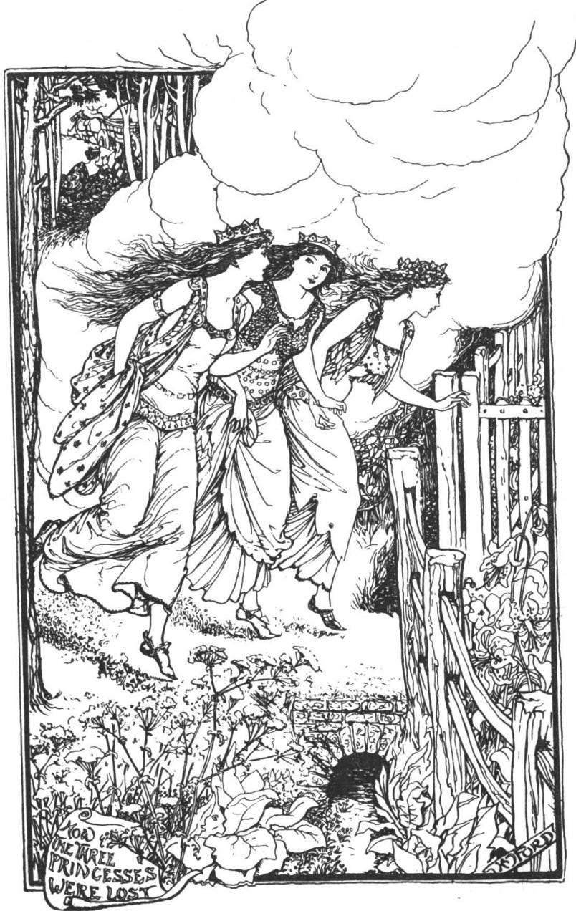

国王和王后吃了一惊，他们搜寻了花园的每个角落以及周围的树林，但却没发现女儿的一点点踪迹。她们好像是被地球吞没了一样。可怜的国王和王后失望极了。在回王宫的路上王后哭了一路。又过了好几天，国王发布了一道文告，说不管是谁，只要他把国王失散的三个女儿找回来，他就可以娶其中一个为妻，而且在国王死后还可继承王位。

当时在宫里住着两位年轻的将军，他们听说国王发表了那道文告，就一起商量着：“让我们去找公主吧，说不定我们能碰到好运呢。”

于是他俩各自骑上了一匹高头大马，带齐了随身换洗的衣服和一些银钱，就出发了。

尽管他们沿路经过每个村庄都去打听公主的下落，却没得到公主们的任何消息。慢慢地他们带的钱都用完了，他们只好卖掉马匹，放弃了搜寻行动。很快他们卖马的钱又用完了，如果他们不卖衣服，他们就只好饿肚子。无奈之下他们只好卖掉了多余的衣服，只穿着随身的一点衣服来到一家旅店。他们实在是太饿了，就恳求店主人给他们一点吃的。吃完饭要付钱时，他们只好对店主人说：“我们没有钱，除了身上穿的这些外我们一无所有了。把我们穿的衣服拿去吧，我们只要一点破布蔽体就可以了，请让我们留在这里作你的佣人。”店主人觉得这宗交易很划算，于是就让这两个将军留下来作他的仆人。

整整这段时间里，国王和王后都一直留在王宫里，渴望能再次见到自己的孩子，但他们仍是听不到那三个女儿或去找她们的两个将军的任何消息。

那时，王宫里还住着位忠实的仆人，他的名字叫班苏达图，他已经侍候国王好几年了。班苏达图看到国王成天那么伤心时，就提高了嗓音对国王说：“陛下，让我去寻找你的女儿们吧。”

“不，不！班苏达图，”国王回答道，“我已经失去了三个女儿，又失去了两位将军，难道我还要再失去你吗？”

但班苏达图回答道：“让我去吧，陛下；相信我，我会把你的女儿带回来的。”

这下国王让步了，于是班苏达图出发了。他骑着马，一直走到那家旅馆前才下了马，到店里要点吃的东西。那两位将军为他拿来了饭食。虽然这两个将军穿得又破又烂，但班苏达图还是一眼就认出了他们。他十分吃惊地问这两位将军到底是怎么到这儿的。

两位将军向他讲述了他们的全部遭遇，班苏达图立刻把店主人找来，吩咐道：“把他们的衣服还给他们，我会把他们欠你的钱全付清的。”

店主人遵命照办了。两位将军又穿上他们原先的体面的衣服，他们宣称要与班苏达图一起去寻找国王的女儿。

于是他们三人一行又骑马走了好多好多里路，最后来到一片没有人迹的野地里。那时天快黑了，三个人担心他们会在这荒无人烟的野地里迷路，于是就催马赶快往前赶路，终于他们看到了前面一座小屋的窗户里透出来的亮光。

“谁在那儿？”他们上前去敲小屋门的时候，一个声音问道。

“噢，可怜可怜我们吧，让我们在这里过一夜，”班苏达图答道，“我们是三个疲惫不堪又迷了路的行路人。”

于是一个年纪很大的老妇人为他们开了门，她往后退了几步，示意他们进屋，并问道：“你们从哪里来，到哪里去？”

“啊，好心的婆婆，我们肩负着重要的任务，”班苏达图答道，“我们一定要找到国王的女儿，把她们带回王宫！”

“哎，不幸的人呀，”婆婆叹道，“你们真是不知道自己在干什么！国王的女儿是被一层厚云罩住了，没人知道她们现在在哪里。”

“好心的婆婆呀，把你知道的事情全告诉我们吧。”班苏达图恳求道，“我们几个人的幸福全在她们身上！”

“即使我告诉了你们，你们也救不了她们。”婆婆答道，“要救这三个公主你们必须潜入一条很深的河流的最底下，而且虽然在那儿能找到国王的女儿，你们也难救出她们。因为国王的两个大女儿有两个巨人守着，而小女儿则有一条七头蛇看守着。”

两位将军站在边上听了婆婆的话，心里充满了恐惧，他们想立刻就掉头回去。但是班苏达图却坚定地说：“我们现在既然已经走了这么远了，就必须坚持继续干下去。告诉我们那条河在哪里吧，让我们好尽快赶到那儿。”于是老婆婆告诉了他们那条大河的方向，又给了他们很多奶酪、酒和面包，让他们在路上不致挨饿。三个人吃了晚饭，就舒舒服服地睡了一觉。

第二天，当太阳刚刚从山顶上边升起来的时候，他们三人就都醒了。他们告别了帮助了他们的聪明的老婆婆，骑上马一直来到了大河边。

“我年龄最大，”一位将军抢着说，“我有权先下去救她们。”

于是另两人帮他在腰间绑了一根绳，并给了他一个铃铛，就让他下水了。可是当河水刚刚没过这个将军的头顶，可怕的急流声和隆隆的爆炸声就在他周围响起，将军吓破了胆，拼命地摇起铃铛，生怕这隆隆的声音淹没了铃声。当绳子终于慢慢地往上拉时，他感到一种九死一生的解脱。

接着第二个将军跳入了水中，但他的胆量也不比第一个大，因此不久也被拉回到了平静干燥的岸上。

“嗬，你们真是一对勇士！”班苏达图说道。他一边说，一边把绳子系到自己的腰里，“让我们看看我会遇到什么。”他下水后听到隆隆的雷声和各种喧嚣声时，他想：“嗬！尽管兴风作浪吧，这套把戏伤害不了我！”他的脚终于踏到河底时，发现自己站在一个巨大的、灯光灿烂的大厅里。在大厅的正中坐着那位大公主，公主面前躺着一个巨人，正在沉睡之中。公主看到班苏达图后立即点头向他示意，并用目光问他是怎么到这儿来的。

班苏达图抽出了他佩戴的宝剑作为回答。当他正准备砍下巨人的头时，公主迅速制止了他，并做手势让他躲起来，因为巨人马上就要醒了。“我闻到了一个男人的味道！”巨人呓语着，伸了伸他巨大的四肢。

“嘿，怎么会有人能下到这儿来呢？”公主答道，“你还是继续睡你的觉吧。”

于是巨人翻了个身又睡着了。这时公主又向班苏达图示意，班苏达图抽出了宝剑，用力一挥砍下了巨人的头，巨人的头因班苏达图用力过大而滚到了角落里。公主的心高兴得都快跳出来了，她把一顶金皇冠戴到了班苏达图的头上，并把他称作是自己的救命恩人。

“现在告诉我你妹妹在哪儿吧，”班苏达图说，“这样我好把她也救出来。”

于是公主打开了一扇门，领着他进入了另一个大厅。那个大厅中间坐着她的妹妹，面前有一个沉睡着的巨人守着。二公主看到他们时，示意他们躲起来，因为巨人已现出马上要醒的样子。

“我闻到了人的味道！”巨人睡眼惺忪地咕噜道。

“瞎说，怎么能有人下到这儿来？”公主反问道，“继续睡你的觉吧。”巨人又合上了眼睛。班苏达图马上蹑手蹑脚地从墙角走出来，他用了巨大的力量向巨人的头砍去，以致巨人的头落下来滚了好远好远。二公主无法用言语来表达她对班苏达图救命之恩，于是也把一只金皇冠放到他手上。

“现在告诉我你们的小妹妹在什么地方吧，”他说，“这样我好把她也救出来。”

“哎呀，我怕你救不了她呀，”公主叹道，“因为她现在在一条七头蛇的掌握之中。”

“带我到那里去，”班苏达图答道，“那会是一场好仗的。”

于是公主打开了一扇门，班苏达图走了进去，发觉自己到了一座比前两座更大的厅里。那个最年轻的公主站在厅里，被铁链牢牢地锁在墙上。她的前面是一条七头蛇，看了就使人害怕。当班苏达图走上前来时，蛇的七个头都一齐朝他这个方向转过来，并闪电般地冲过来袭击他。但班苏达图抽出宝剑奋力挥舞，直到七只蛇头全部滚落到地上为止。他扔下宝剑，急忙跑到了公主跟前，为公主砸碎了铁链。公主高兴得流下了眼泪，她热情拥抱了他，并摘下自己头上的金皇冠递到他的手里。

“现在我们必须返回陆上的世界去了，”班苏达图说着，领着公主来到了河底，另两位公主在那里等着他们。班苏达图先把绳索系在大公主腰间，接着摇响了铃铛。岸上的将军听到后，就慢慢地把大公主拉上了岸。他们接着又解下绳索扔进河里，于是不多会儿二公主就站到了她姐姐的身边。

这时河底下就只剩下班苏达图和最年幼的公主了。“亲爱的班苏达图，”公主说，“听我的话，让他们先把你拉上去吧。我怕那两个将军会背叛你。”

“不，不用，”班苏达图答道，“我肯定不会把你留下先上去的。我的两位同伴也不会变心的。”

“如果你一定要这样那我就先上去了。但我上去前先要向你发誓，如果你不接着上岸来娶我，我就终生不嫁。”于是班苏达图把绳索绑在她腰间，两位将军把她拉了上去。

但是这回这两位将军没有把绳索再放下河去。他们内心对班苏达图的勇敢和胜利是那么嫉妒，以致他们转身离去，让班苏达图留在河底倒霉。不仅如此，他们还威胁三位公主，强迫她们答应对父母说是两位将军把她们救了出来。“如果他们向你们问起班苏达图，你们必须说你们从来没见过他。”三位公主害怕他们伤害自己的性命，就一切都答应下来，于是他们就一起骑马返回了王宫。

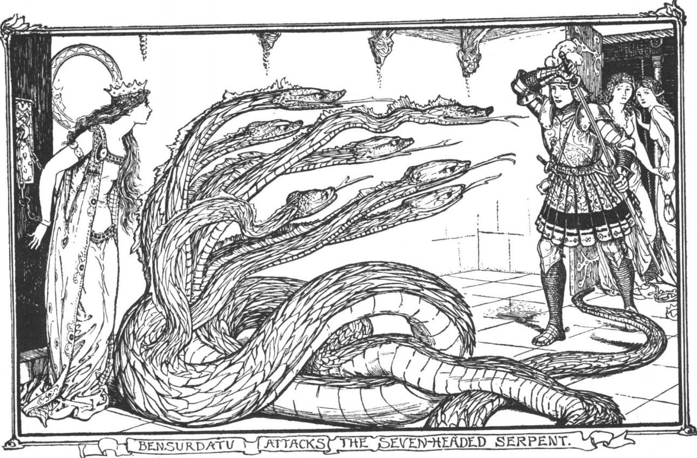

当国王和王后再次看到自己亲爱的女儿们时，真是高兴得忘乎所以。两位将军叙述了事情的经过以及他们经历的种种危难，国王宣布他们的勇敢赢得了报偿，他的两个大女儿将嫁给他们为妻。

现在我们必须再回过头来看看可怜的班苏达图怎样了。

当时他在河底下耐心地等待了很长很长时间，绳索始终不见下来，他理会到最小的公主的担忧是对的，他的同伴背叛了他。“哎，现在我永远也回不到岸上去了。”他低声咕哝着。但他是一个勇敢的人，他知道哀叹命运不济不会给他带来任何东西，于是他起来把三座大厅都搜查了一遍，他想在大厅里可能能找到对他有用的东西。在最后一个大厅里有一只碟子，上面满是食物，这使他想起他已经很饿了，于是他就吃掉了这些食物。

几个月过去了，有一天当他走过大厅时，他看到有一只钱包从墙上挂下来，而那个地方以前是没有钱包的。他把钱包取下来，仔细地检查，当他听到钱包里突然有说话声发出来时，他惊得差点失手把钱包掉落到地上，钱包里的声音问：“你有什么命令？”

“噢，把我带离这个可怕的地方，再次返回到岸上去。”只一会儿工夫，他已经站到了河岸上，手中还紧紧地抓着那只钱包。

“现在给我世界上最漂亮的船只，上面要配齐水手，整装待发。”话音刚落，船出现了，船桅上还飘扬着旗帜，旗帜上写着“三皇冠之王。”于是班苏达图登上了船，向着三位公主居住的城市驶去。当他抵达港口时，他令船上号手吹号，锣鼓齐鸣。人们都急忙跑到窗口或门口去看他这艘美丽的船。国王在宫里也听到了号角和锣鼓的声音，也看到了这艘美丽的船，国王对自己说：“那一定是个极其富有的君主，因为他有三个皇冠，而我却只有一个。”于是他急忙赶去会见这个陌生人，邀请他到自己的城堡里来。他心里默默盘算着，“这可是我小女儿的理想丈夫。”至今为止，虽然小公主一直没有结婚，但她对前来求婚的人却一概装聋作哑。

班苏达图离开王宫也有那么长的时间了，以致国王一点也没想到这个漂亮的、陌生的年轻人居然是他以为早已死了的、并且为了他的死而深感伤痛的班苏达图。“尊敬的贵族老爷，”他说，“请你来和我们一起欢宴取乐，然后，如果对您合适的话，请赏光娶我的女儿为妻。”

班苏达图很高兴，他们都一起参加了盛大的宴会，宴会中充满了欢乐，但国王的小女儿仍独自一人感到悲伤，因为她的心思全系在班苏达图身上。宴会结束时，国王问小女儿：“亲爱的孩子，这位富有的贵族老爷很看得上你，他请你答应嫁给他。”

“哦，父亲大人，”她回答道，“求求您饶了我吧，我只想独自过日子。”

这时，班苏达图转向她，说：“如果我是班苏达图，你是否也是这样回答我呢？”

姑娘没有马上答话，她站在那里默默地注视着他。他接着说：“是的，我就是班苏达图，我这就把我的故事讲给你们听。”

当班苏达图讲述他的故事的时候，国王和王后心潮激荡，久久不能平静，故事讲完后，国王伸出双手拥抱了班苏达图，并说：“亲爱的班苏达图，我的小女儿正应该是你的妻子；在我死的时候，我将把王位传给你。至于背叛了你的那些人，他们必须永远地离开这个国家，你再也不会见到他们了。”

于是国王下令举办盛大的结婚宴会。班苏达图和年轻公主婚礼的喜庆活动一直持续了整整三天。

 

## 巫师的黑马

从前有个国王，他有三个儿子。有一天，这三个王子一起到远离父亲宫殿的一座大森林里去打猎，小王子在森林中迷了路，于是他的两个哥哥只好自己回了家。

小王子独自一人在森林里转来转去转了四天，他白天吃草根和野果充饥，晚上则天当被，地当床。最后在第五天早晨，他来到了森林中央的一大片开阔地上，这里矗立着一座宏伟的宫殿，但奇怪的是宫里宫外一点人迹都没有。王子进了宫门，在空无人迹的房间里转来转去，却没见到一个生灵。最后他到了一个大厅里，大厅中央放着一张桌子，桌子上摆满了美酒佳肴。王子坐下来，饱饱地美餐了一顿。他刚吃完，桌子就从眼前消失了，这使王子感到非常惊奇。尽管他继续在各间房子里、楼上楼下地搜寻，还是找不到一个可以谈话的人。最后，天快黑的时候，他听到远处传来脚步声，看到一个老人上楼向他走来。

“你在我的宫殿里转来转去干什么？”老人问。

王子回答道：“我在森林中打猎迷了路。如果你能收我作仆人，我就和你在一起，我会忠诚地服侍你的。”

“很好，”老人说，“你可以做我的仆人。你必须让这只炉子里的火一直烧着，你要从森林中背柴禾烧这炉子，你还要负责照管马槽中的那匹黑马。我每天会付你一个弗罗林，到了吃饭的时候，你总能发现大厅中的桌子上放满了酒食，你可以尽情享用。”

王子感到很满意，于是他做了老人的仆人，并且答应注意让炉子里总是有柴禾烧着，以便使炉火永不熄灭。王子并不知道，他的新主人实际上是个巫师，而炉子里的火焰是一种巫火，如果这火焰熄灭了，那么这巫师就会失去他的大部分魔力。

有一天王子忘了给炉子添柴，以致炉内的火焰越来越小，几乎都要熄灭了。正当炉火一唿一唿快要熄灭时，老人怒吼着闯进了屋子。

“你怎么让火烧得这么微弱，你究竟想干什么？”他咆哮道。“我还好在关键时刻赶回来了。”当王子急忙把一束干柴塞进火炉，用力吹气以使炉火再燃起来时，他的主人狠狠地揍了他一个耳光，并警告他，如果以后再发生这种事情就一定饶不了他。

有一天，王子正忧郁地坐在马槽内，突然吃惊地听到黑马在对他说话。

“请站到我身边来，”黑马说，“我有话对你说。你从那边的橱里取出缰绳和马鞍放到我身上，拿上马鞍边上的那个瓶子，把那瓶子里的油膏涂在头发上，可以使你的头发像金子一样闪耀光芒，然后再把所有的木柴一起扔进火炉里，直到火炉里堆满了干柴为止。”

于是王子就照着黑马说的那样去做。他把马缰和马鞍给黑马套上，又把瓶子里的油膏涂到头发上，使头发像金子一样闪亮，最后他在炉子里放了一把大火，火焰窜起来，把屋顶都烧着了，几分钟之内宫殿已经燃成一片大火。

接着他急忙赶回马槽，黑马对他说：“你还有一件必须要做的事。在那边橱里你可以找到一面镜子、一只刷子和一根鞭子。把这三件东西带在身上，然后骑到我的背上奋力往前赶路，现在这房子烧得越来越旺了。”

于是王子按黑马的吩咐去做了。他刚一骑上黑马，黑马就开始奔跑起来，黑马跑的速度是那么快，以致于仅仅只一会儿时间，森林以及巫师的那座庄园就远远地被抛到了后面。

与此同时，巫师回到了自己的宫殿，他看到的只是一堆余烟未尽的废墟。他徒劳地喊叫他的仆人，却没有人答应他。最后他来到马槽检查，当他发现黑马也一起不见了时，他立刻怀疑到，黑马必定是与他的仆人一起逃走了。于是他立刻牵出在另一个马槽中的青马，骑上马追赶上来。

王子正骑着马时，黑马的尖耳朵听到了后面追赶的蹄声。

“看看后面，”黑马说，“看是不是老人追上来了。”王子在马背上转过身去，看到远处有一团又像烟又像灰尘的黑云。

“我们必须赶快走，”黑马说。

他们又奔了一段时间后，黑马又说：“再回头看看他是不是还远着呢。”

“他已经很近了，”王子答道。

“那就把那面镜子扔到地上，”黑马说。王子照着做了；当巫师赶上来时，马蹄踩到了镜子上。咔！玻璃刺进了马蹄，深深地刺伤了青马的脚，老人没办法，只好慢慢地与青马回到马槽，给青马钉了新的蹄子。接着他们又重新来追赶王子，因为巫师极为珍惜这匹黑马，他决心无论如何也不能失去它。

这时王子已经跑出很远了；但是黑马的尖耳朵还是探听到了远处追来的马蹄声。

“下来，”黑马对王子说，“把你的耳朵贴到地面上，告诉我你是否听到什么声音。”

于是王子跳下马来听了一会。“我好像听到地面在颤动。”他说，“我想他们一定是离我们不远了。”

“快点骑上来，”黑马答道，“我会尽快地往前奔。”黑马跑得那么快，以致土地都像是在脚下飞过。

“再往后面看一下，”黑马过了一会儿又说，“看看能不能看到他。”

“我看到了一片黑云和一团火，”王子答道，“但是离这里还很远。”

“我们必须赶快，”黑马说。一会儿后它又说：“再往后面看看，现在他应该离我们不远了。”

王子从马鞍上转过身去，突然惊叫起来：“他已经紧追到我们后面了，再过一会儿他骑的马的鼻子里喷出的火焰就会烧到我们身上了。”

“那就把那把刷子扔到地上。”黑马说道。

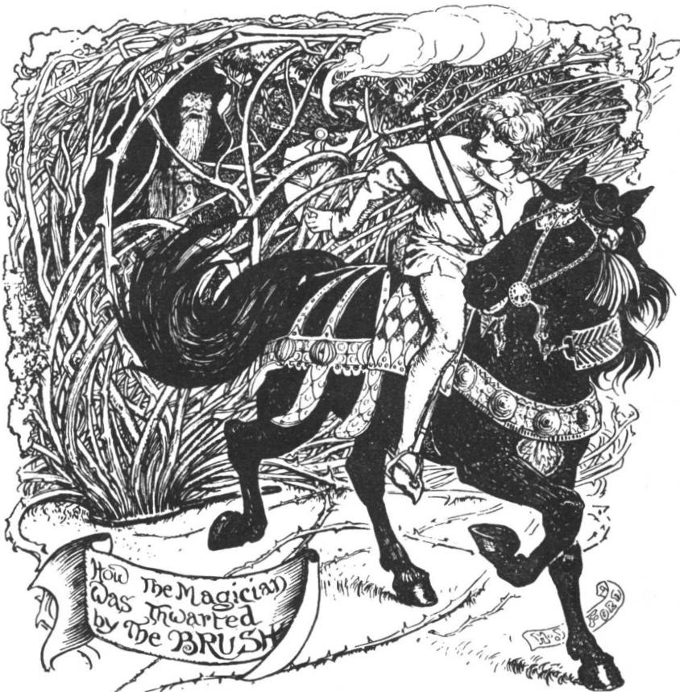

于是王子扔下了刷子，眨眼之间，刷子变成了一座密密的森林，那森林密得连鸟都飞不过去。当老人赶到森林前时，青马突然停了下来，它的脚被厚密的荆棘绊住，再也迈不开步子来。巫师没办法，只好去找了一把斧子，为自己在森林中砍出一条道来。这项工作消耗了他许多时间，在这段时间中王子和黑马又远远跑到前面去了。

但是他们又一次听到了后面追赶的脚步声。“看看后面，”黑马说，“看看他是不是又跟上来了。”

“是呀，”王子回答说，“这一回我听得很清楚。”

“我们要赶快，”黑马说。一会儿后它又说：“现在再看看后面，看看老人是否已经在视线之内。”

“是的，”王子转回头看了后说，“我看到了火焰，他已紧跟在我们后面了。”

“现在你必须扔下鞭子！”黑马答道。眨眼之间那条鞭子变成了一条宽阔的大河。当老人赶到河边时，他催促青马泅水过河，但河水越没越深，给巫师带来魔力的那火焰也越来越小，直到嗤的一声，火焰熄灭了，老人和青马沉入河中消失了。当王子再次回头看时，老巫师和他的青马再也看不见了。

“现在你可以下来了，”黑马说，“你再也不用害怕，因为巫师已经死了。在那边那条小溪旁你会找到一根柳树枝。把它捡来，用这根树枝击地，地下会开一个口，你会看到脚下出现一扇门。”

王子用柳枝击地，地上真的出现了一扇门，这扇门通向一座很大的石拱门厅里。

“让我到大厅里去，”黑马说，“我会呆在那里，但你必须穿过前面的田野直至到达一座庄园，庄园的中央是一座王宫。你到了那里后就要请求做国王的仆人。现在再见吧！希望你不要忘记我。”

于是他们分手了。分手前黑马要王子保证不要让王宫里的任何人看见他的金发。于是王子就像穆斯林那样在头上围了一条头巾。他穿过前面的田野，直至到达一座美丽的庄园。在庄园中间他看到一座宏伟的宫殿的高墙和宝塔。在庄园的大门口他遇到了这庄园的管家，问他到这里来干什么。

“我想要做国王的仆人。”王子答道。

“好呀，你可以留在这里，在我的领导下在庄园里干活。”管家说。因为王子穿得像个穷人，所以管家看不出来他是个国王的儿子，“我正需要一个人帮我除草和清扫路上的落叶。你将每天得到一个弗罗林，你会有一匹马来帮你拉走装树叶的马车，你还能得到食品和酒菜。”

于是王子答应下来，就开始工作。但当王子得到分配给他的饭食和酒菜时，他只吃其中的一半，而把另一半拿给住在小溪边上那石拱厅里的黑马去享用。他每天都这样做，所以黑马对他这种对待朋友的真诚很感激。

一天傍晚，当王子干完了庄园里的活，又和黑马在一起时，黑马对他说：“明天会有一大群王子和贵族老爷到国王的宫殿里来。他们有的离这儿近，有的离这儿远，但他们都是为了向国王的三个公主求婚而来。他们会在王宫的院子里站成一排，然后三个公主出来，她们每个人的手上都会拿着一只钻石苹果，并把这苹果抛到空中，苹果不管落到谁的脚边，那人就是公主的新郎。你必须站在庄园边上干活，三个公主中最小的那个公主最漂亮，她扔的苹果会滚过众多求婚者的脚边而停在你的面前。你就马上把它捡起来放进口袋中。”

第二天，当众多求婚者都聚集到庄园的院子里时，所发生的事正与黑马所预料的完全一致。公主把苹果扔到了空中，而最年轻的那个公主的钻石苹果滚过了所有的求婚者，停在了正在忙着清扫落叶的年轻王子跟前。王子立即弯下腰，捡起苹果放进了自己的口袋。当他弯腰时，他戴的头巾滑到了一边，公主正好看到他金色的头发，于是就立刻爱上了他。

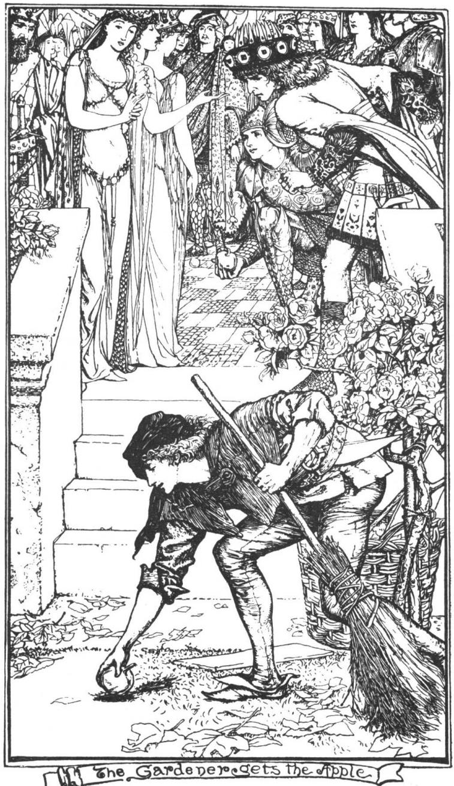

但是国王却感到很伤心，因为这个小女儿是他最喜欢的。然而国王也没什么办法。第二天，王宫里同时举行了三个婚礼，婚礼过后最年轻的公主跟着丈夫回到了他在庄园里住的小茅屋里。

又过了一段时间，邻国的人与国王开战了。国王由他大女儿、二女儿的丈夫陪伴着，骑上威武的战马去应战。但国王小女儿的丈夫却只有那匹帮他干活的老瘦马，因为国王看不起他这个女婿，拒绝给他别的马。

但王子决心不能落在后面，于是他来到庄园，骑上他的瘦马就出发了。但他只骑了几步路，马就失蹄摔了一跤。于是他只好下来，来到小溪边，找住在石拱厅里的黑马商量。黑马对他说：“把马缰和马鞍给我套上，然后到隔壁的房间里去，那里有一套铠甲和一把剑。穿上铠甲带上剑，然后骑到我身上，我们一起去参加战斗。”

王子按照黑马说的去做了。他骑上黑马后，身穿的铠甲在阳光下闪闪发光，他看上去是那么勇敢和英俊，以致没人能认出来他就是那个清扫落叶的庄园仆人。黑马载着他向前飞奔，当他们到达战场时，他看到国王已快要输掉这场战斗了，他的那么多武士已经被敌人杀死。但当这位身着闪亮的铠甲、骑着黑色战马的勇士出现在战场上，左右挥舞着利剑杀向敌人时，敌人就完全失去了斗志，四处逃命去了，这就使国王成了战场的主人。这时国王和他的两个女婿看到了他们的救星，就高兴得叫起来：“神人来助我们了！”战场上留下来的兵士也与他们一起欢呼。他们本来要把王子围起来的，但是王子骑的黑马腾空而起，载着他在远处消失了。

过了不久，国内有部分地方起来向国王造反，国王和他的两个女婿必须再次去参加战斗。那个隐瞒了真实身份而在庄园里做仆人的女婿也要参加。于是他来到国王面前，说：“亲爱的父王，让我骑马与您并肩去杀退敌人吧。”

“我不需要你这样的傻瓜为我去战斗，”国王回答道，“而且我也没有适合于你的马给你骑。你看那边路上有个车夫正赶着他的马车在赶路，你可以用他的马。”

于是王子骑上了车夫那匹拉车的马。但那匹可怜的老马已经很累，它仅仅迈了几步就失蹄摔了一跤。于是王子只好忧伤地回到庄园，看着国王在他的两个女婿的护拥下，率领着军队去参加战斗。当他们从视线中消失时，王子又来到了小溪边上石拱厅里的黑马那儿，在与他忠诚的黑马商量后，他穿上了闪光的铠甲，骑上了黑马，穿越高空来到了激战的战场。他再一次击溃了国王的敌人。国王和他的女婿以及士兵们再次高呼：“神人来救我们了！”但当他们想留下王子时，黑马腾空而起，载着王子在众人视线中消失了。

国王和他的女婿返回王宫，他们只顾谈论一件事，就是那个为他们杀退敌人的英雄，都很想知道他究竟是谁。

不久之后，邻国的国王又宣战了，国王和他的女婿及臣民们只好再次准备参战，王子也再次要求与他们一起参战。但国王说他没有多余的马可以提供给他。“但是，”国王又说，“你可以用那个樵夫从山上往下拉木柴时用的那匹马，那对你已经足够了。”

于是王子骑上了樵夫的马，但那匹马是那么老而无用，以致都没法带着王子出城门。于是王子只得再次来到石拱厅里，那里黑马已经为他准备好一副比他前两次穿的更精制的铠甲。王子穿上这副铠甲，骑上黑马的马背，黑马带着他直奔战场。王子在敌人中奋勇砍杀，直杀到敌人四散逃命，溃不成军为止。但不幸的是有个敌人的剑刺到了王子，王子的腿受了伤。于是国王急忙从口袋里取出绣有他名字和皇冠记号的手帕，把它绑在王子腿上的伤口上。国王很想把王子放上一副担架，把王子抬回宫去，国王的两个女婿则想把王子的那匹黑马牵到王宫内的马厩里去。但王子伸手抓住他忠实坐骑的鬃毛，努力爬上了马鞍，黑马立刻背着他腾入空中。国王他们一群都高叫起来：“为我们作战的是神人，他一定是个神人。”

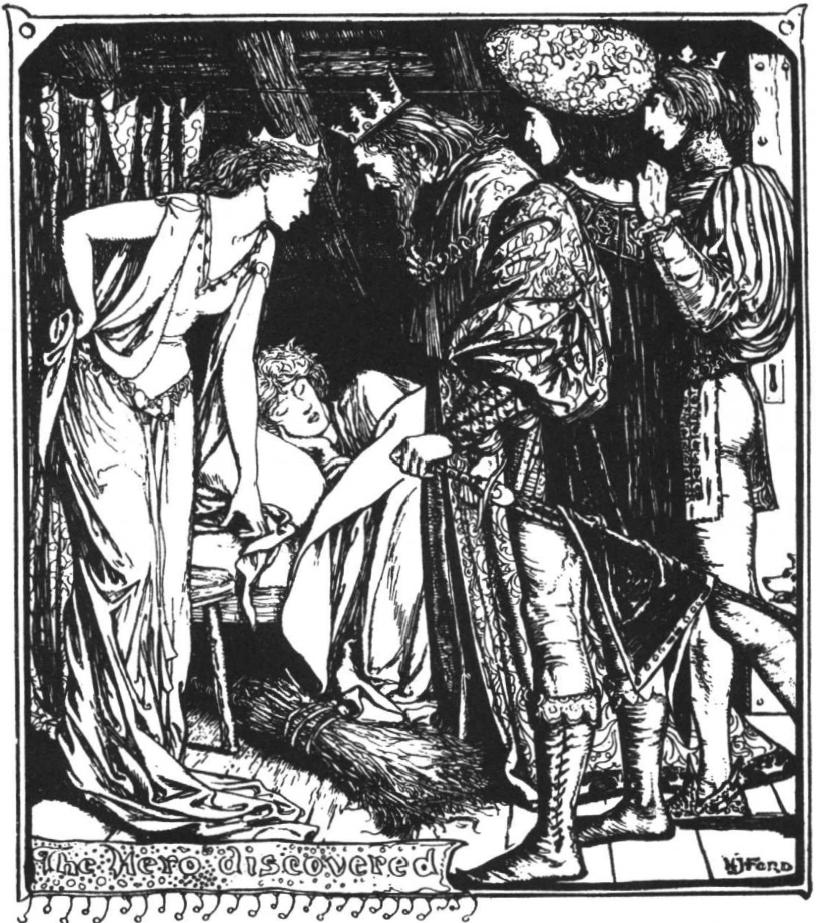

整个国家到处都只顾谈论这件事，所有的人都说：“那个为我们打了那么多次仗的英雄会是谁呢？他不可能是个常人，他一定是个神人。”

国王这时说：“如果我能再见他一面就好了，如果他最终竟是个常人而不是神人的话，我就给他半个王国作为奖赏。”

这时王子回到了家中——那个他与妻子住在一起的庄园仆人的小屋。他非常劳累，于是就躺在床上睡着了。他的妻子看到他受伤的腿上裹着手帕，就很想弄清楚究竟是什么手帕。当她更仔细地看那手帕时，她看到了手帕角上绣着她父亲的名字和皇冠记号。于是她就直入宫中把这一切告诉了父亲。国王和他的两个女婿随着她来到了她的屋子，屋里那庄园仆人还在床上沉睡未醒，他总是缠住头的头巾也滑了下来，金色的头发在枕头上闪着光。国王和他的女婿们都认出了，这就是那个为他们多次战斗和杀退敌人的英雄。

于是举国上下都为此欢庆，国王把他的半个王国奖赏给了这个女婿，王子和他的妻子从此幸福地统治着自己的领土。

 

## 小灰人

有一回，一个修女、一个农夫和一个铁匠碰巧在一起旅行。有一天，他们在一座又密又黑的大森林里迷了路。

当他们终于看到远处有一所房子时，他们都谢天谢地，希望能在那屋里舒服地过一晚。他们走近这屋子时，发现这是所早就废弃的旧城堡。城堡已完全颓废，但有几间房子还可住人。由于他们都已无家可归，于是都决心把这城堡建成自己的家。他们商量好，每天总要留一个人在家中照管家务，准备饭菜，而其他人则出去干活。

看守家园的任务首先轮到了修女身上。农夫和铁匠走进森林去劳动时，修女也在家里开始了工作。她整理房间，为大伙准备了全天的饭食。因为她的伙伴们中午并不回来吃饭，她就先吃了自己的那份，而把剩下的放到炉子上温着。正当她要坐下来缝补衣服时，门被打开了，一个小灰人走了进来，他站在她面前，对她说：“哦！冻死我了呀！”

修女很可怜他，于是她立刻说：“坐到火炉边上来暖和暖和吧。”

小灰人照修女说的做了，不久他又叫起来，“哦！饿死我了呀！”

修女回答道：“炉子上有饭菜，你自己拿着吃吧。”

不用修女再说第二遍，小灰人已经开始动手了。他以最快的速度把所有的食物都吃完了。修女看到这个情景，感到十分气愤，狠狠地骂了小灰人一顿，责怪他没有给她的同伴留下任何东西。

小灰人对修女的责骂非常憎恨，他的火气直冲上来，抓住修女把她狠狠揍了一顿，还把她一会儿朝这边墙上撞，一会儿朝那边墙上撞。直至把修女折腾得快死了时，他才任凭她躺在地上，急匆匆地走出了屋子。

这天傍晚农夫和铁匠回来了。他们要吃饭时才发现什么也没给他们留下，他们愤怒地责骂修女，而对修女的解释则根本不相信。

第二天农夫要求留下来看家，并许诺如果他呆在家里，就不会有人空着肚子上床。于是另两个人到森林里去干活。农夫在家里做好了一天的饭，先吃了自己的一份，把其余的放在炉子上温着。他刚刚收拾完这一切，屋门被打开了，那个小灰人又走了进来。这回小灰人的头上长着两个脑袋。他像昨天那样冻得发抖，对着农夫叫起来：“哦！冻死我了呀！”

那农夫已经吓得灵魂出窍，他请小灰人到火炉边暖和暖和。

一会儿，小灰人又贪婪地朝四周张望，并说：“哦！饿死我了呀！”

“炉子上有饭菜，你就自己吃吧。”农夫答道。

于是小灰人的两张嘴巴一齐吃饭，只一会儿就把最后的一口饭菜都吃光了。

当农夫为小灰人的这种恶劣行径而责骂他时，他像昨天对待修女一样，把农夫打得奄奄一息后走了。

傍晚铁匠和修女一起回到家中时，发现晚餐什么也没给他们留下。铁匠为此大发雷霆，他发誓明天他将呆在家里，保证不会有人要饿着肚子去睡觉。

天亮后，农夫和修女到森林里干活去了。铁匠和其他两人一样为大家准备了饭食。小灰人又来了，他没敲门就进了屋子，而且这回他长着三颗头。当他抱怨冷时，铁匠让他坐到火边去烤火，当他说肚子饿时，铁匠在一个盘子里盛了些饭菜给他吃。小灰人一会儿就吃完了递给他的这些食物，吃完后他的六只眼睛又贪婪地看着四周，索要更多吃的。铁匠一口也不肯再给他添，他勃然大怒，准备用对待铁匠的同伴一样的办法来对付铁匠。

但铁匠却不是个好欺负的，他顺手操起了一把大铁锤，用它敲掉了小灰人的两只脑袋。小灰人痛苦地嚎叫着，匆匆逃出了屋子。铁匠在他后面紧追不舍，一直追了很长一段路。终于他们来到一扇铁门前，那小东西钻进铁门后不见了，铁门也紧紧关上了，铁匠只好放弃追赶回到了家里。他发现农夫和修女已经回到家里。当铁匠把饭菜放到他们面前时，他们真是喜出望外。铁匠指给他们看了他敲下的小灰人的两颗头。三个人当即决定要使自己从那灰色的小矮人的魔力下解脱出来，于是第二天他们就一起去找那灰色的小矮人。

他们走了很长一段路，搜寻了好几个钟头，终于找到了那扇小矮人钻进去消失了的铁门。找到铁门后他们又费了很大的劲才打开了它。当他们终于走进铁门时，发现自己走进了一座大厅，大厅里坐着一个年轻漂亮的姑娘，正在一张桌子边干活。姑娘看到修女、农夫和铁匠进来时，跪倒在他们面前，含着眼泪感谢他们解救了她。她告诉他们，她是个国王的女儿，是被这法力无边的巫师关在这房子里的。昨天中午时分，她突然感到控制着她的魔力消失了，从那时起她就急切地等待着她的救命恩人的到来。她接着告诉铁匠他们，说还有另一个公主被关在这所房子里，那公主也是被巫师的魔力控制住的。

于是他们一起穿过了好几个大厅及房间，直到终于找到了另一位公主。她也像刚才那位公主一样，对解救了她的这一行三人感激不尽。

接着两位公主告诉他们的救命恩人，这所房子的地窖里藏着大量的财宝，但这些财宝由一只凶恶而又可怕的狗仔细地看守着。

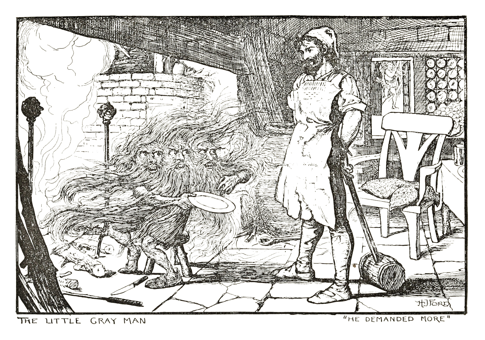

但是这三个人什么都不怕。他们立刻来到地窖里，找到了公主们说的那只守卫着财宝的恶狗。铁匠的大锤只一击就结束了这怪物的性命。接着他们发现，他们是在一间装满了金银珠宝的大房间里。在那些宝贝旁边站着一位年轻英俊的小伙子，他走上前来迎接他们，并感谢修女、铁匠和农夫为他解脱了控制着他的魔咒。他告诉他们，他是一个国王的儿子，是被那巫师捉到这屋里来的。他曾经被巫师变成那个三头小矮人。铁匠打掉他的两个头时，两位公主身上的魔法就被解除了，而刚才铁匠打死那只恶狗时，他身上的魔法也得到了解除。

为表示他的谢意，他请求铁匠等三人把这些财宝分了。他们采纳了王子的意见，由于财宝太多，他们花了好长时间才分完。

两位公主非常感谢她们的救命恩人，于是她们一人嫁了铁匠，一人嫁给了农夫。

而王子则娶修女作了他的新娘。他们全都过得非常愉快，一直白头到老。

 

## 拉札鲁斯和德雷肯人

从前有个皮匠名叫拉札鲁斯，他非常喜欢吃蜂蜜。有一天，当他一边工作一边吃着蜂蜜的时候，苍蝇成群地飞过来，苍蝇的数量那么多，以致于皮匠一巴掌就打死了四十只。于是皮匠就去定做了一把剑，上面刻着：“一次杀四十。”剑造好后皮匠就带着它巡游世界去了。他走了两天后，来到一眼泉水边，皮匠就躺在那儿睡了一觉。

当时皮匠到的那个国家里住着德雷肯人，有一个德雷肯人碰巧到泉水边来提水时，发现了睡在那里的拉札鲁斯，还读到了拉札鲁斯刻在剑上的字。他回去后就把在泉水边所见到的事全告诉了同伴们，同伴们劝他与这个本领高强的陌生人交个朋友。于是这个德雷肯人又回到了泉水边，他唤醒了拉札鲁斯，并说了想与他交个朋友的意愿。

拉札鲁斯说他很愿意，于是一位牧师为他们主持了结交仪式，祝福他们友谊长存。接着拉札鲁斯就来到了德雷肯人中，并与他们住在一起。过了几天，德雷肯人告诉拉札鲁斯，他们有一个习惯，就是每个人都要轮流打柴和挑水，他现在既已成为他们中间的一员，当然也必须参加轮换。开始一段时间轮到德雷肯人去挑水和打柴，但终于有一天轮到拉札鲁斯打水了。德雷肯人有一只极大的皮袋，皮袋里可装下二百罐水。拉札鲁斯用尽了全身力气，才极其艰难地把空皮袋拖到了泉水边，他实在没有力气把皮袋装完水后再弄回去了，于是他根本就不去装水，反而在泉水边上四处挖土。

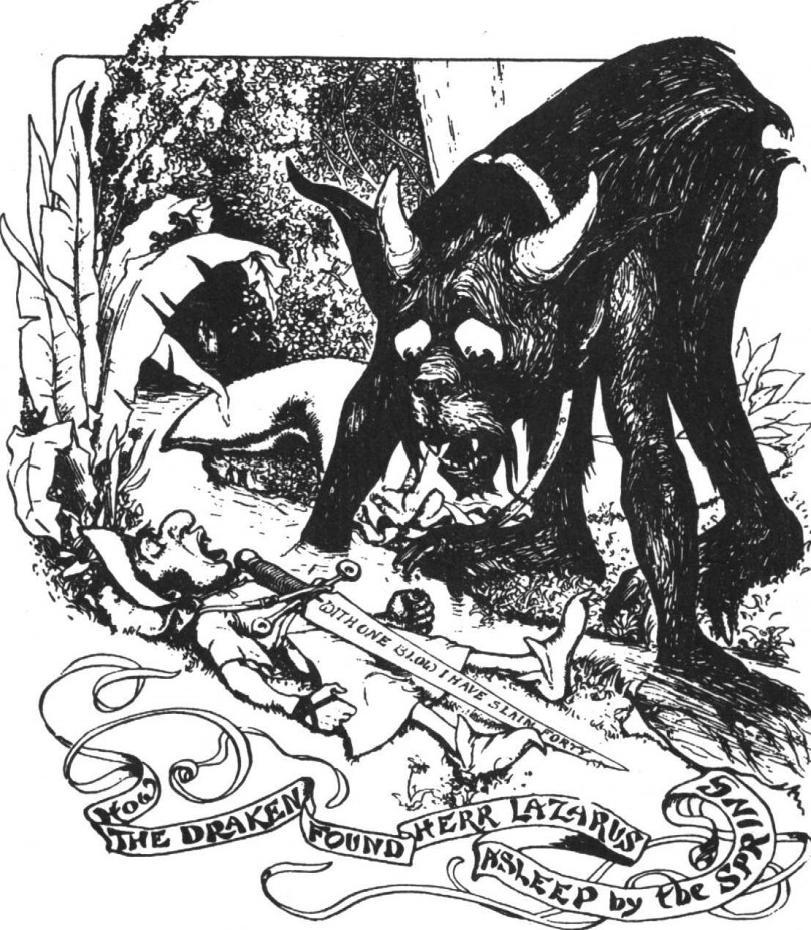

德雷肯人看到拉札鲁斯这么久还没回来，就派了个人来看看他究竟发生了什么事。当这个人来到泉水边时，拉札鲁斯对他说：“我们今后不用再每天辛辛苦苦地背水了，我要一次把整个泉水都背回家，这样我们就可以从背水的负担下解脱出来。”

德雷肯人叫了起来：“千万别这样，拉札鲁斯先生，否则我们都会渴死的。还是让我们来轮流取水吧，您就免了这工作。”

接着又轮到拉札鲁斯去砍柴了。当时德雷肯人背柴的时候总是把一整棵树扛在肩上运回家。拉札鲁斯无法模仿他们这样做，于是他来到森林里，用一根粗绳索把所有的树都绑在一起，并一直在森林里逗留到天黑。德雷肯人又派人来看发生了什么事，当这个人问拉札鲁斯把这么多树绑在一起干什么时，拉札鲁斯回答道：“我准备把整座森林都一次背回家，那样我们今后就可以休息了。”

但德雷肯人叫了起来：“千万别这样，拉札鲁斯先生，不然的话我们都会冻死的；还是让我们自己来背柴吧，您的这项工作就免了。”于是这德雷肯人砍倒了一棵树，把它扛在肩膀上背下了山。

他们在一起住了一段时间后，德雷肯人讨厌起拉札鲁斯来，他们一致同意要杀了他。他们决定当晚上拉札鲁斯睡着时，每个德雷肯人都用斧头砍他一斧头。但拉札鲁斯事先听到了这个阴谋，天黑下来时，他取了一段木头，给它盖上自己的外衣，放到他平时睡觉的地方。晚上德雷肯人果然来了，他们每人砍了木头一斧头，直到把木头砍成了碎片。

德雷肯人相信他们的目的已经达到，他们离开了拉札鲁斯的屋子。

于是拉札鲁斯就把碎木头捡起来扔掉，而他自己则躺到原来的地方。天快亮的时候，他开始呻吟起来，德雷肯人听到这叫喊声，问他有什么不舒服，他回答道：“那些蚊子叮得我痛死了。”

拉札鲁斯的话吓坏了德雷肯人，他们以为斧头砍到拉札鲁斯身上，他只当是蚊子咬，于是他们决定要不惜任何代价把他除掉。第二天，他们问拉札鲁斯有没有妻子和孩子，又说如果他愿意到他们那里去一次的话，他们会送给他一大袋金子。拉札鲁斯很乐意地答应了他们的邀请，并提出要他们派一个人帮他背金子。德雷肯人也同意了他的要求，就派了一个人送他回家。

当他们快要到达拉札鲁斯家的时候，拉札鲁斯对那德雷肯人说：“你先在这里等一会儿，我要先回去把我的孩子捆起来，否则他们会吃了你的。”

于是他回到家中，用粗绳子把他的孩子捆了起来，并对他们说：“你们一看到那德雷肯人，就拼足全力高喊：‘有德雷肯人肉吃了！有德雷肯人肉吃了！’”

于是当那德雷肯人刚一在拉札鲁斯家出现，孩子们就高喊起来：“有德雷肯人肉吃了！有德雷肯人肉吃了！”这些话可把那德雷肯人吓坏了，他赶紧扔下口袋就逃走了。

在回去的路上他遇到了一只狐狸，狐狸问他为什么吓成这个样。他回答说他很怕拉札鲁斯的那些孩子，这些孩子差一点就把他活活吃了。

但狐狸听了却大笑起来，说：“什么！你竟然怕拉札鲁斯的孩子！告诉你吧！他们家里有两只鸡，我昨天吃了一只，另一只我现在正准备去抓呢——如果你不信的话，就跟在我后面亲自看看，不过你必须先把你自己系在我尾巴上。”

于是那德雷肯人把自己系在狐狸的尾巴上，与狐狸一道回到拉札鲁斯的家里来，以便看看会发生什么事。这时拉札鲁斯正站在门口，手中拿着枪随时准备开火。当他看到狐狸与那德雷肯人一起来了时，他对狐狸喊道：“我不是叫你把所有的德雷肯人都骗来吗？你怎么只给我带一个来？”

德雷肯人听到这话，吓得拔腿就跑，他跑得那么快，以致拖在后面的狐狸不断与路上的石头碰撞，被撞得稀烂。

拉札鲁斯摆脱了德雷肯人以后，他用从他们那里得到的金子为自己建造了一所豪华的住宅，他在这所住宅中极其快乐地度过了余生。

 

## 百花岛女王的故事

从前有一个女王统治着百花岛。不幸的是，女王的丈夫在他们结婚后没几年便死了。女王成了寡妇，于是她把自己所有的精力都倾注在她仅有的孩子——两个漂亮迷人的公主的教育上。年长的那个公主长得那么可爱，以致随着她日渐长大，她妈妈越来越担心她会激起那个统治全部岛屿的女王的嫉妒。那个众岛女王以为自己是世界上最漂亮的女人，她坚持要所有的漂亮女人都为她的美丽而五体投地。

为了更好地满足自己的虚荣心，她要求国王——就是她的丈夫向所有的岛屿宣战。而国王的最大愿望就是取悦于妻子，于是他对每个新征服的国家都提出一项唯一的条件，就是这些岛屿王族中的每个公主长到十五岁时，都必须到他的王宫里，向他的妻子天仙般的美丽表示敬意。

百花岛的女王很清楚这项规定，于是她的女儿一过十五岁，她就决定带她女儿去见那个骄傲的女王。

女王自己也听到了关于那年轻公主长得极漂亮的传说，因而也焦急地等待着她的来访。这种焦急后来变成了嫉妒，因为当她们互相见面时，年轻公主艳光四射的美丽令在场的每个人都看得头晕目眩。女王自己也只得承认她还从未见过这么漂亮的人。

当然女王心里仍然在想那是“除了我以外！”，因为世界上没什么东西能使她相信，还能有人使她失色。

但王宫内外大家流露出来的对年轻公主的羡慕逐渐使她醒悟了，这使她非常恼怒，只得诈称有病，躲回自己的房间，以使自己不要看到公主的胜利。她还叫人告诉百花岛女王，说她很抱歉，因为生病不能再见她了，并让她与她女儿一起返回自己的国家。

女王的口信是请宫里的一个贵妇人转达的。这个贵妇人是百花岛女王的一个老朋友，她还请百花岛女王不必再等着作正式的告别，而是尽快回家为好。

百花岛女王立即明白了朋友的暗示，并决定马上照着去办。她对被激怒了的众岛女王的魔力很警惕，因此她警告女儿，如果她在今后的六个月里不管因什么原因离开王宫，都会遇到极大的危险。

公主答应遵守女王的警告，而女王则尽一切努力使女儿在王宫里的日子过得愉快。

六个月马上就要过去了。就在最后一天，在王宫附近的一片怡人的草地上将举行一个盛大的宴会。公主在自己的窗口看到了这次盛大宴会的一切准备工作，她恳求母亲同意她就在草地之内走走。女王想一切危险都快过去了，就答应了女儿的请求，并同意亲自陪她一起去。

全王宫的人再次看到他们热爱的公主又能出来自由行动了，全都高兴极了，于是大家都兴致勃勃地参加到宴会中来。

公主为她自己能再度回到大自然中来而过分地高兴，她不由得稍稍走在了众人的前头。突然，她脚下的土地裂开了，那裂开的口子把公主吞了下去，随即又马上合拢了。

女王惊得晕了过去，其他的公主们看到这情景都泪如泉涌，人们好不容易才把她们从那要命的地方拉回王宫。而整个宫殿都因为这突如其来的大灾难而陷入极度的恐惧中。

女王下令深挖草地，但这样做却是徒劳无功；人们连公主的一点踪影都没见到。

公主从地面上直掉下去后，发现自己来到了一个极为荒凉的地方，那里渺无人迹，除了石头和树木以外什么也没有。她看到的唯一有生命的动物是一只很可爱的小狗，小狗一看到她也向她奔过来，在她身边蹭来蹭去。公主把小狗抱在怀里，与小狗玩了一会后，又把它放到地上。这时小狗开始在她前面走，还时时回过头来朝她看，似乎是请她跟它走。

于是公主让小狗领着她走，他们不久就来到一座小山上，从那小山上她看到一条长满了可爱的果树的山沟，果树上开满了鲜花，挂满了鲜果。地上也都盖满了鲜花和水果，在山谷的中央有一眼泉水喷出来，泉水四周是一片天鹅绒似的柔软的草地。

公主急忙赶到了这迷人的地方，当她坐到草地上的时候，她开始回想起降临到自己头上的不幸，想到悲伤的时候不禁涌出了泪水。

她知道，这里的水果和清泉可以使她免于饥渴，但是如果有野兽出现，要来袭击她时，她该如何躲避呢？

最后，在她设想了各种可能出现的恶劣情况后，她只好试图通过与小狗玩耍来分散自己的担忧。她在喷泉边过了一整天，但当夜晚来临时，她不禁犹豫起自己该怎么做，这时她发现小狗正在拉她的裙子。

一开始她对小狗的行动没有留意，但当小狗不停地拉她的裙子，然后又向某个方向跑几步时，她终于决定跟着小狗走。小狗引她到了一块巨大的、前面有洞口的岩石前，明显是希望她进去。

公主进了岩洞。她发现这是个宽敞而美丽的岩洞，里面排列着的宝石照亮了整个岩洞。洞的一角有一只长椅，上面长着柔软的苔藓。她在长椅上躺下来，而小狗也立刻蜷缩在她的脚旁。公主累了一天，因而马上就睡着了。

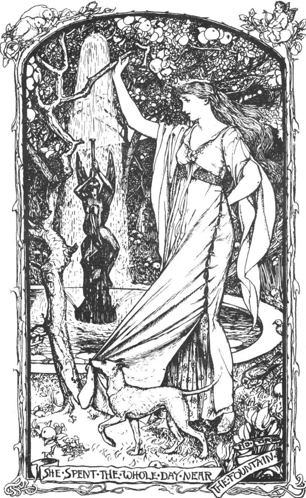

第二天很早的时候，公主就被许多鸟儿的歌唱声叫醒。小狗这时也醒了，并以一种最体贴的方式在她身边跳来跳去。公主起来后走到了岩洞外面，小狗像昨天一样在前面引路，又不时地回来拉她的裙子催她走。

她让小狗在前边引路，不久小狗就带她回到了她昨天打发了许多时光的地方，在那里公主又吃了一些水果，喝了一些泉水，但她感觉就像是吃了一顿美餐一样。她在花丛中散步，与她的小狗玩耍，晚上又回岩洞里睡觉。

就这样一晃过了几个月。而当公主初时的惊恐逐步消退时，她也慢慢地接受了命运的安排了。而且这只小狗也是个很好的安慰，是她日夜不离的伴侣。

一天她注意到小狗看起来很忧伤，它甚至不再像以往那样在她身边蹭来蹭去。公主担心小狗可能是病了，就带着小狗去了一片草地，她以前曾看到小狗在那里吃过一种特殊的药草，这次她也希望这对它有好处，但小狗碰都不碰这些草。那天整个晚上，它都在叹气和呻吟，看起来非常痛苦。

最后公主睡着了，当她第二天醒来时，她第一个想到的就是她宠爱的小狗，但这次小狗没像以往那样在她脚边，于是她跑出洞去寻找它。她刚跨出洞口就看到一个老人急匆匆地走开了。老人走得那么快，以致公主还没看清，他就已经消失了。

公主又一次吃了一惊，而且这件事给她带来的震动与小狗的丢失带来的一样大。那只小狗自从她第一天见到它，就一直对她那么忠诚。她怀疑究竟是小狗自己迷路了呢？还是那个老人偷走了它。

在这种种想法和惊吓的折磨下，公主漫无目的地踱来踱去，这时她突然感到自己被一团黑云裹了起来，并且被带着在空中飘动。公主没作任何反抗，不久她就惊讶地发现，她已身处一条通往王宫的大道上，那王宫正是她小时候住的王宫，而黑云也无影无踪了。

公主走近宫殿时，她看到每个人都穿着黑色的丧服，公主心中充满了恐惧，不知大家为什么举哀。她急忙跑进宫里，不久就被大家认出来了。大家都兴高采烈地欢呼着欢迎她。她妹妹听到这喜讯也高兴地跑出来拥抱了她，并含着幸福的眼泪告诉她，她的失踪给了她妈妈那么可怕的打击，以致她仅仅再活了几天就去世了。从那时起，妹妹戴上了王冠，而她现在则把王冠交还给姐姐，因为姐姐才是王冠的真正主人。

但姐姐却不愿接受王冠。后来只是在她妹妹愿意分享一切权力的条件下，她才接受了王冠。

新女王办的第一件事就是纪念她亲爱的母亲，以及对她的妹妹表示无微不至的关怀。之后，因为她仍在为失去了自己心爱的小狗而感到极度悲伤，她令人在各个国家仔细地寻找这只小狗，但仍然没有得到任何消息。在极度悲伤之下她宣布，不管是谁，只要帮她找回这只狗，她就把国家分一半给他。

王宫里的许多大臣都在这巨大赏赐的吸引下，纷纷四出寻找小狗，但他们都空着手回来了。女王在绝望之余宣布，没有那只小狗的生活已变得不可忍受，因此如能有人给她带回小狗，她就情愿嫁给他。

这样一种前景诱人的奖赏立刻使王宫里的人都走空了。几乎每个大臣都在四处寻找。当这些大臣们都在外面奔走时，女王有一天得到报告，说有一位很难看的男人想见她。女王就请人把他带到她和她妹妹正坐着的房间里。

当那男人来到女王跟前时，他说，如果女王准备遵守自己的诺言，他就可以把女王的小狗还给她。

这时公主首先答话了。她说，女王如果没有得到国家的同意，自己无权决定与谁结婚，而现在这样的重大事情必须召集议院的全体会议决定才行。女王没法来反对这个说法，于是她只好下令在王宫里为这男人准备好一套房间，并决定议会第二天就开会。

第二天，议会举行了隆重的会议。在公主的劝说下，议会决定给那男人一大笔钱以换回那只狗，如果他拒绝接受这样做，就把他赶出王国，而且不让他再见一眼女王。那男人拒绝了给他的钱，离开了王宫。

当公主把发生的这一切事情告诉女王时，女王批准了这一切，但她加了一条，就是她还是自己的主人，并且她已经决心放弃王位，亲自走遍世界，直至找到她可爱的小狗为止。

公主听到这个决定后着实吃了一惊，她恳求女王改变主意。当她们正在讨论这事时，一位侍从进来报告女王，海湾里来了好多船。女王和妹妹奔到阳台上，看到一支大舰队正扯着满帆开进港口来。

不一会儿她们就得出结论，这支船队是来自一个友好的国家，因为每艘船上都挂着彩旗和彩带，船队前还有一艘挂着表示和平的大白旗的小船在引路。

女王派了一名特别使者到码头去。她不久就得到报告，这支船队是属于绿宝石岛的王子的，他请求能登上她王国的土地，以便来向她表示真诚的敬意。女王立刻派了几名王宫显贵去迎接王子和向他表示欢迎。

女王坐在自己的王位上等待王子的到来，但当王子露面时，她走向前来迎接他，并请他坐下，与他亲密地交谈了一个多小时。

接着王子被带到了一处豪华的套房歇息。第二天他请求与女王单独谈谈，于是他被请到了女王自己的起居室，女王正和她妹妹坐在那里。

在寒喧了一阵之后，王子告诉女王，说他有一些非常奇怪的事情要告诉她，这些事只有她会明白是真的。

“陛下，”他说，“我是众岛女王的邻居；我的国家的一部分与她的国家只隔了一道小小的地峡。有一天在打猎的时候，我正在追一只牡鹿，却不幸遇到了她，我并没有认出她，因而就没有停下来以恰当的礼仪向她表示致敬。陛下，您比任何人都清楚那女人报复心有多重，而且她还是个女巫。这些我都是付了极大的代价才了解到的。那时地面突然在我脚下裂开了，我发现我落到了一个很遥远的地方，而且被变成了一只小狗，在那个外形下，我有幸遇到了陛下您。六个月后，那女王的报复心还没得到满足，她又进一步把我变成一个丑陋的老人，我怕那个样子使您看了太不高兴，就把自己藏在森林的深处，在那里我又过了三个月。三个月过后我幸运地遇到了一位慈善的仙女，她为我解脱了那自负的女王的魔法，并告诉了我您的所有遭遇，以及怎样找到您。现在我就来向您献上一颗完全属于您的心，因为我们一开始是在患难中相遇的。”

几天后，一名信使被派往全国各地，去宣布百花岛女王与年轻的王子结婚的喜庆消息。女王和王子一起幸福地生活了许多许多年，把他们的国家治理得十分富强。

至于那个坏女王，因为她的虚荣和嫉妒给人们造成了那么多的不幸，仙女收回了她所有的魔力以示惩罚。

 

## 优迪雅和她的七兄弟

从前有一对夫妻，他们有七个男孩。这些孩子们在大自然中生活，长得又高又强壮。六个较大的男孩每天都要去猎捕野兽，而那最小的男孩却不太喜欢运动，他经常与他母亲在一起。

然而有一天，这七个男孩要一起去作一次远征了。临行前，他们对自己的阿姨说，“亲爱的阿姨，今天妈妈如果生了一个妹妹，那你就对我们挥舞一条白手绢，我们七人就马上回来；但如果生的是个男孩，你就挥动一把铲刀，我们就会继续往前走。”

那天七个男孩的妈妈果然生了个女孩，但因为阿姨不喜欢这几个男孩，她就觉得这是个摆脱他们的极好机会，于是她向孩子们挥动了铲刀。当七个男孩看到这个信号后他们说：“现在我们不必再回去了。”于是他们就向荒漠深处走去。

小女孩很快就长大了，她的同伴都叫她优迪雅，并说是她把七个兄弟赶进了陌生的土地，但优迪雅却不知道他们为什么要这样说。

有一天，优迪雅与她的伙伴们发生了争吵。那些伙伴中年纪最大的一个对她说：“你生出来就是个倒霉的人，因为自从你出生后，你的兄弟们就只好在世界上到处流荡了。”

优迪雅答不上话来，她回到家中问自己的母亲，“我到底有没有兄弟？”

“当然有，”她妈妈回答道，“你有七个兄弟。在你出生的那天他们出外去了，从那以后我一直没有听到他们的消息。”

于是女孩说：“我要出去寻找他们，一直到我找到他们为止。”

“我亲爱的孩子，”她母亲回答说，“他们走了已经有十五年了，从那以后没有人再见过他们。你怎么知道由哪条路去找他们呢？”

“哦，我会东南西北地到处去寻找他们，虽然我会走很多路，走得很远，但总有一天我会找到他们的。”

这样她妈妈就不再说什么了，她给了优迪雅一头骆驼和一些食物，派了一对黑人夫妇去照顾她，还把一串贝壳系在骆驼项上给她作护身符，并祝她一路平安。

离家的第一天，他们一行平平安安地过去了，但第二天早晨黑人对优迪雅说，“你下来走路，让我老婆骑在骆驼上！”

“妈妈，”优迪雅大喊起来。

“怎么回事？”她妈妈问。

“巴卡要我从骆驼背上下来走路。”

“让她骑骆驼，巴卡！”优迪雅母亲命令道，于是巴卡不敢坚持要优迪雅走路了。

但过了一天，巴卡又对优迪雅说：“快下来，让我老婆骑上去！”虽然优迪雅再次向她母亲呼喊求援，但这时他们已经走得太远了，她妈妈再也听不到她的呼喊。巴卡粗暴地抓住她，把她拖到了地上，又对他老婆说，“骑上骆驼！”于是巴卡的老婆骑上了骆驼，而优迪雅却只能在边上走。优迪雅本来是想一路都骑着骆驼走的，因而她赤着脚，现在石头扎进了她的脚，扎得她鲜血直流，但她还必须接着走，一直走到晚上他们歇息时为止。又过了一天巴卡还是强迫优迪雅走路。优迪雅的脚流着血，她伤心地哭着求巴卡让她骑骆驼，哪怕是只骑一会儿也好，但巴卡却装作没听见，反而还催她走快点。

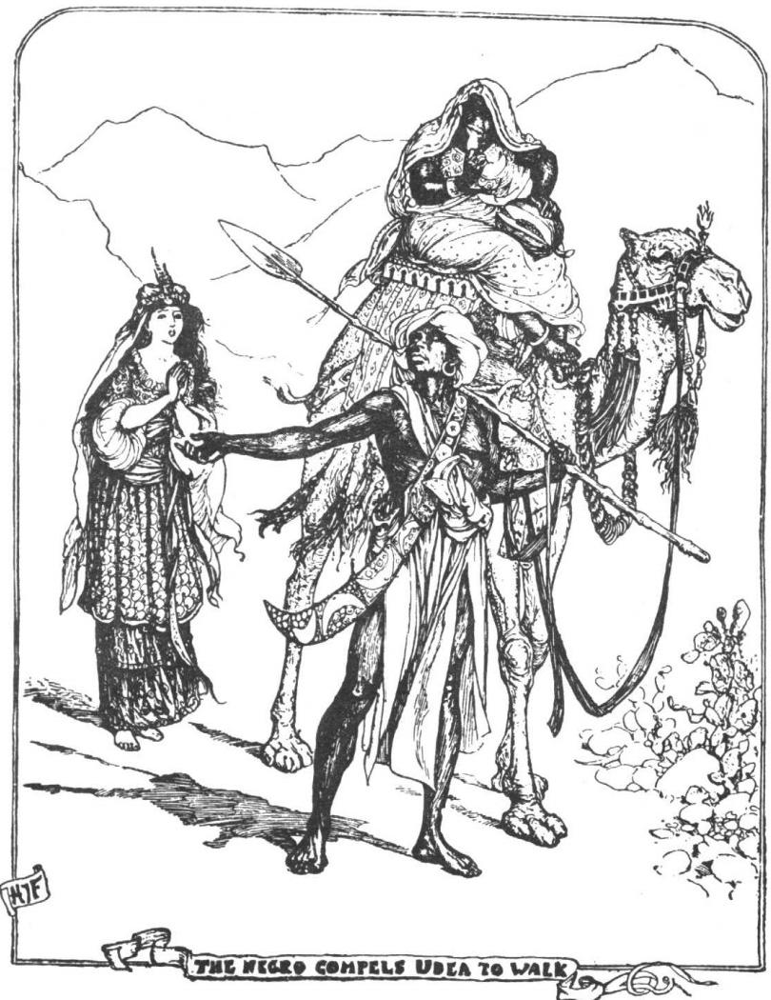

走着走着他们遇见了一队马队，于是巴卡停下来问那马队的领头人，他们有没有遇到过七个年轻男人，那七个年轻男人正在到处打猎。马队的领头人答道：“从这儿一直往前走，走到中午你就可以到达他们住的城堡了。”

巴卡听到这个消息时，他在太阳下熔化了一些沥青涂在优迪雅身上，直至她看上去像一个他那样的黑人为止。接着他又让他老婆从骆驼上下来，让优迪雅再骑上去，优迪雅对此非常感激。他们一行就这样来到了优迪雅兄弟们住的城堡。

巴卡一边让骆驼在门口跪下来，好让优迪雅下骆驼，一边去大声地敲门。那个最年轻的兄弟出来开了门，而其他的兄弟都出去打猎了。那兄弟当然不认识优迪雅，但他认识巴卡和他的老婆，因此他高兴地欢迎他们的到来，并问：“这个女黑人到底是谁？”

“啊，那是你们的妹妹！”巴卡说。

“我的妹妹！但她怎么像煤一样黑！”

“黑管黑，但她终究还是你们的妹妹。”

年轻人不再问更多的问题了，他领着他们进了城堡，而他自己则留在外面等他的哥哥们回家。

当他们又单独在一起时，巴卡在优迪雅耳边说，“如果你胆敢对你的兄弟们说我让你走路，或者告诉他们我把沥青涂在你身上，我就杀了你！”

“啊，我当然什么都不会说。”女孩颤抖着回答，这时，她的其他几个哥哥已经快到家了。

“好消息，好消息！”年轻的兄弟向他们迎上去说，“我们的妹妹来了！”

“胡说八道，”那六个哥哥回答道，“我们哪有妹妹呀，你知道妈妈又生的是个男孩。”

“那个消息不对，”小弟弟答道，“她现在正在这里，与巴卡和他的老婆在一起。只是——她也是个黑人。”他轻轻地加上最后那句话，但他的哥哥们没听到这个，他们都高高兴兴地走进了屋子。

“你好吗，老巴卡？”他们向黑人问候道，“怎么我们到现在才知道自己有个妹妹，这是怎么回事？”他们也向优迪雅表示热情的问候，优迪雅则高兴地流着泪，她感到她终于得到了解脱。

第二天早晨，七个兄弟都一致同意这天他们不再去打猎了。年纪最大的哥哥让妹妹坐在他的膝上，妹妹则为他梳理头发，并把家中发生的事情讲给哥哥听。哥哥听着听着，眼泪顺着脸颊淌下来，滴到了妹妹的手臂上。眼泪滴到的地方露出了一块块白色的皮肤，于是哥哥取来了一块毛巾为妹妹擦拭，结果他惊讶地发现妹妹根本不是个黑人。

“告诉我，是谁把你涂成这样的？”他叫起来。

“我不敢告诉你，”妹妹抽泣着说，“那黑人会杀了我的。”

“你还害怕！你有七个哥哥还有什么可害怕的！”

“好吧，那我就告诉你，”妹妹回答说，“巴卡强迫我从骆驼上下来走路，而让他的老婆骑在骆驼上。路上的石头把我的脚都扎破了，两只脚直流血，我只好把它们绑起来。后来，当听说快到你们的城堡时，他就用沥青把我全身都涂黑了。”

哥哥暴怒之下冲出了房间，他操起了自己的剑，先砍下了巴卡的头，然后又砍下了他老婆的头。接着他拿了一些热水进来，为妹妹彻底擦洗了一遍，直到她的皮肤再次白得发亮为止。

“啊，现在我们看得出你是我们的妹妹了！”七兄弟都说。“那黑人一定当我们是个大傻瓜，以为我们会立刻相信有个黑人妹妹！”那天和接下来的一整天他们都留在城堡里庆祝兄妹团聚。

但在第三天早晨他们对妹妹说：“亲爱的妹妹，你必须把你自己锁在这城堡里，只有一只猫可以陪你了。你千万要小心不要一个人吃东西而不给这只猫吃，无论你吃什么，都给这只猫吃一些，我们在七天内就会回来。”

“好的。”妹妹答道，并把自己和小猫一起锁在城堡里。

到了第八天，兄弟们回家了。“你好吗？”他们问道，“你一定等得很着急了吧？”

“不，我为什么要着急呢？大门已经牢牢地锁上了，城堡里有七道门，而且第七道是铁打的，我为什么还要害怕呢？”

“没人会想来害我们兄弟几个的，”她的兄弟们说，“因为他们都很怕我们。但对你就不同了。这只猫是在这所房子里长大的，我们希望你做任何事都要与这猫商量，千万不要轻视它的意见。”

“好吧，”优迪雅回答道，“我不管吃什么东西都会分给它一半。”

“好极了！如果你万一遇到危险，这只猫会来告诉我们的——只有这小精灵和在你窗前飞来飞去的鸽子才知道哪里能找到我们。”

“这是我第一次听到这些鸽子的作用，”优迪雅说，“你们以前怎么没说起过这些鸽子呢？”

“我们总是给它们留七天的食物和水，”兄弟们答道。

“啊，”妹妹叹道，“如果我早知道这样，我就会喂它新鲜的食物和水，因为七天后什么东西都变坏了。如果我每天喂它们不是更好些吗？”

“这就好多了，”他们说，“你对猫和鸽子们的关怀我们会感觉得到的，就像你直接关怀我们一样。”

“尽管放心吧，”姑娘答道，“我会像对我的亲兄弟那样对待它们。”

那天晚上兄弟们住在城堡里，但第二天早上一吃过早饭，他们就背上武器，跨上马，往他们的狩猎地进发了。临行前他们提醒妹妹：“小心在我们回来前不要让任何人进来。”

“好的。”她答应着，把门仔细地锁了起来。这样过了七天，在第八天早晨兄弟们像上一次那样按时回来了。他们在城堡里与她一起过了一个晚上，第二天一吃过早饭就又出发了。

七兄弟一在视线中消失，优迪雅就开始动手清理屋子，她发现地上掉了一粒豆子，就把它吃下去了。

“你在吃什么？”那只猫问道。

“没什么，”她说。

“你张开嘴巴让我看看。”姑娘张开了嘴巴，小猫看了后嚷起来，“你为什么不给我吃一半？”

“我忘了，”她说，“但屋里豆子多的是，你愿意吃多少就可以吃多少。”

“不，那不行，我就要你吃的那颗豆子的一半。”

“但我怎么能给你呀？我告诉你我已经把它吃下去了。我可以给你炒一百颗其他的豆子。”

“不，我就要那颗豆子的一半。”

“哼！你爱干什么就干什么去吧，只是离我远点！”她喊道。

于是那只小猫就一气跑到厨房，它对着火堆撒了一泡尿，把火浇灭了。当优迪雅回厨房烧晚饭时，她没有火种来点燃柴禾了。“你为什么要把火弄灭？”她责问小猫。

“我就是要让你知道你不能方便地做晚饭。你不是让我爱干什么就干什么去吗？”

姑娘只好离开了厨房。她爬上了城堡的屋顶，向四周瞭望。在很远、很远，她几乎看不到的地方，有一堆火在燃烧着。“我要到那里去拿一块燃烧着的煤回来做火种。”她这样想着，就打开了城堡大门，向那燃着火堆的地方走去。当她到达那个地方时，她看到一只凶恶的食人兽正在火堆旁蜷缩着。

“祝您一切平安，老爷爷，”姑娘说。

“也祝你一切平安，”食人兽回答道，“是什么风把你吹到这儿来啦，优迪雅？”

“我来向您要一块燃着的煤回去作火种。”

“你是要一块大的还是要一块小的？”

“要大的和要小的有什么区别呢？”姑娘问。

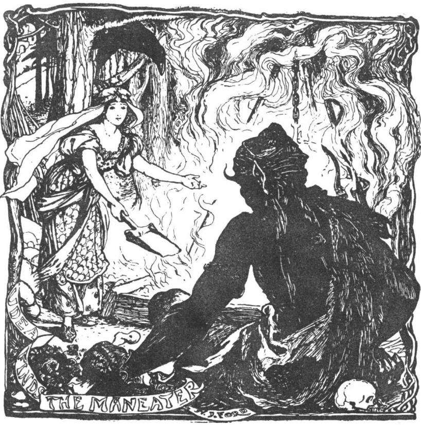

“如果你要一块大的，你就必须从你耳朵到大拇指割一块皮给我，如果你要一块小的，你就必须从你耳朵到你的小手指割一块皮给我。”

优迪雅想了想，觉得这两个条件真是一样坏，于是她说她要一块大的。当食人兽割了她的皮后，她就拿着煤块回家了。当她急着往回赶时，一只乌鸦看到了在地上的血，就用土把它们盖起来。它一直随着姑娘，直到姑娘回到城堡。姑娘进了屋门后，乌鸦从她面前飞过，把姑娘吓了一跳，因为虽然乌鸦一直跟在她后面，她却一直没有看到乌鸦。在惊吓中姑娘对着乌鸦喊道：“你总有一天也会像我一样被吓着的！”

“我帮你做了那么多事，”乌鸦问道，“你为什么还要咒我呢？”

“你为我干了些什么？”姑娘问。

“好呀，你马上就会明白的。”乌鸦这么回答着，就用尖嘴把盖着血的泥土又都拨开来，然后就飞走了。

到了晚上那食人兽起来了，它循着血迹一直找到了优迪雅住的城堡。它穿过了优迪雅没有关上的大门，进入屋子里面。但在它面前仍然有七道门挡住它的去路：六道木门和一道铁门，全都牢牢地锁着。于是食人兽就隔着门叫：“优迪雅呀，你看到了你的老爷爷在干什么？”

“我看到它身下铺着丝绸，身上盖着丝绸，正躺在一张四个柱子的床上。”

食人兽听了这个回答，就打破了一扇门，然后大笑着回去了。

第二天晚上它又来了，它又问姑娘看到她的老爷爷在干什么，姑娘照昨天一样回答了，食人兽就打破了又一扇门，大笑着回去了。就这样它每晚打破一扇门，一连打掉了六扇木门。这时，姑娘急忙写了一封信给她的哥哥们，她把这封信绑在一只鸽子的颈上，对它说：“啊，你这忠实地为我爷爷和父亲都做过事的鸽子！快把这封信带给我的哥哥，然后马上回来。”于是鸽子就飞走送信去了。

鸽子飞呀飞呀飞呀，一直飞到它找到了七兄弟。年长的哥哥把信从鸽子颈上解下来，看到她妹妹在信中写道：“各位亲哥哥，我现在身处困境。如果你们今晚不能赶回来救我，明天我就活不了了，因为食人兽已经打破了六道门，现在只剩一道铁门了，快来救我吧，快来，快来！”

“兄弟们，快点，快点！”哥哥喊道。

“发生了什么事？”别的兄弟问道。

“如果今晚我们不能赶回妹妹那里，明天她就要变成食人兽手中的猎物了。”

于是七兄弟不再多说一句话，马上跳上马，风一般地往回赶。

城堡的大门已经被推倒，七兄弟进了院里，高声地叫自己的妹妹。但这可怜的姑娘因为又害怕，又焦急，已经病得说不出话来。于是七兄弟下了马，穿过六道打破了的木门，来到那道仍然紧闭着的铁门前。“优迪雅，开门！”他们喊道，“我们是你的哥哥！”优迪雅起来开了门，倒在了大哥怀里，泪水泉涌而出。

“告诉我们发生了什么事，”大哥问道，“食人兽怎么能追踪你到这儿的？”

“都是那只猫不好，”优迪雅答道，“它弄灭了火种，我无法做饭。而这全是为了一颗豆子！我吃了一颗豆子，当时忘了给它一半。”

“但我们还特别关照过你，”大哥说，“决不要一个人吃东西而不给这只猫吃。”

“是的，但是我说过我忘了嘛！”妹妹回答道。

“那食人兽是否每晚都到这儿来？”兄弟们问道。

“每晚都来，它每晚都打破一扇门后就走了。”

这时众兄弟们都喊道，“我们要挖一个大坑，里面填上烧着了的木头，坑上用东西遮盖好。食人兽再来时我们就一齐把它推到坑里面。”于是他们立即动手，挖了一个大坑，坑里放上了木柴，点着了火，直到把木柴烧成一堆燃着的炭火。这时食人兽来了，它像往常一样叫道：“你看到你的老爷爷在干什么？”姑娘回答，“我看到它扒下驴皮在吃驴肉，我看到它掉进了火里，火把它烧死了。”

食人兽听了这回答后恼怒万分，它用力撞到铁门上，撞开铁门冲了进来。优迪雅的七个哥哥站在屋子的一边，他们说，“来吧！坐在这个草垫上歇歇吧。”食人兽就在草垫上坐下，立刻掉进了草垫下面烧着炭火的深坑里面。七兄弟又往深坑里添了许多柴禾，一直把食人兽烧得连根骨头都不剩。但是它的一小块指甲片在燃烧中被吹了起来，飞进了优迪雅正站着的上面一层的房间里，那片指甲正好粘在她自己手指的指甲上。于是她立刻失去了活力，倒在地上。

这时他的七兄弟正在楼下等她，并奇怪她为什么还没下来。“她一定是发生了什么事！”大哥叫了起来，“也许她也掉进火里了。”于是其中一个哥哥就走上楼来，结果发现妹妹四肢笔直地躺在地上。“优迪雅！优迪雅！”他叫道，但姑娘既不动一动，也没有回答。他以为她死了，就匆匆下楼来对其他兄弟们喊道：“快来呀，妹妹死了！”七兄弟立刻都来到妹妹身边，他们看到她确实死了，就给她做了一口棺材，把她放进棺材里，再把棺材放到一头骆驼身上。他们对骆驼说，“把她驮到她妈妈那里去，注意在路上不要停下来，也不要让人抓住你。除了对你说‘带子’的人以外，不要对任何人屈膝跪下来。但若有人说‘带子’，你就对他跪下来。”

于是骆驼就出发了。它走了一半路时，遇见了三个男人。这三个男人在后面追赶并想抓住它，但他们赶不上它。后来他们高喊：“站住！”但骆驼却跑得更快了。三个人在后面跑得气喘吁吁，直到有一个人对另两个人喊：“等一等，我的鞋带子断了！”骆驼一听到有人说“带子”就立刻跪了下来。三个男人走上前来，看到骆驼身上的棺材里有个死了的姑娘躺在里面，姑娘的手上还戴着一只戒指。于是一个男人就上前握着她的手去除下那只戒指，结果他碰掉了粘在姑娘手指上的食人兽的指甲，姑娘立刻坐了起来，说：“愿救我活过来的人长寿，让害了我的人去死！”骆驼听到姑娘又说话了，就带着姑娘回到了她的哥哥那里。

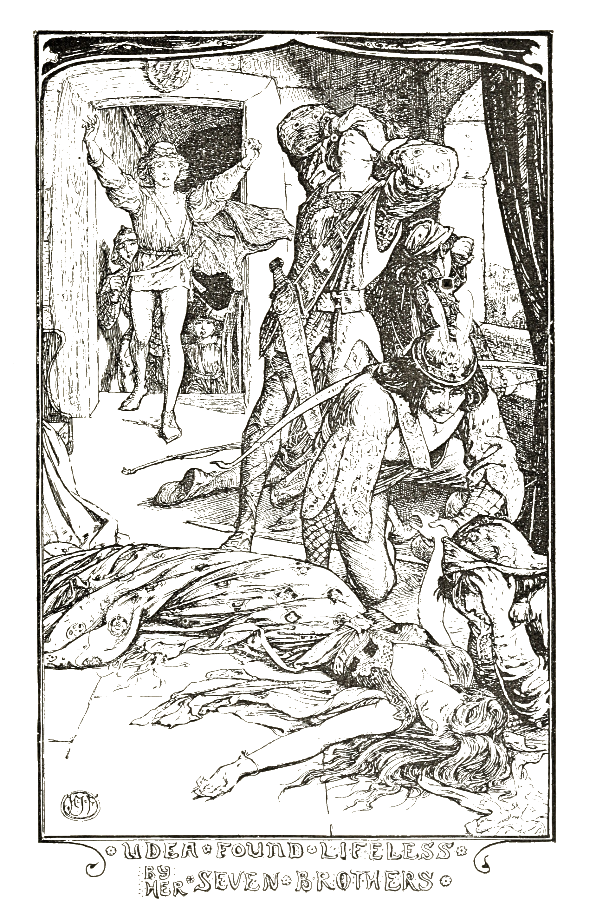

这时七兄弟还仍然坐在院子里为他们妹妹的不幸遭遇而悲痛，泪水模糊了他们的眼睛，他们都几乎看不清东西了。当骆驼返回来站在他们面前时，他们说，“这骆驼可能又把妹妹原样驮回来了！”于是他们上去要揍骆驼，这时，他们的妹妹从骆驼上下来了。兄弟们都紧紧地拥抱自己的妹妹，因为高兴，眼泪就更多地涌了出来。

“告诉我，”大哥说，“这一切都是怎么回事，是什么让你昏死过去的。”

“我正在楼上等着，”妹妹说，“这时食人兽的一片指甲飞来并粘在了我的指甲上，于是我就倒在地上死过去了。这是我所知道的一切。”

“但又是谁把粘着的指甲摘下来的呢？”大哥又问。

“一个男人拉起了我的手，想除下我手指上的戒指，他碰掉了粘在我手上的指甲，于是我就又活过来了。当骆驼听到我说：‘愿救我活过来的人长寿，让害了我的人去死！’时，它就驮着我跑了回来。这就是事情的整个过程。”

当妹妹说完时，大哥问众兄弟：“我有一句话不知你们愿不愿听？”

众弟兄一齐回答：“我们怎么会不听你的话呢，古人都说长兄如父嘛。”

“那么我的意见就是，让我们一起陪着妹妹回到父亲和母亲那里，我们也可以在两老过世以前再见他们一面。”

大家都同意这个建议，于是兄弟们都骑上马，又让他们的妹妹坐在骆驼上的一架担架上，就出发了。

经过五天的旅行，他们回到了父亲和母亲住着的老家。他们的父亲高兴地对他们说：“亲爱的儿子们啊，你们为什么要到那么远的地方去，而让你妈妈和我成天为你们哭泣呢？”

“亲爱的爸爸，”儿子们说，“先让我们休息一会儿，然后我们会从头开始把一切都告诉您。”

“好吧，”他父亲回答，并耐心地等了他们三日。

到了第四天早上，大哥说，“亲爱的父亲，你要听听我们经历的一切吗？”

“我当然想听一下！”

“好吧，我们离开家全是因为我们那个阿姨的缘故，因为我们事先说好，如果妈妈生个妹妹，她就向我们挥舞白手绢，如果生的是弟弟，就向我们挥动铲刀，因为生个弟弟不需要我们回来做什么，因此我们就可以走得很远。而阿姨因为不喜欢我们，憎恨我们与她在一个屋里住，就向我们挥动了铲刀，于是我们就走远了。这就是我们所有的故事。”

而上面这些也就是优迪雅和她的七兄弟的所有的故事。

 

## 白狼

从前有个国王，他有三个女儿，她们个个天生丽质，最小的女儿最美丽动人。一天，他们的父亲要到一个遥远的地方去旅行。临行前，小女儿要他答应给自己带回一个用野花编成的花环。国王在旅行结束打算回宫时，他想，得给每个女儿都带回一件礼物。于是他走进一家珠宝店，给大公主买了一条漂亮的项链，然后又到一个富有的商人那儿为二公主买了一件用金线和银线绣成的裙子，但没有一家花店或集市能找到小公主所倾心的那种野花环。国王没能买到花环，只得踏上了回宫的路。在回宫的路上他必须穿过一片浓密的树林。就在离宫大约还有四英里路程的地方，他发现有一只白狼蹲坐在路边。瞧！在狼的头上，有一个用野花编成的花环！

于是国王叫住马车夫，命令他赶快下去从狼的头上取下那个花环。那狼听到国王所下的命令便说：“国王陛下，我可以把花环给您，但作为回报我也必须得到一件东西。”

“那你要什么呢？”国王问，“我非常乐意用丰厚的珠宝和你换那只花环。”

“我不要珠宝，”狼答道，“我只要您发誓，把您在回城堡的路上见到的第一件东西送给我，三天后我会来取的。”

国王想：“回家的路还很长，我一定会在路上碰到一只野兽或是一只鸟什么的，所以发这个誓是万无一失的。”于是他一口答应，并把花环带走了。然而一路上，一直到宫殿大门前，他却什么动物也没看到，只有他的小女儿正等在那儿迎接他的归来。

那天晚上，国王想起他发的誓，十分沮丧，他把发生的事告诉了王后。王后也伤心地哭了。小公主问他俩为什么看上去如此悲伤，又为什么流泪。于是她的父亲就告诉她，他为那只花环付出什么样的代价。因为三天后那只白狼就会来把她带走。从此他们再也无法相见。这时，王后想了又想，终于生出一条计谋。

宫里有个女仆和小公主同龄，又长得一般高。王后给她穿戴上小公主漂亮的衣裙，决定把她送给白狼，白狼是决不会知道其中的差别的。

到了第三天，白狼大步走进宫廷，踏上阶梯，来到国王和王后端坐的房间。

“我是来要你们实现诺言的。”它说，“把你们的小女儿给我。”

于是他们就把女仆领来。白狼对她说：“你骑在我的背上，我会把你带到我的城堡去的。”说完这些话，它就把她背上，离开王宫。

他们来到白狼遇见国王并送给他野花环的地方，白狼停住脚步，叫女孩下来休息片刻。于是他们在路边坐下来。

“我想知道，”白狼说，“如果这片树林属于你父亲，他会怎么做呢？”

女孩答道：“我的父亲是个穷人，所以他会砍下这些树，把它们锯成木板，然后再卖掉，这样我们就再不用过穷日子，并且总是能吃得饱肚子了。”

这么一来，白狼知道它得到的不是真正的公主。它把女仆背到背上，又带回城堡。然后怒气冲冲地来到国王的居室，说道：

“立刻把真的公主给我，如果你们再欺骗我的话，我就会让暴风雨摧毁你的宫殿，那时所有的城墙都会倒塌，你们将埋葬在一片废墟中。”

国王和王后都哭了起来，他们明白这下是无法逃避的了，于是他们派人把小女儿唤来。国王对她说：“我最亲爱的孩子，你必须跟这头白狼走，因为我已经答应把你给它了，我不能食言。”

于是公主打点行李准备离家。她先去自己的房间取来了野花环。然后白狼把她背到自己的背上，驮着她走了。他们来到先前白狼和女仆休息的地方时，他叫公主下来。他们要在路边休息一下。这时白狼转向公主说道：“我想知道如果这片树林属于你父亲，他会怎么做？”

小公主答道：“我的父亲会砍下树木，把这里变成一个美丽的公园，到了夏天，他和他的大臣们会来这儿，在草地上散步……”

“这才是真正的公主。”白狼暗暗地想。它大声说：“再骑到我的背上来，我带你到我的城堡去。”

于是公主坐到它的背上，他们开始穿越树林，白狼跑啊，跑啊，终于在一座高大雄伟的城堡前停住了。

城堡有两扇巨大的门。“这真是座富丽堂皇的城堡呀！”公主说着，大门徐徐地拉开了，公主走了进去，“要不是离开父母那么远，那该多好啊！”

白狼答道：“每年年底，我们都会去拜访你的父母的。”

说完这些话，那件白色的狼皮从他身上滑落了。出现在公主面前的根本不是一头狼，而是一位英俊的年轻人，身材高大，气质高贵。他把手伸给公主，领着她走上了城堡的阶梯。

过了半年，有一天他走进她的房间，说道：“亲爱的，你得准备一下去参加一个婚礼。你的大姐就要结婚了，我会把你送到你父亲的宫殿。婚礼完毕时，我就来接你。我会在门外吹口哨。你听到后，不要管你父母说什么，立刻到我这儿来。因为如果没有我带你走，你单身一人是无法穿过树林，找到回来的路的。”

当公主准备好出发时，她发现王子已经穿上了那件白色的狼皮外套，又变回了一只狼。它把她背上，带她来到她父亲的宫殿，在那儿把她放下，然后独自回去了。到了晚上，它又回来接她。它站在大门外，发出一声又长又响的口哨。公主正在跳舞，听到哨声，立刻奔向它。白狼把她扶到背上，驮着她回到自己的城堡。

又过了半年，王子又穿上狼皮，化为白狼，来到公主的房间对她说道：“亲爱的，你得准备去参加你二姐的婚礼。今天我带你到你父亲的宫殿。我们将一起在那儿呆到明天早上。”

于是他们一起去参加婚礼。到了晚上只剩他们两人的时候，他脱下狼皮又变成了一位王子，然而他俩却没想到公主的母亲正藏在屋里。当她母亲看见白色的狼皮正扔在地上时，就蹑手蹑脚地走出房间，让一个仆人去拿狼皮，并放到厨房的炉火里烧了。火焰一触及狼皮，只听一声震耳欲聋的雷响，王子便在一阵旋风中消失，独自一人回他自己的宫殿去了。

这下公主的心碎了，整个晚上悲痛欲绝。第二天一早，她决定去找回城堡的路。然而她徘徊在树林间，就是找不到一条路。整整十四天，她在树林里走啊走啊，累了就睡在树下，饿了就摘些野果和挖树根吃。后来她到了一幢小房子前，她敲了敲门走了进去，只见风一个人坐在那儿。于是她问风：“风，你看到过那头白狼吗？”

风说：“白天黑夜我都在世界各地吹，现在刚到家，可是我没看到它。”

不过风给了公主一双鞋，并告诉她，穿着这双鞋，每走一步就等于走了一百里路。于是公主穿上鞋，就在天上走啊走，一直走到一颗星星上。她问星星：“星星，你看到过那头白狼吗？”

星星回答说：“我每天晚上都在天空闪烁，可我没看到它。”

不过，星星给了她一双鞋，告诉她穿上这双鞋，每跨一步等于走二百里路。于是公主穿上鞋，走到月亮上。说：“亲爱的月亮，难道你不曾看到过那头白狼吗？”

月亮说：“漫漫长夜，我在天地间周游，现在刚回家，可我未曾看到过白狼。”

月亮也给了她一双鞋，这双鞋使她能每跨一步就相当于走了四百里的路。于是公主到了太阳上。她问：“亲爱的太阳，你看到过白狼吗？”

太阳答道：“是的，我看到过他。他以为你离开了他，再也不会归来，又选了一位新娘，现在正在筹备婚事。不过我会帮助你的。这里是一双鞋，穿上它你就能在玻璃和冰上行走自如，还能攀越最陡峭的山坡。这里还有一架纺车，有了这架纺车，你可以把苔藓织成丝线。你离开我这儿后，就会到达一座玻璃山，穿上我给你的鞋，你便能轻而易举地爬上去。白狼的宫殿就在山顶上。”

于是公主便上路了。不久她就来到了玻璃山，正如太阳说的，在山顶上，她找到了白狼的宫殿。

但没有人认出她，因为她把自己乔装成了一个老太婆，还在头上缠了一条围巾。王子的婚礼定在第二天举行。宫里上上下下都忙碌而隆重地准备着。公主仍打扮成老太婆模样，拿出纺车，开始把苔藓纺成丝线。她纺的时候，新娘恰巧路过，看见她把苔藓纺成丝线，就对她说：“老婆婆，你能把这架纺车送给我吗？”

公主回答道：“如果你允许我今晚睡在王子门外的地毯上，我就把它送给你。”

新娘说：“好，就这么办。”

于是公主把纺车送给了新娘。到了晚上，她躺在白狼门外的地毯上，用围巾把全身裹住，以免有人认出她。当宫里所有的人都进入梦乡后，她就开始讲述自己的故事了。她讲到自己是三姐妹中的一个，并且是最小最漂亮的那个，后来她的父亲把她许配给了一只白狼，她如何去参加大姐的婚礼，又和丈夫去参加二姐的婚礼。在那儿，她的母亲如何命令仆人把狼皮外套扔进炉火中去。接着她又讲了在森林里流浪，千辛万苦找寻白狼的种种经历。找不到又是怎样伤心流泪，讲了风、星星、月亮和太阳对她的友情，如何帮助她最终找到了他的宫殿。听了这一切，白狼知道门外是他的第一个妻子，她历尽千险，终于找到了他。

但他当时什么都没说。第二天，许多国家的国王和王子千里迢迢赶来参加他的婚礼，当所有的宾客都聚集在宴会厅里时，王子对众人说：“请听我说，各位国王和王子，我有事要请教大家。我把首饰盒的钥匙丢了，所以我又叫人配了新的，但现在我又找回了那把旧钥匙，请问哪一把更好呢？”

大家都说：“当然是老的比新的好啰！”

“如果是这样，那我原来的新娘也一定胜过现在的。”

于是他让现在的新娘同出席婚宴的另一位王子订了婚。然后转向大家说：“这就是我原来的新娘！”这时美貌的公主被领进大厅，坐在王子身边的宝座上。“我以为她忘了我，再也不会回来。但是她却天涯海角地寻找我，现在我们又相聚在一起，并且永不分离。”

（刘沁译）

 

## 长着魔指的穆罕默德

从前，有个女人，她有一对儿女。一天早上，女人对孩子们说：“我听说有个镇子，在那儿是没有死亡这种事的。我们去那儿住吧！”于是她拆了房子，就和孩子们一起离开了。

她来到那座城市后，第一件事就是环顾四周，看是否有教堂。当发现没有时，她不禁惊喜地叫起来：“这地方可真讨人喜欢，让我们永远住在这儿吧！”

渐渐地，她的儿子长大成人，并娶了当地的一个姑娘为妻。但不久他就变得烦躁不安起来。想离开母亲、妻子和妹妹，独自出外看看。

他走后不久，一天晚上，他的妈妈突然说：“我觉得很不舒服，头疼得厉害。”

“你说什么？”儿媳问道。

“我的头就像要裂开一样疼。”老太太说。

儿媳没有再问下去，却匆匆离开家，找到临街的几个屠夫那儿。

“我有一个女人要卖给你们，你们能付给我多少钱？”她说。

屠夫们回答，他们必须先看到那个女人再说。于是他们就和儿媳一起回去。

到家后，他们抓住老太太，告诉她，他们要杀了她。

“为什么呢？”老太太问。

屠夫们说：“因为这是本镇的一个风俗，一旦有人患了病，抱怨头疼，他们就会立即被杀了。这可比让他们自己慢慢地死去好得多了！”

“好吧！”女人答道，“但我恳求你们别拿走我的肺和肝脏。等我的儿子回来，交给他。”

屠夫们立刻杀了她，取出她的肺和肝脏，交给她的儿媳，叮嘱她：“把这些东西放好，等你的丈夫回来。”儿媳接过来，把它们藏在一个秘密的地方。

这时候，老太太的女儿正在树林里，听说自己的妈妈被杀，害怕极了，拔腿就跑。她拼命地跑啊跑，一直跑到一个远离镇子的冷冷清清的地方，觉得自己安全了，才在一块大石头上坐下，失声恸哭起来。就在她坐在那儿抽泣的时候，有个男人从她身边经过。

“小姑娘，出什么事了？告诉我，我会成为你的朋友的！”

“啊，先生，镇里的人杀了我的妈妈，我的哥哥又出门在外，我再没有亲人了。”

“那么你愿意跟我走吗？”男人问她。

“太感谢你了！”于是男人带着她，往地底下走啊走，最后来到了一个很大的城市。他娶了这个姑娘。过了一段时间，他们有了一个儿子。全城的人都知道这个孩子有个外号：长着魔指的穆罕默德。因为无论什么时候，只要他伸出小指，就能预见到今后两天内发生的任何事。

时间流逝，孩子渐渐长大了，而他的舅舅也终于结束了漫漫旅行。他一回来，就径直找到妻子。

“我的妈妈和妹妹哪儿去了？”他问妻子。妻子却对他说：“你先吃点东西，然后我再告诉你。”

“如果我不知道她们出了什么事，怎么吃得下？”

于是妻子就从楼上的卧室里取来一个匣子。匣子里面装满了钱。她把钱倒在他面前，说：“这就是卖你母亲的钱，她卖的价格不错。”

“你说什么？”丈夫的呼吸也急促了。

“是这样，有一天你母亲抱怨说头疼，所以我就叫来两个屠夫，他们答应买下她。不过，我把她的肺和肝脏藏了起来，一直等你回来。”

“那么我的妹妹呢？”

“当人们把你母亲剁成块时，她就逃走了，我再也没有得到过她的音讯。”

“把我母亲的肺和肝脏给我。”年轻人说道。妻子就给了他。他把它们放在口袋里，说：“我一刻也不能呆在这个让人毛骨悚然的地方了，我要去找我的妹妹。”说完转身就走。

就这样，有一天，小男孩伸出手指，对他妈妈说：“舅舅要来了！”

“他在哪儿呢？”她妈妈问。

“他还得走两天的路，他在找我们。不过他很快就会到这儿的。”两天后，正如小男孩预言的，他的舅舅先是发现了地上的那个洞，然后找到了城门口。不过他的钱全用光了，也不知道妹妹住哪儿，就开始向他遇见的每个人乞讨。

“舅舅来了！”小男孩叫了起来。

“在哪儿？”她妈妈问。

“就在门口。”女人马上跑出去，抱住哥哥，伏在他肩上放声大哭起来。等到两人都能说话时，年轻人说：“妹妹，他们杀妈妈时，你在吗？”

“我不在，”妹妹答道，“而我又无能为力，所以就跑了。哥哥，你呢，你是怎么到这儿来的。”

“我是偶然找到这儿的。”他说，“我在外面漂泊了很久，我也没料到竟然能找到你。”

“还是在两天前，我的孩子告诉我你要来的。”她解释说，“全世界只有他一个人才有这种神奇的力量。”

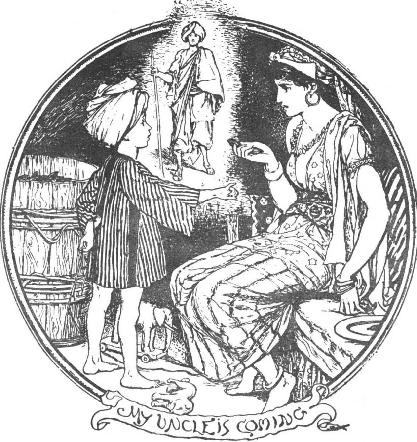

可是她没有告诉他，她的丈夫能变成毒蛇、狗或是魔鬼，只要他高兴。他是个非常富有的人，拥有大群骆驼、山羊、绵羊、牛马和土地，都是最优良的。

第二天早上，妹妹说：“亲爱的哥哥，去替我放绵羊吧！渴了你就喝羊奶。”

“很好！”年轻人说着就走了。

不久，她又说了：“亲爱的哥哥，去替我放山羊吧！”

“为什么呢？我更喜欢看绵羊。”

“可是你不觉得做山羊信更好吗？”妹妹说。于是，她哥哥就赶着山羊出去了。

他一走，妹妹就对她丈夫说：“你一定要杀了我的哥哥，我再也无法忍受和他在一起住了。”

“可是亲爱的，为什么我要这样做呢？他可没有对不起我。”

“我要你杀了他，”妻子回答道，“不然我就离开你。”

“那好吧！”他说，“明天我就变成一条毒蛇。藏在装枣子的桶里。等他来拿枣子时，我就咬他的手。”

“那太好了！”

第二天早上太阳高高升起了，她就去喊哥哥：“去放羊吧！”

“哦，当然！”哥哥答道。可是小男孩却叫了起来：“舅舅，我想和你一起去。”

“你能去我很高兴。”舅舅说。于是他们就出发了。

等他们走远了，再也看不见房子时，男孩就对他说：“亲爱的舅舅，我爸爸要杀了你。他变成一条毒蛇，藏在装枣子的桶里。是我妈妈叫他这么做的。”

“那我怎么办呢？”他舅舅问。

“我来教你。等我们把羊赶回房子后，我妈妈会对你说：‘你肯定很饿了，去从桶里拿些枣子吃吧。’你只要对我说：‘我觉得不太舒服，穆罕默德，你去替我拿些吧！’”

他们到家后，妹妹出来迎接哥哥，说：“亲爱的哥哥，你一定很饿了，去拿些枣子吃吧！”

可是她哥哥答道：“我觉得不太舒服，穆罕默德，你去给我拿些来吧！”

“好的！”小男孩说着就向木桶奔去。

“不行，不行！”他妈妈在后面慌忙喊，“快回来！让你舅舅自己去拿！”

小孩子却不听，冲着她喊：“我偏要拿！”说着，一下把手伸进了桶里。

他没有拿到枣子。却碰到了什么东西，冷冷的、滑滑的。就凑上去轻轻地说：“别动！是我，你的儿子。”

然后他拣了些枣子，拿去给舅舅。

“亲爱的舅舅，给你！想吃多少就吃多少吧！”

他的舅舅把它们一扫而空。

毒蛇看舅舅无意靠近那木桶，就慢慢地爬了出来，恢复了它本来的面目。

“我真庆幸没有杀了他。”他对妻子说，“他毕竟是我的大舅子，否则那实在是罪孽深重啊！”

“要么你杀了他，要么我离开你。”妻子说。

“好吧，好吧！”丈夫无可奈何地叹了口气，“明天我就去杀了他！”

这天晚上倒也太太平平地打发了，可是第二天天刚亮，妹妹就去喊哥哥：“哥哥，快起来！该去牧场放羊了！”

“好的！”

“舅舅，我跟你一起去！”小孩子又叫了起来。

“来吧！”舅舅答道。

可是他妈妈马上跑上前，说：“外面天凉，你不能去，会生病的！”小孩却嚷着：“瞎说！我一定要去，才不听你的，我要去，要去！”

“那就去吧！”妈妈只得同意了。

于是他们便上路了。羊群在前，他们跟在后面。

来到牧场后，男孩就对舅舅说：“亲爱的舅舅，今天晚上我爸爸要杀了你。他乘我们出门的时候，就会爬到你房间里，藏在草堆里。我们一回家，我妈妈就会对你说：‘去拿些草来喂羊！’如果你这么做，那他就会咬你。”

“那我该做什么呢？”

“别怕！我会亲自杀了我爸爸的！”

“好吧！”

晚上，他们赶着羊回家了。他妹妹就嚷着：“快去，亲爱的哥哥！拿些草来喂羊！”

“让我去！”小男孩说。

“你还没长大呢！还是让你舅舅去拿。”

“那我和舅舅一起去！”男孩答道，“来吧，舅舅！”

“好的。”他们一起进了房间。

“屋里太黑了！”男孩说，“我去取盏灯来！”他把灯取回来后，就把稻草点着了，毒蛇便被活活烧死了。

他母亲见状，顿时痛哭流涕。“哦，你这可恶的孩子，瞧瞧你都干了些什么，你父亲在那堆草里，而你却把他活活烧死了。”

“可是我怎么知道爸爸在草堆里，而不在厨房里呢？”小男孩说道。

他的妈妈哭得更伤心了。“从今以后你就是个没爹的孩子了！你只得全靠自己了！”

“你为什么要嫁给一条毒蛇呢？”男孩问，“我一直以为他是个人，他怎么会这些歪门邪术的？”

第二天早上天亮后，妹妹又去叫醒哥哥，让他去放羊。

“我也去！”小男孩说。

“去吧，去吧！”

走在路上，男孩对舅舅说：“舅舅，你知道吗，今晚我妈妈打算用毒蛇的骨头把我们两人都毒死。她把骨头碾成粉，撒在我们吃的东西里面。”

“那我们该怎么办呢？”

“亲爱的舅舅，我会杀了她。如果我的父母这般狠毒，我宁愿不要他们！”

晚上他们回家后，就看见那个女人正在准备晚餐。她偷偷地把毒蛇骨头的粉末撒在盘子的一边，而另一边，她打算留给自己的，却是没有毒的。

男孩小声对舅舅说：“亲爱的舅舅，你一定得记住，我吃哪一边，你也吃那一边。”

“好的！”他舅舅答道。

然后他们就坐下来。刚要吃饭，小男孩开口了，“妈妈，我口渴了！你能给我拿些牛奶来吗？”

“好！不过你们最好先吃起来。”

等她拿着牛奶回来时，两个人吃得正香。

“你也坐下来吃点吧！”男孩说。他妈妈坐下来才吃了一口，立刻倒地身亡。

“她是自作自受！”男孩望着躺在地上的母亲说，“现在我们把所有的羊和牛卖了。”

两人卖了牛羊，得了钱，便出去周游世界。

整整十天，他们在沙漠里跋涉。一天他们走到一个地方，面前道路出现了分叉。

“舅舅，”男孩说。

“有什么事？”他答道。

“你看，眼前是两条路，我们必须各选一条，因为该是分手的时候了。”

他的舅舅马上叫了起来：“哦，不，孩子，我们永不分离。”

“那不可能呀！”男孩说，“告诉我你走哪条路吧！”

“那我往西走。”舅舅说。

“分别前我有句话要告诫你。”男孩接着说，“提防所有红头发、蓝眼睛的男人，不要听命于他们。”

“好吧！”舅舅答道。他们就各自上路了。

这个男人整整走了三天，没有进过一滴食物，他饿得发慌。就在他几乎要昏厥之际，一个陌生人上前问他：

“你愿意给我干活吗？”

“是订合同的吗？”

“对，订合同。”陌生人答道，“如果有谁毁约，那另一人就有权在他身上割下一块皮。”

“好！”男人答道，“我该干些什么？”

“你每天必须赶着羊到牧场去，并把我的老母亲背在你的肩上，你要特别当心绝不能让她的脚碰到地上。此外，每天晚上，你还要逮七只会唱歌的鸟给我的七个儿子。”

“这个容易。”男人说。

于是他们就一同回去了。陌生人说：“这就是你要看的羊。现在，蹲下身子，让我妈妈爬到你背上。”

“好！”穆罕默德的舅舅答道。

这位新的牧羊人照他吩咐的做了。到了晚上，他背上背着老太太，口袋里揣着七只叽叽喳喳的鸟儿回家来。主人的七个儿子就上来围住他。就这样，日复一日，每天都重复着同样的内容。

直到有一天晚上，这个牧羊人突然泪流满面地叫着：“哦，瞧我都干了些什么？为什么我要干这么可恶的活？”

他的外甥穆罕默德在远方看到了这情景，就对自己说：“舅舅遇到了麻烦，我一定要去解救他。”第二天早上，他来到他的主人那儿，说：“尊敬的主人，我必须去找我的舅舅，我想让他上这儿来接替我，而我则去服侍他的老爷。我把我的拐杖和头篷都给他，这样你就知道是他而不是别的人来了。”

“好吧！”主人答道。

穆罕默德便出发了。他走了两天，来到了他舅舅呆的地方。只见他舅舅背着老奶奶，正努力地在捕捉头顶上飞来飞去的鸟儿。穆罕默德上前拍拍他的手臂说：“舅舅，我不是警告过你不要去侍候那些蓝眼睛红头发的男人吗？”

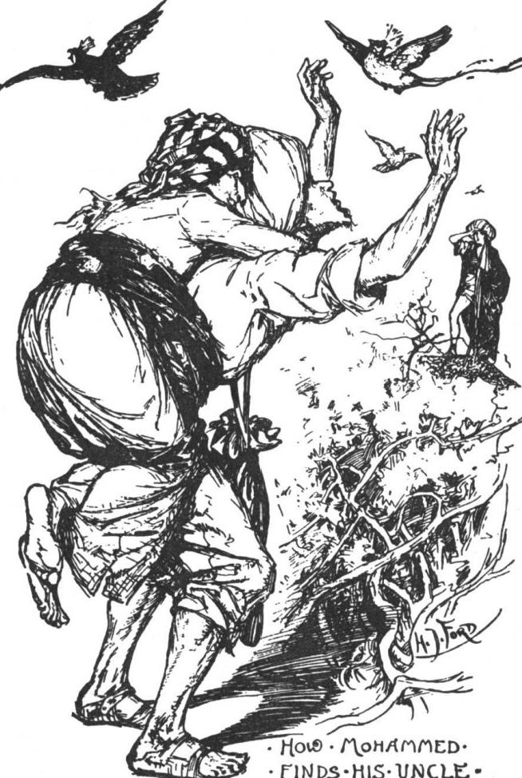

“可是我有什么办法呢？”他舅舅说，“我饥肠辘辘，而他刚巧路过，所以我们就签了契约。”

“把契约给我。”年轻人说。

“就在这儿。”他舅舅就给了他。

“现在，”穆罕默德继续说，“把这老女人放下来。”

“千万不能那样做！”舅舅惊慌地说。

可外甥却不理会，接着说：“别担，将来的一切我全能预见，首先你带着我的拐杖和斗篷离开这里。你一直往前走，两天后，你就会看见一些牧羊人搭的帐篷，你进去在那儿等着。”

“好吧！”

然后穆罕默德伸出魔指狠狠地戳了一下那老妇人，说：“下来，放羊！我想好好睡一觉！”

“哦，当然可以！”她答道。

于是穆罕默德就在树下舒舒服服地躺了下来，一直睡到黄昏时，他醒来对那老妇人说：“让我看看你抓来的那些会唱歌的鸟儿？”

“可你并没有告诉我要捉鸟儿呀！”老妇人答道。

“我没说？”年轻人冷冷地说，“这可是你该干的话，快去捉鸟，否则我会杀了你！”

“我去捉，我当然去捉！”老太太慌忙叫道。便一头钻进了灌木林里去追赶那些鸟儿。荆棘刺进了她的脚里，她痛得尖叫了起来：“天哪！我是多么地不幸！这个男人为什么要如此残忍地虐待我！”最后她终于抓住了七只鸟，把它们交给了穆罕默德。

“现在我们就回去吧！”穆罕默德说。

走了一程，他回过头，厉声命令她：“我不知道羊圈在哪儿，你快去把羊赶进去。”老妇人只能乖乖地听从。年轻人又说：“听着，老巫婆！如果你敢对你的儿子说我打了你，说我也不是原来那个牧羊人，我就杀了你！”

“我一个字也不会说！”

回家后，她的儿子就对他妈妈说：“你看我得了个多棒的牧羊人！”

“确实是个出色的牧羊人！”她答道，“看那些羊儿个个膘肥体壮，它们会挤出很多很多的奶了！”

“千真万确！”儿子说着就起身去给她妈妈和牧羊人盛饭。在穆罕默德舅舅那时候，他只能吃老太太吃剩的残渣余羹，可这位新的牧羊人却不打算这样。

“等我吃饱了喝足了，你才能吃，听见吗？”他小声说。

“好的！”她答道。等牧羊人吃饱了，他对老人说：“吃吧！”

老妇人忍不住哭了起来，叫着说：“你的合同里可没有这么写；你只能吃我吃剩的。”

“你敢再多说一个字，我就杀了你！”穆罕默德说。

第二天，他背着老太太赶羊去了，等离房子有一段路了，他就把她往地上一扔，说：“快，放羊去！”

他自己则捉了一只公羊，杀了它，升起火，开始烤羊肉，然后他叫那个老太太：“来和我一起吃羊肉。”可他并没有让她吃得安稳，而是挑了很大一块肉，用他的手杖使劲地把肉塞进了她喉咙里，这样她马上一命呜呼了。穆罕默德看到她死了，说：“你折磨我的舅舅，这是你罪有应得。”他就让这个女人仍然躺在那儿，自己去捉鸟，他颇费了一番周折后，终于捉住了七只鸟，把它们藏在自己的衣服口袋里，然后他把老妇人的尸体扔进灌木丛里，赶着羊儿回羊圈了。快到家时，七个小孩上来围住他，他就把鸟儿分给他们一人一只。

“你为什么在哭？”孩子们接过鸟问他。

“因为你们的奶奶死了！”孩子们马上跑去告诉爸爸。他爸爸跑来问穆罕默德：“出什么事了，她是怎么死的？”

穆罕默德答道：“我正在放羊时，她对我说：‘我饿了，去给我杀只公羊。’我就杀了只公羊，给她吃羊肉，可她没牙齿，就噎死了。”

“可你为什么要杀公羊，而不杀只绵羊？”主人问。

“我有什么办法？”穆罕默德说，“我必须听从命令。”

“那我只能埋葬她了。”主人说。第二天早上，穆罕默德照例去放羊，他暗暗想：“谢天谢地，我终于把老太婆除掉了。现在轮到那些小崽子了。”

他赶了一天的羊，临近黄昏时，他在泥里挖了一个个小洞，捉到了六只毒蝎。他把毒蝎和另外捉的一只鸟放在一起，然后就赶着羊回家了。

当他赶到家时，孩子们和以前一样上来围住他，叽叽喳喳地说：“给我鸟？”他在每个孩子的手里放了一只毒蝎。毒蝎鳌了他们，他们就死了。但他给了最小的那个儿子一只鸟。

穆罕默德看到孩子们都倒地死了，就立刻放大嗓门叫了起来。“救命，救命，孩子们都死了！”

人们飞快地赶来，纷纷问道：“出什么事了，他们怎么会死的？”

穆罕默德说：“这都是你们的过错，把孩子们宠坏了。在这么刺骨的寒风里，他们的手都冻僵了，怎么握得住东西。鸟儿都飞走了，孩子们的魂也跟着飞了。只有最小的捉紧了鸟，才保住了小命。”

父亲痛苦地呻吟着：“我活够了，再不要捉什么鸟了，我不想失去唯一的孩子了。”

“好吧！”穆罕默德说。

他把羊赶到草地上时对主人说：“外面有个肥沃的牧场，我想赶着羊在那儿呆两三天。所以如果我没回来，请不要吃惊。”

“很好。”主人答应道。穆罕默德就出发了。他赶着羊走了两天，来到他舅舅那儿，对他说：“亲爱的舅舅，收下这些羊，好好看管它们。我已经把老太婆和孩子们杀了。这些牲畜是我带给你的。”

然后他就回到他主人那儿。路上他用石头砸自己的头，直到流血不止；他又把自己的手捆绑起来，便开始尖叫。他的主人听到后，赶紧跑来问：“出什么事了？”

穆罕默德答道：“羊儿们在吃草时，来了一群强盗，把牲口都虏走了。因为我想避开他们，他们就打我，还把我捆起来。看！我满头是血。”

“那怎么办？”主人问，“羊群走远了吗？”穆罕默德答道：“强盗们已经走了四天了，早就走得无影无踪了，你怎么可能追得上他们。”

“那你就去看牛群吧！”主人说。

“好！”穆罕默德答道。他赶着牛走了两天，第三天到了他舅舅那儿。他把牛的尾巴都割下来，只留了一头牛在自己身边。

“亲爱的舅舅，这些牛儿给你，”他说，“我要去教训教训我的主人。”

“好吧！我想你最清楚要干什么。”舅舅说。

于是穆罕默德就把牛的尾巴打成一个结，背在肩上回去了。他来到海边，先把所有的牛尾巴插在沙里，然后把那头没被割尾巴的母牛一直埋到头颈处，只剩下尾巴露在外面。一切就绪，他就和上次一样大叫大嚷起来，一直到他的主人和其他所有的奴仆都跑来看发生了什么事。

“到底出什么事了？”他们叫着。

“大海把所有的牛都吞没了。”穆罕默德说，“只有它们的尾巴还露在外面。不过如果大家动手快些，拼命地拽，也许还能把它们救出来。”

于是主人立即命令每个仆人都去拽牛尾巴，可是他们狠命地一拉，都几乎摔个仰面朝天，只剩下牛尾巴握在手里。

“快停下！”穆罕默德叫道，“你们都做得不对。现在你们拽下了牛尾巴，而牛都沉到海底去了。”

“那我们倒要看看你是不是比我们强。”仆人们说。于是穆罕默德就跑到那头他事先埋在草丛里的牛那儿，抓住它的尾巴，很快就把它拖出来了。

“瞧瞧！就应该这样干。”他说，“我早就说过你们是群废物。”

仆人们都面带羞色，悻悻地走了。可是主人却一步冲到穆罕默德面前：“你给我滚，我这儿已经没活给你干了，你先是杀了我的妈妈，我的孩子，又偷走了羊，还淹死了牛，我不要你干了！”

“那就先割下你身上的一块皮给我。因为你毁了约。”

“只有法官才能裁决。”主人说，“我们去让他评评理。”

“是什么事啊？”法官问主人。

“尊敬的法官，”主人深深鞠了一躬说，“这个牧羊人拐走了我所有的一切。他杀了我的孩子们，还有我的老母亲，他偷走了我的羊，又把我的牛沉到了海底。”

而牧羊人答道：“他必须把欠我的付清，我才能走。”

“说得对，法律是公正的。”法官说。

“好吧，”主人回答说，“让他算算他在我这儿干了多久。”

“那没用。”牧羊人反驳道，“我要你的一块皮，这是我们在合同里约好的。”

主人见申辩也无济于事，只得割下一小块皮给了穆罕默德。他立刻来到舅舅那儿。

“舅舅，我们现在可富了！”他高兴地叫着，“我们把所有的羊和牛卖掉，到一个新的国度去。这里再也不能久留了。”

牲口很快就给卖了，两个志同道合的人又上路了。晚上，他们寄宿在贝督因人的帐篷里，并和阿拉伯人共进晚餐。就在他们和衣躺下前，穆罕默德问帐篷的主人：“你们的牧羊狗会咬我的皮带吗？”

“不会的，别害怕。”

“如果它咬了呢？”

“那我就把狗给你，算个交换。”阿拉伯人答道。

穆罕默德等每个人都沉沉地睡了，就轻手轻脚地起身，把皮带撕成一条一条地，扔在牧羊狗面前，一边则发出撕心裂肺的尖叫声。

“哦，主人，我不是说过你的狗会吃我的皮带的吗？”

“安静些，别发出这种声音，把狗牵走就是了。”

于是穆罕默德用皮圈套在狗的脖子上，就离开了。

到了晚上，他们来到了一个更大的贝督因人部落的帐篷，要求寄宿。晚饭后，穆罕默德对帐篷主人说：“你的公羊会杀了我的护羊狗吗？”

“哦，不会的。”

“如果它这样做了呢？”

“那我就把公羊赔给你。”

晚上，穆罕默德就把牧羊狗杀了，然后把它的尸体横放在公羊的角上，就大叫大嚷起来，一直到阿拉伯人被吵醒。他赶忙说：“把羊拉去，快离开这儿。”

穆罕默德立刻照办。到日落时，他们来到了又一个贝督因人聚居的地方。和以往一样，他们受到了盛情的款待。晚饭后，他对主人说：“你的女儿会杀了我的羊吗？”

“别这么说，我女儿可不是这等人，她不需要偷肉，她每天都有得吃。”

“好吧，那我可要睡觉了。不过如果我的羊出什么事了，我可要喊人的。”

“如果我的女儿胆敢碰你一丝一毫的东西，我就杀了她。”阿拉伯人说完就去睡了。

等人们都睡熟了，穆罕默德起身杀了公羊，取出它的肝脏放在火上烤，然后他在姑娘的手里塞了一片肉，又在她的睡裙上放了几片。姑娘睡得很熟，根本没察觉。穆罕默德做完一切，就开始大唤大叫。

“出什么事了？快闭嘴！”阿拉伯人叫着。

“我怎么能闭嘴，我爱我的羊就像爱自己的孩子一般，可现在它被你的女儿杀了。”

“可我的女儿正睡着呢！”

“好，那去看看她周围是不是有肉。”

“如果她真这么干了，那我就把她来换你的羊。”

正如穆罕默德所说的，他们发现了肉。阿拉伯人狠狠地揍了女儿一顿，并叫她立刻滚，因为她已经属于这个陌生人了。

他们在沙漠里走啊走，直到夜幕降临，他们又来到一个贝督因人的营地。好客的主人把他们请进帐篷。晚上睡觉前，穆罕默德对主人说：“你的母马会杀了我的妻子吗？”

“绝对不会。”

“如果真是这样呢？”

“那我就把母马送给你。”

等人们都入睡了，穆罕默德柔声对妻子说：“姑娘，我有个绝对妙的主意。我想把那匹母马牵来，放在你的脚跟前，然后我用刀把你割伤。只是一些轻微的皮肉伤。这样你身上都是血，人们就会以为你死了。千万别出声，否则你我可惨了。”

他这样做了以后，穆罕默德就开始嚎啕大哭，哭得比以往都响。

阿拉伯人马上跑来，说：“别再发出那么可怕的声音了。牵着马走吧。不过把那个死去的姑娘也带走，她可以躺在母马的背上。”

于是穆罕默德和他舅舅就抬起姑娘，把她安置在母马的背上。他们很小心地一人走在马的一边，以免姑娘从马背上滑下来摔伤。等阿拉伯人的帐篷再也看不见了，姑娘就从马鞍上坐起来，朝四周张望。三个人都觉得饿了，就把马拴好，拿出枣子吃。吃完后穆罕默德说：“亲爱的舅舅，我把这个姑娘送给你做老婆。不过我们卖牛和羊得的钱我要分了，你拿三分之二，我拿三分之一，因为你还有一个老婆，而我却不打算结婚。现在好好地上路吧，从今以后你再也见不到我了，我们的缘份就到此为止了。”

说完，两人抱头痛哭，并为他俩在过去岁月里所有的罪孽祈求宽恕，然后他们就分手各自上路了。

（刘沁译）

 

## 勃宾诺

从前有个富有的商人，他有一个独子叫勃宾诺。这孩子聪明伶俐，求知欲又很强。所以他父亲就把他送到一位学者那儿，希望他能教会他各种外国语言。同这位学者一起呆了数年后，勃宾诺回到了自己的家。

一天晚上，他正同父亲在花园里散步，头顶上的树叶间几只麻雀叽叽喳喳叫个不停，吵得他俩都无法听清对方的话。这使得商人非常恼火。为了让他消消气，勃宾诺就说：“您想不想让我告诉您，这些麻雀在交头接耳谈些什么吗？”

商人惊诧地看着儿子，说：“你这是什么意思，你怎么知道麻雀在说什么？你以为自己是占卜家，还是魔法师呢？”

“我既不是占卜家，也不是魔法师。”勃宾诺答道，“不过我的老师却教会了我所有动物的语言。”

“天哪！我的钱！”商人惊叫起来，“这位老师肯定没了解我的意图，我自然是想让你学全人类的语言。”

回家的路上，家里的狗跑出来冲着他们凶巴巴地乱叫一气。

“这只畜生怎么了？”商人说，“它跟我这么熟，为什么要这样冲着我叫？”

“您想知道它说些什么吗？”勃宾诺说。

“让我安静些！别胡说八道地让我烦心。”商人非常懊恼地说，“我的钱就这样付诸东流了！”

过了一会儿，他们坐下来吃晚饭，旁边池塘里几只青蛙呱呱地叫个不休，那声音还从未听到过。这嘈杂的声音又触怒了商人，他简直又要发脾气了，说道：“这实在是火上浇油嘛！”

“您要不要我解释给您听？”

“你就不能管住你的舌头，别再解释了吗？”商人大声说道，“睡觉去，别再让我看到你。”

于是勃宾诺就到床上，香甜地睡熟了。可他的父亲却无法克制失望之情，怒火无论如何难以平息。他唤来两个仆人，下达了一条命令，让他们第二天去执行。

第二天早上，其中一个奴仆早早地唤醒了勃宾诺，叫他坐进了等候着的一辆马车里，奴仆自己坐在小主人身边。另一个奴仆骑着马，在马车的一边充当护卫。勃宾诺不明白他们要把他怎么样，又要把他带往何处。但他注意到身边的奴仆神色悲哀，眼睛哭得肿肿的。

他非常好奇，就问：“你们为什么如此悲伤，你要把我带到哪里去？”

奴仆什么都不肯说，但终于经不住勃宾诺的一再恳求，就告诉了他：“可怜的孩子，我是送你去死的，更糟糕的是，这是你父亲的命令。”

“但为什么呢？”勃宾诺惊叫着，“为什么他要我死？我做错了什么，犯了什么滔天大罪，以致他要我死？”

“你没什么错，也没对他做任何坏事。”奴仆答道，“他只是气得发疯了，因为这些年你只学了动物语言，而他却希望你学识超众，这就是他为什么要决定送你去死的原因。”

“既然是这样，那就赶快杀了我。”勃宾诺说，“如果这件事是必须要做的，那还等着干嘛？”

“可我怎么忍心？”仆人答道，“我宁愿想个办法，既能保住你的性命，同时又能使我们免受你父亲的责骂。幸好，家里的狗一直跟在我们后面。我们杀了它，取出它的心，带给你父亲，让他相信这是你的，这样你就能逃脱了。”

等他们到了林子的最深处，勃宾诺下了马车，同仆人们告别，就上了路。

他走啊走，一直走到晚上，来到了一座放牧人住的房子前，他敲了敲门，恳求能寄宿一晚。放牧人看到这个年轻人和蔼可亲，就欢迎他进来，并让他同他们一起共进晚餐。

就在他们正吃着饭的时候，院子里的狗汪汪地叫了起来。勃宾诺走到窗前，凝神听了一会儿，转身对放牧人说：“快让你们的妻子儿女上床睡觉去，你们自己准备好武器，因为到半夜会有一帮强盗来袭击这房子。”

放牧人吓了一跳，心想这年轻人肯定不太正常。

“你怎么知道有强盗会来攻击我们，是谁告诉你的？”

“是我从狗叫声中听出来的。”勃宾诺答道，“我能听懂它的语言。如果今晚我不在这儿，那可怜的家伙实在是白浪费唾沫，毫无意义了。所以如果你们想保住性命和财产，最好还是听我的话。”

放牧人越听越吃惊，但还是决定照勃宾诺说的做。他们把妻儿送到楼上，自己则荷枪实弹，藏在篱笆后面，各就各位等待着午夜的降临。

钟敲了十二下，他们就听见沙沙沙的脚步声，是一群强盗悄悄地向房子逼近。可是这些放牧人早有准备，他们从篱笆后面一跃而起，举起短棍向强盗劈头盖脸地打去，打得他们抱头鼠窜。

你们应该想象得出放牧人是多么感激勃宾诺。由于他及时地报信，使得他们保住了性命。他们恳求他留下在此安家。可勃宾诺想多见见世面，就谢绝了他们的好意，又上路了。他走了整整一天，晚上他来到了一个农夫的房子前。他正在犹豫是否要敲门请求寄宿，就听到屋后的沟里一声很响的青蛙叫。他踱到房子的后面，看到了一幕奇怪的景象：四只青蛙正在玩一只小瓶子，它们把它扔来扔去，每扔一下就发出一声蛙鸣。勃宾诺听了一会儿，就去敲房门。一位农夫开了门，并请他进屋一起吃晚饭。

晚饭后，主人告诉他家里遇上了大麻烦。他的大女儿病了，恐怕难以治愈了。可不久前有一位名医路过，答应送给她一些灵丹妙药，只是他派去取药的仆人却在半路上把瓶子丢了。眼看着姑娘就没有希望了。

勃宾诺便告诉农夫，他看到几只青蛙在玩一只小瓶。据他所知这就是医生送给姑娘的药。农夫问他是否是真的，勃宾诺就解释说他听得懂动物的语言，他碰巧听到青蛙在掷小药瓶时的交谈。农夫就从沟里取来那瓶药，把它给女儿吃了。第二天早上，姑娘的气色就好多了。感激涕零的父亲不知道该怎么报答他才对。可勃宾诺却什么也不肯接受，告别农夫就上路了。

不久后的一天，他在树下遇到两个人在避暑。由于疲惫不堪，他就伸直了身体在离这两人不远的地方躺下了。很快，他们三人就开始互相攀谈起来。谈话中勃宾诺问这两人去哪儿。他们答道去临近的镇子，就在这一天那儿的人们将推选出一名新的首领。

正在他们说话的时候，几只麻雀停歇在他们头顶的树上。勃宾诺闭上了嘴听它们说话，看上去是听得那么专心。最后他对同伴说：“你们知道麻雀在说什么吗？它们说今天我们当中有一个人将被推举为那个镇子的首领。”

那两个人什么也没说，只是互相对视。几分钟后，他们见勃宾诺睡熟了，就偷偷地起来，匆匆地向他们说的那个镇子赶去。

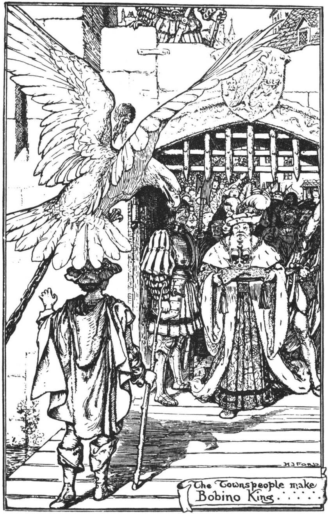

集市上已经聚集了一大群人，等待着那激动人心的时刻到来。届时人们将把一只老鹰从笼子里放出来。这只鹰飞到哪幢房子上停下，哪幢房子的主人就将是该镇的镇长。这一时刻终于到来了，鹰被放了出来。所有的眼睛都紧紧盯着这只大鸟，看它将降落在何处。这只鹰在人们的头顶盘旋了一圈又一圈，然后直冲向一位刚刚踏进镇来的年轻人头上。这不是别人，正是勃宾诺。勃宾诺在两个同伴离开不久就醒了，并跟随着他们的足迹来到了这里。人们欢呼万岁，簇拥着把他送到镇长住的房子。以后这儿就是他的家了。他在这儿快乐地生活着，并英明地统治着所有的老百姓。

（刘沁译）

 

## 狗和麻雀

从前有一只牧羊狗，狗的主人很凶，不给它吃饱，还以最残忍的方式对待它。时间一长，牧羊狗再也无法忍受主人的虐待，终于有一天，这只狗离开了主人的家。正当牧羊狗在街上一路小跑时，一只麻雀走上前来问它道：“老弟，你为什么如此忧伤呢？”

狗回答道：“因为我很饿，又没有东西可吃。”

“原来就为这个呀，老弟，”麻雀笑道，“和我一起到镇上去吧，我很快就会给你弄到吃的。”

于是，它们俩一起来到了镇上。它们走进一家肉铺，麻雀对狗说：“站着别出声，我去给你弄一块肉来。”

麻雀先朝四下里看了看，发现没人注意它，于是赶紧啄下一块放在肉架边上的肉，狗迫不及待地叼起这块肉，跑到阴暗的角落边，狼吞虎咽地把它给吃了。

狗吃完后，麻雀又说道：“好，现在跟我去另一家铺子，我再给你弄一块肉来解馋。”当狗享用完了第二块肉以后，麻雀问它：“老兄，吃饱了吗？”

“饱了，”狗答道，“我已经吃够了肉，但还没有吃过面包。”

麻雀说：“只要你跟我走，你要吃多少面包就能吃到多少。”

于是，麻雀把狗带到了一家面包店，麻雀朝货架上的两个面包卷啄了几下，面包掉了下来，狗就把面包给吃了。

但狗仍然感到饿，于是麻雀把它带到另一家面包店，又给它弄了几个面包卷吃。最后，麻雀问道：“老弟，你现在饱了吗？”

“饱了，”狗回答道，“现在，让我们到镇子外边走走吧。”

于是狗和麻雀一起到了镇外。天很热，走了没多远，狗就说：“我很累了，想睡一会儿。”

“睡吧！”麻雀答道，“我会在树枝上帮你看着。”

于是狗在路中央躺下，很快就睡熟了。正当它睡得香时，一个车夫驾着马车朝这边走来，马车由三匹马拉着，车上装了满满两桶葡萄酒。麻雀发现车夫没有打算绕过狗睡的地方，而是径直朝路中央走来，于是它朝车夫喊道：“嘿，赶车的，当心你走的道，不然你会倒霉的！”

但车夫根本不听麻雀的劝告，只顾嘲笑它，挥动着手中的鞭子，让马车直朝狗身上压过去，沉重的车轮压在狗身上，把狗压死了。

麻雀看到这一情景，惊呼道：“你把我的兄弟压死了，你如此残忍，你将会失去你的马车和马匹！”

“是吗！”车夫道，“我倒要看看你怎么能做到这些！”

麻雀什么也不说，偷偷地钻进了马车篷，在一只葡萄酒桶的桶口边用嘴啄着，最后，它把酒桶的塞子啄掉了，葡萄酒都流了出来，马夫并没有发觉。

车夫转过身来，却发现马车的底板都湿了，他仔细察看时，发现一个酒桶已经空了，“唉，我真够倒霉的！”车夫叫道。

“你还会更倒霉的。”麻雀说着飞到一匹马的头上，啄瞎了它的双眼。

车夫看到后，抓起一把斧子朝麻雀砍去，但小麻雀一下子飞走了，斧子正落在被啄瞎了的马的头上，马倒在地上，死了。“天哪，我真不走运！”车夫大叫道。

“倒霉的事还在后头呢！”麻雀唱道。车夫赶着剩下的两匹马继续赶路，麻雀又钻到了车篷下面，把另一桶酒的木塞子也啄掉了，所有的酒都流到了地上。

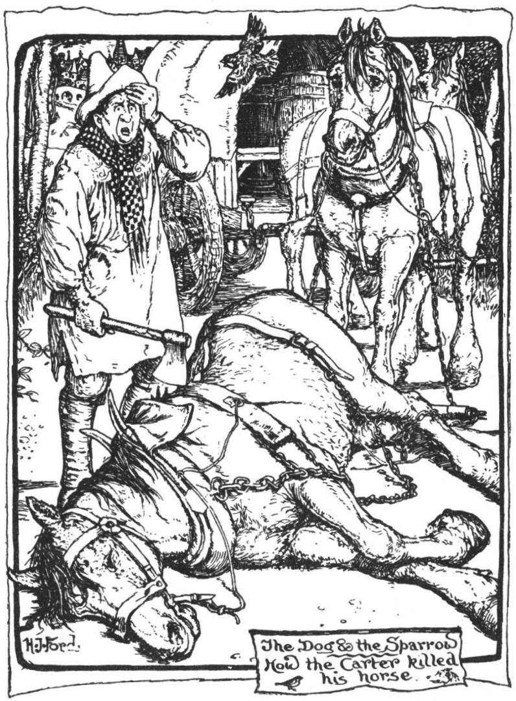

车夫发现这一新的不幸，喊道：“见鬼，我真是倒霉透了！”

麻雀仍然说道：“你的厄运还没结束呢！”说着它又飞到了第二匹马的头上，啄瞎了它的眼睛。

车夫跳出马车，抓起斧子就朝麻雀砍去，想把它一斧子砍死，但它纵身一跃，飞入高空，这一斧子又砍在了瞎马的头上，当场把那匹马砍死了。车夫惊叫道：“上帝啊，我怎么如此倒霉！”

“你的厄运还没有到头呢！”麻雀说着，又飞落在第三匹马的头上，啄瞎了它的双眼。

车夫愤怒极了，挥起斧头直朝麻雀飞砍过去，但麻雀又一次逃过了斧子，斧子不偏不倚，正落在剩下的最后一匹马身上，把它也砍死了。车夫再次惊呼道：“天哪，我真是倒霉！”

“还没完呢！”麻雀说道，“现在我要让你的家变成一片废墟！”

车夫没有了马，无可奈何地把马车丢在马路上，怒气冲冲地回到家。一看到妻子，车夫就嚷道：“今天我真是倒霉透了，我运的葡萄酒都洒了，三匹马也都死了。”

“亲爱的，”他妻子说道，“厄运总跟着你，那只可恶的小麻雀召集了所有的鸟，它们现在我们的谷仓里，正准备把所有的东西都吃了呢！”

车夫赶到谷仓，发现正如他妻子所说，成千上万只鸟正在吃谷子，在他们中间正坐着那只小麻雀。又见到了仇敌，车夫大叫道：“天哪，我真是受够了！”

“我跟你还没完呢，”麻雀答道，“正如我说的，车夫，你残忍的行为要用你的生命来补偿。”说完这些，麻雀又飞入了高空。

车夫眼看着自己谷仓里所有的谷子都被吃光，心痛万分，他坐在火炉边，心里盘算着如何向麻雀报仇。这时小麻雀正坐在窗台上，轻轻唱道：“瞧着吧，你残忍的行为要用你的生命来补偿。”

于是车夫抓起斧子，向麻雀砍去，但这次他只砍到了窗玻璃，麻雀没有受到丝毫的伤害，它又从破玻璃窗里飞进屋子，停在火炉架上，对车夫唱道：“用你的生命来补偿。”

车夫气得发了疯，抓起斧子直向麻雀挥去，但这只小鸟总能逃脱他的斧子，车夫的斧子只是把他自己的家具都给毁了。最后，车夫总算是把麻雀抓在了手心里。他的妻子问道：“要不要把它的脖子拧断？”

“不！”车夫答道，“这样弄死它，太便宜它了，要让它不得好死，我要活吃了它！”说着，他就真的这么做了。麻雀在车夫手中扑扇着翅膀，拼命挣扎，直到被送进车夫的嘴里，突然，它又探出头来喝道：“瞧着吧，你会送命的！”

车夫把斧子递给他妻子，说着：“你把这只麻雀砍死在我嘴里！”

车夫的妻子用尽所有力量砍去，但她没有砍到那只麻雀，而是正砍在了车夫的头上，车夫立刻倒下，死了。麻雀从他的嘴里逃了出来，自由自在地飞向蓝天。

 

## 海神的三个儿子

很久以前，有个叫宁吉的年轻人，他快活地生活在离康斯坦丁那波里四十里外的一个小镇上，直到十八岁。他把他抚养成人的养父母穆罕默德和他的妻子津尼比视作自己的亲生父母。

虽然并不富裕，但宁吉对自己的生活很满足，不像许多年轻人，宁吉没有出去闯一番的抱负。一天，穆罕默德把他叫到跟前，不无伤感地告诉他，如今是他去康斯坦丁那波里找份差使的时候了，宁吉听到这话，真是大吃一惊。穆罕默德接着说道：“你可以去当兵，也可以做个传教士，向人们讲授古兰经，这由你自己去决定，你对古兰经已经很熟悉了，只要再稍进修一下就完全可以向别人传授了，不管怎样，千万别忘了要常写信回来，我们会永远想你的。”

说完这些，穆罕默德给了宁吉四枚金币，便让他走了。穆罕默德叫宁吉和一个去康斯坦丁那波里的旅行队一起走。

旅行队走得很慢，几天后，他们终于看到了远处的城墙和塔楼，这时他们明白就快到了。马车停下来，人们就各奔东西去了，只剩下宁吉一个人。他感到既陌生又孤独，这毕竟是第一次离开家乡，而且也从没有人对他说起过康斯坦丁那波里，他甚至不知道这儿的任何一条马路的名称。

宁吉在街上站了一阵子，打量着过往的人群，思忖着下一步该怎么办。忽然，有个陌生人微笑着向他走来，彬彬有礼地朝他鞠了一躬，问他是否愿意到他家去。宁吉觉得也别无选择，便接受了陌生人的邀请，跟着去了他家。

宁吉和那个陌生人来到一间大屋子里，看见有个姑娘正将三把椅子放到桌边，这姑娘只有十一二岁这么大。

“泽丽达，”陌生人说道，“我说过我会带个人回来和我们共进晚餐的。瞧，我没说错吧。”

“父亲大人，”姑娘回答道，“你总是说到做到的，而且从不骗人。”她正说着，仆人已摆好了丰盛的宴席，又在每个人面前放上一只酒杯，斟上清凉的果汁，然后悄悄地退出了房间。

席间，主人（即那个把宁吉带回家来的陌生人）滔滔不绝地谈着各种各样的事情，可宁吉却什么也没听进去，只是不时地朝泽丽达看上几眼，努力控制自己不至于太失礼。

姑娘发现宁吉的目光时不时地停留在自己身上，觉得很不自在，害羞地胀红了脸。最后，她腼腆地低声对父亲说：“那陌生人老盯着我看，如果海山看见这情景，一定会嫉妒得发疯的。”

“不，不会的，”父亲回答道，“你当然不能嫁给这年轻人，我以前不是告诉过你，他是娶你姐姐阿琴坦的吗？我马上就会使他的心归属于你的姐姐。”说着，他起身来到一个大柜子跟前，从里面拿出一些水果和一小瓶酒，把它们和一只小小的镶满珠宝的银丝盒一起放在桌上。

“尝尝这酒，年轻人，”主人说着，向宁吉的玻璃杯里倒了些酒。

“也给我喝点儿吧。”泽丽达说道。

“绝对不行，”她父亲回答，“你和海山几天前都已喝过这酒了，你不能再喝了。”

“那你自己也喝一点，”泽丽达说，“不然这年轻人会怀疑我们给他吃的是毒药。”

“好吧，如果你这么认为，那我就也来喝上一点儿，”父亲回答说，“对我这把年纪的人来说，这酒已经不会再有什么危险了。”

宁吉刚喝完酒，主人便打开了那只精致美丽的小盒子，从里面拿出了一张小像片，宁吉看见像片上画着一位美丽绝伦的少女，他简直惊呆了。瞬间，他心潮起伏，一种难以名状的异样感觉充斥全身。

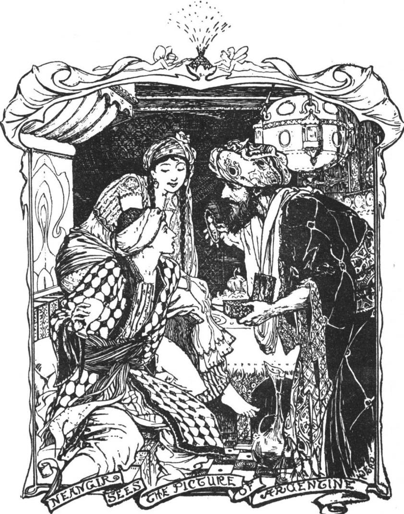

泽丽达和她的父亲在一旁微笑着，看着宁吉。最后，宁吉终于回过神来，说道：“请你们向我解释一下发生的这一切，你为什么要把我带到这儿来，又为什么逼我喝下这酒，使我热血沸腾？你又为什么要给我看这张像片，令我如此神魂颠倒？”

“我只能回答你的一部分问题，”主人说道，“但不是全部，你手中的这张像片画的是泽丽达的姐姐，看得出，你已经深深地爱上了她。所以你必须去找她，当你找到她的时候，也就找到了你自己。”

“可我在哪儿才能找到她呢？”宁吉喃喃地说着，用嘴唇轻吻着那张像片。

“这个，恐怕我无法告诉你。”主人谨慎地回答。

“让我来告诉你吧。”泽丽达急着打断了父亲的话，“明天，你到犹太人的商业街去，到右手第二家商店里去买一块手表，到午夜时…… ”

这时，泽丽达的父亲立刻用手捂住她的嘴打断了她的话，喝斥道：“闭嘴！孩子，你如此轻率，这样会把你不幸的姐姐的前途给毁了的！”于是宁吉对午夜将发生什么事就一无所知。泽丽达的父亲刚说完话，一股浓密的黑烟便从酒瓶里冒了出来，主人一不小心，将酒瓶打翻在地，老仆人冲进房间尖叫起来。宁吉看到这些怪事，立刻偷偷地离开了这屋子。

宁吉在清真寺里过了一夜，当东方露出第一线曙光时，他从头巾里拿出了姑娘的像片，又痴痴地看了起来。忽然，他想起了泽丽达的话，便四处打听犹太人的商业街在哪儿，接着就直奔泽丽达说的那家商店而去。

商店的老板听说宁吉想要买一块表，就将他自己认为是上乘的表一一向他展示。老板开价三枚金币，宁吉欣然接受。但商店的老板坚持要知道他的住址后，才肯把表给他。

“可我自己还没数儿呢！”宁吉回答说，“我昨天刚到这城市，还没找到住处呢。”

“好吧，”商店老板说，“跟我来，我带你到一个好地方去，在那儿你能住得很舒服，而且价格又便宜。”

宁吉立刻答应。于是两个人一起穿过几个街区，来到了商店老板说的旅馆。宁吉拿出了自己仅剩的一枚金币支付他的食宿。

吃过晚饭，宁吉把自己关在房间里，又想从头巾里掏出心上人的像片，仔细端详一番。但他刚把手插进头巾里，就摸到了一只封口的信封，里面有一封信。显然，这封信是乘他不备时，塞进他的头巾里的。信封上的字是他的养母津尼比的笔迹。于是宁吉立刻打开信封，当他读着这封信时，真是大吃一惊：

“我最亲爱的孩子：我把这封信放在你的头巾里，相信你总有一天会发现它的。正如你所知道的，你不是我们的亲生儿子。我们相信你的生身父亲是一位遥远国度里的君主。信封里还有一封他的亲笔信，在信里，他威胁我们，说如果不立刻把你送还到他那儿，他就会来报复我们。我们会永远地爱你，想念你。但你不要再来找我们，也不要再写信给我们，因为这么做是毫无意义的。”

信封里另有一封信，上面的字迹是宁吉从未见到过的，信中写道：

“你们这些异教徒，一定是跟那些巫师们串通好了，骗走了可怜的赛洛可的两个女儿，还从她们那里偷走了她们的父亲给她们的吉祥物。现在，你们又拐走了我的儿子，可我已经找到了你们的藏身之处。我对天发誓，一定要惩罚你们的罪行，我的弯刀将如同闪电般的锐利。”

宁吉读着这两封信，心情很是沮丧。他以前对这些事一无所知，现在他感到自己从未有过的悲伤和孤独。显然，他的亲生父亲就是那个写信给穆罕默德和他妻子的人，但宁吉不知道去哪里找他。而令他更为伤心的是两位把他抚养成人的养父母，从此，他无法再见到他们了。

为了摆脱这些伤心事，宁吉离开旅馆，在大街上边漫步，边盘算下一步该怎么办。想着想着，他又回到了旅馆，正要跨进门槛，突然间，他发现脚边有件东西在月光下闪闪发亮。宁吉弯下腰把它拣了起来，原来是一只镶满宝石的金表。他朝四周看了一下，想寻找失主，但街上空无一人。宁吉就把它系在腰带上，和上午刚从犹太人那儿买来的那只银表放在一起。

拣到这块金表，宁吉的心情好了些，他心想：“这样，我至少能用这些宝贝换一千枚金币，这些钱足够我维持到找到亲生父亲。”这么想着，他把两块表放在身边，安然睡去。

半夜，宁吉突然醒来，他听见细细的说话声，好像是从手表里传出来的。

“阿洛拉，我亲爱的姐姐，”一个细柔的声音在低声说，“他们替你上发条了吗？”

“不，亲爱的阿琴坦，”另一个声音轻声答道，“你呢？”

“没有，他们把我也给忘了，”第一个声音说，“现在已经是半夜一点了，看来今天我们是无法脱身了，只能到明天再说，但愿他们明天别再忘了这事儿。”

“现在我们在这儿也没什么事儿可干，”阿洛拉说道，“我们只能听天由命了，让我们走吧。”

宁吉听得目瞪口呆，他坐起身来，借着月光，他看见那一金一银两只表滑到地上，朝屋外滚去。宁吉紧跟着来到房门口，下了楼梯，可那两块表趁他一个不注意，顺着梯子滚出了屋子来到街上，转眼就消失得无影无踪了。宁吉急着想打开屋子的门跟出去，但门被锁得死死的，怎么也打不开。最后，他不得不放弃，灰溜溜地回到了床上。

第二天早晨，宁吉一觉醒来，沮丧之情又回到了他身上，他觉得如今自己比任何时候更孤独和穷困，甚至还有那么一丝绝望。想着，他披上头巾，佩上宝剑，决定去找那个卖给他表的犹太商人，问个究竟。

宁吉来到那家商店，发现他要找的那个人不在店里，取而代之的是另一个犹太人。

“你要找的那人是我的兄弟，”犹太人说道，“我们两个轮流看着这铺子，或到城里去做买卖。”

“啊，是什么见不得人的买卖呢？”宁吉怒气冲冲地说道，“你们兄弟俩真是一对无赖！你哥哥昨天上午刚卖给我一只手表，可到了晚上，这只表就跑了！现在我要找回我的表，否则，你就得赔偿我的损失，因为你是他的兄弟！”

“你在胡说些什么呀，”犹太人说道，他们俩人周围很快聚集了一大群人，“手表怎么会自己跑掉呢？如果是一桶酒，你的话也许还可信，可现在你说的是一只表！——这真是天方夜谭！”

“让我们到法官那儿去，他会替我们辨个明白的。”宁吉说道。就在那时，他发现那个他要找的犹太人正走进店来，他冲上前去，一把抓住那人的胳膊，把他拖到法官面前。就在宁吉抓住那个卖表给他的犹太人，把他带到法官那里的时候，犹太人的兄弟轻声地对他说：“哥哥，你什么也别承认，不然的话，我们俩就全完了。”这话给宁吉听到了。

法官先把看热闹的人群驱散，然后转身对宁吉说道：“现在，你说说事情的经过吧。”听了小伙子的陈述，他感到这简直不可思议，于是又去问那个犹太人，犹太人吓得不知该怎么回答，只是两眼朝天，脸色惨白地瘫倒在地上。

法官并没有注意到犹太人惊慌失措的样子，他只是对宁吉说：“你说的事太离奇了，没有人能相信这种事的。”说着，法官就示意犹太人回家去。这一切深深地激怒了宁吉，他几乎忘了这是在法官面前，大吼道：“你看到他惊慌失措的样子了吗？得让他说出事情的真相！”说着，他拔出宝剑就向犹太人刺去，犹太人发出一声刺耳的尖叫。

“你看看吧，法官大人，”犹太人对法官说道，“这年轻人简直是疯了，我可以不追究他刺我的这一剑，但是求你千万别听他的信口开河。”

就在这时，海神巴萨碰巧经过此地，他听见里面的吵闹声，就进来问个究竟。听了事情的原委，他端详着宁吉，温和地问他这些奇闻怪事怎么可能发生。

“大人，”宁吉说道，“我起誓，我所说的都是真话，你听了我的经历之后，也许会相信我所说的，有整整三年的时间，我曾因为受到咒语的折磨而变成了一只长着三只脚的壶，直到有一天，一条头巾盖在这只壶的盖子上，才使我又恢复了人的模样。”

听到这些话，巴萨真是喜出望外，他拥抱着宁吉，深情地呼唤道：“噢，我的孩子，我的亲生儿子，我终于找到你了！你是不是从穆罕默德和津尼比的家来的？”

“是的，大人，”宁吉回答道，“是他们俩在我最不幸的时候收养了我，照顾我，使我感到，能成为他们的儿子是何等幸福。”

“真主保佑，”巴萨说，“要知道，起先我对找回我儿子的事几乎不抱什么希望了。”他向法官示意后继续说道：“我结婚没几年，美丽的赞白克为我生了三个儿子。当这孩子长到三岁那年，一天，来了个教士，他给了我最大的儿子一串精致美丽的珊瑚项链，并说道：‘好好地保存这宝贝，忠诚于真主，这样，你就会得到幸福。’他又给了我的第二个儿子，就是现在站在你面前的这个小伙子一个铜盘，上面用七种文字刻着穆罕默德的名字，并告诫他，要他永远不摘下头巾，因为这头巾象征着虔诚，只要他遵守这一点，他就会成为这世上最快乐的人。他又在我三儿子的右臂上戴上了一只手镯，并叮嘱说，他的右手必须保持干净，他的左手不能沾上污点，这样，他就永远不会有痛苦和烦恼。”

“我的大儿子不听教士的劝告，不久灾难就降临到他头上，我的小儿子也是如此。为了使我的二儿子不再遭受如此厄运，我把他带到一个偏远的小镇上，让一个名叫古卢库的忠厚的仆人照看他，我自己则出征打仗去了。等我打仗回来，急着想抱儿子时，那仆人和我的孩子都找不到了。几个月后，我才得知我的儿子和一对名叫穆罕默德的夫妇生活在一起，于是我怀疑是他们夫妇俩偷了我的儿子。快告诉我，孩子，你怎么会到他们家去的？”

“大人，”宁吉答道，“对于我的早年生活，我只能记起一小部分了。我记得我曾和一个仆人住在一座海边的城堡里。那一年，我大概有十二岁，一天，当我们俩外出散步时，遇到了一个人，那人的脸和这个犹太人的脸很相像，他边跳着舞，边向我们走来。忽然，我觉得自己一下子没了力气，我用力想把手举过头顶，可我的两只手变得僵硬而不听使唤了。转眼间，我就成了一只铜壶，我的双臂成了壶的把手。那仆人到底发生了什么事，我不知道，但我意识到当时有个人把我拣了起来，并立刻把我带走了。”

“几天后，当我清醒过来时，发现自己被放在一堆稻草边。我发现周围的杯子正用鄙夷的眼光朝我看时，就愤然离开了那儿。我艰难地迈开脚步，用三只脚走过那堆稻草，之后，又足足走了一个多小时。”

“大人，你无法想像用三只脚走路有多困难，尤其是那时，我的膝盖又是那么僵硬不听使唤，最后，我历尽千辛万苦，终于来到了一个集市上，我躲在一堆卷心菜下面，过了一夜。”

“第二天早晨，天蒙蒙亮时，我发现有人弯下腰，把我捧在手中，仔细地端详着，‘你是从哪儿弄到这东西的？津尼比！’我听到一个男人的问话声。”

“‘我看这恐怕是世界上最漂亮的壶了，’我身边的女人说道：‘你没料到吧，我是在那堆卷心菜里找到它的！’”

“穆罕默德把我从地上拿起来，用赞赏的眼光打量着我，这使我很自豪，要知道任何东西都是希望能被欣赏的，哪怕是一只铜壶。接着，我被带进了那家的屋子，他们用我盛水，还把我放到火上煮东西。”

“接下来的三年中，我就这么过着安静而有意义的生活。那时，津尼比还是个年轻漂亮的女人，她每天都把我擦得全身锃亮。”

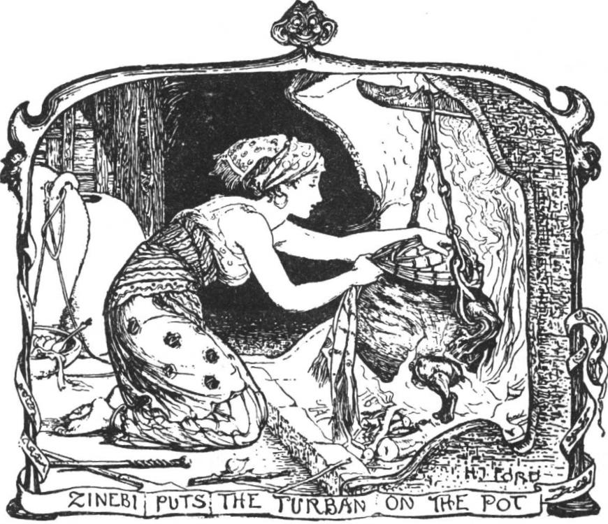

“一天早晨，津尼比把我放在火上，又往我身体里放了一小片牛肉，准备煮牛肉。她担心煮沸后，汤汁会从盖子里溢出来，就想找一件东西压在我的盖子上，可手边除了她丈夫的头巾外，找不到其他可以用的东西，于是她用这头巾把壶盖紧紧压住后就离开了屋子。这时，我第一次感觉到火正在烧灼着我的脚趾，于是我朝边上挪了挪。没想到，这一次，我很轻松地迈开了步子，竟一下子逃到了穆罕默德的花园里。同时，我也意识到自己的身子正在长高，几分钟后，我就又恢复成一个人的模样了。”

“那天，穆罕默德和他的妻子津尼比是去教堂做祈祷的。三小时后，他们回到家里，当发现厨房里的铜壶竟成了一个小伙子时，他们吃惊的样子是可想而知的。我对他们说了我的遭遇。起先，他们怎么也不相信，可最后，我终于使他们明白我所说的都是事实。接下去的两年里，我就和他们夫妇俩生活在一起，他们把我当亲生儿子对待，直到有一天，他们让我来这城市寻找我自己的生活。大人，我这儿有两封信，是我从头巾里找到的，它们也能证明我所说的都是实话。”

宁吉说话时，犹太人的伤口渐渐停止了流血。就在这时，门口忽然出现了一位美丽的犹太姑娘，二十二岁左右，她头发蓬乱，衣冠不整，像是刚从什么危险的地方逃出来的。她一只手里拿着两根用白木做的拐杖，身后还跟着两个男人。宁吉认出第一个男人就是被他刺伤的犹太人的兄弟，第二个就是在他变成铜壶时站在旁边的人，两个犹太男人的腿上都用宽宽的亚麻布绑了好几圈。

犹太姑娘来到那个被刺伤的人跟前，把两根拐杖放在他身边，然后看着他，禁不住泪流满面。

“可怜的伊宙夫，”她呜咽着说道，“你为什么要冒这险？现在你看看，不光你自己有了麻烦，还连累了你的两个兄弟。”说着，她看了看那两个和她一起来的人。这时，那两个男人已经来到了受伤的犹太人面前，跪在他跟前的坐垫上。

巴萨和所有在场的其他人不仅被这犹太姑娘的美貌所打动，而且对她说的话不知所措。于是，请求她向大家解释到底是怎么回事。

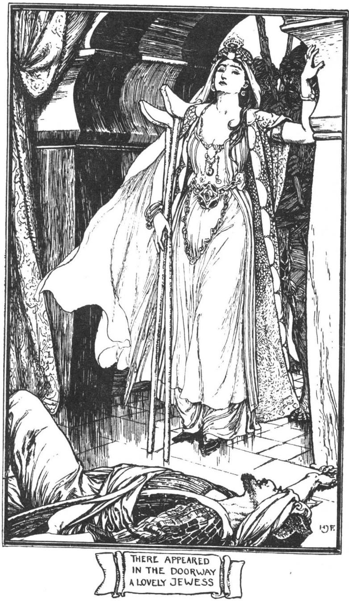

“大人，”姑娘说道，“我的名字叫苏米，是莫伊泽斯的女儿，我的父亲莫伊泽斯是一位很著名的犹太教教士。我爱上伊扎夫，”她指了指那个最后进屋的小伙子，“可为此我付出了巨大的代价，虽然他并不爱我，但我仍然对他一片真心。”说着，她转身对伊扎夫说道：“把你和你兄弟的事情都告诉这些人，以求得他们的宽恕吧。”

“我们三兄弟是同时来到这世界上的，”伊扎夫接着苏米的话说道，“我们是赫赫有名的内森本萨迪的儿子，父亲为我们三兄弟取名伊泽夫、伊宙夫和伊扎夫，从小父亲就向我们传授各种魔法，我们兄弟三人同甘共苦，形影不离。”

“母亲在我们开始记事前就去世了，我们十五岁那年，父亲得了重病，没法可以医治他。他知道自己快死了，有一天，把我们三兄弟叫到床边，对我们说：

‘孩子们，我没有什么值钱的东西留给你们，我唯一的财富就是那些魔法，我已经把它们教授给你们了。你们已经有了一些魔石，上面都刻着咒语，我还教过你们怎样去获取其他的魔石，可你们仍然缺少一件最有价值的宝贝——赛洛可的女儿的三枚戒指，你们得想办法弄到它，但我得先警告你们，千万别被她们的美貌给迷住了。她们和你们有着截然不同的宗教信仰，更重要的是她们已经和海神巴萨的三个儿子订了婚，你们对赛洛可女儿的爱情只会给你们带来痛苦。如果有什么难处，你们就去找莫伊泽斯教士的女儿。她一直暗恋着伊扎夫，而且她有一本她父亲亲自写成的犹太法典，上面都是金玉良言；只要你们照着上面的话去做，就一定能摆脱困境的！’说完这些，父亲就与世长辞了，只剩下我们三个，苦思冥想如何才能得到那三枚戒指。”

“办完父亲的丧事，我们就忙着打听到哪儿可以找到那三个女孩儿。最后我们打听到赛洛可曾带兵打过许多仗，是有名的战将，他的三个女儿是全城皆知的美女，她们的名字叫阿洛拉、阿琴坦和泽丽达。”

巴萨和他的儿子宁吉听到第二个女儿的名字时都暗自吃惊，但他们没说什么，继续听伊扎夫说下去。

“要见到她们，首先得伪装起来，于是我们打扮成外国商人的样子去接近那些姑娘。我们还租了许多珠宝准备去讨好她们。天知道，父亲再三叮嘱我们不要被她们的美貌迷惑是完全有道理的。美丽无比的阿洛拉身穿一件金色的袍子，上面布满闪闪发光的宝石；金发披肩的阿琴坦身着银色礼服；最小的泽丽达楚楚动人，穿着波斯妇女的服装。”

“此行，我们还带了一件宝物——一瓶神酒，任何一个人，不管是男是女，只要喝了它，就会在心中燃起爱情之火。这件宝贝是苏米给我的。她自己已经喝了这酒，并深深地爱上了我。因为我拒绝像她那样喝下这爱情之酒，所以我没有接受她的爱情，为此，苏米非常生气。我把这瓶酒拿给姑娘们看，她们那时正在看我们带去的珠宝，挑选她们最为中意的。正当我准备往水晶杯子里倒酒时，泽丽达突然发现酒瓶上贴着一张纸，上面写着：‘除非你愿意嫁给面前的这个人，否则，千万别喝这酒！’‘啊，你这骗子！’泽丽达大叫道，‘原来这是个圈套，你想引我上当吗？’我顺着她手指的方向看去，发现这纸上的字是苏米写的。”

“这时，我的两个哥哥已经用珠宝换得了阿洛拉和阿琴坦的戒指，但当她们刚把手上的戒指摘下来，两个人就变得无影无踪了，在她们原来站的地方留下一金一银两只手表，其他什么东西也看不见了。就在这时，那个被我们贿赂后放我们进来的老仆人跑来报信说女孩们的父亲回来了。我的两个哥哥听到这消息害怕得直哆嗦，他们把那两只表藏在头巾里，趁仆人去扶瘫倒在地的泽丽达时，偷偷溜出了屋子。”

“因为害怕赛洛可大发雷霆，怕他跟踪我们而来，我们没敢回住所，跟着苏米仓皇而逃。”

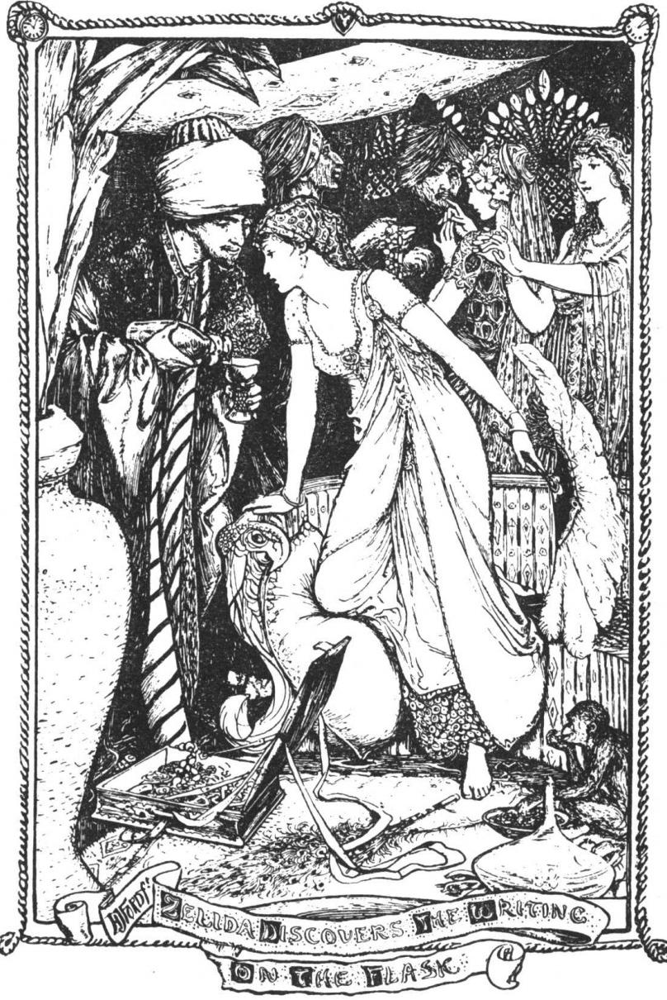

“‘瞧瞧，你们这些可怜的家伙！’苏米边跑边说，‘这就是你们的父亲教你们干的吗？今天早晨，我翻开父亲留给我的那本法典，看见你，伊扎夫，正准备把你的爱情献给泽丽达，这种被诅咒的爱情总有一天会毁了你的，别以为我对这事会袖手旁观，视而不见，是我写了那张纸条，并贴在酒瓶上，才阻止了泽丽达喝下这爱酒。至于你们，’苏米又转身对我的两个哥哥说道，‘你们也许还不会意识到这两只表将要你们付出多大的代价！不过现在你们得明白，你们今后的日子可不好过啊。’”

“说着，她拿出那本她父亲莫伊泽斯写的法典，指着其中的几行字对我们说道：‘如果在午夜时分，用一把金钥匙和一把银钥匙分别给两只表上好发条，她们就会在每天的第一个小时里变回到原来的模样，有个女人将会永远照看她们，无论她们身在何处，总会回到这个女人的身边，这个女人就是莫伊泽斯的女儿。’”

“我的两个哥哥看到自己得不到那两只表，很恼火，可他们又毫无办法，他们把那两只表交给苏米后就离开了。而我则出于好奇，留了下来，想看个究竟。”

“夜幕降临后，苏米替两只表都上了发条，当钟声敲过十二下后，阿洛拉和她的妹妹阿琴坦出现了。她们显然还不明白发生了什么事情，还以为自己是刚刚睡醒。但当苏米使她们明白了她们身上到底发生了什么事情后，她们俩都绝望地哭泣起来。苏米向她们保证，永远不抛弃她们，她们才慢慢地平静下来。转眼一小时过去了，钟声敲过一下后，她们又成了两只手表。”

“那一晚，一种难以言表的恐惧感涌上我的心头，我觉得有一种无形的力量正把我朝一个我一无所知的方向推去。黎明时，我从床上爬起来，走到街上，遇到了伊泽夫，他也和我一样，有一种恐惧感。我们决定不再在康斯坦丁那波里待下去，我们叫了伊宙夫，一起离开了这城市。不久，我们决定分头行动，为了不让赛洛可的密探发现我们。”

“几天后，我发现自己来到了海边一座旧城堡的门前，有个仆人来回走着，守住这门。我给了他一两件不值钱的珠宝，他就向我透露了许多消息：他在那儿侍候海神巴萨的儿子，那时，巴萨正在很远的地方打仗。他还告诉我，巴萨的儿子们从小就和赛洛可的女儿们订了婚，还滔滔不绝地向我吹嘘他的主人有多少多少的宝贝。但那时，我的脑子里除了想着美丽的泽丽达外，什么都听不进去，而且我坚信，泽丽达也已经爱上了我。”

“为了除掉我的情敌，我决定要绑架巴萨的这个儿子。于是，我学着疯子的样子，又是唱又是跳，并让仆人去把那男孩子叫出来看我的表演。他同意了，把男孩子带到了门前，他们俩看着我丑态百出的表演，笑得前俯后仰，直到眼泪都流了出来，甚至还要模仿我的样子。那时，我称自己渴了，求那仆人去替我拿些水来喝，等他一走，我就哄着那男孩，让他把头巾脱下来，这样可以凉快些。男孩愉快地答应了，于是一眨眼的工夫，他就变成了一只铜壶。这时，传来了仆人的叫喊声，我意识到已经没有时间了，便抱起那只铜壶，飞奔而去。”

“至于那个铜壶后来怎么样了，大人，我想你已经很清楚了。我只知道当我一觉醒来时，铜壶已消失得无影无踪，而我感到欣慰的是，我发现我的两个哥哥正在离我不远处呼呼大睡。我赶紧走上前去问他们道：‘你们是怎么到这儿来的？我们分手后，你们都干了些什么？’”

“‘哎！’伊宙夫回答道：‘我们经过路边的一个小客栈时；听见里面传来阵阵歌声和说笑声，于是我们俩便稀里糊涂地走了进去。有几个漂亮姑娘正在为一群人跳舞取乐，这群人不仅对我们很客气，还让我们和两个长得最美丽的姑娘坐在一起。我们玩得快活极了，不知过了多久，其中一个姑娘对身边的姐姐说：他们俩的弟弟会跳舞，他们俩也得来跳舞。她说这话是什么意思我不明白，也许你能给我们解释一下？’”

“‘我当然明白她们指的是什么，’我回答道，‘她们是指我绑架海神巴萨的儿子那天，曾在他面前跳过舞。’”

“‘也许你说得对，’伊宙夫接着说道，‘那两个姑娘拉着我们的手和我们跳了好久，直到我们精疲力尽为止。我们又回到桌边，喝了许多酒，不久就醉了。当时，我们的头脑乱极了，当那群人围上来，威胁要杀了我们时，我们毫无抵抗力。他们抢走了我们身上所有的东西，包括那最值钱的东西——赛洛可女儿的两枚戒指。’”

“这时我们三个都不知如何是好，于是我们只好一起回到了康斯坦丁那波里找苏米帮忙。此时，苏米已从她父亲的那本法典中得知了我们的遭遇，心地善良的她正为我们伤心流泪。但她自己也不富裕，没能给我们太多的帮助。最后，我建议每天早晨，我们把那块由阿琴坦变的银表卖了，只要她没有被上发条，每天晚上她都会自动回到苏米这儿来的。苏米答应了，但她同时提出，如果不知道买主的住处，就不能把这表卖掉。因为知道了买主的地址，她就能把阿洛拉变的那只表也带到那儿去。这样，万一有人在午夜为阿琴坦变的那只表上了发条，而使她变回到原先的模样的话，她就会发现姐姐阿洛拉也在那儿，阿琴坦就不至于感到太孤独了。我们就靠这卖表的钱来维持生活。我们已经这样干了好几个星期了，而那两只手表每天午夜都会准时回到苏米身边来。昨天早晨，伊宙夫把这只银表卖给了这个年轻人。夜里，苏米趁年轻人回来之前把那只金表放在他室外的楼梯上，今天一早，这两只表就又回来了。”

“如果我早知道这事，”宁吉听完后说道，“如果我遇事再冷静些，我就能亲眼看见美丽的阿琴坦了！她的像片是如此楚楚动人，可见她本人一定更美！”

“这不是你的错，”法官说道，“你不是巫师，谁会想到在半夜替表上发条呢？现在我判决，这个犹太人必须把表还给你，而今晚，你可千万别忘了给表上发条。”

“这是不可能的，”伊宙夫回答说，“因为这只表已经又被卖出去了。”

“如果是这样的话，”法官说，“你必须把这个年轻人的三枚金币还给他。”

犹太人看见事情就这么简单地解决了，很高兴，他立刻把手伸进口袋准备掏钱，但宁吉制止了他。

“不，不要，”宁吉说道，“我要的不是钱，而是美丽动人的阿琴坦，没有她，钱再多又有什么意思呢？”

“尊敬的法官大人，”巴萨开口说道，“宁吉说得对，我儿子失去的是无价之宝。”

“巴萨，”法官回答道，“你的智慧远远超过我，这件事就由你来解决吧。”

于是巴萨把所有的人都带回到他的家中，让仆人看着那三个犹太人。

快到家门口时，巴萨看见两个女人并排坐在一张长凳子上，她们用面纱把脸遮得严严实实，而且穿着考究，宽松的绸缎裤子上用银丝绣着花纹，她们身上的穆斯林长袍是用最好的料子做的。其中一个人的手里拿着一只用粉红色的丝绸做成的袋子，开口处用绿丝带扎着，里面好像放着一样活的东西。

看见巴萨走来，两个女人一起站了起来朝他走去。那个拿着袋子的女人对巴萨说道：“尊贵的大人，请你别问这袋子里装的是什么，买下它吧。”

“你要多少钱？”巴萨问道。

“三百个金币，”那人回答说。

听到这话，巴萨嘲弄地哈哈大笑，他没说一个字，继续朝前走去。

“你会后悔的！”那女人又说道，“也许明天我们再来时，你会愿意出四百个金币买下这袋子，到后天，我们就要卖五百个金币了！”

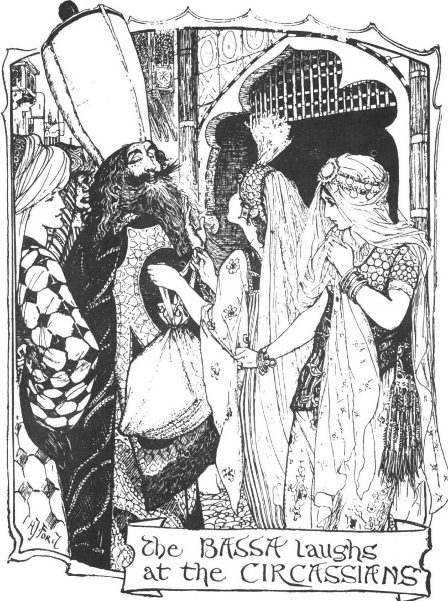

“我们还是走吧！”她的同伴拉着她的衣袖说，“我们得赶快离开这儿了，否则我们的秘密就会被发现，”说着，她俩就消失了。

大家跟着巴萨走进屋子，三个犹太人被留在前厅，由仆人们照看着。宁吉和苏米跟着巴萨来到里屋，这里被装饰得富丽堂皇，在一间灯火通明的大房间尽头，一个三十五岁左右的女人斜躺在一张长沙发上，虽然一脸愁容，可她仍然十分美丽。

“亲爱的赞白克，”巴萨边向她走去，边说道，“感谢真主，你日思夜想的儿子现在终于又回到我们身边来了！”还没等母亲张开双臂拥抱她的儿子，宁吉已经跪在她的跟前。

“让我们来好好庆贺一番，”巴萨说，“快把这好消息告诉我们的另两个儿子伊伯拉罕和海山，让他们来拥抱他们的兄弟吧！”

“噢，现在还不行！”赞白克说道，“难道你忘了现在正是他们赎罪的时间吗？海山正用他的眼泪洗他的手，而伊伯拉罕正在拾他那条珊瑚项链的珠子呢。”

“那就让他们去赎他们的罪吧，”巴萨答道，“等到晚上再去告诉他们这好消息。”

“请原谅，大人，”苏米好奇地问道，“这到底是怎么回事？请告诉我，也许我的那本法典会对你们有所帮助的。”

“苏米，”巴萨说道，“请跟我来，只要你亲眼看一看我那两个可怜的儿子，就能体会到我们的伤心了。”

巴萨从沙发上站了起来，边往里走，边撩开层层门帘，最后来到一个大厅，宁吉和苏米紧随其后。在那儿，他们看见两个年轻人，一个大约有十七岁，另一个十九岁左右。较年轻的那个坐在一张桌前，他的前额就枕在他的右手上，他正用自己的泪水洗那只手。他发现父亲走了进来，就把头抬了起来，这时宁吉和苏米看见他的右手是黑色的。

而另一个年轻人正忙着拾撒了一地的珊瑚珠子，他拾起珠子，把它们放在他兄弟坐着的那张桌子上。当他拾满九十八颗珠子，以为都已经拣起来了的时候，这些珠子又突然滚到地上，撒了一地，于是他又不得不重新去拣。

“你们看，”巴萨低声说道，“每天整整三小时，一个就这么不停地拾珠子，而另一个则以泪洗手，我怎么也弄不明白，我的这两个儿子怎么会如此不幸。”

“我们还是先离开这儿吧，”苏米说道，“我们在这儿会增加他们的痛苦，让我回去把那本法典拿来，我想它一定会告诉我们，他们的病是怎么回事，而且一定还会有治疗他们的方法。”

巴萨十分赞成苏米的建议，但宁吉却坚决反对，“如果苏米不在，”他对父亲说道，“那么今晚当我心爱的阿琴坦和她的姐姐阿洛拉回来时，我就无法见到她的模样了，如果我无法看见她，那么生活对我来说也将是黯淡无光的。”

“你别着急，”苏米对宁吉说道，“我在太阳下山前一定会赶回来的，我保证，我把心爱的伊扎夫留在这儿让你们看着。”

苏米刚走，一个上了年纪的女仆就来到了三个犹太人躺着的大厅，她身后跟着个男人，那个人华丽的穿着，使宁吉没有认出他来。实际上，这个人就是两天前与他共进晚餐的那个人。不过宁吉倒是一下就认出了那个女仆，她就是泽丽达的女仆。

宁吉快步向这两个人走去，可还没等他来得及开口，那个女仆就转身对后面的男人说道：“大人，就是这三个人，我从法官那里跟踪他们到这儿，绝对错不了，现在就由您来处置吧。”

听着这些话，那个男人气得满脸通红，他一下子从腰间拔出剑，直冲那三个犹太人而去，宁吉和巴萨的仆人们赶紧上前制止了他。

“你想干什么？”宁吉大声喝斥道：“竟敢刺杀这几个人，要知道，他们是受到海神巴萨的保护的！”

“噢，我的孩子，”那男人说道，“如果巴萨知道这三个恶棍夺走了我最珍爱的东西，他一定会撤回他的保护的，巴萨对他们一点儿也不了解，就像他不了解你一样。”

“可现在，他对我已十分了解了，”宁吉回答道，“他已经认出我是他的亲生儿子。请跟我来，我们一起去见他。”

那男人跟着宁吉穿过门帘，来到里屋。令宁吉大吃一惊的是，他看见父亲笑着朝那男人走去，亲热地和他握手。

“太好了，真是你吗，赛洛可？”巴萨笑着说道，“我还以为你在那场可怕的战争中阵亡了呢，可你的眼睛里为什么还燃烧着愤怒之火呢？还是先冷静一下吧，告诉我，究竟发生了什么事？看我能不能帮助你。瞧，我已经找到了我的儿子，或许这预示着你的幸福也将来临。”

“我没料到，”赛洛可说道，“你日夜思念的儿子已经回到了你的身边。我曾做过一个梦，在梦中，我见到了真主，他浑身上下发着光，他告诉我，‘明天，太阳下山时，你到加拉塔的大门边去，在那儿你会遇到一个年轻人，你必须把他带回家去，他是你的老朋友海神巴萨的二儿子，你必须把你的手伸到他的头巾里去，在那里你会摸到一个硬盘，上面用七种文字刻着我的名字。’”

“我就照着他说的去做了，”赛洛可继续说道，“我发现这个年轻人长得英俊潇洒，而且很有教养，于是我设计让他爱上了阿琴坦，我给他看了阿琴坦的像片。正当我欣赏着自己促成的这件美事，而想把他立刻送回你身边的时候，一不小心把几滴爱酒滴到了桌上，当时一股浓烟冒了出来，弄得我什么都看不见了。等到浓烟散尽时，你的儿子已经跑得无影无踪了。今天早晨，我的仆人跑来告诉我，说她找到了那几个拐走我女儿的坏蛋，所以我立刻赶到这儿来找他们算账。没想到你的儿子已经回到了你的身边。现在，我一切都听从你的安排。”

“真主会保佑我们的，我保证，”巴萨说道，“我保证你的两个女儿一定会安全的，现在让我们祈祷，让泽丽达早日回到我们这儿来。”

这时，从门口传来一阵瑟瑟声，伊伯拉罕和海山出现在门前，他们已经完成了每天必须的赎罪，跑来和他们的兄弟亲热地拥抱。宁吉和海山都喝过爱酒，所以心中都只想着心爱的姑娘。而当伊伯拉罕听说莫伊泽斯的女儿正去取一本法典，里面有可以使他解除每日拾珊瑚珠之苦的方法时，真是喜出望外。

几小时后，苏米带着那本法典回到了巴萨的住处。

“看，”她指着书中的一段向海山念道：“关于你的事写在这儿。”于是，她弯着腰用希伯来语读了起来：“他的右手由于接触了一种不干净的动物的脂肪而变得如同乌木般的黑，直到最后一只这种动物沉到海底，他的手才会变白。”

“噢，我想起来了！”海山说道，“一天，母亲的仆人正在做蛋糕，她叫我别去碰那蛋糕，因为它是用猪油做的，但我没有听她的话，于是顷刻间我的手就变成了现在的样子。”

“真不可思议！”巴萨说道，“教士说得一点儿也不错，我的儿子在你送给他手镯后没有听从你的忠告，所以受到了如此的惩罚。可再请你告诉我，苏米，我在哪儿才能找到那最后一只给我儿子带来厄运的该死的动物呢？”

“这个写在这儿，”苏米翻过几页答道，“那只小黑猪被装在一只粉红色的袋子里，有两个女人拎着这只袋子。”

听到这里，巴萨绝望地跌坐在沙发上。

“哎，”巴萨叹息道，“今天早晨，有两个女人让我出三百个金币买下那袋子。那两个女人一定就是和伊泽夫、伊宙夫跳舞并把他们灌醉的女人，她们还偷走了赛洛可女儿的两枚戒指。只有她们才能使我们的孩子摆脱厄运，快派人去找她们俩，我愿意把我所有的财富分一半给她们。我真愚蠢，把她们俩放走了！”

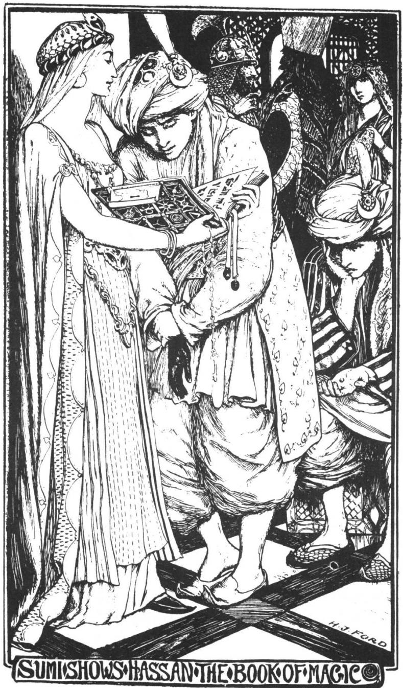

正当巴萨为自己的愚蠢行为而后悔莫及时，伊伯拉罕急着把法典翻到了他的那一页，当他读完后，脸胀得通红，那上面是这么写的：“那颗念珠是在一个叫‘奇数和偶数’的游戏中丢失的，念珠的主人试图在游戏中作弊，偷偷地藏掉了一颗珠子。作为惩罚，这个不诚实的人将会因为找不到这颗念珠而烦恼一辈子。”

“天哪！”伊伯拉罕说道，“我记起来了，那天我和阿洛拉在一起玩时，不小心扯断了那条珊瑚珠项链，我数了一下，这条项链共有九十九颗珠子，我让阿洛拉猜项链上珠子的数目是奇数还是偶数，她猜是奇数，为了不让她赢，我故意藏掉了一颗珠子，自从那天起，我每天都在找这颗珠子，可就是从未找到过。”

“一点儿不错，”巴萨说道，“自从那串神奇的珊瑚项链断了以后，我的儿子就天天在赎罪。但那书上一定也说了使他摆脱困境的方法吧。”

“听着，”苏米说道，“这儿写着：‘那颗珠子就在一条黄色织锦裙子的第五个褶子里’。”

“这可真是太好了！”巴萨说道，“我们很快就能见到阿洛拉，伊伯拉罕就能在她的那条黄色织锦裙子的第五个褶子里找到那颗珠子，那书上说的那条裙子一定就是指她穿的那条。”

苏米刚合上那本书，泽丽达忽然带着一大群仆人赶来了。海山一见到泽丽达真是欣喜若狂，他立刻跑在她跟前，吻她的手。

“父亲大人，”海山对巴萨说道，“即使没喝那爱酒，我也一样会爱上她的，请准许我们立刻结婚吧！”

“我的孩子，你是疯了吗？”巴萨问道，“你的两个哥哥尚未得到幸福，你一个人会感到快乐吗？况且你的手还是黑色的，有谁听说过黑手新郎吗？再耐心地等一下，孩子，让我找到那头小黑猪，把它沉到海底，这样你的手就会恢复原样了。”

“你父亲说得对，亲爱的海山，”泽丽达说，“等我的两个姐姐回到原来的模样，到那时，我们会比现在幸福十倍。现在，我带来了那瓶神奇的爱酒，这样等她们变回原来的样子时，也可以让她们喝下这酒，那样，她们就会和我们一样幸福。”说着泽丽达把那瓶酒交给了巴萨。

赞白克对泽丽达的到来十分高兴，她亲切地拥抱了泽丽达。接着，赞白克把所有的朋友都请到了花园里，大家坐在芳香迷人的茉莉树旁。但他们刚坐定下来，从墙的另一侧传来一个男人怒气冲冲的声音，使他们大为惊讶。

“忘恩负义的女人们！”那声音说道，“你们就这么对待我吗？让我永远躲在这儿！这洞对我来说已经不够黑不够深了！”

接着又传来一阵嘲笑声，那声音继续说道：“我究竟做了什么要受到如此冷遇？是我使你们变得美丽了，难道你们就这么待我吗？是我替你们弄到了那头小黑猪，它一定会给你们带来好运的，可你们就这么来报答我吗？”

听到这些话，人们都好奇地围了过来，巴萨则命令仆人们立刻把墙推倒。可墙是推倒了，却没有找到那个说话的男人，只见到了两个光彩照人的女子，快乐地在一个斜坡上跳舞。有个老仆人和她们在一起，巴萨认出了他就是古卢库，那个原先照看宁吉的人。

古卢库看见巴萨，吓得缩成一团，因为他知道是由于自己的失职才使宁吉被拐走了。但巴萨原谅了他，并问他从悬崖上摔下去后，是怎么死里逃生的。古卢库说他是被一个教士救起，那教士还替他治好了伤，并让他做那两个在跳舞的女子的仆人，直到如今。

“但是，”巴萨问道，“刚才有个男人的声音提到的小黑猪在哪儿呢？”

“大人，”一个女人回答道，“当您下令把墙推倒时，那个男人害怕极了，所以他拎起那只小黑猪就跑了。”

“赶快派人去把他追回来！”巴萨大叫道，但那两个女人只是在一旁暗笑。

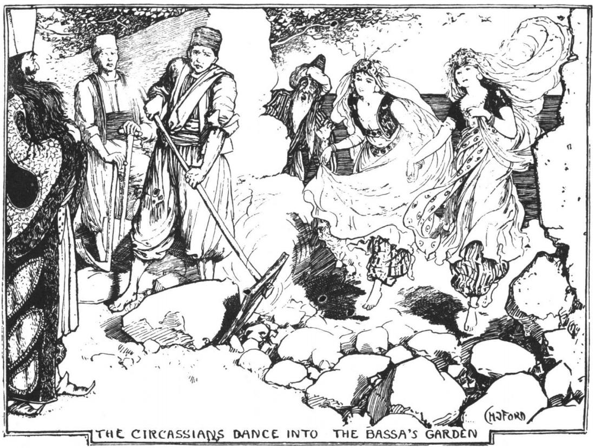

“别着急，大人。”其中的一个说道，“他一定会回来的，只需派人守住那洞口，这样，只要他一回来，就再也跑不掉了。”

这时，天色已暗了下来，所有的人都回到了巴萨的寓所，那里放着各色水果点心。巴萨命人去把那三个犹太人带来，以便让他们确认一下，那两个女的是否就是在小客栈逼着他们两兄弟跳舞的人。但巴萨没有料到当他命令仆人们去推倒那堵墙时，三个犹太人已经逃之夭夭了。为此，巴萨大为恼火。

听到这消息，苏米脸色发白，但当她看了那本法典后，舒心地笑了，说道：“不用着急，他们三个会把那个男人带回来的。”这时海山不无惋惜地说道：“真是好事多磨啊。”

这时巴萨的一个侍从突然大笑着插话道：“有得必有失，大人，别着急，事情马上会有分晓的。”

巴萨觉得他这么随便插话，非常失礼，便命令他立刻离开这儿，并且没有他的同意不许再回来。

“遵命，大人，”侍从说道，“可我敢肯定，等我再回到这儿的时候，你一定会非常欢迎我回来的。”说着，便扬长而去。

过了一阵子，宁吉对身边的两位女士说道：“我的兄弟们和我爱上了三个非常美丽的女子，但她们中的两个受到咒语的折磨而变成了两只表。如果你们两个遇到这种情况，难道不希望别人尽力使你们恢复原貌，重获幸福和自由吗？”

然而，宁吉的话反而使那两个女人愤怒起来。“你说什么？”其中的一个说道，“你竟然把她们的不幸归罪于我们？命运已经夺走了我们的心上人，如果说这是我们的错，那么世界上所有的人都将遭受到我们的痛苦！”

她们的这些话令在场所有的人都大吃一惊，巴萨请她把她们的遭遇说出来。得到姐姐的同意之后，那个小的开始说道……

 

## 色卡西亚少女的故事

我们出生在穷人居住的色卡西亚地方，我姐姐的名字叫特丝娜，我的名字叫黛丽。从小我们在自己的美貌的帮助下，一直在欢乐和各种成就感中长大。我们都天资聪颖，从小就会弹奏各种乐器、会唱歌，而且还会跳舞呢。我们幸福愉快、无忧无虑，完全没想到会有今天的这种苦楚。

我们都很知足，安于家里的生活。但是，有一天早晨，为苏丹王寻找妃子的官员们看到了我们，并被我们的美丽惊呆了。我们对这类事已习以为常。当我们回家的时候，恰巧看到两个年轻男人走进了我们的屋子。年纪大的那个约莫有二十岁，长着满头黑发和一对明亮的眼睛。年轻的那个最多不过十五岁，他长得那么美丽，以致人们很容易把他当成女孩子。

他们怯生生地敲了门，并对我们的父母说他们迷了路，请求给他们一块安身之地。父母亲略微犹豫后还是答应了他们的要求，并把他们请进了我们的房间。如果说是他们的美貌打动了我们父母的心，那么我们的心也不是铁打的，因此我们原先安排的第二天离家去皇宫的事，突然变得让我们难以忍受。

黑夜来临了。我从睡梦中醒来，发现那两个陌生人中年轻的那个正坐在我们床边，他正握着我的手。

“别害怕，可爱的黛丽，”他悄声说，“我在看到你以前一直不知道什么是爱情。我是德里克王子，是黑大理石岛国王的儿子。同我一起来的我的朋友是我们国家中最有钱的贵族之一，他所知道的秘密连苏丹王也感到嫉妒。因为我父亲要我娶一个虽然极漂亮但却是一只眼比另一只眼略小的姑娘，我们就因此离开了自己的国家。”

我的虚荣心得到了满足，迅速地被征服了，这年轻人表达自己的热情的方法也迷住了我。我的眼睛慢慢地转到他身上，我满含热情的目光使他几乎失去知觉。他迷迷糊糊地向前倒下来，弄得我动都不能动，直到特丝娜急忙穿上衣服，与王子提到的年轻贵族塞拉米斯一起赶过来帮我。

我们一恢复常态就开始哀叹自己命运不好，并谈及第二天我们要去康斯坦丁那波里的旅行。当塞拉米斯向我们保证，他与王子将随后赶来，并设法能与我们说上话时，我们才稍稍得到了一点安慰。接着他们都亲吻了我们的手，并由旁边的一条路离开了屋子。

过了一阵子，父母亲来告诉我们，护送我们的人已到。于是我们告别了父母，登上了安在骆驼边上的轿厢里。这些轿厢很大，我们在里面可以舒服地睡觉。轿厢的上部有一个窗口，透过这个窗口我们还能看到沿路乡村的景色。

我们一直走了几天，对未来我们可能遇到什么感到又担心又焦急。终于有一天，当我从我们轿厢的窗口望出去时，我听到有人叫我的名字，并看到从我们骆驼的另一边的一个轿厢里跳出一个穿着十分漂亮的女孩。我一眼就看出他就是那个王子，我的心高兴得快要跳出来了。王子说，把他打扮成这样是塞拉米斯的主意，而塞拉米斯自己则假扮成一个正在把这个漂亮无比的少女送给苏丹王作礼物的奴隶贩子的角色。塞拉米斯还说服了管骆驼车队的主管让他租了这个空的轿厢，这样王子就很容易爬出他自己的窗口来接近我们。

这条聪明的计策迷住了我们，但我们之间愉快的谈话不久就被随从们打断，因为他们感到骆驼走路的样子很怪，于是就跑上前来看个究竟。幸好他们动作慢，王子刚好能及时退回自己的轿厢，骆驼恢复了平衡，这计策才没有被发现。

但王子和他的朋友都不想让我们进苏丹王宫，虽然在当时的情形下，很难知道我们怎样才能逃脱，以及一旦我们真的逃出来后又怎么办。最后，当我们已经接近康斯坦丁那波里的一天，王子告诉我们：塞拉米斯已与他在路上遇到的一个圣僧搞得很熟，塞拉米斯告诉他，我们是他的妹妹，我们被当作奴隶卖了，这与他的意愿相违背。圣僧对这件事很有兴趣，他很快就答应，如果我们能逃出卫兵的严密看守，他就为我们找藏身之处。这样做有很大的危险，但这是我们唯一的机会。

那天晚上，当全队的人都睡熟后，我们拉开了轿厢的上盖，在塞拉米斯的帮助下悄悄地爬了出来。接着我们沿着来路走了一段路，又拐入了另一条路，最后终于到达僧人为我们准备的藏身之处。那里有吃的东西，还有休息的地方。能够再次获得自由真是别提多高兴了。

那个僧人不久就做了我们美貌的奴隶。我们逃出来后的第二天，他建议再带我们去不远处的一家旅馆，那里有两个犹太人，他们掌握着并不属于他们的极宝贵的符咒。那僧人要我们设法把这些符咒弄到手。

那座旅馆虽然不在通往康斯坦丁那波里的正路上，却因为那里的饭菜好而受到了商人们的喜爱。我们到达那里后发现，在那里吃饭的至少还有另外六个或八个人。他们礼貌地向我们问好，我们一起坐到了饭桌前。

一会儿，僧人说的那两个人进来了。在僧人的示意下，我姐姐在她边上为一个人让出了位子，而我则为另一个人让了位子。

那时，僧人已提起过“他们的兄弟已经跳过舞了。”开始我们对这句话没在意，但现在我们又想起这句话时，就确定他们也要跳舞。为达这个目的我们使出了全身的本领，不久这两人就对我们言听计从了。末了我们搞到了符咒，而那两个犹太人则让他们听天由命去了。王子和塞拉米斯更爱我们了，他们声称我们比世界上的任何女人都可爱。

太阳下山后我们离开了旅馆，我们一点都不知道接着该去哪里，所以我们马上同意了王子的建议：应毫不迟延地登上黑大理石岛。多漂亮的地方啊！比黑玉还黑的岩石在海边层层叠叠地堆集起来，使黑色映照到这个岛国的四方。我们的水手以前也没来过这里，因而也像我们一样感到惊奇，幸好有塞拉米斯作向导，我们才在海滩上安全登陆。

当我们走进岛内，把黑大理石围成的海岸远远抛在后面的时候，我们发现这个国家的田野更绿、河水更清，太阳也比别处更亮。人民围上前来欢迎他们的王子。他们极其热爱王子，但他们告诉王子，国王还在为他不愿娶他的堂妹奥金珮尔公主为妻以及为他的出逃而怒气冲天。他们都请求他不要进首都，否则他的生命会很不安全。因此，虽然我很想看看我亲爱的王子的家的样子，我还是极力恳求他听从众人的劝告，我们一起去位于一片大森林中的塞拉米斯的宫殿。

对于在农舍中长大的姐姐和我来说，塞拉米斯的这所房屋简直像仙境。这所房屋用粉红色的大理石建成，大理石表面打磨得极为光滑，以致它像镜子一样映出了屋子四周的花朵和河流。为了配合我的一头黑发，其中一套房间特别为我用黄色的丝绸和银子装饰起来。我们每天都有新衣服穿，还有奴隶侍候我们。唉，这种幸福的日子为什么不能永远持续下去呢！

我们平静的生活因为塞拉米斯对我姐姐的嫉妒而发生了麻烦。虽然塞拉米斯很清楚地知道王子的心是属于我的，但他一看到我姐姐与王子友好相处就不能忍受。每天我们都会有一些温和的指责，然后就会有许多解释，但是特丝娜的眼泪总是能让塞拉米斯跪下请求宽恕。

我们就这样过了几个月，直到有一天传来了国王病重的消息。我请求王子立刻赶回皇宫去，一方面是去看望他父王，另一方面也要会见议员和贵族们。但由于王子对我的爱超过了他对皇冠的渴望，他老是犹豫着，好像预见到了后来发生的各种事情。最后，特丝娜当着塞拉米斯的面严肃地与王子谈了一次，王子才下定决心去，但他答应他会在天黑前回来。

天黑了，王子没有回来。特丝娜焦急万分，因为王子是听了她的话才回去的。特丝娜的不安一下子又唤醒了塞拉米斯的嫉妒。而我则更是说不出有多难受。我难以入睡，就从床上爬起来，沿着王子几小时前走过的路漫步走入林中。忽然我听到远处传来马蹄的声音，不多会儿，王子就在我身边跳下马来。“啊！我多么崇拜你！”他叫道，“塞拉米斯的爱的程度永远也比不上我的爱。”他的话刚出口，我就听到后面有轻轻的声响，没等我们转过身来，我们两颗头就滚落到自己面前，而塞拉米斯的声音则叫起来：

“发假誓的骗子，回答我！还有你，背信的特丝娜，告诉我你们为什么要这样背叛我！”

这时我才明白发生了什么，塞拉米斯在暴怒中把我错当作我姐姐了。

“天啊，”我的头用虚弱的声音回答道，“我不是特丝娜，我是黛丽，你毁掉了我的生命，也毁掉了你朋友的性命。”听到这里，塞拉米斯停了一下，似乎认真地想了一下。

“别害怕，”他平静了一些说，“我能让你们恢复原样。”他把一些魔粉撒在我们的舌头上，并把我们的头放到脖子上。一眨眼的工夫我们的头就和身子连到了一起，一点疤痕都没有。只是塞拉米斯还受着他暴怒情绪的影响，他竟错把我的头安到了王子身上，而把王子的头错安到了我的身上了。

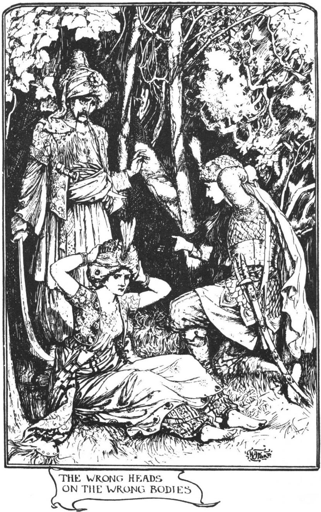

我无法向你们解释我们两个对这种奇怪的变化感到多么怪。我们两人都本能地伸出手去摸自己的头。王子摸到他的头发当然是梳着女人的头发，而我则碰到了沉重地压在我额上的男子头巾。但我们都不知道自己发生了什么，因为夜色还很黑很黑。

这时特丝娜出现了，后面跟着一群拿着鲜花的奴隶。在他们拿着的火把照耀下，我们才明白发生了什么。确实我们先想到的是，我们换错了衣服。

在这种情况下，不管我们还能说什么，我们都还是喜欢自己的身体而不喜欢别人的身体，所以尽管我们互相爱着对方，我们开头还是不能不生塞拉米斯的气。但王子对我的爱是那么深，以致不久他竟对自己的这种改变感到庆幸。“我感到一种完美的幸福，”他说，“美丽的黛丽，我的心永远是你的，而我也有了你的头。”

但是虽然王子做了最大努力，塞拉米斯还是对自己的愚蠢行为感到十分害臊。“我还有另外两副魔药，”他迟迟疑疑地说，“它们与我已用过的魔药有同样的奇效。让我再把你们的头切下来，这样就可以把事情弄对的。”这建议对我们很有吸引力，但还是有些危险。经过一起商量，我们决定还是就这样不改算了。“如果你们不接受我的提议，”塞拉米斯接着说，“就别再指责我了。但你们还是带着这两副魔药，如果万一你们的头再次被砍下来，就照我做过的那样做，这样每个人的头就又可以长在自己的身上了。”说着他把那两副魔药给了我们，我们一起都回了城堡。

然而这不幸的换头造成的麻烦还刚刚开始。我的头带着王子的身子进了我的套房而不知它干了什么，而我的仆人们则因为看到我的外衣，就说我走错了路，并叫来一些奴隶带我到王子的房间里去。这可真够糟的，但当我的仆人为我脱衣——因为那时还是夜晚——我简直惊慌得晕了过去。毫无疑问，王子的头在城堡的另一边也正在受着同样的苦恼。

到了第二天早晨——你很容易猜到我们只睡了一小会儿——我们慢慢地有些习惯于这种奇怪的情形了。在我们照镜子时，王子变成了黄皮肤、黑头发，而我的头上则盖着一片金黄色的卷发。自从过了那第一天，宫里的人对这个变化都已习惯，他们甚至不再去想它。

几个星期后，我们听说黑大理石岛的国王死了。王子的头上——那个头曾经是我的头——充满了雄心勃勃的愿望，他渴望能马上骑马直到首都去宣布自己继承王位。但是那时，那些贵族们能否认出这个长在女子身上的王子就成了一个问题，而且，当我们再进一步想想时，我们自己也难以弄明白到底谁是王子，谁该是女孩？

经过好久的争论，终于我的头获得了胜利，我们出发了。但我们到达皇宫时，却发现国王已宣布奥金珮尔公主为他的继承人。大多数议员和贵族们都公开表示他们更愿由合法的王储继位，但他们既认不出王子是王子，也认不出我是王子，反而把我们当作骗子而投入了监狱。

几天以后，跟随我们到首都来的特丝娜和塞拉米斯来告诉我们，新女王已指控我们犯了严重的叛逆罪，还亲自参加了对我们的审判，而我们自己在审判时反而不在场。他们对我们将被判什么刑极为恐慌，但由于极罕有的侥幸我们被判了砍头。

我告诉我姐姐，我实在看不出我们有什么地方是侥幸的，但塞拉米斯粗暴地打断了我：

“什么！”他叫道，“我当然会用我的魔药，而且——”但这时行刑官已经到了，他把我们带到大广场，死刑将在那里施行，奥金珮尔已决定行刑不能有任何延误。

广场上挤满了老老少少各种职业的人们，广场中间搭了一个高台，上面竖起了断头架，行刑官戴着黑面具站在旁边。在行刑官的要求下我先上了断头架，只一会儿工夫我的头就滚到了他的脚下。我姐姐和塞拉米斯就站在我旁边的边界外，塞拉米斯以快如闪电的速度夺下了行刑官手中的军刀，一刀割下了王子的头，大家还没有来得及从这一系列奇怪的事件的惊愕中回过神来，我和王子的头和身子就已正确地接在一起，魔药也放到了我们舌上。接着塞拉米斯领着王子走到高台边上，把王子指给老百姓看，“快看看你们合法的国王吧！”

塞拉米斯话音刚落，欢呼声已冲上了云霄，并传到了皇宫中奥金珮尔的耳中。在这消息的沉重打击下，奥金珮尔绝望地昏倒在阳台上，并被奴隶们带回了她自己的屋子。

与此同时我们的幸福完全变成了悲哀。我急急地跑到王子面前，亲热地拥抱他，而他却突然脸色苍白，浑身摇晃起来。

“我死也忠心于你，”他低语着，眼睛转过来望着我，“我是当了国王死的！”他的头倚在我的肩上，静静地死去了，因为他颈部的一根动脉被割穿了。

我自己也不知道自己在干什么，就跌跌撞撞地奔向靠近我的地上放着的军刀。我要随我亲爱的王子而去，而且越快越好。这时，塞拉米斯抓住了我的手（他刚来得及赶到），在疯狂中我把军刀转向了他，军刀刺穿了他的心脏，他倒在我的脚下。

所有的人都屏着气息，全神贯注地听着这个故事。这时已很清楚，黛丽再也讲不下去了，而特丝娜则把自己埋在一堆垫子里，把脸掩盖起来。赞白克令她的仆人们尽一切可能照料她们，并希望把她们带到自己的房间里。

当这两姐妹处于这种昏迷的状态中时，伊伯拉罕这个非常精明的年轻人向他父母建议，由于这两个色卡西亚少女都失去了知觉，这是搜她们一下的极好机会，看看本来属于赛洛可女儿的符咒是否藏在她们身上。但巴萨对这样不礼貌地对待客人的想法非常震惊，他坚决拒绝这样做，并说他希望第二天他能说服她们自动拿出这些符咒。

这时已经快到半夜了。宁吉站在靠近犹太女人苏米的地方，他抽出了阿琴坦的画像，当他听说阿琴坦本人比她的画像要漂亮得多时，他高兴极了。每个人都踮起了脚尖，等待着赛洛可的两个女儿因为着了魔法而变成的两只表。人们期待着当钟敲十二点时，这两只表会变回赛洛可的两个女儿并来寻找苏米。那时巴萨会毫不迟延地命令把所有的门完全敞开。门确实打开了，但人们却没有见盼望许久的两只表，反而见到了刚才被不光彩地打发出去的听差阿泽米。

这时巴萨发怒了。“阿泽米，”他叫道，“我不是命令你，当我在这儿的时候不要站在这儿吗？”

“我的主人，”阿泽米谦恭地答道，“我刚才藏在门外边，听了那两个色卡西亚少女的故事。我知道你很喜欢听故事，让我给你讲个故事吧，我保证这个故事不会太长。”

“说吧，”巴萨回答道，“但你要注意你说的内容。”

“我的主人，”阿泽米开始说，“今天早上我走在镇上的时候，看到有一个男人在与我相同的方向上走着，后面跟着一个奴隶。他进了一家面包店，在那里买了一些面包，让奴隶拿着。我看着他，看到他又到其他地方买了好多其他的食品。当奴隶再也拿不了时，他就令奴隶先回家，并让他在半夜时准备好晚餐。”

“当只剩下一个人时，这人拐上了一条街道，走进了一家珠宝店，他带出来一只表，据我所能看见这表是一只银表。他又走了几步，然后弯下腰去，从脚边捡起了一只金表。这时我走上去向他说，如果他不给我这只金表的一半价钱，我就把这件事告诉那个法官。他同意了，并把我带到他的屋里，他拿出四百金币，说这是我的那一份。我得到了我想要的东西后就离开了。”

“因为已经到了侍候主人的时候了，我就回到家，并陪伴您到了法官那里。在那里我听到了关于三个犹太人的故事并了解到了那两只表的重要性。我急忙又赶回他的屋子，但他已经出去了，我只找到了那个奴隶。我告诉那个奴隶，我有重要的事要找他的主人。这奴隶相信了我是他主人的朋友，就请我等他一下，并把我带入一间房间。在那里我看到桌上放着两只表。我把它们装进口袋里，并在那放金表的地方留下了四百个金币，在那放银表的地方留下了三张金叶，我知道这就是银表的价值。你们知道这表是永远不会留在买主手中的，所以这人应该为收回自己的钱而感到很幸运。我把这两只表都包了起来，现在这两只表已变回了阿洛拉和阿琴坦，并被安全地锁在了我自己的房间。”

每个人听到这个消息都高兴极了，阿泽米因他们的拥抱几乎透不过气来。大家费了极大的劲才阻止了宁吉跑过去破门而入，虽然宁吉甚至并不知道阿泽米的房间在哪里。

但阿泽米请求让他自己有荣耀带回这两个姑娘，他去了后不久就手拉着她们回来了。

有好一段时间，大家都高兴得乱哄哄地，伊伯拉罕就趁此机会跪倒在阿洛拉面前，并伸手到她裙子的第五个褶层中去寻找不见了的珊瑚珠。魔书上说得真对，珊瑚珠就在那儿。现在珊瑚珠串已经完整了，因此这年轻人持续了几年的搜寻工作就告一段落。

在大家欢乐的时候，只有海山一人还在那儿独自愁眉苦脸。

“哎呀！”他说，“每个人都很高兴，只除了你们面前我这个可怜的东西。本来我还有一个兄弟与我同在不幸之中，可现在我连这点仅有的安慰都没有了！”

“放心吧，”巴萨回答道，“或迟或早，那个偷了粉红色口袋的僧人一定会被抓住的。”

这时晚餐送上来了。晚饭后他们吃了据他们看来是世界上最美味的水果。巴萨命令把盛着使人互爱的神药的长颈瓶拿来，年轻人喝了这种神药后眼中都放出热情的火焰，他们都发誓要互相忠实直到最后。

这个仪式直到钟敲一点才结束，眨眼间阿洛拉和阿琴坦已消失了，在她们站的地方放着两块表。所有的人都沉默下来——他们都已忘了这两姐妹还中着魔法。这时人们听到了阿泽米的声音，阿泽米问他可否负责保管这两块表到第二天，他还用自己的头来保证设法解决附在这两姐妹身上的魔法。苏米同意后，人们答应了阿泽米的请求。巴萨给了阿泽米一个钱包，钱包里装着一千金币，作为他已对这两姐妹所作的事情的报酬。这以后，大家都回了自己的房间。

阿泽米从未拥有过如此多的钱，他高兴得整夜都合不上眼。第二天早上他很早就起来，他一边往花园走，一边想着如何才能打破附在赛洛可的两个女儿身上的魔法。突然他听到一个妇人的柔弱的声音。透过灌木丛他看到了特丝娜，她正在整理她妹妹头发上的花朵。树叶的响声使黛丽警觉地跳起来，好像要跑走的样子，但阿泽米请求她留下来，并请求她告诉他，自她们的情人死后，她们都经历了些什么事情，以及她们是怎样来找僧人的。

“女王奥金珮尔判给我们的惩罚是，”黛丽回答道，“她要在我们情人死的那天为她所有的国民举行一个盛大的宴会，而我们必须在悲痛中为她唱歌跳舞。这个残酷的命令几乎让我们气炸了。我们发了重誓一定要让所有的情人都像我们这样悲惨。我们的计划实施得这么有效，以致不久首都的妇女们就一起去向奥金珮尔祈求，要她把我们放逐到王国外去，以免她们的命运会永远悲惨下去。奥金珮尔同意了，她命令将我们和随我们一起的奴隶葛露丝一起带到一艘船上。”

“在海边我们看到一个老人正在忙着把一些小黑猪往水里淹，一边还在对这些小猪不断地说着话，好像这些小猪能听懂一样。”

“‘可恶的畜生！’”他骂道，‘我给了魔手镯的那个人所遭到的不幸都是你们造成的。你们统统去死！’“

“我们感到奇怪，就走近去，认出他就是我们第一次逃出车队时给我们提供庇护所的僧人。”

“当这老人发现我们是谁时，他高兴得不得了，并把他自己住的那个山洞提供给我们作庇护所。我们高兴地接受了他的好意，于是我们都去了山洞，并带着僧人送给我们作礼物的最后一只小猪。”

“‘那个海神巴萨，’他又接着说，‘会付给你们任何你们向他要的东西。’”

“我们没有问这只小猪为什么这么贵重，就把它放入了我的工作袋，并且一直把它放在那里。就在昨天我们才把它送给了巴萨，但巴萨却嘲笑了我们。这使我们对僧人恼怒异常，以致我们趁他熟睡时剪掉了他的胡子，现在他都不敢再出来了。”

“啊，”阿泽米叫起来，“这么美丽的人浪费精力使别人遭遇不幸，这可真不合适。忘了过去的不幸，只想着将来吧。我祈求你接受这只表，以标记那些更美丽的时光。”这么说着，他就把表放到了黛丽的膝上。然后他转向了特丝娜。“你这位美丽的姑娘，请允许我送你这另一块表。确实这只是块银表，但这是我所能给你的所有东西了。而且我十分肯定地感觉到，你一定在什么地方有一张银的印信，那正是配这块表的东西。”

“啊呀，你确实有一张，”黛丽叫道，“把你的银印信系到表上吧，我也会把我的金印信系到我的表上。”

她们拿出了那两张印信，正如阿泽米已经猜到的那样，这两张印信就是这两个色卡西亚少女从伊泽夫和伊宙夫那两个犹太人那里弄到的、刻在金子和银子上的符咒。一眨眼之际，这两块表从特丝娜和她妹妹的手中滑出来，阿洛拉和阿琴坦站在了她们跟前，每人手上都拿着自己的符咒。

起先阿洛拉和阿琴坦被发生的变化和她们已经有很久没见到的阳光弄得有点糊涂了，但当她们逐渐了解到附在她们身上的魔法已经消除时，她们的喜悦简直无法用言语表达。

两位色卡西亚少女一时还难以从损失符咒的难过中恢复过来，但阿洛拉和阿琴坦恳求她们抹去眼泪，因为她们的父亲赛洛可是亚历山大的统治者，他一定会用她们希望的任何方式来报答她们。这个许诺不久就由赛洛可本人兑现了，这时他与巴萨和他的两个儿子来到了花园，他的女儿马上围到了他的身边。只有海山不在场。这时他正在为自己的双手变得乌黑而悲哀地哭泣着。

出乎大家意料的是这时房屋的一角传来了脚步声。海山自己在一群奴隶的簇拥下出现了，他一边拍手一边高喊着，“我正在像以前那样哭泣，”他喊道，“可突然间我的眼里流不出眼泪来了。我再看看我的手，发现黑色已消失得一干二净。现在，可爱的泽丽达，已经没有什么东西能够阻止我把手伸给你了，而我的心早就一直是你的了。”

但是虽然海山从未想到要问一下或要关心一下是什么治好了他的手，别的人可不像他这么漫不经心。很明显那只小黑猪肯定已经死了，但小猪是怎么死的，什么时候死的？结果还是奴隶们回答了这个问题。这天早上，奴隶们看到三个人追着一个男人，这男人曾经在他们守卫的山洞里躲藏过。后来，他们遵守命令推了一块大石头封住了山洞口。

这时刺耳的尖叫声打断了他们的故事。三个犹太人绕过屋角追逐着一个男人，两位色卡西亚少女认出，被追逐的那个人正是老僧人。僧人看到有这么多人聚在一起时，他转向了另一条路。但奴隶们围上去把这四个人都抓了起来，把他们带到了主人面前。

巴萨看到，这个老僧人正是那个把串珠、铜徽章和手镯分别给了他三个儿子的人时，他的惊讶真是无法形容。“别害怕，师父，”他说，“你和我在一起就安全了。但请告诉我们，你是怎么来到这儿的？”

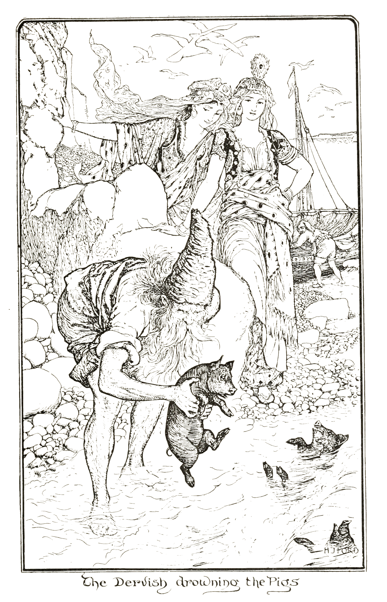

“老爷呀，”僧人解释说，“当我睡着时，我的胡子被这两个色卡西亚少女剪掉后，我就羞于在男人面前露面，于是我就带着那只粉红色的绸袋逃走了。到晚上我偶然遇到了这三个人，我们在一起聊了一阵。但到黎明时分，当光线亮到足以看清各人的脸庞时，他们中的一个人叫起来，说我就是那个与两个偷了犹太人符咒的色卡西亚少女一起旅行的僧人。我跳起来想逃回自己的山洞，但他们跑得太快了，正当我们奔到你们这花园时，他们抓到了那只装着小黑猪的袋子并把它扔进了大海里。由于这一举动解救了你的儿子，我祈求你宽恕他们对你做过的任何错事——这并不过分，你还要为这事补偿他们呢。”

巴萨答应了僧人的要求，当他看到两个犹太人已经被那两个色卡西亚少女的美貌迷住，就同意他们互相结合，并决定她们的婚礼与伊扎夫和苏米的婚礼同时举行。巴萨派人找来了法官，犹太人用他们民族的帽子交换了穆罕默德兄弟们的头巾。这时，经过那么多的不幸，巴萨的三个儿子恳请父亲再也不要推迟他们的幸福，于是就在中午，法官为这六对新人举行了婚礼。

 

## 豺狗和清泉

很久很久以前，几乎所有的小溪和河流都是干枯的，动物们不知到哪儿才能弄到水。它们一起找了许多地方，都没能找到。最后，它们终于发现了一个小小的泉眼，只要再稍稍深挖下去一点，就会有足够的水喝了。于是动物们纷纷议论道：“让我们在这儿挖一口井，这样大家就不会渴死了。”所有的动物除了豺狗，都同意这么做。豺狗很懒，它什么活儿也不想干，总想叫别人替自己干活儿。

动物把井挖好后，它们开了个会讨论由谁来负责看着这口井，不让豺狗靠近它，因为大家都认为：它没有付出劳动，所以也没有资格喝这井里的水。

经过商量，大伙儿最后决定由小白兔留下看着这口井。然后，其他的动物都各自回家去了。

动物们一走，豺狗就来了：“早上好！亲爱的小白兔，早上好！”豺狗殷勤地叫着。小白兔有礼貌地回答道：“早上好！”接着，豺狗打开了背在身上的小背包，从里面拿出一小片蜂窝，朝着小白兔津津有味地吃了起来，还边吃边说道：“你瞧，小白兔，其实我一点儿也不渴，这东西可要比水好吃多了呢！”

“给我尝一点儿。”小白兔说道。于是豺狗给了它很小的一片。

“天哪，真好吃！”小白兔叫道，“再给我一点儿吧，朋友！”

然而，豺狗却回答说：“如果你真想让我再给你一点儿，你就必须仰面朝天，把四只脚都捆在身后，这样，我就可以把蜂蜜倒进你嘴里去了。”

小白兔立刻照着豺狗的话做了，可当小白兔被紧紧捆住四脚，仰面躺下后，豺狗就立刻来到井边，把泉水喝了个够，喝完后，它大摇大摆地回家去了。

晚上，动物们都回来了。当它们看见小白兔仰面朝天地被绑着时，就问小白兔道：“小白兔呀小白兔，你怎么会把自己搞成这个样子呢？”

“这都怪豺狗，”小白兔回答说，“是它把我捆成这个样子的，还说要给我吃好吃的，这都是它为了要喝我们的水而设的圈套。”

“小白兔，你真是个白痴，豺狗它一点都没出力，却白白地喝了我们的水。现在，该让谁来看管这口井呢？我们得找个比你厉害点的来管。”于是，小灰兔叫了起来：“我来管！”

第二天一大早，动物们都各忙各的去了，留下小灰兔看着那口井。动物们一走远，豺狗就又来了。“早上好，亲爱的小灰兔，早上好啊！”豺狗假惺惺地叫道。小灰兔彬彬有礼地回答：“早上好！”

“你能给我一点烟草吗？”豺狗问道。

“对不起，我没有。”小灰兔回答。

豺狗走到小灰兔身边，坐下，解开它的小背包，拿出一片蜂窝，它用舌头舔了一下，说道：“噢，小灰兔，你不知道这东西有多好吃呢！”

“那是什么东西？”小灰兔问道。

“这东西既甜美又润喉，”豺狗答道，“我吃了它以后，就不会再感到渴了。我敢肯定，你们所有的动物却总会感到渴而需要喝水的。”

“给我尝一点，亲爱的朋友。”小灰兔说道。

“现在可不行，”豺狗回答说，“如果你真想好好感受一下它的滋味，你就必须让我把你的四脚朝后捆起来，然后仰面躺在地上，这样，我就能把蜂蜜倒进你的嘴里去了。”

“那你就捆吧，只是快一点就行了，”小灰兔说道。可一等小灰兔被捆好，仰面朝天地躺下后，豺狗就又立刻跑到井边，把泉水喝了个够。喝足后，豺狗竟又大摇大摆地回家去了。

晚上，所有的动物都回来了。当它们看见小灰兔又被五花大绑地躺在地上时，就问它：“小灰兔呀，你怎么把自己搞成这个样子了呢？你不是自己吹嘘说自己很厉害吗？你自告奋勇来看管这口井，现在你瞧瞧，我们还剩下多少水能喝呢？”

“这全要怪那可恶的豺狗，”小灰兔回答说，“它说只要让它把我的手脚都捆起来，它就会给我吃好吃的东西。”

于是，动物们商议着：“现在得由谁来看着这口井，才能让我们放心呢？”最后，美洲狮建议道：“还是让乌龟来看着吧。”

第二天早上，动物们又都各忙各的去了，留下乌龟守着水井。动物们一走远，豺狗又来了。“早上好啊，乌龟先生，早上好！”

可乌龟不作声。

“早上好啊，乌龟先生，早上好！”可乌龟仍装作没听见。

豺狗暗自高兴道：“今天，我遇到了个更傻的大傻瓜，我只要一脚把它踢开，就能喝到水了。”豺狗悄悄走到乌龟身边，轻声叫道：“乌龟先生！乌龟先生！”乌龟没有反应。于是，豺狗一脚把乌龟踢开，跑到井边准备喝水，可还没等它碰到水，乌龟就一把抱住了它的腿。豺狗尖叫道：“噢！你要把我的腿弄断了！”可乌龟只是夹得更紧了。于是豺狗拿过它的背包，想让乌龟闻到里面蜂蜜的味道，可乌龟转过头去，什么也没闻到。最后，豺狗没办法了，只能对乌龟说：“只要你肯放手，我包里的东西，你想要什么，我就给你什么。”乌龟什么话也不说，只是紧紧地夹着豺狗的腿不放。

乌龟就这么死死地抓着豺狗，直到其他所有的动物都回来。豺狗一看情况不妙，就死命地挣扎着，拔出它那条腿，落荒而逃。所有的动物都称赞乌龟道：“干得好，乌龟，你证实了自己的勇气，现在，我们能安心地享受我们自己挖出来的泉水了，因为你把那条可恶的豺狗赶走了！”

 

## 熊的故事

从前有个国王，他只有一个女儿，所以极其疼爱她。国王无时无刻不在为女儿担心，只怕万一有朝一日公主跑到王宫外面去，会有什么不测。这样，出于对女儿的过分宠爱，国王从不许公主跑到外面去，整天把她像犯人似的关在她自己的屋子里。

公主对此很反感。有一天，她把心中的苦闷都告诉了仆人。事实上，这个仆人是个有魔法的女巫师，当然国王并不知道这一点。仆人听着公主的诉说，试图安慰她，但当她发现公主仍忧心忡忡时，就对公主说：“你知道，你的父亲是非常疼爱你的，不管你提出什么要求，他都会答应你，唯一一件他不答应的事就是：让你离开王宫。现在，你照我说的去做。去向你父亲要两个木轮子和一张熊皮，然后把这两样东西给我，我会用魔棍为它们施魔法。木轮子将会自己转动起来，并带你到任何你想去的地方，而这张熊皮只要一披在你身上，就没人会认出你来了。”

于是，公主照着巫师的话去做了。当国王听到女儿提出如此奇怪的要求时，吃了一惊，并问她要木轮子和熊皮来做什么。公主回答道：“你从不让我离开家，那么你起码也该答应我的这个请求吧。”于是国王答应了她的请求。公主拿着木轮和熊皮回到了巫师那里。

巫师一见到这些东西，就用魔棍点着它们，顷刻间，木轮子就开始能向各个方向移动了。接着，公主又穿上熊皮，这样一来，就没有人还能看出这是个姑娘了。人们都认为这是头熊。穿着这奇装异服，公主坐上了木轮子，没过几分钟，她就发现自己已远离了王宫，正疾驰在一片大森林里。这时，她用巫师教她的信号使脚下的木轮子停了下来，把自己连同轮子一起藏在一处茂密的灌木丛中。

那时，一位王子碰巧正带着他的猎狗在这片树林里打猎。忽然，他发现了躲在灌木丛后的熊，就吆喝着自己的猎狗，让它们朝熊扑过去。在这千钧一发之际，公主叫了出来：“快别让你的狗这么干，不然，它们会杀了我的，我究竟做了什么对不起你们的事呢？”从一只熊的嘴里听到这些话，王子简直惊呆了，他傻站在那儿，说不出一句话。过了好一会儿，王子才柔声说道：“你想跟我一起回家吗？我可以带你回我家去。”

“我很乐意。”熊答道。说着，她又坐上了木轮，木轮立刻朝着王子的宫殿飞驰而去。当王子的母亲看见儿子带着一头熊回家来时，她吃惊的样子是可想而知的。但令她更为惊讶的是这头熊一进家门，竟立刻干起活儿来，而且比任何一个仆人都干得好。

这时，邻国的王宫里，另一个王子正在举办盛大的宴会。因此，这天傍晚，王子对母亲说：“今晚，有个盛大的舞会，我得去参加。”

王后答道：“去吧，孩子，去跳舞，玩个痛快。”

忽然，从桌子底下传来了熊的说话声：“让我也去参加这个舞会吧，我也喜欢跳舞。”

王子根本不理它，只是狠狠地给了它一脚，把它赶了出去。

晚上，王子出发去了舞会。他一走，熊就来到王后跟前，哀求着也要去参加舞会。它向王后保证，说自己会躲得很好，没人会发现它在那儿。善良的王后最终答应了它的请求。

然后，熊跑着来到木轮子上，脱下熊皮，用巫师给她的魔棍朝着熊皮轻轻一点，顷刻间，熊皮变成了一件美丽高雅的礼服，如月光般柔美。而木轮子也一下变成了一辆两轮马车。公主登上马车，直朝王宫的正门驶去。来到王宫后，公主缓缓走进了舞会大厅，在那件如月光般美丽的礼服的映衬下，公主显得如此美丽、可爱、楚楚动人和与众不同，所有的人都想知道她是谁，可是，没人知道她从哪儿来。

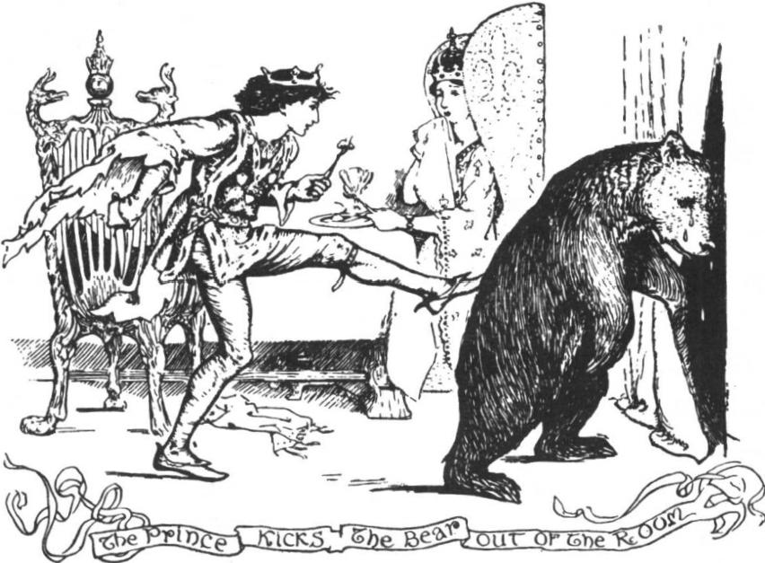

王子对公主一见钟情，整个晚上，除了这位神秘的姑娘，他没和其他任何姑娘跳舞。

舞会结束后，公主驾着她的马车飞驰而去，因为她必须在没被任何人发现之前赶回家，把晚礼服换成熊皮，把马车变回到木轮子。

王子快马加鞭地追赶着公主的马车，因为他不想让公主走失了。忽然间，一股浓雾挡住了他的去路。回到家，他对母亲除了讲那位神秘美人的事外，其他什么都没说。他告诉母亲自己整晚都在和这位可爱的姑娘跳舞，而且已经深深地爱上了她。熊在桌子底下暗自笑道：“我就是那奇怪的美人，王子啊，我把你给骗了，而你却还蒙在鼓里呢。”

第二天晚上，又有个舞会，可想而知，王子是不会错过这机会的，他相信一定能再次见到那可爱的姑娘，和她再次跳舞，谈话。在上一次的舞会上，姑娘还没开过口。

正如王子所料，当第一只舞曲响起时，那位神秘的姑娘又出现了。这一次，她的礼服更加美丽夺目，如太阳般光芒四射。整个晚上，王子都在和她跳舞，但她还是一言不发。

舞会结束后，王子再次想追上她的马车，以便看看她从哪儿来，但忽然间，一股巨大的水柱从天而降，把王子和公主隔了开来。

回到家，王子告诉母亲，在舞会上，自己又遇到了那位可爱的姑娘。这一次，她比前一天晚上更漂亮。熊躲在桌子下面，又暗自好笑道：“我又骗了他一次，他一点儿也不知道，我就是那个他深爱着的可爱的姑娘。”

第三天晚上，王子又来到王宫，第三次参加舞会。公主同样也去了。这一次，她穿着一件如星光般美丽的礼服，上面星星点点地散布着各种宝石，显得如此光彩照人，所有在场的人都被她迷住了，都说他们从未见过如此美丽动人的姑娘。王子仍然一刻不停地与她跳舞。虽然，他仍未能让公主开口，但却悄悄地把一枚戒指戴到了姑娘的手上。

舞会结束后，他紧紧跟随着公主的马车有好长一段时间，可忽然在他面前刮起一阵大风，又把他和公主分开了。

回到家，王子对母亲说道：“我真不知道自己是怎么了，我想我快要发疯了，我是那么深深地爱着那姑娘，可无法知道她是谁。我跟她跳舞，并给了她一枚戒指，我却还不知道她叫什么，在哪里可以找到她！”

熊仍然在桌子底下暗自好笑。

王子继续说道：“真是累死了，给我做碗汤喝吧，可不要让那只熊来做。每一次我说到我的心上人，它就在那儿暗自发笑，真像是在取笑我，它真叫人讨厌！”

汤做好了，在为王子端上之前，熊悄悄地把王子在舞会上送给她的那枚戒指放进了盘子里。王子无精打采地喝着汤，他忧心忡忡，思绪万千，只想着怎么才能见到那位可爱的姑娘。忽然，他看见了盘底的那枚戒指，他立刻认出了那就是自己在舞会上送给姑娘的那一只，这使他目瞪口呆。

这时，王子看见熊正站在他身边，含情脉脉地看着他，王子从她的双眼中悟出了什么。于是，他说道：“脱下这张熊皮吧，在这下面一定隐藏着秘密！”

转眼间，熊皮消失了，一位亭亭玉立的姑娘出现在王子面前，穿着那件星光般美丽的裙子，她就是那位王子朝思暮想的神秘姑娘。如今，公主站在王子面前，比以前王子所见到的她更美一千倍！这时，王子带着她来到母亲跟前。公主对他们说了自己的故事，她是如何被父亲关在王宫里，她是如何厌恶那样的生活。王后非常喜欢她，为儿子能娶到一位如此美丽的姑娘而高兴。

不久，公主和王子就结婚了。从此，他们明智地管理着这个国家，一起幸福地生活了许多年。

 

## 太阳娃

很久以前有个女子，一直没有孩子，为此她很伤心。于是，有一天，她对太阳神说：“尊敬的太阳神，请赐给我一个小女孩吧，当她长到十二岁时，你仍可以把她领回去。”

没过多久，太阳神果真为她送来了一个小女孩，那女子给她取名叫莱蒂科，并精心照料着她，直到女孩长到十二岁。有一天，莱蒂科在外面采香草时，太阳神来到她面前，对她说：“莱蒂科，回去对你母亲说，她必须认真考虑一下曾对我许下的诺言。”

于是，莱蒂科直接回到了家，对母亲说：“刚才，我在采香草时遇见了一位长得高高的绅士，他让我提醒你，不要忘了曾对他许下的诺言。”

莱蒂科的母亲一听到这些话，又伤心又害怕，她立刻把屋子里所有的门和窗都关紧，把墙上所有的裂缝和洞眼都堵住，并把莱蒂科藏了起来，她以为这样太阳神就不会把她的莱蒂科带走了。可她却忘了堵住钥匙孔，最终太阳神还是使光线穿过了这个孔，并把小女孩收了回去。

一天，太阳神让莱蒂科去草棚搬些草来，小女孩坐在草堆旁伤心地叹息道：“我脚下的草有多少，我就有多少想我的妈妈。”

莱蒂科就这么坐在草堆边好长时间，思念着母亲，所以当她回去时，太阳神问她：“嗨，莱蒂科，你怎么去了这么久呢？”

小女孩回答道：“我的鞋太大了，所以走不快。”

于是，太阳神就把莱蒂科的鞋子变小了。

又有一次，太阳神让莱蒂科去弄些水来，小女孩来到泉水边坐下，忧伤地说道：“我的心就如同泉水，绵绵流淌着对妈妈的思念之情。”

这样，莱蒂科又在外面呆了好长时间才回家。太阳神又问她道：“喂，莱蒂科，这一次你怎么又去了这么久？”

小女孩回答道：“我的裙子太长了，走起路来不方便。”

于是，太阳神就把她的裙子剪短了。

过了不久，太阳神又打发莱蒂科去为他弄一双凉鞋来。小女孩一路走，一路悲伤地说：“我的心就如同这吱吱作响的鞋，呼唤着母亲。”

回到家，太阳神又问她：“莱蒂科，为什么这么晚才回家？”

“我的红头巾太宽了，遮住了我的双眼，所以我走不快。”莱蒂科答道。

太阳神就把她的红头巾变窄了。

但最后太阳神终于发现了莱蒂科晚回家的原因。他再次让莱蒂科去搬些草回来，自己则跟在她后面，他听到了小女孩是怎样忧伤地思念着自己的母亲。于是回家后，太阳神叫来了两只狐狸，问它们道：“你们能把莱蒂科送回家吗？”

“当然可以。”狐狸答道。

“如果在路上，你们感到饿了或是渴了，那怎么办呢？”太阳神又问道。

“那么，我们就会吃这小姑娘的肉，喝她的血。”狐狸回答。

太阳神听它们这么一说，赶紧说道：“这件事让你们做不合适。”

于是，太阳神打发了两只狐狸，又把两只野兔叫到跟前，问道：“你们能把莱蒂科送回她母亲那儿吗？”

“当然行！”

“如果半路上你们饿了或是渴了，打算怎么办？”

“我们会去吃青草，喝溪水。”

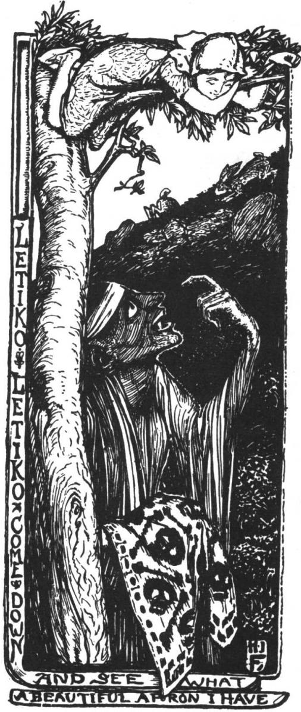

“那么，莱蒂科就由你们来护送了。”太阳神高兴地说道。

于是，两只兔子带着莱蒂科出发了。这是一段很长的归途。半道上，兔子感到饿了，它们对小女孩说：“亲爱的莱蒂科，爬到这棵树上呆着，在我们回来之前，千万别下来。”

这时，莱蒂科爬到了树上，兔子则跑去吃草了。

可是，没过多久，一个巫婆就来到了树下，她叫道：“莱蒂科，莱蒂科，快下来，瞧我的鞋多漂亮啊！”

“噢，我的鞋比你的漂亮得多！”莱蒂科答道。

“快下来！我还有事儿，我的屋子还没打扫呢？”巫婆又说。

“那你就回家扫去吧，扫好了再来吧。”莱蒂科说。

于是，巫婆回家去了。打扫完屋子后，她又来到树下叫道：“莱蒂科，莱蒂科，快下来，看我的围裙多漂亮！”

“噢，我的裙子比你的漂亮得多！”

“如果你不下来，我就要把这棵树砍倒，吃了你！”

“那你就砍吧。”

接着，巫婆用尽全身力气向大树砍去，可她怎么也砍不断这棵树。最后，她只能又叫道：“莱蒂科，莱蒂科，快下来，我还没去喂孩子们吃饭呢！”

“那你就快去吧！”莱蒂科答道。

巫婆一走，莱蒂科就喊道：“小兔子！小兔子！”

一只兔子听到了莱蒂科的叫声，对另一只兔子说：“听，是莱蒂科在喊。”因此，他们立刻跑回莱蒂科的身边。莱蒂科从树上下来，又和他们一起上路了。

巫婆紧紧地跟在兔子和莱蒂科后面。她来到一片田野，看见人们忙着干活儿，巫婆问他们道：“你们看见谁经过这儿吗？”

人们回答道：“我们在种大豆。”

“噢，我没问这个，我是说你们看见有人经过这儿吗？”

但人们只是更大声地答道：“你聋了吗？是大豆，大豆，大豆！我们在种大豆！”

当莱蒂科快到家时，她家的狗认出了她，高兴地叫道：“汪！汪！快看！莱蒂科回来了！”

莱蒂科的母亲说道：“安静点儿，别乱叫，你还想让我更伤心吗？”

接着，屋顶上的猫也看见了莱蒂科，于是快乐地叫道：“喵！喵！莱蒂科回来了！”

莱蒂科的母亲又说：“安静点儿，你这该死的猫，难道我还不够伤心吗？”

这时，公鸡也看见了莱蒂科，它兴奋地叫道：“咯！咯！快看噢，莱蒂科回来了！”

母亲还是说道：“别再闹了，你们这群动物，难道我受的苦还不够吗？”

莱蒂科和兔子越是快到家了，巫婆追得也越近，兔子的前脚刚跨进家门，巫婆就揪住了它的尾巴，并扯了下来。

兔子刚跑进家门，莱蒂科的母亲一下子站了起来，高兴地对它说：“欢迎你，亲爱的小兔子，是你把我的莱蒂科带回了我的身边，放心，我会治好你尾巴的。”

莱蒂科的母亲确实治好了兔子的尾巴。从此，她和她的女儿幸福地生活着。

 

## 布克的女儿

很久以前，有个父亲生了七个女儿，一家人一直在一起快乐地生活着。一天早晨，父亲把孩子们都叫到跟前，说道：“我和你们的母亲要到很远的地方去旅行一次，说不准何时能回来。这屋里有足够的食物和用品，够你们用三年的。然而，你们必须千万记住：在我们回来之前，任何人敲门都不要去开。”

“我们记住了，爸爸。”孩子们回答。

于是，孩子们的父母出发了。一晃两年过去了，女孩子们遵照父亲的忠告，从没有离开屋子或是开门。可有一天，当姑娘们洗完衣服，正把它们晾到屋顶上去晒干时，无意间朝街上看去，只见那里人来人往，十分热闹，街上摆着各式各样的货摊：有卖肉的、卖蔬菜水果的，还有卖各式小玩意儿的。

“快来看哪！”一个女孩叫道，“这么多好吃的，真叫人嘴馋，我们为什么不能去弄些来呢？让我们派个人下去买些蔬菜和肉来吧。”

“噢，我们不能这么做！”最小的女儿说道，“父亲说过，不等他回来，我们就不能开门。”

可这时，大女儿突然打了她一下，二女儿朝她吐唾沫，三女儿骂她胆小，四女儿把她推到一边，五女儿又一下子把她推倒在地上，六女儿又扯她的衣服。后来，六个姐妹丢下她一个人，拿着篮子走了出去。

一小时后，姐妹们拿着满满一篮子的东西回来了。她们忙着把买回来的食品往锅里放，而完全把父亲的嘱咐丢在脑后，姑娘们根本没有注意到房门直挺挺地开着。而最小的女儿没有和姐姐们在一起，当姐姐们在厨房里大吃大喝时，她悄悄地进了大厅，躲在墙角的一只大水桶后面。

姑娘们吃得正香时，一个巫婆刚巧从门前走过，当她发现门开着时，就闯了进来。她走到大女儿跟前，问道：“你这大姑娘真是我的美餐，我该先从哪儿开始享用呢？”

大女儿后悔地答道：“就从这只打我小妹妹的手开始吧。”

于是，老巫婆狼吞虎咽地把她给吃了。吃完了大女儿的最后一滴血后，巫婆又问二女儿：“我的美味佳肴，对于你，我又该从何处开始呢？”

二女儿伤心地回答：“就从我的嘴巴开始吧，因为我用它向我的小妹妹吐了唾沫。”

不一会儿，巫婆一个接一个地把六个姐妹都吃了。当巫婆吃着最后一个女孩的最后一口肉时，躲在木桶背后吓得直哆嗦的小女儿冲出房门，直向大街上跑去。她头也不回，竭尽全力地向前跑，直到一座巨大的城堡出现在她面前。她推开城门，在靠近门的墙角边发现一个大瓦罐，于是，她悄悄地爬了进去，又把大罐子的顶盖盖好，静静地睡着了。

过了好久，这城堡的主人——巨妖回来了。“嗬，”巨妖嘀咕着，“我嗅到了人的味道！他可真不走运，竟然会到这儿来自投罗网。”他找遍了整个屋子，却没找到一个人。“嗨，你究竟在哪儿，快出来吧！”巨妖说道，“别怕，我不会伤害你的。”

但小姑娘仍然没敢出声。

“快出来吧！”巨妖又说道，“我保证你的安全，如果你是个老人，我就会把你当作父亲来对待；如果你是个小孩，我就会把你当作儿子来对待；如果你和我年龄相仿，那我就会把你当成兄弟；如果你是个老太太，我会把你当作自己的母亲；如果你是个小女孩，我就会把你当作女儿；如果是个中年妇女，那我就会把你当作我的妻子。快出来吧，别害怕！”

听到这些，小女孩从大瓦罐里爬了出来，站到巨妖的面前。

“别害怕，”巨妖又说道。从此以后，巨妖出去打猎时，把小女孩留在家里看家。晚上，他总会为小女孩带些野兔、鹧鸪和小羚羊什么的回家做晚饭，而他自己只吃人肉。巨妖还把六个房间的钥匙都交给小女孩保管，但还有一把他总放在自己身边。

小女孩把巨妖称作“父亲”，而巨妖称小女孩为“女儿”，父亲从不粗声粗气地对女儿说话。

一天，小女孩对巨妖说道：“父亲，把楼上房间的钥匙给我，行吗？”

“不行，我的女儿。”巨妖答道，“那儿没有什么对你有用的东西。”

“但我就想要那钥匙。”小女孩固执地说。

然而，巨妖对此无动于衷，他装作没听见。小女孩哭了起来，心中暗想道：“今晚，在他以为我睡着后，我会悄悄地爬起来，看他把钥匙藏在哪儿。”于是，吃完晚饭，小姑娘向巨妖道了晚安就回自己房间去了。几分钟后，她又悄悄地回来，躲在门帘后面偷看。不一会儿，她看见巨妖从口袋里掏出钥匙，藏在地上的一个洞里，然后就上床睡觉去了。巨妖睡着后，小姑娘偷偷地拿出了钥匙，回到自己的房间。

第二天一大早，巨妖醒来了，他起床后的第一件事就是找那把藏在地板洞里的钥匙。当他发现钥匙不见了，立刻就猜到是怎么一回事。

巨妖并没有大发雷霆，他心想：“如果我吵醒了那姑娘，准会把她吓坏的。今天就让她拿着那把钥匙吧，等我晚上回来再问她要。”这样想着，他又和往常一样出去打猎了。

巨妖出去后，小女孩来到楼上的房间，用那把钥匙开了门。

她发现屋子里空空的，没什么东西。唯一的一扇窗关着，她来到窗前，往外看。窗下有个大花园，这花园是一位王子的。花园里有一头公牛，正独自从井里打水上来，除此之外，花园里什么也没有。小女孩打开窗户，公牛听到声响，抬起头来问姑娘道：“早上好，你是布克的女儿吧！你父亲准是想把你养得白白胖胖的，然后把你当作一顿美餐吃了。”

小女孩听到这些话吓坏了，她失声大哭，跑出了屋子。整整一天，她都在伤心地流着泪。晚上巨妖回来的时候，小姑娘没有像往常那样为他准备晚餐。

“你为什么哭泣呢？”巨妖问道，“我的晚饭在哪儿，是不是你打开了我楼上房间的那扇窗？”

“是，是我开的。”小女孩回答说。

“那公牛对你说了些什么？”

于是，小姑娘把公牛对她说的话原原本本地告诉了巨妖。

“好吧，明天你可以这样对它说:‘我父亲会把我养得白白胖胖，但他不会来吃我。如果我有你这样的眼睛，一定会好好地看着自己；相反，若搬弄是非，你的眼睛就会瞎掉整整七天七夜。’”

“好吧，”小女孩回答道。第二天早上，当公牛又对她说那些话时，她就照着父亲教她的话说了。公牛听到小女孩的这些话，一下子就摔倒在地上，躺在那里七天七夜。这么一来，花园里的花因没人浇水就都枯萎了。

一天，王子来到他的花园，发现除了枯黄的叶子，花园里什么也没有，而那头公牛却躺在地上什么也不干。于是，他拔出剑，一下刺死了那头牛，又转身对仆人说：“去另找一头牛来！”仆人们又找来一头大壮牛，让它从井里打水浇花。渐渐地，花园里又有了盛开的鲜花和绿盈盈的草地。然后，王子带着仆人离开了花园。

第二天早晨，小女孩又听到了打水声。于是，她打开窗户往外看。

“早上好，小姑娘，你就是布克的女儿吧！”这头新来的公牛说道，“你父亲想把你养得白白胖胖的，然后把你烤着吃。”

小女孩回答说：“我父亲是把我养得白白胖胖的，但他并不是要吃我。如果我有你这样的眼睛，一定会好好地看着自己；相反，若搬弄是非，你的眼睛就会瞎掉整整七天七夜。”

小姑娘一说完这些话，公牛就摔倒在地上，整整七天七夜。七天后，它又从地上爬了起来，然后从井里打水上来浇花。公牛刚打完一桶水，王子就带着他的仆人来到了花园，他想看看这头新来的牛活儿干得怎么样。王子看见公牛正忙着打水，但他却发现花园里的花草都枯萎了。于是王子拔出剑，直冲向公牛要杀了它。这时，公牛跪下说道：“陛下，请饶了我吧，我并没有偷懒，让我来告诉你事情的真相。”

“好吧，快说，这究竟是怎么回事？”王子问道。

“陛下，七天前有个小姑娘从那扇窗户探出身来，对我说了几句话，我就倒在地上，整整七天七夜，一点儿动不了。不过，陛下，我可从没见过长得像她这么漂亮的女孩子。”

“你这是在撒谎，”王子说道，“那屋子里明明只住着个巨妖，难道在他的卧室里会有个女孩子？”

“为什么不可能呢？”公牛答道，“如果明天一早你到这儿来，躲在那棵树下，那你就会亲眼看到她的。”

“我会的，”王子说，“如果我发现你说的不是实话，我就会杀了你。”

于是王子离开了花园，公牛继续干它的活儿。第二天一大早王子又来到花园，看见公牛正忙着打水。

“那女孩儿出现过吗？”王子问公牛。

“还没有，不过她马上会来的，藏在那棵大树下，你就会看见她的。”

王子照着公牛说的去做。他刚藏好，小姑娘就打开了那扇窗户。

“早上好，布克的女儿！”公牛说道，“你父亲想把你养得白白胖胖的，然后把你烤着吃。”

“我父亲是把我养得白白胖胖，可他不会来吃我。如果我有你这样的眼睛，一定会好好地看着自己；相反，若搬弄是非，你的眼睛就会瞎掉整整七天七夜。”话音刚落，公牛就重重地摔倒在地上。于是姑娘关上窗走了。这回，王子知道公牛没有说谎，她确实是自己所见过的世界上最美丽的姑娘。王子从树上下来，心中燃起了爱情之火。

“为什么那巨妖没吃了她？”王子想着，“今晚，我要请他到我的王宫来吃晚饭，问问他关于这女孩子的事情，也许他是把这姑娘当作了自己的妻子才没吃了她。”

于是王子让人准备了一顿丰盛的晚餐：一整只烤公牛和两大坛美酒。傍晚时分，王子带着一队仆人去巨妖家请他吃饭。巨妖打猎回来，看见这么多人站在他屋子前面，很是吃惊。但他还是彬彬有礼地弯下腰问道：“晚上好，我亲爱的邻居，我何以受到如此礼遇？我想我并没有冒犯你们吧？”

“哦，当然没有！”王子答道。

“那么，”巨妖继续问道，“是什么使你到我家来的呢？”

“我想请你共进晚餐。”王子回答。

“好啊，晚饭已经准备好了。”巨妖说着，把王子他们领进了屋。今天，巨妖心情特别好，因为他打到了许多猎物。

很快餐桌就摆好了，这时王子突然说道：“不行，布克，今晚是我请你吃饭。”

“在哪儿？”巨妖问道。

“在我家里，都已经准备好了。”

“可你家太远了，为什么不就在这儿吃呢？”

“噢，我改日会来拜访的，可今晚必须由我来做主人。”

于是，巨妖跟着王子和他的仆人来到了王宫。过了一会儿，王子转过身对巨妖说：“我冒昧地前来请求你，我想娶个有您这样高贵门第的家族的小姐为妻。”

“但我没有女儿。”巨妖答道。

“不，你有，我看见她站在你的窗前。”

“那好吧，如果你愿意，那就娶她吧。”巨妖说。

王子听到这话，高兴极了。吃完饭，他亲自和他的仆人一起把巨妖送回家。分手时，王子对巨妖说：“你可不能忘了我们的约定哦。”

“我是个守信用的人，从来就是说话算话的。”巨妖说完就进了屋。

巨妖上了楼，小女孩正等着他回来吃饭，因为她从不喜欢一个人吃。

“我已经吃过晚饭了，”巨妖说道，“我是和王子在一起共进晚餐的。”

“你是在哪儿遇见他的？”小姑娘问道。

“要知道我们是邻居，从小一起长大，今晚我已经答应让他娶你了。”

“我不想嫁给任何人。”姑娘说道。但这并不是她的心里话，事实上她对此感到很高兴。

第二天一大早，王子就带着结婚礼物来了，包括许多光彩照人的结婚礼服，他要把小姑娘带回王宫中去。

姑娘临行前，巨妖把她叫到跟前，对她说：“记住，姑娘，在王子说‘我以布克的名义起誓’这句话之前，你千万别开口跟他说话。除非他说了这句话，你才能对他开口。”

“我记住了。”姑娘说道。

于是王子带着姑娘出发了。不一会儿，他们就到了王宫，王子领着新娘来到早为她准备好的房间，对她说：“现在对我说些什么吧，我的新娘。”可姑娘一言不发。王子这么说了好几次，她都没反应，王子以为姑娘是因为害羞才不肯开口，于是就走开了。但第二天，第三天，姑娘仍然不肯开口。

最后，王子说道：“好吧，姑娘，既然你不肯开口，我只能去另找一个会说话的妻子了。”王子果真这么做了。

王子新娶的妻子来到王宫后，布克的女儿走了出来，她对那些跟着来侍候第二个新娘的仆人们说：“你们大家快坐下来，我会来准备晚餐的。”仆人们照她说的都坐了下来。

布克的女儿自己也坐了下来，口里念道：“快过来，木柴，”于是木柴来到她的身边。“快过来，炉火，”于是木柴一下子被点燃了。“到这儿来，锅子，”“过来，食油！”说着，锅子和食油来到了她的身边。“跳到锅里去，食油，”话音刚落，食油立刻进了锅。油烧热后，小姑娘把她的十个手指伸了进去，立刻，它们变成了十条煎鱼。“快过来，烤炉，”她接着又说道。炉子就来到了她跟前。“加热炉子，”火就给炉子加热。等炉子热后，姑娘一下子跳了进去，身上穿着漂亮的银丝裙，还带着各式珠宝。几分钟后，她成了一只雪白的面包，叫人看了直流口水。这只面包开口对坐在一旁的仆人们说：“现在，你们可以吃了，别这么傻站着。”但仆人们只是面面相觑，惊得目瞪口呆。

“你们看什么哪？”第二个新娘说道。

“这简直太神奇了！”仆人们答道。

“这有什么了不起的？”新娘不屑一顾地说道，“我也会这么做。”说着，她一下子跳进了火炉里，立即就被烤焦了。

于是，仆人们跑到王子跟前，说道：“快来，陛下，你的新妻子死了！”

“那就把她埋了吧！”王子说道，“但她为什么会这么做，我可没让她跳火炉啊。”

新娘被埋了，可王子连墓地都不愿去，因为他一心仍只想着那个不愿开口的妻子。第二天晚上，他对第一个妻子说：“亲爱的，你是不是担心一旦开口，就会有什么可怕的事情发生？如果你还是这么不肯跟我说话，那我不得不再娶一个妻子了。”姑娘非常想开口，但巨妖的话在她耳边回响，她只得闭口不言。于是王子又娶了个妻子，并把新娘带进了王宫。当新娘和她的仆人们坐在大厅里时，布克的女儿往地上放了一根尖尖的火刑柱，并且安安稳稳地坐在上面纺起纱来。

“你们在看什么呢？”新娘对她的仆人们嚷道，“这有什么了不起的？我也能这么做！”

“你肯定不行！”仆人们说道。

这时，布克的女儿留下柱子，离开了大厅。于是，新娘马上就坐到了她的位置上。那根尖尖的火刑柱一下子就扎进了新娘身体里，她立刻就死了。仆人们又赶紧去告诉王子：“快来，陛下，你的新娘又死了，快把她埋了吧。”

“你们自己埋吧！”王子答道，“她为什么要这么做呢？我并没让她坐到那根柱子上去啊！”

仆人们就埋葬了新娘。那天晚上，王子又来到他的第一个妻子身边，说道：“快对我说话吧，否则，我还要再娶个妻子。”但姑娘仍然没有开口。

第二天，王子偷偷地躲在姑娘的屋子里，看着。不一会儿，姑娘醒了，她对水罐和水壶说：“快！你们快下去给我弄些泉水来，我渴死了。”

于是，水壶和水罐下楼去了。但当它们在泉水边往自己身体里装水时，水罐不小心撞了水壶一下，把它的壶嘴撞坏了。水壶哭着跑到姑娘跟前说道：“姑娘，快教训教训水罐，它把我的嘴撞坏了！”

“我以布克的名义起誓，求你打我！”水罐说道。

“噢，”姑娘说道，“只要我的丈夫说了这句话，我就能和他说话了，他也就不用再另娶妻子了。可他却永远不会想到要说这话，所以他一定会再娶妻子的。”

王子听到姑娘的这些话，一下子跳了起来，走到姑娘面前说道：“我以布克的名义起誓，请对我说话吧！”

于是，姑娘开口和王子说起了话。从此，他们俩过着幸福的生活，这都是因为姑娘遵守了她对巨妖许下的诺言。

 

## 哭眼睛·笑眼睛

从前有个老人，他的右眼总在微笑，而左眼却总在哭泣。老人有三个儿子，两个大的儿子很机灵，但最小的那个却有些傻气。三个儿子对父亲的这双奇特的眼睛都很好奇，他们自己无法解开这个谜，于是决定去问父亲，为什么他的眼睛和别人的不一样。

一天晚上，最年长的儿子来到父亲的房间，直截了当地问父亲，为什么他的眼睛和别人的不一样。父亲不但没有回答他的问题，而且大发雷霆，还拿出刀来威胁他。小伙子被吓坏了，逃回到兄弟们的房间里，他的两个兄弟正焦急地等着听他和父亲谈话的结果。

“你们还是自己去问吧！”大儿子说道，“看看是否能得到满意的答复。”

于是，二儿子来到父亲的房间，又直截了当地向父亲提出了同样的问题。当然，他遭到了和哥哥一样的待遇。回来后，他对最小的那个说：“现在，该轮到你去碰碰运气了。”

这时最小的那个来到父亲的房间说道：“我的两个哥哥不肯告诉我，你对他们说了些什么，现在，爸爸，请告诉我为什么你右边的眼睛总在微笑，而左边的那只眼睛却总在流泪？”

和前两次一样，父亲听到儿子问这些，气得涨红了脸，拿着刀直向儿子冲去。可这傻儿子呆呆地站着，一动不动，他深知不用害怕自己的父亲。

“噢，现在我才看清楚，谁是我真正的儿子。”老人说道，“那两个小子真是胆小鬼，孩子，你让我看到了你的勇气。现在，我就来回答你的问题。我的右眼总在笑，是因为我能有像你这样的好儿子；而我的左眼总在流泪，是因为有人偷了我的一件宝贝。从前，我的花园里有棵葡萄树，它每小时能产一吨葡萄酒，有人把它偷走了，所以我总在为这事而痛惜。”

傻儿子把父亲的话告诉了两个哥哥，于是他们决定出发去找那棵宝树。他们一起出发，过了不久，来到了一个十字路口，兄弟三人分头去找，两个年长的朝一个方向走去，最小的走了另一条路。

“谢天谢地，我们总算摆脱了那白痴，”两个年长的说道，“现在，让我们来吃早点吧！”这时，他们在路边坐下，吃起了早点。

兄弟俩刚吃到一半，一只狐狸一瘸一拐地从树林里走了出来，求他们给它些吃的。可兄弟俩站起身来，用棍子把它赶走了。可怜的狐狸只能用它的三条腿一瘸一拐地走开了。狐狸走着走着，遇上了那个年纪最小的儿子，他正拿出随身带着的食物准备吃，狐狸向他讨一点面包。小伙子虽然自己带得也不多，但还是分了一半给这只可怜的狐狸。

“你准备上哪儿去？伙计！”狐狸吃完了面包问道。于是，小伙子把父亲和那棵宝树的事告诉了狐狸。

“天哪，真太巧了！”狐狸说道，“我知道那棵树的事情，跟我来！”接着他们来到一座大花园的门前。

“你能在这儿找到那棵葡萄树，但要拿到它可不是件容易的事儿。你仔细听着，在你看到那棵葡萄树前，先要经过十二个岗哨，每个岗哨前有两个卫兵，如果你发现卫兵直盯着你看，那你就一直往里走，因为这表明他们睡着了。但如果他们的眼睛是闭着的，那你就必须特别当心，因为这表明他们正醒着。一旦看到了那棵葡萄树，你就会看见两把铲子，一把是木头做的，一把是铁做的。千万别去碰那把铁铲子，不然，它就会发出响声，惊醒哨兵，这样，你就会被抓住。”

小伙子照着狐狸说的话走进花园，没费吹灰之力就找到了那棵一小时能产一吨葡萄酒的宝树。可他以为光用一把木铲子是无法掘起地上的硬土的，于是他拿起了那把铁锹。铁锹发出的响声惊醒了哨兵，于是他们抓住了这可怜的小伙子，把他带到主人跟前。

“你为什么要偷我的葡萄树？”主人问道，“你是怎么避开哨兵偷偷进来的？”

“这葡萄树不是你的，它是我父亲的，如果你现在不把它还给我，总有一天我会再回来拿走它的。”

“如果你能用一个从金苹果树上掉下来的金苹果来交换，我就会把葡萄树还给你。”说着，主人命令他手下的人把小伙子放了。小伙子立刻跑去找狐狸商量。

“你瞧，”狐狸说道，“这都是因为你不听我的忠告。不过，我会帮你找到那个金苹果的。照我说的，你很快就会找到那个长金苹果的花园。金苹果树边有两根棍子，一根是金的，另一根是木头的，千万记着拿那根木头的棍子，这样你就能得到金苹果了。”

小伙子仔细地听着狐狸的话。接着他就来到花园，像前一次一样悄悄地绕过了那些哨兵，很快就找到了苹果树。但他被那些金光闪闪的果子冲昏了头，把狐狸对他说的话忘得一干二净。他拿起那根金棍子就朝树上砸去。哨兵们立刻清醒过来，把他押到了他们的主人面前。小伙子只能照实说出了事情的缘由。

“我可以给你那只金苹果，”花园的主人说道，“只要你能给我带来一匹马，这匹马要能在二十四小时内绕着地球跑一圈。”于是小伙子离开花园，只能又去找那只狐狸了。

“如果你听我的话，现在早该带着那棵葡萄树回家见你父亲去了。不过，我还是会帮你这一次的。到森林里去，你会发现有一匹马的脖子上套着两根缰绳，这就是你要找的马。一条缰绳是用金子做的，而另一条是麻绳。记住用那根麻绳把马牵回来，否则，如果你去牵那根金缰绳，马就会叫起来，这样卫兵就又会发现你，那你就全完了。”

于是，小伙子走进了森林，找到了那匹马，他被那匹马的美丽惊呆了。

“不行！”他自言自语道，“用一条麻绳来牵这么一匹美丽的马？不行，绝对不行！”

小伙子刚拉起那条金色的缰绳，马就大声叫了起来。这时，哨兵逮住了这个小伙子，把他带到他们的首领面前。

“我可以把马给你，”首领说道，“只要你能为我带来一位金发女子，而且她必须从未看见过太阳或月亮。”

“如果你要我为你寻找这样一位姑娘，”小伙子说，“那就必须先把你的马借给我，让我可以骑着它到处去找。”

“哈哈！”马的主人说道，“谁能保证你一定会回到这儿来呢？”

“我以我父亲的名义起誓，”小伙子答道，“我不是把马还给你，就是替你带来一位漂亮的金发姑娘。”说着，他又去找那只狐狸了。

狐狸总能容忍和原谅别人的过失。它把小伙子带到一个洞穴的入口处，那里正站着一位美丽的金发女子。小伙子把她抱上马，准备出发。

“你不后悔吗？”狐狸问小伙子道，“用一位如此美丽的姑娘去换一匹马？但你不得不这么做，因为你已经用你父亲的名义起誓过了。不过，也许我可以来代替这位姑娘。”说着，狐狸摇身一变，把自己变得和眼前的这位姑娘一模一样，谁都无法辨认出她们谁真谁假。

于是，小伙子把狐狸带到了马的主人跟前，马的主人立刻就被她给迷住了。

最终，小伙子带回了父亲的葡萄树，而且还娶了那位真正的金发姑娘。

 

## 不期而遇的王子

很久以前，有一对国王和王后，虽然他们俩都非常希望有一个儿子，他们却没有孩子。他们想方设法不让对方看出自己内心的痛苦，假装对打猎和其他运动很感兴趣。可最终国王再也忍受不了这种情况，他宣布他将周游他的国家，要好几个月才能回来。

他希望等他回来后，繁忙的工作会使他忘掉没有孩子的痛苦。

国王统治的这个国家非常大，有很多高山和沙漠，所以周游这个国家非常不容易。有一天，国王一个人在外面走，没想到周围的景象十分相像，他竟辨不出是从哪一条路走过来的。就这样，他一直走了好几个小时，太阳火辣辣地当头照着，他的双腿开始发软了。突然，他被一口井绊倒了，看来这是口刚挖好的井，要不是有这口井，他可能会渴死在半路上。井面上浮着一只银杯子，边上镶着金色的手柄，但每当国王想要抓住这杯子时，它就滑来滑去，使国王怎么也抓不住。他口干得再也等不及了，于是，就在井边跪下喝了个够。

当他喝完水想爬起来时，他的胡子已牢牢地被粘在水中，不论他怎么拔，也拔不出来。他猛地用力，拉了两三下，但除了使他痛得更厉害外，丝毫不顶用。于是他愤怒地大叫：“马上放开我！谁在抓着我？”

“是我，科斯蒂国王！”一个声音从井里传出来。国王发现一个长着一双绿眼睛的大头小矮人正透过水向上张望。“陛下，你已喝了我的泉水，在你许诺把你宫中最宝贵的东西给我之前，我是不会让你走的，这样东西在你离开宫殿时还没有。”

那时，在王宫中，国王最为担心的就是王后本人了，因为他骑马走了之后，王后坐在大厅里的沙发上伤心地哭了很久。所以当国王知道科斯蒂指的宝贝不是王后时，他欣然答应了小矮人的要求。刹那间，小矮人、泉水及杯子都不见了。国王跪在干干的沙地上，怀疑刚才的一切是一场梦。然而，当他感到自己的身体要比以前强壮得多时，他相信这次奇妙的经历完全是真的。于是，他轻松地跃上了马疾驰而去。

几周之后，国王和他的随从们踏上了归途。他们到家的那一天，天气十分炎热，这时他们离家已有八个月了。国王受到了臣民们的热烈欢迎，他走过街道时，人们在路旁列队欢呼，手中挥舞着帽子，王后站在宫殿的石级上，双手抱着一个光彩夺目的金垫子，垫子上竟是一个漂亮的小男孩，男孩被许多花环绕着。刹那间，国王的耳边回响起科斯蒂的话，人们原以为国王一看到他的儿子一定会欣喜若狂，可国王却开始大哭起来，这令所有在场的人都大为惊奇。尽管国王努力地不去想他的承诺，但总摆脱不了小矮人的阴影。每当他的眼光离开那小孩时，他总以为这是最后一次看见他了。

转眼几年过去了，王子长成了一个大男孩，然后又长成了一个英俊的青年。科斯蒂一直没有出现。渐渐地，国王越来越少想到他，最后完全忘掉了这个科斯蒂。

在整个王国里，国王、王后和王子是最幸福的一家。一天，王子一个人在一片森林里打猎时，遇到了一个小矮人。

“你好吗？王子，找你可真不容易啊！”他说，“你让我们等了很长时间啦！”

“你是谁？”王子问道。

“你很快就会知道的。你回家后请代我向你父亲致意，并请你转告他，我希望他能快点来跟我结账。如果他忘了欠我的债，那么他早晚会后悔的。”

小矮人说完这些话就不见了。王子回到宫中，把遇到的事告诉了父亲。

国王一下变得脸色苍白，他向儿子讲述了那件可怕的事。

“父亲，不要为此烦恼，”王子回答说，“事情毕竟没有这样可怕！我将竭尽全力使科斯蒂放弃对我的权利。但如果一年以后，我还不回来，那么你们就只能放弃再见到我的希望了。”

然后，王子准备出发，国王给了他一副非常好的盔甲，一把宝剑和一匹马。王后在他的颈上套了一个金十字架，她伤心地流了很多泪，然后与儿子吻别。

王子一直骑马行了三天路，第四天太阳落山时，他发现自己来到了海边。在他面前的沙滩上有十二件像雪一样白的衣裳，正闪闪发光。但看不到衣服的主人，出于好奇，王子拿走了其中的一件。王子把马牵到附近的地里，自己则躲进了柳树林里，想看个究竟。几分钟后，一群鹅出现在海上，嬉戏了一阵之后，它们上了岸，穿上衣服，用脚拍打着沙滩。刹那间，这群鹅变成了十一位年轻美丽的姑娘，轻快地飞走了。第十二个，也是最年轻的那位则仍留在水中，伸长了脖子，焦急地四处张望。突然，她在柳树林里发现了王子，于是向他叫道：

“哦！王子，请把衣服还给我。我会永远感激你的。”

王子赶紧把衣服放回到沙滩上并走开了。女孩扔掉鹅衣，很快地穿上她自己的衣服，然后来到王子面前，王子从未看见过如此美丽的姑娘，姑娘红着脸伸出了她的手，温柔地对王子说：

“谢谢你，尊贵的王子，你帮了我的忙。我是科斯蒂国王的小女儿。我父亲共有十二个女儿，他还统治着地面上所有的王国。父亲已等了你很长时间，因此他非常恼火，但你不用害怕，只要你照我说的去做就行了。你见到我父亲后就跪着朝他那里走过去，不要介意他的威胁和恐吓，只要大胆地朝他那里过去，以后会发生什么，到时候你就会知道的，现在让我们走罢。”

讲完这些，姑娘用脚蹬了蹬地面，地上出现了一条深沟直通地下。不一会儿，他们就来到了科斯蒂的宫殿，那儿挂着一盏比太阳还亮的灯，给黑暗的地下王国带来了光明。王子照姑娘的话勇敢地进入了大厅。

科斯蒂戴了一顶金光闪闪的皇冠，坐在金色宝座的中央，他的眼睛像玻璃一样闪着绿光，他的手则像螃蟹的爪子。他一看到王子，就发出了尖尖的叫声，王宫的墙都被这叫声振得摇晃起来。王子装作没听见，只是跪着向国王的宝座走去。当他几乎要碰到宝座时，国王突然大笑了一声说道：

“你很走运，因为你使我笑了出来，就留在我的地下宫殿里吧，但你必须完成三件事。今天已经很晚了，去睡觉吧，明天我会告诉你该做的事。”

第二天早晨，王子得知科斯蒂准备召见他。他起身穿好礼服，赶紧来到宫殿，国王已坐在王位上了。王子向他鞠躬行礼后，科斯蒂说道：

“现在听好，王子，你必须在今晚之前给我造好一座大理石宫殿，它的窗必须是水晶的，而屋顶必须用金子造。宫殿要造在大公园的中央。记住，这公园里有许多小溪。如果你能做成这件事，你就将成为我的朋友，但如果做不到，我就要杀了你！”

王子静静地听着这些话，然后沮丧地回到他的房间，想着自己是必死无疑了。想着想着，一只蜜蜂飞到他窗前，用翅膀轻轻地拍打着窗户说道：“王子，快让我进来！”王子起来开了窗，蜜蜂一下子变成了那位最小的公主，站在王子面前。

“你呆呆的在想什么呢，王子？”

“我在想你父亲要我做的事。”

“不用担心，你放心地睡吧。明天早晨，等你醒来时，你会发现宫殿已经造好了。”

第二天一大早，当王子走出房间时，他简直惊呆了，一座比他想象中还要美丽的宫殿正矗立在他面前。科斯蒂看到这宫殿时，几乎不相信自己的眼睛，他实在想不通宫殿怎么会出现在那里的。

“好罢，这一次你赢了，但我不能这样轻易地放了你。明天，我要让十二个女儿在你面前站成一排，如果你说不出她们中哪一个是最年轻的，那么，你的脑袋就会搬家！”

王子回到他的房间，自言自语道：“什么？认不出最年轻的公主，真是荒唐！”

这时，蜜蜂又出现了，她在天花板上嗡嗡地说道：“没有我的帮助，你就无法做成这件事，我们姐妹十二个几乎长得一模一样，就是我们的父亲也很难说清楚我们之间的差别。”

“那么，我该怎么办呢？”

“最年轻的那位公主，她的眼皮上有一颗很小的黑点，请你仔细地看清楚。好了，再见！”

第二天，科斯蒂又把王子叫来。公主们在他面前站成一排，穿得一模一样，她们的眼睛都朝下看。王子初看她们，惊奇地发现她们几乎完全一样。他第二遍走过她们时，仍未发现蜜蜂告诉他的那个记号。第三次走过她们面前时，他突然发现了其中有一个女孩子的眼皮上有颗小黑点，他的心蹦地跳了起来。

“这就是最年轻的那位公主。”他说。

“你究竟是怎么猜中的？”科斯蒂愤怒地叫了起来，“不管怎样，你不会这么容易就逃出我的手掌。三小时之后，你再到这里来，你必须再次向我证明你的智慧。我将点燃一堆草，在它被烧完之前，你必须把它变成一双靴子。不然的话，你还是会掉脑袋的。”

于是，王子垂头丧气地回到了他的房间，而这一次蜜蜂已经在他房间里等着他了。一见他进来，蜜蜂立刻变成了美丽的公主。

“英俊的王子，你为何看来如此忧伤？”

“你父亲要我为他做一双靴子，怎能叫我不发愁呢？要知道，我可不是个鞋匠！”

“你有什么办法吗？”

“无论如何，我是不会替他做靴子的！我并不怕死。但毕竟一个人只有一次生命啊！”

“不，王子，你不能死。我一定会想办法救你，我们俩会永远在一起的！”

公主边说边用脚蹬着地面，然后拉着王子走出了房间，公主随手关上了门并把钥匙扔到了远处。两人紧紧地握住对方的手，来到阳光下。这时，他们发现已来到了上次相见的海边。王子的马仍在那儿安静地啃着草坪上的草，马一见它的主人就发出嘶嘶的叫声，飞奔而来。王子立刻跳上马鞍，让公主坐在他身后，于是他们俩如离弦之箭，向远处飞驰而去。

再说科斯蒂，眼看着他和王子约定的时间已到，却还见不到王子的影子，就派人到王子的房间去探问。仆人发现门已上了锁，于是大声敲门，得到的回答是：“马上就来！”而事实上，这是唾沫在模仿王子的声音说话。

回答传到国王那里，他又等了一会儿，仍不见王子来，他又派仆人去打听，得到的还是同样的回答：“马上就来！”

这一回科斯蒂恼怒地说道：“他这是在作弄我！把门撬开，把他带到我这儿来！”

仆人们赶紧把门撬开，发现里面已空无一人，只有唾沫发出的笑声。科斯蒂愤怒到了极点，立刻命令他的卫队去追赶这两个逃跑的人，并威胁说，如果找不回他们，就要把这些卫兵都杀掉。

此时，王子和公主已跑了好一阵子，他们感到很幸福。突然，他们听到远处传来马蹄声。王子跳下马，把耳朵贴着地面，静静地听着。

“有人来追我们了！”他说道。

“我们不能再等了！”公主回答。她说着这话时已把自己变成了一条小河，把王子变成了一座桥跨过河面，那匹马则变成了一只乌鸦，桥后的大路变成了三条小路。当士兵们来到桥上时，他们迟疑地停了下来，因为不知道顺着哪条路走。他们失望地返回了王宫，瑟瑟发抖地来到科斯蒂面前。

“你们这群白痴！”他叫了起来，“他们就是那座桥和那条河，难道你们就从来没有想到这个吗？立刻再给我去追！”

于是，卫兵们又闪电般地奔驰而去。

这时，王子和公主又已经跑了许多路。

“我听到了马蹄声！”公主叫了起来。

王子跳下马来，把耳朵贴在地面上倾听。

“是的，”他说，“他们离这儿不远了！”

顷刻间，王子、公主和马都不见了，取而代之的是一片茂密的树林，林间纵横交错着无数条小路。科斯蒂的卫兵赶紧冲进树林，他们似乎已经看见了前面有一匹飞奔着的马，马上坐着两个人。就在卫兵们即将追上他们的那一刻，刹那间，马、树林……所有的一切都消失了，卫兵们发现自己又回到了出发的地方。他们毫无办法，只能又回到科斯蒂那儿，告诉他仍没能抓住王子和公主。

“一群白痴！”科斯蒂怒吼道，“我要亲自去把他们找回来。这一次，他们别再想逃得掉。”说着，他纵身一跃跳上马。由于愤怒，嘴里不停地吐着泡泡。

“我又听到有人在追赶我们。”王子说道。

“对，我也听到了。”公主回答。

“这一次，父亲亲自出马了，”公主又说道，“但我知道他的魔力最远只能到达他遇到的第一座教堂，再远，他就无能为力了。把你脖子上的金十字架给我。”于是，王子立刻把临走时母亲送给他的十字架拿了下来，转眼间，公主把自己变成了一座教堂，王子变成了一位神父，而那匹马则变成了一座钟楼。

几乎就在这时，科斯蒂赶到了。

“你好，神父，你有没有看见谁骑着马从这里路过？”科斯蒂问道。

“有啊，一位王子和科斯蒂的女儿刚打这儿路过，他们来过教堂，并让我代为转达他们对您的问候。”

最后，科斯蒂彻底失望了。王子和公主继续着他们的旅程，再未遇到任何麻烦。

 

## 傻瓜的故事

从前，有个人生活得很富有，但世上没有十全十美的事，他有一个傻瓜儿子，几乎连二加二也不会算。最后，父亲决定不再亲自照看他那愚笨的儿子而给了他一满袋金子，让他自己到国外去碰运气。临走，父亲送给他一句格言：“在外面游历的傻瓜胜过整天躺在家中的傻瓜。”

莫斯乔尼（年轻人的名字），骑上马出发到威尼斯去，希望能在那里找到一条船送他去开罗。过了一会儿，他看见一个人站在一棵白杨树下，就对他说：“我的朋友，你叫什么名字，从哪儿来，能干些什么？”

那人回答道：“我的名字叫飞毛腿，我从船队镇来，我能跑得快如闪电。”

“见到你很高兴！”莫斯乔尼说。

“稍等片刻，”飞毛腿说，“我会马上向你证明我说的是真话。”

话音刚落，就在他们站着的地方，一只小鹿奔驰而过。

飞毛腿让小鹿先走一程，然后轻快地追上了它，就像是脚上抹了油一样，没人能跟上他的脚步。只走了几步，他已超过了小鹿，他的快速给莫斯乔尼留下了极深印象。因此，莫斯乔尼请飞毛腿与他同行，同时许诺要好好地报答他。

飞毛腿同意了他的建议，于是他们一起继续往前走。走了不到一里路，他们遇到一个年轻人，莫斯乔尼停下来，问他：“我的朋友，你叫什么名字，从哪儿来，能干些什么？”

这个人很快地答道：“我叫顺风耳，我从奇妙谷来，如果我把耳朵贴在地上，就能听到世界上任何地方发生的每一件事情，无论是宫廷阴谋、小镇琐事，还是老鼠或人间的种种计划。”

“如果是这样，”莫斯乔尼答道，“请你告诉我，现在我家里正发生着什么事？”

这年轻人把耳朵贴在地上，立刻回答说：“一个老人在对他妻子说：‘感谢上帝，我们摆脱了莫斯乔尼，或许他这样到外面的世界去闯一闯，能获得些常识，回家时就不会再像出去时那样笨了！’”

“够了，够了，”莫斯乔尼叫道，“你说的是真话，我相信你。跟我们一起走，我发誓，你一定会变得富有的。”

年轻人同意了，他们又走了十来里路，遇见了第三个人，莫斯乔尼对他说：“伙计，你叫什么名字，生在什么地方，能干些什么？”

这个人回答说：“我叫千里眼，我从好望城来，我射箭很准，能射中石头上的一粒豆子。”

“如果你不反对的话，我想看你表演一下。”莫斯乔尼说。

于是，这个人在一块石头上放了颗豆子，然后拉起他的弓，对着豆子射去，一下子射中了豆子的中心。

莫斯乔尼知道他说的是实话，就请千里眼也加入他们的行列。

他们在一起走了几天。这天，他们看到了许多人在火辣辣的太阳下挖着战壕。

莫斯乔尼觉得他们很可怜，于是说道：“我亲爱的朋友们，这天气热得简直能把生蛋烤熟了，你们怎能在如此炎热的环境里干活呢？”

有个工人回答说：“因为有一个年轻人在朝我们背上吹风，所以我们一点也不感到热。”

那年轻人被叫来后莫斯乔尼问他：“你叫什么名字，从哪儿来，能干些什么？”

年轻人回答说：“我叫风神，从风镇来。我能吹出你想要的各种风。如果你要西风，我就可以在一秒钟为你吹出西风；如果你要北风，我可以立刻在你面前把这些房子吹倒。”

莫斯乔尼将信将疑地说道：“也许你说的是实话，可眼见为实，在我亲眼看到之前，很难相信你说的是真话。”风神立即轻轻地吹了起来，就像是夏天傍晚的阵阵凉风。忽然，他转而吹起了一阵狂风，狂风吹倒了整整一排橡树。

莫斯乔尼看到这一切非常高兴，就请风神和他们一起走。一路走着，他们迎面又遇见了一个人，莫斯乔尼照例向他打听道：“你叫什么名字，从哪儿来，能干些什么？”

“我叫大力士，从大力城来，我不费吹灰之力就能背起一座山。”

莫斯乔尼说：“如果真是那样，那可太好了，但你能用什么来证明你刚才所说的话呢？”

大力士一下子背起了一百辆车都无法装完的岩石和树干。

当莫斯乔尼看到后，他说服大力士与他同行。于是他们一起继续往前走。一天，他们来到了一个叫花谷的国家，国王唯一的女儿走起路来如同风一般轻快，她能从一片嫩麦田上飞驰而过但不踏弯一片叶子。国王贴出布告，任何人只要能在赛跑中胜过公主就能娶她为妻，但如果输了，就要掉脑袋。

当莫斯乔尼得知布告的内容后，他立刻走到国王面前表示愿意和公主赛跑，但在约定比赛的那天早晨，他派人传话给国王说自己觉得不舒服，所以不能跑了，于是他另请了一个人来代他跑。

卡内特拉公主说：“这对我没什么两样，任何人只要想跟我比赛，我都愿意奉陪。”

比赛就要开始了，赛场边挤满了人，焦急地等着看比赛。终于飞毛腿和卡内特拉出现在起跑线上。哨声一响，两个人如离弦之箭，飞一般地跑了出去，飞毛腿名不虚传，胜了公主。当他到达终点时，人们都情不自禁地拍手高呼：“跑得好！”

卡内特拉对自己的失败非常懊恼，但比赛还要进行一次，她下定决心，这一次一定要赢。她灵机一动，派人送了一只魔戒给飞毛腿，无论是谁，只要一戴上这只戒指就会寸步难行。她请求飞毛腿为她一定要戴上这只戒指。

第二天一早，人们都聚在跑道边，卡内特拉和飞毛腿将再次进行比赛。比赛一开始，公主像往常一样，跑得十分轻快，但可怜的飞毛腿却像一只负重的猴子，一步也迈不开。

好在千里眼从顺风耳那里知道了公主的诡计。当他看到他的朋友正处在危险之中时，立刻拉起了弓箭，射断了飞毛腿手上戴着的戒指。刹那间，飞毛腿又飞奔而去，最终赢得了比赛的胜利。这一次，他只比公主快了一步。

当国王知道他不得不接受莫斯乔尼做他的女婿时，非常懊恼。于是他召来了宫中的谋臣，一起商量对策。谋臣们都认为公主决不能嫁给这么个流浪汉，所以他们建议国王给莫斯乔尼金银财宝作为交换，他们相信一个像他这样的乞丐是宁愿要金子而不要妻子的。

国王欣然接受了这个建议，他把莫斯乔尼叫到面前，问他要多少钱才能换回公主。

莫斯乔尼与他的朋友们商量后回答说：“我的随从能搬走多少金子，我就要多少。”

国王以为这个要求很容易满足，于是拿来了许多箱金银财宝，可没想到大力士背上的宝贝装得越多，他就站得越直。

最后，国库都拿空了，国王不得不派他的大臣们到百姓那里去收集所有的金银宝贝，但还是不够，大力士只是一个劲地要更多的金子。

当国王的谋臣们看到他们的建议竟换来了如此后果时很不甘心，他们说：“让这么个流浪汉带走这么多的金银财宝真是太荒唐了。陛下，还是派一支军队跟随他们，把金子和宝石都夺回来吧！”

于是国王派出了一支全副武装的部队，准备去夺回被大力士背走的财宝。

然而，顺风耳听到了谋臣们对国王的建议，于是他及时地把一切都告诉了他的同伴。风神在士兵们刚要追到之际，吹起了一阵狂风，国王派出的所有士兵全被吹倒了，而且再也爬不起来了。于是，莫斯乔尼和他的同伴们又上路了。从那以后，没再遇到什么麻烦。

一回到家，莫斯乔尼就把财宝与同伴们分了，同伴们都非常高兴。莫斯乔尼又与他的父亲生活在一起。这时，父亲才不得不承认他的儿子并不像自己想象的那么笨。

 

## 街头音乐家

从前有一个人，他有一头驴子。这头驴子忠心耿耿地为他干了很多年活儿。这个可怜的家伙终于上了年纪，身体越来越虚弱，每天的活儿都日渐成了累赘。主人眼看它不中用了，就决定用枪射死它。驴子得知它面临的命运后，却不甘心就这么死了。它打算逃到最近的一个镇子上，当个街头音乐家。

它跑了一段路后，遇见一只猎狗，趴在路边不停地喘着粗气，可眼里却露出对美好生活的渴望。“兄弟，”驴子说，“你怎么了？看上去很疲惫的样子。”

“我确实很累。”猎狗答道，“老了，身体一天比一天虚弱，再也不能出去打猎了，所以我的主人就想用毒药毒死我。可生活还是这样美妙。所以我离开了他，可我究竟应该怎样谋生，我还不知道呢！”

“啊，”驴子说，“我正要去离这儿最近的一个镇子，我想上那儿成为一个街头音乐家。为什么你不去搞音乐呢？跟我走吧，我吹笛子，你敲铜鼓。”

猎狗显然很喜欢这个主意，它们便一同上路了。走了一会儿，遇到一只猫，它的脸拉得长长的，长得就像下了三天绵绵的雨。“哦，是什么事让你这么不快乐，我的朋友？”驴子问道。

“一个人觉得沮丧时怎么可能看上去快乐呢？”猫答道，“我的青春已耗尽，大部分的牙齿也都掉了。所以现在的我更愿意坐在温暖的火炉边逮耗子。我的老主人想淹死我，我还不想死呢，就逃出来了，可眼下一个好点子又太昂贵了，我也不知道去哪儿，或是干些什么。”

“来吧，和我们一起到最近的镇子去吧！”驴子说，“试试你的运气，做个街头音乐家。我知道你那飘荡在夜空里的美妙的歌声，一定能成功的。”

猫听了驴子的建议，非常高兴，大伙便继续上路了。不久，它们来到一个旅店的庭院前，只见一只公鸡正在打鸣，声音宏亮。“这究竟是怎么回事？”驴子问，“你的叫声足以震破我们的耳鼓了。”

“我不过在预报好天气。”公鸡答道，“因为明天是个盛大节日。就因为明天是节日，旅店里将迎来一批人。老板已下令就在今晚把我的脖子拧断，这样我就能作成明天宴席上的一道汤了。”

“小红帽，让我告诉你，”驴子说，“你还不如和我们一起到离这儿最近的镇子去。你有副好嗓子，来加入我们这个新成立的街头乐队吧！”公鸡听了很高兴。大伙又上路了。

可最近的镇子还离得很远，要走一天多才能到。到了晚上，它们来到树林里，决定不再走了，晚上就呆在那儿。驴和猎狗在大树下躺下，猫和公鸡上了树，公鸡还飞到了树顶上，它认为那儿最安全。睡觉前它先环顾了一下四周，看见远处闪烁着小火星，它就把同伴都叫了起来，说肯定不远处有座房子，因为有灯光亮着。

听了它的话，驴子立即说：“那我们快起来去找那所房子吧，这个睡觉的地方实在太糟糕了。”猎狗也同意：“对！只要给我来上几根骨头，一两片肉，我会感觉好多了。”

于是它们就一起去找远处那个灯光若隐若现的地方。它们走得越近，灯光就越亮，最后来到了一座灯火通明的房子前。驴子是它们一伙中个子最大的，所以它到窗前朝里面张望。

“喂，灰脑壳，你看见什么？”公鸡问道。

“我看见一张摆设讲究的桌子。”驴子答道，“桌上吃的喝的应有尽有。还有几个强盗围坐在桌前大吃大喝。”

“我真希望我们也在做同样的事。”公鸡说道。

“我也是。”驴子说，“难道我们不能想个办法，把这群强盗赶出去，自己占有这座房子吗？”

于是它们就商量该怎么办。最后它们决定让驴子站在窗前，把前脚搭在窗台上，猎狗骑在它背上，猫蹲在狗肩上，公鸡站在猫头上。它们这样摆好位置后，其中一人作了个信号，大家就各显其能了。驴子发出驴叫，猎狗汪汪地叫，猫喵喵地叫，公鸡喔喔地叫。然后它们跃过窗子冲进了房间，窗上的玻璃顿时裂成无数的碎块。

强盗们听到这可怕的声音都惊呆了，以为起码是什么恶魔进了房子，就拼命地逃进了林子，头发都吓得竖了起来。看见它们的计谋成功了，四个伙伴非常高兴。它们坐到桌前，把强盗们留下来的吃的喝的一扫而空。

吃完饭，它们熄了灯，各自选了舒服的睡觉地方。驴子卧在房子外面院子里，狗睡在门后面，猫蜷缩在火炉前，而公鸡飞到一个高高的架子上。他们走了整整一天，都累坏了，所以很快就睡着了。

午夜后，强盗们见房子里灯光灭了，一切都是那么平静。他们的首领说：“我们给愚弄了，这么容易就给吓退。”他转向一个手下，命令他去看看是否安全。

这个手下见黑暗中一片寂静，他走进厨房，心想我最好还是点个火。他摸出火柴，却把猫圆瞪着的双眼误当作两块燃烧着的煤球，就想用火柴把它们点亮。猫却一点也不觉得好玩，它一跃而起，跳到他脸上，往他脸上吐唾沫，还拼命地用爪子抓他。那人吓得魂魄出窍，想从后门逃出去，却撞到了猎狗身上，绊了一跤，猎狗趁机在他腿上咬了一口。那人痛得大叫，就想穿过院子，却被驴子用后腿狠狠踢了一脚。这时，公鸡已被吵醒了，它觉得很滑稽，很兴奋，就在它栖息的架子上大叫了一声。

这个强盗马上逃到首领那儿，向他报告：“房子里面有个可怕的巫婆，她朝我吐唾沫，还用长长的指甲抓我的脸。门后站着个人，手里拿把小刀，把我的腿也割伤了。门外的院子里躺着的是个黑鬼，他用巨大的木棍打在我身上。这还没完，屋顶上还坐着个法官，他叫着：‘把这个强盗给我带上来。’所以我就逃了出来。”

从此以后，强盗们再也不敢踏进这座房子了。可四个街头音乐家却非常喜欢这地方，它们决定就把家安在这所强盗们居住过的地方。据我所知，它们直到如今还住在那儿。

（刘沁译）

 

## 双胞胎兄弟

从前有个渔夫，他有很多钱，只是膝下无子。一天，一位老妇人找到他妻子，对她说：“没有孩子，所有这些财产对你有什么用呢？”

“这都是上帝的旨意呀！”渔夫的妻子答道。

“不，孩子，这不是上帝的旨意，这全是你丈夫的错。如果他去抓来那条小金鱼，你们肯定会有孩子的。今晚他回来后，你告诉他一定要把那条小鱼捉来。然后你们把鱼切成六段，你吃第一块，你丈夫吃第二块，不久你们就会有两个宝宝了。第三块给你们的狗吃，它会怀上两个小狗仔；第四块给母马吃，它会产下一对小马驹。第五块埋在家门右首，第六块埋在左首，那里会长出两株柏树。”

晚上渔夫回家后，他妻子就把老妇人说的话一五一十地告诉他。渔夫保证一定把小金鱼捉回来。于是，第二天清晨，他早早地去了海边，抓来了那条小金鱼。他们按照老妇人吩咐的做了。过了一段时间，果然有了两个儿子，两人长得一模一样；母狗也生了两只一模一样的狗仔，母马有一对小马驹，大门两边则各长出两株形态酷似的柏树。

兄弟俩渐渐长大了，尽管家境富裕，他们却不想老呆在家里，而是盼望着能出去闯天下，混出个名堂来。可父亲却不愿让两人一块去，因为毕竟是他唯一的两个孩子，就说：“大儿子先去，回来后另一个才可以去。”

于是大儿子带上他的马和狗出门了，临行前他对兄弟说：“只要柏树的树叶还是绿的，就代表我活得好好的；如果树叶开始枯萎了，就赶快来找我。”说完就上路了。

一天，他来到一位老妇人那儿歇歇脚。晚上他坐在门前，看到对面小山上耸立着一座城堡，就问老妇人那是谁的，得到的回答是：“孩子，那是这个国家最美丽迷人的公主的城堡。”

“那我一定要去追求她。”

“孩子，很多年轻人都试图追求她，却都丢了性命。她不但割下了他们的脑袋，而且把他们挂在了城门前的柱子上。”

“也许她用同样的手段对付我，也许我就会成为幸运儿，明天我一定要去向她求婚。”

于是他拿出自己的琴，开始弹奏。琴声是那么悠扬，这个国家还不曾有人听到如此动听的琴声，引得公主自己也跑到窗前倾听起来。

第二天早上，公主就把老妇人召了去，问道：“那个住在你家，能弹一手好琴的人是谁？”

“公主，那是个陌生人，昨晚才到的。”老妇人答道。

公主就下令把陌生人带来见她。

陌生人来到公主跟前，公主问他家和家里人的情况，还问这问那，最后坦言她非常喜欢他的琴声，想让他成为自己的丈夫。陌生人答道这正是他此行的目的。

于是公主就对他说：“你必须去见我父亲，告诉他你想娶我为妻。等他给你出了三道题后，回来告诉我。”

陌生人便去面见国王，告诉他想娶公主为妻。

国王说道：“只要你能按照我说的去做，我会满足你的要求，不然的话你就会掉脑袋。现在你听着，门外地上有一根很粗的圆木，如果你能用剑一下把它一劈为二，我就把女儿许配给你，如果你失败了，那你也就完了。”

陌生人告辞回到老妇人家，感到非常沮丧，心想第二天他只能把脑袋交给国王了。他满脑子想的都是如何劈那圆木，把他的琴忘得一干二净了。

晚上公主到窗前等琴声，却只见万籁俱寂，就叫他：“今晚你为何这样一筹莫展，连琴都不弹了？”

年轻人就把烦恼告诉了她。

公主大笑起来，对他说：“你就为这事犯愁吗，快，把琴拿出来，为我弹些什么解解闷。明天一早来见我。”

年轻人就拿出琴，弹了整整一晚，以博公主喜欢。

第二天早上，公主从头上拔下一根头发交给年轻人说：“用这根头发绕在剑上，你就能把圆木一劈为二了。”

年轻人便前往国王那儿。只一击就把圆木劈作两半了。

国王却说：“在娶我女儿前，我还要让你做另一件事。”

“说吧！”年轻人说。

“听着，”国王说道，“你在两只手里捧上相当于满满一酒杯的水，骑上马狂奔三里路，如果你能做到滴水不漏，我就把女儿嫁给你，否则我就要了你的命。”

年轻人回到老奶奶家，又是忧心忡忡，连琴都忘了弹。

晚上公主同以往一样来到窗前聆听乐声，可又是一片寂静，她就唤他：“什么事又让你忘了弹琴？”

年轻人诉说了国王命令他做的事，公主便说：“甭烦心，现在弹琴吧，明天到我这儿来。”

第二天早上他去见公主，公主把自己的戒指给他，说：“把这枚戒指扔进水里，水会立刻结成冰，这样它就不会洒出来了。”

年轻人便照公主说的做了，一路上水都没泼出来。

于是国王又说：“现在我吩咐你做第三件事，也是最后一件事。明天你将迎战一个黑人，如果你征服了他，我就让你娶我的女儿。”

年轻人回到老奶奶那儿，满心欢喜。那天晚上他是那样地兴高采烈，公主忍不住问他：“今晚你看上去是这么地兴奋，我父亲都跟你说了些什么？”

他答道：“你父亲让我明天迎战他的黑人，他不过是和我一样的人，我希望能打败他，大获全胜。”

可公主却回答说：“你知道吗，这才是最难的一件事。我本人就是那个黑奴。到时候我喝了一种水，就会变成了一个力大无比的黑人。明天你到集市去，买十二块水牛皮，把它们裹在马的身上，再把这块布系在身上。明天当我冲向你时，你给我看这块布，我就不会上前来杀你，而你一定要想办法击中我那匹马的双眼之间，因为只有杀了我的马，你才能征服我。”

于是第二天早上，年轻人便到集市上买回十二块水牛皮，把它们裹在马身上，然后即去迎战。激战持续了很长一段时间，十一块水牛皮都给撕裂了。就在这时，年轻人击中了黑奴的马的两眼之间，马倒地死了，黑奴便被击败了。

国王说：“三道难题你都解决了，我同意你做我的女婿。”

年轻人说：“我还有一些事要先去办，十四天后我会归来把新娘娶回家。”

于是他动身去另一个国家。到了一个很大的镇子，来到一个老妇人家。吃晚饭时，他恳求老奶奶给他点水喝。可老奶奶却说：“孩子，我没有水。这里的泉水被一个巨人霸占了，一年之中只让我们取一次水，而且还要带给他一个少女，他吃了少女，才让我们取水。刚才大家抽签选中了国王的女儿，明天她就会被带了去。”

于是，第二天，人们把公主带到泉水边，并用金链绑上，然后大家就走开，只剩下她一人。

人们散去后，年轻人走到少女跟前问她哪儿不舒服，为什么这样悲伤。少女告诉他因为巨人马上就要来吃了她。年轻人就向她保证，只要她肯让他做丈夫，他就会搭救她。公主喜出望外地答应了。

这时巨人出现了，陌生人放出他的狗，狗冲上去掐住他的喉咙，直到把他扼死。这样公主就得救了。

国王听到这个好消息，马上同意了他们的婚事。欢庆的婚宴异常隆重。年轻的新郎在宫里住了整整一百零一个星期。后来他开始觉得生活太乏味了，便打算出外打猎。国王当然不想让他去，可又说服不了他，就恳求女婿多带些侍卫和随从去。年轻人却同样拒绝了。他只带上了他自己的马和狗。

他骑着马走了很长一段路，看到远处有个茅草屋，就骑着马直奔那儿想讨点水喝。他看到一个老妇人，就向她要水。老妇人说那必须先让她用自己的手杖鞭打他的狗，这样她在取水时就不会被狗咬了。猎人答应了。可她的手杖一碰到狗，狗便立刻变成了石头。她又用手杖把猎人和他的马也点成了石头。几乎同时，他父亲房子前的柏树叶子开始枯萎了。他的弟弟看到这一景象，马上出发去找寻双胞胎哥哥。他先来到了他哥哥杀死那个巨人的镇子，然后命运又把他带到他哥哥寄宿过的同一位老奶奶那里。老奶奶见到他还以为他是他的哥哥呢，就说：“孩子，我没能去参加你和公主的婚礼，你可别责怪我。”

弟弟知道她弄错了，却只是说：“没关系，老奶奶。”他也没再说什么，就继续赶路，一直到了国王的王宫。国王公主都把他当成了他的双胞胎哥哥，就叫了起来：“为什么你在外面耽搁了这么久？我们还以为你出了什么事呢！”

到了晚上，他就和公主睡在一张床上，公主还把他当成是自己的丈夫呢！他把剑隔在他们中间。第二天早上，他早早地起身出门打猎去了。命运让他走了和他哥哥一样的路，他远远地就看到了他哥哥，知道他被化成了石头。于是他走进茅屋命令那老太婆解除在他哥哥身上施的魔法。老太婆说：“先让我用手杖碰一下你的狗，我再来救你哥哥。”

可是，他却叫狗扑上去咬她的膝盖，一直到老太婆疼得大叫起来：“快让你的狗放了我，我马上就来解救你的哥哥。”

可是他只是说：“告诉我那咒语，我自己来解除魔法。”他见老太婆仍然不肯，就命令狗咬她的屁股。

这回老太婆讨饶了：“我有两根手杖，绿的能把人变石头，红的让他重新恢复生命。”

弟弟拿了红色的手杖，为他哥哥、狗和马解除了魔法，然后他叫自己的狗把老巫婆整个地吞了下去。

两兄弟在走回王宫的路上，弟弟就开始讲述柏树树叶是如何突然枯萎，他是如何出来找胞兄，又是如何找到国王的王宫，公主如何把他当成了自己的丈夫。他哥哥听到这儿勃然大怒，狠狠地一拳打在他前额，把弟弟打死了，独自回到了国王的宫殿。

晚上他睡在床上，公主就问：“昨天晚上你怎么了，一句话也不说？”

他就大叫了起来：“那不是我，那是我弟弟，我已经杀了他，因为他在路上告诉我，他当上了你的丈夫。”

“那你知道你杀他的地方吗？”公主问，“你还找得到尸体吗？”

“我当然知道。”

“明天我们就骑马到那儿去。”公主说。

于是第二天早上，他们就一同出发，到了那地方后，公主拿出随身带的一个小瓶，在尸体上洒了几滴水，弟弟便复活了。

他站起身来，哥哥悔恨地说：“亲爱的弟弟，饶恕我吧，我一怒之下竟然把你杀了。”于是他们互相拥抱，并一同到了前面那位最美丽迷人的公主那儿，弟弟娶了她为妻。

然后兄弟俩把父母接来一起住，他们一起快乐地生活着。

（刘沁译）

 

## 坎内特拉

很久很久以前，有个国王统治着一个叫做“贝路”的王国。国王十分富有，大权在握。在这世上，他唯一的遗憾就是没有一个孩子。后来，在他结婚多年后，他的妻子伦佐拉终于为他生了一个漂亮的女儿，这时国王已经成了一个老头，他给女儿取名叫坎内特拉。

公主长大后，成了一位美丽的少女，她身材颀长、秀丽，犹如一棵冷杉树。当她长到十八岁时，有一天，父亲把她叫到跟前说道：“我的女儿，如今你到了该成家的年龄了。你知道我爱你胜过这世上的一切，我只希望你能得到幸福，所以我决定由你自己来选一个合你心意的丈夫，我会尊重你的选择。”坎内特拉对父亲的一片苦心十分感激，但她又对父亲说，她一点儿都不想结婚，只想一个人生活。

国王感到自己正日益衰老，他希望在死前能看见可以继承自己王位的人。所以当他听到女儿的这些话，非常懊恼，他恳求女儿不要让自己失望。

公主看见国王一心想让她结婚，于是她说道：“好吧，亲爱的父亲，为了不辜负这么多年来你对我的爱护和关心，我答应你。但我必须嫁给一个世上最英俊、聪明和迷人的男人。”

国王听到公主的这番话，欣喜万分，于是他从早到晚坐在窗前，仔细地观察着每一个过路人，希望能在他们中间找到自己未来的女婿。

一天，国王看见一个长得十分漂亮的小伙子从街上走过，国王立刻把女儿叫来，说道：“坎内特拉，快来看这小伙子，我看也许他适合做你的丈夫。”

于是，他们把小伙子召进宫中，又为他摆了一桌丰盛的宴席，桌上放着各式佳肴。小伙子在吃饭时不留神，一颗杏仁从嘴里掉了出来。但他很快地把它拣了起来，偷偷放在台布的下面。

吃完饭，小伙子告辞。国王问坎内特拉道：“说说看，这年轻人如何？”

“我想，他是个愚蠢的可怜虫，”坎内特拉回答道，“像他这样年龄的人竟会在吃饭时把杏仁从嘴里掉出来，真是傻透了！”

国王听了女儿的这些话，只好又回到窗前，继续寻找。没过多久，一个非常英俊的青年从窗前走过。国王立刻把女儿叫来，问她对这个人评价如何。

“叫他进来，”坎内特拉说道，“让我们仔细瞧瞧。”

同样，又一桌丰盛的晚餐摆在了这位年轻人的面前。年轻人吃饱了，喝足了，起身告辞后，国王就立刻问公主是否中意。

“我看他一点儿都不讨人喜欢，”公主答道，“瞧他那蠢样，得让两个仆人来侍候他穿上风衣，像他这样的人怎么能叫人喜欢呢？”

“如果这就是你讨厌他的原因，”国王说道，“那我看，你压根儿就没想结婚。但别忘了，你早晚是要结婚的，因为我不想没有后代来继承我的姓氏和王位。”

“那好吧，亲爱的父亲，”坎内特拉说道，“我现在就告诉你，你最好别来指望我，除非能找到一个长着金脑袋和金牙齿的人，否则，我永远不会结婚。”

国王看见女儿如此倔强，非常生气，但他向来万事都顺着女儿。于是他马上贴出公告说，任何男人只要长着金脑袋和金牙，就能娶公主为妻，而且他愿意将王位作为结婚礼物送给他。

国王有个死对头，名叫奥雷范特，他是个很有魔法的巫师。当他一听说这个公告，就立刻召来了他手下的幽灵，命令他们给自己的脑袋和牙齿镀金。起先幽灵们说这活儿他们干不了，并建议在他的前额上装一对金角，这样既省事，他戴着也舒服。但奥雷范特坚持让幽灵们用最好的金子给他塑一个脑袋和一副牙齿。当一切都做好后，他来到了宫殿的外面。国王一看见这个他正想找的人，立刻把女儿叫来，说道：“快看窗外，那不正是你要找的人吗？”

正当奥雷范特装着匆匆走过时，国王叫住他：“请等一等，先生，请别这么匆忙，如果你能进来，就能娶我的女儿为妻，我会为她准备许多侍从马匹和仆人，只要你愿意，什么都有。”

“万分感谢，”奥雷范特答道，“我很高兴能娶你的女儿为妻，但你不用为她准备任何嫁妆。只要给我一匹马，我会好好待她，把她带到我自己的王国去，那里应有尽有，我保证，那儿有你女儿所需要的一切。”

起先，国王很不赞成女儿就这么离开自己，但最后，奥雷范特还是说服了国王。他让公主骑上马背坐在自己的前面，出发去他自己的国家。

到了晚上，奥雷范特下马，走进一间马厩。他把公主和马一起关在马厩里后，对公主说：“现在，你好好听我说，我得回家去了，大约需要七年时间，你就在这马厩里等着我回来，一直不许离开，只要你一走开，就会被幽灵们看见的。如果你违反了我说的这些话，就更要遭罪。”

公主温顺地说道：“是，先生，现在我是你的仆人，自然会照你说的去做。但我只想知道，我靠吃什么来维持到你回来呢？”

“你可以吃马吃剩下来的东西。”奥雷范特答道。

巫师走后，公主非常悲伤，她整日忧心忡忡，抱怨命运对她的不公，使她一下子从华丽的宫殿来到了这破烂不堪的马厩，柔软暖和的床垫一下子变成了草堆，她再也无法享用那些美味佳肴，而只能吃那些令人作呕的马食。

她就这么悲伤地过了好几个月，而在这几个月中，她却从未看见过有谁来给马喂食，因为所有这些都是由幽灵们用无形的手来干的。

一天，公主的心情异常悲伤，她突然发现墙上有一条小小的裂缝，从这裂缝望出去，她能看见一座美丽的花园，里面种着各式各样的水果和鲜花，传来阵阵清香。可怜的公主经不住这诱惑，自言自语道：“我要悄悄溜出去，采些桔子和葡萄，我可顾不上许多了，这儿一个人也没有，谁会告诉我丈夫，我干了些什么呢，即使是他知道我违背了他的话，他还能把我怎么样呢？”

于是，公主偷偷溜了出去，摘了些花园里的水果来充饥。

可没想到，没过多久，她的丈夫突然回来了，有一匹马立刻告诉他的主人，坎内特拉在他不在的时候，到花园去偷过一些桔子和葡萄吃。

奥雷范特听到这些大为恼火，他从口袋里拿出一把刀，威胁要杀了他的妻子。但坎内特拉跪在他的脚下请求宽恕，说她真是饿极了才去花园摘了那些果子吃。最后，公主终于使丈夫的心软了下来，他说道：“这一次我原谅你，不杀你，但如果你再违背我说的话，等我回来，有人告诉我你离开过这马厩的话，那我就再不会心软，一定会杀了你的。我还要出去一次，再过七年回来。”

说完这些话，奥雷范特又走了。他走后，公主失声痛哭，她呜咽道：“为什么我的命运如此悲惨？哦，亲爱的爸爸，你使可怜的女儿遭受了多大的痛苦啊！唉，又有什么可以责怪父亲的呢？我现在受的苦完全是自找的，是我自己选择了这该死的长着金脑袋的家伙，全是因为他，我才受了这么多苦，我真后悔当初没有听从父亲的劝告！”

一年过去了，有一天，国王的一个桶匠碰巧路过公主被关着的那个马厩。公主认出了那桶匠，于是立刻叫他进来。起先，桶匠并没有认出公主，也搞不清是谁叫了他的名字。可当他听说了公主的悲惨遭遇后，他就把公主偷偷地藏在一只大的空木桶里。他这么做，既是出于对公主的同情，同时，也是为了赢得国王的欢心。公主躲进木桶之后，他把桶驮在驴背上，就这样，公主回到了自己的家。他们大约在凌晨四点回到了宫殿，桶匠大声敲着王宫的门，仆人们急急忙忙出来开门，看见门口只站着桶匠一个人，很是气愤，大声指责桶匠这么早就来敲门，把他们都吵醒了。

国王听见门口的争吵声，得知缘由后，立刻召见桶匠，因为他知道桶匠这么早就来叫门，一定是有要事禀告。

桶匠请求国王让他把木桶从驴背上卸下来，公主从桶里爬了出来。起先，国王简直不敢相信这真是他的女儿，因为只过了这么短短几年，她竟变了这么多，看上去又瘦又苍白，真叫人可怜。最后，公主不得不让父亲看自己右臂上的一颗黑痣，这时国王才意识到这真是他那好久没有音讯的女儿坎内特拉。国王不停地亲吻着可怜的女儿，又立刻派人送来了最好的食物和饮料。

公主吃饱后，国王对她说道：“谁会想到，我亲爱的女儿，你竟会变成这个样子呢？请告诉我究竟是什么使你成了现在这个样子？”

坎内特拉答道：“那该死的长着金头金牙的男人，把我当成一条狗来对待。自从我离开你身边，有好几次，我都想死。但我不会告诉你我所受的那些痛苦的，因为你简直无法相信。现在，我又回到了你身边，这就已经足够了，我永远不会再离开你了，我情愿在这宫殿里做一名奴仆，也不愿到其他国家去当什么王后。”

与此同时，奥雷范特也回到了马厩，马厩中的一匹马告诉他，公主被一个桶匠藏在一只大木桶中带走了。当邪恶的奥雷范特听到这些，他简直暴跳如雷，立刻前往贝路王国，他来到一位老太太家里，她家正在王宫对面，巫师对老太太说：“如果你能让我见到国王的女儿，那你想要什么，我就给你什么。”

老太太要一百枚金币，奥雷范特毫不犹豫地从他的钱袋里拿出了一百枚金币给她。老太太把他领到了自己的屋顶上，巫师从这里可以看见坎内特拉正在王宫顶层的一间屋子里梳着她那长长的头发。

这时，公主正巧朝窗外望了一眼，当她看见自己的丈夫正瞪着她看时，真是吓坏了，她飞奔下楼，来到国王身边，说道：“父亲，快！你现在马上把我锁在有七道铁门的屋子里，不然的话，我就会被带走的。”

“原来如此，”国王说道，“这好办！”他立刻让女儿呆在一间屋子里，然后把七道铁门一扇扇地锁好。

奥雷范特看到这些，他回到老太太那儿，说道：“如果你能到王宫去，躲在公主床底下，把这张小纸片放在她的枕头下面，同时说：‘愿王宫里除了公主以外所有的人都深深地入睡。’那么你想要什么，我就给你什么。”

老太太又要了一百枚金币，然后照着巫师的话去做了。她刚把小纸片放到公主的枕头底下，王宫里所有的人就都睡着了，只剩下公主仍然醒着。

然后，奥雷范特一扇扇地打开了七道铁门。坎内特拉看到自己的丈夫吓得尖叫起来，但没有一个人来帮她，王宫里所有的人都睡得死死的。巫师一把把她从床上抓起来，准备把她带走，正在这时，那张老太太放在枕头底下的小纸片滑落到了地上。

顷刻间，王宫里所有的人都醒了过来，坎内特拉还在不断地尖叫着求救，于是王宫里的人们都立刻冲进来救她。他们一起抓住奥雷范特，并且把他处死。巫师最终自己落到了他为公主所设的陷阱里。——这真是应了这句话：害人不成反害己。

 

## 安东尼奥和怪魔的故事

从前，在一个叫玛里格里亚诺的地方，住着一个叫玛赛拉的贫穷女人。她生了六个漂亮的女儿，个个身材都很好，就像幼小的枞树一样，但她仅有的一个儿子安东尼奥却头脑简单，每天都招惹些麻烦。玛赛拉几乎每天都要训斥安东尼奥：“你这无用的东西！你又在瞎搞什么啦？如果你笨得连自己都照管不了，我就只好让你远远地离开这座屋子，让我再也不要看到你！”

有一天，安东尼奥又干了一件荒唐事，惹得玛赛拉再也忍不住了。她把安东尼奥结结实实地打了一顿，吓得安东尼奥拔腿就跑，一直跑到天全黑了，星星在夜空中不停地眨着眼睛时才停下来。这时，他不知道到哪儿去好，漫无目的地转了一阵后，终于来到了一个山洞前。这个山洞的门口坐着一个怪魔，样子极其怪异，谁看了都会吓一大跳。

这怪魔长着一个大脑袋，粗眉毛，斗鸡眼，塌鼻子，嘴唇的豁口特别大，两颗大獠牙从嘴里伸出来。怪魔全身长满黑毛，手臂巨大，两条腿却瘦得像把剑，两只脚板像鸭脚一样平。总之，这怪魔是世界上最可怕的东西。

安东尼奥虽然有各种各样的缺点，却不是一个胆小鬼，而且他说话还文绉绉的。他来到怪魔跟前，除下了头上的帽子，礼貌地说：“您好，先生！我祝您一切都好。您能不能告诉我，这里距离我要去的地方还有多远？”

怪魔听了安东尼奥的奇怪问题禁不住大笑出来。但是他喜欢这小伙子礼貌的态度，因此他对安东尼奥说：“你愿不愿意为我服务呢？”

“那你付给我多少工钱呢？”安东尼奥反问道。

“如果你忠心地为我服务，”怪魔回答道，“我一定会给你足够的工钱，使你感到满足。”

于是交易便做成了，安东尼奥做了怪魔的仆人。怪魔在各方面对他都很好，实际上却没有什么事情要做。结果没几天，他就变得像鹌鹑那样肥，像木桶一样圆，像龙虾一样红润，但他仍然像矮脚鸡那样冒失。

就这样过了两年，小伙子对这种清闲的生活感到厌倦了，他急切地渴望能回家看一看。怪魔看出了安东尼奥的心事，知道安东尼奥是多么难受。于是有一天他就对安东尼奥说：“亲爱的安东尼奥，我知道你是多么渴望能见到你的妈妈和姐姐，我现在爱你就像爱我的宝贝一样，所以我乐于准许你回家看一看，骑上这头毛驴吧，这样你就不用走着回去了。但你可要留意千万不能对它说‘布雷克布里’，如果你这样做了，你一定会后悔的。”

安东尼奥接过毛驴，他连谢谢也没来得及说，就跳上毛驴急急忙忙地走了。但他还没走出二百米就跳了下来，并对毛驴讲道：“布雷克布里。”

安东尼奥的话音刚落，毛驴就张开了嘴巴，从嘴里吐出胡桃那么大的红宝石、翡翠、钻石和珍珠等各种各样的宝贝。

安东尼奥看到这么多财宝简直惊呆了。他压制着内心的喜悦，把这些珠宝装进了一只大口袋，然后又骑上驴子往前赶路。傍晚时分他找到了一家小旅馆，他直接找到老板，对老板说：“好心人！我要你把这毛驴牵到牲口棚里去，一定要给它喂充足的燕麦和上好的草料。记住：千万不要对它说‘布雷克布里’，否则你一定会为此后悔。接住这只重口袋，替我把它好好地放起来。”

小旅馆的老板不是笨蛋。他听到这个奇怪的警告，又看到那么多宝石在大帆布口袋里闪闪发光，他就急不可耐地要试试看，说了那句禁语后会发生什么。于是他给安东尼奥安排了一顿丰盛的晚餐，拿出了上好的陈酒，并为他准备了舒适的床铺。他看着这个头脑简单的可怜的小伙子合上眼睛，呼呼大睡后，就三步并作两步地赶到牲口棚，对着驴子喊“布雷克布里”，小毛驴果然又吐出了许多珠宝来。

旅馆老板看到这么多珍珠宝石，从心里头渴望要占有这匹宝贝毛驴，并决定要从他那粗心的客人手中骗到这毛驴。第二天天刚亮，安东尼奥就醒了。他擦了擦眼睛，伸了几个懒腰，叫来了旅馆老板，对他说：“拿账单来吧，朋友，亲兄弟明算账嘛。”

安东尼奥付了账后，就到牲口棚牵出了毛驴，他把自己的口袋系到毛驴身上，可是口袋里的珠宝已被旅馆老板换成了石头。安东尼奥骑上毛驴后又向家乡走去。

不久他就到家了。还没等走进家门他就叫起来：“妈，快来呀，把桌布和床单拿出来，把它们铺在地上，我要让你们看看我给你们带来的什么奇妙的宝贝。”

安东尼奥的妈妈急忙奔进屋子，她从放女儿嫁妆的衣柜中拿出了用最好的布料做的桌布和床单，把它们铺平在地面上。安东尼奥把毛驴牵到床单上，并对驴子喊：“布雷克布里。”但这次他没有成功，毛驴对他喊的咒语无动于衷，只当耳边风。安东尼奥又喊了第二次、第三次和第四次，但都徒劳无功，就像是对着空气喊一样。

安东尼奥真是又丧气又恼怒，他抓住一根粗棍子狠狠地打这毛驴，几乎把毛驴的骨头都打断了。可怜的毛驴在这一顿痛打下发了狂，它不但没有吐出珠宝，反而把所有这些上等的织物弄得又破又脏。

玛赛拉看到她珍藏的桌布和床单全给毁了，她不但没有变富，反而被愚弄了一番，不禁愤怒地抄起另一根棍子，毫不留情地朝安东尼奥打去，打得他拔脚就跑，一口气跑回了怪魔的山洞。

怪魔看到小伙子这么狼狈地逃回来，立刻明白发生了什么事，于是就毫不迟疑地向安东尼奥指明，他让旅馆老板戏弄了，愚蠢地让老板以一匹毫无价值的毛驴换走魔驴。

安东尼奥低声下气地听了怪魔的话，暗自郑重发誓，绝不让这种蠢事再次发生。就这样又过了一年，安东尼奥又一次让想家的念头占了上风，他又极其焦急地渴望能看到自己的家人。

怪魔虽然样子丑陋，但他的心实际上是很善良的，当他看到安东尼奥因想家而那么坐立不安和难受时，他立刻同意小伙子再回去一次。分手时，怪魔给了安东尼奥一块漂亮的桌布，并说，“把这个送给你妈妈，但要留心不要像丢驴子那样又丢了这桌布，当你安全到家时，注意不要说‘桌布，打开吧！’和‘桌布，合上吧。’如果你说了，不幸就会降临到你的头上，我可是已经给了你善意的警告了。”

安东尼奥出发了，但他刚一走出山洞，就迫不及待地把桌布摊到地上，说道，“桌布，打开吧！”桌布立刻自动打开了，上面出现了一大堆宝石和其他的宝物。

安东尼奥了解了桌布的奥秘后又继续旅行了。他又来到了上次那家小旅馆，叫来了老板，要他把他的桌布小心地放好，并且无论怎样也不要说“桌布，打开吧，”或“桌布，合上吧。”

旅馆老板是一个老流氓。他立刻爽快地答复道：“放心交给我好了，我会把它当自己的东西那样照管好的。”

旅馆老板给了安东尼奥丰盛的美酒佳肴作晚饭，并给他安排好舒适的床铺。等安东尼奥睡下后，他立刻跑去对着桌布说：“桌布，打开吧！”桌布立刻打开了，上面堆满了昂贵的珠宝。老板立刻拿定主意要把这块桌布骗到手。

安东尼奥第二天早上醒来时，旅馆老板递给安东尼奥一块与他原先自己的那块一模一样的桌布。愚蠢的小伙子小心地拿着这块被掉了包的桌布，直接走进了他妈妈的屋子。他说，“现在我们可要富到做梦都想不到的程度了，我们再也不用穿破衣服，吃粗茶淡饭了。”

这么说着他把桌布铺到了地上并念道：“桌布，打开吧！”

但不管安东尼奥怎样重复这句咒语，他都只是白费精力而已，屋里什么都没发生。看到这个结果，安东尼奥恨恨地对妈妈说：“旅馆老板这个老恶棍又耍了我！他总有一天会后悔的，我如果再到他的旅馆的话，一定要让他为夺去我的魔驴和珠宝吃尽苦头！”

玛赛拉为她又一次的失望而暴怒，她再也按捺不住，把安东尼奥恶狠狠地辱骂了一顿，并要他立刻滚到她看不到的地方，她再也不认他是她的儿子了。可怜的小伙子被她的话深深地刺伤了，他就像一只夹着尾巴的狗一样垂头丧气地回到了主人的面前。当怪魔看到他回来时，立刻猜到发生了什么事。他狠狠责骂了安东尼奥一顿，对他说：“你这永无长进的无用东西！我真忍不住要狠狠地敲你的脑袋！你那条长舌怎么一刻也停不住，把什么都露出去了。如果你在旅馆里保持沉默，这种不幸就决不会发生在你身上，现在受了这么多罪只能怪你自己。”

安东尼奥无声地听着主人的责骂，十足像一头挨了鞭笞的猪。他在怪魔那儿又当了三年的仆人，这时，他的思乡病又犯了，他日夜渴望能再见到母亲和姐妹。

于是他又去向怪魔请求允许他再回家一趟，怪魔立刻答应了他的要求。临行前，怪魔送给他一根雕刻十分精美的棍子，对他说，“把这根棍子留作纪念吧，但要记住别对棍子说:‘起来吧，棍子！’和‘躺下吧，棍子！’如果你说了，我可帮不了你什么。”

安东尼奥接过棍子，并说，“您一点也不用担心，我才不像你想象的那么蠢呢，我比大多数人都更清楚该怎么办事。”

“你这样说我很高兴，”怪魔答道，“但女人多嘴，男人多干。你听了我的这些话，能够预先作好防备就好了。”

于是安东尼奥深深地谢过了主人的一番好意，兴高采烈地踏上了归途。可他走出还没到半里路，就忍不住说出了“起来吧，棍子。”

他的话刚出口，棍子就弹了起来，像雨点一样打在可怜的安东尼奥背上。棍子落下的速度快如闪电，以致他几乎没有力气喊出“躺下吧，棍子！”这句咒语。但当他说的这几个字刚一出口，棍子就躺了下来，不再猛打他的背了。

虽然安东尼奥付出了代价才换来了这个教训，他心里还是蛮高兴的，因为现在他有了报复那个可恶的旅店老板的办法了。他再一次来到了那家小旅店，并受到了旅店主人最热情的接待。安东尼奥也热情地问候旅馆老板，并说：“我的朋友，你能不能好心帮我照管一下这根棍子？但无论如何，切莫对棍子说‘起来吧，棍子。’如果你说了就会倒霉，并且你别指望我同情你。”

旅馆老板以为他第三次碰到了好运，他给安东尼奥做了最精美的晚餐。当他看到安东尼奥舒舒服服地躺下，就急忙拿出了棍子，还把妻子叫来看这奇迹。他迫不及待地说出了“起来吧，棍子！”这几个字。

话音未落，棍子已经弹起来，无情地打在旅馆主人的身上。旅馆主人和他的妻子尖叫着跑到安东尼奥那里，把他叫醒，求他饶恕。

安东尼奥看到了他的计策大获成功，就说，“除非你把你从我这儿偷走的东西统统还给我，我才肯帮你。否则就让你被这棍子打死为止。”

旅馆老板感到他自己已经到了地狱的门口，马上叫了起来：“拿回你所有的财物吧，只求你给我解除这可怕的棍打。”说着他令人把那头魔驴、那块魔桌布和其他的财宝都归还了它们真正的主人。

安东尼奥收回了自己的东西后就说：“躺下吧，棍子。”于是棍子立刻停止了打击旅馆老板。

接着，安东尼奥带着他的魔驴和魔桌布安全地回到了家里。这次魔咒发生了预期的效力，魔驴和魔桌布为安东尼奥一家提供了无数的财宝。安东尼奥的姐妹们不久都出嫁了，他妈妈从此过上了富裕的生活，所有的人都生活得很幸福。

 

## 好心犯大错

从前有一个名叫狄多娜的仙女，她有一颗最善良的心，但却没有什么头脑。她总想做一些能有益于人民的事情，但结果却往往是给那些人带来了痛苦和不幸。根据仙女世界的法令，狄多娜负责照管和保护遥远的海中的一个海岛，岛上的居民比谁都了解狄多娜，她每日每夜都在苦想着，怎样才能把这最美丽的海岛变成世界上最幸福愉快的地方，但却往往事与愿违。

事情是这样的：

当狄多娜从这家居民到那家居民家转来转去的时候——别人当然是看不见她的——她看到孩子们总是渴望能早日长大，能够随心所欲地去做事；而老年人则总是谈论过去，叹息着再也回不到年轻时代了。

“有没有什么办法可以满足这些可怜人的愿望呢？”仙女想。终于有一天晚上她想到了一个主意。“啊，是呀！当然这办法别人已经试过，但他们的‘年轻泉’只能使人再次变得年轻，而我却要想法做得比其他人更好。我要对果园中那眼冒泡的水井施魔法，使孩子们喝了泉水能立刻长大成人，而老年人喝了泉水则会返老还童。”

如果狄多娜去征求一下别的仙女的意见，她们本可以给她提些有益的建议的。但狄多娜却没这样做，而是直接跑去对泉水施了魔法。

那眼泉水是海岛上唯一的一眼淡水泉。黎明时分，泉水边总是聚满了老老少少的人们，大家都来喝这泉水。狄多娜为自己那个能使所有人都幸福的办法而感到十分欣喜。她把自己藏在一丛密密的玫瑰花丛后面，每当泉水边响起脚步声，她就从花丛缝隙中往外看。不久她的魔法就得到了充分的证明。她眼看着孩子们具有了成年人的身材和力量，而老人们则变成了什么事都要靠人帮助的婴儿。狄多娜对自己取得的成就感到那么高兴，以致于她再也不愿继续躲在那儿。于是她就走出来，告诉大家她施的魔法，接受大家对她的感谢。

但是当愿望得以实现的第一阵欣喜过去后，人们开始对这魔水带来的加速效果感到了一些惊慌。能够马上达到人生力量和美丽的顶峰当然令人高兴，但人们要的是能够一直将这种力量和美丽保持下去！而这正是狄多娜匆忙中没顾上安排的。于是孩子们长大成人和老人们返老还童后不久，他们就都已以惊人的速度步入了老年！等狄多娜发现她犯的这个错误已为时太晚，来不及对此进行纠正了。

当海岛上的居民看到降临到他们头上的这种命运时，他们心里充满了失望，并想尽一切办法来逃脱这可怕的命运。他们在自己的地里挖井，希望能不需要再去饮那魔水，但干燥的沙土里流不出水来，而雨季也早已过去。他们把露水和植物的汁液储藏起来，但这点水与他们的需要相比简直是杯水车薪。有的人跳进了海里——他们没有船，但希望海浪能把他们推上别处的陆地，更有少数急性子的则当场自杀了，其余的人只好盲目地听从命运的安排。

也许狄多娜的魔法最糟糕的地方在于，它使人年龄变化的速度太快，人们都来不及使自己能及时适应这种变化。如果一个人虽然看起来像个小孩，只要他能在国家的议会中发言，能对战争与和平提出自己的意见，可能事情还不至于太糟。但事实却不是这样！老人不仅在外表上变得与婴儿一样，而且行为上也像婴儿那样无能与无知，还没人能教会他们做事。事情的最终结果是：不出一个月，岛上的居民都死光了，而仙女狄多娜也对自己的愚蠢行为感到万分羞愧和伤心，于是她永远离开了这海岛。

许多世纪以后，另一个仙女塞诺佐拉因为身体不好，医生要她每星期在世界上旅行两次，以便呼吸新鲜的空气。在一次这样的旅行中，塞诺佐拉来到了魔泉岛。她旅行从来不一个人独行，总是把她的两个孩子带在身边。这两个孩子她都很喜欢——一个是十四岁的柯尼奇，这是在柯尼奇还小的时候从奴隶市场上买来的；另一个叫托珮蒂，比柯尼奇小几个月，是仙人克里斯多博托付给仙女照管的。仙女塞诺佐拉打算在这两个孩子长大后立即让他们结为夫妇。当时，这两个孩子与塞诺佐拉乘坐一艘小飞船旅行，这艘小飞船在空中飞行的速度比现在最快的船还要快一千九百五十倍。

塞诺佐拉被魔泉岛的美丽景色吸引住了，她把小飞船降落到魔泉岛的土地上，并把它留给旅行过程中住在船舱里的那条龙照看，她自己则与两个孩子一起走上了海滩。当她看到，偌大一个城镇的街道和房屋居然已荒芜时，她决心慢慢用自己的魔力来找出其中的原因。当她正在运用魔力时，柯尼奇和托珮蒂就自行在岛上转悠。渐渐地，他们走到了泉水边，冒着气泡的泉水在那个热天里看起来就使人觉得凉爽和可口。他俩刚刚各喝了一大口，仙女塞诺佐拉就急匆匆地赶来阻止他们，因为这时她已找到了这海岛荒芜的原因。

“小心！小心！”她一看到他们就喊起来，“如果你们喝了那毒水，你们就被毁掉了！”

“毒水？”托珮蒂奇怪地问道，“这是我喝过的最好喝的水，柯尼奇也是这么说的！”

“不幸的孩子呀，可惜我晚来一步！可你们为什么离开我呢？这个岛上的可怜的居民所遭遇的不幸也会降临到你们身上！”塞诺佐拉把岛上居民的不幸叙述了一遍，又接着说，“仙女的魔力虽然很大，但她们却不能破掉另一个仙女施的魔法。你们不久就会变得很老，身体虚弱、头脑不灵，而我所能为你们做的只是尽量使你们过得容易些，防止你们像那些没人照顾的居民那样死去。你们看，魔法已经开始起作用了！柯尼奇已经比一个小时前高了许多，更像一个男子汉了，托珮蒂也不再像一个小姑娘了！”

虽然这两个孩子真的发生了变化，但他们却不像塞诺佐拉说的那样感到不幸。

“不用可怜我们，”柯尼奇说道，“如果我们命中注定要这么快就变老，那就让我们两个马上结婚吧。只要我们能得到幸福，那么知道我们会衰老又算什么呢？”

仙女觉得柯尼奇的话有道理，她又看了一眼托珮蒂，看到她也不反对这主意，于是回答道，“那就这么办吧。但别在这个可怕的地方举行婚礼。让我们立即返回巴戈达，要举办一个最盛大的婚礼。”

于是他们就都回到飞船上。仅仅几个小时，他们已经飞越了海岛与巴戈达之间四千五百英里的路程。巴戈达的人们虽然对这两个年轻人刚离开一点点时间就发生了这么大的变化感到十分惊奇，但由于仙女塞诺佐拉对外出的经历守口如瓶，因此他们也无从知道发生了什么，只是忙于为新郎新娘的婚礼准备衣服，因为婚礼定在第二天晚上举行。

第二天一大早，仙人克里斯多博就来到了宫廷，他习惯于不时地来看看他监护的女孩。像其他人一样，克里斯多博看到这女孩这么快就成熟也吃了一惊。他一直十分喜爱这女孩，但这次他一下子就狂热地爱上了她。他匆匆地找到塞诺佐拉，对她提出了娶托珮蒂的要求，以为她对这一美满婚姻一定会马上赞成。但塞诺佐拉不愿听他的，她甚至暗示，为了克里斯多博他自己的利益，他也最好不要动这个念头。仙人假装同意了，但实际上他却直接去了托珮蒂的房间，带上她从窗户上飞走了，而这时新郎却在楼下等着托珮蒂呢。

仙女发现克里斯多博带走了托珮蒂后，她愤怒到了极点，她一次又一次派信使去仙人住的拉迪波夫那地方，命令他马上归还托珮蒂，否则就要对他宣战。

但克里斯多博却并不直接了当地答复信使，他把托珮蒂安置在一座塔里，并布置了严密的守卫。托珮蒂在那里只能使尽浑身解数劝仙人不要马上娶她。然而，如果不是在短短的几天中，忧愁和毒水的魔力使她的容貌发生了彻底的变化，那么她的一切努力都会是白费。仙人对托珮蒂的变化感到十分惊奇，他说她需要娱乐和新鲜空气，因为他的出现会使她心情不好，因而应该让她自己安排自己的事情。但有一件事他始终不肯做，那就是把她送回巴戈达。

这时两方面都在忙于招募军队，克里斯多博对他手下的一个著名大将下达了战斗命令，而塞诺佐拉也指定柯尼奇作她军队的首领。但在战争正要爆发前，托珮蒂的父母亲被仙人召唤到了拉迪波夫。自从托珮蒂幼小的时候离开他们时，他们还一次都没见过自己的女儿，只是不时地听去巴戈达旅行的人回来向他们叙述，她是多么漂亮。因此当他们发现自己的女儿已不是个女孩，而成了一个虽然仍算美丽，但却容颜已退的中年妇女，看起来比他们自己还要老时，真是惊奇万分。克里斯多博虽然对这突然的变化同样感到惊奇，但他以为这是他手下人开的一个玩笑，一定是有人把托珮蒂藏了起来，而把这中年妇人放到了她的位置上。暴怒中，他叫来了城里所有的仆人和卫兵，问他们究竟是谁竟敢对他玩这种花招，问他们把托珮蒂弄到哪里去了。这些人答道，自从把托珮蒂交给他们管以来，她一直是戴着头巾出去的，他们只是当她在花园中漫步时才将饭菜送入她的房间，而她又喜欢独自一人吃饭，因此他们都没见过她的面孔，也不知道她长得怎样。

仆人们显然说的是真话，克里斯多博只好相信他们。但是他想，如果仆人们没有插手此事，那就一定是仙女干的。因此一气之下他下令部队准备出发。

在仙女这方面，塞诺佐拉当然知道仙人会遇到什么，但当她听到，仙人认定是她在玩这种卑劣的诡计时，她深深地被激怒了。她的第一个冲动就是要立即与克里斯多博开战，但她的大臣们好不容易地劝住了她，叫她不要这样做，而是派一名使者到克里斯多博那里处理这件事。

于是王子泽普拉第就向拉迪波夫出发了，在半路上他遇到了柯尼奇，他正率领着军队驻扎在巴戈达的城外。王子给他看了仙女的手令，命令他现在暂时维持和平，而柯尼奇渴望着再见托珮蒂一面，就请求让他陪伴泽普拉第一起去拉迪波夫完成这个使命。

这时，带走托珮蒂这事已给仙人自己带来了这么多麻烦，因此他对托珮蒂的热情也消退了。他乐意地接受了泽普拉第提出的和平条件，虽然他告诉王子，他仍然坚信是仙女的过失才造成了女孩可怕的变化。王子答道，他有一个证人可以比其他任何人都更好地辨认出那中年妇女还是不是托珮蒂，于是他请人去把柯尼奇找来。

当托珮蒂听说她又要见到她的旧情人时，她高兴得心都要跳出来了。但不久她想到了自己发生的种种变化，她也想起柯尼奇也会同她一样发生变化。他们的会面并非是皆大欢喜，特别是托珮蒂忘不了她已失去了旧日的容颜，而在场的仙人则终于明白他没有受骗，于是就走到外面签署了和平协定，其他人也跟着他到了外面。

当屋里只剩下柯尼奇和托珮蒂两人时，柯尼奇叫了起来：“啊，托珮蒂！我亲爱的托珮蒂！既然我们又再次团聚了，让我们忘了过去的那些麻烦吧。”

“我们过去的麻烦！”托珮蒂不太同意他的话。“那你对我们失去的容颜和可怕的未来又如何说呢？你比我上次见到你时老了五十岁，而我也清楚地知道命运对我也好不到哪里去！”

“啊，别这样说，”柯尼奇拍着她的手说，“你虽然变老了，但年纪大的人见识多，何况哪个六十岁的妇人也没有你那么漂亮！你的眼睛虽没有以前那么明亮，但却和你苍老的皮肤般配。你的额头上虽然有皱纹，但你的脸颊还很丰满，你的声音虽已褪色但还算优雅。你的这些特征都十分和谐，它们虽然变老了，但却证明了你以前是多么漂亮。”

“啊！你这怪物！”托珮蒂喊起来，眼泪止不住一串串地落下来，“难道这就是你给我的宽慰吗？”

“但托珮蒂啊，你过去不是说过，只要你拥有我的心，你就不在乎美丽不美丽的吗？”柯尼奇答道。

“我当然记得我说过的话，”她说，“但是你怎能老是照顾像我这样年老的痛苦的人呢？”

“托珮蒂啊托珮蒂，”柯尼奇答道，“你尽是胡说八道。我的心像以往一样完全是你的，世界上没有任何东西能改变这个。”

当谈话进行到这里时，泽普拉第王子进来了，他带来了仙人对他自己的行为十分后悔的消息，仙人已经同意，只要柯尼奇愿意，他可以立刻带着托珮蒂离开。仙人还说，他求他们原谅他在他们走之前先离开了这里，并且他希望不久能到巴戈达去看他们。

这天晚上这对情人谁都没睡着。柯尼奇在为返回家园而高兴，而托珮蒂则为回到巴戈达后她的虚荣心会受到的打击而担惊受怕。回家的路上，柯尼奇想尽办法宽慰托珮蒂，但却毫无效果。她的心情越来越坏，以致于一回到宫里她就立刻返回了自己的房间，并恳求仙女把她和柯尼奇仍然藏起来，不要见任何人。

柯尼奇和托珮蒂回来后的一段时间里，仙女正忙于准备庆祝和平的盛会，以及忙于接待决心与仙女重新修好的仙人，因此他们两人的事就暂时放在了一边。虽然这正是他们所希望的，他们还是开始感到有点被遗忘。

终于有一天早上，他们从窗户里看到，仙人和仙女正郑重地向他们这里走来，后面跟着一大群随从。托珮蒂立刻把自己藏到屋里最暗的角落里，但柯尼奇忘了他已经不是个十四岁的孩子了，还是奔跑着去迎接他们。可是他毕竟已年老了，奔跑中他跌倒了，眼皮划了一个很深的伤口。看到自己心爱的人无助地躺在地板上，托珮蒂急忙赶过去，但她虚弱的双腿已迈不开步，她几乎倒在柯尼奇身上，还在柯尼奇的额上碰掉了三颗牙齿。正好这时仙女走了进来，看到眼前这情景她不禁流出了眼泪。这时仙人向人们暗示，所有这一切都会逐步得到纠正。

“在仙女们上次举行的全体会议上，”他说道，“大家检查和讨论了每个仙女的行为，还想出了一种办法来尽可能地减少由狄多娜仙女对泉水施魔法后带来的不幸。会上还决定，因为狄多娜当时纯粹是出于好意，因此应该给她收回一半魔法的能力。当然她如果能彻底消除这致命的毒泉就最好了，但她却从来没想到这一点。尽管如此，她的心还是好的，我敢肯定她一听到这里需要她帮助，就会马上飞过来。在狄多娜到来以前，夫人，你必须决定他们两人中谁该恢复过去的体力和容颜。”

听了这些话，塞诺佐拉仙女的心往下一沉。柯尼奇和托珮蒂对她是同等的重要，她怎能放弃一个而偏向另一个呢？至于那些随从的意见倒是很明确：男人们都认为仙女应毫不犹豫地指定为托珮蒂恢复青春，而女人们则全偏向于柯尼奇。

但不管仙女自己如何犹豫不决，柯尼奇与托珮蒂却不是这样。

“啊，我亲爱的托珮蒂，”柯尼奇欢呼起来，“我终于能向你充分证明，我对你的心灵美要比对你的容貌美看重得多！虽然宫里最迷人的姑娘会成为我年轻和活力的俘虏，我还是只会想如何把我的青春和力量奉献给你，并衷心地崇拜您的高龄和脸上的皱纹。”

“别急别急，”托珮蒂打断了他的话，“我看不出来为什么你应该得到这一切。你为什么要把这些羞辱都堆到我的身上？我相信仙女会公正地处事，她不会这样对我的。”

说完后她就回了自己的房间，再也不肯离开。尽管柯尼奇在门外一个劲地恳求她允许他再作一些解释。

每个人都在盼望狄多娜仙女来后能立刻就把以前的错误纠正。在狄多娜到达前的几天中，宫里的人谈论的就只这一件事。但可惜狄多娜对自己该怎么做毫无主意，她总是听信别人的意见。最后她突然想出了一个办法，似乎是个能使双方都满意的唯一办法。于是她要求塞诺佐拉把所有的宫廷人员和老百姓都叫来听她的决定。

“能够弥补自己的过失的人是幸福的，但是没有犯任何过失的人会感到更加幸福。”她开始说道。

没有人反对她的观点，于是她接下去说：

“我现在只能改正我造成的不幸的一半。我可以恢复你的青春，”她对柯尼奇说，“或者恢复你的美丽。”她又转过来对托珮蒂说，“我会两样都做；但我一样也不做。”

大家听了她的这番话后都感到十分奇怪，于是小声地议论起来。而柯尼奇和托珮蒂则由于惊慌而浑身颤抖。

“不，”狄多娜继续说道，“我决不能让一个人继续衰老下去，而另一个人却享受着青春的荣耀，这样做太残酷了。但是我又不能使你们两人同时都恢复青春，因此我决定，你们每人身体的一半将恢复青春，而另一半则将继续衰老下去。我将让你们自己选择如何划分这两半——是从腰间上下分开呢，还是从头到脚左右分开。”

她得意洋洋地环顾四周，希望有人为她这聪明的主意鼓掌。但柯尼奇和托珮蒂却气愤和失望得发抖，其他人中间则爆发出一阵哄笑。塞诺佐拉十分同情这对情人的不幸，因此她走上前来说：

“除了你刚才说的办法外，你是否觉得，让他们俩轮流享受他们过去的青春和美貌，每人享受一段固定的时间，这样会更好些呢？我肯定你能很容易地做到这一点的。”

“多好的主意呀！”狄多娜叫起来，“这个办法当然是最好的了。那么你们俩要我先碰谁呢？”

“碰她，”柯尼奇答道，他是一直准备让给托珮蒂的，“我太了解她的心了，所以我不怕会发生什么变化。”

于是狄多娜仙女伸出手来，用她的戒指碰了一下托珮蒂。老妇人立即又变回了小姑娘。宫廷里的人看到这景象都高兴得欢呼起来，柯尼奇因为惊奇过度而倒了下来。托珮蒂跑到他跟前，向他保证她会常来看他，并告诉他她参加的各种舞会和海滨聚会。

这时两位仙女回到自己的房间去了，而仙人则跟进去向她们告别。

“啊！天哪！”狄多娜突然叫起来，打断了仙人向她们告别的话，“我怎么忘了确定该在什么时候轮到柯尼奇恢复青春呢。我真笨呀！现在我怕已来不及了，因为我应该在用戒指碰托珮蒂前就宣布这个的。啊！天哪，天哪，怎么没有人提醒我呢？”

“你做得太快了，”塞诺佐拉答道，她早就觉察到这仙女又犯了一次错误，“我们现在只能等着，等柯尼奇衰老到极点时就再次让他喝那魔水，这样他就会又变成一个婴儿，而托珮蒂就只好终生当他的妻子、护士兼看管人了。”

托珮蒂在经历过那段时期的不幸后，似乎总是玩不够。虽然她仍然还喜欢可怜的柯尼奇，但她几乎抽不出空来看望他，而且她没有他也过得十分愉快，这点可怜的柯尼奇虽已老眼昏花，却仍然看得很清楚。

最后只有由克里斯多博来解除狄多娜剩下的魔力，给柯尼奇恢复失去的青春了。仙人十分乐意做这件事，因为他偶然发现柯尼奇实际上是他的儿子。为了提出这个请求，他参加了仙女们每年举行的大会。他请求大家考虑到他曾为她们做了那么多事，因而把解除魔力的能力授予他。在仙女世界里还从来没人提出过这种要求，因而这请求遭到了一些上了年岁的仙女的反对。但克里斯多博与塞诺佐拉的威望是那么高，以致于仙女们终于把种种议论放到一边，同意为那魔泉的最后一个受害者解除魔力。仙人做了这一切后，他只要求陪同塞诺佐拉回巴戈达，参加他儿子恢复青春的仪式。

他们决定只告诉托珮蒂说，他们为她找了一个丈夫，好让她决定在第二天晚上举行的婚礼上得到一个意外的惊喜。托珮蒂听到这个消息后感到很吃惊，同时也为柯尼奇的悲伤感到痛苦，因为他的位置被别人占了。但是她并不想违背仙女的意旨，并且一直在猜想新郎究竟是谁。

第二天在指定的时间，仙女的宫殿里聚集了大批的人，到处都装饰着只有仙女世界里才有的美丽的鲜花。托珮蒂已经来到自己的位置上，但新郎在哪里呢？

“把柯尼奇带过来！”仙女对她的侍女吩咐道。

但托珮蒂插话了：“啊！夫人，我求求您还是饶了他吧，这对他是个极大的苦痛，还是让他安静地呆在自己的屋里吧。”

“他在这里是很必要的，”仙女答道，“他一定不会为这后悔。”

就在她说这些话时，柯尼奇被带进来了。看到人们的欢乐情景，他的脸上露出了过度衰老的傻笑。

柯尼奇对眼前的景象感到又惊又怕。他正要往后退时，仙女对他挥挥手，命令道：“把他带到这里来。”

塞诺佐拉接着拉起了这可怜的老人的手，仙人走上前来，用他的戒指碰了他三下，柯尼奇立刻又变回为一个漂亮的年轻人。

“祝你长寿，”仙人说道，“愿你与你妻子一起享受幸福的生活，并且永远爱你的父亲。”

而这就是仙女狄多娜造成的各种不幸的结局。

 

## 长腿、宽体和快眼

从前有个国王，他有一个儿子，并且非常喜欢这个儿子。有一天，国王把儿子叫到跟前，对他说：

“我亲爱的儿子，我已经老了，头发都灰白了，过不了多少日子，我就会感觉不到太阳的温暖，看不到绿树和鲜花的美丽。但在我死前我想看到你娶了一个好妻子。因此快点结婚吧，孩子，越快越好。”

“亲爱的父亲！”王子答道，“现在以至将来，我都十分乐意执行您的命令，但我现在确实不知道您未来的媳妇在哪里。”

国王听了儿子的话，就从口袋里掏出一把金钥匙，把它交给儿子，并说：

“你沿着楼梯爬上去，一直登上塔顶。然后细细地向四周观察，再下来告诉我，在你看到的人中你最喜欢谁。”

于是年轻人就沿着楼梯爬上去。他以前从未进过这座塔，也不知道塔里藏着什么东西。

楼梯转了一圈又一圈、一圈又一圈，王子都几乎转晕了，他不时看到一间又一间的房间，这些房间的门都开着。但国王告诉他要走到塔顶，于是他就一直往上走。最后他来到了一个大厅的门前，门上锁着一把铁锁。王子用金钥匙把铁锁打开，见到大厅里十分宽敞，蓝色的屋顶上镶嵌着金星，绿色的丝地毯像草地一样柔软。十二扇窗户都用金子镶了边，阳光从窗户里照进来。在每个窗户上还画着一幅年轻少女的像，这些少女一个比一个漂亮。王子对着这些漂亮的少女看花了眼，不知道自己究竟最喜欢哪一个。突然，少女们抬起了眼睛，对他微笑起来。他等着这些少女说话，但却没听到声音。

突然他注意到，有一扇窗户用白色的丝幕遮了起来。

他撩起丝幕，看到在他面前的这个少女披着白色的长袍，腰里扎着银腰带，头上戴着珍珠冠。她美如天仙，但一脸忧愁。王子站着呆看着她，像是变成了石头人，看着看着，她脸上的忧愁似乎传到了王子的心里。王子叫起来：

“这就是我未来的妻子！我只要她，不要别人。”

王子的话使面前的少女羞红了脸并低下了头，而其他少女则消失了。

年轻的王子迅速奔下楼梯，回到他父亲跟前，他告诉了他看到的一切和选中的姑娘。国王听了王子的话后感到极大的遗憾，他说：

“你可弄糟了，我的孩子，你不该去搜索那丝幕后面的少女，而现在你马上就会遇到极大的危险。这个少女已经落到了巫师的手中，巫师住在一座钢铁的城堡里。已经有很多人企图去解救她，但他们一个都没有回来。已经做过的事是不能更改的，你也不能违背自己的诺言。那么去吧，大胆地去向命运挑战，一定要安全地、健康地回到我的身边。”

于是王子拥抱了自己的父亲，骑上马，出发去寻找自己的新娘。他高兴地骑着马走了几个小时，直到他发现自己已闯入一片从未到过的森林。不久，王子就在森林中弯弯曲曲的小路和纵横交错的山沟里迷了路。他努力想弄清自己的方位，但却徒劳无功：浓密的树木遮住了太阳，他辨不出东西南北，不知道该往哪儿走。他感到了极大的失望。但是正当他打算放弃走出这块可怕地方的一切希望时，他听到有一个声音在叫他。

“喂，喂，停一下！”

王子转过身来，看到他后面是个异常高大的人，正在疾步朝他这里赶来。

“等等我，”这人喘着气说，“让我做您的仆人吧。如果您同意了，你永远不会为此后悔。”

“你是谁？”王子问道，“你会做什么？”

“我的名字叫长腿，我能随意让我的腿变长。你看到那棵松树顶上的鸟窝了吗？好，我能不必爬上树就去把它摘下来。”说着长腿就让自己变长、变长，一会儿他就变得与松树一样高了。他摘下鸟窝放进兜里，一眨眼工夫长腿就又变小了，依旧站在王子跟前。

“好啊，你很能干，”王子说，“但鸟窝对我没用，我这个年纪再也不玩鸟窝了。现在如果你能帮我走出这座树林，你就真了不起了。”

“哦，这一点也不难，”长腿答道，随即把自己变长、变长、变长，直到有树林中最高的树的三倍那样高。他瞭望了四周后说，“我们必须朝这个方向走才能走出树林。”他将自己又缩到正常人那样，一手牵着王子的马缰绳，在前面引路。不久他们就走到了森林边上，面前是一片宽广的平原，平原尽头是堆得很高的巨石，石头缝里长着树，看上去就像是一座城市的防御工事。

当他们把森林抛到后面时，长腿又对王子说：“主人，我的朋友赶来了，你应该把他也收作仆人，因为他会给你很多帮助的。”

“好的，那你把他叫来，让我看看他是怎样的。”

“他离这儿还很远呢，”长腿答道，“他是听不到我的声音的，他负担很重，要走到这里需花很多时间。我想还是我去背他过来吧。”这次长腿把自己伸长得特别高，以致头都伸进了云里。长腿大步跨了两、三步，把他的朋友背到背上，又跨回来把他放到王子面前。新来的人是个大胖子，简直胖得像个大圆桶。

“你是谁？”王子问，“你有些什么本领？”

“殿下，我的名字叫宽体，我能把我的身体膨胀到任意的宽度。”

“那让我看看你是怎么做的。”

“好吧，主人，那你就以最快的速度跑开，并把自己藏到树林里。”宽体喊道，他开始膨胀自己的身体了。

王子不明白为什么他应该跑进树林里去，但当他看到长腿正飞快地往树林跑，他想他还是照长腿那样做好。宽体膨胀得又快又突然，他差点撞倒了王子和他的马。现在宽体的身子占了好几公顷的面积，你把他当成一座小山也不为过！

最后宽体停止了膨胀，他深呼了一口气，这口气吹得整座森林都发抖了，然后他缩回到正常的大小。

“哎呀，你让我跑都来不及跑，”王子说，“你这个人真是不平常，我同意收你作我的仆人了。”

于是这一行三人就继续往前走，当他们走近岩石堆前时，他们遇到了一个眼睛上盖着纱布的人。

“殿下，”长腿对王子说，“这是我们的第三个朋友。你收他作为仆人会有很多好处，我向您保证，他决不会白拿工钱。”

“你是谁，”王子问，“你的眼睛上为什么要盖上纱布？你这样不是看不到路了吗！”

“正好相反，我的主人！正是由于我的眼力太好了，我才必须把自己的眼睛蒙上纱布。即使蒙上了纱布我也能看得与别人没蒙纱布一样清楚。如果我把纱布拿走，我的眼力会射穿它接触到的一切东西。我看到的东西会着火，而不会着火的东西则会碎成万千块。人们叫我快眼。”

这么说着，他取下了蒙在眼睛上的纱布并转身对着岩石。当他把目光对准岩石时，只听到一阵清脆的裂响，岩石眨眼间变成了一堆砂子。在砂子中还有一些东西在闪光，快眼把它捡起献给王子。原来这是一块纯金。

“你真是个奇人，”王子说，“如果我不收留你，我就成了傻子。但既然你的眼睛这么好，那就请你告诉我，现在我们离那钢铁城堡是不是还很远，以及钢铁城堡里发生了些什么事情。”

“如果你独自走的话，”快眼回答道，“你至少要走一年才能到那里；但现在有我们与你在一起，因此我们今晚就能到达那里。现在，钢铁城堡里的人正在准备晚饭呢。”

“城堡里有个公主，你看到她了吗？”

“一个巫师把她关在了一座高塔里，还用铁栏围了起来。”

“啊，快帮我把她解救出来！”王子喊道。

三个仆人答应他们一定帮王子救出公主。

于是王子一行就穿过由快眼开出的石堆中的小路出发了。一路上他们越过了大山，穿过了密林。每当他们遇到什么障碍，三个仆人总能想办法排除困难。当太阳快要落山的时候，王子看到了钢铁城堡中的高塔，而太阳完全落山前，王子已经越过了通往城门的铁桥。他们正好赶在城门关上之前进了城，因为一旦太阳完全落下山，铁桥就会自动升起，而城门也会自动关上。

现在已经没有退路了！

王子把马牵进了马厩。这里的一切看起来是在准备迎接一位客人。随后王子一行人直接登上了城堡。在王宫里，在马厩里，在各个大厅和屋子里，他们都看到许多穿着极为华丽的人，可这些人都变成了石头。他们穿过了一间又一间的房间，这些房间互相都连通着，最后他们来到了一个餐厅。餐厅里灯火辉煌，餐桌上摆满了美酒佳肴和名贵的水果，并且布置了四个人的座位。他们一行在餐厅里等了几分钟，希望能有人进来，但却不见半个人影。于是他们就坐下吃饭，因为他们都已非常饿了。

他们吃完晚饭后，就在周围想找地方睡觉。突然房门打开了，巫师进了大厅。这巫师年纪很老很老，背已经驼了，头已经秃了，白色的胡须拖到了膝盖上。他穿着一件黑色的长袍，腰间没系腰带，却用三个铁环箍着腰。巫师手里牵着一位特别漂亮的少女，她披着白色的长袍，腰里扎着银腰带，头上戴着珍珠冠，但她的脸色却死一样苍白和忧伤。

王子一眼就认出了少女，他急切地走上前去，但巫师没等王子开口，就说道：

“我知道你来这儿是干什么的。很好，如果从今日开始的三天内，你都能看住她，那你就可以带她走。如果你做不到这一点，那么你和你的仆人就都会变成石头，就像那些在你之前来的人那样。”说着他就让公主坐到一张椅子上，转身离开了大厅。

王子的目光被公主的美丽吸引住了，一刻也不能移开，公主是那么可爱！王子想与她说话，可是她既不回答也不笑一笑，一动不动地坐在那里，简直就像是石头做的。王子在公主身边坐下，并决定整夜都不合眼，以免公主在他睡着时被人带走。为了再加一层守卫，长腿伸长了身子，并把身子像一条带子似的沿着房子围了一圈；宽体则站在门口，并胀大身子堵住门口，把门堵得连一只老鼠也没法溜走；而快眼则靠在大厅正中的柱子上守卫。但是半秒钟的工夫他们却都睡熟了，而且整夜都睡得很熟。

第二天早晨，当黎明的第一道光线照进来时，王子第一个醒来。但公主已经不见了。王子赶紧叫醒他的三个仆人，求他们告诉他该怎么办。

“不要急，殿下，”快眼说，“我已经发现她了。离这里一百英里的地方有一座森林，森林的中间有一颗古老的橡树，橡树顶上有一颗橡子。那颗橡子就是公主。如果长腿能背着我去，我们马上就可以带她回来。”快眼说的话真是千真万确，还不到绕着屋子走一圈那点时间，他们就已从森林回来了，长腿把那颗橡子给了王子。

“殿下，现在您把它掷到地上。”

王子照着做了，他吃惊地发现公主又出现在他的身旁。当第一缕阳光从山顶上照进来时，房门突然打开了，巫师大笑着走了进来。突然间他看到了公主，他的脸色立刻阴沉下来。他低声地咒骂了一句，随着一声碎裂声，他腰间的一个铁环断裂了。他拉起姑娘的手就带着她走了。

那天白天，王子在城堡周围四处查看，了解城堡里的各种奇怪的东西。这些东西看上去都是由活生生的东西突然丧失了活力变成的。在一处，他看到一个王子双手正握着一把剑在挥舞，而这时他变成了石头。另一处，一位正在奔跑的骑士也遭到了同样的命运。在第三处，一个仆人在把一块牛排往嘴里送，可他却永远停在那动作上。而这三人的周围还有好多人，他们都保持着巫师发出“马上变成石人”的命令时的样子和神态。城堡里和城堡外，到处都是荒凉和凄惨的景象。树上没了咔子，田野里没了绿草，河里没了流水也没了游鱼。四周没有鲜花开放，也没有鸟儿歌唱。

这一天里，给王子和他仆人的饭菜魔术般地出现了三次。晚饭刚吃完，巫师就出现了。像前一天一样，他把公主交给王子照管。

这回，王子和他的三个仆人都决心无论怎样也不能睡觉了。但是他们的努力都没用，就像前一天一样，他们四人又都熟睡过去。当王子第二天早上醒来时公主又不见了。

王子又羞愧又心急，他急忙跑到快眼跟前，叫道：“快醒醒！快醒醒！快眼！你知不知道公主到哪里去了？”

快眼揉了揉眼睛，回答道：“是的，我看到她了。离这里二百英里的地方有一座山，山中有块岩石，那块岩石中有一块宝石，那块宝石就是公主。让长腿背着我到那里去，我们用不了你沿屋子转一圈的时间就能回来。”

于是长腿把快眼背在肩上出发了。他们一步就跨过二十英里，当他们走到山脚下时，快眼将他犀利的目光对准了那座山，大山眨眼间裂成了几千块碎石，在这些碎石中有一颗闪亮的宝石。他们捡起了宝石，把它交给了王子。王子急忙把宝石掷到地上。宝石刚一碰到地面，公主就出现在王子面前。当巫师来时，他的眼里冒出了愤怒的火光。随即人们听到咔嚓一声响，巫师身上又一个铁环裂开掉了下来。他抓起了公主的手带走了她，嘴里咒骂得更响了。

那一天一切都过得与前一天一样。晚饭后，巫师带回了公主，他的眼睛直盯着王子说：“让我们看看我俩最后究竟谁能赢！”

那天晚上王子他们几个用尽了一切努力不让自己睡着，他们甚至不敢坐下，在屋里走来走去。但这一切都没用。他们一个接一个地倒了下去，公主第三次从他们手中消失了。

当早晨来临时，仍然是王子第一个醒来，跟前两次一样，公主不见了，王子只好跑到快眼跟前。

“快起来，快起来，快眼！快告诉我公主到哪里去了？”

快眼往四周看了好一阵没有回答。“哦，殿下，她在很远很远的地方。离这里三百英里的地方有一个黑海，在海中间有一只贝壳，而贝壳的中间藏着一只金戒指。这只金戒指就是公主。但您不必烦恼，我们会把她带来。只是这次长腿必须把宽体也带上，宽体将起很大的作用。”

于是长腿把快眼背在一边肩膀上，又把宽体背在另一边肩膀上，三人一起出发了。这次他们一步要跨过三十英里。当他们到达黑海边的时候，快眼将贝壳所在的地方指给了长腿看，但长腿尽力把手往下伸也够不到贝壳，因为贝壳躺在深深的海底。

“等一会儿，伙计们，不要紧的，让我来帮你们。”宽体在一边说。

于是宽体尽量让自己膨胀起来，膨胀到几乎世界都装不下他的程度。接着他弯下腰去喝水，他每一口都要喝那么多水，以致一会儿海水就下降了许多，使长腿的手能够够得到海底了。长腿一会儿就找到了贝壳，把金戒指取了出来。但这时已过去许多时间，而长腿还要背两个人回去。当他们三人回到城堡时天已经大亮，王子正在焦急而害怕地等着他们。

不久，早晨的第一缕阳光越过山顶照进了城堡。大厅的门又一次打开了。当巫师发现只有王子独自一人站在那里，他不禁爆发出一阵邪恶的笑声。但正当巫师还在笑的时候，突然传来一声响亮的碎裂声，大厅的窗户裂成了几千片碎片，一只金戒指在空中闪着金光。随着戒指落到地上，公主站到了巫师的面前。原来快眼在远处看到城堡内的情景，马上把王子正面临着可怕的危险告诉了长腿，而长腿则鼓起了全身所有的力量，把戒指从窗户里直接掷了进来。

巫师愤怒地咆哮着，气得浑身发抖，以至整个城堡连着地基都震撼起来。随即人们又听到一声裂响，巫师的第三个铁环裂成了两半，一只乌鸦从窗口飞了出去。

这时公主身上的魔法终于得到了解除，她脸红得像一朵鲜艳的玫瑰。她为获得了未曾料到的解放而衷心地感谢王子。

邪恶的黑乌鸦飞走了，不仅公主恢复了生命，城堡里以前变成石头的那些人和其他生物也恢复到了他们变化以前的状态。马匹在马厩中嘶鸣，鲜花在花园中怒放，鸟儿在天空中自由自在地飞翔，而鱼儿则在水中愉快地戏水。到处都充满了生命的活力，到处都充满了欢笑。

原先变成石头的那些骑士现在一起来向拯救了他们的王子表示感谢和效忠。

“不要谢我，”王子说，“我并没有做什么。没有我这几个忠实的仆人——这个长腿、这个宽体、还有这个快眼，我也会变成你们中间的一员的。”

说了这些话后，王子告别了众人，带着公主和他忠实的伙伴一起回到他父亲的王国。

老国王本来早就放弃了一切希望，当他再次见到儿子时，他不禁高兴得流下了眼泪。国王决定尽快为王子和公主举办婚礼。

在钢铁城堡中了巫师魔术的所有人都被邀请来参加婚礼。婚礼过后，长腿、宽体和快眼准备与这对新婚夫妇告别，并说他们准备去找另外的工作。

王子竭力挽留他们三人，并答应给他们任何他们想要的东西，但这三人回答说他们不喜欢过清闲的日子，他们如果不忙就不会感到幸福。于是他们就再次出发去寻找他们的运气，而据我所知，他们现在还在寻找着。

（波希米亚故事）

 

## 李子姑娘

从前有个妇人，她有个独生女儿。当这孩子快到七岁时，她在每天去上学的路上会路过一个果园。果园里有一棵野生的李子树，树枝上挂满了成熟又可口的李子。每天早晨，女孩子都会顺手摘一个李子放进兜里，准备到学校里去吃。由于这个原因，人们叫她李子姑娘。果园的主人是一个巫婆。有一天，巫婆在过马路的时候看到了女孩在摘李子。李子姑娘这样做是出于天真无知，她并不清楚摘路边的李子是不对的。但巫婆对此却愤怒极了，第二天她躺在一丛树篱后面，当李子姑娘路过这里伸手去摘李子时，巫婆跳了出来抓住李子姑娘的手。

“嗨！你这个小偷！”巫婆叫道，“我终于抓住你了。现在你必须为你的恶劣行为付出代价。”

可怜的孩子被巫婆吓了个半死，她恳求巫婆原谅她，说她本来并不知道这样做是错的，并且保证今后决不这么做了。但巫婆一点也不肯原谅她，她把女孩拖进她的屋子，她要把她关在那里，一直关到她报仇的时机成熟。

几年后李子姑娘长成一个非常漂亮的少女。但她的美丽和善良不但没有软化巫婆的心肠，反而更激起了她的仇恨和嫉妒。

一天她把李子姑娘叫到跟前吩咐道：“拿着这个篮子到那口井边，去给我打一篮水来！如果打不来水我就杀了你。”

李子姑娘拿着篮子来到井边。她一次又一次把篮子放到井里去打水，可都只是白费力气而已。每次她提起篮子，水就从篮子缝中漏掉了。最后李子姑娘绝望地放弃了努力，她靠在井边伤心地哭着。这时，她突然听到一个声音在她身边响起：“李子姑娘，你为什么哭呀？”

李子姑娘转过身来，看到一个漂亮的青年正和善地看着她，好像在为她的苦难而感到难过。

“你是谁？”李子姑娘问，“你怎么知道我的名字的？”

“我是巫婆的儿子，”他答道，“我的名字叫本萨贝尔。我知道巫婆是决心要你死的了，但我答应你，我会使她的诡计得不到实现。如果我帮你打满一篮水，你能不能给我一个吻呢？”

“不，”李子姑娘说，“我不会吻你，因为你是巫婆的儿子。”

“那么好吧，”青年失望地说，“把你的篮子给我吧，我来为你打一篮水。”他把篮子往井里放下去，水居然没有从篮子缝里流出来。于是姑娘提着盛满一篮水的篮子返回了屋子。当巫婆看到这个结果时，她的脸都气白了，她叫起来：“一定是本萨贝尔帮了你。”李子姑娘低下了头，什么也没说。

“好吧，让我们看看到底是谁厉害，”巫婆愤怒地说。

第二天，她又把女孩叫到跟前吩咐道：“把这袋麦子拿去。我要出去一会儿，当我回来时，你必须已经把这袋麦子做成了面包。如果你做不到，我就会杀了你。”说完这些后她离开了屋子。她把姑娘关在屋里，并且锁上了门。

可怜的李子姑娘不知道该怎么办。要她在巫婆离开的这么短的时间里把麦子磨成面，再做成面团、烤成面包，这是根本做不到的。起先她还勇敢地去做这项工作，可当她看到要完成这项工作是毫无希望的时候，她就倒在一张椅子上，痛苦地哭起来。这时，她听到本萨贝尔的声音在她耳边响起：“李子姑娘，李子姑娘！你别哭了。如果你能给我一个吻，我就为你做好面包，你就得救了。”姑娘听到了青年的话，才从绝望中恢复过来。

“我不会给巫婆的儿子一个吻，”李子姑娘回答道。

但本萨贝尔还是接过了麦子，他把麦子磨成面，又做成面团，等巫婆回到屋里时，面包已经在炉子里烤好了。

巫婆转身对着姑娘，恨恨地说：“本萨贝尔刚才一定在这里帮了你！”李子姑娘低下了头，什么也没说。

“我倒要看看最后谁会赢，”巫婆眼睛里冒出了愤怒的火光，这样说道。

第二天她又把姑娘叫到跟前吩咐道：“你翻过那座山，到山那边我姐姐那里去拿一只首饰盒，把它拿回来给我。”巫婆这样说是因为她知道，她姐姐比她自己还要残忍，还要诡计多端，她决不会放姑娘回来，而只会把她关起来饿死。但李子姑娘却一点也不知道此行的危险，因此高高兴兴地出发了。走到一半她遇到了本萨贝尔。

“你到哪里去呀，李子姑娘？”他问。

“我到夫人的姐姐那里去，夫人要我从那儿拿一只首饰盒回来。”

“啊，可怜的姑娘！”本萨贝尔说。“你是被送上了死路！给我一个吻吧，我能救你。”

但李子姑娘像以前那样再次拒绝了他，“我不会吻一个巫婆的儿子。”

“尽管这样，我还是要救你的命，”本萨贝尔说，“因为我爱你胜过爱我自己。带着这壶油、这片面包、这条绳子和这把扫帚。当你到达那巫婆的屋子时，用这油壶里的油去润滑门的铰链，把这块面包扔给那只大狼狗。当你引开了狼狗，你会看到一个妇人正可怜地用自己的辫子拴着水桶往井里打水，你就把这条绳子给她。在厨房里，你会发现一个更可怜女人，她正用自己的舌头在打扫灶台，你必须把这把扫帚给她。你会看到首饰盒就在碗柜顶上，尽快把它取下来，一刻也不要耽误就离开那儿。如果你完全照我说的去做这一切，你就能安全地回来。”

于是李子姑娘在仔细地听了青年的指示后，不折不扣地按青年说的去做。她到了巫婆的屋子后，用油润滑了门的铰链，把面包扔给了大狼狗，把绳索给了井边那可怜的妇人，把扫帚给了厨房里的妇人。她从碗柜顶上拿下首饰盒，拿着它逃出了屋子。但当她跑走时巫婆听到了她的声音，于是巫婆冲到窗前，对那厨房里的妇人喊：“杀了那个贼，快点！”

但厨房里的妇人回答：“我才不杀她呢，她给了我一把扫帚，而你却强迫我用自己的舌头来清洁这灶台。”

接着巫婆愤怒地对那个在井边打水的妇人喊道：“我要你赶快抓住她，把她扔到井里，淹死她！”

但那妇人回答说：“不，我才不淹死她呢，她给了我这根绳子，而你却强迫我用自己的发辫去拴桶打水。”

巫婆又向狼狗叫喊，要狼狗咬住姑娘，不要放走她。但是狼狗回答说：“不，我才不会去抓她呢，刚才她给了我一块面包，而你却让我饿得要死。”

巫婆气得都快喘不过气来了，她只好再对着门喊：“大门，快点关上，把她关起来。”

但大门回答说：“我不会关她，她润滑了我的铰链，使我能很容易开关，而你却任凭我的铰链生锈。”

就这样李子姑娘逃了出来。她臂下夹着首饰盒，回到了女主人的屋子。可以想见，巫婆看到李子姑娘又站到她面前，而且比以往更漂亮，她会是多么吃惊与愤怒。她的眼中冒着火光，暴怒地问李子姑娘：“你是不是半路上遇到了本萨贝尔？”

李子姑娘低下了头，什么也没说。

“我们倒要看看，”巫婆叫喊着说，“究竟哪个最后会赢。听着，鸡舍里现在有三只公鸡，一只是黄的，一只是黑的，另一只是白的。如果晚上有一只鸡叫了，你必须告诉我是哪只鸡在叫，如果你弄错了你就会倒霉。我会一口把你吞下去！”

这时本萨贝尔正好在李子姑娘住的房子的隔壁。半夜里，李子姑娘被一阵鸡鸣叫醒了。

“是哪只鸡在叫？”巫婆喊起来。

于是，李子姑娘颤抖着敲了敲墙壁，低声问道：“本萨贝尔，本萨贝尔，告诉我，是哪只鸡在叫？”

“如果我告诉你，你会不会给我一个吻？”

青年透过墙壁低声回问道。

但姑娘回答道：“不。”

青年低声回答道：“尽管这样，我还是把答案告诉你。是那只黄色的公鸡在啼。”

巫婆看到李子姑娘迟迟未作回答，就走到她门前恶狠狠地问道：“马上回答！否则我就杀了你！”

于是李子姑娘回答道：“是那只黄色的公鸡在叫。”

听到这个回答，巫婆狠狠地跺了跺脚，咬了咬牙。

不久又一只公鸡叫了。“现在告诉我是哪只公鸡在叫？”巫婆喊道。在本萨贝尔的提示下，李子姑娘回答道：“是那只黑公鸡。”

过了几分钟又听到一阵鸡叫，接着是女巫质问的声音：“这是哪只鸡在叫？”

李子姑娘只好再次恳求本萨贝尔帮助她，但这次年轻人犹豫了，因为他希望李子姑娘能忘了他是巫婆的儿子，并答应给他一个吻。当他在犹豫时，他听到姑娘痛苦地喊着：“本萨贝尔，本萨贝尔，救救我！巫婆来了，她就要到我屋里了，我已经听到她咬牙的声音了！”

这时本萨贝尔一跃而起打开他的房门，朝女巫冲了过去。他用了极大的力量把女巫拉回去，结果女巫栽倒了，并一头摔到楼梯脚下跌死了。

这时，李子姑娘终于被本萨贝尔的善良和对她的温情所感动，于是做了他的妻子。他们从此以后生活得非常幸福。
