<h1>安德鲁·朗格彩色童话全集</h1>

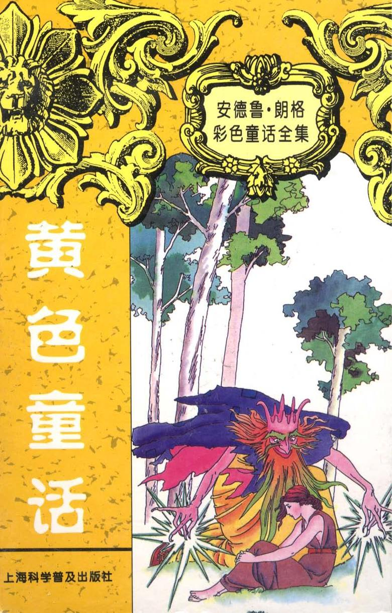

**安德鲁·朗格彩色童话全集**

黄色童话

周元一译

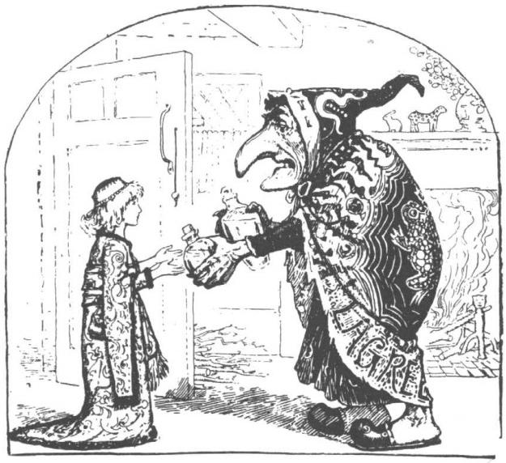

上海科学普及出版社

（沪）新登字第 305 号

Edited by Andrew Lang
The Yellow Fairy Book

Published by Longmans, Green, and Co. in 1894

---

安德鲁·朗格彩色童话全集
**黄色童话**

周元一译

---

责任编辑：钟海谷
技术编辑：万福棠
出版：上海科学普及出版社（上海曹杨路 500 号邮政编码 200063）
发行：新华书店上海发行所
印刷：中共上海市委党校印刷厂
开本：850×1168 1/32
印张：12
插页：4
字数：287000
版次：1997 年 7 月第 1 版 1997 年 7 月第 1 次印刷
印数：1-8000
书号：ISBN 7-5427-1294-2/G·403
定价：14.00 元

---

（本版图书凡印刷、装订错误可及时向承印厂调换）

 

| 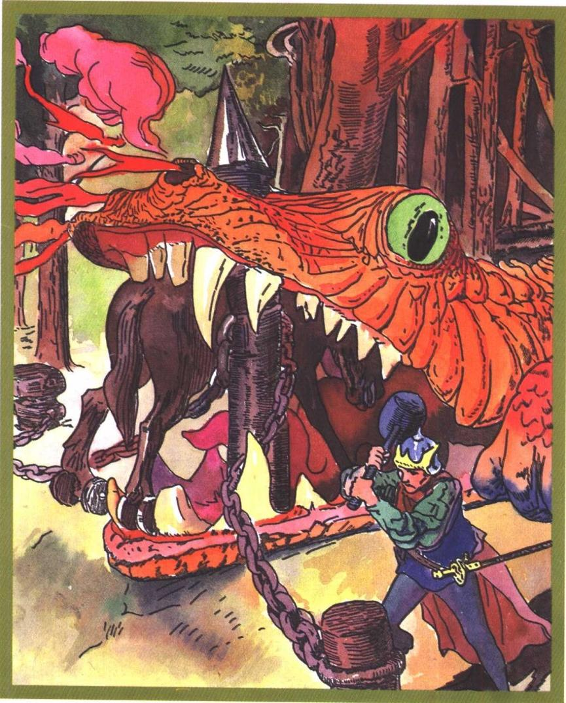 |
| :----------------------------: |
|        《北方来的恶龙》        |

 

| 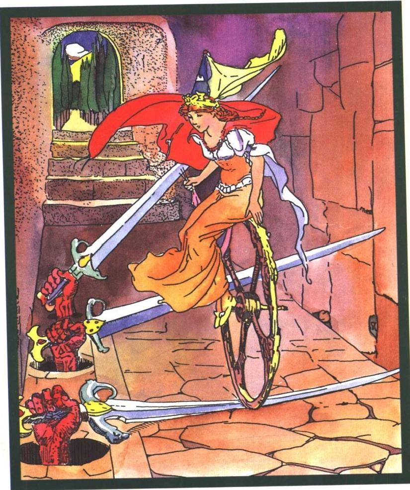 |
| :----------------------------: |
|           《大铁炉》           |

 

| 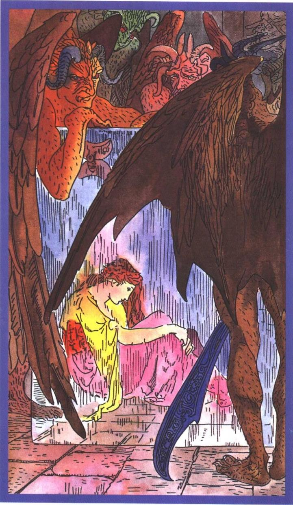 |
| :----------------------------: |
|          《隐身王子》          |

 

| 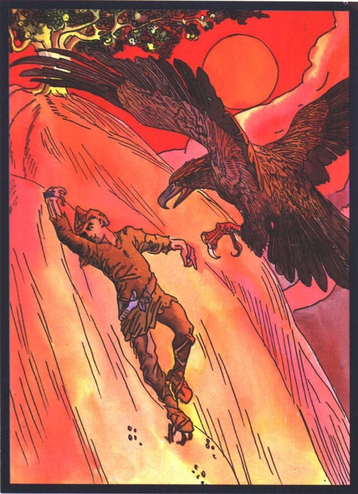 |
| :----------------------------: |
|           《玻璃山》           |

 

| 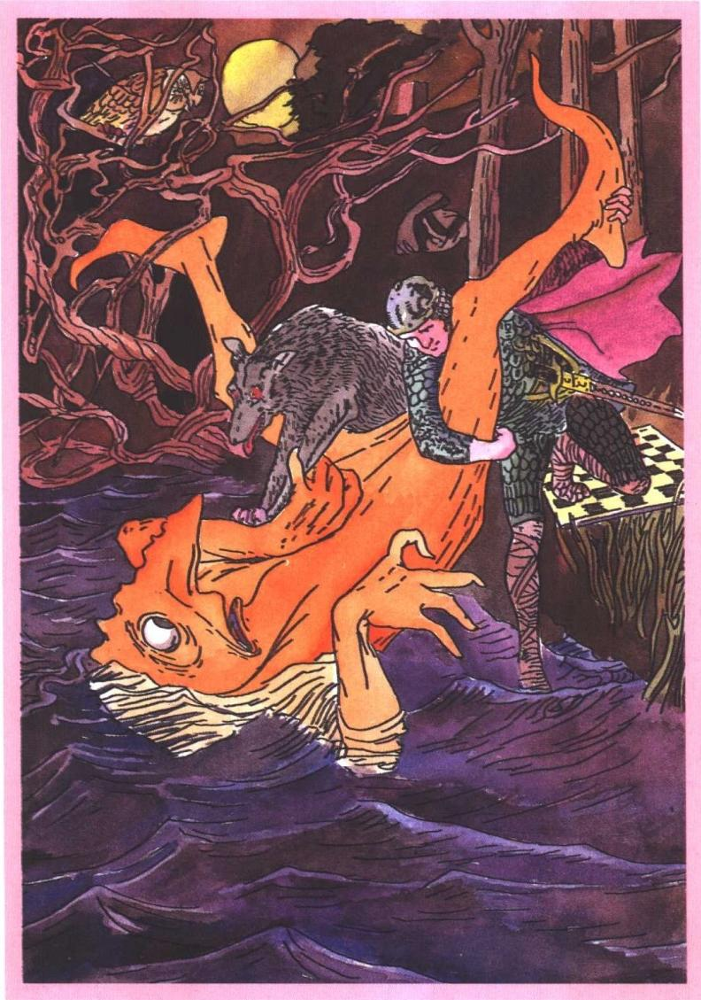 |
| :----------------------------: |
|          《林恩王子》          |

 

| 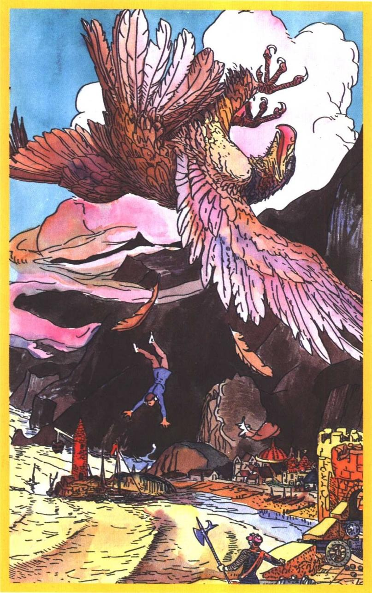 |
| :----------------------------: |
|            《蓝山》            |

 

| 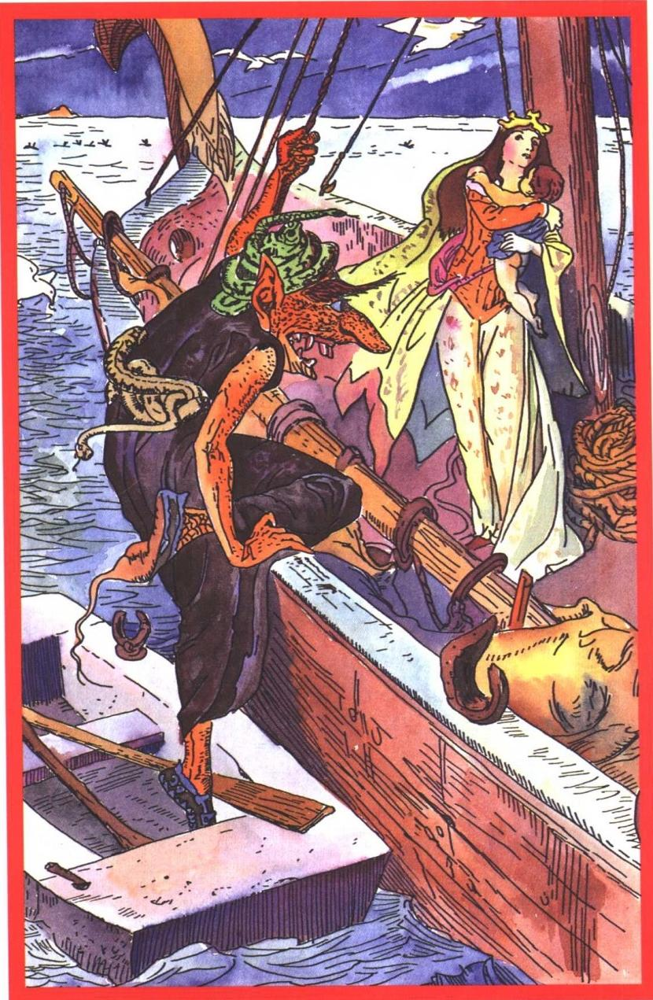 |
| :----------------------------: |
|        《石船中的女巫》        |

 

| 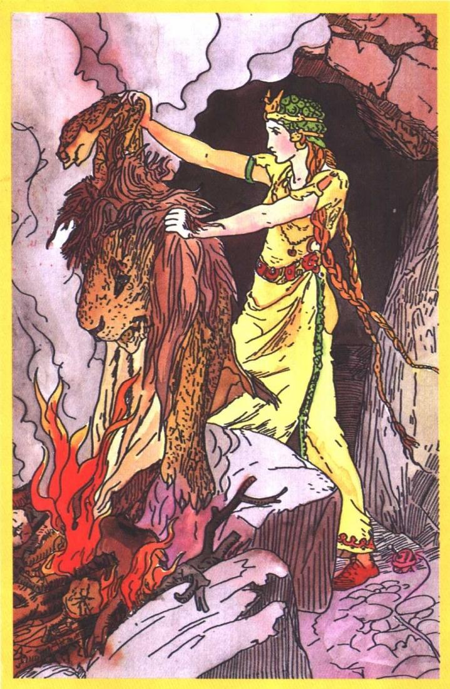 |
| :----------------------------: |
|       《海穆特和哈德弗》       |

 

## 前言

《安德鲁·朗格彩色童话全集》是英国著名文学家安德鲁·朗格（1844～1912）编辑的十二集童话。为了编辑这些童话，他广泛地收集英国、欧洲以至全世界的童话和民间故事。那些非英语的文字，如法文、德文、葡萄牙文、意大利文、西班牙文、加泰隆语等主要由他的妻子莱奥诺拉·布朗歇翻译和整理成英文。最先编成一集，当时编者的意图也只是编这一集。后来搜集的材料越来越多，才决定继续再编三集。其中的艰难和辛苦是外人所难以想象的，编者因此曾发誓，编成这四集以后，再也不编下去了。

四集童话的出版，效果非同凡响。不仅受到英国读者的欢迎，而且被译成多种文字，受到许多国家读者的欢迎。其受欢迎的程度赢得了一代又一代的读者，历数十年而不衰，这不仅源自编者长期的努力，也得益于世界各地广大热衷于这一题材的读者的帮助，他们纷纷把手头的作品和资料寄给安德鲁·朗格。这给了他极大的鼓舞，他一鼓作气，又编了八集。后面几集主要搜集了苏格兰、爱尔兰、加拿大、印度、葡萄牙、斯堪的纳维亚的民间故事和传说。有些则选自以神话、民间传说和英雄传奇为基础的中世纪威尔士故事集《马比诺吉昂》。

安德鲁·朗格认为，这些童话故事很难说是某个人写成的，它们从很久很久以前就流传下来，经过民间艺人和文学家的不断收集和整理，才达到了今天这样思想性和艺术性都比较好的程度。这些童话也被认为是英语、甚至也是全世界各种语言中时间跨度最大、包含地域最广、流传国家和地区最多、内容最丰富的童话集。

她是世界古典童话中的瑰宝，童话世界中永不凋谢的鲜花，被译成多种文字，得以广泛流传，一代又一代的儿童被她的魅力吸引，长大成为家长后，又为能给自己的孩子朗读和讲述安德鲁童话而自豪。

《黄色童话》共收集四十八个童话故事。这些故事有的讲述美丽的公主为了帮助六个哥哥摆脱被变成天鹅的魔法，整整六年如何忍辱负重，置自己的生命于不顾。有的讲述穷苦的牧童由于心地善良，肯帮助别人，自己也因此得到了幸福。有的讲述依靠集体的力量和智慧，就能克服任何困难，战胜任何强大的敌人。这些美丽的童话故事为我们展现了很久以前，这些地区的人民是怎样生活的，展现了他们的欢乐和悲伤，理想和追求；颂扬了勤俭朴素、助人为乐、正直忠诚；谴责了贪得无厌、懦弱无能、奸诈狡猾。

与《安德鲁·朗格彩色童话全集》中的其他各集一样，《黄色童话》中的故事充满了当地的风土人情和乡村气息，展现了从冰雪覆盖的北极圈到赤日炎炎的非洲大陆的美丽风光。读者们可以从中领略到许多乐趣，懂得什么是正义，什么是邪恶；什么值得爱，什么该去恨；而且还会对这些地区的人文历史和地理概貌有所了解，从而更加热爱生活，热爱我们这个世界。

 

**目录**

[TOC]

 

## 猫和老鼠作朋友

一只猫认识了一只老鼠，猫满嘴甜言蜜语，对老鼠说了一大套表白爱和友谊的漂亮话，以致老鼠终于同意与猫住在一起，并共同分担家务。“我们必须为冬天作好准备，否则就会挨饿。”猫说，“你这只小老鼠可不能到处乱跑，以防万一落入网中。”猫的好心被接受了，于是它们买了一罐猪油。一开始它们不知道把猪油放在什么地方好，经过反复考虑，猫说：“放在什么地方都不如放在教堂里妥当，没人会费事从那儿把东西拿走的。我们把这罐猪油藏到教堂的角落里，到需要的时候再去动它。”于是它们把这个小罐子放到了那个安全的地方。

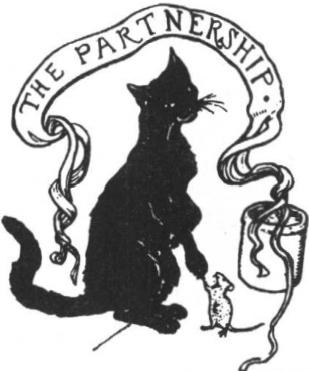

但没过多久，猫就对那罐猪油馋涎欲滴了，它对老鼠说：“我说，小老鼠，我的表妹有个小儿子，它浑身雪白，夹着可爱的棕点子。我的表妹要我做它的教母，所以今天我要出去，你就一个人看家吧。”

“啊，当然要去。”小老鼠答道，“如果遇到什么好吃的东西，可别忘了给我带些回来。我很喜欢那种在洗礼仪式上喝的红酒呢。”

其实猫说的全是谎话，它根本没有什么表兄妹，也没人请它做教母。它直接去了教堂，溜到了放猪油罐的地方，伸出舌头去舔猪油，直到舔完了顶上的一层。然后它在城里的房顶上转来转去，看看街景，伸伸懒腰，晒晒太阳。每当它又想起那罐猪油时，总不由得舔舔嘴唇。

傍晚时分，猫回到了家里。

“嗬，你终于回来了！”老鼠说，“你今天一定过得很快活。”

“今天确实过得不错。”猫回答道。

“那孩子名字叫什么？”老鼠又问。

“顶上光！”猫顺口答道。

“顶上光！”老鼠感到十分诧异，“这真是个稀奇古怪的名字。你家族中有叫这个名字的吗？”

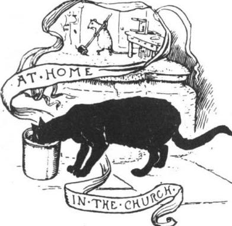

“有什么稀奇古怪的，”猫说，“这可比你的教子取名为面包贼好得多。”

没过多久，猫又忍不住它的馋瘾了。它对老鼠说： “你一定会好心地再次独自照看这屋子的，因为我又被邀请去做一只颈上长着一圈白毛的小猫的教母，我不能回绝这个请求。”

好心的老鼠答应了，但猫却沿着城里房屋的墙根溜进了教堂，这次它吃掉了半罐猪油。“啊，再没什么能比独自一人享用的东西更美味的了。”它对自己说。同时对自己这一天的成就非常得意。

猫回到家里时，老鼠问它：“这次给小孩取什么名字呀？”

“一半光。”猫又顺口答道。

“一半光！好一个名字！我活到现在还从没听见过这样的名字。我相信历史上也一定不会有这个名字的。”

又过了不久，猫的嘴巴又因为想吃猪油而不停地流口水了。“好事成三，”它对老鼠说，“我又要去当教母了。这回这孩子一身黑油油的皮毛，身上没有一根白毛，四只爪子却全是清一色雪白的毛，没有一根黑毛。这种情况两年才能碰到一次，你会不会让我去呢？”

“顶上光！一半光！”老鼠重复着这些名字，“这真是些奇怪的名字，让我琢磨不透。”

“啊，你还是披着你的灰皮，拖着你的长尾巴呆在家里吧。”猫说道，“你可以想入非非，成天呆在家里不出去就会这样的。”

猫走了之后，老鼠把屋子彻底清扫了一遍，拾缀得整整齐齐，但这时贪心的猫却把整罐猪油全吃光了。“吃光用光，浑身舒畅。”它对自己说。到了晚上，它心满意足地踱着方步回家了。老鼠一见到它，立刻问它第三个孩子的名字。

“它的名字不会让你高兴的。”猫说道，“它叫统统光！”

“统统光！”老鼠重复道，“我断定这名字也像前两个名字一样没人用过的。统统光！这是什么意思呢？”老鼠不断地摇着头，卷起身子去睡觉了。

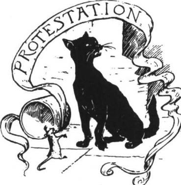
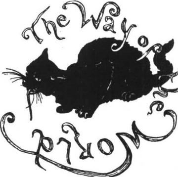

从这次以后，再也没有谁请猫去做教母了。当冬天来临，外面找不到食物时，老鼠想起了它们储藏的食物，就对猫说：“嘿，猫姐！我们去把那罐储藏着的猪油取出来吃吧！那一定是很好吃的。”

“是啊，一定很好吃。”猫回答道，“它的味道好得就像你把你的细舌头伸到窗户外面一样。”

猫和老鼠一起出发了，到达教堂时，它们发现罐子仍在原处，可里面的东西全没了。

“哦！”老鼠叫起来，“现在我明白是怎么回事了！一切都水落石出了！你真是我忠实的朋友！你去当教母时，就把这些猪油全吃光了！第一次是顶上光，然后是一半光，最后是—— ”

“住嘴！”猫厉声叫道，“再多说一个字我就把你吃掉！”

但“统统光”几个字已经到了这可怜的老鼠的舌头上，这几个字刚一说出口，猫就扑到了老鼠身上，抓住它一口吞了下去。

读者一定明白，世界上的事情有时就是这个样子的。

 

## 六只天鹅

有个国王在一座大森林里打猎。由于他非常勇猛专注，以致随从都没法跟上他。到了傍晚，当他终于停止了对猎物的追逐，四处张望时，却发现自己已是孤身一人，在大森林里迷了路。他想找一条路走出森林，却怎么也找不到。这时他看到一个不断晃着头的老妇人向他走来，这个老妇人实际上是个巫婆。

“老人家，”他对妇人说，“你能不能给我指点一下走出森林的方向？”

“啊，当然可以，国王，”妇人答道，“我可以指给你马上走出森林的路，但我有一个条件，如果你不答应这个条件，你就永远也别想走出森林，你会饿死在森林里。”

“你的条件是什么呢？”国王问道。

“我有一个女儿，”老妇人答道，“她非常美丽，论容貌世界上没有人能比得上她，她很适合做你的妻子。如果你愿意娶她为王后，我就指给你走出森林的道路。”

国王心里感到很痛苦，但无奈只好答应了这个条件。于是老妇人引他到了自己的屋子里，她的女儿正坐在屋里的火堆旁，她接待国王的态度使国王感到她好像正在等着他的到来。国王看她确实异常美丽。但这美丽的容颜却不能让国王感到快乐，看着她时，总是暗暗地从心里感到一种恐惧。国王把老妇人的女儿扶上自己的马背，老妇人指给他走出森林的路径，于是国王回到了自己的宫殿，并与老妇人的女儿举行了婚礼。

国王以前曾经娶过一位妻子，那位妻子给他生了七个孩子，六个男孩和一个女孩。国王爱这几个孩子胜过爱世界上任何其他的东西。国王怕孩子们的后妈虐待他们，就把他们藏到一座孤零零的房子中。那所房子隐蔽得很好，而通往那所房子的路也很难找。要不是有一个聪明的妇人给了国王一个有魔力的线球，国王连自己都会找不到那所房子。但国王去看他心爱的孩子的次数太多了，以致于王后因他经常不在身边而感到十分恼火。她开始起疑心了，并想弄清楚国王独自一人去森林究竟是干什么。于是她给了国王的仆人一大笔钱，这些仆人收了钱后就把国王的秘密告诉了王后，并且把那能指路的线球也告诉了王后。于是王后不停地寻找，终于找到了国王藏线球的地方，然后她缝了一些小衣服，并用从她母亲那里学来的巫术，在每件小衣服里缝进了一个咒语。

当国王骑马出去时，王后带上小衣服走进森林，线球给她指明了道路。孩子们远远地看到有人向他们走来时，以为是亲爱的父亲来看他们了，于是都蹦蹦跳跳地迎上前来。这时王后向每个孩子扔过去一件小衣服，这些小衣服一碰到孩子们的身体就把他们变成了天鹅，从森林上空飞走了。王后心满意足地回了家，她想她已经摆脱了这几个继子女的烦恼。可实际上国王的女儿并没有与她的几个兄弟一起跑到王后面前去，因此王后并不知道国王还有个女儿。

第二天，国王又去看望他的孩子们，但他只看到了女儿一人。

“你的兄弟们都到哪儿去了？”国王问道。

“哎！亲爱的父亲，”女儿答道，“他们都飞走了，这里只剩下了我一个人。”于是，她告诉父亲她从窗户中看到兄弟们变成天鹅飞走的情形，并把她收集起来的兄弟们飞走时掉下的羽毛拿给父亲看。国王看了很痛心，但他没有想到这坏事是王后干的。他怕女儿也变成天鹅飞走，就想带女儿回宫去。女儿害怕后妈的虐待，请求国王让她在这森林中的房子里再呆一晚。可怜的小姑娘是这样想的：“这里再也不是我的家了；我要到远处去找我的兄弟们。”当夜晚来临时，她逃进了森林深处。走了整整一晚上，第二天又走了整整一天，一直走到再也走不动为止。这时她看到了一所小房子，就走了进去，在一间房间里她发现有六张小床。她怕躺上去会把床压坏，就爬到一张床的下面，躺在硬地板上，准备在那里睡觉。太阳落山时分，她听到一阵嘈杂声，接着就看到六只天鹅从窗户飞进房间，它们站在地上互相吹着气，把身上的羽毛全吹掉后，天鹅皮就像衣服那样脱了下来。姑娘认出这就是她的六个哥哥，于是高兴地从床底下爬了出来。六兄弟再次看到自己的妹妹也万分高兴，可是他们的高兴只维持了一会儿。

“你不能呆在这里，”他们对她说，“这里是一个强盗的巢穴，如果他们回来时发现你在这里，就会杀了你的。”

“你们不能保护我吗？”姑娘问她的兄弟们。

“不能，”他们回答道，“我们每天只能在傍晚的一刻钟里脱下天鹅皮，变回人的原形，过了这段时间我们就又变回天鹅了。”

小姑娘听了这些话后哭着说道：“难道你们就没法摆脱这魔力吗？”

“哎，没办法，”他们答道，“要摆脱这魔力的条件太苛刻了。你必须在整整六年的时间里不说话也不笑，并在这段时间里用星星花给我们做六件衣服。只要你的嘴里吐出一个字，你的所有工夫就都白费了。”当兄弟们说完这些话时，一刻钟的时间已经到了，他们又变成了天鹅从窗户中飞走了。

小姑娘下了决心，即使牺牲自己的性命也要把六个兄弟从魔力中解脱出来。于是她离开了小屋，走进了森林，爬上了一棵大树，在树上睡了一夜。第二天早晨开始，她就出去采星星花，并动手用它来缝衣服。她不能与任何人说话，于是就专心一致地做她的衣服。

就这样，她在树上住了一段时间。一天，这个国家的皇帝正好来这森林打猎。皇帝的随从发现了坐在树上的小姑娘，就问她：“你是谁？”但小姑娘没有回答。

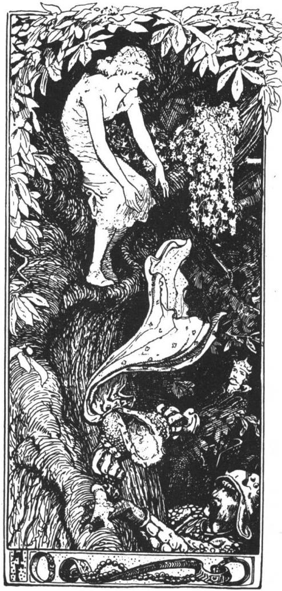

“下来到我们这儿来，”随从们说，“我们不会伤害你的。”

但她默默地摇摇头。随从们再问她问题时，她就把脖子上的金链摘下来扔给他们，但他们还不走，她又把她的腰带扔给他们，但这也没用，她就又扔下了袜带，后来又扔下了衣服。但随从们并没有放过她，他们爬上树把她拉了下来，带到皇帝面前。皇帝又问道：“你是谁？你在那棵树上干什么？”

但她还是什么都不回答。

皇帝用他会说的各种语言问她，她仍像木鱼一样不开口。但她长得那么美丽，以致于把皇帝的心打动了，使皇帝深深爱上了她。皇帝用自己的袍子把她裹起来，让她坐在自己前面，两人同骑一匹马回到了宫里。皇帝给她穿上了漂亮的衣服，使她的美丽更加光彩照人，但却仍然听不到她说一句话。皇帝让她坐在自己身边，她高雅的举止使皇帝更加高兴。皇帝说：“世界上除了这个姑娘外我谁也不娶。”几天后皇帝就娶她做了皇后。但皇帝有个狠毒的母亲，她不赞成这桩婚姻，总在皇帝面前说皇后的坏话。“谁知道这是谁家的孩子？”她说，“她又不会说话，真不配做皇后。”

一年后皇后生下了第一个孩子。但皇帝的母亲把孩子藏了起来，然后去对皇帝说是皇后杀死了孩子。皇帝不信这话，也不许别人伤害皇后。皇后仍然静静地坐着缝她的衣服，别的什么也不管。当她生下第二个孩子时，皇帝母亲仍然像上次那样，但皇帝还是不相信他母亲的话。他说：“她那么善良温柔，决不会干那种事的。如果她不哑的话，她就可以辩白自己是无辜的了。”但当第三个孩子又不见了时，皇后仍然不能开口为自己辩护，皇帝只好按法律下令将她用火刑处死。

死刑执行的那天正好是她不能说笑的六年的最后一天，现在她终于可以把自己的兄弟从魔力中解脱出来了。六件衣服已经做好，只差最后一件的左袖还要缝几针。

当她被带着走向火刑柱时，她把做好的衣服挽在手臂上。刽子手开始要点火了，她向四周张望，看到六只天鹅从空中飞来。这时，她明白她自己马上会获得解救，不由高兴得跳了起来。天鹅在她身边扑翅，它们飞得很低，使她可以把衣服扔到他们身上。这些衣服一碰到天鹅，天鹅的皮就掉了下来，她的兄弟又活生生地站在她面前，他们又健康又美丽，只是最年轻的兄弟的左臂仍然是天鹅的翅膀。他们互相拥抱、亲吻，皇后则走到惊讶地站在一边的皇帝面前，对他说：“亲爱的丈夫，现在我可以说话了，我要当众告诉你我是无辜的，对我的一切指控都全是诬陷。”

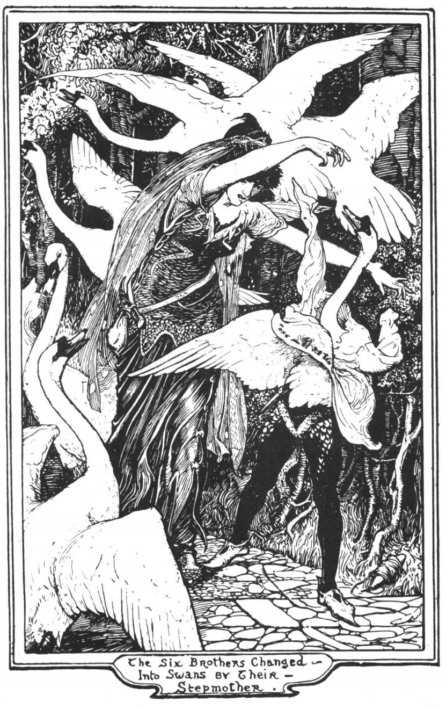

她告诉了皇帝那个老妇人设的骗局，以及她把三个孩子带走藏起来的经过。于是皇帝派人找来了这三个孩子，这使皇帝感到十分高兴，而那狠毒的母亲自然也不会有好结果的。

皇帝与皇后以及他们的六个兄弟从此以后幸福安定地生活了好久好久。

 

## 北方来的恶龙

老人们说，很久以前从北方来过一条恶龙，这条恶龙不但吃人还吃野兽，把它经过的每个国家都变成了大片大片的荒地。这恶龙的破坏力那么大，以致人们全都担心，如果没有意外的帮助，地球上的生命全会被它毁掉。这条恶龙的身子像头牛，四条腿像青蛙，前腿短，后腿长，屁股上还长着一条大蛇一样的尾巴，足有二十米长。它行动的时候就像青蛙一样往前跳，每跳一步就是一里多路。幸好这条恶龙有一个习惯，就是总在同一个地方呆上好几年，直到把周围活的动物都吃完了，才挪个地方。恶龙的身上披着比石头和钢铁还要坚硬的鳞甲，因此什么东西都伤害不到它；它的两只大眼日夜放射着耀眼的白光，就像两盏极亮的灯，任何人如果不幸看了一眼这两只眼睛，就会立即像中了魔一样，不由自主地跑到恶龙的嘴里去。因此恶龙躺在地上动都不用动，就可以毫不费力地吃到人和野兽。周围王国的国王都拿出过巨额的奖金，不管是什么人，也不管是用武力还是用魔法，只要他能毁掉这条恶龙，就可以得到这些巨奖。许多人都去碰过运气，但都悲惨地失败了。有一回，人们把恶龙呆在里面的那座大森林点着了火，结果森林全烧光了，恶龙却没有受到一丁点儿伤害。然而，当时在国内的术士们中还是流传着一个传说，说是所罗门的国王有一个图章戒指，上面刻着一段神秘的文字，谁能弄明白这段神秘文字的含义就能找到摧毁恶龙的办法，而谁能拿到所罗门国王的戒指，他就有能力打败恶龙。但是没人知道所罗门国王的戒指藏在哪儿，也不知道该去哪里寻找能识别这神秘文字的术士或学者。

后来，终于有一个好心而又勇敢的年轻人出发去寻找这只戒指了。他选择了往太阳升起的方向走，因为他知道，古代智慧的发源地是在东方。经过几年的跋涉，他终于遇到了一位著名的东方术士，就向他请教这件事。术士回答道：

“凡人的智慧是很有限的，他们帮不了你什么忙，但是如果你能懂鸟语，那么天上的飞鸟会给你很有用的指引。如果你能在我这里呆几天，我就能使你懂得鸟语。”

这青年极其感激地接受了术士的提议，并说：“我现在还不能对你的好意作任何报答，但我若能成功地完成我的使命，你现在付出的一切就会得到优厚的报酬。”

于是术士用他在月夜里采摘的九种草药炼了一种强烈的药汁，并让青年每天服九匙这种药汁，就这样连服了三天，青年就有了听懂鸟语的能力。

分手时，术士对他说：“假如你能找到并取得所罗门国王的图章戒指的话，把它拿到我这里来，我可以把戒指上的秘文解释给你听，除了我以外世界上没有人能看懂这秘文。”

从此，年轻人在路上行走时就不再感到孤独了，因为他能听懂鸟的语言，他就总是能有伴侣，他还学到了许多人类还不曾掌握的知识。但又过了很多时间，他还是未能找到那只戒指。有一天傍晚，他走得又热又累，就坐在林中的一棵树下吃晚餐，这时他看到有两只他从未见过的、羽毛极为漂亮的鸟正栖息在他靠的那棵树顶上聊天，其中一只鸟对另一只说：

“我认识在这棵树下坐着的家伙，他走了那么远的路都没找到要找的东西。他是想找所罗门国王的那只丢失了的戒指。”

另一只鸟答道，“他必须找到那个巫术姑娘才行，只有她才能帮他。那巫术姑娘如果自己没有拿着这戒指的话，她也一定知道这戒指在谁那儿。”

“但他上哪儿去找这巫术姑娘？”第一只鸟又问道，“她一向居无定所，总是今天在这儿，明天在那儿。他要找那巫术姑娘就像是要捕住风、捉住影一样难。”

另一只鸟答道，“我也不知道巫术姑娘现在在哪里，但从现在起过三个晚上，她就会到泉水那里洗脸。她每个月满月的晚上，都要到那儿洗脸的，那样做可以使她永不变老，也不会长皱纹，并可以永葆青春活力。”

“好啦，”第一只鸟又说，“泉水离这儿不远，我们去看看她是怎么洗的，怎么样？”

“如果你想去的话，我当然愿意奉陪。”另一只鸟说。

年轻人在树底下听了这两只鸟的对话后，立即决定跟着这两只鸟到那泉水边。他只担心两件事：一件是怕鸟儿在他睡着的时候飞走了，另一件是怕鸟儿飞得太快，自己赶不上，因为他没有翅膀，不能飞得像鸟儿那么快。他实在太困了，因此他无法整夜都不合眼，但焦急的心情又使他无法睡熟。天刚蒙蒙亮他就抬起头来往树顶上看，高兴地看到那两只披羽毛的伙伴还把头埋在翅膀里睡觉呢。于是他吃了早饭，等着那两只鸟儿出发，但它们却整天都没离开这块地方。从早到晚，它们只是从这棵树上跳到那棵树上，跳来跳去寻找食物，到晚上又回到了原先的那棵树上睡觉。第二天情形也与头一天一样。直到第三天早晨，一只鸟对另一只说：“今天我们必须到泉水那里去看巫术姑娘洗脸了。”它们在树上呆到了中午，然后就一起向南飞去。年轻人急忙赶上去，生怕这两只鸟从他视线中消失，使他失去向导。他终于做到了使两只鸟始终在他的视线之内，直到这两只鸟在一棵树上停下来休息。年轻人追赶这两只鸟直追得精疲力尽，气喘吁吁。经过三次休息，那对鸟终于飞到了林中的一小片空地上方，它们就停在空地边上的一棵大树顶上。年轻人赶到这里时，他看到空地中央有一眼清澈的泉水，于是他就在那对鸟栖息的大树下坐下来，注意地听着两只鸟儿间的对话。

“太阳还没下山，”第一只鸟说，“我们必须等一会儿，等到月亮升起来，那姑娘才会来这泉水边。你觉得她会不会看到这棵树下坐着的这年轻人呢？”

“什么都躲不过她的眼睛，这年轻人她当然不会看不到，”另一只鸟说，“那年轻人不知有没有想到不要让姑娘在洗脸的时候发现他？”

“我们等着瞧好了，”第一只鸟说，“看看他们两人相处得怎样。”

这时晚霞已退尽，满月已高挂在森林上空，青年听到林中传来了沙沙的走路声。不一会儿，从森林中走出了一个少女，她轻轻地滑过草地，就好像脚根本没有着地一样，一会儿就来到了泉水边。年轻人的目光一刻也没有离开少女，因为他有生以来还没见过这么漂亮的姑娘。她似乎没有注意到周围的人和事，就直接走到泉水边。她先抬头望了望天上的满月，然后跪下来用泉水洗了九遍脸，之后她又抬头望着月亮，并绕着泉水走了九圈，她一边走一边唱道：

> “满月的银光多明媚，
> 愿我的容颜永不消退，
> 我的双颊会更美！
> 月满之后还会变亏，
> 愿我的青春永不消退，
> 我的活力更充沛！”

接着她就用自己的长发擦干了脸，准备转身离去，这时她的目光突然落在青年人坐的地方，就向那棵树转过身来。年轻人马上站起来迎接她。姑娘说道：“你居然敢擅自偷看我在月光下的秘密，因此你应该受到严惩。但你是个陌生人，不知道这里的规矩，我就饶了你这一次。但是你必须实话告诉我你是谁，你是怎么找到这个地方的，因为在你之前还没有任何凡人到过这儿。”

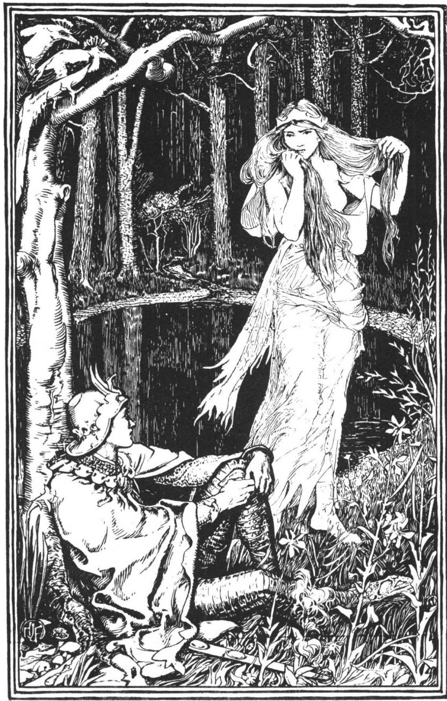

青年谦恭地答道：“请原谅我，漂亮的姑娘，如果我无意中冒犯了你的话。我只是长途跋涉后偶然经过这里，想在这棵树下睡个好觉而已。你来以后我不知该怎么办好，只好继续呆在这里，我本以为我静静地呆在这里不会冒犯你的。”

姑娘和善地答道：“跟我到我住的地方去过夜吧，睡在床上会比睡在这潮湿的苔藓地上舒服得多。”

年轻人迟疑了一会儿，但这时他听到鸟儿在树上说：“跟着到她那里去吧，只是要留意不要把你的血给她，否则你就卖掉了你的灵魂。”于是年轻人就跟着姑娘走了。不久他们就进了一座美丽的花园，花园中有一座极为豪华的房子，房子在月光下闪着光，看起来像是用金和银造成的。进屋以后，年轻人发现屋里有许多豪华的房间，而且布置得一间比一间更漂亮。屋里的金烛台上点着数百支蜡烛，把屋子照得如白昼一般明亮。最后他们走进了一间房间，桌上已经摆满了最珍贵的菜肴。桌旁放着两张椅子，一张是金椅子，另一张是银椅子。姑娘自己坐到了金椅子上，把银椅子让给了年轻人。吃饭的时候，许多穿白衣服的少女在一边侍候他们，少女走路时脚步轻得一点声音都没有。吃饭时他们谁也没说话。饭后，青年与巫术姑娘一起愉快地交谈了好久，直到一位穿红衣服的女人进来提醒他们，已经到了睡觉的时间，于是青年被带到了另一间房间，房里床上铺着丝绸的被单，窗上挂着落地窗帘。青年睡得舒服极了，但他好像听到床边有一个声音在不断提醒他：“记住不要把你的血给她！”

第二天早上姑娘问青年，他是否愿意与她一起一直呆在这美丽的地方？青年没有马上回答，于是姑娘又说：“你已经看到了，我能始终保持年轻与美丽，我不用听从任何人的命令，可以做我想做的任何事情，因此我以前从未想过要嫁人。但是自从我看到你那一刻起我就喜欢上你了，所以如果你愿意，我们俩就可以结婚，我有很多很多财富，我们可以在一起像王子一样生活。”

年轻人的心被姑娘的提议深深地打动了，但他记得那两只鸟曾说她是一个巫女，而鸟儿们的警告也一直在他耳边响着。因此，他小心翼翼地答道：“请不要生气，亲爱的姑娘，这么重大的事情我一下子决定不下来。请给我几天时间考虑考虑，这样我们才能达成共识。”

“当然可以了，”姑娘回答道，“如果你愿意，你可以考虑上几个星期，你好好用心想想吧。”为了使日子过得愉快，她带着青年参观了她这座美丽居所的每个地方，并把她所有的贵重珠宝都拿给他看。但这些贵重的珠宝都是用巫术变出来的，这巫术姑娘在所罗门国王的图章戒指的帮助下，可以随心所欲地变出任何东西；只是这些东西都不可能保持长久，过了一段时间它们就会像风一样消失，不留下任何痕迹。但年轻人并不知道真相，还以为这些东西都是真的呢。一天，姑娘带着他进了一间密室，那密室中央有一只银做的桌子，桌子上放着一只小小的金盒子。姑娘指着盒子说：“这里装着我最贵重的宝贝，这种宝物在世界上是找不到第二件的。这是只极其珍贵的金戒指。当你娶我的时候，我就把它作为结婚礼物送给你，它会使你成为全世界最幸福的人。但为了使我们的爱情能永远持续下去，你必须从你左手小指上刺出三滴血来给我，作为我给你这只戒指的回报。”

青年听了这些话不禁打了个冷颤，因为他记得这是用他的灵魂在作交换。但是他很机智，为了掩饰自己的想法他没有直截了当地回答姑娘，而是装作不经意地问姑娘，这只戒指究竟有什么特别？

姑娘答道：“没有一个凡人能完全了解这只戒指的魔力，因为没人能完全弄明白这戒指上的秘文的意义。我虽然对这些文字只是半懂，但我已能据此造出许多奇迹来了。如果我把这戒指戴在左手小指上，我就能像鸟一样在空中任意飞翔。如果我把它戴在左手无名指上，别人就看不到我了，而我却能看到周围的所有东西。如果我把这戒指戴在左手中指上，无论是水火还是利器都伤害不了我。如果我把它戴在食指上，我就能在它的帮助下变出任何东西。最后，如果我把它戴在左手大拇指上，我的手就力大无比，可以打破任何石头和墙壁。除此之外，这戒指上还有很多秘密记号，现在还没人能弄明白。无疑这戒指上包含着极重要的秘密。这戒指原先是属于所罗门国王的，他是世界上最聪明的国王，在他的统治下，他的国家中出了许多最聪明的人。但没人能知道这只戒指是不是由凡人之手造的，有人说是一位天使把它给了聪明的国王。”

青年听了这些话后，虽然并不十分相信这只戒指有那么多魔力，但仍然决心把它弄到手。他希望姑娘能让他有机会拿到这只戒指，但又不想马上向姑娘提这样的要求。过了一会儿姑娘把它又放回了盒子里。几天后，他们又谈起了这只魔力戒指，青年说道：“我觉得这戒指不可能有你说的那么多的魔力。”

于是，姑娘打开盒子拿出了戒指，戒指在她手中像一道明亮的阳光一样闪着光芒。她把戒指戴到左手中指上，让青年拿起一把剑尽力砍她，以表明那样伤害不了她。青年开始不情愿那样做，但姑娘坚持要他做。于是他就开始试验，先是轻轻地去砍，后来就真的用力去砍了，但他们两人中间好像隔着一堵看不见的墙，姑娘站在他面前笑着，他就是伤害不到她。然后她又把戒指戴到无名指上，转眼间她就从他面前消失了。一会儿她又笑着出现在他的面前，手上夹着那只魔力戒指。

“让我试试看，”青年说，“看我能不能做这些奇妙的事情。”姑娘没有疑心这里有没有欺诈，就把魔术戒指递给了他。

青年装作忘了该怎么做，他问姑娘该把戒指戴到哪只手指上才能刀枪不入。

“哦，戴到左手中指上，”姑娘笑着说。

她拿起刀试着去砍青年，而青年自己也试着用刀砍自己，但他们都砍不到。然后他又让姑娘告诉他如何借着这戒指的帮助来击碎石块和岩石，于是姑娘把他带到院子里，那里有块巨石。“现在把戒指戴在你的左手大拇指上，你就能看到你的手多么强壮有力了。”于是青年照着做了。他惊讶地发现，他的拳头只轻轻一击，那块巨石已经碎成千百块小石头。于是青年想，如果现在他不充分利用魔术戒指在他手中的机会，那他就是个大傻瓜，这种机会可是以后再也碰不到了。于是，当他们还站着笑那堆碎成小石块的石头时，他就像好玩一样地把戒指戴到了左手无名指上。

“现在我看不到你了，”姑娘说，“你要把戒指除下来我才能再看到你。”

但青年却无心这样干，相反，他远远地走开去，然后把戒指套到左手小指上，像鸟一样向空中飞去。

当少女看到青年飞走时，她起先还以为他是闹着玩，就叫道：“快回来，朋友，你现在知道我告诉你的都是实话了吧？”但那年轻人却一去再也不回来了。

姑娘这时才明白她中了圈套，深深地后悔怎么会相信他，把戒指给了他。

年轻人在空中一直飞着，直到他到达教他鸟语的那位聪明术士的房子前才停下来。术士看到青年寻找戒指的努力获得成功感到很高兴，立即就着手破译那刻在戒指上的秘文，但他一直花了七个星期才把这些秘文弄明白。然后他教给青年摧毁北方来的恶龙的办法：“你必须铸一匹铁马，在铁马的四个脚上装上四只轮子。你还要装备一根三、四米长的长矛，把魔戒戴在左手大拇指上就能挥动这根长矛。长矛两头要尖，中间要有一棵大树那么粗。长矛的中间要拴上两条二十米长的粗铁链。你必须把这长矛插到恶龙嘴里，等恶龙的上下颚被长矛牢牢地扎住后，你必须马上从铁马上跳下来，把铁链牢牢地系在地上的铁桩上，这样龙就跑不掉了。这样两三天后，恶龙的体力被消耗了大半，你就可以接近它了。这时，你就把所罗门国王的戒指套在左手大拇指上，给那恶龙最后的致命一击。但在走到恶龙身边之前必须把戒指戴在无名指上，这样恶龙就看不到你了，否则它会用它的长尾巴打死你的。完成这一切后，小心不要丢失这戒指，也不要让别人骗走它。”

青年谢过了术士的指点，并许诺事成之后一定好好报答他。但术士答道：“我已经从这戒指教给我的智慧中得到了那么多益处，因此我已不需要其他的报偿了。”他们就这样分手了，青年很快就飞回了家。他在自己家中住了几个星期后，就听人说那只北方来的恶龙已经离这儿不远了，要不了多久就会进入这个国家。国王公开宣布，不管是谁，只要能使国家免于恶龙的侵害，他就把大部分王国分给他，还要把女儿嫁给他。于是青年就去晋见国王，对国王说他有很大把握可以降服恶龙，只要国王给他备齐他所需的一切就行了。国王很高兴地答应了，并按青年的要求为他准备了铁马、长矛和铁链。这一切都准备好后，人们发现那匹铁马实在太重了，就是有一百个人也难以移动它半步，于是青年只好借戒指的魔力自己来移动它。这时恶龙已离这个国家很近了，只要再跳一、两次，它就要越过国界进入这个国家了。青年这时开始考虑他该如何行动好，因为如果他从后面推着马前进，他就不能骑到马背上了，而术士是教他必须骑在马背上的。但出乎意料之外，一只大乌鸦给他出了个好主意：他可以骑在马背上，像撑船那样用矛撑着地面前进。青年照此一试，果然这样就能很容易地往前进。这时，恶龙已经把它的巨颚张得又宽又大，等着吞下猎物了！只要再往前几步，青年和他的铁马就会被整个吞下去！青年害怕得直颤抖，血都变凉了，但他还是保持了勇敢精神。

他把铁矛竖起来，用尽全身力气刺进恶龙的下颚，然后在恶龙还没来得及合上嘴巴之前，以闪电般迅速的动作跳下铁马。这时，响起了像炸雷似的啪的一声，这响声几里之外都听得到。这可怕的响声告诉青年：恶龙的巨颚咬在铁矛上了。青年转过身来，看到铁矛的矛头从恶龙的上颚上穿了出来，而另一端则深深地插到了地里面，恶龙的牙齿现在卡在了铁马上，已经失去了作用。青年于是赶紧用巨大的铁夹将铁链固定在地上的铁桩上。恶龙持续挣扎了三天三夜，在挣扎中它的大尾巴猛烈地打在地上，以致十里以外的地面都像地震一样在震动。当它最后终于耗尽了体力，尾巴不再动时，青年在魔戒的帮助下，拿起一块二十多个常人都搬不动的巨石，用力猛砸恶龙的脑袋，终于把恶龙打死在面前。

谁都能想象，当恐怖的恶龙终于被打死的消息传开去的时候，全国是怎样一种欢腾的景象。人们像是迎接最强大的国王那样把恶龙的征服者迎进了城里。老国王已经不需要说服女儿嫁给这个屠龙者了，他发现女儿太愿意把自己的未来托付给这个英雄了，毕竟他独自一人完成了全国的军队都完不成的任务。几天后，王宫里举行了盛大的结婚典礼，欢乐的庆祝活动持续了整整四天，周围国家的国王也一起来感谢这位把世界从他们的共同敌人手中解救出来的英雄。但在这欢乐过程中大家忘了应该把恶龙的尸体掩埋掉，结果恶龙尸体的恶臭使整个空气都被毒害了，还爆发了一场瘟疫，夺走了几百个人的生命。国王的女婿在苦痛中只好决定再次去求那个东方术士帮助，于是他在魔戒的帮助下向东方术士飞去。但古语说不义之财不可取，青年人现在发现这偷来的戒指最终给他带来了厄运。那巫术姑娘自从被他骗走戒指后一刻也没有休息，日夜不停地寻找这只戒指的下落。这时，当她用巫术发现青年变成了鸟正在向那东方术士飞去时，她把自己变成了一只老鹰，在高空盘旋着等着青年的到来。

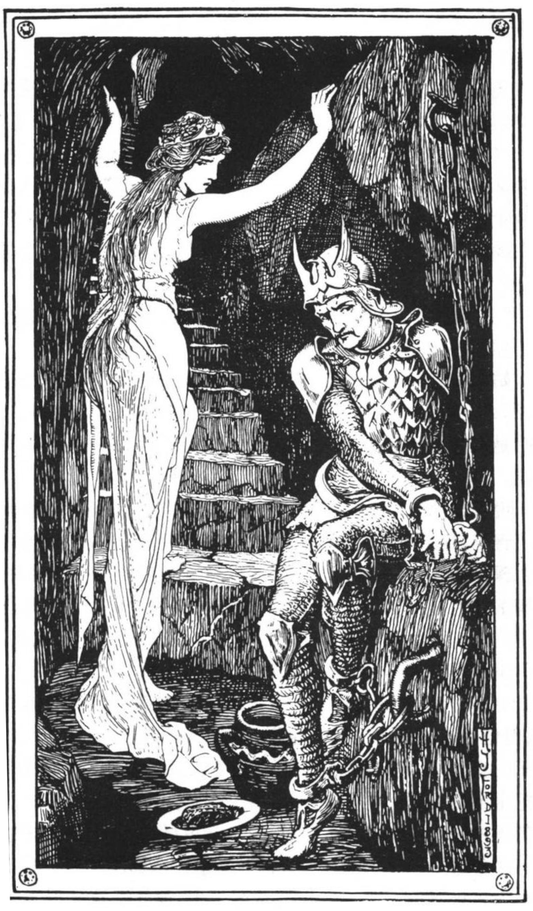

青年在远处一出现，她就从他脖子上拴着的那只闪亮的魔术戒指认出了他。于是老鹰从天上直扑下来，用她的利爪一下子抓住这只飞鸟，并在青年动手之前抢回了那只戒指。老鹰抓着她的猎物降落到地上，于是他们两个又变回人形面对面地站在那里。

“哼，你这恶棍，你又落到我手里了！”巫术姑娘叫道，“我因为爱你而对你那么好，而你却用背叛和偷窃来报答我。你从我这里偷走了我最珍贵的宝贝，你还想舒舒服服地当国王的女婿吗？现在我又占上风了，你又落到了我的手中，我要对你犯的这些罪行进行惩罚！”

“求求你饶了我，饶了我吧！”青年喊道：“我知道我深深地伤害了你，我从心里感到万分后悔。”

姑娘答道：“你现在再来求情和后悔就太迟了，如果我饶了你，那么世界上的人都会把我当成傻瓜。你是双重地欺骗了我，开始是戏弄了我的爱情，后来又偷了我的戒指，因此你必须受到惩罚。”

说了这些话后，她把戒指戴到左手拇指上，只用一只手就拎起了青年，这次她没有带他去那座豪华宫殿，而是夹着他走进了一个深深的石洞，石洞的墙上吊着铁链。姑娘用铁链把青年的手和脚都拴上，使他无法逃脱，然后她愤愤地说：“你会在这儿拴着一直到死。我每天都会给你带足够的食物来，使你不致饿死，但是你甭想再获得自由。”说完这些她就走了。

另一方面，老国王和他的女儿一直在焦急地等待青年的归来，但他们一连等了好几个星期，也没有得到青年的任何消息。国王的女儿经常梦见她丈夫正在受着极大的苦难，于是她请父亲把全国的巫师术士都请来，希望他们找出青年在什么地方以及怎样才能救他出来。但这些巫师术士用尽法术，还是只知道青年还活着，并正经受着极大的苦难，其他什么都没发现。最后有人给国王推荐了一个芬兰来的著名术士，他终于算出国王的女婿被囚禁在东方，但他不是被人囚禁，而是被一种比人能力更强的生物囚禁起来的。于是国王派了许多信使到东方去寻找他的女婿。这些信使们幸运地遇上了破译所罗门国王戒指上的秘文的那位东方术士，他们于是也掌握了超人的智慧。那东方术士不久就算出了青年被囚禁的地方，但他说：“他是被巫术囚禁起来的，没有我的帮助你们救不了他。因此我得与你们一起去。”

于是他们就一起出发了。在天上飞鸟的指引下，经过几天的跋涉，终于来到了那不幸的青年被囚禁了将近七年的地方。青年立刻认出了东方术士，但他自己却瘦得皮包骨头，以致术士已经认不出他来了。术士用魔力为他解了铁链，并细心地照顾他，直到他恢复了体力可以出发旅行。青年到家时，老国王正好在那天早晨去世了，于是他自然地继承了王位。经过这段长时期的苦难他终于过上了富足的生活，并一直这样活到了生命的尽头，但他再没有拿回那只魔术戒指，也再没有凡人见过这只戒指。

现在我想问问，如果你是那位青年，你是否宁愿与那位漂亮的巫术姑娘过日子呢？

 

## 皇帝的新衣

许多年前，有一位皇帝，酷爱穿新衣服。为了穿得漂亮，他把所有的钱都花在置办新衣服上。他既不关心他的军队，也不喜欢去看戏，只喜欢到外面炫耀他的新衣服。他每天每一小时都要换一套衣服。别国的人想到他们的国王时总是说：“他在议会里。”但这个国家的人提到皇帝时总是说：“皇帝在更衣室里。”

在他居住的那个大城市里每天都会发生一些事情，每天都会来许多陌生人。有一天，有两个自称是织工的骗子来到了这座城市，说他们能够织出世上最美丽的布。这种布不仅质地考究，花色美观，而且用它缝出来的衣服还有一种奇怪的特性：任何不称职或者愚蠢得不可救药的人，都看不见这衣服。

“那一定是极妙的衣服！”皇帝心里想，“我穿上了这种衣服，就能发现我的王国里哪些人不称职，哪些人聪明，哪些人愚蠢！是的，我要让他们马上为我织出这样的布来。”于是他给了这两个骗子许多钱，好使他们马上开始工作。

两个骗子摆出了两架织布机，装作是在织布的样子，其实织布机上一点儿东西也没有。他们还要了最好的生丝和最好的金子，但他们把这些东西都装进了自己的口袋，只是在那两架空织布机上装模作样，一直弄到深夜。

“我很想知道他们的衣料究竟织得怎么样了。”皇帝心想。他也记得凡是愚蠢或不称职的人都是看不到这布的。皇帝当然相信他自己是无须害怕的，但他要先派一个人去看看这工作的进展，以便观察一下他是否称职。全城的人都听说了这种布料的神奇力量，因此，大家都急于想看看他们的邻人是多么愚蠢，多么不称职。

“我要派我那德高望重的老臣去织工那儿，”皇帝心想，“他一定能看出这种布料是什么样的，因为他很有学问，同时也比其他任何人都更适合于他的那个职位。”

于是，这善良的老臣来到了那两个骗子工作的房子里，那两个骗子正坐在空空的织机上忙着呢。

“我的天哪！”老臣心想，他把眼睛睁得老大，“我什么也没看见！”但他却没把这话说出来。

那两个骗子请他走近一点，并指着空空的织机，问他花纹是不是很美丽，色彩是不是很漂亮。可怜的老臣走上前去，又反复擦擦眼睛，可他实在看不到什么东西，因为那儿确实什么都没有。

“天哪，天哪！”他心想，“难道我是愚蠢的吗？我可从来没想到过，这可决不能让任何人知道！我难道不称职吗？不！我决不能对人说我看不见这布料！”

“哎，你难道没什么要说的吗？”一个正在织布的人问道。

“哦，这布太美了，真是太美了！”老臣一边答应着，一边透过他的眼镜仔细地看。“多好的质地，多美的色彩！是的，我要呈报皇上，我对这布料十分满意。”

“嗯，你有这样的看法我们真高兴。”两个织工说，于是他们为各种色彩起了名字，并把布料的质地仔细解释给老臣听。

老臣极其注意地听着，以便回到皇帝那儿时能照着说出来。事实上他也是这样做的。

那两个骗子现在又要了更多的钱、更多的丝和更多的金子，说是要用于织布。他们把要来的这些东西全都装进了自己的口袋，织机上仍然是一根丝也没有，但他们仍然像以前那样，在空的织机上忙忙碌碌。

不久皇帝又派了另一位诚实的官员，去看看布织完了没有。这位官员的遭遇与上次那位老臣一样，他看了又看，可因为织布机上什么也没有，他也就什么也没看到。

“这是不是一种美丽的布料？”两个骗子问道，同时他们指着那些并不存在的布料讲述着它们出色的质地。

“我并不愚蠢呀！”这位官员心想，“一定是我还不适合有现在这样的好官职。这真有点奇怪，但我决不能让人看出来。”于是他就把这并没有看到的布料称赞了一番，并说他很满意这美丽的色彩和考究的质地。“是的，那真是太美了！”他对皇帝说。

城里所有的人都在谈论着这美丽的布料。

这时，皇帝就想亲自去看看这还在织布机上的布料了。他带着一大批特别选定的随员——其中包括那两位已经去看过的官员——到了那两个狡猾的骗子那儿。那两个家伙正在那儿尽全力干着，只是没有一根丝和线。

“你看这是不是很华丽？”那两位先来看过的官员齐声说。“陛下请看，多好的质地！多美的花纹！”他们对着空织机指指点点，因为他们相信别人一定能看见这布料。

“什么！”皇帝心里想，“我什么也看不见！难道我是个愚蠢的人吗？难道我没有资格当皇帝吗？这可是我遇见的一件最可怕的事情。”“哦，真是美极了！”皇帝说，“这衣料我已认可了。”他满意地点点头，认真地察看了空空的织机，因为他不能说他什么也没看见。

皇帝的全体随员都看了又看，谁也没比别人多看到什么东西，但他们都像皇帝那样说：“啊！这布真美！”他们还向皇帝建议，穿着用这又新又华丽的衣料做成的衣服，去参加马上就要举行的游行盛典。“真华丽呀！真漂亮呀！真惹人喜爱呀！”人人都这么说着，人人都好像对这布料很满意。于是皇帝封这两个骗子“御用织师”的称号。

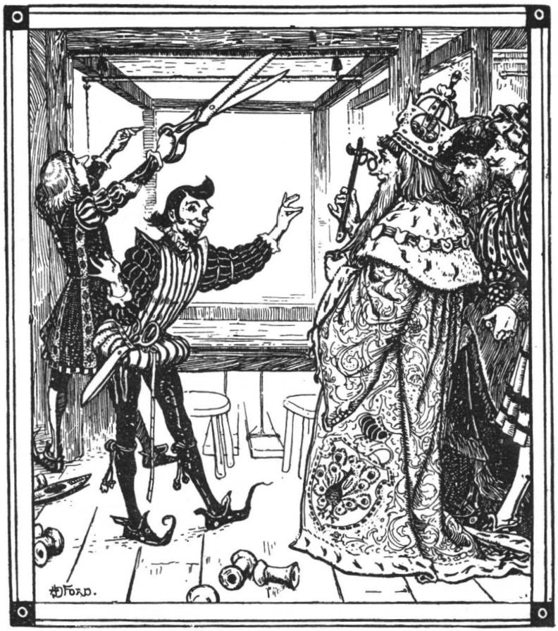

在游行盛典举行前的一天夜晚，两个骗子点起了十三支以上的蜡烛，彻夜在那里赶工。他们装作把布从织布机上取下来，用两把巨大的剪刀在空中裁了一阵子，然后用没有穿线的针缝了一阵子，最后终于说：“看！新衣服做好了！”

皇帝带着他的一群最高贵的骑士们来了。两个骗子各举起一只手，好像拿着一件什么东西似地说：“请看！这是裤子！这是外衣！这是斗篷！”“这种薄衣服穿着太舒服了，以致穿的人都会觉得像什么都没穿一样，但这正是这种衣服的美妙之处。”

“是的，是的。”所有的骑士都随声附和，但他们实际上什么也看不见，因为那里本来就什么也没有。

“现在请陛下宽衣，”两个骗子说，“我们马上在这面大镜子前为您换上新衣服。”

皇帝把穿的所有衣服都脱了下来。两个骗子在皇帝面前，装着把他们刚刚做好的新衣一件一件给皇帝穿上。皇帝在镜子前转着身子，弯着腰照看。

“这些衣服多合身呀！裁得多好看呀！”大家都说，“料子多好呀！颜色多美呀！真是一套极华贵的衣服！”

这时典礼官进来说：“大家都在外面等着呢，准备好了华盖，以便举在陛下头上去参加游行盛典。”

“对，我已经准备好了，”皇帝说，“这衣服很合身么！”他又在镜子前转了几转，像是看看是不是全穿合适了。

那些负责托裙裾的内侍们把手伸向地板，好像是把裙裾托起来，然后他们像是托着什么东西一样往前走。他们不能让人看出他们实在什么东西也没有看见。

于是，皇帝就这样在那富丽堂皇的华盖下游行起来了，站在街上和窗子里的人都说：“皇帝的新衣真是无以伦比！看他衣服上的裙裾！多么漂亮呀！”谁也不愿意让人知道他什么也看不见，因为这样就表示他不称职，或者是非常愚蠢。皇帝以前穿的所有衣服都从来没有获得过这样的称赞。

“可他实际上什么也没有穿呀！”最后终于有一个小孩这样说道。

“听听这天真的孩子说的是什么吧！”孩子的父亲说，于是大家都把这孩子的话低声传了开来。

这个结果使皇帝吃了一惊，他似乎觉得老百姓说的话是对的，但他内心里仍然想：“我必须把这游行盛典举行完毕。”于是他继续神气活现地往前走，内侍们也腰挺得更直地往前走，手中托着实际并不存在的裙裾。

 

## 金螃蟹

有个渔夫和他的妻子生了三个孩子。每天早晨渔夫都要外出打渔，不管他打到什么，都全部卖给国王。有一天，他除了打到许多鱼以外，还抓到一只金螃蟹。回家以后他把所有的鱼都放到一只大盆子里，而那只金螃蟹又耀眼，又好看，于是他就把它单独放开，高高地放在碗柜的隔板上。渔夫的妻子洗鱼时，把裙子束在腰间；露出了两只脚，突然她听到有个声音说道：

> “快点放下你的裙子
> 免得你的脚露出来。”

她吃惊地转过身来，结果发现是金螃蟹在说话。

“什么！你竟然会说话，你这只滑稽的螃蟹。”妇人说道，她并不喜欢螃蟹刚才说的那些话。于是她把螃蟹拿起来，放到了一只大盘子里。

当渔夫回到家里，夫妇一起坐下吃饭时，他们又听到了螃蟹细小的声音在说话：“也给我一点吃的。”听到这话他们都非常吃惊，但他们还是给了螃蟹一些东西吃。老渔夫吃完饭去拿走盛着螃蟹食物的盘子时，他发现盘子里装着满满一盘金子。因为这样的事每天都发生，渔夫不久就非常喜欢这螃蟹了。

一天，螃蟹又对渔夫的妻子说：“你到国王那儿去，告诉他我要娶他的女儿为妻。”

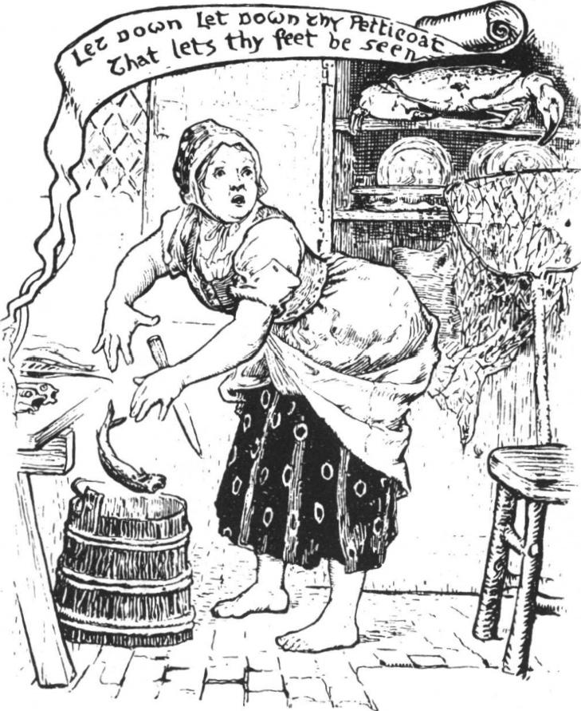

老妇人照螃蟹说的去做了，当她对国王说了螃蟹要娶他女儿的事后，国王不禁笑了起来，但他是一个审慎的君主，他知道这螃蟹可能是个王子变的。因此他没有完全拒绝这提议。他对渔夫的妻子说：“老妇人，你回去告诉那只螃蟹，如果他能在明天天亮以前在我的宫殿前造一堵比宫殿还高的城墙，城墙上还要开满了世界上各种各样的鲜花，我就把女儿嫁给他。”

渔夫的妻子回到了家，向螃蟹转告了国王的要求。

于是螃蟹给了她一根金棒，并说：“你去用这根金棒在国王要求建城墙的地面上击三下，明天早晨，城墙就会出现在那儿。”

老妇人又去照着螃蟹说的办了。

第二天早晨，国王刚一醒来，第一眼就看到了眼前的这堵墙，完全与他昨天要求的一样！

这时老妇人又来到国王面前，对他说：“陛下，你的命令已经完成了。”

“这堵墙修得不错，”国王说，“但我还要求螃蟹在我的宫殿前修一座花园，里面要有三眼喷泉，一眼要喷着金子，另一眼喷着钻石，再一眼喷着宝石，这座花园修不好，我就不会把女儿给他。”

于是老妇人只好又用金棒在建花园的地面上击了三下，第二天早晨，花园就出现在那儿了。国王这次实践了他的诺言，婚礼就定在第二天举行。

这时螃蟹对老渔夫说，“你拿着这根金棒，到我指定的山上击一下，有一个黑人就会出来问你希望要什么。你对他说：‘你的主人，就是那个国王派我来告诉你，你必须把他的那件像太阳光一样的金色外衣送给他。’让他把衣服给你，另外再把皇后的金袍和鲜花般美丽的宝石也一起带来给我，还要给我带来那只金靠垫。”

老渔夫按螃蟹说的去做了。当他带回这些东西时，螃蟹穿上了那件金外衣，爬上了金靠垫，渔夫捧着它进了王宫，在那里螃蟹又把另一件金衣服给了他的新娘。接着就举行了婚礼。当这对新婚夫妇单独在一起时，螃蟹向妻子表明了自己的身份。他告诉妻子他是世界上最大的国家的王子，以及自己是怎样中了魔法，白天要变成螃蟹，只有在晚上才变回人形；他还能随心所欲地把自己变成老鹰。他刚说完这些话，就摇身一变，立刻变成了一个美丽的青年，但第二天早晨他就又被迫爬回他的螃蟹壳里。从此后每天都这样。

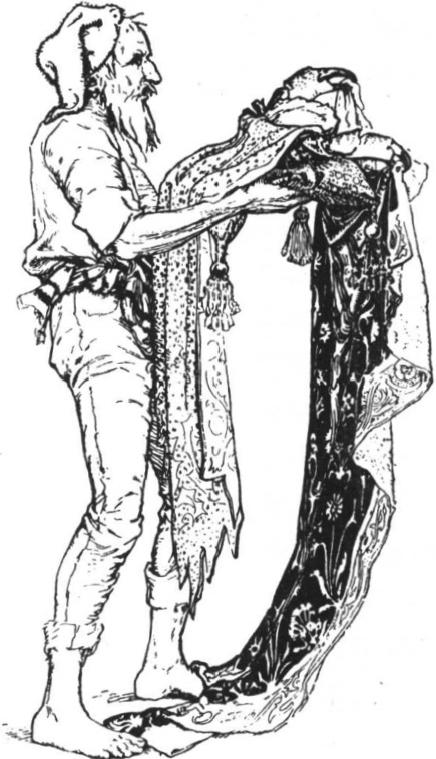

另一方面，公主对这只螃蟹的亲热和关怀照顾使整个王室们怀疑其中一定有些秘密，但尽管反复刺探，他们还是什么都没发现。就这样过了一年，公主生了一个儿子，她把这孩子取名叫本杰明。但公主的母亲仍然对整个事情感到奇怪。最后她终于对国王说，他应该去问问女儿看，她愿不愿意另找一个丈夫代替这螃蟹？当国王问女儿时，公主只回答了一句话：

“我已经嫁给这只螃蟹了，我只要他。”

但是国王对她说：“我会为你举行一次比赛，我会邀请世界上所有的王子来参加比赛，如果你对他们中的哪个感兴趣的话，你就嫁给他。”

晚上公主把这件事告诉了螃蟹，螃蟹对她说：“你拿着这根金棒，到花园的大门上去用它敲门，一个黑人就会出来问你：‘你呼唤我做什么事，你需要什么东西？’你就说：‘你的主人，就是那个国王派我来告诉你，他要他的金盔甲、他的战马和那只银苹果。’然后把这些东西给我带来。”

公主遵照吩咐行事，给他带回了他要的东西。

第二天晚上王子穿好了比赛的服装。出发前对妻子说：“记住：你看到我的时候千万不要说我就是那只螃蟹。因为你说了这个就会带来不幸。你与你的姐妹们一起站在窗前，我会骑马经过窗下，把这只银苹果扔给你。你把这苹果拿在手里，但如果别人问你我是谁，你就说你不认识我。”这么说着，王子亲吻了她，又再次重复了刚才的告诫，就离开了。

公主就与她的姐妹们一起到窗前观看比赛。一会儿她丈夫就骑马来到了窗下，把苹果扔给了她。她抓住苹果，然后走回了自己的房间，不久她的丈夫也回到了她的身边。她的父亲看到她似乎对哪个王子都没有兴趣，不禁感到十分惊奇。于是他又下令举行第二次比赛。

这次螃蟹又给了他妻子与上次一样的指示，只是这次她从黑人手中接的苹果是金子的。王子在出发前去参加比赛时对妻子说：“我已经知道今天你会把我暴露出去的。”

但公主向他发誓她决不告诉任何人他是谁。于是王子再次重复了他的告诫后就走了。

到晚上，当公主正与她的母亲和姐妹们站在窗前时，王子突然骑着战马驰过窗下，把金苹果扔给了公主。

公主的母亲看到这人发火了，她伸手给了公主一记耳光，喊道：“难道你对这个王子也不感兴趣吗？你这笨蛋？”

公主吃了一惊，就叫道：“他就是那只螃蟹变的呀！”

她母亲听到这话后，为公主没有把真情及早告诉她而越发恼怒了，她跑进公主的房间，那只螃蟹的壳仍然躺在那里，她拾起螃蟹壳，把它扔进了火里。可怜的公主心痛地哭了，但这已无济于事，她的丈夫再也没有回来。

话分两头。一天，一个老人在河边吃面包，这时一只狗从水里跳出来，从他手里夺过了面包，逃走了。老人跟在狗后面追，狗跑到一扇门前，推开门跑了进去。于是老人就跟着追上去。他没有赶上狗，却发现自己正站在一架楼梯上，于是他就顺着楼梯走下去。突然他面前出现了一座雄伟的宫殿，进了宫殿后他发现一座大厅里放着一张大桌子，边上放了十二把椅子。他藏在一幅巨大的画像后面，这样就可以看清大厅里发生的事情。中午时分他听到一阵阵嘈杂声，这使他害怕得发抖。当他鼓起勇气从画像后向外张望时，他看到十二只鹰飞了进来。看到这情景他就更害怕了。这些鹰飞到一眼泉水边洗了澡，然后突然变成了十二个美丽的青年。接着他们坐到桌边，其中一个举起一只倒满酒的酒杯说：“祝我父亲身体健康！”另一个说：“祝我母亲身体健康！”其余的人也都依次祝了酒。这时有一个青年说：

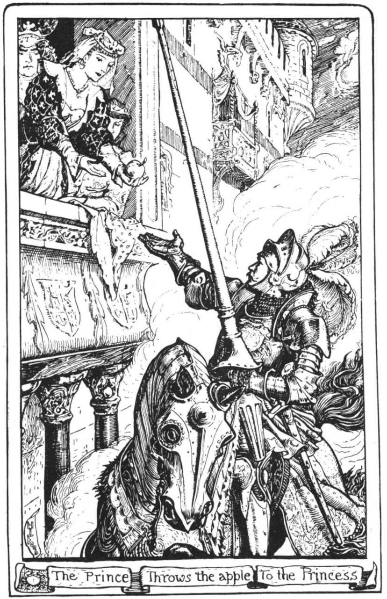

> “祝我亲爱的夫人身体健康，
> 愿她长寿和幸福！
> 但我诅咒那残忍的母亲，
> 是她烧掉了我的金色外壳！”

说着说着他痛苦地流出了眼泪。之后青年们起身回到泉水边，又变回了鹰，飞离了这地方。

于是老人跟着也走了，他回到了阳光灿烂的地面上，接着回了家。不久他听说公主病了，只有听人讲故事时才感觉好一些。于是老人去了王宫，让公主听他的故事，他对公主讲了他在地下宫殿看到的奇怪的事情。他刚一讲完，公主就急切地问他，他还能不能找到通往那地下宫殿的路。

“能，”他答道，“当然能找到。”

于是公主要他马上带她到那儿去。老人就带她去了。当他们来到地下宫殿时，老人把公主藏在那幅大画像后面，并告诫她一定要保持安静，老人自己也藏到画像后面。不久那些鹰就飞进来了，它们变成了青年小伙子。公主立即就在他们中认出了自己的丈夫，就想走出她的藏身之地，但是老人拦住了她。青年们在桌边坐了下来，而王子又举起酒杯说道：

> “祝我亲爱的夫人身体健康，
> 愿她长寿和幸福！
> 但我诅咒那残忍的母亲，
> 是她烧掉了我的金色外壳！”

这时公主再也克制不住自己，就从后面跑出来，伸出双手抱住了自己的丈夫。王子立刻也认出了她，就对她说：

“你还记得那天我对你说，你会把我暴露出去的吗？现在你知道我说的是真话了。但那段不幸的时光都已过去。现在你听我说：我还要受这魔法控制三个月，你愿不愿意与我一起呆在这儿，直到这段时间过去？”

于是公主就与他呆在一起，她对老人说：“请你回宫去告诉我父母我在这里。”

当老人回宫把这消息告诉国王和王后时，他们都对此感到十分苦恼。但三个月一过，王子中的魔法就解除了，他又从鹰变回了人，与公主一起回了家。从此以后他们幸福地在一起生活。而听故事的人知道了这个结果，就感到更加幸福。

 

## 大铁炉

早在人们的愿望能变为现实的年代里，有个国王的儿子中了魔法，被关在森林里的一座大铁炉子里。他在那里被关了好多年，没有人能够救他出来。后来一位国王的女儿来到了这座森林，她走着走着迷了路，找不到回她父王王国的路了。她在森林里到处转来转去，一直转了九天，最后她来到了放大铁炉子的地方。一个声音从铁炉里传出来，问她：“你从哪里来，要到哪里去？”她回答道：“我迷了路，找不到回父王王国的路了，我再也回不了家了。”这时铁炉里的声音说：“如果你答应我的要求，我就能帮助你找到家，而且你很快就能回到家。我是一个比你的国家更大的王国的王子，我要娶你为妻。”公主听了这话吃了一惊，她想：“一个年轻姑娘怎么能对付这只大铁炉子呢？”但因为非常急于回家，急于回到父亲身边，她就答应了他的要求。于是他说：“你回家后必须再来一次，你要带一把刀来，在这只大铁炉子上扎一个洞。”

接着他让另一个人为姑娘带路。那人走到姑娘跟前，始终一言不发，但他带着她只用了两个小时就回了她的家。看到公主回来了，整个王宫都欢乐极了。老国王拥抱并亲吻了女儿。但女儿却很烦恼，她说：“亲爱的父亲，您听听我的遭遇吧！如果我不是在森林里遇到了一只大铁炉，并答应里边的人我还要回去救他出来并嫁给他的话，我就永远也走不出那座荒凉的大森林，也永远回不到家了！”老国王听了几乎惊得要昏了过去，因为公主是他唯一的女儿。他们一起商量了好久，最后决定由同样非常漂亮的磨坊主的女儿代替公主去。他们带她到森林里的大铁炉旁，给了她一把刀子，告诉她必须挖开那炉子。磨坊主女儿挖了整整二十四小时，却没有一点进展。天亮的时候，大铁炉里的一个声音说道：“我觉得外面已经天亮了。”磨坊主女儿就答应道：“我也是这样想，我觉得我听到了父亲的磨子转动的声音。”

“那么你是磨坊主的女儿！你马上回去，把国王的女儿叫来。”

于是磨坊主的女儿回去了，她告诉老国王，大铁炉里的东西不要她在那里，她要公主去。老国王又吃了一惊，而公主听到这又落下泪来。但他们有一个猪倌，他的女儿比磨坊主的女儿更漂亮，于是他们给了这猪倌的女儿一块金子，要她代替公主去大铁炉那里。猪倌的女儿被带到那里后，连续在铁炉上挖了二十又四个小时，但仍然没有任何进展。天一破晓，大铁炉里的声音说：“外面好像天亮了。”于是猪倌的女儿答应道：“我也这样觉得，我觉得听到了父亲吹哨子的声音。”“那么你是一个猪倌的女儿！你马上回去，让国王的女儿来。告诉她，我预言的话是会应验的，如果公主不来，那么她的王国中的任何东西都会变为废墟，连一颗石头也逃不过。”公主听到这些话又哭了，但哭也没有用，她必须去履行她的诺言。于是她吻别了父亲，在腰带上系了一把刀，到了森林里的大铁炉那里。她一到那里就动手挖那铁炉，铁炉马上被挖动了，不到两个小时，她就在铁炉上挖出了一个孔。她从孔中望进去，看见一个美貌的青年，全身都闪耀着金色的光芒，公主立刻就爱上了他。于是公主更用力地挖，不一会儿就把洞挖得很大，足够青年爬出来。青年出来后说：“你是我的，我也是你的；你是我的新娘，也是我的救星！”他要带她回自己的王国，但公主恳求青年让她再回去见她父亲一面。王子答应了她的要求，但告诫她，对她父亲说话不能超过三个字，然后就马上回来。这样公主就回家了。但糟糕的是公主对父亲说的话超过了三个字，她的话刚说完，大铁炉立刻就消失了，它翻过了一座玻璃山和三把利剑。王子虽然也到了那边，但他已经不再关在铁炉里，已经获得了自由。公主这时告别了父亲，随身带了一点钱，再次到森林里去找那座大铁炉，但是却找不到了。她又连续寻找了九天，仍然没有找到。这时她已饿极了，也不知道怎样才能活下去。夜晚快来临时，她爬上了一棵小树。她很怕野兽，多么希望天能够不黑呀。到了半夜时分，她看到极远的地方有一点亮光，她想：“啊，如果我能到那儿就好了！”她走到那个地方，发觉那是座古老的小房子，周围长着许多草，房前则堆着一小堆木柴。她想：“啊呀！我会遇见什么呢？”她从窗户里望进去，只见里面只有大大小小的蛤蟆，桌上则放着美味的烤肉和酒，盛酒和菜的杯子和碟子都是银做的。于是她鼓起勇气上去敲门。这时一只大蛤蟆叫道：

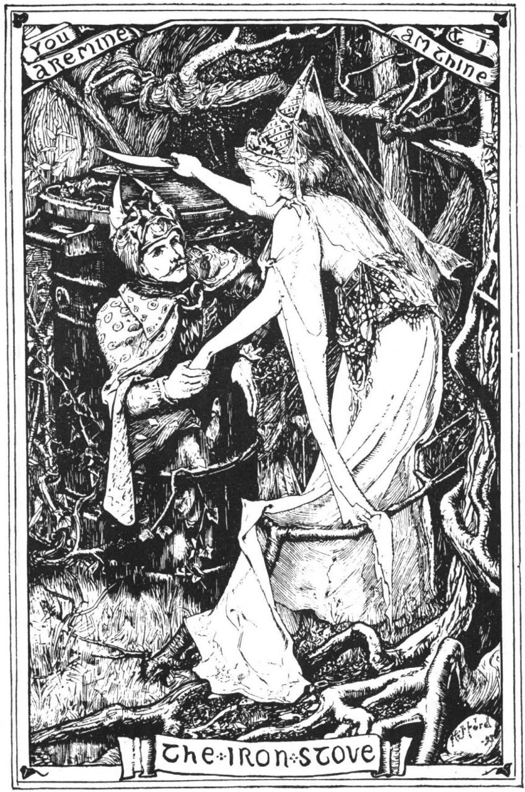

> “弯腿的小绿蛤蟆，
> 快打开门看看，
> 是谁在那儿敲门。”

于是一只小蛤蟆来给她开了门，把她让到屋里。所有的蛤蟆都向她表示欢迎，让她坐下。他们问她为什么会到这里来，她想要些什么。公主对蛤蟆讲了她的各种经历，讲了她超过了只讲三个字的允许限度，结果王子和大铁炉都消失了，讲了她已经寻找了很长的时间，现在她还必须翻山越岭地去寻找，直到找到王子为止。

老蛤蟆听了这些后说道：

> “弯腿的小绿蛤蟆，
> 到你知道的那个地方，
> 把那只大盒子拿给我。”

于是小蛤蟆就去那里拿来了一只大盒子。接着蛤蟆们给了她饭菜和酒食，饭后带她到了一张铺设极为华丽的床边，床上铺的是丝绸和锦锻，她就在这张床上舒舒服服地睡了一夜。第二天天亮她起床后，老蛤蟆从大盒子里拿了三样东西给她，让她带在身边。因为她未来的路上要爬过一座高高的玻璃山，越过三把利剑，经过一个大湖，那时她就会用得到这三样东西。当她过了这几道关后她就能再次找到她的心上人。老蛤蟆给她的是三根大针，一只犁轮和三颗胡桃，它要她好好放好这几样东西。公主收了这几样东西后就出发了。她到达那座极滑的玻璃山前时，她把针扎在地上，再一步步把后面的针往前移，就这样爬过了玻璃山。爬过山后她就把针又小心地藏了起来。

接着她又遇到了三把利剑，于是她跨上了犁轮，越过了利剑。最后她遇到了大湖，渡过湖，她来到了一座美丽的王宫前。她走进王宫，自称是一个佣人，一个能找到一份工作就很高兴的可怜姑娘。但她心里知道，她从大森林的大铁炉里救出的那个王子就在这座王宫里。她被以很低的工资雇来作厨工。这时，王子以为她早已死了，正准备娶另一个公主为妻呢。

到了晚上，当她把一切事情都料理完后，从袋里摸出了一颗胡桃，把它敲开，准备吃胡桃仁。可是一看，胡桃内竟是一件美丽的王族衣服！当新娘子听到这个消息时，赶来求姑娘把衣服卖给她，并说这不是女佣穿的衣服。姑娘说，除非答应她一个要求，否则她就不卖这件衣服。这个要求就是允许她在王子的门口睡一夜。因为那件衣服太美丽了，连新娘子也没有一件这样的衣服，于是新娘子就答应了她这个要求。到傍晚时，新娘子对新郎说：“那个傻女佣要在你的门口睡一夜。”

“如果你没有意见，那我也同意。”王子说。但新娘给王子喝了一杯加了安眠药的酒，就让他们都去睡了。晚上王子睡得很熟，姑娘没法叫醒他，就整夜哭泣着说道：“我把你从大森林的大铁炉中救出来；我找了你那么久；我爬过了高高的玻璃山，越过了三把利剑，渡过了一个大湖才找到你，你现在怎么不听我说的话呢？”外面的佣人们听到她整夜都在哭诉，早上就把这事报告了王子。

第二天晚上姑娘料理完了一切事情，又敲开了一颗胡桃，胡桃里是一件更漂亮的衣服。新娘看到这件衣服后又要买下来。但姑娘不要钱，她只要求再在王子的门边睡一夜。然而新娘又给王子吃了安眠药，王子熟睡以后什么也没听见。那个女佣又哭诉了一整夜：“我把你从大森林的大铁炉中救出来；我找了你那么久；我爬过了高高的玻璃山，越过了三把利剑，渡过了一个大湖才找到你，而你现在却听不到我说的话！”外面的佣人们听到她整夜都在哭诉，就在第二天早上又告诉了王子。当姑娘在第三天晚上料理完一切事情后，又敲开了第三颗胡桃，胡桃里是一件比前两件更漂亮，完全用纯金做的衣服。新娘看到这件衣服后，依然想要，但女佣只有在新娘同意她第三次睡在王子门口的条件下才肯放弃这件衣服。这回王子留心没有喝那安眠药。当女佣开始哭泣着说“亲爱的心上人啊，我把你从可怕的荒山野岭中的铁炉里救出来”的时候，王子跳了起来，说道：“你做得对，你是我的，我也是你的。”虽然那时还是夜里，王子还是带着她跳上了一辆马车。临走前他们还带走了新娘的衣服，使她没法追上来。他们又渡过了那个大湖，越过了三把利剑，爬过了高高的玻璃山。最后他们终于来到那座古老的小屋前，他们一跨进小屋，小屋立刻变成了一座巨大的王宫，那些蛤蟆都获得了自由，成了漂亮的国王的孩子，欢乐地跑来跑去。王子和公主在那里结了婚，仍然住在王宫里，而他们的王宫要比公主父亲的王宫大得多。老国王不愿一人呆在他的王国里，因此他们就去把老国王接来一起住，这样他们就有了两个王国，生活极其富足。

这样也就结束了我的故事。

 

## 火龙和它的祖母

有个国王发动了一场很大的战争，他召募了一支人数很多的军队，但只给那些士兵很低的工资，以致士兵们都没法靠这工资过活。有三个士兵商量后决定一起逃走。

其中一个士兵对其他两个说：“如果被抓回来，我们就会被吊在十字架上吊死，这怎么办呢？”另一个士兵说：“你看到那边一大片玉米地没有？如果我们藏到那里去，就没人能找到我们了。军队也没法开进这片玉米地，它明天就要开拔走了。”

于是他们偷偷跑进了玉米地，但是军队却没有开拔，而是在靠近他们藏身的地方驻扎了下来。他们在玉米地里坐了两天两夜，都快要饿死了。但是如果他们冒险出去的话，那就一定会死的。

最后他们绝望地说：“逃走有什么用？我们一定会悲惨地饿死的。”

他们正说着这些时，一条火龙从空中飞来，在他们头上盘旋着，问他们为什么躲在这里。这三人回答道：“我们是三个士兵，因为工资太低而逃离了军队。现在如果我们继续呆在这玉米地里，就会饿死，而如果走出去，就会被吊死。”“如果你们愿意为我服务七年，”火龙说，“我就领你们出去，谁都抓不到你们。”“我们没有别的选择，只好接受你的提议。”他们说。于是火龙用爪子抓住他们，带着他们从军队上面越过，直到离开很远才把他们放回地面。

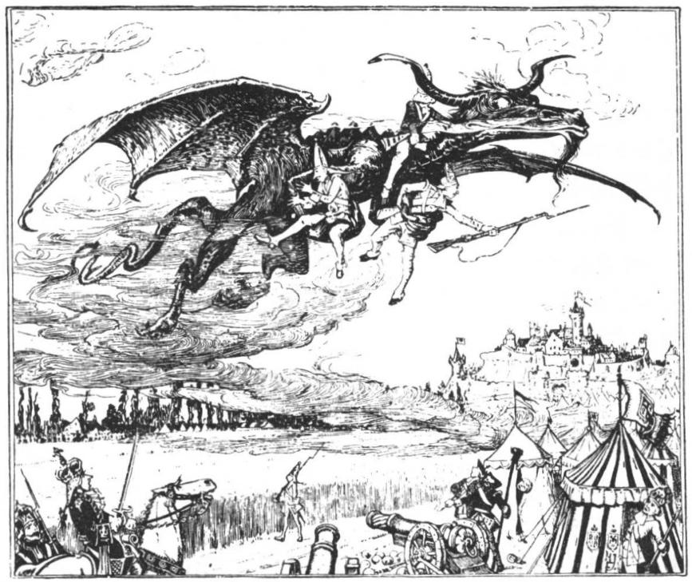

火龙又给了他们一条鞭子，说：“用这条鞭子抽打，你们想要多少钱就会出现多少钱。这样你们就可以像大财主那样生活，可以又有马，又有车。但七年以后，你们几个就是我的了。”说着他拿出一个本子，让他们三个都在这本子上签字。“到时我会给你们每人一个谜语，”火龙说，“如果你们能猜中，就可以脱离我的掌握，获得自由。”接着火龙就飞走了，三个士兵则继续带着那条鞭子旅行。他们想要有多少钱就能有多少钱，因此个个都穿着极为名贵的衣服，在世界各地旅行，无论到哪个地方，他们都能尽情地寻欢作乐，吃的是好酒好菜，坐的是骏马快车，但他们却没干什么坏事。

时间飞快地过去了，当七年的期限快满时，三人中的两人又陷入了极度的焦急和恐慌，但另一个人却很轻松，他说：“不用怕，兄弟们，我已经长大了，我很会猜谜。”

这天他们来到了一片田野，两个兄弟愁得拉长了脸。这时有个老妇人走过来，问他们为什么这么忧愁。“哎！这与你有什么关系呢？你又帮不了我们。”“这可说不定呀！”老妇人答道，“先把你们的难处说给我听听。”

于是三个士兵告诉她，他们已经为火龙做了整整七年的仆人，火龙给了他们数不清的金钱，但他们都跟火龙签过卖身契，七年过后他们都属于火龙的了，除非他们到时能猜出火龙出的谜语才能躲过这场灾难。老妇人听了后说：“如果你们想救自己，就必须派一个人到森林里去，那里有一座砖砌的摇摇欲坠的小屋子。走进那屋里去就可以找到帮助。”

那两个愁眉苦脸的人说：“这办法救不了我们！”于是他们就留在原地没动。但另一个轻松乐观的人却跳起来，走进森林找到了那座砖砌的小屋。小屋里坐着一个年纪很大的妇人，她就是火龙的祖母。她问士兵是怎么到这里的，来这有什么事。于是士兵向老妇人讲了他们的全部遭遇。老妇人对这个士兵的言谈举止很满意，也很同情他们的遭遇，于是就答应帮助他们。

她掀起了一块盖着地窖的大石头，对士兵说：“你藏在这地窖里面。这屋里说的话地窖里是听得见的，你静静地坐在那儿，不要动。等火龙回来，我就问他是哪几个谜语，他是从来不对我隐瞒任何事情的，你只要认真地听他对我的回答就行了。”

到了半夜，火龙飞回来了，向它的祖母要晚饭吃。祖母摆好桌子，拿出了酒菜，他们就一齐吃饭。在谈话中，老妇人问火龙白天干了些什么，征服了多少个灵魂。

“我今天的运气不好，”火龙回答说，“但我手里还紧紧抓着三个士兵。”

“真了不起！三个士兵！”老妇人说，“谁能逃脱你的掌握？”

“这三个人必定是我的，”火龙轻蔑地回答道，“我会让他们猜那些他们永远也猜不到的谜。”

“那是些什么样的谜语呢？”老妇人问。

“让我来告诉你。在北海那里有一只死了的海猫，那就是他们的烤肉；还有一条鲸鱼，它的肋骨就是他们的银汤勺；另外有一匹死马的空蹄子，那就是他们的酒杯。”

火龙去睡觉后，它的祖母又掀起石板，把士兵从地窖中放了出来。

“你有没有听清每一句话？”

“是的，”士兵答道，“我都听清楚了，现在我能救我们自己了。”

于是他从窗口走另一条路悄悄地离开了小屋，急忙赶回到同伴那里。他告诉了同伴们火龙的祖母怎样哄那火龙说出了谜语和答案，以及他是怎样亲耳听到火龙自己说出的答案的。

听了这消息他们三人就又都兴高采烈了。他们取出了鞭子拼命地抽，直抽到金钱在地上到处乱滚。当七年时间正好届满的时候，火龙拿着那个本子来了，他指着本子上的签名说：“我今天要带你们到地下去，你们将在那儿吃一餐饭。但如果你们能告诉我，你们在那餐饭上吃的烤肉是什么肉，你们就可以获得自由，还能留下这根鞭子。”

这时第一位士兵说：“在北海有一只死海猫，那就是今天的烤肉。”

火龙听了后很烦恼。他咕哝了一阵，喘着粗气，又问第二个士兵：“那么你们用的汤勺是什么做的？”

“我们的银汤勺是用鲸鱼的肋骨做的。”

火龙拉长了脸，哇哇哇地吼了三声，又问第三个士兵：“你知不知道你们的酒杯是什么做的？”

“我们的酒杯是用一匹老马的蹄子做的。”

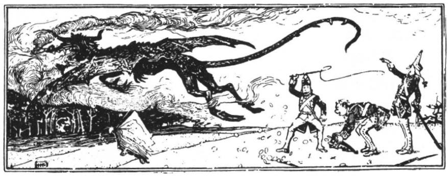

火龙听了他们的正确回答，就失去了对他们的控制，只好尖厉地大叫了一声，飞走了。从此以后三个士兵拿着那条鞭子，要多少钱就抽出多少钱来，一生都过得十分愉快。

 

## 让人变驴的卷心菜

有一个年轻的猎人勇敢地闯进了一座森林，他心情既轻松又愉快，一边走，一边吹着哨子。这时，他遇到了一个样子很丑的老妇人。老妇人对他说：“你好，亲爱的猎手！你现在过得心满意足，而我却在受穷挨饿，给我一点钱吧。”猎人看着老妇人的样子，觉得她很可怜，于是就伸手到口袋里，把他能省下来的钱全给了老妇人。他刚要转身离去时，老妇人又叫住了他，对他说：“听着，亲爱的猎人，因为你有一颗善良的心，所以我要送你一件礼物。你沿着这条路继续往前走，不久你就会见到一棵树，树上停着九只鸟儿，它们正抓着一件衣服在争吵抢夺。你就拿出猎枪瞄准这群鸟的中间射击。这些鸟就会放开那件衣服飞走，但其中有一只鸟会被打中掉下来死掉。你就拿着那件衣服。那是一件如愿衣，你只要把它披到肩上，不管想去哪个地方，一眨眼工夫就能到达。你还要从地上那只死鸟身上挖出心脏，把它囫囵吞下肚里去，这样每天早上你醒来时，枕头底下就会有一块金币。”

猎人谢过了这聪明的妇人，心里想：“她送给我的这些东西真是稀有的宝贝，要是真能得到就好了！”于是他又往前走了一百多米，这时，他听到头顶树枝上传来一阵阵鸟儿尖叫的嘈杂声。抬头望去，看见一群鸟正互相用嘴，用脚撕扯拖拉争抢着一件衣服，每只鸟都想把它抢来占为己有。“啊呀，”猎人说，“这可真妙！跟老妇人说的情形完全一样。”于是他从肩上取下猎枪，拉开了枪栓，对着鸟群中间打了一枪，打得羽毛四处飞扬，鸟儿都尖叫着飞走了。只有一只鸟被打中后掉下来死了，它们争的那件衣服也掉了下来。于是猎人就按老妇人告诉他的那样：剖开鸟，挖出它的心脏，把它吞下去，并带回那件衣服。第二天早晨醒来时，他记起了老妇人说的话，就想看看那是不是真的。他掀起枕头一看，只见一枚金币在枕头下闪着光。第二天早晨他又发现了一枚金币，从此后他每天早上醒来枕下就有一枚金币。他逐渐收集了一大堆金币。最后他想：“如果我成天老呆在家里，要这些金币有什么用？我要到全世界去旅行，看看其他地方的情景。”于是他告别了父母，背上了打猎用的背包和猎枪，就到世界各地去旅行。

有一天他穿过一座密密的森林，走出森林时看到前面的平原上有一座大房子。那座大房子的一个窗口前正站着一个老妇人和一位漂亮的少女，她们正在向外张望。那老妇人实际上是个巫婆，她对少女说：“你看从森林里出来的那个人，他的身上有件奇妙的宝贝，我们必须想办法弄到手，亲爱的女儿，我们比他更有权拥有这件宝贝。那件宝贝就是在他肚里的那颗鸟儿的心脏，他因为有了这个宝贝，每天早晨枕头下都会生出一块金币来。”

她告诉姑娘怎样才能把那宝贝弄到手，以及她准备怎样去哄骗猎人。最后她严厉地威胁姑娘道：“如果你不照我的吩咐去做，你就会倒霉！”

猎人走近以后，他看到了那少女，心想：“我已经走了那么远了，现在我该歇歇了，我要住在这所美丽的大房子里，我有的是钱。”但实际上真实的原因是他看到了那个可爱的少女。

他进了屋子，受到了热情友好的接待。不久他就陷入了对巫婆女儿的狂热的爱情之中。他成天只知道看着巫婆女儿的眼睛，不管她要什么，他都很乐意满足她，根本没想到她会是巫婆的女儿。这时那巫婆对女儿说：“现在我们该去拿那颗鸟儿的心脏了；

他即使失去了这件宝贝，也不会感觉到的。”于是巫婆配了一种药酒，配好后倒了一杯给她女儿，要她递给猎人。

“为我喝了这杯酒吧，我的亲爱的。”少女对猎人说。猎人拿起了酒杯，刚喝下这杯酒，那颗鸟的心脏就从口里吐了出来。巫婆女儿悄悄接着了那颗心脏，把它咽到了自己的肚里，这都是那老巫婆要她这样做的。从此以后猎人的枕头底下就再也没有金币出现了，金币躺到了少女的枕头下面。但猎人已经深深地堕入了爱河，深深地中了魔，他除了想日夜呆在少女身边之外什么都不想。

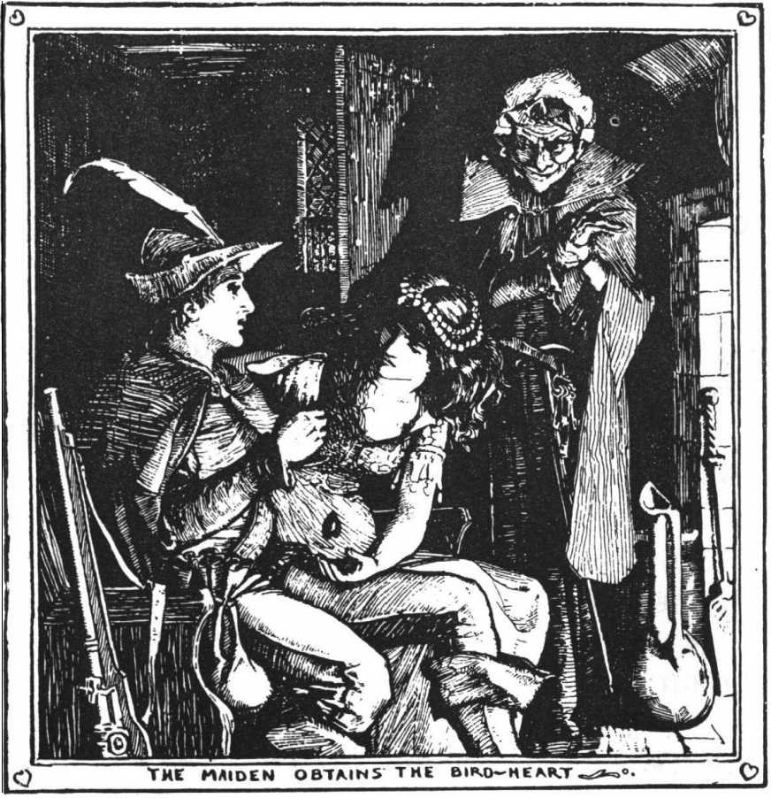

这时老巫婆对女儿说：“我们已经弄到了鸟儿的心，但我们还要想办法从他那儿弄到那件如愿衣。”

巫婆女儿答道：“我们让他留着那件衣服吧，他已经失去了他的财富来源。”

老巫婆听了这话不由得生气了，她说：“那件如愿衣是世界上极其罕有的珍贵东西，我一定要弄到它！我一定会弄到它的！”她打了女儿一顿，并说如果她不听她的话就会倒霉。

于是女儿照母亲的指示去办了。那天她站在窗口，神情非常沮丧地看着远处。

“你为什么老站在那儿，看上去那么不高兴？”猎人问道。

“哎，我的亲爱的，”她答道，“那边有一座花岗石山，是出产极名贵的宝石的地方。我实在太想去那里了，每次想起这个我就感到很伤心。现在谁都没法去捡那宝石，只有鸟儿才飞得到那儿，人类是没法去那里的。”

“如果你没有别的伤心事，”猎人说，“你的这块心病我马上就可以给你去掉。”

于是他用自己的那件如愿衣裹上姑娘，心里想着要到那座花岗岩山上。转眼之间他们就到了那儿，坐在了那座山上！他们的四周全是闪亮的宝石，光是看看这遍地的宝石就会觉得很舒服。他们一起捡了一些最漂亮和最名贵的宝石。这时，老巫婆通过巫术使猎人的眼皮变得越来越重。

他对姑娘说：“我们在这坐一会，休息一下；我太困了，几乎都站不住了。”

于是他们坐下来，他把头枕在她的膝盖上睡着了。等他睡熟后，她从他肩上脱下那件衣服，披在自己身上，心里想着要马上回家，就一个人回到了家中。

猎人醒来时，发现他的爱人已经背叛了他，把他一人扔在荒凉的山上。“哎，”他叹道，“世界上的人怎么都这么不讲信用呢？”他痛苦地坐到石头上，心里乱纷纷地不知道该做什么。

但这座山是属于一个脾气暴躁的巨人的，这巨人靠这座山做生意过日子。猎人在那里坐了没多久就看到三个巨人朝他走来，他只好躺下，装作是睡着了。

巨人们走过来，其中一个用脚踢踢他，说：“这是条什么小虫子？”

第二个巨人说：“踩死他算了。”

但第三个巨人轻蔑地说：“不值得那么麻烦！让他活着吧，他不会老呆在这里的，如果他再往山上爬高点，云彩就会把他带走。”

这么说着他们就走开了，但猎人却听到了他们的对话，因此他们一走远，他就连忙站起来，爬上了山顶。他刚在山顶上坐了一会儿，一朵云就飘过来了，抓住了他，把他带走了。在空中飘了一阵后，云落下来，落在一片四面有墙围起来的菜园里，猎人也安全地落到了菜地上。他向四周看看，自言自语地说：“我饿死了！要是有些东西可以吃就好了！我看这里没有苹果，也没有梨或其他水果，只有遍地的卷心菜，我的肚子可要遭罪了。”后来他又想：“情况紧急，我只好吃这卷心菜了。这味道确实不怎么好，但是却可以充饥。”于是他在周围选了一棵好一些的卷心菜心吃。他刚吃了两口，就有一种奇怪的感觉。突然他发现自己的体形变了，四肢变成了四条腿，头变大变重了，头上长出了两条长耳朵，他惊恐地发现自己变成了一头驴子。但他实在太饿了，而且这多汁的卷心菜也很合毛驴的胃口，因此他还是大吃特吃。后来他又吃到了另外一种卷心菜，他刚吃下一口，就感到自己又变了，他又变回原先的人形。

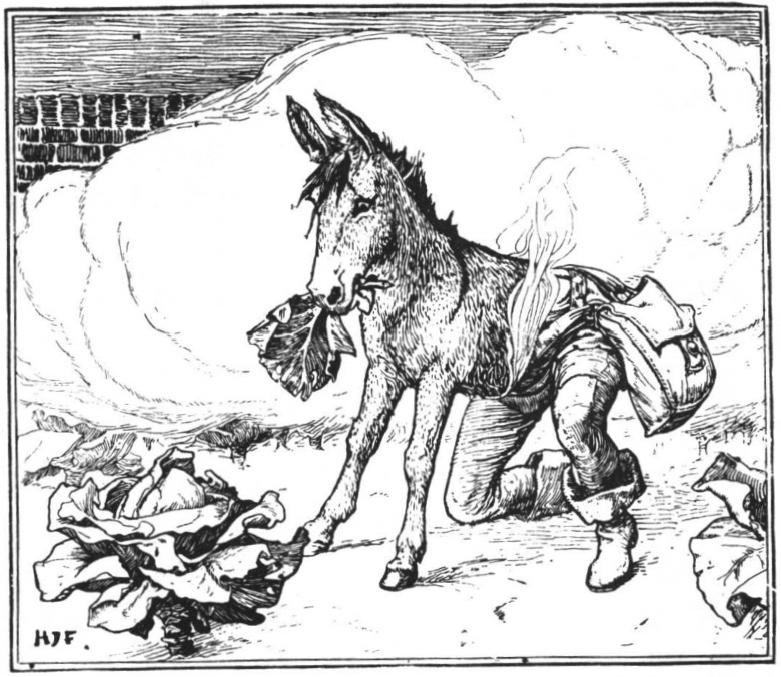

于是猎人躺下来，要好好睡一觉解除这一段时间的疲乏。第二天早上醒来后，他把两种卷心菜各摘了一棵，心想：“这两样东西能够帮我要回我的东西，并且惩罚那些没有信义的人。”他把卷心菜装进袋里，翻过了围墙，出发去寻找他心上人的住处。他走了几天后，就很容易地找到了那座房子。于是他把自己的脸涂成褐色，这样连他的亲生母亲也认不出他来了。就这样他进了屋子，请求让他住在这里。

“我太累了，”他说，“我再也走不动了。”

那个巫婆问道：“乡下人！你是谁，是干什么的？”

猎人答道：“我是国王的信使。国王派我到世界上找味道最好的菜。我的运气真好，找到了一种卷心菜，现在正带在身边；但这太阳的温度实在太高，这娇嫩的卷心菜都快变软了，我真不知道还能不能把它带回王宫。”

她说：“亲爱的老乡，你让我尝一尝这奇妙的卷心菜吧。”

“怎么不行呢？”猎人答道，“我这里带了两棵呢，我给你一棵。”

他一边说着一边打开了背袋，拿出一棵吃了会变驴的卷心菜给她。巫婆没料到其中有诈，而且她对这种新奇的蔬菜馋涎欲滴，因此就亲自进厨房去做菜。等菜做好后，她等不及把菜端上桌子，就立刻先取了几片菜叶放到嘴里。然而，她刚把菜叶咽下去，马上就失去了人形，变成了一只驴子跑进院子里。

这时家中的佣人进了厨房。她看到厨房里已经做好一盘卷心菜色拉时，就准备把它端到房间里去。但在路上，她的老习惯是要尝一尝菜的味道的，因此这回她也取了几片菜叶尝尝。立刻也变成了一头毛驴，跑去与老巫婆做了伴，而那盘色拉则掉到了地上。这时那位信使正陪着可爱的姑娘坐着呢，他见老没人端那做好的色拉进来，而姑娘又很想尝尝这色拉，老是说：“色拉怎么还没做好？”心里想：“那卷心菜一定是已经起作用了。”因此他说：“我去厨房亲自把它端来。”

他到了那儿，看到有两头毛驴正在院子里转来转去，而那盘色拉则掉在地上。

“这就对了，”他说，“这两个已经先吃了！”于是就把剩下的菜捡起来，装在一个盘子里，把它端给了姑娘。

“我亲自把这美味佳肴给你送来了，”他对姑娘说，“这样你就不必再等待了。”

于是姑娘也吃了这菜，像其他两人一样，立即失去了人形，变成一只驴子跑进了院子。

这时猎人洗去了脸上涂的色彩，以便那三个已变成毛驴的女人能认出他，然后他走进院子，说道：“现在你们就要为你们的背信弃义得到报应。”

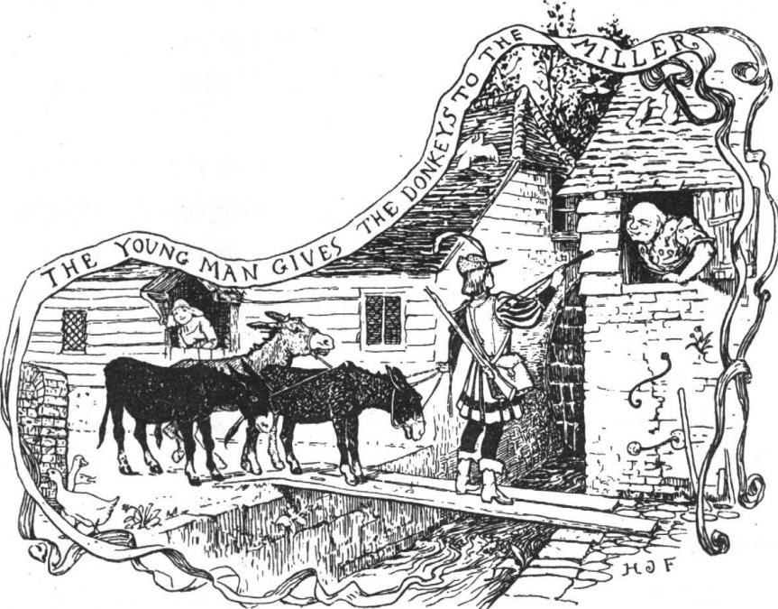

他把这三头驴子用绳子拴起来，把它们赶到了一座磨坊里。他在磨坊的窗户上敲了敲，磨坊主从窗口探出头来，问他需要什么。

“我有三头讨厌的畜生，”他答道，“我不想再管它们了。如果你能收了它们，给它们食料吃和牲口棚住，并按照我的要求对待它们，你要多少钱我就给你多少钱。”

磨坊主答道：“这样的好事我为什么不干呢？你说我该怎样对待它们？”

于是猎人说，对那头巫婆变的老毛驴，每天要打它三顿，却只给它一顿饭吃；对那头女佣变的年轻些的毛驴，每天打它一顿，给它三顿饭吃；但对那头年纪最小的毛驴，每天给它三顿饭吃，并且不用打它了。因为他毕竟不忍心让那姑娘挨打。

交代完这些他就回屋去了，在屋内他找到了自己要找回的一切。过了几天，磨坊主来对他说，他不得不向他报告，那头老毛驴因为每天要挨三顿打却只能吃到一顿饭，已经死了。“那另外两头毛驴，”他又说，“当然没有死，它们每天能吃到三顿饭。但它们现在都那么沮丧，它们大概也活不了多久了。”

这时猎人怜惜起这两头毛驴来，他把自己对它们的怒气抛到一边，吩咐磨坊主把它们赶回来。当这两头毛驴回来时，他给他们吃了那棵能变回人的卷心菜，于是它们又都变回了人。这时那美丽的姑娘跪到猎人面前，说：“哦，我最亲爱的人，请宽恕我做的错事吧！那是我母亲逼的，我是不愿这样做的，因为我深深地爱你。你的如愿衣正挂在衣橱里呢，而那颗鸟儿的心脏，我这就喝一杯药酒，把它吐出来还给你。”

但猎人改变了主意，他说：“你留着那颗鸟儿的心脏吧，我要娶你做我的妻子，那颗心在你那和在我这没什么区别。”

于是大家庆祝了他们的婚礼，他俩在一起过得十分幸福，一直白头到老。

 

## 青蛙公主

在世界上一个我都记不起名字的地方，住着两个国王，一个叫佩里德，另一个叫戴曼蒂诺。他们两个既是邻居，又是堂兄弟，两人都在仙女的保护之下，虽然仙女对他们的爱还不及他们妻子的爱的一半。

世界上的事情经常是这样：因为国王们做事可以随心所欲，所以要他们做个好人比要普通人做个好人困难得多。这道理对佩里德和戴曼蒂诺也是一样，但是仙女们声称，戴曼蒂诺要比佩里德坏得多。事实确实这样，戴曼蒂诺待自己的妻子阿格兰蒂诺太坏了，以致仙女们决定不能让他再活下去了，于是他就死了，身后留下一个小女儿。因为这小女儿是国王唯一的孩子，于是她自然也就成了王位的继承人，但她毕竟还太小，因此她的妈妈，即国王戴曼蒂诺的遗孀被宣布为摄政王。这位王太后又聪明，又善良，她竭尽全力为她的臣民谋幸福。只有一件事使她很烦恼，那就是她的小女儿不在身边，因为仙女们出于自己的考虑，决定由她们自己把这小公主塞潘婷扶养成人。

至于另一位国王佩里德，他倒是很爱自己的妻子，即王后康斯坦斯。但他办事常常不作周密的思考，这使王后感到很悲伤。为了惩罚他的粗心大意，仙女们让他的妻子突然地死去了。王后死后，国王才真正感到自己是多么爱她，虽然他并没有荒废国家大事，但是他的丧妻之痛是那么深，以致于他的臣民都称他是悲哀的佩里德。其他任何人都不可能像佩里德那样整整十五年都陷于深深的悲痛中，而佩里德如果不是有仙女在暗中帮助，恐怕也早就死了。

可怜的国王的唯一的安慰是他的儿子沙费尔王子，他妈妈死的时候他还只有三岁。国王为沙费尔的教育付出了极大的心血。到十五岁时，沙费尔已经学到了作为一个王子应该懂的一切事情，此外，他还有迷人的外貌和易于相处的性格。

就在这时，仙女们突然担心起王子对他父亲的爱会不会影响到她们为这青年王子安排的一切。为了防止出现这种结果，仙女们在沙费尔王子常去的那间漂亮的小房间里放置了一面镶着黑色边框的小镜子，就是那种人们常常从威尼斯带回来的小镜子。开始几天，王子并没有留意到房间里多了件新东西，后来他终于发现了这面镜子，就走上前仔细瞧瞧。使他感到十分惊讶的是，他在镜子里看到的不是自己的脸庞，而是一个像清晨一样清新可爱的年轻姑娘！更妙的是，这位刚过完童年的姑娘的每个举动，也都在这奇妙的镜子中映现出来。

正如大家都可预料到的那样，年轻王子的心完全被这镜子里的美丽形象拴住了，他每天都忙于观察这可爱的不认识的姑娘，根本不肯离开那间房间。他对随时随地都可以看到他已经爱上的这个人感到十分高兴，但有时他也因担心这种好事不知会有什么样的结果而情绪低落。

魔镜在王子的房间里就这样挂了一年多，直到有一天王子在镜子里看到一件使他不安的东西。那天他像通常一样在看着镜子里的姑娘，突然他好像在镜子里看到了另一面镜子，那面镜子也像他的这面镜子一样，有能够看到别人活动的魔力。王子的观察是对的：那姑娘刚刚得到了这面镜子，她也放弃了其他一切事情，关注地看着镜子里的东西。沙费尔不难猜到是什么原因使姑娘的行为突然发生了改变，也不难想到姑娘为什么老是逗留在那面镜子前。但尽管他总是想看一看姑娘的那面镜子中的人的面孔，他却一直没能看到，因为姑娘的身影总是挡在中间。他只看出那镜子中的脸是一张男人的脸，这真使王子妒忌得快要疯了。而这一切都是仙女们安排的，我们只好相信，她们这样做自有她们的道理。

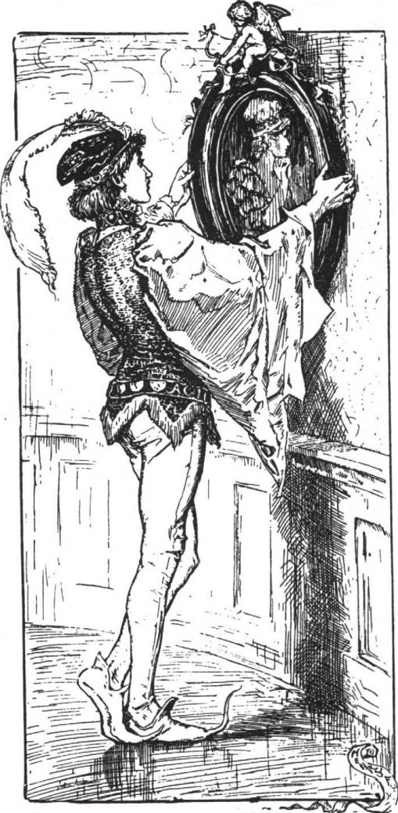

这时沙费尔已经快十八岁了，自从他母亲去世已经过了十五个年头。随着日月的流逝，佩里德国王的心情越来越不愉快，最后他终于得了一场重病，人们都以为他活着的日子不多了。国王很受他的臣民的爱戴，因此全国听了这个消息后都很悲痛，而王子就更加感到悲痛。

在整个生病期间，国王除了王后以外什么都不提起，总是说他为以前使王后悲伤而感到后悔，以及他很想能再见她一面。人们给国王请来了全国所有的医生，试了各种各样的药，都不能使国王的病情好转。最后国王说服大家让他一个人静静地躺在自己的房间里，谁都不要进去打搅他。

或许国王要忍受的最大的苦痛是一种心理上的压力，这种压力使他几乎透不过气来。所以国王令仆人们把窗子都开着，以便让更多的新鲜空气进来。有一天，当他一人静静地呆在房里，一只浑身长着极鲜艳羽毛的鸟儿飞了过来，在窗口不断拍着翅膀，最终在窗台上停了下来。这鸟的羽毛是天蓝色与金黄色相间，嘴和脚上闪着红宝石的亮光，人们看了都觉得太耀眼，它的眼睛使最明亮的钻石都显得黯然无光。它的头上还戴着一顶王冠。我弄不清那王冠是用什么材料做的，但确定无疑的是它比其他王冠都更鲜艳美丽。这鸟儿一直没有开口，所以我们不知道它的嗓音怎么样。事实上，那鸟儿只是一直盯着国王看，而它看着国王的时候，国王就感觉到自己的体力慢慢得到了恢复。过了一会儿，鸟儿飞进了房间，它的眼睛仍然盯在国王身上。它每看国王一眼，国王的精力就变强一点，最后国王的精力已经恢复到王后死以前那么好了。国王对自己的病终于被治好了感到十分高兴，这都多亏了这只鸟儿，于是他想抓住这只鸟。但这只鸟比燕子还灵巧，它躲过了他的捕捉，飞走了。国王的仆人们一听到国王的召唤就马上赶了进来，听国王讲了这鸟的外貌后，他们有的骑马，有的步行，到处去寻找这只神奇的鸟，还找来了捕鸟者帮忙。但这一切都只是徒劳，哪儿都找不到这只鸟。国内的臣民一方面出于对国王的热爱，另一方面受到国王悬赏的巨奖的激励，眨眼之间男女老幼都到野外去寻找这只神鸟，整个城里都几乎走空了。

然而所有这一切忙乱最终都只是造成了混乱，更为糟糕的是，国王的身体不久就又回到了他以前的那种状态。沙费尔王子、非常热爱他的父亲，虽然心里很难过，但是他相信别人没办到的事他可以办到，因此他立刻做好了到更远的地方去寻找那只鸟的准备。尽管别人都反对他这样做，他还是骑上马出发了。他带上几个随从，并相信机会会帮助他的。他没有任何的搜寻计划，因此也没有理由一定要选哪条路走，只是想着要直接去鸟儿常去的那些地方寻找。他搜寻了所有的矮树林和灌木丛，询问了过路的每一个人，但都没有任何结果：寻找越多，发现越少。

最后他来到了一座世界上最大的森林，这座森林里全是清一色的雪松树，树枝伸展得又大又宽，在地下留下了很暗的树荫，树下长着柔软的绿草，绿草上长满了稀有的花朵。沙费尔觉得，这正是鸟儿们喜欢居住的地方，他决心不把这座森林找个遍就不离开它。不仅如此，他还令随从们做了许多鸟窝，并涂上鸟的羽毛的颜色，心想我们人类都容易对自己的同类感兴趣，鸟儿也一定是一样的。为了做鸟窝他需要那些职业捕鸟者的帮助，而且还要他那些随从的帮助。那些随从们在这项技艺上超过了他。人毕竟不是什么都会干的。

在与往常一样搜寻了差不多整整一天后，沙费尔王子觉得口渴难忍了。他已经走得太累，再也走不动了，幸好他发现不远处有一眼清澈的泉水在冒泡。他是一个有经验的旅行者，知道不带杯子是无法进行旅行的，因此总是随身带着杯子。他从口袋里拿出杯子，正准备用它去盛水，却看见一只小绿青蛙跳进了他的杯子。这只小青蛙很可爱，而且比其他的一般青蛙都美丽得多。但王子不但没有欣赏它的美丽，反而不耐烦地把它倒掉了，但这样做是没用的，青蛙以闪电般的速度又跳回了他的杯子。沙费尔渴得要冒火，他正要再次把这青蛙倒掉，却看到这小东西用它那世界上最美丽的眼睛盯住他看，并说道：“我是你要找的那只鸟的一个朋友，你喝完水解了渴之后，就听听我要说的话吧。”

于是王子就咕嘟咕嘟地喝了一肚子水。喝完后，他就遵照那小绿青蛙的指令，在草地上躺下来休息。

“现在，”青蛙开始对他说，“你要不折不扣地按我说的去做每一件事。首先你必须把你的随从们叫到一起，命令他们呆在这附近的一个小村庄里，直到你叫他们时为止。然后你要完全独自一人沿着你右边能找到的一条路走下去。这条路是往南去的，一路上都种着黎巴嫩雪松，沿着它走了一大段路后你会到达一座宏伟的城堡。现在，你必须仔仔细细地听我下面要说的话。拿着这粒小砂子，把它埋到离城堡大门尽可能近的地里。这颗砂子既能把城堡大门打开，又能使全城堡的居民都睡着。进入城堡后马上到马厩去，除了我告诉你的以外不要对其它任何东西留意。你在马厩所有的马中挑一匹最漂亮的马，快些跳上马背，以最快的速度赶回我这里。再见了，王子，祝你好运。”说完这些，小青蛙跳进水中，不见了。

王子听完这些话，觉得这次比他离家后做的任何努力都更有希望，因此就不折不扣地按小青蛙说的去办。他把那些随从留在小村庄里，找到了青蛙说的那条路，沿着它独自走了下去。最后他终于来到了城堡的大门前。这城堡比他想象的要富丽堂皇得多，它完全用水晶建成，所有的装饰物都是用了大量的金子做成。然而他无心去观赏这城堡的美丽，而是迅速地把那颗砂子埋进土里。城堡的大门立刻打开了，里边住的人则全都熟睡过去。沙费尔直接溜进了马厩，把马厩里最好的马牵到了手中，这时他看到附近挂着一套极漂亮的马具。他马上想到这套马具是配他这匹马的，就拿过来放到马背上。他这样做时并没想到会有什么坏结果，谁会说盗马贼不该把马具也带走呢。但突然间城堡里的人竟然全醒了，他们都向马厩奔来，先是围住了王子，然后把他抓起来，拖到了他们的主人面前。王子为自己的行为找不到什么借口，但是他很幸运，城堡主人看到他那张脸后挺喜欢，没有多问他什么就放他走了。

可怜的沙费尔又沮丧，又害羞地慢慢蹭回了泉水边，那只青蛙在那儿等着狠狠地骂他一顿呢。

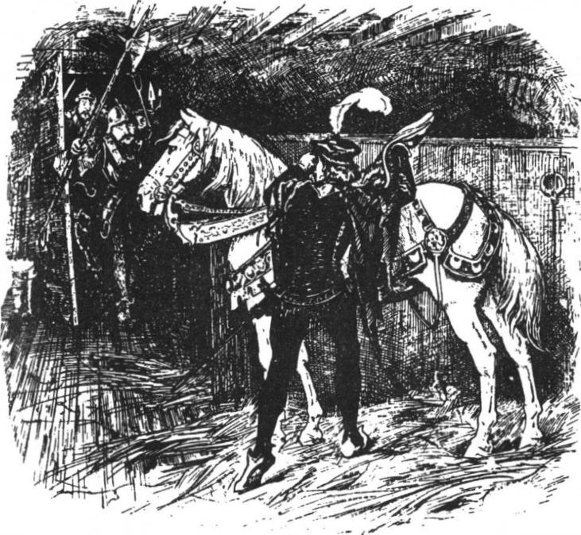

“你把我当成什么了？”它愤怒地叫道，“你这么可恨地把我对你的劝告全不当一回事；难道以为我对你说那些只是为了好玩吗？”

但王子自己已经那么悲伤，而且他又那么谦恭地道歉，终于使善良的小青蛙的心软下来了。它又给了他一粒东西，但这回不是砂子，而是一粒金子。它让他照上次一样去做，只是有一点不同：这回不是去那毁了他希望的马厩，而是要直接进入到城堡里，然后尽快走到一间充满香水的房间里。在那里他会发现有个漂亮的少女正睡在一张床上。他必须马上叫醒这个姑娘并带她回来，而决不要管她会作什么反抗。

王子按着青蛙的指示一一照办了，这次一切都很顺利：大门打开了，居民们都熟睡了，他沿着马路一直走，找到了躺在床上的那女孩，一切都完全与青蛙告诉他的情形一样。他叫醒了姑娘，礼貌而又坚决地要她马上跟他走。经过劝说，姑娘答应了跟他走，但要求先让她穿上衣服。这要求看来又合理、又自然，以致王子根本没想到要拒绝。

但姑娘的手刚一接触到裙子，整个宫里的人就都突然从沉睡中醒来了，王子被抓住并捆了起来。王子对自己的愚蠢是那么懊恼，对自己遭遇的不幸是那么吃惊，以致他都没有试图为自己的行为作辩解。如果不是仙女们暗中软化了那些抓他的人的心，让他们再一次把他安全地放了的话，那么他这次一定糟透了。然而，现在他感到最苦恼的事情是怎样回去面对那只青蛙，它给了他那么多恩惠，他又怎好把这事情的经过当面对它说呢？不过，经过内心一场激烈的斗争，他还是决定面对现实，不管青蛙说什么他都得听下去。青蛙真的大骂了他一顿，因为它实在愤怒到了极点，但王子谦恭地恳求它原谅，并战战兢兢地说，要拒绝一个年轻女子的合理要求实在是太困难了。“你必须学会完全按别人对你说的去做。”青蛙只是这样回答。

可怜的沙费尔是那么不幸，而且他一直那么苦苦地哀求宽恕，以致青蛙的怒气终于消去了一些。它又给了他一颗小小的钻石粒。“回到城堡那里去，”它说，“把这粒小钻石埋在离城堡门尽可能近的地方。注意这回不要再去马厩和姑娘的房间里了，那两个地方对你是太危险了，这回你直接到花园里去，穿过一条圆廊，你可以进入一片小树林。在小树林中间有一棵金子树干、翡翠树叶的树。你会看到你一直找了这么久的那只美丽的鸟儿就栖息在这棵树上。你把那只鸟停着的那根树枝折下来，一点也不要耽误马上带来给我。但我要严肃地警告你：如果你像上两次那样违背了我的指示，你就再也不要指望我或其他任何人能帮你的忙了。”

说完这些话它又跳进了水里。王子这回牢牢地记住了它的警告，下定决心决不使这些警告的事情再次发生，于是他又出发了。到了城堡里，他发现一切都与青蛙告诉他的一样：穿过了圆廊，进入了小树林，找到了那棵华丽的树和那只漂亮的鸟。那只鸟正在一根树枝上熟睡着呢。王子迅速地折下那根树枝，虽然他看到边上挂着一只极其豪华的鸟笼，那鸟笼如果用来装这只鸟，那么旅行起来就方便多了，但王子没有管它，而是屏住呼吸，蹑手蹑脚地一路走回了泉水那里，生怕在路上把他的猎物惊醒了。但令他吃惊的是，他刚才离开的地方的那眼泉水已经不见了，代替泉水的是一座风格特别优雅的乡间小宫殿，宫殿的门口正站着一位迷人的少女，王子刚看了她一眼，他的心就属于她的了。

“什么！姑娘！”他叫起来，根本不知道自己说了些什么，“什么！怎么会是你？”

少女的脸刷地红了。她答道：“啊，阁下，我很久以前就见过你了，但我想你还没有见过我呢。”

“哦，姑娘，”王子答应，“你绝对猜不到我已经爱慕了你多少日子了。”接着他们都各自叙述了他们以前经历过的奇怪事情。他们越谈得多，就越相信他们在镜子里看到的一切都是真的了。他们就这样亲切地交谈了一阵后，王子禁不住要问这位可爱的陌生人，她是怎样碰巧会到这森林里来散步的，那眼泉水到哪里去了，以及她知不知道那只青蛙的消息，王子说是那只青蛙给他带来了所有这些幸福，而且他还必须把这只鸟给它，而这只鸟现在还仍然沉睡呢。

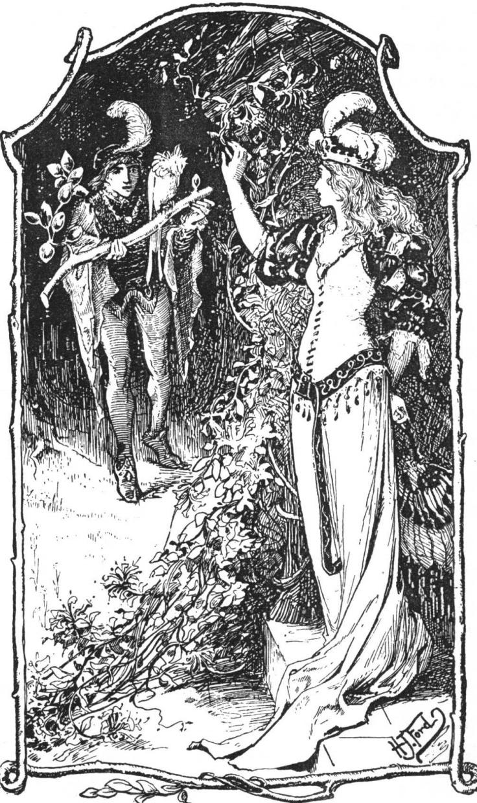

“哦！阁下，”她有点尴尬地答道，“至于那只青蛙，她现在正站在你的面前。让我把这个故事讲给你听吧，这故事并不长。我既不知道我是哪一国的，也不知道我的父母是谁，我只知道自己的名字叫塞潘婷。我生下来后就一直由仙女们扶养长大，仙女们希望我对自己的家庭一无所知，却给了我良好的教育，也给了我无穷无尽的关怀。我一直是过着隐居的生活，而最近这两年则更是没法再好了，我有了一面魔镜，”——说到这儿，一阵害羞和窘迫使她难以再往下说下去，但她终于控制住了自己，接着说——“你知道那些仙女们总是要别人绝对服从她们，又不准别人提问的。正是她们把你面前的这所房子变成了你问的那眼泉水，他们还把我变成了一只青蛙。她们命令我对第一个到泉水边来的人说的那些话我已原原本本地对你说了。但是，阁下，当你站在我的面前时，我却为必须以那种难看的外形出现在你面前而内心充满了苦痛。然而难受是没有用的，尽管我内心苦痛，我仍然必须服从仙女的命令。我满心希望你能获得成功，不仅是为了你，也是为了我自己，因为只有你拿到了那只美丽的鸟儿，我才能变回我正常的外形，虽然我并不知道你为什么要找这只鸟。”

针对姑娘的疑问，沙费尔解释了他父亲的病情，而这些我们前面都已经交待过了。

塞潘婷听了王子讲了他父亲生病的过程后很悲伤，她可爱的眼里充满了泪水。

“啊，阁下，”她说，“你除了在镜子里见过我以外，对我的其他方面都一概不知；而我虽然不知道自己的父母是谁，却知道你是一位国王的儿子。”

尽管沙费尔竭力向姑娘宣称，爱情使他们俩处于平等地位，塞潘婷却只是回答：“我太爱你了，我不会让你娶一个出身比你低的人为妻。当然我会感到很不幸，但不会改变自己的想法。如果我从仙女那里得知我的出身配不上你的话，不管我自己的心情怎样，我也不会接受你伸过来的手。”

这场对话本来还会持续更长一段时间，但这时一个仙女在另一个美丽的中年妇女的陪同下，坐着象牙车来到了这里。这时那只漂亮的鸟儿突然醒了，它飞到了沙费尔的肩上（它以后就一直停在那儿），并以鸟儿最亲切的方式抚摸他。仙女告诉塞潘婷，对她的行为很满意。她还把沙费尔介绍给她带来的那位女士，并解释道这女士就是他的婶婶阿格兰蒂诺，即国王戴曼蒂诺的遗孀。

于是他们就互相拥抱，直到仙女登上了她的马车，并让阿格兰蒂诺坐在她边上，让沙费尔和塞潘婷坐在前座。她还派人去告诉王子的随从，那只美丽的鸟已经找到了，让他们慢慢地走回国王佩里德的王宫去。当安排完这一切后，她就赶着她的马车走了。尽管他们的车在空中走得飞快，沙费尔和塞潘婷还是觉得他们的时间过得更快，因为他们有那么多事情要想。

当仙女的马车到达国王佩里德的宫殿时，他们两人还处在相见的兴奋中。但这时国王已经让人把他安置在王宫顶层的一个房间里，他的护士觉得他随时都可能去世。马车刚驰到能看见王宫的时候，那只漂亮的鸟儿就飞起来，直接飞到了垂死的国王身边，并立刻治好了他的病。接着她又恢复了她的原形，国王发现原来这只鸟就是王后康斯坦斯，他长时期以来一直是以为她已经死了的。佩里德高兴地又一次拥抱了的妻子和儿子，并且在仙女的帮助下，为沙费尔和塞潘婷的婚礼作好了准备。塞潘婷已被证明是阿格兰蒂诺与戴曼蒂诺的女儿，因而是一位公主，与沙费尔的王子地位正好相当。整个王国的臣民都高兴极了，每个人都快乐富足地生活，直到生命的终点。

 

## 七头蛇

有位国王决心要作一次远距离的航海探险。他装备好了舰队和船员后就出发了。他们夜以继日地航行，直到来到了一座小岛。这座小岛上长满了参天大树，每棵树下都躺着一头狮子。国王刚让他的随从们登上岸，那些狮子就都站了起来，过来扑食他们。经过一场漫长的战斗他们终于战胜了这些野兽，但是他们的大部分人都被野兽杀死了。剩下的人继续穿过森林向前走。当他们来到森林的另一边的时候，他们发现了一个美丽的花园，花园中世界上各种各样的花草都在竞相开放。花园里还有三眼泉：第一眼泉中流出来的是银子，第二眼泉流出来的是金子，而第三眼泉流出来的则是珍珠。于是这些人卸下了随身背着的背包，往背包里塞满了这些宝贝。花园中心还有一个大湖，当他们来到湖边时，湖开口说道：“你们是些什么人？是怎样来到这里的？你们是不是来拜访我们的大王的？”但是这些人都吓得答不出话来。

于是湖接着又说道：“你们应该感到害怕，因为你们到这里来实在是太危险了。我们的大王有七个头，它现在正在睡觉，但几分钟后它就会醒来并到我这里来洗澡！不管是谁，只要在这花园里遇到它，就一定要倒霉，因为谁也不可能从它手中逃脱。如果你们还想保住自己的性命，就照我说的去做：把你们的衣服都脱下来，铺在通往城堡的路上，这样大王过来的时候就会游过这些柔软的东西。大王很喜欢软的东西，它一高兴就不会吃掉你们了。它会给你们一些惩罚，但惩罚之后会让你们离去。”

于是这些人就按湖的劝告做了。中午时分，大地开始震动起来，许多地方都裂开了口子，从这些裂口里钻出了狮子、老虎和其他的野兽，它们把城堡团团围了起来。之后，成千上万的野兽追随着它们的大王——就是那条七头蛇走出了城堡。七头蛇游过了为它铺着的衣服来到了湖边，它问是谁在路上铺上了这些软软的东西？湖回答道，这些衣服是由来这里向它表示效忠的人们铺上的。于是蛇大王命令把这些人带到它的面前。这些人都谦卑地膝行到七头蛇面前，简短地讲述了他们来这的原因。蛇听了他们的陈述后，用很有力又很可怕的声音说道：“因为你们胆敢到这里来，我要给你们一个惩罚。每年你们都得从国中选十二个青年和十二个少女来给我吃。如果你们不这样做，我就毁了你们的整个国家。”

接着它就让一头野兽指给他们走出花园的路并打发他们走。于是这些人离开了这座岛，回到了他们自己的国家，把他们的遭遇讲给了国人听。不久，那个蛇大王要他们送青年和少女去给它吃的时限快到了，于是国王就发出了一则告示，号召国内十二名青年和十二名少女献出他们自己的生命以拯救这个国家，立刻国内就有远远多于这个数目的人要求去担当这个使命。于是国王造了一条新船，船上扯着黑帆，那些被选去送给蛇王的青年和少女们登上了船，向着野兽国出发了。他们到达那岛上后就直接去了湖边，这次狮子们没敢来打扰他们，泉也不再流了，连湖都不说话了。于是他们就在湖边等着。没多久，地面就剧烈地震动起来，震得比第一次更可怕。七头蛇王没带它那些野兽随从就出来了，它看到猎物正在等它，就一口把他们全都吞了下去。接着船上的水手就把船开回了家。从此这样的事每年都要发生一次，一直持续了好多年。

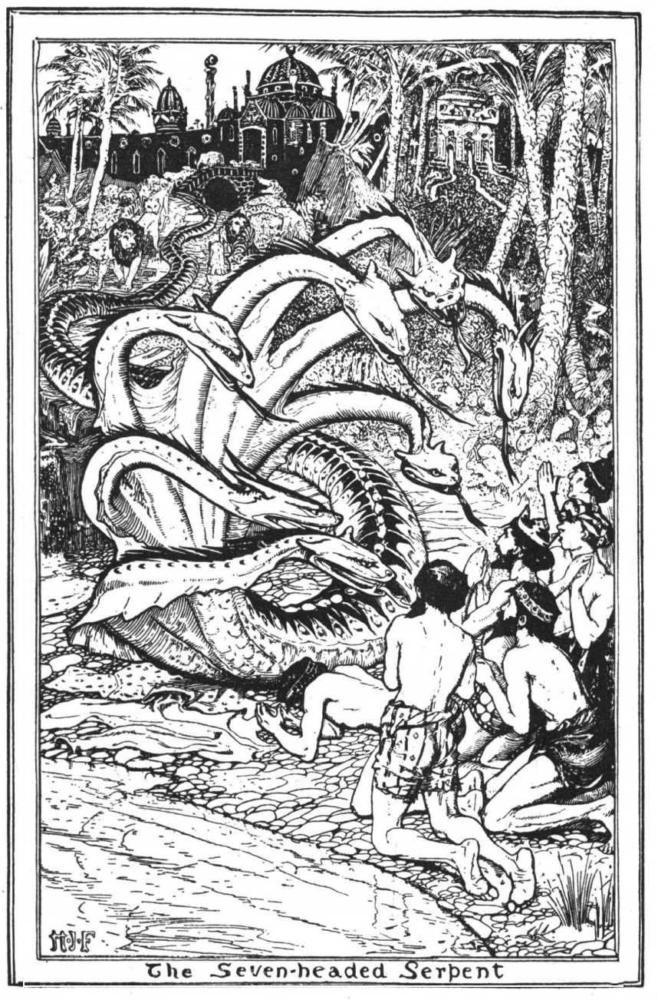

后来这个不幸的国家的国王渐渐老了，王后也一样渐渐老了，可是他们还没有孩子。一天，王后坐在窗户边上，正在为她没有孩子，国王死后王位要落到异姓人手里而伤心地哭泣，突然一个老妇人出现在她面前。那个老妇人手里拿着一只苹果，对她说：“你为什么哭呀，我的王后？是什么事使你这么伤心？”

“啊呀，好心的婆婆呀，”王后回答道，“我是为了自己没有孩子而伤心。”

“你只是为了这个伤心吗？”老妇人说，“你听我说，我是纺织女修道院的修女，我的教母死的时候把这苹果传给了我。不管是谁，只要吃了这苹果，就会得一个孩子。”

于是王后给了这老妇人一些钱，向她买了这只苹果。她把这只苹果削了皮，吃了果肉，并把果皮扔到窗外。碰巧那时有一匹母马在院子里散步，吃了这苹果的果皮。过了一段时间，王后生了一个小男孩，而那匹母马也生了一头雄马驹。这男孩和马驹一起长大，就像是兄弟一样互相热爱。随着时间的流逝，国王和王后先后去世了，他们的儿子这时十九岁，家中只剩了他一个人。有一天，当他与那匹马一起说话时，马对他说：“我是出于爱你并为了你和这个国家好，才会说下面这些话。如果你以后继续每年都送十二个青年和少女去给那野兽王吃，你的国家不久就会被毁掉了。骑到我的背上来吧，我带你到一个女人那儿去，她能告诉你怎样才能杀掉那条七头蛇。”

于是青年骑上了马，那匹马带着他到了很远很远的一座山上。这座山里面是空的，在它的一边有一个很大的地下洞穴，洞穴里坐着一个老妇人，正在那里纺线。这个山洞实际上是个修道院，那个老妇人就是修道院院长，院里的修女们成天都在纺线，因此才叫纺织女修道院。山洞的石壁上修女们挖出了石床，晚上她们就睡在这石床上。山洞中间点着一盏油灯，修女们轮流值班照管这盏灯，不让它熄灭。如果有人疏忽大意让这盏灯熄了，其他修女就会一起把她处死。

王子一看到在那儿纺线的修道院院长，就上前跪在她脚下，恳求她告诉自己，如何才能杀死那条七头蛇。

院长让王子站起来，拥抱了他，然后说：“我告诉你，孩子！正是我派了一个修女到你母亲那儿去，使你降生到了人世，同时与你降生的还有你的那匹马。在它的帮助下，你就能把整个世界从那恶魔手中解脱出来。我这就告诉你该怎么办。在你的马上装上棉花，等一下我给你指一条路，你沿着这条路到七头蛇的王宫里去，就可以躲开那些野兽的袭击。你会发现那蛇大王正睡在床上，而床的上面正悬着一把剑。只有拿着这把剑，你才能杀死那条七头蛇，因为这把剑即使剑头折断了，也能重新再长出一个新的剑头来。这样你就能把它的七个头全都砍掉。你还必须按我说的去做以便骗过那蛇大王：你必须轻手轻脚地溜进它的房间，用你带的棉花塞住它的床四周挂着的铜铃，再慢慢地取下那柄剑，取到剑后就迅速砍那蛇的尾巴。这样蛇就醒来了。当蛇看到你时就会过来抓你，你必须迅速砍掉它伸过来的第一个头，等第二个头又伸过来时你也马上把它砍掉，这样下去你就可以把它的七个头全都砍下来。”

接着老院长就祝福王子取得成功，王子鼓起勇气，开始了他的事业。他沿着老院长指给他的秘密路径，顺利地进入了七头蛇的城堡，接着他小心地按老院长的指示做，终于成功地杀死了七头蛇这个恶魔。当那些野兽们得到它们大王的死讯时，便向城堡这里赶来，但青年早就骑上了他的马，远远地离开了这个地方。野兽们在后面以最快的速度追赶他，但还是没能追上他，青年安全地回到了自己的家园。他就这样把自己的国家从可怕的危难中解救了出来。

 

## 感恩的动物

有一对夫妇生了三个很漂亮的儿子，但他们太穷了，自己都吃不饱肚子，更别说这几个孩子了。于是孩子们决定自己到世界上去闯一闯，试试他们的运气。出发前，母亲给了他们每人一袋面包和一个祝福，于是他们告别了父亲和母亲，开始了旅行。

三兄弟中年龄最小的那个名字叫弗可，他是个很美丽的青年，不仅有良好的身材、一对蓝眼睛和一头秀发，而且肤色白里透红。他的两个哥哥对他十分嫉妒，他们觉得，以他的相貌，他一定能获得比他们俩更多的运气。

一天，三兄弟都坐在一棵树下休息，因为天气太热了，他们又走得太累，弗可马上睡着了，但他的两个哥哥仍然醒着。这时大哥对二哥说：“你说把我们的弟弟弗可弄伤残怎么样？他那么漂亮，大家都这么喜欢他，对我们却是一般。如果我们能甩掉他，成功的机会就会多一些。”

“我太同意你的看法了，”二哥答道，“我建议我们先吃掉他的面包，然后不让他吃我们的面包，除非他同意我们弄瞎他的眼睛或折断他的腿。”

大哥听了这个建议很高兴，于是这两个坏蛋就把弗可的面包全吃光了，而那可怜的小弟弟还在睡着呢。

弟弟醒来时，感到肚子非常饿，于是就去找他的面包吃，但他的哥哥们叫了起来：“你睡着的时候已经把自己的面包都吃光了，你这个好吃鬼！你现在愿饿多久就饿多久吧，我们是不会让你吃我们的面包的。”

弗可这下可糊涂了，他弄不明白他睡着的时候怎么还能吃东西，但他什么也没说，就这样熬了一天一夜。到第二天早晨他实在太饿了，流着泪恳求哥哥们给他一点面包吃。可这两个残忍的东西阴险地笑了，他们重复了昨天说过的话，当弗可继续苦苦哀求他们时，大哥终于说：“如果你让我们弄瞎你的一只眼睛和折断你的一条腿的话，我们就给你一点面包吃。”

听了这些话，可怜的弗可哭得更伤心了。他继续忍受着饥饿的折磨，直到太阳高高地挂在了天上，这时他再也坚持不下去了，只好答应让他的哥哥弄瞎他的左眼和折断他的左腿。这以后他饥渴地伸出手去索要面包，可是哥哥只给了他那么一点点面包，以致这饿极了的青年一口吃完后，只好求他们再给一点。

可是弗可越是哭，越是说他快要饿死了，他的哥哥们就越嘲笑他，越骂他是个贪婪的人。他只好又忍受了一整天饥饿的煎熬，可是当夜晚来临时，他再也忍不住了，就让他的哥哥们弄瞎了他的右眼，折断了他的右腿，换取了一点点面包。

他的哥哥们见阴谋得逞，便扔下在地上痛苦呻吟的他，走了。

可怜的弗可吃完了那一点点面包，伤心地哭泣着，但没有人听到他的哭声，也没人过来帮助他。夜晚降临了，可怜的瞎眼青年只能漫无目的的往前爬着。当太阳再次高高地升起来时，弗可感到了烈日正烧烤着自己，便爬着寻找一块荫凉的地方，以使他剧痛的双腿休息一下。他爬上了一座小山，在草地上躺了下来，以为自己是躺在一棵大树的树荫下。但他靠的东西实际上并不是树，而是站着两只乌鸦的一副木头架。弗可躺在地上，听见一只乌鸦在对另一只说：“这周围有什么新奇或出名的东西吗？”另一只答道：“我想是有的，有些东西你在世界上的其他地方还找不到呢。我们下面有一个湖，垂死的人在那湖里洗个澡，立刻就会恢复健康；从小就瞎眼的人用这山上的露水洗眼睛，他的目光就会像鹰一样锐利。”

“行了，”第一只乌鸦又说道，“我的眼睛可不需要治疗，托上帝的福，我的眼睛一直很好；可是我的翅膀许多年前被一支箭射中了，从那以后它就一直很虚弱。我们马上飞到湖那儿去，使我能恢复健康和以前的精力吧。”说着这两只乌鸦就飞走了。

乌鸦的话使弗可高兴得跳了起来，他焦急地等待着夜晚的来临，以便他可以用这珍贵的露水来擦拭自己失明的眼睛。

黄昏终于来临了，太阳落到了山的背后，山上渐渐变冷了，青草上开始结出露珠。这时弗可把脸埋到草丛中，让露珠润湿了他的眼睛。不一会儿，他就能看清周围的一切了，而且比以往看得更清楚；月亮正把它银色的光撒到地上，为他照亮了通往那个神奇的湖边的路。

弗可慢慢爬到了湖边，把双脚浸到湖水里。没多久他就感到双腿又像以前那样健康有力了。弗可从心底里感谢命运把他带到这座山上，使他听到了乌鸦间的谈话。他用瓶子装了一瓶这种能治病的湖水，愉快地继续他的旅行。

他没走多远就遇到了一条狼，那条狼正用三条腿艰难地、一瘸一拐地往前挪着，它看到弗可，就绝望地嚎起来。

“我的朋友，”年轻人说，“鼓起劲来吧，我马上就能治好你的腿。”说着，他就把那神奇的湖水倒了一点在狼的伤腿上，只一会儿狼就能用它的四条腿欢快地蹦蹦跳跳了。满怀感激的狼反复地向他的恩人表示感谢，并许诺在他需要的时候给他一个最好的回报。

弗可继续往前走，来到了一片犁过的田野，看到田里有一只小老鼠正艰难地用后爪爬着，因为它的前爪被一只鼠夹折断了。

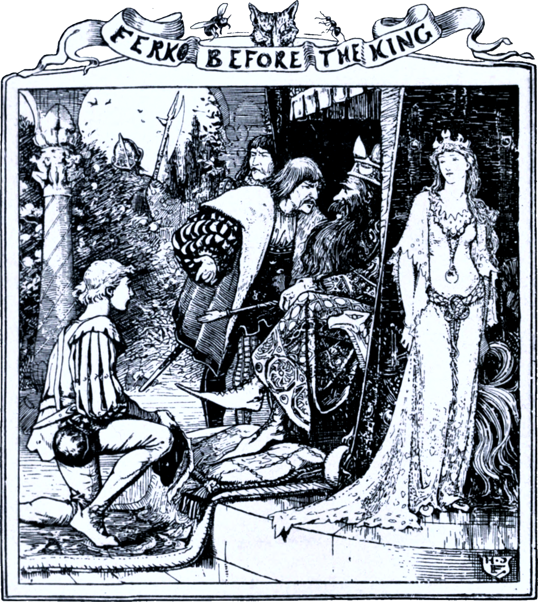

弗可很可怜这小东西，他用最和善的言词安慰它，并用那珍贵的湖水洗它小小的前爪。眨眼工夫小老鼠就恢复了健康，它谢过了为它治疗的医生后就顺着犁沟爬走了。

弗可又再次继续他的旅行。他没走多远，就看到一只蜂王向他飞来，蜂王的身后拖着一只翅膀，可那只翅膀已经被一只大鸟残酷地撕成了两半。正如弗可已经为狼和老鼠治好了伤那样，他也很愿意为这只蜂王治疗。于是他把那神水倒了一点在那受伤的翅膀上，那只蜂王立刻就被治好了，它对弗可说：“我太感谢你的帮助了，今后我一定要好好报答你。”说完这些它又嗡嗡地飞走了。

于是弗可又继续往前走了好久，最后终于到达了一个奇怪的王国。他心里想，最好还是直接去王宫，向这个王国的国王提出做他的大臣，因为他已听说国王有个极其漂亮的女儿。

于是他就直接去了王宫，他进了宫门后第一眼见到的人竟是他那两个无耻地残害了他的哥哥！他们两个费尽心机已经弄到了国王侍臣的职位，当他们认出弗可，并看到他的双眼和双腿已经恢复健康时，吓得都快死过去了，因为他们怕弗可把他们的行为告诉国王，那样的话他们就会被吊死。

弗可刚一走进宫殿，王宫里所有的眼睛就都盯住了这漂亮的青年。国王的女儿对青年也充满了仰慕之情，因为她平生还从未见过这么漂亮的人。弗可的两个哥哥看到这情景，害怕之余又加了嫉妒，于是决心再次毁掉自己的兄弟。他们来到国王面前，说弗可是个可恶的巫师，他到宫里来是为了要拐走公主。

国王听了就让人把弗可带到他面前，对他说：“有人控告你是个巫师，想来拐走我的女儿，所以我判处你死刑。但如果你能完成我指派给你的三件事，并离开这个国家，你的性命就可保留。如果你完成不了我要你干的事情，你就会被吊死在就近的树上。”

接着国王就转身对那两个阴险的兄弟说：“你们提一件事让他去做，不管有多困难，他都必须完成，否则就去死。”

两个兄弟并不需要想多久，就说：“让他在一天之内为陛下您建造一座比这座王宫更壮丽的宫殿，如果他做不到，就把他吊死吧。”

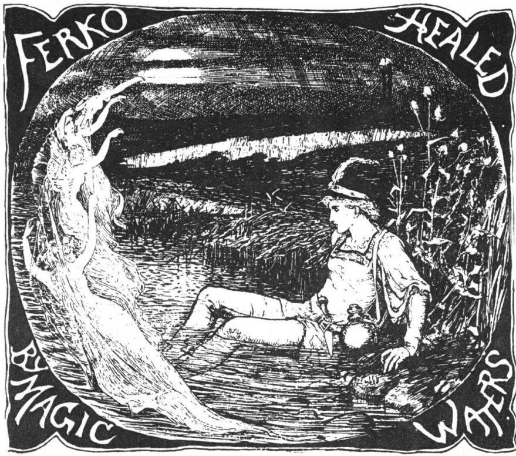

国王听到这个建议很高兴，就命令弗可第二天开始工作。那两个哥哥也很高兴，他们以为这次可以彻底摆脱弗可了。可怜的弗可心都要碎了，他诅咒为什么会踏上这片国土。当他在王宫周围的草地上闷闷不乐的走来走去，不知怎样才能逃过这死亡的危险时，一只小蜜蜂飞过这儿，停在他的肩上，悄悄问他：“你遇到了什么麻烦，我好心的恩人？我能不能帮你呢？我就是那只你治好了翅膀的蜜蜂，我希望能用某种方式来表示我的感谢。”

弗可认出了蜂王，就说：“啊呀！你怎么帮得了我呢？他们要我去完成一项工作，这项工作世界上谁都没法做到，就是伟大的天才也无能为力！我必须从明天早晨开始建一座比现在的王宫更壮丽的宫殿，而这项工作又必须在傍晚前完成。”

“就是这个吗？”蜜蜂问道，“那你就可以放宽心了。明天傍晚太阳下山之前，这里就会建起一座与现有的任何王宫都不同的宫殿。你呆在这里不要走，我会回来告诉你这宫殿是怎么建的。”说完这些它就愉快地飞走了。弗可得到了蜜蜂的安慰，就在草地上躺下来，平静地睡到第二天早晨。

第二天一早，全城的人都来了，每个人都很好奇，都想看看这个陌生人怎样和在什么地方建造这奇妙的宫殿。只有公主一人难过地沉默着，她那么关心这个美貌青年的命运，以致昨晚哭了一晚上，泪水把枕头都浸湿了。

弗可在草地上等那蜜蜂回来等了一整天。当傍晚来临时那只蜂王飞来了。它停在他的肩上说，“那奇妙的宫殿已经造好了。鼓起精神来，带着国王到城墙外的小山上去吧。”说完它又欢乐地嗡嗡叫着飞走了。

弗可于是立刻走进王宫，告诉国王宫殿已经修好了。整个王宫的人都一齐走出来观看这个奇迹，当他们看到眼前的景象时，都着实大吃一惊。城墙外面的小山背后建起了一座壮丽的宫殿，这宫殿全是由人类花园中能找到的最奇异的花草建成。宫殿的屋顶全是由鲜红色的玫瑰组成，而窗子则是用百合花搭成的，墙壁是白色的康乃馨，地板是鲜明的报春花和紫罗兰，门是华贵的郁金香和水仙，门环则是向日葵。宫殿内外，花信子和其他馨香扑鼻的鲜花四处开放，空中充满了花的香气，随风飘到远处，所有来这里的人都被这花香熏得醉醺醺的。

这座壮丽的宫殿是由那只感恩的蜂王建起来的，为此它把王国里所有的蜜蜂都召集过来帮忙。

国王看了这宫殿感到无比的惊奇，公主的眼光从这奇妙的宫殿转到兴高采烈的弗可身上时，眼中也放射出兴奋的光芒。但他的两个哥哥却妒嫉得脸都发青了，他们再次宣称，弗可只是一个狡猾的巫师。

国王虽然对他的命令已经被完美地执行感到十分惊奇，但他同样对这陌生人竟能逃出他设置的陷阱而感到十分恼火。他又向那两个哥哥说：“他显然已经用他那可恶的魔法完成了这第一件工作，那么我们现在让他做什么好呢？这次我们让他做的工作要尽可能难，一旦他完不成就处死他。”

这时大哥回答道：“地里的玉米都已经割下来了，但还没有收进谷仓。让这无赖将全国的玉米都收集起来，在明天晚上前堆成一大堆，如果留下一根玉米没收进来，就把他处死。”

公主听到这些话后吓得脸都白了，但这回弗可比第一回接受任务时坦然多了，他再次走进了草地，心里想着怎样才能度过这个难关，但他实在想不出有什么办法。太阳落下山了，夜幕降临。这时，一只小老鼠从弗可脚下的草地上钻出来，问他：“我见到您很高兴，好心的恩人，但你为什么看上去这么忧愁呢？我有没有办法帮助你，以回报你给我的恩惠呢？”

这时弗可认出了这只老鼠就是他给治好了前爪的那只。他回答道：“啊呀！这种超过任何人能力的事你怎么帮得了我呢！明天晚上以前，他们要我把这个国家里的所有玉米都收集到一个大的谷仓里，如果留下一棵玉米没收起来，我就没命了。”

“就是这样一件事吗？”老鼠问道，“那你完全不用那么伤心。把这事交给我吧，明天太阳落山以前我会告诉你，你的工作已经完成了。”说完这些，这个小动物就跳进田野里走了。

弗可相信小老鼠说的话是绝对能做到的，于是他就放心地躺在柔软的草地上，舒舒服服地一直睡到第二天早上。第二天慢慢地过去了，夜晚来临时小老鼠又回来了。它对他说：“现在地里已经一颗玉米都没有了，所有的玉米都已收集起来，堆在那座山边的一个大谷仓里。”

于是弗可高兴地去报告国王，他的所有要求都已经办到了。整个宫里的人都一齐出来去观看这一奇迹，这回他们吃惊的程度决不亚于上一次。在一座比国王的王宫还高的谷仓里堆着从全国收集来的玉米，而在任何一块地里连一棵玉米也没留下。这一切都是怎么完成的呢？原来是那只小老鼠召集起了全国的每一只老鼠，它们一起把全国的玉米都收到了这里。

国王掩饰不住他的惊讶，但同时他的恼怒进一步增加了，也比以往更相信那两个哥哥说的话。弗可的两个哥哥一直在重复着说他只是一个狡猾的巫师。只有美丽的公主为弗可的成功而高兴，她用充满爱慕的目光看着弗可，而弗可也用同样的目光回报她。

残酷的国王越看眼前的这个奇迹就越感到愤怒，但是他既然已经有言在先，就无法处死这个陌生人。于是他又一次问那两个哥哥：“他那可恶的魔法又一次帮助了他，现在第三个任务我们让他做什么好呢？不管那工作有多艰难，他都必须完成，否则就去死。”

那个大哥很快又答道：“让他把这个国家里所有的狼在明晚之前赶到这座山上来。如果他做到了这个他就可以自由地离开，否则就按您的指示将他吊死。”

公主听了这些话后不禁失声痛哭起来，国王看到这情景就命令将她关到一座高塔里，并派人严密地看住她，直到这危险的巫师或者离开了这个王国或者被处死后再放出来。

弗可又一次来到了田野里，他在一棵树桩上坐下来，想着现在他该怎么办。突然一只大狼向他跑过来，这只狼在他的面前站定后说：“再次见到您真高兴，我好心的恩人。你独自一人在这里想什么？如果你需要我给你任何帮助的话，你就只管说好了，我很乐意用行动来表明我对你的感激。”

弗可立即认出来，这就是那只他为它治好了断腿的狼，于是就告诉了它，如果他想保全自己的性命，就要按国王的要求在第二天必须做到的事。“但是我又有什么办法，”他接着说，“能把整个王国的狼都集中到那座山上去呢？”“如果你就是想做到这些，”那只狼答道，“你就不必发愁了。我来替你完成这个任务。明天太阳落山以前，你就能听到我的回音。打起精神来吧。”说完这些后狼就迅速地跑走了。

这时青年高兴地跳了起来，因为他感到他的生命安全已经有了保障，但当他又转而想到那美丽的公主时就又陷入了极度的悲伤，因为如果他离开了这个国家，他可能就再也见不到她了。他想着想着就在草地上躺下来，不久就睡熟了。

第二天一天他都在田野里走来走去。快到傍晚的时候，那只狼急匆匆地跑来对他说：“我已经把王国里所有的狼都集合在一起了，它们都在树林里等着你呢。你马上到国王那儿去，告诉他到前面的那座小山上去，这样他就可以亲眼看见你创造的奇迹。说完之后你马上回到我这儿来，骑到我背上，我就会帮助你把所有的狼都赶到一起。”

于是弗可马上走进宫殿对国王说，他已经准备好，可以完成这第三项任务了，请国王到前面的山上去看他做这件工作。弗可自己则回到了田野里，他跨上了那只狼的背脊，然后骑着它进了附近的森林。

那只狼快如闪电地围着森林飞跑了一圈，眨眼之间就有几百只狼在他面前站起来，而且这数量每时每刻还在增加，直到足有几千只狼。他赶着这些狼向小山跑去，国王和他整个王宫的大臣以及弗可的两个哥哥都正站在那山顶上观看呢。只有那可爱的公主不在场，她被关在那座高塔里，正在伤心地哭着。

当那两个可恶的哥哥看到他们的诡计又失败了时，简直气得暴跳如雷。当国王看到无数的狼正越来越向他们靠近时，不禁全身战栗起来，他急忙对弗可喊道：“行了，行了，不用让更多的狼过来了！”

但弗可骑的那只狼对他说：“继续冲！继续冲！”与此同时，许多只狼往山上奔去，一面可怕地嗥着，一面露出了白色的獠牙。

国王在恐惧中又叫起来：“停一下，停一下！我给你半个王国，只要你把这些狼赶走就行了。”但弗可装作没有听见，他又把另外的几千只狼赶到他面前，于是山上的每个人都惊骇得颤抖起来。

这时国王提高了嗓门又喊道：“停一停！我把我的整个王国都给你，只要你把这些狼赶回它们原来的地方就行了。”

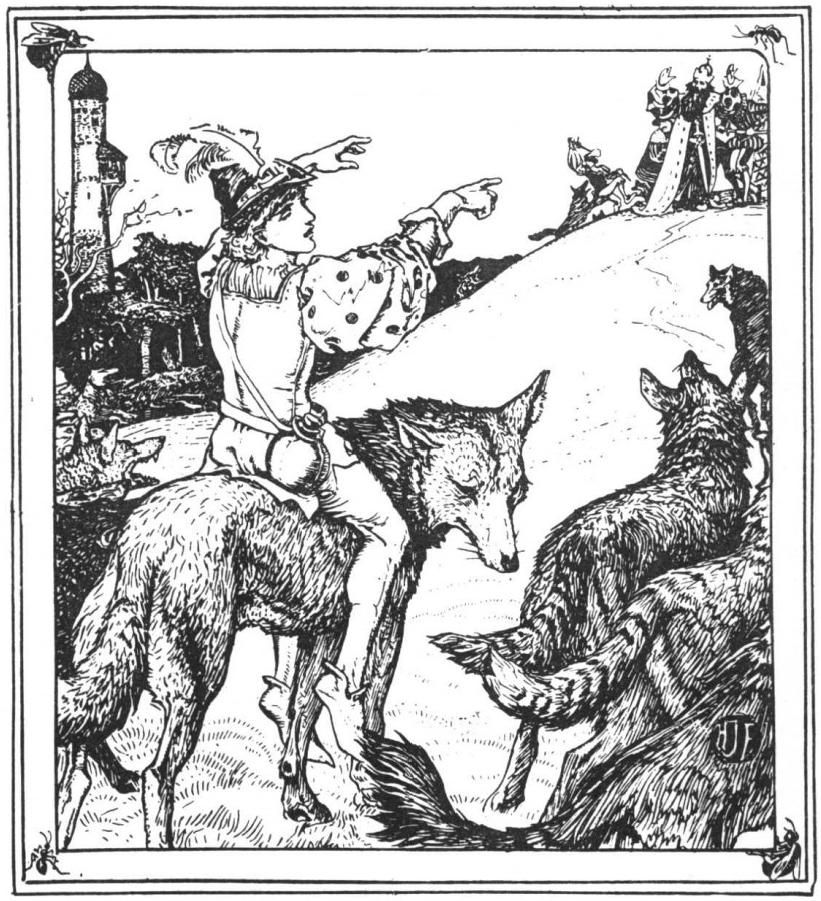

但那只狼继续鼓动弗可道：“继续冲！继续冲！”于是弗可让那些狼继续向前冲，直到他们扑到了国王和他那两个可恶的哥哥身上，只一会儿就把他们和整个王宫的大臣都吃掉了。

接着弗可马上赶回王宫救出了公主，他当天就娶了她为妻并继承了王位。所有的狼都又回到了它们的老巢。弗可和他的新娘一起平安而又幸福地生活了许多许多年，国内的老老少少都十分热爱他们。

 

## 巨人和牧童

从前有个穷孩子，他既没有父亲，也没有母亲。为了生活，他只好给一个大地主放羊。他白天和黑夜都在露天里度过，只有下雨或打雷时，才钻进大森林边上的一间小茅屋里躲一躲。一天晚上，当他在羊群边的草地上坐下时，听到不远的地方传来有人呻吟的声音。他站了起来，向着声音传来的方向走去。令他大吃一惊的是，他看到一个巨人正躺在森林的入口处。他刚想以最快的速度跑开，却被巨人叫住了。“别害怕，”巨人说，“我不会伤害你的。如果你能帮我裹一下我的这只脚，我还会给你极可观的回报。我刚才在拔起一棵橡树时弄伤了自己的脚。”

于是牧童脱下了自己的衣服，用它把巨人受伤的脚裹了起来。接着巨人站了起来，对牧童说：“现在你跟我来吧，让我来报答你。我们今天会举行一个结婚庆典，我保证你在那儿会很开心的，一起来享受一下吧。但为了使我的兄弟们看不到你，你把这条带子围在腰上，这样别人就看不到你了。”说着他递给牧童一条腰带，并在前面带路。巨人领着他来到了一眼泉水边，那里聚集着数百个巨人准备举行庆典。他们又跳舞，又玩各种不同的游戏，一直欢闹到半夜。然后，一个巨人连根拔起了一棵树，接着所有的巨人们都把自己的身子变得很细很细，钻进那拔起了的树根留下的孔中消失了。受了伤的巨人留在后面，直到只剩下他一个人时，他叫道：“牧童，你在哪里？”“我在这里，就在你边上。”牧童答道。“抓住我，”巨人说，“这样你就也能和我们一起到地下去。”于是牧童就按巨人的吩咐做了。他还没来得及相信这是真的，就发现自己已经来到了一个大厅里，这大厅连墙都是用纯金造的。使他惊奇的是这个大厅中放的是属于他主人的桌、椅等家具。几分钟后大家就开始吃喝了，宴会非常丰盛，牧童扑到宴席上也贪婪地大吃大喝了一顿。当吃得再也吃不下时，他想：“何不放一块面包在口袋中呢？这样我明天又可以好好吃一顿了。”于是他趁没人看见的时候抓了一块面包，把它藏在衣服里面。他刚做完这些，那受伤的巨人就踱到了他身边，轻声地问：“牧童，你在哪里？”“我在这里。”牧童答道。“你现在抓住我，”巨人说道，

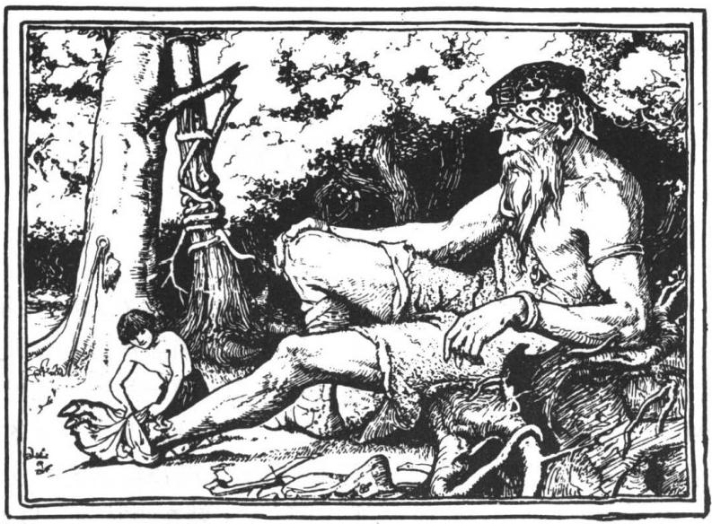

“这样我就可以把你带回地上去。”于是牧童抓住了巨人，几秒钟后他就又回到了地上，但巨人已经不见了。牧童回到了他的羊群旁，解下了那条使人看不见他的腰带，仔细地藏到口袋里。

第二天早上小伙子又感到饿了，他想起了从巨人婚宴上带回来的面包，觉得可以切下一块来吃。但是尽管他用尽了全身的力气，都无法从那上面切下哪怕是小小的一块面包。失望中他拿起面包咬了一口，使他惊奇的是，一块金子竟从他的口中掉了出来，滚落到他的脚边，而面包则依旧完整如初。牧童见他遇到这样的好运真是高兴极了，他急忙把这块神奇的面包放到袋子里藏好，然后赶到附近的村庄去买了一点吃的，又回到了他的羊群中。

牧童的主人有个非常可爱的女儿，这女孩每次与她父亲一起到田野里来散步时，总要对着牧童微笑和点头。牧童早就下定决心要为这可爱的姑娘的生日准备一份使她惊奇的礼物。当姑娘的生日来临时，牧童围上了那条使人看不见他的腰带，拿了一袋金块在半夜里溜进了姑娘的房间，他把那袋黄金放在姑娘的床边上，就返回到他的羊群中。当姑娘和他父母发现这满满的一袋金子时，他们的高兴劲儿简直无法形容。牧童自己每当想起他给姑娘带去的快乐时也兴奋不已，以致于他第二天晚上又去把一袋金子放到了姑娘的床边。他一连这样干了七个晚上。这时姑娘和她的父母都认定，一定是位好心的仙女每晚给他们送来了这些金子。这天晚上，他们决心躲在暗处观察，看一看究竟是谁给他们送来了一袋又一袋的金子。

第八天晚上，牧童又要去给美丽的姑娘送上一袋金子。他刚走到半路，天上就下起了可怕的暴风雨。在快到主人家的时候，他突然想起他忘了带那条使别人看不见他的腰带。这时他不想冒着风雨再回去拿那条腰带了，于是他就像前几次那样蹑手蹑脚地走进了姑娘的房间，当他把那袋金子放在姑娘床边，转身正要离去时，只见他的主人站在他面前，喝道：“你这个小流氓！你是想来偷那仙女每晚都送来的金子，是不是？”牧童被他主人的话吓住了，以致他只是站在主人面前颤抖，不敢为自己的处境辩护。这时他的主人又说话了：“看在你以前在我这儿干活一直表现不错的份上，我就不把你送进监狱里去了，但你得马上离开这个地方，不要让我再看到你。”于是牧童返回了他住的小屋，拿了他的面包和腰带，到附近的城里去了。在城里他给自己买了一些鲜艳的衣服，又买了一辆美丽的马车和四匹马，雇了两个仆人，赶着马车又回到主人家来。可以想见，牧童主人看到他这样阔绰地回来会是多么惊奇！这时牧童告诉了他自己交上的好运，并请求他把他美丽的女儿嫁给他。他的请求立刻得到了允诺，于是牧童和他妻子一起幸福地度过了一生。

 

## 隐身王子

从前有个仙女，她掌管着土地、海洋、火和风。这个仙女有四个儿子：大儿子活泼敏捷，富有想象力，她让他当了火王，因为她认为火是所有东西中最高尚的；二儿子虽然有些迟纯，但智慧过人，行为审慎，她让他当了土地的主人；第三个儿子狂野不羁，性格残忍，仙女对他的缺点感到羞耻，为了掩盖他的这些缺点，她让他当了海王；最小的儿子心情不稳定，常常受感情的支配，于是仙女封他为风的王子。

那小儿子虽然最受母亲宠爱，但作母亲的还是能够看出他的弱点，而且还预见到今后他会因为堕入爱河而饱受苦痛。对此她觉得最好是让他从小就培养出一种害怕女人的习惯。使仙女感到欣喜的是，随着这孩子年龄的增大，他对女人的厌恶也越来越增强了。因为从这孩子很小的年龄起，他就只听到王子们因坠入爱河而经受种种苦难的故事，仙女还不断地把可怜的小爱神描绘成极可怕的形象，以致于这年轻人一直相信：爱神是一切罪恶的渊源。

除了向儿子不断灌输对女人的仇恨外，这位聪明的母亲把其余的时间用来培养孩子对追逐猎物的兴趣，而这也成了这孩子的主要游乐方式。为了使儿子愉快，仙女新开辟了一片森林，里面种上了最漂亮的树，放养了地球上所能找到的各种各样的动物。在这座森林的中央，她盖了一座世界上最漂亮的宫殿。仙女觉得，她做的这些是为了使每个王子都感到幸福。

尽管人们可以贬低爱神，却无法与自己的命运抗争。王子的内心深处实际上早已对他母亲那喋喋不休的话题感到厌倦。有一天，仙女要出宫去办事，临行前反复嘱咐王子不要走远，可是当仙女一离开，王子立刻就抓住了这个违抗她的机会。

当只剩下自己一人的时候，王子马上就把母亲的忠告抛在脑后，他对自己国家已经感到非常厌倦了，于是他命令一些风的幽灵把他带到一个毗邻的国家。这个国家坐落在玫瑰岛上，那里气候温和，绿树常青，鲜花四季开放。海浪不是猛烈地向岩石上打来，而是轻轻拍打着沙滩，金黄色的树林覆盖着大地，葡萄挂满了枝头。

这个小岛的国王有个女儿，名字叫罗莎丽，是世界上长得最可爱的姑娘。风的王子一看到她，就马上忘了有生以来一直向他预言的各种可怕的苦难，就像多年的计划常常毁于一旦那样。他现在想的是怎样才能使自己感到最幸福，他想的最简单的办法就是让侍候他的幽灵把罗莎丽带走。

不难想象当国王发现女儿失踪后会是一种什么心情。他日日夜夜地为她流泪，唯一的安慰就是与一位刚到王宫，还不知道他姓名的年轻王子谈论他女儿。国王还不知道，这陌生人自己对罗莎丽有多么深的感情，因为他也见到了她，而且被她的迷人外貌俘虏了。

一天，国王伤心地在海边走着，心情比平时更加难过。经过一段长时间的沉默后，国王的唯一同伴，那位不知名的王子突然开口了。“没有什么灾难是不可挽救的，”他对那不幸的父亲说，“如果你肯答应把女儿嫁给我，我就保证把她带回你的身边。”

“你只是用空洞的许诺来安慰我一下而已，”国王回答道，“我亲眼看到她被带到空中，那时尽管我们的哭声能软化任何人的心肠，但那劫走我的女儿的畜生还不是一点都不为所动？这不幸的姑娘一定是被关在某个从未听说过的地方，那地方可能从来都没人去过。但你还是去吧，好心的陌生人，如果可能的话就把罗莎丽带回来，在这国家里与她一起幸福地生活吧，我现在就宣布你为这个国家的储君。”

尽管罗莎丽的父亲不知道这位陌生人的姓名和出身，可他确实是黄金岛国王的儿子。黄金岛的首都是一座很大的城市，这座城的一边连接着一个大海，另一边伸展到很远处的另一个大海。城墙的外面贴着金子，长期以来一直经受着平静的海水的洗刷，使人觉得是用黄沙造的。城墙上是柑桔和柠檬树组成的屏障。城里的街道都是用金子铺成的。

这个美丽的岛国的国王有一个儿子，这个儿子刚一出生，就有人预言他的一生会经历许多险阻。这一预言使他的父母都很惊慌。幸好那时有个仙女在场，为宽慰他的父母，仙女取出了一颗小石子，告诉他们，等王子长大了，只要把这颗小石子放到他嘴里，别人就看不见他了，但是这时他不能说话，一说话那石子的魔力就会全部丧失。仙女希望这样能保护王子免受危险。

王子刚长大成人，就急于想看看世界上其他国家是否也像他自己的国家那样美丽。于是他借口到他父亲所管的几个小岛去看看，就出发了。半路上一场可怕的风暴把他们的船吹到了一处不知名的海岸，上岸后王子的大部分随从都被当地的土著杀死了，而王子自己也只是靠了那颗有魔力的石子才逃过了这场恶运。他趁别人看不见他时又回到了海边，登上了自己那条船。

再次出发后他们遇到的第一片陆地就是这个玫瑰岛。登陆后他立即就到王宫去见国王，也就是罗莎丽的父亲。从他在王宫里第一眼见到公主时起，他就像其他人一样爱上了她。

他怀着对公主的热恋在岛上住了好几个月，这时，风的王子卷走了公主，使岛上的每个人都感到十分悲痛和绝望，但谁的悲痛也没有王子那么深，他日日夜夜都沉浸在失去恋人的悲伤中。

“哎！”他叹道，“难道我再也见不到我可爱的公主了吗？她现在在哪里呢？是哪个妖精把她藏起来了呢？我虽然只是个凡人，但我深深地爱着她，我一定要找遍全世界，直到找到她为止！”

这么想着，他就离开了王宫，做好了出发的准备。

他一连疲惫地走了好多天，却没有听到一点关于公主的消息，直到有一天早晨，正当他走过一座茂密的树林的时候，突然看到：在一条两边长着松树的大道尽头有一座宏伟的宫殿。他的心突然怦怦地跳了起来，心想他看到的可能是关着罗莎丽的监狱。他加快了脚步，迅速走到那宫殿的大门前，发现那大门是用一整块玛瑙做的。门自动打开了。王子进了门，又连续穿过了三座院子。这些院子四周都有深沟，沟里是湍急的流水，各种羽毛十分艳丽的鸟儿在岸边飞翔。周围的一切都十分珍奇美丽，但王子根本无心观赏这奇异的景色，他心里只想着哪里能找到公主。他每扇房门都要打开看看，每个角落都要搜寻一遍，但都没有用——他既没见到罗莎丽，也没见到其他任何人。最后只剩一座小木屋还没有搜过了。这座小木屋似乎是在一座完全由柑桔树建起的宅院中间，它的四个小房间在四角上开着门。四个房间中有三个是空的，里面只有一些雕像和别的奇怪的东西。但在第四个房间里，隐身的王子发现了罗莎丽！然而，再次见到公主的喜悦被他看到的景象冲散了许多，他看到风的王子正跪在她脚边向她求婚。但无论风的王子如何深情地表达他的爱情，罗莎丽说：“你把我从我敬爱的父亲身边抓到这里，不管用世界上什么珍奇的东西都不能宽慰我。你走吧！我决不会对你有任何好感，只会更加恨你和蔑视你。”说完这些话，她就转身进了自己的房间。

公主并不知道这时那位隐身的王子也跟着她进了房间，但是他怕公主在别人在场的时候发现他，就决心安静地等到天黑。在这段漫长的时间中他写了一首给公主的诗，并放在了她的床边。做完这个后他就一心盘算着怎样才能救出罗莎丽，并决定利用风的王子每年回去看他母亲和兄弟的机会开始行动。

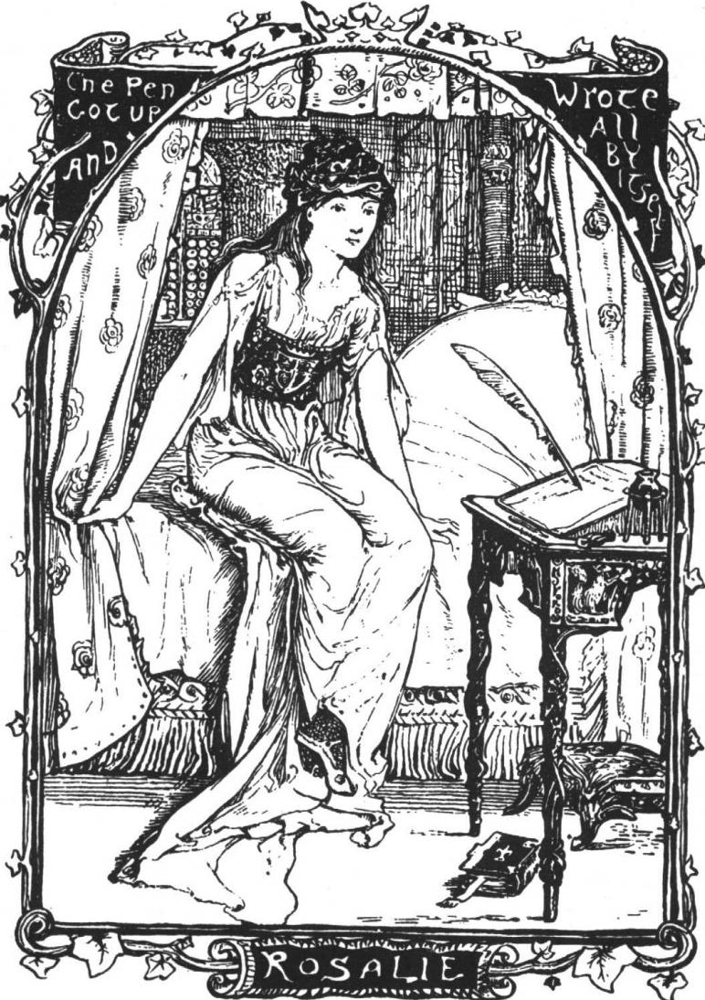

一天，罗莎丽正独自一人坐在房中考虑着自己的处境，突然她看到一支笔自动从桌上站了起来并开始在一张白纸上写字。她不知道这时正有一只看不见的手在握着笔，因此感到非常惊奇。那支笔一停下来，她马上赶到桌边去看，看到了一首优美的爱情诗，那首诗告诉她，不管她遭到什么样的不幸，有一个人会与她一起分担她的不幸，并全心全意地爱着她；他一定要把她从她憎恨的那人手中解救出来，否则决不罢休。公主受到了这首诗的鼓舞，就讲述了她的全部经历，并说到了有个年轻的陌生人来到了她父亲的王宫，那青年的容貌是那么迷人，以致从那天起，她的脑子里就没有别的人了。王子听了这些话后再也克制不住自己，他从嘴中取出了石子，跪倒在罗莎丽的脚边。

当他们经过了再次相见的狂喜后，就开始计划如何逃出风的王子的掌握。但这可不是件容易的事，因为那颗魔石只能对一个人起作用，为了救出罗莎丽，黄金岛王子就提出让公主先带着这颗魔石逃走，而由他来对付由此引起的敌人的暴怒。但罗莎丽决不同意这个办法。

“不，王子，”她说道，“因为你在这里的缘故，这岛已经不再让人感到是一座监狱了。此外，你是在一位仙女的保护之下，这仙女在这种时节经常访问你父亲的王宫。你马上回去找到这个仙女，然后恳求她再赐给你一颗有这种魔力的石子。你拿到那石子后，我们就不难逃出去了。”

几天后，风的王子从他母亲的王宫回来了，但这时隐身的王子已经出发了。然而隐身王子完全忘记了他来时走过的路，他在森林里迷了好几天路，以致当他到家里时，仙女已经离开了。王子虽然感到十分懊丧，但也没有其他办法，只好等到仙女下次再来，也只好再让罗莎丽多受三个月的苦。每当想到这点他就快要急疯了。正当他决心要回到关着公主的地方去时，有一天散步，他看到了一棵巨大的橡树打开了它的树干，从里面走出了两位王子。这两位王子正热烈地交谈着。因为我们的主人公这时嘴里正含着那块魔石，这两个王子认为周围没有别人，因此就没有降低嗓门。

“什么！”一个王子说，“你准备让自己老是受一时冲动的折磨吗？这种冲动从来没有带来好结果，难道你那么大的王国就找不出什么别的东西来使你满足吗？”

“如果我不能得到阿琴蒂娜公主的爱，”另一个王子回答道，“那么做土地的主人，以及有一个统治风、火、土、水的女王做母亲，这一切又有什么用？从我第一次见到她坐在森林里鲜花丛中的那一刻起，我就日夜不停地思念她，但是虽然我爱她，我却十分肯定她决不会在乎我。你知道，在我的宫殿里有能知过去未来的房间：在第一间房间里，大镜子能反射出过去的事情；在第二间房间里，我们可以看到现在；而在第三间房间，人们可以预知未来。我在看到了阿琴蒂娜公主后躲到了这里，但在这里我不但没有得到关怀，反而受到了责骂和蔑视！你想想我的热情是多么大，尽管我命运不济，我还是继续爱着她！”

这两位王子的对话吸引了黄金岛的王子，因为阿琴蒂娜公主就是他的姐姐，他希望能借助于她对土神王子的影响力，使他的兄弟能放了罗莎丽。于是他兴奋地返回了父亲的王宫，在那里他又见到了仙女，仙女立刻就给了他一颗与他那颗一样的魔石。拿到这颗魔石后，王子一刻也不耽误，立即出发去解救公主。他走得很快，不久就到了关着公主的森林。但这次他虽然找到了森林中的宫殿，却没有见到罗莎丽。他到处寻找，可一点也见不到她的踪影，这使他极度地失望，以致于几千次地想要自杀了事。最后他想到了那两个王子谈话中提到的能知过去未来的房间，如果他能找到那棵大像树，他就一定能弄清罗莎丽现在怎样了。幸好，他很快就找到了通往那些房间的秘密道路。在那能看到现状的房间中，他看见不幸的罗莎丽正坐在地板上难过地哭着，许多妖怪正围着她，时刻不离她左右。

看到这个景象王子心中的痛苦更加剧了，因为他并不知道公主是关在哪里，也不知道怎样才能找到她。然而，他决心找遍世界，直到找到公主为止。他先从顺风的方向出发航行，但厄运在海上也跟着他：他刚航行到看不到陆地时就遇上了一场强大的风暴，经过几个小时的搏斗，他的船撞上了一块礁石，彻底破碎了。王子幸好抓住了一根船桅，才使自己浮在水面上。经过长时间地与风浪搏斗，他终于被抛到了一个陌生的岛上。使他吃惊的是，在踏上海岸时，他既听到了最令人心惊的声音，又听到了最迷人的甜美歌声！他的好奇心越来越强，于是小心翼翼地向前走，直到看到两条巨龙把守着的一扇木门。这两条巨龙看起来真是可怕：它们身上披着闪光的鳞片，卷曲的尾巴老长老长，嘴巴和鼻孔里都喷出火焰，眼睛里的寒光可以使最勇敢的人颤栗。但由于王子嘴里含着魔石，所以它们看不到他。王子在巨龙的身边溜进了木门，他发现自己进入了一座迷宫，在那里面转了很久也没遇见一个人。事实上，他唯一看到的是一圈伸出地面的人手，这些人的手腕上都戴着一只金手镯，手镯上刻着名字。王子在迷宫中走得越远就越觉得奇怪。后来，他被躺在一条柏树巷道中的两具尸体挡住了去路，他看到每具尸体上都有一条红绳子圈着他们的脖子，而他们的手腕上都戴着手镯，手镯上刻着他们自己的名字，还刻着两个公主的名字。

隐身的王子认出，这两个死者是他家附近的两个大岛上的国王，但那两个公主的名字他就没听说过了。王子对他们的不幸命运深感悲痛，于是立即动手去掩埋他们。但他刚把他们埋进土里，他们的手就从地下伸了出来，而且就像其他伸出地面的手一样一直留在那里。

王子一边想着这次奇怪的遭遇一边继续前进。突然，他在转弯的地方看到了一个高个子男人，这男人的脸上充满了痛苦，手里拿着一条丝带，丝带的颜色与那围绕着死人脖子的绳索的颜色完全一样。再往前几步，这人赶上了另一个脸上与他同样悲惨的人，他们默默地拥抱，然后又一言不发地用丝带紧绕着自己的喉咙，紧挨在一起倒在地上死了。王子急忙赶上去救他们，尽力想给他们解开绳索，但是他的努力没有任何效果，他根本无法解开那绳索，于是他又掩埋了他们，然后继续前进。

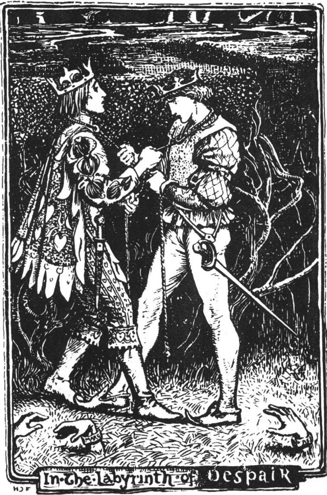

他觉得必须谨慎从事，否则他自己也会变成某种魔术的牺牲品。他庆幸自己又溜过了看门的巨龙，进入了一个美丽的花园，花园中有清澈的溪水。芬芳的花朵，以及青年和少女。但他忘不了他看到的那些可怕的景象，并急于想找到解开这个疑团的线索。他看到两个年轻人正在一起说话，就走近他们，希望听到些能帮他解开这个疑团的东西。事实上他也确实听到了。

“你发誓你会爱我直到永远，”那个王子说，“可是我却怕你会变心，我觉得我可能不久就只好去找统治这里半个岛的绝望女神了。她会把那些被情人抛弃后不想再活的恋人带走，放到一个迷宫里去。在那里他们手上会戴上一只手镯，脖子上套上一条绳索，在迷宫里永远地走来走去，直到他们遇到另一个与他们一样悲惨的人，那时他们脖子上的绳索就会抽紧，并就地倒下死去，他们要再遇到一个过路者时才会被埋葬。这种死法虽然可怕，可比起我失去你的爱后仍然活着要好过多了。”

王子看到这些恋人幸福地相爱的情景，心里就更加悲伤。他现在每天都只好在这海边漫步度日。一天，他正坐在海边的一块岩石上悲叹自己的命运不济，无法离开这座海岛时，突然之间，海水好像都掀到了天上，把岩洞里都灌上了恐怖的海水。王子看到一个女人从海底深处跑上来，在一个疯狂的巨人前面飞跑。女人发出的呼叫使王子的心软了，他从嘴里拿出魔石，操起一把剑就向巨人奔去，以便使那女人能有时间逃脱。但他刚跑到能够得着巨人的地方，就见巨人用他手里拿着的一个环碰了他一下，王子立刻就站在原地没法动弹了。巨人转身又去追赶它的猎物，他终于伸出手臂抓住了妇人，把她扔到了海里。接着他派了几个海怪来用链条捆住了王子，并把他带到了海底。王子这时觉得，他已经没有希望再见到公主了。原来隐身王子冒失攻击的巨人就是海王子，也就是统治风火土水四大物质的女王的第三个儿子。

凡是被这海王用他的魔环碰过的人都能具有在水里生活的能力。这时，黄金岛的王子浑身捆着锁链，被海怪带着经过了这些怪物的家，又穿过了巨大的海草森林，最后来到了一片广阔的沙地前，沙地的四周围着巨大的岩石。巨人坐在一块最高的岩石上，仿佛那是国王的宝座。

“大胆狂徒！”当王子被拖到他面前时他对王子吼道，“你本来该被处死，但我要让你活着受更多的罪。滚！加入到那些我用来虐待取乐的人中间去！”

巨人说完这些话，不幸的王子发现自己被绑到了一块岩石上。但他不是独自一人遭受这种不幸，在他四周还锁着巨人抓来的许多王子和公主。实际上，掀起风暴成了这个巨人的主要乐趣，以便他好抓更多的人作为他的俘虏。

因为双手被紧紧地捆着，所以黄金岛王子没法利用他那颗魔石，他只好日夜思念着罗莎丽度日。但有一天机会终于来了，这天巨人突然想起要看他的俘虏们互相格斗取乐。黄金岛王子被选中参加格斗，因此海怪们解开了捆住他的铁链。王子一获得自由，立刻把魔石放进嘴里，隐去了自己的身子。

巨人对王子的突然失踪感到万分惊讶，他马上命令看守住所有的通道，但这已经太晚了。王子已经从两块岩石间溜了出去，他穿过森林走了很长一段路，路上他除了一些可怕的海怪外什么也没看到，他爬上了一层又一层岩石，并不断在树木间穿行，最后他来到了海的边缘，在那里的一座山脚下，他记起曾在那间可以看到现状的房间中看到过这里的景象，罗莎丽就是被关在这里。

王子心中充满了欢喜，爬上了这座山的高耸入云的山顶。在那里他发现了一座宫殿。他走进这座宫殿，在一条长廊中间发现了一间水晶房间，房间中坐着罗莎丽，几个妖怪日夜看守着她。这间水晶房间既没有门，也没有窗。看到这情景，王子感到比以前更束手无策了，因为他不知道怎样才能通知罗莎丽他已经到了这里，而每天看到罗莎丽从天亮哭到天黑更是使他的心都碎了。

一天，当罗莎丽在房中到处走动时，她惊奇地发现她周围的水晶墙变得雾蒙蒙的，好像有人在对着它哈气一样，更使她奇怪的是，她走到哪里，哪里透亮的水晶就会蒙上一层雾。这种现象足以使公主猜到：她的恋人已经回来了。为了让风的王子放松警惕，公主就开始对他表现得非常亲热，以便当她请他对自己的管束放松一点时他不致于拒绝。开始她只要求允许她每天在长廊上活动一小时，这个要求马上就获得了准许，于是隐身王子立即抓住机会把那颗魔石递给她，公主接到后马上又把它放进了自己嘴里。当风的王子发现公主突然失踪时，他的愤怒简直无法形容。他命令他的那些风中幽灵到处飞来飞去，不管罗莎丽逃到哪里都要把她抓回来。那些幽灵们立刻飞出去执行他的命令，以致整个世界都布满了这些幽灵。

与此同时，罗莎丽和隐身王子则手拉着手，来到了长廊的门口。从这里穿过一片开阔地就可以进入花园。他们默默地向前滑行，以为自己已经完全自由了。可就在这时，有个愤怒的怪兽突然向他们这边冲过来，罗莎丽惊慌之中放开了王子的手。他们在隐身的时候都不能说话，而且他们都知道那些幽灵们就在他们周围，只要稍有响动幽灵们就会认出他们，所以他们所能做的就只有到处摸索，希望他们的手能够再次碰上。

但可惜的是，他们获得自由的喜悦只维持了很短的一段时间，公主在森林里到摸索了一阵，没有任何结果，便在一座喷泉的边上停了下来。她在一棵树上写道：“如果王子——我的爱人来到这里的话，让他知道我就住在这里。我每天都坐在这眼泉水边，用泉水洗刷我的眼泪。”

这些话结果被一个妖怪看到了，它马上把这事报告了主人。

风的王子于是也把自己变成了隐形人，由那妖怪引到了泉水边，在那儿等着罗莎丽。当罗莎丽走近时，风的王子伸出了手。罗莎丽以为这就是她情人的手，就急切地握住了这只手。风的王子抓住这个机会，用一条绳子捆住了公主的双手，然后他现出了自己的原形，吆喝他的幽灵们把她拖到最深的地坑中去。

刚好在这个时候隐身王子到了这里，当他看到风的王子握着一条丝带升到了空中去时，他马上猜到：风的王子手中牵着罗莎丽。

隐身王子的心被绝望笼罩住了，他立刻想到要结束自己的生命。“我难道还能捱过这次不幸吗？”他哭喊道，“我以为我的苦难已经到了尽头，谁知道现在会比以前更糟。我会有什么结果？我再也找不到这怪物把罗莎丽藏起来的地方了。”

这不幸的青年已决心去死。的确，光是他自己的悲痛就足以让他致死。但这时他想起了那些可以预知过去未来的房间，在那里他也许能发现罗莎丽被关在什么地方，这想法给他带来了一丝曙光。于是他继续穿过森林往前走，几个小时后他来到了一座寺庙的大门前，两只巨大的狮子看守着这座寺庙。由于王子是隐身的，所以他未受阻拦就进入了寺庙。在寺庙的中央有一个祭坛，上面放着一本书，祭坛后则挂着一幅巨大的帘子。王子走到祭坛前翻开了书，他看到书里写着世界上所有恋人的名字，他还读到：罗莎丽公主被风的王子带到了一个深渊里，那里没有入口，只有一条路从黄金泉通向那里。

王子这时候一点都不知道该上哪儿去找这个黄金泉。那地方可能不比王子以前离罗莎丽的距离近，但王子却不这么想。

“虽然我每走一步或许会离公主更远，”他心中这样想，“但我仍然要庆幸我还知道她仍然活在世界某个地方。”

在离开这庙宇时，隐身王子看到他面前有六条路，每一条都要穿过树林。他正在犹豫该走哪条路时，突然看到有两个人从最靠他右手边的那条路向他走来。这两个人是土地王子和他的朋友，隐身王子突然想起应获取一些关于他姐姐阿琴蒂娜的消息，因此他就跟在他们后面，听他们说些什么。

“你以为我不愿打破束缚着自己的锁链吗？”土地王子说道，“我是实在无法冲破这锁链。我知道阿琴蒂娜公主决不会爱我，但我还是一天比一天更爱她。而且好像这还不够似地，我还害怕她或许会爱上另一个人，所以我决定用黄金泉来消除我的痛苦。蘸上这个泉里的一滴水滴到边上的沙地上就可看出在她心中的我的情敌的名字。我很怕这个试验，而这种害怕正好证明了我的不幸。”

隐身王子听了这些话后，就像影子一样跟在土地王子的后面。过了一段时间，他们来到了黄金泉边上。那不幸的王子叹了口气弯下腰去，用手指蘸了些水滴在沙地上。泉水立即写出了他的兄弟火焰王子的名字。这个发现对土地王子的打击是那么大，以致他当场昏倒在他朋友的怀中。

与此同时隐身王子正在绞尽脑汁考虑如何才能救出罗莎丽。因为他曾被巨人的魔环碰过，使他既能在陆上生活也能在水里生活，因此他立即跳进了泉水中。在泉水下的一个角落里他找到一扇门，这扇门又通向一座山。在那座山的山脚下有一块巨石，上面固定着一个铁环，铁环上系着一根绳索。王子立刻猜到这根绳索是用来捆住公主的，于是他抽出宝剑砍断了绳索。转眼之间他就感到公主握住了他的手。公主始终把那魔石含在嘴里，那风的王子无论怎样恳求或威胁要她现形都没有用。

于是隐身王子与罗莎丽公主手拉着手翻过了那座山。但公主没有在水底下生活的能力，因此她无法通过黄金泉。他们在泉水边相互偎依在一起，默默无语，互相看不见，面对风的王子因暴怒而爆发出来的令人恐怖的脾气，他们禁不住全身颤抖。这场风暴已经持续好几天了，他们已经感到了一种灼人的热气。天上电闪雷鸣，火球从空中滚落下来，烧毁了森林以及地上的庄稼。有一段时间甚至连泉水都干涸了。王子抓住这个机会，领着罗莎丽公主迅速通过了黄金泉。

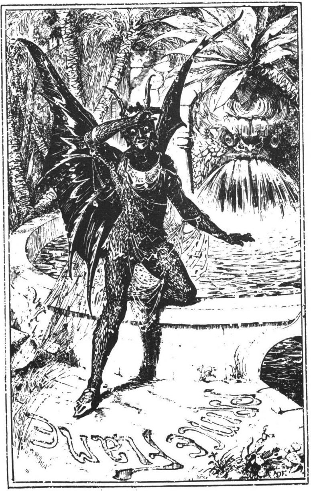

以后他们又花了很长时间才到达了黄金岛，但他们终于回到了家，再也不需要离开那里了。

 

## 乌鸦王子

从前有三个公主，她们都既年轻，又漂亮。那个最小的公主虽然不比她的两个姐姐更美丽，却是她们三人中最可爱的。

在距离公主们住的宫殿大约半里路的地方，有一座废弃了的房子，那座房子里虽然已经没人居住，但它四周花园里的鲜花却开得非常鲜艳茂盛，最年轻的公主经常到这花园里来玩。

一天，当小公主正在花园的酸橙树下散步的时候，一只黑色的乌鸦从她面前的玫瑰丛中跳出来。这个可怜的东西遍体鳞伤，到处都在流血，公主看了这景象觉得很难受。乌鸦见到公主后就转身对她说：

“其实我不是一只黑乌鸦，而是一位中了魔法的王子。所以只好在这种悲惨的状况下度过青春岁月。如果你愿意的话，你是可以救我的。但那样你就必须与你的亲人告别，到这所被废弃的房屋中来常年与我作伴。这里有一间房子可以住人，那间房里有张黄金床。你必须独自一人住在里面。千万记住：不管你在半夜里看见或听见什么，都不能叫出声来，否则你只要叫一声，我受的苦难就会加一倍。”

好心的公主为了救这只乌鸦，立刻告别了家人，来到了这所被废弃的房屋，住进了那间有张黄金床的房间里。

夜幕降临后她在床上躺下来，虽然她紧闭双眼，却仍然久久不能入睡。半夜里，她极其惊恐地听到有人朝她这房间走来。只一会儿工夫，她的房门就被打开了，许多坏精灵走进了房间。它们进屋后立即燃起了一堆大火，然后把一只装满滚烫开水的铁锅放到火上。它们弄完这些后，就走到姑娘的床边。它们一边不断地尖声嚎叫着，一边拖起浑身颤抖的姑娘往大铁锅里拉。姑娘吓得几乎要死过去，但她却始终不出一声。突然这时传来了一阵雄鸡啼叫的声音，所有这些鬼怪霎时都不见了。

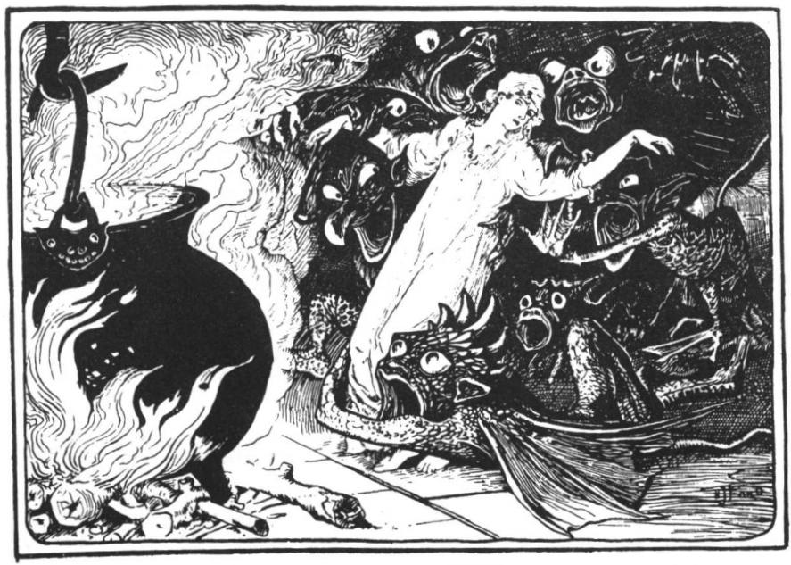

这时乌鸦出现了，它高兴地拍打着翅膀在屋里飞来飞去，并说它的痛苦已经减轻了许多。

这时，小公主那位非常好奇的大姐弄清了整个事情的来龙去脉，于是她就到这所废弃了的房屋中来看望她的妹妹。她急切地恳求妹妹让她晚上在这黄金床上与她一起过夜，好心的小公主最后只好答应了。但到了半夜时分，当那些鬼怪又出现时，这个大姐姐惊慌得尖叫了起来。从此以后，小公主就一直坚持独自一个人呆在那间屋里。

就这样这位小公主白天在孤独中度过，晚上就经受着各种惊吓。如果她不是非常勇敢的话，她早就被吓坏了。但每天早上，那只乌鸦都会过来，感谢她为自己经受了那么多惊恐，并告诉她，因为她的帮助，它的痛苦又比以往减轻了许多。

就这样一晃两年过去了。一天，乌鸦又来到公主跟前，对她说：“再过一年，我就可以从附在我身上的魔咒中解脱出来了，因为到那时，这魔咒的七年期限就到了。但是，为了使我能变回人形，接受我祖先传给我的财产，你必须到世间去做一个普通的女佣人。”

年轻的公主又立刻答应了这个请求。她给别人当了一年女佣。尽管她又年轻、又漂亮，还是受了许多虐待，吃了无数的苦头。一天夜里，她正在那里纺亚麻，一直纺到她那双雪白的小手又酸又痛，这时她听到身边传来一声兴奋的叫喊，接着她看到一个漂亮的青年正站在她身边，又跪到她的脚边，亲吻她那双又酸又痛的小手。

“我就是那个王子，”他说道，“当我变成乌鸦饱受各种可怕的折磨的时候，是你好心地解除了我的许多痛苦。现在请随我到我的城堡去吧，让我们一起在那里幸福地生活。”

于是他们一起又回到了那所他们都受过那么多苦难的房屋。但当他们到达那里时，房屋已经不是原先那个样子，而是彻底重建了一遍。在那里，他们快乐幸福地生活了一百年。

 

## 六个伙伴闯世界

有一个人掌握了许多手艺。一开始他在军队里当兵，作战既勇敢又机智。战争结束后，他被解职了，于是他只好怀里揣着三个铜子的工资开始闯荡。“等着吧，”他自言自语地说，“这点钱可没法让我满足；只要我找到了合适的人，连国王都得把他王国里的财宝全给我。”说着他愤怒地朝森林里走去。在树林里，他碰到一个人，这个人像拔草一样连根拔起了六棵大树。于是他对这人说：“你愿不愿意做我的随从，闯一闯世界？”

“好的，”这人答道，“但我得先把这几小捆棍子给我母亲送回去。”说着他拿起了一棵树，把它和其他五棵捆在一起，然后把这捆树扛在肩上走了。不多久他就回来加入到他主人的行列中。主人说：“我们两人应该就能走遍世界了！”他们一起走了不久，遇见一个猎人，猎人正一条腿跪在地上，把枪举到肩头瞄准着什么东西。主人就问他：“猎人，你在瞄准什么东西？”

猎人回答道：“离这里两英里远的地方有一只苍蝇正停在一根橡树枝上，我要射它的那只左眼。”

“啊，你跟我们走吧，”主人说，“如果我们三人在一起，我们闯世界就很容易了。”

猎人同意了，于是他们就一起往前走。他们走到七架风车前时，看到风车的叶轮在飞快地转动，但四周却没一丝风，连树叶都一动不动。主人说：“我真不明白是什么东西在推着这些风车转动，这里一丝风也没有。”说着他又与他的随从们一起往前走。

他们走了约莫有两英里路时，看见有个人正坐在一棵树上，他用手堵住一个鼻孔，用另一个鼻孔往外吹气。

“伙计，你在那上面吹什么呢？”主人问道。

坐在树上的人答道：“离这里两英里的地方有七架风车，我正在吹着这些风车转呢。”

“啊，你跟我走吧，”主人说道，“如果我们四个人在一起，我们闯世界就很容易了。”

于是这吹气者跳下树来跟着他们走了。过了一会儿他们看见一个人只用一条腿站着，却把另一条腿卸下来放在身边。于是主人对他说：“你这样休息可真舒服！”

“我是个快腿，”那人回答道，“我为了不至于走得太快，就得把一条腿卸下来；如果我用两条腿走路，我就会走得比鸟儿飞还快。”

“啊，跟我走吧。如果我们五个人在一起，闯世界就非常容易了。”于是快腿又跟着他们走了。走了不多久，他们又看到一个戴着一顶小帽子的人，他把帽子歪戴着，耷拉在那里只盖住一只耳朵。

“检点些，请你行为检点一些！”主人对他喊道：“别让帽子耷拉在一边，否则你看起来就像个疯子！”

“我可不敢把帽子戴正，”那人回答说，“如果我把帽子戴正了，一股大寒潮就会来临，天上的鸟儿都会冻得掉下来死掉。”

“哦，那你跟我走吧，”主人说，“我们六个人在一起，闯世界就非常容易了。”

于是他们六人结伴来到了一座城市，这座城里的国王宣布，谁要是能在跑步比赛中赢了他女儿，他就可以做她的丈夫，但如果输了，他就要被砍头。主人听到这个消息后，就宣布他要参加比赛。“但是，”他说，“我会让我的随从代我跑。”

国王听了这话后答道：“那么你们两个人的头都得作为赌注，你的头和他的头肯定都会输给她的。”

当这些条件都谈妥后，主人把快腿的另一条腿安上，对他说：“放机灵点儿，我们一定要赢！”那次比赛的安排是让参赛者到很远的一条河里去取一壶水来，谁先把水取回来就获胜。于是人们给了长腿一个水壶，也给了国王女儿一个水壶，他们就同时出发了。但是眨眼间，当国王女儿还只跑了一小段路的时候，快腿就像一阵风似的消失在人们眼前了，他很快地跑到了河边，盛满一水壶河水，又接着往回跑。但当他跑到半路时，一阵不可抵挡的困倦突然向他袭来，他只好放下水壶，躺下来睡着了。睡下前，他把一只死马的骷髅放在地上作枕头，以便不致睡得太舒服，并可以早些醒来。

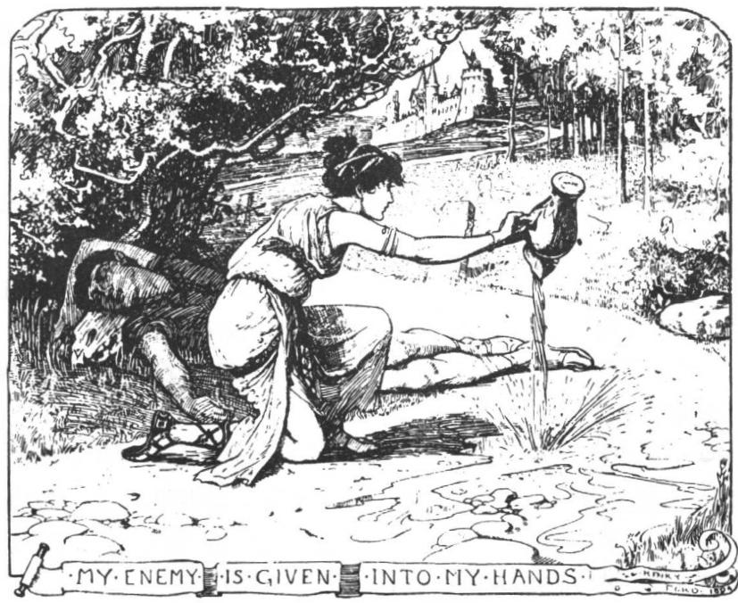

与此同时，国王的女儿也跑得很快。她跑到河边，舀满了一壶水后就急急地往回赶。当她在半路上看到快腿躺在那儿睡着时，高兴极了，心里说：“我的对手这下可落到了我的手里！”她把快腿的那壶水倒掉后，又继续往回赶。

就在一切都快输掉之际，幸好那位猎人站在城里的高塔上，用他那无比锐利的眼睛看到了这一切。

“啊，”他喊道，“不能让国王的女儿超过我们！”说着他拿过了猎枪，准确地击中了快腿头下枕着的马骷髅，却一点没有伤着快腿。快腿惊醒了，他跳起来，看到自己的水壶已经被倒空，国王的女儿已经远远跑到前面去了。他并没有因此而失去信心，而是跑回河边又舀满了一壶水，最后还比国王的女儿提前十分钟回到起点。

“看看！”他说，“我只是练了练腿而已，这算什么跑步！”

但是国王却气坏了，他的女儿想到自己会被一个平凡的、被解了职的士兵娶走，心里就更加气愤。于是他们就聚在一起商量如何才能除掉这个领头人和他的那些随从。

“我有办法了。”国王对他女儿说，“他们再也不会到这里来了。”他又出来对这六个人说：“你们现在应该吃吃喝喝，一起寻欢作乐才是。”于是他把他们领进了一间房间，这间房间地板是铁的，门也是铁的，窗户上还钉着铁条。屋里的桌子上摆满了一桌可口的酒菜。国王对他们说：“你们到里面去，好好享受享受吧。”他们六个人刚一进去，国王就把铁门关上并上了锁。然后他把伙计叫来，让他在这间房间下面燃起一把大火，直到把那房间的铁地板烧红为止。伙计遵命照办去了。那六个人在房间里吃着吃着觉得热了起来，一开始他们还以为是吃饭的缘故，但后来屋里温度太高了，他们想走出来，却发现门和窗子都已被紧紧地锁了起来。这时他们才明白，原来国王是想要害他们，想把他们热死在里面。

“国王别想成功！”那个戴着小帽子的人叫了起来，“我要制造一场寒流，让这大火相形见绌，慢慢熄掉！”于是他把帽子戴正，顿时一股寒气袭来，屋里的热气全散去了，连桌上的酒菜都开始冻了起来。过了一、两个小时后，国王以为他们都已经热死了，就让人开了门，亲自进屋去看。

但是当门打开后，那六个人正活生生地、好好地站在那里，还说他们很高兴终于可以出来暖和一下了，因为这房间里实在太冷，桌上的酒菜都冻成坚硬的冰块了。国王见到这情景，就气乎乎地去找伙计，他把伙计狠狠骂了一顿，问他为什么不按他的吩咐去办。

但伙计答道：“我确实烧了一把大火，不信你自己去看。”于是国王看到那间铁房间的下面正烧着一堆大火，他明白了用这种方法是伤害不到这六个人的。他只好再想其他办法来摆脱这帮不受欢迎的客人。他让人把那主人叫来，对他说：“如果你们愿意接受金子，并放弃娶我女儿的权利，那么你们要多少金子我就给你们多少金子。”

“啊，好呀，”那人答道，“如果我的随从能拿多少金子你就给我多少金子，我就放弃娶你女儿的权利。”

国王对这个交换条件感到很满意，就答应了他们，于是那主人说：“我十四天后就来取金子。”

从国王那里出来后他把这王国里的所有裁缝都召来了，他让这些裁缝用了整整十四天，缝了一只巨大无比的袋子。袋子缝好后，他让那位连根拔树的大力士背上这只口袋，与他一起去见国王。见了国王后他说：“我这位可真是个大力士，背上背着一匹像马那么大的布袋！”国王惊慌起来，心想：“他会背走多少金子呀！”于是他让人拿来了一吨金子，这一吨金子是由十六个最强壮的人搬来的，但那大力士只用一只手就抓起了这一吨金子，把它放到口袋里，说：“怎么不多拿点来，这点金子都不够把袋底铺满！”于是国王只好一次又一次地派人去取财宝，大力士把它们都装进口袋，才只有半口袋。

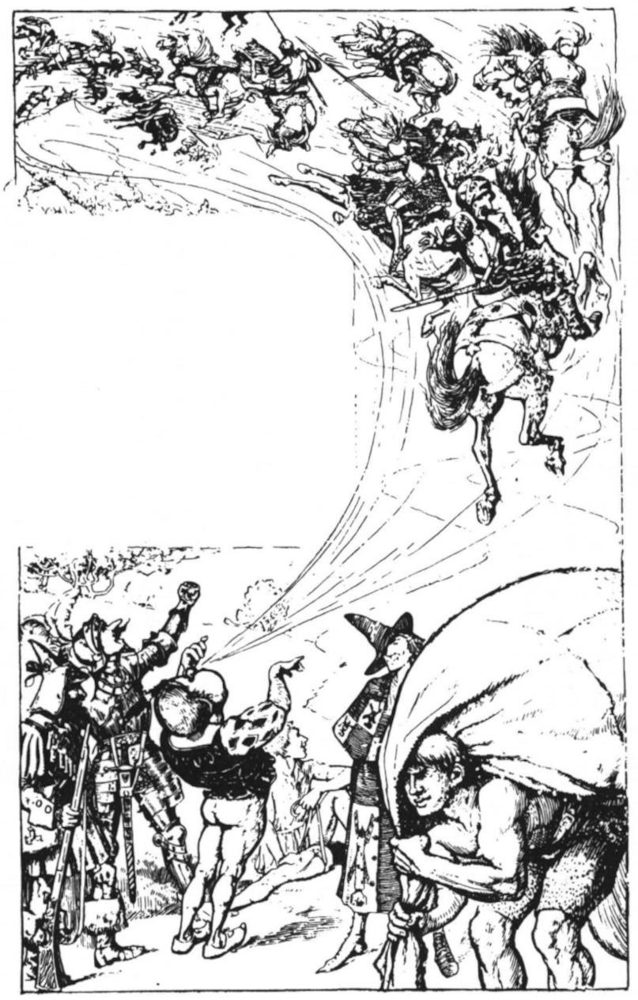

“再拿些来，”大力士喊道，“这些零零碎碎的东西怎么填得满这口袋！”于是整个王国的黄金装了七千车给运了过来，大力士把这些都装进了袋里。

“我不再挑挑拣拣的了，”他说，“你拿什么来我就要什么，只要把这口袋装满就行了。”

当把所有的财宝都装进袋里后，口袋还没全满，大力士说：“我就要这些算了，袋子不满扎起袋口来方便些。”说着他把这只大口袋背到背上，与他的其他五位伙伴一起走了。

这时，国王看到大力士一个人把他全国的财富都拿走了，不由得感到异常气愤。他命令他的骑兵出发去追上这六个人，把那大力士连那袋财富一起带回来。两个团的骑兵不久就赶上了他们，骑兵们大叫：“你们被俘虏了！快放下那袋金子，否则你们全都要送命！”

“你们说什么？”那个用鼻孔吹气的人说，“我们被俘虏了？在我们被俘之前，先让你们在半空中跳跳舞看！”于是他堵住了一只鼻孔，用另一只鼻孔对着这两团骑兵吹气。这两团骑兵被吹散了，他们被吹向蓝天，吹过了几座山，而且一团骑兵飘向这个方向，另一团骑兵飘向另一个方向。一位军官哭着求饶，说他已经负过九次伤了，是个勇敢的人，不应受这种侮辱。于是吹气的人对他网开一面，让他毫无伤害地落到了地面。但吹气人对他说：“回去告诉你们国王，如果他再派更多的骑兵来，我也照样把他们都吹到天上去。”

国王听到这个消息，说：“让这些家伙走吧，他们都是会妖术的。”于是这六个人带着所有的财宝回到了家，他们平分了这些财宝，富足地过了一辈子。

 

## 会巫术的国王

古时候有个国王，他不仅统治着自己的国家，而且还会巫术。他快快乐乐地度过了他的大部分青年时代，这时他遇见了一位容貌极其出众的公主，就马上向她求婚。公主答应了他的要求，因此国王觉得，他是世界上最幸福的人。

过了一年他们生了一个儿子。这孩子在各方面都很为这两位尊贵的父母争光，同时也受到了王宫里所有人的赞扬。当这孩子长大到经受得起旅途的辛劳的时候，王后马上秘密地带着他到她的仙女教母那儿去了一次。之所以要秘密地去是因为仙女曾经提醒过王后：国王是一个巫师，而仙女们与巫师们之间有着世代结下的怨仇，国王不会赞成他的妻子到仙女那里去。

仙女教母对王后的每件事都十分关心，她也很喜欢这个小王子，并从小就赐给他博取每个人欢心和迅速学会各种知识的能力，以使他成为一个博学多才的王子。结果，王子在学习时进步特别快，经常超过所有人的预期，使教他的老师非常高兴。可惜在他年纪还不大的时候，王子就悲痛地失去了母亲。王后在临终前交待儿子：她已经把他交给仙女保护，要他在没有与仙女商量之前决不要做任何重要的事情。

王子为失去母亲而感到极其悲痛，但这与他父亲的悲痛比起来就算不了什么了，他的父亲为失去了自己亲爱的妻子简直悲痛欲绝。时间和理智都不能减轻他的痛苦，周围一切熟悉的人和物都只能使他再度想到他的爱妻。因此他决定去周游列国，以改变自己的生活环境。由于他会巫术，因此他能变幻各种不同的外形去访问各个国家，然后在几星期后再回去看看他在那里收的信徒。

他就这样从一个国家走到另一个国家，可一直没有找到什么东西可以转移开自己的注意力。有一天他突然想起要变成鹰的外形，于是就变成了一只硕大的老鹰。他飞过了好几个国家，最后来到一个新的可爱的地方，那里种满了鲜花，茉莉花和柑桔花的花香在空气中到处飘荡。受到这些甜美的香气的吸引他就飞得低了一些，看到地面上有许多又大又美丽的花园，花园里种满了奇花异草，喷泉以百十种不同的形状将清澈的泉水喷向空中；一条大河从花园中穿过，河上的游船都装饰得十分华丽，上面坐满了衣着极其华贵，头上戴满珠宝的人们。

在其中一条游船上，坐着这个国家的王后和公主，王宫里的侍女们在边上侍候。那位公主长得比太阳还要艳丽，简直是人世间最出众、最可爱的人。国王看到了公主后感到一阵晕眩，只是靠了老鹰的犀利的目力，他才没有晕得掉下来。于是他就落在一棵巨大的柑桔树顶上，在那里他能看到花园里的整个景象，并能愉快地观赏到公主那迷人的风采。

要知道，一只胸膛里装着国王心脏的老鹰一定是很大胆的。国王一见到公主就确切地感到：他今后的生活中决不能没有她，因此他下决心要把这姑娘带走。

他在树上等着，一直等到她一只脚正要踏上岸边时，才突然从树上扑下来，在那些仆人们上来伸手搀扶她之前一把把她抓走了。公主发现自己被抓到老鹰爪子下面，不禁发出了撕心裂肺的尖叫。国王听到公主的尖叫虽然也动了情，但他不愿放弃这可爱的猎物。他在空中以最快的速度飞去，根本顾不上说一、两句安慰公主的话。

最后，当国王觉得他们已飞得足够远的时候，就开始降低高度，逐渐落到地面上，把姑娘放到了一片长满鲜花的草地上。接着他请求姑娘宽恕他的暴力行为，并告诉她，他是一个很大的王国的国王，准备带她到他的王国去，希望她与他一起来统治这个王国，还说了许多温情和宽慰的话。

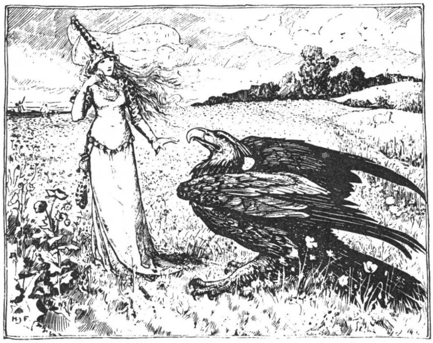

有很长一段时间姑娘一言不发，但当她稍稍从惊恐中恢复过来一些时，她立即涌出了成串成串的泪珠。姑娘的悲伤打动了国王的心，他对姑娘说：“可敬的公主啊，擦干你的眼泪吧，我求求你。我只是想让你做世界上最幸福的人呀！”

“如果你说的是真话，”公主答道，“就请你恢复我那被你剥夺的自由。否则我就只能把你看作最凶恶的敌人。”

国王反驳说，她的反对使他感到十分失望，但他要带她去一个地方，那里所有的人都会尊敬她，她的周围也会到处是欢乐。

这么说着，他就又一次抓起了她，不管她在空中如何喊叫，迅速地把她带到了他的首都附近，轻轻地放到一片草地上。姑娘突然看到她的周围是壮丽的宫殿，宏伟的建筑，那些房子里面也都十分美丽，陈设十分优雅。

公主本以为她会十分孤独，但当她看到有许多漂亮的少女围绕在她周围，她们都很乐意侍候她，而且还有一只羽毛绚丽的鹦鹉会说世界上最亲切的话时，她心里感到很高兴。

到达这座宫殿以后，国王又变回了他的原形，虽然他已不再年轻，但他还是能吸引除了公主以外的任何人。公主对国王的暴力行为怀有深深的成见，以致她只能对他怀着满腔仇恨，而且她也不想隐瞒这一点。但是国王希望时间不但能消磨掉公主的怨恨，还能使她对他逐渐习惯。他小心地用浓云围住这处宫殿，然后急急地赶回他的王宫，他长期离开那里已经使大臣们等得很心急了。

王子和国民们看到他们尊敬的国王又回来了，都十分欣喜，但他们已经注定要比以前更经常地见不到国王。国王借口有事，把自己关在书房里，而实际上他是为了能有更多时间与公主在一起。公主的心这时仍一点都没有软化。

国王无法理解公主为什么会一直那么固执，于是他就开始怀疑，尽管他采取了种种预防措施，公主会不会还是听说了他那个迷人的儿子，他的善良、年轻和美貌使他在王宫中备受爱戴。这个想法使国王十分不安，他决定要消除这个使他害怕的原因，于是他给王子配备了庞大的随从队伍，送他到世界各地去旅行。

王子在访问了几个国家以后，最后来到了公主所在的那个国家，那里的人们仍然为失去了公主而处在深深的悲痛之中。国王和王后盛情接待了王子，并为他举行了好几次庆祝活动。

一天，王子在访问王后的宫殿时，被一幅十分美丽的画像深深地打动了。他急切地打听这画像上的人是谁。王后含着眼泪告诉他，这是她那可爱的女儿留下的唯一的纪念物，女儿突然被抓走了，既不知道她现在在哪里，也不知道她怎样了。

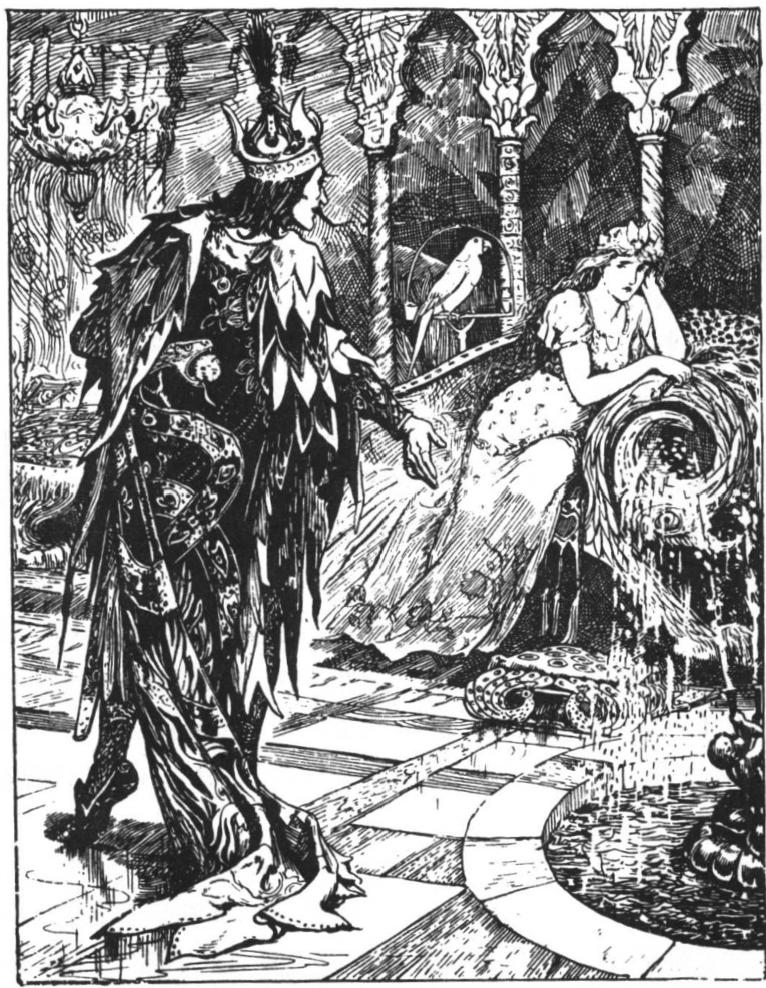

王子的心被深深地触动了，他发誓要找遍世界，找到公主，把她还回她母亲的手中，不达目的决不罢休。王后看到王子有这么大的决心，就向他保证，她将永远感谢他，而且如果他真能获得成功，就把女儿嫁给他，同时还把她自己拥有的全部财产都送给他。

对于王子来说，能够得到公主的吸引力远远地超过了得到王后许诺的财产的吸引力。他告别了国王和王后，出发去寻找公主。离别时王后给了他一张公主的小画像，这是王后经常带在自己身边的。王子首先去找的就是保护他的仙女，他恳求仙女全力帮助他完成这件重要的事情。

仙女认真地听王子讲述了他的全部经历，然后表示她需要一些时间来查一下天书。经过相当一段时间后她告诉王子：他要找的目标离他并不远，但要想进入公主现在所在的宫殿却太困难了，因为国王，也就是他的父亲，已经施巫术把整个宫殿用密云围了起来。她现在能想到的唯一计策就是弄到公主的那只鹦鹉，而这看来并非完全不可能，因为这只鹦鹉经常在宫殿附近飞来飞去。

把这些都告诉王子后，仙女就走了出去，希望碰巧能遇到那只鹦鹉，不久她就手里托着那只鸟回来了。她迅速地把鹦鹉关进一只笼子，然后用她的魔杖触了王子一下，把王子也变成了一只鹦鹉，样子与刚刚抓来的那只完全一样，然后告诉了他如何找到公主。

王子安全地到达了那座关着公主的宫殿，当他看到公主的美丽远远超过了他的预期时，不由地看到头直发晕，以致一开始他沉默了好长一段时间。公主看到这情景，以为鹦鹉病了，心里不禁又惊、又急、又担心，因为鹦鹉是她最大的慰藉。她把鹦鹉托在手上，慢慢地抚摸着它。这使王子逐渐恢复了平静，鼓起勇气好好扮演它的角色。它开始说许许多多令人高兴的话，公主听了十分入迷。

这时国王进来了，鹦鹉高兴地看到他是多么地不讨公主喜欢。国王一离开，公主就退入了她的更衣室，鹦鹉跟着她飞了进去，听到公主不断地哀叹国王对她的迫害，逼着她答应嫁给国王。于是鹦鹉说了那么多伶俐和亲切的话来宽慰公主，以致公主都开始怀疑这鹦鹉是不是自己原来那只鹦鹉。

当鹦鹉看到公主对自己有了好感时，它对公主说道：“小姐，我有个极其重要的秘密要告诉你，先请你不要对我说的事情感到吃惊。我是代表女王，也就是你的母亲到这里来的，我来此的目的是要把尊贵的您解救出去。为了证明这一点，请您看一看你母亲亲自给的这张画像。”说着，它从翅膀下取出了那张小画像。公主面对这一情景当然感到十分惊奇，但当她看到这小画像后，心中就又燃起了希望。她已经认出这小画像确实是她母亲经常带在身边的那张。

鹦鹉看到公主并没有过分吃惊，就把自己的真实身份告诉了公主。他还告诉了公主她母亲许诺他的话，以及他从仙女那儿得到的帮助。仙女已经向他保证，她会教给他如何将公主送回到她母亲怀抱中的方法。

鹦鹉看到公主正在仔细地听他讲话时，就请求公主允许他变回原来的人形。公主没有说话，于是它就从自己的身上拔下了一根羽毛。公主看到站在她面前的是这样一个容貌出众的王子，就不由得把自己恢复自由的希望全部都寄托在这迷人的小伙子身上了。

与此同时仙女准备好了一部快车，并套上两只非常强壮有力的鹰来拉车，然后她把那只装着鹦鹉的鸟笼放在车内，赶着车来到了公主的更衣室的窗口。这一切只花了几分钟时间就办到了，于是公主和王子就一起上了车，公主欣喜地发现她的鹦鹉也在车里。

当他们升到空中时，公主发现车子前面的一只老鹰背上有一个人的身影，但王子请她放心，告诉她这是好心的仙女在驾车，她正把他们安全地送到她母亲那里去。

就在那天早晨，国王突然从一场恶梦中醒来。他梦见公主被人从手里夺走了。因此国王马上又把自己变成一只老鹰，飞到关着公主的那个宫殿里。当他发现公主已经不在那里时，不由得勃然大怒起来。他马上赶回家去查看了他的天书，才发现正是他的儿子夺走了自己最心爱的宝贝。他马上又变成一只兀鹰，怒气冲冲地去追赶他们，他决定如果赶上他们的话，要一口把儿子连同公主一起吞掉。

他以最快的速度追赶，但是他出发得太晚了，而且在路上还受到了强劲的逆风的阻拦。这股逆风是仙女为了阻挡追赶者而在车子后面掀起来的。

可以想见，当王后再次见到她以为已经永远失去的女儿，以及救了她女儿的温柔的王子时该是怎样地欣喜若狂。这时，仙女进来提醒王后，那个会巫术的国王已经被失去公主刺激得怒不可遏，他马上就会赶到这里。除非王子和公主马上结婚，否则这暴怒的国王就会杀死他们。

于是王后马上派人去通知国王，也就是她的丈夫，并当场举行了婚礼。

婚礼仪式刚结束，会巫术的国王就赶到了。迟到的失望使他完全发了狂。他变回了人形，企图把一瓶墨水泼到新郎和新娘身上，并杀了他们，但这时仙女伸出了她的魔杖，结果墨水泼到了他自己身上。他立刻就昏倒在地上。公主的父亲看到这种残酷的报复行为也被激怒了，他命令把这会巫术的国王抬出去关进监狱。

术士们被关进监狱后就会无法使用巫术。国王这时对自己反被受自己侵犯的人支配而感到十分尴尬。在王子的恳求下，他的父亲得到了宽恕，人们打开了牢门。

牢门打开不久，人们就看到：这个会巫术的国王又变成了一种人们不认识的鸟飞到了空中。它飞走的时候宣称，它永远也不会原谅他的儿子，也不会原谅那么残酷地对待他的仙女。

大家都恳求仙女在现在这个国家住下来，仙女同意了大家的请求。她为自己建造了一座壮丽的宫殿，并搬来了她的天书和其他的秘密东西。每天当她看到，在她的帮助下，国王一家生活得十分幸福美满时，心里就充满了喜悦。

 

## 水精灵

从前有一位很富有的磨坊主，他有很多很多钱，还有很多很多货物。不料祸从天降，他突然变得很穷，以致他的磨坊都开不了工。白天，他又绝望，又悲痛，毫无目的地走来走去，晚上他躺在床上，却一夜都无法入睡，始终沉浸在痛苦的思绪中。

一天，天没亮他就起来了，他觉得在屋外的新鲜空气中，他的心情会轻松一些，就走出屋来。当他在磨坊的水塘边上来回走动的时候，听到水中传来一阵窸窸窣窣的声音，再走近看时，看到一个皮肤白皙的女人从水中冒出来。

他立刻就明白了，这女人不是别人，一定是这磨坊池塘中的水精灵。惊慌之中他不知道是该马上逃走还是留在原地。正在他犹豫不决的时候，水精灵说话了，她直呼磨坊主的名字，并问他为什么这么悲伤。

磨坊主听到她的声音是那么友好时，就鼓足了勇气，告诉她自己以前一直是多么富有和兴旺，而现在却穷困和悲惨得不知做什么好。

听了这些，水精灵说了许多宽慰他的话，并许诺，可以使他比以前更加富有与兴旺，如果他同意把他屋里最年轻的东西给她作为回报的话。

磨坊主觉得他屋里最年轻的东西只有他的那些小狗小猫，于是立刻就答应了水精灵的要求，满怀希望地回到了家里。在家门口，一个仆人出来迎接他，告诉他他妻子刚刚生下了一个男孩。

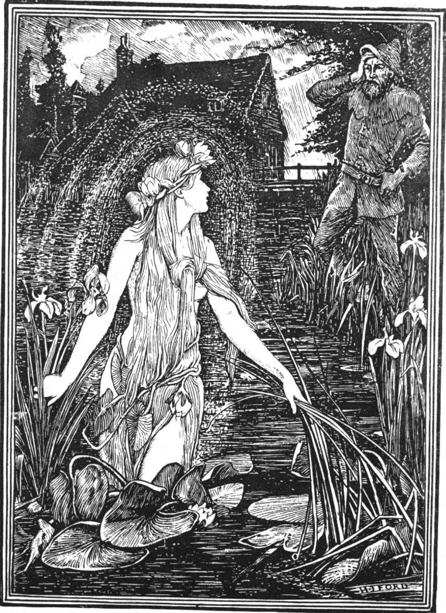

磨坊主听了这个消息后惊呆了，他心情沉重地来到妻子身边，把他刚才与水精灵达成的那项要命的交易讲给妻子和他的亲戚听。“我情愿放弃她许诺给我的一切好运，”他说，“我只要能留下孩子就行了。”但是没人能想出什么好办法，他们只是提醒他，千万注意不要让这孩子接近那水塘。

随着时间的流逝，这男孩逐渐长大了，而同时磨坊主的生意也越来越兴旺起来，仅仅几年时间，他就比以往更加富有了。但尽管如此，他对自己的富有一点也不感到高兴，因为他始终没有忘记他与水精灵达成的那项交易，而且他知道，水精灵迟早会来索取他答应给她的东西的。

但是一年又一年都平安地过去了，这孩子现在已经长大，成了一个勇敢的猎人。因为他又聪明，又勇敢，因此村里的地主请他去做工。不久他就娶了个又年轻又漂亮的妻子，过着平安而又幸福的生活。

一天他正在外面打猎，突然一只野兔从他脚下蹦出来，在他面前的野地里奔跑。猎手在它后面紧追了一阵，终于把它射死了。接着他把野兔剥了皮。他没有注意到他已经来到了磨坊池塘附近，而那个地方是他从小以来就被叮嘱不要靠近的。他把野兔皮剥下来后，就走到水边去洗他手上的血。可是他的手刚一浸到池水里，那水精灵就从水里冒了出来，用她的湿手抓住了他，把他拖进水里去了。

猎人妻子在天黑以后还没有见到丈夫回家时，万分焦急。人们在池塘边上找到了猎人的猎物袋，猎人的妻子马上猜到了他的遭遇，她无法控制自己的悲痛，绕着池塘一圈一圈地走着，不停地呼唤着丈夫的名字。最后，她被悲痛和疲劳折磨得精疲力竭，就倒在地上睡着了。她梦见自己走在一条长满鲜花的草地上，后来她来到一间茅屋前，见到了一个老巫婆，老巫婆答应要帮她找回她的丈夫。

她第二天早上醒来，决定立刻出发去寻找这个巫婆。她一连走了好几天，最后终于到达了那片长满鲜花的草地，找到了那间住着老巫婆的茅屋。可怜的猎人妻子向巫婆讲述了她的遭遇，以及她在梦中得知她能帮助她。

于是老巫婆告诉她，在第一个满月的晚上，她应该到池塘边上去，用一只黄金梳子梳理她那乌黑的头发，然后把梳子放在岸边。猎人的妻子给了巫婆一份很贵重的礼物，并衷心地感谢了她之后，就返回了家中。

满月那天到来之前，时间总是过得很慢很慢，但这一天终于到来了。这天月亮刚刚升起，年轻的妻子就来到了池塘边，她用一只黄金的梳子梳理自己的头发，然后把这把梳子放在池塘的岸边，焦急地观察着池塘的水面。不久她听到了水流涌起的声音，一个大浪突然打来，卷走了岸边放着的梳子。一分钟后，她丈夫的头从池塘的水面上冒出来，悲伤地望着她。但立刻又一个大浪打来，她丈夫没来得及说一个字，就又沉到水里去了。池塘又恢复了平静，池水一动不动，反射着月亮的银光，而猎人的妻子的痛苦心情则一点也不比以前好些。

在绝望中，她依然日日夜夜地走来走去，最后实在累坏了，就又一次倒下熟睡过去。她又与上次完全一样地梦见了那个老巫婆。于是第二天早晨，她再次去了那片长满鲜花的草地，并在茅屋里找到了老巫婆，告诉了老巫婆她的悲伤。老妇人又教她在下一次月满的夜里到池塘边去，这次要用一支黄金做的笛子吹曲子，然后把这支笛子放到池塘的岸边。

下一次满月的时间一到，猎人的妻子就来到了池塘边，她用一支黄金的笛子吹奏了一支曲子，然后把它放到池塘的岸边。接着她听到了波浪的声音，一个浪头打过来，卷走了岸上的笛子。不久她就看到猎人的头露出了水面，在水面上越升越高，直到他的半个身子都露出了水面。他悲伤地望着他的妻子，向她伸出手来。但又一个浪头打来，再一次把他卷到水底下。猎人的妻子原先满怀着欢乐与希望站在岸边，但当她看到丈夫又一次在她眼前被抓走时，又陷入了绝望。

使她稍感欣慰的是她又第三次做了同样的梦，这使她又一次去了长满鲜花的草地那里的老巫婆的茅屋。这次，老妇人告诉她在下一次满月的时候到池塘边去，在那儿用一架金子做的纺车纺线，然后把纺车留在池塘岸边。

猎人的妻子按老妇人的指点去做了。在下次满月的第一天，她就坐在池塘边用金子做的纺车纺线，然后把纺车留在池塘岸边。一会儿水里又传来了声音，一阵浪头打来，把纺车从岸上卷到了水里。接着猎人的头就从池塘中升起来，他的身子越升越高，直到他终于走上岸，与他妻子拥抱在一起。

但是池塘中的水面突然又升了起来，水漫过了这对夫妻站着的岸边，把他们一起卷入了水中。在绝望中，年轻的妻子大声呼叫老巫婆来救她。转眼之间，猎人变成了一只青蛙，而他的妻子则变成了一只蛤蟆。但他们无法聚在一起，大水把他们冲开了。洪水过后他们两人都又恢复了人形，但猎人和他的妻子各自都被冲到了不同的陌生国家，两人都不知道对方的下落，丈夫成了牧羊人，而妻子则成了牧羊女。

有一次，牧羊人偶尔到了牧羊女所在的国家。他看到这个国家牧草丰富，适于放牧，心里非常高兴，于是他把羊群迁到了这个国家，照旧以放牧为生。牧羊人和牧羊女成了好朋友，但他们互相却一点也没有认出对方。

在一个满月的晚上，他们又坐在一起，看守着他们的羊群。牧羊人吹起了他的笛子，这使牧羊女想起，在那个满月的夜晚，她坐在磨坊的池塘边，用那支金笛子吹乐曲的事。想起这件事实在使她太伤心了，她不由得痛哭起来。牧羊人就问她为什么哭，并一直追问，直到她向他讲述了自己的全部故事。这时，蒙在牧羊人眼睛上的翳障掉了下来，他认出了眼前的这个牧羊女就是他的妻子，而牧羊女也同样认出了自己的丈夫。于是他们愉快地回到了自己的家中，从此以后就一直在平安和幸福中生活。

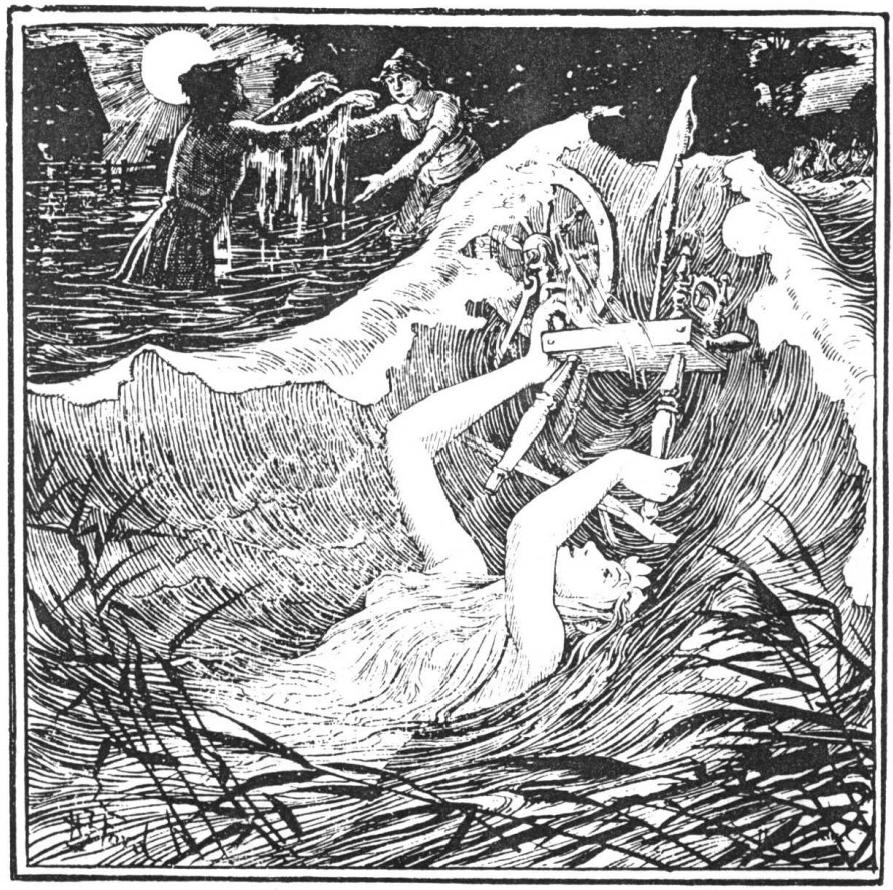

 

## 玻璃山

从前有一座玻璃山，山上有一座纯金造的城堡，城堡前长着一棵苹果树，树上结满了金苹果。

任何人只要摘下一个金苹果就能进入金城堡。在金城堡一间银子造的房间中，关着一个公主，她美丽无双，而且极其富有，因为城堡的地窖中装满了宝石，所有房间的大柜子里都放满了最好的黄金。

许许多多骑士都闻讯从远道赶来碰运气，但他们没有一个能爬上玻璃山。尽管他们在自己的马蹄上钉上了铁钉，但还是没能爬到半山高，就从陡峭的山上一直掉到山脚下。有时折断了手臂，有时摔断了腿，还有许多勇士甚至折断了脖子。

美丽的公主一直坐在窗前，看着一个又一个的骑士跨着威武的坐骑想要爬到她面前。人们只要一看到她，就会增添新的勇气，因此他们从四面八方聚拢来想把她救出来。但是他们都失败了，公主已经这样坐着快七年了，她一直等着有人能爬上这座玻璃山。

玻璃山的四周堆起了一大堆尸体，其中既有那些骑士的，也有他们骑着的马匹的。许多快要死的人躺在那里呻吟，他们的手脚受了伤，再也爬不动了。整个玻璃山周围就像是一座大坟场。再过三天，公主被关在城堡里就整整七年了。这时，人们看到一位身着金盔甲，跨着骏马的英勇骑士又向着那座致命的山前挺进。

他用马刺催动着骏马向山上冲去，冲到半山腰后他又镇静地拨转马头，稳稳地走下山来。第二天他又照样向山上冲去，那匹马踩在玻璃山上就像是踩在平地上一样，马蹄下面还溅出了火花。其他骑士都惊讶地望着他，只见他快爬到山顶了，只要再迈几步，他就可以到达苹果树下了。但突然间，一只巨大的鹰飞了起来，它伸出了它的大翅膀，打中了那匹马的眼睛。马受惊了，它喷着鼻子，竖起了鬃毛，两只前腿高高地翘到空中，于是它的后蹄打滑了，连同它的骑士一起从陡峭的山上直摔下来。他们除了几根骨头以外什么都没留下，那些骨头在摔瘪了的金盔甲中格格作响，发出豆子成熟时在豆荚里的那种声音。

现在离七年整的时间只有一天了。这时，山脚下来了一个学生模样的男孩子——一个活泼、幸福的青年，他已经长大成人，而且身体十分强壮。他虽然看到大批骑士都折断了脖子，没能爬上山顶，但他毫无惧色，徒步走到陡峭的山脚下，开始了攀登。

这青年很久以前就听他父母说过这个美丽的公主，知道她一直坐在玻璃山顶上的黄金城堡里。他听了这些传说后，就决心一定要上山去救出这位公主。但出发前他先去森林里抓了一只大山猫，他把山猫的利爪割下来，绑在了自己的四肢上。

这样装备好后他就勇敢地往玻璃山上爬。太阳都快下山了，青年却还没有爬到半山。他已经精疲力尽，几乎透不过气来，喉咙也干得要冒火。这时一大片乌云飘过他的头顶，他恳求乌云滴几滴水到他口里，并张大嘴巴等待着，但乌云飘了过去，连一滴水也没有落到他干燥的嘴唇上。

他的双脚已经被磨破，正在淌着血，他只能用双手抓住山坡。夜晚来临了，青年用力睁大自己的双眼，希望能望见那高高的山顶。然后他又朝山下望去，他看到的景象多么恐怖！一个深渊正张开着血盆大口，散发着那些骑士和他们的马匹腐烂后的臭味，只要掉进去就必定遭到惨死！而这却正是那些和他一样企图爬上玻璃山的勇士们的结局。

天几乎已经完全黑了，只有星星的微光照亮着玻璃山。可怜的男孩还在用他那满是鲜血的双手吊在山上，就像是贴在玻璃上一样。他已经不再往山上爬了，因为他的所有力气都早已用尽，他看不到还有一丝希望，于是就平静地等待死亡的来临。这时，他突然沉睡过去。忘了自己的危险处境，睡得十分香甜。他虽然睡着了，但还是用他的利爪牢牢地抓住山上的玻璃，这样他就不会掉下山去。

再说那棵金苹果树是由一只老鹰看守的。这只老鹰就是把那位骑士和他的马扑翻下山的那只老鹰。每天晚上，这只老鹰都要绕着玻璃山飞一圈，仔细地察看山四周的一切。这天晚上，月亮刚从黑云后面探出头来，这只老鹰就从苹果树上飞起来，围绕着玻璃山来回盘旋，它立刻就发现了沉睡中的青年。

怀着一种对腐肉的贪婪，并且认定这又是一具新的尸体，老鹰朝着青年扑了下来。但这时青年已经醒了，看到老鹰扑过来，他决心利用老鹰来拯救自己。

老鹰把它的利爪深深地扎进青年柔嫩的肌肤里，但青年忍受着巨痛，一声不吭，并用手紧紧抓住老鹰的双脚。老鹰在惊慌中把他带到了高高的空中，并绕着山顶的城堡盘旋。青年勇敢地坚持着，他看到了在苍白的月光照耀下那闪闪发光的宫殿，看到了城堡上那高高的窗户，还有外面的阳台，美丽的公主就坐在那里，她正沉浸在悲痛的思绪中。这时，青年看到他正在接近那棵苹果树，于是他从背带中掏出刀子，砍下了老鹰的双脚。老鹰带着剧痛升上了高空，不一会儿就消失在云端，而青年则掉到了苹果树那宽大的树身上。

他把仍然陷在肉里的老鹰爪慢慢拔出来，用金苹果的果皮盖在伤口上，眨眼之间他的伤就都治好了。他又摘了几个金苹果装进口袋，然后就走进城堡去。城堡门口有一条巨龙在那里守门，但青年扔给巨龙一只金苹果，巨龙就消失了。

这时城门打开了，青年看到院子里长满了鲜花和各种美丽的树木，在城堡里的一个阳台上，坐着那位被魔法困住的可爱的公主和她的随从。

公主一见到青年，立即向他奔来，她把青年称为自己的丈夫和主人，把自己的所有财富都给了他，青年成了富有和强大的统治者。但他一直没有回到地面上来，因为只有那只守卫着公主和城堡的老鹰才有力量把那些数不清的珍宝带到地上去，但老鹰失去双脚后已经死了，人们在玻璃山的一片树林里发现了它的尸体。

一天，青年正与公主，就是他的妻子，在王宫的花园里散步，他偶然朝玻璃山下望去，却惊讶地发现山脚下正聚集着一大批人。于是他吹响了他的银哨子，一只在金城堡里充当信使的燕子飞了过来。

“飞下去看看那里发生了什么事，”青年对燕子说，于是燕子闪电般地飞了下去。只一会儿它就回来答复道：

“那只老鹰的血滴下去，使所有的人都恢复了生命，所有那些在这座山上死去的人今天都醒过来了，就像是睡了一觉醒来一样，他们现在正要跨上自己的马。全国的人都在兴高采烈地瞪大着眼睛瞧着这前所未闻的奇迹呢。”

 

## 阿尔非格王子的故事

很多年以前，有个国王的第一个妻子既善良又美丽，但在生下一个儿子后就死去了，国王对失去妻子极为悲痛，他的唯一安慰就是常常见到自己的王储。

年轻的王子要举行洗礼了，为此国王替儿子选了一位邻国的王后作他的教母，那位王后以善良和智慧而出名。大家都叫她“仁德女王”。她给国王的儿子取名叫阿尔非格，并从此把这孩子当作自己的心肝宝贝。

时间把最深切的悲痛都慢慢地洗刷掉了。两三年后国王又娶了一个妻子，这位妻子同样极其漂亮，但她的性情就没有第一位妻子那么善良。过了一段时间，第二位王子出生了，但王后却想到因为有阿尔非格王子在，她的儿子今后就当不了国王，因此她非常恼怒。但是她却竭力隐藏自己的嫉妒，不让国王知道。

后来，王后终于再也控制不住自己了，便派了一个心腹仆人到她最可靠的老朋友高山女妖那里去，请她想想有什么办法可以除掉她的继子。

那个女妖总是想尽一切办法来取悦女王，因此她答道，现在还没有办法可以伤害王子，因为王子正处在一个法力比她还要大的仙女的保护下。

另一方面，那位“仁德女王”也在仔细地照顾着她的教子。虽然她自己的国家离得比较远，因此她只能远远地照顾着王子。但她对王子这里发生的事却件件都很清楚，因而自然也知道王后的阴谋诡计。于是她派人给王子送去一颗又大又漂亮的红宝石，让王子日夜把这颗宝石带在身上，它可以保护王子免受任何敌人的攻击。仁德女王又嘱咐说，那颗宝石只有在他父亲的领地里才有效力。恶毒的女王听到这些后，就想尽办法要让王子走出自己的国家，但她的阴谋都没有得逞。有一天，一个偶然的机会使她未能做到的事情发生了。

国王只有一个姐姐，这个姐姐嫁到了一个很远的国家，国王非常想念她。她也与国王保持着密切的书信联系，当她在信中得知阿尔非格王子的情况后，就非常渴望能见这位迷人的侄子一面。她恳求国王同意王子去看她。国王起先犹豫了一段时间，但后来在王后的鼓动下，终于答应了姐姐的要求。

这时阿尔非格王子已经十四岁了，他是王国中最美貌，最吸引人的青年。还在婴儿时期，他就被托付给王宫中的一位贵妇照顾。按照当时的传统，这位贵妇先是当了他的保育员，后来又做了他的家庭教师。王子长大后，贵妇的丈夫接替她作了王子的老师。因此，王子从来没有与这对善良的夫妇分开过，这对夫妇也像爱他们的独生女儿那样爱着王子，王子反过来也同样爱着他们。

当王子要出外旅行时，这对认真负责的夫妇当然会与他同行。王子就在他们的陪同和一大批随行人员的护卫下开始了他的旅行。

一开始王子是走在他父亲的领地里，因此一切很顺利。但他们刚跨过边界就碰上了一片大沙漠。他们在炎炎的烈日下走了一段路后，就坐在附近的一片树荫下休息。这时王子觉得喉咙干得要冒火。幸好附近有一条小溪，随从们给王子舀来了溪水解渴。但王子的嘴唇刚沾到溪水，就马上从他坐的车子上跳下来，转眼间就不见了。他的随从们全都焦急地到处找他，可是却哪里也找不到。

正当众人在继续寻找和呼唤的时候，一只大黑猴子突然出现在一块石头上，对众人说：“你们再继续找下去也没有用，还是回你们自己的国家去吧。你们会有相当一段时间认不出王子来，之后他才会再回到你们面前。”

说了这些话后大黑猴子就消失了。那些随从人员又悲伤、又困惑，但是他们尽了最大努力去找，依旧没能找到王子，就只好先回国了。国王听了这个不幸的消息后悲痛欲绝，立刻就病倒了。没几天，国王离开了人世。

那位野心极大的王后看到国王死了很高兴，因为这时王位属于她儿子了，而实际权力则落到了她自己手中。她对国家的残酷统治使人民都不拥护她，而且人们都相信正是她弄走了阿尔非格王子。事实上，如果不是国王，也就是她的儿子办事厚道的话，国内肯定会兴起一场革命。

与此同时，不幸的阿尔非格王子以前的那位女家庭教师的丈夫在国王死后不久也去世了，于是女教师与她的女儿泽达就在家里闭门不出。她女儿现在已长成一个又活泼又讨人喜欢的女孩，她们两人都还在为她们亲爱的王子的失踪而悲痛。

年轻的国王喜欢打猎，他经常在王国里的贵族青年陪同下，沉浸于他的这项嗜好。一天，他追逐了一早晨的猎物后，停在一条小溪边的一片小树林里歇凉，随从们马上为他搭了一个华丽的帐篷。在吃午饭的时候，他突然看到一只浑身长着亮绿色皮毛的小猴子正坐在一棵树上温情地看着他，这使他很感动。于是他传令众人谁都不准惊动这只猴子。猴子看到国王对它很关心，就从这根树枝跳到那根树枝，最后逐渐接近了国王。国王给了它一些食物，它从容地吃了，来到了桌边。国王看见它非常喜欢，就把它带回王宫。国王对谁都不放心，亲自照顾这只猴子。整个王宫不久就都在谈论这只美丽的绿猴子了。

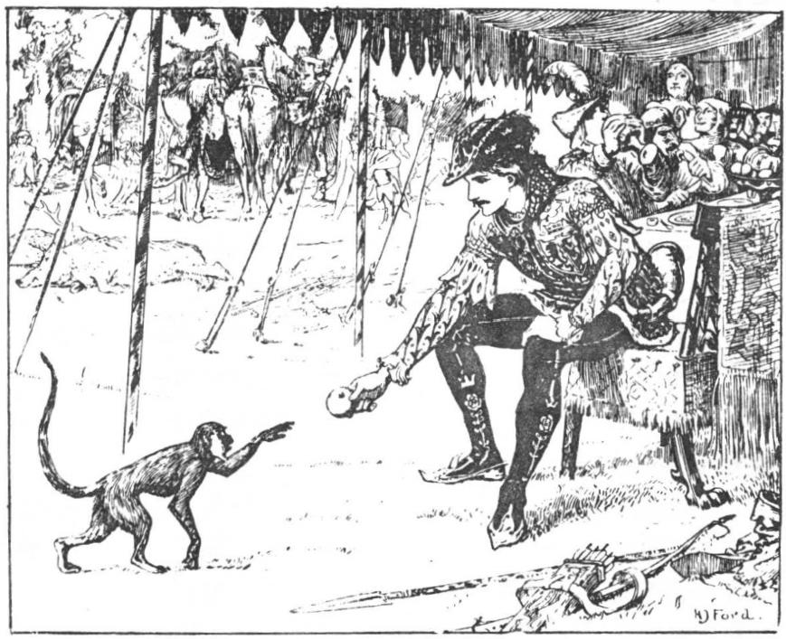

一天早晨，当阿尔非格王子的女教师和她女儿单独在家时，一只小猴子从开着的窗子跳了进来。它是从王宫里逃出来的。它的举止十分优雅，因此泽达和她的母亲很快就消除了初时的惊恐。当它与她们相处不久便赢得了她们的欢心。这时国王发现了它在这里，于是派人来带它回去。但这只猴子极伤心地哭着，只要有人去抓它，它就显出极不愉快的样子。结果两位女士都恳求国王把它留在她们这里一段时间，最后国王同意了。

一天傍晚，当她们坐在花园里的喷泉旁时，小猴子不断地用一种既悲伤又爱慕的眼光看着泽达，以致泽达和她妈妈都不知道它是什么意思。而当她们看到大滴的泪珠从它的眼眶中流下来时，就更感到惊奇了。

第二天，母亲和女儿坐在花园里的一棵茉莉花树下，她们谈起了这只绿毛猴和它的奇怪行为。母亲对女儿说：“亲爱的孩子，我不能再把我的感觉瞒着你了，我总觉得这只绿猴子就是我们爱着的阿尔非格王子。他是中了魔法才变成这个样子的。我知道这想法听起来使人觉得很怪，但我心里一直摆脱不了这种想法，它使我日夜不得安宁。”

当她说完这些话抬起头来时，看到那只小猴正坐在一边，脸上的泪珠和它的动作好像是在向她表明她的话是对的。

第二天晚上，母亲梦见了仁德女王。仁德女王对她说：“不要再流泪了，按我说的去做。到你们花园里那棵爱神树下，掀起树下的大理石板，那下面有一只装满一种亮绿色液体的水晶瓶。拿上这个瓶子，把那个你们天天想着的东西放到装满玫瑰花的浴盆里洗个澡，然后用这绿色液体擦它的身子。”

这些话刚说完，母亲就醒了。她立即起床走到花园里去，她发现了仁德女王说的所有东西。于是她马上叫醒了女儿，一起准备为小猴子洗澡。她们不想让家中其他人知道她们在做什么。泽达采了大量的玫瑰花放到一只碧玉澡盆里，当一切准备就绪后，她们把小猴子放进去，母亲用那绿色液体给它全身都擦了一遍。

她们很快就看到了结果。那只小猴子的皮突然掉了下来，王子阿尔非格——这个最漂亮最迷人的青年站在了她们面前。再次相见的喜悦无法用语言来表达。过了一会儿，两个女人请王子讲讲他的经历，王子就把他在沙漠里变成猴子以后所受的种种苦难都告诉了她们。那时他的唯一能舒服一些的时候就是仁德女王来看他的时候，而最后也是她安排了他与兄弟的会面。

不知不觉间，他们在一起谈论这些事情已有好几天了，泽达的母亲开始考虑如何才能帮王子取得王位。因为他才是王位的合法继承人。

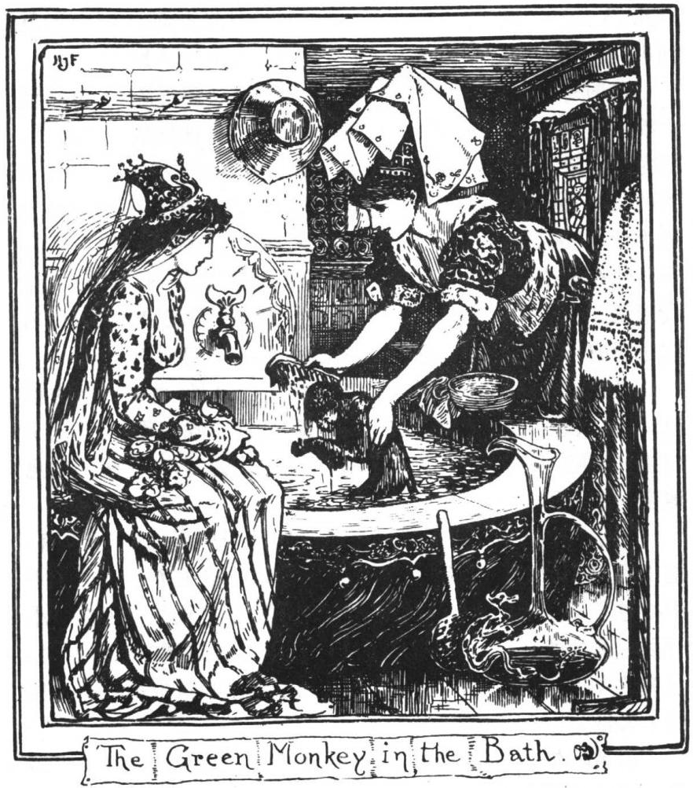

王后这时候也感到非常焦急。她从一开始就感到，儿子带回来的小猴子一定就是阿尔非格王子。她一直盼望能有机会除掉他。她的疑心也被高山女妖所证实。于是她急忙哭着去见国王——她的儿子。“我听说，”她哭着说道，“有些心肠歹毒的人找了一个骗子，想要来夺取你的王位，你必须马上把他处死。”

国王非常勇敢，他让王后放心，说他一定马上把阴谋者处死。他仔细地调查了这件事，觉得很难想象一个寡妇和一个姑娘会想搞一场政变。他决定亲自到她们家去看看，以便查出事情的真相。于是一天晚上，他既没告诉女王，也没告诉他的大臣们，就到那两位女人住的地方去了，身边只有很少几个人跟着。

这时那两位女士与阿尔非格王子谈得兴趣正浓，当听到这么晚还有人来敲门时，就请王子先躲开一阵。使她们吃惊的是，门打开后进来的竟是国王和他的亲随。“我知道你们在策划夺取我的王位，还想要我的性命。”国王说，“我来这里是请你们说一说为什么要这样做？”女士们正要回答时，王子阿尔非格走了出来。他在里边听到了所有的对话。因此他对国王说：“你应该让我来说一下为什么，兄弟。”他说话的语调是那么庄重和威严，以致在场的每一个人都惊奇地看着他，说不出一句话来。

最后还是国王认出了他几年前失踪的哥哥，他从惊讶中恢复过来，叫道：“是啊，你就是我的哥哥，我终于找到你了。你把王位接过去吧，我对它已没有权利了。”他一边说着，一边满怀敬意地亲吻了王子的手。

阿尔非格王子扑到弟弟的怀里。接着两兄弟急忙赶回王宫，把王宫里的所有官员都召集在一起，阿尔非格王子从他弟弟手中接过了皇冠。为了除掉任何可能的疑虑，他把仁德女王在他小时候送给他的红宝石拿给大家看。大家正盯着这颗红宝石看时，它突然发生了一声巨响，裂成了两半。与此同时，狠毒的王后离开了人世。

国王阿尔非格立刻与他心爱的泽达结了婚。当仁德女王出现在他的婚礼上时，他顿时感到非常幸福。仁德女王让国王放心，告诉他高山女妖已经失去了控制他的魔力。她与这对年轻夫妇一起过了几天，又送了他们一份最昂贵的礼物后就回家了。

国王要弟弟与他一起执政，他们互敬互爱，全都活了很久很久。

 

## 赛天仙

有位国王结婚已经许多年了，可是还没有孩子。后来，上天赐予他一个容貌极其出众的女儿，国王觉得给她起任何的名字都不足以显示她的美貌，于是就叫她“赛天仙”。

善良的国王绝没想到，给女儿起这样一个名字肯定会招来众仙女们对她女儿的一致嫉妒和仇恨，而且后来发生的事情证明确实如此。仙女们一听到这个妄自尊大的名字，就马上决定要把这女孩弄到手，然后或者是残酷地虐待她一番，或者是不让任何一个男人见到她。

仙女们把这项复仇的任务交给她们部落中年纪最大的一位妇人去办。这位老妇人名叫拉格里，她的年纪已经很大很大，牙齿和眼睛都只剩了一只，每天晚上还得把这剩下的眼睛和牙齿泡在特制的药水里，才能继续保住它们。她的心肠很坏，成天想着怎样去实现仙女们的那些卑劣恶毒的诡计。

凭着她多年的经验，再加上她恶毒的本能，拉格里几乎没费什么事就带走了赛天仙。可怜的孩子当时才只有七岁，当拉格里来强行带走她时，她吓得几乎要死了。但是，当她们在地下穿行了大约一个多小时后，她发现自己被带到了一座美丽的宫殿里，周围还有漂亮的花园，这使她稍稍安心了些。当她又看到自己的宠物小猫和小狗也跟着她一起来了时，心情就好了一些。

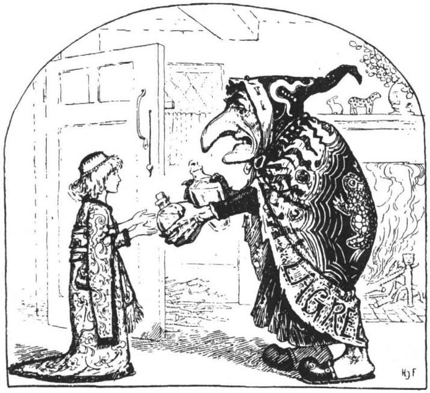

老妇人把她领到一间漂亮的房间，对她说：“这就是你的房间。”她给赛天仙下了严厉的命令，“你要随时看着壁炉里的那堆火，决不能让火熄掉。”她还给了赛天仙两个玻璃瓶，这两只瓶子是老妇人晚上用来泡她的眼睛和牙齿的，她要赛天仙把这两个瓶子也小心地看管好。然后她又强调了她的命令，并用各种最可怕的遭遇威胁赛天仙，说如果不遵守这些命令就会落到什么下场。说完她就消失了，把小姑娘一个人留在宫殿里。小姑娘可以自由自在地在宫里到处跑，到处看。老妇人留给她的两项任务都很容易完成，这使她的担忧大大地减轻了。

转眼间好几年过去了，在这段时间里，公主已经习惯了她那孤独的生活，她严格地遵照仙女的命令办事，逐渐地忘了她的父亲以及他的王宫。

有一天，她从花园的喷泉边走过，突然看到太阳光照在水上，形成了一道绚丽的彩虹。于是她站定了仔细地看着这彩虹，使她大吃一惊的是，她听到有一个声音在叫她，那声音好像是从光线中央发出来的。这是一个年轻男人的声音，声音非常甜美，语调非常亲切，使人可以感到说这话的人一定也是非常的迷人。但这只是一个想象而已，因为周围根本看不到人。

美丽的彩虹告诉赛天仙他很年轻，是一个强大的王国国王的儿子。那个老仙女拉格里因为对他父母怀有怨恨，就用他来进行报复，使他失去了人形。她把他关在这座宫殿里已经有好几年了，一开始他很难忍受这种禁锢的生活，但是他承认，自从他看见和爱上了赛天仙后，他就不再哀叹失去自由了。

他还说了许多温柔的话来表明他的心迹，而公主是第一次听到这类话，因此深深地被他的话打动了。

王子现在只能以彩虹的形式出现和说话，因此只有当太阳照在水面上形成彩虹时，他才可以出现。

赛天仙极为珍惜能与她的情人相会的那些时刻，他们在一起进行了多次长时间的有趣的谈话。然而有一天，谈话的内容深深地吸引了他们，以致时间飞快地过去，公主却忘了给火炉加柴，那堆火熄灭了。拉格里回来后不久就发现了这一疏忽，但她却感到很高兴，因为她终于有机会让这可爱的小囚犯看一看自己的凶恶了。她命令赛天仙第二天一早就出发到罗克里诺那里去，向他要火种来点燃她弄熄了的那堆火。

这个罗克里诺是个残酷的恶魔，无论谁从他面前走过，他都要把那人吃了，他还特别喜欢抓年轻的女孩子吃。但公主还是顺从地接受了拉格里的命令，她没来得及与情人告别，就抱着必死的心情出发到罗克里诺那里去。她在穿过一座小树林时，树上的一只小鸟告诉她，附近的泉水中有一颗闪光的宝石，这颗宝石以后会对她有用的。她听从了小鸟的劝告，找到了那颗宝石。不久她就到了罗克里诺家，幸好这时只有罗克里诺的妻子在家。这位妻子被公主的年轻、美丽和高雅的风度打动了，而公主送她的那颗闪光的宝石更使她对公主产生了好感。于是她很乐意地让赛天仙取了火种，并且为了报答她送的礼物，她也给了她一块石头，并说她今后会用得着这块石头的。接着她就送走了公主，一点也没有伤害她。

拉格里看到公主竟然安全地回来了时，既惊奇、又失望，而赛天仙却焦急地等待着再次见到彩虹王子的机会，她急切地想把自己的经历告诉他。后来她却发现，已经有一个天仙把这一切都告诉了他。那位天仙是他的一个亲戚，她负责保护着他。

王子怕他心爱的公主再遇到新的危险，就想出了比利用喷泉更方便的见面方法，赛天仙每天都成功地采用了王子设计的新方法。每天早晨，她把一只盛满水的大盆放到窗台上，太阳的光线一照到这盆水上，彩虹就像在喷泉那里一样清晰地显现出来。就这样公主能一边照看着火和那两只瓶子，一边与王子会面，有时候他们几乎把有太阳光的每个小时都利用上了。

一天，彩虹王子的样子十分悲哀，他已经听说，他将被带离这个可爱的地方，但却不知道会被带到哪里去。这一对年轻人都极度失望，他们一直相聚到最后一缕阳光消失时才分手，接着又热切地等待着第二天早晨再次相聚。可惜！第二天天气一直阴沉沉的，只是到了下午很晚的时候，太阳才从云层里钻出来了几分钟。

赛天仙急切地赶到窗口，但急切中她碰翻了那只水盆，把她一晚上小心翼翼地装满了的一盆水撒得干干净净。这时，除了老妇人交给她的那两只瓶子里的水外，再去拿别的水都已来不及了。这可是他们分手之前再见她心上人一面的唯一机会！于是她毫不犹豫地打开了那两只瓶子，把那里面的水倒进盆子，彩虹立即就出现了。他们的离别充满了柔情，王子激动而又真诚地宣称，他保证不遗余力地想办法把他亲爱的赛天仙解救出来，并恳求她答应，一旦他们两人都获得自由就马上结婚。而公主也发誓她决不嫁任何别的人，并宣称她甘愿拼着一死也要想法与他相聚。

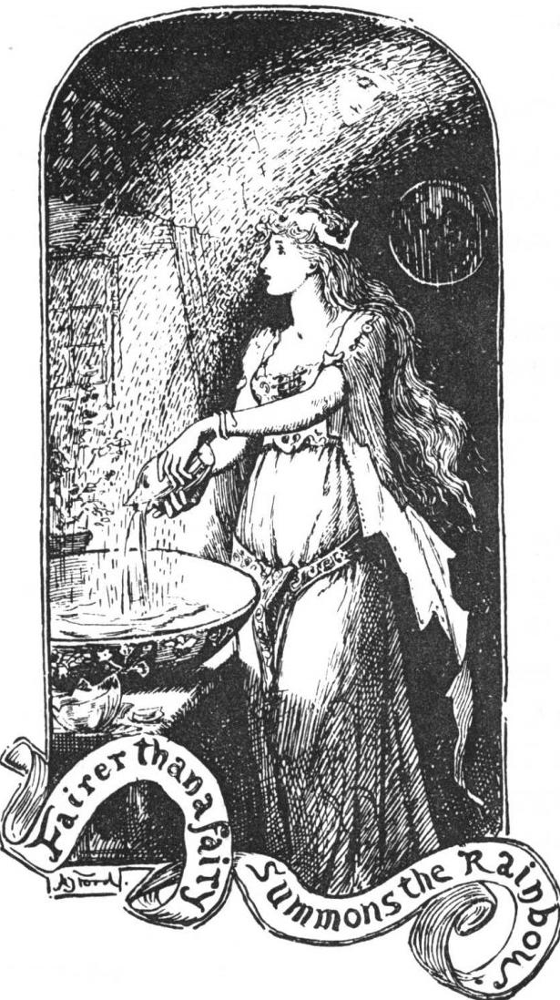

他们的告别会面没能延续多久，王子就消失了。公主立刻决定不顾任何风险马上出发去追寻王子。她身边只带了她的小狗、小猫、一根爱神树枝和罗克里诺妻子给她的那块石头，其余什么都没带。

当拉格里得知她的囚犯逃走了时，不由愤怒得发了狂，马上全速紧追上来。不久，当可怜的小姑娘因走得太累，在一座天然的山洞里躺下休息的时候，老妇人赶上了她。这时，在一边守着它的女主人的小狗立刻向拉格里扑了上去，狠狠咬了她一口，痛得她撞到了山洞的一个角上，磕掉了她唯一的一颗牙齿。等到她从痛苦和恼怒中渐渐恢复过来时，公主已经抓紧时间逃出了很远。恐惧使公主又增添了些力量，但到最后她实在走不动了，只好躺下休息。这时，她带在身边的爱神树枝碰到了地面，她的四周立刻生长出一片浓绿的树荫，公主想在这片树荫中安静地睡一觉。

拉格里又紧追上来。赛天仙刚刚睡熟，她就赶到了，这回她下决心一定要抓到这小姑娘。小猫发现了她，从一根树枝上跳到老妇人的脸上，把她仅剩下的一只眼睛抠了出来，就这样公主被永远地从她的追逐者手中解救了出来。

老妇人拉格里逃走了，但公主却又饥又渴，以致她以为自己一定要饿死了。她艰难地迈着沉重的步伐，终于来到了一座绿白相间的漂亮的小屋前。小屋里一位穿着绿白相间衣服的女人接待了她。那女人长得十分漂亮，她的衣服颜色与屋子颜色十分相配。很明显这座小屋是属于她的，而她也好像是这屋子中住着的唯一的人。

女人热情地接待了快要昏过去的公主，并用丰盛的晚餐招待她。晚上，公主在一张十分精美的床上舒舒服服地睡了一个长觉。第二天早上妇人告诉公主，经历千辛万苦之后，她一定会实现自己的愿望。

要分手时，这位女人给了公主一颗核桃，并告诉她，只有在最紧急的时候才能把它打开来使用。

经过一段漫长而又艰辛的跋涉后，赛天仙又来到一座绿白相间的漂亮的小屋前，受到了一位女主人的热情接待。这位女主人酷似她上次见到的那个妇人，在这里她又收到了一件礼物，也告诉她不到紧急的时候不能用，但这回这个女主人给她的不是一颗核桃，而是一只金石榴。

伤心的公主又开始了她辛劳的旅程。经过千辛万苦，她来到了与她前两次到过的完全一样的一间小屋前。

原来这三间小屋是属于三个姐妹的，她们的性格和为人都那么相似，以致她们住的房子和穿的衣服也完全一样。她们用仙女们送给她们的有魔力的礼物，帮助那些遭受不幸的人。她们的善良和仁慈与拉格里的凶残和恶毒形成了鲜明的对照。

第三位女人安慰了可怜的追寻者，叫她不要灰心。她向她保证，她经受的种种苦难终会得到报偿。然后她又送给公主一只水晶的香水瓶，并严厉地告诫她只有到最紧急的时候才能启用这个瓶子。赛天仙深深地感谢了她的礼物，在她的鼓励下又踏上了征途。

又走了一段时间以后，她进入了一片小树林，树林里空气清新，弥漫着甘甜的气息。她刚走了一百多米，就看到一座辉煌的银做的楼阁被四根粗银链悬吊在四棵大树上。那楼阁悬吊得那么巧妙，以致一阵轻轻的微风就能把里面睡觉的人送入梦乡。

赛天仙觉得自己有一种想要进入这座楼阁的强烈愿望。但这楼阁除了被吊在地面上以外，它的四周好像既无门又无窗。赛天仙毫不犹疑地想到，现在该是使用那第一位女人给她的核桃的时候了。她打开了核桃，核桃里走出一个小小的看门人，他的腰上拴着一条钥匙链，钥匙链上拴着一把比最短小的针还小一半的金钥匙。

公主爬上了一根银链条，把小看门人托在手里。看门人虽然外形很小，但他却用金钥匙打开楼阁上一扇暗藏的门，让公主走了进去。公主进入了一间宏伟的大房间，这间大房间好像占据了整个楼阁的空间。房间的天花板上挂着各种黄金和珠宝的星星，它们发出的光线把整个屋子照得透亮。房间的正中安置着一张床，床的四周挂着有各种彩虹颜色的帘子，还用金绳索把它悬吊起来，这样这张床就会与楼阁一起轻轻晃动，把睡在上面的人送进愉快的梦乡。

在这张精致的床上正躺着彩虹王子。他看上去比以往更美丽，他自从消失以后，就一直处在这种沉睡状态。

赛天仙现在是第一次见到王子的真实面貌，她几乎不敢正眼看他，担心他的容貌会不会与赢得了她爱情的声音和语言相配。同时，她也为自己来到王子面前竟受到这种冷漠的接待而感到受了伤害。

她对王子讲了她历经的各种危险和艰难，并把这些经历响亮地重复了几十遍，王子还是无动于衷。这时，公主想起该用那只金石榴了。她打开了金石榴，发现里面的每颗石榴子都是一把小小的提琴，这些提琴全都飞到了高高的屋顶下，开始演奏起欢乐的乐曲。

王子还没有完全醒过来，只稍稍睁开了眼睛，看上去更漂亮了。

赛天仙看到他还没认出自己，非常着急。她又拿出了第三件法宝，打开了那个水晶的香水瓶。一只汽笛飞了出来，它使所有的提琴都停止了演奏，然后在王子的耳边讲述了他那位心爱的姑娘历经各种艰险来寻找他的经过。接着姑娘又委婉地讲了一些责备的话。但没等她说完，王子已经完全醒了，他满心欢喜地跪倒在公主脚下。与此同时这间屋子的四壁突然向四周扩张开去，屋里出现了一张嵌满了珠宝的国王的宝座，一座宏伟壮丽的王宫也开始建了起来。不久，几辆载着衣着华丽的贵妇人的精致马车驶到了王宫门前。在第一辆也是最漂亮的那辆马车上坐着彩虹王子的母亲。她慈爱地拥抱了自己的儿子，接着告诉他，他父亲去世已经好几年了，而仙女们对他的怨恨也终于平息了，因此他现在可以平安地回去治理自己的国家了，他的人民正热切地盼望着他回去呢。

整个王宫的宫员都兴高采烈地欢呼着新国王的即位，但国王的脑子里想的却全是赛天仙。他正要把她介绍给母亲和宫中官员，并确信她的美貌一定会得到大家认可时，那三位穿着绿白相间衣服的女人赶到了。

她们向大家披露了赛天仙高贵的出身。于是王太后高兴地让这对恋人坐上自己的车子，一起向他们王宫的首都进发。

他们的到来使整个首都都沸腾起来了。王宫中马上举行了结婚庆典。在后来的漫长年代中，虽然岁月流逝，但彩虹国王和他的王后赛天仙善良的品德、青春的容颜和相互的恩爱却丝毫没有改变。

 

## 三兄弟

有一个巫婆，她把自己变成了一只鹰，每天晚上都要飞到一个村子里，把那村子里教堂的窗户玻璃打破。这个村子里住着三兄弟，他们都决心除掉这只专干坏事的鹰。两个哥哥已经带着枪去守卫过教堂了，但是他们没有成功：那只老鹰刚刚高高地出现在他们头上，他们就会抵挡不住强烈的睡意而昏睡过去，直到听到窗子被打破的声音后才会醒来。

现在轮到最小的弟弟去守卫那教堂的窗子了。为了避免睡过去，他在自己的脸颊和下巴上都挂上了刺棘，这样他若感到困倦要低头时，刺棘就会把他刺醒。

月亮早就升起来了，大地洒满了银光。突然，他听到一种可怕的声音，与此同时，一阵强烈的困倦向他袭来，马上控制了他。

他的眼睛不由自主地合上了，头沉到了肩膀上，但这时刺棘扎进他的肉里，把他深深地刺痛了，于是他又立刻从睡梦中醒了过来。他看到那只老鹰正在向教堂盘旋下来，于是立刻拿过枪对着老鹰射击。老鹰重重地掉在了一块大石头上，它的右翅膀受了重伤。

年轻人马上跑过去，他看到石头下面有一个深渊，于是马上去把两个哥哥叫来，在他们的帮助下搬来一大堆松木和一根长绳。他们把松木点燃，绑在绳子的一头，把这火把慢慢地放到深渊下面去。深渊里漆黑一片，燃烧的火把只能照亮它那又黑又脏的石头墙，那弟弟决心到这深渊底下去看个究竟。他把自己拴在绳子的一头，一会儿就到了深渊底。他突然发现这里竟是一片长满绿树和鲜花的可爱的草原。

草原的中间是一幢巨大的石房子，前面有一道敞开着的大铁门。石房子里的每样东西好像都是铜做的，他在里面发现的唯一居民是一位可爱的少女，她正在梳理着她那金色的头发。青年看到，少女梳头时掉下来的头发，落到地上都会发出金属般的响声。青年又更仔细地看着她，她的皮肤又细又滑，双眼闪着明亮的光芒，头发像阳光一样一片金黄。青年当场就爱上了她，他跪到少女的脚边，恳求她答应做他的妻子。

这可爱的女孩很高兴地答应了他的要求，但同时告诉青年，她只有等她的母亲，也就是那个巫婆死了之后，才能回到地上的世界去。她接着又告诉青年，只有用挂在城堡中的那把剑才能杀死那老东西，而那把剑又实在太重，没人能举得起它。

于是青年又进入了这幢房子的另一间房间，那间房间里的所有东西好像都是银做的，房里也坐着一位美丽的少女，她是他的新娘的姐姐。这少女正在梳理着她那银色的头发。她梳头时掉下来的每根头发，落到地上都会发出金属般的声响。这第二个姑娘递给了他那把剑，可是尽管他用尽了全身的力气还是没法挪动它。这时第三个少女又走到他面前，给了他一种奇怪的药，说是喝了这药后他就会有足够的力气。他喝了一滴这药，还是不能挪动这把剑。他又喝了第二滴，只能把剑稍稍动一动，他又喝了第三滴，终于能够举起这把剑挥舞起来。

于是他就躺在那幢房子里等着老巫婆回来。当夜幕降临时她终于出现了。她从一棵巨大的苹果树上盘旋下来，又把树上的金苹果摇了些下来，然后落到地面上。她的脚刚一碰到地面，就从鹰变回了人形。青年早就在等待这个时机，他立刻用尽全身的力气挥起了这把剑，把老巫婆的头砍了下来，她的血溅满了墙壁。

因为不用担心会再有危险了，他就把城堡里的所有财宝都装进了几只大箱子，并给他的哥哥发出信号把他们拉出深渊。他先把财宝绑到绳子上吊了上去，然后又把三个可爱的少女送了上去。当其他什么东西都已上去，只剩下他一个人还留在深渊底下时，他对自己的哥哥产生了一些怀疑。于是他把一块大石头绑在绳子上让他们拉上去。一开始石头上升得很正常，但石头拉到一半时那两个哥哥突然松了手，石头又掉到深渊底下摔得粉碎。

“如果我相信了他们，我的骨头就摔成这样了！”青年伤感地对自己说。他伤心地哭了，不是为了那些财宝哭，而是为了与那个有着天鹅般脖子和金黄色头发的可爱少女分开而哭泣。

他在那美丽的地下世界里呆了很长一段时间，每天都悲伤地转来转去。终于有一天，他遇到了一个术士。那术士问他为什么哭，青年就把自己的遭遇告诉了他。术士听了后对他说：

“不用悲伤，年轻人！如果你能救出躲在金苹果树上的那些孩子，我就立刻送你回地面上去。住在这里的一个怪物总是来吃我的孩子，我把孩子们藏在地下，锁到房子里都阻挡不了它。现在我把孩子藏在苹果树里，你也去藏在那里，到半夜时分你就会看到我的敌人了。”

青年听了术士的话就爬到苹果树上藏起来，饿了就摘些美丽的金苹果充饥。

到了半夜，平地里刮起了一阵风，接着树下传来了沙沙的响声。青年朝树下望去，只见一条又长又粗的大蛇正沿着树干爬上来。它把身子缠在树干上，越爬越高。它的两眼闪烁着凶残的光芒，探出它的大头，在树枝间搜寻着那些孩子们的藏身之处。孩子们看到这凶恶的野兽都恐惧地颤抖着，把自己藏到树叶底下去。

这时年轻人举起了他那把巨剑，一剑砍下了那条大蛇的头，接着又把蛇的身子也砍成了千万段，撒向了四面八方。

那些被救出来的孩子的父亲看到他的敌人终于被处死，心里十分高兴，他立刻把青年背到背上，带着他回到了地面上的世界。

青年怀着异常兴奋的心情赶到他的两个哥哥家里，冲进了他们的家门，看到他们全在家中，但他们都已认不出他来了。只有正在给她的姐姐们做厨娘的他的未婚妻立刻认出了她的情人。

他的哥哥们本来以为这个弟弟已经死了，现在看到他又回来了，立刻惊慌地把所有的财宝都归还了他，他们自己则逃进了树林。但是好心的弟弟原谅了他们的过失，把财宝又分给了他们。接着他为自己盖了一所大房子，房子上装了金子做的窗户，在那里与他那金发妻子一直幸福地生活了一辈子。

 

## 狼孩子

有一位印第安猎人，他性格平和，为人善良。因为担心受自己部落里那些又奸诈又残忍的族人的欺负，他准备在远离自己部落的一座大森林中盖一所房子。为此他携带着妻子和三个孩子离开了部落，长途跋涉，来到了一处流淌着清澈的溪水的地方。他们在那里砍树搭棚，建起了自己的家。许多年过去了，他们都平安幸福地住在这里，只是在打猎时才离家外出一段时间。平时，他们靠着打猎得来的兽肉兽皮充饥和做衣服。但有一天，那位猎人病倒了，而且不久他就知道，自己已经活不了多少日子了。

于是他把家人叫到身边，留下了他的遗嘱：“你，我亲爱的妻子，是我一生的伴侣。但在月亮又经历几次圆缺之后，你就会跟随我到那极乐世界去。而你们，我亲爱的孩子们，生活对你们来说还刚刚开始；我以前躲开的那种人生的恶毒、残酷和忘恩负义将会出现在你们面前。但是，我的孩子们！如果你们能答应我，你们将永远互相爱护，永不抛弃你们的小弟弟，我就可以放心地去了。”

“决不会抛弃他的！”几个孩子互相握住手，这样回答道。于是猎人满意地死了。

正如猎人所说的，他死后刚过了八个月，他的妻子就随着丈夫去了，临死前，她嘱咐两个大孩子要牢记那不抛弃小弟弟的诺言，因为小弟弟还是个小孩子，身体又很虚弱。

冬天到来了，冰雪厚厚地覆盖在大地上，哥哥姐姐认真地照顾爱护着自己的小弟弟。但当春风再次吹绿大地的时候，那位哥哥的青春之心骚动起来，他渴望着回到父亲度过青年时代的村里去看看。

于是他把自己的想法与妹妹商量，妹妹回答道：“哥哥呀，我知道你是想回到我们部落的人中间，而我们在这里根本见不着他们，但是你想想父亲的遗言吧。我们是不是不该只顾自己的欢乐，而把小弟弟抛在一边呢？”

但做哥哥的听不进这些话，他没有听从妹妹的劝告，拿起自己的弓箭就离开了家。冰雪又再次降临大地，然后又都融化了，可是哥哥一直没有回来。后来，姐姐的心也逐渐变冷变硬起来，小兄弟在她眼里成了一个负担。终于有一天，她对弟弟说：“你看这里有好几天的食物，你就呆在屋里不要出去。我出去找一下哥哥，找到了他我就回来。”

她走了好久好久，最后来到了他哥哥住的村子，看到他已经娶了一个妻子，生活非常幸福。这时她也受到一个勇敢的青年的追求，于是她也忘掉了还独自一人呆在森林中的弟弟，成天只想着自己的丈夫。

小弟弟吃完了姐姐留给他的食物后，就只好到森林里去采野果和挖草根吃。在天气暖和的时候他还能吃饱肚子，但到了冰雪覆盖、北风呼啸的时候，他就成天肚子空空，四肢冰冷，整夜躲在树上，只能拣些野狼吃剩下的东西吃。他没有其他的朋友，就逐渐与狼接近，常常坐在边上看着狼群吞食猎物，后来狼群里的狼逐渐认识了他，并给他食物吃。如果没有这些狼，他就会冻死在雪地里了。

后来冰雪又融化了，大湖中的厚冰也逐渐融化了，当狼群下山到湖边去饮水时，那男孩也跟在它们后面。碰巧有一天，男孩的大哥正驾着独木舟在湖边捕鱼，他听到岸上有个孩子用印第安语在唱着——

> “哥哥呀，哥哥呀！
> 我要变狼了！
> 我要变狼了！”

唱完之后，他就像狼似的嗥了一声。听到这些，做哥哥的心猛地往下一沉，他急忙跑过去，口中喊道：“弟弟，小兄弟！到我这里来！”但那小弟弟已经一半变成了狼，还是只顾唱着那首歌。他哥哥在后面继续喊着：“弟弟，小兄弟！到我这里来！”但他哥哥喊得越响，弟弟跟着那些狼逃得越快，他身上的皮也长得越厚，最后弟弟长长地嗥了一声，消失在密林的深处。

哥哥充满着羞愧和伤痛回到了自己的村里，他与他的妹妹一起，终生都在为自己小弟弟的悲惨命运哀痛，为自己未能遵守自己许下的诺言而后悔不已。

 

## 玻璃斧

有一对国王和王后，他们生活非常富足，凡是他们想要的东西他们都有了，可偏偏只缺一个孩子。又过了十二年，王后终于生了一个儿子，但她没能享受到母子相聚的欢乐，孩子生下后的第二天就死了。临死前她把丈夫叫到身边，说道：“千万别让这孩子的脚踏到地上，否则他就会落入一个阴险的女妖的手中，那女妖会害他受很多苦的。”可怜的王后说完这些话就死了。

孩子逐渐长大了，他的身体十分强壮，保姆们再也抱不动他了。于是人们就为他做了一张轮椅，这样他就可以坐在轮椅上自己在王宫的花园里到处跑，而不需别人的帮助。在其他的时间，人们让他坐在担架上，由别人抬着他走。不管是什么时候，人们总是小心地照看和保护着他，生怕他的脚接触到地上。

但是这样的生活不利于他的健康，医生就让他骑马锻炼身体，不久他就成了个一流的骑手，经常骑在马上走得很远很远，旁边总是跟随着他父亲的养马官和一大群随从。

每天白天他都要骑着马到附近的田野和树林里去，晚上再安全地回来。就这样过了好多年，王子已经长大成人，而王后的警告也逐渐被人们忘记。虽然以前的那些预防措施还仍然在采用，但已经更多地是出于一种习惯而不是其他的原因了。

一天，王子和他的随从又骑着马到一片森林里去，那是他父亲经常去打猎的地方。路上他们要经过一条小河，河岸上长满了厚厚的灌木丛。当养马官刚要牵着马过河时，马蹄的达达声惊起了草丛中的一只野兔。那野兔从草丛中跳出来，往灌木丛中逃去。青年王子策马赶上去。可就在他快要赶上野兔的时候，他的马肚带突然断成了两截，他被重重地摔到地上。王子的脚刚一碰到地面，整个人就忽地不见了，把那些随从们惊得目瞪口呆。

他们远远近近地找了好久，却连一点影子也没看到，于是他们不得不承认那女妖的法力实在是太厉害了，而这些王后在临死前都特别提醒过他们。老国王听到儿子失踪的消息后悲痛欲绝但他也无法挽回自己儿子的自由，只好成天陷入悲痛和孤独之中，期望有一天某个幸运的机会能将王子解救出来。

再说王子的脚刚一接触到地面，就感到自己猛地被一种看不见的力量抓住了，并被迅速带到一个他不认识的地方。他的眼前出现了一片极其陌生的景象，与他刚离开的那个世界完全不同。在一个巨大的湖泊中竖立着一座极壮丽的城堡，这就是女妖的住处，通往那城堡的唯一路径是一座云桥。湖的另一面是一座座高山。黑云笼罩着湖岸，把周围都罩在一层厚雾中，到处都是死一般的寂静。

女妖一回到她的领地就显出了自己的原形，她来到王子面前，告诉他必须完完全全地执行她的命令，假如他在哪怕是任何一个细微末节上违背了她的命令，他就会受到严厉的惩罚。说完这些后她给了他一把玻璃做的斧子，吩咐他穿过云桥，在太阳下山前把桥那边树林里的树全都砍倒。同时她还严厉地告诫他，决不要与树林里可能遇到的一个黑皮肤女孩说任何话。

王子顺从地听着她说话，等她说完就拿起斧子往森林里走去。每走一步似乎就更进一步地卷入云雾中，但对女妖的恐惧使他继续往前走，终于安全地越过了湖面。他立刻就开始了工作。

但刚挥动斧头砍了一下，那斧头就碎成了一千片。可怜的年轻人吓坏了，他不知道该怎么办，心里怕得要死，不知道那恶毒的老女妖会对他进行什么样的惩罚。他漫无目的地在森林里走来走去，自己也不知道在往哪里去。最后他终于走得心力交瘁，倒在地上睡着了。

不知睡了多久，他突然被一阵响声吵醒。他睁开眼睛，看到一个黑皮肤的女孩正站在他身旁。王子心里记着女妖的警告，因而不敢招呼她，而她却友好地向他问候，并马上问他是否在那女妖魔法的控制下，王子默默地点点头作为回答。

这时黑皮肤女孩告诉他，她也是在女妖的魔法控制下，女妖要她一直像现在这样在森林里不断走来走去，直到能有一位同情她的男青年把她安全地带到远处的一条河对岸为止，那已经不在女妖的控制范围内，女妖对他们无能为力了。

这个女孩的话鼓起了王子的自信心，于是王子告诉了她自己的悲惨经历，然后向女孩请教，如果女妖发现他没能砍掉树木还把斧头砍坏了，要严厉惩罚他时，他怎样才能躲过这场灾难。

“你应该知道，”黑皮肤的女孩答道，“那个控制着我们两人的女妖是我的亲母亲，但你不能泄露这个机密，否则你就害了我了。只要你肯答应愿意解救我，我就会站在你的一边，替你完成我妈妈交给你的所有工作。”

王子很愉快地答应了她的请求。这时女孩再一次告诫他不要泄露自己的秘密，然后递给了他一杯药。王子喝了药之后马上就昏沉沉地睡着了。

等王子醒来时，他极其惊讶地发现，那把打碎了的玻璃斧正完完整整地放在自己身边，而树林里的所有的树也都已经砍倒了。

于是他又急忙越过云桥，去向女妖报告，她的命令已经执行完毕。女妖听说树林里所有的树都已经砍倒了，又看到玻璃斧子依然完好地在王子手中，不禁感到十分惊讶。她决不相信这一切都是他自己干的。于是她紧紧地追问王子是否在树林里见到了黑皮肤的姑娘并与她说了话。但王子果断地对她说了假话，并发誓他一刻也没有停下工作朝身边望一望。女妖看到从王子那儿再也问不出什么，就给了他一些面包和水，并指着一个又小又黑的角落让他睡在那里。

第二天天刚露出一点曙光，女妖就叫醒了王子，她又把那把玻璃斧子交给他，吩咐他把昨天砍下的树全部砍成柴，并把它们一捆一捆地捆起来。同时她还再次警告王子：如果在树林中遇到黑皮肤的姑娘，决不能接近她或向她说一个字。

虽然王子的任务决不比昨天轻松，但他出发时的心情比昨天愉快多了，因为他知道他可以得到黑皮肤女孩的帮助。他迈着轻快的步伐越过了云桥，刚一踏上湖的另一边，就见到他的朋友已经站在他面前，愉快地向他问候着。当她听说了女妖这次要王子完成的任务时，笑着答道：“不用担心。”然后她又递给他一杯药，王子喝了这药后马上又昏沉沉地睡着了。

等他醒来时，所有的工作都已经完成了。所有的树木都已砍成柴禾，并捆成一捆一捆的，马上就可以用了。

于是王子马上又赶回女妖的城堡，告诉她命令已经完全执行。女妖比昨天更惊讶了，她再次追问王子是不是见到了黑皮肤女孩或与女孩说过了话，但是王子明白不能泄露秘密，于是他再次很坦然地说了假话。

又过了一天，女妖交给了王子第三项任务，这项任务比前两项更艰巨。她要王子在湖的另一边用黄金、白银和宝石建一所房屋，并且必须在一个小时内完成，否则就有最可怕的后果在等着他。

王子听了女妖的命令一点也不着急，因为他完全可以依靠他的黑皮肤朋友的帮助。他满怀希望急匆匆地赶过了桥，一过桥就马上认出了女妖要他建房子的地方，因为铁锹、锤子、斧子和其他建房用的工具都已准备好，零乱地放在地上，但建房用的黄金、白银和宝石却丝毫不见踪影。王子还没来得及发愁，那黑皮肤的女孩已经在远处的一块大石头后面向他招手了，她躲在那儿是怕她妈妈会看到她。王子看见她后就满心欢喜地向她跑去，请她想想办法帮自己完成这项新接到的任务。

但这回女妖从自己的窗口盯着王子的一举一动，结果她看到了王子躲到一块大石头后面去与她的女儿会面。她气得发出了一声尖厉的嘶叫，使得群山间都回响起令人耸然的声音，随后她又迅速地越过云桥，跑得头发和衣裙随风飘扬。那对吓坏了的年轻人则根本不敢往外看一眼。王子立刻感到自己全完了，但那女孩让他鼓起勇气，以最快的速度跟上她。在离开他们的这个藏身处之前，女孩从大石头上扯下了一小块石片，对它说了几句魔咒，然后向她母亲追来的方向扔去。眨眼间女妖的面前竖起了一座耀眼的宫殿，这宫殿眩目的色彩照得女妖的眼睛发花，它的重重叠叠的门和通道也使她在寻找走出这宫殿的路时花费了不少时间。

与此同时，黑皮肤女孩与王子一起急匆匆地往河边赶过去，他们只要一到了河对岸，就可以脱离女妖魔力的控制。但是他们刚跑到半路，就又听到女妖衣服飘动的声音和她的咒骂声离他们越来越近。

王子吓坏了，他不敢回头看一眼，只觉得全身的力气都没了。但王子还没来得及绝望，女孩就又念了几句魔咒，于是她自己立刻变成了一个池塘，而王子则变成了在池塘上游水的鸭子。

女妖看到这情景更加怒不可遏，她用尽了一切法术想破掉这池塘。她在自己脚边变出了一座小沙山，希望沙能把池塘中的水吸干，但这座小沙山只是把池塘推得更远了些，而塘中的池水不但没有减少反而还增加了。女妖见法术破不了池塘，就转而使用诡计，她将一把又一把的金弹丸向池塘中砸去，希望能打中那只鸭子，但那只小鸭子很灵活，没被金弹丸打中。

这时，诡计多端的女妖又想出了个新的办法，她把自己藏在王子和女孩刚才藏身的那块石头后面，眼睛紧盯着外面，等待着王子和她的女儿再变回人身继续往前跑的时机。果然，没多久，当那女孩觉得自己的母亲已经离得够远的时候，她马上又把王子和她自己变回了人身，两人又兴奋地往河边跑。

他们没走多远，女妖就迅速从后面赶了上来，她手中握着一把匕首，离他们越来越近了。但突然间，王子和她的女儿不见了，女妖的面前出现了一座石头砌的大教堂，一个身材巨大的教士在教堂门口把门。

女妖愤怒到了极点，她用力握住匕首往教士的胸口上刺，但匕首裂成碎片落到了脚下。绝望中她想把教堂弄垮，以便永远毁掉这两个对手。她用力向地下跺了三脚，结果地面颤动起来，那教堂和教士也开始摇晃。女妖看到这情景，就往后退了几步，以便教堂倒下时不要砸到自己。但她的计谋又失败了，她刚退后一点，那座教堂和那个教士就都不见了，而她自己则突然身处一片漆黑的树林中，树林中到处都是野狼、熊和其他各种各样的野兽。

这时她的愤怒变成了恐惧，她很怕自己被那些凶恶的野兽撕成碎片，因为那些野兽好像丝毫都不惧怕她的魔力。她想最好还是想办法走出这片树林，然后再去追逐王子和她女儿，用武力或计谋把他们毁掉。

与此同时，王子和黑皮肤女孩又恢复了人形，他们以最快的速度赶到河边，但到了河边后却发现没办法可以过河。而这时，女孩的法力已经不起作用了。于是她转身对王子说：“我到现在还没有完全得到解救，但既然你答应过愿意为救出我做任何事情，你现在就必须不折不扣地按我的要求去做。拿好这张弓和这壶箭，不论看到什么野兽，你就马上射死它，决不能放过一样活的东西。”

说完这些话后她就不见了。女孩刚一消失，附近的树丛中就走出一只野熊，向王子这边走来。但王子没有惊慌失措，他拉出弓，搭上箭，一箭射穿了熊的脑袋。熊重重地倒在了地上。但它身边却窜出了一只野兔，野兔像一阵风似地沿着河岸飞跑。王子又一次拉开了弓，野兔又被射死在他的脚下。但野兔边上又飞起了一只鸽子，鸽子很信任王子似地不停地在他头上盘旋，但王子心里记着黑皮肤女孩的话，他不敢放过一样活的东西，于是他又抽出了一支箭，像射死熊和野兔一样射死了鸽子。但当他走过去察看那只鸽子的尸体时，他发觉鸽子不见了，在那只鸽子掉下来的地方有一枚白颜色的鸽蛋。

王子看着这枚蛋，不知道它是什么东西时，听到头上传来了翅膀扇动的声音。他抬起头，看到一只巨大的秃鹫正张开利爪向他猛扑下来。王子立刻抓起那枚蛋，用尽全力向秃鹫扔去。可等他再定睛看时，却发现那不是一个凶恶的魔怪，而是一位王子从未见过如此美貌的漂亮少女，王子看得都惊呆了。

当这一切发生的时候，那恶毒的老女妖已经想办法走出了树林，正在用她最后一点魔力来追赶王子和她女儿。她一走出树林，就坐上了她那辆由一条火龙拉着的车子，从空中飞着赶上来。但当她赶到河边时，那两个恋人已经手挽着手，像两条鱼似地在游水渡河了。

女妖忘了危险，只顾闪电般地飞速赶上来。但河水淹没了她乘坐的车子，把这车子冲到了河流最深的地方；并把女妖冲到了下游。女妖在河的下游被一些刺棘钩住了，成了周围小鱼的美餐。

而王子和他心爱的姑娘则终于获得了自由。他们以最快的速度赶回了老国王那里。老国王再次看到儿子真是喜出望外。第二天，王宫里举行了最丰盛的结婚宴会，王子和他的新娘从此就一直幸福地生活着。

 

## 死妻复活

有一个猎人，与妻子一起住在远离部落的森林里。起初他们白天经常一起出去打猎，但后来妻子在家中有许多家务事要做，于是她只好留在家中，让猎人一个人去打猎。可猎人发现只要妻子不在身边，他打猎就没有好运气。有一天猎人出外打猎时，他的妻子病倒了，又过了几天她就死了。猎人心里十分悲伤，就把她葬在她平时住的房子里。但是失去妻子的时间越长，猎人就越感到孤独，因此他做了一个与妻子身材一模一样的木偶，给它穿上妻子的衣服，让这木偶陪伴他。他坐在火堆旁，尽力让自己感到妻子又回到了自己的身边。从那以后每当他出去打猎，回家后的第一件事就是走到木偶跟前，替它擦掉脸上的灰尘。他现在整天都非常忙，因为他既要出去猎取食物，又要回家做饭和缝衣服，这一切都没有人帮他。他就这样过了整整一年。

一年后的一天晚上，他打猎回来，发现门边放着一些柴禾，屋里还点了一堆火。第二天他再回来，家中不仅又有柴又有火，而且还有块肉煮在锅里，已经快煮熟了。他屋前屋后到处找干这些事情的人，但怎么也找不到。又过了一天，他出去打猎时故意不走远，好尽早回家看个究竟。在他走到离家还很远的地方，就远远望见一个妇人背着柴禾走进了屋里。于是他加快脚步赶回家，看到坐在火堆前的已经不是木偶，而是他的妻子。

这时他的妻子对他说：“因为你的心总是得不到安慰，鬼王觉得你挺可怜，于是就让我回到你身边，但在见到我们部落中的其他人之前，你不能把手伸过来碰我。如果你这样做了，我就会马上死去。”

于是男人听了她的话，而她就住在那里，每天为他搬柴、烧火。直到有一天，丈夫对她说：“你死了已经有两年了。我们现在就回部落去吧，到了部落里你就真正活转来了，我就可以碰你了。”

说完他就着手准备旅途上吃的食物。他为妻子准备了一串鹿肉，为自己也准备了一串，他们就这样出发了。回到部落一共要走六天的路程。当走到还剩下一天的路程时，天开始下雪了。他们都走得很累，想休息一下，就生了一堆火，烤了一些肉吃，然后就铺开兽皮睡觉了。

这时那男人的心情很激动，他伸出手臂想拥抱自己的妻子，但妻子摇摇手说：“我们还没见过别的人，你现在不能急着碰我。”

但男人不听她的话，还是伸手把她拉到自己身边。仔细一看，怀中抱着的竟是一个木偶。当他看到这个结果时，伤心地推开了木偶，急匆匆地赶回部落，把所有的事告诉了部落里的人。部落里的人听了半信半疑，就跟着他来到了他和他妻子原先停下来休息的地方。那木偶仍然躺在原地，木偶边上有两个人的脚印，其中一个人的脚印显然是木偶的。猎人从此后就一直生活在悲伤和痛苦中。

 

## 鬼魂国

在北美洲的一个地方，住着红种印第安人，那里很久以前有个极其漂亮的姑娘，她长得比整个部落里所有别的姑娘都可爱。许多勇敢的男青年都纷纷向她求婚，但她只看上了一个人——一个英俊的酋长。这位酋长在几年前就博得了她的芳心。他们已经准备结婚了，盛大的结婚庆典也已准备好，两个人正憧憬着今后的幸福生活，打算白头到老。可就在结婚的前一天晚上，姑娘突然得了重病，她连一句话也没对一直在身边陪着她，一直在流着泪的心上人说，就悄然地离开了人世。

年轻人的一颗心全在姑娘身上，他日夜思念着逝去的情人，把弓箭都撂到了一边，既不参加战斗，又不出去打猎。从太阳出来直到太阳下山，他一直坐在姑娘躺过的地方，觉得自己的幸福被埋葬在了这里。这种情形一直持续了好多天。直到后来终于有一天，年轻人像在黑暗中重见了天日一般，想起了曾经听部落中年纪很老很老的老人说过，世界上有条路可以通向鬼魂国，如果仔细找就可以找到这条路。

于是第二天他很早就起来。往口袋里装了些食品，又往肩上多披了一块兽皮。他既不知道要走的路会有多长，也不知道会经过些什么样的国家。他只知道一件事，那就是只要有那条路存在，他就一定能找到它。一开始他为不知道该往哪走而犯愁，后来终于想起，有个老人曾经说过鬼魂国在南方，于是他就满怀希望，鼓起勇气选择了向南的方向。他走了好多好多里路，可周围的景象与他家周围的景象完全一样：那些森林、山坡和河流都与他家乡的森林、山坡和河流一样。唯一与家乡不同的是地上的积雪。他刚出发时，山坡上和树枝上都堆着厚厚的积雪，越向南走，积雪就越薄，直到后来积雪完全消失了。又走了不久，树上开始出现了新芽，花儿开始在脚旁开放，天上不再布满厚厚的云，而是晴空万里，鸟儿在四处歌唱。于是青年知道他的路走对了。

一想到马上就能见到自己逝去的新娘，年轻人的心就欢快地跳了起来。他越走越轻松，也越走越快。穿过了茂密的树林，又爬上了陡峭的悬崖，最后他看到悬崖顶上有一间小屋，一个身着兽皮、手握权杖的老人站在门口。年轻人正要向他讲明来历，老人已先开口对他说话了：“我正在这里等你。我知道你为什么到这里来。你要找的人不久前还在这里。你先在我的小屋里休息一下，就像她也在这里休息了一下一样，然后我会告诉你你想问的东西，以及你该往哪里去。”

听完老人说的这些话，年轻人就进了小屋。但他太急于见到姑娘了，以致于坐在屋里等待对他实在是一种无法忍受的煎熬。于是他又站了起来。那老人也跟他一起站了起来，陪他到了门口，对他说：“你看，那边远处有一个很大的湖，湖的对岸是一片大平原，那里就是鬼魂国，但是没人能带着躯壳到鬼魂国里去，因此把你的躯壳、弓箭、皮衣和猎狗留在这里吧，我会为你妥善保管这些东西的。”

说完他就走开了。年轻的酋长留下老人说的东西后就出发了。他的身子轻得像一阵风一样，似乎根本没有碰到地面。他越往前走，空中的香味就越浓，路边的花儿就越美丽。当他走近动物时，动物不但不躲开，反而在他的身上蹭鼻子；鸟儿在他头上盘旋，鱼儿也抬起头来看着他。不久他就惊奇地发现，无论是石头还是树木都挡不住他的路了，他不知不觉地就可以穿过它们了。实际上，他碰到的那些已经不是真正的石头和树木，而只是石头和树木的灵魂，因为这里是鬼魂国。

他就这样踩着软绵绵的脚步来到了一个大湖的边上，湖中央有一个美丽的岛屿，岸边栓着闪亮的石舟，舟中有两支闪闪发光的桨。

酋长跳进了石舟，划起双桨将舟驶离了湖岸。他惊喜地看到，他走了这么远的路来找的那个少女正坐在一条与他的石舟一模一样的石舟上。但他们还不能相聚在一起，因为在他们的两条石舟之间还翻滚着很大的波浪，这波浪看来像是要掀翻这两条船。在湖水下面的深处，堆着以前死在湖中的人的累累白骨。波涛中也有许多男男女女正在挣扎，但很少有人能渡过湖去。酋长和姑娘看了这景象都害怕得缩起了身子。波涛中只有孩子们一点都不怕，而且还安全地游到了湖对岸。酋长和姑娘虽然都很害怕，但他们都没受到任何伤害，因为他们一生中都没干过什么坏事，因此生命之主下令不许对他们有任何伤害。于是他们安全地到达了幸福岛的岸边，在那鲜花遍地、碧波荡漾的湖岸边漫步，既不知道渴，也不知道饿，更不知道冷和热。空气滋润着他们，阳光温暖着他们。他们看不见坟墓，因而忘记了死亡。酋长脑中再也想不到战斗，想不到狩猎。如果这两个情人能一直这样走下去，他们一定会很开心，但这时风中传来了人的低语声。酋长听到生命之主对他说：“回到你来的那个地方去，你的人民需要你，你还要负责管理你的人民好多好多年。我的信使正在大门口等你，你去取回你留下的躯壳，信使会告诉你该做什么。按他说的话去做，耐心地等着吧，将来你会有机会再次与她相聚的。她会一直保持着年轻和美丽，就像我把她从冰雪国召来的时候那样。”

 

## 白鸭子

从前有个很强大的国家，这个国家的国王娶了一个非常可爱的公主，他们成了世界上最幸福的一对夫妻。可惜的是，他们的蜜月还没过完就不得不分开了，因为国王必须到很远的地方去征战，只好把年轻的妻子单独留在家里。妻子为此流下了心酸的眼泪，而她丈夫则千方百计地用各种话来安慰她，并且特别提醒她，不管怎么样，千万别离开王宫，不要与陌生人说话，要提防那些人面兽心的说客，特别是提防陌生的女人。王后诚心诚意地答应下来，说她一定忠实地遵守国王交待的这几件事情。

于是在国王外出征战期间，王后就和她的侍女们一起呆在自己的房间里纺纱织布度日，同时日夜思念着自己尊贵的丈夫。她常常感到非常孤独和悲伤。这天她正坐在窗口边，泪水一颗颗地掉在她缝的衣服上。这时，一位慈祥和善的老妇人走到窗前，拄着拐杖，友好地向王后打招呼，又恭维地说：

“您为什么这么悲伤情绪这么低落？漂亮的王后，您别把自己关在房间中悲伤难受了，你应该走出来，到这绿色如茵的花园里，听听树上鸟儿的欢唱，草丛中虫鸣的唧唧；看看花丛中蝴蝶的飞舞和露珠在玫瑰和百合花瓣上反射出来的五彩阳光。外面世界里异彩纷呈的自然景色会有助于驱散你心中的忧愁，尊敬的王后。”

有很长一段时间，王后一直记着自己对国王的诺言，抵制着窗外那女人的诱惑。但到后来她自己心里开始琢磨起来：我如果不成天呆在这座房子里，而是到花园里去玩一会儿，欣赏一下花草树木、莺歌燕舞，在阳光下散散步、听听虫鸣，看看花瓣上的露珠，又会有什么害处呢？她一点都不知道，那位和善地拄着拐杖的老妇人实际上是个巫婆，她对王后能享受这样的荣华富贵妒嫉得要死，因此决心要毁了她的前程。但王后却对这些毫无察觉，一边随着妇人来到了花园，一边听着她继续说的那些顺耳的恭维话，一会儿就来到了在花园中央的一个如水晶般清澈的池塘旁。老妇人对王后说道：

“天气这么热，阳光那么灼人，池塘中的水看上去又凉爽，又诱人，你难道不想到池塘里去洗个澡吗，漂亮的王后？”

“不，我不想去洗澡。”王后答道。但她的话刚一出口就开始后悔了，她想：“我为什么不去那凉爽而又清新的池水中洗个澡呢？这不会有什么害处的。”这么想着，她就脱下了外衣，伸脚往池塘中跨进去。但她的纤足刚一接触到那清凉的池水，她就感到肩上被猛地推了一下，那恶毒的巫婆一把将她推入了深水中，并喊道：

“从今日起你就在水里游吧，白鸭子！”

说完女巫把自己变成了王后的外形，穿上了王后的宫服，和王宫里的侍女们呆在一起，等着国王的归来。这时，外面传来了马蹄的得得声与狗叫声，那巫婆马上赶出去迎接国王的车队，她双臂紧紧地围绕着国王的脖子，热情地亲吻国王，而国王却只知道沉浸在与妻子再度相见的欣喜中，一点也不知道他抱在怀中的已不是他那亲爱的妻子，而是一个巫婆。

与此同时，在王宫外面，那只可怜的白鸭子成天在池塘里游来游去。它在池塘边上生下了三枚鸭蛋。有一天早晨，这三只鸭蛋孵出了两只毛绒绒的雌鸭子和一只难看的小公鸭。白鸭子一点点地把这几个小家伙带大，小鸭子们则天天跟着白鸭子在池塘中戏水、捉鱼；在岸上漫步、扑跳、梳理羽毛；在草地上呱呱地叫着摇来摆去。白鸭子经常提醒小鸭子们不要走得太远，告诉它们花园边上的王宫里住着一个恶毒的巫婆，并说：“她已经毁了我的一生，她还会尽一切努力来毁掉你们的。”

但这几只小鸭子却不听母亲的话。有一天它们玩着玩着渐渐来到了王宫的窗户下。那巫婆一闻到它们身上的气味就认出了它们，这使她气得直咬牙。但她还是把自己的真实感情隐藏起来，装出非常亲热的样子，把小鸭子叫到面前，她与它们说笑话，又把它们引进一间漂亮的屋子，还拿东西给它们吃。最后她拿出一张松软的垫子，让小鸭子们睡在垫子上。接着巫婆离开了小鸭子们，来到王宫的厨房里，她叫仆人们把刀磨快，并烧上一大堆火，在火上吊了一大桶水。

这时那两只雌鸭子已经睡熟了，那只小公鸭躺在它们中间，躲在它们的翅膀下，用它们的羽毛取暖，却一点也睡不着。夜深了，它还是十分清醒地躺着，这时它听到那巫婆来到了门口，说道：

“小家伙，你们睡着了吗？”

于是小公鸭替其余两只鸭子答道：

> “夜不能寐，睁眼含泪；
> 磨刀霍霍，欲夺我命；
> 火烧正旺，水烧正热；
> 浑身颤抖，怎能入睡？”

“他们还没睡着呢。”巫婆自言自语地咕哝着。她在走道上来来回回地走了几遭，又回到了小鸭子的房门口，问道：

“小家伙，你们睡着了吗？”

小公鸭又替两个姐姐答道：

> “夜不能寐，睁眼含泪；
> 磨刀霍霍，欲夺我命；
> 火烧正旺，水烧正热；
> 浑身颤抖，怎能入睡？”

“还是这样回答，”老巫婆咕哝着，“我想我还是进去看看。”于是她轻轻地开了门走进去，看到那两只小毛绒鸭子已睡熟了，就把它们都一起杀死在垫子上。

第二天早晨，白鸭子失魂落魄地在池塘边上走来走去，寻找着它的小鸭子，它一路找，一路喊，可是找不到它们的一丝踪影。这时它心里已经预感到它的孩子遭到了不测，于是立即向王宫跑去。果然它看到自己三个孩子冰冷僵硬的尸体正躺在王宫的大理石地上。白鸭子一下子扑到自己孩子的身上，一边用自己的翅膀盖住它们的尸体，一边哭道：

> “嘎嘎嘎，我的小鸭，
> 嘎嘎嘎，我心爱的娃；
> 含辛茹苦扶养你们长大，
> 却眼见你们惨遭屠杀！
> 最好吃的总先给你们，
> 最暖和的总先让你们；
> 日日夜夜爱护着你们，
> 你们是我欢乐的根本！”

国王在王宫里听到了白鸭子的哭声，就把那巫婆叫来，对她说：“夫人，你听听那只白鸭子说的话，这事好奇怪呀！”

但巫婆答道：“亲爱的丈夫，一只鸭子在呱呱叫又有什么好奇怪的？来人呀，快把那只鸭子赶出院子去！”仆人们听了巫婆的吩咐，就来追赶这只鸭子，可他们怎么也赶不走这只鸭子，这鸭子躲来躲去，最后总是又回到了它孩子们躺着的地方，又喊道：

> “嘎嘎嘎，我的小鸭，
> 嘎嘎嘎，我心爱的娃；
> 那阴险的巫婆是毒蛇，
> 她截断了你们的生命河。
> 她夺走了我的国王，
> 我原是幸福的王后，
> 却变成一只白鸭。
> 但愿我能变回王后，
> 但愿你们生命永无忧！”

当国王听到白鸭子喊的这些话时，他开始怀疑起自己是否受骗了。于是他命令那些仆人：“快抓住那只鸭子，把它带到我这儿来。”尽管那些仆人们来来回回地奔跑，却总是抓不到那只鸭子，那只鸭子总是能巧妙地从他们的身边溜走。于是国王只好亲自出马。这次，那只白鸭子立刻扑着翅膀跑到了国王的手中。当国王用手抚摸着它的翅膀时，它突然变成了一个美丽的妇人，国王立刻认出这是他亲爱的妻子，她告诉国王，在花园里的鸭窝中有一个瓶子，里面装着能救命的泉水。国王立刻命人取来这瓶泉水，王后把泉水撒在小公鸭和小雌鸭身上，结果三只小鸭子的尸体又活了过来，变成了三个可爱的孩子。国王和王后看到自己的孩子都喜出望外，他们后来都在这美丽的王宫里过上了幸福的生活。至于那恶毒的巫婆，则在国王的命令下被抓了起来，落得了一个可悲的下场。

 

## 巫婆和她的仆人

有位国王有三个儿子，大儿子名叫查波，二儿子叫沃扎，小儿子叫伊凡尼奇。

在一个美好的春天的早晨，国王带着他的三个儿子在花园里散步，他们欣喜地观赏着花园中各种各样的果树，有的果树挂满了花朵，有的树枝被累累的果实压到了地上。走着走着，他们不知不觉就来到了一片荒地上，这片地里长着三棵极有气势的大树。国王对这三棵树看了一会儿，又伤心地摇了摇头，就默默地走开了。

国王的三个儿子不明白他为什么会这样，就问国王他为何这么灰心丧气，于是国王就对他们讲了以下的故事。

“我每次看到这三棵树都很伤心，它们是我还只是个二十岁的青年时种在这个地方的。一个很著名的巫师把这三棵树的种子给了我父亲，并向我父亲许诺它们一定会长成世界上最美妙的树。我父亲活着时并没看到巫师的话变为现实。在他临死时，嘱咐我把这三棵树移植到这里，并要我极小心地照管好它们。我照着父亲的吩咐去做了。经过了漫长的五年之后，我终于看到这三棵树的枝头开了花，几天后，树上结出了我从没见过的最精美的果实。”

“我给看守花园的大管家下了道最严厉的命令，要他务必小心看好这三棵果树，因为那巫师曾告诉我父亲，如果有人摘了一颗这树上还未成熟的水果，那么其余的果子就马上会全部烂掉。这些水果熟透之后，颜色就会变成金黄色。”

“我每天都看着这些可爱的水果，它越成熟就越诱人，我费了很大努力才克制住自己没去违背巫师的指令。”

“一天晚上我突然梦见树上的果子已经完全成熟了，我摘了一个尝了尝，这真是我一生中吃过的最鲜美的水果。于是第二天早上一醒过来，我就派人找来了看花园的管家，问他那三棵树上的水果是不是在晚上全成熟了。”

“但管家没有回答我的问题，而是扑通一声跪在我面前，向我发誓说他是无辜的。他说他整夜都在树边看守着，但尽管这样，这三棵树上的果子还是像变魔术似的统统都被弄光了。”

“虽然我对所有的水果被盗感到十分悲愤，但并没责罚花园管家，因为我能充分地肯定他对我是十分忠诚的。我决心第二年趁果子还没完全成熟时就摘下所有的果子，因为我并不十分相信那巫师的话。”

“我按自己的意愿去做了，在第二年趁果子未全熟时就把它们全部摘了下来。我尝了一个，那果子的味道又苦又涩，到第二天早上，其余的果子就全烂掉了。”

“从那以后，我就派对我最忠诚的仆人去仔细地看守这些树上的美妙水果。但每年在水果成熟的那天晚上，一只看不见的手就会偷偷地摘去树上全部水果，到第二天早上，树上就连一只果子都不剩了。这样的事发生了几次后，我就不再派人看守这些果子了。”

国王讲完了他的故事后，他的大儿子查波就对他说：“请恕我冒昧，父亲大人，我觉得你这样做不合适。我肯定您的王国中一定有许多人能保护这三棵奇树不受那贼巫师的魔术的侵害。我作为您的大儿子就第一个有权来保护它们。我会在果子成熟的那天晚上爬到树上去守卫这些水果。”

国王答应了他的请求。于是到了那天晚上，夜幕刚一降临，查波就爬上了其中的一棵果树，他决心即使牺牲自己的性命也要保住这些树上的水果。他瞪大了眼睛守了半夜，可是午夜刚过，一阵无法抵抗的倦意向他袭来，他深深地睡着了。他一直睡到天大亮后才醒来，而这时树上所有的水果都已经不见了。

第二年二儿子沃扎也试了试自己的运气，但结果与大哥的遭遇一模一样。又过了一年，轮到最小的儿子去看守果子了。

伊凡尼奇一点也没有因为两个哥哥的失败而灰心，虽然论年龄和体格他的哥哥要比他大得多和强壮得多。在果子要成熟的那天晚上，他像两个哥哥一样爬上了果树。月亮升起来了，柔和的月光照亮了四周，使警惕的王子能清楚地分辨出最细小的物体。

到了午夜时分，一阵轻柔的西风拂过三棵果树，与此同时，一只雪白的、天鹅般的大鸟轻轻地落在王子的胸前。王子急忙伸手紧紧抓住了大鸟的翅膀。突然，他惊异地发现自己手中抓着的不是一只鸟，而是一位他所见过的最美丽的姑娘。

“你不用怕，我叫梅丽莎，”那漂亮姑娘友善地看着王子，这样对他说，“你们的果子不是巫师偷的，但这可恶的巫师从我母亲那儿偷走了这几棵果树的种子，导致了我母亲的死亡。我母亲临死的时候对我说，你们没有权利拥有这些水果，因此她吩咐我，每年果子一成熟就把它们全摘走。今晚我本来也是来摘果子的，但是你这么用力地抓住了我，这就破掉了我身上的法术。”

伊凡尼奇原本料想会遇见一个可怕的巫师，想不到却遇见了这个可爱的姑娘，他立刻疯狂地爱上了她。整个晚上剩下的时间里他们都谈得非常愉快和投机，因此当梅丽莎想走时，王子马上恳求她留下来与他在一起。

“我很愿意与你在一起多呆一会儿。”梅丽莎说，“但有一次我睡着的时候，一个可恶的巫婆剪去了我的一绺头发，使我落入她的控制之中。如果她发现天亮以后我还在这儿的话，她会伤害我，或许还会伤害你的。”

说完这些话后，她从自己的手指上取下了一只闪闪发光的钻石戒指，把它交给了王子，对他说道：“留下这只戒指作为对梅丽莎的纪念吧。如果你再也见不到我了，就经常想想我。如果你是真心爱我，就到我的王国来找我。我不能指给你该走哪条路，但这只戒指可以作你的向导。”

“如果你对我有足够的爱，并且有足够的勇气来克服这一路上的千辛万苦，那么每当你走到一个十字路口的时候，你就先看一看这颗钻石再决定选哪一条路。如果钻石像平常一样闪光，你就顺着那条路一直走下去，如果钻石的光泽暗了下来，你就选另外的路。”

接着梅丽莎弯下腰来亲吻了王子的前额。王子还未来得及说什么，她就融入了一片小小的白云，从树枝间消失了。

天亮了，王子的思绪仍然完全沉浸在那奇妙的幻觉中。他离开了昨晚栖身的那棵树，恍恍惚惚像是做梦一样地走回王宫去。他的思绪已经完全被对梅丽莎的思念和怎样才能找到她的想法所占据，以致于他居然不知道那几棵树上的果子到底有没有被摘走。

这时，看守花园的大管家看到了王子在走回王宫，马上跑到三棵果树那里。当他看到树上挂满了成熟了的果子时，马上跑回去把这令人兴奋的消息告诉国王。国王听到这消息后喜出望外，马上赶到花园，让管家替他摘了几个水果尝了尝，结果发现这些水果果然与他梦中尝到的一样，异常的鲜美。他立刻跑到自己的儿子伊凡尼奇那儿，深情地拥抱了他，并对他说了一大堆赞扬的话。接着他问伊凡尼奇，他究竟是怎样才成功地从那巫师的手中保住了这些珍贵的水果。

国王的问题使伊凡尼奇感到进退两难。他不想让大家知道事情的真相，于是他对国王说，大约在午夜时分，一只大黄蜂穿过树枝向他飞了过来，这只黄蜂不停地围着他嗡嗡地打转，但是他用自己的剑挡住了它。到了黎明时分他已经精疲力竭，但那只黄蜂却像它突然出现一样，又突然地消失了。

国王一点都不怀疑这说法究竟是不是真的，他吩咐儿子马上去休息，以便尽快从昨晚的疲劳中恢复过来。他自己则传下命令，大开宴席来庆祝这奇妙的果子终于被保留了下来。

整个首都都轰动了，每个人都与国王一样感到非常高兴，但唯独小王子一个人没有参加这些庆祝活动。

国王在参加一个宴会时，伊凡尼奇往钱包中装了一些金子，然后骑上了王宫中最快的御马，像一阵风一样疾驰而去，没有一个人知道他已经走了。

人们直到第二天才发现王子不见了，国王对王子的失踪感到十分沮丧，他派出人马到国内各个角落寻找王子，但却未见王子的一丝踪迹。过了六个月，人们都以为王子已经死了；又过了六个月，人们都完全把他忘了。而王子这时在那只戒指的帮助下，一路都非常顺利，一点灾难也没有遇到。

三个月后，他来到了一座大森林的边缘，那座森林大得好像无边无沿，而且好像从来没人踏进过。王子发现有条小道通向森林内部，他正要沿着这条小路走进森林，却听到有个声音在对他喊：“站住，年轻人！你要到哪里去？”

伊凡尼奇转过身来，看到一个身材高大但面容憔悴、衣衫褴褛的老人正拄着一根歪把子拐杖，坐在一棵橡树底下。那橡树的颜色与老人衣着皮肤的颜色那么相近，难怪王子刚才走过去时没有留意到他在那儿。

“我除了穿过这座森林，还有什么路好走呢？”王子说道。

“穿过森林？”老人惊讶地说，“我一眼就看出来你从没听说过这座森林的状况，所以才那么盲目地赶去送死。好啦，你还是听完我说的话以后再往前走吧。这座森林的深处藏着无数最凶猛的老虎、鬣狗、野狼、狗熊、毒蛇和其他各种各样的怪兽。如果我把你和你的这匹马切成很小很小的一块块，并把这些肉丁扔去喂这些野兽，那么每一百只野兽还分不到一块。所以如果你想保住性命的话，还是听我的劝告，从别的路走吧。”

王子听了老人说的这些话吓了一跳，他想了想究竟该怎么做，又看了看手上的戒指。当他看到那戒指闪耀着耀眼的光芒时，他喊道：“这森林纵然有更加可怕的怪兽，我也不能退缩，我必须穿过这座森林。”

于是他催动自己的马继续往前走。但老人在后面又大声地喊他，于是王子又调转马头走回到橡树前。

“我真为你感到惋惜，”老人说道，“但如果你真的铁了心一定要冒险走进这座森林，那么让我至少教你一些对付这些野兽的方法。”

“你带上这一整袋面包屑和这只活兔子。因为我很想救你一条性命，所以我把它们作为礼物送给你，但你必须留下你的马，因为它会被倒下的树绊倒，或者是被荆棘缠住了脚。当你走进森林约一百码时，那些野兽就会出来围上你。你必须马上拿出这只口袋，把里面的面包屑撒给它们。它们会贪婪地扑过去吃这些面包屑。当所有的面包屑都撒完了时，你必须马上把这只兔子向它们扔过去。这兔子一掉到地上就会以最快的速度跑开，那些野兽就会转而去追兔子。这样你就可以平安地穿过森林了。”

伊凡尼奇谢过了老人的忠告，然后跳下马来，接过老人给他的口袋和兔子，就徒步走进了森林。他刚走到看不到那位憔悴的老人的时候，就听到附近的丛林中传来了野兽的嚎叫和咆哮，他还没来得及想一想该怎么办，就发现自己已经被看起来最凶残的野兽包围了。在这边他看到了一只老虎闪着凶光的双眼；在那边又看到一只大个母狼露出的獠牙；这边是一只巨大的狗熊在尖厉地咆哮，那边又有一条可怕的毒蛇在他脚边的草丛中游过来。

伊凡尼奇牢记着老人的话，他迅速把手伸进口袋里，每次都尽可能多地抓上满满一把面包屑撒到兽群中，但不久口袋就越来越轻，这时王子开始有点害怕了。终于最后的一点面包屑都已撒完，而那些饥饿的野兽还聚集在他的身边，贪婪地要吃新鲜的猎物。王子赶紧又抓过野兔向它们扔过去。

那只野兔身子刚一着地，就把两耳甩到后面，像一支离弦的箭一样向森林里飞奔而去，那些野兽都紧追在野兔后面，把王子一个人留在那儿。王子看了看手上的戒指，看到它闪耀着耀眼的光芒，就沿着穿过森林小路继续走下去。

他没走多远，就看到一个样子特别古怪的人向他走来，这人高不足三尺，长着两条罗圈腿，身上像刺猬一样长满了刺。他的身边还跟着两只狮子，这两只狮子都用他的长胡子的末端栓着，与他连在一起。

他挡住了王子，用沙哑的声音问他：“你就是那个刚才喂了我的保镖东西吃的人吗？”

伊凡尼奇看到眼前这情景，惊得几乎答不出话来，那矮人又接着说道：“我对你的好意十分感激，我能给你什么作报答呢？”

“我现在唯一需要的，”伊凡尼奇答道，“就是能安全地穿过这座森林。”

“当然可以，”矮人回答道，“为了使你更加安全起见，我还派一只狮子来保护你。但当你走出这座森林时，你就到了一座王宫附近，那里不属于我的领地，你就让狮子回来，免得它落入敌人的手中被杀害。”

说完这些话，他就解开了拴着一只狮子的胡子，并吩咐这只狮子小心地保护王子。

于是伊凡尼奇就在这位新伙伴的保护下继续穿越这座树林。虽然他一路上遇到了更多的野狼、鬣狗、豹和其他的野兽，但当这些野兽看到王子有这么一位保护者跟着时，都远远地躲开了。

伊凡尼奇以最快的速度往前赶路，但他接连走了好几个小时后，还是看不到一丝绿色的田野和一点人迹。一直走到将近傍晚时分，茂密的树林才终于慢慢变稀，从那些纵横交错的树枝中，他看到了一片广阔的平原。

在走出树林的时候那只狮子停住了脚步。王子先是深深地感谢了狮子这一路上对他的保护，然后就让它回去了。天已经很黑了，伊凡尼奇只好等天亮后再继续他的旅程。

他用草和树叶为自己铺了一张床，用干树枝燃起了一把火，然后好好地睡了一觉，一直睡到第二天早上。

天亮后他起来，看到远处有一座美丽的白色宫殿隐隐约约地在闪现，他就向那个方向走去。大约走了一个多小时后他来到了这座宫殿前，他开门走了进去。

在穿过了许多大理石的大厅后，他走下花纹石的石级，到了一个美丽的花园里。

王子突然看见，梅丽莎就坐在一群为她们的女主人织着花冠的姑娘中间，他高兴得叫了起来。

梅丽莎一看到王子来了，立刻向他奔过来，深情地拥抱了他。王子向梅丽莎讲述了他这一路历尽的艰辛，然后他们就走进了王宫，那里已经为他们准备好了丰盛的饭菜。饭后梅丽莎叫来了王宫里所有的官员，把伊凡尼奇介绍给他们，并告诉他们他马上将成为她的丈夫。

王宫侍臣们立即着手为他们准备婚礼，并且没过多久就举行了这场豪华盛大的婚礼。

随后他们在一起极其幸福地过了三个月，但三个月后的一天梅丽莎收到了要她去看望她姨妈的邀请。虽然梅丽莎极不愿意离开自己的丈夫，但不好拒绝姨妈的邀请，于是她向丈夫保证，她最多离开七天就一定会回来。她恋恋不舍地告别了王子，对他说：“我走之前会把这座王宫所有的钥匙都交给你，你可以到任何地方去，也可以做任何你想做的事。我只有一件事情要求你，就是千万别打开北面那座塔上的小铁门，那扇小铁门是用七把锁和七道闩锁上的，如果你打开了它，我们俩都会因此而吃苦头。”

伊凡尼奇答应了她的要求，于是梅丽莎再次向他作了七天之内一定回来的保证之后就告辞了。

当王子独自一人留在宫里时，他对公主说的那座塔里究竟藏着什么东西十分好奇，并为这种好奇心得不到满足而感到万分痛苦。开始两天，他还抵制住了自己心里想要进去看一看的诱惑，但到了第三天他就再也忍不住了，于是他手中拿了一柄火炬赶到那座塔前。他一把把地打开了门上的铁锁，终于打开了塔门。

进门后看到的景象是王子预先没有料到的。他看到塔里面是一间被烟熏黑了的小房子，房子里有一堆冒着长长的蓝色火焰的火堆，给房间里带来了微弱的光线。那堆火堆上吊着一只大锅，满满一锅烧开了的树脂正在那里面翻滚。一个可怜的男人被铁链锁在锅里，不断地发出痛苦的尖叫。

伊凡尼奇被眼前的这一景象吓坏了，他问这男人究竟犯了什么弥天大罪，才受到如此可怕的惩罚。

“我会把一切都告诉你，”在大锅里熬着的那个人说道，“但我求求你先为我减轻一些痛苦好吗？”

“我怎样才能减轻你的痛苦呢？”王子问道。

“只要一点儿水就行了，”那人答道，“你只要往我身上撒几滴水，我就会好过多了。”

王子觉得他很可怜，就没去想自己那样做会产生什么后果。

他跑到院子里去装了一壶水进来，把水倒在大锅里的那个人身上。

眨眼之间王子听到了一阵山崩地裂似的极其可怕的声音，整个王宫的所有柱子似乎都塌了下来，王宫的宫殿、塔楼、门窗和这口大铁锅都在迷迷糊糊的王子头上旋转。这种状况一直持续了好几分钟，接着所有的东西都在空中消失了，伊凡尼奇发现自己突然孤零零地来到了一片满是石头砂砾的荒凉的野地里。

王子这才明白自己的疏忽造成了什么样的后果，他狠狠地咒骂自己的好奇心，但这已经太迟了。绝望中他漫无目的地在荒野中走着，心中充满了悔恨，看也不看自己的脚究竟走到了哪里。后来他终于看到远处有一丝亮光，那是从一间破烂的小屋里传出的。

那间小屋的主人正是那位好心而面容憔悴的老人，他曾经给了王子那袋面包屑和那只野兔。老人没有认出伊凡尼奇，他听到伊凡尼奇敲门，就开门把他让了进去，给他提供了过夜的地方。

第二天早上，王子问老人能不能给他找点事做，因为他自己对周围一点也不熟悉，并且也没有足够的钱供他回家。

“我的孩子，”老人答道，“这周围很大一片地方都是没有人住的，连我自己为了生活也必须走到很远很远的村庄去，就这样我还常常找不到东西吃。但如果你愿意为老巫婆柯娃做事，你就沿着我屋子旁边的那条小河往上游一直走上大约三个小时，你的左手边就会有一座小沙山，那个巫婆就住在那里。”

伊凡尼奇谢过了老人的指点，就沿着他指的路走去。

走了大约三个小时后，王子来到了一堵外形恐怖的灰色的石墙前，这就是巫婆住的屋子的后墙，它让王子看了感到讨厌。但当王子来到屋子的前面时，他看到的景象更使他感到厌恶：那个老巫婆用一圈木桩把她的屋子围了起来，并在每根木桩上都挂着一个人的骷髅。在这道可怕的篱笆围起来的圈子里，有一座黑色的小屋子，它只有两扇装着铁栅、布满蛛网的窗子和一扇破烂的铁门。

王子敲了敲门，一个粗声粗气的妇人的声音叫他进去。

伊凡尼奇推开了门，发现自己来到了一间烟熏黑了的厨房里，一位面容丑陋的老妇人正在一堆火旁烤着她那干瘦的双手。王子提出愿意做她的仆人，老巫婆回答道，她正急需一个仆人，而王子似乎正是合适的人选。

当伊凡尼奇问起要他做什么活，以及他的工钱是多少时，巫婆就让伊凡尼奇跟着她，走过了一道狭窄而又潮湿的过道，进入了一个作马厩用的穹顶房间里，王子看到两匹黑马正拴在马槽里。

“你看见没有，”老妇人对王子说，“这是一匹母马和她的马驹。我没有别的事要你做，你只需每天放它们到外面去吃草，并小心看着别让它们跑掉就行了。如果你好好地看了它们一年，不管你要什么我就会给你什么；但如果你让这两匹马中的任何一匹跑了，你的末日就到了，你的头颅就会被戳在我那篱笆的最后一根木桩上。你已经看到，其他的木桩都已经挂满了骷髅，那都是那些没能达到我的要求的仆人们留下的。”

伊凡尼奇心想，他现在的境况已经糟得不能再糟，于是就答应了巫婆的要求。

第二天天刚亮，他就赶着马儿到了地里去，晚上又平平安安地带着它们回来了——这两匹马并没有要逃走的意思。老巫婆在门口和善地迎接王子，并摆出了很好的饭菜来款待他。

就这样过了一段时间，王子的一切事情都很顺利：每天一清早他就赶着马到地里去，到了晚上再把它们安全完好地赶回来。

有一天王子正放着马的时候，来到了一条河的河岸边，他看到有一条鱼不巧蹦到了河岸上，正奋力扑腾着想要蹦回水里去。

伊凡尼奇觉得这小东西很可怜，就用手抓起它，把它扔回了河里。令王子吃惊的是，那条鱼一回到水里，就马上又游到岸边，对他说：

“我好心的恩人，我怎样才能报答你对我的帮助呢？”

“我什么也不需要，”王子回答道，“能够对你有所帮助就使我感到很满足。”

“你帮我从我身上揭下一片鱼鳞，”那条鱼答道，“并把它小心地带在身上。万一什么时候需要我的帮助时，你只要把这片鱼鳞扔到河里，我就会立刻过来帮助你。”

于是伊凡尼奇弯下腰，从这感激涕零的小东西身上揭下一片鱼鳞，并小心地放在身上，然后就赶着马回了家。

这件事过后不久，有一天清早他正像往常一样赶着马到草地去时，看到有一群鸟聚在一起，它们慌乱地一会飞到这里，一会又飞到那里，弄出了很嘈杂的声音。

伊凡尼奇感到很奇怪，就急忙赶过去看。他看到了一大群乌鸦正在袭击一只鹰。虽然那只鹰个子又大又强壮，与那群乌鸦进行了勇敢的搏斗，但最后终于不敌乌鸦势众，败下阵来。

当王子看到这情景后，他对老鹰的遭遇感到很难过，于是就捡起了一根树枝向乌鸦挥去。乌鸦们被这突如其来的猛烈袭击吓坏了，纷纷四散逃去，地上只留下了它们许多被打死打伤的同类。

那只老鹰看到自己从这场厄运中被救了出来，立即从自己的翅膀上拔下了一根羽毛。递给王子，对他说道：“给你，我好心的救命恩人，你拿好这根羽毛，它是我对你的感激的表记。万一什么时候你需要我的帮助，你只要把这根羽毛吹向空中，我就会尽一切力量来帮助你。”

伊凡尼奇谢过了老鹰。他把这根羽毛和那片鱼鳞放在一起，然后就赶着马儿回了家。

又有一天他走得比平时要远许多，来到了一个农庄边上。王子很喜欢这块地方，因为那儿有许多十分茂盛的青草，很适合他的马儿吃，于是他就决定在那儿呆一整天。正当他在一棵树下找了个地方坐下来时，他听到附近传来了一阵叫声。顺着那叫声望去，他看到了一只狐狸被猎人放在那里的套子给逮住了。

那只可怜的动物千方百计想要挣脱那只套子，可是却怎么挣扎也没有用。于是好心的王子又出来救命了，他把狐狸放出了套子。

狐狸诚心诚意地感谢王子。它从自己毛绒绒的尾巴上拔下了两根毛，递给王子说：“万一什么时候你需要我的帮助时，只要把这两根毛扔进火里，我就会马上赶来听从你的吩咐。”

伊凡尼奇把这两根狐狸毛与那鱼鳞和羽毛放在一起，这时天已经快要黑了，因此他立刻赶着马匆匆回到了家里。

与此同时，他给巫婆做仆人的日子也快到尽头了。只要再过三天，他就为巫婆干满了一年，就可以拿到给他的报酬并离开这个巫婆。

就在这最后三天的前一天晚上，王子回家后吃晚饭的时候，发现老巫婆偷偷溜进了马厩。

王子悄悄地跟着巫婆，看她究竟去干什么。他伏在马厩的门口，听到那黑心的巫婆正在吩咐那两匹马，要它们第二天上午等到伊凡尼奇睡着后，马上跑到河里躲起来，并且一直在河里呆着，直到她去叫它们回来时为止；如果它们不按她说的去做，她就会把它们打得皮开肉绽。

伊凡尼奇听完了巫婆说的这一切后就回到了自己的房间里，他决定明天不管有多困也不能让自己睡着。第二天早晨，他像往常一样把母马和马驹放到了地里，但他用一根绳子把它们拴了起来，绳子的另一头则紧紧地攥在自己手里。

但是几个小时之后，在那老巫婆的法术作用下，他被一阵强烈的睡意制服了，那匹母马和那马驹就按老妇人的吩咐逃走了。王子直到下午很晚的时候才醒过来。他醒来后惊恐地发现那两匹马已经不见了。绝望之余，他咒骂自己当初不该为这残忍的巫婆做仆人，他似乎已经看到，自己的头被戳到了那根削尖了的木桩上，与其他骷髅挂在一起。

这时他突然记起了那条鱼给他的那片鱼鳞，它正与老鹰的羽毛和狐狸的尾须放在一起呢，这几样东西他总是随身带着的。他从口袋中拿出鱼鳞，匆匆忙忙跑到河边，把鱼鳞扔进了河里。转眼间那条感恩的鱼就游到了伊凡尼奇站着的河边，对他说道：“你要吩咐我做什么？我的恩人和朋友！”

王子答道：“我要找一匹母马和一只马驹，它们从我这里逃走，藏到了河里；如果你想救我一命的话，你就把它们赶回岸上来。”

“你稍等一下，”那条鱼答道，“我和我的朋友们马上就把它们赶出水来。”说完，这条鱼就消失到了河的深处。

几乎是眨眼之间，水中就传来了一阵哗哗的声音，波浪冲击着河岸，水沫高高地溅到了空中，那两匹马突然从水里跃到了岸上，浑身还在害怕地颤抖着。

伊凡尼奇立即抓住机会跃上了母马的背上，并伸手抓住了马驹的缰绳，然后兴高采烈地赶回家去。

当老巫婆看到王子牵着马回家时，她简直无法掩饰自己的愤怒。她刚把饭菜放到伊凡尼奇面前，就急不可耐地又一次溜进了马厩。王子跟在她的后面，听到她在严厉地责骂那两匹马没有藏得更隐蔽些。她吩咐它们第二天上午等伊凡尼奇睡着后，马上把自己藏到云里去，并在那里一直呆到她去叫它们时为止。如果它们不按她说的去做，她就会把它们打得皮开肉绽。

第二天早晨，伊凡尼奇赶着他的马到了地里后，又一次在法术的作用下睡着了。那两匹马立刻又逃走，把自己藏到了云里，而那片云则一团一团地翻滚着挂在山上。

王子醒来后，发现那匹母马和马驹都不见了，他立刻想到了那只老鹰，于是他从口袋中拿出那根羽毛，把它吹到了空中。

眨眼之间那只老鹰就盘旋下来，停在他的身边问道：“您想让我做什么？”

“我的母马和马驹从我这儿逃走了，”王子答道，“它们把自己藏到了云里，如果你愿意救我一命，你就去把它们赶回我身边来。”

“你稍等一会儿，”老鹰答道，“我叫上一些朋友帮忙，马上就把它们赶回到你的身边。”

说完这些，老鹰就又飞上了天，消失在云端里。

几乎在眨眼之间，伊凡尼奇就看到了他的那两匹马被一群大大小小的老鹰向他这边赶过来。他逮住了母马和马驹，又谢过了老鹰，就高高兴兴地赶着马儿回了家。

老巫婆看到他又平安地回来了时，心里就更加不痛快。她把饭菜放到他面前，然后就再一次溜进了马厩。伊凡尼奇听见她在责骂那两匹马没有在云里藏得更好些。之后她又吩咐那两匹马，第二天上午等伊凡尼奇一睡着，就马上跑到国王的鸡舍里去躲起来，那个鸡舍坐落在这荒野上的一个偏僻的角落里。巫婆要它们在那儿呆到她去叫它们为止。如果它们不按她的吩咐去做，她这回就一定把它们打到皮开肉绽为止。

第二天早上，王子又像通常那样赶着马到了草地上。当他在法术的作用下像上两次那样睡着后，母马和马驹就又逃走了，它们藏进了国王的鸡舍。

王子醒来，发现那两匹马又不见了，他决定向狐狸求救。于是他点着了一把火，把那两根狐狸毛扔进火里。只一会儿工夫，狐狸就站到了他身旁，问他：“我该怎样为您服务呢？”

“我想知道，”伊凡尼奇答道，“国王的鸡舍在哪里。”

“离这里步行还不到一个小时，”狐狸答道，并提议由它带领王子到那里去。

在路上狐狸问起王子要到国王的鸡舍那儿干什么，王子告诉了它自己遭遇的不幸，以及必须找回母马和马驹的理由。

“这可不是件容易的事情，”狐狸听了后答道，“不过你等等，我有了个主意。你就站在鸡舍的门口，在那儿等着你的马儿好了。到时我会从墙上的一个洞钻进鸡舍里去，然后猛追那些鸡，直到它们吵得惊动了国王的养鸡女人们，那时她们就会过来看究竟发生了什么事。当她们看到那两匹马时，立刻就会想到是这两匹马引起了这场混乱，就会把它们赶出来，这时你就可以抓住这匹母马和它的马驹了。”

后来发生的事情完全与狐狸预料的一样。于是王子飞身跳上了母马，又伸手抓住了那马驹的缰绳，赶回了家中。

当他兴高采烈地骑着马走在这荒原上时，那母马突然对它身上的骑士说：“你是第一个用智谋战胜了老巫婆柯娃的人，现在你可以向她要你想要的任何东西作为你干活的报酬了。如果你不出卖我的话，我可以给你提些建议，依照着我的建议去做一定会有不少好处。”

王子答应母马决不会泄露它的机密，于是母马接着说道：“你别的什么都不用要，只要我这匹马驹做报酬就行了。我这匹马驹可不是普通的马驹，你不管是用爱情还是用金钱都换不到它。它可以几分钟内从地球的一端跑到另一端。那狡猾的柯娃当然会使尽一切手段来劝你不要这马驹，还会告诉你它又懒又有病，但你不要信她，一口咬定只要这马驹就行了。”

伊凡尼奇很希望能拥有这样一匹马，于是就答应母马一定照它说的去做。

这回柯娃用最友善的态度接待了他，并在他面前放上了一桌十分丰盛的宴席。王子刚一吃完，柯娃就问他想要什么作为干了这一年活的报酬。

“不多不少，”王子回答道，“我只要你那匹母马的马驹就行了。”

老巫婆装出对王子的要求感到很惊奇的样子，说他干的活应该得到比那匹马驹多得多的报酬，因为那马驹既懒又有神经病，还有一只眼是瞎的，一言以蔽之，那马驹简直一钱不值。

但王子知道他该要什么。当老巫婆看到王子是铁了心要那只马驹时，她说：“我必须遵守自己的诺言，把那马驹交给你。我知道你是谁，也知道你想要什么，因此我就告诉你那马驹怎样才能对你有用。那个被你救出来的原先浸在翻滚的树脂里的男人是个法力巨大的巫师，由于你的好奇和疏忽，梅丽莎落到了他的掌握之中。他把她和她的城堡以及其他所有的东西都转移到了一个遥远的国家。”

“你是能够杀死这巫师的唯一的人，因此他自然对你怕得要死。他派了许多间谍来观察你的行踪，这些间谍每天都向他报告你的动向。”

“当你遇到他时，千万注意不要对他说任何话，否则你就会落入他的朋友的掌握之中。你要立即抓住他的胡子，把他摔到地上摔死。”

伊凡尼奇谢过了老巫婆，骑上了他的马驹，用马刺刺了刺它的身子，于是他们就像闪电一样向空中飞去。

天已经快黑了，这时伊凡尼奇看到远处有几个人影。他们很快就来到了这几个人面前，这时王子看出，原来这几个人正是巫师和他的几个朋友，他们正坐在一辆由猫头鹰拉着的车子上在空中飞行着。

当巫师发现自己与伊凡尼奇撞个正着时，他已经没法躲开了，于是他只好假惺惺地装出友好的样子，对王子说道：“向您表示三倍的敬意，我好心的恩人！”

但王子却一句话也不说，立刻抓住了他的胡子，把他摔到了地上。与此同时那马驹也跳到巫师的身上，用他的蹄子又踢又踏，直到把巫师打死后才停下来。

这时，伊凡尼奇发现自己再次回到了他妻子的王宫里，梅丽莎一下子扑到了他的怀中。

从此以后，他们的生活再未受到任何干扰，一直平安幸福地白头到老。

 

## 魔戒

有一对年老的夫妇，他们有个儿子叫马丁。老头儿的日子活到了尽头，他躺在床上伸直腿离开了人世。虽然他辛辛苦苦地干了一辈子，可他却只给自己的妻儿留下二百个弗罗林。老妇人决定把钱存起来以备急用，可是天哪！他们的粮食都已吃完了，现在的日子就很困难，又怎能手中拿着二百弗罗林挨饿呢？于是老妇人拿出了一百弗罗林交给马丁，叫他去城里买回一年的粮食。

马丁拿上钱就去了城里。他来到了卖肉的市场，可市场里一片混乱，到处是人的叫骂声和狗的狂吠声。马丁挤进人群，发现屠夫们抓住了一只猎狗。屠夫们把猎狗绑在柱子上，用鞭子残酷地抽打它。马丁很可怜这只猎狗，于是他就对屠夫说：

“各位朋友，你们为什么要如此残酷地抽打这只狗？”

“这畜生该揍，”他们回答道，“它刚才偷吃了新宰的猪。”

“你们别打它了，”马丁说，“把它卖给我好了。”

“如果你想买，”屠夫们嘲弄他说，“这样一件宝贝我们要一百弗罗林，少一个子儿也不卖。”

“一百弗罗林！”马丁惊叫起来，“好吧，如果你们不肯少的话，一百就一百吧。”说着他从自己的口袋中拿出钱交给屠夫，换回了这条猎狗，狗的名字叫舒卡。

马丁回到家里，母亲见了他问道：

“你买了些什么东西？”

“我买了这条狗，它叫舒卡，”马丁指指狗，答道。母亲听了非常生气，狠狠地责骂了他一顿。马丁确实应该为自己的行为感到害臊，家中几乎已经没有粮食了，可他还把钱花在这种无用的畜生上。

第二天早上，母亲又派马丁去城里，她对马丁说：“拿着！这是我们最后的一百弗罗林，你去买些粮食回来。我刚才把缸子里的最后一颗粮食都倒了出来，烙了一张薄饼，明天就没东西吃啦！”

马丁刚走进城里，就看到一个面貌可憎的农夫拖着一只猫，绳子紧紧地勒在那可怜的小动物的脖子上。

“等等，”马丁喊道，“你打算把这只可怜的猫拖到什么地方去？”

“我要去淹死它。”农夫答道。

“可怜的猫做了什么坏事？”马丁问。

“它刚才咬死了一只鹅。”农夫答道。

“别淹死它，把它卖给我吧。”马丁恳求道。

“那得一百弗罗林才行。”农夫答道。

“一百弗罗林你卖，是吗？”马丁说道，“给你钱！”说着，他把一百弗罗林递给农夫，农夫立刻把钱装入腰包，而马丁则得了那只猫，它的名字叫沃斯卡。

马丁回到家，母亲见了他就问：

“你买了些什么东西回来？”

“我买了这只猫，它叫沃斯卡。”马丁答道。

“别的呢？”

“我没钱买别的东西了。”马丁答道。

“你这个不中用的东西！”马丁的母亲气愤地骂道，“你给我马上滚出家去，到外面去要饭吃！”马丁不敢与她顶撞，就带上舒卡和沃斯卡到临近的村子去找活做。半路上他遇到一个有钱的农夫，那农夫问他想到哪儿去。

“我想找份工作。”马丁答道。

“那你就跟我来吧。不过我先要说清楚，我雇工是不付工钱的。如果你尽心尽力地为我干一年，我保证你会有好处。”

马丁答应了，在这一年中他工作十分勤奋，尽心尽力地为主人干活，一点也不偷懒。到了一年期满该算账的时候，农夫把他带到谷仓，指着装得满满的两条口袋说：“你随便挑哪一袋都行。”

马丁查看了口袋里装的东西，他看到一条口袋里装满了银子，而另一条口袋里装的则是砂子。马丁自言自语道：

“这里面一定有花招，我还是要了这袋砂子吧。”于是他把那袋砂子背到肩上，又到外面去找新的活干。他走着走着，最后走进了一片阴森森的大森林。森林的中间有一片草地，草地正着着火，火焰包围了一个可爱的少女，马丁还从未见过这么漂亮的少女。那少女看到马丁后就对他喊道：

“马丁，如果你想得到幸福，就快来救我一命。快用那袋作为你辛勤工作的报酬的砂子来扑灭这火焰。”

“真是呀！”马丁心里想道，“这袋砂子这么重，用它来救一个人的性命比成天扛着它走来走去要合理得多。”于是他从肩上取下袋子，把里面的砂子都倒在火焰上，火立刻被扑灭了。但与此同时，噢！这可爱的少女竟然变成了一条蛇，它窜到马丁身上，缠在他的脖子上，在他耳边亲热地低语着：

“你不用害怕，马丁。我爱你，我愿随着你走遍天涯。但是你先得勇敢地跟着我到我父亲的王国去——他的王国在地下。当我们到了那儿时，你要记住，如果我父亲给你金银珠宝，你碰都不要碰它们。你只向他要他戴在小手指上的那只戒指，那可是一只魔戒。你只须把它从一只手中抛到另一只手中，立刻就会有十二个年轻人出现在你面前，他们会执行你的命令，不管你吩咐的事情有多难，他们都能在一夜之间办到。”

说完他们就上路了，走了许久，他们来到了一个地方，那里有一块大石头竖在路中央。那条蛇立刻从马丁的脖子上爬下来，它一接触到潮湿的地面，就又变成了可爱的少女。少女指了指岩石上的一个洞，那洞小得只容一个人蜿蜒而进。马丁和少女钻进洞里，走过一条长长的地下通道，出来就到了一片广阔的田野，头上是一片蓝天。那片田野的中间竖立着一座宏伟的城堡，那城堡全用花岗岩砌成，屋顶是金子做的，城墙则闪闪发光。美丽的向导告诉马丁：这就是她父亲居住并统治的地下王国的王宫。

他们一起走进了王宫，国王在宫里热情地接待了他们。然后国王对着女儿问道：

“我的孩子，我几乎不敢指望再能见到你了。这些年来你到底在哪儿呀？”

“亲爱的父亲，”女儿答道，“多亏这个年轻人救了我的命，他把我从可怕的死亡线上拉了回来。”

国王听了女儿说的这些话，脸上露出了和蔼的笑容，他转向马丁说：“我要好好地报答你的勇敢和胆量，你想要什么，我就给你什么，黄金、白银，还有各种宝石都随你选，你拿多少都行。”

“多谢您的盛情，尊敬的国王，”马丁答道，“但我对黄金、白银和宝石都不感兴趣。如果你要奖赏我的话，我想请你赏给我你戴在小手指上的那只戒指。这样每当我看到这只戒指时，我就会想到陛下您，当我结婚的时候，我会把它作礼物送给我的新娘。”

国王听了马丁的要求，就从小手指上取下戒指，递给马丁说：“拿着吧，好孩子，可是我有一个条件：你永远不能告诉别人这是一只魔戒，如果你说了，就会马上给自己带来灾难。”

马丁接过戒指，谢过了国王，沿着来的路又回到了地面上，并动身往自己的老家走去。回到家里一看，母亲仍然住在他离家时的那座旧房子里，于是他就住下来与母亲幸福地生活在一起。他们的生活平淡无奇，而且似乎就会一直这样平安地生活下去。可是有一天，马丁突然想到他该娶妻了，而且他还要挑一个地位很高的妻子——直截了当地说，他是要娶国王的女儿。但是他觉得自己求婚的本领还不行，于是就让母亲去完成这项使命。

“您到国王那儿去，”马丁对妈妈说，“要他把他那漂亮的女儿嫁给我。”

“你想到哪儿去了，我的孩子？”老妇人被马丁的想法着实吓得不轻，答道，“你为什么不娶一个与我们身分相同的人呢？那样要比让我这老婆子到王宫里去向公主提亲要合适得多。我们这样的人家要求不能太高，以我们的境况根本不值得我去跑这一趟。”

“不用怕，好妈妈，”马丁答道，“你相信我好了，一切都会好的。可是你一定要得到国王的某种答复后才能回来。”

于是，老婆婆只好遵照自己儿子的吩咐，步履蹒跚地往王宫走去。她走进王宫的院子时并未受到阻拦，于是她踏上王宫议事厅的台阶。上朝的那些官员们都穿着极其华丽的衣服，他们看到这奇怪的老太婆时都瞪大了眼睛，对她又喊又解释又做手势，告诉她那些台阶是绝对不能踏上去的。但是他们的严厉警告和制止手势对这老太婆根本不起作用，她还是决意要继续登上台阶，决意要去执行儿子交给她的使命。于是有几个大臣就过来抓住她的手臂，想要强行把她拉回去，但是老太婆却大叫起来，闹得国王都听到了她的喊声，并走到阳台上来看外面究竟发生了什么事。当他看到那老太婆正在拼命挣脱这些人的拉扯，并大叫她一定要把这事面呈国王，否则决不离开王宫时，就命人把她带到自己面前。于是老太婆被带上了金殿。金殿上国王正靠在紫色的御枕上坐着，他的周围是一大群王公大臣。老太婆深深地行了一个屈膝礼后，就一言不发地站在国王面前。

“好啦，老太太，您究竟有什么事？”国王问道。

“我是来……”马丁的妈妈答道，“……陛下您可不要生我的气——我是来求亲的。”

“这女人是不是疯了？”国王生气地皱起了眉头，这样说道。

但马丁的妈妈勇敢地回答道：“如果国王陛下能够耐心地听我讲完，并给我一个直截了当的答复，您就能看到我并不是疯了。国王呀，你有一个女儿要出嫁，而我有一个儿子要求婚。你会发现我儿子是你的王国中最聪明的青年和最好的女婿：世界上没有什么事情是他完成不了的。现在直截了当地告诉我吧，国王呀，你究竟肯不肯把你的女儿嫁给我的儿子？”

国王耐着性子听完了老妇人的奇怪请求，越听脸色越青，神色也越严峻。但后来他猛然感到：“我是个国王，难道值得去生这可怜愚笨的老妇人的气吗？”王公大臣们看到国王嘴边绷紧的肌肉和皱紧的眉毛逐步松弛开来，并用温和而带着嘲弄的语气回答老妇人的问话，都感到十分惊奇。国王说道：

“如果你的儿子真的像你说的那样绝顶聪明，并且世界上没有他做不成的事情，那么就让他在二十四小时之内，在我王宫窗户对面的地方盖一座宏伟的宫殿。那宫殿必须用一座纯水晶桥与这座宫殿连在一起。桥的两边必须都种上树，树上要结满金苹果和银苹果，还要有天堂鸟在树枝间栖息。桥的右边必须盖起一座教堂，有五个黄金做的圆屋顶。你的儿子将在那座教堂里与我女儿结婚，而且我们将在新的宫殿里举办结婚的庆祝活动。如果他不能完成我的旨意，那么作为一个温和而公正的君主，我就要下令把你和他都抓起来，浑身涂上柏油，然后再粘上羽毛，拉到市场上去示众，供我的臣民们取乐。”

国王说完这些，脸上露出了微笑。国王的大臣们想到这老妇人竟然这样愚蠢，也都笑得摇来晃去，他们赞扬国王想出了这么个聪明的计策，并互相议论着：“到时看到他们两人浑身涂了柏油又粘上了羽毛，该多么好笑呀！那老太婆的儿子如果能在二十四小时内完成这么一件工作，那他手心都可以长出汗毛来。”

这时可怜的老太婆可真的害怕了，她用战战兢兢的声音问道：

“这真是国王陛下您的旨意吗？我必须把这个命令带给我可怜的儿子吗？”

“是的，老太太，这是我的命令。如果你的儿子能完成我的命令，他就能赢得我的女儿，但如果他做不到，就和你一起去享受那涂柏油的待遇吧！”

回家的路上，可怜的老太婆难过地流着眼泪。见到马丁后，她把国王的要求告诉了他，并呜咽着说：

“儿子呀，我不是对你说过你该娶一个与我们身份相称的人吗？如果你听了我的话，我们今天就会好过得多。正如我说过的，我这次去王宫就和我们的生命一样不值什么。现在可好了，我们两个人都要被涂上柏油、粘上羽毛，拉到大庭广众中去示众了，这多可怕呀！”说完她又哭泣起来。

“别害怕，好妈妈，”马丁安慰母亲道，“您相信我好了，一切都会办妥的。你可以尽管放心去睡觉。”

接着马丁就走到屋子前面，把魔戒从一个手掌扔到另一只手掌，于是十二个年轻人立刻出现在他面前，问他要他们做什么。马丁把国王的命令告诉了他们，他们答应当天夜里一定完全按国王的要求完成工作。

第二天早上，国王一醒过来就从窗口望出去，他吃惊地看到，就在正对自己宫殿的地方竖起了一座宏伟的宫殿，两座宫殿间用一座纯水晶的桥连接起来。桥的两边都种上了树，树上挂满了金苹果和银苹果，天堂鸟在树枝间歇息。桥的右边是一座漂亮的教堂，教堂的五个圆的金屋顶在阳光下闪光。教堂里传来了钟声，好像在召唤四面八方的人民来这里看奇迹。这下，尽管国王更愿意看到他未来的女婿被涂上柏油、粘上羽毛、绑在火刑柱上烧死，但他还是记着自己的圣旨，只好尽力将这桩弄糟了的事情办好。于是他硬着头皮，封马丁为公爵，给自己女儿配备了极为丰厚的嫁妆，并安排了一场空前盛大的结婚宴席。直到现在，这个国家的老人们还仍然在谈论着那次宴席。

结婚之后马丁与他的新娘住进了那座宏伟的新宫殿，他在那儿过着极其舒服豪华的生活。这种豪华的生活过去他连想都没想到过。虽然马丁自己每天都过得非常快乐，国王的女儿却成天愁眉不展，觉得嫁给这个穷寡妇的儿子对她是个侮辱，她本来是想要嫁一个年轻而又富有的外国王子的。她感到那么不幸，以致于她成天想着怎样才能摆脱这个不中意的丈夫。她决定先要设法弄清楚他那法力的秘密。于是她用种种甜言蜜语来恭维马丁，试图让他说出他何以那么能干，居然在世界上没有他做不到的事情。起先马丁什么也不告诉她，但有一次他心情特别好，公主就满脸堆上可人的笑容，一边说着奉承他的话，一边递给他一杯味道又甜又香浓的药水。马丁喝了这药水后，嘴巴就再也锁不住了，他告诉了公主他所有的法力都来自于他手上戴着的这只魔戒，而且还对她讲了怎样用这魔戒的方法，说着说着他就熟睡过去。公主看到那药物起作用了，就从马丁手指上取下了那只魔戒，然后走到院子里，把这魔戒从一只手心扔到另一只手心。眨眼间十二位青年就出现在她面前，问她要他们做些什么。于是公主吩咐他们，今天晚上他们必须把这座宫殿以及那座水晶桥和教堂搬走，再把马丁和他妈妈原先住的简陋小屋搬到这地方来，并且趁马丁还睡着时把他搬到那低矮的旧屋子里去；同时她要青年们把自己带到地球上最远的地方，那地方要住着一个能够欢迎她的到来，并能给她提供适合她公主身份的条件的老国王。

“谨遵您的吩咐。”那十二个年轻人同时答道。

第二天早晨，当国王醒来，从自己的窗户望出去时，他吃惊地发现：那座新王宫、水晶桥、教堂和树木等一切东西全都不见了，只光秃秃地留下了一间破烂小屋。

国王马上派人找来了他的女婿，命令他解释这一切是怎么回事。但马丁看着他的岳父，却一个字也没有回答。这下可激怒了国王，他把王公大臣们都召集起来，宣布马丁犯了使用巫术、欺骗国王和弄走公主的罪行，因此判决把他关进一座高高的石塔中，既不给他吃，又不给他喝，直到他饿死为止。

正当马丁处于快要饿死的紧急关头，他的老朋友舒卡（那只狗）和沃斯卡（那只猫）记起了在它们即将惨死之际马丁的救命之恩，于是它们凑到一起商量如何才能帮助马丁。舒卡嗥叫着说，它要把每个人都撕成碎片，但沃斯卡却用它那毛茸茸的爪子搔搔耳背，一直在那儿沉思。几分钟后它终于拿定了主意，转身对舒卡说：“让我们一起到城里去。当我们遇到一个卖面包的面包师时，你就从他的两腿间冲过去，弄翻他头上顶着的面包盘，我就在一边捡起这些面包，然后给我们的主人送去。”说干就干。于是两个忠实的动物就一齐往城里跑去，不久它们就遇到一个头上顶着面包盘的面包师，他正在东张西望，同时嘴里喊道：

“圆面包，甜蛋糕，面包蛋糕妙又好。

快来买，快来尝，

买我的面包不上当。”

就在这时，舒卡一下子从他的两腿间冲了过去，面包师给绊倒了，盘子翻在一边，面包都掉到了地上。当面包师愤怒地去追赶舒卡时，沃斯卡捡起面包藏到了草丛中。一会儿舒卡又回来了，于是它们拿上了面包，全速地向囚禁马丁的那座石塔赶去。沃斯卡灵巧地沿石塔外墙爬上了那装了格栅的窗子，焦急地叫道：

“主人，你还活着吗？”

“只有一口气了——我都快要饿死了。”马丁微弱地答道。

“我还从没想到过会落到饿死的地步。”

“不用怕，亲爱的主人，舒卡和我会照顾你的。”沃斯卡说道。说完它又爬下石塔，把面包一个一个地给马丁带上去，直到整盘面包都给他送了上去。送完后它说道：“亲爱的主人，舒卡和我准备到地球最远处的那个遥远的王国里去，为你去取回那只魔戒。您尽量让这些面包维持到我们回来。”

于是沃斯卡告别了敬爱的主人，与舒卡一起踏上了旅途。它们走了又走，沿路到处寻找公主的踪迹，追踪每一条线索，向它们遇到的每只狗和猫打听，留心路上遇到的每个旅客的谈话，最后它们终于得知，它们离那个地球上最远的王国，也就是那十二个年轻人把公主送到那里的那个王国已经不远了。最后沃斯卡和舒卡终于来到了那个国家。它们马上就到王宫里去，与王宫里的所有的狗和猫都交上了朋友，向它们打听那位公主和那只魔戒的下落，但谁都对公主和魔戒知道得甚少。说来也真巧，有一天沃斯卡正在王宫的地窖里抓老鼠时，看到一只长得特别胖、又吃得很饱的老鼠，就立即扑上去，用爪子抓住了它。它正要把这只老鼠吞下去时，却听到这小东西用恳求的声音说道：“如果你能饶了我的性命，我会好好为你服务的。我会尽力为你做任何事情。因为我是老鼠之王，如果我死了，那么全部老鼠都要遭殃。”

“那就这样吧，”沃斯卡说道，“我放你一条生路，但是你得为我办事。在这座宫殿里住着一位公主，她是我们亲爱的主人的坏老婆，她偷了我们主人的魔戒。我必须不惜一切代价把这只戒指从她那儿弄来，你听到了吗？在你做成这事之前我不会把爪子从你身上移开的。”

“好的！”鼠王回答道，“我会做你吩咐的任何事情。”说着，它把它王国里的所有老鼠都召集到一起。顷刻间，大大小小，各种颜色的老鼠都聚集拢来，在鼠王的周围密密麻麻围成了一圈，而鼠王这时还在沃斯卡的爪子下挣扎着。鼠王对众老鼠说：“我的亲爱的忠实的臣民，你们中任何一位，只要能从那外来的公主那儿偷来那只魔戒，就能把我从惨死中解救出来，我就要赏给它王国中高于其他所有老鼠的荣誉。”

话音刚落，有一只小老鼠就走上前来说道：“我经常在晚上爬过那公主的床铺，我已经看到她有一只戒指，她把这只戒指看得像眼睛那么宝贵。白天她总是把这戒指戴在手上，到了夜晚她就把它含在嘴里。陛下，我负责给你把那只戒指偷来。”

于是这小老鼠马上去了公主的卧房。它等到天黑，公主睡着了以后，就爬上了公主的床铺，在公主的枕头上咬了一个洞，然后它把枕头中的细鸭绒一根根地抽出来，把它们放在公主的鼻子底下。鸭绒被公主吸进了鼻孔和嘴巴，刺得她直咳嗽和打喷嚏，于是那只戒指就从她嘴里掉出来，落到了被子上。小老鼠迅速地抓住戒指，把它带给了沃斯卡作为交换鼠王的赎金。沃斯卡和舒卡拿到戒指后马上出发，它们日夜兼程地赶回了囚禁马丁的石塔。于是猫又爬上窗户，对马丁喊道：

“马丁，亲爱的主人，你还活着吗？”

“啊！是沃斯卡，我忠实的小猫，是你来了吗？”一个虚弱的声音答道，“我快要饿死了。我已经整整三天没吃任何东西了。”

“鼓起精神来，亲爱的主人，”沃斯卡答道，“从今以后幸福和富足将永远伴随着您。如果现在可以让你猜个谜的话，我想请您猜一猜舒卡和我给您带回了什么。您想想看，我们拿回了您的魔戒！”

听到这些话，马丁真是喜出望外。他喜爱地抚摸着沃斯卡，而沃斯卡则靠在他身上，愉快地喵喵叫着，舒卡这时则在石塔下跳跃着，兴奋地叫着。马丁接过了魔戒，把它从一只手扔到另一只手中，那十二个青年立刻出现在面前，问他要他们做些什么。

“先尽快弄点东西来给我吃喝，然后把乐师带到这里来，让我们终日能欣赏音乐。”

城里和王宫里的人都听到了石塔里传出的音乐声，他们都惊呆了。于是他们都跑到国王那里，告诉国王，马丁在石塔里一定还在玩巫术，因为他不仅没有饿死，而且似乎成天在音乐和杯盘刀叉声中过得很愉快。那音乐又是那么迷人，以致于所有的过路人都停下来听这音乐。国王听到这个消息后，立即派了一个使者到石塔去看个究竟。使者看到的景象使他惊异得站在那里仿佛生了根。接着国王又派了他的首席大臣来，可他们也都被这奇迹般的音乐给迷住了。最后国王亲自来看了，可他同样也被这美妙音乐的法力给定住了。

这时马丁又召来了那十二个年轻人，吩咐他们：“把我的宫殿再建起来，将它用一座水晶桥与国王的宫殿连在一起；不要忘了种上挂有金苹果和银苹果的果树，树上还要有天堂鸟在枝头歇息；把那有五个圆顶的教堂也放回原地，让里面的钟声响起来，把全国各地的人民都召集起来。还有，把我那不忠的妻子带回来，把她放到后宫去。”

当这一切都按他的命令完成后，他离开了关他的石塔，挽着国王——也就是他岳父的手臂，领着他走进了新的宫殿，公主正坐在那里，害怕得发抖，她在等着死亡的来临。马丁对国王说：“尊敬的国王并岳父大人，我在你女儿手中吃够了苦头，你说我们该给她什么样的惩罚？”

温和的国王答道：“亲爱的女婿，如果你还爱我的话，就请你息怒和宽宏大量，原谅我女儿的过失，像从前一样爱她，把她当作你的心上人吧。”

马丁的心软了，他原谅了妻子。从此以后他们一直幸福地生活在一起，他的母亲也搬过来与他们住在一起。马丁从此没有离开过他的舒卡和沃斯卡，更不用说他再也没让那只魔戒离开过自己。

 

## 百花王后的女儿

有位年轻的王子骑着马来到了一片辽阔的草原上。他骑着骑着，遇到了一条深沟。他正要拨转马头往别的地方走，却听到沟底传来了人的喊叫声。于是他跳下马来，往声音传来的方向走去。他惊异地发现沟底下有一个老妇人，老妇人求他把她拉出沟底。于是王子想尽办法，把老妇人救出了那个活坟墓，还问她怎么会掉进这深沟的。

“我的孩子，”老妇人答道，“我是个很穷的女人，昨天半夜我就出了门，想到附近镇上的市场上去卖鸡蛋。但我在黑夜里迷了路，结果就掉进了这道深沟，如果不是你好心救了我，我恐怕永远也出不去了。”

王子听了以后对她说：“你都快走不动了。我扶你上我的马，送你回家吧。你住在什么地方？”

“你看，我就住在远处森林边的那间小屋子里。”老妇人答道。

王子把老妇人扶上自己的马，不久他们就来到了那间小屋前。老妇人在屋前下了马，对王子说：“你稍等一会儿，我去拿样东西给你。”说完她转身走进屋子。不一会儿，她又回来对王子说：“你是个很有能力的王子，同时又有颗善良的心，因此应该得到奖励。你想不想要世界上最漂亮的姑娘做你的妻子？”

“当然想要啦。”王子答道。

于是老妇人对他说：“这世界上最漂亮的姑娘是百花王后的女儿，她现在被一条老龙抓去了。如果你想娶她的话，必须首先把她解救出来，使她获得自由。我现在送给你这只小铃铛：如果你摇一下这铃铛，老鹰王就会出现；如果你摇两下，狐狸王就会来帮你；如果你把它摇三下，鱼蟹王就会来到你的身边。这些动物之王都会在你困难的时候帮助你。现在再见吧，老天爷会助你成功。”说完她递给王子一只小铃铛，就和那座小屋一起消失了，好像大地把她吞噬了下去一样。

王子这时才明白，原来这老妇人是个好心的仙女变的。他把那只小铃铛小心地放进自己的口袋里，骑上马回到家里。王子告诉父亲，说他准备第二天早晨就出发，走遍全世界去寻找那百花王后的女儿，把她救出来，使她获得自由。

第二天早晨，王子骑上了自己的马离开了家。他在世界各地寻找了整整一年，他的马走得精疲力竭累死了，他自己也受尽了无数的苦难，但仍然没有找到那姑娘的任何线索。后来有一天他走过一座小屋，小屋的前面坐着一位年纪很大的老人。王子问他：“老人家，你知不知道那抓走百花王后女儿的老龙住在什么地方？”

“哦，这个我可不知道，”那老人回答道，“不过你再沿着这条路一直走一年，就会走到我父亲住的小屋那儿，我父亲可能会告诉你那条老龙住在哪里。”

王子谢过他的指点，沿着这条路又走了整整一年。一年过后他来到了又一座小屋前，那里住着个年纪更大的老人。王子上前向他打探同样的问题，那老人答道：“不，我可不知道那条龙住在哪里。不过你沿着这条路往前再走一年，就会走到我父亲住的小屋前，我知道他能告诉你那条龙住在哪里。”

于是王子又走了一年，最后终于到达了第三个老人住的小屋。王子向这位老人提出了同样问题，这回老人给了他回答：“那条龙住在那边的山上，可是它刚刚睡着，一睡就要睡一年。这条龙总是醒着整整一年，接着又睡上整整一年。如果你想见那位百花王后的女儿的话，你就到那里的第二座山上去：老龙的老母亲住在那儿，她每天晚上都要举行舞会，百花王后的女儿也是经常去参加舞会的。”

于是王子爬上了第二座山，在那座山上看到了一座金子做的宫殿，宫殿的窗子是用钻石做的。他刚要推门走进院子，却见有七条小龙朝他这边赶来，问他有什么事？

王子答道：“我经常听人谈起老龙母亲的美貌和善良，所以我想来替她做事。”

这番恭维话使那些龙听了很舒服，于是其中一条年龄最大的龙就说：“好呀，你随我来吧，我带你到老龙母亲那里去。”

于是他们走进了宫殿，穿过了十二座极其漂亮的大厅，所有这些大厅都是用金子和钻石做的。在第十二间房间里，他们看到老龙母亲正坐在一张钻石做的龙床上。她简直是世界上最难看的女人，这还不算，她居然还长着三个头。老龙母亲的外貌使王子大吃一惊，而她那乌鸦似的嗓门也同样使王子吃惊。她见了王子后问道：“你来这儿干什么？”

王子马上答道：“我经常听人说起您的美丽和善良，因此我非常愿意为您做事。”

“很好，”老龙母亲说，“如果你要为我做事，你必须先把我的母马放牧到草原上去，连续照管它三天。如果你每晚不能安全地带它回家，我们就会把你吃了。”

王子接下了这个活儿，牵着母马到了草原上。但他们刚到达那里，母马就不见了。王子到处都找遍了，可是连母马的影子都没见到。最后他失望地坐到一块大石头上，心里想着自己的命运真是糟糕。当他失神地坐在那儿时，一只老鹰从头上飞过。他突然想到那只小铃铛，于是从口袋里掏出铃铛，拿在手里摇了摇。眨眼间他就听到身边响起阵阵风声，老鹰王降落到了他的身边。

“我知道你需要我做什么，”老鹰说道，“你在找那匹老龙母亲的母马。那匹马现在正在云端里跑着呢。我会召集起天上所有的老鹰，命它们把那匹母马抓住送还给你。”说完这些话，老鹰王就飞走了。傍晚时分，王子听见空中传来了一阵很响的呼呼声。他抬头一看，原来是几千只老鹰驱赶着母马向他这边飞来。他们落到了王子的身边，把母马交给了他。于是王子就骑着马返回了老龙母亲的家。老龙母亲看到王子与母马一起回来了，感到十分意外，她说：“你今天照看好了我的母马，作为奖励，我允许你参加今晚的舞会。”她同时还给了王子一件铜外衣，并领他走进了一间大房间，好几对雄龙和雌龙正在那房间里跳舞。百花王后那极其漂亮的女儿也在其中，她穿的衣服是用世界上最漂亮的花朵织成的，而她的皮肤则像百合花和玫瑰花那么可爱。王子与她跳舞时，凑到她耳边低语着：“我是来救你离开这里的！”

漂亮的姑娘听了王子的话后对他说：“如果你在第三天还能成功地带着那匹母马回来，你就向老龙母亲要那匹母马的马驹作为奖赏。”

舞会一直举行到半夜。第二天一大早，王子又领着老龙母亲的母马到草原上去了。那母马又一次在王子的眼皮底下消失了。这次王子取出了他的小铃铛摇了两次。

转眼间，狐狸王站到了王子眼前，对他说：“我已经知道你需要我做什么了，我会把世界上所有的狐狸都召集起来，为你找到那匹母马，那母马现在正藏在一座山里呢。”

说完这些狐狸王就不见了。傍晚时分，几千只狐狸赶着母马来到了王子这里，把母马交给了王子。

王子又骑着马回到了老龙母亲的家。他从老龙母亲那里接过了一件银外衣，老龙母亲又一次领他去参加了舞会。

百花王后的女儿看到他又安全地回来了，十分高兴。当他们俩一起跳舞时她在他耳边低声说道：“如果你明天又获得了成功，你就与那马驹一起在草原上等我。舞会结束后我们就一起飞走。”

第三天王子又领着那母马去了草原上，但母马又一次在他眼皮底下消失了。于是王子拿出了他的小铃铛摇了三次。

转眼间鱼蟹王就出现在王子面前，它对王子说：“我很清楚你想要我做些什么。我会把河里所有的鱼蟹都召集到一起，让它们去把你的母马找回来。那母马现在正藏在一条河里呢。”

傍晚时分母马又回到了王子的手里，当王子牵着它回到老龙母亲家里时，老龙母亲对他说：

“你真是个勇敢的青年，我要让你做我的贴身随从。我送什么东西作为对你的奖赏好呢？”

于是王子请老龙母亲把那母马的马驹奖给他，老龙母亲马上就答应了。除此之外，老龙母亲还送给他一件金外衣。因为王子以前赞扬过老龙母亲的美貌，因此，老龙母亲实际上已经爱上王子了。

王子晚上穿上了金外衣出现在舞会上，但舞会还没结束他就溜走了。他直接去了马厩，跨上了他的马驹，骑到草原上等着百花王后的女儿。半夜时分，那美丽的姑娘出现了，王子扶她跨上马，让她坐在自己前面，然后两人就像风一般地飞走了，他们直接飞到了百花王后住的地方。然而这时他们的行踪被众多的龙发现了，他们把那条老龙从一年的沉睡中唤醒过来。老龙听了事情的经过后暴跳如雷，他决心对百花王后的宫殿发起进攻。百花王后在她住处的四周筑起了一道高达云天的花林，这道花林谁也没办法突破。

当百花王后听说她女儿准备嫁给王子的事情后，对王子说：“我会很高兴地答应你们俩的婚事，但我的女儿只能在夏天与你呆在一起，到了冬天万物都已沉寂，大地盖上了冰雪的时候，她就必须回我的地下宫殿，与我生活在一起。”王子答应了百花王后的条件，带着他漂亮的新娘子回了自己的家，并在那里举行了极其盛大和豪华的婚礼。这对青年夫妇一直幸福地生活到冬天来临，然后百花王后的女儿告别王子回到娘家。夏天来临后她又回到了丈夫的身边，他们幸福快乐的生活就又开始了，并一直延续到冬天百花王后的女儿又要回娘家时为止。她从此一辈子都这样来来去去，除此以外他们两人始终过得十分幸福。

 

## 飞船

从前有一对老年夫妇，他们有三个儿子。大儿子和二儿子都很聪明伶俐，三儿子却是个十足的笨蛋。那两个聪明伶俐的孩子都很爱自己的母亲，他们给她好衣服穿，还经常说些令她高兴的话，但那小儿子却总是在她面前碍手碍脚，弄得她很不耐烦。有一天，村里宣布了国王的一道圣旨，说是无论是谁，只要能造出一艘能飞的船，国王就把女儿嫁给他。大儿子和二儿子立即决定去试试运气，并请父母为他们祝福。老母亲给他们换上了漂亮的衣服，给他们的旅途准备了大量的食品，还给他们带上了一瓶白兰地。两个哥哥走了以后，可怜的小弟弟辛普莱顿也苦苦地缠着母亲给他漂亮的衣服，让他也去试试运气。

“你这样的傻瓜去了又有什么用？”他母亲答道，“你会被狼吃掉的。”

但那傻小子不断地恳求：“我就要去，我要去嘛，我要去嘛！”

母亲实在被缠得没办法了，就给了他一点面包和一瓶水，之后就不再理他了。

辛普莱顿上路了。他刚走了一小段路，就碰到了一个年纪很大的小矮人。辛普莱顿与小矮人互相问候以后，小矮人问他要到哪里去。

“我要去王宫，”辛普莱顿答道，“国王许诺把女儿嫁给任何能造出飞船的人。”

“你会造这样的船吗？”

“我不会。”

“那你怎么还要去呢？”

“说不上。”辛普莱顿答道。

“好啦，如果是这样的话，”小矮人说，“你坐在我身边吧，我们可以休息一会儿，吃点东西。把你背包里的东西给我吧！”

可怜的辛普莱顿实在不好意思把自己包里的东西拿出来，但他想还是不要太讲究这些为好，于是就打开了自己的背包。当他看到包里的东西时，几乎不敢相信自己的眼睛，因为包里装的竟不是干面包，而是两个又精美又新鲜的面包卷和一些酱肉。他把这些东西与小矮人分着吃了，小矮人舔了舔嘴唇，说：

“现在你往树林那边走。你停在那里的第一棵树前，向它鞠三个躬，然后用斧子砍它一斧子，再低头跪在地上，一直跪到叫你起来为止。这时你就会发现身边有一条船，坐上这条船，飞往国王的王宫去吧。如果你在半路上遇到了人，就把他也带上。”

辛普莱顿诚心诚意地谢过了小矮人，与他道了别，就又上了路。他走到第一棵树前时就在它前面站住，按照小矮人的吩咐做了那一套动作，头朝下跪在地上，渐渐地睡着了。过了一会儿后他被叫醒了，他揉了揉眼睛，看到一条已经造好的船停在自己身边，就立刻跳上船。船慢慢地升起来，在空中飞行。辛普莱顿一直在船上瞭望，当他低头朝地上看时，看到下面有个人正跪在路上，耳朵贴在潮湿的地上。

“喂！”他喊道，“你在那儿干什么？”

“我正在听世界上发生着什么事情呢。”那人答道。

“跟我一起到船上来吧。”辛普莱顿说。

那个顺风耳很乐意地跳上船来，坐在他身边。那飞船又在空中飞呀飞，飞呀飞，一直飞到辛普莱顿又看到地面上有一个人，那个人把一条腿绑在耳朵后面，只用单腿往前跳，于是辛普莱顿又向那人喊道：

“喂！你干嘛用单腿跳呀？”

“我只能这样。”那人答道，“我走得太快了，如果我不把一条腿绑起来，我一下子就会走到地球的尽头。”

“上我的船来与我们在一起吧。”辛普莱顿说。那个飞毛腿没有拒绝，加入了他们一伙。飞船又在空中飞呀飞，飞呀飞，直到辛普莱顿又看到地面上有一个人，他正用枪瞄准着远处。

“喂！”辛普莱顿喊道，“你在瞄准什么呀？在我们目力所及的地方并没有鸟呀。”

“打眼前的东西有什么意思呀？”那人答道，“我能射中百里以外的野兽或鸟雀，这才是我喜欢的狩猎方式。”

“上船来与我们在一起吧。”辛普莱顿说。那个千里眼很乐意加入到他们中间，于是就上了船。飞船又继续往前飞，越飞越远，直到辛普莱顿在瞭望中又看到地面上有个人，那人背着一只装满了面包的背篓。于是他对那人挥着手喊道：

“喂！你要到哪里去呀？”

“去为我的早餐取面包。”

“面包？嘿，你背上不是背着满满的一篓面包吗？”

“那些可算不上什么，”那人答道，“我一口就能把这些面包全吃光了。”

“你上船来与我们在一起吧。”

于是这贪吃鬼也加入到他们中间，接着飞船又飞向空中，继续向前飞去，直到辛普莱顿又看到有个人正在一个大湖泊的岸边走着，显然是在寻找什么东西。

“喂！”他对那人喊道，“你在找什么东西？”

“我在找水喝，我渴死了。”那人答道。

“你面前不就有整整一大湖泊水吗？你怎么不喝那湖里的水呢？”

“这点水怎么够呀？”那人答道，“我一口就能把它全喝光了。”

“那就上船来与我们在一起吧。”

于是那喝水能手又加入到他们的行列中。接着飞船又向更远处飞去。飞着飞着，辛普莱顿又看到一个人拖了一捆柴禾，正在下面的森林里走着。

“喂！”他对那人喊道，“你干嘛拖着柴禾在森林里走呀？”

“这些可不是一般的柴禾。”那人答道。

“那这都是些什么柴禾呢？”辛普莱顿问。

“假如你把它扔到地上，”那人说，“它就会变成一队士兵。”

“那就上船来与我们在一起吧。”

于是那人也加入到他们之中。飞船又接着往前飞，辛普莱顿也再次向外瞭望。这次他看到了一个背上背了一捆稻草的人。

“喂！你背着那捆稻草上哪去呀？”

“到村里去。”那人说。

“难道你认为村子里没有稻草吗？”

“哦，这些可是一些特别的稻草。如果你把它们撒开来，就是在最热的夏天，气温也会骤然下降，天上会飘下雪片，人们会挨冻。”

于是辛普莱顿请他也加入到他们之中。

最后，飞船终于载着一船奇怪的乘客到达了王宫上空。国王这时正在吃晚饭，但他立刻就派了一个大臣出来，以便弄清楚空中飞来的这只巨大而又奇怪的大鸟究竟是什么东西。那大臣出来看清了那飞船和船里坐的人以后，马上去向国王报告，来的是一条飞船，而船里坐的则是几个农民。

这时国王记起了他发的那道圣旨。但他却打定主意决不能让公主嫁给一个穷苦的农民。经过反复思量后，他对自己说：

“我要交给他一些无法完成的任务，这是摆脱他的最好办法。”于是他就派了一个大臣到辛普莱顿那儿去，命令他在国王吃完晚饭前到地球的尽头为国王取回治病的泉水。

国王还在吩咐大臣命令辛普莱顿做什么时，那第一个加入到船队之中，也就是那个顺风耳已经听到了国王说的话，他马上把这些话报告了可怜的辛普莱顿。

“天哪，天哪！”辛普莱顿喊道，“我现在可怎么办好？要取回那水至少要一年，或许还要一辈子的时间。”

“别担心，”飞毛腿说道，“我去把国王要的东西取来。”

正在这时那大臣赶到了，他带来了国王的命令。

“告诉国王陛下，”辛普莱顿答道，“我们一定遵命办理。”接着飞毛腿就解下了绑在他耳后的那条腿马上出发了，转眼之间他就到达了地球的尽头，从那里的井里取到了治病泉水。

“哎呀，”他自己心里想道，“这可真有点累！我在这儿睡上几分钟吧；现在离国王吃甜点心还有点时间呢。”于是他就躺在了草地上，因为阳光十分炫目，他就闭上了眼睛，转眼之间他竟沉睡过去了。

与此同时，船上所有人都在焦急地等着他归来，国王的晚餐都快吃完了，而飞毛腿却还没回来。于是那个顺风耳又趴了下来，把耳朵贴在地上听飞毛腿的动静。

“那家伙可真行！”他突然喊了起来，“他居然躺在地上，呼呼地打着鼾呢！”

听到这个消息，那千里眼拿过来手枪，瞄准地球尽头的方向打了一枪，枪声惊醒了那沉睡者。一会儿飞毛腿出现了，他登上了飞船，把治病泉水递给辛普莱顿。当国王还在餐桌前吃那最后几口饭时，人们已经向他报告，他的命令已经不折不扣地执行完毕。

现在可怎么办好？国王决定要想一个更加无法完成的事情。他让另一个大臣给辛普莱顿带去命令，要他们这一伙人立刻吃下十二头牛和十二吨面包。顺风耳又听到了国王对大臣说的话，于是他又向辛普莱顿作了报告。

“天哪，天哪！”辛普莱顿叹道，“我可怎么办哪？我们要吃上一年，或许要吃上一辈子，才能吃完十二头牛和十二吨面包。”

“不用怕，”那个贪吃鬼说道，“这些东西还不够我吃的呢，我都饿死了。”

当大臣来传达国王的圣谕时，这些人让他回去告诉国王，说国王的命令一定会得到执行。于是十二头烤熟的牛和十二吨面包就送到了船边，贪吃鬼一下就把这些东西全吃完了。

“这只是一顿小吃而已，”他说道，“我真希望他们能再给我拿些吃的来。”

接着，国王又令辛普莱顿和他的伙伴们当场喝下四十桶酒，而每个桶里都装满了四十加仑的酒。当顺风耳把听到的这些话告诉辛普莱顿后，辛普莱顿绝望了。

“天哪，天哪！”他喊道，“这可怎么办好？我们要喝一年，也许要喝一辈子，才能喝完这么多酒。”

“不用害怕，”他的同伴喝水能手说道，“我一口就把这些酒全喝了，不信你们就看着。”千真万确，当装着四十加仑酒的四十桶酒送到飞船边上时，那喝水能手立刻就把它们全喝光了。喝完后他还说道：

“嗨！我还渴着呢。要是能再多两桶我就高兴了。”

国王内心里又默默盘算了好一阵子后，他对辛普莱顿传下命令，令他到王宫的浴室洗个澡，然后就举行订婚仪式。王宫里的那间浴室是用铁做的，国王传下命令，让人把浴室烧得火烫火烫，以便把辛普莱顿闷死在里面。因此当可怜的傻小子走进浴室里，他发现浴室四周的铁壁已经烧得通红。幸好他那位背着稻草的同伙跟在他后面，浴室门关上时，这位同伴就把稻草撒到四周，火红的铁墙马上就冷了下来，浴室里变得那么冷，以致于室内所有的水都结成了冰，辛普莱顿根本就无法洗澡了。他爬上了火炉，浑身裹着浴巾，在火炉上睡了一晚上。第二天早上当人们打开浴室门时，发现他安全健康地躺在那儿，嘴里还高兴地唱着歌呢。

人们把这奇怪的故事告诉国王时，国王的心情非常沉重，他不知道怎样才能摆脱这个他极不喜欢的女婿。这时他突然又想到了个绝妙的主意。

“让这无赖马上为我召募起一支军队来！”他对手下的一个大臣喊道，“马上把这个命令通知他，这是我的旨意！”他在心里对自己说，“这下我可以搞掉他了。”

就像前几次一样，顺风耳听到了国王的命令，就把这命令讲给了辛普莱顿听。

“天哪，天哪！”辛普莱顿呻吟道，“这下我可全完了。”

“一点也不完，”他的那位在森林里拖柴禾的朋友答道，“你难道忘了我吗？”

与此同时，那位大臣从王宫里一直跑来，等他跑到船边时都快喘不过气来了，他传达了国王的圣旨。

“很好！”辛普莱顿答道，“我会为国王召募一支军队，”说着他站了起来，“但如果做完这件事之后国王还不让我做他的女婿，我就会向他宣战，并用武力夺走公主。”

晚上，辛普莱顿和他的伙伴们一起来到一片广阔的田野里，随身还带着那捆柴禾。那个伙伴把柴禾向四周散开，转眼间一支阵容强大的军队出现在眼前，一团又一团的步兵和骑兵，鼓声阵阵，军号嘹亮，战马在嘶鸣，骑兵们挺枪肃立，步兵们刀剑出鞘。

第二天早晨，国王一醒来就被窗外传来的那种打仗似的声音吓了一跳：军号声、鼓声、马蹄声和士兵的喧嚣声都使国王胆颤心惊。他走到窗前，看到一片片长枪、盔甲和兵器在阳光下闪耀。这个骄傲的君主心里说：“我与这人相比实在微不足道。”于是他派人给辛普莱顿送去王袍和昂贵的珠宝，令他进宫与公主完婚。这位女婿穿上王袍后整个换了一个人，他看上去是那么高贵和威严，以致别人都认不出他就是那可怜的辛普莱顿了，而公主则一见到他就倾心爱上了他。

王宫里举行了空前盛大的婚礼，那里有那么多食物和酒，连贪吃鬼和喝水能手也都吃了个够。

 

## 雪女儿和火儿子

从前有个男人，他娶了妻子，可是他们没有孩子。夫妇俩为此感到十分悲伤。冬季里的某一天，阳光明媚，照耀着大地，夫妇俩站在自己的屋门外晒太阳。妻子看着屋檐上挂下来的根根冰柱，不禁叹了口气，转身对丈夫说：“我真希望我们能有像这些冰柱那么多的孩子。”“再也没有什么能比这更使我高兴的了。”丈夫回答道。这时，一根小冰柱从屋檐上掉了下来，落到了妻子的嘴里。妻子把它咽了下去，笑着说道：“说不定这下我会生个雪孩子了！”她丈夫对妻子的奇怪想法只是付之一笑。

过了一段时间妻子生下了个小女孩。那孩子像雪一样白，又像冰一样冷，如果夫妇俩把她抱到靠近火的地方，她就会高声尖叫起来，直到他们把她抱回冷的地方为止。这小姑娘长得出奇的快，才几个月大她就又能跑又能说了。但把她带大却不是件容易的事情。一到夏天她就一定要到地窖里去呆着；而到了冬天，她又要睡在外面的雪地里，而且天气越冷她就越开心。这给夫妇俩带来了许多麻烦，她的父母干脆就叫她“我们的雪女儿”，这个名字她一直用了一辈子。

有一天，外面翻卷着暴风雪，雪女儿却在暴风雨中尽情玩耍。她的父母亲坐在屋里烤着火，谈起了女儿的反常行为。妻子深深地叹了口气说：“我真希望我生的是个火儿子！”正说着这话，一根大木柴上爆出了一颗火星，飞到了她的膝盖上，她就笑着说：“这下说不定我会生个火儿子了！”她丈夫嘲笑妻子的奇怪想法，觉得这是个有趣的笑话。但不久以后他妻子真的生下了一个男孩，他就不再觉得那是个笑话了，因为那孩子必须把他抱到离火炉很近的地方才行，否则就要高声尖叫，如果雪女儿走到靠近他的地方，他也要嚎叫到几乎晕过去。而雪女儿自己也尽可能地避开他，尽可能地躲到离他最远的角落。男孩的父母干脆叫他“我们的火儿子”，这个名字他也一直用了一辈子。

为了把这孩子带大，夫妇俩也经历了各种麻烦和担忧，但这孩子却长得很快，还没到一岁，他就又能跑又能说了。他像火一样红，又像火一样热。他总是坐在离火炉很近的地方，总是抱怨天冷；要是他的姐姐在房间里的话，他就几乎要爬到火里去了。而姐姐每当弟弟在附近时，总要抱怨太热。夏天来临时弟弟总是躺在外面的太阳底下，而姐姐则躲进地窖里。因此姐弟俩彼此很少接触——实际上他们是尽量避免接触。

正当女孩长大成人，出落得如花似玉的时候，她的父母却相继去世了。这时火儿子长成了一个漂亮健壮的青年，他对姐姐说：“我们老呆在这儿有什么用？我要到外头去闯一闯。”

“我与你一起去，”姐姐回答道，“这世界上除了你以外我一个亲戚朋友也没有，而且我觉得如果我们一起出去的话，我们的运气会好一些。”

火儿子答道：“我是全心全意地爱你的，但是你一靠近我，我就会觉得冻得要死，而同时你却觉得热得要死！我俩怎样才能一道旅行，又不致于互相排斥呢？”

“不必担心，”姐姐说，“我全想过了。我有一个办法使我们可以互相容忍对方。你看，我为我们每人做了一件皮大衣，如果我们穿上它，我就不会觉得太热，你也不会觉得太冷了。”于是他们穿上了皮大衣，高高兴兴地出发了。这是他们有生以来第一次愉快地有对方在身边相伴。

火儿子和雪女儿在外头闯荡了很长一段时间，当冬天来临时，他们来到一座大森林里。他们就决定在森林里过冬，等春天到来后再出去。火儿子为自己盖了一间小屋，他成天在屋里生着一堆火，他的姐姐却只穿很少的衣服，成天呆在外面。

碰巧有一天，这个国家的国王到这座森林里来打猎，他看到雪女儿只穿着很少的衣服在露天里跑来跑去，很奇怪这美丽的少女究竟是谁，于是就停下来与雪女儿交谈，不久就弄明白，原来她一点也受不了热，而她的弟弟则一点也受不了凉。国王被雪女儿的美貌迷住了，立即向她求婚。雪女儿答应了国王的请求，他们举行了盛大的结婚仪式。国王为自己的妻子在地下造了一间巨大的冰屋子，这样即使到了夏天冰也不会融化。他又为自己的妻弟盖了一间四周用巨大的火炉围起来的屋子，那些炉子里昼夜不停地烧着火。火儿子对此感到十分高兴，但他成天生活在高温中，这样他的身子也很烫，以致于靠他太近就十分危险。

一天国王要举办一个盛大的宴会，他除了邀请其他客人外，也邀请了自己的妻弟一起参加。火儿子直到大家都到齐后才来，他出现时，身上发出的热气就把所有的客人逼到屋外的露天中去。国王见到这情景很生气，他对火儿子说：“如果早知道你会带来那么多麻烦，我决不会让你进屋。”火儿子听了后哈哈大笑，他回答道：“不要生气，亲爱的姐夫！我喜欢热，我姐姐喜欢冷。让我拥抱一下你，就马上回家。”国王还没来得及答话，火儿子已经抓住他紧紧地拥抱了他。国王被灼得痛苦之极，他大声尖叫起来。当为了躲避她的兄弟而呆在隔壁房间的雪女儿赶过来时，国王已经被烧成了炭，倒在地上死了。雪女儿看到这个结果时，她猛地向兄弟扑了过去。随后发生了一场搏斗，人们从来没见过这么激烈的搏斗。当其他的人闻声赶来时，他们看到雪女儿正在化成水而火儿子已经烧成了炭。这一对不幸的姐弟的生命就这样结束了。

 

## 冰雪王的故事

从前有个农妇，她有一个亲生女儿和一个继女。她的亲生女儿做什么都是自行其是，可在她妈眼中却什么都是对的。那可怜的继女的日子就不好过了。不管她做什么，总是要受到责骂，累死累活也听不到感谢。她做什么都错，没有一件事是对的。然而事实上，她却是个千金难求的姑娘：她心地善良，没有一点私心。但她的后妈就是不喜欢她。这可怜的女孩只好终日以泪洗面，因为与她后妈是无法和睦相处的。那个凶恶的悍妇已经决心无论如何都要除掉她，就不断地在她父亲的耳边唠叨：“把她赶出去，老头子！把她赶出去，这样我看不到她就不会感到刺眼，听不到她的声音就不会感到刺耳。把她赶到野外，让那刺骨的寒风去对付她。”

可怜的老头子流着泪恳求她发发慈悲，但却没一点用。她已经打定了主意，老头子不敢反驳。于是他只好把女儿放到雪橇上，甚至不敢给她穿上一件外衣，好使她暖和一些。他把女儿送到荒凉广漠的野外，在那里亲吻了她，然后就以最快的速度赶着雪橇回家。他不忍心看到女儿悲惨地冻死。

可怜的姑娘被她父亲遗弃后，就坐在森林边上的一株冷杉树下，默默地流着泪。突然间，她听到了一阵隐约的声响，原来那是冰雪王在树木间跳来跳去，一边跳一边劈啪地打着响指。最后他来到了小姑娘坐着的冷杉树前。他打了一个脆响指，落到了姑娘身边，仔细地端详着她那可爱的面庞。

“小姑娘，”他嘀咕道，“你知道我是谁吗？我是冰雪王，是红鼻子王国的国王。”

“万众向您欢呼，伟大的国王！”小姑娘用温柔但是颤抖的声音回答道，“你是来带我走的吗？”

“你暖和吗？姑娘？”冰雪王又问。

“很暖和，冰雪王。”小姑娘这样答道，虽然她说话的时候浑身还在颤抖。

冰雪王向姑娘弯下腰，劈啪的声音更响了，空气中似乎有无数小刀和匕首刺来，冰雪王又问道：

“小姑娘，你觉得暖和吗？你暖和吗，美丽的姑娘？”

虽然小姑娘呼出的气都快在嘴边冻住了，但她还是礼貌地低语道：“我很暖和，冰雪王。”

冰雪王咬了咬牙，打了几下响指，眼睛闪闪发光，那劈劈啪啪的脆声也更响了，他又最后一次问她：

“小姑娘，你还觉得暖和吗？你还暖和吗，可爱的小宝贝？”

可怜的小姑娘已经冻得麻木僵硬了，她只能微弱地说：“还暖和，国王！”

她那礼貌谦恭的语气和毫无怨言的性情打动了冰雪王。他用皮衣把她裹起来，又给她盖上毯子。然后拿来一只大盒子，盒子里有许多美丽的珠宝和一件绣着金银花的富丽堂皇的大衣。姑娘穿上了这件大衣，显得比以往更漂亮了。冰雪王与她一起坐上了他那六匹马拉的雪橇。

与此同时，那狠毒的后妈正在家里等着姑娘的死讯，她甚至为姑娘的葬礼准备了煎饼。她对丈夫说：“老头子，你最好到地里去，找到你女儿的尸体，把她埋掉。”老头子正要离家，桌子下的那只小狗吠开了，它说道：

> “你的女儿还活着，使你高兴，
> 她的女儿会死去，就在今晚。”

“住嘴！你这愚蠢的畜生！”妇人骂道，“给你一块煎饼，但你得说：

> ‘她的女儿会得许多宝贝金银；
> 你的女儿会冻得冰冷僵硬。’”

但小狗吃完了煎饼后又吠起来，它说道：

> “她的女儿会未嫁先逝。”

老妇人想用更多的煎饼讨好小狗，用殴打来恐吓它，但小狗却不肯改口，不断重复着同样的话。突然间门吱的一声被吹开了，一只很重的大箱子被送了进来，那继女跟在后面走进了屋子。她穿着闪着金银光的衣裙，光彩夺目，美丽动人。那后妈被她的光彩照得眼花缭乱，当她清醒过来后，马上对丈夫喊道：“老头子！快把马套上雪橇，把我的女儿送到刚才那块地里去，把她放在同一个地方。”于是老头子带着女儿去了野地，把她放在他刚才与前一个女儿吻别的同一棵树下。

过了几分钟，冰雪王经过这里，他看着女孩，问道：

“你觉得暖和吗，小姑娘？”

“你真是个瞎眼的老糊涂，竟然会问出这种问题！”她怒气冲冲地答道，“你难道没看到我的手和脚都快冻僵了吗？”

冰雪王在她面前跳来跳去，问她各种各样的问题，但得到的都是粗鲁生硬的回答，弄得他非常生气，于是他打着响指，咬紧牙齿把她冻死了。

但她妈妈这时还在家中等她回来呢。后来她终于等不及了，就对丈夫说：“老头子！把马牵出来，去野外把她接回来吧，小心别弄翻了雪橇，丢了那大箱子。”

但这时桌子下面的小狗又叫了起来，它叫道：

> “你的女儿已经冻得又冷又硬；
> 你的女儿永远没有成箱金银。”

“不许说不吉利的胡话！”女人骂道，“给你一块饼，你得说：

> ‘你的女儿将嫁给伟大的国王。’”

正在这时门被吹开了。母亲赶出去迎接女儿。当她一把抱起那冻僵了的尸体时，她自己也被冻死了。

 

## 太阳英雄之死

好几万年以前，有一个很了不起的国王，上帝赐给了他一个又聪明又漂亮的儿子。这孩子才长到十岁，就已经比国王所有的大臣加在一起还要聪明；当他长到二十岁时，他成了整个王国中最伟大的英雄。他的父亲总是觉得给儿子的东西还不够多，总是给他穿像太阳一样闪闪发光的金衣服；他的母亲又给了他一匹白马，那白马永远也不用睡觉，跑起来像一阵风那样快。国内的人民都很爱他，他们觉得天底下没有比他更能干的人了，因此就管他叫“太阳英雄”。有一天晚上，王子的父母亲都做了同样一个奇怪的梦。他们都梦见有一个全身穿着红衣服的女孩走来对他们说：“如果你们希望自己的儿子不仅名字叫太阳英雄，而且实际上也成为太阳英雄的话，你们就让他出去寻找一棵太阳树，找到太阳树后就让他从树上摘一个金苹果下来，把它带回家。”

当国王和王后各自向对方讲述了梦中的情景后，他们都很惊异，怎么两人都做了一个关于儿子完全一样的梦。国王对妻子说：“很明显，这是老天爷给我们的一个信号，让我们把儿子送到外面去，就如那红衣女郎所说，等他回来时，他就可以不仅名字叫太阳英雄，而且实际上也成了太阳英雄。”

王后流着泪同意了，于是国王立即吩咐儿子出发去寻找太阳树，找到后从那上面摘下一个金苹果回来。王子对未来的美好前景感到非常高兴，他当天就启程出发了。

王子在外头走访了好久好久，直到第九十九天，他才找到了一个能告诉他太阳树究竟长在什么地方的老人。按照老人的指引，王子骑马又走了九十九天，终于来到了一座竖立在一片广漠的野地中间的金城堡前。王子敲了敲门，那门被看不见的手无声无息地打开了。王子看看周围没人，就骑着马往里走，结果他来到了一片大草地上，太阳树就长在那里。王子正要伸出手到树上摘金苹果时，那苹果树突然之间又长高了一截，这样王子就够不到上面的苹果了。这时他听到后面有人在笑。他转过身来，看到一个穿红衣服的姑娘正向这边走来，姑娘说：

“勇敢的地球之子，你真的以为你这么容易就能摘到这太阳树上的苹果吗？在你摘到苹果之前，有一件十分困难的任务还等着你去完成。你必须连续九天九夜守卫着这棵太阳树，不让它受到两只野黑狼的袭击和蹂躏。你能完成这个任务吗？”

“能！”太阳英雄回答道，“我会连续九天九夜守卫住这棵太阳树的。”

于是姑娘接着说：“可是你得记住，如果你没能守住太阳树，那么太阳神就会杀了你。现在开始履行你的使命吧。”

红衣姑娘说完这些就走进了金城堡。她刚刚离开王子，那两只黑狼就出现了。但是太阳英雄挥剑打败了它们，它们退走了。可是刚刚过了一小会儿它们就又出现了。太阳英雄又一次赶走了它们。可是他还没来得及坐下歇一会儿，那两只狼就又来了。这种情形一直持续了七天七夜。这时，从未开口说过人话的白马转过身来，用人的声音对太阳英雄说：“听我对你说：我是由一个仙女交给你妈妈的，仙女这样做是为了让我对你能有所帮助。因此我要告诉你，如果你睡着的话，那两只狼就会来毁了这棵树，这样的话太阳神就一定会杀了你。仙女预见到这个，她就对世界上的每个人都施了魔法，使他们不去执行太阳神要杀死你的命令。但尽管如此，她还是漏了一个人。如果你睡着了，让狼弄坏了这棵树，那个人就一定会杀死你。因此你要小心地守着树，不要让那两只狼接近。”

于是太阳英雄抖擞起精神，把黑狼挡在远远的地方以外，同时他还要克服强烈的睡意。但到了第八天晚上，他的精力实在支持不住了，就倒在地上睡熟了。当他醒来时，一个穿着黑衣服的女人站在他身边，对他说：“你的任务完成得很糟糕，你让那两只黑狼毁了太阳树。我是太阳神的妈妈，我命令你马上骑马离开这里；我同时判处你死刑，因为你狂妄地让别人称呼你为太阳英雄，却未做任何事情使你配得上这个称号。”

年轻人沮丧地跨上了马，骑着马回了家。老百姓见他回来了，就都聚集在他周围，急于想听到他经历的一切，可是他什么也没对他们说。他只对母亲一人讲了将要降临到他头上的灾难，但是老王后笑着对儿子说：“别担心，孩子，你看仙女已经保护了你那么久，太阳神到现在还没找到谁能杀死你。所以打起精神来高高兴兴地做人吧。”

过了一段时间，王子已经完全忘了他的这段经历。他娶了一个漂亮的公主做妻子，与她一起非常快活地生活了相当长一段时间。但有一天，当他出去打猎时，他突然感到十分口渴，于是就跑到小河边弯下身子去喝水。这时一只螃蟹游了上来，它用它的大螯撕下了王子的舌头。王子奄奄一息地被人抬到家里。临死前，那个黑衣女人出现在他的床前，对他说：“这回太阳神终于找到了一个不受仙女法力控制的人，是他夺去了你的生命。如果天底下还有谁敢僭称他不配用的称号，他也会遭到类似的命运。”

 

## 巫婆

从前有个农民，他的妻子死了，留下了两个孩子——一男一女双胞胎。头几年的时间里，可怜的人独自与孩子们住在一起，他尽力照顾好他们，但家里的事情没有一个女人照料总是不对劲，最后他决定再娶一个妻子。他觉得妻子会给家里带来安宁，变得有条理，还能照顾这两个失去妈妈的孩子。于是他又结了婚。随后的几年里又有好几个孩子出生了，家里并没有变得安宁和有条理。后妈对双胞胎很凶，她打他们，不给他们吃饱饭，还常常把他们赶出家去，她的唯一想法就是要甩掉他们。她成天不想别的，只想着怎样才能摆脱他们。最后她想到了一个恶毒的主意，把他们送到一座阴暗的大树林里去，那里头住着一个狠毒的巫婆。一天早上她对双胞胎说：

“你们都是好孩子，我要把你们送到我的奶奶家去，她住在树林里一座漂亮的小屋里。你们去那里侍候她，听从她的吩咐，你们会得到很好的奖赏，她会把最好的东西给你们。”

于是两兄妹一起离开了家。妹妹年纪虽小但很聪明，她对哥哥说：

“我们应该先去看看我们自己的好奶奶，告诉她后妈要把我们送到大树林里去。”

奶奶听说他们要去大树林里时，她流着泪说道：

“可怜的没妈的孩子呀！我很疼你们，但我却帮不了你们！你们那后妈不是把你们送到她奶奶家去，而是把你们送到在黑暗的大树林里住着的一个恶毒的巫婆那里去。听我的话，孩子们，你们对任何人都要态度好有礼貌；对任何人都不能说惹人生气的话；决不要碰属于别人的一丁点儿东西。谁知道呢，也许到时候有人会帮助你们。”

说着她给了孙儿们一瓶牛奶、一块火腿和一只面包。孩子们接过东西，就出发到那阴暗的大树林里去了。到树林里后，他们看到在树木最茂密的地方有一间奇怪的小屋，再仔细一看，那巫婆正头枕着门坎躺在屋里，她一只脚抵着一个屋角，另一只脚抵着另一个屋角，膝盖跷起来，几乎碰到了屋顶。

“谁呀？”她看见了那两个孩子，就用一种骇人的声音咆哮道。

两个孩子被吓坏了，他们都想往另一个人的后面躲，但他们还是有礼貌地答道：

“早上好，老奶奶！我们的后妈让我们来侍候您，听您的吩咐。”

“那你们就小心地做事，”巫婆吼道，“如果我对你们满意，就会奖赏你们；如果我不满意，就会把你们放在一个煎锅里，放在火炉上煎。那就是我对付你们的办法，我的小宝贝！你们从小娇生惯养，因此会觉得我这儿的活很苦。你们等着瞧吧！”

这么说着，她就把女孩送去纺线，又给了男孩一个篮子，让他去井边打水，她自己则去了树林里。女孩不会纺线，她坐在纺车前，伤心地流着泪时，她听到了几百只小脚走路的声音，原来是许多老鼠从小屋的每个墙洞和墙角中走了出来，它们脚拍打着地板，吱吱叫着说：

“小姑娘，你眼睛为什么红？如果你要帮助，就给我们一些面包。”

小姑娘把她奶奶给她的面包给了那些老鼠。老鼠告诉她，那巫婆有一只猫，那猫非常喜欢吃火腿。如果她愿意把自己的火腿给猫吃，那只猫就会告诉她逃出森林的办法，而老鼠们则会帮她纺线。小姑娘就去找那只猫。当她正在四下寻找的时候，碰见了自己的哥哥。她哥哥正在为没法用竹篮打水而犯愁：他刚把竹篮从井里提出来，水就很快地流掉了。小妹妹正要想法安慰他时他们听到了扇动翅膀的声音，一群鹤落在了他们身边。那些鹤们说道：

“给我们一些面包皮，你们就不用再犯愁。你就能让水留在篮子里。”

于是双胞胎把面包皮弄碎，撒在地上。鹤们吱吱叫着啄食那些面包屑。它们吃完面包屑后就告诉小男孩，把篮子的孔用粘土封起来，然后就可以用篮子打水了。男孩照着它们的指点去做，果然把满满一篮井水一滴不漏地提到了小屋里。当他们走进小屋时，那只猫正蜷曲在地板上。他们抚摸着猫背用自己的火腿喂它，问它：

“小猫咪，灰猫咪，告诉我们怎样才能逃出这里？”

小猫咪很感激他们给它火腿吃，就给了他们一块手绢和一把梳子，告诉他们当巫婆去追赶他们时（她一定会去追的），他们只要把手绢扔到地上，然后接着拼命地跑就行了。那块手绢一碰地面，地上就会出现一条又深又宽的河，这条河能阻碍巫婆前进。如果巫婆设法淌过了河，他们就该把梳子再扔到后面，然后再接着逃命，梳子一落到地上，那里马上就会生出一片茂密的森林，这片森林能严重地减缓巫婆的追赶速度，他们就能安全地逃走了。

小猫刚说完，巫婆就回来了。她马上跑来检查兄妹俩的工作完成得怎么样。

“行呀，你们今天干得挺不错，”她咕哝道，“明天我要交给你们做更困难的事情，如果你们做不好，你们这些被宠坏了的孩子就直接进火炉去吧。”

可怜的孩子们被巫婆的话吓得半死，他们浑身发抖，躺在屋角的一堆草上过夜。既不敢合眼，也不敢透气。第二天早晨，巫婆给了女孩两堆亚麻，要她在天黑前织成布；又给了男孩一堆木头，要他在天黑前砍成碎片。巫婆交待完工作后，又去了森林里。巫婆刚在视线里消失，两兄妹就赶紧拿上梳子和手绢，手拉着手往外逃。一开头他们遇上了看门狗，那只狗跳上来要把他们撕成碎片，兄妹俩赶紧把自己剩下的面包全扔给了看门狗，那只狗吃了面包后就摇摇尾巴放他们走了。接着他们又被桦树挡住了去路，那桦树枝差一点扎穿了兄妹俩的眼睛。但小妹妹用一条彩带把桦树枝绑一起，他们又安全地通过了桦树林。他们跑着跑着，终于跑出了树林，来到了广阔的原野上。

兄妹俩走后小猫在屋里正忙着替妹妹织布，把线弄得乱七八糟。这时巫婆回家来看孩子们的工作做得怎样了。她爬上窗棂，轻声问道：

“你在织布吗，我的小宝贝？”

“是的，老奶奶，我正织着呢。”小猫答道。

巫婆一听小猫的声音，知道兄妹俩已经逃走了，不禁勃然大怒。她抓起一只碗向小猫砸去，一边质问它：“你为什么让他们离开这间屋子？你为什么不挖出他们的眼睛来？”

小猫盘起尾巴直起背答道：“我一直侍候了你这么多年，你从来没给我吃过一块骨头，这可爱的兄妹俩却把自己的火腿给了我。”

接着巫婆又对看门狗和桦树林发起火来，她怪它们放走了孩子们。但是小狗答道：

“我一直侍候了你那么多年，你却一直连一块面包皮都没给我吃过，但这可爱的兄妹俩却把他们自己的面包都给了我。”

桦树也摇着叶子说道：“我为你服务了多少年都记不清了，可是你从来没有在我的树枝上拴过一点线，但那可爱的兄妹俩却用他们最鲜艳的彩带绑在我的树枝上。”

这时巫婆明白，她以前的这些仆人是不会帮她的了，只好骑上自己的扫帚，亲自来追赶兄妹俩。那兄妹俩跑着跑着，突然听到身后传来了扫帚扫过地面的声音。他们马上把手绢从肩上向后扔去。转眼间他们身后出现了一条又深又宽的河。

巫婆赶到河边时，她费了好长时间才找到一个能够骑着扫帚涉水过河的地方。她过了河后，就赶紧以更快的速度来追兄妹俩。兄妹俩跑着跑着又听到了后面传来了声音。小妹妹把耳朵贴到地上一听，又听到了扫帚扫过地面在他们后面紧追的声音，她迅速地把梳子扔到了地上。正如小猫所说，眨眼间地上就长出一片茂密的森林，森林中树枝树根都紧紧地交织在一起，根本没法从中开出一条路来。巫婆骑着扫帚来到树林前时，想不出一点办法，只好调转头回去了。

兄妹俩逃出了巫婆的魔掌，一直跑回了自己的家。他们把自己所受的苦难全都告诉了父亲。父亲非常生气，就把他们的后妈赶出了家门，再也不让她回家来。从此他与孩子们幸福生活在一起，他自己照顾着孩子们，再也没有让陌生人靠近他们。

 

## 榛子儿

有一对夫妇，他们没有孩子，所以他们每天都向苍天祷告，祈求赐给他们一个孩子，即使那孩子只有榛子仁么大也好。最后苍天被感动了，就赐给了他们一个儿子，那孩子刚巧只有榛子仁那么大，怎么长都不超过一寸。父母亲对这孩子倾注了全部精力，细心地哺育照料他。这个小小的孩子十分聪明又十分敏锐，周围的邻居对他说的和做的那些聪明事情都感到十分惊奇。

当这个榛子儿长到十五岁时，一天他坐在妈妈身边桌上的一只蛋壳上。妈妈对他说：“你现在已经十五岁了，却还不能做什么事，你将来打算要做什么呢？”

“我要当一名使者。”榛子儿回答道。

他的妈妈听了不禁笑出声来，她说道：“你怎么会有这个想法！当一名使者！你那小脚跑一个小时的路程，平常人一分钟就走到了呀！”

但榛子儿还是答道：“尽管这样我还是要当一名使者。你交给我一件差使好了，你会看到我很快就能赶回来。”

于是他妈妈说：“好吧，你就到邻村你姑妈那里去，给我拿一个梳子来。”榛子儿听了马上跳下蛋壳，跑到街上。他看到有个男人骑上了马正要到邻村去，于是他爬上了马脚，坐在马鞍下，又是用手拧，又是用针扎那马。那马往前一冲，又往后一仰，然后就拼命地往前跑，尽管骑在马上的那人想尽一切办法要它停下它都不停。到达邻村后，榛子儿就不再刺马，那匹可怜的马早就累坏了，这时它就蜗牛爬似的慢慢往前走。榛子儿利用这个机会从马脚上爬下来。他走进姑妈家，向姑妈要了梳子。回家的路上他遇上了另一个骑马的，他就又如法炮制，很快就回到了家。当他把姑妈给他的梳子交给妈妈时，妈妈不禁大为惊奇，问他：“你怎么这么快就回来了？”

“哦！妈妈，”榛子儿答道，“这下你知道了吧，我说我适于做使者的工作是有道理的。”

榛子儿的爸爸有一匹马，他经常牵着那匹马到地里去吃草。一天他带着榛子儿一起牵着马出去吃草。到了地里，父亲对儿子说：“你留在这里看好这匹马。我要回家跟你妈妈交待一件事情，很快就会回来的。”

父亲走了之后，一个强盗正好路过这里，他看到一匹马在地里吃草，周围却没人看住它，强盗当然看不见榛子儿正藏在草丛里呢。于是强盗跨上了马准备骑走。但是榛子儿是何等灵活！他立刻爬到了马尾巴上，用嘴咬那马的马背。马被激怒了，它不顾强盗让它往别的地方走的命令，反而一路跑回了家。父亲看到一个陌生人骑着他的马感到很惊奇，但榛子儿马上爬了下来，告诉了他所发生的一切，于是父亲立刻抓住了那个强盗，把他送进了监狱。

榛子儿二十岁的那年秋天，他对父母亲说：“再见了亲爱的爸爸妈妈，我要出发到外面去，我发了财以后就会回到你们身边来的。”

父母亲听了只是笑笑而已，并没有把他的话当真。到了晚上，榛子儿爬上了屋顶，有几只鹳把它们的巢筑在那上面。鹳都睡熟了，榛子儿就爬到了一只雄鹳的背上，在它的一只翅膀根上拴了一根线，然后就爬到它们那松软温暖的羽毛中睡了一觉。

因为冬天快要来临了，第二天早上那几只鹳往南方飞去。榛子儿坐在鹳背上往南飞，当他想停下来时，他就用丝线把另一只翅膀也拴上，这样鹳就再也飞不远了。就这样榛子儿来到了一个黑人的国家，几只鹳在靠近国家首都的地方住了下来。那个国家的人们看到榛子儿时都感到十分奇怪，就把他带给了国王。国王见到这小东西很高兴，就让他终日陪伴在自己身边。不久他对这小个子男人越来越喜欢，就给了他一颗足有他四个人那么大的钻石。榛子儿把这颗钻石用带子牢牢地绑在鹳的脖子上，当他看到别的鹳都已准备好要往北飞去时，他就解开了绑着雄鹳翅膀的丝线，于是他们离开了黑人国家，向家里飞去。最后榛子儿终于回到了自己的村里。他解开了绑在鹳脖子上的带子，那钻石就掉到了地上。榛子儿先用砂石把钻石盖上，然后跑回家去叫来了爸爸妈妈，让他们把宝贝拿回家。他自己当然是拿不动这么大的钻石的。

从此以后，榛子儿和他爸爸妈妈就都过着幸福和富足的生活，直到他们生命终结。

 

## 大克劳斯和小克劳斯

有个村里住着两个名字相同的人，他们都叫做克劳斯，两人中一个有四匹马，而另一个只有一匹。为了区分这两个人，人们把那个有四匹马的叫大克劳斯，把那个只有一匹马的叫小克劳斯。现在我就给你讲他俩的故事，这可是个真实的故事。

每个星期小克劳斯都必须为大克劳斯干六天犁地的活儿，还要把自己的那匹马借给大克劳斯，然后大克劳斯就会把他的四匹马借给小克劳斯用，但每星期只借一次，而且是在星期天。嗬，你瞧那天小克劳斯在那五匹马上把鞭子甩得多响！在这一天它们真像全是他的一样了。头上阳光灿烂，教堂里所有的钟都在响着，人们都穿上了最鲜艳的衣服，手臂下夹着圣经到教堂里去听牧师布道。他们看到小克劳斯赶着五匹马在犁地，心情十分高兴，不断地甩着鞭子，嘴里还吆喝着：“走啊，我的五匹马！”

“你不能这样说，”大克劳斯说道，“那里头只有一匹马是属于你的。”

但只要有别人在旁边走过，小克劳斯就忘了他不能那样说，依旧吆喝道：“走啊，我的五匹马！”

“你最好马上住嘴！”大克劳斯说，“如果你再说一次那种话，我就马上砸开你那匹马的马头，让它当场死在这儿！”

“我真的再也不这样说了！”小克劳斯说道。但是许多人又在他身边走过去，他们都向他点头问好，小克劳斯想着别人看到他赶着五匹马在犁自己的地该是多羡慕，就心里美滋滋地，不由地又甩了一下响鞭，吆喝道：“走啊，我的五匹马！”

“我来关照你的马！”大克劳斯说着，随手操起一根铁棍，猛地打在小克劳斯的那匹马的头上，马当场就倒下死了。

“呀，现在我可没有马了！”小克劳斯说着，不禁伤心地哭起来。他只好把马皮剥下来，把它晾干，装进一只口袋里背到肩上，进城里去卖掉它。去城里的路很远，路上还得穿过一座黑森森的大树林。半路上他遇到了一场可怕的雷雨，结果迷了路。他还没来得及找回原路天就黑了，因此当天晚上他就不可能赶到城里了。

就在这时，小克劳斯的前面呈现一座很大的农舍。农舍的百叶窗已经关上了，但光线仍然从窗缝里露出来。“这屋子的主人如果能让我在他屋里住一晚上该多好呀。”小克劳斯心想。他走上前去敲了敲门。农夫的老婆开了门，她听说他想在此住一晚时，就叫他到别处去另找地方，因为她的丈夫不在家，她不能让陌生人进屋。

“好吧，我只好躺在外头了。”小克劳斯说。农夫的老婆当着他的面关上了门。农舍的边上有一个大草垛，在草垛和农舍之间有一间小小的屋子，小屋上用草盖了一个平顶。

“我可以躺在那上面，”小克劳斯望着那屋顶，心里这样想道，“那张床倒是不错，我只希望那只鹳不要飞下来啄我的腿。”原来屋顶上正站着一只鹳，它把巢筑在屋顶上。小克劳斯爬上了小屋的屋顶，他躺下来，准备舒舒服服地睡它一晚上。他发觉窗户上部的百叶没有合上，因此他能看到房间里头的东西。

房间里放着一张大桌子，桌上放满了美酒、烤肉和美味的鲜鱼。农夫老婆和教堂的司事正坐在桌旁，屋里没有别人。农夫老婆正在往教堂司事的杯子里斟酒，而那司事正拿着叉子在叉鱼，那可是他最爱吃的鱼。

“我要能吃到一些那桌上的东西就好了！”小克劳斯心想。他又把头往窗子那边伸了伸。嗬，那里还摆着精美的蛋糕呢！这是一桌筵席！

这时他听到有人骑着马从路上朝屋子这边走来，原来是农夫回来了。农夫是个很正直的人，但他却有一个很特别的毛病，就是绝对看不惯教堂司事的那副样子。他一看到他们就会气得发疯。这就是为什么教堂司事要趁农夫不在家的时候来向农夫老婆问好，农夫老婆也拿出了最好的饭菜来款待他。但他们听到农夫回家的马蹄声时，都吓了一跳。农夫老婆求司事爬到一只空的大箱子里去。司事知道农夫的性格，就爬进了箱子里。接着农夫老婆匆匆把所有的酒菜都收进了烤箱，如果她丈夫看到这些酒菜，他一定会问这是为谁准备的。

“唉，可惜！真可惜！”小克劳斯在屋顶上看到那些好东西被收了进去，不禁叹息起来。

“那上面是谁呀？”农夫看见了小克劳斯，就问道，“你为什么躺在那儿？跟我进屋里来吧。”

于是小克劳斯告诉了他自己迷路的经过，并请求让他在屋里过一夜。

“行，没问题，”农夫说，“但我们先得弄点东西吃！”

农夫妻子热情地接待了他们两人，她铺了一张长桌，给他们端上了一大盘粥。农夫肚子饿了，端起粥就津津有味地吃了起来，但小克劳斯却一直惦记着那放在烤箱里的鲜鱼、烤肉和蛋糕。他的那只装着马皮的背包放在桌下，那张马皮他是要去城里卖掉的。那碗粥实在不对他的胃口，所以他就用脚踹了一下他的背包，背包里的干马皮嘎吱响了一下。

“嘘！”小克劳斯对背包说，同时他又踹了一下背包，这次背包中发出的嘎吱声比上次更响了。

“喂！你那背包里装的是什么？”农夫问道。

“哦，是一个魔术师！”小克劳斯说，“他说我们不该喝粥，因为他已经变出了满满一烤箱的烤肉、鱼和蛋糕。”

“太好了！”农夫说。他走过去打开了烤箱，看到了他老婆藏在那里面的各种美味诱人的好菜，但农夫还以为这是袋子里的魔术师为他们变出来的。农夫老婆什么也说不出来，只好立刻拿出那些菜放到桌上，于是他们饱餐了一顿鲜鱼、烤肉和蛋糕。这时，小克劳斯又踹了一脚口袋，于是那张皮又嘎吱响了一下。

“他这回说什么来着？”农夫问道。

“他说，”小克劳斯答道，“他还为我们变了三瓶酒，放在烤箱边上的角落里！”

农夫老婆只好去把她藏在那里的酒也拿了出来，农夫喝了酒后神采飞扬，他很想自己也有个像小克劳斯背袋里的那种魔术师。

“他能变出魔鬼来吗？”农夫问道，“我很想见见魔鬼，因为我现在心情很好！”

“当然行”，小克劳斯答道，“我的魔术师能做我吩咐的任何事情。是不是啊？”他问道，一边又踹了一脚袋子，那里就又嘎吱响了一下，“你听见了吧，他说‘是的’，但是魔鬼的样子很可怕，我们还是不要看好。”

“哦！我可一点也不怕。他看起来像什么？”

“他会以一个教堂司事的面目出现！”

“我说，”农夫说道，“他一定很可怕！你知道我看到教堂司事就无法忍受！但这没关系，我知道他是魔鬼变的，我就不会在意了！我现在已经准备好了，不过你不要让他太靠近我。”

“我要问一下我的魔术师，”小克劳斯说，他踹一下袋子，又把耳朵贴近它。

“它说什么？”

“他让你过去打开角落里的那只大箱子，你就会看到魔鬼蹲在箱子里面，但你一定要抓住箱盖，免得那魔鬼逃掉。”

“你能帮我抓住他吗？”农夫乞求道，他向他老婆藏着司事的那只箱子走去，那司事正坐在里边吓得要命。

“哟！”农夫尖叫了一声，跳了回来，“这回我看见他了，他看上去与我们的教堂司事一模一样。噢，真可怕！”

于是他又得喝酒了，这天他喝酒一直喝到很晚。

“你一定要把那魔术师卖给我。”农夫说，“不管你要什么都行！我可以当场付你满满一蒲式耳（蒲式耳：容量单位，约等于 36 升。——译注）银币！”

“兄弟，我真的不能卖，”小克劳斯说，“你想想我从这魔术师身上能得到多少东西呀！”

“啊！我实在太想得到他！”农夫还是苦苦地恳求着。

“好吧！”小克劳斯最后终于说，“既然你这么好心地给我提供今晚的栖息之地，我就把它卖给你。你给我一蒲式耳银币，我就把魔术师给你，不过我要满满一蒲式耳银币。”

“没问题，”农夫说道，“但是你得把这只箱子也带走。我不愿把它再多留在家一个小时，谁知道那魔鬼是不是仍在里面？”

于是小克劳斯把装着干马皮的口袋给了农夫，换回了满满一蒲式耳银币。农夫还送给他一辆手推车，让他把钱和那口箱子都搬走。“再见啦。”小克劳斯说道，说完他就带着钱和那口箱子走了，箱子里坐着那教堂司事。

在森林的另一边有一条又宽又深的河。河里水流湍急，人根本无法逆着水流游泳。河上刚刚修了一座新桥，小克劳斯走到桥的中间就停了下来。他故意大着嗓门说话，这样那只箱子里的教堂司事可以听见：

“哎，我要这只大笨箱子干什么？它简直像装满了石头一样沉！拖着它走只有受累，我还是把它扔到河里去吧。如果它能漂到家门口当然最好，就是漂不到也没关系。”

说着他伸出一只手把箱子抬起了一点，好像真要把它扔到河里去的样子。

“别，别扔箱子！”教堂司事在箱子中叫起来，“先让我出来！”

“啊呀，不好了！”小克劳斯说道，他装出很吃惊的样子：“那魔鬼还在里面！我得快点把它扔到河里去淹死它！”

“别！别那样！”教堂司事喊了起来，“如果你放我走，我就给你整整一蒲式耳银币！”

“啊，这就值得考虑了！”小克劳斯说着，打开了箱子。教堂司事马上从箱子里爬出来，他把空箱子推到了水里，然后回家取了一蒲式耳银币给小克劳斯。小克劳斯已经从农夫那里得到了一蒲式耳银币，这回他的手推车两边都装满了银币。

“好哇，我的马可是卖了个好价钱！”他把所有的钱都带回来，在自己房间里堆成一堆，自言自语地说道，“大克劳斯听到我卖一匹马变得这么富，一定会气得暴跳如雷，因此我决不能告诉他！”

于是他派了个男孩到大克劳斯那里，去向他借一个装一蒲式耳东西的量桶。

“小克劳斯借这个去量什么呢？”大克劳斯心想。他在量桶底上抹上了粘油，这样不管小克劳斯量什么，桶底上总会粘住一些。结果不出所料，当那量桶还回来时，三枚五先令银币还粘在桶底上。

“这是怎么回事？”大克劳斯弄不明白，就马上跑去找小克劳斯。

“你从哪儿弄了那么多钱来？”

“哦，那是我卖了马皮得来的。我昨天晚上把马皮卖了。”

“你真是卖了个好价钱！”大克劳斯说。他急匆匆地赶回家，操起一把斧子，把他那四匹马的头全砍了下来，又剥了皮，然后就到镇上去了。

“卖马皮噢！卖马皮噢！谁要买马皮噢！”他穿街走巷吆喝着。

所有的鞋匠和皮匠都跑出来问他的皮怎么卖。“每张皮卖一蒲式耳银币。”大克劳斯答道。

“你疯了吗？”鞋匠和皮匠们都叫了起来，“你以为我们有成蒲式耳的银币吗？”

“卖马皮噢！卖马皮噢！谁要买马皮噢！”他又吆喝起来。对所有问他马皮价钱的人，他都一律回答：“一蒲式耳银币”。

“他在耍弄我们，”那些人说。于是鞋匠拿起皮条，皮匠拿起皮围裙，把大克劳斯狠狠打了一顿。“卖马皮噢！卖马皮噢！”这些人嘲弄地喊道，“是的，我们会把你的皮鞣成革！”“把他赶出镇去！”他们喊着。大克劳斯为了逃命，只好以最快的速度逃了出来。

“哼！”他回到家愤愤地说道，“小克劳斯必须为此付出沉重的代价。我要杀了他！”

这时小克劳斯的祖母刚刚去世。虽然祖母在世时对他不好，但小克劳斯还是非常伤心。他把祖母的尸体放在自己那温暖的床上，想试试这是否能使她活过来。他祖母就在他的床上躺了整整一夜，而他则在角落里的一张椅子上坐着睡了一夜。晚上当他正坐在椅子上时门被人打开了，大克劳斯拿着斧子走了进来。他很清楚小克劳斯的床在什么地方，于是就径直走过去，对着小克劳斯祖母的头就砍下去，他还以为小克劳斯会在那儿。“好了，”他说，“现在你没法再耍弄我了！”说完他就回家了。

“这人可真狠毒！”小克劳斯心想，“他要来杀死我！还好祖母已经死了，否则就要被他杀死了！”

接着他给祖母穿上了最好的衣服，又从邻居那儿借了一匹马，把马套在车上，再把祖母扶到后座上，这样当他赶着马车走时她就不会倒下来，然后他就赶着马车走了。当太阳升起来时，他们来到了一座大旅馆前。小克劳斯跳下马车，走进旅馆买东西喝。那旅馆老板很有钱，他为人正直，但脾气却很暴躁。

“早上好！”老板对小克劳斯招呼道。“你今天上路真早呀！”

“是呀，”小克劳斯说道，“我要和我奶奶到镇上去。她正坐在外头的大车上呢，我没有扶她进来。你给她倒一杯蜂蜜酒喝好吗？不过你对她说话要大声些，她耳朵很聋。”

“好的，我大声些就是了！”旅馆老板说。他倒了一大杯蜂蜜酒，拿到外面给端坐在车上的死老太太喝。

“这是你孙子向我买的蜂蜜酒，”老板说。但老妇人静静地坐在那里，一言不发。“你听见了没有？”旅馆主人提高嗓门喊道，“这是你孙子给你买的蜂蜜酒！”

接着他又连着喊了好几声，可是老太太仍然端坐着一动都不动，最后旅馆主人发火了，他把酒杯往她脸上砸过去，弄得老太太从车上倒了下来，因为她并未被绑在座位上。

“好哇！”小克劳斯叫着跑了出来，他一把抓住旅馆老板的领口，“你打死了我的祖母！你看！你在她头上打了一个大洞！”

“哎呀，真不幸！”老板搓着手喊道，“都怪我这脾气太暴躁了！亲爱的小克劳斯！我赔你一蒲式耳银币吧，再加把你祖母当我自己的祖母一样安葬，只要你不说出去就行了，否则我的脑袋就保不住了，那可够糟的。”

于是小克劳斯又得到了一蒲式耳银币，而旅馆老板则把小克劳斯的祖母当作自己祖母那样安葬了。

小克劳斯带着很多钱回到家里，他又派男孩去向大克劳斯借那装一蒲式耳东西的量桶。

“这是怎么回事？”大克劳斯心里纳闷，“我不是已经杀了他吗？我得亲自去看看！”

于是他亲自拿着量桶来到了小克劳斯家。

“好哇，你从哪儿弄来了这么多钱？”他看到那一大堆银币，不禁瞪大眼珠问道。

“你杀的不是我，而是我的祖母。”小克劳斯说，“我把她卖了，得了这一蒲式耳银币。”

“这可真是个好价钱！”大克劳斯说。他匆匆赶回家，抓起一把斧头就把他的祖母杀了，然后把她扶上车，赶着车来到了药剂师的家，问药剂师买不买人的尸体。

“谁的尸体？你怎么得来的？”药剂师问。

“是我的老祖母，”大克劳斯说，“我把她杀了，准备卖一蒲式耳银币。”

“你疯啦！”药剂师说，“再别提这件事了，否则你要掉脑袋的！”接着药剂师告诉他，他干了件多么可怕的事情，他是个多么坏的人，他应该受到惩罚。大克劳斯听着听着吓坏了，他跳上车拼命赶着逃回了家里。那药剂师和别的人都以为他疯了，因而就放他走了。

“你会为这付出代价的！”大克劳斯一边赶车一边说着，“小克劳斯！你一定要为这付出惨重的代价！”

他一回到家，就马上找了一只最大的口袋，来到小克劳斯家，对他说：“你又捉弄了我一次！上次你害得我杀了我的马，这次又害得我杀了我祖母！这全是你的过错！这回我要让你再也戏弄不了我了！”说着他抓住小克劳斯，把他装进了袋子，扛到肩膀上。他喊道：“这回我要淹死你！”

从克劳斯家到河边要走很长的路，小克劳斯的身子可不轻。到河边去的路上要经过一座教堂，教堂里传出了风琴的声音，人们正在教堂里唱着极好听的圣诗。大克劳斯把装着小克劳斯的口袋放在教堂门边，心想他可以先进去听一首圣诗再走。小克劳斯出不来的，别的人又在教堂里，因此大克劳斯走了进去。

“啊哟！啊哟！”小克劳斯在口袋中痛苦地呻吟着，他尽力挣扎着，却无法挣开那扎口袋的绳索。

这时一位年纪很老的牧牛人路过这里。牧牛人头发全都白了，手中还拄着根棍子，他正赶着一群牛，牛碰翻了那只口袋。

“哎！”小克劳斯叹息道，“我这么年轻，干吗非要把我弄死不可！”

“这个可怜人，”牧牛人说，“我年纪那么大却一直不死！”

“打开这只口袋，”小克劳斯说道，“你爬进来顶替我，这样你马上就会死！”

“我很愿意这样做，”牧牛人说着打开了口袋，小克劳斯马上挣扎着爬了出来。

“你负责照料这群牛，好吗？”老人一边问，一边爬进了口袋。小克劳斯把口袋扎紧，就赶着牛群走了。不久大克劳斯从教堂里出来，又抓起口袋扛到肩上。他似乎觉得这口袋比刚才轻了一些，那牧牛老头还没小克劳斯一半重呢。

“现在扛着他真是轻松！这一定是我去听了一首圣诗的缘故。”

于是他就走到了那条又宽又深的河边，把装着老牧牛人的口袋扔进了河里，他还以为小克劳斯还在那袋里呢，就对那口袋喊道：

“沉下去吧！这回你可再也骗不了我了！”

接着他就回家去了，但他刚走到十字路口，就遇上了正赶着牛往前走的小克劳斯。

“这是怎么回事？”大克劳斯问道，“我不是把你扔到河里淹死了吗？”

“是呀，”小克劳斯答道，“你在整整半个小时前把我扔进了河里！”

“那你怎么又得到了这一群上好的牛？”大克劳斯问道。

“这些是海牛！”小克劳斯说，“我把整个事情经过全都告诉你吧，我真感谢你把我淹到水里！因为现在我不仅又回到了陆地上，而且还发财了！我被装进袋子里的时候是多么害怕呀！你把我从桥上往水里扔时，风在我耳边呼呼地刮，我一入水马上就沉到了河底！因为河底长着极美丽的软草，我沉下去时并没有受伤。我刚一落到那草上，口袋就立刻被解开了，一个身穿雪白的裙子，湿头发上带着绿色花环的极美丽的姑娘握住了我的手，对我说：‘你是小克劳斯吗？这里有几头牲口给你作本钱，沿着这条路再走两里，那里还有一群牲口，我都当作礼物送给你。’现在我算知道了，河流是生活在海里的人们的大路，他们沿着河流在水下一直走到尽头，就从海里到了岸上。水底下真美呀！到处都是鲜艳的花草，鱼儿在我身边游过，就像陆上鸟儿在我身边飞过一样。那里的人们很可爱，河沟里放养的牲口都长得很肥！”

“那里既然这么好，你为什么还要回陆上来呢？”大克劳斯问道，“如果水底下真是那么好，要是我就不会再上来。”

“哦！”小克劳斯说，“那是因为我很会盘算。我刚才说过，那海里的姑娘要我沿着那条路再走二里，那边还有一群牛要送给我。那姑娘说的路指的就是河，因为她不会走别的路。但我知道那条河弯了很多弯，这里一弯那里一弯要兜许多路。这样我就可以少走一里路，还能早点拿到送我的那些海牛呢！”

“嗬！你可真幸运！”大克劳斯说，“如果我也到河底去，你觉得我也能得到一群海牛吗？”

“当然啦！我想你能得到的，”小克劳斯说，“但是你太重了，我没力气把你装进口袋背到河边！如果你愿意自己走到河边，再在那里钻进袋子里，我很乐意帮着推你一把。”

“多谢你了，”大克劳斯说，“但如果我空手回来的话，你就小心躲起来吧！”

“哎呀，别对我那么厉害嘛！”说着他们来到了河边。当那些渴极了的牛看到水时，它们都赶紧跑过去喝水。

“你看它们跑得多快！”小克劳斯说，“它们都想再回到水底下去！”

“行啦，你就先帮帮我吧，”大克劳斯说，“否则我就要揍你一顿！”

说着他爬进了原先放在一头牛背上的一只大口袋。“在这口袋里放块石头，我怕我沉不到河底呢。”大克劳斯说。

“你放心好了！”小克劳斯说道。但他还是拣起了一块大石头放进袋子里，又把袋口扎紧，然后推进了河里。扑通！大克劳斯掉进了河里，他像铅块一样一直沉到了河底。

“我真不知道他到底能不能见到什么牛！”小克劳斯说着，赶着自己的牛群回了家。

 

## 林恩王子

从前有一个国王和王后，他们有个女儿叫英杰伯格，有个儿子叫林恩。林恩王子不像那时有地位的人那样喜欢冒险，也不以他的膂力和武功而出名。他十二岁大的时候，有一天正值冬季，天气特别好，林恩王子就与他的随从们一起到森林里去玩。他们走得很远，遇到了一只角上戴着一只金环的母鹿。王子很想抓住这只母鹿，就不停地追赶，直到所有的马都累得跛着脚走路，最后王子的马也累倒了。天黑了下来，他们再也见不到母鹿的踪影。这时离有人住的地方已经很远，大家都觉得该回家了，却发现他们已经迷了路。开始时大家还聚在一起，但不久谁都以为自己认对了路，于是各走各的路，渐渐地就分散了。

王子像其他人一样也迷失了方向。他彷徨了一阵后，来到了林中近海的一小片空地。在那儿，他看见一个女人坐在椅子上，旁边放着一只大木桶。王子走上前去，彬彬有礼地向她打招呼，她也很文雅地回礼。随后他朝桶里望去，看到桶底有一只异常漂亮的金环，他越看越爱，眼睛不住地盯着它。那女人看到这情景就说，如果你不嫌麻烦，就可以从桶底取出金环来拿走。王子感谢这女人的好意，说这至少值得试一试。于是王子就在那看来并不深的桶边弯下身去，心想他很容易就可以拿到金环。但他的手越往下伸，那桶也变得越深。当他往桶里探着身子的时候，那女人突然站了起来，把王子头朝下推进了桶里，还说你现在可以住在桶里了。接着她封上了桶盖，把木桶扔到了海里。

王子感觉到木桶漂离了岸边，在大海的波涛中上下颠簸，他觉得这下可是糟透了。他自己都不知道就这样过了多少时间，直到木桶撞到了岩石上。王子不禁心中一喜，他想这岩石可能是岸边的岩石而不是海里的礁石。由于他的水性很好，他终于下决心踢开了木桶，爬出来到了海滩上，海滩上的岩石光滑而又平坦，但头上却是高高的峭壁。看来要爬上这峭壁十分困难，但王子沿着峭壁下面走了一段，然后就试着往上爬，最后他终于爬了上去。

登上峭壁后向四处一望，王子看到自己是在一座岛上，岛上到处是树林，树上结满了苹果，看来这是个不错的地方。王子在岛上住了几天后，突然听到森林里传来一阵很响的声音，这使他感到十分害怕，就跑到树丛中躲起来。接着他看见一个巨人拉着装满树木的雪橇，径直向他这里走来。王子没有别的办法，只好在原地躺下。巨人走过王子身边时，停下来朝王子望了一会，然后把王子抱起来带回了家。巨人对王子特别友好，他把王子交给他妻子，并说他在林中找到了这孩子，可以让他来家中帮着她干活。老妇人对此非常高兴，兴高采烈地抚摸起王子来。王子从此与他们呆在一起，他乐意干每一件事，对巨人夫妇也很顺从，他们也对王子越来越好。

一天，巨人领着王子在他的房子里到处走走看看，他给王子看了所有的房间，可有一间客厅却没给他看。这引起了王子极大的好奇心，他想那客厅里一定藏着非常稀有的宝贝。因此有一天当巨人去了森林里时，他就走到那客厅，把门打开了一半。他看到客厅里有一样活的东西，它从地板上向他这边跑来，嘴里还说了些什么。这使王子大吃一惊，他关上门就跑。镇定下来后他又试了一次，他觉得听听它说些什么倒也挺有趣，然而这次的结果也和上回一样。后来他怪自己太胆小了，于是鼓起勇气试了第三次。这次他把门打开，站在门口。他看清了那是一条大狗，它开口对他说：

“挑选我，林恩王子！”

王子有点害怕地走开了，他心想里面原来并没有什么宝贝，但大狗说的话却深深地印在他的心里。

王子和巨人在一起不知过了多久。有一天，巨人来到王子面前，对他说他已经活不了多久了，因此他要送王子离开这座岛到大陆去。他还感谢王子的效劳，要王子在他所有的财物中任选一件，不管王子选什么他都会给他。林恩从心里感谢他的好意，并说他所做的事情微不足道，用不着给他什么。但若是巨人真的要送他礼物，他就想要那客厅里的东西。巨人吃了一惊，说道：

“啊，你选中了我妻子的右手，但是我决不食言。”

说完他就去领那条狗，那狗狂喜地奔过来。王子很害怕，他竭力克制着不要流露出惊恐。

接着巨人就陪王子去海边。王子在海边看到一条石船，大小刚好能坐下他们俩和那条狗，当石船抵达大陆时，巨人友善地与林恩道别，并告诉王子两个星期以内，他和他妻子都会死去，等他们死后王子就可以拥有他们在岛上的所有财产。王子频频感谢巨人的所有好意，于是巨人就回去了，而王子也向内陆走去。但他不知道这是什么地方，又不敢和狗说话。就这样默默地走了一段时间后，那条狗开口对他说：

“你好像一点好奇心也没有，也不问问我的名字。”

于是王子被迫问道：“你叫什么名字？”

“你最好叫我史纳蒂，”那条狗回答说，“现在我们要到一位国王的宝座前，你要求国王留我们过冬，并给我们俩一间小屋。”

王子现在开始不怕狗了。他们来到了国王宝座前，求国王留他们过冬，国王答应了。大臣们看到那条狗都大笑，并要戏弄它，可王子劝他们不要这样，否则要吃大亏的，但他们却说他们一点也不在乎。

林恩与国王一起呆了几天后，国王觉得他很了不起，因此很器重他。但是国王有位大臣叫瑞得，他看到国王如此器重林恩，不禁十分忌妒。于是有一天他对国王说，他弄不明白国王为什么对这个陌生人有如此好感，他毕竟还没有显出在什么地方比别人更强。国王回答说这是因为林恩来这儿的时间还太短。接着瑞得请国王派他们两人第二天上午去伐木，看谁伐得多。史纳蒂听到这个消息后就去告诉林恩，并要他向国王要两把斧子，这样当一把斧子砍坏了时可以拿另一把用。第二天上午国王让林恩和瑞得一起去为他伐木，他们两人都答应了。林恩拿了两把斧子，两人各走各的路。王子一走进森林，史纳蒂就操起了另一把斧子，与他一起干。到了傍晚，国王按瑞得的提议来检查他们一天的工作，他发现林恩伐的木堆有瑞得的两倍那么大。

“我想，”国王说，“林恩不是无能之辈，我从来没见过有人一天干这么多活儿。”

从这以后国王对林恩更器重了，而瑞得则更为不满。有一天，瑞得又来向国王说：“如果林恩真的那么有本事，你可以让他去林中杀死那两头野牛，当天把它们剥了皮，傍晚时把牛角牛皮带给您。”

“你不觉得那是件很危险的工作吗？”国王问道，“你没见那些野牛是那么厉害，以致至今还没人敢去与它们搏斗？”

瑞得回答道，林恩顶多损失一条命，但却能见识他到底有多英勇。如果他战胜了野牛，国王就可以有充分的理由封他为贵族。国王虽说有些不乐意，但在瑞得固执的要求下还是听从了他的意见。于是国王就让林恩去森林里打野牛，并在当天傍晚把牛角和牛皮带回来。林恩不知道打牛是多么危险的事，就满口答应下来，立即出发。这使瑞得很高兴，他觉得这回林恩可是死定了。

野牛一看到林恩，马上吼叫着扑了上来。其中一头个子极大，另一头则稍小一些，林恩见了害怕极了。

“你觉得这两头野牛怎么样？”史纳蒂问。

“太糟了。”王子答道。

“我们别无他法，”史纳蒂说，“要想取胜只有进攻。你去对付那头小的，我来对付大的。”

说完，史纳蒂就扑向了大野牛，不久就杀死了那只野牛。这时王子还在又抖又怕地对付那头小野牛，史纳蒂跑来帮他时，他已经被野牛撞倒在身下，史纳蒂迅速帮主人杀死了野牛。

随后他们马上动手剥各自的牛皮，史纳蒂已经剥完时，林恩王子才刚刚剥了一半。傍晚时分，他们完成了剥牛皮的工作。王子觉得自己无法将所有的牛角和牛皮都背回家，于是史纳蒂让他把所有的东西都放到它背上，由它背到王宫的大门口。王子同意了。他把牛角和那张大牛皮放到史纳蒂身上，自己扛着那张小牛皮摇摇晃晃地走了回来。到了宫门口后他把所有的东西都堆在那里，然后进宫去请国王出来，把牛角和牛皮交给了国王。国王见他如此勇猛十分惊讶，说他从来未见过像他这样勇敢的人，并衷心地感谢他所做的事情。

打那以后，国王把林恩提升到仅次于自己的地位，所有的大臣对他都十分敬佩，把他当成伟大的英雄。瑞得虽然心里更加仇恨他，但嘴上却再也不敢说他的坏话。有一天他又想出了个主意，就跑到国王那儿说他有事要禀报。

“什么事？”国王问道。

瑞得说，他想起了一年前国王丢失金斗篷、金棋盘和闪亮的金块的事。

“别跟我提起这些东西！”国王说道。

然而瑞得还是继续往下说，他说既然林恩是个无所不能的大能人，他就想到了劝国王让林恩去寻找这些宝物，并在圣诞节前把宝物带回来，国王可以把女儿许配给他作为报答。

国王回答说，他觉得向林恩提这件事很不恰当，因为他无法告诉林恩那些宝物在哪里。但瑞得装作没听见国王说的理由似的，仍然不停地说着，一直说到国王依了他。离圣诞节大约还有一个月的一天，国王对林恩说，他想请他帮一个大忙。

“帮什么忙？”林恩问道。

“是这样的，”国王说道，“我想请你帮我找回大约一年前被盗的我的金斗篷、金棋盘和闪亮的金块。如果你能在圣诞节前把这些东西找回来给我，我就把女儿许配给你为妻。”

“那么我该上哪儿去找这些东西呢？”林恩问道。

“这个就得你自己去找了。”国王答道，“因为我也不知道。”

林恩从国王那儿出来，始终沉默不语，这件事简直太困难了；但另一方面他又觉得这是个赢得国王女儿的极好机会。史纳蒂看出了主人的困惑，就劝他不能忽视国王要他做的事情，但他应该按它的意见行事，否则就会惹很大的麻烦。王子表示赞同，就着手准备行装。

王子告别了国王，出发去寻宝。史纳蒂对他说：“现在首先要做的事是到附近去收集尽可能多的盐。”王子照着去办了，他收集了许多盐，多得他都扛不动了。史纳蒂对他说：“把它放在我背上。”王子照着做了。接着狗就在王子前面跑，一直跑到一座悬崖的脚下。

“我们必须爬上去。”史纳蒂说。

“那可不是闹着玩的。”王子回答。

“抓紧我的尾巴。”史纳蒂说。就这样，它把林恩拖上了第一级台阶。王子开始感到晕眩，但史纳蒂又把他拖上了第二级台阶。林恩这次都快要昏过去了，但史纳蒂又作了第三次努力，终于到了悬崖顶上。王子到了顶上就晕倒了。过了一会，王子醒了过来，他们沿着一块平原走了一段路，来到了一个山洞口。这时已经是圣诞节前夜了。他们爬到了山洞上面，看到那里有扇窗户。从窗户里望进去可以看到，山洞里有四个巨人正躺在火炉旁睡觉，火炉上吊着一口大锅，锅里煮着满满一锅粥。

“现在你要把所有的盐都倒进锅里。”史纳蒂说。

林恩照着办了，不久那些巨人都醒了。那老巫婆是四个当中最吓人的，她最先过去尝了一下粥。

“这是怎么回事？”她问道，“粥是咸的！我昨天用巫术从四个国家弄来了这些粥，现在却放了盐！”

这时其他几个也过来品尝，觉得味道很好，但当他们吃完粥后，那老巫婆口渴极了，她再也忍受不下去，就让女儿到附近的河里去给她打些水来。

“我不去，”女儿说，“除非你给我那闪亮的金块。”

“我就是渴死，你也休想得到它。”老巫婆说。

“那你就去死吧。”女儿说。

“算啦，拿去吧，你这鬼东西。”老巫婆说，“去，快去把水打来！”

女孩拿了金块走了出来，那金块闪闪发光，照亮了整个平原。她到河边后，就趴下来取水，这时王子和狗已经从山洞顶上下来，把她头朝下推进了河里。

老巫婆等水喝等急了，她说那女孩一定是拿着金块在平原上到处玩耍去了，于是她让儿子去为她打一些水回来。

“我不去，”儿子说，“除非你把金斗篷给我。”

“我就是渴死，你也休想得到它，”巫婆说。

“那你就去死吧！”儿子说。

“算啦，拿去吧，”老巫婆说，“去，你得快去把水打来。”

男孩披上了斗篷，走到外面，金斗篷发出的光十分明亮，照着他走路。到了河边他像姐姐一样去取水，这时林恩和史纳蒂跳到他身边，从他身上夺下金斗篷，把他扔进了河里。

老巫婆渴得再也忍不住了，她请丈夫到外面去为她打些水来，她说那两个鬼东西一定是在外面玩呢，正如她所预料的，他们是一对小坏蛋。

“我不去，”巨人答道，“除非你给我那只金棋盘。”

“我就是渴死，你也休想得到。”老巫婆说。

“我想你还是死了好，”他说，“你连这点东西都不肯给。”

“拿去吧，你这死不要脸的东西！”老巫婆说，“你就像那两个鬼东西一样。”

老巨人拿着金棋盘出来了，他走到河边，正要去取水，这时林恩和史纳蒂走上前去，夺过金棋盘，把老巨人扔进了河里。但没等他们回来再爬上山洞顶，就看到那可怜的老东西的鬼魂从河里爬了上来。史纳蒂立刻向他扑了上去，林恩也帮着发起攻击，经过一场艰苦的战斗，他们终于又制服了他。当他们再次回到窗口时，看到那老巫婆正在往门边走。

“现在我们得马上进屋去，”史纳蒂说，“要在屋里面把她制伏。如果让她到了外面，我们就没法赢她了。她是世界上最坏的女巫，刀枪都伤害不了她了。我们必须一个人把滚烫的粥往她身上泼，另一个用通红的铁条捅她。”

他们走进屋，老巫婆一见到他们就说，“你们真的来了，林恩王子，你们一定看到了我的丈夫和孩子。”

史纳蒂看出她要袭击他们，就从火炉中取出一根通红的铁条向她捅去，而林恩则将沸腾的粥不断向她身上泼，就这样他们终于杀死了老巫婆。然后他们把她和老鬼魂一起烧成了灰，又搜遍了山洞，找到许多金银珠宝。他们把最贵重的金银珠宝带到了悬崖边，并留在那儿，就带着国王的三件宝贝回家去见他。他们在圣诞节深夜才回到王宫，林恩把三件宝贝交到了国王手里。

国王喜出望外，他对林恩在所有这些事上表现出来的才智感到十分惊讶，于是就更加敬重他，并把女儿许配给了他。盛大的婚宴一直持续了整个圣诞节。林恩谦恭地感谢国王赐婚和给他的其他恩惠，当晚宴一结束就回自己的房间去睡觉了。但史纳蒂却请王子同意它今晚睡在王子的床上，王子则睡在它平时睡的地方。林恩说他很乐意那样做，并说史纳蒂就应该从他那儿得到更多的东西。于是史纳蒂就去躺在王子的床上，但一会儿后它又回来了，告诉王子说他现在可以睡回去了，但要注意不要弄乱床上的东西。

现在故事又回到了瑞得身上。他这时走进大厅，伸出他那只缺了手的右臂给国王看，并说国王现在可以看出他的女婿是什么样的人了，因为他的那只手就是被林恩毫无道理地砍掉的。国王看到这个非常生气，说他一定要查个水落石出，如果林恩无缘无故地砍了他的手，他就得被吊死。但如果事情不是这样，那就要处死瑞得。于是国王就派人叫来林恩，问他究竟为什么砍掉瑞得的右手。然而史纳蒂刚才已经把今天晚上发生的事情全部都告诉了林恩，于是林恩请国王随他去看一样东西。国王跟着林恩到了他的卧室，看到床上放着一只握着一把剑的男人的手。

“这只手，”林恩解释说，“昨夜从隔板中穿过来，如果我没自卫的话，它已经把我戳死在床上。”

国王回答说，这样的话，他并不责怪林恩的自卫行动，而瑞得则罪该处死。于是瑞得被绞死，林恩则和国王的女儿结婚。

新婚夫妇第一夜就寝时，史纳蒂请求林恩准许他睡在他们脚边。林恩答应了。半夜里他听到身边一阵嚎叫和呐喊。他急忙点亮灯，看到床上躺着一位美丽的王子，身边放着一张丑陋的狗皮。林恩马上拿起狗皮烧了，然后摇醒昏睡着的王子。新郎接着问他的姓名，那人说他叫林恩，是一位国王的儿子。他年轻的时候就失去了妈妈，他父亲娶了一个女巫作他的后妈。这个女巫在他身上施了法术，将他变成一条狗，一直要到有一位与他同名的王子允许他在新婚第一夜睡在脚边，这个法术才能解除。他接着说：“那女巫一知道你与我同名就想把你除掉，这样你就不能把我从她的法术中救出来。她就是你和你的随从们追的那只母鹿，也是你在一片空地上看到的木桶边的女人和我们刚刚在山洞中杀死的那个老巫婆。”

婚宴结束后，两位同名王子带了一些人到了悬崖那儿，把所有的金银珠宝都带回了家。然后他们又到海岛上，把那里所有值钱的东西也都搬了回来。然后林恩把妹妹英杰伯格嫁给了他从法术中解救出来的同名王子，并把自己父亲的王国交给他照管，他自己则留在岳父的王国里，掌管着半个王国。国王死后，他就掌管了整个王国。

 

## 猪倌

有一个穷王子，他的王国虽小，但也有足够的钱供他娶妻。而他现在就很想结婚。

但是如果他贸然地去对邻国皇帝的女儿说：“你愿嫁给我吗？”那真是有点太鲁莽了。但他确实这样做了。因为他已名声远扬，成百位公主都会高兴地对他说：“我愿意嫁给你，”但皇帝的女儿会不会这样说呢？

好吧，让我们走着瞧。

在王子父亲的坟上长着一棵玫瑰树，那是一棵十分漂亮的玫瑰树。它每隔五年才开一次花，每次只开一朵，这可是一朵了不起的玫瑰花！它的花香是那么甜美，谁只要一闻到这种香气，就会忘掉所有的烦恼与忧愁。王子还有一只会唱歌的夜莺，它会唱各种各样的歌，好像世界上所有优美的旋律全都储藏在它的喉咙里。王子要把这棵玫瑰和这只夜莺送给公主，于是它们就被装进了银箱子，给她送了过去。

公主正在大厅里与侍女们玩“公爵来了”的游戏，因此皇帝让使者把这两样礼物拿到大厅里。公主看到那两只装着礼物的大箱子时，高兴得拍起手来。

“如果是一只小猫咪就好了！”她说。但从箱子中拿出来的是一棵开着一朵漂亮的玫瑰花的玫瑰树。

“这玩意儿做得多美啊！”所有的侍女都说。

“这玫瑰何止是美丽，”皇帝说，“它简直十分迷人！”

但公主摸了它一下，接着几乎要哭了出来。

“呜！爸爸，”她说，“这不是人造的，这是真的！”

“呜！”所有的侍女都说，“这是真的！”

“先别恼，让我们先来看看另一只箱子里装的是什么再说。”皇帝这么说着就打开了另一只大箱子，那里面装的是一只夜莺。那夜莺的歌喉太优美了，大家听了都一致说好。

“太出色了！太迷人了！”侍女们说道。她们说的都是法语，但一个比一个说得糟糕。

“这只鸟让我想起了故世皇后的那只八音鼻烟壶！”一个老大臣说道。“啊，是的，它们的调子和唱腔都一模一样。”

“是啊，”皇帝说着，像个小孩似的哭了。

“我希望至少这只鸟不是真的！”公主说道。

“是真的，这是一只真鸟。”送礼的人说。

“那就让它飞走吧。”公主说。她说什么也不肯让王子进来。

但王子一点也没有气馁。他把脸涂成黑颜色，用帽子盖住脸，跑来敲皇宫的门。“早上好，皇帝陛下，”他说，“我能在这皇宫里找份差事做吗？”

“行呀，”皇帝说，“但想来这儿干活的人那么多，我不知道还有没有活儿让你干，但是以后我会想着你的。慢着，我刚想起需要一个人替我喂猪，我的猪太多了。”

于是王子得到了御猪倌的差使，住在靠近猪圈的一间破烂的小屋子里。他必须呆在那里。一整天他都坐在屋里忙活。到傍晚时分，他做好了一口漂亮的小锅，小锅的周围装着许多小铃铛，当锅里的东西煮开时，那些铃铛就会叮叮当当地发出最优美的声音，并奏出一首古老的歌曲——

> “亲爱的奥格斯特在哪里？
> 哎！他不在这里，不在这里！”

这口锅最神奇的地方在于：只要把手指伸到小锅的蒸汽上，就立刻可以闻到城里每户人家烧好的菜的香味。这可真是与那棵玫瑰树天差地别的地方。

这时公主正与她的侍女们走过这里，当她听到这支乐曲时停下了脚步，脸上放出兴奋的光彩，因为她也能弹这支歌曲。这是她懂得的唯一一首曲子，但她是用一只手指弹。

“啊，这是我会弹的那首曲子！”她说，“他一定是个最有本事的猪倌！你们听听！你们进去问问他，这乐器要卖多少钱？”

于是一个侍女就走进去，她穿着木底鞋。“你这口锅卖多少钱？”那侍女问道。

“我要公主给我十个吻。”猪倌说。

“你胆大包天！”侍女喝道。

“是啊，少一个吻我也不卖，”猪倌答道。

“喂，他怎么说？”公主问道。

“我可不敢告诉你，”侍女答道。

“那你就在我耳边小声说。”

“他真是太无礼了！”公主说着就走开了。但她刚走了几步，就听到那些铃铛又悦耳地响起来——

> “亲爱的奥格斯特在哪里？
> 哎！他不在这里，不在这里！”

“你们听听！进去问问看他愿不愿要我的侍女的十个吻。”

“不，谢谢，”猪倌答道，“我只要公主的十个吻，否则我就留着这口锅。”

“这真让人讨厌！”公主说，“你们在我周围围起来，不要让别人看到。”

于是侍女们在公主周围围成一圈并拉起了她们的裙子，接着猪倌得到了他要的十个吻，而公主得到了那口锅。

她们高兴极啦！整天整夜她们都让那口锅滚着，整个城里没有一户人家在烧什么菜是她们不知道的，不管是大臣家还是鞋匠家。

侍女们高兴得手舞足蹈。

“我们知道谁家在烧汤，谁家在烤饼，我们知道谁家在喝稀饭吃香肠——这多有趣呀。”

“的确很有趣！”侍女头儿说道。

“你们可别说出去，我可是皇帝的女儿。”

“哦，不会的，我们当然不会在外面说！”每个人都那样说。

那猪倌，也就是那个王子（虽然别人只当他是个真正的猪倌）每天都在做东西。有一天他做了一只拨浪鼓，当转动这只拨浪鼓时，它会奏出所有的华尔兹舞曲、盖洛舞曲和波尔卡舞曲，人们知道的曲子它全能奏出来。

“这真是妙极了！”公主路过这里的时候说，“我从没听到过这么美妙的作品。你们听听！进去问问他这件乐器要卖多少钱，只是我可不能再吻他了。”

“他要得到公主的一百个吻。”前去问话的侍女说。

“我想他一定是疯了！”公主说着就继续往前走，但她仅走了几步就又停了下来。

“我应该鼓励艺术，”她说，“我是皇帝的女儿！告诉他他可以像上次一样得到十个吻，其余的可以向我的侍女要。”

“可我们一点也不想让他吻。”侍女们都说。

“胡说八道！”公主说，“我都可以让他吻，你们也可以的。再说你们吃的住的可都是我供给的！”

于是侍女只好再进去问。

“我要公主的一百个吻，”他说，“否则就算了。”

“你们把我俩围起来，”公主吩咐道。于是所有的侍女们把他们围起来，猪倌开始亲吻公主。

“猪圈那边乱哄哄地在闹什么？”皇帝问道，他这时正好站在阳台上。他揉揉眼，又戴上眼镜。“嗨，原来是一群侍女在那儿闹着玩呢，我要下去到她们那儿看看去。”

这事实在是太急了，于是他脱掉了鞋子，而那双鞋子也早就被他踩成了拖鞋。

他一走进院子就把脚步放得很轻，宫女们都忙着数亲吻的次数以保证交易公平，以致谁也没留意到皇帝驾到。皇帝踮起脚站着。

“这是怎么回事？”他看到他们在接吻时说，接着他就举起拖鞋向他们头上打去，这时猪倌刚刚亲到第八十六下。

“你们都给我滚蛋！”皇帝吼道，他实在是太气愤了。于是公主和猪倌被赶出了王国。

她站在那儿哭了起来，猪倌在那儿骂骂咧咧，天上又下起了大雨。

“哎，我是多么不幸啊！”公主呜咽道，“要是我嫁了那个美丽的王子该多好呀！哎，我是多么不幸呀！”

这时猪倌走到了一棵树后面，他洗掉了脸上的黑色，扔掉了旧衣服，然后穿上鲜艳的衣服走了出来，他看上去那么英俊，公主不由得向他大献殷勤。

“我现在要说，我鄙视你！”他说，“高贵的王子你不想要，玫瑰或夜莺你也不珍惜，但你为了一件玩具就可以去吻猪倌。你这是自作自受！”说着他走进了自己的王国，当着她的面关上了大门，她只有呆在门外，唱着——

> “亲爱的奥格斯特在哪里？
> 哎！他不在这里，不在这里！”

 

## 如何识别真正的公主

有个王子想要娶个公主，条件是必须是真正的公主。他找遍了整个世界，但总是没能如愿以偿。公主虽有很多，但他无法判断她们是不是真正的公主。每个人都有些小小的缺陷，这就表明真正的公主还没找到！他心情沮丧地回到家里，他实在太想要个真正的公主了。有一天晚上，天上下起了可怕的暴雨，电闪雷鸣，大雨像河流一样从天上倾泻下来，真可怕！这时宫门外有人敲门，于是老国王就跑去开门。

门外站着一个公主，她被雷雨折腾得多惨啊！雨水从她秀发上、衣服上淌下来，一直流进鞋子里，又从鞋后跟流出来。但是她却说她是个真正的公主！

“好吧，我们马上就能弄明白的！”老王后心中这么想，嘴上却什么也没说。她走进了卧室，拿走了床上所有的床单，在床上放了一颗豆子，然后在那颗豆子上盖上二十层床垫，又在床垫上铺了二十床鸭绒被。公主就要睡在这张床上。

第二天公主被问起昨晚睡得怎样。

“噢，太糟了！”公主说，“我几乎整夜都没合眼！我肯定床上有一样什么东西，我躺在那么硬的东西上，弄得我全身都是乌青，真是太可怕！”

这时大家都觉得她是个真正的公主，因为她能透过二十层床垫和二十层鸭绒被感觉到那颗豆子。

只有真正的公主才会如此敏感。

于是王子娶了这个公主为妻，他知道自己终于得到了一位真正的公主。那颗豆子被送到了皇家博物馆展览，如果没被人偷走的话，人们还可以在那儿看到它。

这可是个真实的故事。

 

## 蓝山

从前有一个苏格兰人，一个英格兰人和一个爱尔兰人一起在军队里服役，他们厌倦了军队里的生活，决心只要一有机会就马上逃走。机会来了，他们抓住机会逃了出来，在一座大森林里走了两天，一路上他们没吃没喝，也没见到一座房子。每天晚上他们害怕林中的野兽来侵袭，就只好爬到树上去睡。第二天早上，那个苏格兰人从他那棵树的树顶上看到远处有座大城堡。他对自己说，如果我在这除了树皮草根以外什么吃的也没有的森林里呆下去，肯定活不了多久就会死去。于是他一从树上爬下来就向那座城堡走去，也不去告诉同伴他看到了什么。也许是饥饿和贫乏极大地扭曲了他们的人性，以致他只要能救出自己就不顾别人的死活了。他走了差不多一天，很晚的时候才走到城堡。使他极其失望的是，他在那里只看到一扇扇关着的门，各家各户的烟囱里也没有一丝炊烟冒出来。他以为什么办法也没有了，只好等死了，于是就在城墙外躺了下来。这时他听到头顶上很高的地方传来了开窗的声音。听到这声音他赶紧往上瞧，结果看见了一个他从未见过的最美丽的女人。

“喂，是命运之神派你来的吧。”他说。

“确实是的，”她说，“你需要什么？是什么风把你吹到这儿来了？”

“是本能让我到这来的，”他说，“我没吃没喝，都快饿死了。”“那就到里面来吧，”她说，“这里有大量吃的和喝的东西。”

于是他就走了进去，她为他开了一间大房间，他看到有许多男人在那房间里沉睡。接着她把吃的东西摆在他面前，等他吃完后就领他进了那间其他人睡着的房间。他在一张床上躺下后就沉睡过去。现在我们得回过头来讲一讲被他甩在森林里的那两个人的情况了。

当夜晚来临，森林里的野兽要出来了的时候，那个英格兰人碰巧爬上了苏格兰人在上面望见城堡的那棵树，第二天曙光初露时，英格兰人朝四下望去，他也看到了那座城堡！他一个字也没向爱尔兰人说就向城堡走去，接下来他遇到的事情与那苏格兰人遇到的完全一样。

可怜的爱尔兰人现在是孤身一人了，他不知道其他两人去了哪里，因此只好留在原地，心里感到非常悲伤。到了晚上，他爬上了英格兰人昨晚睡的那棵树。第二天天一亮他也看到了城堡，于是就向那儿走去。但他到达城堡后，周围一点也看不到烟火和有人活动的迹象。还好，不久他就听到了头上窗户打开的声音，他朝上望去，看见了一个他从未见过的最漂亮的女人。他问她能不能给他些吃的和喝的东西，她友好而热情地说她很愿意，他只要进来就行了，于是他很情愿地走了进去。女人在他面前放上了他以前从没见过酒菜食物。房间内还有一张床，窗帘的每个环上都吊着钻石圈，这些东西不仅使他十分吃惊，而且使他忘掉了饥饿。那女人看他什么也不吃，就问他还想要什么。他回答道，他先要知道她是谁，从哪里来，以及谁送她到这里来的之后才能开始吃和喝。

“让我来告诉你吧，”她说，“我是一个中了魔法的公主，我的父亲曾经许诺过，谁能把我从这法术中解脱出来，那人就能在他在世时拥有他王国的三分之一，在他去世后拥有他王国的全部，同时还能娶我为妻。如果我曾经遇到过看来能救我的人的话，那么这个人就是你。我在这个地方已经有十六年了，除了你以外，到这儿来的人谁都不问我是谁。我到这以后来的其他男人现在都躺在那边的大房间里。”

“那你告诉我，”爱尔兰人说，“你中的是什么魔法？怎样才能把你解脱出来？”

“这里有一间小房间，”公主说，“如果我能找到一个男人从十点钟开始到午夜并连续在那间屋里呆上三个晚上，我就能从法术中解脱出来。”

“那我就是那个解救你的人，”爱尔兰人说，“我现在就去。”

于是她给他拿来了烟斗和烟丝，接着他就走进了那间房间。没多久，门外就传来了打门的声音，要他开门。

“我不开！”他说。

刹那间门往外飞开，门外的人冲了进来。他们把他打倒在地，用脚踢他，还踩到他身上，一直把他折磨到半夜。但当外面的公鸡一叫，这些人就都不见了。爱尔兰人这时已经奄奄一息了。曙光刚出现，公主就来了，她看到他直挺挺地躺在地板上，一个字也说不出来，就拿出一个瓶子，用那瓶里的东西把他从头擦到脚，这样他就又像从前那样，恢复了健康。但经受了昨晚的那场折磨后，他再也不愿去试第二次了。公主苦苦恳求他留下来，并说第二天不会像前一天那么痛苦，最后他让步了，就留了下来。

快到半夜的时候，他又听见那些人命令他开门，他们共有三个，正是前一天晚上来过的那三个人。他在房间里一动也不动，既不过去也不开门。没多久门又被打开了，那些人又进来折磨他。他们抓住他，不停地把他往天花板上摔，或在他身上蹦跳，一直折磨到公鸡叫，才全都不见了。天亮后公主到房间里来看他是否还活着，她拿出一只瓶子放到他的鼻孔前，不久就使他恢复了元气。接着他说的第一句话就是自己是个大傻瓜，为了一个刚见过第一面的人，就让别人不断地把自己折磨到死，并说他决心要走，再也不呆在这儿了。公主听到他的想法，就苦苦地恳求他留下来，提醒他只要再过一晚就可以把她从法术中解脱出来。“再说，”她说道，“只要天亮时你身上还有一星点儿生命的火花，这瓶子里的东西就能让你恢复到像以前那样健康。”

在公主的反复恳求下，爱尔兰人终于决定留下来。那天晚上仍然是前两晚来过的那三个人来折磨他，看起来经过这一晚的种种折磨后，他很难再活到第二天早晨了。当晨光初露时，公主进来看他是否还活着，她发现他躺在地上，像是死了一样。她去试试他还有没有呼吸，但却没法感觉出来；她又用手去探他的脉搏，发觉还有很微弱的跳动。于是她就把瓶子里的东西倒在他身上，没过多久他就站了起来，又像以前那样健康了。至此一件大事算是完成了，公主终于从魔法的禁锢中解脱了出来。

公主接着告诉爱尔兰人，她现在必须离开这儿，但在几天以后会坐一辆由四匹灰马拉的马车回到他这儿来。爱尔兰人要她放心。“在过去的三天中我已经为你付出了沉重的代价，”他说，“如果我现在必须和你分开……”眨眼间她已经消失了。他看到她已经走了，不知道该怎么办好。但她走以前曾给了他一根小棒，有了这根小棒，如果他高兴的话，就可以唤醒在大房间中沉睡的那些人，他们中有的人已经沉睡了十六年了。

他就这样独自一人被留在那里，接着他就走进房间，躺在三把椅子上。这时他看到一个金发小伙子从门口进来。

“你从哪儿来？小伙子。”那爱尔兰人问。

“我来为您准备饭菜。”他说。

“谁让你来的？”爱尔兰人又问。

“是我的女主人，”小伙子答道，“就是那个原先中了魔法现在已被解脱出来的公主。”

那爱尔兰人这才知道原来是她派这小伙子来侍候他。小伙子还告诉他，女主人要他在明天早上九点钟等着她，她会如约乘马车来接他。爱尔兰人听了很高兴。第二天早上还没到九点，他就到了花园里等着，但那金发小伙子从他口袋里拿出一根大针，趁爱尔兰人没注意时插进了他衣服后面，于是爱尔兰人就倒下睡着了。

没多久公主就乘着四匹马拉的马车赶来了，她问小伙子主人有没有醒来，小伙子回答说没醒。“这太糟了，”她说，“一夜工夫还不够他睡的。告诉他如果明天这个时候他不来见我的话，那么他这辈子恐怕会再也见不到我了。”

公主一走，金发小伙子就把针从主人的衣服上拔下来，主人立刻就醒了。他醒来后对小伙子说的第一句话就是：“你看见公主了吗？”

“看见了，”他说，“她叫我告诉你，如果明天早上九点钟你不去见她的话，你就再也见不到她了。”

爱尔兰人听到这些感到十分难过，他怎么也弄不明白为什么偏偏在她来的时候他会睡着了。但不管怎样，他决定当晚要早点睡觉，这样明天早上他就能及时醒来，他也确实及时醒来了。快到九点钟的时候，他走到花园里去等着她来，那个金发小伙子在身边陪着他。但那小伙子又找了一个机会把针插到了他主人的衣服上，于是他又像上次一样倒下来睡着了。刚好在九点钟公主坐着四匹马拉的马车来了，她问小伙子主人现在起来没有，但小伙子回答说：“不，他还在睡呢，与昨天一样在睡着。”“天哪！天哪！”公主说，“我真为他遗憾，难道昨天晚上还不够他睡的吗？告诉他在这儿他是永远也见不到我了，你以我的名义把这把剑给他，我祝福他。”

说完这些她就走了，她一走小伙子就从他主人的衣服上拔下了那根针。“你见到她了吗？”小伙子说他已经见过女主人，这是她留给他的剑。爱尔兰人恼怒之余打算一剑杀了这小伙子，但当他回头一看，那个金发小伙子消失得连一丝踪影都不见了。

这时又只剩下了他一个人，他走进了那间所有的人都躺着沉睡的房间，看到那两个曾经抛弃了他的同伴也在那些人里面。接着他想起了公主曾经告诉他，只要用她给他的小棒碰一下他们，他们就都会醒来。他先用小棒碰了他的两个同伴，他们立即醒来并站了起来。他们走时，他送给他们许多金银。要把房间里所有的人都唤醒过来还要做大量的工作，因为城堡的两扇大门成天都被他们挤得满满的。

然而失去公主使他感到十分怨恨，最后他觉得应该到世界上去找一找，看看有没有人能给他提供一些关于她的消息。于是他从马厩中牵出最好的马出发了。他穿过森林，走过野地，到处寻找了三年，但始终没能找到一个能告诉他公主任何消息的人。最后他彻底绝望了，觉得还不如就此结束自己的生命，于是他就抽出了公主给他的那把剑。就在抽出剑来时他看到剑刃上写着一些字。他仔细一看，那上面写的是：“你可以在蓝山找到我。”这使他又恢复了信心，他放弃了自杀的念头，心想要找到能告诉他蓝山在什么地方的人还是有希望的，应该再找下去。他不假思索地走了一大段路，最后看到远处终于出现了一点灯光，就向那亮灯的地方走去。等走到跟前，他看到那灯光是从一间小屋里射出来的。小屋的主人一听见外面有马蹄声，就出来看是谁。当看到骑在马上的陌生人时，他就问他到这里来有什么事，准备再到哪里去。

“我在这儿住了三百年了，”他说，“这段时间里除了你以外，我没见过一个人。”

“我这三年来一直在世界上到处跑来跑去，”爱尔兰人说，“为的是找寻能够告诉我蓝山在什么地方的人。”

“进来吧，”老人说，“今晚就与我待在一起。我有一本写着世界过去与未来的书，我今天晚上就查一遍这本书，如果那上面记着蓝山这么个地方，我们就可以找到那儿了。”

于是爱尔兰人整夜都与老人呆在一起。第二天早晨他起身要走，老人对他说昨夜他一夜没睡，一直在那里查书，但书上没有一个字提到蓝山。“但我要告诉你，”他说，“如果地球上真有这么个地方，而且还有人知道那个地方的话，那么我那住在九百英里外的兄弟就一定知道。”爱尔兰人回答道，他已经不行了，他再也走不了九百英里啦。“那没有关系，”老人说，“我有比骑马强得多的办法。我只要吹一下哨子，你在天黑前就会到达我兄弟的屋前。”

说着，他吹了一下哨子，接着那爱尔兰人就不知道自己到底在哪里了，直到他到了另一个老人的门前。那老人也对他说他已经有三百年没有见过任何人了，同时还问他要到哪里去。

“我要找一个能告诉我蓝山在什么地方的人。”爱尔兰人说。

“如果你今晚与我呆在一起，”那老人说，“我有一本记着世界过去与未来的书，如果世界上真有这个地方的话，那么天亮前我就能知道那地方在哪里。”

于是爱尔兰人在那里呆了一晚上，但那本书里没有一个字提到蓝山。老人看到他神情沮丧，就告诉他，他有个兄弟在九百英里之外，如果世界上还有人能得到关于蓝山的信息的话，那么那个人就是他。“我会让你在天黑前到达他住的地方。”老人说。接着他吹了一下哨子，结果爱尔兰人就在天黑前落在了老人兄弟的屋门前。那个老人见了他就说，他已经有三百年没有见过一个人了，现在看到有人到他这儿来感到非常惊奇。

“你要到哪儿去？”他问道。

“我在到处打听蓝山，”爱尔兰人说。

“蓝山？”老人奇怪地问。

“是啊。”爱尔兰人答道。

“我从没听说过这个地方，但如果这个地方确实存在，我就能找到它。我掌管着世界上所有的鸟雀，我只要吹一下哨子，每只鸟就会飞到我这里来。然后我就问每只鸟是从哪里飞来的，如果还能有办法能找到蓝山的话，那就是这个办法了。”

于是他就吹起了他的哨子，接着世界上所有的鸟儿都向这边聚拢来。老人逐个问了每只鸟是从哪里来的，但是没有一只鸟是从蓝山来的。这时，他想起了还有一只巨鹰没来，并觉得奇怪它为什么没来。又过了一会儿，他看到一只很大的鸟向这边飞来，几乎遮住了天空。它越飞越近，越来越大，这不是那只鹰又是什么呢？当它飞到老人面前时老人责怪它，问它为什么这么迟才来。

“我没有办法，”它说，“我要比今天来这儿的任何鸟都要多飞二十倍的路程。”

“那你是从哪里来的？”老人问道。

“我从蓝山来。”它说。

“是嘛！”老人叫起来，“那里的人在干些什么？”

“他们今天在作准备，”老鹰说，“为蓝山国王的女儿的婚礼作准备。这三年来不管是谁向公主求亲都遭到了她的拒绝，但现在她只好放弃那个救了她的人来找她的希望了。她不能再继续等下去了，因为三年时间是她与父亲讲好不嫁人的时间。”

爱尔兰人知道公主是为了他才等了那么久，但这已无济于事，因为他这辈子也别指望能到得了蓝山。老人看出他很伤心，就问那只鹰它要什么才能把这年轻人驮在背上带回蓝山去。

“我需要六十头牛，”它说，“每头牛都要切成四块，每次我回过头来时他就得往我嘴里塞一块牛肉。”

爱尔兰人和老人一听完那只鹰的要求，马上就出去打猎，天黑前他们猎到了六十头牛，就按老鹰说的把每只牛切成四块。然后老人让老鹰伏下来，好让他们把牛肉都堆在它的背上。但他们首先得弄一架十四级的梯子来，这样他们才能爬上老鹰的背，把那些牛肉尽可能堆整齐。之后老人让爱尔兰人骑上去，并要他记住每当老鹰回过头来时就扔一块牛肉到它的嘴里。爱尔兰人骑上去后，老人就命令老鹰出发，老鹰立刻就服从了命令。在路上每次它回过头来时，爱尔兰人就把四分之一只牛的牛肉扔进它的嘴里。

然而当他们飞到接近蓝山王国的边界时，牛肉已经吃完了，当老鹰再次回过头来时，爱尔兰人只好把它脖子和尾巴间的石头扔到它嘴里！老鹰吃到石头就翻了一个大跟斗，把那爱尔兰人扔到了海里，但可巧他正好落到王宫前面的海湾里。更幸运的是他往海里冲下去时，脚尖刚刚碰到海底，于是他设法游上了海岸。

当他走进城里时，所有的街道都已点上了灯，公主的婚礼刚要开始。他看到第一间屋子就走了进去，这间屋恰巧住着国王的养鸡婆。他问那老妇人城里为什么灯火辉煌，人声鼎沸。

“公主今晚要出嫁了，”她说，“她是不情愿的。她每天都在等待一个年轻人的到来，是他把她从法术中解脱出来的。”

“给你一个基尼金币，”他说，“你去把她带来。”

于是老妇人就去王宫，不久她就带着公主一起回来了。公主和爱尔兰人互相认出了对方，于是他们就结婚了。他们盛大的婚礼一直持续了一年零一天。

 

## 火绒盒

有个士兵在公路上走着——左，右！左，右！他的背包背在背上，军刀挂在腰间。他打过许多仗，现在要回家去。

在路上他遇见一个巫婆。那巫婆看上去很丑陋：她的上嘴唇一直耷拉到胸前。

“晚上好，大兵！”她说道，“你的军刀和背包真漂亮呀！你真是个了不起的大兵！你应该有很多很多钱，拿得了多少就该有多少！”

“谢谢你的赞扬，老婆婆。”那个士兵说。

“你看到那边的那棵大树了吗？”巫婆指着他们边上的一棵树说道，“那棵树中间是空的。你爬上树顶就能看见树干中有个洞，顺着那个洞你就能下到树里面。我来在你腰间拴一根绳子，这样你叫我的时候，我就可以把你拉上来。”

“我下到树里面去干什么呢？”士兵问道。

“拿钱呀！”巫婆答道，“听着！当你到了树底后，就会看到你到了一个大厅里，大厅被照得通亮，因为那里点了三百多盏灯。接着你会看到三扇门，门的钥匙都插在锁上，所以你可以打开这些门。如果你走进第一扇门，你将看到地板上放着一只大箱子，箱子上坐着一条狗，狗的双眼有碟子那么大。不过你不会遇到麻烦的，我会把我的蓝格子裙子给你，你把裙子铺在地板上，然后马上回来抱起那条狗放到裙子上。打开那只箱子，你就可以想拿多少钱就拿多少了。那里的钱全是铜钱。如果你喜欢银钱，你就得到第二个房间里去。那间房里有一只狗，它的眼睛有水车轮那么大。但你不用管它，只要把它放在我的裙子上，然后就只管拿你的钱。如果你更喜欢金币的话，你也能够得到。只要你走进第三个房间，你就可以愿拿多少就拿多少。但那间房里保卫钱箱的狗的眼睛有哥本哈根的圆塔那么大！是一只野狗，但你也不必怕它，只要把它放到我的裙子上它就不会碰你，你就能从箱子里想拿多少金币就拿多少啦！”

“好啊，这可真不错！”士兵说，“但我该给您什么呢，老婆婆？你肯定不会平白无故地为我做这些事吧？”

“我确实是的！”老巫婆说，“我一个铜板都不拿！我别的什么都不要，只要你给我带那只旧火绒盒子来就行了，那是我奶奶上次到那树洞里去时忘在那里面的。”

“好吧，那你就把绳子绑在我的腰上！”士兵说道。

“行了，”老巫婆说，“拿着，这是我的蓝格子裙子。”

于是士兵就爬上了那棵树，沿着树洞下到树的底下，正如那巫婆所说，他发现自己站在一座地下的大厅里，那里点着三百盏灯。

好啦，他打开了第一扇门。啊！那只狗正坐在箱子上，它那足有碟子那么大的眼睛正瞪着他呢。

“你是个好东西！”士兵说着，把狗放到了巫婆的裙子上，他在口袋里装满了铜钱，然后盖上箱子，又把狗放回箱子上。接着他走进了第二间房。千真万确，那里坐着一条眼睛有水车轮那么大的狗。

“你最好不要那么凶地看着我！”士兵说，“你的眼睛快要瞪出眼眶了！”

接着他把那条狗放到裙子上。当他看到箱子里全是银币时，就把他刚才拿的铜钱全都扔掉，在口袋里和背包里都装满了银币。

接着他又走进了第三间房间。哟！屋子里那条狗的眼睛每只都有哥本哈根的圆塔那么大，那两只眼睛像轮子一样滴溜溜地在眼窝里转着。

“晚上好！”士兵说着向狗敬了个礼，他还从没见过这样的狗。但仔细地端详了这只狗以后，他在心里想道：“得啦，这一套我已经受够了！”于是他把狗放到了地板上，打开了箱子。天哪！那里面是一大堆金币！有了这么多钱他就可以买下整个城市，和世界上所有的糖猪、锡兵、陀螺和木马。于是他扔掉了口袋和背包里的所有银币，在里面装满金币，甚至在帽子和靴子里都塞满金币，弄得他几乎都走不动了。这回他可真是发了大财。他把狗又放回箱子上，关上了门，然后向树上喊道：

“把我拉上来吧，老婆婆！”

“你把火绒盒也带上了吗？”老巫婆问。

“糟糕！”士兵说，“我把这事给忘了！”于是他又返回去拿火绒盒。

巫婆把他拉了上来，他又站到了马路上，但这回他的口袋里、背包里、帽子里和靴子里全都塞满了金币。

“你要这火绒盒干什么？”士兵问巫婆。

“这与你没关系，”巫婆回答道，“你已经得到了金币，把我的火绒盒给我。”

“放明白点！”士兵说，“马上告诉我这火绒盒是干什么的，否则我就拔出军刀砍了你的头！”

“我就不说！”巫婆尖声嚷道。

于是士兵马上砍下了她的头，她竟然落到了这样的下场！士兵用她的裙子把所有的金币都包了起来，像背包一样甩在肩上，把火绒盒装进口袋里，然后就向城里走去。

那城市真漂亮呀！他住进了最好的旅馆，要了最豪华的房间，订了他最喜欢吃的菜。他如今有了那么多的钱，成了真正的阔佬了。

那些替他擦鞋的仆人看到这么有钱的老爷竟然穿这么破旧的靴子，一定感到十分惊奇。但这只是因为他还没来得及买靴而已。第二天他就穿着昂贵的靴子和漂亮的衣服出现了。他已不再是个平凡的士兵，而变成了一个贵族老爷。人们把城里和国王的所有重大活动都讲给他听，还告诉他国王有个极其漂亮的女儿。

“怎样才能见到她呢？”士兵问道。

“谁也别想见到她！”人们对他说，“她住在一座用铜造起来的大城堡中，外面还围着许多围墙和塔楼！除了国王以外谁也不许进出那城堡，因为有人预言她将要嫁给一个平凡的士兵，国王不想让这种丢脸的事发生。”

“我倒很想见见她。”士兵心里想。但他没法获得准许。

现在他活得非常快活了！他常常去戏院，还驱车到国王的花园里去。他还好心地施舍给穷人许多钱，因为他过去也有过这种经历，知道在这世界上没有钱的日子是多么艰难。现在他阔了，穿上了漂亮衣服，结交了许多朋友，这些朋友都说他出类拔萃，是个真正的贵族。士兵很爱听这种话。但因为他总是往外花钱，从来不赚一分钱，最后他终于花得只剩下两先令了，只好离开了他一直住着的豪华房间，搬到屋顶下的一间小阁楼里，只好自己擦靴子，自己补靴子。他的朋友一个也不来找他，因为到他那里要爬太多的楼梯。

有一天晚上天特别黑，他连根蜡烛也买不起。突然间一个念头在他脑子里闪过：那火绒盒子里还剩有一些火绒哩！那是他在那巫婆的帮助下爬到那棵空心树里去拿出来的。他找出了那只火绒盒，打算点上一条火绒。可他刚打出一点火星，门便噔地被推开了，他在树里面看到过的那条两眼像碟子那么大的狗冲了进来，站在他面前说：

“主人，你有什么吩咐？”

“这是怎么回事？”士兵惊讶地叫起来，“如果我能这样要什么有什么的话，这只火绒盒真是妙极了。去给我拿钱来！”他向那条狗喊道，嗨！狗出去后转眼就回来了，嘴上叼着一只装满了钱的大钱包。

这下士兵才明白原来火绒盒是件无价之宝。他擦一下，那条站在铜钱箱子上的狗就会出现：擦两下，那条看管银币箱子的狗就会过来；擦三下，那守卫着金币的狗就出现。这下士兵又搬出阁楼，住进了他的豪华房间，又穿上了华贵的衣服。他的朋友们全都立刻又认识他了，又来向他大献殷勤。

有一天他想道：“居然没人能见到公主，这可真是奇怪了。大家都说公主非常美丽，但如果老是坐在那高塔围起来的大铜城堡里，那么即使再美丽又有什么用？我能不能设法见她一面呢？我的火绒盒在哪里？”这样想着他打着了一个火星，嘭！那条眼睛像碟子那么大的狗冲了进来。

“我知道现在已经是半夜了，”士兵说，“但是我很想见一见公主。”

话还没说完那条狗已经冲到了门外，士兵还未来得及把眼睛朝别处看一看，它已经带着公主回来了。公主躺在那条狗的背上，仍然在沉睡之中，她是那么美丽，谁都能看出她是个真正的公主。士兵禁不住上去亲吻了她——因为他本来就是个彻头彻尾的士兵。接着狗又把公主送了回去。第二天早晨，当国王和王后正在喝茶的时候，公主讲了昨晚上她做的那个奇怪的梦：她梦见一条狗和一个士兵，她骑在那条狗的背上，那个士兵还亲吻了她。

“这真是个好故事。”王后说。但第二天晚上她派了一个侍女在公主的床边守着，看看公主说的仅仅是个梦，还是实际发生的事情。

士兵又一次无法控制想再见一次公主的渴望，于是那条狗半夜里又来带走公主。它跑得飞快，那侍女穿着橡皮鞋紧紧跟在后面。当她看到他们走进一座大房子里后，心想：“现在我可知道了这个地方。”她用一支粉笔在门上划了一个大叉。接着就回家躺下了，那只狗也带着公主回来了。但当狗看到士兵住的房子的门上被划了一个叉时，它就也衔起一支粉笔，在城里所有人家的门上都划上了叉。这可是十分聪明的一招，这下那个侍女就没法认出该找的那间屋子了。

第二天一大早，国王、王后、侍女和王宫官员们都出来看昨晚公主被带到了什么地方。

“是这儿！”国王叫了起来，他看到的第一扇门上划了一个叉。

“不是那儿，是这儿，亲爱的！”王后喊道，她也看到一扇门上划了一个叉。

“可这儿还有一个，呵！那儿也有一个！”他们都叫了起来。不管他们看哪扇门，上面都有一个叉。这下他们明白了，这记号已经一点也帮不了他们了。

但女王是个绝顶聪明的女人，她会做许多事情，不像有的女人只会坐马车兜风。她拿来一把很大的金剪刀，剪下一块绸子，缝了一个漂亮的小口袋，里面装满最细的荞麦粉，把它系在公主的脖子上。她又在口袋上割了一个小口子，这样无论公主走到哪里，一路上都会洒上荞麦粉。

到了晚上那条狗又来了，它把公主背在背上，跑到士兵那儿去。士兵深深爱上了公主，他真希望自己是个王子，好娶公主为妻。

那条狗没有注意到那荞麦粉从公主住的城堡一直撒到士兵的窗下，它背着公主从那里爬墙翻窗进去了。

早上国王和王后总算弄清了女儿去了何方，他们就把士兵抓了起来，关进了牢房。

士兵坐在牢里，唉呀！这牢里又黑暗又阴森。狱卒们告诉他：“明天你就会被吊死。”这话真令他沮丧，更倒霉的是他还把那火绒盒留在旅馆里了。

第二天早上，他从小窗的铁栏杆里望出去，看到人们都急匆匆地从城里跑出来，跑去看吊死他的场面。他听到鼓声隆隆，看到士兵列队经过，老百姓都在东奔西跑。正好在他的窗下有一个鞋匠的学徒，他穿着皮围裙和皮鞋，那么高兴地蹦跳过来，结果一只鞋飞了出来碰在墙上，正好碰在士兵从铁栏杆里朝外望的地方。

“喂！鞋匠小子，你用不着那么着急！”士兵对他说，“我没到那儿，什么都不会发生。但如果你愿意跑回我住的那间屋子，替我把那个火绒盒子拿来，我就给你四个先令。不过你得跑得飞快才行。”

那鞋匠的学徒很乐意能赚到四先令，于是他马上去拿了火绒盒交给士兵，嗬，这下可就有精采好戏看了。

城外已经竖起了一个高大的绞刑架，周围站满了士兵和成千上万围观的老百姓。国王和王后端坐在富丽堂皇的宝座上，他们的对面坐着法官和所有的大臣。

士兵这时已经站在绞架的踏脚上，当刽子手正要往他头上套绞索时，他说他要提一个请求，一个可怜的罪犯在受刑前提的这种无关紧要的请求总是得到准许的。他很想抽一口烟，那将是他在世时抽的最后一口烟了。

国王无法拒绝他的这个要求，于是他拿出了火绒盒，擦一次，又擦两次，又擦了三次。嗬，瞧呀！三条狗都站在了他面前：

第一条是眼睛像碟子那么大的，第二条是眼睛像水车轮那么大的，第三条是眼睛像哥本哈根圆塔那么大的。

“快来帮我，别让我被他们吊死！”士兵喊道。话音刚落，那三条狗就向法官们和所有的大臣扑过去，那些法官和大臣有的腿被抓住，有的鼻子被抓破，又被高高地扔到了天上，结果掉下来都摔成了肉饼。

“我决不容忍这样！”国王喊道；但是那条最大的狗抓住了他，也抓住了王后，把他们一起扔到了空中。在场的士兵都吓坏了，老百姓一齐高喊：“好士兵，你该当我们的国王，你就跟美丽的公主成婚吧！”

他们把士兵拥进国王的马车，那三条狗在前面跳舞开道，高呼：“呜啦！”孩子们打着唿哨，士兵们举手行礼。

公主终于走出了铜城堡，做了王后，这使她感到非常高兴。

婚姻庆典一直持续了整整八天。那三条狗也上了桌，向大家挤眉弄眼。

 

## 石船中的女巫

从前有个国王和王后，他们生了个儿子名叫西格尔，他身体强壮，机敏灵活，而且非常英俊。国王年纪大了，就对儿子说，他现在该为自己找个合适的妻子了，因为国王自己能活的日子可能已经不多，他希望自己在世时能见到儿子结婚。

西格尔并不反对这样做，他问父亲该上哪儿去找妻子才最合适。国王回答说，远方有个王国，那儿的国王有个漂亮的女儿，假如西格尔能得到她的话，那么她就是最理想的人。于是西格尔告别了父亲，准备好了行装，就往父亲指点的方向去了。

他找到了那个国王，向他女儿求婚，那国王很爽快地答应了他。但国王有个唯一的条件，就是要西格尔在他这里呆得尽可能长久一些。因为这位国王的身体已不太强壮，治理国家有些力不从心。西格尔接受了这个条件，但他说如果听到自己父亲的死讯，就得离开这里回自己的国家。于是西格尔跟公主结了婚，并帮岳父治理着国家。他和公主情投意合，互相爱戴。一年以后他们生了一个儿子，当这孩子长到两岁的时候，传来了西格尔父亲的死讯。西格尔准备好了回家的物品后，就和妻子儿子一起登上船，由海上回自己的国家。

他们一连航行了几天后，海风突然消退了，海面上死一般的平静，这时他们离家只剩下一天的路程了。这天别人都在船舱里睡着了，西格尔和他的王后还坐在甲板上说话，他们的小儿子与他们在一起。过了一会儿西格尔觉得很困，再也坚持不下去了，就走下船舱去睡觉，把王后独自留在甲板上与儿子玩。

西格尔下舱后又过了许久，王后看到海上有一样黑色的东西，似乎离这儿越来越近了。当它靠近时，她看出那是一条船，还能看到有人坐在里边划船。最后那条船靠了上来，王后这才看清这是一条石船，一个样子极可怕极丑陋的女巫从那里爬上了甲板。王后受的惊吓简直用言语无法形容，她既吐不出一个字来，又移不开步去叫醒国王和士兵。女巫径直向王后奔来，她从王后手里夺下孩子放在甲板上，然后抓住王后，扒下了她穿的所有漂亮衣服穿到自己身上，这样她看起来就和王后一样。最后她又抓住王后，把她放进石船，嘴里说道：

“我把法术施在你身上，快点赶路不停歇，把你送到我兄弟的地下王国。”

王后怔怔地坐在石船上，一动也不动，那石船载着她箭也似地离开了大船，不久就看不见了。

当石船走得看不见后，那孩子开始哭了起来，女巫虽然千方百计想让他安静下来，却一点也不见成效。于是她就抱着孩子走下船舱，走到国王睡觉的地方叫醒了他。她责怪国王把她们单独留在甲板上，而自己却和船员一起在睡觉。她说这是国王的一个大疏忽，竟然没留一个人与她一起看守这条船。

西格尔听到王后连连责备他，感到十分惊奇，因为她以前从来没在他面前说过一句重话，但他觉得在今天这种情况下她还是情有可原，因此就与她一起设法使孩子安静下来，但这也没有用。这时海风又吹了起来，风向正好指向他们要到达的港湾，于是国王走去叫醒了士兵，命令他们升起帆继续航行。

他们不久就到达了西格尔将要统治的大陆，那里的人民都在为老国王的去世而感到万分悲痛，他们对西格尔回宫感到很高兴，马上拥戴他当了国王。

然而国王的儿子自从被从母亲怀里夺走并放在甲板上的时候起，就几乎一直没有停止过哭泣，虽然他以前本来是个很乖的好孩子。最后国王只好为他请了个保姆——她本来是个宫女。说来也怪，那孩子一交到她手中就停止了哭泣，又像以前那么乖了。

经过那次海上旅行，国王觉得王后在各方面都变了许多，而且是往坏的方面变。她比以前要傲慢得多，固执得多并且难以相处。没多久，不仅国王有这个感觉，其他人也开始感到了这种变化。王宫中有两个年轻人，一个十八岁，另一个十九岁。他俩都很爱下棋，经常长时间地坐在宫里下棋。他们的房间正好在王后的隔壁，白天他们常常听到王后的说话声。

一天他俩又听见王后在屋里说话，就比平时多了一个心眼。他们将耳朵贴到两屋间墙壁的一道裂缝上，只听王后清清楚楚地说道：“我张开小口打哈欠，就变成美丽的少女；我半张开嘴打哈欠，就变成半个巨人；我张大嘴打哈欠，就完全变成一个巨人。”

她刚说完这话就大大地打了一个哈欠，转眼间就变成了一个又丑陋又可怕的巨人。接着从房间的地板缝里爬出来一个三头巨人，他端着满满一盆肉。三头巨人称她为姐姐，并把那盆肉放到她面前。她拿起肉就吃了起来，一直不停地把这盆肉吃个精光。两个年轻人目睹了那屋里发生的这一切，但却没听到这两人互相说什么话。他们虽然对王后这么贪婪地吃了这么多肉感到吃惊，但对王后与国王同桌进餐时为什么吃得那么少却不再感到奇怪了。王后刚吃完，三头巨人就端起盆沿着来路又消失了，而王后也恢复了人形。

现在我们得回过头去讲讲国王的儿子交给保姆管以后的事情了，有一天晚上，当她刚刚点燃一支蜡烛，手里还抱着那孩子时，房间里的几块地板突然蹦了起来，从那地板开口处走出来一个穿着白色衣裙的美貌女人，女人的腰间锁着一条铁链，铁链一直连到地底下。女人走到保姆跟前，从她手中接过孩子，把他搂在自己怀里。接着她把孩子还给保姆，再从来的路上回去，那些地板也又都合上了。虽然这女人一句话都没对她说，但保姆还是吓坏了，她对谁都没提这事。

第二天晚上，同样的事情又发生了，但这次那女人走的时候悲伤地说了句：“两次已经完了，只剩下最后一次了。”说完后就像上次一样消失了。保姆听她这么一说，心里比昨天更加惊慌。她觉得这孩子只怕会遇到什么危险，虽然她对那个女人倒并没有什么不好的印象。说实在的，那女人对这孩子的态度就好像孩子是她亲生的。最令人迷惑不解的就是那女人说的“只剩下最后一次了”。小保姆猜这一定是指只剩一天了，因为她已经来了两天了。

最后保姆打定主意去见国王，把事情原原本本地告诉了他，请国王明天在那女人通常要来的时候亲自到那儿去。国王同意了。第二天他提前来到了保姆的房间，抽出了宝剑握在手里，坐在一把椅子上等着。没过多久地板又像前两次那样翻了起来，穿白衣服的女人从地下出来，腰里还拴着那条铁链。国王立即认出这是他自己的王后，于是立即挥剑把铁链砍成两截。铁链掉下去，下面传来哗啦啦的响声，整个王宫都震得东摇西晃，人人都以为它马上会倒下来裂成碎片，但最后响声和震动都停了下来，大家这才又清醒过来。

国王和王后互相拥抱，接着王后把事情的经过都告诉了国王：那女巫趁他们都睡着的时候爬上了船，把她赶到了石船上送走。当她在石船上航行到看不见大船的时候，石船又在黑暗中航行了许久，最后她来到了一个三头巨人那里。那巨人要她嫁给他，但是她拒绝了。巨人就把她单独关起来，并说除非她答应结婚，否则别想得到自由。过了一段时间，她开始盘算怎样才能获得自由。最后她对巨人说，如果他能答应让她一连三天到地上去见她儿子，她就答应嫁给他。巨人答应了她的要求，但把她用一条铁链锁了起来，铁链的另一头他拴在自己腰间。刚才国王砍断铁链时听到的隆隆响声，就是因为铁链突然松开，巨人在地下通道掉下去时的声音。实际上，那巨人的住处刚好在王宫的正下面，刚才那场可怕的震动一定是巨人临死前痛苦的挣扎引起的。

国王这才明白：过去这段时间王后的脾气为什么变得这么快。他马上用一条口袋套在女巫的头上，下令用石头砸死了她，再把她用烈马撕成碎片。这时那两个年轻人也说出了他们听到和看到的王后的房间里发生的事情。在此之前他们慑于王后的权势还什么都不敢说。

真正的王后恢复了她的尊严，受到了大家的爱戴。保姆后来嫁给了一个贵族，国王和王后送给她许多贵重的礼物。

 

## 拇指姑娘

从前有个女人，她想要个个子极小的小孩，却不知道怎样才能得到。有一天她去问老巫婆：“我很想要一个个子极小的小孩，你能告诉我哪儿才能得到吗？”

“哦，我们这儿正好有个现成的！”巫婆说，“我给你这颗大麦粒。我告诉你，这不是农民种地或是喂鸡用的那种大麦粒。你把它放在花盆里，然后就等着瞧吧！”

“啊呀，太谢谢你啦！”女人说着给了巫婆一个先令，这是那颗大麦粒的代价。她回到家，把大麦粒种在花盆里，眨眼间花盆里长出了一株又大又漂亮的花。这花看上去像郁金香，但它的花瓣是紧紧地包着的，看上去好像仅仅是一个花苞。

“这朵花真漂亮！”女人叫起来，她忍不住凑上去吻了一下那橙红色的花瓣，可她的嘴一碰到花瓣，那朵花就绽开了。这果真是朵郁金香，与人们平常所见的郁金香一样，但是在花的中间，在绿绒绒的花瓣上坐着一个小姑娘，她个子极小，但很漂亮。因为她的个子只有半个拇指那么大，所以大家叫她拇指姑娘。女人为她准备了一个精致的磨光核桃壳做摇篮，用一片蓝色的紫罗兰花瓣给她做垫子，用一片玫瑰花叶做被子。她晚上睡在核桃壳里，白天在桌子上玩。女人在桌上放了一只盆。盆子边上放了一圈花，花梗插在水里，盆中浮着一大片郁金香花瓣。拇指姑娘就坐在这花瓣上，用两根白马鬓作桨，从盆的一边划到另一边，看起来可真有趣！她还会唱歌，她的歌声比人们听到过的任何歌声都更柔和、更甜美。

一天晚上，她正睡在那张美丽的小床上，一只老癞哈蟆从一扇破了的玻璃窗中爬了进来。那癞蛤蟆又丑又笨，身上还粘乎乎的。它一跳跳到了桌子上，这时拇指姑娘正躺在红玫瑰花瓣下睡觉呢。

“这姑娘给我儿子做媳妇倒不错。”癞蛤蟆说。它捧起了躺着拇指姑娘的核桃壳，又从窗户中跳回了花园。

花园里有一条很宽的小河，河岸边一带是滑溜溜的沼泽地。老癞蛤蟆就和她儿子一起住在这儿。哎呀，癞蛤蟆的儿子样子多丑呀！它身上也是粘乎乎的，简直就跟它妈妈一样！它看到核桃壳中的那位美丽的小姑娘时，也只会“呱，呱，呱！”地叫。

“别那么大声说话，否则你会吵醒她的。”老蛤蟆说道，“她轻得像根羽毛一样，随时都可能逃走的。我们得马上把她放在河中间的一张宽大的睡莲叶上。她在河中间是跑不掉的，这样我们就可以在她将要住的沼泽地下面准备一间新房了。”

花园外的河叉里长着许多睡莲，它们碧绿的大叶子，像是在水里漂来漂去。最远处的那片睡莲的叶子最大，于是老蛤蟆就捧着核桃壳和拇指姑娘游了过去。

个子极小的拇指姑娘第二天一大早就醒了，她看到自己来到了这么个地方，不禁伤心地哭了，因为宽大的莲叶四周全是水，她无法走到岸上去。

这时老蛤蟆正在沼泽下面，忙着用灯芯草和金盏菊叶子为她布置新房呢，它要把它新媳妇的新房布置得富丽堂皇。布置完新房，它又带着丑儿子游到拇指姑娘躺着的睡莲叶旁，它要在拇指姑娘还没进房前，把她的那只小摇篮先给她放到房间里。老蛤蟆在水里向拇指姑娘深深地鞠了一躬，对她说：“这是我的儿子，你马上就要嫁给它，你们将住在沼泽地下面漂亮的新房里。”

“呱，呱，呱！”癞蛤蟆儿子只会这么说。接着它们就拿了那只整洁的小摇篮又游走了，而拇指姑娘则独自坐在那片绿色的大睡莲叶上默默地流泪，因为她不愿与那些粘乎乎的癞蛤蟆住在一起，不愿嫁给它那丑陋的儿子。水里头游着的那些小鱼儿清楚地看到老癞蛤蟆游来又游去，也听到了它说的话，因此它们就都抬起头来瞧瞧这位小姑娘。它们看到小姑娘后，都觉得这么美丽的姑娘却要下嫁给丑蛤蟆，与蛤蟆一起生活，实在是太可惜了。不，决不该让这种事发生。于是它们聚集到姑娘坐着的那片睡莲叶的周围，把支撑着那片叶子的绿茎咬成了两截。于是睡莲叶就向下游漂去，它载着拇指姑娘漂得远远的，那些癞蛤蟆再也没法找到她了。

她接连漂过了好几个市镇，树丛里的小鸟见到她，就都唱了起来：“多漂亮的小姑娘！”莲叶漂得越来越远，拇指姑娘就这样离开了家乡。

一只美丽的小白蝴蝶在她的头上飞舞，最后停在了睡莲叶上。看到拇指姑娘它很高兴，而拇指姑娘也很高兴，因为现在癞蛤蟆再也找不到她了，而且旅途中风景是这么优美，太阳光映照在水面上，反射出亮闪闪的银光。她解下了自己的腰带，把它一头拴在蝴蝶的腰上，另一头绑在睡莲叶上。有蝴蝶拉着，睡莲叶滑行得就更快了。

一只大金龟子飞过这儿，它看到了拇指姑娘，就立即用手臂挽住她的细腰，带着她飞到了一棵树上。绿色的莲叶继续向下游漂去，白蝴蝶也随它一起去了，因为它是被绑在那片叶子上的，它没法摆脱那叶子。哎，天哪！那只金龟子挽着她飞到树上去时，可怜的小拇指姑娘多害怕呀！她特别为那只美丽的小白蝴蝶担忧，因为是她把它绑在了睡莲叶子上，如果它不甩掉那腰带的话，它就一定要饿死了。但金龟子却不管这些，它挽着她在一片大树叶上落下来，采了花蜜来给她吃，还说她尽管一点不像金龟子，却非常漂亮。后来住在这棵树上的所有金龟子都来拜访，它们都从头到脚仔仔细细地打量拇指姑娘，最后说：“哎呀，她只有两条腿！多么不幸呀！”

“她没有触角！”另一只金龟子嚷道。

“她多丑呀！”所有的雌金龟子都叫起来，虽然实际上她非常漂亮。

带她来的那只金龟子虽然也很明白拇指姑娘是多么漂亮，但是当所有的雌金龟子都说她丑时，它也开始这样认为了，于是它就不再留她，她可以自由自在地到任何地方去了。它带着她从树上飞下来，把她放在一株小菊花上。拇指姑娘坐在那儿哭泣，因为别人说她丑，连那只金龟子都不要她了。实际上她美丽得无法形容，又娇嫩，又优雅，就像最可爱的玫瑰花瓣。

整个夏天可怜的小拇指姑娘都孤零零地生活在大树林里。她用草给自己编了一张床，把它挂在一片苜蓿叶子下面，这样她就淋不到雨。她采集花蜜来充饥，每天早上喝叶子上的露水，就这样度过了夏天和秋天。但接着冬天就来了，漫长而又寒冷的冬天。那些曾经围着她唱着甜美的歌儿的小鸟们都纷纷飞走了，树叶都脱落了，花草都死了，那片她住在下面的苜蓿叶也已经卷了起来，除了那根萎了的茎以外什么也没剩下。她的衣服都磨破了，身体又是那么瘦小单薄，因而冻得要死。可怜的拇指姑娘！这样下去她一定会被冻死的。天上开始下雪了，落到她身上的每片雪花对她来说就像是在我们身上落下满满一铲子雪。因为我们个子大，而她却只有一寸高。她用一片落叶把自己裹起来，但那片落叶的中间已经破了，没法给她带来温暖，她冻得浑身发抖。

就在她住的树林外面有一片玉米地，玉米早就被收割掉了，只剩下干巴巴光秃秃的玉米茬还留在结了冰的地里。走到玉米地里对她来说就是走进了一片森林。突然间她走到了一只田鼠的屋门口，那只田鼠在玉米杆下面打了一个小洞。田鼠在地洞里住得又暖和又舒服，它有一间装满玉米的仓库，一间漂亮的厨房和一间餐厅。可怜的拇指姑娘走到门边，向田鼠讨一粒大麦吃，她已经有两天什么都没吃了。

“可怜的小东西！”田鼠说，它确实是个好心的老家伙。“到我这暖和的屋子里来吧，跟我一起吃点晚饭。”

拇指姑娘很讨它的喜欢，于是它说道：“听我说，你可以在这里与我一起过冬，但你得为我打扫屋子，保持屋子干净整洁，还要给我讲故事，我很喜欢听故事。”

好心的田鼠提出的要求拇指姑娘全做到了，而且做得非常出色。

“今天有个客人来看我，”田鼠说，“我的邻居每星期来看我一次。它那儿比我的条件可是要好得多，它有好几间宽敞的大房间，它还穿着好的黑色天鹅绒大衣。如果你能嫁给它，你就吃穿不愁啦！只可惜它是个瞎子，所以你知道什么好听的故事都要讲给它听。”

但是拇指姑娘根本不去费心想这件事，因为它不过是只鼹鼠。鼹鼠穿着它的黑天鹅绒大衣来拜访他们。

“它那么有钱，又那么有成就，”田鼠告诉她，“它的屋子比我的大二十倍，它学识渊博，不过它不喜欢太阳和鲜花，因为看不到它们，所以说起这两样东西就有些瞧不起。”

拇指姑娘唱歌给它听。她唱了“小鸟小鸟飞回家”和别的歌曲。她的歌声那么优美，鼹鼠马上爱上了她。但它什么也没说，因为它是个很谨慎的人。不久前它刚刚在地下挖了一条从自己家里到这个邻居家的长长的地道，因为它爱上了她，所以允许田鼠和拇指姑娘随时走进这条地道。但它要他们别怕躺在地道半路中的一只死鸟，那是一只有嘴有毛的真鸟，它一定是刚死的，现在刚好埋在它挖的那条地道里。鼹鼠嘴里叼了一根腐木在前面带路，那根腐木在黑暗中像火把一样发出亮光，照着他们穿过这条又长又黑的地道。当他们来到死鸟躺着的地方时，鼹鼠用它的大鼻子在头顶上拱穿了一个洞，这样外面的日光就照了进来。一只死燕子躺在过道中间，它那美丽的翅膀紧扣着它的身体，爪子和头都缩在羽毛下面，这可怜的东西显然是被冻死的。拇指姑娘很难过，因为她喜欢所有的鸟，整个夏天它们都叽叽喳喳地为她唱歌，唱得多好听呀！鼹鼠却抬腿踢了燕子一脚，说：

“如今它再也不会唱歌了！做一只小鸟真是太悲惨了！鸟儿们在冬天总要挨饿，幸好我的孩子没有一个做鸟儿！”

“是呀，您说的可真在理，”田鼠说道，“鸟儿虽然会唱歌，但一到冬天不就惨了？它只会挨饿受冻，我敢说，它们自己一定还觉得挺得意呢！”

拇指姑娘什么也没说，等它们两个走了过去，她弯腰拨开了燕子头上的羽毛，在它紧闭着的眼睛上轻轻吻了一下。“说不定夏天给我唱了那么好听的歌的那只鸟就是它呢，”她心想，“它给了我多少快乐呀，亲爱的小鸟！”

鼹鼠又盖上了透进光来的那个洞口，然后护送她们回家。晚上拇指姑娘怎么也睡不着，于是她爬起来，用草编了一条大毯子，过去把它盖在死鸟身上，还在那条毯子上盖了一大堆像棉絮一样柔软的蓟花绒，那是她在田鼠的房间里找到的，这样这只可怜的小鸟躺着就能暖和了。

“再见了，漂亮的小鸟！”她说，“再见了。多谢你在那绿树成荫，阳光普照的夏天唱了那么多美丽的歌曲！”说着她把耳朵贴在小鸟的胸口。那只小鸟其实没死，它只是冻僵了。但现在它既然得了热气，就又活了过来。

秋天到来时，燕子总是要飞到南方去的，但有些燕子动身比较晚，结果它们挨了冻，从天上掉下来，像是死了一样，下雪时它们就被雪盖住了。

听到燕子的心跳声，拇指姑娘吓了一跳。那只燕子比起她来可是要大得多，她只有一寸高。但她鼓起勇气，给可怜的燕子盖了更多的蓟花绒，还把她自己的被子拿来盖在它头上。

第二天晚上她又爬到它那儿去。燕子已经活过来了，但它还很虚弱，只能稍微睁开一会眼睛，看一眼拇指姑娘。拇指姑娘没有灯，手里拿着一块腐木站在它面前。

“谢谢你，美丽的小姑娘！”燕子对她说，“我现在又暖和又舒服！不久我的体力就可以恢复，就能再次出去，在和暖的阳光下飞翔了。”

“哎呀！”她说，“外面现在很冷呢，天上在下雪，地上结了冰！你就留在这暖和的床上吧，我会来照顾你的！”

接着她用一片花瓣给它打来了水。它喝了水，然后向她讲述了自己的遭遇，它被荆棘刺伤了翅膀，飞得没有别的燕子那么快。别的燕子都已飞到温暖的南方去了，它最后精疲力竭掉了下来，以后的事就记不清了。整个冬天它都呆在地下，拇指姑娘悉心地照料着它。鼹鼠和田鼠都一点也不知道这件事，因为它们都不喜欢这只可怜的燕子。

春天来了，阳光温暖了大地，燕子要与拇指姑娘告别了。拇指姑娘打开了鼹鼠挖开的地道上面的洞，明媚的阳光顿时照在了她的身上。燕子问她愿不愿意与它一块走，她可以坐在它的背上的。拇指姑娘很想远远地飞到绿树林中去，但她知道如果她走了，老田鼠会很伤心。“不，我不能走！”她这么说道。

“那么再见了，亲爱又善良的小姑娘！”燕子说着飞走了，它飞进了明媚的阳光里。拇指姑娘一直含着泪望着它，她是那么喜欢这只燕子。

“叽喳，叽喳！”燕子唱着歌，飞进了绿树林。拇指姑娘难过极了。田鼠不许她到外头暖洋洋的阳光下去。农民们种在田鼠家头顶上的玉米已经高高地窜到了空中，这片玉米对可怜的小姑娘来说成了一片厚密的森林，因为她只有一寸高。

“你要做新娘了，拇指姑娘！”田鼠向她祝贺，“我们的邻居已经来向你求婚了！你这个可怜的孩子可真有福气！现在你必须开始准备嫁妆了，要嫁给我们那位鼹鼠邻居可不能缺了什么东西！”

拇指姑娘只好成天去纺纱。鼹鼠每天晚上都来看她，它告诉她，现在太阳正把大地烤得像石头一样坚硬，过了夏天太阳就不会那么炽热了。对，婚礼的时间就定在夏天过后，他们到那时再举办婚礼。

但拇指姑娘对此却一点也不感到高兴，因为她一点也不喜欢那愚蠢的鼹鼠。每天早晨太阳升起来和傍晚太阳落下去的时候，她都要偷偷地跑出屋门去散步，微风吹开玉米穗，她就能透过玉米看到碧蓝的天空，外面的世界是多明媚，多艳丽呀！她渴望能再次见到那只亲爱的燕子，但它一直没有来过，它肯定已经飞到很远很远的绿树林中去了。

秋天来临时，拇指姑娘已经准备好了自己的嫁妆。

“再过四个星期你就要出嫁了！”田鼠说，“你不要固执，否则我就用白森森的利牙咬你！你嫁的是个好丈夫！连皇上都没有它那样的天鹅绒大衣呢。他的仓库和地窖里都堆满了东西，你应该谢天谢地才是。”

转眼间，出嫁的日子到了。鼹鼠已经过来，它要带拇指姑娘去与它一起住到那深深的地底下去，再也不出来见那温暖的阳光了，因为鼹鼠不喜欢太阳。可怜的小女孩觉得非常伤心，从此她就得向美丽的阳光告别了。

“再见了，明媚的阳光！”她喊着，朝着太阳伸出了双手，向屋外又走了一步。这时农民已经把玉米收割走了，地里只剩下了干枯的玉米杆。“再见了，再见了！”她双臂抱住了长在那里的一朵小红花，说道，“当你看到亲爱的燕子时，请你千万告诉它我爱它！”

“叽喳，叽喳！”这声音突然又在她耳边响起。她抬头望去，是那只燕子飞过来了！燕子看到拇指姑娘简直喜出望外。姑娘告诉它自己是多么不愿嫁给那只丑陋的鼹鼠，因为那样她就得住到终日见不到太阳的地下，想到这里她眼里不禁又涌出了泪水。

“寒冷的冬天快要来了，”燕子说，“我得飞到温暖的地方去，你要不要跟我一起去？你可以坐在我的背上，我们可以飞到离那丑陋的鼹鼠和它那黑暗的屋子远远的地方去，我们会飞越崇山峻岭，飞到阳光更明媚、气候更温暖的国家，那里永远是夏天，永远有美丽的花朵。跟我走吧，亲爱的拇指姑娘，是你当我在黑暗的地道里冻僵的时候救了我的命！”

“好吧，我跟你走。”拇指姑娘说着坐到了燕子的背上，两只脚蹬在它展开的翅膀上。燕子飞上了天，飞过森林海洋，飞过冰雪覆盖的高山。冷了她就爬到它温暖的羽毛下，只把头伸出来，欣赏下面世界各种诱人的美景。最后他们终于来到了气候温暖的地方，那里阳光更明媚，蓝天更高，树篱上挂着一大串一大串的青葡萄紫葡萄，树上长满了桔子和柠檬，空气中飘洒着桃金娘和薄荷的香气。儿童们在路上跑来跑去，追逐着美丽的花蝴蝶。但燕子继续往前飞，景色越来越美了。在一片最最高大苍劲的绿树下，一座发光的白色大理石城堡竖立在碧蓝的湖边。城堡高高的柱子上挂满了青藤，许多燕子都在那里筑巢。带拇指姑娘来的燕子的家也住在这里。

“这就是我的家！”它说，“但你不能与我住在一起，我不太整洁，没法让你喜欢。你在地上长着的那些可爱的花朵中找一个自己的家吧，现在我就把你放到下面去，你喜欢怎么办就可以怎么办。”

“那真是太好啦！”姑娘拍着她的小手说。

地上躺着一大块白色的大理石柱子，那根柱子倒下来后断成了三截，在柱子间长着最最漂亮的白色花朵。燕子带着拇指姑娘飞了下来，把她放在一片大叶子上。但她出乎意料地发现，那儿有个很小很小的男人正坐在花蕊里，他全身透明，就像是用玻璃做的，头上戴着最漂亮的金冠，肩上长着最美丽的翅膀。他的个子并不比拇指姑娘大，原来他是花神，那里的每朵花里都住着一个小小的男人或女人，但他是他们的国王。

“他多英俊呀！”拇指姑娘小声对燕子说。

小国王看到燕子的到来大吃一惊，因为与他这么小的人相比燕子简直是巨人。但当他看到拇指姑娘后，就转惊为喜了，因为她是他所见过的最漂亮的姑娘。于是他从自己头上摘下皇冠，把它戴到拇指姑娘的头上。他问她叫什么名字，愿不愿意做他的妻子。如果做了他的妻子，她就成了百花王后了。好哇，这个丈夫可与癞蛤蟆的儿子和穿黑天鹅绒大衣的鼹鼠完全不同。因此她对高贵的国王答道：“我愿意。”于是从每朵花中走出一位女士或一位先生，每一位都是又小又漂亮，看到他们真使人赏心悦目。他们每人都送给拇指姑娘一件礼物，但最好的礼物是一对美丽的翅膀。他们把这对翅膀绑在她的脖子上，于是她也能在花儿间飞来飞去了。他们都祝福她快乐。燕子坐在柱子上面自己的窝里，给他们唱着婚礼进行曲，这是它可以做到的，其实它的心里多少感到有些悲伤，因为它非常喜欢拇指姑娘，不愿与她分开。

“你别再叫拇指姑娘了！”花神对她说，“这个名字不好听，跟你的美丽不相称，我们今后叫你五月花。”

“再见啦，再见啦！”小燕子心情沉重地向她告别，它又起身飞向了更远的地方，飞回了丹麦，那是个很远很远的地方。它在那里的一个窗户上筑着一个巢，它的妻子就住在那里，它会给它讲童话故事。“叽喳，叽喳！”它不断地对妻子唱着歌。我们就是这样知道了整个故事。

 

## 夜莺

你一定知道，中国的皇帝是中国人，他的大臣们也都是中国人。我讲的这个故事发生在许多年以前，但这故事很值得一听，否则它就要被人忘记了。

皇帝的宫殿是世界上最华丽的，全部用极其名贵的琉璃瓦盖成。但琉璃瓦又精细又脆，触摸时必须极其小心。御花园里种着最漂亮的花，那些最招人喜爱的花上还系着银铃，叮呤呤地响着，所以走过的人都会禁不住多看几眼这些花。御花园里每样东西都精心布置、赏心悦目。整个花园大得出奇，连管花园的人都不知道哪里是尽头。如果终于走出了花园，就会进入一片高大挺拔的树林，里面有参天的大树和很深的湖泊。森林的斜坡向下一直延伸到海边，海水一片湛蓝。大船在大树的树枝下驶过，树枝上住着一只夜莺。夜莺的歌声是那么甜美，就是晚上忙着要去撒网捕鱼的穷苦渔夫也会站住了脚听它唱歌。“唱得多美啊！”渔夫说道，但他还得去干活，只好把鸟儿忘掉。第二天晚上夜莺又唱歌时，渔夫就又到了那里，又说了同样的话：“唱得多美啊！”

游客们从世界各地到京城里来，他们看到皇宫和御花园都大为惊叹。但当他们听过那只夜莺唱的歌之后，就又异口同声地说：“这才是最美的！”

游客回去后把京城里的事流传开去，渊博的学者们写了许多关于京城、皇宫和御花园的书，他们都没忘记那只夜莺，它受到的赞扬最多；所有的诗人们都写了优美的诗篇，赞扬这只住在海边森林里的夜莺。

这些书在全世界广为流传，有的传到了皇帝的手中。皇帝坐在他的黄金御座上一边读，一边点头，他喜欢看那些赞美京城、皇宫和御花园的文章。“不过夜莺是所有这一切中最出色的。”他看到书上这样写道。

“这是怎么回事？”皇帝说，“我对夜莺居然一无所知！我的王国里还有这么一只鸟，而且还在我的御花园中？我怎么一直不知道！我居然是读了一本书后才第一次听说这回事！”

他叫来了大太监。那大太监很骄傲，如果有谁地位比他低，要与他说话或问他什么事，他就只说“呸！”他这话什么意思也没有。

“这里有一只非常出名的鸟，叫做夜莺！”皇帝说，“他们说这是我的王宫里最出色的东西！怎么从来没人向我禀报过这件事？”

“我从没听说过这件事！”大太监说，“我去找找这只鸟！”

但上哪儿去找呢？大太监楼上楼下，大殿走廊里到处跑，但他碰到的人都没听说过夜莺。大太监跑回皇帝那儿去，对皇帝说这一定是那些写书的人编造出来的。

“陛下对书上那些玩意儿可不能全信！那里边尽是些妖言惑众，捏造出来骗人的东西！”

“但是我读的这本书却是由日本国皇帝陛下送我的，”皇帝说道，“所以不会是假的。我一定要听这只夜莺唱歌！今天晚上你必须把它带到这里！我恩准它到这里来，如果它来不了，那么晚饭后宫里的人都要挨脚踩！”

“领旨！”大太监说毕，马上又楼上楼下，大殿走廊里到处跑，宫里一半的官员也跟着他跑，因为他们都不愿脚上给踩一下。每个人都在问这只奇妙的夜莺，这只夜莺全世界的人都知道，就是王宫里的人不知道。

终于他们在厨房里遇到一个穷苦的小女孩。小丫头说：“啊，我很熟悉这只夜莺。它唱歌唱得太美了！我得到准许，可以把王宫里的剩饭剩菜带给我生病的娘，我晚上回家又累又困，就要在树林里休息一会儿，那时我总听到那只夜莺唱歌。它的歌声总会感动得我流出眼泪，我觉得好像是我娘在亲我！”

“小丫头！”大太监说，“皇上今晚要听夜莺唱歌，如果你能带我们到那只夜莺那儿去，我就给你在厨房里安排个职位，吃晚饭时你还能见到皇上！”

于是他们一起去了夜莺唱歌的那片树林，宫里一半的大臣也一起跟了去。

他们刚走到半路，就听到一头母牛在哞哞地叫。

“啊！”官员们说，“这下我们找到它了！这么小的一只鸟，叫声可真不小啊！我肯定我们以前一定听到过它的叫声！”

“不对，那是头母牛在叫！”厨房小丫头说，“但我们马上就到了！”

这时那只夜莺唱了起来。

“这才是那只夜莺！”小丫头喊道，“多好听！它在那儿呢！”说着他指了指那只站在树枝上的暗灰色的小鸟。

“真是不可思议！”大太监说，“真出乎我的意料！它看上去多普通！它一定是看到这么多显贵围着它后吓掉了毛！”

“小夜莺，”小丫头喊道，“皇帝陛下要你去给他唱歌！”

“不胜荣幸！”夜莺说道。它又美妙地唱了起来，谁听了都觉得是一种享受。

“这歌声像玻璃钟！”大太监说，“瞧它那小喉咙多灵巧！真是怪了，我们以前竟从来没听到过它的声音。它到宫里后一定会引起轰动的。”

“我要为皇上再唱一次吗？”夜莺问道，它还以为皇上已经在那儿了。

“尊敬的小夜莺，”大太监说，“我很荣幸地请你今天晚上进宫去，皇上一定会对你的美妙歌声入迷的！”

“歌声只有在绿树林中才是最好听的。”夜莺说。但它听说皇帝陛下要它去时，还是高兴地去了。皇宫里的一切都已布置得富丽堂皇。琉璃砖砌的墙和地面在几千盏金灯的照耀下闪闪发光；那些最名贵的、小银铃叮当声最悦耳的花朵都摆到了走廊里。人们急匆匆地走过，花上系着的小银铃叮叮当当地响成一片，弄得人们连自己说的话都听不清。在大殿中央皇帝的宝座前放了一只黄金架，那只夜莺就站在这只黄金架上。宫里的人全都来了，那厨房的小丫头已经被提升为御厨，她被允许站在门后边。每个人都穿着最好的衣服，每个人都盯着这只灰色的小鸟，连皇帝都在向它点着头。

夜莺唱的歌千回百转、余音绕梁，连皇帝的眼里都涌出了泪水，顺着面颊流下来。夜莺唱得更好听了，歌声直透所有人的心田。皇帝高兴极了，他吩咐把他的金拖鞋赏给夜莺，给它挂在脖子上。夜莺深深地感谢皇上，但它说它已经得到了足够的赏赐。“我看到皇帝的眼中流出了泪珠——这就是对我最好的奖赏。皇上的眼泪就是最高的奖赏！”说罢它又用那优美动人的声音唱了起来。

“这样迷人的撒娇逗乐我还没见过！”在场的宫女们都这么说。她们把口水含在嘴里，以便有人与她们说话时好发出咯咯的水声。她们以为这样自己就成了夜莺。太监和宫女们都说他们听得很高兴，这可是很了不得的评价，因为这两种人是最难取悦的。一句话，夜莺获得了空前的成功。

这下它得在宫里呆下去了。它有了自己的笼子，它得到允许可以出来散步，白天两次，晚上一次。

它有了十二个仆人，每个人手里都拉着一条拴在它腿上的丝线。腿上拴着线再飞来飞去可是一点趣味也没有了。

京城里到处都在谈论这只神奇的鸟。路上两人相遇，一个人说“夜”，另一个人就会说“莺”，接着两人叹息一声，就都明白了对方的意思。有十一个杂货店里的女孩子还取了“夜莺”这个名字，虽然她们连一个音符也唱不出来。

有一天皇上收到了一个大包裹，上面写着“夜莺”。

“又是一本写我们名鸟的新书！”皇帝说。

但这不是一本书，而是一只小机械玩具，装在一只盒子里。这是一只与真夜莺一模一样的人造夜莺，只是它的身上到处装饰着钻石和五颜六色的宝石。只要把它上紧发条，它就能唱一支真夜莺的歌，而且尾巴上上下下地摆动，闪耀着金光和银光。它的脖子上有一只领圈，上面写着：“日本皇帝的夜莺与中国皇帝的夜莺相比不值一提。”

“这只鸟真是妙极了！”大家都说，于是送这只鸟来的人当场就被授予“帝国第一夜莺使者”的头衔。

“这回让它俩一起唱，我们可以听到绝妙的二重唱了！”

于是它们一起唱了起来，但它们的声音合不了拍，因为真夜莺唱的是它自己的调子，而人造鸟唱的是华尔兹的调子。

“这不是人造鸟的过失！”乐师说，“它唱得非常合拍，而且完全是按我的风格唱的！”

于是他们又让人造鸟单独唱。它的歌声也一样能给人带来欢乐，而且它外表要漂亮得多，全身像手镯和项链一样闪闪发光。它可以把同一首曲子连唱三十三遍而一点都不觉得累。人们本来还要它继续唱下去，但皇帝觉得现在该让真夜莺唱了，可是它哪儿去啦？没人留意到它已经从开着的窗户飞了出去，飞回了它自己的绿树林中。

“这可怎么办！”皇帝说道。

于是皇宫内所有的人都责骂夜莺忘恩负义。“但我们还是有最好的鸟！”他们这样说。这下人造夜莺又得再唱一遍，这已经是他们第三十四次听这同一首曲子了，可是他们都还没记住，这只曲子太难了。乐师趁机对人造鸟大加赞赏，他向大家保证它比真鸟好，这不仅仅因为它有漂亮的羽毛和钻石，而且还因为里面的机件也好。“陛下和各位老爷太太请看，真夜莺唱歌时没人知道它会唱什么，但这人造鸟要唱什么却是全都预先知道的。一切都可以解释，你可以把它打开，指给人看什么地方该奏华尔兹，后面奏什么，一段唱完另一段是怎么接上去的！”

“我们也正是这么认为的！”大家说道。于是乐师得到允许下星期把鸟儿给老百姓展览。皇帝下令，让老百姓听听它唱歌。于是老百姓都听到了人造鸟唱歌，他们都听得很开心，就像喝多了茶一样很兴奋，这是中国人的习惯，他们都说“嗨！”举着手指头指指点点，不住地点头。但听过真夜莺唱歌的穷渔夫却说：“这只鸟唱得确实不错，调子悠扬顿挫，但我总觉得缺了一点什么，虽然我说不上来究竟缺什么！”

于是真夜莺被赶出了中国。

人造鸟被放在皇帝床边的绸垫上，它收到的所有礼物，那些黄金呀宝石呀什么的都放在它周围。它被封为御用夜间歌手左首第一，因为皇帝把左边当作是最尊贵的方位，心脏是在那一边，皇帝的心脏同样也在左边。

乐师写了一部关于人造鸟的书，足有二十五卷，这部书又长又深奥，里面全是最难懂的中国字。但每个人都说他们已经读过了这本书，而且都看懂了，因为他们已经为一本书而犯过一次错误，结果挨了脚踩。就这样一年过去了，皇帝、大臣们和所有的中国人都背得出人造鸟唱的每一个音符。正因为背得出来，他们就更喜欢人造鸟了，他们甚至还和它一起唱，事实上他们都与它一起唱了。顽皮的孩子们唱着“达啦——啦——啦——啦一，”皇帝有时也这样唱，这样唱唱也真让人高兴。

但是一天晚上，人造鸟正唱到最妙处，皇帝躺在床上听得正入神时，突然鸟的肚子里咔地响了一下，有样东西折断了！呼呼——! 又响了一阵后所有的轮子都停止了转动，音乐也停了下来。皇帝从床上跳了起来，把御医叫了来，但御医又有什么办法呢？接着钟表匠又被叫来了，经过反复检查，他修好了鸟，但他说鸟里面的机件差不多全磨坏了，又没法换新零件，因此这人工鸟只能偶尔才用一次了。这可是个大灾难！今后这人造鸟一年只许唱一次了，就这样对它来说也已经过分。但这时乐师又发表了一个小演说，里面充满激烈的言辞，说人造鸟仍然像以前那样好。经他这么一说，那只鸟当然就与以前一样好了。就这样又过了五年，接着一个巨大的苦痛降临到这个国家。中国人一向把皇帝看作是他们的一切，但现在皇帝病了，而且据说好像是活不成了。

这时新皇帝已经选定，老百姓都站在宫门外的大街上，向大太监探问皇帝的病情。“呸！”大太监说着，摇了摇头。

皇帝躺在他那张豪华的大床上，浑身冰冷，脸色苍白，王公大臣都以为他已经死了，他们一个接一个地离开了他，去向新皇帝邀宠。王宫的大殿上和走廊里都铺上了布，走路时不会发出声音来。宫里一切都很寂静——非常非常地寂静。没有任何东西会打破这种寂静。

皇帝期望能有什么东西会打破这种沉默，一扫皇宫里死寂一般的单调与沉闷。要是能有人与他说说话该多好呀！要是有人能给他唱支歌该多好呀！音乐可以带走他的烦恼，能够驱除他身上的病魔。月光如水，从那敞开着的窗户倾泻进来，但那月光也是宁静的，太宁静了。

“奏乐！奏乐！”皇帝喊道，“闪光的小金鸟，快唱歌！你快唱呀！我给了你黄金珠宝，我把我的金拖鞋亲手挂在你的脖子上，唱吧！你快唱呀！”但小鸟仍旧默然。没有人来给它上发条，因而它唱不了。一切都很沉寂，可怕的沉寂！

突然间，窗外传来了一阵最悦耳的歌声，这是那只真的夜莺在唱歌。它正落在窗外的树枝上。它听说皇帝想听音乐，于是就来给他唱歌，给他带来安慰和希望。它唱着唱着，皇帝虚弱的四肢里的血液流得越来越快，身体渐渐恢复了生气。

“谢谢你，谢谢你！”皇帝说，“你真是只高尚的小鸟！我认识你。我过去把你从我的国家赶出去，而你却来救我的命！我怎样才能报答你呢？”

“你已经报答了我了！”夜莺说，“我头一次给你唱歌的时候你就流下了眼泪，我永远也忘不了这件事。这些眼泪对于一个歌手来说就是令它激动不已的珠宝。你现在好好休息，恢复一下体力，我来给你唱一支催眠曲。”于是皇帝就在夜莺的歌声中睡着了，睡得很深，很平静。

阳光照进窗子来时他醒了，他身子又健壮了，病也好了。他的仆人们都还没有回到他这里来，他们都以为他已经死了。只有夜莺坐在那里为他唱歌。

“你今后一定要与我在一起！”皇帝说，“你喜欢什么时候唱歌就什么时候唱，我要把那只人造鸟打得粉碎。”

“别这样！”夜莺说，“它已经尽了力了，把它依然留在你的身边吧！我不可能在王宫里筑巢住下，你让我想来的时候我就来。傍晚我会落在窗外的树枝上，我会给你唱一些让你感到幸福和快乐的歌。我会歌唱欢乐，也会歌唱痛苦，还会唱你不知道的善和恶。小小的夜莺会飞遍各个地方，飞到穷苦的渔夫的小屋。飞到农民的茅棚，飞到那些远离你和你的王宫的地方。你的皇冠上尽管到处闪着神圣的光芒，但是我更爱你的心。现在我要再接着为你唱歌了，但是你得答应我一件事一”

“什么事我都答应！”皇帝说，他自己动手穿上龙袍站了起来，而且佩上了他那把嵌满黄金的宝剑。

“我只求您一件事！不要告诉别人，你有一只小鸟把什么都告诉了你。这样做会好得多！”说着夜莺飞走了。

仆人们进来看他们死去了的皇帝。皇帝却对他们说：“早上好！”

 

## 海穆特和哈德弗

从前有个国王和王后，他们只有一个女儿，名叫哈德弗。她长得很漂亮，又是一个独女，因而是王位的继承人。国王和王后还有一个养子，名叫海穆特。他既聪明又漂亮，年龄与哈德弗相同。这两个孩子从小就一起玩，彼此情投意合，因此很年轻时就私订了终身。

岁月如流，王后生病了。她觉得这次生病很难再治好，就派人去把国王找来。王后对国王说，自己眼看活不长了，因此想请国王答应一件事，就是假若国王再娶妻的话，一定要娶海特兰国的王后为妻。国王答应了这个请求，不久王后就去世了。

又过了一段时间，国王对孤独的生活感到厌倦，就准备好了船只和物品出海去了。他在海上遇上了一场大雾，结果完全迷失了方向，经过许多波折后终于找到了大陆。他把船停在岸边，独自来到岸上。走了一段时间后他遇到了一座森林，又往林中走了一段，然后停了下来。这时他听到了一阵优美的竖琴声，循声而去，他来到了一片空地上，看到那儿有三个女人。其中一人坐在一张金椅上，穿着极其漂亮和气派，手中拿着一把竖琴，神情十分忧郁。第二个女人穿得也很漂亮，但看上去要年轻一些，她也坐在一张椅子上，但那张椅子不如第一个人坐的椅子气派。第三个人站在她们身边，容貌十分漂亮，披着一件绿色的斗篷，不难看出她是另外两人的侍女。

国王打量了她们一会儿，便走上前去向她们问好。坐在金椅子上的人问他是谁，打算到哪儿去，国王就把自己的一切告诉了她，说自己是个国王，妻子死了，现在要去海特兰国，向那个国家的王后求婚。女人回答说，命运的安排真是奇妙，因为海盗劫掠了海特兰国，杀死了国王，她在惊恐中从王国中逃出来，费尽周折才来到这里。她就是他要寻找的人，身边那两个分别是女儿和侍女。国王听说后马上向她求婚，她立刻就答应了国王的请求。接着他们就都出发往船上走去。一路无须多说，国王回到了自己的国家。他举行了盛大的宴会，庆祝他与那个女人结婚。此后一段时间一切都很安宁。

海穆特和哈德弗很少注意新王后和她的女儿，但哈德弗却与女王的侍女奥洛芙很要好，奥洛芙经常到哈德弗的宫里去看她。不久国王出外征战去了，他一离开，王后就跑去对海穆特说，希望他娶自己的女儿为妻。海穆特直截了当地告诉她他做不到，王后听了这个回答勃然大怒，她说这样的话他也别想娶哈德弗，因为她要施法术咒他，让他去一座荒岛上，白天变狮子，晚上变人。他会成天思念哈德弗，但这只会使他更加苦恼。只有当哈德弗烧了那狮子的皮，他才能从法术中解脱出来，而这可不是马上能办到的。

王后刚说完，海穆特就答道，他也要咒她，一旦他从她的法术中解脱出来，那么她就要变成一只大耗子，而她女儿则变成一只小耗子；她俩将在大殿上互相撕打，直打到他用剑把她俩都杀死为止。

说完这些海穆特就不见了，没人知道他的下落。王后装模作样派人出去找他，但哪儿都找不到他。有一次奥洛芙来宫中，她走到哈德弗身边，问公主知不知道海穆特去了哪里。提起这事哈德弗非常伤心，她说她一点也不知道海穆特的下落。

“那就让我来告诉你，”奥洛芙说，“我知道这事的来龙去脉。海穆特是王后用妖术弄走的。虽然王后和她女儿外表都很漂亮，可她们却都是女巫。因为海穆特不肯按王后的意愿娶她女儿为妻，她就对他施了个法术，把他弄到了一个荒岛上，白天变成狮子，晚上又变回人；直到你烧了那狮子的皮后，他才能从这法术中解脱出来。”“除此之外，”奥洛芙又说道，“王后还为你找了个对象，她有一个弟弟生活在地下，他是个三头巨人。她准备把他变成一个漂亮的王子，然后让他娶你为妻。王后干这种坏事已经不是第一次了，我就是她从我父母屋里抢来的。她强迫我侍候她，但她却一直伤害不了我，因为我披的这件绿斗篷能保护我不受任何伤害。”

哈德弗一想到自己的婚姻，就比以往更难过。她恳求奥洛芙想想办法救她。

“我看，”奥洛芙说，“追求你的巨人会穿过王宫的地板来找你。当你听到他来的响声，看到地板开始裂开时，就要准备好大量烧开的柏油，往裂口中灌。这样就足以阻止他了。”

这时国王征战归来了，他听说海穆特失踪了，受到了极大的打击。王后竭力安慰他，过了一段时间后，国王也不太想这件事了。

哈德弗仍然呆在自己的宫里，她已经作好了接待她的追求者的准备。不久后的一天晚上，王宫的地下发出了隆隆的巨响。哈德弗立刻猜到了是怎么回事，于是吩咐侍女们立即准备帮助她。隆隆声越来越响，最后地板裂开了。哈德弗立即命令侍女们端来柏油锅，她们把大量的柏油倒进地上的裂缝里。这下隆隆声越来越轻，最后就完全消失了。

第二天早上王后很早就起来了。她走到王宫的大门口，看到她的兄弟——三头巨人躺在那里，已经死了。她走到他身边，念了一段咒语：“我说出这个咒语，让你变成美貌的王子，哈德弗将无力辩驳我对她的指控。”

这时巨人的尸体变成了一个美貌的王子，王后就走回了王宫。

“我认为，”她对国王说，“你的女儿不像人家说的那么好。我的弟弟来向她求婚，结果却被她弄死了。我刚才发现他的尸体躺在王宫门口。”

于是国王就与王后一起去看那尸体。他感到这件事很奇怪：这么漂亮的一个青年应该完全配得上哈德弗，他也会很乐意地同意这桩婚姻的。王后趁机请求国王让她来决定如何惩罚哈德弗。国王不愿亲自处罚自己的亲生女儿，就很乐意地同意了王后的要求。王后决定让国王为他兄弟造一座大墓穴，把哈德弗也关在里面陪伴他。

奥洛芙知道王后的全部计划，告诉公主王后干了些什么。公主只好恳求她告诉自己该怎么办。

“你要做的头一件事，”奥洛芙说道，“就是在被关进墓穴时在衣服外头披上一件大斗篷。当你们俩被留在墓穴里后，巨人的鬼魂会带着两条狗跟在你后面。他会要你把他腿上的肉割下来喂狗，但你千万别答应他，除非他告诉你海穆特去了哪里，怎样才能找到他。接着他会让你站在他肩上，以便让你逃出墓穴，但他是骗你的，他会抓住你的斗篷把你拉下来。你必须留意让斗篷从肩上滑下来，这样他抓住的就只是那件斗篷了。”

这时墓穴已经造好，巨人的尸体已经放到了里边，哈德弗也得进去，而且不容她作任何辩白。当哈德弗和那具尸体被单独留在墓穴里时，发生的一切正如奥洛芙说过的一模一样。王子又变成了巨人，他要哈德弗割下他腿上的肉喂狗，哈德弗不答应。后来巨人告诉了她海穆特是在一个荒岛上，但除非她剥下他脚后跟的皮做一双鞋，穿了那双鞋可以在海上走路，否则她就到不了那里。于是哈德弗就这样做了。接着巨人让她踏着自己的肩膀走出墓穴，当她正要往外跳时，巨人抓住了她的斗篷。但她早就提防着这一着，马上让斗篷从肩膀上滑了下去，就这样逃走了。

她马上赶到海边，来到一个地方，她知道这个地方到海穆特住的荒岛距离最近。那双鞋使她走在海上如履平地，因此她很容易就越过了海峡。到了那座岛上，她发现海边是一片沙滩，上面是高高的悬崖峭壁。她找不到登上悬崖的路，而且心里又急又伤心，身体也因长途跋涉而十分劳累，就躺下睡着了。她梦见一个高个子女人来到身边，对她说：“我知道你是哈德弗公主，你在寻找海穆特。他是在这个岛上，不过没人帮助你是很难找到他在哪里的。单凭你自己的力量就是这悬崖你也爬不上去。因此我从上面放下了一条绳子，你抓住这条绳子就可以爬上悬崖了，但这荒岛太大，你要找到海穆特的住处很难，所以我把这个线团放在你身边，你只要抓住线头，线团就会往前滚去，给你指出该走的路。我还把这条腰带放在你身边，你醒了就系上它，它可以使你不致饿昏过去。”

女人说完这些就不见了。哈德弗醒了，发现梦中说的全是真的。悬崖上垂下了一条绳子，她身边放着线团和腰带。她系上了腰带，抓着绳子攀上了悬崖。接着线团引着她来到了一个山洞口，那洞口并不大。她走进山洞，只见里面有一张矮床，于是她爬到矮床下躺了下来。

天黑时她听到洞口响起了脚步声，她知道这是那只狮子来到了山洞口。狮子在洞口抖掉了皮毛，接着她就听见一个男人走进山洞朝矮床这边走来。她肯定这就是海穆特，因为她听见他在自言自语，抱怨自己的处境，回忆以前的哈德弗和其他一些事情。哈德弗没出声，一直等到他睡着了，才爬出来把他留在洞口的那张狮子皮烧了。然后她又回到洞里叫醒了海穆特，两人再次相见都高兴得不得了。

第二天早晨他们商量了下一步的计划。他们最茫然的是不知道如何才能离开这荒岛。哈德弗把自己做的梦告诉了海穆特，说她猜想岛上会有人能帮助他们。海穆特说他认识这岛上的一个女巫，她很乐于助人，如今只有去找她帮忙。于是他们来到了女巫住的山洞，女巫正与她的十五个年轻的儿子在里边，海穆特和哈德弗请求她帮助他们回大陆去。

“这可要比别的事难得多，”女巫说，“那个已经埋掉的巨人正在等着你们呢，他已经把自己变成了一条大鲸鱼，会在半路上袭击你们。但我会借给你们一条船，如果你们遇上了鲸鱼，觉得有生命危险，你们就喊我的名字。”

两人对女巫的帮助和指教千恩万谢，接着他们从荒岛上出发了。半路上他们看到一条大鱼向他们游过来，搅得海面巨浪翻滚。他们肯定这就是巨人变的鲸鱼，觉得现在该叫女巫前来帮助了，于是就喊了女巫的名字。眨眼工夫他们看到身后游来了另一条巨大的鲸鱼，后面跟着十五条小鲸鱼。这些鲸鱼游过小船，迎着那大鲸鱼游去。海面上随即展开了一场激烈的战斗，直打得风暴连天，要使小船不让海浪灌满简直太难了。战斗持续了好久，海水都被鲜血染红了，接着那条大鲸鱼和小鲸鱼游走了，而哈德弗和海穆特则安全无恙地到达了大陆。

现在再回过头来看看王宫里的事情。海穆特得救时王宫里发生了奇怪的事情。王后和她女儿都不见了，但大殿里却总是有一只大耗子和一只小耗子在那里打斗。许多人都想去赶走他们，但谁也没能赶走。这种状况持续了好几天。国王因为失去王后而伤心难过，现在这两只怪物又破坏了王宫的气氛，这就更使国王神不守舍、六神无主了。

一天晚上，他们都心情沮丧地坐着，忽然海穆特提了一把宝剑走进来，向国王行了礼。国王见了他觉得他像死而复生一样，感到万分高兴。海穆特没有马上坐下来，他先走到那大耗子和小耗子打仗的地方，挥剑把它们砍为两段。大家看到躺在大殿的地上死了的竟是两个女巫，都不禁大吃一惊。

海穆特这才把事情原原本本地告诉了国王。国王很高兴摆脱了这两个邪恶的女巫。接着海穆特请求国王把哈德弗嫁给他，国王很乐意地答应了他的请求。国王现在年事已高，便把国家也交给他掌管，于是海穆特便成了国王。

奥洛芙嫁给了一个英俊的贵族，于是这故事也就到此结束。

 

## 坚定的锡兵

从前有二十五个锡兵，他们都是兄弟，因为他们都是用同一个旧锡勺的锡浇铸的。他们穿着红蓝色的制服，肩上扛着长枪，眼睛直视前方。自从来到这个世界上，他们听到的第一句话是“哈哈，是锡兵！”这是一个小男孩在揭去装他们的盒盖的时候说的。这些锡兵是送给小男孩的生日礼物。小男孩高兴地拍着手，然后把这些锡兵一一拿出来陈列在桌上。每个锡兵的外形都一模一样，只有那最后浇铸的锡兵与众不同，因为浇他的时候锡已快用完了。他虽然只有一条腿，但仍然像其他两条腿的锡兵一样坚定地立正着，他也正是后来出名的那个锡兵。

放置那些锡兵的桌子上还放着其他的玩具，但其中最精美的是一个用纸板做的美丽的小城堡，那城堡上还开着窗户。透过窗户可以看到城堡里的房间。城堡的前面有一些小树，它们围绕着一面小镜子，那镜子看上去就是一个小湖。几只蜡做的天鹅浮在湖面上，它们的身影倒映在水面上，一切都十分美丽。但最美丽的还要算那个站在敞开的城堡门口的小女孩。那小女孩是用纸剪出来的，她穿着用最细的薄纱做的裙子，一条窄窄的蓝丝带做成的头巾披在肩上，头巾中间别着一朵用金纸做的闪闪发光的玫瑰花，那玫瑰花有她的脑袋那么大。小姑娘是个舞蹈家，因而她两臂伸展着，一条腿高高地跷到了空中，以致锡兵看不到她那条腿在哪里，还以为她也只有一条腿呢。

“这是我心目中的妻子！”锡兵心里想着，“但她太气派了，而且住在城堡里，而我却和其他二十四个锡兵挤在一只纸盒里，那里可不是她住的地方！但我还是要结识她。”于是他从桌上的一只鼻烟壶后伸出身子来，这样他就能看清那姿态优雅的小姑娘了。他看到那小姑娘仍然单腿站着，没有失去平衡。

黑夜来临，其他的锡兵都被放回了纸盒里，屋里的人也上了床。这时，桌上的玩具开始串门、跳舞和打闹。锡兵们在纸盒中格格作响，他们也想出来玩玩，但却没法打开盒盖。胡桃夹子在作蛙跳，石笔在石板上跑来跑去。他们弄出了那么大的声音，以致于那只金丝雀都被吵醒了，与他们聊起天来。他们是用诗来交谈的呢！桌上唯一两样不动的玩具是那个锡兵和那个小舞蹈家。她依然脚尖着地，两臂优雅地舒展开来；而他依然坚定地用单腿站着，两眼始终不离她的脸庞。

钟敲了十二下。啪！鼻烟壶盖飞了开来，但那里面没有鼻烟，只有一个黑皮小鬼——这正是这只鼻烟壶的美妙之处。

“喂，锡兵！”那小鬼说，“别老看着不该你这种人看的东西！”但锡兵不理这些，好像没听见一样。

“好呀，明天等着瞧吧！”小黑鬼愤愤地说道。

第二天早晨，孩子们都起来了，那个锡兵被放到了窗台上。不知是风吹的还是那小黑鬼捣的鬼，窗户突然打开了，锡兵从窗台上掉了下来，头朝下脚朝上，从三层楼上直栽下来！这样摔下来可真令人害怕！锡兵头朝下掉到了地上，他的长枪掉到了人行道的石子缝里。

保姆和小男孩立刻跑下楼来找这个锡兵，虽然他们离他很近，几乎都踩到了他身上，但他们却始终没能看到他。如果锡兵那时叫一声“我在这儿！”就好了，他们就一定能循声找到他，但他觉得那样喊叫不合他的身份，因为他穿着士兵的制服呢。

不久天上开始下雨了。雨越下越大，最后成了倾盆大雨。大雨过后，两个玩童走了过来。

“看哪！”一个男孩叫着，“这里有个锡兵！我们把他放到船里去漂流！”

于是他们用报纸折了一只小纸船，把锡兵放进去，让小船在排水沟里漂来漂去。两个小孩在边上跟着跑，他们拍着手，觉得很好玩。沟里波浪多大，水流多急呀！纸船上上下下地颠簸着。当它漂到水流中央时，它的速度就非常快了。锡兵不由得打了个冷颤。但他仍然坚定地站着，脸上没露出一点表情，两眼直视前方，肩上端端正正地扛着枪。

突然间，纸船被冲进了一条长长的下水道，那里面暗得就像在盒子里一样。

“我现在会被冲到哪里去呢？”锡兵弄不明白，“天哪！这全是那小黑鬼的过错！哎，如果那小姑娘能在这船上坐在我身边该有多好，那样的话这里就是再黑一倍我也不在乎！”

这时，一只生活在下水道里的大水鼠突然冒了出来。

“你有通行证吗？”水鼠问道，“请出示你的通行证！”

锡兵并不答话，他只是紧紧地握着自己的长枪。

纸船加速往前漂去，那水鼠紧紧追在后面。嗬！它说话时露出的牙齿多可怕呀！它对水中的那些木片稻草喊着：“截住他，截住他！他没有付过路费！他拿不出通行证！”

但水流越来越大，越来越急，锡兵已经能看到下水道尽头的亮光了。这时，他的耳边响起了哗哗的水声，这声音响到足以吓坏任何勇敢的人。试想一想：在那下水道的尽头，水沟里的水排进了一条河，锡兵这时面临的危险不亚于我们从瀑布上被冲下去。

锡兵十分接近那下水道尽头了，他再也坚持不住了。船被冲了出去，可怜的锡兵尽可能地保持自己的胸挺得笔直，这样日后没人能说他曾经畏缩过。纸船在河中打了三四个圈，船里的水直漫到了船边，船开始下沉了！锡兵的身子沉到了水里，只有一个头还露在水面上。船越沉越深，那报纸也越来越软，终于水没过了锡兵的头顶。他还在想着那美丽的小舞蹈家，他再也看不到她的面庞了。他的耳中一遍又一遍地响着：

> “前进！前进！勇敢的士兵！
> 冷酷残忍的死亡就在你面前！”

报纸裂成了两半，锡兵掉了下去，但这时他被一条大鱼吞到了肚里。

鱼肚子里是多么黑暗呀！甚至比在下水道中还要暗，而且地方真挤！但锡兵仍然挺着身子躺在那里，肩上扛着他的长枪。

那条鱼到处游来游去，突然它拼死地挣扎了一阵，然后又一动不动了。接着亮光一闪，光线透了进来，他听到一个声音喊道：“嘿！这里有个小锡兵！”原来这条鱼被逮住了，它被带到了市场上卖掉，又被带进了厨房，被厨娘用一把大刀把它剖了开来。她用大拇指和食指夹着锡兵，把他从鱼肚中取了出来，带进了屋里。屋里每个人都争着要看看这个鱼肚中的英雄，但锡兵却一点也没有骄傲。

他们把锡兵放到了桌子上。世界上真会有这种奇事！锡兵吃惊地发现，原来自己又来到了原先呆过的房间！他看到了原来的那些孩子们，桌上原来的那些玩具，以及那宏伟的城堡和城堡前美丽的小舞蹈家。她仍然单腿站着，另一条腿高高地跷到空中，仍然站得稳稳的。这使锡兵很感动，他几乎要流下锡的眼泪了。但这不符合一个士兵的身份。他一直看着她，但她却什么也不说。

突然间，一个小男孩抓起了锡兵，无缘无故地把他扔进了火炉。这无疑也是鼻烟壶中的那个小黑鬼捣的鬼。

锡兵躺在那里，感到一阵可怕的灼热，但他不知道这究竟是炉火的热量，还是自己的热情所致。他身上的颜色全没有了。谁也不知道这颜色是在旅途中被抹掉的，还是在这次灾难中消失的。他看着小姑娘，小姑娘也看着他。他觉得自己在熔化，但他仍然保持着坚定的神态，肩上扛着自己的长枪。突然间门打开了，气流卷起了小舞蹈家，她像一阵风似地飘了起来，飞到了火炉中锡兵的身边，着火烧了起来——那就是她的结局！接着锡兵也熔化成了一小块锡。当第二天早晨女仆来清理炉灰时，她发现锡兵化成了一颗心的形状。小舞蹈家什么也没留下，她的那朵镀金的大玫瑰烧得像炭一般黑。

 

## 木头汉斯

在很远很远的乡村，有一座古老的庄园，庄园里住着个老乡绅。他有两个儿子，他们自认为自己很聪明，觉得他们只要懂得他们实际掌握的知识的一半就已足够了。他们都想娶国王的女儿为妻，因为她曾公开宣称，她要选个能说会道的人作丈夫。

两兄弟为了去向公主求婚准备了整整一个星期，这是公主准许他们的最长时间。尽管如此，这段时间对他们已足够多了，因为他俩都很有学问，谁都知道这些学问是多么有用。他们一个已熟读了一整部拉丁文字典，还熟记了整整三年镇上的日报，不管你要他顺着背还是倒着背，他都能背出来。另一个精通公司法，他熟知公司中每个成员应该知道哪些事情，所以他能滔滔不绝地谈论国家大事并提出自己的观点。除此之外，他还会用玫瑰和别的花绣饰带和卷轴，因为他的手指十分灵巧。

“我会赢得国王的女儿！”他们都这样声称。

老乡绅给了他们每人一匹马。那个熟读字典并能背出报纸的儿子要了一匹黑马，而那熟知公司法的儿子则要了一匹奶白色的马。接着他们都往自己嘴上抹上了油，以便说话时能更加油嘴滑舌。家里所有佣人都来到了院子里，看着他们骑上马。可巧这时他们的第三个兄弟来到了院子里。原来老乡绅一共有三个儿子，但没有人把三儿子算在里面，因为他不像其他两人那么博学。人们都称他为“木头汉斯”。

“喂喂！”木头汉斯喊道，“都穿得这么漂亮，你们要到哪里去？”

“我们要去王宫，去向公主求婚！全国上下人人都已知道这件事了，难道你还不知道吗？”于是他们把一切都告诉了他。

“好哇！我也要去！”木头汉斯喊道。可是两个哥哥只是嘲笑了他一番，然后就骑着马走了。

“亲爱的父亲！”木头汉斯叫道，“我也要一匹马，我很想结婚啊！如果公主愿意嫁我的话，她就嫁给我，如果她不愿意嫁我，我也要娶她！”

“别胡扯！”老乡绅说道，“我不会给你马。你又不会说，又不知道如何选词择句。你那两兄弟！嗬！他们可不是一般的年轻人！”

“那好吧，”木头汉斯说，“如果你不给我马，我就骑我的山羊去，它能驮着我去！”

于是他就骑着山羊走了。他跨在山羊上，两腿向羊肚子上一夹，一阵风似的沿着大路得得地飞快地走了。

得得得，得得得。骑着山羊赶路可真来劲！“我来啦！”木头汉斯喊道。他一边走一边还唱着山歌，歌声在远山近岭间激起了阵阵回响。他的两个哥哥骑着马正在前面慢慢地走着呢。他们没有说话，但心里却在反复想着到王宫后该说的种种美丽词藻，因为所有的事情都要预先想周全。

“喂！”木头汉斯大声喊道，“我来啦！你们看看我在路上捡到了什么？”说着他把在路上捡到的一只死乌鸦拿给他们看。

“木头！”他的哥哥们说，“你要这死乌鸦干什么？”

“要它干什么？我要把它送给公主！”

“你要送！那你就送吧！”他的哥哥们都大笑起来，又骑着马继续往前走。

“嘭！啪！我来啦！看看我又捡到了什么！你们平时在路上是碰不到这些东西的！”

于是两个哥哥又转回头，看看他到底捡到了什么。

“木头！”他们问，“那是只旧木鞋底！你准备把这也送给公主吗？”

“当然是送给她！”木头汉斯答道。于是两个哥哥大笑着又骑着马继续往前走去。

“嘭！啪！我来啦！”木头汉斯喊道，“越来越妙，这可真是出名的东西啊！”

“你又发现什么东西了？”哥哥们问道。

“哦，”木头汉斯答道，“这真是太妙了！公主看到这会多高兴呀！”

“什么！”两个哥哥说，“这些纯粹是从阴沟里掏出来的污泥呀！”

“当然是啦！”木头汉斯说，“这可是最好的污泥！你看它在手指间流过去是多么滑溜！”这么说着，他就把污泥装进了口袋。

这时那两个哥哥骑着马跑得飞快，以致尘土和火星四处飞散，结果他们比木头汉斯早了整整一个小时到达城里。在城里，来求婚的人都按他们到达的顺序编了号，被送去排队，每队有六个人。这些人在一起挤得很紧，连手臂都无法动一动。可这实际上是件好事，否则这些人因为别人排在自己前面就会互相把对方撕碎。

全国的国民都围在国王的宝座前，或是一堆一堆地挤在窗外。他们都想看一看公主怎样对待这些求婚者。可是那些求婚者一个个走进公主的房间后，他们原先准备好的所有美丽的言词就都像蜡烛一样地熄灭了。

“真没用！”公主说，“出去！赶他走！”

最后终于轮到公主接见能记住拉丁文字典的那位兄弟了，但他在大庭广众之下早把拉丁文忘得干干净净。地板在咔咔地作响，玻璃镜子做的天花板倒映着他的身影，他看到自己正站在自己的头顶上。每扇窗户里都坐着三个记者和一个编辑，每个人都在记录着这里说的每一句话，他们会把这些话印到报纸上，然后送到街角上去卖一分钱一张。这可真让人害怕，而且他们还把火烧得这么旺，实在烤得太厉害。

“这里真热，是吗？”那个求婚者说。

“当然是的！我父亲今天在烤小鸡！”公主说。

“啊嘿！”他像个白痴似地站在那里。他没准备好作这种对话。虽然他想说些机智的话，却不知道该说什么，结果他只会说：“啊嘿！”

“这人真没用！”公主说，“带他出去！”于是他就只好出去了。这时另一个哥哥进来了。

“这里多热呀！”他说。

“当然！我们今天在烤小鸡呢！”公主说。

“你怎么——嗯！”他不知道该怎么说了。于是记者们写下了“你怎么——嗯！”

“真没用！”公主说，“带他出去！”

现在木头汉斯进来了，他骑着山羊一直走进大厅。

“我说，这里热得要烤死人！”他说道。

“当然！我今天在烤小鸡呢！”公主说。

“那好呀！”木头汉斯答道，“那么我能凑在一起烤一只乌鸦吗？”

“不胜欢迎！”公主说，“但你有什么东西可以盛你烤的乌鸦呢？我可既没罐子又没盘子。”

“哦，当然有啦！”木头汉斯说，“这里有一个带铁皮环的用具。”说着他拿出了那只旧木鞋底，把那乌鸦放在里面。

“这可真是顿美餐！”公主说，“但我们从哪儿弄些汤来呢？”

“我口袋里已经有了！”木头汉斯说。“我有这么多，所以还真可以扔掉一些！”于是他从口袋里倒出了一些污泥。

“我喜欢你！”公主说，“你善于应对，又能说会道，我愿意嫁给你。但你知不知道我们说的每个字都会被记下来，并出现在明天的报纸上？你有没有看到每个窗口里都站着三个记者和一个老编辑？这个老编辑最坏，因为他什么也不懂！”她说这些话只是想取笑一下木头汉斯。那些记者听了格格地笑了，每人都滴了一滴墨水在地板上。

“啊！这是些伟大的人吗？”木头汉斯说道，“那我就把最好的东西给编辑！”这么说着，他就把口袋翻转来，将污泥甩到了编辑的脸上。

“干得真妙！”公主说，“我自己就干不了，但我马上会学会的！”

木头汉斯成了国王。他得到了妻子，又得到了王冠，坐到了王位上。那些记者和编辑们至今仍然对此耿耿于怀，看来我们得有一段时间不能相信他们。

 

## 一根织补针的故事

从前有根织补针，它觉得自己很苗条，就深信自己是根绣花针。“小心地捏紧我呀！”它对捏着它的手说，“别让我掉下去！我是那么细小！如果我掉在地上，你们就再也找不到我了。”

“没关系！”手指们捏着织补针的腰，这样答道。

“看哪，我带着我的随从来啦！”织补针后面拖着一根长线，嘴里说着。但那条长线的后面没有打结。

手指正捏着织补针，缝厨娘鞋子上脱了线的鞋帮。

“这是粗活！”织补针说，“穿不过这鞋面的，我要断了哟！我要断了哟！”它确实断了。“我不是对你们说过嘛！”织补针说，“我太细了！”

“这下这针没用了！”手指说，但它们仍然紧紧地握着它。厨娘在织补针上滴了几滴封口蜡，把它粘在衣服前面。

“我现在是一枚胸针了！”织补针说，“我早就知道我会被提拔的。是个人物就会越来越了不起！”说着它对自己笑了起来。但织补针笑的时候别人是看不到的。接着它就骄傲地端坐着，左顾右盼，好像是坐在一驾御用马车上。

“我能不能问一下阁下是不是金的？”它对它的邻居别针说道，“你的外貌可真漂亮，头很特别，可惜太小了！你一定千方百计让头长得大一些，因为不是人人都能有一个封蜡的头的。”说着织补针高傲地挺起身子，结果它从衣服上掉了下来，不偏不倚掉到了厨娘正在清洗东西的水池中。

“现在我出发去旅行了！”织补针说，“但愿我不要迷路！”可它真的迷路了。

“我太苗条了，不太适合这个世界的生活！”织补针躺在水沟里，这么说道，“但是我知道自己的身份，这总是一点小小的安慰！”

于是织补针继续保持着高傲的神态，这次遭遇并没有破坏它的好心情。

各种各样的东西从它头上漂过去——刨花屑、草根、报纸碎片等等。

“瞧它们漂过去的样子！”织补针说，“它们不知道躺在下面的是谁！我在这儿粘得牢牢的，可瞧那漂过来的刨花屑！它在世界上只知道自己，这微不足道的小木片！瞧那漂过来的稻草，瞧它那弯来弯去的样子！不要老是只顾自己，否则你会栽跟头的。那边又漂过来一片旧报纸，那上面印的东西早就被人忘记了，可你瞧它还那么骄傲！我现在安安静静地坐在这儿，自己知道自己的身份，这就够了！”

有一天，一块厚厚的东西落在了它的身边，那东西闪闪发光，织补针觉得它一定是颗钻石，但实际上它是块玻璃瓶的碎片。织补针因为碎片在边上闪光，就与它搭话，并自我介绍是一枚胸针。

“我想你一定是颗钻石？”

“是啊，是那一类的东西！”它们都相信对方是十分昂贵的东西，还都说世界上因为有了它们该是多么光荣。

“我来自于一位太太的针线箱。”织补针说，“这位太太是个厨娘，她每只手都有五个手指头，我还没见过比这些手指头更高傲的东西呢！可是尽管他们骄傲，他们也只不过把我从针线箱中取出来然后又放回去罢了！”

“那么它们出身都很高贵吗？”玻璃瓶碎片问。

“出身高贵？”织补针说，“出身倒不高贵，但却都很高傲！它们兄弟五个，名字都叫‘手指头，’虽然大小各不相同，可它们却一个比一个更高傲。边上的那个是大拇指，它又短又胖，没有与其他手指并在一起，而且它背上只有一个弯，只能在一个地方弯曲，但它说，谁要是失去它的话，他就不能去当兵啦。第二个手指总是蘸到各种各样的东西中，有甜的，也有酸的，它还指太阳、指月亮，还握着笔写出各种文字来。高个子老三看别人时总是从肩膀上往下看。金箍老四在腰上缠着一条金腰带。而那小手指只知道玩，什么事也不干，却比其他手指更高傲。它们都太浮夸了，所以我走了出来。”

“所以我们现在坐在这里闪闪发光！”玻璃瓶碎片说。

这时又有许多水冲进了水沟，水漫过了沟坎，把玻璃瓶冲走了。

“啊，这回它高升了！”织补针说，“我还留在这里，我太苗条了。但这是我的骄傲，是一种尊贵的标志！”于是它非常高傲地坐在那里，飘飘然地想着心事。

“我真的觉得我一定生来就是一缕阳光。我这么苗条！阳光好像总是在水底寻找我。哎，我实在太细了，我的亲生母亲都找不到我！如果我的眼睛没有被折断的话，我就会哭的；但我不能哭——哭可不是高贵的行为！”

有一天两个小孩在水沟里玩，他们在水沟里踏来踏去，捡那些旧铁钉、硬币和诸如此类的东西。这把他们弄得很脏，但却使他们很高兴。

“喔！”一个孩子叫起来，他让织补针扎了一下，“这倒是个不错的东西！”

“我不是东西，我是位小姐！”织补针说，但是没人听见它说的话。它身上的封口蜡已经不见了，而且已经变得很黑了。但黑色的外表使人看上去很苗条，因此它觉得自己比以前更苗条。

“那儿漂过来一只蛋壳！”孩子们说道，他们把织补针插在蛋壳上。

“白蛋壳衬我的黑身材——这可真是鲜明的对比！”织补针说道。“这下子可以看出我的优势了！但愿我不晕船就好了！我快要失去信心了！”

但是它没有晕船，也没有失去信心。

“能够锻炼得不晕船可真好，这确实是我们比人类优越的地方！现在我的晕眩已经过去了。看来越苗条的人忍耐力越好。”

“咔！”蛋壳发出了这样的声音，原来是一辆马车的车轮从它身上压了过去。

“嗬！压得多厉害啊！”织补针说，“这回我真的要晕过去了，我要断啦！”

但是它没有断，尽管马车车轮从它身上压了过去，它还是完整地躺在那儿，也许还会继续在那儿躺下去。
